<a id="answers-7-2-2-1"></a>


# 7.2.2.1 节

<a id="ans-7-2-2-1-1"></a>

**1.** [题目](../sec-7-2-2-1.md#ex-7-2-2-1-1) (a) 先注意算法 6.2.2T 自有指向左、右孩子的 $\mathtt{LLINK}$ 和 $\mathtt{RLINK}$ 域; 不要将它们同双链表的链接混为一谈. 所有删除完成后, $\mathtt{LLINK}(k)$ 是查找树中 $k$ 的祖先中小于 $k$ 的最大者; $\mathtt{RLINK}(k)$ 是祖先中大于 $k$ 的最小者; 若无这样的祖先, 相应链接为 0. (例如在 §6.2.2 图 10 中, $\mathtt{RLINK(LEO)}$ 为 PISCES, $\mathtt{LLINK(AQUARIUS)}$ 为表头.)

(b) 共 $C_n=\binom{2n}n/(n+1)$ 个类 (卡塔兰数), 每棵二叉树对应一类.

(c) 每个类的大小是由关系 $k\prec\mathtt{LLINK}(k)$, $k\prec\mathtt{RLINK}(k)$ (非零链接) 生成的偏序的拓扑排序数. 只有高度为 $n$ 的 $2^{n-1}$ 棵 “退化” 树才使这个数为 1 (见习题 6.2.2–5).

<a id="ans-7-2-2-1-2"></a>

**2.** [题目](../sec-7-2-2-1.md#ex-7-2-2-1-2) (a) (X. Lou 解.) 可证恢复 $a_k$ 时, $\mathtt{LLINK}(a_k)=a_k-1$, $\mathtt{RLINK}(a_k)=(a_k+1)\bmod(n+1)$; 因而此次恢复将 $\mathtt{RLINK}(a_k-1)$ 及 $\mathtt{LLINK}((a_k+1)\bmod(n+1))$ 置为正确的值 $a_k$. (若 $a_k-1$ 没有在 $a_k$ 之前删去, $\mathtt{LLINK}(a_k)$ 就从未改变; 否则, 对 $k$ 用归纳法可知, 恢复 $a_k-1$ 时 $\mathtt{LLINK}(a_k)$ 已变成 $a_k-1$. 对 $\mathtt{RLINK}$ 的论证类似.) 注意各个 $\mathtt{LLINK}$ 和 $\mathtt{RLINK}$ 都恰好重新设置一次, 只有 $\mathtt{LLINK}(1)$ 和 $\mathtt{RLINK}(n)$ 始终为 0.

(程序员若想利用这一奇妙的事实, 务须<em>十分</em>谨慎; 过程中各表并不完整, 只有到最后才全部重建好.)

(b) 否. 例如依次删去 1、2、3, 再按 1、3、2 的次序恢复.

(c) 能. (a) 的论证适用于各个受影响的极大连续区间.

<a id="ans-7-2-2-1-3"></a>

**3.** [题目](../sec-7-2-2-1.md#ex-7-2-2-1-3) (a) $(x_1,\ldots,x_6)=(1,0,0,1,1,0)$. (一般而言, 线性方程的解不总是 0 或 1. 例如由 $x_1+x_2=x_2+x_3=x_1+x_3=1$ 得 $x_1=x_2=x_3=\tfrac12$, 所以对应的恰当覆盖问题无解.)

(b) 实际中 $m$ 远大于 $n$. (5) 不过是个 “玩具问题”! 从 $n$ 个联立方程中, 至多指望把 $n$ 个变量用其余 $m-n$ 个表示出来; 剩下仍有 $2^{m-n}$ 种情形要试.

<a id="ans-7-2-2-1-4"></a>

**4.** [题目](../sec-7-2-2-1.md#ex-7-2-2-1-4) 若 $G$ 为二部图, 恰当覆盖对应选取其中一部的顶点的各种方式. (所以若 $G$ 有 $k$ 个连通分量, 就有 $2^k$ 个解.) 否则无解. (算法 X 很快就能发觉这一点, 不过算法 7B 更快.)

<a id="ans-7-2-2-1-5"></a>

**5.** [题目](../sec-7-2-2-1.md#ex-7-2-2-1-5) 给定超图, 寻找一个顶点集, 它同每条超边恰好相交一次. (在普通图中这就是[习题 4](../sec-7-2-2-1.md#ex-7-2-2-1-4) 的情形.)

类似地, 所谓击中集问题与顶点覆盖问题互为对偶.

<a id="ans-7-2-2-1-6"></a>

**6.** [题目](../sec-7-2-2-1.md#ex-7-2-2-1-6) 编号 1 至 $N$ 的头结点之后, 是 $L$ 个普通结点和 $M+1$ 个分隔结点. 因而最后一个结点 $Z$ 的编号为 $L+M+N+1$. (另有 $N+1$ 个记录用于项的横表; 这些 “记录” 不是真正的 “结点”.)

<a id="ans-7-2-2-1-7"></a>

**7.** [题目](../sec-7-2-2-1.md#ex-7-2-2-1-7) 结点 23 为分隔结点; “$-4$” 表示它紧接在第 4 个选项之后. (任何非正数都行, 但这样约定便于调试.) 选项 5 在结点 25 结束.

<a id="ans-7-2-2-1-8"></a>

**8.** [题目](../sec-7-2-2-1.md#ex-7-2-2-1-8) (下列步骤也处理正文在 (24) 之后引入的<em>次要</em>项. 它们应该放在首行所列的所有主要项<em>之后</em>, 并用某个特殊标志与主要项隔开.)

<a id="pdf-437"></a><a id="p-417"></a>

**I1.** [读首行.] 置 $N_1\gets-1$, $i\gets0$. 然后对首行中的各项名 $\alpha$, 置 $i\gets i+1$, $\mathtt{NAME}(i)\gets\alpha$, $\mathtt{LLINK}(i)\gets i-1$, $\mathtt{RLINK}(i-1)\gets i$. 若 $\alpha$ 是第一个次要项的名字, 还置 $N_1\gets i-1$. (实际使用时不妨将 $\alpha$ 限于至多 8 个字符. 若对某个 $j<i$ 有 $\alpha=\mathtt{NAME}(j)$, 应当报错.)

**I2.** [完成横表.] 置 $N\gets i$. 若 $N_1<0$ (没有次要项), 置 $N_1\gets N$. 将主要项与次要项各接成一个环: 置 $\mathtt{LLINK}(N+1)\gets N$, $\mathtt{RLINK}(N)\gets N+1$, $\mathtt{LLINK}(N_1+1)\gets N+1$, $\mathtt{RLINK}(N+1)\gets N_1+1$, $\mathtt{LLINK}(0)\gets N_1$, $\mathtt{RLINK}(N_1)\gets0$. (若有活动次要项, 可从记录 $N+1$ 访问它们.)

**I3.** [准备读选项.] 对 $1\leq i\leq N$ 置 $\mathtt{LEN}(i)\gets0$, $\mathtt{ULINK}(i)\gets\mathtt{DLINK}(i)\gets i$. (这些是 $N$ 张项表的头结点, 初始各表均为空.) 再置 $M\gets0$, $p\gets N+1$, $\mathtt{TOP}(p)\gets0$. (结点 $p$ 为首个分隔结点.)

**I4.** [读一个选项.] 若已无输入, 置 $Z\gets p$ 并终止. 否则设输入的下一行包含项名 $\alpha_1\ldots\alpha_k$, 对 $1\leq j\leq k$ 作如下处理: 用第 6 章的某种算法找出满足 $\mathtt{NAME}(i_j)=\alpha_j$ 的下标 $i_j$. (找不到就报错. 同一选项重复出现项名也要报错; 否则可能使算法 X 出现惊人的故障.) 置 $\mathtt{LEN}(i_j)\gets\mathtt{LEN}(i_j)+1$, $q\gets\mathtt{ULINK}(i_j)$, $\mathtt{ULINK}(p+j)\gets q$, $\mathtt{DLINK}(q)\gets p+j$, $\mathtt{DLINK}(p+j)\gets i_j$, $\mathtt{ULINK}(i_j)\gets p+j$, $\mathtt{TOP}(p+j)\gets i_j$.

**I5.** [完成一个选项.] 置 $M\gets M+1$, $\mathtt{DLINK}(p)\gets p+k$, $p\gets p+k+1$, $\mathtt{TOP}(p)\gets-M$, $\mathtt{ULINK}(p)\gets p-k$, 回到 I4. (结点 $p$ 是下一个分隔结点.)　■

<a id="ans-7-2-2-1-9"></a>

**9.** [题目](../sec-7-2-2-1.md#ex-7-2-2-1-9) 置 $\theta\gets\infty$, $p\gets\mathtt{RLINK}(0)$. 只要 $p\ne0$, 就置 $\lambda\gets\mathtt{LEN}(p)$; 若 $\lambda<\theta$, 置 $\theta\gets\lambda$, $i\gets p$; 再置 $p\gets\mathtt{RLINK}(p)$. (若 $\theta=0$, 就可立即跳出循环.)

<a id="ans-7-2-2-1-10"></a>

**10.** [题目](../sec-7-2-2-1.md#ex-7-2-2-1-10) 若 $\mathtt{LEN}(p)>1$ 且 $\mathtt{NAME}(p)$ 不以 ‘#’ 开头, 就取 $\lambda\gets M+\mathtt{LEN}(p)$ 代替 $\mathtt{LEN}(p)$. (类似地, “非锐偏好” 启发式方法优先考虑不带井号的项.)

<a id="ans-7-2-2-1-11"></a>

**11.** [题目](../sec-7-2-2-1.md#ex-7-2-2-1-11) 第 0 层选择项 $a$, 试取 $x_0=12$, 即 ‘$a\ d\ g$’, 得到 (7). 第 1 层选择项 $b$, 试取 $x_1=16$, 即 ‘$b\ c\ f$’. 因此第 2 层选余下的项 $e$ 时, 其表中已无选项, 只得回溯. 此时的存储器内容如下, 与表 1 已经大不相同:

<table>
<tbody>
<tr><th scope="row">$i$</th><td>0</td><td>1</td><td>2</td><td>3</td><td>4</td><td>5</td><td>6</td><td>7</td></tr>
<tr><th scope="row">$\mathtt{NAME}(i)$</th><td>—</td><td>a</td><td>b</td><td>c</td><td>d</td><td>e</td><td>f</td><td>g</td></tr>
<tr><th scope="row">$\mathtt{LLINK}(i)$</th><td>0</td><td>0</td><td>0</td><td>0</td><td>3</td><td>0</td><td>5</td><td>6</td></tr>
<tr><th scope="row">$\mathtt{RLINK}(i)$</th><td>0</td><td>2</td><td>3</td><td>5</td><td>5</td><td>0</td><td>0</td><td>0</td></tr>
</tbody>
<tbody>
<tr><th scope="row">$x$</th><td>0</td><td>1</td><td>2</td><td>3</td><td>4</td><td>5</td><td>6</td><td>7</td></tr>
<tr><th scope="row">$\mathtt{LEN}(x)$</th><td>—</td><td>2</td><td>1</td><td>1</td><td>1</td><td>0</td><td>0</td><td>1</td></tr>
<tr><th scope="row">$\mathtt{ULINK}(x)$</th><td>—</td><td>20</td><td>16</td><td>9</td><td>27</td><td>5</td><td>6</td><td>25</td></tr>
<tr><th scope="row">$\mathtt{DLINK}(x)$</th><td>—</td><td>12</td><td>16</td><td>9</td><td>27</td><td>5</td><td>6</td><td>25</td></tr>
</tbody>
<tbody>
<tr><th scope="row">$x$</th><td>8</td><td>9</td><td>10</td><td>11</td><td>12</td><td>13</td><td>14</td><td>15</td></tr>
<tr><th scope="row">$\mathtt{TOP}(x)$</th><td>0</td><td>3</td><td>5</td><td>−1</td><td>1</td><td>4</td><td>7</td><td>−2</td></tr>
<tr><th scope="row">$\mathtt{ULINK}(x)$</th><td>—</td><td>3</td><td>5</td><td>9</td><td>1</td><td>4</td><td>7</td><td>12</td></tr>
<tr><th scope="row">$\mathtt{DLINK}(x)$</th><td>10</td><td>3</td><td>5</td><td>14</td><td>20</td><td>21</td><td>25</td><td>18</td></tr>
</tbody>
<tbody>
<tr><th scope="row">$x$</th><td>16</td><td>17</td><td>18</td><td>19</td><td>20</td><td>21</td><td>22</td><td>23</td></tr>
<tr><th scope="row">$\mathtt{TOP}(x)$</th><td>2</td><td>3</td><td>6</td><td>−3</td><td>1</td><td>4</td><td>6</td><td>−4</td></tr>
<tr><th scope="row">$\mathtt{ULINK}(x)$</th><td>2</td><td>9</td><td>6</td><td>16</td><td>12</td><td>4</td><td>18</td><td>20</td></tr>
<tr><th scope="row">$\mathtt{DLINK}(x)$</th><td>2</td><td>3</td><td>6</td><td>22</td><td>1</td><td>27</td><td>6</td><td>25</td></tr>
</tbody>
<tbody>
<tr><th scope="row">$x$</th><td>24</td><td>25</td><td>26</td><td>27</td><td>28</td><td>29</td><td>30</td></tr>
<tr><th scope="row">$\mathtt{TOP}(x)$</th><td>2</td><td>7</td><td>−5</td><td>4</td><td>5</td><td>7</td><td>−6</td></tr>
<tr><th scope="row">$\mathtt{ULINK}(x)$</th><td>16</td><td>7</td><td>24</td><td>4</td><td>10</td><td>25</td><td>27</td></tr>
<tr><th scope="row">$\mathtt{DLINK}(x)$</th><td>2</td><td>7</td><td>29</td><td>4</td><td>5</td><td>7</td><td>—</td></tr>
</tbody>
</table>

<a id="pdf-438"></a><a id="p-418"></a>

<a id="ans-7-2-2-1-12"></a>

**12.** [题目](../sec-7-2-2-1.md#ex-7-2-2-1-12) 若 $x\leq N$ 或 $x>Z$ 或 $\mathtt{TOP}(x)\leq0$, 报告 $x$ 超出范围. 否则置 $q\gets x$, 重复 “打印 $\mathtt{NAME}(\mathtt{TOP}(q))$, 置 $q\gets q+1$; 若 $\mathtt{TOP}(q)\leq0$, 置 $q\gets\mathtt{ULINK}(q)$”, 直到 $q=x$. 再置 $i\gets\mathtt{TOP}(x)$, $q\gets\mathtt{DLINK}(i)$, $k\gets1$. 当 $q\ne x$ 且 $q\ne i$ 时, 置 $q\gets\mathtt{DLINK}(q)$, $k\gets k+1$. 若 $q\ne i$, 报告含 $x$ 的选项在项 $i$ 的表中是 “$\mathtt{LEN}(i)$ 个中的第 $k$ 个”; 否则报告它不在该表中.

[算法 C 在算法 X 上添了颜色. 若 $\mathtt{COLOR}(q)\ne0$, 还要打印 ‘$:c$’, 当 $\mathtt{COLOR}(q)>0$ 时取 $c=\mathtt{COLOR}(q)$, 否则取 $c=\mathtt{COLOR}(\mathtt{TOP}(q))$.]

<a id="ans-7-2-2-1-13"></a>

**13.** [题目](../sec-7-2-2-1.md#ex-7-2-2-1-13) 对 $0\leq j<l$, 结点 $x_j$ 是解中某个选项的一部分. 置 $r\gets x_j$, 再反复置 $r\gets r+1$ 直到 $\mathtt{TOP}(r)<0$, 就知道那个选项究竟是什么: 它是编号 $-\mathtt{TOP}(r)$ 的选项, 从结点 $\mathtt{ULINK}(r)$ 开始. (算法 X 的许多应用都有专用输出程序, 把 $x_0\ldots x_{l-1}$ 转成合适的格式, 直接表示成一个数独解、一种装箱方案等等.)

[习题 12](../sec-7-2-2-1.md#ex-7-2-2-1-12) 说明了怎样给出更多信息, 既标明 $x_j$ 的选项, 又指出它在查找树中的位置.

<a id="ans-7-2-2-1-14"></a>

**14.** [题目](../sec-7-2-2-1.md#ex-7-2-2-1-14) (a) 选项为 ‘$S_jM_k$’, 其中 $0\leq j,k<n$, 但排除 $j=k$ 或 $j=(k+1)\bmod n$ 的情形.

(b) 解数为 $(u_3,\ldots,u_{10})=(1,2,13,80,579,4738,43387,439792)$. 在 $n=10$ 时, 用 (或不用) MRV, 每个解约需 180 (或 275) 次内存访问.

[这道题历史悠久. É. Lucas 在 <em>Théorie des Nombres</em> (1891), 215、491–495 页提出了它并为它命名. 不过, P. G. Tait 早已提出一道等价的题, A. Cayley 和 T. Muir 也已解出; 见 <em>Trans. Royal Soc. Edinburgh</em> **28** (1877), 159, 以及 <em>Proc. Royal Soc. Edinburgh</em> **9** (1878), 338–342, 382–391; **11** (1880), 187–190. 特别地, Muir 找到递推式

$$
(n-1)u_{n+1}=(n^2-1)u_n+(n+1)u_{n-1}+4(-1)^n,\quad n>1.
$$

显然 $u_2=0$; 仔细考虑初值, 取 $u_0=1$, $u_1=-1$ 会得到数学上很整洁的表达式, 例如显式公式

$$
u_n=\sum_{k=0}^n(-1)^k\frac{2n}{2n-k}\binom{2n-k}{k}(n-k)!.
$$

见 J. Touchard, <em>Comptes Rendus Acad. Sci.</em> **198** (Paris, 1934), 631–633; I. Kaplansky, <em>Bull. Amer. Math. Soc.</em> **49** (1943), 784–785. 此式第 $k$ 项也可以写为 $n!\sum_j(-1)^{j+k}2^{k-2j}/\bigl((k-2j)!\,j!\,(n-1)^{\underline j}\bigr)$; 由此得到有趣的恒等式

$$
\frac{u_n}{n!}=\sum_{j=0}^{\lfloor n/2\rfloor}\frac{(-1)^j}{j!}\frac{T_{n-2j}}{(n-1)^{\underline j}}
=T_n-\frac{T_{n-1}}{n-1}+\frac{T_{n-2}/2!}{(n-1)(n-2)}
-\frac{T_{n-3}/3!}{(n-1)(n-2)(n-3)}+\cdots,
$$

其中 $T_n=\sum_{k=0}^n(-2)^k/k!$ 是 $e^{-2}$ 的幂级数的前 $n+1$ 项之和. 因此夫妇数满足如下有趣的渐近公式:

$$
u_n=\frac{n!}{e^2}\left(1-\frac1{n-1}+\frac{1/2!}{(n-1)(n-2)}+\cdots+
\frac{(-1)^k/k!}{(n-1)\ldots(n-k)}+O(n^{-k-1})\right),
$$

对每个固定的 $k\geq0$ 成立, 这是 I. Kaplansky 和 J. Riordan 发现的 (<em>Scripta Mathematica</em> **12** (1946), 113–124). 事实上, M. Wyman 和 L. Moser 证明取 $0\leq k<n$ 的各项所得之和同 $u_n$ 相差不到 $1/2$ (<em>Canadian J. Math.</em> **10** (1958), 468–480). 他们还有许多其他结果, 例如给出指数生成函数 $\sum_nu_nz^n/n!$ 的一个 (较复杂的) 表达式. <em>普通</em>生成函数 $\sum_nu_nz^n$ 的形式则简洁得出奇: $\bigl((1-z)/(1+z)\bigr)F\bigl(z/(1+z)^2\bigr)$, 其中 $F(z)=\sum_{n\geq0}n!z^n$. 见 P. Flajolet 和 R. Sedgewick, <em>Analytic Combinatorics</em> (2009), 368–372.]

<a id="pdf-439"></a><a id="p-419"></a>

<a id="ans-7-2-2-1-15"></a>

**15.** [题目](../sec-7-2-2-1.md#ex-7-2-2-1-15) 略去 $i=n-[n\text{ 为偶数}]$ 且 $j>n/2$ 的选项.

(还可以有其他解法. 例如可以略去 $i=1$ 且 $j\geq n$ 的选项; 这样略去 $n-1$ 个选项, 而非只有 $\lfloor n/2\rfloor$ 个. 不过试验表明, 建议的那条规则使算法 X 快约 10%.)

<a id="ans-7-2-2-1-16"></a>

**16.** [题目](../sec-7-2-2-1.md#ex-7-2-2-1-16) 两个解是

$$
\begin{gathered}
(r_1\,c_2\,a_3\,b_{-1}),\ (r_2\,c_4\,a_6\,b_{-2}),\ (r_3\,c_1\,a_4\,b_2),\ (r_4\,c_3\,a_7\,b_1),\
(a_2),(a_5),(a_8),(b_{-3}),(b_0),(b_3);\\
(r_1\,c_3\,a_4\,b_{-2}),\ (r_2\,c_1\,a_3\,b_1),\ (r_3\,c_4\,a_7\,b_{-1}),\ (r_4\,c_2\,a_6\,b_2),\
(a_2),(a_5),(a_8),(b_{-3}),(b_0),(b_3).
\end{gathered}
$$

在最上面几层, MRV 使算法 X 先在松弛变量 $a_2,a_8,b_{-3},b_3$ 上分支, 它们各自至多有两种可能. (这样处理四皇后问题也真够奇特的!)

<a id="ans-7-2-2-1-17"></a>

**17.** [题目](../sec-7-2-2-1.md#ex-7-2-2-1-17) 先在 $r_3$ 上分支, 它有四个选项. 若取 ‘$r_3\ c_1\ a_4\ b_2$’, 则 $c_2$ 只有一个选项, 接下来是 $c_3$, 再是 $r_2$, 于是找到第一个解: ‘$r_3\ c_1\ a_4\ b_2$’, ‘$r_1\ c_2\ a_3\ b_{-1}$’, ‘$r_4\ c_3\ a_7\ b_1$’, ‘$r_2\ c_4\ a_6\ b_{-2}$’. 若取 ‘$r_3\ c_2\ a_5\ b_1$’, 则 $c_3$ 被迫选定, 接着 $r_2$ 无法覆盖. 若取 ‘$r_3\ c_3\ a_6\ b_0$’, 也是先迫定 $r_2$, 再发现 $c_2$ 无法覆盖. 若取 ‘$r_3\ c_4\ a_7\ b_{-1}$’, 就一路畅通地得到第二个解: ‘$r_3\ c_4\ a_7\ b_{-1}$’, ‘$r_1\ c_3\ a_4\ b_{-2}$’, ‘$r_2\ c_1\ a_3\ b_1$’, ‘$r_4\ c_2\ a_6\ b_2$’.

<a id="ans-7-2-2-1-18"></a>

**18.** [题目](../sec-7-2-2-1.md#ex-7-2-2-1-18) ‘$c\ e$’, ‘$a\ d\ f$’, ‘$b\ g$’ (同前), 以及 ‘$b\ c\ f$’, ‘$a\ d\ g$’ (新解).

<a id="ans-7-2-2-1-19"></a>

**19.** [题目](../sec-7-2-2-1.md#ex-7-2-2-1-19) 在步骤 X2 中主要项都被覆盖以后, 只在所有活动次要项都满足 $\mathtt{LEN}(i)=0$ 时才接受解, 即检查从 $\mathtt{RLINK}(N+1)$ 可访问的那些项. [这个算法称为 “第二次死亡” 法, 因为它检查所有只含次要项的选项是否都已被覆盖主要项的过程排除.]

<a id="ans-7-2-2-1-20"></a>

**20.** [题目](../sec-7-2-2-1.md#ex-7-2-2-1-20) 对 $1\leq k<m$, 置 $t\gets k\mathbin{\&}(-k)$; 将次要项 $y_k$ 加入 $k\leq j<\min(m,k+t)$ 的选项 $\alpha_j$, 并加入 $k-t\leq j<k$ 的选项 $\beta_j$.

等价地, 设置选项 $\alpha_j$ 时, 先加入 $a$, 置 $t\gets j$; 当 $t>0$ 时, 加入 $y_t$, 置 $t\gets t\mathbin{\&}(t-1)$. 设置 $\beta_j$ 时, 先加入 $b$, 置 $t\gets-1-j$; 当 $t>-m$ 时, 加入 $y_{-t}$, 置 $t\gets t\mathbin{\&}(t-1)$.

若 $j>k$, 则 $\alpha_j$ 和 $\beta_k$ 都含有 $y_{j\mathbin{\&}(-2^{\lfloor\lg(j\mathbin{\&}\mathord{\sim}k)\rfloor})}$.

<a id="ans-7-2-2-1-21"></a>

**21.** [题目](../sec-7-2-2-1.md#ex-7-2-2-1-21) 令选项 $\alpha_j^i$ 包含主要项 $a_i$. 只须作 $k-1$ 次成对排序, 用次要项 $y_h^i$ 保证 $j_i\leq j_{i+1}$. 若 $m$ 为 2 的幂, 则对 $1<i<k$ 的每个选项恰有 $\lg m$ 个次要项. 例如 $m=4$, $k>2$ 时, $\alpha^2$ 的选项为 ‘$a_2\ y_1^1\ y_2^1$’, ‘$a_2\ y_2^1\ y_1^2$’, ‘$a_2\ y_3^1\ y_2^2$’, ‘$a_2\ y_2^2\ y_3^2$’.

(作者曾试着让 $i'<i-1$ 或 $i'>i+1$ 的 $\alpha^{i'}$ 的选项也多加一些次要项来作删减; 结果证明这个想法并不好.)

当然, 这种方法比不上 §7.2.1.3 中生成组合的那些快如闪电的方法. 例如 $m=20$, $k=8$ 时, 逐一生成 $\binom{27}8=2220075$ 个覆盖需 $1.1\,\mathrm G\mu$, 每个解约 500 次内存访问.

<a id="ans-7-2-2-1-22"></a>

**22.** [题目](../sec-7-2-2-1.md#ex-7-2-2-1-22) (a) 令 $n'=\lfloor n/2\rfloor+1$. 通过旋转和反射, 可假设中间一列 $n'$ 上的皇后位于第 $i$ 行, 中间一行 $n'$ 上的皇后位于第 $j$ 列, 其中 $1\leq i<j<n'$. 略去满足以下任一条件的选项 $o(i,j)=\text{‘}r_i\ c_j\ a_{i+j}\ b_{i-j}\text{’}$, 就得到适当的恰当覆盖问题: $i=j$ 或 $i+j=n+1$; $j=n'$ 且 $i>j$; $i=n'$ 且 $j>i$; $(i,j)=(n'-1,n')$ 或 $(n',1)$. 再加入次要项, 强制 $\alpha_k=o(k+1,n')$ 与 $\beta_k=o(n',k+2)$ 成对有序, $0\leq k<m=n'-2$.

(b) 现在假设有皇后在 $(j,j)$, $1\leq j<n'$, 并且第 $n$ 行的皇后比第 $n$ 列的皇后更靠近右下角. 因而略去 $i+j=n+1$ 或 $i=j\geq n'$ 或 $(i,j)=(n,2)$ 或 $(i,j)=(n-1,n)$ 的 $o(i,j)$; 将 $b_0$ 提为主要项; 并对 $0\leq k<m=n-3$ 置 $\alpha_k=o(n,n-k-1)$, $\beta_k=o(n-k-2,n)$.

(c) 这次要求 $(i,i)$ 和 $(j,n+1-j)$ 上有皇后, 其中 $1\leq i<j<n'$. 将 $a_{n+1}$ 和 $b_0$ 提为主要项; 若 $i=j\geq n'-1$, 或 $i=n+1-j\geq n'$, 或 $(i,j)=(1,n)$, 略去 $o(i,j)$; 并对 $0\leq k<m=n'-2$ 令 $\alpha_k=o(k+1,k+1)$, $\beta_k=o(k+2,n-k-1)$.

<a id="pdf-440"></a><a id="p-420"></a>

在 (a) 中, 当 $n=(5,7,\ldots,17)$ 时, 解数分别为 $(0,0,1,8,260,9709,371590)$; 算法 X 用 $3.4\,\mathrm G\mu$ 算完 $n=17$. 在 (b) 中, $n=(5,6,\ldots,16)$ 的解数为 $(0,0,1,4,14,21,109,500,2453,14498,89639,568849)$; $n=16$ 的代价为 $6.0\,\mathrm G\mu$. 同样地, (c) 的解数为 $(1,0,3,6,24,68,191,1180,5944,29761,171778,1220908)$; $n=16$ 的代价为 $5.5\,\mathrm G\mu$.

<a id="ans-7-2-2-1-23"></a>

**23.** [题目](../sec-7-2-2-1.md#ex-7-2-2-1-23) (a) 考虑第一行第 $a$ 列、第 $n$ 列第 $b$ 行、第 $n$ 行第 $\bar c$ 列及第一列第 $\bar d$ 行上的四个皇后, 其中 $\bar x=n+1-x$. (角上没有皇后, 所以四者各不相同. 还要注意, $\bar a,\bar b,\bar c,\bar d$ 都不可能等于 $a$.) 反复旋转或反射, 会把 $(a,b,c,d)$ 变成 $(b,c,d,a)$, $(c,d,a,b)$, $(d,a,b,c)$, $(\bar d,\bar c,\bar b,\bar a)$, $(\bar c,\bar b,\bar a,\bar d)$, $(\bar b,\bar a,\bar d,\bar c)$, $(\bar a,\bar d,\bar c,\bar b)$.

这八个四元组通常彼此不同. 在这种情形下只保留其中一个, 就能节省一个因子 8. 总有满足 $a\leq b,c,d<\bar a$ 的解; 在第 1 行的选项和相应的第 $n$ 列、第 $n$ 行、第 1 列的选项间同时作三组成对比较, 就能实施这些不等式. 例如 $n=16$ 时, 第一行皇后在第 $a=2$ 列的选项, 以及另外三边上距角相同的选项为 ‘$r_1\ c_2\ a_3\ b_{-1}$’; ‘$r_2\ c_{16}\ a_{18}\ b_{-14}\ x_1\ x_2\ x_4$’; ‘$r_{15}\ c_{16}\ a_{31}\ b_{-1}\ x_1\ x_2\ x_4$’; ‘$r_{16}\ c_2\ a_{18}\ b_{14}\ y_1\ y_2\ y_4$’; ‘$r_{16}\ c_{15}\ a_{31}\ b_1\ y_1\ y_2\ y_4$’; ‘$r_2\ c_1\ a_3\ b_1\ z_1\ z_2\ z_4$’; ‘$r_{15}\ c_1\ a_{16}\ b_{14}\ z_1\ z_2\ z_4$’. (这里 $m=n/2-1=7$.)

作此改动以后, $n=16$ 的解数从 454376 减至 64374 (比率约 7.06), 运行时间从 $4.3\,\mathrm G\mu$ 减至 $1.2\,\mathrm G\mu$ (比率约 3.58).

[作者还试过进一步限制, 只允许满足下列条件之一的解: (i) $a<b,c,d$; (ii) $a=b<c,d$; (iii) $a=b=c<d$; (iv) $a=b=c=d$; (v) $a=c<b,d$. 对于每个 $a<n/2-1$ 给出五个选项, $m$ 取 6 而非 7. 解数减为 59648, 但运行时间升至 $1.9\,\mathrm G\mu$. 收益已经开始递减了. (完全规范化的删减会产生 57188 个解, 却颇不容易实现.)]

(b) 这种情形几乎同 (a) 一样, 因为中央的皇后会排除两条对角线上的其他格. 要求 $a\leq b,c,d<\bar a$, 使 $n=17$ 的解数从 4067152 减为 577732 (比率约 7.04), 运行时间减为 $3.2\,\mathrm G\mu$ (比率约 4.50).

<a id="ans-7-2-2-1-24"></a>

**24.** [题目](../sec-7-2-2-1.md#ex-7-2-2-1-24) 在 (a) 中把相容的选项两两合并, 在 (b) 中四个一组合并; $n$ 为奇数时强制在中心放一个皇后. 例如 $n=4$ 时, 用下列选项代替 (23):

(a) ‘$r_1\ c_2\ a_3\ b_{-1}\ r_4\ c_3\ a_7\ b_1$’; ‘$r_1\ c_3\ a_4\ b_{-2}\ r_4\ c_2\ a_6\ b_2$’; ‘$r_2\ c_1\ a_3\ b_1\ r_3\ c_4\ a_7\ b_{-1}$’; ‘$r_2\ c_4\ a_6\ b_{-2}\ r_3\ c_1\ a_4\ b_2$’.

(b) ‘$r_1\ c_2\ a_3\ b_{-1}\ r_2\ c_4\ a_6\ b_{-2}\ r_3\ c_1\ a_4\ b_2\ r_4\ c_3\ a_7\ b_1$’; ‘$r_2\ c_1\ a_3\ b_1\ r_3\ c_4\ a_7\ b_{-1}\ r_1\ c_3\ a_4\ b_{-2}\ r_4\ c_2\ a_6\ b_2$’.

当 $n=5$ 时, 选项为 (a) ‘$r_1\ c_2\ a_3\ b_{-1}\ r_5\ c_4\ a_9\ b_1$’; ‘$r_1\ c_4\ a_5\ b_{-3}\ r_5\ c_2\ a_7\ b_3$’; ‘$r_2\ c_1\ a_3\ b_1\ r_4\ c_5\ a_9\ b_{-1}$’; ‘$r_2\ c_5\ a_7\ b_{-3}\ r_4\ c_1\ a_5\ b_3$’; ‘$r_3\ c_3\ a_6\ b_0$’. (b) ‘$r_1\ c_2\ a_3\ b_{-1}\ r_2\ c_5\ a_7\ b_{-3}\ r_5\ c_4\ a_9\ b_1\ r_4\ c_1\ a_5\ b_3$’; ‘$r_2\ c_1\ a_3\ b_1\ r_1\ c_4\ a_5\ b_{-3}\ r_4\ c_5\ a_9\ b_{-1}\ r_5\ c_2\ a_7\ b_3$’; ‘$r_3\ c_3\ a_6\ b_0$’.

称经 $180^\circ$ 旋转发生改变的 $n$ 皇后解为<em>非对称</em>解, 经 $90^\circ$ 旋转改变而经 $180^\circ$ 旋转不变的为<em>单对称</em>解, 经 $90^\circ$ 旋转不变的为<em>双对称</em>解. 令 $Q_{\mathrm a}(n),Q_{\mathrm s}(n),Q_{\mathrm d}(n)$ 分别为这三类本质不同的解数. 则 $n>1$ 时, $Q(n)=8Q_{\mathrm a}(n)+4Q_{\mathrm s}(n)+2Q_{\mathrm d}(n)$. 此外 (a) 有 $4Q_{\mathrm s}(n)+2Q_{\mathrm d}(n)$ 个解, (b) 有 $2Q_{\mathrm d}(n)$ 个解. 因此只须计数各类解便可分别确定这些值. 对较小的 $n$ 得到如下结果:

| $n$ | 4 | 5 | 6 | 7 | 8 | 9 | 10 | 11 | 12 | 13 | 14 | 15 | 16 | 17 |
|---|---:|---:|---:|---:|---:|---:|---:|---:|---:|---:|---:|---:|---:|---:|
| $Q_{\mathrm a}(n)$ | 0 | 1 | 0 | 4 | 11 | 42 | 89 | 329 | 1765 | 9197 | 45647 | 284743 | 1846189 | 11975869 |
| $Q_{\mathrm s}(n)$ | 0 | 0 | 1 | 2 | 1 | 4 | 3 | 12 | 18 | 32 | 105 | 310 | 734 | 2006 |
| $Q_{\mathrm d}(n)$ | 1 | 1 | 0 | 0 | 0 | 0 | 0 | 0 | 4 | 4 | 0 | 0 | 32 | 64 |

要将 (a) 的解数减半, 只须去掉含 $\{r_1,c_k\}$ 且 $k>\lceil n/2\rceil$ 的选项 (偶数 $n$ 时取 $k>n/2$; 奇数 $n$ 时中列已由中心皇后占据). 要将 (b) 的解数减为<a id="pdf-441"></a><a id="p-421"></a>原数的 $1/2^{\lfloor n/4\rfloor}$, 可以按习题 7.2.2–11(d) 固定每组四个皇后的倾斜方向, 只保留对 $1\leq j\leq\lfloor n/2\rfloor$ 均有 $x_j>j$ 的解. 经这些简化, 计算 $Q_{\mathrm d}(16)$ 只需 $70\,\mathrm K\mu$, 而计算 $Q_{\mathrm s}(16)$ 只需 $5\,\mathrm M\mu$. 确定 $Q_{\mathrm d}(32)=2^7\cdot1589$ 仅需 $20\,\mathrm M\mu$.

<a id="ans-7-2-2-1-25"></a>

**25.** [题目](../sec-7-2-2-1.md#ex-7-2-2-1-25) 取 64 个项, 棋盘每格一个; 又取 92 个选项, 八皇后问题的每个解对应一个 (见图 68). 每个选项列出 64 个项中的 8 个, 所以用八种颜色着色就等价于解这个恰当覆盖问题. 算法 X 只需 2.5 万次内存访问, 查找树仅有 7 个结点, 就能说明这项任务不可能完成. [事实上就连<em>七个</em>解都不能两两不相交, 因为每个解至少碰到下列二十格中的三格: 13、14、15、16、22、27、31、38、41、48、51、58、61、68、72、77、83、84、85、86. 见 Thorold Gosset, <em>Messenger of Mathematics</em> **44** (1914), 48. 不过 Henry E. Dudeney 找到了图中这种只空下两格的摆法, 见 <em>Tit-Bits</em> **32** (1897 年 9 月 11 日), 439; **33** (1897 年 10 月 2 日), 3.]

```text
12345678
78563412
46718235
23854167
84236751
51672384
67481523
 512784 
```

<a id="ans-7-2-2-1-26"></a>

**26.** [题目](../sec-7-2-2-1.md#ex-7-2-2-1-26) 此恰当覆盖问题有 $92+312+396+\cdots+312=3284$ 个选项 (见习题 7.2.2–6). 算法 X 找到所示的解需约 3200 万次内存访问, 找齐全部 11,092 个解需约 $1.3\,\mathrm T\mu$.

```text
07348652
18650437
75421860
26835071
34072186
52183704
80564213
61207345
```

<a id="ans-7-2-2-1-27"></a>

**27.** [题目](../sec-7-2-2-1.md#ex-7-2-2-1-27) 设 $u_{jh}$ 和 $d_{jh}$ 为次要项, 其中 $1\leq j\leq2n$, $1\leq h\leq\lceil n/2\rceil$. 在每个选项 (16) 中插入下列一组项:

$$
u_{j1}\ u_{j2}\ \ldots\ u_{j\lceil i/2\rceil}\ u_{(j+1)\lceil i/2\rceil}\ \ldots\ u_{k\lceil i/2\rceil}\ \ldots\ u_{k2}\ u_{k1},
$$

并再加入一套类似的选项, 把 $u$ 换成 $d$, 但 $i=n$ 时除外. [若解的平面图是分开的, 就会重复得到同一个解. 例如 $12\ 10\ 8\ 6\ 4\ 11\ 9\ 7\ 5\ 4\ 6\ 8\ 10\ 12\ 5\ 7\ 9\ 11\ 3\ 1\ 2\ 1\ 3\ 2$ 就是一例.]

<a id="ans-7-2-2-1-28"></a>

**28.** [题目](../sec-7-2-2-1.md#ex-7-2-2-1-28) (a) 将该公式记为 $\rho(c_0,t_0;\ldots;c_l,t_l)$. 若 $c'_j=t_j+1-c_j$, 则 $\rho(c_0,t_0;\ldots;c_l,t_l)+\rho(c'_0,t_0;\ldots;c'_l,t_l)=1$. 因而完成比率为 $1/2$ 当且仅当对一切 $j$ 有 $c'_j=c_j$, 即 $t_j=2c_j-1$.

(b) 完成比率 $\rho(c_0,t_0;\ldots;c_l,t_l)$ 的分母不可能是奇数, 因为若 $q,p'$ 为奇数且 $q'$ 为偶数, 则 $p/q+p'/q'$ 约分后的分母仍是偶数. 但可以任意接近 $1/3$: $\rho(2,4;\ldots;2,4)=1/3+1/(24\cdot4^l)$.

<a id="ans-7-2-2-1-29"></a>

**29.** [题目](../sec-7-2-2-1.md#ex-7-2-2-1-29) 若 $T$ 只有根结点, 就设一列而没有行. 否则设 $T$ 有 $d\geq1$ 棵子树 $T_1,\ldots,T_d$, 并假设已为每棵 $T_j$ 构造了行集 $R_j$、列集 $C_j$ 的矩阵. 令 $C=C_1\cup\cdots\cup C_d$. 为了得到 $T$ 的矩阵, 将三列 $\{0,1,2\}$ 添入原有列集, 并添入下列各行: (i) ‘$0\ 1\ 2$ 及 $C\setminus C_j$ 的所有列’, $1\leq j\leq d$; (ii) ‘$j$ 及 $C$ 的所有列’, $j\in\{0,1\}$. 例子中的树得到 15 列 14 行, 如下:

```text
011111000000000
101111000000000
110111000000000
111100000000000
111010000000000
000000011111000
000000101111000
000000110111000
000000111100000
000000111010000
000000111111111
111111000000111
111111111111100
111111111111010
```

<a id="ans-7-2-2-1-30"></a>

**30.** [题目](../sec-7-2-2-1.md#ex-7-2-2-1-30) 可以, 假定允许选项重复. 采用上面的构造; 但若 $T$ 只是一个标为解的根结点, 就既没有行也没有列. (不允许选项重复时, 两个解结点不能是兄弟.)

<a id="ans-7-2-2-1-31"></a>

**31.** [题目](../sec-7-2-2-1.md#ex-7-2-2-1-31) (a) 在[答案 8](#ans-7-2-2-1-8) 的 I4 中, 将 $p+j$ 插入 $i_j$ 的表的第 $r$ 个位置, 不总插在表尾, 其中 $r$ 在 1 到新表长 $\mathtt{LEN}(i_j)$ 之间均匀取值.

(b) 在[答案 9](#ans-7-2-2-1-9) 中, 若 $\lambda<\theta$, 还置 $r\gets1$; 若 $\lambda=\theta$, 置 $r\gets r+1$, 并以概率 $1/r$ 令 $i\gets p$.

<a id="ans-7-2-2-1-32"></a>

**32.** [题目](../sec-7-2-2-1.md#ex-7-2-2-1-32) (a) 不可能. 否则就有不含主要项的选项.

(b) 可能, 但必须有两个选项含有相同的主要项.

(c) 可能, 但限制在主要项上时, 必须有两个选项的并也是一个选项.

<a id="pdf-442"></a><a id="p-422"></a>

(d) $x=1$ 而 $x'=0$ 的位置数 $j$ 必须与 $x=0$ 而 $x'=1$ 的位置数相同. 因为若矩阵 $A$ 的每个选项恰有 $k$ 个主要项, 两边恰好以不同的方式覆盖了 $jk$ 个主要项.

(e) 距离仍须为偶数, 因为每个解同时也是限制后的均匀问题的解. (因此对拟均匀恰当覆盖问题的两个解, 可以谈它们的<em>半距离</em> $d(x,x')/2$. 对多形骨牌的装箱问题, 半距离就是放法不同的骨牌数.)

<a id="ans-7-2-2-1-33"></a>

**33.** [题目](../sec-7-2-2-1.md#ex-7-2-2-1-33) (N. Posting 解.) 在 $A$ 的下方添上一行, 全为 1. 这个 $(m+1)\times n$ 矩阵 $A'$ 有一个只选最后一行的解, 其余各解都由解出 $A$ 的若干行组成. (若已存在全 1 行, 也可采用另一种添入一列的构造.)

<a id="ans-7-2-2-1-34"></a>

**34.** [题目](../sec-7-2-2-1.md#ex-7-2-2-1-34) (T. Matsui 解.) 设第一列的所有 1 都出现在前 $t$ 行, 其中 $t>3$. 在左侧添上两列, 再在底部添两行长 $n+2$ 的 $1100\ldots0$, $1010\ldots0$. 对 $1\leq k\leq t$, 若原来第 $k$ 行为 $1\alpha_k$, 则当 $k\leq t/2$ 时将它换作 $010\alpha_k$, 当 $k>t/2$ 时换作 $001\alpha_k$. 在其余 $m-t$ 行的左侧添上 00.

作适当的行列置换, 即可重复此构造直到各列的和都不超过 3. 若原列和为 $(c_1,\ldots,c_n)$, 新矩阵 $A'$ 的行、列数分别比 $A$ 多 $2T$, 其中 $T=\sum_{j=1}^n\max(c_j-3,0)$.

因此, 将恰当覆盖问题限制到全部<em>行</em>和与列和都不超过 3 的情形, 仍然是 NP 完全的.

不过, 这种构造在实践中<em>没有用</em>, 因为它掩盖了 $A$ 的结构: 它几乎<em>破坏</em>了剩余值最少启发式方法, 因为在求解器看来, 所有和为 2 的列都同样好.

<a id="ans-7-2-2-1-35"></a>

**35.** [题目](../sec-7-2-2-1.md#ex-7-2-2-1-35) 取列和为 $(c_1,\ldots,c_n)$ 且各 $c_j\leq3$ 的矩阵, 在右边扩充三列 0, 再添四行: $(x_1,\ldots,x_n,0,1,1)$, $(y_1,\ldots,y_n,1,0,1)$, $(z_1,\ldots,z_n,1,1,0)$, $(0,\ldots,0,1,1,1)$, 其中 $x_j=[c_j<3]$, $y_j=[c_j<2]$, $z_j=[c_j<1]$. 任意解都必须选最下面一行.

<a id="ans-7-2-2-1-36"></a>

**36.** [题目](../sec-7-2-2-1.md#ex-7-2-2-1-36) 下列修改 (也适用于算法 C) 能按字典序求出<em>所有</em>解, 若只要第一个, 也可提前终止.

在 X1 中置 $\mathtt{LL}\gets0$. (我们只在层号大于 $\mathtt{LL}$ 时用 MRV 启发式方法.)

在 X2 中, 若 $\mathtt{RLINK}(0)=0$ 且 $l=\mathtt{LL}+1$, 如常访问当前解. 反之, 若 $\mathtt{RLINK}(0)=0$ 而 $l>\mathtt{LL}+1$, 则当前解并非按字典序找到的; 置 $\mathtt{LL}\gets\mathtt{LL}+1$, 并在 $l>\mathtt{LL}$ 时重复: 置 $l\gets l-1$, $i\gets\mathtt{TOP}(x_l)$; 像 X6 那样撤销对含 $x_l$ 的选项中其他项的覆盖, 再像 X7 那样撤销对 $i$ 的覆盖.

在 X3 中, 若 $l=\mathtt{LL}$, 则只置 $i\gets\mathtt{RLINK}(0)$. 其余情形照[习题 9](../sec-7-2-2-1.md#ex-7-2-2-1-9) 的方法做即可.

在 X8 中作 $l\gets l-1$ 后, 若 $l<\mathtt{LL}$, 便置 $\mathtt{LL}\gets l$.

要得到 32 皇后问题按字典序最先的解, 令前 $n$ 个项依次为 $r_1,r_2,\ldots,r_n$. (其余的主要项, 即 $c_j$, 可以随后按任意次序排列.) 在用过 $4.2\,\mathrm G\mu$ 的计算后得到第一个解, 皇后所在的列依次为

$$
1,3,5,2,4,9,11,13,15,6,18,24,26,30,25,31,28,32,27,29,16,19,10,8,17,12,21,7,14,23,20,22.
$$

(若不用 MRV 启发式方法, 需 $35.6\,\mathrm G\mu$.)

[同样的问题在 $n=48$ 时已经颇难, Wolfram Schubert 最先解出了这一情形. 对 $n$ 很大时, 截至原书写作时的最好结果是用精巧的整数规划方法得到的: 2017 年 11 月 Matteo Fischetti 和 Domenico Salvagnin 求解了 $n=56$ 以及许多更大的情形, 不过当时 $n=62$ 仍未解决; 见 arXiv:1907.08246 [cs.DS] (2019), 14 页. 另见 OEIS A141843, 可查后续进展.]

<a id="pdf-443"></a><a id="p-423"></a>

<a id="ans-7-2-2-1-37"></a>

**37.** [题目](../sec-7-2-2-1.md#ex-7-2-2-1-37) (a) 若 $i\leq0$ 或 $j\leq0$, 令 $a_{i,j}=0$; 否则令

$$
a_{i,j}=\operatorname{mex}\bigl(\{a_{i,j-k}\mid k>0\}\cup\{a_{i-k,j}\mid k>0\}
\cup\{a_{i-k,j-k}\mid k>0\}\cup\{a_{i+k,j-k}\mid k>0\}\bigr),
$$

其中 ‘mex’ 的定义见习题 7.1.3–8. 不难验证 $a_{i,q_i}=1$, 而序列 $\langle a_{i,n}\rangle$ 与 $\langle a_{n,j}\rangle$ ($n\geq1$) 各自都是正整数的一个排列. (见 OEIS A065188 及 Alec Jones 的 A269526.)

(b) 下题为这一猜想提供了有力的试验依据. 在<em>整个</em>平面上, 相应的螺旋序列是<em>可以</em>分析的: 见 F. M. Dekking、J. Shallit 和 N. J. A. Sloane, <em>Electronic J. Combinatorics</em> **27** (2020), #P1.52, 1–27.

<a id="ans-7-2-2-1-38"></a>

**38.** [题目](../sec-7-2-2-1.md#ex-7-2-2-1-38) 由式 7.2.2–(6) 和上题得到启发, 以下方法使用二元向量 $a,b,c$, 其中 $c$ 既有正下标也有负下标.

**G1.** [初始化.] 置 $r\gets0$, $s\gets1$, $t\gets0$, $n\gets0$. (已为 $1\leq k\leq n$ 算出 $q_k$.) 各位向量初始为零.

**G2.** [试求 $q_n\leq n$.] (此时对 $1\leq k<s$ 有 $a_k=1$, 且 $a_s=0$; 又对 $-r<k\leq t$ 有 $c_k=1$, 且 $c_{-r}=c_{t+1}=0$. 每个向量都含 $n$ 个 1.) 置 $n\gets n+1$, $k\gets s$.

**G3.** [找到了吗?] 若 $k>n-r$, 转 G4. 否则若 $a_k=b_{k+n}=c_{k-n}=0$, 转 G5. 否则置 $k\gets k+1$, 重复此步.

**G4.** [使 $q_n>n$.] 置 $t\gets t+1$, $q_n\gets n+t$, $a_{n+t}\gets b_{2n+t}\gets c_t\gets1$, 回到 G2.

**G5.** [使 $q_n\leq n$.] 置 $q_n\gets k$, $a_k\gets b_{k+n}\gets c_{k-n}\gets1$. 若 $k=s$, 则反复置 $s\gets s+1$, 直到 $a_s=0$. 若 $k=n-r$, 则反复置 $r\gets r+1$, 直到 $c_{-r}=0$. 回到 G2.　■

在 G2 有 $s\approx n-r\approx t\approx n/\phi$, 因而运行时间极短. 事实上, 试验中计算每个 $q_n$ 至多访问各位向量 19 次 (平均约 5.726 次). 与[习题 37](../sec-7-2-2-1.md#ex-7-2-2-1-37) 吻合得很好:

$$
\begin{aligned}
(q_{999999997},\ldots,q_{1000000004})={}&(618033989,1618033985,618033988,1618033988,\\
 &1618033990,1618033992,1618033994,618033991).
\end{aligned}
$$

而且很可能对一切 $n$, 都有 $q_n\in[n/\phi-3\mathinner{.\,.}n/\phi+5]\cup[n\phi-2\mathinner{.\,.}n\phi+1]$.

<a id="ans-7-2-2-1-39"></a>

**39.** [题目](../sec-7-2-2-1.md#ex-7-2-2-1-39) (a) 以概率 $(1-p)^n$ 一个项也不会被选中; 这时须重新生成选项, 因为选项不能为空. 当 $m=500$, $n=100$, $p=.05$ 时, 十次随机试验分别得到 $(444,51,138,29,0,227,26,108,2,84)$ 个解, 每个解约耗一亿次内存访问.

虽然题目没有要求作数学分析, 我们还是可以求出解数的期望: 计算给定选项子集恰好构成一个覆盖的概率, 再对所有子集求和. 若子集有 $k$ 个选项, 且每个选项的每个项都独立地以概率 $p$ 出现, 则该概率为 $(kp(1-p)^{k-1})^n$. 但我们排除了空选项; 真正的概率 $f(n,p,k)$ 为

$$
k!\left\{{n\atop k}\right\}\bigl(p(1-p)^{k-1}\bigr)^n\big/\bigl(1-(1-p)^n\bigr)^k.
$$

对于 $(m,n,p)=(500,100,.05)$, 若用不正确的公式, 和 $\sum_k\binom mk f(n,p,k)$ 约为 3736.96; 用正确的公式则为 297.041.

[Robin Pemantle 和 Boris Pittel 在未发表的笔记中, 各自独立地导出了 $m=\alpha n$, $p=r/n$ 时的渐近结果, 其中 $\alpha,r$ 固定, $n\to\infty$. 这种随机模型下算法 X 的行为不易分析, 但利用它的递归结构, 或许可以着手.]

(b) 这种情形的行为完全不同. 首先, $n$ 显然必须是 $r$ 的倍数才可能有解. 其次, 当 $n=100$, $r=5$ 时, 为了得到哪怕一个解, 也需要更多选项, 因为这次没有用起来方便的小选项.

<a id="pdf-444"></a><a id="p-424"></a>

<em>证明:</em> 将 100 个元素划分为二十个大小为 5 的集合, 共有 $P=100!/(20!\,(5!)^{20})\approx10^{98}$ 种办法; 可能的选项共有 $N=\binom{100}5=75287520$ 个. 某个特定的集合分划作为解出现的概率, 即在有放回地随机取 $m$ 次时二十个给定的选项全部出现的概率, 为

$$
g(N,m,20)=\sum_k\binom{20}k(-1)^k(N-k)^m/N^m
=\sum_t\left\{{m\atop t}\right\}t!\binom{N-20}{t-20}/N^m.
$$

若 $m$ 不太大, 这几乎与不放回取样的概率相同, 后者为 $\binom{N-20}{m-20}/\binom Nm\approx(m/N)^{20}$. 当 $m$ 分别为 $(500,1000,1500)$ 时, 解数的期望为 $Pg(N,m,20)\approx(.000002,2.41,8500)$.

<a id="ans-7-2-2-1-40"></a>

**40.** [题目](../sec-7-2-2-1.md#ex-7-2-2-1-40) 置 $f_m\gets0$, 对 $m\geq k>1$ 置 $f_{k-1}\gets f_k\mathbin{\vert}r_k$. $u_k$ 中的 1 表示最后一次受到改变的项.

令 $u_k=u'+u''$, 其中 $u'=u_k\mathbin{\&}p$. 在 N4 开头若 $u_k\ne0$, 如下压缩数据库: 对 $N\geq j\geq1$, 若 $s_j\mathbin{\&}u'\ne u'$, 删除 $(s_j,c_j)$; 否则若 $s_j\mathbin{\&}u''\ne0$, 删除 $(s_j,c_j)$ 并插入 $((s_j\mathbin{\&}\bar u_k)\mathbin{\vert}u',c_j)$.

要删除 $(s_j,c_j)$, 置 $(s_j,c_j)\gets(s_N,c_N)$, $N\gets N-1$.

改进后的算法在 N2 终止时, 总有 $N\leq1$. 又若令 $p_k=r_1\mathbin{\vert}\cdots\mathbin{\vert}r_{k-1}$, 则表的大小 $N$ 从不超过 $2^{\nu_k}$, 其中 $\nu_k=\nu\langle p_k r_k f_k\rangle$ 是 “前沿” 的大小 (见习题 7.1.4–55).

[在以 (23) 表为恰当覆盖问题的 $n$ 皇后特例中, 这个算法出自 I. Rivin、R. Zabih 和 J. Lamping, <em>Inf. Proc. Letters</em> **41** (1992), 253–256. 他们证明了 $n$ 皇后问题的前沿从不超过 $3n$ 个项.]

<a id="ans-7-2-2-1-41"></a>

**41.** [题目](../sec-7-2-2-1.md#ex-7-2-2-1-41) 对于数据库, 作者使用三重链接的二叉查找树, 将查找关键字随机化, 得到了相当好的结果. (要当心: 删除时采用的交换算法很难写对.) 然而这个实现只限于矩阵至多有 64 列的恰当覆盖问题, 因而用 (23) 处理 $n$ 皇后时只能取 $n<12$. 当 $n=11$ 时, 数据库至多达到 75,009 项, 运行约需 2500 万次内存访问. 但算法 X 明显更好: 只需约 $12.5\,\mathrm M\mu$ 就找到了全部 $Q(11)=2680$ 个解中的每一个.

从理论上说, 当 $n\to\infty$ 时, 这个方法只需约 $2^{3n}$ 步再乘 $n$ 的一个小多项式. 像算法 X 那样显式枚举每个解的回溯法, 渐近地说很可能较慢 (见习题 7.2.2–15). 可是在实际中, 广度优先的方法太占空间.

另一方面, 对习题 7.2.2–16 的 $n$ 蜂后问题, 本法确实胜过算法 X: 当 $n=11$ 时, 数据库增长到 364,864 项, 只花 $30\,\mathrm M\mu$ 便算出 $H(11)=596483$, 算法 X 却需要 $440\,\mathrm M\mu$.

<a id="ans-7-2-2-1-42"></a>

**42.** [题目](../sec-7-2-2-1.md#ex-7-2-2-1-42) $s_j$ 的解集可以用正则表达式 $\alpha_j$ 表示, 代替它的大小 $c_j$. 在步骤 N3 中, 将插入 $(s_j+t,c_j)$ 改为向状态 $s_j+t$ 插入表达式 $\alpha_j k$; 若已存在 $(s_i,\alpha_i)$ 且 $s_i=s$, 则插入 $(s,\alpha)$ 时改置 $\alpha_i\gets\alpha_i\cup\alpha$. [另一种办法是, 若只需一个解, 就给数据库中的每个 $s_j$ 附上一个解.]

<a id="ans-7-2-2-1-43"></a>

**43.** [题目](../sec-7-2-2-1.md#ex-7-2-2-1-43) 将 $i$ 写为 $(i_1i_0)_3$, $j$ 写为 $(j_1j_0)_3$; 则格 $(i,j)$ 属于宫 $(i_1j_1)_3$. 从数学上说, 考察 $a'_{ij}=a_{ij}-1$, $b'_{ij}=b_{ij}-1$, $c'_{ij}=c_{ij}-1$ 会更干净. 它们是在 $\{0,\ldots,8\}$ 上若干有趣二元运算的 “乘法表”. 有 $a'_{ij}=((i_0i_1)_3+j)\bmod9$, $b'_{ij}=((i_0+j_1)\bmod3,(i_1+j_0)\bmod3)_3$, $c'_{ij}=((i_0+i_1+j_1)\bmod3,(i_0-i_1+j_0)\bmod3)_3$. (后两个运算还是 “同位” 的: 若 $(i_1,i_0)_3\pi=(i_1,(i_0+i_1)\bmod3)_3$, 则 $c'_{ij}=b'_{(i\pi)(j\pi^-)}\pi$.)

[(28c) 这样的模式曾出现在 1895 年巴黎的一份报纸上, 当时的题目涉及幻方. 它的 $3\times3$ 小方阵的性质却未被提及; 它碰巧就是数独解, 完全出于巧合. 见 C. Boyer, <em>Math. Intelligencer</em> **29**, 2 (2007), 63.]

<a id="pdf-445"></a><a id="p-425"></a>

<a id="ans-7-2-2-1-44"></a>

**44.** [题目](../sec-7-2-2-1.md#ex-7-2-2-1-44) 不可能, 第 33 位是 0. [以 $\pi$ 的头 32 位为线索的数独, 最早由 Johan de Ruiter 于 2007 年构造; 见 <code>www.puzzlepicnic.com/puzzle?346</code>. 而且 $\pi$ 的头 22 位还可以排成一圈, 再要求两条主对角线上的元素都各不相同, 就会得到解唯一的数独! 见 Aad Thoen 和 Aad van de Wetering, <em>Exotische Sudoku’s</em> (2016), 144.]

<a id="ans-7-2-2-1-45"></a>

**45.** [题目](../sec-7-2-2-1.md#ex-7-2-2-1-45) 步骤 X3 依次选

$$
\begin{gathered}
p_{44},p_{84},p_{74},p_{24},p_{54},p_{14},p_{82},p_{42},p_{31},p_{32},p_{40},p_{45},p_{46},p_{50},p_{72},p_{60},p_{00},p_{62},\\
p_{61},p_{65},p_{35},p_{67},p_{70},p_{71},p_{75},p_{83},p_{13},p_{03},p_{18},p_{16},p_{07},p_{01},p_{05},p_{15},\\
p_{21},p_{25},p_{76},p_{36},p_{33},p_{37},p_{27},p_{28},p_{53},p_{56},p_{06},p_{08},p_{58},p_{77},p_{88}.
\end{gathered}
$$

<a id="ans-7-2-2-1-46"></a>

**46.** [题目](../sec-7-2-2-1.md#ex-7-2-2-1-46) 算法 X 开始解 (29a) 时, 项 $p_{44},p_{84},r_{33},r_{44},r_{48},r_{52},r_{59},r_{86},r_{88},c_{22},c_{43},b_{07},b_{32},b_{39},b_{43},b_{54},b_{58}$ 的表长均为 1. X3 将在 X1 中排得最靠前的那个项上分支. (作者用于设置数独问题的程序在这一步将 $p$ 排在 $r$ 前面, $r$ 在 $c$ 前面, $c$ 在 $b$ 前面.)

<a id="ans-7-2-2-1-47"></a>

**47.** [题目](../sec-7-2-2-1.md#ex-7-2-2-1-47) $r_{13},c_{03},b_{03},b_{24},b_{49},b_{69}$. 其中后三个在 (32) 中已经是隐性唯一数.

<a id="ans-7-2-2-1-48"></a>

**48.** [题目](../sec-7-2-2-1.md#ex-7-2-2-1-48) 在 (a) 中列出可用的列; 在 (b) 中列出可用的行:

(a) <a href="../../../assets/volume4b/figures/xc-first-a48a.png">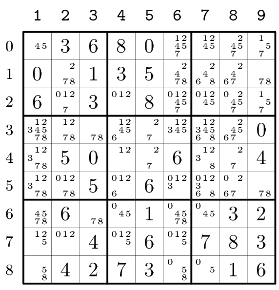</a>

(b) <a href="../../../assets/volume4b/figures/xc-first-a48b.png">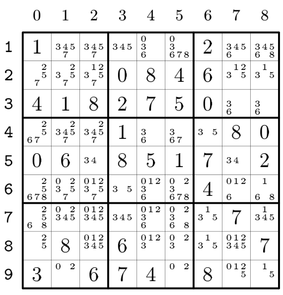</a>

(注意, 在这种表示法中, “隐性” 唯一数、数对等等都成为 “显性” 的了. 还可以作类似的图来表示宫与数值的关系, 只是较为棘手, 因为宫同各行或各列并不正交.)

<a id="ans-7-2-2-1-49"></a>

**49.** [题目](../sec-7-2-2-1.md#ex-7-2-2-1-49) (a) 对于列, 删去各项 $r_{ik},b_{xk}$, 以及 $j\ne j_0$ 的 $c_{jk}$; 若有选项包含 ‘$p_{ij_0}\ c_{j_0k}$’, 连边 $u_i\mathbin{-}v_k$. 对于宫, 删去全部 $r_{ik},c_{jk}$ 以及 $x\ne x_0$ 的 $b_{xk}$; 当有选项包含 ‘$p_{(3\lfloor x_0/3\rfloor+\lfloor j/3\rfloor)(3(x_0\bmod3)+(j\bmod3))}\ b_{x_0k}$’ 时, 连边 $u_j\mathbin{-}v_k$.

(b) 隐性 $q$ 元组的 $r-q$ 个非邻点构成 “显性” 元组 (例如 $\{u_3,u_8,u_1\}$); 反之亦然.

(c) 由 (b) 可知, 只列出显性元组就够了, 而且只须列 $q<r$ 的情形. 用 $ijk$ 表示 (30) 的选项. 第 4 行有显性数对 $\{u_3,u_8\}$, 可删去选项 411、417、421、427、471; 还有显性三元组 $\{u_1,u_3,u_8\}$, 从而还可删去 424. 各列中没有这样的显性元组. 第 4 宫中显性三元组 $\{u_0,u_3,u_6\}$ 允许删去选项 341、346、347、351、356、357.

(d) 若有选项包含 ‘$r_{ik_0}\ c_{jk_0}$’, 连边 $u_i\mathbin{-}v_j$. 当 $k_0=9$ 时有显性数对 $\{u_1,u_5\}$, 因而可删去选项 079 和 279.

[还提出过许多其他化简办法. 例如, (33) 的第 4 宫有一个 “指向数对”: 因为 ‘4’ 和 ‘8’ 必须占据该宫第 3 行的格, 可以去掉 314、324、328、364、368、378. 经典的参考资料是 W. Gould 早年的教程 <em>The Times Su Doku Book 1</em> (2005), 以及 M. Mepham, <em>Solving Sudoku</em> (2005). D. Berthier 发展了全面的理论, 也可用于许多其他问题, 见 <em>Pattern-Based Constraint Satisfaction and Logic Puzzles</em> (2012).]

<a id="pdf-446"></a><a id="p-426"></a>

<a id="ans-7-2-2-1-50"></a>

**50.** [题目](../sec-7-2-2-1.md#ex-7-2-2-1-50) 这样的题一定是在 18 个位置之一添上一个 7 或 8, 因为 (29c) 恰有两个解. 共有 36 道 (18 对同构题).

<a id="ans-7-2-2-1-51"></a>

**51.** [题目](../sec-7-2-2-1.md#ex-7-2-2-1-51) 可以用算法 M, 取 (30) 中 $k\ne8$ 的选项, 并把所有 $r_{i7},c_{j7},b_{x7}$ 的重数指定为 2. 共有六个解, 都是图示部分解的扩充. 若把一半的 7 改成 8, 其中只有一个能变成数独方阵.

<a href="../../../assets/volume4b/figures/xc-first-a51.png">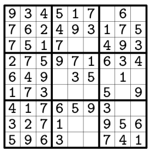</a>

<a id="ans-7-2-2-1-52"></a>

**52.** [题目](../sec-7-2-2-1.md#ex-7-2-2-1-52) (F. Stappers 解.) 网上论坛不时会冒出自称是 “世界最难数独” 的题. 按算法 X 的查找树大小评定, 将近 27,000 道这样的极难题中最难的一道, 其规范形如下. (它是 <code>sites.google.com/site/sudoeleven/</code> 于 2011 年给出的表中的第 6539 号.) 随机化查找树的大小为 $24400\pm1900$, 对数独来说大得惊人; 平均运行时间约为 $12\,\mathrm M\mu$.

<a href="../../../assets/volume4b/figures/xc-first-a52.svg">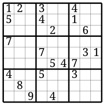</a>

<a id="ans-7-2-2-1-53"></a>

**53.** [题目](../sec-7-2-2-1.md#ex-7-2-2-1-53) (a) 每个袖珍数独解都与下面两个特殊解 $A,B$ 中的一个等价. (按习题 114 的定义, 二者的自同构数分别为 32 和 16.) 要唯一确定其中任何一个, $C$ 中标作 A、B、C、D 的四个区域内都至少要给一个线索.

$$
A=\begin{pmatrix}1&2&3&4\\3&4&1&2\\2&1&4&3\\4&3&2&1\end{pmatrix},\quad
B=\begin{pmatrix}1&2&3&4\\3&4&2&1\\2&1&4&3\\4&3&1&2\end{pmatrix},\quad
C=\begin{pmatrix}\mathrm A&\mathrm A&\mathrm B&\mathrm B\\\mathrm C&\mathrm C&\mathrm D&\mathrm D\\\mathrm A&\mathrm A&\mathrm B&\mathrm B\\\mathrm C&\mathrm C&\mathrm D&\mathrm D\end{pmatrix}.
$$

(b) 对 $A,B$ 各自而言, 符合 (a) 中条件的四线索集合只有 $4^4=256$ 个, 可以逐一检查. 利用自同构归并以后, $A$ 有两类, $B$ 有十一类:

<a href="../../../assets/volume4b/figures/xc-first-a53.png">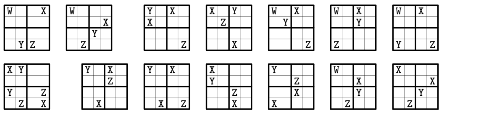</a>

(还有 22 道本质不同的题各有五个不可删去的线索, 而有六个这种线索的只有一道, 即上图左下角那题, 其解为 $A$. 去掉它的任何一个线索, $C$ 或 $C^{\mathrm T}$ 中就会有一个区域落空. 这些结果是 Ed Russell 于 2006 年发现的.)

<a id="ans-7-2-2-1-54"></a>

**54.** [题目](../sec-7-2-2-1.md#ex-7-2-2-1-54) 例如, 逐个试着删去线索, 就可看出 32 个已知数中只有 10 个是不可缺少的. 求全部极小集合 $X$ 的最佳策略, 可能是按元素数从多到少考察候选集合. 设 $W\subseteq X$, 先前的检验已表明: 给定 $X$ 时解唯一, 但对任何 $w\in W$, 给定 $X\setminus\{w\}$ 时解不唯一. 那么若 $W=X$, $X$ 就是极小的. 否则, 令 $X\setminus W=\{x_1,\ldots,x_t\}$, 对每个 $i$ 检验 $X\setminus\{x_i\}$. 不妨排好次序, 使解恰在 $i>p$ 时唯一. 然后将 $t-p$ 个候选对 $(W\cup\{x_1,\ldots,x_p\},X\setminus\{x_i\})$ ($p<i\leq t$) 排入下一轮处理. 适当缓存先前的结果, 可以避免反复检验同一线索子集. 而且算法 X 很容易修改, 使它一发现一个不想要的解就立即回溯.

这样找到了全部 777 个极小子集, 调用算法 X 共 15441 次, 总共只需约 15 亿次内存访问. 在各轮 $(32,31,\ldots,23)$ 中考察的候选对数分别为 $(1,22,200,978,2780,4609,4249,1950,373,22)$; 找到的极小解中, 恰有 $(8,154,387,206,22)$ 个<a id="pdf-447"></a><a id="p-427"></a>的大小分别为 $(27,26,25,24,23)$. 下面 (29a) 画出了字典序最末的 23 线索子集, 这是一道颇难的题, 查找树有 220 个结点.

[令 $f(x_1,\ldots,x_{32})$ 为单调布尔函数 “[给出所有 $x_j=1$ 对应的线索时, 解唯一]”. 本题实质上求的是 $f$ 的素蕴涵元.]

(29a) <a href="../../../assets/volume4b/figures/xc-first-a54.png">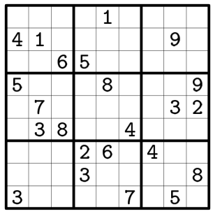</a>

(28a) <a href="../../../assets/volume4b/figures/xc-first-a55a.svg">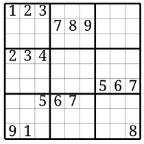</a>

(28b) <a href="../../../assets/volume4b/figures/xc-first-a55b.svg">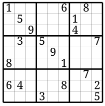</a>

<a id="ans-7-2-2-1-55"></a>

**55.** [题目](../sec-7-2-2-1.md#ex-7-2-2-1-55) 那九个位置中若只给定一个, 其余八个总可以重新排列, 得到另一个解. 而全图可划成九个互不相交的九元集, 每个都有同样的性质, 因此至少需要 $2\cdot9$ 个线索.

这个论证还表明, 凡能用 18 个线索刻画解的, 一定具有很特殊的形式. 上图中有意思的解构成一道格外令人满意的谜题. (作者是借助 SAT 求解器找到它的, 参见 §7.2.2.2.)

同样的论证表明, (28b) 至少需要 18 个线索. 但这次相应的 SAT 实例不可满足. 而且, 任何 19 线索解都必须在恰好一组关键的九个格子中放三个线索. 要求 2043 个可重排而产生新解的至多 18 格的子集每个至少有一个线索, 相应的 SAT 实例仍不可满足. (证明用了 $177\,\mathrm M\mu$.) 不过好极了, 特殊结构确实能给出 20 线索的例子, 如上图所示.

((28b) 的构造也可以用于 (28c), 只须利用[答案 43](#ans-7-2-2-1-43) 中的同位关系.)

<a id="ans-7-2-2-1-56"></a>

**56.** [题目](../sec-7-2-2-1.md#ex-7-2-2-1-56) (我们假定一道像样的数独题只有一个解.) 下图的例子有 40 个不可删线索, 是 Mladen Dobrichev 于 2014 年考察大量情形后首次发现的. (顺便一提, 此题的解除恒等变换外没有自同构.) 若有一个含 41 个不可删线索的例子, 将是很大的惊喜.

<a href="../../../assets/volume4b/figures/xc-first-a56.png">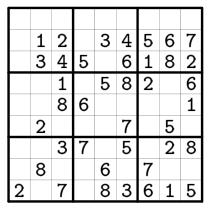</a>

<a id="ans-7-2-2-1-57"></a>

**57.** [题目](../sec-7-2-2-1.md#ex-7-2-2-1-57) 每宫只有 $2\cdot3!\cdot3!\cdot3!\cdot3!=2592$ 种可能. 因而可以建立一个恰当覆盖问题, 含 $9\cdot2592$ 个选项, 每个选项列出一个宫、九个行列对、三个横三数组、三个纵三数组. 由对称性可假定第 0 宫只有一个选项, 即

$$
b_0\ r_{01}\ c_{01}\ r_{04}\ c_{14}\ r_{07}\ c_{27}\ r_{18}\ c_{08}\ r_{12}\ c_{12}\ r_{15}\ c_{25}\
r_{26}\ c_{06}\ r_{29}\ c_{19}\ r_{23}\ c_{23}\ h_{147}\ h_{258}\ h_{369}\ v_{168}\ v_{249}\ v_{357}.
$$

又可将第 0 行限为 $\mathtt{1472AB3CD}$, 其中 $\{\mathtt A,\mathtt C\}=\{5,6\}$, $\{\mathtt B,\mathtt D\}=\{8,9\}$. 于是选项数减为 16417, 算法 X 很快 (只需 $(58+54)\,\mathrm M\mu$) 就找到 864 个解.

这类解是 A. Thoen 和 A. van de Wetering 最先发现的; 见 Thoen 的 <em>Sudoku Patterns</em> (2019), §2.7. 在保持数独解的行列置换下, 864 个解全都同构. 下面是其中很漂亮的一个, 斜向相邻的宫之间有一种奇妙的内部对称性:

```text
1 4 7 2 5 9 3 6 8
8 2 5 7 3 6 9 1 4
6 9 3 4 8 1 5 7 2
2 6 9 3 4 8 1 5 7
7 3 4 9 1 5 8 2 6
5 8 1 6 7 2 4 9 3
3 5 8 1 6 7 2 4 9
9 1 6 8 2 4 7 3 5
4 7 2 5 9 3 6 8 1
```

$$
\begin{matrix}A&B&C&&&\\D&E&F&&&\\G&H&I&&&\\&&&I&B&D\\&&&H&A&F\\&&&G&C&E\end{matrix}.
$$

<a id="pdf-448"></a><a id="p-428"></a>

<a id="ans-7-2-2-1-58"></a>

**58.** [题目](../sec-7-2-2-1.md#ex-7-2-2-1-58) 使用 (30) 的 729 个标准数独选项, 但在 $k\leq7$ 时, 在选项 $(i,j,k)$ 中另加皇后项 ‘$a'_{(i+j)k}\ b'_{(i-j)k}$’. 此外, 为免每个解出现 $7!\,2!=10080$ 次, 加入新的主要项 ‘∗’ 和新的次要项 ‘$\ast_j$’ ($0\leq j<9$), 以及 20 个新选项 ‘$\ast\quad\ast_0{:}f(0,p,q)\ \ldots\ \ast_8{:}f(8,p,q)$’, 其中 $0\leq p<q<9$, $p+q<9$, $f(j,p,q)=(j=p\mathbin?8:j=q\mathbin?9:1+j-[j>p]-[j>q])$, 以此固定第 0 行. 选项 $(0,j,k)$ 中还要加入 ‘$\ast_j{:}k$’. 只有四个解, 用 $3\,\mathrm G\mu$ 找到. 它们都中心对称, 再按转置归并就只有两个. (见[附录 E](../sec-app-e.md#app-e-dlx-58) 以及 Thoen, <em>Sudoku Patterns</em> (2019), §3.4.)

<a id="ans-7-2-2-1-59"></a>

**59.** [题目](../sec-7-2-2-1.md#ex-7-2-2-1-59) 当 X1 的次序为先 $p$ 后 $r$, 再 $c$, 再 $b$ 时, 三棵树的大小分别为 1105、910、122.

(34a) <a href="../../../assets/volume4b/figures/xc-first-a59a.png">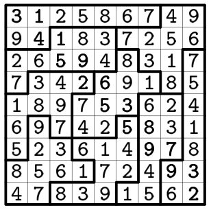</a>

(34b) <a href="../../../assets/volume4b/figures/xc-first-a59b.png">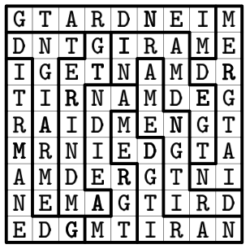</a>

(34c) <a href="../../../assets/volume4b/figures/xc-first-a59c.png">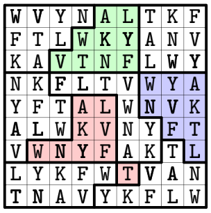</a>

<a id="ans-7-2-2-1-60"></a>

**60.** [题目](../sec-7-2-2-1.md#ex-7-2-2-1-60) 使用 (30) 的选项, 但若行 $i$ 或列 $j$ 含有的格数少于 6, 应将 $r_{ik}$ 或 $c_{jk}$ 作为<em>次要项</em>. 这些谜题用手解颇有趣; 必要时算法 X 也可分别遍历 23、26、16 个结点得到以下答案:

(a) <a href="../../../assets/volume4b/figures/xc-first-a60.png">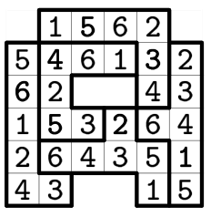</a>

(b) <a href="../../../assets/volume4b/figures/xc-first-b60.png">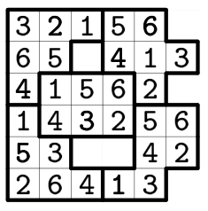</a>

(c) <a href="../../../assets/volume4b/figures/xc-first-c60.png">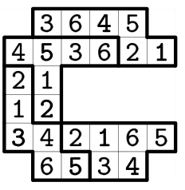</a>

[这几题是一组 26 道优美谜题中的开头几道. Serhiy 和 Peter Grabarchuk 于马丁·加德纳百岁诞辰 (2014 年 10 月 21 日) 公布了它们, 并登载于 <code>puzzlium.com</code>.]

<a id="ans-7-2-2-1-61"></a>

**61.** [题目](../sec-7-2-2-1.md#ex-7-2-2-1-61) 在保留五个线索的 $\binom{25}5=53130$ 种方法中, 恰有 1315 种使解唯一, 其中 175 种涉及全部五个数字. 字典序最先的是[图 A–2(a)](#fig-7-2-2-1-a2).

<a id="ans-7-2-2-1-62"></a>

**62.** [题目](../sec-7-2-2-1.md#ex-7-2-2-1-62) 用习题 7.2.2–76 的方法; 在步骤 R2 中检查 $v_{n-1}$ 和 $v_0$, 很容易排除那些不需要的<em>直形</em> $n$ 格骨牌. 当 $n=(3,4,5,6,7)$ 时, 这样很快就分别得到 $(16,105,561,2804,13602)$ 个可能的宫, 可交给算法 X 生成拼图式分宫.

$n=3$ 时没有这样的分宫. 但 $n=4$ 有 33 种, 分成八个旋转和反射等价类:

<a href="../../../assets/volume4b/figures/xc-first-a62.png">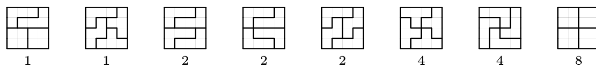</a>

(每种排列下方标出它的对称数; 注意 $8/1+8/1+8/2+8/2+8/2+8/4+8/4+8/8=33$.) 类似地, $n=5$ 有 266 个等价类, 代表 $256\cdot(8/1)+7\cdot(8/2)+3\cdot(8/4)=2082$ 种分宫; $n=6$ 有 40237 类, 代表 $39791\cdot(8/1)+439\cdot(8/2)+7\cdot(8/4)=320098$ 种分宫.

$n=7$ 时计算变得颇为费事, 算法 X 需约 $1.9\,\mathrm T\mu$ 才能生成 132,418,528 个拼图式分宫. 其中有 16,550,986 个类不具对称性, 另有 2660 个类有一种非恒等对称. 后者分为 2265 个在 $180^\circ$ 旋转下对称的类, 354 个在水平反射下对称的类, 及 41 个在关于对角线的<a id="pdf-449"></a><a id="p-429"></a>反射下对称. 下面画出几个有代表性的对称例子:

<a href="../../../assets/volume4b/figures/xc-first-a62sym.svg">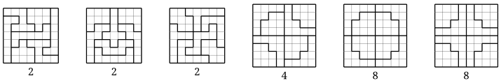</a>

(要生成稍大一些的 $n$ 的全部<em>对称</em>解并不困难. $n=8$ 时有三类具有两种以上的对称, 如上图所示. 当 $n=9$ 时, <em>除去</em>标准数独所用的宫, 还有两种分宫有八重对称, 见图 A–2(b)、(c); 后者不妨叫作风车数独! 对于 $n=8$ 和 $n=9$, 若允许直形 $n$ 格骨牌, 完整的计数见 Bob Harris 于 2010 年在 G4G9 发表的预印本 “Counting nonomino tilings”.)

<a id="fig-7-2-2-1-a2"></a>

(a) <a href="../../../assets/volume4b/figures/xc-first-figa2a.svg">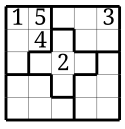</a>

(b) <a href="../../../assets/volume4b/figures/xc-first-figa2b.png">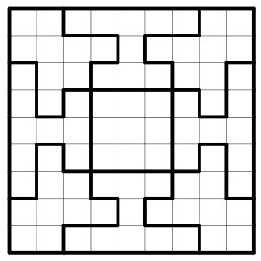</a>

(c) <a href="../../../assets/volume4b/figures/xc-first-figa2c.png">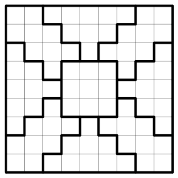</a>

(d) <a href="../../../assets/volume4b/figures/xc-first-figa2d.png">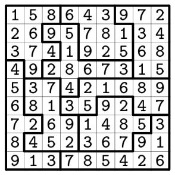</a>

**图 A–2.** 拼图数独的分宫.

<a id="ans-7-2-2-1-63"></a>

**63.** [题目](../sec-7-2-2-1.md#ex-7-2-2-1-63) 略改习题 7.2.2–76 的算法, 即可生成具有所求彩虹性质的 3173 个宫. 以它们为选项解恰当覆盖问题, 经过 $1.2\,\mathrm G\mu$ 的计算, 得到 98556 种铺法. 若将选项限于标准数独的九个方宫以外的 3164 个宫, 铺法数便降到 42669; 其中 24533 种没有贯通整盘的分界线. 图 A–2(d) 就是一个没有这种分界线的例子.

<a id="ans-7-2-2-1-64"></a>

**64.** [题目](../sec-7-2-2-1.md#ex-7-2-2-1-64) (a) $n=4$ 时, [答案 62](#ans-7-2-2-1-62) 的八类中有一类 (第二类)<em>无解</em>, 另一类 (第五类) 无提示即有唯一解. $n=5$ 时, 266 类中有八类无解、六类无提示即有唯一解. $n=6$ 时, 40237 类中 1966 类无解, 28 类无提示即有唯一解.

(Maxime 最初的题刊于芝加哥地区门萨协会的通讯 [<em>ChiMe</em> MM, 3 (2000 年 3 月), 15]. 算法 X 的查找树有 40 个结点. 但若把 ABCDEF 放到<em>下一行</em>, 树就会有 215 个结点!)

(b) (Bob Harris 解, <code>www.bumblebeagle.org/dusumoh/proof/</code>, 2006.) $n=4$ 的无提示拼图数独可以推广到所有更大的 $n$, 图示为 $n=7$ 的情形. 先有 $a=3$, 因此 $b=3$, …, 因此 $f=3$. 再有 $g=4$, 因此 $h=4$, …, 因此 $l=4$. 如此类推, 最后就知道 2 和 1 应放在哪里. (这个证明也表明, 奇数 $n>3$ 时总有 $n\times n$ 的拼图数独, 所有线索都在主对角线上. 对<em>偶数</em> $n$ 是否也有普遍可行的构造? [习题 65](../sec-7-2-2-1.md#ex-7-2-2-1-65) 中有一个 $8\times8$ 的例子.)

<a href="../../../assets/volume4b/figures/xc-first-a64.png">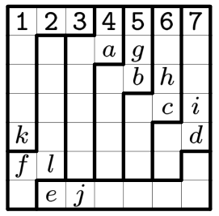</a>

<a id="ans-7-2-2-1-65"></a>

**65.** [题目](../sec-7-2-2-1.md#ex-7-2-2-1-65) (作者借助[习题 62](../sec-7-2-2-1.md#ex-7-2-2-1-62) 和 64 设计了这些题. J. Henle 也构作过类似的题, 见 <em>Math. Intelligencer</em> **38**, 1 (2016), 76–77.)

<a href="../../../assets/volume4b/figures/xc-first-a65.png">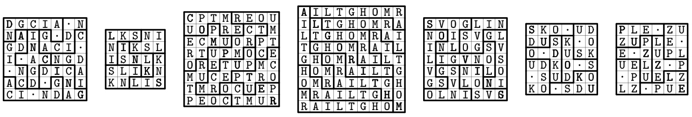</a>

<a id="pdf-450"></a><a id="p-430"></a>

<a id="ans-7-2-2-1-66"></a>

**66.** [题目](../sec-7-2-2-1.md#ex-7-2-2-1-66) (这类题对于人也许太难, 对算法 C 却不难.) 给 (30) 的 729 个选项分别加上 ‘$ij{:}k$’, 其中 $ij$ 是新的次要项, $0\leq i,j<9$. 另加十八个新的主要项: $k$ ($1\leq k\leq9$) 和 $s_j$ ($0\leq j<9$), 其中 $k$ 代表第 $k$ 张卡片, $s_j$ 代表 $3\times3$ 方阵中的一个位置. 每个项 $k$ 有九个选项, 对应卡片可以放入的九个位置. 例如, 项 2 的选项为 ‘$2\ s_0\ \mathtt{00{:}2\ 11{:}3\ 22{:}4\ 20{:}1}$’, ‘$2\ s_1\ \mathtt{03{:}2\ 14{:}3\ 25{:}4\ 23{:}1}$’, …, ‘$2\ s_8\ \mathtt{66{:}2\ 77{:}3\ 88{:}4\ 86{:}1}$’.

将卡片放入各位置共有 $9!$ 种方法, 但实际上只有 $9!/(3!\,3!)=10080$ 种不同, 因为三大行和三大列可分别置换, 数独解数不变. 设卡片 $c_j$ 放在位置 $s_j$. 那么不失一般性, 可假设 $c_0=1$, $c_4=\min(c_4,c_5,c_7,c_8)$. (为纳入这些约束, 只给卡片 1 一个选项, 卡片 2–9 各八个选项; 再用 (26) 那样的排序技巧保证 $c_4<c_5$, $c_4<c_7$, $c_4<c_8$.)

按此约定, 谜题 (i) 只有一个解, 而且只在 $c_0\ldots c_8=192435768$ 时得到. (按习题 114 的意义, 这个解有六个自同构.) 谜题 (ii) 在 $c_0\ldots c_8=149523786$ 时有唯一解. 若各位置所用的排列是 149325687, 数独有十个解, 因此<em>不能</em>用这种排法.

<a id="ans-7-2-2-1-67"></a>

**67.** [题目](../sec-7-2-2-1.md#ex-7-2-2-1-67) (a) (A. E. Brouwer 解, <code>homepages.cwi.nl/~aeb/games/sudoku/nrc.html</code>, 2006.) 增添的四个宫迫使九个 a、…、九个 e 也分别构成彩虹.

<a href="../../../assets/volume4b/figures/xc-first-a67zones.png">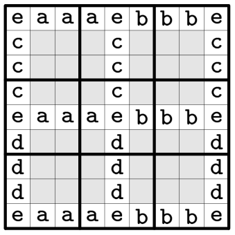</a>

(i) <a href="../../../assets/volume4b/figures/xc-first-a67i.png">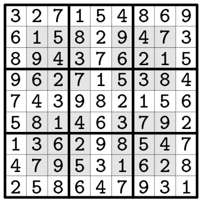</a>

(ii) <a href="../../../assets/volume4b/figures/xc-first-a67ii.png">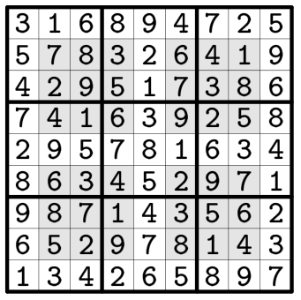</a>

(b) 对 $0\leq y<9$, $1\leq k\leq9$ 引入新的主要项 $b'_{yk}$. 在选项 (30) 中加入 $b'_{yk}$, 其中 $y=3\lfloor i\tau/3\rfloor+\lfloor j\tau/3\rfloor$, 置换 $\tau$ 为 $(03)(12)(58)(67)$.

(c) 若只为 $y\in\{0,2,6,8\}$ 加入 $b'_{yk}$, (i) 的查找树就从 77 个结点增至 231 个, (ii) 的从 151 个结点增至 708 个.

[谜题 (ii) 是 Brouwer 构造的一道 11 线索题的变体. 原书写作时, 超级数独所需线索的最小数目尚未确定.]

(d) 真. 这就是对行和列同时施行 (b) 的置换 $\tau$.

<a id="ans-7-2-2-1-68"></a>

**68.** [题目](../sec-7-2-2-1.md#ex-7-2-2-1-68) (a) 用一个简单的回溯程序, 可以生成所有最上面的格在第 0 行、最左面的格在第 0 列的凸 $n$ 格骨牌. [对于 $1\leq n\leq7$, 其数目依次为 $(1,2,6,19,59,176,502)$; 生成函数见 M. Bousquet-Mélou 和 J.-M. Fédou, <em>Discrete Math.</em> **137** (1995), 53–75.] 在 $n\times n$ 盒子中所得的 $(1,4,22,113,523,2196,8438)$ 种放法, 同[答案 62](#ans-7-2-2-1-62) 一样构成恰当覆盖问题. 考虑对称性, 得到: $n=2$ 有 $1\cdot(8/4)=2$ 种分宫; $n=3$ 有 $1\cdot(8/1)+1\cdot(8/4)=10$ 种; $n=4$ 有 $10\cdot(8/1)+7\cdot(8/2)+4\cdot(8/4)+1\cdot(8/8)=117$ 种; $n=5$ 有 $355\cdot(8/1)+15\cdot(8/2)+4\cdot(8/4)=2908$ 种; $n=6$ 有 $20154\cdot(8/1)+342\cdot(8/2)+8\cdot(8/4)=162616$ 种; $n=7$ 有 $2272821\cdot(8/1)+1181\cdot(8/2)+5\cdot(8/4)=18187302$ 种. ([习题 62](../sec-7-2-2-1.md#ex-7-2-2-1-62) 的结果不同, 因为那里不许使用直形骨牌.)

(b) 这样的九格骨牌中与第 0 行及第 0 列都相接的有 325 种, 总计给出 12097 种放法, 进而得到 $1014148\cdot(8/1)+119\cdot(8/2)+24\cdot(8/4)+1\cdot(8/8)=8113709$ 种分宫. 若除去 $3\times3$ 的九格骨牌及其 49 种放法, 分宫数便降为 $675797\cdot(8/1)=5406376$.

[凸多格骨牌由 Klarner 和 Rivest 引入, 见答案 303.]

<a id="pdf-451"></a><a id="p-431"></a>

<a id="ans-7-2-2-1-69"></a>

**69.** [题目](../sec-7-2-2-1.md#ex-7-2-2-1-69) 称一个符合要求且含 $k$ 个 B 和 $9-k$ 个 L 的九格骨牌放法为 $N_k$. 只有两种情形能使 B 赢七席: 一个 $N_6$、六个 $N_5$、两个 $N_0$; 或七个 $N_5$、一个 $N_1$、一个 $N_0$. 给定的选票图案中, $N_6,N_5,N_1,N_0$ 的可选数分别为 $(1467,2362,163,2)$. 算法 M 提供所需的重数. 经 $12\,\mathrm M\mu$ 的计算, 第一种情形无解, 第二种有 60 个解, 图示为其中之一.

<a href="../../../assets/volume4b/figures/xc-first-a69.png">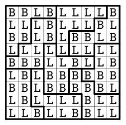</a>

(作者当然不提倡这样私下勾兑! 要说明的是, 不公平地划分选区相当容易, 却难以察觉. 的确, 曾作过 1000 次随机选民分布试验, 九个标准 $3\times3$ 区中每区都是五比四. 其中有 696 例仅用能装进 $5\times5$ 方框的凸九格骨牌, 就能为大端派划出七席. 这 696 例中还有八例能装进 $4\times4$ 方框.)

[使用实际数据的类似研究可追溯到 R. S. Garfinkel 的博士论文 <em>Optimal Political Districting</em> (Baltimore: Johns Hopkins University, 1968).]

<a id="ans-7-2-2-1-70"></a>

**70.** [题目](../sec-7-2-2-1.md#ex-7-2-2-1-70) (a) 有四张牌的位置改变; (b) 解唯一:

(a) <a href="../../../assets/volume4b/figures/xc-first-a70a.png">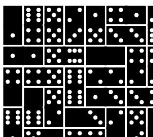</a>

(b) <a href="../../../assets/volume4b/figures/xc-first-a70b.png">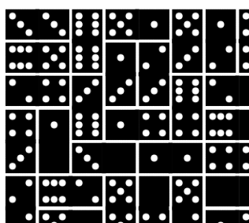</a>

注意, 骨牌竖放时, 二点 (⚁)、三点 (⚂) 及六点 (⚅) 的点形都要旋转; 单从这些图形就能消除 (a) 的歧义, 但数值矩阵中并不显现这条视觉线索.

(Dominosa 是 O. S. Adler 发明的 [德国专利 #71539 (1893); 参见他与 F. Jahn 合著的小册子 <em>Sperr-Domino und Dominosa</em> (1912), 23–64]. E. Lucas 和 H. Delannoy 更早就研究过类似的 “quadrille” 问题. 见 Lucas, <em>Récréations Mathématiques</em> **2** (1883), 52–63; W. E. Philpott, <em>JRM</em> **4** (1971), 229–243.)

<a id="ans-7-2-2-1-71"></a>

**71.** [题目](../sec-7-2-2-1.md#ex-7-2-2-1-71) 对 $0\leq x\leq y\leq6$ 定义 28 个顶点 $D_{xy}$, 再对 $0\leq i<7$, $0\leq j<8$, $i+j$ 为偶数定义 28 个顶点 $ij$, 为 $i+j$ 为奇数的格子也定义类似的 28 个顶点. 匹配问题中有 49 个形如 $\{D_{xy},ij,i(j+1)\}$ 的三元组 ($0\leq i,j<7$), 还有 48 个形如 $\{D_{xy},ij,(i+1)j\}$ 的三元组 ($0\leq i<6$, $0\leq j<8$), 分别对应可能的水平和垂直放法. 例如[习题 70](../sec-7-2-2-1.md#ex-7-2-2-1-70)(a) 的三元组依次为 $\{D_{06},00,01\}$, $\{D_{56},01,02\}$, …, $\{D_{23},66,67\}$; $\{D_{01},00,10\}$, $\{D_{46},01,11\}$, …, $\{D_{12},57,67\}$.

<a id="ans-7-2-2-1-72"></a>

**72.** [题目](../sec-7-2-2-1.md#ex-7-2-2-1-72) 模型 (i) 有 $M=56!/(8!)^7\approx4.10\times10^{42}$ 种等可能的情形; 模型 (ii) 有 $N=1292697\cdot28!\cdot2^{21}\approx8.27\times10^{41}$ 种, 因为 $7\times8$ 的框中有 1292697 种二格骨牌铺法 (算法 X 很快就能列出全部铺法). 因而模型 (i) 中每次试验解数的期望为 $N/M\approx0.201$.

用模型 (i) 做一万次随机试验, 有 216 例至少有一个解, 其中 26 例解唯一. 找到的解数之和 $\sum x$ 为 2256; $\sum x^2=95918$ 表明这是重尾分布, 经验标准差约为 3.1. 总运行时间约为 $250\,\mathrm M\mu$.

用模型 (ii) 做一万次随机试验, 从预先计算的 1292697 种铺法中随机选取, 有 106 例解唯一; 有一例竟有 2652 个解! 这次 $\sum x=508506$, $\sum x^2=144119964$, 经验均值约为每次 51 个解, 标准差约 109. 总耗时约 $650\,\mathrm M\mu$.

<a id="ans-7-2-2-1-73"></a>

**73.** [题目](../sec-7-2-2-1.md#ex-7-2-2-1-73) 下面的阵列给出 807,752 个解, 是作者在 2023 年增订时所列的纪录:

```text
06151146
66611014
56132144
55326224
53632022
34300525
33040054
```

<a id="pdf-452"></a><a id="p-432"></a>

这个阵列是 Germán González-Morris 在 2023 年根据 Michael Keller 先前的工作找到的. 它有个令人惊讶的性质: <em>每一种</em>候选放法都至少在 35,082 个解里出现!

<a id="ans-7-2-2-1-74"></a>

**74.** [题目](../sec-7-2-2-1.md#ex-7-2-2-1-74) 要生成候选阵列, 一个办法是建立 MCC 问题: 给定[答案 72](#ans-7-2-2-1-72) 中 1292697 个匹配之一, 对匹配中的 $uv$ 取选项 ‘$P_{uv}\ xy\ t_u{:}x\ t_v{:}y$’, ‘$P_{uv}\ xy\ t_u{:}y\ t_v{:}x$’; 对不在匹配中的 $uv$ 取 ‘$Q_{uv}\ D_{xy}\ t_u{:}x\ t_v{:}y$’, ‘$Q_{uv}\ D_{xy}\ t_u{:}y\ t_v{:}x$’. 其中 $0\leq x\leq y\leq6$, 当 $x=y$ 时略去重复选项. 给每个 $D_{xy}$ 指定重数 3. 再添 28 个选项 ‘$\#\ D_{xy}$’, 其中 $\#$ 的重数为 15 (因为应当有 15 对 $xy$ 各只有两处额外出现).

作者一时兴起, 取榻榻米铺法作匹配 (见习题 7.1.4–215), 对算法 M 的非锐偏好变种使用[习题 31](../sec-7-2-2-1.md#ex-7-2-2-1-31) 的随机化, 每约 $70\,\mathrm M\mu$ 就得到一个候选者. 出乎意料, 头 10000 个候选者中有 2731 个是所求的解唯一阵列. 其中最难的一例 (查找树有 572 个结点) 为

```text
15133034
21446115
22056105
65460423
22465553
61102332
63600044
```

[见 <code>www.solitairelaboratory.com/puzzlelaboratory/DominoGG.html</code>.]

<a id="ans-7-2-2-1-75"></a>

**75.** [题目](../sec-7-2-2-1.md#ex-7-2-2-1-75) (a) $(x\circ y)\circ x=(x\circ y)\circ(y\circ(x\circ y))=y$.

(b) 五张表都合格. (最后两张表各自对 $0\leq t<4$ 都有 $f(t+f(t))=t$, 这里的加法取异或; 交换任意两个元素就可见二者同构.) 交换 $1\leftrightarrow2$, 可见第三张与第二张同构. 四阶半对称拟群共有 18 张运算表, 其中分别有 $(4,12,2)$ 张与所列的第一、第三、最后一张表同构.

(c) 令 $x\circ y=(-x-y)\bmod n$. (更一般地, 若 $G$ 为任意群, $\alpha\in G$ 满足 $\alpha^2=1$, 则可令 $x\circ y=\alpha x^{-1}\alpha y^{-1}\alpha$. 若 $G$ 交换, 则对任意 $\alpha\in G$, 均可令 $x\circ y=x^{-1}y^{-1}\alpha$.)

(d) 给定一个恰当覆盖, 对其中每个 (i) 型选项令 $x\circ x=x$; 对每个 (ii) 型选项令 $x\circ x=y$, $x\circ y=y\circ x=x$; 对每个 (iii) 型选项令 $x\circ y=z$, $y\circ z=x$, $z\circ x=y$. 反过来, 每张半对称拟群表都给出一种这样的恰当覆盖.

(e) 这样的半对称拟群用 $k$ 个大小为 1 的选项覆盖 $n^2$ 个项中的 $k$ 个, 其余选项大小均为 3. [F. E. Bennett, <em>Discrete Mathematics</em> **24** (1978), 139–146, 证明了只要 $0\leq k\leq n$ 且 $k\equiv n^2\pmod3$, 就存在这样的半对称拟群, 唯一的例外是 $k=n=6$.]

<em>注:</em> 恒等式 $x\circ(y\circ x)=y$ 似乎最早由 E. Schröder 在 <em>Math. Annalen</em> **10** (1876), 289–317 中考虑 [见第 306 页的 “$(C_0)$”], 不过他并未多加利用. 1968 年在加州理工学院数学系二年级的课堂上, 作者定义了这种称为 grope 的结构, 让学生仿照群论, 尽量发现并证明关于它的定理. 这是让大家 “摸索结果” (grope for results) 的意思. 它正式的现代名称 semisymmetric quasigroup (半对称拟群) 却颇为拗口.

J. W. Cannon 在拓扑流形理论中引入了全然不同的另一种 “grope”, 见 <em>Bull. Amer. Math. Soc.</em> **84** (1978), 832–866.

<a id="ans-7-2-2-1-76"></a>

**76.** [题目](../sec-7-2-2-1.md#ex-7-2-2-1-76) (a) 删去 $xx$ 的 $n$ 个项. 只用 $y\ne z$ 的 $2\binom n3$ 个 (iii) 型选项. [幂等半对称拟群等价于 “门德尔松三元系”, 即由 $n(n-1)/3$ 个三圈 $(xyz)$ 组成的族, 其中每个由不同元素组成的有序对都恰好出现一次. N. S. Mendelsohn 证明, 对所有 $n\not\equiv2\pmod3$ 都有这样的系, 唯 $n=6$ 除外; 见 <em>Computers in Number Theory</em> (New York: Academic Press, 1971), 323–338.]

(b) 只用 $0\leq x\leq y<n$ 的 $\binom{n+1}2$ 个项 $xy$; 把 (ii) 型选项换成 ‘$xx\ xy$’ 和 ‘$xy\ yy$’ ($0\leq x<y<n$), 将 (iii) 型选项换成 ‘$xy\ xz\ yz$’ ($0\leq x<y<z<n$). 这样的系相当于 Schröder 的 ‘$(C_1)$’ 与 ‘$(C_2)$’, 也称<em>全对称拟群</em>. 见 S. K. Stein, <em>Trans. Amer. Math. Soc.</em> **85** (1957), 228–256, §8. 特别地, 其中幂等者对应于施泰纳三元系.

(c) 略去 $x=0$ 或 $y=0$ 的项. 只用满足 $1\leq x<y,z<n$ 且 $y\ne z$ 的 $2\binom{n-1}3$ 个 (iii) 型选项. (事实上, 这类系等价于元素集 $\{1,\ldots,n-1\}$ 上的幂等半对称拟群.)

<a id="pdf-453"></a><a id="p-433"></a>

<a id="ans-7-2-2-1-77"></a>

**77.** [题目](../sec-7-2-2-1.md#ex-7-2-2-1-77) 对 $G,H$ 的每个顶点分别用主要项 $v,v'$, 并对 $G$ 的每条边 $e$ 与 $H$ 的<em>补图</em>的每条边 $e'$ 取一个次要项 $ee'$. 共有 $n^2$ 个选项, 即 ‘$v\quad v'\quad\bigcup_{e(v),\,e'(v')}e(v)e'(v')$’, 其中 $e(v)$ 取遍 $G$ 中的边 $v\mathbin{-}u$, $e'(v')$ 取遍 $H$ 中不相邻的顶点对 $v',u'$. (这个问题的解就是顶点的一一匹配 $v\leftrightarrow v'$, 使得 $u\mathbin{-}v$ 蕴涵 $u'\mathbin{-}v'$.)

<a id="ans-7-2-2-1-78"></a>

**78.** [题目](../sec-7-2-2-1.md#ex-7-2-2-1-78) 例如, CATALANDAUBOREL, GRAMARKOFFKNOPP, ABELWEIERSTRASS, BERTRANDHERMITE, CANTORFROBENIUS, GLAISHERHURWITZ, HADAMARDHILBERT, HENSELKIRCHHOFF, JENSENSYLVESTER, MELLINSTIELTJES, NETTORUNGESTERN, MINKOWSKIPERRON.

<a id="ans-7-2-2-1-79"></a>

**79.** [题目](../sec-7-2-2-1.md#ex-7-2-2-1-79) 在 $n\times n$ 的找词方阵中, 每个 $k$ 字母词产生 $4(n+1-k)n$ 个横向或纵向选项, 以及 $4(n+1-k)^2$ 个斜向选项. 因此所求的数为 $(2,5,6,5,3,5,0,1)\cdot(1296,1144,1000,864,736,616,504,400)=24320$.

<a id="ans-7-2-2-1-80"></a>

**80.** [题目](../sec-7-2-2-1.md#ex-7-2-2-1-80) 在第 0 层选择项 $\mathtt q$, 试取选项 $x_0=8$, 即 ‘$\mathtt{q\ x\ y{:}A\ p}$’. 我们覆盖 $\mathtt q$, 再覆盖 $\mathtt x$, 再将 $\mathtt y$ 净化为颜色 A, 再覆盖 $\mathtt p$; 但在第 1 层发现项 $\mathtt r$ 的表是空的. 于是回溯: 撤销覆盖 $\mathtt p$, 撤销净化 $\mathtt y$, 撤销覆盖 $\mathtt x$, 再尝试选项 $x_0=20$, 即 ‘$\mathtt{q\ x{:}A}$’, 从而把 $\mathtt x$ 净化为颜色 A. 这次在第 1 层试取 $x_1=12$, 即 ‘$\mathtt{p\ r\ x{:}A\ y}$’. 于是覆盖 $\mathtt p$, 再覆盖 $\mathtt r$, 随后 (因 $\mathtt x$ 已净化) 覆盖 $\mathtt y$. 在第 2 层发现我们已经得到了一个解! 此时存储器的内容如下:

<table>
<tbody>
<tr><th scope="row">$i$</th><td>0</td><td>1</td><td>2</td><td>3</td><td>4</td><td>5</td><td>6</td></tr>
<tr><th scope="row">$\mathtt{NAME}(i)$</th><td>—</td><td>p</td><td>q</td><td>r</td><td>x</td><td>y</td><td>—</td></tr>
<tr><th scope="row">$\mathtt{LLINK}(i)$</th><td>0</td><td>0</td><td>1</td><td>0</td><td>6</td><td>4</td><td>4</td></tr>
<tr><th scope="row">$\mathtt{RLINK}(i)$</th><td>0</td><td>3</td><td>3</td><td>0</td><td>6</td><td>6</td><td>4</td></tr>
</tbody>
<tbody>
<tr><th scope="row">$x$</th><td>0</td><td>1</td><td>2</td><td>3</td><td>4</td><td>5</td><td>6</td></tr>
<tr><th scope="row">$\mathtt{LEN}(x)$, $\mathtt{TOP}(x)$</th><td>—</td><td>1</td><td>2</td><td>1</td><td>2</td><td>0</td><td>0</td></tr>
<tr><th scope="row">$\mathtt{ULINK}(x)$</th><td>—</td><td>12</td><td>20</td><td>23</td><td>18</td><td>5</td><td>—</td></tr>
<tr><th scope="row">$\mathtt{DLINK}(x)$</th><td>—</td><td>12</td><td>8</td><td>23</td><td>14</td><td>5</td><td>10</td></tr>
<tr><th scope="row">$\mathtt{COLOR}(x)$</th><td>—</td><td>—</td><td>—</td><td>—</td><td>—</td><td>—</td><td>0</td></tr>
</tbody>
<tbody>
<tr><th scope="row">$x$</th><td>7</td><td>8</td><td>9</td><td>10</td><td>11</td><td>12</td><td>13</td></tr>
<tr><th scope="row">$\mathtt{TOP}(x)$</th><td>1</td><td>2</td><td>4</td><td>5</td><td>−1</td><td>1</td><td>3</td></tr>
<tr><th scope="row">$\mathtt{ULINK}(x)$</th><td>1</td><td>2</td><td>4</td><td>5</td><td>7</td><td>1</td><td>3</td></tr>
<tr><th scope="row">$\mathtt{DLINK}(x)$</th><td>12</td><td>20</td><td>14</td><td>15</td><td>15</td><td>1</td><td>23</td></tr>
<tr><th scope="row">$\mathtt{COLOR}(x)$</th><td>0</td><td>0</td><td>0</td><td>A</td><td>0</td><td>0</td><td>0</td></tr>
</tbody>
<tbody>
<tr><th scope="row">$x$</th><td>14</td><td>15</td><td>16</td><td>17</td><td>18</td><td>19</td><td>20</td></tr>
<tr><th scope="row">$\mathtt{TOP}(x)$</th><td>4</td><td>5</td><td>−2</td><td>1</td><td>4</td><td>−3</td><td>2</td></tr>
<tr><th scope="row">$\mathtt{ULINK}(x)$</th><td>4</td><td>5</td><td>12</td><td>12</td><td>14</td><td>17</td><td>8</td></tr>
<tr><th scope="row">$\mathtt{DLINK}(x)$</th><td>18</td><td>24</td><td>18</td><td>1</td><td>4</td><td>21</td><td>2</td></tr>
<tr><th scope="row">$\mathtt{COLOR}(x)$</th><td>−1</td><td>0</td><td>0</td><td>0</td><td>B</td><td>0</td><td>0</td></tr>
</tbody>
<tbody>
<tr><th scope="row">$x$</th><td>21</td><td>22</td><td>23</td><td>24</td><td>25</td></tr>
<tr><th scope="row">$\mathtt{TOP}(x)$</th><td>4</td><td>−4</td><td>3</td><td>5</td><td>−5</td></tr>
<tr><th scope="row">$\mathtt{ULINK}(x)$</th><td>18</td><td>20</td><td>3</td><td>5</td><td>23</td></tr>
<tr><th scope="row">$\mathtt{DLINK}(x)$</th><td>4</td><td>24</td><td>3</td><td>5</td><td>—</td></tr>
<tr><th scope="row">$\mathtt{COLOR}(x)$</th><td>A</td><td>0</td><td>0</td><td>B</td><td>0</td></tr>
</tbody>
</table>

<a id="ans-7-2-2-1-81"></a>

**81.** [题目](../sec-7-2-2-1.md#ex-7-2-2-1-81) 几乎为真, 只须将 $\mathtt{TOP}$ 与 $\mathtt{COLOR}$ 放在同一八字节字内 (这样一次内存访问就能同时读出两者). 唯一的差别在于处理输入时, 算法 X 没有 $\mathtt{COLOR}$ 域要初始化, 而算法 C 将它们置零.

<a id="ans-7-2-2-1-82"></a>

**82.** [题目](../sec-7-2-2-1.md#ex-7-2-2-1-82) 真; 次要项的 $\mathtt{LEN}$ 域并不影响计算.

<a id="ans-7-2-2-1-83"></a>

**83.** [题目](../sec-7-2-2-1.md#ex-7-2-2-1-83) 在 $l=0$ 的 C6 将 $i$ 置为 $\mathtt{TOP}(x_0)$ 以前, 令 $x$ 为 $x_0$ 所在选项右端的分隔结点, 置 $j\gets\mathtt{TOP}(x-1)$. 若 $j>N_1$ (即 $x_0$ 所在选项以次要项 $j$ 结束) 且 $\mathtt{COLOR}(x-1)=0$, 就覆盖 $j$.

<a id="ans-7-2-2-1-84"></a>

**84.** [题目](../sec-7-2-2-1.md#ex-7-2-2-1-84) 用 $\mathtt{CUTOFF}$ (初值 $\infty$) 指向迄今所知最佳解中编号最大的选项的末尾分隔结点. 此后实质上不必再考虑编号 $>\mathtt{CUTOFF}$ 的结点.

<a id="pdf-454"></a><a id="p-434"></a>

每当找到一个解, 令 $\mathtt{PP}$ 为满足 $x_k=\max(x_0,\ldots,x_{l-1})$ 的那个选项末尾的分隔结点. 若 $\mathtt{PP}\ne\mathtt{CUTOFF}$, 置 $\mathtt{CUTOFF}\gets\mathtt{PP}$, 并对 $0\leq k<l$, 从 $\mathtt{TOP}(x_k)$ 的表中删去所有 $>\mathtt{CUTOFF}$ 的结点. (这很容易做, 因为各表都有序.) 最后一次改变 $\mathtt{CUTOFF}$ 时找到的解及其后找到的解就是极小极大解.

子程序 $\operatorname{uncover}'(i)$ 一开始便从项 $i$ 的表中删去所有 $>\mathtt{CUTOFF}$ 的结点. 在 $\operatorname{unhide}'(p)$ 中置 $d\gets\mathtt{DLINK}(q)$ 以后, 若 $d>\mathtt{CUTOFF}$, 置 $\mathtt{DLINK}(q)\gets d\gets x$. 对子程序 $\operatorname{unpurify}(p)$ 也作相同的修改.

<em>微妙之处:</em> 假设在撤销对项 $i$ 的覆盖时遇到选项 ‘$i\ j\ \ldots$’, 需要将其恢复到项 $j$ 的表中; 又设该选项在项 $j$ 的表中的原有后继 ‘$j\ a\ \ldots$’ 位于截断线之外. 我们知道 ‘$j\ a\ \ldots$’ 至少含一个主要项, 而在改动截断值以前每个主要项都已经覆盖. 因此 ‘$j\ a\ \ldots$’ <em>没有</em>恢复, 不必担心要将它删去. 只须像上面说的那样改正 $\mathtt{DLINK}$.

<a id="ans-7-2-2-1-85"></a>

**85.** [题目](../sec-7-2-2-1.md#ex-7-2-2-1-85) 现在让 $\mathtt{CUTOFF}$ 指向已知最佳解中编号最大的选项<em>之前</em>的那个分隔结点. 重置 $\mathtt{CUTOFF}$ 时退回到第 $k-1$ 层, 其中 $x_k$ 是 $\{x_0,\ldots,x_{l-1}\}$ 的最大者.

<a id="ans-7-2-2-1-86"></a>

**86.** [题目](../sec-7-2-2-1.md#ex-7-2-2-1-86) 下列步骤也估计查找树的轮廓. 用 “更新” 和 “净化动作” 的次数来估计运行时间. 用户给出随机种子和所需的试验次数, 最终估计取各次试验的 (无偏) 估计的平均值. 这里只说明一次试验的做法.

在 C1 中另置 $D\gets1$.

在 C2 中, 对查找树第 $l$ 层的结点数给出估计 $D$. 若 $\mathtt{RLINK}(0)=0$, 也给出解数的估计 $D$.

在 C3 中, 令 $\theta$ 为所选项 $i$ 的表中的选项数. 若 $\theta=0$, 给出解数估计 0, 转 C7.

在 C4 末尾, 在 $[0\mathinner{.\,.}\theta-1]$ 中均匀随机地取 $k$; 然后执行 $k$ 次 $x_l\gets\mathtt{DLINK}(x_l)$.

紧接 C5 末尾置 $l\gets l+1$ 以前, 设刚刚作了 $U$ 次更新和 $C$ 次净化动作. ($\operatorname{cover}$ 设置 $\mathtt{LLINK}(r)$ 或 $\operatorname{hide}$ 设置 $\mathtt{ULINK}(d)$, 都算一次 “更新”. $\operatorname{commit}$ 调用 $\operatorname{purify}$, 或 $\operatorname{purify}$ 置 $\mathtt{COLOR}(q)\gets-1$, 都算一次 “净化动作”.) 估计第 $l$ 层作 $D(U'+\theta U)$ 次更新和 $DC$ 次净化动作, 其中 $U'$ 是 C4 刚作的更新数. 随后置 $D\gets\theta D$.

现在 C6 什么也不做. C7 和 C8 不变.

终止时, 所有数据结构都已恢复原状, 可以开始另一次随机试验. 上述步骤已经估计了每层的结点数、更新数和净化动作数. 将各层的估计相加便得<em>总</em>数的估计.

<a id="ans-7-2-2-1-87"></a>

**87.** [题目](../sec-7-2-2-1.md#ex-7-2-2-1-87) 对最终的横行词、竖列词取 $2n$ 个主要项 $a_i,d_j$, 另取 $n^2$ 个次要项 $ij$ 代表各格. 对每个合法词另设一个次要项 $w$, 共 $W$ 个. XCC 问题有 $2Wn$ 个选项, 即每个 $1\leq i,j\leq n$ 与每个合法词 $c_1\ldots c_n$ 分别产生 ‘$a_i\ i1{:}c_1\ \ldots\ in{:}c_n\ c_1\ldots c_n$’ 和 ‘$d_j\ 1j{:}c_1\ \ldots\ nj{:}c_n\ c_1\ldots c_n$’ (见 (110)).

再引入 $W$ 个次要项 $w\mathtt{@}$, 在 $a_1,d_1$ 的每个选项的最右端添上 $c_1\ldots c_n\mathtt{@}$, 就可以避免同时得到某个解和它的转置. 使用[习题 83](../sec-7-2-2-1.md#ex-7-2-2-1-83) 中改写的算法 C, 就绝不会为 $d_1$ 选择已经为 $a_1$ 试过的词. (请想想为什么.)

不过就 “舞蹈链” 来说, 这种构造并不划算, 因为它会使大量数据在活动结构中反复进出. 例如对 $\mathrm{WORDS}(5757)$ 的五字母词, 虽然正确地求出了全部 323,264 个双单词方阵, 运行时间却达到 15 <em>万亿</em>次内存访问! 快得多的做法是使用习题<a id="pdf-455"></a><a id="p-435"></a>7.2.2–28 的算法, 它只需 460 亿次内存访问就能发现全部 1,787,056 个不加限制的单词方阵; 双单词方阵很容易从中辨认出来.

<a id="ans-7-2-2-1-88"></a>

**88.** [题目](../sec-7-2-2-1.md#ex-7-2-2-1-88) 一种办法是作二分查找, 试不同的 $W$. 但最好的办法, 是把[习题 87](../sec-7-2-2-1.md#ex-7-2-2-1-87) 的构造和[习题 84](../sec-7-2-2-1.md#ex-7-2-2-1-84) 的极小极大算法 C 合用. 只要最常见的词所对应的选项排在前面, 这套办法就很合适.

的确, 用此法只需 $64\,\mathrm G\mu$ 就能发现双单词方阵 ‘BLAST|EARTH|ANGER|SCOPE|TENSE’ 并证明它最优, 几乎和习题 7.2.2–28 的专用方法一样快. (这个方阵的第三列是 ARGON, 在五字母词中排第 1720 位; 次优的方阵用了排名第 1800 位的 PEERS.)

<a id="ans-7-2-2-1-89"></a>

**89.** [题目](../sec-7-2-2-1.md#ex-7-2-2-1-89) 用[习题 88](../sec-7-2-2-1.md#ex-7-2-2-1-88) 的 “极小极大” 方法, 先后得到以下头五个方阵

```text
                                   HERTZES
                          CHESTS   OPERATE
                  START   LUSTRE   MIMICAL
           SHOW   THREE   OBTAIN   ACERATE
     MAY   NONE   ROOFS   ARENAS   GENETIC
IS   AGE   OPEN   ASSET   CIRCLE   ENDMOST
TO   NOT   WEST   PEERS   ASSESS   RESENTS
```

耗时分别为 $200\,\mathrm K\mu$, $15\,\mathrm M\mu$, $450\,\mathrm M\mu$, $25\,\mathrm G\mu$, $25.6\,\mathrm T\mu$. 最佳 $6\times6$ 方阵很难找到, 因为能从查找中截去的词太少; 对 2.4 万个七字母词, 它更是左冲右突而一无所获, 因为这些词只产生七个极为深僻的解. 对这些长度, 最好从 2038753 和 14513 个<em>不加限制</em>的单词方阵中筛选; 习题 7.2.2–28 的方法分别用 $4.6\,\mathrm T\mu$ 和 $8.7\,\mathrm T\mu$ 就可找到它们.

<a id="ans-7-2-2-1-90"></a>

**90.** [题目](../sec-7-2-2-1.md#ex-7-2-2-1-90) XCC 问题在这里很合适, 同[答案 88](#ans-7-2-2-1-88) 一样: 用 $2p$ 个主要项 $a_i,d_i$ 代表最后选取的词, 用 $pn+W$ 个次要项 $ij,w$ 代表各格及可能的词, 其中 $0\leq i<p$, $1\leq j\leq n$. 对横向的 $Wp$ 个选项取 ‘$a_i\ i1{:}c_1\ i2{:}c_2\ \ldots\ in{:}c_n\ c_1\ldots c_n$’. 对纵向的 $Wp$ 个选项, 左斜阶梯取 ‘$d_i\ i1{:}c_1\ ((i+1)\bmod p)2{:}c_2\ \ldots\ ((i+n-1)\bmod p)n{:}c_n\ c_1\ldots c_n$’, 右斜阶梯取 ‘$d_i\ i1{:}c_n\ ((i+1)\bmod p)2{:}c_{n-1}\ \ldots\ ((i+n-1)\bmod p)n{:}c_1\ c_1\ldots c_n$’. [习题 83](../sec-7-2-2-1.md#ex-7-2-2-1-83) 的修改节省了一个因子 $2p$; [习题 84](../sec-7-2-2-1.md#ex-7-2-2-1-84) 的极小极大改法很快便能找到最优解.

$p=1$ 时没有左斜阶梯, 因为要有两个不同的词. 对 $2\leq p\leq10$, 左斜的优胜者为

```text
p =  2   WRITE|WHOLE
p =  3   MAKES|LIVED|WAXES
p =  4   THERE|SHARE|WHOLE|WHOSE
p =  5   STOOD|THANK|SHARE|SHIPS|STORE
p =  6   WHERE|SHEEP|SMALL|STILL|WHOLE|SHARE
p =  7   MAKES|BASED|TIRED|WORKS|LANDS|LIVES|GIVES
p =  8   WATER|MAKES|LOVED|GIVEN|LAKES|BASED|NOTES|TONES
p =  9   WHERE|SHEET|STILL|SHALL|WHITE|SHAPE|STARS|WHOLE|SHORE
p = 10   THERE|SHOES|SHIRT|STONE|SHOOK|START|WHILE|SHELL|STEEL|SHARP
```

除 $p=8$ 要用 $\mathrm{WORDS}(504)$ 中的 NOTED 以外, 它们都属于 $\mathrm{WORDS}(500)$.

右斜的优胜者有更多变化:

```text
p =  1   SPOTS
p =  2   STALL|SPIES
p =  3   STOOD|HOLES|LEAPS
p =  4   MIXED|TEARS|SLEPT|SALAD
p =  5   YEARS|STEAM|SALES|MARKS|DRIED
p =  6   STEPS|SEALS|DRAWS|KNOTS|TRAPS|DROPS
p =  7   TRIED|FEARS|SLIPS|SEAMS|DRAWS|ERECT|TEARS
p =  8   YEARS|STOPS|HOOKS|FRIED|TEARS|SLANT|SWORD|SWEEP
p =  9   START|SPEAR|SALES|TESTS|STEER|SPEAK|SKIES|SLEPT|SPORT
p = 10   YEARS|STOCK|HORNS|FUELS|BEETS|SPEED|TEARS|PLANT|SWORD|SWEEP
```

除 $p=2,3$ 外, 它们都属于 $\mathrm{WORDS}(1300)$.

[相当于左斜单词阶梯的排列, 是 Will Shortz 在 <em>Classic Crossword Puzzles</em> (Penny Press, 1976 年 2 月) 中以 “Flower Power” 一名引入美国的. 他依据的是意大利 <em>La Settimana Enigmistica</em> 中称为 “Incroci Concentrici” 的谜题. 不久后他又在 <em>GAMES</em> 杂志中取 $p=16$, 称之为 “Petal Pushers”; 通常用六字母词, 偶尔也用七字母词. 左斜<a id="pdf-456"></a><a id="p-436"></a>阶梯比右斜的常见得多, 因为后者把词尾与词首的字母统计混在了一起.]

<a id="ans-7-2-2-1-91"></a>

**91.** [题目](../sec-7-2-2-1.md#ex-7-2-2-1-91) 考虑在五字母词的右斜阶梯中可以照下图出现的所有 “核” $c_1\ldots c_{14}$. 对给定的词集, 要形成这样的核, 就必须存在字母 $x_1\ldots x_{12}$, 使得 $x_3x_4x_5c_2c_3$, $c_4c_5c_6c_7c_8$, $c_9c_{10}c_{11}c_{12}x_6$, $c_{13}c_{14}x_7x_8x_9$, $x_1x_2x_5c_5c_9$, $c_1c_2c_6c_{10}c_{13}$, $c_3c_7c_{11}c_{14}x_{10}$, $c_8x_6x_9x_{11}x_{12}$ 全在词集中. 所以很容易建立一个 XCC 问题, 求出核的多重集, 然后从中取出<em>不同</em>的核组成的集合.

$$
\begin{array}{rrrrrrrr}
&&x_1\\&&x_2&c_1\\x_3&x_4&x_5&c_2&c_3\\&c_4&c_5&c_6&c_7&c_8\\&&c_9&c_{10}&c_{11}&c_{12}&x_6\\&&&c_{13}&c_{14}&x_7&x_8&x_9\\&&&&x_{10}&x_{11}\\&&&&&x_{12}
\end{array}
$$

把核 $c_1\ldots c_{14}$ 看作状态转移

$$
c_1c_2c_3c_4c_5c_6c_7c_9c_{10}\ \longrightarrow\
c_3c_7c_8c_9c_{10}c_{11}c_{12}c_{13}c_{14}.
$$

构造一个有向图, 以这些核为弧, 以相应的 9 元组为顶点. 这个转移给阶梯贡献两个词 $c_4c_5c_6c_7c_8$ 和 $c_1c_2c_6c_{10}c_{13}$. 因此, <em>周期为 $p$ 的右斜单词阶梯恰好对应于这个有向图中各弧所贡献的词互不相同的 $p$ 元有向圈.</em>

若图不过大, 现在便可求解. 例如, $\mathrm{WORDS}(1000)$ 给出一个有 180524 条弧、96677 个顶点的有向图. 我们只关心这张 (非常稀疏的) 图中的有向圈, 所以只取每个顶点入度、出度都为正的最大导出子图, 就能大幅化简 (参见习题 7.1.4–234 中类似的做法). 结果真妙: 那个子图只有 30 个顶点和 34 条弧! 因而完全有办法处理, 很快就可判定 $\mathrm{WORDS}(1000)$ 中最长的右斜单词阶梯周期为 $p=5$. 我们在[答案 90](#ans-7-2-2-1-90) 中直接找到的这个阶梯对应于圈

```text
SEDYEARST → DRSSTEASA → SAMSALEMA → MESMARKDR → SKSDRIEYE → SEDYEARST.
```

左斜单词阶梯也可作类似处理, 不过核左右反射; 转移所贡献的词便是 $c_8c_7c_6c_5c_4$ 和 $c_1c_2c_6c_{10}c_{13}$. 对 $\mathrm{WORDS}(500)$ 所得的图有 136771 条弧、74568 个顶点; 但这次化简后还剩 6280 个顶点、13677 条弧. 将它分解成强分图可使任务较为简单, 因为每个圈都在一个强分图内. 不过我们仍面临一个有 6150 个顶点、12050 条弧的巨大分量.

办法是反复作如下化简: 找一个出度为 1 的顶点 $v$. 用回溯法从 $v$ 出发找一条只贡献不同词的简单路径, 试着循它成圈. 若不能成圈 (通常不能, 而且查找一般很快就结束), 就从图中删去 $v$, 再次化简.

这样可以很快证明, 从 $\mathrm{WORDS}(500)$ 选词的最优左斜阶梯周期为 36:

```text
SHARE|SPENT|SPEED|WHEAT|THANK|CHILD|SHELL|SHORE|STORE|STOOD|CHART|GLORY|
FLOWS|CLASS|NOISE|GAMES|TIMES|MOVES|BONES|WAVES|GASES|FIXED|TIRED|FEELS|
WALLS|WORLD|ROOMS|WORDS|DOORS|PARTY|WANTS|WHICH|WHERE|SHOES|STILL|STATE
```

另有 36 个竖读的词. 顺便说, GLORY 和 FLOWS 的排名为 496 和 498, 可见它们差一点没能进入 $\mathrm{WORDS}(500)$.

对更大的 $W$, 从 $\mathrm{WORDS}(W)$ 很可能得到很长的圈. 虽然发现这些圈不会很容易, 查找过程本身却一定很有趣.

<a id="ans-7-2-2-1-92"></a>

**92.** [题目](../sec-7-2-2-1.md#ex-7-2-2-1-92) 对最后的词用 $3p$ 个主要项 $a_i,b_i,d_i$, 对各格及可能的词用 $pn+2W$ 个次要项 $ij,w,w\mathtt{@}$, 其中 $0\leq i<p$, $1\leq j\leq n$ (有些类似[答案 90](#ans-7-2-2-1-90)). 横向的 $Wp$ 个选项是

<a id="pdf-457"></a><a id="p-437"></a>

‘$a_i\ i1{:}c_1\ i2{:}c_2\ \ldots\ in{:}c_n\ c_1\ldots c_n\ c_1\ldots c_n\mathtt{@}$’. 两个方向的纵向选项共 $2Wp$ 个, 分别为 ‘$b_i\ i1{:}c_1\ ((i+1)\bmod p)2{:}c_2\ \ldots\ ((i+n-1)\bmod p)n{:}c_n\ c_1\ldots c_n$’ 和 ‘$d_i\ i1{:}c_n\ ((i+1)\bmod p)2{:}c_{n-1}\ \ldots\ ((i+n-1)\bmod p)n{:}c_1\ c_1\ldots c_n$’. 在 $a_i$ 的选项最右端放上项 $w\mathtt{@}$, 可以节省一个因子 $p$.

使用修改后的算法 C. $p=1$ 不可能. 接下来依次有

```text
p =  2   SPEND|SPIES
p =  3   WAVES|LINED|LEPER
p =  4   LOOPS|POUTS|TROTS|TOONS
p =  5   SPOOL|STROP|STAID|SNORT|SNOOT
p =  6   DIMES|MULES|RIPER|SIRED|AIDED|FINED
p =  7   MILES|LINTS|CARES|LAMED|PIPED|SANER|LIVER
p =  8   SUPER|ROVED|TILED|LICIT|CODED|ROPED|TIMED|DOMED
p =  9   FORTH|LURES|MIRES|POLLS|SLATS|SPOTS|SOAPS|PLOTS|LOOTS
p = 10   TIMES|FUROR|RUNES|MIMED|CAPED|PACED|LAVER|FINES|LIMED|MIRES
```

($p\geq8$ 时需要很长的计算时间.)

<a id="ans-7-2-2-1-93"></a>

**93.** [题目](../sec-7-2-2-1.md#ex-7-2-2-1-93) 这次 $p\leq2$ 都不可能. 用类似上题的构造, 仍可节省一个因子 $p$. (上下也对称, 但这一点稍难利用.) 例子比较容易找, 优胜者为

```text
p =  3   MILES|GALLS|BULLS
p =  4   FIRES|PONDS|WALKS|LOCKS
p =  5   LIVES|FIRED|DIKES|WAVED|TIRES
p =  6   BIRDS|MARKS|POLES|WAVES|WINES|FONTS
p =  7   LIKED|WARES|MINES|WINDS|MALES|LOVES|FIVES
p =  8   WAXES|SITES|MINED|BOXES|CAVES|TALES|WIRED|MALES
p =  9   CENTS|HOLDS|BOILS|BALLS|MALES|WINES|FINDS|LORDS|CARES
p = 10   LOOKS|ROADS|BEATS|BEADS|HOLDS|COOLS|FOLKS|WINES|GASES|BOLTS
```

[这种图案由 Harry Mathews 于 1975 年引入, 他给出的四字母例子是 ‘TINE|SALE|MALE|VINE’. 见 H. Mathews 和 A. Brotchie, <em>Oulipo Compendium</em> (London: Atlas, 1998), 180–181.]

<a id="ans-7-2-2-1-94"></a>

**94.** [题目](../sec-7-2-2-1.md#ex-7-2-2-1-94) 建立一个 XCC 问题, 以 $k,p_k$ 为主要项、$x_k$ 为次要项, $0\leq k<16$. 对 $0\leq j,k<16$, 取选项 ‘$j\ p_k\ x_k{:}a\ x_{(k+1)\bmod16}{:}b\ x_{(k+3)\bmod16}{:}c\ x_{(k+4)\bmod16}{:}d$’, 其中 $j=(abcd)_2$. 解 $(0000011010111011)$ 实质上是唯一的 (不计循环移位、反射及取补). [见 C. Flye Sainte-Marie, <em>L’Intermédiaire des Mathématiciens</em> **3** (1896), 155–161.]

<a id="ans-7-2-2-1-95"></a>

**95.** [题目](../sec-7-2-2-1.md#ex-7-2-2-1-95) 对 $0\leq k<m$, 取 $2m$ 个主要项 $a_k,b_k$ 和 $m$ 个次要项 $x_k$. 定义 $m^2$ 个大小为 $2+n$ 的选项, 即 ‘$a_j\ b_k\ x_j{:}t_1\ x_{(j+1)\bmod m}{:}t_2\ \ldots\ x_{(j+n-1)\bmod m}{:}t_n$’, 其中 $t_1t_2\ldots t_n$ 是所考虑的第 $k$ 个二进制向量. 不过, 略去 $j=0$ 且 $k>0$ 的选项以及 $j>0$ 且 $k=0$ 的选项, 就可节省一个因子 $m$.

情形 $(7,0,3)$ 有 137216 个解, 用 85 亿次内存访问找到; 情形 $(7,3,4)$ 有 41280 个解, 用 32 亿次内存访问找到. (也可以将 $b_k$ 变为次要项. 查找树因此稍大一些, 实际上却<em>省</em>了一点时间, 因为 MRV 启发式方法会在 $a_j$ 上分支, 搜索保持集中; 当 $b_k$ 不是主要项时, 用于计算该启发式量的时间就少些. 也可以改为将 $a_k$ 变为次要项, 甚至完全略掉它们, 效果一样. 但这样做就糟了! 例如情形 $(7,0,3)$ 的运行时间会增加到近 50 万亿次内存访问, 因为搜索失去了焦点.)

§7.2.1 讨论的其他 “通用圈” 也可作类似处理.

<a id="ans-7-2-2-1-96"></a>

**96.** [题目](../sec-7-2-2-1.md#ex-7-2-2-1-96) 事实上, 下面四行分别为上面四行的补的解有 80 个.

```text
00000110
00010111
11001010
10001110
11111001
11101000
00110101
01110001
```

(这道题推广了习题 7.2.1.1–109 的 “外环面” 思想. 也可考虑非矩形的窗口. 例如, 填一个五格十字形的三十二种方法, 可与偏移量为 $(4,\pm4)$ 的广义环面的 32 个位置相对应; 见习题 7–137.)

<a id="ans-7-2-2-1-97"></a>

**97.** [题目](../sec-7-2-2-1.md#ex-7-2-2-1-97) 对 $0\leq j<3$, $0\leq k<9$, 取主要项 $jk,p_{jk}$ 及次要项 $d_{j,k}$. 对每一组 $0\leq i,j<3$ 及 $0\leq k,k'<9$, 取下面三个选项: 当 $j'=0,1$ 时取

$$
‘jk\ p_{j'k'}\ d_{j',k'}{:}i\ d_{j',k'+1}{:}(i+a)\ d_{j'+1,k'}{:}(i+b)\ d_{j'+1,k'+1}{:}(i+c)’;
$$

另取

$$
‘jk\ p_{2k'}\ d_{2,k'}{:}i\ d_{2,k'+1}{:}(i+a)\ d_{0,k'-3}{:}(i+b-1)\ d_{0,k'-2}{:}(i+c-1)’,
$$

其中 $9j+k=(abc)_3$. 含 $i$ 的和按模 3 计算, 含 $k'$ 的和按模 9 计算. 不妨假定 $00$ 与 $p_{00}$ 配对. 这样得 $2\cdot2898=5796$ 个解 $D$; 每个解都满足 $D\ne D^{\mathsf T}$.

<a id="pdf-458"></a><a id="p-438"></a>

<a id="ans-7-2-2-1-98"></a>

**98.** [题目](../sec-7-2-2-1.md#ex-7-2-2-1-98) 给定一个 3SAT 问题, 子句为 $(l_{i1}\lor l_{i2}\lor l_{i3})$, $1\leq i\leq m$, 各 $l_{ij}\in\{x_1,\bar x_1,\ldots,x_n,\bar x_n\}$. 构造一个含 $3m$ 个主要项 $ij$ ($1\leq i\leq m$, $1\leq j\leq3$) 和 $n$ 个次要项 $x_k$ ($1\leq k\leq n$) 的 XCC 问题, 取下列 $6m$ 个选项: (i) ‘$i1\ i2$’, ‘$i2\ i3$’, ‘$i3\ i1$’; (ii) 若 $l_{ij}=x_k$ 则取 ‘$ij\ x_k{:}1$’, 若 $l_{ij}=\bar x_k$ 则取 ‘$ij\ x_k{:}0$’. 这个问题有解当且仅当给定的子句可满足.

<a id="ans-7-2-2-1-99"></a>

**99.** [题目](../sec-7-2-2-1.md#ex-7-2-2-1-99) 真, 不过次要项可能多得多, 选项也可能长得多. 设 $x$ 是某个 XCC 问题 $A$ 中已赋颜色的一个次要项, $O$ 是出现 $x$ 的选项集. 将 $A$ 换成新问题 $A'$: 删去项 $x$, 并对 $O$ 中每一对在 $A$ 中给 $x$ 不同颜色的选项 $o,p$ 加入一个新的次要项 $x_{\{o,p\}}$. 将每个 $o\in O$ 中的项 $x$ 换成适用于 $o$ 的全部 $x_{\{o,p\}}$. 若 $A'$ 中仍有颜色, 再用相同的方法将其换成 $A''$, 直到所有颜色都消去.

<a id="ans-7-2-2-1-100"></a>

**100.** [题目](../sec-7-2-2-1.md#ex-7-2-2-1-100) (a) 有五个解: 00112、00122、01112、01122、11111.

(b) 取五个主要项 $\{\#1,\#2,\#3,\#4,\#5\}$ 和五个次要项 $\{x_1,x_2,x_3,x_4,x_5\}$. 项 $\#1$ 实施二元约束 $x_1\leq x_2$, 它的选项为 ‘$\#1\ x_1{:}0\ x_2{:}0$’, ‘$\#1\ x_1{:}0\ x_2{:}1$’, ‘$\#1\ x_1{:}0\ x_2{:}2$’, ‘$\#1\ x_1{:}1\ x_2{:}1$’, ‘$\#1\ x_1{:}1\ x_2{:}2$’, ‘$\#1\ x_1{:}2\ x_2{:}2$’. 用 $\#2,\#3,\#4$ 的类似选项分别实施约束 $x_2\leq x_3$, $x_3\leq x_4$ 和 $x_4\leq x_5$. 最后用下列选项实施三元约束 $x_1+x_3+x_5=3$:

$$
\begin{aligned}
&‘\#5\ x_1{:}0\ x_3{:}1\ x_5{:}2’,\quad ‘\#5\ x_1{:}0\ x_3{:}2\ x_5{:}1’,\\
&‘\#5\ x_1{:}1\ x_3{:}0\ x_5{:}2’,\quad ‘\#5\ x_1{:}1\ x_3{:}1\ x_5{:}1’,\quad ‘\#5\ x_1{:}1\ x_3{:}2\ x_5{:}0’,\\
&‘\#5\ x_1{:}2\ x_3{:}0\ x_5{:}1’,\quad ‘\#5\ x_1{:}2\ x_3{:}1\ x_5{:}0’.
\end{aligned}
$$

(c) 对每个约束取一个主要项 $\#j$ ($1\leq j\leq m$), 对每个变量取一个次要项 $x_k$ ($1\leq k\leq n$). 若约束 $C_j$ 涉及 $d$ 个变量 $x_{i_1},\ldots,x_{i_d}$, 则对每个合法的 $d$ 元组 $(a_1,\ldots,a_d)$ 加入选项 ‘$\#j\ x_{i_1}{:}a_1\ \ldots\ x_{i_d}{:}a_d$’.

(这种构造当然并非对 CSP 的所有实例都有效率; 此外, 对某个特定的 CSP, 常能找到好得多的 XCC 编码, 因为这种方法在每个选项中只用了一个主要项. 不过, 在着手表示具体问题时, 这个构造背后的想法是很有用的.)

<a id="ans-7-2-2-1-101"></a>

**101.** [题目](../sec-7-2-2-1.md#ex-7-2-2-1-101) 注意, 最后一问还暗示了两条线索:

- 有人驯养斑马.
- 有人最爱喝白水.

对每条线索取一个主要项 $\#k$, $1\leq k\leq16$. 再令 $5\cdot5$ 个次要项 $N_j,J_j,P_j,D_j,C_j$ 表示第 $j$ 所房子 ($0\leq j<5$) 的国籍、职业、宠物、饮料及颜色. 对应于线索 $(1,\ldots,16)$ 的选项数依次为 $(5,5,5,5,1,5,1,5,4,5,8,5,8,8,5,5)$. 典型例子是: ‘$\#1\ N_j{:}\mathrm{England}\ C_j{:}\mathrm{red}$’, $0\leq j<5$; ‘$\#5\ N_0{:}\mathrm{Norway}$’; ‘$\#9\ C_i{:}\mathrm{white}\ C_{i+1}{:}\mathrm{green}$’, $0\leq i<4$; ‘$\#14\ J_i{:}\mathrm{nurse}\ P_{i+1}{:}\mathrm{fox}$’ 和 ‘$\#14\ P_i{:}\mathrm{fox}\ J_{i+1}{:}\mathrm{nurse}$’, $0\leq i<4$; ‘$\#15\ P_j{:}\mathrm{zebra}$’, $0\leq j<5$.

还可用一个较复杂的表示, 引入另外 $5\cdot5$ 个次要项来表示 $N_j,J_j,P_j,D_j,C_j$ 的<em>逆</em>, 从而实施那个冗余的 “全不相同” 约束. 例如, $\#1$ 的选项现在成了 ‘$\#1\ N_j{:}\mathrm{England}\ N^{-}_{\mathrm{England}}{:}j\ C_j{:}\mathrm{red}\ C^{-}_{\mathrm{red}}{:}j$’. (有了这些附加项, 算法 C 从 $\#5$ 和 $\#11$ 就能立刻推出 $C_1{:}\mathrm{blue}$; 没有它们时, $\#5$ 并不能立刻排除 $N_1{:}\mathrm{Norway}$. 它们使查找树从 112 个结点缩小到 32 个结点. 不过它们在查找过程中节省的时间刚好抵消它们在步骤 C1 额外消耗的时间.)

只用逆是<em>不够</em>的; 例如这并不禁止 $N^{-}_{\mathrm{England}}=N^{-}_{\mathrm{Japan}}$.

[这个当今著名的谜题的作者已不可考. 已知它最早发表于 <em>Life International</em> **35** (1962 年 12 月 17 日), 第 95 页, 当时用的是香烟品牌而非职业.]

<a id="ans-7-2-2-1-102"></a>

**102.** [题目](../sec-7-2-2-1.md#ex-7-2-2-1-102) 同[答案 7.2.2–68](./7-2-2.md#ans-7-2-2-68) 一样, 我们来求一个已给定部分标号的有向图的全部稳定扩充. 不妨也允许汇点; 可以假定每个出度 $d\leq1$ 的顶点都已标上 $d$. 下述 XCC 表示基于 R. Bittencourt 的想法.

<a id="pdf-459"></a><a id="p-439"></a>

设最大出度为 $\Delta$. 对每个顶点 $v$ 和每个 $0\leq d\leq\Delta$, 引入主要项 $H_v,I_v,E_{vd}$ 及次要项 $v,h_{vd},i_{vd}$. 项 $v$ 的颜色为 $v$ 的标号 $\lambda(v)$. 项 $h_{vd}$ 的颜色表示布尔量 ‘$[v\text{ 看得见 }d]$’, 意思是存在 $v\to w$ 使得 $\lambda(w)=d$; 项 $i_{vd}$ 的颜色则表示 ‘$[\lambda(v)=d]$’. $H_v$ 的选项为 ‘$H_v\ v{:}d\ \bigcup_{k=0}^{\Delta}\{h_{vk}{:}e_k\}$’, 其中 $e_0+\cdots+e_\Delta=d$. $I_v$ 的选项为 ‘$I_v\ v{:}d\ \bigcup_{k=0}^{\Delta}\{i_{vk}{:}[k=d]\}\ \bigcup_{u\to v}\{h_{ud}{:}1\}$’. 设 $v\to w_1,\ldots,v\to w_{d^+(v)}$, 则 $E_{vd}$ 的选项为 ‘$E_{vd}\ h_{vd}{:}1\ i_{w_kd}{:}1\ \bigcup_{j=1}^{k-1}\{i_{w_jd}{:}0\}$’ ($1\leq k\leq d^+(v)$) 及 ‘$E_{vd}\ h_{vd}{:}0\ \bigcup_{j=1}^{d^+(v)}\{i_{w_jd}{:}0\}$’. 例如, 把[习题 7.2.2–68](../sec-7-2-2.md#ex-7-2-2-68) 的顶点命名为 00、…、99, 它的唯一解中就有下列选项:

$$
\begin{aligned}
&‘H_{00}\ 00{:}3\ h_{000}{:}0\ h_{001}{:}0\ h_{002}{:}0\ h_{003}{:}0\ h_{004}{:}1\ h_{005}{:}0\ h_{006}{:}0\ h_{007}{:}1\ h_{008}{:}0\ h_{009}{:}1’,\\
&‘I_{00}\ 00{:}3\ i_{000}{:}0\ \ldots\ i_{002}{:}0\ i_{003}{:}1\ i_{004}{:}0\ \ldots\ i_{009}{:}0\ h_{013}{:}1\ h_{033}{:}1\ h_{053}{:}1\ h_{703}{:}1\ h_{803}{:}1’,\\
&‘E_{004}\ h_{004}{:}1\ i_{104}{:}0\ \ldots\ i_{404}{:}0\ i_{504}{:}1’.
\end{aligned}
$$

当然, 已给的标号决定了许多量, 因而有许多选项可大大化简. 给定 $\lambda(v)$ 时就知道 $i_{vd}$ 的颜色; 若从原题已知 $v$ 看得见 $d$, 就知道 $h_{vd}$ 的颜色. 若 $v$ 已有标号, 就用不着 $I_v$; 若已知 $v$ 看得见 $d$, 连 $E_{vd}$ 也不需要. 若 $v$ 出度为 $d$, 又已经两次看见了某个相同的标号, 就知道 $i_{vd}$ 为 0. 依此类推. 对圆周率日谜题作这些化简, 原有的 6 万个选项、$1200+1831$ 个项, 便减为 11351 个选项、$880+1216$ 个项. 这仍然很多, 算法 C 输入它们就用了 $135\,\mathrm M\mu$; 不过此后再花 $25\,\mathrm M\mu$ 就能找到解并证明其唯一性. ([答案 7.2.2–68](./7-2-2.md#ans-7-2-2-68) 中经过仔细调校的方法只需 $7\,\mathrm M\mu$ 就能证明唯一性, 但那种方法只能解碰巧容易化简的一小类题.)

Bittencourt 指出, 有两个箭头朝向相同, 还可以进一步加速. (圆周率日谜题中有 123 例.) 一般地, 若 $v\to w$ 蕴涵 $u\to w$, 那么必有 $\lambda(u)\geq\lambda(v)$; 可引入新的主要变量来实施这个条件, 其选项只允许 $u,v$ 取适当的颜色组合.

<a id="ans-7-2-2-1-103"></a>

**103.** [题目](../sec-7-2-2-1.md#ex-7-2-2-1-103) (a) 全音程序列总有 $x_{n-1}=(x_0+1+\cdots+(n-1))\bmod n=(x_0+n(n-1)/2)\bmod n=(x_0+[n\text{ 为偶数}]\,n/2)\bmod n$.

(b) 对 $0\leq j<n$, $1\leq k<n$, 取 $j,p_j,d_k,q_k$ 为主要项, $x_j$ 为次要项. 对 $0\leq j,t<n$ 取选项 ‘$j\ p_t\ x_j{:}t$’, 略去 $j=0$ 且 $t\ne0$ 或 $j=n-1$ 且 $t\ne n/2$ 的情形. 对 $1\leq k,t<n$ 和 $0\leq i<n$, 另取选项 ‘$d_k\ q_t\ x_{t-1}{:}i\ x_t{:}(i+k)\bmod n$’. 于是音序列和音程序列都是排列.

$n=(2,4,6,8,10,12)$ 时, 解的数目分别为 $(1,2,4,24,288,3856)$. [$n=12$ 的数值最早由 D. H. Lehmer 算得, 见 <em>Proc. Canadian Math. Congress</em> **4** (1959), 171–173; $n<12$ 时由 E. N. Gilbert 算得, 见 <em>SIAM Review</em> **7** (1965), 189–198.]

$n$ 较大时, 算法 C 远比不上直接的回溯算法. 后者用算法 7.2.1.2X 求出 $n-1$ 个音程的一切合适排列: $n=14$ 时, 这种方法只用 $100\,\mathrm M\mu$ 就找齐了 89328 个解, 而算法 C 却要 $107\,\mathrm G\mu$! 回溯法在 $n=16$ 时能用 $4.7\,\mathrm G\mu$ 生成全部 2755968 个解, 在 $n=18$ 时则能用 $281\,\mathrm G\mu$ 生成全部 103653120 个解.

(c) $x^Q$ 中相邻音级的音程与 $x$ 中的相同, 只是把 $x_k-x_{k-1}$ 换成了 $x_0-x_{n-1}$. 而我们知道 $x_0-x_{n-1}=\pm n/2$.

(d) 真; 两者都是 $x_{k-1}\ldots x_0x_{n-1}\ldots x_k$. (还有 $(cx)^R=c(x^R)$, $(cx)^Q=c(x^Q)$.)

(e) $n=2$ 的解具有所有可能的对称性; $n=4$ 时两个解都与 $x^R,-x^Q,-x^{QR}$ 等价. 但对 $n>4$, 可以证明 $4\varphi(n)$ 个序列 $cx,cx^R,cx^Q,cx^{QR}$ 中除了 $x$ 本身, 至多有一个与 $x$ 等价. 显然当 $c\not\equiv1\pmod n$ 时不能有 $x\equiv cx$. 一个初等而不平凡的证明还表明, $x\equiv cx^R$ 蕴涵 $c\bmod n=1$; $x\equiv cx^Q$ 蕴涵 $c\bmod n=n-1$; $x\equiv cx^{QR}$ 蕴涵 $c\bmod n=n/2+1$<a id="pdf-460"></a><a id="p-440"></a>且 $n\bmod8=4$. (见 N. Hodges 等, <em>AMM</em> **132** (2025), 94–96.) Gilbert 在第 196 页错误地断言最后一种解不存在; 他漏掉了诸如 $0\ 3\ 9\ 1\ 2\ 4\ 11\ 8\ 7\ 5\ 10\ 6$, $0\ 1\ 4\ 9\ 3\ 11\ 10\ 8\ 5\ 7\ 2\ 6$, $0\ 1\ 8\ 11\ 10\ 3\ 9\ 5\ 7\ 4\ 2\ 6$ 这样的十二音序列, 它们都满足 $x\equiv7x^{QR}$. 同样, 二十音序列 $0\ 1\ 3\ 11\ 2\ 19\ 13\ 9\ 12\ 7\ 14\ 18\ 4\ 17\ 16\ 8\ 6\ 15\ 5\ 10$ 满足 $x\equiv11x^{QR}$.

无论如何, (c) 中的变换将解分成若干簇, 有对称性时簇的大小为 $2\varphi(n)$, 无对称性时为 $4\varphi(n)$. $n<12$ 的对称情形由 Gilbert 列举; $n=12$ 时由 R. Morris 和 D. Starr 列举 [<em>J. Music Theory</em> **18** (1974), 364–389]. 当 $n=(6,8,10,12,14,16,18)$ 时, 有 $x\equiv x^R$ 的簇数依次为 $(1,1,6,22,48,232,1872)$; 有 $x\equiv-x^Q$ 的簇数为 $(0,0,2,15,0,0,1346)$; 此外, 在 $n=12$ 时还有 15 簇满足 $x\equiv7x^{QR}$.

<a id="ans-7-2-2-1-104"></a>

**104.** [题目](../sec-7-2-2-1.md#ex-7-2-2-1-104) (a) 不妨设 $x_0=0$. 有常数 $c_r$ 使得对 $1\leq k\leq n$ 有 $y_{kr}\equiv x_{k-1}+c_r\pmod n$. 于是 $y_r=x_{r-1}\equiv c_r$, $y_{r^2}=x_{(r^2-1)\bmod p}\equiv x_{r-1}+c_r\equiv2c_r$, $y_{r^3}=x_{(r^3-1)\bmod p}\equiv x_{(r^2-1)\bmod p}+c_r\equiv3c_r$, 依此类推. 取 $r$ 为模 $p$ 的原根, 使得 $\{r\bmod p,\ldots,r^n\bmod p\}=\{1,\ldots,p-1\}$. 再取 $R=r^d$, 其中 $c_rd\bmod n=1$. 这样就证明了对 $1\leq k\leq n$ 有 $R^{x_{(r^k-1)\bmod p}}\equiv(r^k\bmod p)\pmod p$, 即 $R^{x_{k-1}}\equiv k\pmod p$.

现在假设 $x_k-x_{k-1}\equiv x_l-x_{l-1}\pmod n$. 那么 $R^{x_k}R^{x_{l-1}}\equiv R^{x_{k-1}}R^{x_l}\pmod p$, 从而 $(k+1)l\equiv k(l+1)\pmod p$, 故 $k=l$.

(b) $x^{(n)}=x^R$. [见[答案 103](#ans-7-2-2-1-103) 中 Lehmer 和 Gilbert 的论文.]

<a id="ans-7-2-2-1-105"></a>

**105.** [题目](../sec-7-2-2-1.md#ex-7-2-2-1-105) 恰有五个解; 后两个解的缺点是不连通:

<a href="../../../assets/volume4b/figures/xc-next-a1051.png">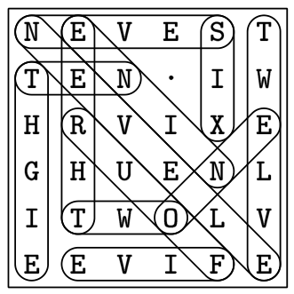</a>　<a href="../../../assets/volume4b/figures/xc-next-a1052.png">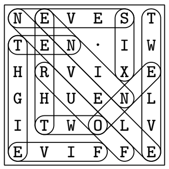</a>　<a href="../../../assets/volume4b/figures/xc-next-a1053.png">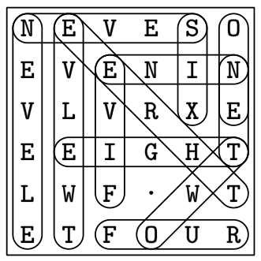</a>　<a href="../../../assets/volume4b/figures/xc-next-a1054.png">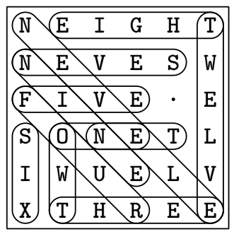</a>　<a href="../../../assets/volume4b/figures/xc-next-a1055.png">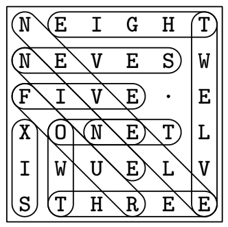</a>

<em>历史注记:</em> 已知最早的找词谜是巴西 Henrique Ramos 的 “Viajando”, 载于 <em>Almanaque de Seleções Recreativas</em> (1966), 第 43 页. 美国的 Norman E. Gibat 于 1968 年独立发明了这种谜题. 加拿大的 Jo Ouellet 于 1970 年创制了 “Wonderword”, 将没有用到的字母也利用了起来.

<a id="ans-7-2-2-1-106"></a>

**106.** [题目](../sec-7-2-2-1.md#ex-7-2-2-1-106) 若像算法 M 那样推广算法 C, 允许项的和不等于 1, 就只需 2400 万次内存访问即可证明恰有八个解, 都是下图两解旋转所得.

<a href="../../../assets/volume4b/figures/xc-next-a106a.png">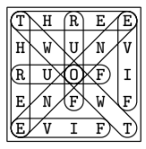</a>　<a href="../../../assets/volume4b/figures/xc-next-a106b.png">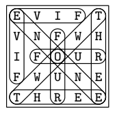</a>

<a id="ans-7-2-2-1-107"></a>

**107.** [题目](../sec-7-2-2-1.md#ex-7-2-2-1-107) 要装入 $w$ 个给定的词, 取主要项 $\{Pij,Ric,Cic,Bic,\#k\mid1\leq i,j\leq9,\ 1\leq k\leq w,\ c\in\{\mathrm A,\mathrm C,\mathrm E,\mathrm M,\mathrm O,\mathrm P,\mathrm R,\mathrm T,\mathrm U\}\}$ 以及次要项 $\{ij\mid1\leq i,j\leq9\}$. 有 729 个选项 ‘$Pij\ Ric\ Cjc\ Bbc\ ij{:}c$’, 其中 $b=3\lfloor(i-1)/3\rfloor+\lceil j/3\rceil$; 此外, 对于把 $l$ 字母词 $c_1\ldots c_l$ 放在格 $(i_1,j_1),\ldots,(i_l,j_l)$ 中的每种方法, 还有选项 ‘$\#k\ i_1j_1{:}c_1\ \ldots\ i_lj_l{:}c_l$’. 此处有一点很重要: 算法的步骤 C3 要采用锐偏好启发式方法 ([习题 10](../sec-7-2-2-1.md#ex-7-2-2-1-10)).

短短一阵计算就能确定, COMPUTER 和 CORPORATE 不能同时装入. 但除 CORPORATE 以外的词却都能一起装入; 图中这个唯一的解只用了 730 万次内存访问就找到了, 其中大半仅用于输入题目. [此题的灵感来自 Huang 和 Snyder 的 <em>Sudoku Masterpieces</em> (2010) 中的一道题.]

<a href="../../../assets/volume4b/figures/xc-next-a107.png">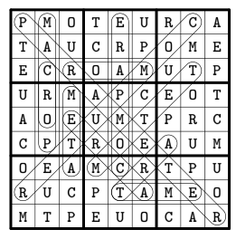</a>

<a id="ans-7-2-2-1-108"></a>

**108.** [题目](../sec-7-2-2-1.md#ex-7-2-2-1-108) (a), (b) 作者得到的最佳解如下, 据信已是最小, 但还没有证明. 两例和[图 71](../sec-7-2-2-1.md#fig-7-2-2-1-71) 都采用了交互的方法: 先用手工仔细安排最长的词,<a id="pdf-461"></a><a id="p-441"></a> 再用算法 C 把其余的词妥善地装进去.

<a href="../../../assets/volume4b/figures/xc-next-a108sq.png">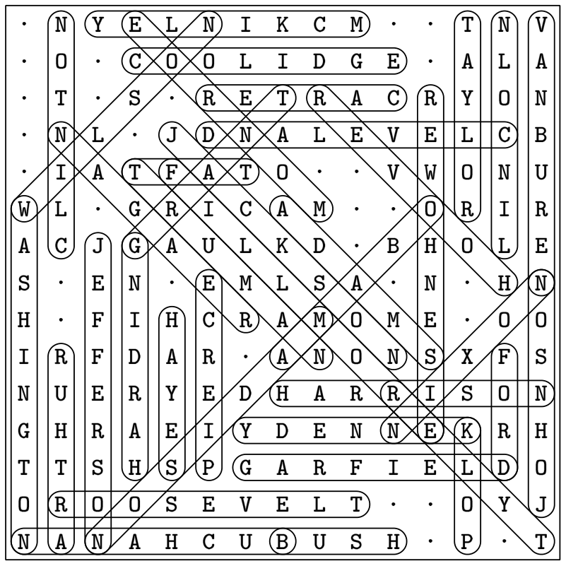</a>

<a href="../../../assets/volume4b/figures/xc-next-a108rect.png">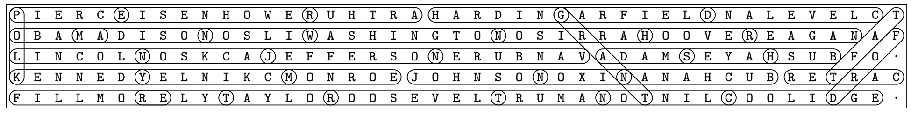</a>

[解 (b) 用了 Leonard Gordon 的一个想法, 他用少一列的矩形装下了前 42 任总统的姓. 见 A. Ross Eckler, <em>Word Ways</em> **27** (1994), 147; 又见第 252 页, OBAMA 居然能恰好放入 Gordon 的 $15\times15$ 解中!]

<a id="ans-7-2-2-1-109"></a>

**109.** [题目](../sec-7-2-2-1.md#ex-7-2-2-1-109) 要装入 $w$ 个给定的词, 取 $w+m(n-1)+(m-1)n$ 个主要项 $\{\#k\mid1\leq k\leq w\}$ 和 $\{H_{ij},V_{ij}\mid1\leq i\leq m,\ 1\leq j\leq n\}$, 但略去 $H_{in}$ 和 $V_{mj}$. $H_{ij}$ 表示格 $(i,j)$ 和 $(i,j+1)$ 间的边, $V_{ij}$ 类似. 还要用 $2mn$ 个次要项 $\{ij,ij'\mid1\leq i\leq m,\ 1\leq j\leq n\}$. 将第 $k$ 个词 $c_1\ldots c_l$ 横放在格 $(i,j+1),\ldots,(i,j+l)$ 中, 每种放法产生一个选项

$$
\begin{aligned}
‘\#k\ ij{:}.\ ij'{:}0\ &i(j+1){:}c_1\ i(j+1)'{:}1\ H_{i(j+1)}\
 i(j+2){:}c_2\ i(j+2)'{:}1\ H_{i(j+2)}\ \ldots\\
 &H_{i(j+l-1)}\ i(j+l){:}c_l\ i(j+l)'{:}1\ i(j+l+1){:}.\ i(j+l+1)'{:}0’.
\end{aligned}
$$

其中有 $3l+4$ 个项, 不过当 $j=0$ 时略去 ‘$ij{:}.\ ij'{:}0$’, 当 $j+l=n$ 时略去 ‘$i(j+l+1){:}.\ i(j+l+1)'{:}0$’. 各种竖放的情形类似. 例如, 若 ZERO 是第 1 个词, 则它的第一个竖放选项为

$$
‘\#1\ 11{:}\mathrm Z\ 11'{:}1\ V_{11}\ 21{:}\mathrm E\ 21'{:}1\ V_{21}\
31{:}\mathrm R\ 31'{:}1\ V_{31}\ 41{:}\mathrm O\ 41'{:}1\ 51{:}.\ 51'{:}0’.\tag{*}
$$

然而当 $m=n$ 时, 略去第 1 个词的全部竖放选项, 可以节省一个因子 2.

为实施较为棘手的条件 (ii), 还要加入 $3m(n-1)+3(m-1)n$ 个选项:

$$
\begin{array}{ll}
‘H_{ij}\ ij'{:}0\ i(j+1)'{:}1\ ij{:}.’&
‘V_{ij}\ ij'{:}0\ (i+1)j'{:}1\ ij{:}.’\\
‘H_{ij}\ ij'{:}1\ i(j+1)'{:}0\ i(j+1){:}.’&
‘V_{ij}\ ij'{:}1\ (i+1)j'{:}0\ (i+1)j{:}.’\\
‘H_{ij}\ ij'{:}0\ i(j+1)'{:}0\ ij{:}.\ i(j+1){:}.’&
‘V_{ij}\ ij'{:}0\ (i+1)j'{:}0\ ij{:}.\ (i+1)j{:}.’
\end{array}
$$

这个构造之所以有效, 是因为每条边都必须遇到一个穿过它的词或一个接触它的空格. (要当心一个小问题: 对谜题的一个有效解, “空白” 区域里的 $H_{ij},V_{ij}$ 可能各有几个相容的选择.)

<em>注意:</em> 同[答案 107](#ans-7-2-2-1-107) 一样, 此处也应使用锐偏好启发式方法, 因为它能使速度大大提高.

<a id="pdf-462"></a><a id="p-442"></a>

我们这个含十一个词的例子的 XCC 问题有 1192 个选项、$123+128$ 个项及 9127 个解, 用 $23\,\mathrm G\mu$ 找到. 然而其中只有 20 个解是连通的, 而且只给出下面三种不同的词的放法. 稍小的 $7\times9$ 矩形也有三种有效放法. 能满足 (i)、(ii) 的最小矩形是 $5\times11$; 放法<em>唯一</em>, 却有两个连通分支:

```text
   F  F
ZERO SIX
 I U  V
 G R TEN
 H   H I
 TWO R N
   N E E
  SEVEN
```

```text
  F TWO
  ONE  S
  U NINE
ZERO   V
 I  F  E
 G SIX N
 H  V
 THREE
```

```text
  FIVE
TWO  I
  U  G
ZERO H
   N TEN
SEVEN  I
I      N
X  THREE
```

```text
 E T
FIVE  SIX
 G NINE
 H    V F
 TWO ZERO
   N  N U
THREE   R
```

```text
F SIX F T
ONE  EIGHT
U V T V R T
R E E E E W
  NINE ZERO
```

设 $w$ 个词的总长度为 $s$. Aaron Windsor 建议加入选项 ‘$E\ ij{:}.\ ij'{:}0$’ ($1\leq i\leq m$, $1\leq j\leq n$), 其中 $E$ 是代表空格的新主要项. 若令 $E$ 的数目在区间 $[mn-s+w-1\mathinner{.\,.}mn]$ 内, 所得 MCC 问题的每个解或是连通的, 或是包含一个圈.

先生成满足 (i)、(ii) 的全部解, 再舍弃不连通者, 远不如在整个查找过程中就保证连通来得快; 不过后者需要对算法 C 作相当大的修改. 每当没有被迫选取的 $H$ 或 $V$ 时, 就列出同第 1 个词连通的所有活动选项, 并且只保留那些不小于先前本可作出的选择的选项. 然后在这些选项上分支, 而不在某个项上分支. 例如, 若用上面的 (*) 放置 ZERO, 就会迫使选择 $H_{11},H_{31},V_{41}$. 下一步要在 EIGHT 和 ONE 中择一, 放在与 ZERO 重合的位置. (不过最好把较长的词排在前面, 比如说, 第 1 个词是 EIGHT, 第 11 个词是 ONE.) 希望有兴趣的读者把这些颇有启发性的细节推导出来. 这个方法直奔三个连通解而去, 只需 $630\,\mathrm M\mu$ 就能解出示例.

<a id="ans-7-2-2-1-110"></a>

**110.** [题目](../sec-7-2-2-1.md#ex-7-2-2-1-110) Gary McDonald 在 2017 年找到了这个出色的 $20\times20$ 解:

```text
WILSON TAFT       P
     I A O C JOHNSON
     X Y R L E    L
T H COOLIDGE F A  K
REAGAN O   V F R
U R R  ROOSEVELT
M R T B  B L R HAYES
A I E U  ADAMS U  I
N S R C  M N O R  S
  O   H HARDING   E
  N   A O      GRANT
F   MONROE J      H
I     A V WASHINGTON
L MCKINLEY C    A W
L  L    R  K PIERCE
MADISON  BUSH   F R
O  N       O    I
R  TYLER VAN BUREN
E  O            L
 LINCOLN   KENNEDY
```

$19\times19$ 想必不可能, 虽然还没有人证明过. L. Gordon 早已把前 42 任总统的姓放进了一个 $18\times22$ 矩形 [<em>Word Ways</em> **27** (1994), 63].

<a id="ans-7-2-2-1-111"></a>

**111.** [题目](../sec-7-2-2-1.md#ex-7-2-2-1-111) (a) 像[答案 109](#ans-7-2-2-1-109) 那样建立 XCC 问题, 但只用 AAA、AAAA、AAAAA 三个词, 然后调整重数并应用算法 M. 下面是两个本质上不同的答案; 其中一个不连通, 因而不合格.

<a href="../../../assets/volume4b/figures/xc-next-a1111.svg">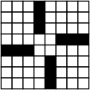</a>　<a href="../../../assets/volume4b/figures/xc-next-a1112.svg">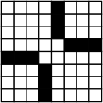</a>

(b) 类似地, 找到四个本质上不同的答案, 只有两个合格:

<a href="../../../assets/volume4b/figures/xc-next-a1113.svg">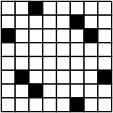</a>　<a href="../../../assets/volume4b/figures/xc-next-a1114.svg">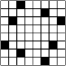</a>　<a href="../../../assets/volume4b/figures/xc-next-a1115.svg">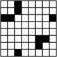</a>　<a href="../../../assets/volume4b/figures/xc-next-a1116.svg">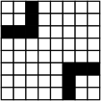</a>

<a id="pdf-463"></a><a id="p-443"></a>

算法 M 很容易处理情形 (b) ($5\,\mathrm G\mu$). 但它对情形 (a) 的可能性空间探索得不够巧妙, 需用 $550\,\mathrm G\mu$.

<a id="ans-7-2-2-1-112"></a>

**112.** [题目](../sec-7-2-2-1.md#ex-7-2-2-1-112) (a) 有: IMMATURE、MATURING、COMMUTER、GROUPING、TROUPING、AUTHORING 及 THRUMMING. 用直接的回溯程序很快就可判断给定的字母串能否出现.

(b) 不妨把 DANCING 和 LINKS 也放进去. 这样得到一个阵列, 含有 $\mathrm{WORDS}(5757)$ 中的 24 个词 (例如 LOVER、ROSIN、SALVO、TOADS、TROVE), 还有 ASKING、DOSING、LOSING、ORDAIN、SAILOR、SIGNAL、SILVER, 以及 LANCING、LOANING、SOAKING, 甚至还有 ORTOLAN. (注意 TORTO 有两种读法.)

```text
CGN
NIK
LAS
VOD
ERT
TOW
```

按 R. Bittencourt 的建议, 在找这样的阵列时可设第 $k$ 个词为 $c_0\ldots c_{t-1}$, 引入主要项 $W_{kl}$ ($1\leq l<t$) 来代表 $c_{l-1}c_l$ 的位置. 阵列中每格 $u$ 取一个次要项 $X_u$, 用某个字母给它着色. 为表示第 $k$ 个词的王步路径, 当 $c_l$ 在格 $u$ 中时, 给 $P_{kl}$ 赋颜色 $u$, 给 $Q_{ku}$ 赋颜色 $l$, 其中 $P_{kl},Q_{ku}$ 也都是次要项. 每个内部顶点 $v$ 另有次要项 $D_{kv}$. 例如, 若按行给各格及顶点顺序编号, 上例中为 DANCING 和 LINKS 选取的选项中有 ‘$W_{03}\ X_3{:}\mathrm N\ X_{10}{:}\mathrm C\ P_{02}{:}3\ P_{03}{:}10\ Q_{03}{:}2\ Q_{0,10}{:}3$’ 及 ‘$W_{12}\ X_4{:}\mathrm I\ X_2{:}\mathrm N\ P_{11}{:}4\ P_{12}{:}2\ Q_{14}{:}1\ Q_{12}{:}2\ D_{11}$’. 后一个选项中的 ‘$D_{11}$’ 阻止了另一步从格 2 与格 4 之间穿过.

对于第 0 个词, 例如在 $l=\lfloor t_0/2\rfloor$ 时限制 $c_{l-1}c_l$ 的放法, 使 $c_{l-1}$ 在左上象限, 而 $c_l$ 不在最右列, 就能节省近四倍. 此时 $W_{0l}$ 只有 26 个选项, 通常则有 94 个.

恰好有 10 个本质上不同的 Torto 阵列含有 DANCING、LINKS、TORTO、WORDS 和 SOLVER; 恰好有 1444 个含有 THE、ART、OF、COMPUTER 和 PROGRAMMING. 算法 C 分别用 $713\,\mathrm G\mu$ 和 $126\,\mathrm G\mu$ 找到了它们.

(c) 可以, 共有 416 种方法 (但不能再加入 ELEVEN). 类似地, 从 ZERO、ONE、…、一直到 EIGHT 有 553 种放法; FIRST、…、SIXTH 有 72853 种放法, 有时 18 格中用到的还不超过 16 格. (这些计算分别用了 $16\,\mathrm T\mu$, $5\,\mathrm T\mu$, $1.5\,\mathrm T\mu$. 这些阵列中还藏着一些有趣的词——你看得出吗? 见[附录 E](../sec-app-e.md#app-e-dlx-112).)

```text
FXN   FSX   YTE
SIN   ZIE   FHX
GEV   GEV   FIT
HRE   HRN   ORS
UTN   TOU   UDE
FOW   WNF   NOC
```

[“Torto” 一名是里约热内卢 Coquetel/Ediouro 于 1977 年注册的商标, 当年的 <em>Coquetel Total</em> 杂志第 1 期发表了一个例子. 如今 Coquetel 的杂志 <em>Desafio Cérebro</em> 仍每月刊登这类谜题. Bittencourt 于 2011 年提出, 从给定的一组必含词构造 Torto 阵列; 见 <code>blog.ribbit.com/2011/05/torto-reverso.html</code>.]

<a id="ans-7-2-2-1-113"></a>

**113.** [题目](../sec-7-2-2-1.md#ex-7-2-2-1-113) 先求出一块积木上所有可能出现的、由六个或更少字母组成的集合. 为此求解一个 MCC 问题, 其中 TREES、…、DEQUE 这 25 个主要项的重数为 $[1\mathinner{.\,.}26]$, 另有主要项 $\#$ 的重数为 $[0\mathinner{.\,.}6]$. 共有 22 个选项, 从 ‘$\#\ \mathrm{ABOVE\ AVAIL\ GRAPH\ STACK\ TABLE\ VALUE}$’ 到 ‘$\#\ \mathrm{EMPTY}$’. 每个可用字母一个选项, 列出所有包含它的词. 这个覆盖问题有 3223 个解, 用 $4\,\mathrm M\mu$ 找出, 按字母次序从 $\{\mathrm A,\mathrm B,\mathrm C,\mathrm D,\mathrm E,\mathrm I\}$, 经 $\{\mathrm E,\mathrm L,\mathrm R,\mathrm T\}$, 到 $\{\mathrm L,\mathrm N,\mathrm R,\mathrm T,\mathrm U,\mathrm V\}$.

然后建立一个 XCC 问题, 取 25 个主要项 TREES、…、DEQUE 以及五个主要项 $1,\ldots,5$, 再取 $5\cdot22$ 个次要项 $\mathrm A_j,\ldots,\mathrm Y_j$ ($1\leq j\leq5$). 每个词对它的每个字母排列各有一个选项 (见算法 7.2.1.2L), 表明在积木的这种排列下, 这个词需要哪些字母. (例如, QUEUE 有 30 个选项, 第一个是 ‘$\mathrm{QUEUE}\ \mathrm E_1{:}1\ \mathrm E_2{:}1\ \mathrm Q_3{:}1\ \mathrm U_4{:}1\ \mathrm U_5{:}1$’, 表示第 1 块上应有 E, …, 第 5 块上应有 U.) 对其中一个词 (例如 FIRST) 的 120 个选项只给出一个, 就破除了对称性. 前面求得的 3223 个<a id="pdf-464"></a><a id="p-444"></a>候选字母集中, 每个各有五个大小为 23 的选项, 确切指明若第 $j$ 块取这个集合, 哪些字母出现在其上. 例如, $\{\mathrm A,\mathrm B,\mathrm C,\mathrm D,\mathrm E,\mathrm I\}$ 的五个选项为 ‘$j\ \mathrm A_j{:}1\ \ldots\ \mathrm E_j{:}1\ \mathrm F_j{:}0\ \ldots\ \mathrm I_j{:}1\ \ldots\ \mathrm Y_j{:}0$’, $1\leq j\leq5$. 总共有 18486 个选项, 总长度为 403357; 算法 C 用 $202\,\mathrm G\mu$ 解出了问题.

这五块积木必须为 $\{\mathrm E,\mathrm F,\mathrm G,\mathrm L,\mathrm O,\mathrm S\}$、$\{\mathrm C,\mathrm E,\mathrm I,\mathrm R,\mathrm U,\mathrm Y\}$、$\{\mathrm A,\mathrm L,\mathrm M,\mathrm N,\mathrm Q,\mathrm R\}$、$\{\mathrm A,\mathrm B,\mathrm E,\mathrm P,\mathrm S,\mathrm T\}$、$\{\mathrm D,\mathrm H,\mathrm K,\mathrm T,\mathrm U,\mathrm V\}$. (实际上 XCC 问题有八个解, 因为 TIMES、TREES 和 VALUE 用这些积木都能各拼成两种.)

[此题基于 E. Riekstiņš 的想法. 他看出一个叫作 Castawords 的经典谜题可以推广到长度为 5 的词.]

<a id="ans-7-2-2-1-114"></a>

**114.** [题目](../sec-7-2-2-1.md#ex-7-2-2-1-114) (P. Weigel 改进的解法.) 在 (30) 的主要项 $p_{ij},r_{ik},c_{jk},b_{xk}$ 以外, 引入 $u_k,v_l$ 来定义一个排列. 再用次要项 $\pi_k$ 记录这个排列, 用 $ij$ 记录格 $(i,j)$ 的值. 由 81 个选项 ‘$u_k\ v_l\ \pi_k{:}l$’ ($1\leq k,l\leq9$) 定义排列. 还有 $9^4=6561$ 个选项, 棋盘的每一格 $(i,j)$ 与应用 $\alpha$ 前后的一对值 $(k,l)$ 各对应一个选项. 若 $(ij)\alpha=i'j'$, 令 $x'=3\lfloor i'/3\rfloor+\lfloor j'/3\rfloor$. 通常选项 $(i,j,k,l)$ 为 ‘$p_{i'j'}\ r_{i'l}\ c_{j'l}\ b_{x'l}\ ij{:}k\ i'j'{:}l\ \pi_k{:}l$’. 但若 $i'=i$ 且 $j'=j$, 则把这个选项缩短为 ‘$p_{ij}\ r_{ik}\ c_{jk}\ b_{xk}\ ij{:}k\ \pi_k{:}k$’; 当 $k\ne l$ 时将它略去. 若 $i=0$ 且 $k\ne j+1$, 或 $i'=0$ 且 $l\ne j'+1$, 或 $i>0$ 且 $k=j+1$, 或 $i'>0$ 且 $l=j'+1$, 也略去选项 $(i,j,k,l)$, 以保证首行为 ‘123456789’.

在此首行下取 $\alpha$ 为转置, 算法 C 用 1710 亿次内存访问给出 30,258,432 个解. (这些解最早由 E. Russell 于 2005 年列举; 见 <code>www.afjarvis.org.uk/sudoku/sudgroup.html</code>.)

<a id="ans-7-2-2-1-115"></a>

**115.** [题目](../sec-7-2-2-1.md#ex-7-2-2-1-115) 可用类似办法, 但要像[答案 67](#ans-7-2-2-1-67)(b) 那样加入项 $b'_{yk}$. 解数为 (a) 7784; (b) 16384; (c) 372; (d) 32. 下面是 (a) 与 (d) 的例子, 为了显示结构, 后者用 $\{0,\ldots,7,\ast\}$ 作标号. [(a)、(b)、(c) 最早由 Bastian Michel 于 2007 年列举.]

(a) <a href="../../../assets/volume4b/figures/xc-next-a115a.png">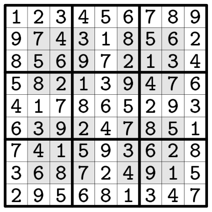</a>　(d) <a href="../../../assets/volume4b/figures/xc-next-a115d.png">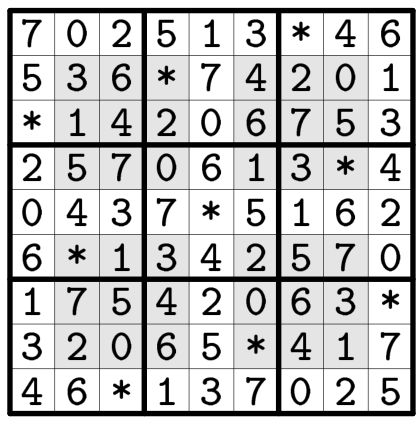</a>

<a id="ans-7-2-2-1-116"></a>

**116.** [题目](../sec-7-2-2-1.md#ex-7-2-2-1-116) (a) $\mu(G)$ 的三角形一定在 $G$ 中, 因为 $u'$ 与 $v'$ 不相邻.

(b) 设能用着色函数 $\alpha$ 给 $\mu(G)$ 作 $c$ 着色, 其中 $\alpha(w)=c$. 若某个 $v\in V$ 满足 $\alpha(v)=c$, 就把它改为 $\alpha(v')$. 这样便得到 $G$ 的一个 $(c-1)$ 着色. [因此, 一个有 $n$ 个顶点的无三角形图可以有 $\Omega(\log n)$ 的色数. 用非构造性的方法可以证明无三角形图的色数实际上可达 $\Omega((n/\log n)^{1/2})$; 但对大的 $n$, 目前已知的显式构造只达到 $\Omega(n^{1/3})$. 见 N. Alon, <em>Electronic J. Combinatorics</em> **1** (1994), #R12, 1–8.]

(c) 若 $G$ 为 $\chi$ 临界图, 则 $\mu(G)$ 也是. 设 $e\in E$, $\alpha$ 是 $G\setminus e$ 的一个 $(c-1)$ 着色. 有下面几种办法可给 $\mu(G)$ 除一条边外的全部边的端点着上 $c$ 种颜色, 使每条所保留的边两端异色: (i) 对所有 $v\in V$ 置 $\alpha(v')\gets c$, 再置 $\alpha(w)\gets1$. (ii) 取 $u\in e$, 置 $\alpha(u)\gets\alpha(w)\gets c$; 对所有 $v\in V$ 还要置 $\alpha(v')=\alpha(v)$, 这一步可以在改变 $\alpha(u)$ 之前或之后做. 若要删去的 $\mu(G)$ 的边在 $G$ 中, 用 (i); 否则用 (ii).

[见 J. Mycielski, <em>Colloquium Mathematicum</em> **3** (1955), 161–162; H. Sachs, <em>Einführung in die Theorie der endlichen Graphen</em> (1970), §V.5.]

<a id="pdf-465"></a><a id="p-445"></a>

<a id="ans-7-2-2-1-117"></a>

**117.** [题目](../sec-7-2-2-1.md#ex-7-2-2-1-117) (a) 用 (b) 的答案, 使每个团仅由一条边组成.

(b) 设包含顶点 $v$ 的团为 $\{c_1,\ldots,c_k\}$. 对 $v$ 有 $d$ 个选项 ‘$v\ c_{1j}\ \ldots\ c_{kj}$’, $1\leq j\leq d$.

(c) 固定首行各皇后的颜色可节省一个因子 $9!=362880$. 此时有 262164 个解; 用方法 (a), 算法 X 需 $8.3\,\mathrm T\mu$ 才能找齐, 而用方法 (b) 只需 $0.6\,\mathrm T\mu$.

(d) 在 $v$ 的第 $j$ 个选项中插入 ‘$v'{:}j$’, 其中 $v'$ 为次要项. (在 (c) 的方法 (a) 中, 即使<em>不固定</em>任何颜色, 这也使运行时间降到 $5.0\,\mathrm T\mu$.)

(e) 用 (d) 节省一个因子 $c!$, 得到 $(2!\cdot1,\ 3!\cdot5,\ 4!\cdot520,\ 5!\cdot23713820)$ 个解, 分别约用 $(600,4000,130000,4100000000)$ 次内存访问. [结合[习题 86](../sec-7-2-2-1.md#ex-7-2-2-1-86) 和 122, 可以对更大的情形作蒙特卡罗估计; 舍弃会引起不合法净化的选项, 即可确定每一层的真实分支因子. 看来 $M_6$ 的 6 着色大约有 $6!\cdot2.0\times10^{17}$ 种.]

(f) 虽然并没有解, 这时 (d) 仍节省了一个因子 $(c-1)!$; 运行时间约为 $(100,600,5000,300000)$ 次内存访问. (但用 5 色给 $M_6$ 着色就要 $45\,\mathrm T\mu$!)

(g) 依删去的边而定, 这样的着色有 $1!\cdot1$, $2!\cdot1$, $3!\cdot(5\text{ 或 }7)$, $4!\cdot(1432,1544,1600,2200,2492,2680,3744,4602\text{ 或 }6640)$ 种.

<a id="ans-7-2-2-1-118"></a>

**118.** [题目](../sec-7-2-2-1.md#ex-7-2-2-1-118) 一般地, 可以沿用上题的构造求超图的着色, 但要用算法 M, 并给每条大小为 $r$ 的超边指定重数 $[0\mathinner{.\,.}(r-1)]$. 不过本题有 380 个大小为 16 的独立集 (见习题 7.1.4–242); 只须将这些集合作为含 64 个项的恰当覆盖问题的选项. 有四个解, 还有一种有趣的对称性, 使它们只有两个 “本质上不同”: 一个如下图所示; 另一个保持 A 和 C 不动, 把 B 和 D 各自<em>转置</em>便可得到.

```text
ABCDCDAB
BDBDCACA
CBACDBAD
DDABABCC
AADCDCBB
BCDBACDA
CACABDBD
DCBABADC
```

<a id="ans-7-2-2-1-119"></a>

**119.** [题目](../sec-7-2-2-1.md#ex-7-2-2-1-119) 每个解中恰有三条内部边是白的. 把全白的那块放在其他任何位置, 都会确定这三条边. 这样一来, 三块有两条白边的骨牌就无法全部放入了.

<a id="ans-7-2-2-1-120"></a>

**120.** [题目](../sec-7-2-2-1.md#ex-7-2-2-1-120) (a) 把这些类型称为 $0,1,\ldots,9$, 用算法 C 求出将某个给定类型放在 $5\times5$ 阵列中心的所有方法. 各类型分别有 $(16,8,19,8,8,8,10,8,16,24)$ 种放法; 对每个类型的全部解取<em>交</em>, 就知道在任何无穷铺砌中, 哪些拼块一定会出现在指定类型的附近:

```text
?????   0490?   ?????   68568   21721   32032   2032?   49049   0320?   17217
?????   2032?   ??0??   0490?   ?6856   17217   ?217?   0320?   21721   68568
??0??   ?217?   ??2??   2032?   9049?   68568   8568?   21721   ?6856   049??
??2??   8568?   ?????   ?217?   320??   049??   490??   ?6856   9049?   20???
?????   490??   ?????   8568?   172??   20???   032??   9049?   320??   ?2???
```

所以每一种这样的铺砌都至少含有一个 5; 若把 5 放在原点, 那么整个平面的其余部分就都确定了. 结果是习题 7–137 意义下的一个环面, 其周期性的超级拼块大小为 12:

<a href="../../../assets/volume4b/figures/dlx-tiles-a120a.png">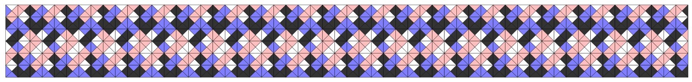</a>

(b) 类似地, 也只有一种铺法, 这次的超级拼块含 13 个格:

<a href="../../../assets/volume4b/figures/dlx-tiles-a120b.png">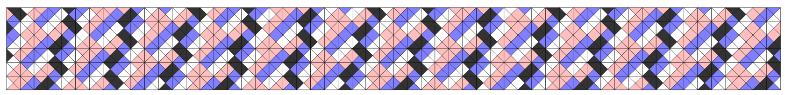</a>

<a id="pdf-466"></a><a id="p-446"></a>

<a id="ans-7-2-2-1-121"></a>

**121.** [题目](../sec-7-2-2-1.md#ex-7-2-2-1-121) (a) Marek Tyburec 于 2017 年注意到, 没有 $2\times2$ 的解把 $\beta US$ 放在右下角; 同样, 也没有 $3\times4$ 的解把 $\beta US$ 放在左下角. 因此, $\beta US$ 只能出现在顶行, 或出现在紧挨顶行的下一行的最左端.

(b) 设 $(A_k,B_k,C_k,D_k)$ 为四种 $(2^k-1)\times(2^k-1)$ 铺砌, 如下定义: 当 $k=1$ 时, 它们就是 $(\alpha a,\alpha b,\alpha c,\alpha d)$; 其余情形下, 分别将 $(\delta Na,\delta Nb,\delta Nc,\delta Nd)$ 放在中央, 并按答案 2.3.4.3–5 将 $A_{k-1},B_{k-1},C_{k-1},D_{k-1}$ 放在四个角上. 本题所求的唯一铺法中央为 $\delta RD$, 四角为 $D_{k-1},C_{k-1},B_{k-1},A_{k-1}$.

(c) 当中央为 $\delta RU$ 时, 另一个解的四角为 $C_{k-1},D_{k-1},A_{k-1},B_{k-1}$. 当中央为 $\delta LD$ 时, 另一个解的四角为 $B_{k-1},A_{k-1},D_{k-1},C_{k-1}$. 这两个解对 $\delta LU$ 和 $\delta SU$ 都适用; $\delta SU$ 还另有 54 个解, 左上角为 $C_{k-2}$. 在第 $2^{k-2}$ 行的中央, 它们用 $\delta\{\{L,P,S,T\}\{J,U\},RU\}$; 在第 $3\cdot2^{k-2}$ 行的中央, 则独立地选用 $\delta\{L,K,P,R,S,T\}U$.

(d) 每种都只有一个解能保留下来. 像 (b) 一样, 它的四个象限为 $D_\infty,C_\infty,B_\infty,A_\infty$.

[其余 86 个类型都出现在 $A_6$ 中, 因而也出现在每一种充分大的铺砌中. 顺便说, “龙序列” (见答案 4.5.3–41) 出现在 $A_\infty,B_\infty,C_\infty,D_\infty$ 的边色中.]

<a id="ans-7-2-2-1-122"></a>

**122.** [题目](../sec-7-2-2-1.md#ex-7-2-2-1-122) 设置一个新的全局变量 $\Theta$, 初值为 $v$, 表示当前的 “颜色阈值”. 每个项除了 $\mathtt{NAME}$、$\mathtt{LLINK}$ 和 $\mathtt{RLINK}$ 以外, 都有一个新的域 $\mathtt{CTH}$. 在主要项中该域通常为零, 不过它在下述步骤 C3 中有特殊用途. 在次要项中用 $\mathtt{CTH}$ 来撤销对 $\Theta$ 的改动.

在净化子程序 (55) 的 ‘$i\gets\mathtt{TOP}(p)$’ 后紧接着插入 ‘$\mathtt{CTH}(i)\gets\Theta$; 若 $c=\Theta$, 置 $\Theta\gets\Theta+1$’. 在撤销净化子程序 (57) 的 ‘$i\gets\mathtt{TOP}(p)$’ 后紧接着插入 ‘$\Theta\gets\mathtt{CTH}(i)$’. 修改确认子程序 (54), 使得当 $\mathtt{COLOR}(p)>\Theta$ 时不改变 $j$ 和 $p$, 直接跳到撤销确认子程序 (56) 的末尾. (这实际上是从步骤 C5 跳到步骤 C6 内的适当位置, 从而不去确认任何会将颜色值置为大于 $\Theta$ 的选项.[^dlx-ans122])

最后修改步骤 C3, 使之绝不选择 $\mathtt{CTH}(i)>\Theta$ 的项 $i$. 若没有可选的项, 这一步应转到 C8. (若某些主要项尚不满足所有 $\geq\Theta$ 的颜色之间完全对称的假设, 这种机制就禁止在它们上面分支. 例子见习题 126.)


<a id="ans-7-2-2-1-123"></a>

**123.** [题目](../sec-7-2-2-1.md#ex-7-2-2-1-123) 例如取 $m=4$, $n=10$ 时, 算法 C 用 4900 万次内存访问生成 1048576 个解. 修改后的算法 (置 $v=1$) 用 200 万次内存访问生成 43947 个解. (注意值向量 $q_1\ldots q_n$ 等价于式 7.2.1.5–(4) 的限制增长串 $a_1\ldots a_n$, 其中 $q_k=a_k+1$.)

<a id="ans-7-2-2-1-124"></a>

**124.** [题目](../sec-7-2-2-1.md#ex-7-2-2-1-124) 用 $(x,y)$ 表示一个 $\triangle$ 三角形, 用 $(x,y)'$ 表示紧挨着它右侧的那个 $\triangledown$ 三角形. (设想正方形格 $(x,y)$ 被它的主对角线分成两个直角三角形, 然后将格子错斜并把纵坐标按 $\sqrt3/2$ 缩放.) 例如, 一个 $m\times n$ 的平行四边形有 $2mn$ 个三角形 $(x,y)$、$(x,y)'$, 其中 $0\leq x<m$, $0\leq y<n$, 按笛卡儿坐标排列. 图中是 $3\times2$ 的情形.

<a href="../../../assets/volume4b/figures/dlx-tiles-a124.png">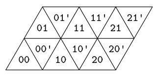</a>

三角形 $(x,y)$ 的边很方便地记为 $\mathtt{/}xy,\mathtt{\backslash}xy,\mathtt{-}xy$. 那么 $(x,y)'$ 的边就是 $\mathtt{/}(x+1)y,\mathtt{\backslash}xy,\mathtt{-}x(y+1)$.

[用三个坐标的 “重心” 表示也值得注意, 因为它更对称: 每个三角形对应于一个有序整数三元组 $(x,y,z)$, 满足 $x+y+z=1$ 或 2, 对应关系为 $(x,y)\leftrightarrow(x,y,2-x-y)$ 和<a id="pdf-467"></a><a id="p-447"></a> $(x,y)'\leftrightarrow(x,y,1-x-y)$. 十二种对称性就是 $\{x,y,z\}$ 的六个排列, 每个又可选用或不选用变换 $(x,y,z)\leftrightarrow(\bar x,\bar y,\bar z)=(1-x,1-y,1-z)$.]

[还可仿照[习题 145](../sec-7-2-2-1.md#ex-7-2-2-1-145) 使用 “重心奇偶坐标”, 即满足 $|x+y+z|\leq1$ 的有序三元组 $(x,y,z)$. 三个坐标均为奇数时表示三角形, 其中 $(x,y)\leftrightarrow(2x-1,2y-1,3-2x-2y)$, $(x,y)'\leftrightarrow(2x-1,2y-1,1-2x-2y)$. 三者均为偶数时表示顶点. 恰有一个偶坐标时表示边 (两个相邻三角形的平均值). 有两个偶坐标时则可表示有向边.]

<a id="ans-7-2-2-1-125"></a>

**125.** [题目](../sec-7-2-2-1.md#ex-7-2-2-1-125) 每个原三角形 $(x,y)$ 或 $(x,y)'$ 展开成 $k^2$ 个三角形, 其形式为 $(kx+p,ky+q)$ 或 $(kx+p',ky+q')'$, 其中 $0\leq p,q,p',q'<k$. 从 $(x,y)$ 得到的那些三角形满足 $p+q<k$ 和 $p'+q'<k-1$ (个数分别为 $\binom{k+1}2$ 和 $\binom k2$); 其余三角形从 $(x,y)'$ 得到.

<a id="ans-7-2-2-1-126"></a>

**126.** [题目](../sec-7-2-2-1.md#ex-7-2-2-1-126) 取 24 个主要项 $\mathtt{01'},\mathtt{02},\mathtt{02'},\ldots,\mathtt{32}$ 来表示三角形, 再取 24 个主要项 $\mathtt{aaa},\mathtt{aab},\ldots,\mathtt{ddd}$ 表示拼块, 以及 42 个次要项 $\mathtt{\backslash01},\mathtt{-02},\mathtt{/02},\ldots,\mathtt{/41}$ 表示边. 放一块拼块的每种方法对应一个选项, 有 $24\cdot64$ 个选项 ‘$\mathtt{01'\ aaa\ -02{:}a\ /11{:}a\ \backslash01{:}a}$’, ‘$\mathtt{01'\ aab\ -02{:}a\ /11{:}a\ \backslash01{:}b}$’, ‘$\mathtt{01'\ aab\ -02{:}a\ /11{:}b\ \backslash01{:}a}$’, …, ‘$\mathtt{32\ ddd\ -32{:}d\ /32{:}d\ \backslash32{:}d}$’. 最后, 为了强制满足边界条件, 再取一个主要项 ‘$\ast$’ 及一个选项 ‘$\mathtt{\ast\ -20{:}a\ -30{:}a\ /40{:}a\ \ldots\ \backslash10{:}a}$’.

算法 C 经过 $340\,\mathrm G\mu$ 的计算找到了 11,853,792 个解. 这个总数把每种不同解的 72 个版本都算入了, 因此实际上只有 164,636 个不同的解 (这个数直到 Toby Gottfried 于 2001 年算出时才为人所知).

由[习题 119](../sec-7-2-2-1.md#ex-7-2-2-1-119) 可知, $\mathtt{aaa}$ 的选项除 ‘$\mathtt{20\ aaa\ -20{:}a\ /20{:}a\ \backslash20{:}a}$’ 外, 其余均可删去. 此时算法 C 用 $25\,\mathrm G\mu$ 找到 $11853792/12=987816$ 个解.

再用[习题 122](../sec-7-2-2-1.md#ex-7-2-2-1-122) 的办法 (取 $v=\mathtt b$), 并在 $\Theta=\mathtt e$ 之前不让 C3 在拼块名上分支 (三角形位置之间完全对称, 拼块名之间却未必), 只要 $6.9\,\mathrm G\mu$ 就能把每个不同的解各求出一次.

最后, 当 $\Theta\geq\mathtt c$ 时可允许在 $\mathtt{aab}$ 上分支; 一般地, 只要 $\Theta$ 超过某块拼块名中的所有颜色, 就可在其上分支. 这样将运行时间减到 $4.5\,\mathrm G\mu$.

[麦克马洪特地设计图案 (59b), 使三个非白色的单色三角形都处于中央. 若把它们固定在这些位置, 未修改的算法 C 很快就能找到 2138 个解. 若改把这三块固定在 $\{\mathtt{11'},\mathtt{21'},\mathtt{12'}\}$ 而非 $\{\mathtt{12},\mathtt{21},\mathtt{22}\}$, 则有 2670 个解.]

<a id="ans-7-2-2-1-127"></a>

**127.** [题目](../sec-7-2-2-1.md#ex-7-2-2-1-127) 每种颜色在三角形上出现 $(3\cdot24)/4=18$ 次, 因此若在解的内部出现 $k$ 次, 则在边界上出现 $18-2k$ 次. 所以没有一种颜色在边界上出现奇数次. 这样剩下 2099200 种可能性.

实际上这 2099200 种全部可以完成. (麦克马洪若知道这点一定很高兴!) 利用 §7.2.3 的方法可将情形数减到只剩 4054, 因为有 576 种对称变换: 循环移位、反射、颜色排列, 或它们的组合. 算法 7.2.2E 的蒙特卡罗过程在每种情形下都能找到解, 而且能找到很多. 事实上, 我们可以有把握地说<em>各种颜色出现次数全为偶数且颜色不全相同的每一种边界指定, 其解数都超过纯白边界解数的四倍.</em>

(说得更确切些, 不按对称性归并时, 纯白边界 000000000000 有 11853792 个解; 解数次少的边界 000000000011 有 48620416 个解; 再其次的是 000000000101, 有 49941040 个解; 等等. 在绝大多数情形下解数超过一亿, 但大概不会有超过五亿的. 顺便说, 001022021121 是唯一恰有三个自同构的有效颜色图案.)

<a id="pdf-468"></a><a id="p-448"></a>

<a id="ans-7-2-2-1-128"></a>

**128.** [题目](../sec-7-2-2-1.md#ex-7-2-2-1-128) 从[答案 124](#ans-7-2-2-1-124) 图中的平行四边形删去三角形 $(2,1)'$, 就得到一个含十一块三角形的区域. 可以把它们装入其中, 使边色满足 $\mathtt{-00}=\mathtt{-20}$, $\mathtt{/01}=\mathtt{/30}$, $\mathtt{-02}=\mathtt{-12}$. 有 1032 种方法, 图中画出一种. 将这块 “超级拼块” 与它旋转 $180^\circ$ 所得的图形合用, 就能整齐地铺满平面:

<a href="../../../assets/volume4b/figures/dlx-tiles-a128small.png"></a>

<a href="../../../assets/volume4b/figures/dlx-tiles-a128strip.png"></a>

<a id="ans-7-2-2-1-129"></a>

**129.** [题目](../sec-7-2-2-1.md#ex-7-2-2-1-129) 先考虑旋转对称. 由于有四块单色拼块, 只有 $180^\circ$ 旋转可能成立. 为生成全部强对称解, 不妨设旋转将 $\mathtt a\leftrightarrow\mathtt d$, $\mathtt b\leftrightarrow\mathtt c$, 把[答案 126](#ans-7-2-2-1-126) 的选项成对合并, 如 ‘$\mathtt{02\ abc\ -02{:}a\ /02{:}b\ \backslash02{:}c\ 31'\ bdc\ -32{:}d\ /41{:}c\ \backslash31{:}b}$’. 所得的 768 个选项有 68,024,064 个解 (约用 $0.5\,\mathrm T\mu$ 找到); 但这些解有许多本质上相同, 即可由旋转、反射、颜色排列或它们的组合互相得到.

要数出本质上不同的图案颇为微妙; 区分下列六类解可得到规范表示. (1) $\mathtt{02\ aaa}$ (故有 $\mathtt{31'\ ddd}$) 和 $\mathtt{03\ bbb}$ (故有 $\mathtt{30'\ ccc}$), 再取 $\mathtt{/12{:}a}$ 或 $\mathtt{/12{:}c}$. [若作反射并交换 $\mathtt a\leftrightarrow\mathtt b$, $\mathtt c\leftrightarrow\mathtt d$, 则 $\mathtt{/12{:}b}$ 或 $\mathtt{/12{:}d}$ 的情形与此等价.] (2) $\mathtt{02\ aaa}$, $\mathtt{23\ bbb}$ [或等价地 $\mathtt{03'\ bbb}$]. (3) $\mathtt{02\ aaa}$, $\mathtt{13'\ bbb}$, 再取 $\mathtt{\backslash03{:}a}$ 或 $\mathtt{\backslash03{:}c}$. (4) $\mathtt{02\ aaa}$, 而 $\mathtt{bbb}$ 在 $\mathtt{12},\mathtt{12'},\mathtt{22},\mathtt{22'}$ 或 $\mathtt{13}$. (5) $\mathtt{13\ aaa}$, $\mathtt{02'\ bbb}$, 再取 $\mathtt{\backslash12{:}a}$ 或 $\mathtt{\backslash12{:}c}$. (6) $\mathtt{13\ aaa}$, $\mathtt{12\ bbb}$. 各类都容易求得, 总共有 $80768+164964+77660+819832+88772+185172=1417168$ 个解.

[注意所画的强对称例子实际上无须旋转就能铺满平面, 即它有 $\mathtt{-04}=\mathtt{-20}$, $\mathtt{-14}=\mathtt{-30}$, $\mathtt{/03}=\mathtt{/41}$, …, $\mathtt{\backslash10}=\mathtt{\backslash32}$. 本质上不同的解中, 恰有 40208 个满足这项附加条件.]

为生成弱对称解, 对满足 $y>1$ 的每个三角形 $(x,y)$ 或 $(x,y)'$ 引入次要项 $b_{xy}$ 或 $b'_{xy}$, 代表三角形内部的颜色变化. 现在典型的选项为 ‘$\mathtt{02\ aad\ -02{:}a\ /02{:}a\ \backslash02{:}d\ b02{:}5}$’, ‘$\mathtt{02\ aad\ -02{:}a\ /02{:}d\ \backslash02{:}a\ b02{:}3}$’, ‘$\mathtt{02\ aad\ -02{:}d\ /02{:}a\ \backslash02{:}a\ b02{:}6}$’, ‘$\mathtt{02\ abc\ -02{:}a\ /02{:}b\ \backslash02{:}c\ b02{:}7}$’, ‘$\mathtt{31'\ bdc\ -32{:}c\ /41{:}b\ \backslash31{:}d\ b02{:}7}$’, ‘$\mathtt{31'\ ccd\ -32{:}c\ /41{:}c\ \backslash31{:}d\ b02{:}5}$’. 可以假定 $\mathtt{ddd}$ 与 $\mathtt{aaa}$ 相对, $\mathtt{ccc}$ 与 $\mathtt{bbb}$ 相对. 算法 C 把每个弱对称而非强对称的解生成两次, 每个强对称解生成一次; 六种情形有 $24516+45818+22202+341301+44690+130676=609203$ 个弱而不强的解.

再考虑六边形的反射, 有两种本质上不同的可能性: 上下反射保持四条边的值, 却使所有三角形都改变位置; 左右反射保持四个三角形和两条边的值. 因此<em>不可能有强反射对称性</em>. (第一种情形中所有三角形都改变位置, 因而所有颜色都必须改变. 第二种情形必须固定两种颜色. 若固定 $\mathtt a,\mathtt d$ 而交换 $\mathtt b\leftrightarrow\mathtt c$, 则必须固定 $\mathtt{aaa},\mathtt{aad},\mathtt{abc},\mathtt{acb},\mathtt{bcd},\mathtt{bdc},\mathtt{dda},\mathtt{ddd}$ 这八个三角形.)

上下反射的弱对称性仍可假定将 $\mathtt{aaa}$ 变成 $\mathtt{ddd}$, 将 $\mathtt{bbb}$ 变成 $\mathtt{ccc}$. 仍有六类: [1] $\mathtt{02'\ aaa}$, $\mathtt{22'\ bbb}$, $\mathtt{-13{:}a}$ 或 $\mathtt{-13{:}c}$. [2] $\mathtt{02'\ aaa}$, $\mathtt{bbb}$ 在 $\mathtt{12'},\mathtt{03'},\mathtt{13},\mathtt{13'}$ 或 $\mathtt{23}$. [3] $\mathtt{12'\ aaa}$, $\mathtt{bbb}$ 在 $\mathtt{03}$ 或 $\mathtt{03'}$. [4] $\mathtt{03\ aaa}$, $\mathtt{23\ bbb}$, $\mathtt{-13{:}a}$ 或 $\mathtt{-13{:}c}$. [5] $\mathtt{03\ aaa}$, $\mathtt{bbb}$ 在 $\mathtt{13}$ 或 $\mathtt{13'}$. [6] $\mathtt{03'\ aaa}$, $\mathtt{13'\ bbb}$, $\mathtt{-13{:}a}$ 或 $\mathtt{-13{:}c}$. 出乎意料, 有些放法是 “特殊” 的: 它们既有强旋转对称, 又有弱上下反射对称! 算法 C 把特殊的放法生成一次, 其余的生成两次, 分别得到 $(88,0,0,98,0,75)+2(1108,12827,8386,32513,20779,34773)$ 个解, 其中<a id="pdf-469"></a><a id="p-449"></a> $88+98+75=261$ 个特殊放法同时属于 [1] 与 (5)、[4] 与 (3)、[6] 与 (1):

<a href="../../../assets/volume4b/figures/dlx-tiles-a129special.png"></a>

左右弱对称也类似, 不过现在有些三角形是固定的. 若 $\mathtt{aaa}$ 固定, 假设 $\mathtt{ddd}$ 也固定; 这样的有三类, 共 $46975+35375+25261=107611$ 个解. 不然就假定 $\mathtt{ddd}$ 与 $\mathtt{aaa}$ 相对; 这样的有六类, 分别有 $(75,0,98,0,0,88)$ 个强对称解及 $(3711,56706,5889,60297,38311,9093)$ 个非强对称解. 因而本质上不同的左右弱对称而非强对称放法总计 281618 个, 其中 194 个也有上下对称性.

[Kate Jones 最先发现了具有强对称或弱对称的排列, 并将它们收入一套制作精美的三角形拼块 Multimatch® III 的 1991 年用户手册.]

<a id="ans-7-2-2-1-130"></a>

**130.** [题目](../sec-7-2-2-1.md#ex-7-2-2-1-130) 八面体最便于使用的坐标系, 大概要数用二进制 000、001、…、111 给各面编号, 再用 $\{0\ast\ast,1\ast\ast,\ast0\ast,\ast1\ast,\ast\ast0,\ast\ast1\}$ 表示顶点; 边为 $\{xy\ast,x\ast y,\ast xy\}$, $x,y\in\{0,1\}$. 构造 512 个选项 ‘$\mathtt{000\ aaa\ \ast00{:}a\ 0\ast0{:}a\ 00\ast{:}a}$’, ‘$\mathtt{000\ aab\ \ast00{:}a\ 0\ast0{:}b\ 00\ast{:}a}$’, ‘$\mathtt{000\ aab\ \ast00{:}b\ 0\ast0{:}a\ 00\ast{:}a}$’, …, 其中面名项 $\mathtt{000},\ldots,\mathtt{111}$ 为主要项, 拼块名项 $\mathtt{aaa},\ldots,\mathtt{ddd}$ 为次要项. 算法 C 很快就找到 2723472 个解, 其中包含 45356 个不同的八块组.

这 45356 个集合又成为算法 X (或 C) 的新选项, 以 24 个拼块名为主要项; 这次得到 1615452 个解, 即所求的划分.

当然还有许多对称性; 在 §7.2.3 我们将要研究怎样区分不同构的代表. 下图是最有趣的解之一,

<a href="../../../assets/volume4b/figures/dlx-tiles-a130.png"></a>

它有四个交换颜色的对称变换, 所有单色三角形都在同一个八面体上.

<a id="ans-7-2-2-1-131"></a>

**131.** [题目](../sec-7-2-2-1.md#ex-7-2-2-1-131) (a) 三角形的每条边可以是 $\mathtt a$ (直线)、$\mathtt b$ (波形)、$\mathtt c$ (凸出) 或 $\mathtt d$ (凹进). 可以像[答案 126](#ans-7-2-2-1-126) 那样设置项和选项, 但现在配边的条件为 $\mathtt a\mapsto\mathtt a,\mathtt b\mapsto\mathtt b,\mathtt c\mapsto\mathtt d,\mathtt d\mapsto\mathtt c$; 为了正确配对, $\triangledown$ 三角形的选项中应写出<em>与之相配</em>的颜色, 如 ‘$\mathtt{01'\ abc\ -02{:}a\ /11{:}b\ \backslash01{:}d}$’.

每个解对应于 24 个等价解, 因为旋转六边形给出因子 6, 互换凸出与凹进给出因子 2, 反射又给出一个因子 2. (反射稍有些棘手, 因为把拼块翻过来时波形变成了反向的波形. 不过每个反射后的拼块都有自己的反向拼块, 因而给出了所求的反向解.) 所以可以规定 $\mathtt{aaa}$ 在位置 $\mathtt{02}$. 像[答案 126](#ans-7-2-2-1-126) 那样对称地处理 $\mathtt c$ 和 $\mathtt d$ (取 $v=\mathtt c$), 恰好得到 2,231,724 个规范解, 只需 300 亿次内存访问.

[此谜题由 Kadon Enterprises 制造, 商品名称为 Trifolia®.]

(b) 采用类似的设置, 令 $\mathtt c$ 与 $\mathtt d$ 分别代表 0 点和 3 点, 以便对称地处理这两者. 配边现在为 $\mathtt a\mapsto\mathtt b,\mathtt b\mapsto\mathtt a,\mathtt c\mapsto\mathtt d,\mathtt d\mapsto\mathtt c$, 因而有一个选项是 ‘$\mathtt{01'\ abc\ -02{:}b\ /11{:}a\ \backslash01{:}d}$’. 在 $\mathtt{/}$ 和 $\mathtt{\backslash}$ 两个方向上边界的颜色为 $\mathtt a$; 在 $\mathtt{-}$ 方向上为 $\mathtt b$. 此题的解通常组成八个一组 (并非 24 个): 可以交换 $\mathtt c\leftrightarrow\mathtt d$, 左右反射, 上下反射, 或旋转 $180^\circ$;<a id="pdf-470"></a><a id="p-450"></a>后两个变换还要同时交换 $\mathtt a\leftrightarrow\mathtt b$. 若不设法消除对称, 用 20.6 万亿次内存访问可得到 3,419,736,176 个解.

左右反射总是产生不同的解, 无论是否交换 $\mathtt c\leftrightarrow\mathtt d$ 都是如此 (因为至少有八块本应固定的拼块, 却只有四个位置放它们). 而图示例子表明有些解在 $180^\circ$ 旋转下不变; 添 15 个新的主要项, 如 $\mathtt{\#/23}$, 再添 $15\cdot4$ 个新选项, 如 ‘$\mathtt{\#/23\ /23{:}x\ /20{:}x}$’ ($x\in\{\mathtt a,\mathtt b,\mathtt c,\mathtt d\}$), 就可以求出它们. 具有这个对称性的解共有 18656 个; 这些解四个一组, 而非八个. 同样可知有 169368 个解有上下对称性. 因此由 “伯恩赛德引理” 得, 本质上不同的解数为 $(3419736176+18656+169368)/8=427490525$.

对所有这些计算, 在[习题 122](../sec-7-2-2-1.md#ex-7-2-2-1-122) 中取 $v=\mathtt c$ 可使速度加倍.

<a id="ans-7-2-2-1-132"></a>

**132.** [题目](../sec-7-2-2-1.md#ex-7-2-2-1-132) Peter Esser 于 2002 年 4 月首先解出了这道难题, 并将解发表于 <code>www.polyforms.eu/coloredpolygons/triindex.html#trios24</code>. [见 <em>JRM</em> **9** (1977), 209. 借助 N. P. Smart, <em>The Algorithmic Resolution of Diophantine Equations</em> (1998) 中的高等方法, 可以证明丢番图方程 $d+d(d-1)+d(d-1)(d-2)/3=m^2$ 的解只有 $d=1,2,24$.]

<a id="ans-7-2-2-1-133"></a>

**133.** [题目](../sec-7-2-2-1.md#ex-7-2-2-1-133) 这个问题同[习题 126](../sec-7-2-2-1.md#ex-7-2-2-1-126) 相似, 但容易得多, 因为正方形比三角形容易处理. 有 $24\cdot81$ 个选项, 如 ‘$\mathtt{00\ aaaa\ h00{:}a\ v10{:}a\ h01{:}a\ v00{:}a}$’, …, ‘$\mathtt{53\ ccba\ h53{:}a\ v63{:}c\ h54{:}c\ v53{:}b}$’, 其中 $hxy,vxy$ 分别表示正方形之间的水平边和垂直边. 删除边界上出现非 $\mathtt a$ 的选项; 还须把 $\mathtt{aaaa}$ 限制在边界的四个位置, 再令 $\mathtt b,\mathtt c$ 等价 ([习题 122](../sec-7-2-2-1.md#ex-7-2-2-1-122) 取 $v=\mathtt b$), 以节省另一个因子 2. 所得的 13328 个解用 $15\,\mathrm G\mu$ 找到.

[今天数它们已经很容易; 这道题却经历了一段曲折的历史! T. H. O’Beirne 用手工分析这个问题时, 漏掉了内部白边 20 种可能放法中的两种, 见 <em>New Scientist</em> **9** (1961 年 2 月 2 日), 288–289. 几年后, 统计麦克马洪正方形的解数很可能成为斯坦福人工智能实验室所作的第一次大型计算; Gary Feldman 用 40 小时的计算机运行时间找到了 12261 种放法 (见 <em>Stanford AI Project</em>, Memo 12, 1964 年 1 月 16 日, 8 页). 人们相信那个数是正确的, 直到 1977 年 5 月, H. Fernández Long 在阿根廷得到了真正的值.]

不用 $xy$ 表示正方形、用 $\{hxy,vxy\}$ 表示边, 改用 “奇偶坐标” 更方便 (见[习题 145](../sec-7-2-2-1.md#ex-7-2-2-1-145)). 在这种坐标系中, 一对奇数 $(2x+1)(2y+1)$ 表示一个正方形, 两个相邻正方形间的边则以它们的中点表示. 例如上述 $24\cdot81$ 个选项会写成

$$
‘\mathtt{11\ aaaa\ 01{:}a\ 12{:}a\ 21{:}a\ 10{:}a}’,\quad\ldots,\quad
‘\mathtt{b7\ ccba\ a7{:}a\ b8{:}c\ c7{:}c\ b6{:}b}’.
$$

作反射和旋转时, 这种坐标更便于使用.

<a id="ans-7-2-2-1-134"></a>

**134.** [题目](../sec-7-2-2-1.md#ex-7-2-2-1-134) $(\mathrm O,\mathrm P,\mathrm Q,\ldots,\mathrm Z)$ 分别出现 $(0,1672,22,729,402,61,36,48,174,259,242,0)$ 次, 有时一个解中出现两次; 有一个解中甚至出现了<em>四个</em>五格骨牌.

[Kate Jones 在 1991 年的 Multimatch® I 用户手册中提出了此类问题.]

<a id="ans-7-2-2-1-135"></a>

**135.** [题目](../sec-7-2-2-1.md#ex-7-2-2-1-135) 的确, 解的总数极大; 蒙特卡罗估计表明, 任意固定 $\mathtt{aaaa},\mathtt{bbbb},\mathtt{cccc}$ 的位置, 只要不是显然不可能的放法, 就约有 $9\times10^8$ 个解. 因此, 自然可以再加一些条件. 下图的包法很优美, 它使颜色循环置换, 而立方体的每条棱都是纯色的! H. L. Nelson、F. Fink 和 M. Risueño 的研究表明, 这种解有 61 个; 见 W. E. Philpott, <em>JRM</em> **7** (1974), 266–275. [答案 145](#ans-7-2-2-1-145) 中的奇偶坐标系适于在内部表示<a id="pdf-471"></a><a id="p-451"></a>这个问题.

<a href="../../../assets/volume4b/figures/dlx-tiles-a135net.png"></a>

(用拼块包覆对称多面体的表面, 是排列麦克马洪式拼块时避开麻烦的边界条件的一种好方法. Dario Uri 于 1993 年设计了 39 道这样的题, 还配了巧妙的机械框架供人实际拼装. 这里以菱形三十面体 (30 个菱形) 和星形十二面体 (60 个等腰三角形) 为例, 将红、绿、蓝、黄、黑五色中不同的颜色赋给各边, 取遍所有可能的放法. 他的报告 “Tessere di Mac Mahon su superfici tridimensionali” 见 <code>www.uriland.it</code>.)

<a href="../../../assets/volume4b/figures/dlx-tiles-a135photo.png"></a>

<a id="ans-7-2-2-1-136"></a>

**136.** [题目](../sec-7-2-2-1.md#ex-7-2-2-1-136) 主要的困难是找出表示正十二面体的面和棱的好方法. 也许最方便的是用正二十面体的顶点表示这些面, 三维坐标为 $(0,(-1)^b\phi,(-1)^c)\sigma^a$, 其中 $(x,y,z)\sigma=(z,x,y)$; 对 $0\leq a<3$, $0\leq b,c<2$, 用 $abc$ 表示这个面. 一个面与其最近的五个邻面相接; 面 $abc$ 和 $a'b'c'$ 之间的棱可以用中点 $(abc+a'b'c')/2$ 表示. 这 30 个中点有两种形式, 或为 $ab=(0,(-1)^b\phi,0)\sigma^a$, 或为 $abcd=\tfrac12((-1)^b,(-1)^c\phi,(-1)^d\phi^2)\sigma^a$. 相应的 XCC 问题可按通常办法建立, 每个面有 120 个选项. 例如面 201 的一个典型选项为 ‘$\mathtt{201\ 01243\ 20{:}3\ 1100{:}0\ 2001{:}1\ 2101{:}2\ 1110{:}4}$’.

可以规定第一块拼块占据预先选定的位置. 算法 C 只用 900 万次内存访问就解出了所得的问题, 给出 60 个解.

当然其中有许多解彼此等价. 保持上述正十二面体和正二十面体的变换有 120 个, 它们由一个反射矩阵和两个正交矩阵生成:

$$
D=\begin{pmatrix}-1&0&0\\0&1&0\\0&0&1\end{pmatrix},\quad
P=\begin{pmatrix}0&0&1\\1&0&0\\0&1&0\end{pmatrix},\quad
Q=\tfrac12\begin{pmatrix}1&-\phi&1/\phi\\ \phi&1/\phi&-1\\1/\phi&1&\phi\end{pmatrix}.
$$

任意复合这些变换, 再重新指派颜色以与预定的放法一致, 就得到一个等价解. Conway 当年竟用手算发现, 不等价的解只有三个, 自同构数分别为 4、6、12 (所以在算法 C 的输出中分别出现 30、20、10 次):

<a href="../../../assets/volume4b/figures/dlx-tiles-a136.png"></a>

[见 M. R. Boothroyd 和 J. H. Conway, <em>Eureka: The Archimedeans’ Journal</em> **22** (1959), 15–17, 22–23. Conway 给它们取名为 “quintominal dodecahedra”.]

<a id="pdf-472"></a><a id="p-452"></a>

<a id="ans-7-2-2-1-137"></a>

**137.** [题目](../sec-7-2-2-1.md#ex-7-2-2-1-137) (a) 这是算法 C 的一个简单应用, 有 $14+12$ 个项和 $7\cdot(1+6\cdot6)=259$ 个选项. (巧妙地推理也能用手算证明, 查找树的大小为 15.)

(b) 不能. 算法 C 同样很快就给出了答案.

(c) 数千次随机试验表明, $\binom{120}7$ 种选法中约有 $93\%$ 无解, 约 $5\%$ 恰有一个解, 约 $1\%$ 有两个解, 其余 $1\%$ 有三个或更多的解.

(d) 所有情形中约有 $0.4\%$ 合用, 图中便是一例.

<a href="../../../assets/volume4b/figures/dlx-tiles-a137.png"></a>

<em>历史注记:</em> Milton Bradley 公司于 1970 年推出了 Drive Ya Nuts; 遗憾的是, 发明者的姓名已无人知晓. 在此之前已有难得多的谜题 Super Dom, 用三层同心环中的十九个六边形组成 [H. Hydes, 英国专利 149473 (1920 年 8 月 19 日)]; 也有若干类似的谜题 [H. Hydes 和 F. R. B. Whitehouse, 英国专利 173588 (1921 年 12 月 29 日); G. H. Haswell, 美国专利 1558165 (1925 年 10 月 20 日)], 两种配边规则都有用到.

<a id="ans-7-2-2-1-138"></a>

**138.** [题目](../sec-7-2-2-1.md#ex-7-2-2-1-138) (a) 我们可把拼块命名为 $\mathtt{ABcd},\mathtt{ABdc},\mathtt{ACbd},\ldots,\mathtt{DCba}$. 假定 $\mathtt{ABcd}$ 在左上角, 直接应用算法 C (2118 个选项, 涉及 $48+48$ 个项), 用 130 亿次内存访问可输出 42680 个解. 不过同其他类似问题一样, 其中许多输出本质上相同. 任一格都可以平移到左上角, 还可作水平或垂直翻转, 再重新指派颜色, 这样至多有 96 个解互为等价解. 例如题中所给的例子有六个自同构: 可向右移两列, 再令 $A\mapsto C\mapsto D\mapsto A$, $a\mapsto c\mapsto d\mapsto a$; 还可向下移两行, 左右反射, 再令 $A\leftrightarrow D$, $a\leftrightarrow d$. 因此它在全部 42680 个解中占 $96/6=16$ 个. 一共有 $(79,531,5,351,6,68,12,4)$ 个情形分别具有 $(1,2,3,4,6,8,12,24)$ 个自同构, 因而本质上不同的解共有 $79+531+5+351+6+68+12+4=1056$ 个. 下图是有 24 个对称的解之一 (向右平移 1 格、向下平移 2 格, 或作水平或垂直反射, 或合用这些操作, 都能使它变为自身).

<a href="../../../assets/volume4b/figures/dlx-tiles-a138a.png"></a>

(b) 现在给算法 C 指定 1089 个选项, 涉及 $49+60$ 个项, 它很快就找到恰好六个解——三对不同的互为转置的解, 每一个都有 $90^\circ$ 旋转对称, 头和尾的位置全部相同.

(c) 任取 (b) 的三个解之一, 上下反射, 互换头和尾, 并交换 $B\leftrightarrow D$, $b\leftrightarrow d$. 下图便是所给解的对偶. 让全头、全尾的图案按棋盘式交替排列, 可得到不可数无穷多种铺满平面的办法.

<a href="../../../assets/volume4b/figures/dlx-tiles-a138c.png"></a>

[这套拼块据信起源于 1990 年由 Howard Swift 设计并限量生产的 “Super Heads & Tails” 谜题.]

<a id="pdf-473"></a><a id="p-453"></a>

<a id="ans-7-2-2-1-139"></a>

**139.** [题目](../sec-7-2-2-1.md#ex-7-2-2-1-139) (a) 若重新指派颜色、把所有拼块翻面或互换头尾, 或合用这些操作, 可将一组九块变成另一组, 则称这两组本质上相同. 例如, 有 $4!\times2\times2=96$ 组不同的九块与下组等价:

<a href="../../../assets/volume4b/figures/dlx-tiles-a139set.png"></a>　$(*)$

像[习题 138](../sec-7-2-2-1.md#ex-7-2-2-1-138)(a) 那样考虑规范形, 找到 14124 个等价类, 其中分别有 $(13157,882,7,78)$ 个类的大小为 $(96/1,96/2,96/3,96/4)$.

(b) 恰有 $(9666,1883,1051,537,380,213,147,68,60,27,29,9,24,4,8,2,5,4,1,1,1,1,1,1,0,0,0,1)$ 个类分别有 $(0,1,2,\ldots,27)$ 个解; 那个竟有 27 个解的类由上面的 (*) 代表. 在 1883 个解唯一的谜题中, 有两个特别有趣, 因为它们有四个自同构:

<a href="../../../assets/volume4b/figures/dlx-tiles-a139two.png"></a>

两例中都可以把拼块翻面或互换头尾, 或者两者都做, 然后重新指派颜色, 还原成原来的拼块.

[这道题最早由 Jacques Haubrich 于 1996 年解出, 他只考虑重新指派颜色 (所以得到了 54498 个等价类). 他收集了世界各地 435 道不等价的谜题, 每道题有九块, 上面两个头对着两个尾. 但是只有 17 道题每块都不同, 且每块上的四种图形也都不同; 例如通常至少会出现一块像 $\mathtt{ABcb}$ 那样的拼块. 他收藏的第一道 “纯” $\mathtt{HHtt}$ 题是 Hoek Loos 公司于 1974 年制造的.]

<a id="ans-7-2-2-1-140"></a>

**140.** [题目](../sec-7-2-2-1.md#ex-7-2-2-1-140) (a) 应用[习题 122](../sec-7-2-2-1.md#ex-7-2-2-1-122) 并取 $v=\mathtt a$, 可以节省一个因子 $4!$. 于是算法 C 分别给出 $(10,5,6)$ 个解. 不过真正的数目是 $(5,3,3)$, 因为形状本身对称, 而且中间那个形状有一个解具有额外的对称性: 旋转 $180^\circ$ 并置换颜色, 就能使它变为自身.

(b) 下列三种形状放大后都不可能拼出:

<a href="../../../assets/volume4b/figures/dlx-tiles-a140excluded.svg"></a>

不过下面三种分别有 $(4,4,3)$ 个解:

<a href="../../../assets/volume4b/figures/dlx-tiles-a140three.png"></a>

其余五种则各有<em>唯一</em>解:

<a href="../../../assets/volume4b/figures/dlx-tiles-a140five.png"></a>

<a id="pdf-474"></a><a id="p-454"></a>

(c) 这些形状稍容易处理, 分别有 $(7,9,48,2,23,28,18)$ 个解.

<a href="../../../assets/volume4b/figures/dlx-tiles-a140seven.png"></a>

“波浪形” 有六个中心对称的解, “直条形” 有四个.

[顶点着色的三角形由 Marc Odier 命名为 “Trioker”; 见法国专利 1582023 (1968)、美国专利 3608906 (1971) 和他与 Yves Roussel 于 1976 年出版的 <em>Surprenant Triangles</em>. 这种拼块也以 Multimatch® IV 的名称出售.]

<a id="ans-7-2-2-1-141"></a>

**141.** [题目](../sec-7-2-2-1.md#ex-7-2-2-1-141) (a) 在[习题 122](../sec-7-2-2-1.md#ex-7-2-2-1-122) 中取 $v=\mathtt a$, 分别用 $(1390,330,720)$ 十亿次内存访问, 得到 $(138248,49336,147708)$ 个解. 再分别除以 $(8,4,4)$ 消去棋盘的对称性, 就得到 $(17281,12334,36927)$ 个本质上不同的解. [这些数最早由 Toby Gottfried 分别于 1998、1999、2002 年算出. 1970 年他见到 Skor-Mor 以 “Nitty Gritty” 为名出售的 $5\times5$ 版本, 从此就对这道题产生了兴趣. 虽然解很多, 这道题用手算却极难, Langford 自己也未能解出 $3\times8$ 的情形.]

$4\times6$ 的 12334 个解中有 180 个左右两边的颜色相配. 因而每个这样的图案都能铺满一个 “圆柱面”; 将圆柱面旋转即可归并为 30 族, 每族六个等价的图案. 类似地, $3\times8$ 的 36927 个解中有 1536 个可铺成圆柱面, 得到 192 族, 每族八个. 题中所示的例子是左右两边为相同纯色的 42 个解之一.

(b) 任何一个解与它的镜像及它的 $180^\circ$ 旋转 (即两次反射的结果) 合用, 都可以铺满平面.

17281 个解中有 209 个的中央空格四周为同一种颜色. 其中有六个解的两个对边颜色相配; 题中所示的解加上交换 $\mathtt b\leftrightarrow\mathtt c$ 所得的配偶就能铺满平面.

图中 $4\times6$ 的例子是唯一一个使两对相对的边都给出完全相同的颜色划分 (即限制增长串 0121120 和 01220) 的解. 因此它也可与交换 $\mathtt b\leftrightarrow\mathtt c$ 所得的配偶一起铺满平面.

[用于顶点匹配的正方形最早出现在 E. L. Thurston 设计的谜题中, 当时用的拼块组并不完整; 见美国专利 487797 (1892)、490689 (1893).]

<a id="ans-7-2-2-1-142"></a>

**142.** [题目](../sec-7-2-2-1.md#ex-7-2-2-1-142) 含八边形的两个正方形格之间, 现在每条边界都有<em>两个</em>接受颜色的次要项. 例如算法 C 的一个典型选项为 ‘$10\ \mathtt{aabc}\ a_{10}{:}\mathtt a\ r_{10}{:}\mathtt a\ l_{11}{:}\mathtt b\ a_{11}{:}\mathtt b\ b_{21}{:}\mathtt c\ l_{21}{:}\mathtt c\ r_{20}{:}\mathtt a\ b_{20}{:}\mathtt a$’, 其中 $a_{xy},b_{xy},l_{xy},r_{xy}$ 表示 $(x,y)$ 上、下、左、右的半边. 仍在[习题 122](../sec-7-2-2-1.md#ex-7-2-2-1-122) 中取 $v=\mathtt a$, 情形 (i)、(ii)、(iii) 分别有 $2\cdot(132046861,1658603,119599)$ 个解, 分别用了 $(2607,10223,77)$ 十亿次内存访问. 情形 (i) 含有 $2\cdot(193920,10512,96)$ 个上、下匹配, 左、右匹配, 或两者都匹配的 “圆柱形” 排列; 题中画出了 96 个 “环面” 例子之一. 情形 (ii) 含有 $2\cdot5980$ 个左右匹配的圆柱形排列. 情形 (iii) 中没有圆柱形例子.

[相邻的八边形不一定要放在正方形网格上就能匹配, 因而还有许多其他可能性. Kadon Enterprises 推出了一套精美的拼块叫作 “Doris®”.]

<a id="ans-7-2-2-1-143"></a>

**143.** [题目](../sec-7-2-2-1.md#ex-7-2-2-1-143) (a) $\mathit{simplex}(8,6,8,2,0,0,0)$; $\mathit{simplex}(7,4,7,3,0,0,0)$; $\mathit{simplex}(5,5,5,4,0,0,0)$.

<a id="pdf-475"></a><a id="p-455"></a>

(b), (c) 非负整数 $x_0x_1x_2x_3x_4x_5$ 能定义这样的多边形, 当且仅当边界路径回到出发点, 即 $x_0+x_1=x_3+x_4$, $x_1+x_2=x_4+x_5$. 旋转 $60^\circ$ 会将 $x_0x_1x_2x_3x_4x_5$ 变为 $x_5x_0x_1x_2x_3x_4$; 左右反射则将它变为 $x_0x_5x_4x_3x_2x_1$. 因此规定 $x_0\geq x_3\geq x_5\geq x_1$, 即可得到规范形: <em>每个满足 $a\geq b\geq c\geq d$ 的非负整数序列 $(a,b,c,d)$ 都确定一个唯一的三角网格凸多边形, 其边界</em>为 $x_0x_1x_2x_3x_4x_5$, 其中 $x_0=a$, $x_1=d$, $x_2=a-b+c$, $x_3=b$, $x_4=a-b+d$, $x_5=c$. 而且, 这个多边形恰好包含 $N=(a+c+d)^2-b^2-c^2-d^2$ 个三角形.

给定 $N$, 下面的算法访问所有合乎条件的 $(a,b,c,d)$. 对 $c=0,1,\ldots$, 只要 $2c^2\leq N$ 就执行以下操作: 对 $d=0,1,\ldots$, 只要 $d\leq c$ 且 $2c(c+2d)\leq N$, 令 $x=N+c^2+d^2$. 若 $x\bmod4\ne2$, 就对 $x$ 满足 $q\equiv x/q\pmod2$ 且 $q^2\leq x$ 的每个正因子 $q$, 置 $a\gets(x/q+q)/2-c-d$, $b\gets(x/q-q)/2$. 若 $a\geq b$ 且 $b\geq c$, 访问 $(a,b,c,d)$.

当 $N=24$ 时, 这个算法访问六个 $(a,b,c,d)$, 即 $(7,5,0,0)$, $(5,1,0,0)$, $(12,12,1,0)$, $(6,6,2,0)$, $(2,2,2,2)$, $(4,4,3,0)$. 第四、第六、第二个就是[习题 140](../sec-7-2-2-1.md#ex-7-2-2-1-140) 的三个形状. 其余三个不能用 Langford 的 24 块拼块正确地铺成.

[见 P. Boddington 于 2004 年提交的 OEIS 序列 A096004.]

(d) 可以. 一种表示为 $\mathit{simplex}(a+c+d,a+c,a+d,a-b+c+d,0,0,0)$.

<a id="ans-7-2-2-1-144"></a>

**144.** [题目](../sec-7-2-2-1.md#ex-7-2-2-1-144) 由于两种匹配方式的交界处需要纯色, 约束很严. 对情形 (ii), 算法 C (同[答案 142](#ans-7-2-2-1-142) 一样取 $v=\mathtt a$) 很快就找到了 $2\cdot102$ 个解. 但出人意料的是, 情形 (i) 却有很多排列; 算法 C 找到了 $2\cdot37586004$ 个, 速度可就<em>没有</em>那么快了 (643 万亿次内存访问)!

(这些拼块引出了许多有趣的问题. 例如, 只考虑由 24 个小六边形组成一个大六边形. 要指定各个位置应匹配顶点还是匹配边, 有 $2^{24}$ 种方法, 其中真正能实现的却很少. 能否给出可实现的那些指定方法的一种漂亮的刻画?)

<a id="ans-7-2-2-1-145"></a>

**145.** [题目](../sec-7-2-2-1.md#ex-7-2-2-1-145) 设 $0\leq i\leq l$, $0\leq j\leq m$, $0\leq k\leq n$. 令 $(2i,2j,2k)$ 表示顶点 $(i,j,k)$; 令 $(u+v)/2$ 表示相邻顶点 $u,v$ 之间的边; 令 $(a+b)/2$ 表示包含平行边 $a,b$ 的面; 令 $(e+f)/2$ 表示含有平行面 $e,f$ 的单元格. 于是, 三元组 $(x,y,z)$ 有 0、1、2、3 个奇坐标时, 分别表示顶点、边、面、单元格.

例如, $(2i,2j+1,2k)$ 表示顶点 $(i,j,k)$ 和 $(i,j+1,k)$ 之间的边; $(2i+1,2j,2k+1)$ 表示顶点为 $(i,j,k),(i+1,j,k),(i,j,k+1),(i+1,j,k+1)$ 的面; $(2i+1,2j+1,2k+1)$ 表示八个顶点为 $(i+(0\text{ 或 }1),j+(0\text{ 或 }1),k+(0\text{ 或 }1))$ 的单元格.

注意, $(a+b)/2$ 也表示相邻平行边 $a,b$ 之间的顶点; $(e+f)/2$ 表示相邻平行面 $e,f$ 之间的边; $(p+q)/2$ 表示相邻单元格 $p,q$ 之间的面.

(二维中也可采用类似的约定, 在[答案 109](#ans-7-2-2-1-109) 那样的情形中, 代替 ‘H’、‘V’ 项.)

<a id="ans-7-2-2-1-146"></a>

**146.** [题目](../sec-7-2-2-1.md#ex-7-2-2-1-146) (a) 每种颜色在 “可见” 的面上出现四次, 在 “隐藏” 的面上至多出现两次. 因此, 五个相接处完全占用了五种颜色各自六次出现中的其余两次.

(b) 对 $\{\mathtt a,\mathtt b,\mathtt c,\mathtt d,\mathtt e,\mathtt f\}$ 的每一种分成三对 $\{u,u'\},\{v,v'\},\{w,w'\}$ 的划分, 使 $u$ 与 $u'$ 相对、$v$ 与 $v'$ 相对、$w$ 与 $w'$ 相对的立方体有两个, 彼此为镜像. 令颜色的次序满足 $u<u'$, $u<v$, $v<v'$, $v<w$, $v<w'$; 排法有 30 种. 称为 $uu'vv'ww'$ 的立方体就是能让 $u$ 在顶、$u'$ 在底、$v$ 在前、$v'$ 在后、$w$ 在左、$w'$ 在右的一个. 例如, (*) 中的立方体名为 $\mathtt{aebfcd},\mathtt{acbfde},\mathtt{acbdef},\mathtt{afbdec},\mathtt{abcedf},\mathtt{aebcfd}$.

<a id="pdf-476"></a><a id="p-456"></a>

(c) 此题可用算法 C: 指定 $6\cdot30\cdot24$ 个选项, 每个立方体位置、立方体名和放置方向的组合对应一个. 有 6 个主要项表示位置; 30 个次要项表示名字; $4\cdot6$ 个主要项 $u_c,d_c,f_c,b_c$ 表示顶面、底面、正面和背面的颜色, 其中 $c\in\{\mathtt a,\mathtt b,\mathtt c,\mathtt d,\mathtt e,\mathtt f\}$; 还有 6 个次要项 $h_k$, 表示位置 $k$ 与 $k+1$ 之间隐藏的颜色. 例如, (*) 中最左边的立方体对应于选项 ‘$1\ \mathtt{aebfcd}\ u_{\mathtt a}\ d_{\mathtt e}\ f_{\mathtt b}\ b_{\mathtt f}\ h_0{:}\mathtt c\ h_1{:}\mathtt d$’.

若位置 1 只留下一个选项 (从而节省因子 720), 有 2176 个解. 不过每个解可能与另外 95 个解等价, 因为有 16 种旋转或反射, 还可作 6 种循环移位 (随后重新指派最左边的立方体的颜色). 例如图中所示的解就有 12 个这样的自同构. 进一步研究表明, “本质上不同” 的解只有 33 个, 其中分别有 $(17,9,3,1,3)$ 个解具有 $(1,2,4,6,12)$ 个自同构.

(d) 可以, 而且办法多得很. 若不固定最左边的立方体, 所得 $720\cdot2176$ 个解涉及 15500 组不同的六个立方体; 以这些六元组为选项的恰当覆盖问题有 163,088,368 个解.

[此题由 Martin Gardner 在 <em>Scientific American</em> **204**, 3 (1961 年 3 月), 168–174 提出, 远在 “Instant Insanity” 热潮之前; 他又在 <em>Scientific American</em> **239**, 3 (1978 年 9 月), 26 将它扩充为问题 (c). Zoltan Perjés 于 1981 年找到了 (d) 的一个解, 其中五个排列都是对称的; 见 Gardner 的书 <em>Fractal Music, Hypercards, and More</em> (1992), 97.]

<a id="ans-7-2-2-1-147"></a>

**147.** [题目](../sec-7-2-2-1.md#ex-7-2-2-1-147) (a) [习题 145](../sec-7-2-2-1.md#ex-7-2-2-1-145) 的 “奇偶坐标” 很适于表示立方体的位置和它们之间的面. 例如, 题中所画的 $1\times2\times2$ 砖的颜色可用如下的 $3\times5\times5$ 阵列表示:

```text
.....   .d.d.   .....
.a.a.   c.e.c   .b.b.
.....   .f.f.   .....
.a.a.   c.d.c   .b.b.
.....   .e.e.   .....
```

其中元素 $(0,1,1)=\mathtt a$, 元素 $(1,0,1)=\mathtt d$, 元素 $(1,1,0)=\mathtt c$, …, 元素 $(2,3,3)=\mathtt b$. 本例中位置 $(1,1,1),(1,1,3),(1,3,1),(1,3,3)$ 上的立方体分别名为 $\mathtt{abcedf},\mathtt{abcefd},\mathtt{abcdfe},\mathtt{abcdef}$. 类似地, $l\times m\times n$ 的砖的颜色可由 $(2l+1)\times(2m+1)\times(2n+1)$ 的张量表示. 下列张量

```text
...........   .c.c.c.c.c.   ...........   .c.c.c.c.c.   ...........
.a.a.a.a.a.   b.f.d.f.d.b   .d.b.e.e.e.   b.f.d.b.f.b   .a.a.a.a.a.
...........   .e.e.b.b.f.   ...........   .e.e.f.d.d.   ...........
.a.a.a.a.a.   b.c.d.f.e.b   .d.b.c.c.c.   b.c.d.e.f.b   .a.a.a.a.a.
...........   .f.f.e.d.d.   ...........   .f.f.b.b.e.   ...........
.a.a.a.a.a.   b.e.d.b.e.b   .d.b.f.f.f.   b.e.d.e.d.b   .a.a.a.a.a.
...........   .c.c.c.c.c.   ...........   .c.c.c.c.c.   ...........
```

就表示了一块 “大砖”, 六面分别涂 $\mathtt a,\mathtt b,\mathtt c$ 三种颜色 (各两面).

(b) 取 $lmn$ 个主要项 $(2i+1)(2j+1)(2k+1)$ 表示立方体的位置, 30 个次要项表示立方体名, 还有 $lm(n+1)+l(m+1)n+(l+1)mn$ 个次要项 $xyz$ 表示立方体的面, 其中 $0\leq x\leq2l$, $0\leq y\leq2m$, $0\leq z\leq2n$, $(x\bmod2)+(y\bmod2)+(z\bmod2)=2$. 例如, 解 (a) 中位置 135 的选项为 ‘$\mathtt{135\ acbefd\ 035{:}a\ 125{:}b\ 134{:}d\ 136{:}f\ 145{:}e\ 235{:}c}$’. 我们还引入六个主要项, 强制满足砖的外表面为纯色的规则. 这六个项各有六个选项, 每种颜色 $c$ 一个; 例如顶面的选项为 ‘$\mathtt{top}\ 101{:}c\ 103{:}c\ 105{:}c$

<a id="pdf-477"></a><a id="p-457"></a>

$107{:}c\ 109{:}c\ 301{:}c\ 303{:}c\ 305{:}c\ 307{:}c\ 309{:}c$’. 如果在位置 111 的 720 个选项中只留下一个, 解数便减少一个因子 720.

每个解中砖的外表面的颜色都有一个有趣的性质: 同一种颜色若重复, 只出现在相对而平行的两个面上. 例中的 $1\times2\times2$ 砖的面色为 $\mathtt{ab}\times\mathtt{cc}\times\mathtt{de}$; (a) 中 $2\times3\times5$ 砖的面色为 $\mathtt{aa}\times\mathtt{bb}\times\mathtt{cc}$.

如果一块砖由另一块经旋转、反射或颜色置换, 或由这些变换的组合得到, 就视为本质上相同. 上面的 $1\times2\times2$ 砖有八个自同构; 例如可以上下反射, 再交换 $\mathtt d\leftrightarrow\mathtt e$. 上面的 $2\times3\times5$ 砖有两个自同构: 非平凡的一个同时作前后反射、上下反射和 $\mathtt e\leftrightarrow\mathtt f$.

还有<em>另一</em>块 $1\times2\times2$ 砖, 面色为 $\mathtt{ab}\times\mathtt{cd}\times\mathtt{ef}$. 它有 16 个自同构. 因此在算法 C 对 $(l,m,n)=(1,2,2)$ 找到的三个解中, 它只出现一次; 另外两个解互相等价.

$1\times2\times3$ 的砖是<em>唯一</em>的, 很容易用手拼出. 其面色为 $\mathtt{ab}\times\mathtt{cc}\times\mathtt{dd}$, 有八个自同构. (显然只有 $mn\leq6$ 时才可能有 $1\times m\times n$ 的砖.)

$2\times2\times2$ 的砖尤其有趣. 麦克马洪本人和他的朋友 J. R. J. Jocelyn 在 1892 年的英国专利 8275 中引入了这 30 个六色立方体时, 就考虑了六个外表面颜色都不同的情形. 他们发现可以任选一个 “原型” 立方体, 再用其余立方体中的八个拼出各边增至两倍的复制品. 有两种方法, 而且用的竟是相同的八个立方体. 两个解同构, 给出同构的办法有 24 种. [见 <em>Proc. London Math. Soc.</em> **24** (1892), 145–155. 这道八立方体谜曾以 “Mayblox” 为名出售.]

Gerhard Kowalewski 在 <em>Alte und neue mathematische Spiele</em> (1930), 14–19, 找到了一个面色为 $\mathtt{aa}\times\mathtt{bb}\times\mathtt{cd}$ 的 $2\times2\times2$ 砖. Ferdinand Winter 在 <em>Mac Mahons Problem: Das Spiel der 30 bunten Würfel</em> (1933), 67–87, 又找到了面色为 $\mathtt{aa}\times\mathtt{bc}\times\mathtt{de}$ 的一个. 还有第四个解, 与 Winter 的面色相同:

麦克马洪

```text
.....   .c.c.   .....   .c.c.   .....
.a.a.   e.b.f   .d.d.   e.a.f   .b.b.
.....   .f.e.   .....   .f.e.   .....
.a.a.   e.b.f   .c.c.   e.a.f   .b.b.
.....   .d.d.   .....   .d.d.   .....
```

Kowalewski

```text
.....   .b.b.   .....   .b.b.   .....
.a.a.   c.e.d   .d.c.   c.f.d   .a.a.
.....   .f.f.   .....   .e.e.   .....
.a.a.   c.e.d   .d.c.   c.f.d   .a.a.
.....   .b.b.   .....   .b.b.   .....
```

Winter

```text
.....   .b.b.   .....   .b.b.   .....
.a.a.   d.c.e   .f.f.   d.c.e   .a.a.
.....   .e.d.   .....   .e.d.   .....
.a.a.   d.f.e   .b.b.   d.f.e   .a.a.
.....   .c.c.   .....   .c.c.   .....
```

第四种

```text
.....   .b.b.   .....   .b.b.   .....
.a.a.   d.f.e   .c.c.   d.f.e   .a.a.
.....   .e.d.   .....   .e.d.   .....
.a.a.   d.f.e   .b.b.   d.f.e   .a.a.
.....   .c.c.   .....   .c.c.   .....
```

这些解分别有 $(24,8,4,8)$ 个自同构, 所以算法 C 对 $l=m=n=2$ 找到 $48/24+48/8+48/4+48/8=26$ 个解.

较大情形的解也许更出人意料, 但这里只能给出简短的汇总. 对每种可行的 $l\times m\times n$ 砖及指定的面色, 下表列出各有 $(1,2,4,8)$ 个自同构的不同解数.

<table>
<thead><tr><th>砖的大小</th><th>相对两面的颜色</th><th>1 个自同构</th><th>2 个自同构</th><th>4 个自同构</th><th>8 个自同构</th></tr></thead>
<tbody>
<tr><td>$2\times 2\times 3$</td><td>$\mathtt{aa}\times \mathtt{bb}\times \mathtt{cc}$</td><td>0</td><td>0</td><td>1</td><td>0</td></tr>
<tr><td>$2\times 2\times 3$</td><td>$\mathtt{aa}\times \mathtt{bc}\times \mathtt{dd}$</td><td>0</td><td>2</td><td>6</td><td>1</td></tr>
<tr><td>$2\times 2\times 3$</td><td>$\mathtt{aa}\times \mathtt{bc}\times \mathtt{de}$</td><td>0</td><td>1</td><td>6</td><td>0</td></tr>
<tr><td>$2\times 2\times 3$</td><td>$\mathtt{ab}\times \mathtt{cd}\times \mathtt{ee}$</td><td>0</td><td>1</td><td>2</td><td>0</td></tr>
<tr><td>$2\times 2\times 3$</td><td>$\mathtt{ab}\times \mathtt{cd}\times \mathtt{ef}$</td><td>0</td><td>0</td><td>2</td><td>0</td></tr>
<tr><td>$2\times 2\times 4$</td><td>$\mathtt{aa}\times \mathtt{bb}\times \mathtt{cc}$</td><td>0</td><td>0</td><td>1</td><td>0</td></tr>
<tr><td>$2\times 2\times 4$</td><td>$\mathtt{aa}\times \mathtt{bb}\times \mathtt{cd}$</td><td>0</td><td>0</td><td>1</td><td>0</td></tr>
<tr><td>$2\times 2\times 4$</td><td>$\mathtt{aa}\times \mathtt{bc}\times \mathtt{dd}$</td><td>0</td><td>3</td><td>4</td><td>2</td></tr>
<tr><td>$2\times 2\times 4$</td><td>$\mathtt{aa}\times \mathtt{bc}\times \mathtt{de}$</td><td>0</td><td>11</td><td>14</td><td>2</td></tr>
<tr><td>$2\times 2\times 4$</td><td>$\mathtt{ab}\times \mathtt{cd}\times \mathtt{ee}$</td><td>0</td><td>2</td><td>2</td><td>3</td></tr>
<tr><td>$2\times 2\times 4$</td><td>$\mathtt{ab}\times \mathtt{cd}\times \mathtt{ef}$</td><td>0</td><td>1</td><td>1</td><td>1</td></tr>
<tr><td>$2\times 2\times 5$</td><td>$\mathtt{aa}\times \mathtt{bc}\times \mathtt{dd}$</td><td>0</td><td>5</td><td>4</td><td>0</td></tr>
<tr><td>$2\times 2\times 5$</td><td>$\mathtt{aa}\times \mathtt{bc}\times \mathtt{de}$</td><td>0</td><td>18</td><td>9</td><td>0</td></tr>
<tr><td>$2\times 2\times 5$</td><td>$\mathtt{ab}\times \mathtt{cd}\times \mathtt{ee}$</td><td>0</td><td>0</td><td>1</td><td>0</td></tr>
<tr><td>$2\times 2\times 5$</td><td>$\mathtt{ab}\times \mathtt{cd}\times \mathtt{ef}$</td><td>0</td><td>2</td><td>5</td><td>1</td></tr>
<tr><td>$2\times 3\times 3$</td><td>$\mathtt{aa}\times \mathtt{bb}\times \mathtt{cc}$</td><td>2</td><td>15</td><td>4</td><td>0</td></tr>
<tr><td>$2\times 3\times 3$</td><td>$\mathtt{aa}\times \mathtt{bb}\times \mathtt{cd}$</td><td>4</td><td>8</td><td>1</td><td>0</td></tr>
<tr><td>$2\times 3\times 3$</td><td>$\mathtt{aa}\times \mathtt{bc}\times \mathtt{de}$</td><td>1</td><td>4</td><td>1</td><td>2</td></tr>
</tbody>
<tbody id="pdf-478">
<tr id="p-458"><td>$2\times 3\times 4$</td><td>$\mathtt{aa}\times \mathtt{bb}\times \mathtt{cd}$</td><td>6</td><td>8</td><td>1</td><td>0</td></tr>
<tr><td>$2\times 3\times 4$</td><td>$\mathtt{aa}\times \mathtt{bc}\times \mathtt{de}$</td><td>0</td><td>6</td><td>0</td><td>0</td></tr>
<tr><td>$2\times 3\times 4$</td><td>$\mathtt{ab}\times \mathtt{cc}\times \mathtt{dd}$</td><td>0</td><td>4</td><td>2</td><td>0</td></tr>
<tr><td>$2\times 3\times 4$</td><td>$\mathtt{ab}\times \mathtt{cc}\times \mathtt{de}$</td><td>0</td><td>2</td><td>0</td><td>0</td></tr>
<tr><td>$2\times 3\times 4$</td><td>$\mathtt{ab}\times \mathtt{cd}\times \mathtt{ee}$</td><td>0</td><td>2</td><td>0</td><td>0</td></tr>
<tr><td>$2\times 3\times 4$</td><td>$\mathtt{ab}\times \mathtt{cd}\times \mathtt{ef}$</td><td>0</td><td>7</td><td>0</td><td>0</td></tr>
<tr><td>$2\times 3\times 5$</td><td>$\mathtt{aa}\times \mathtt{bb}\times \mathtt{cc}$</td><td>0</td><td>2</td><td>0</td><td>0</td></tr>
</tbody>
</table>

引人注意的是 $l=m=n=3$ 的缺席. 不存在 $3\times3\times3$ 的砖, 不过可以做到十分接近: 用 30 个立方体中的 26 个可拼成缺一个角的 $3\times3\times3$; 用其中 25 个则可拼成少中央立方体及其上方一个立方体的形状.

<a id="ans-7-2-2-1-148"></a>

**148.** [题目](../sec-7-2-2-1.md#ex-7-2-2-1-148) 这样的立方体共有十一个, 它们有许多颇为好看的拼合方法:

<a href="../../../assets/volume4b/figures/dlx-tiles-a148cubes.png"></a>

```text
.......   .......   .......   .a.a.a.   .......   .......   .......
.......   .......   .a.b.a.   a.b.a.c   .b.c.b.   .......   .......
.......   ...a...   .......   .c.b.c.   .......   ...b...   .......
...c...   ..a.c..   .b.a.b.   a.b.a.c   .c.b.c.   ..b.c..   ...c...
.......   ...c...   .......   .b.a.a.   .......   ...c...   .......
.......   .......   .a.b.a.   a.c.b.c   .b.c.b.   .......   .......
.......   .......   .......   .c.c.c.   .......   .......   .......
```

<a id="ans-7-2-2-1-149"></a>

**149.** [题目](../sec-7-2-2-1.md#ex-7-2-2-1-149) 用非负重心坐标 $wxyz$ 给顶点标号, 其中 $w+x+y+z=3$. 也用重心坐标 $stuv$ 给十个单位四面体标号, 其中 $s+t+u+v=2$; 四面体 $stuv$ 的四个顶点 $wxyz$ 便是 $stuv+\{1000,0100,0010,0001\}$. 给四面体设十个主要项 $stuv$, 给不同的着色另设十个主要项 $\mathtt{abcd},\mathtt{abdc},\mathtt{abce},\mathtt{adec},\ldots,\mathtt{bcde},\mathtt{bced}$. 再给顶点设 20 个次要项 $wxyz$.

于是容许的顶点颜色就是如下 XCC 问题的解: 有 1200 个选项 ‘$stuv\ \alpha\ v_1{:}p_1\ \ldots\ v_4{:}p_4$’, 其中 $\alpha$ 是一种着色, $v_1v_2v_3v_4$ 是 $stuv$ 的顶点, 而 $p_1p_2p_3p_4$ 是 $\alpha$ 的各色的一个偶排列. 有趣的是, 这个问题有 2880 个解 (用 $500\,\mathrm M\mu$ 找到); 在这里的 $5!\,4!=2880$ 个自同构作用下, 它们都与下图的解等价.

<a href="../../../assets/volume4b/figures/dlx-tiles-a149.png"></a>

[此题由 J. McComb 于 2015 年提出, 由 J. Scherphuis 解出.]

<a id="ans-7-2-2-1-150"></a>

**150.** [题目](../sec-7-2-2-1.md#ex-7-2-2-1-150) 注意有十四种不同的拼块, 其中四种各有两块. 因此使用算法 M, 为拼块设 14 个主要项, 为方格设 64 个主要项. 对方格间的边还要设置次要项, 以颜色指明有无链环. 最后两块显然必须相邻, 因而可以把它们合成一个大小为 11 的 “超级拼块”; 此时相邻格间的接口就全都一样了. 强制使超级拼块处于 18 个位置中的一个, 即可消除对称性.

<a id="pdf-479"></a><a id="p-459"></a>

这样用 $7\,\mathrm G\mu$ 找到 43 个解. 下面是一些典型例子:

<a href="../../../assets/volume4b/figures/dlx-tiles-a150.png"></a>

解 (i) 见 Hoffmann 的 <em>Puzzles Old and New</em>, 第 3–18 题. 解 (iii) 避开了左下象限的大部分, 解 (iv) 则避开了整个最右列. 若忽略空格, 链环组成八种长度均为 34 的不同路径. 在这 43 个解中, 路径 (i)、(ii)、(iii)、(iv) 分别出现了 1、15、9、3 次. [无端链谜大约于 1887 年由 Reason Manufacturing Company 发行.]

<a id="ans-7-2-2-1-151"></a>

**151.** [题目](../sec-7-2-2-1.md#ex-7-2-2-1-151) (a) 要领在于先<em>分解</em>问题, 仅考虑相邻骨牌间的配边, 暂不管回路的细节.

可用算法 M, 用主要项 1–9 和 $\mathtt a$–$\mathtt i$ 表示不同的连接点通断图案, 对每个要覆盖的格子用主要项 $ij$ ($0\leq i<8$, $0\leq j<9$), 另设两个特殊的主要项 H、V. 有 $63+64$ 个次要项 $h_{ij},v_{ij}$ 表示内部连接点处有无路径. 典型选项如下:

$$
\begin{aligned}
&‘\mathtt a\ 10\ 11\ v_{12}{:}1\ h_{21}{:}1\ h_{20}{:}1\ h_{10}{:}0\ h_{11}{:}1\ \mathrm H’,\\
&‘\mathtt a\ 11\ 21\ h_{11}{:}0\ v_{12}{:}0\ v_{22}{:}1\ h_{31}{:}1\ v_{21}{:}1\ v_{11}{:}1\ \mathrm V’.
\end{aligned}
$$

目标是求出恰当覆盖, 其中图案 1–9 的重数为 1, 图案 $\mathtt a$–$\mathtt i$ 的重数为 3, H 与 V 的重数为 18. (有数百万个解.)

完成这一步后, 还须指派实际骨牌, 使各段路径合起来组成一个回路. 有个并不平凡的程序, 结构同算法 X 和习题 413 有许多相似之处, 用微秒就能找出这样的指派 (但实际<em>编写</em>这个程序可能要花上一整天).

(b) 现在 H 与 V 的重数应为 32 和 4. (此外, 略去高度为奇数处的竖放还能省掉算法 M 的约一半运行时间.) 算法找到 6420 个解, 随即就能找到合适的骨牌指派.

[这 36 张路径骨牌最早由 Ed Pegg Jr. 于 1999 年研究; 当年稍后 Roger Phillips 首次将它们排成单一回路的 $8\times9$ 阵列.]

<a href="../../../assets/volume4b/figures/dlx-tiles-a151.svg"></a>

<a id="ans-7-2-2-1-152"></a>

**152.** [题目](../sec-7-2-2-1.md#ex-7-2-2-1-152) 这个问题分解后与上题类似, 但增添了一种重数为 11 的图案 $\mathtt j$ 及一种重数为 1 的空白图案, 也不再用 H 和 V. 要找到解需要一些运气; 作者用算法 M 计算了 $35.1\,\mathrm T\mu$ 之后才喜获成功.

<a href="../../../assets/volume4b/figures/dlx-tiles-a152.svg"></a>

[注意 48 张路径骨牌中恰有 32 张没有交叉. 自然令人忍不住想把它们铺在一个棋盘上, 形成一条不自交的<a id="pdf-480"></a><a id="p-460"></a>回路. 遗憾的是, 算法 M 告诉我们, 即使允许多个回路也不可能做到, 因为对应的分解问题无解. 不过, 用这 32 张骨牌一定能做出<em>某种</em>有趣的东西.]

<a id="ans-7-2-2-1-153"></a>

**153.** [题目](../sec-7-2-2-1.md#ex-7-2-2-1-153) (a) 若添上一块重数为 4 的单格空白拼块, 算法 M 很快就能验证下图的解是唯一的. [这类 “线谜” 由 Bill Darrah 发明; 在 1994 年和 1999 年, Binary Arts 将他的几种巧妙设计制成了商品.]

<a href="../../../assets/volume4b/figures/dlx-tiles-a153a.svg"></a>

(b) 有 30 个图案; 对十种不同的三连接点选法, 每种有三个.

(c) 随机选取若干组不同的连接点, 大小为 2、3、4 的组分别取 2、2、4 组. 这样的试验通常一个解也没有. 不过, 在作者的头 1000 次试验里, 有一次合适, 得到了一道好题, 其解如图.

<a href="../../../assets/volume4b/figures/dlx-tiles-a153c.svg"></a>

<a id="ans-7-2-2-1-154"></a>

**154.** [题目](../sec-7-2-2-1.md#ex-7-2-2-1-154) 要使 $P(n)=n(n+1)^2(n+2)/12=m^2$ 有整数解, 会涉及两个完全平方数 $u^2,v^2$, 使得 $v^2\approx3u^2$. 若 $|v^2-3u^2|$ 足够小, $v/u$ 必定是连分数 $\sqrt3=1+\mathbin{//}1,2,1,2,1,2,1,2,\ldots\mathbin{//}$ 的一个渐近分数 (见习题 4.5.3–42).

循此思路, 令 $\theta=2+\sqrt3$, $\hat\theta=2-\sqrt3$, $\langle a_n\rangle=\langle(\theta^n+\hat\theta^n)/2\rangle=\langle1,2,7,26,97,\ldots\rangle$, $\langle b_n\rangle=\langle(\theta^n-\hat\theta^n)/(2\sqrt3)\rangle=\langle0,1,4,15,56,\ldots\rangle$. 注意 $a_n^2=3b_n^2+1$, $(a_n+3b_n)^2=3(a_n+b_n)^2-2$. 可得 $P(n)$ 是完全平方数, 当且仅当存在 $m$ 使 $n=6b_m^2$ (故 $n=0,6,96,1350,18816,\ldots$), 或存在 $m$ 使 $n=(a_m+3b_m)^2$ (故 $n=1,25,361,5041,70225,\ldots$).

[见 R. Wainwright, <em>Puzzlers’ Tribute</em> (A K Peters, 2002), 277–281; 又见 Erich Friedman 的综述 <code>erich-friedman.github.io/mathmagic/0607.html</code>.]

<a id="ans-7-2-2-1-155"></a>

**155.** [题目](../sec-7-2-2-1.md#ex-7-2-2-1-155) (a) 算法 M 用 $60\,\mathrm G\mu$ 找到 $8\cdot7571$ 个解.

(b) 最大值为 35 (不易找到!), 最小值为 5. [此题由 Robert Reid 提议, 他在 2000 年用手拼出了一个最小解.]

<a href="../../../assets/volume4b/figures/dlx-tiles-a155.png"></a>

<a id="ans-7-2-2-1-156"></a>

**156.** [题目](../sec-7-2-2-1.md#ex-7-2-2-1-156) 在回溯的第 $l$ 层, 对最上面未填满的行中最左边的空格, 试遍所有填法. 虽然没有用 MRV 启发式方法, 却只需 2.0 万亿次内存访问 (并且存储量微不足道), 就能找到 18656 个解. 查找树有 61636037366 个结点.

利用对称性可节省一个因子 8: 把 $1\times1$ 正方形限制在 $i<18$ 且 $j\geq35-i$ 的格子 $(i,j)$ 中. 此外, 如果 $(i,j)$ 位于对角线 $(j=35-i)$ 上, $1\times1$ 正方形周围的形状必为 <a href="../../../assets/volume4b/figures/dlx-tiles-a156left.svg"></a> 或 <a href="../../../assets/volume4b/figures/dlx-tiles-a156right.svg"></a>, 可以规定只取前者. 如此只用 2350 亿次内存访问, 就找到 2332 个解 (访问了 6975499717 个结点).

与此相比, 在 (61) 的 MCC 问题中, 对 $n=8$ 取 $\#1$ 的选项仅限 $i<18$ 且 $j\geq35-i$ 时, 有 1304 个项及 7367 个选项, 总长度为 205753. 它要用 490.6 万亿次内存访问才找到 2566 个解; 后处理将解数减为 2332, 因为这 2566 个解中有 468 个把 $\#1$ 放在满足 $j=35-i$ 的位置 $(i,j)$.

因此, 要解这个鹧鸪谜, 舞蹈链断然<em>不是</em>首选的方法; 直接采用按位运算的回溯要快 2000 倍以上! 既然 (61) 中 $\#8$ 的 841 个选项每个都给双向链表增加 65 个结点, 也许我们倒该庆幸 “只” 付出了 2000 倍的代价. 这些舞者忙着不断更新和撤销更新, 可真闲不下来.

[<em>历史注记:</em> $n=8$ 时的 2332 个解最早由 Bill Cutler 于 1996 年用上述回溯法的改进形式求出. 此前不知道任何 $n<11$ 的解, 不过 Wainwright 已于 1981 年知道怎样解 $12\leq n\leq15$ 的情形; S. T. Ahearn 和 C. H. Jepsen 又在 <em>Crux Mathematicorum</em> **19** (1993), 189–191 给出了 $11\leq n\leq33$ 的构造. 这个谜对于一切 $n>7$ 想必都有解, 但尚无已知证明.]

<a id="pdf-481"></a><a id="p-461"></a>

<a id="ans-7-2-2-1-157"></a>

**157.** [题目](../sec-7-2-2-1.md#ex-7-2-2-1-157) 算法 M 不难证明不存在完全铺满的解, 但要证明即便少放一块 $2\times2$ 也铺不成, [习题 156](../sec-7-2-2-1.md#ex-7-2-2-1-156) 的回溯法要好得多. 该方法还表明, 少放两块便<em>可以</em>铺成:

<a href="../../../assets/volume4b/figures/dlx-tiles-a157.png"></a>

<a id="ans-7-2-2-1-158"></a>

**158.** [题目](../sec-7-2-2-1.md#ex-7-2-2-1-158) 下面这些解都可以用[习题 156](../sec-7-2-2-1.md#ex-7-2-2-1-156) 那样的按位回溯证明为最优:

<a href="../../../assets/volume4b/figures/dlx-tiles-a158.png"></a>

<a id="ans-7-2-2-1-159"></a>

**159.** [题目](../sec-7-2-2-1.md#ex-7-2-2-1-159) 将 $\#$ 换成代表四个 “象限” 的四个主要项 $\#_0,\#_1,\#_2,\#_3$, 并以 $\#_{2\lfloor i/4\rfloor+\lfloor j/4\rfloor}$ 取代 (64) 中的 $\#$. 再分成十种情形, 其中 $\#_0\#_1\#_2\#_3$ 的重数 $m_0m_1m_2m_3$ 分别为 $(2012,2111,2120,3002,3011,3020,3110,4010,4001,5000)$. (略去含重数为 0 的 $\#_k$ 的选项.) 这些情形分别产生 $(134,884,33,23,34,1,16,0,22,0)$ 个解, 各用 $(95,348,60,23,75,8,19,2,10,0)$ 百万次内存访问. (注意 $4\cdot134+4\cdot884+8\cdot33+4\cdot23+8\cdot34+8\cdot1+4\cdot16+8\cdot0+4\cdot22+4\cdot0=4860$.) 运行时间减少到原来的二十分之一.

[对于较大的 $n$, 可以把格子分为九个区域: 八个八分区外加一个包含对角线的特殊区域 (若 $n$ 为奇数, 还包含中央的行和列).]

<a id="ans-7-2-2-1-160"></a>

**160.** [题目](../sec-7-2-2-1.md#ex-7-2-2-1-160) 共有 589 个连通分支, 其中有 388 个孤立顶点, 另有一个大小为 3804 的巨分支. 其余 200 个分支的大小在 2 至 20 之间. (例如 (65) 中的头三个解属于巨分支, 另一个属于一个大小为 20 的分支.)

<a id="ans-7-2-2-1-161"></a>

**161.** [题目](../sec-7-2-2-1.md#ex-7-2-2-1-161) 一般地, 考虑在图 $G$ 中求全部含 $m$ 个顶点的控制集的问题; $n\times n$ 的 $m$ 皇后问题就是 $G$ 为 $n$ 阶皇后图时的特例. 此时选项 (64) 的形式为 ‘$\#\ v\ v_1\ \ldots\ v_t$’, 其中 $\{v_1,\ldots,v_t\}$ 为与 $v$ 相邻的顶点, $\#$ 是一个重数为 $m$ 的特殊主要项.

变形 (i) 相当于求所有大小为 $m$ 的<em>核</em> (即所有极大独立集). 对 $G$ 的每条边 $e$ 设一个次要项, 选项变成 ‘$\#\ v\ v_1\ \ldots\ v_t\ e_1\ \ldots\ e_t$’, 其中 $e_j$ 是 $v$ 与 $v_j$ 间的边. $8\times8$ 棋盘有 $8\cdot91=728$ 个大小为 5 的核. (它还有 6912、2456、92 个大小分别为 6、7、8 的核; 见习题 7.1.4–241(a).)

对于变形 (ii), 只须把 $v$ 的选项缩短为 ‘$\#\ v_1\ \ldots\ v_t$’; 这时必须由另一个选项覆盖 $v$. 五后控制棋盘问题中恰有 352 个解满足 (ii).

变形 (iii) 的表示似乎稍难些. 对每个顶点 $v$ 设一个次要项 $\hat v$. 选取 $v$ 的选项变成 ‘$\#\ v\ \hat v{:}1\ v_1\ldots v_t\ \hat u_1{:}0\ldots\hat u_s{:}0$’, 其中 $\{u_1,\ldots,u_s\}=V\setminus\{v,v_1,\ldots,v_t\}$ 为不同于 $v$ 又不与它相邻的顶点集合. $8\times8$ 棋盘有 20 个由团构成的控制集.

<a id="pdf-482"></a><a id="p-462"></a>

[W. Ahrens 的经典著作 <em>Mathematische Unterhaltungen und Spiele</em> (1910) 第 10 章很好地综述了皇后控制问题的早期工作.]

<a id="ans-7-2-2-1-162"></a>

**162.** [题目](../sec-7-2-2-1.md#ex-7-2-2-1-162) 从 $n$ 皇后问题的普通选项 (见 (23)) 出发, 再加入额外的选项, 就能把这些问题表为 MCC 问题. 例如用 ‘$\#\ r_j\ c_{k+1}\ a_{j+k+1}\ b_{j-k-1}\ r_{j+1}\ c_{k+3}\ a_{j+k+4}\ b_{j-k-2}\ r_{j+2}\ c_k\ a_{j+k+2}\ b_{j-k+2}\ r_{j+3}\ c_{k+2}\ a_{j+k+5}\ b_{j-k+1}$’ 表示内含的一个 $\mathcal Q_4$, $1\leq j,k\leq n-3$. 这里 $\#$ 是新的主要项, 给它指定所需的重数, 并使用锐偏好启发式方法.

(a) 15; 实际上可在一个 $\mathcal Q_{15}$ 中找到互不相交的 $\mathcal Q_4$ 和 $\mathcal Q_5$.

(b), (c) 17. 把一个皇后放在中央, 做成风车形! [见 Ahrens (1910), 258.]

(d) 22, 见下图. 算法 M 用 1.5 亿次内存访问证明 $n=21$ 不可能.

(e) 16; 有四个本质上不同的解.

(f) 19, 见下图. 用不到 $200\,\mathrm M\mu$ 就能证明 $n=18$ 太小.

(g) 20(!). 一旦知道这一点, 算法 X 用 $2\,\mathrm M\mu$ 就能找齐 18 个解.

(h) 22; 有 28 个本质上不同的解.

(i) 25, 见下图. (用 1.8 亿次内存访问可知 $n=24$ 不行.)

(d) <a href="../../../assets/volume4b/figures/mcc-a162d.svg"></a>　(f) <a href="../../../assets/volume4b/figures/mcc-a162f.svg"></a>　(i) <a href="../../../assets/volume4b/figures/mcc-a162i.svg"></a>

<a id="ans-7-2-2-1-163"></a>

**163.** [题目](../sec-7-2-2-1.md#ex-7-2-2-1-163) 有时算法 M 需要从空表中选择零个或更多的项. 于是它置 $\mathtt{FT}[l]\gets i$, $x_l\gets i$, 其中 $i$ 为表为空的项; 但步骤 M5 实际上并不微调任何东西. (71) 中那条特殊的规则保证了回溯时步骤 M8 也不会真的去撤销任何微调.

<a id="ans-7-2-2-1-164"></a>

**164.** [题目](../sec-7-2-2-1.md#ex-7-2-2-1-164) 若 $x_j\leq N$, 则结点 $x_j$ 是项 $x_j$ 的表头; 对这个 $j$ 而言, 已没有进一步的选项.

[好的实现还会扩充[答案 12](#ans-7-2-2-1-12), 指明各 $x_j$ 在查找树中的相对位置. 为此可增加一个新数组 $\mathtt{SCORE}$, 在步骤 M3 末尾置 $\mathtt{SCORE}[l]\gets\theta_i$ 和 $\mathtt{FT}[l]\gets0$. 打印解的第 $j$ 步 $x$ 时, 若 $\mathtt{FT}[j]=0$, 就照原先的[答案 12](#ans-7-2-2-1-12) 做; 否则对它作如下修改: 若 $x\leq N$ 且 ($x=\mathtt{FT}[j]$ 或 $x=\mathtt{TOP}(\mathtt{FT}[j])$), 就打印 ‘$\mathtt{null}\ \mathtt{NAME}(x)$’; 否则照旧打印选项 $x$. 最后从 $i\gets0,\ q\gets\mathtt{FT}[j]$ 开始循环, 而非从 $i\gets\mathtt{TOP}(x),\ q\gets\mathtt{DLINK}(i)$ 开始; 报告 “$\mathtt{SCORE}[j]$ 个中的第 $k$ 个”, 而非 “$\mathtt{LEN}(i)$ 个中的第 $k$ 个”.]

<a id="ans-7-2-2-1-165"></a>

**165.** [题目](../sec-7-2-2-1.md#ex-7-2-2-1-165) (a) 从四个选项中取两个来覆盖, 在根处有三个选择, 在下一层分别有 3、2 或 1 个选择; 因此在第 $(0,1,2)$ 层有 $(1,3,6)$ 种情形. 从七个中取五个来覆盖时, 第 $(0,1,\ldots,5)$ 层有 $(1,3,6,10,15,21)$ 种情形. 所以项 1 在先时, 查找轮廓为 $(1,3,6,6\cdot3,6\cdot6,6\cdot10,6\cdot15,6\cdot21)$. 另一种次序更好: $(1,3,6,10,15,21,21\cdot3,21\cdot6)$.

(b) 设 $a_j=\binom{j+d}{d}$. 项 1 在先的查找轮廓是 $(a_0,a_1,\ldots,a_p,a_pa_1,\ldots,a_pa_q)$ ($j$ 为相应下标). 应先在项 2 上分支, 因为 $a_{p+1}<a_pa_1$, $a_{p+2}<a_pa_2$, …, $a_q<a_pa_{q-p}$, $a_qa_1<a_pa_{q-p+1}$, …, $a_qa_{p-1}<a_pa_{q-1}$. (这些不等式来自序列 $\langle a_j\rangle$ 的强对数凹性: 对一切 $j\geq1$, 都满足条件 $a_j^2>a_{j-1}a_{j+1}$. 见[习题 MPR–125](../sec-mpr.md#ex-mpr-125).)

<a id="pdf-483"></a><a id="p-463"></a>

<a id="ans-7-2-2-1-166"></a>

**166.** [题目](../sec-7-2-2-1.md#ex-7-2-2-1-166) (a) 在这种情形下, “截断减法” 运算 $x\mathbin{\dot-}y=\max(x-y,0)$ 很合用:

$$
\theta_p=(\mathtt{LEN}(p)+1)\mathbin{\dot-}\bigl(\mathtt{BOUND}(p)\mathbin{\dot-}\mathtt{SLACK}(p)\bigr).
$$

(b) 优先在 $p'$ 上分支较好 (虽然这可能有违直觉).

[作者对步骤 M3 的实现按如下规则打破平局: 首先选 $\mathtt{SLACK}$ 较小的项, 若 $\mathtt{SLACK}$ 相等, 再选 $\mathtt{LEN}$ 较大的项. 因此, 他对 MRV 的实现用下面的办法取代[答案 9](#ans-7-2-2-1-9): 置 $\theta\gets\infty$, $p\gets\mathtt{RLINK}(0)$. 只要 $p\ne0$, 就执行下列操作: 置 $\lambda\gets\theta_p$; 若 $\lambda<\theta$, 或者 $\lambda=\theta$ 且 $\mathtt{SLACK}(p)<\mathtt{SLACK}(i)$, 或者 $\lambda=\theta$、$\mathtt{SLACK}(p)=\mathtt{SLACK}(i)$ 且 $\mathtt{LEN}(p)>\mathtt{LEN}(i)$, 就置 $\theta\gets\lambda,\ i\gets p$; 随后置 $p\gets\mathtt{RLINK}(p)$.]

<a id="ans-7-2-2-1-167"></a>

**167.** [题目](../sec-7-2-2-1.md#ex-7-2-2-1-167) 步骤 M3 并未完全规定下来, 因此对 $v_p$ 的<em>任何</em>改变都有可能影响行为. 不过, 不妨假定 M3 按[习题 166](../sec-7-2-2-1.md#ex-7-2-2-1-166) 的方法实现.

即使如此也可能有差别. 例如若<em>没有</em>选项, 就有一个小差别: 重数为 $[0\mathinner{.\,.}1]$ 的主要项会在 M4 通过覆盖而转为非活动项; 重数为 $[0\mathinner{.\,.}2]$ 时则在 M5 末尾转为非活动项.

还可能有更显著的差别. 设仅有一个选项 ‘$a$’ 和一个主要项. 若 $a$ 的重数为 1, 就同算法 X 一样直接覆盖 $a$. 但若 $a$ 的重数为 $[1\mathinner{.\,.}2]$, 我们就会作若干微调及其撤销——甚至会进入一个新层, 在那里取一次空分支.

不过差别也不会大得多. 令 $\mathtt{BOUND}_0(p),\mathtt{BOUND}_1(p)$ 分别表示把上界 $v_p$ 指定为 $M_p$ 和 $M_p+\delta$ 时 $\mathtt{BOUND}(p)$ 的值. 若选取相同的选项, 则在算法的整个过程中都有 $\mathtt{BOUND}_1(p)=\mathtt{BOUND}_0(p)+\delta$, 因为每当算法删去一个选项、递归地化简问题时, 都会相应调整 $\mathtt{BOUND}(p)$. 同样有 $\mathtt{SLACK}_1(p)=\mathtt{SLACK}_0(p)+\delta$. 随后可就计算过程作归纳, 证明确实会选取相同的选项 (尽管微调的次数可能不同).

$v_p$ 只要取 $M_p+2$ 或更大的值, 其中任意两个值都完全等价.

<a id="ans-7-2-2-1-168"></a>

**168.** [题目](../sec-7-2-2-1.md#ex-7-2-2-1-168) 增设主要项 ‘!’ 和次要项 ‘+’. 把 $\alpha$ 的两份换为 ‘$!\quad+{:}0$’, ‘$!\quad\alpha$’, ‘$\alpha\quad+{:}1$’. [同样地, 引入 ‘!!’ 和 ‘++’ 后, 可将 $\alpha$ 的三份换为 ‘$!\quad+{:}0$’, ‘$!\quad\alpha$’, ‘$!!\quad++{:}0$’, ‘$!!\quad\alpha\quad+{:}1$’, ‘$\alpha\quad++{:}1$’.]

<a id="ans-7-2-2-1-169"></a>

**169.** [题目](../sec-7-2-2-1.md#ex-7-2-2-1-169) 设一个主要项 $\#$, 并对每个顶点 $v$ 设一个次要项. 对每个顶点 $v$ 取一个选项 ‘$\#\ v\ v_1{:}0\ \ldots\ v_d{:}0$’, 其中 $v_1,\ldots,v_d$ 为 $v$ 的邻点. 最后令 $\#$ 的重数为 $t$. [注意在这个构造中, 次要项或被赋予颜色 0, 或完全不着色!]

<a id="ans-7-2-2-1-170"></a>

**170.** [题目](../sec-7-2-2-1.md#ex-7-2-2-1-170) 对每个顶点 $v$ 引入主要项 $!v$, 并给它 $d+1$ 个选项: ‘$\#\ !v\ v{:}1\ v_1{:}0\ \ldots\ v_d{:}0$’, ‘$!v\ v{:}0\ v_1{:}1$’, ‘$!v\ v{:}0\ v_1{:}0\ v_2{:}1$’, …, ‘$!v\ v{:}0\ v_1{:}0\ \ldots\ v_{d-1}{:}0\ v_d{:}1$’.

<a id="ans-7-2-2-1-171"></a>

**171.** [题目](../sec-7-2-2-1.md#ex-7-2-2-1-171) 设十个主要项 $v$, $0\leq v<10$, 再对每条边 $u\mathbin{-}v$ 设一个主要项 $\#uv$, 共十五个. 边为 $0\mathbin{-}1\mathbin{-}2\mathbin{-}3\mathbin{-}4\mathbin{-}0$, $0\mathbin{-}5$, $1\mathbin{-}6$, $2\mathbin{-}7$, $3\mathbin{-}8$, $4\mathbin{-}9$ 及 $5\mathbin{-}7\mathbin{-}9\mathbin{-}6\mathbin{-}8\mathbin{-}5$. 使用 $26\cdot10$ 个次要项 $\mathtt a_v,\ldots,\mathtt z_v$ ($0\leq v<10$), 和 $26\cdot30$ 个次要项 $\mathtt a_{uv},\ldots,\mathtt z_{uv}$ ($u,v$ 不相邻); 再对 $\mathrm{WORDS}(1000)$ 等词表中的每个词 $w$ 设一个次要项 $w$. 每条边有 26 个选项, 从 ‘$\#uv\ \mathtt a_u{:}1\ \mathtt a_v{:}1$’ 至 ‘$\#uv\ \mathtt z_u{:}1\ \mathtt z_v{:}1$’. 每个词有十个选项; 例如, 在顶点 0 使用 added 的选项是 ‘$0\ \mathtt a_0{:}1\ \mathtt b_0{:}0\ \mathtt c_0{:}0\ \mathtt d_0{:}1\ \mathtt e_0{:}1\ \mathtt f_0{:}0\ \ldots\ \mathtt z_0{:}0\ \mathtt a_{02}\ \mathtt a_{03}\ \mathtt a_{06}\ \mathtt a_{07}\ \mathtt a_{08}\ \mathtt a_{09}\ \mathtt d_{02}\ \ldots\ \mathtt e_{09}\ \mathtt{added}$’.

每个解至少会得到 120 次, 因为彼得森图有 120 个自同构, 而且 $\#uv$ 的选项又可能有多种选法. 不过可以引入额外的次要项来规定两两之间的次序, 也可以修改算法 C 使它先选定 0、1、3 的标记, 从而破除对称性 (见[习题 122](../sec-7-2-2-1.md#ex-7-2-2-1-122)).

<a id="pdf-484"></a><a id="p-464"></a>

$\mathrm{WORDS}(834)$ 中有两个解, 即 muddy、thumb、books、knock、ended、apply、fifth、grass、civil、(refer 或 fewer).

<a id="ans-7-2-2-1-172"></a>

**172.** [题目](../sec-7-2-2-1.md#ex-7-2-2-1-172) 用类似[答案 170](#ans-7-2-2-1-170) 的构造, 可生成一个较弱问题的所有解, 其中不检验连通性; 算法 M 的输出很容易剔除不连通的解. 先考虑圈: 每个主要项 $!v$ 有 $1+\binom d2$ 个选项, 即 ‘$!v\ v{:}0$’ 和 ‘$\#\ !v\ v{:}1\ v_1{:}a_1\ \ldots\ v_d{:}a_d$’, 其中 $a_1\ldots a_d$ 为满足 $a_1+\cdots+a_d=2$ 的二进制向量. 若 $v_i\mathbin{-}v_j$ 且 $a_i=a_j=1$, 则可放心略去该选项, 因为它迫使图中出现三角形. 在路径问题中, 起点应有 $d$ 个选项, 满足 $a_1+\cdots+a_d=1$ 而非 2. 对所有不与起点相邻的其他顶点, 再加入 $d$ 个选项 ‘$\#\ E\ !v\ v{:}1\ v_1{:}a_1\ \ldots\ v_d{:}a_d$’, 其中 $a_1+\cdots+a_d=1$, $E$ 是表示终点的新主要项.

(a) 将 $\#$ 的重数置为 $l+1$, 就得到长度为 $l$ 的路径.

先只考虑从角格 $(0,0)$ 出发的路径. 此时每条本质上不同的路径会因关于对角线的反射而出现两次. (i) 从给定的角格出发, 长为 31 的不同王步蛇路径有 16 条, 用 $270\,\mathrm G\mu$ 找到. 其中一条如下图, 终点也在角上, 所以它出现四次而非两次——每个方向各两次. 这些路径都是最优的, 因为棋盘可分成十六个 $2\times2$ 子方阵, 每个至多容纳两个王. (ii) 把 $\#$ 的重数置为 $[32\mathinner{.\,.}33]$, 只须运行一次就能在 $58\,\mathrm G\mu$ 内找到 13 个长为 31 的不同马步解, 同时证明不可能长为 32. 其中一个颇为奇特的解如下图. (iii) 对象步应先除去奇偶性不对的所有格子, 因为它们不可能与起点连通; 如此只要 $54\,\mathrm M\mu$ 就能找到 32 个长为 12 的解. (当 $n$ 为偶数时, $n\times n$ 棋盘恰有 $2^{n-3}$ 个长为 $2n-4$ 的象步解, 用手不难证明.) (iv) 车步解更容易用手列举: 有 $(n-1)!^2$ 个, 因为第 $2k-1$、$2k$ 步总是各有 $n-k$ 个选择. (若规定第一步向下, 算法 M 用 $365\,\mathrm G\mu$ 找到这 $7!^2=25401600$ 个解, 同时还生成了 21488110 个不连通的假解.) 不过其中 $(n-2)!^2-(n-2)!$ 个被算了两次, 因为它们从一个角走到另一个角, 且没有对称性. 所以长为 14 的不同车步解有 $25401600-517680/2=25142760$ 个. (v) 最后是 134 个长为 11 的不同皇后解. 即使有 10422 个选项, 总长度为 281934(!), 求出它们并证明最优也只用了 $9.4\,\mathrm G\mu$. 占据一对相对角格的解是唯一的, 见下图. (你也许会乐于找出另一个唯一的 11 步路径, 它的开头相当缓慢, 只走一个对角步.)

<a href="../../../assets/volume4b/figures/mcc-a172corner.png"></a>

现在考虑从格 $(0,1)$ 出发而不以角格为终点的路径. (i) 这样的解没有一个包含 32 个王 (用 $166\,\mathrm G\mu$ 证明). (ii) 马步却带来一个意外: 长为 33 的路径恰有一条, 它被算了两次! (用 $43\,\mathrm G\mu$ 找到.) (iii) 象步路径只有从角格出发或以角格为终点才可能长为 12. (iv) 车先向下走有 $N=(n-1)!^2-2(n-2)!^2$ 个解, 先横走也有 $N$ 个解. 其中 $2(n-2)!^2$ 个终止于 $(1,n-1)$, 与终止于 $(n-2,0)$ 的解等价; $(n-2)!^2$ 个终止于 $(n-1,n-2)$, 因中心对称而重计; $(n-2)!^2-(n-2)!$ 个终止于 $(1,0)$, 因转置而重计; $(n-2)!^2-(n-2)!$ 个终止于 $(n-2,n-1)$, 因关于另一条对角线的转置而重计.

<a id="pdf-485"></a><a id="p-465"></a>

因此当 $n=8$ 时, 共有 $2(n-1)!^2-9(n-2)!^2+2(n-2)!=46139040$ 个等价类. (v) 还有一个好看的意外: 长为 12 的皇后路径只有一条!

下一步考虑从 $(0,2)$ 出发而不终止于已考虑的 12 类格子的路径. 依此类推, 还有七种情形. 当然, 数车步解越来越棘手, 我们就略过了. 出人意料的是, 还有另一条最长皇后路径(!). 这些计算都很快, 王步所用时间最长 ($170\,\mathrm G\mu$).

<a href="../../../assets/volume4b/figures/mcc-a172other.png"></a>

(b) 圈是类似的, 但对称性变得更棘手了. (i) 王步的六个不同的 31 元圈都是非对称的, 所以经反射或旋转各出现八次. (ii) 马步的四个不同的 32 元圈中, 有两个与自己的转置等价, 另有一个 (见下图) 中心对称. (iii), (v) 象步有 72 个不同的 12 元圈, 皇后步有五个 13 元圈, 全都是非对称的.

(iv) 另一方面, 车步有很多 16 元圈, 其中有些 (如下图) 甚至关于两条对角线的反射都有四重对称性. 每个车步蛇的 16 元圈都可唯一地表示为 $(p_0q_0\ p_0q_1\ p_1q_1\ p_1q_2\ldots p_7q_7\ p_7q_0)$, 其中 $p_0p_1\ldots p_7$ 和 $q_0q_1\ldots q_7$ 都是 $\{0,1,\ldots,7\}$ 的排列, 且 $p_0=0$, $q_0<q_1$. 因此不计对称性时, 有 $8!^2/16=101606400$ 个圈. 这样的圈与自己的转置等价, 当且仅当对某个 $k$ 及所有 $j$ 有 $p_j=q_{(k-j)\bmod8}$; 共有 $8!/2=20160$ 种这样的情形. 它与自己旋转 $180^\circ$ 后的圈等价, 当且仅当对 $0\leq j<4$ 有 $p_j+p_{4+j}=q_j+q_{4+j}=7$; 有 $6\cdot4\cdot2\cdot8\cdot6\cdot4\cdot2/2=9216$ 种这样的情形. 两种等价性都具有的有 $6\cdot4\cdot2\cdot8/2=192$ 种. 因此由 “伯恩赛德引理” 得, 车步圈的等价类数为 $(101606400+0+9216+0+20160+0+20160+0)/8=12706992$.

<a href="../../../assets/volume4b/figures/mcc-a172cycles.png"></a>

[T. R. Dawson 提出了马步的这个问题, 并给出了长为 31 的路径及长为 32 的圈各一例, 见 <em>L’Échiquier</em> (2) **2** (1930), 1085; **3** (1931), 1150. C. C. Verbeek 在 <em>Elsevier’s Weekly</em> (1971 年 6 月) 中提出, 要让每个皇后 “恰好受另外两个皇后攻击”, 皇后数最多是多少? 若允许同一行放几个皇后, 认为第一个不能攻击第三个, 实际上可以放 14 个皇后 (见 P. Torbijn, <em>Cubism For Fun</em> **17** (1991), 19). W. H. Kautz 为 $G$ 是 $n$ 维立方体的情形创造了 “snake-in-the-box” 一名, 见 <em>IRE Trans.</em> **EC-7** (1958), 179–189. 现在常把盒中蛇圈称为 “coil-in-the-box”.]

2008 年的一道数学奥林匹克题由 A. 和 M. Chapovalov 提出, 研究的是 $n=100$ 时 $n\times n$ 棋盘上王步蛇路径的最大长度. Nikolai Beluhov 已经证明, 这样的最长路径可以完全刻画; 当 $n$ 为偶数时与螺旋有关, 为奇数时则与折叠邮票有关(!). 当 $n\geq6$ 为偶数时, 在对称性下恰有 $2n+(n\bmod4)/2$ 条不同的这种路径,<a id="pdf-486"></a><a id="p-466"></a> 而且它们全都从角格出发. 此外, 当 $n\geq8$ 且为 4 的倍数时, 王步蛇<em>圈</em>中长为 $n^2/2-1$ 的恰有六个不同的圈. Beluhov 还证明, 在 $m\times n$ 棋盘上最长的<em>马步</em>蛇路径及蛇圈长为 $mn/2-O(m+n)$. [见 <em>Enumerative Combinatorics and Applications</em> **3:2** (2023), #S2R16, 1–23.]

<a id="ans-7-2-2-1-173"></a>

**173.** [题目](../sec-7-2-2-1.md#ex-7-2-2-1-173) (a) 若线索 $k$ 距格 $(i,j)$ 一个马步 (或象步), 就写 $k\mathbin{-}ij$. 对每一行、每一列和每一个宫, 计算 “配额” $r_i,c_j,b_x$, 即 3 减去给定线索中已经摆在其中的棋子数. 还要对每条线索 $k$ 计算配额 $p_k$, 即其标号减去相邻各格中已有棋子的格数. 只要有一个配额为负就无解.

若第 $x$ 宫中的格 $(i,j)$ 已有棋子, 或 $r_i=0$、$c_j=0$、$b_x=0$, 或对某个 $k\mathbin{-}ij$ 有 $p_k=0$, 就称该格为<em>已知</em>. 对配额为正的每一行、列、宫、线索分别引入主要项 $R_i,C_j,B_x,P_k$, 重数为 $r_i,c_j,b_x,p_k$. 每个未知格有一个选项, 即 ‘$R_i\ C_j\ B_x\ \bigcup\{P_k\mid k\mathbin{-}ij\}$’.

(b), (c), (d) 见[图 A–3](#fig-7-2-2-1-a3). 标号 $\geq6$ 的马题和标号为 0、10、12 的象题出自 N. Beluhov; 其余题大多出自 F. Stappers (少于五条线索时已是最少). 解见[附录 E](../sec-app-e.md#app-e-dlx-173).

<a id="fig-7-2-2-1-a3"></a>

<a href="../../../assets/volume4b/figures/mcc-a173.png"></a>

**图 A–3**　一组马数独与象数独题.

[这种数独变形由 David Nacin 设计, 首次发表于 <em>MAA Focus</em> **38**, 6 (2018 年 12 月／2019 年 1 月), 36; 另见 <code>quadratablog.blogspot.com</code>.]

<a id="ans-7-2-2-1-174"></a>

**174.** [题目](../sec-7-2-2-1.md#ex-7-2-2-1-174) Beluhov 用 SAT 求解器找到了一个不寻常的解. 它也是一对 “彩虹谜”——可能的每一种马步标号都恰好出现一次(!):

<a href="../../../assets/volume4b/figures/mcc-a174.png"></a>

<a id="pdf-487"></a><a id="p-467"></a>

[图中还画出了他给出的十线索谜, 其中各个标号均相等.]

<a id="ans-7-2-2-1-175"></a>

**175.** [题目](../sec-7-2-2-1.md#ex-7-2-2-1-175) 要让一个选项 $\alpha$ 能用两次, 只要把它换成三个选项 ‘$\alpha\ x$’, ‘$\#\ x$’, ‘$\#\ \alpha$’, 其中 $\#$ 是新的主要项, $x$ 是新的次要项. (若 $\alpha$ 中包含未着色的次要项 $y_1,\ldots,y_s$, 应先把它们换成 $y_1{:}c,\ldots,y_s{:}c$, 其中 $c$ 是一种新颜色.)

一般地, 如果 $\alpha$ 为第 $i$ 个选项且 $r_i=r+1>1$, 就以 $2r+1$ 个选项 ‘$\alpha\ x_{1i}$’, ‘$\#_{1i}\ x_{1i}$’, ‘$\#_{1i}\ \alpha\ x_{2i}$’, ‘$\#_{2i}\ x_{2i}$’, ‘$\#_{2i}\ \alpha\ x_{3i}$’, …, ‘$\#_{ri}\ x_{ri}$’, ‘$\#_{ri}\ \alpha$’ 取代 $\alpha$, 其中 $\#_{ti},x_{ti}$ 分别为新的主要项和次要项.

<a id="ans-7-2-2-1-176"></a>

**176.** [题目](../sec-7-2-2-1.md#ex-7-2-2-1-176) (a) 引入 $3N$ 个项 $\{A_j,B_j,\#_j\mid1\leq j\leq N\}$, 构造 $M$ 个选项 $\{A_j\mid a_{ij}\geq1\}\cup\{B_j\mid a_{ij}=2\}$, $1\leq i\leq M$. (例如行 $(2,1,0,2,0,\ldots)$ 的选项为 ‘$A_1\ B_1\ A_2\ A_4\ B_4$’.) 对 $1\leq j\leq N$ 再增加 $2N$ 个选项 ‘$\#_j\ A_j$’, ‘$\#_j\ B_j$’. 对 $(A_j,B_j,\#_j)$ 使用重数 $(2,1,1)$ 的算法 M 即可.

(b) 同样的构造可行, 只须把重数改为 $(3,1,1)$.

(c) 此时用 $4N$ 个主要项 $\{A_j,B_j,\#_j,\#'_j\}$ 和 $N$ 个次要项 $x_j$. 对 $1\leq j\leq N$, 将 $2N$ 个特殊选项改为 ‘$\#_j\ A_j$’, ‘$\#_j\ B_j\ x_j$’, ‘$\#'_j\ A_j\ x_j$’, ‘$\#'_j\ B_j$’. 重数为 $(4,2,1,1)$.

(d) 取 $7N$ 个主要项 $\{A_j,B_j,\#_{1j},\ldots,\#_{5j}\}$ 及 $4N$ 个次要项 $\{x_{1j},x_{2j},x_{3j},x_{4j}\}$. 特殊选项为 ‘$\#_{1j}\ A_j$’, ‘$\#_{1j}\ B_j\ x_{1j}$’, ‘$\#_{2j}\ A_j\ x_{1j}$’, ‘$\#_{2j}\ B_j\ x_{2j}$’, …, ‘$\#_{5j}\ A_j\ x_{4j}$’, ‘$\#_{5j}\ B_j$’; 重数为 $(11,5,1,1,1,1,1)$.

<a id="ans-7-2-2-1-177"></a>

**177.** [题目](../sec-7-2-2-1.md#ex-7-2-2-1-177) (a) 以 $0\leq a_i\leq1$, $0\leq b_i\leq2$ 的 $2^s3^t-1$ 个非零向量 $a_1\ldots a_s b_1\ldots b_t$ 为矩阵 $A$ 的各行. 对所有 $a_i=0$ 且所有 $b_i\ne2$ 的 $2^t-1$ 行, 用[答案 175](#ans-7-2-2-1-175) 的办法允许重复; 又按[答案 176](#ans-7-2-2-1-176) 编码各个 2. 由此得到 $s+3t+2^t-1$ 个主要项、$2^t-1$ 个次要项, 总共有 $2^s3^t-1+2t+2(2^t-1)$ 个选项. ($s=t=5$ 时有 91914202 个多重划分. 算法 M 生成它们时每个解需约 1300 次内存访问, 只比专用算法 7.2.1.5M 慢约七倍.)

(b) 此题较易, 只须不允许一个选项使用两次. 这样只留下 $s+3t$ 个主要项和 $2^s3^t-1+2t$ 个选项.

(习题 7.2.1.5–73 计算了 (a) 的解数 $P(s,t)$. 用同一论证可得到 (b) 的解数 $Q(s,t)$ 的类似递推关系:

$$
Q(s,0)=\varpi_s;\qquad 2Q(s,t+1)=Q(s+2,t)+Q(s+1,t)-\sum_k\binom tk Q(s,k).
$$

用这个公式可以很快算出, 例如 $Q(5,5)=75114998$.)

<a id="ans-7-2-2-1-178"></a>

**178.** [题目](../sec-7-2-2-1.md#ex-7-2-2-1-178) (a) 由于 $360=2^3\cdot3^2\cdot5$, 先要把[习题 176](../sec-7-2-2-1.md#ex-7-2-2-1-176) 推广到含 0、1、2、3 的矩阵. 可用项 $A_j,B_j,C_j$ 在选项 $i$ 中编码 $a_{ij}=3$. 为保证第 $j$ 列总和为 3, 取 $\#_j,\#'_j$ 为新的主要项, 给 $(A_j,B_j,C_j,\#_j,\#'_j)$ 以重数 $(3,1,1,1,1)$; 再取次要项 $x_j$. 此时特殊选项 ‘$\#_j\ A_j$’, ‘$\#_j\ B_j\ x_j$’, ‘$\#'_j\ A_j\ x_j$’, ‘$\#'_j\ C_j$’ 即可使一切就绪.

于是得到一个有 29 个选项、$9+1$ 个项和 34 个解的 MCC 问题.

(b) 此时用[习题 175](../sec-7-2-2-1.md#ex-7-2-2-1-175) 的方法, 允许因子 3 和 $2\times3$ 的选项至多各重复两次, 因子 2 的选项至多重复三次. 所得的 MCC 问题有 37 个选项、$13+5$ 个项和 52 个解. [这些解最早由 John Wallis 研究; 见习题 7.2.1.7–28.]

<a id="ans-7-2-2-1-179"></a>

**179.** [题目](../sec-7-2-2-1.md#ex-7-2-2-1-179) $1000+0110+0001$ 给出四个解: $100000+\{011100,011100\}+\{000011,000011\}$; $1110+0001$ 给出两个解 $111100+\{000011,000011\}$; $1010+0101$ 给出 $101000+010111$.

<a id="pdf-488"></a><a id="p-468"></a>

<a id="ans-7-2-2-1-180"></a>

**180.** [题目](../sec-7-2-2-1.md#ex-7-2-2-1-180) 正文已表明, 当 $t=4$ 且 $t'\geq1$ 时, $o_1=‘i_1’$, 而且 $i_2$ 和 $o_5$ 存在. 继续考虑那个例子, 若 $s_2=5$ 从而 $t'\geq2$, 选项 $o_2$ 就只与 $\{o_1,\ldots,o_5\}$ 相交; 所以 $o_2=‘i_1\ i_2’$, 而 $i_2$ 不可能出现在<em>多于</em>四个选项中. 它出现的地方因而必为 $\{o_2,o_3,o_4,o_5\}$.

此外, 因为不可能有 $o_3=o_2$, 所以必有第三个项 $i_3$ 使 $o_3=‘i_1\ i_2\ i_3\ \ldots’$. 因而另有一个选项 $o_6=‘i_2\ i_3\ \ldots’$. 依此类推.

<a id="ans-7-2-2-1-181"></a>

**181.** [题目](../sec-7-2-2-1.md#ex-7-2-2-1-181) 由正文中的初值得 $(c_0,c_1,c_2,c_3,c_4)=(188,248,320,425,566)/96$.

<a id="ans-7-2-2-1-182"></a>

**182.** [题目](../sec-7-2-2-1.md#ex-7-2-2-1-182) <a href="../../../assets/volume4b/figures/mcc-a182.png"></a>

(为了建立定理 E 的下界, 在互不相交的四元项集上取这个问题的 $n$ 个副本. 这样得到 $7^n$ 个解, 查找树有 $(5\cdot7^n-3)/2$ 个结点. 注意这种构造的分支因子从不超过 3.)

<a id="ans-7-2-2-1-183"></a>

**183.** [题目](../sec-7-2-2-1.md#ex-7-2-2-1-183) (例如, 能不能使分支因子经常取 $t=4$?)

<a id="ans-7-2-2-1-184"></a>

**184.** [题目](../sec-7-2-2-1.md#ex-7-2-2-1-184) 有. 若能把 $t$ 写成 $a_{n-1}\varpi_{n-1}+a_{n-2}\varpi_{n-2}+\cdots+a_0\varpi_0$, 其中对 $0\leq j<n$ 都有 $0\leq a_j\leq\binom{n-1}j$, 只须让选项由以下两类组成, 便可得到所求问题: (i) $\{1,\ldots,n-1\}$ 的全部 $2^{n-1}-1$ 个非空子集; (ii) 在 $\{1,\ldots,n\}$ 的大小为 $n-j$ 且含有 $n$ 的子集中, 恰取 $a_j$ 个.

为了把 $t$ 写成这种形式, 设 $t=\binom{n-1}{n-1}\varpi_{n-1}+\cdots+\binom{n-1}{n-k+1}\varpi_{n-k+1}+a_{n-k}\varpi_{n-k}+t'$, 其中 $0\leq a_{n-k}<\binom{n-1}{n-k}$, $0\leq t'<\varpi_{n-k}$. 由归纳法可写出 $t'=a_{n-k-1}\varpi_{n-1-k}+\cdots+a_0\varpi_0$, 且 $0\leq a_j\leq\binom{n-k-1}j\leq\binom{n-1}j$.

例如, $10000=1\cdot4140+6\cdot877+(1\cdot203+7\cdot52+2\cdot15+(0\cdot5+(0\cdot2+(1\cdot1))))$.

<a id="ans-7-2-2-1-185"></a>

**185.** [题目](../sec-7-2-2-1.md#ex-7-2-2-1-185) 选项最多时解最多, 即取全部 $2^{N_1+N_2}-2^{N_2}$ 个不全由次要项组成的子集. 解与至多含一个纯次要块的集合分划一一对应: 将未用的次要项合为一块即可. 考虑这些划分的限制增长串, 可见其数目为 $\sum_m\left\{{N_1\atop m}\right\}(m+1)^{N_2}$. (这个数列的其他解释见 OEIS A113547.)

<a id="ans-7-2-2-1-186"></a>

**186.** [题目](../sec-7-2-2-1.md#ex-7-2-2-1-186) (a) $i$ 的表含有全部 $2^{n-1}$ 个包含 $i$ 的子集. 因此, 对大小为 $k$ 的选项 $p$ 有 $\binom{n-1}{k-1}$ 次 $\operatorname{hide}(p)$ 操作. 于是 $u_n=1+\sum_k\binom{n-1}{k-1}(k-1)=(n-1)2^{n-2}+1$.

(b) 各表逐渐变短, 所以算法作 $u_{n-1}+\cdots+u_{n-(k-1)}$ 次更新.

(c) 求和得 $u_n+\sum_k\binom{n-1}{k-1}(s_{n-1}-s_{n-k})$, 其中 $s_n=\sum_{k=1}^n u_k=(n-2)2^{n-1}+n+1$. 例如 $(v_0,v_1,\ldots,v_5)=(0,1,3,12,57,294)$; $(x_0,x_1,\ldots,x_5)=(0,1,4,18,90,484)$.

<a id="ans-7-2-2-1-187"></a>

**187.** [题目](../sec-7-2-2-1.md#ex-7-2-2-1-187) (a) 有 $X'(z)=\sum_n x_{n+1}z^n/n!=V'(z)+e^z X(z)$, 其中 $V(z)=\sum_n v_n z^n/n!$. 所给的函数满足这个微分方程和初值 $X(0)=0$.

(b) 同样有 $T'_{r,s}(z)=e^z T_{r,s}(z)+z^r e^{sz}$ 且 $T_{r,s}(0)=0$.

(c) 分部积分.

(d) 例如, 由 (c) 得 $T_{1,3}(z)=4e^{e^z-1}+2T_{0,0}(z)-ze^{2z}-(2z+1)e^z-2z-3$.

<a id="ans-7-2-2-1-188"></a>

**188.** [题目](../sec-7-2-2-1.md#ex-7-2-2-1-188) 用归纳法可证, $\widehat\varpi_{nk}$ 是 $n$ 元集合上尾块为单元素的划分 (等价关系) 中满足 $1\not\equiv2,\ldots,1\not\equiv k$ 的划分数, 其中 $n>1$. (例如, 若已知 $\{1,2,3,4,5\}$ 的这类划分中有 22 个满足 $1\not\equiv2$, 且 $\{1,2,3,4\}$ 的这类划分中有 6 个满足 $1\not\equiv2$, 那么 $\{1,2,3,4,5\}$ 必有 6 个这类划分满足 $1\not\equiv2$ 且 $1\equiv3$; 因而有 16 个满足 $1\not\equiv2$ 且 $1\not\equiv3$.) 所以对一切 $n>1$, $\widehat\varpi_{nn}=\widehat\varpi_{n-1}$.

[Leo Moser 于 1968 年研究过这个三角阵, 求得生成函数 $\sum_n\widehat\varpi_nz^n/n!=e^{e^z}\int_0^ze^{-e^t}\,dt$. 他把结果给 R. K. Guy 看, 后者又告诉了<a id="pdf-489"></a><a id="p-469"></a>N. J. A. Sloane; 见 OEIS 序列 A046936 和 A298804. 若对角线不是从 ‘0, 1’, 而是从 ‘0, 0, 1’ 开始, 就得到 Gould 的 $\langle a_{n2}\rangle=\langle0,0,1,1,4,14,54,233,\ldots\rangle$; 依此类推.]

<a id="ans-7-2-2-1-189"></a>

**189.** [题目](../sec-7-2-2-1.md#ex-7-2-2-1-189) (a) $|e^{e^z}|=|e^{e^x\cos y+ie^x\sin y}|=\exp(e^x\cos y)$; $|e^{-e^z}|=\exp(-e^x\cos y)$.

(b) 有
$$
\left|\int_\theta^0\exp\bigl(-e^{\xi e^{i\phi}}\bigr)\,d(\xi e^{i\phi})
+\int_\xi^\infty e^{-e^t}\,dt\right|
=O\bigl(\xi\exp(-e^x\cos y)\bigr)+O\bigl(\exp(-e^\xi)\bigr);
$$
$|e^{e^z}|=O(\exp(e^\xi))$, 又有 $x=\xi\cos\theta\geq\xi-2.25/\xi$, $\cos y\geq\cos(3/2)$.

(c) 有 $\int_z^\infty e^{-e^t}\,dt=\int_0^\infty e^{-e^t}\,dt-\int_0^1 e^{-e^{uz}}\,d(uz)=\hat g/e-I$. 对 $0\leq u\leq1$, 设 $|e^{-e^{uz}}|$ 的最大值为 $\exp(-e^{u_0x}\cos u_0y)$. 若 $\cos u_0y\geq0$, 则 $|I|=O(\xi)$. 否则, 若 $\cos y-\cos u_0y\leq1$, 有
$$
|e^{e^z} I|\leq\xi\exp(e^x\cos y-e^{u_0x}\cos u_0y)
\leq\xi\exp(e^x\cos y-e^x\cos u_0y)\leq\xi\exp(e^x).
$$
若非如此, 则需更细致的论证: 因为 $\cos(a-b)-\cos(a+b)=2(\sin a)(\sin b)$, 有
$$
\left|\sin\left(\tfrac{u_0-1}{2}y\right)\right|
=\tfrac12\left|\frac{\cos y-\cos u_0y}{\sin(\tfrac{u_0+1}{2}y)}\right|\geq\tfrac12,
$$
因而 $u_0\leq1-\pi/(3y)$. 在这个范围内, $u_0x\leq x-\tfrac\pi3 x/y=\xi\cos\theta-\tfrac\pi3\cot\theta\leq\xi-c\xi^{1/3}+O(1)$, 其中 $c^3=\tfrac38\pi^2$.

所求的界在两种情形下都成立, 因为 $x=\xi\sqrt{1-\sin^2\theta}\leq\xi-9/(8\xi)$.

(d) 若 $\pi/2\leq\theta\leq\pi$, 则 $|e^{e^z}|\exp(-e^{u_0x}\cos u_0y)=O(1)$. 由于 $\rho_{n-1}/(n-1)!=\tfrac1{2\pi i}\oint R(z)\,dz/z^n$, 而由 7.2.1.5–(26) 有 $\varpi_{n-1}/(n-1)!=\Theta(e^{e^\xi}/(\xi^{n-1}\sqrt{\xi n}))$, 得到对一切 $c_2<9/8$, $|\rho_{n-1}/\varpi_{n-1}|=O(\sqrt{\xi n}\exp(-c_2 e^\xi/\xi))$. 又有 $-e^\xi/\xi=-n/\xi^2<-n/\ln^2n$.

[这些结果及更多的结论由 W. Asakly、A. Blecher、C. Brennan、A. Knopfmacher、T. Mansour 和 S. Wagner 证明, 见 <em>J. Math. Analysis and Applic.</em> **416** (2014), 672–682. 特别地, 他们证明, 对每个 $k>0$, $a_{nk}/\varpi_n$ 都迅速趋于常数 $\hat g_k=\int_0^\infty t^{k-1} e^{1-e^t}\,dt/(k-1)!=\int_0^\infty e^{-x}\ln^k(1+x)\,dx/k!$.]

<em>历史注记:</em> Leonhard Euler 论证可把这个常数赋给发散级数 $\sum_{n=0}^\infty(-1)^nn!$ 时, 算出过 $\hat g$ [<em>Novi Comment. Acad. Sci. Pet.</em> **5** (1754), 205–237]. Benjamin Gompertz 虽不知道 $\hat g$ 的具体值, 却研究过概率分布 $F(x)=1-a^{1-b^x}$ ($a,b>0$, $x\geq0$) [<em>Philos. Trans.</em> **115** (1825), 513–585]. 他的名字之所以同 $\hat g$ 联系在一起, 是因为例如当 $a=e$ 时, 服从这一分布的随机变量有 $\mathop{\rm E}X=\hat g/\ln b$.

<a id="ans-7-2-2-1-190"></a>

**190.** [题目](../sec-7-2-2-1.md#ex-7-2-2-1-190) 从实验看来, 符号基本上是周期性的, 但随着 $n$ 增长, 周期也缓慢增大. 例如, $4000\leq n\leq4100$ 时的符号为

$$
{+}^{2}\, {-}^{4}\, {+}^{4}\, {-}^{5}\, {+}^{4}\, {-}^{4}\, {+}^{5}\, {-}^{4}\, {+}^{4}\, {-}^{5}\, {+}^{4}\, {-}^{4}\, {+}^{4}\, {-}^{5}\, {+}^{4}\, {-}^{4}\, {+}^{5}\, {-}^{4}\, {+}^{4}\, {-}^{5}\, {+}^{4}\, {-}^{4}\, {+}^{4}\, {-}^{5}.
$$

当 $1\leq k\leq n\leq100$ 时, $\widehat\varpi_{nk}-\hat g\varpi_{nk}$ 的符号有右图所示的有趣图案 (见[习题 188](../sec-7-2-2-1.md#ex-7-2-2-1-188)). 这里显然不知怎么牵涉到了复变量!

<a href="../../../assets/volume4b/figures/mcc-a190.svg"></a>

<a id="ans-7-2-2-1-191"></a>

**191.** [题目](../sec-7-2-2-1.md#ex-7-2-2-1-191) 均值为 $G'(1)=1+\hat g$; 方差为 $G''(1)+G'(1)-G'(1)^2=2\hat g_2+\hat g-\hat g^2\approx0.773$. [顺便说, $G(z)$ 还可写成 $e\Gamma(1+z)-\sum_{k=1}^\infty(-1)^kez/((k+z)k!)$.]

<a id="ans-7-2-2-1-192"></a>

**192.** [题目](../sec-7-2-2-1.md#ex-7-2-2-1-192) 同 7.2.1.5–(24) 那样, 令 $\xi e^\xi=n$. 那么, 当 $x=e^\xi-1+t$ 且 $t$ 很小时, 有 $e^{-x}(\ln(1+x))^n\approx A\exp(-(1+\xi)t^2/(2n))$, 其中 $A=\exp(n\ln\xi+1-e^\xi)$. 将尾部换成近似函数的尾部, 对 $-\infty<t<\infty$ 积分, 得 $\hat g_n\sim A\sqrt{2\pi n/(1+\xi)}/n!$.

<a id="ans-7-2-2-1-193"></a>

**193.** [题目](../sec-7-2-2-1.md#ex-7-2-2-1-193) 对完全图 $K_{t+1}$, 在第 0 层步骤 X4 中覆盖 $i$ 时作 $t+1$ 次更新, 而步骤 X5 中覆盖 $j$ 的 $t$ 个值中的每一个时均作 $t$ 次更新. 所以 $U(t+1)=1+t+t^2+tU(t-1)$.

<a id="ans-7-2-2-1-194"></a>

**194.** [题目](../sec-7-2-2-1.md#ex-7-2-2-1-194) (a) 一般地, 有 $X(2q+1)=(2q)(2q-2)\ldots(2)(a_0+a_2/2+a_4/(2\cdot4)+\cdots+a_{2q}/(2\cdot4\cdots(2q)))=2^qq!S-R$, 其中 $S=\sum_{n\geq0}a_{2n}/(2^n n!)$, $R=a_{2q+2}/(2q+2)+a_{2q+4}/((2q+2)(2q+4))+\cdots$. 因此当 $a_t=1$ 时有 $S=e^{1/2}$ 且 $0<R<1$.

[Michael Somos 于 1999 年注意到了这个结果; 见 OEIS A010844.]

(b) 一般地, $X(2q)=((2q)!/(2^qq!))S-R$, 其中 $S=X(0)+a_1+a_3/3+a_5/(3\cdot5)+a_7/(3\cdot5\cdot7)+\cdots$, $R=a_{2q+1}/(2q+1)+a_{2q+3}/((2q+1)(2q+3))+\cdots$.

<a id="pdf-490"></a><a id="p-470"></a>

当 $a_t=X(0)=1$ 时, $S-1=1+1/3+1/(3\cdot5)+\cdots=e^{1/2}\operatorname{erf}(\sqrt{1/2})/((1/2)^{1/2}/(1/2)!)$, 并且 $0<R<1$ (取 $q\geq1$). 因此所求的答案为 $\lfloor(1+\sqrt{e\pi/2}\operatorname{erf}(\sqrt{1/2}))(2q)!/(2^qq!)\rfloor$.

(c) $2^qq!C-2q+O(1)$, 其中 $C=\sum_{n\geq0}(1+2n+4n^2)/(2^nn!)=5e^{1/2}\approx8.24361$.

(d) $((2q)!/(2^qq!))C'-2q+O(1)$, 其中 $C'=3+5\sqrt{e\pi/2}\operatorname{erf}(\sqrt{1/2})\approx10.05343$.

<a id="ans-7-2-2-1-195"></a>

**195.** [题目](../sec-7-2-2-1.md#ex-7-2-2-1-195) 设 $q,r>1$, $v$ 为唯一的度为 2 的顶点. 算法会先试着把 $v$ 与左边的顶点相配; 剩下的是求两个独立的图 $K_{2q}$ 和 $K_{2r}$ 的匹配. 若 $q\leq r$, 则 $K_{2q}$ 的每个匹配都会引发 $K_{2r}$ 的匹配计算; 否则 $K_{2r}$ 的每个匹配都会引发 $K_{2q}$ 的匹配计算. 因此这一阶段的运行时间约为每个解 $C'$ 次更新, 其中 $C'$ 是[答案 194](#ans-7-2-2-1-194)(d) 的常数, 一共有 $(2q)!(2r)!/(2^qq!\,2^rr!)$ 个解.

算法还会试着把 $v$ 与右边的顶点相配. 此时剩下的是独立地对 $K_{2q+1}$ 和 $K_{2r-1}$ 作匹配, 无解. 这一阶段的运行时间为 $C\min(2^qq!,2^{r-1}(r-1)!)$, 其中 $C$ 是[答案 194](#ans-7-2-2-1-194)(c) 的常数. (有趣的是, 与另一阶段相比, 这一部分实际上可以忽略.)

<a id="ans-7-2-2-1-196"></a>

**196.** [题目](../sec-7-2-2-1.md#ex-7-2-2-1-196) (a) $b_1\ldots b_9=135778899$. (画出二部图, 把它旋转 $180^\circ$.)

(b) 令 $\bar k=n+1-k$, $1\leq k\leq n$. 则 ‘$X_j\ Y_k$’ 是对偶选项当且仅当 ‘$Y_{\bar j}\ X_{\bar k}$’ 是原问题的选项; $q_1\ldots q_n$ 是原问题的一个解的逆排列当且仅当 $\bar q_n\ldots\bar q_1$ 是对偶解.

(c) $1+a_1(n+1)$, 因为对 $1\leq k\leq a_1$, 每个 $Y_k$ 都出现在 $n$ 个选项中.

(d) $a_1(a_2-1)(a_3-2)\cdots(a_n-n+1)$. [因此这个数必定等于 $b_1(b_2-1)(b_3-2)\cdots(b_n-n+1)$; 这可<em>不是</em>显然的事!]

(e) 令 $\Pi_j=\prod_{i=1}^j(a_i-i+1)$. 由 (c) 可知答案是 $1+\bigl(\sum_{j=1}^n(n+3-j)\Pi_j\bigr)-\Pi_n$.

(f) $1+\bigl(\sum_{j=1}^n(n+3-j)n^{\underline j}\bigr)-n!\approx(4e-1)n!$. [$K_{n,n}$ 的完全匹配.]

(g) $6\cdot2^n-2n-7$, 因为对 $1\leq j<n$ 有 $\Pi_j=2^j$, 且 $\Pi_n=2^{n-1}$.

(h) 现在 $\Pi_n=\lfloor(n+1)/2\rfloor!\,\lfloor(n+2)/2\rfloor!$; 因此总更新数除以 $\Pi_n$ 为 $2+4/1!+5/2!+\cdots+O(n^2/\lfloor n/2\rfloor!)\approx4e-1$.

(i) 若 $b_1<a_1$, 第一次是在 $Y_n$ 而非在 $X_1$ 上分支, 所以根处作 $1+b_1(n+1)$ 次更新. ((a) 中的例子依次在 $Y_9,X_2,Y_8,\ldots$ 上分支.)

<a id="ans-7-2-2-1-197"></a>

**197.** [题目](../sec-7-2-2-1.md#ex-7-2-2-1-197) (a), (b) 用归纳法; 实际上 $\sigma_{st}$ 可以是把 $s\mapsto t$ 且不增大任何其他元素的任一排列.

(c) 由 (a) 得 $C(a_1,\ldots,a_n)=\prod_{j=1}^n(z+a_j-j)$, 因为在那种乘积表示中, 当且仅当 $t_j=j$ 时才增添一个循环. 由 (b) 得 $I(a_1,\ldots,a_n)=\prod_{j=1}^n(1+z+\cdots+z^{a_j-j})$. [见习题 7.2.1.5–29; 又见 M. Dworkin, <em>J. Combinatorial Theory</em> **B71** (1997), 17–53.]

<a id="ans-7-2-2-1-198"></a>

**198.** [题目](../sec-7-2-2-1.md#ex-7-2-2-1-198) (a) 若 $s>a_r$, 有 $\pi_{rs}=0$. 否则令 $q$ 为满足 $a_j\geq s$ 的最小的 $j$; 此时 $q\leq r$. 对 $P(a_1,\ldots,a_n)$ 中满足 $p_r=s$ 的每个排列, 在 $P(a'_1,\ldots,a'_{r-1},a'_{r+1},\ldots,a'_n)$ 中恰有一个排列与之对应, 其中 $a'_j=a_j-[j\geq q]$. 因此 $(a_r+1-r)\pi_{rs}=\prod_{j=q}^{r-1}(a_j-j)/(a_j+1-j)$.

$$
\begin{pmatrix}
\frac{1}{2}&\frac{1}{2}&0&0&0&0&0&0&0\\
\frac{1}{8}&\frac{1}{8}&\frac{1}{4}&\frac{1}{4}&\frac{1}{4}&0&0&0&0\\
\frac{1}{8}&\frac{1}{8}&\frac{1}{4}&\frac{1}{4}&\frac{1}{4}&0&0&0&0\\
\frac{1}{12}&\frac{1}{12}&\frac{1}{6}&\frac{1}{6}&\frac{1}{6}&\frac{1}{3}&0&0&0\\
\frac{1}{12}&\frac{1}{12}&\frac{1}{6}&\frac{1}{6}&\frac{1}{6}&\frac{1}{3}&0&0&0\\
\frac{1}{24}&\frac{1}{24}&\frac{1}{12}&\frac{1}{12}&\frac{1}{12}&\frac{1}{6}&\frac{1}{2}&0&0\\
\frac{1}{72}&\frac{1}{72}&\frac{1}{36}&\frac{1}{36}&\frac{1}{36}&\frac{1}{18}&\frac{1}{6}&\frac{1}{3}&\frac{1}{3}\\
\frac{1}{72}&\frac{1}{72}&\frac{1}{36}&\frac{1}{36}&\frac{1}{36}&\frac{1}{18}&\frac{1}{6}&\frac{1}{3}&\frac{1}{3}\\
\frac{1}{72}&\frac{1}{72}&\frac{1}{36}&\frac{1}{36}&\frac{1}{36}&\frac{1}{18}&\frac{1}{6}&\frac{1}{3}&\frac{1}{3}
\end{pmatrix}
$$

(b) 当 $s'>s$ 时有 $q'\geq q$. 因此, 若 $\pi_{rs'}>0$, 对所有 $r\geq q'$ 都有 $\pi_{rs}/\pi_{rs'}=\prod_{j=q}^{q'-1}(a_j-j)/(a_j+1-j)$. [在这种情形下, 称参数 $r$ 和 $s$ 为 “准独立” 的.]

<a id="ans-7-2-2-1-199"></a>

**199.** [题目](../sec-7-2-2-1.md#ex-7-2-2-1-199) 由对称性不妨假设 $m\leq\lceil n/2\rceil$. 用 MRV 启发式方法时, 不难看出, 第 $l$ 层 ($l<m$) 每次都是在某个满足 $i\leq m$ 的 $a_i$ 上分支, 恰有 $(n-l)(m-1-l)$ 个后继. 所以第 $l$ 层有 $n^{\underline l}(m-1)^{\underline l}$ 个结点. 当 $m\approx n/2$ 时结点总数非常大, 有 $\Theta((n-2)!)$ 个; 却一个解也没有.

<a id="pdf-491"></a><a id="p-471"></a>

<a id="ans-7-2-2-1-200"></a>

**200.** [题目](../sec-7-2-2-1.md#ex-7-2-2-1-200) (a) 当 $n^3$ 个可能的选项全部存在时, $\det Q(X)=\sum\operatorname{sgn}(p)v_{1p_1q_1}\ldots v_{np_nq_n}$, 求和遍及一切排列 $p=p_1\ldots p_n$ 和一切满足 $q_j\notin X$ 的指标 $n$ 元组 $q=q_1\ldots q_n$ (以 $c_{q_j}$ 指定相应的项). 对 $X$ 将 $(-1)^{|X|}\det Q(X)$ 相加, 得 $\sum\operatorname{sgn}(p)v_{1p_1q_1}\ldots v_{np_nq_n}$, 此时 $p,q$ 都是排列. (这实质上是容斥原理的一次应用.) 若选项 ‘$a_i\ b_j\ c_k$’ 不存在, 就置 $v_{ijk}\gets0$.

(b) 取大于 $2M$ 的素数 $p$, 对给定的 $M$ 个选项分别在 $[0\mathinner{.\,.}p)$ 中随机赋予整数, 并计算 $s=S\bmod p$. 若 $s\ne0$, 则 $S$ 非零. 若 $S$ 为非零多项式, 那么取值得到 $s=0$ 的概率至多为 $1-(1-1/p)^M<M/p<1/2$, 见习题 4.6.1–16, 因为 $S$ 对每个变量都是线性的. 重复 $r$ 次试验, 出错的概率小于 $2^{-r}$.

[在实践中, $2^n$ 常常是高估, 因为很多行列式显然等于零. 例如, 若 $Q(X)$ 有一行或一列全为零, 则对所有 $X'\supseteq X$, $Q(X')$ 也有全零的行或列. 这个方法在[习题 199](../sec-7-2-2-1.md#ex-7-2-2-1-199) 那样无解的例子上表现突出. Björklund 的论文 <em>STACS</em> **27** (2010), 95–106 中有更一般的结果.]

<a id="ans-7-2-2-1-201"></a>

**201.** [题目](../sec-7-2-2-1.md#ex-7-2-2-1-201) (a) “有 $n$ 个人围着圆桌坐定, 要重新安排座位, 要求谁都不必向左或向右移动超过一个座位. 有多少种安排方法?”

(b) 有两种解使人人都移动, 还有 $L_n$ 个解 (一个卢卡斯数) 对应于由互不相交的相邻换位构成的安排.

(c) 利用一个有趣的递归结构, 可得答案 $5L_{n+2}+10n-33$. [这个分析依赖于步骤 X3 的破平局规则: 当多个表具有最小长度时, 按给定的次序选择.]

<a id="ans-7-2-2-1-202"></a>

**202.** [题目](../sec-7-2-2-1.md#ex-7-2-2-1-202) <a href="../../../assets/volume4b/figures/mcc-a202.svg"></a>

<a id="ans-7-2-2-1-203"></a>

**203.** [题目](../sec-7-2-2-1.md#ex-7-2-2-1-203) (a) 满足结合律; $T\oplus T'\oplus T''$ 是对应于 $A\oplus A'\oplus A''$ 的查找树.

(b) 不满足交换律:

<a href="../../../assets/volume4b/figures/mcc-a203.svg"></a>

<a id="ans-7-2-2-1-204"></a>

**204.** [题目](../sec-7-2-2-1.md#ex-7-2-2-1-204) 由 $T\oplus T'$ 的定义, 有 $\operatorname{subtree}(\alpha\alpha')=\operatorname{subtree}(\alpha)\oplus\operatorname{subtree}(\alpha')$. 因而 $\deg(\alpha\alpha')=\min(\deg(\alpha),\deg(\alpha'))$.

设 $\operatorname{ancestors}(\alpha)=\{\alpha_0,\ldots,\alpha_l\}$, $\operatorname{ancestors}(\alpha')=\{\alpha'_0,\ldots,\alpha'_{l'}\}$. 设 $\alpha\alpha'$ 是 $T\oplus T'$ 的支配结点且 $\deg(\alpha\alpha')=d$. 若 $0\leq k<l$, 则 $\alpha\alpha'$ 的某个祖先 $\alpha_k\alpha'_{k'}$ 满足 $\deg(\alpha_k)=\deg(\alpha_k\alpha'_{k'})<d$; 因此 $\alpha$ 是支配结点. 同理 $\alpha'$ 也是支配结点.

这就证明了 “仅当” 的一半, 但其逆命题为假:

<a href="../../../assets/volume4b/figures/mcc-a204.svg"></a>

<a id="ans-7-2-2-1-205"></a>

**205.** [题目](../sec-7-2-2-1.md#ex-7-2-2-1-205) 第一个断言立即由定义得到 (见[习题 202](../sec-7-2-2-1.md#ex-7-2-2-1-202)). 同[答案 204](#ans-7-2-2-1-204) 一样, 设 $\alpha\alpha'=\alpha_l\alpha'_{l'}\in T\oplus T'$, 其中 $\alpha,\alpha'$ 均不是支配结点, 且 $l+l'$ 最小. 则 $l>0$ 且 $l'>0$, 因为 $\alpha_0,\alpha'_0$ 是支配结点. 设 $\alpha\alpha'$ 的父结点是 $\alpha\alpha'_{l'-1}$. 那么 $\alpha'_{l'-1}$ 是支配结点而 $\alpha_l$ 不是支配结点. 因此存在 $k<l$ 使 $\deg(\alpha_k)=\max(\deg(\alpha_0),\ldots,\deg(\alpha_l))$. 设 $k'<l'$ 为使 $\alpha_k\alpha'_{k'}$ 成为 $\alpha\alpha'$ 的祖先的最大的 $k'$. 于是 $\deg(\alpha'_{k'})\leq\deg(\alpha'_{l'-1})<\deg(\alpha)$, 而且 $\alpha_k\alpha'_{k'+1}$ 也是祖先. 但 $\alpha_k\alpha'_{l'}$ 不是祖先. 矛盾.

当 $\alpha\alpha'$ 的父结点是 $\alpha_{l-1}\alpha'$ 时, 可得类似的矛盾.

<a id="ans-7-2-2-1-206"></a>

**206.** [题目](../sec-7-2-2-1.md#ex-7-2-2-1-206) 把 $T$ 的每个解结点换为 $T'$ 的一个副本.

<a id="ans-7-2-2-1-207"></a>

**207.** [题目](../sec-7-2-2-1.md#ex-7-2-2-1-207) (a) 若 $\lambda_j=4$, 这时宁取 $i$ 上的五路分支, 因为 $\lambda'_i=7/2<11/3=\lambda'_j$. 若 $\lambda_j=3$, 则取 $\min(i,j)$, 因为 $\lambda'_i=3=\lambda'_j$. 若 $\lambda_j=2$, 则仍优先取 $j$ 上的二路分支, 而不取 $i$ 上的三路分支. 若 $\lambda_j=1$ 或 0, 当然优先取 $j$.

<a id="pdf-492"></a><a id="p-472"></a>

(b) 在每个项结点中加入两个新域 $\mathtt{ACT},\mathtt{STAMP}$, 初值都为零. (若 $\mathtt{ACT}$ 是短浮点数, $\mathtt{STAMP}$ 是四字节字, 二者可合占一个八字节字.) 用全局变量 $\mathtt{TIME}$ 作 “方便的时钟”. 另有全局短浮点变量 $\mathtt{BUMP}$, 初值为 $10^{-32}$, 表示活跃分数每次增加的量. 每当项 $i$ 被覆盖或撤销覆盖, 或 $\mathtt{LEN}(i)$ 发生改变时, 检查 $\mathtt{STAMP}(i)=\mathtt{TIME}$ 是否成立; 若不成立, 则置 $\mathtt{ACT}(i)\gets\mathtt{ACT}(i)+\mathtt{BUMP}$ 和 $\mathtt{STAMP}(i)\gets\mathtt{TIME}$.

在步骤 X4、X5、X6、X7 开头都将 “时钟” 向前拨动, 即置 $\mathtt{TIME}\gets(\mathtt{TIME}+1)\bmod2^{32}$ 及 $\mathtt{BUMP}\gets\mathtt{BUMP}/\rho$. (此外, 若 $\mathtt{BUMP}\geq10^{29}$, 就将 $\mathtt{BUMP}$ 和<em>所有</em> $\mathtt{ACT}$ 域都除以 $10^{64}$, 以免溢出. 我们规定 $\rho$ 至多为 $.999$, 从而各 $\alpha_i$ 至多为 1000.)

作了这些修改, 就可以在步骤 X3 ([答案 9](#ans-7-2-2-1-9)) 中将 $\lambda$ 的定义换成 $\lambda\gets(\mathtt{LEN}(p)\leq1\mathbin?\mathtt{LEN}(p):1+\mathtt{LEN}(p)/(1+\mu\,\mathtt{ACT}(p)/\mathtt{BUMP}))$.

(c) 先考虑 (90). 在 00 上分支, 并试过选项 ‘00 01’ 后, 有 $\alpha_{00}=\alpha_{02}=\rho$, $\alpha_{01}=1+\rho$, $\alpha_{04}=\alpha_{05}=\alpha_{06}=1$, 其余 $\alpha$ 都是零. 希望 $\lambda'_{05}=1+3/(1+\mu\alpha_{05})$ 小于 $\lambda'_{10}=1+2$, 即 $\mu>1/2$. 稍后试过选项 ‘00 02’ 后有 $\alpha_{05}>1$ 和 $\alpha_{06}>1$; 再一次, 项 01 不会被选中.

问题 (92) 较为棘手. 试过 ‘00 01’ 后, 非零的 $\alpha$ 为 $\alpha_{00}=\alpha_{02}=\rho$, $\alpha_{01}=1+\rho$, $\alpha_{03}=\alpha_{04}=\alpha_{05}=1$. 若 $\mu>1/(2\rho)$, 我们宁取 02 上的三路分支, 而不取 20 上的二路分支; 若 $\mu>1$, 甚至宁取 04 (或 05) 上的四路分支而不取那个二路分支. 两种情形下都会在着手问题 1 之前就求得问题 0 的一个解. 再作相同的计算, 只有解完问题 1 才会转到问题 2; 依此类推. (而且沿树返回时也没有诱因再走回去. 实际上, 因各项 $k3$ 的活跃分数很高, 会在其上作四路分支.)

(d) 普通算法 X 用 $92\,\mathrm G\mu$ 找齐全部 212 个解, 查找树有 5400 万个结点. 若置 $\mu=1/8$, $\rho=.99$, 修改后的算法用 $51\,\mathrm G\mu$、2600 万个结点就能找齐. (取 $\mu=1/2$, $\rho=.9$ 时需 $62\,\mathrm G\mu$. 在长时间运行中, $\alpha$ 分数趋于接近 $1/(1-\rho)$; 因此增大 $\rho$ 通常意味着要减小 $\mu$.)

<a id="ans-7-2-2-1-208"></a>

**208.** [题目](../sec-7-2-2-1.md#ex-7-2-2-1-208) 原问题对 $0\leq i,j\leq\mathtt e$ 有主要项 $ij$, 并有八种选项 ‘$\{ij+\delta\mid\delta\in S_k\}$’, 只取所有格子 $ij+\delta$ 都在范围内的情形. 其中 $S_0=\{01,11,21,31,10\}$, $S_1=\{00,01,02,03,11\}$, $S_2=\{00,10,20,30,21\}$, $S_3=\{10,11,12,13,02\}$, $S_4=\{01,11,21,31,20\}$, $S_5=\{00,01,02,03,12\}$, $S_6=\{00,10,20,30,11\}$, $S_7=\{10,11,12,13,01\}$. 涉及中央格 77 的选项只来自 $S_0$.

修改后的问题对 $0\leq i\leq\mathtt b$, $1\leq j\leq\mathtt d$ 增添次要项 $V_{ij},H_{ji}$. 将 $V_{ij},H_{(i+1)j},V_{i(j+1)},H_{ij}$ 分别插入带 $S_4,S_5,S_6,S_7$ 的选项.

(这个问题的 16 个解代表了原问题的 $2^2+2^4+2^5+2^2+2^3+2^2+2^5+2^3+2^5+2^3+2^2+2^4+2^3+2^4+2^2+2^4=212$ 个解. 很幸运, 这些解都没有包含 77 的 ‘H’.)

<a id="ans-7-2-2-1-209"></a>

**209.** [题目](../sec-7-2-2-1.md#ex-7-2-2-1-209) 用双对 (‘0 1’, ‘2 3 4’; ‘0 2’, ‘1 3 4’) 及 (‘0 1’, ‘2 4 5’; ‘0 2’, ‘1 4 5’) 得到修改后的选项 ‘0 1 A’, ‘0 2 B’, ‘1 4 5 B’, ‘2 3 4 A’. 这样就得到图中的平衡查找树.

<a href="../../../assets/volume4b/figures/mcc-a209.svg"></a>

<a id="ans-7-2-2-1-210"></a>

**210.** [题目](../sec-7-2-2-1.md#ex-7-2-2-1-210) 增加一个重数为 $[0\mathinner{.\,.}2]$ 的主要项 $\#A$. 将它插入选项 $\alpha',\beta',\gamma'$, 然后采用算法 M 的非锐偏好变种.

<a id="ans-7-2-2-1-211"></a>

**211.** [题目](../sec-7-2-2-1.md#ex-7-2-2-1-211) 没有双对. (不过 兰福德配对问题有三元对, 而且三个问题都有 “四元对”.)

<a id="ans-7-2-2-1-212"></a>

**212.** [题目](../sec-7-2-2-1.md#ex-7-2-2-1-212) (a) 先按选项的最小项排序; 最小项相同的再按字典序排序.

(b) 有. 例如可以取 $1<2$, 且 $1<4<0<5$.

<a id="pdf-493"></a><a id="p-473"></a>

<a id="ans-7-2-2-1-213"></a>

**213.** [题目](../sec-7-2-2-1.md#ex-7-2-2-1-213) 是, <em>条件是</em>将串的真前缀视为在字典序中<em>大于</em>该串 (这同字典的惯例相反). 否则当 $\alpha$ 为 $\alpha'$ 的前缀时, 这一条件不成立 (尽管[习题 212](../sec-7-2-2-1.md#ex-7-2-2-1-212) 仍然成立).

设 $\alpha$ 与 $\beta$ 的各项分别以 $\operatorname{rgs}(\pi)$ (即 $\pi$ 的限制增长串) 中的数字 $j,k$ 表示. 那么在 $\operatorname{rgs}(\pi')$ 中 $j$ 也将表示 $\alpha'$, 且两个串直至 $j$ 首次出现为止都相同.

令 $\beta'$ 在 $\operatorname{rgs}(\pi')$ 中用 $k'$ 表示; 则 $k'>j$. 考虑 $\operatorname{rgs}(\pi)$ 与 $\operatorname{rgs}(\pi')$ 最左边的相异位置. 若 $\operatorname{rgs}(\pi)$ 在该处的数字为 $j$, 则 $\operatorname{rgs}(\pi')$ 在该处为 $k'$. 否则 $\operatorname{rgs}(\pi)$ 在该处为 $k$, 而 $\operatorname{rgs}(\pi')$ 为 $j$, 且 $\alpha$ 为 $\alpha'$ 的前缀.

<a id="ans-7-2-2-1-214"></a>

**214.** [题目](../sec-7-2-2-1.md#ex-7-2-2-1-214) 反复倒过来应用定理 S 证明中的构造, 就能找到可归约为给定强解 $\Sigma_0$ 的全部解 $\Sigma$: 对一切规范双对, 用 $\alpha'$ 与 $\beta'$ 同时出现代替 $\alpha$ 与 $\beta$ 同时出现, 取遍所有可能方式. (这是一个可达性问题: 给定一个无圈有向图的汇点, 求出它的所有结点.)

注意, 不同的强解可能导出同一个非强解. 例如, 在具有选项 $\{\mathtt{xX,xY,yX,yY,yZ,zY,zZ}\}$ 的 2DM 问题中, 以 $uv$ 代表 ‘$u\ v$’, 可取规范双对 $(\mathtt{yX},\mathtt{xY};\mathtt{yY},\mathtt{xX})$, $(\mathtt{yZ},\mathtt{zY};\mathtt{yY},\mathtt{zZ})$. 两个强解 $\{\mathtt{xY,yX,zZ}\}$、$\{\mathtt{xX,yZ,zY}\}$ 都导出非强解 $\{\mathtt{xX,yY,zZ}\}$. (不过同一道题中, 也可以取 $(\mathtt{yX},\mathtt{xY};\mathtt{yY},\mathtt{xX})$, $(\mathtt{yY},\mathtt{zZ};\mathtt{yZ},\mathtt{zY})$ 为规范双对. 此时便只有一个强解.)

<a id="ans-7-2-2-1-215"></a>

**215.** [题目](../sec-7-2-2-1.md#ex-7-2-2-1-215) (a) 这就是 4 元圈的数目, 共 $3\binom{2q+1}4$ 个: 四个顶点 $i<j<k<l$ 可构成三个 4 元圈, 分别以 $j,k,l$ 为 $i$ 的对顶点.

(b) 为方便起见, 用 $ij$ 表示选项 ‘$i\ j$’. 若 $i<j<k<l$, 就排除 $(i,j,k,l)$, 除非 $\min(ij,ik,il,jk,jl,kl)$ 为 $ij$ 或 $kl$. 排除 $(i,k,j,l)$, 除非最小者为 $ik$ 或 $jl$. 排除 $(i,l,j,k)$, 除非最小者为 $il$ 或 $jk$. 所以三种可能性中恰好排除两种.

(c) 当 $i<j<k<l$ 时, 它们是 $(i,k,j,l)$ 和 $(i,l,j,k)$.

(d) 在项 0 上分支, 根有 $2q$ 个孩子. 除分支 ‘0 1’ 之外, 其余孩子都是叶. 分支 ‘0 1’ 有 $2q-2$ 个孩子, 其中除分支 ‘2 3’ 外其余都是叶. 依此类推, 在第 $l>0$ 层上有 $2(q-l+1)$ 个结点, $1\leq l\leq q$.

(e) 只用满足 $k=i+1<\min(j,l)$ 且 $i$ 为偶数的 $(i,j,k,l)$.

(f) 先放 ‘$1\ 2q$’, 再放 ‘$2\ (2q-1)$’, …, 再放 ‘$q\ (q+1)$’, 其后才是其他选项. 在根处对 ‘$0\ k$’ ($1\leq k\leq2q$) 分支时, 项 $2q+1-k$ 的选项就都不存在了.

(g) 排除 ‘$0\ k$’ 与 ‘$(2q+1-k)\ l$’ 的配对, 其中 $l\notin\{0,k,2q+1-k\}$. (共 $(2q)(2q-2)$ 种情形.) [动态地调整选项次序是否可行?]

<a id="ans-7-2-2-1-216"></a>

**216.** [题目](../sec-7-2-2-1.md#ex-7-2-2-1-216) 所得的查找树几乎总比[答案 215](#ans-7-2-2-1-215)(c) 中的小, 后者实际上在每一层都是最坏情形. 不过, 它的大小似乎很少会低于最坏情形的一半. (作者正是通过研究随机生成的例子中那些异常小的树, 才发现[答案 215](#ans-7-2-2-1-215)(f) 的技巧.)

算法 X 需 $540\,\mathrm G\mu$ 才能证明 $K_{21}$ 没有完全匹配. 这个问题有 $2\binom{21}4=11970$ 个四元组可排除. 若用算法 3.4.2S 只抽取其中 $m$ 个, 则当 $m=(2000,4000,6000,8000,10000)$ 时, 运行时间分别降至约 $(40\,\mathrm G\mu,1.6\,\mathrm G\mu,145\,\mathrm M\mu,31\,\mathrm M\mu,12\,\mathrm M\mu)$.

<a id="ans-7-2-2-1-217"></a>

**217.** [题目](../sec-7-2-2-1.md#ex-7-2-2-1-217) 每个差值 $\alpha-\alpha'$ 有 $k$ 个正项、$k$ 个负项, 不妨假定 $1\leq k\leq4$. 此外, 只须考虑 “规范化” 的差值, 即在旋转、反射及取负号之下字典序最小的差值. 五格骨牌 $(\mathrm O,\mathrm P,\ldots,\mathrm Z)$ 的规范化差值数分别为 $(10,64,81,73,78,25,23,24,22,3,78,24)$, 其中分别有 $(1,7,3,3,2,0,1,0,1,0,4,0)$ 个满足 $k=1$. 有两个差值为四种不同的五格骨牌所共有, 即<a id="pdf-494"></a><a id="p-474"></a> $00+01-22-33$ (Q、U、V、W) 和 $00+22-01-33$ (P、R、U、V).

差值相同是必要条件, 却并不充分; 若 $\alpha-\alpha'=\beta'-\beta$, 还须将已抵消的项补上, 使它们不冲突. 例如 $00-23$ 是 Q 和 W 共有的差值, 却不能产生双对. 此外 (尽管题面没有说明!), 我们也不希望十格区域里有洞; P、U、Y 都有差值 $00+01-12-22$, 但只有 PY 组成有用的双对. 一个差值可能以不止一种方式产生: 由 $00+01+02+03-20-21-22-23$ 可得到一个包含 10 或 13 的 Q, 以及一个包含 11 或 12 的 Y; 考虑对称性 (并排除有洞的情形), 得到的双对只有一个, 而不是四个.

完整的目录有 34 个本质上不同的条目. 其中十八个

<a href="../../../assets/volume4b/figures/mcc-a217mirror.svg"></a>

的十格形状左右对称. 有十四个关于转置对称:

<a href="../../../assets/volume4b/figures/mcc-a217transpose.svg"></a>

其余两个尤其有趣, 因为它们不对称:

<a href="../../../assets/volume4b/figures/mcc-a217asym.png"></a>

(旋转及反射可使这两个各产生八个变种, 而不只有四个. 见 J. C. P. Miller, <em>Eureka: The Archimedeans’ Journal</em> **23** (1960), 14–15.)

<a id="ans-7-2-2-1-218"></a>

**218.** [题目](../sec-7-2-2-1.md#ex-7-2-2-1-218) 若含 $p$ 的选项只有 ‘$p\ i{:}0$’, ‘$p\ i{:}1$’, 就不能消去项 $i$. [但如果它们全含有比如说 $i{:}0$, 我们<em>可以</em>消去它; 算法 P 并没有做到这一步.]

<a id="ans-7-2-2-1-219"></a>

**219.** [题目](../sec-7-2-2-1.md#ex-7-2-2-1-219) 若选项 $o$ 含 $i$ 而不含 $p,q$, 它只能与同时覆盖 $\{p,q\}$ 的两个其他选项 $\{o',o''\}$ 一起出现在解中. 可是 $o',o''$ 此时就必须都含 $j$. [这个论证类似于数独中的 “显性数对”. 人们不免想再进一步, 连 $i,j$ 也都消去; 但那样会使解数增加.]

<a id="ans-7-2-2-1-220"></a>

**220.** [题目](../sec-7-2-2-1.md#ex-7-2-2-1-220) 设该选项为 ‘$i_1\ i_2[{:}c_2]\ \ldots\ i_t[{:}c_t]$’. 已经覆盖了项 $i=i_1$, 它由结点 $x$ 表示. 结点 $x+1,x+2,\ldots$ 表示其他项, 中间可能穿插了选项缩短时加入的分隔结点 (见[习题 222](../sec-7-2-2-1.md#ex-7-2-2-1-222)). 现在要确认 $i_2,\ldots,i_t$, 并确定是否会因此使某个主要项 $p\notin\{i_2,\ldots,i_t\}$ 的 $\mathtt{LEN}(p)$ 变为 0. 微妙之处在于必须保证 $p\notin\{i_2,\ldots,i_t\}$; 为此, 对 $2\leq j\leq t$ 置 $\mathtt{COLOR}(i_j)\gets x$. [详细地说: 置 $p\gets x+1$; 只要 $p>x$, 就置 $j\gets\mathtt{TOP}(p)$; 若 $j\leq0$, 置 $p\gets\mathtt{ULINK}(p)$, 否则置 $\mathtt{COLOR}(j)\gets x,\ p\gets p+1$.]

再扫描选项一遍: 置 $p\gets x+1$. 只要 $p>x$, 就置 $j\gets\mathtt{TOP}(p)$; 若 $j\leq0$, 置 $p\gets\mathtt{ULINK}(p)$, 否则执行 $\operatorname{commit}'(p,j)$, 并置 $p\gets p+1$. 这里 $\operatorname{commit}'(p,j)$ 模拟 (54): 置 $c\gets\mathtt{COLOR}(p),\ q\gets\mathtt{DLINK}(j)$; 只要 $q\ne j$, 除非 $\mathtt{COLOR}(q)=c>0$, 就执行 $\operatorname{hide}'''(q)$, 随后置 $q\gets\mathtt{DLINK}(q)$. 而 $\operatorname{hide}'''(p)$ 同 $\operatorname{hide}(p)$ 相同, 只是当某个 $y\leq N_1$ 且 $\mathtt{COLOR}(y)\ne x$ 的项的 $\mathtt{LEN}(y)$ 变为 0 时, 还能检测出堵塞.

最后, 第三遍扫描撤销已经作出的改动: 置 $p\gets x-1$. 只要 $p\ne x$, 就置 $j\gets\mathtt{TOP}(p)$; 若 $j\leq0$, 置 $p\gets\mathtt{DLINK}(p)$, 否则执行 $\operatorname{uncommit}'(p,j)$, 并置 $p\gets p-1$. 这里 $\operatorname{uncommit}'(p,j)$ 按显而易见的方式撤销 $\operatorname{commit}'(p,j)$.

<a id="pdf-495"></a><a id="p-475"></a>

一旦检测到堵塞, 就可以立即从确认切换到撤销确认, 方法是跳到一个循环的中间 (见[答案 122](#ans-7-2-2-1-122)).

<a id="ans-7-2-2-1-221"></a>

**221.** [题目](../sec-7-2-2-1.md#ex-7-2-2-1-221) 只要 $S>0$, 就置 $x\gets S,\ S\gets\mathtt{TOP}(x),\ \mathtt{TOP}(x)\gets i$, 再作下列操作: 置 $q\gets x$; 只要 $q\geq x$, 就置 $j\gets\mathtt{TOP}(q)$; 若 $j\leq0$, 置 $q\gets\mathtt{ULINK}(q)$; 否则若 $j\leq N_1$ 且 $\mathtt{LEN}(j)=1$, 就转 P9; 否则置 $u\gets\mathtt{ULINK}(q)$, $d\gets\mathtt{DLINK}(q)$, $\mathtt{ULINK}(d)\gets u$, $\mathtt{DLINK}(u)\gets d$, $\mathtt{LEN}(j)\gets\mathtt{LEN}(j)-1$, $q\gets q+1$.

<a id="ans-7-2-2-1-222"></a>

**222.** [题目](../sec-7-2-2-1.md#ex-7-2-2-1-222) 置 $p\gets\mathtt{DLINK}(i)$. 只要 $p\ne i$, 就执行下列步骤: 置 $p'\gets\mathtt{DLINK}(p)$, $q\gets p+1$. 只要 $q\ne p$, 就置 $j\gets\mathtt{TOP}(q)$; 若 $j\leq0$, 置 $q\gets\mathtt{ULINK}(q)$; 否则若 $j=S$, 退出这个循环; 否则置 $q\gets q+1$. 此时若 $q\ne p$, 置 $\mathtt{ULINK}(p)\gets p+1$, $\mathtt{DLINK}(p)\gets p-1$, $\mathtt{TOP}(p)\gets0$ (由此造出一个分隔结点); 否则置 $q\gets p+1$, 再执行[答案 221](#ans-7-2-2-1-221) 的循环, 但把 $q\geq x$ 的条件改为 $q\ne p$. 最后置 $p\gets p'$.

<a id="ans-7-2-2-1-223"></a>

**223.** [题目](../sec-7-2-2-1.md#ex-7-2-2-1-223) 按[习题 8](../sec-7-2-2-1.md#ex-7-2-2-1-8) 的约定, 先声明化简所得问题的项: 对 $1\leq i\leq N$, 若 $i=N_1+1$, 输出区分次要项的标记; 若 $\mathtt{LEN}(i)>0$ 或 $i=N=1$, 输出项 $i$ 的名字. 再输出剩余的选项: 对 $1\leq i\leq N$, 若 $\mathtt{LEN}(i)>0$, 就置 $p\gets\mathtt{DLINK}(i)$, 只要 $p\ne i$ 就执行下列操作: 置 $q\gets p-1$, 只要 $\mathtt{DLINK}(q)=q-1$ 就置 $q\gets q-1$. 若 $\mathtt{TOP}(q)\leq0$ (因而 $p$ 是分隔结点 $q$ 后那个选项中存活的最左结点), 就照下述办法输出该选项. 然后置 $p\gets\mathtt{DLINK}(p)$ 并重复.

要输出结点 $q$ 之后那个可能已缩短的选项, 置 $q\gets q+1$; 只要 $\mathtt{TOP}(q)\geq0$, 若 $\mathtt{TOP}(q)>0$ 就输出项 $\mathtt{TOP}(q)$ 的名字, 若 $\mathtt{COLOR}(q)=c>0$ 则在名字之后输出 $:c$, 随后置 $q\gets q+1$. (最后 $-\mathtt{TOP}(q)$ 就是对应选项在原输入中的编号.)

<a id="ans-7-2-2-1-224"></a>

**224.** [题目](../sec-7-2-2-1.md#ex-7-2-2-1-224) 使用 $3n-3$ 个项 $p_1,x_1,i_1,\ldots,p_{n-1},x_{n-1},i_{n-1}$ (按此顺序), 以及选项 ‘$i_{n-k}\ p_k\ x_k$’, ‘$i_{n-k}\ p_k\ x_{k+1}$’, ‘$i_{n-k}\ x_k$’, ‘$i_{n-k}\ p_{k+1}$’ ($1\leq k<n-1$); 另取 ‘$i_1\ p_{n-1}\ x_{n-1}$’ 和 ‘$i_1\ x_{n-1}$’. 在第 $k$ 轮, $1\leq k<n$, 项 $i_{n-k}$ 被 $p_k$ 强制.

<a id="ans-7-2-2-1-225"></a>

**225.** [题目](../sec-7-2-2-1.md#ex-7-2-2-1-225) 某些选项只有截出不到五格的小区域才能放置, 例如 ‘Z 01 02 11 20 21’ 和 ‘U 30 31 41 50 51’, 显然都没有用. 在较大的问题中, 更多这样的选项被舍去, 但这要归因于 U 这一块. 有八个选项 (例如 ‘O 10 11 12 13 14’) 因堵住角格而无用.

较小的问题还含有许多类似于 ‘P 02 12 13 22 23’ 的选项, 最终也因堵住 X 块而无用. (为了破除对称性, X 块已被限定在八种放法之内. 在较大的问题里它有较大的自由, 就不会以这种方式被堵住.) 第 2 轮还会发现类似 ‘O 22 23 24 25 26’ 的选项会堵住 X 块, 因为第 1 轮已经禁用了 X 块八个选择中的一个.

<a id="ans-7-2-2-1-226"></a>

**226.** [题目](../sec-7-2-2-1.md#ex-7-2-2-1-226) 由于 $\Sigma'_1=\sum_{k=1}^{2n}(2n+1-k)a_k$, 显然 $\Sigma_1+\Sigma'_1=(2n+1)\sum_{k=1}^{2n}a_k=(2n+1)(n+1)n$. 同样, $S+S'=(2n+1)\sum_{k=1}^{2n}a_k^2=(2n+1)^2(n+1)n/3$.

对于任意序列 $a_1\ldots a_{2n}$, 都有关系 $\Sigma'_2-(2n+1)\Sigma'_1=\Sigma_2-(2n+1)\Sigma_1$.

<a id="ans-7-2-2-1-227"></a>

**227.** [题目](../sec-7-2-2-1.md#ex-7-2-2-1-227) (a) $\$(ij^2+ik^2)$. (b) $\$(i^2j+i^2k)$. [取足够大的 $C$, 用 $\$(C-ij^2-ik^2)$ 就能使 $\Sigma_2$ <em>最大</em>.]

<a id="ans-7-2-2-1-228"></a>

**228.** [题目](../sec-7-2-2-1.md#ex-7-2-2-1-228) 作者当时确实感到惊讶. 直观上, 我们会料到较小的 $\Sigma_1=\sum ka_k$ 会同较小的 $\Sigma_2=\sum k^2a_k$ 相关, 却不会想到吻合得这么好. 不知为什么, 兰福德配对的 $\Sigma_1$ 相同时, $\Sigma_2$ 似乎也常常相同, 反之亦然!

不过也并非总是如此. 例如, 配对 $2\ 8\ 6\ 2\ 3\ 5\ 7\ 4\ 3\ 6\ 8\ 5\ 4\ 1\ 7\ 1$ 与 $3\ 5\ 7\ 4\ 3\ 8\ 6\ 5\ 4\ 1\ 7\ 1\ 2\ 6\ 8\ 2$ 有相同的 $\Sigma_1$ 却有不同的 $\Sigma_2$; $1\ 5\ 1\ 7\ 4\ 8\ 9\ 5\ 11\ 4\ 10\ 7\ 6\ 3\ 8\ 2\ 9\ 3\ 2\ 6\ 11\ 10$ 和 $1\ 4\ 1\ 6\ 7\ 10\ 4\ 5\ 9\ 11\ 6\ 8\ 7\ 5\ 2\ 3\ 10\ 2\ 9\ 3\ 8\ 11$ 有相同的 $\Sigma_2$ 却有不同的 $\Sigma_1$. 然而这样的例外十分少见. 例如, $n=7$ 时具有 $\Sigma_1=444$ 的四个配对恰好也是 $\Sigma_2=4440$ 的四个配对; 具有较大值 $\Sigma_1=448$ 的六个配对则恰好也是 $\Sigma_2=4424$ 的六个, 此数却小于 4440. 令人费解的现象, 不是吗?

<a id="pdf-496"></a><a id="p-476"></a>

兰福德配对的特殊性质的确让我们能证明一些有趣的事实. 例如, 令 $j_k$ 为 $k$ 第一次出现的下标, 另一次出现就在 $j_k+k+1$; 因此 $\sum_{k=1}^n j_k=(3n-1)n/4$. 还有 $\sum_{k=1}^n j_k^2=(4n^2-1)n/3-\tfrac12\Sigma_1$.

<a id="ans-7-2-2-1-229"></a>

**229.** [题目](../sec-7-2-2-1.md#ex-7-2-2-1-229) 用算法 7.2.2L (或它的逆序变种) 可以求出这些配对. 我们也可以用舞蹈链求它们, 办法是使用[习题 85](../sec-7-2-2-1.md#ex-7-2-2-1-85) 中算法 X (或 C) 的锐极小极大变种: 将选项 (16) 排序, 使得当 $j'<j$, 或当 $j'=j$ 且 $i'<i$ (求字典序最大者) 或 $i<i'$ (求字典序最小者) 时, ‘$i\ s_j\ s_k$’ 排在 ‘$i'\ s_{j'}\ s_{k'}$’ 前面. 然后反复 (i) 用极小极大算法填最小的未定位置 $s_j$; (ii) 将以极小值覆盖 $s_j$ 的选项移到表首, 并删去含 $s_j$ 的所有其他选项.

这样经过十六步得到 $1\ 2\ 1\ 3\ 2\ 4\ 8\ 3\ 12\ 13\ 4\ 10\ 14\ 15\ 16\ 8\ 9\ 6\ 11\ 5\ 7\ 12\ 10\ 13\ 6\ 5\ 9\ 14\ 7\ 15\ 11\ 16$. 除了将 8 放在 $s_7$ (用 $4.5\,\mathrm M\mu$) 和将 12 放在 $s_9$ (用 $500\,\mathrm K\mu$) 外, 每一步都很容易 (用不到 $110\,\mathrm K\mu$). 总耗时为 $6\,\mathrm M\mu$, 其中单是步骤 X1 输入数据就用了 $465\,\mathrm K\mu$. 放好八个项后只余 12 个解, 此时换种方法收尾会稍快一点. (这个配对的 $\Sigma_1=\$5240$, $\Sigma_2=\$119192$, $S=\$60324$, 都相当高, 但没达到极值.)

字典序最大的配对恰好就是 (108). 这也部分解释了为什么它如此 “引人注目”. 用同样的方法, 不到 $2\,\mathrm M\mu$ 就能得到它.

<a id="ans-7-2-2-1-230"></a>

**230.** [题目](../sec-7-2-2-1.md#ex-7-2-2-1-230) 假定恰当覆盖问题的每个解都含有相同数目 $d$ 的选项. (例如图 74 中 $d=16$.) 此时可以将每个代价 $\$c$ 换成互补代价 $\$(C-c)$, 其中 $C$ 要足够大, 使其非负. 用互补代价解题, 再从 $Cd$ 中减去所得的总代价. [实现一个能自动这样做的算法 $\mathrm X^\$$ 特殊版本很方便, 只须相应调整中间结果和最终结果的显示.]

<a id="ans-7-2-2-1-231"></a>

**231.** [题目](../sec-7-2-2-1.md#ex-7-2-2-1-231) (a) MAPLE|ARRAY|SMOKE|TYPES ($\$139$); (b) HAPPY|EXILE|ALLOW|PELTS ($\$176$); (c) JAMBS|EQUIP|TUMOR|SASSY 或 MAGMA|EQUIP|OUNCE|WAKED ($\$197$).

算法 $\mathrm X^\$$ 分别要用 $6\,\mathrm G\mu$, $80\,\mathrm G\mu$ 和 $483\,\mathrm G\mu$ 才能找到它们; 算法 X 则分别需用 $5\,\mathrm G\mu$, $95\,\mathrm G\mu$ 和 $781\,\mathrm G\mu$ 访问全部解, 解数分别为 27、8017 和 310077. (§7.2.2 基于检索结构的方法<em>快得多</em>, 分别只需 $12\,\mathrm M\mu$, $628\,\mathrm M\mu$ 和 $13\,\mathrm G\mu$.)

<a id="ans-7-2-2-1-232"></a>

**232.** [题目](../sec-7-2-2-1.md#ex-7-2-2-1-232) 不可以. 算法 $\mathrm X^\$$ 会找到 96 个最小代价为 $\$84$ 的解; 然而按这种计量, 图 74(a) 的真正解实际上代价为 $\$86$. 十六个舍入误差, 每个都可能使结果改变近 $\$1$, 足以使整个结论失效. [因此作者在准备图 74 时采用 $\$\lfloor2^{32}d(i,j)\rfloor$. 这样做是安全的, 因为前八个解与第九个解之间的距离差大于 16——实际上大得多, 尽管即使只差 17 也已足以令人信服.]

<a id="ans-7-2-2-1-233"></a>

**233.** [题目](../sec-7-2-2-1.md#ex-7-2-2-1-233) 采用代价 $\$\lfloor2^{32}\ln d(i,j)\rfloor$ 会得到相同的答案 (但更快, 用 $1.2+0.2\,\mathrm G\mu$).

<a id="ans-7-2-2-1-234"></a>

**234.** [题目](../sec-7-2-2-1.md#ex-7-2-2-1-234) 按这种计量, $n$ 个互不攻击的皇后 (甚至车!) 的<em>每一种</em>摆法代价都是

$$
\sum_{k=1}^n\bigl((k-c)^2+(p_k-c)^2\bigr)=2\sum_{k=1}^n(k-c)^2
=\frac{n(n^2-1)}6,\qquad c=(n+1)/2.
$$

<a id="ans-7-2-2-1-235"></a>

**235.** [题目](../sec-7-2-2-1.md#ex-7-2-2-1-235) 现在情形正好颠倒过来: 我们比起中央更关心外围, 而最小值比最大值容易计算. 最小代价 $\$127760$ 有四种实现方法, 每一种都对称; 因此必须取 $K=17$ 而非 $K=9$. 计算只用了 $1.3\,\mathrm G\mu$. (下图的两个例子的距离集合不同,<a id="pdf-497"></a><a id="p-477"></a> 却碰巧给出相同的总代价.) 但实现最大代价 $\$187760$ 的方法却是唯一的, 取 $K=9$, 用 $9.7\,\mathrm G\mu$ 找到:

最小 $\sum d^4$: <a href="../../../assets/volume4b/figures/mcc-a235min1.svg"></a>　<a href="../../../assets/volume4b/figures/mcc-a235min2.svg"></a>

最大 $\sum d^4$: <a href="../../../assets/volume4b/figures/mcc-a235max.svg"></a>

<a id="ans-7-2-2-1-236"></a>

**236.** [题目](../sec-7-2-2-1.md#ex-7-2-2-1-236) 思路是先使最远的距离尽量小; 然后把一个皇后以一切可能的方式放在那个距离处, 使次远的距离尽量小; 如此继续下去. 换句话说, 若按代价非降的顺序排列各选项, 就几乎同[答案 229](#ans-7-2-2-1-229) 中迭代地查找字典序极小极大解一样.

然而这里有一个麻烦: 许多选项可能有相同的代价. 相同代价的选项次序不同, 所得的字典序最小解可能大不相同. 例如设有四个选项, ‘1’ 代价 $\$1$, ‘2’ 代价 $\$2$, ‘1 3’ 代价 $\$3$, ‘2 3’ 代价 $\$3$. 按这一次序, 极小极大解除去最后一个选项, 代价为 $3^N+2^N$, 并非最优.

解决办法是给每个选项增加一个描述其代价的主要项, 指定最高代价的皇后数, 用算法 M 迭代求解, 一直将这个数压低到再减就无解为止. 下面是这样放置 $n$ 个皇后的最佳方法, $n=17,18,19$:

<a href="../../../assets/volume4b/figures/mcc-a236-17.svg"></a>　<a href="../../../assets/volume4b/figures/mcc-a236-18.svg"></a>　<a href="../../../assets/volume4b/figures/mcc-a236-19.svg"></a>

作者用基于舞蹈链的方法, 一下午就算到了 $n=47$. 不过他知道, 在 $n$ 皇后问题这样的 “线性” 应用中整数规划要快得多 (见[答案 36](#ans-7-2-2-1-36)), 于是请 Matteo Fischetti 帮忙; 果然, Matteo 将结果大大扩充了. 例如, 以下是 $n=32,64,128$ 时的最优摆法:

<a href="../../../assets/volume4b/figures/mcc-a236-32.svg"></a>　<a href="../../../assets/volume4b/figures/mcc-a236-64.svg"></a>　<a href="../../../assets/volume4b/figures/mcc-a236-128.svg"></a>

<a id="pdf-498"></a><a id="p-478"></a>

这些最优的皇后摆法似乎仅在 $n=1,4,5,16,32$ 时有旋转对称性. 然而 $n=64$ 和 128 的解分别有 $2^6$ 和 $2^{12}$ 个等价配偶, 因为它们分别包含 6 个和 12 个习题 7.2.2–11(c) 意义下的 “可倾斜方形”.

(要等 $N$ 相当大, 极限行为才可能 “显现”. 例如 $n=16,N=20$ 时, 最优解<em>不是</em>图中对称的那个; 摆法 $8\ 11\ 4\ 7\ 5\ 12\ 1\ 16\ 14\ 2\ 15\ 10\ 3\ 13\ 6\ 9$ 的总代价约为 $2.08\times10^{21}$, 优于约 $2.09\times10^{21}$. 当且仅当 $N\geq21$ 时, 极限形状才是最优的.)

<a id="ans-7-2-2-1-237"></a>

**237.** [题目](../sec-7-2-2-1.md#ex-7-2-2-1-237) 假. 例如, 下图的方阵是约 30 亿个满足 $02\equiv20$, $03\equiv30$, $12\equiv21$, $13\equiv31$, $42\equiv24$, $43\equiv34$ 的解中最小的一个:

$$
\begin{matrix}
1&2&1&1&3\\1&1&0&0&3\\1&0&1&0&3\\1&0&3&6&9\\3&1&3&9&1
\end{matrix}
$$

<a id="ans-7-2-2-1-238"></a>

**238.** [题目](../sec-7-2-2-1.md#ex-7-2-2-1-238) 

$$
\begin{bmatrix}1&1&3\\3&0&7\\1&3&9\end{bmatrix}\quad
\begin{bmatrix}2&1&1&1\\1&0&3&1\\1&1&9&3\end{bmatrix}\quad
\begin{bmatrix}2&1&2&1&1\\1&0&3&0&1\\1&1&3&9&3\end{bmatrix}\quad
\begin{bmatrix}1&1&1&2&1&1\\1&0&0&1&0&3\\3&3&1&1&7&1\end{bmatrix}\quad
\begin{bmatrix}1&1&1&1&2&1&1\\1&0&0&0&4&0&3\\3&1&9&3&1&7&1\end{bmatrix};
$$
$$
\begin{bmatrix}9&9&7\\7&8&7\\7&3&3\end{bmatrix}\quad
\begin{bmatrix}8&9&9&9\\8&6&9&9\\7&7&1&7\end{bmatrix}\quad
\begin{bmatrix}9&8&9&9&9\\9&8&8&9&7\\7&7&3&1&7\end{bmatrix}\quad
\begin{bmatrix}9&8&9&9&9&9\\9&8&8&5&7&9\\7&7&3&3&7&1\end{bmatrix}\quad
\begin{bmatrix}9&8&9&9&9&9&9\\9&8&6&8&5&9&7\\7&7&7&3&3&1&7\end{bmatrix}.
$$

$n=7$ 的问题有 1759244 个选项, 但未经预处理, 用 $20\,\mathrm G\mu$ 就解出来了. 不过 $n\geq8$ 就需要特殊方法.

<a id="ans-7-2-2-1-239"></a>

**239.** [题目](../sec-7-2-2-1.md#ex-7-2-2-1-239) 取主要项 $k$ 和 $jk$, 其中 $1\leq k\leq n$, 对每个 $k$ 取遍满足 $k\in S_j$ 的 $j$. 当 $S_j=\{k_1,\ldots,k_t\}$ 时, 有代价为 $w_j$ 的选项 ‘$jk_1\ \ldots\ jk_t$’, 并对 $1\leq i\leq t$ 有 $t$ 个 “无穷小” 代价为 $\epsilon^j$ 的选项 ‘$k_i\ jk_i$’ 以及 $t$ 个代价为 0 的 “松弛” 选项 ‘$jk_i$’.

例如, 假定只有集合 $S_1,S_2,S_3,S_4$ 能覆盖项 1, 又假定一个最优集合覆盖使用 $S_2$ 和 $S_4$, 但既不用 $S_1$ 也不用 $S_3$. 则这个恰当覆盖问题的一个最大代价解将使用代价为 $w_1$ 的选项 ‘$11\ \ldots$’、代价为 $w_3$ 的选项 ‘$31\ \ldots$’、代价为 $\epsilon^2$ 的 ‘1 21’ 及代价为 0 的 ‘41’ (另一种用 ‘21’ 及 ‘1 41’ 的办法, 附加代价 $0+\epsilon^4$ 较小).

[见 M. Gondran 和 M. Minoux, <em>Graphs and Algorithms</em> (1984), 习题 10.35. 若要找出最好的 $k$ 个解而非单独一个最优解, 令 $\epsilon$ 为零后变得完全相同的解都只应计一次.]

<a id="ans-7-2-2-1-240"></a>

**240.** [题目](../sec-7-2-2-1.md#ex-7-2-2-1-240) 加上 $\{\mathrm{WY,CO,NM}\}$ 以及 UT 或 AZ. 或者加上 $\{\mathrm{ID,UT,CO,OK}\}$. 或者加上 $\{\mathrm{SD,MO}\}$ 以及 $\{\mathrm{IA,OK}\}$ 或 $\{\mathrm{NE,AR}\}$ (作者出题时没想到最后这一种).

<a id="ans-7-2-2-1-241"></a>

**241.** [题目](../sec-7-2-2-1.md#ex-7-2-2-1-241) 不能, 不过它确实能找出有些区域被切断且其顶点数小于 6 的情形. 第 1 轮发现新英格兰可缩成只含一个项; 然后第 2 轮便能删去 ‘LA AR TN VA MD PA’ 之类的选项. 总共去掉 3983 个选项和 5 个项, 代价为 $8\,\mathrm G\mu$.

<a id="ans-7-2-2-1-242"></a>

**242.** [题目](../sec-7-2-2-1.md#ex-7-2-2-1-242) 在步骤 R2’ 访问解之前, 用深度优先查找求剩余图的连通分支. 若其中有分支的大小 $d$ 满足 $d<L\lceil d/(U-1)\rceil$, 就舍弃这个解.

<a id="ans-7-2-2-1-243"></a>

**243.** [题目](../sec-7-2-2-1.md#ex-7-2-2-1-243) 令 $W=w_1+\cdots+w_n$ 为所有计权项的权之和. 因为在恰当覆盖中 $\sum_{k=1}^d x_k=W$, 所以 $\sum_{k=1}^d(x_k-r)^2=\sum_{k=1}^d x_k^2-2rW+r^2d$.

<a id="ans-7-2-2-1-244"></a>

**244.** [题目](../sec-7-2-2-1.md#ex-7-2-2-1-244) 真. 设 $G$ 有 $m$ 条边、$n$ 个顶点. 一个有 $k$ 条边留在各个组成部分内部的解的内部总代价为 $n(t-1)-2k$, 外部总代价为 $2(m-k)$. [但[答案 246](#ans-7-2-2-1-246) 表明, 选项大小不同时这个结论可以不成立.]

<a id="ans-7-2-2-1-245"></a>

**245.** [题目](../sec-7-2-2-1.md#ex-7-2-2-1-245) (a) [习题 242](../sec-7-2-2-1.md#ex-7-2-2-1-242) 给出 $42498-25230=17268$ 个大小为 7 的选项. 最小代价为 $\$58$, 用 $101\,\mathrm M\mu$ 找到. (b) 有 $1176310-1116759=59551$ 个选项的人口在<a id="pdf-499"></a><a id="p-479"></a> $[43\mathinner{.\,.}45]$ 百万之间. 下图给出用 $7.7\,\mathrm G\mu$ 找到的最优解, 其中各部分人口都落在 $[43.51\mathinner{.\,.}44.24]$ 百万范围内.

<a href="../../../assets/volume4b/figures/mcc-a245.png"></a>

<a id="ans-7-2-2-1-246"></a>

**246.** [题目](../sec-7-2-2-1.md#ex-7-2-2-1-246) 最小外部代价 ($\$90$ 和 $\$74$, 分别用 $612\,\mathrm M\mu$ 和 $11\,\mathrm M\mu$ 找到):

<a href="../../../assets/volume4b/figures/mcc-a246out.png"></a>

最小内部代价 ($\$176$ 和 $\$230$, 分别用 $1700\,\mathrm M\mu$ 和 $100\,\mathrm M\mu$ 找到):

<a href="../../../assets/volume4b/figures/mcc-a246in.png"></a>

<a id="ans-7-2-2-1-247"></a>

**247.** [题目](../sec-7-2-2-1.md#ex-7-2-2-1-247) 用[答案 8](#ans-7-2-2-1-8) 的过程输入原始数据, 但在 I5 开头还要对 $p<j\leq p+k$ 置 $\mathtt{COST}(j)\gets\langle\text{当前选项的代价}\rangle$.

然后按 “贪心” 方式征税, 对 $k=1,2,\ldots,n$ 依次处理如下: 若项 $k$ 没有选项, 以问题无解终止. 否则令 $c$ 为 $k$ 的各选项的最小代价, 并置 $\mathtt{COST}(k)\gets c$, 这就是对 $k$ 所征的 “税”. 若 $c>0$, 从 $k$ 的表中每个选项的代价中减去 $c$; 这会影响这些选项的所有结点.

(内部使用修改后的代价. 但报告给用户的所有结果都应按原代价表示, 即把税额加回去.)

各项的税额都已定下以后, 将选项按 (新) 代价排序. (“自然表归并排序”, 见习题 5.2.4–12, 很适于这个目的; 分隔结点中的 $\mathtt{COST}$ 域可用作链接.)

最后, 按代价次序重新插入所有结点, 以满足 (118).

[还可以用许多其他方法征税. 一般地, 我们要求实数 $u_1,\ldots,u_n$, 使得对 $1\leq j\leq m$ 有 $c_j\geq\sum\{u_i\mid\text{项 }i\text{ 在选项 }j\text{ 中}\}$, 且 $u_1+\cdots+u_n$ 最大. 这是个线性规划问题, 恰好与下述 (分数) 恰当覆盖问题对偶: 使 $c_1x_1+\cdots+c_mx_m$ 最小, 要求 $x_1,\ldots,x_m\geq0$ 且对 $1\leq i\leq n$ 都有 $\sum\{x_j\mid\text{项 }i\text{ 在选项 }j\text{ 中}\}=1$. 线性规划求解器找到的 “最优” 征税方案也许能让算法 $\mathrm C^\$$ 比上述贪心方案快得多, 即使对高度非线性的 XCC 问题也如此; 不过尚未仔细试验. 见 M. Gondran 和 J. L. Laurière, <em>Revue Française d’Automatique, Informatique et Recherche Opérationnelle</em> **8**, V-1 (1974), 27–40.]

<a id="pdf-500"></a><a id="p-480"></a>

<a id="ans-7-2-2-1-248"></a>

**248.** [题目](../sec-7-2-2-1.md#ex-7-2-2-1-248) 置 $t\gets\infty$, $c\gets0$, $j\gets\mathtt{RLINK}(0)$, 并在 $j>0$ 时执行下列操作: 置 $p\gets\mathtt{DLINK}(j)$, $c'\gets\mathtt{COST}(p)$. 若 $p=j$ 或 $c'\geq\vartheta$, 转 $\mathrm C8^\$$. 否则置 $s\gets1$, $p\gets\mathtt{DLINK}(p)$, 再作如下循环: 若 $p=j$ 或 $\mathtt{COST}(p)\geq\vartheta$, 退出循环; 否则若 $s=t$, 置 $s\gets s+1$ 并退出; 否则若 $s\geq L$, 置 $s\gets\mathtt{LEN}(j)$ 并退出; 否则置 $s\gets s+1$, $p\gets\mathtt{DLINK}(p)$. 退出循环后, 若 $s<t$ 或 ($s=t$ 且 $c<c'$), 置 $t\gets s$, $i\gets j$, $c\gets c'$. 最后置 $j\gets\mathtt{RLINK}(j)$.

[作者使用 $L=10$. 他曾考虑作完整查找, 从而免去 (13)、(15) 等处对 $\mathtt{LEN}$ 的频繁更新; 但事实证明这个主意并不好.]

<a id="ans-7-2-2-1-249"></a>

**249.** [题目](../sec-7-2-2-1.md#ex-7-2-2-1-249) 看到 $t$ 个代价以后, 对剩余 $dk-t$ 个代价只知道它们非负. 下面的算法将陆续到来的代价排在缓冲区 $b_0b_1\ldots b_{dk-1}$ 最右端的位置, 并维持尽可能好的下界 $l$: 置 $l\gets t\gets0$. 每看见一个新的代价 $c$, 置 $p\gets t$, $y\gets0$, $r\gets1$, 只要 $rp>0$ 就执行以下操作: 置 $x\gets b_{dk-p}$. 若 $c\leq x$, 置 $r\gets0$. 否则, 若 $p\bmod k=0$, 先置 $l\gets l+x-y$; 再置 $y\gets b_{dk-p-1}\gets x$, $p\gets p-1$. 当 $rp=0$ 后, 置 $b_{dk-p-1}\gets c$, $t\gets t+1$; 若 $p\bmod k=0$, 置 $l\gets l+c-y$. 若 $l\geq\theta$, 即停止.

<a id="ans-7-2-2-1-250"></a>

**250.** [题目](../sec-7-2-2-1.md#ex-7-2-2-1-250) 对 $Z$ 的每个字符各设一个 “累加器”, 若给出了 $z$, 再为它设一个. 考察每个活动项 $i$: 若 $\mathtt{NAME}(i)$ 以 $Z$ 中某个字符开头, 则将 $\mathtt{COST}(\mathtt{DLINK}(i))$ 加进相应的累加器. 若不是, 而 $z=1$, 则将该代价加入 $z$ 的累加器. 若 $z>1$, 则用[习题 249](../sec-7-2-2-1.md#ex-7-2-2-1-249) 来累加相隔 $z$ 的代价. 若有任何累加器的值达到或超过 $T-C_l$, 转 $\mathrm C8^\$$.

(若给定了 $Z$ 或 $z$ 的提示, 步骤 $\mathrm C1^\$$ 应检验其合法性.)

<a id="ans-7-2-2-1-251"></a>

**251.** [题目](../sec-7-2-2-1.md#ex-7-2-2-1-251) 所有项都已覆盖时, 步骤 Z2 将看到签名 $\mathtt{S}[0]=0$, 它已在 Z1 中初始化; $\mathtt{Z}[0]=1$ 是 “成功” 结点 ‘$\top$’.

<a id="ans-7-2-2-1-252"></a>

**252.** [题目](../sec-7-2-2-1.md#ex-7-2-2-1-252) <a href="../../../assets/volume4b/figures/mcc-a252.png"></a>

注意, 这个自由 ZDD 不是有序的, 因为在左分支中 ‘02 12’ 位于 ‘20 21’ 之上, 在右分支中却位于 ‘20 21’ 之下. 见习题 264.

<a id="ans-7-2-2-1-253"></a>

**253.** [题目](../sec-7-2-2-1.md#ex-7-2-2-1-253) 引入全局变量 $\mathtt{COUNT}$; 另有以当前层 $l$ 为下标的辅助变量 $c_0c_1\ldots$, 以及以缓存位置 $t$ 为下标的整数变量 $\mathtt C[t]$. 在 Z1 中置 $\mathtt{COUNT}\gets0$, $\mathtt C[0]\gets1$. 若 Z2 缓存命中, 置 $\mathtt{COUNT}\gets\mathtt{COUNT}+\mathtt C[t]$; 否则置 $c_l\gets\mathtt{COUNT}$. 在 Z7 中置 $\mathtt C[m_l]\gets\mathtt{COUNT}-c_l$.

<a id="ans-7-2-2-1-254"></a>

**254.** [题目](../sec-7-2-2-1.md#ex-7-2-2-1-254) (a) 若含 $i$ 的选项中有 $d$ 种不同颜色, 子问题就有 $d+2$ 种不同情形: 或是 $i$ 不在任何剩余选项中出现, 或是它的表尚未净化, 或是它的表已净化为一种特定颜色. 因此在签名中为 $i$ 保留 $\lceil\lg(d+2)\rceil$ 比特. 例如若 $d=4$, 这三个比特将包含编码 000、001、010、011、100、101 之一.

[为了认出相应情形, 算法 Z 版本的 (55) 中的净化操作应在 $i$ 的表头结点中置 $\mathtt{COLOR}(i)\gets c$; (57) 中撤销净化时置 $\mathtt{COLOR}(i)\gets0$; 步骤 Z1 应置 $\mathtt{COLOR}(i)\gets0$. 初始化步骤还应将 $i$ 的颜色重新映射, 使它们在内部表示为 $1,2,\ldots,d$.]

(b) 在大型问题中, $\sigma$ 将占好几个八字节字. 给每个项 $i$ 一个新域 $\mathtt{SIG}(i)$, 其值为编码表的下标, 另给它一个新域 $\mathtt{WD}(i)$. 若 $\mathtt{LEN}(i)\ne0$, 项 $i$ 将为 $\sigma$ 的第 $\mathtt{WD}(i)$ 个八字节字贡献 $\mathtt{CODE}[\mathtt{SIG}(i)+\mathtt{COLOR}(i)]$.

<a id="pdf-501"></a><a id="p-481"></a>

[若 Z2 中的缓存查找采用散列法, 编码表 $\mathtt{CODE}$ 中也可以含有随机比特, 以便计算良好的散列函数.]

(c) 若 $\mathtt{TOP}(q)$ 的表已净化, 操作 $\operatorname{hide}'(p)$ 就不会把结点 $q$ 从这张表中删去. 但如果在签名中纳入 $\mathtt{TOP}(q)$ 的状态, 对不同颜色的情况就<em>永远</em>不会得到同一次缓存命中, 即使子问题实际上并不依赖那些颜色. 因此必须知道一个次要项的表中何时已没有活动选项.

(d) 办法是减小 $\mathtt{LEN}(i)$, 却仍将结点留在表 $i$ 上. 若 $i$ 是次要项且 $\mathtt{LEN}(i)$ 变成 0, 就可从活动次要项的表中除去 $i$ (由[答案 8](#ans-7-2-2-1-8), 这张表的表头为 $N+1$).

[在 $\operatorname{hide}$ 子程序中也可用这个技巧: 令 $\operatorname{hide}''''(p)$ 与 $\operatorname{hide}(p)$ 类似, 差别是当 $\mathtt{COLOR}(q)<0$ 时不改 $\mathtt{DLINK}(u)$ 和 $\mathtt{ULINK}(d)$, 而 $\mathtt{LEN}(x)$ 照常递减.] 当然, $\operatorname{unpurify}$ 和 $\operatorname{unhide}''''$ 应分别撤销 $\operatorname{purify}$ 和 $\operatorname{hide}''''$.

为了避免把同一个次要项去活两次, 并在撤销净化时恰到好处地把它重新激活, 需作一些细致的处理. (作者的实现暂时将 $\mathtt{LEN}$ 置为 $-1$.)

<a id="ans-7-2-2-1-255"></a>

**255.** [题目](../sec-7-2-2-1.md#ex-7-2-2-1-255) 令 $V_n=\sum_{k=0}^n(n-1-2k)\binom{n-k}k$, $W_n=\sum_{k=0}^n(1+(n-1-2k)+(n-1-2k)^2)\binom{n-k}k$. 由 $\sum_{k=0}^n\binom kr\binom{n-k}k=[z^n]z^{2r}/(1-z-z^2)^{r+1}$, 得封闭形式 $V_n=((n-5)F_{n+1}+2(n+1)F_n)/5$ 和 $W_n=((5n^2+7n+25)F_{n+1}-6(n+1)F_n)/25$. (见 1.2.8–(17) 的推导.) $N$ 为偶数时, 算法 Z 作 $W_N-1$ 次更新, 输出含 $V_N+2$ 个结点的 ZDD. $N$ 为奇数时, 它作 $W_N$ 次更新, 输出平凡的 ZDD ‘$\bot$’.

<a id="ans-7-2-2-1-256"></a>

**256.** [题目](../sec-7-2-2-1.md#ex-7-2-2-1-256) 令 $T(N),Z(N),C(N)$ 分别为处理 $K_N$ 所需的时间、ZDD 大小和缓存大小. 对 (89), 算法先花 $T(2q)+T(2r)$ 的时间建立大小为 $Z(2q)+Z(2r)$ 的 ZDD. 然后用 $\min(T(2q+1),T(2r-1))$ 的时间得知无需再增添 ZDD 结点. 缓存大小为 $C(2q)+C(2r)+\min(C(2q+1),C(2r-1))$.

<a id="ans-7-2-2-1-257"></a>

**257.** [题目](../sec-7-2-2-1.md#ex-7-2-2-1-257) (a) 有 $2^{n-1}+1$ 个签名: $11\ldots1$, 以及所有以 0 开头、长度为 $n$ 的位串.

(b) 每个非零签名 $\sigma$ 有 $2^{\nu\sigma-1}$ 个分支.

<a href="../../../assets/volume4b/figures/mcc-a257.png"></a>

<a id="ans-7-2-2-1-258"></a>

**258.** [题目](../sec-7-2-2-1.md#ex-7-2-2-1-258) 见 (84). 这次
$$
V_n=v_n+\sum_{k=1}^{n-1}\binom{n-1}k v_k
=\bigl((72n-342)5^n+(375n-875)4^n+600\cdot3^n+1800n2^n+1550\bigr)/3600.
$$
[例如 $V_{16}=40454337297$; $\varpi_{16}=10480142147$.]

<a id="ans-7-2-2-1-259"></a>

**259.** [题目](../sec-7-2-2-1.md#ex-7-2-2-1-259) (a) 第 $l$ 层的签名由 $\{X_{l+1},\ldots,X_n\}$ 和 $\{Y_1,\ldots,Y_n\}$ 的所有 $l$ 元子集确定. 因此有 $2^n$ 个签名; ZDD 结点有 $2+\sum_{l=0}^n(n-l)\binom nl=n2^{n-1}+2$ 个; 更新有 $((n^2+3n+4)2^n-4)/4$ 次.

(b) 现在签名由 $\{X_{l+1},\ldots,X_n\}$ 加上 $\{Y_1,\ldots,Y_{l+1}\}$ 中已经使用的 $l$ 元子集确定, 末层只取全部 $Y_1,\ldots,Y_n$. 这样得到 $\binom{n+1}{2}+1$ 条缓存备忘录、$n^2+2$ 个 ZDD 结点和 $(2n^3+15n^2+n)/6$ 次更新.

<a id="ans-7-2-2-1-260"></a>

**260.** [题目](../sec-7-2-2-1.md#ex-7-2-2-1-260) 夫妻同桌问题有约 $n!/e^2$ 个解, 运行时间却出人意料: 更新数似乎约为 $n^{3/2}\rho^n$ 的量级, 其中 $\rho\approx3.1$. 但当 $n\geq18$ 时, 在步骤 Z3 <em>不用</em> MRV 启发式方法反而得到了较好的结果! 此时运行时间很可能为 $\Theta(ne^n)$, 虽然 ZDD 大小看来按 $n\rho^n$ 增长, $\rho\approx2.56$.

另一个问题有 $L_n+2$ 个解, 却只需 $6n+9$ 条备忘录、$8n-9$ 个 ZDD 结点和 $34n-58$ 次更新.

<a id="pdf-502"></a><a id="p-482"></a>

<a id="ans-7-2-2-1-261"></a>

**261.** [题目](../sec-7-2-2-1.md#ex-7-2-2-1-261) (a) 给每个顶点 $v$ 设置主要项 $v^-,v^+$, 表示路径通过 $v$ 的可能性; 但若 $v\in S$, 则略去 $v^-$; 若 $v\in T$, 则略去 $v^+$. 还要设置次要项 $v$, 它的颜色 (非零时) 表示路径编号. 对每条弧 $u\to v$ 及每个 $1\leq k\leq m$, 有主要的选项 ‘$u^+\ v^-\ u{:}k\ v{:}k$’. 对所有 $v\notin S$ 还有选项 ‘$v^-\ v{:}0$’, 对所有 $v\notin T$ 还有选项 ‘$v^+\ v{:}0$’.

此外, 还要有一个给各条路径规定规范编号的办法, 免得得到 $m!$ 个等价的解. ([习题 122](../sec-7-2-2-1.md#ex-7-2-2-1-122) 的方法不能用于算法 Z.) 若 $S=\{s_1,\ldots,s_p\}$, 则对 $1\leq k\leq p$ 加入主要项 $x_k$ 及次要项 $y_k$, 取以下选项: 对 $0\leq j<k$ 加入 ‘$x_k\ s_k{:}0\ y_{k-1}{:}j\ y_k{:}j$’ 及 ‘$x_k\ s_k{:}(j+1)\ y_{k-1}{:}j\ y_k{:}(j+1)$’. [$k=1$ 时略去项 $y_{k-1}{:}j$; 略去使 $y_p$ 颜色不为 $m$ 的选项.]

其中许多选项从来不可能用到. 算法 P 很容易把它们删去.

(b) 必要时从 $G$ 中删去不可达的顶点和弧, 使源点和汇点分别恰为 $S=\{s_1,\ldots,s_m\}$ 和 $T=\{t_1,\ldots,t_m\}$. 然后用 (a) 的项 $v^-,v^+,v$ 和其中的主要选项, 但略去所有在 $j\ne k$ 时指定 $s_j{:}k$ 或 $t_j{:}k$ 的选项.

(c) 这是一道有窍门的题, 因为每条路径都恰有一个顶点落在对角线上. 因此问题恰好可分解为两个独立的子问题. 只须求有向图中由 $S=\{(0,1),\ldots,(0,n-1),(1,n),\ldots,(n-1,n)\}$ 到 $T=\{(1,1),\ldots,(n-1,n-1)\}$ 的 $n-1$ 条顶点互不相交的路径. 图中的顶点为 $0\leq i\leq j\leq n$ 的 $(i,j)$, 不含 $(0,0),(0,n),(n,n)$, 弧为 $(i,j)\to(i+1,j)$ 和 $(i,j)\to(i,j-1)$.

若这个子问题有 $P_n$ 个解, 由含 $M_n$ 个结点的 ZDD $Z$ 给出, 则原问题有 $P_n^2$ 个解, 由含 $2M_n$ 个结点的 ZDD $Z''$ 给出. 将 $Z$ 的 $\top$ 换成 $Z'$ 的根, 即得 $Z''$, 其中 $Z'$ 指定的是 $Z$ 的各条路径的反射.

算法 Z 只用 70 亿次内存访问就找到 $P_{16}=992340657705109416$ 和 $M_{16}=3803972$. [事实上已知 $P_n=\prod_{1\leq i\leq j\leq k\leq n}(i+j+k-1)/(i+j+k-2)$, 即完全对称平面分拆的数目. N. Beluhov 的待刊论文给出了一种以万花筒方式把六个三角图拼在一起的好方法, 由此建立了这些路径同[习题 262](../sec-7-2-2-1.md#ex-7-2-2-1-262)(b) 那样的对称菱形铺砌之间的一一对应.]

(d) 恰有 47356 个解. 不作预处理时算法 C 用 $278\,\mathrm G\mu$ 找到它们; 算法 P 删去冗余选项以后, 它只需 $760\,\mathrm M\mu$. 相比之下, 算法 Z 不作预处理需 $92\,\mathrm G\mu$ 及 7 吉字节的备忘录缓存; 作预处理后需 $940\,\mathrm M\mu$ 及 90 兆字节缓存. 因此算法 Z 对 (d) 并不理想, 对 (c) 却必不可少.

<a id="ans-7-2-2-1-262"></a>

**262.** [题目](../sec-7-2-2-1.md#ex-7-2-2-1-262) (a) 主要项 (即 $S_n$ 的格子) 的次序至关重要: 按行排列 (从左到右、从上到下) 导致指数增长; 按列排列 (从上到下、从左到右) 却使 ZDD 大小为线性, 而运行时间为 $\Theta(n^2)$.

此外, 当 $n\geq18$ 时最好不要使用 MRV 启发式方法. 这时对一切 $n\geq30$, ZDD 结点数都是 $154440n-2655855$. 对 $n=32$ 只需 $2.2\,\mathrm G\mu$. 由习题 7.1.4–208, $S_{16}$ 有 $68719476736=(\sqrt2)^{72}$ 个解; 对 $S_{32}$, 有 $152326556015596771390830202722034115329\approx1.552^{200}$ 个解.

($m$ 阶阿兹特克菱形恰有 $2^{m(m+1)/2}$ 种二格骨牌铺法; 而且当 $m\to\infty$ 时, 除了半径 $m/\sqrt2$ 的 “北极圈” 内部, 角上的骨牌相当必然排成同一方向. 见 W. Jockusch、J. Propp 和 P. Shor, arXiv:9801068v2 [math.CO] (1995, 2026), 42 页; H. Cohn、N. Elkies 和 J. Propp, <em>Duke Math. J.</em> **85** (1996), 117–166. 另见 D. Grensing、I. Carlsen 和 H.-Chr. Zapp, <em>Philos. Mag.</em> **A41** (1980), 777–781.)

[此处考虑的更一般的形状 $S_{mn}$ 将 16 换成 $2m$, 将 7 换成 $m-1$, 它们还要神秘一些. M. Ciucu 指出<a id="pdf-503"></a><a id="p-483"></a> $R_{(2m)(n-2m)}\subseteq S_{mn}\subseteq R_{(2m)(n+2m)}$, 其中 $R_{kn}$ 是 $k\times n$ 的矩形; 而且 $R_{(2m)(n+2m)}\setminus S_{mn}$ 和 $S_{mn}\setminus R_{(2m)(n-2m)}$ 都可以铺满. Richard Stanley 在 <em>Discrete Applied Math.</em> **12** (1985), 81–87 证明, 固定 $m$, 当 $n\to\infty$ 时, $R_{(2m)n}$ 有渐近于 $\mu_{2m}^{n+1}/\sqrt{a_{2m}}$ 种铺法, 其中

$$
a_k=\frac{(1+\sqrt2)^{k+1}-(1-\sqrt2)^{k+1}}{2\sqrt2},\qquad
\mu_{2m}=\prod_{j=1}^m\left(\cos\theta_j+\sqrt{1+\cos^2\theta_j}\right),\qquad
\theta_j=\frac{j\pi}{2m+1}.
$$

因此 $S_{mn}$ 在该极限下有 $\Theta(\mu_{2m}^n)$ 种铺法. 但是, 若当 $n\to\infty$ 时 $m=\alpha n$, 骨牌趋于冻结的区域内侧那条极限 “北极曲线” 仍有待发现.]

顺便说, D. Randall 发现了二格骨牌铺法同顶点互不相交路径之间的一种优美联系 (未发表):

蓝色路径: <a href="../../../assets/volume4b/figures/mcc-a262blue.png"></a>　红色路径: <a href="../../../assets/volume4b/figures/mcc-a262red.png"></a>

每张竖放骨牌上有一条蓝色或红色路径. 每张横放骨牌上有相交的蓝色和红色两条路径.

(b) 在这个问题中, 用[答案 124](#ans-7-2-2-1-124) 的三角形坐标, 若取如下的项就能得到线性增长: $(x,y)$ 满足 $0\leq x<n+8,\ 0\leq y<16,\ x+y\geq8$; $(x,y)'$ 满足 $0\leq x<n+8,\ 0\leq y<16,\ 7\leq x+y<n+15$. 无撇号三角形还须满足 $x+y<n+16$. 选项是 ‘$(x,y)\ (x',y')'$’, 其中 $(x',y')\in\{(x,y),(x-1,y),(x,y-1)\}$ 且两项都存在. 不用 MRV 时, 对一切 $n\geq7$, ZDD 大小为 $257400n-1210061$.

能用菱形铺满的凸三角网格区域恰好是 $\triangle$ 和 $\triangledown$ 三角形数相等的那些区域, 即边长为 $(l,m,n,l,m,n)$ 的广义六边形 $T_{lmn}$, $l,m,n\geq0$. 这些铺法等价于能放入 $l\times m\times n$ 盒子中的平面分拆. 事实上这种等价是可以 “看见” 的: 图案看起来就像把立方体堆在盒子的一个角落里! (David Klarner 在 20 世纪 70 年代发现了这一点, 却没有发表.) 因此 $T_n$ 的每种铺法在第 $(1,2,\ldots,15)$ 行分别有 $(1,2,\ldots,8,\ldots,2,1)$ 个竖菱形, 共 64 个; 而且它们逐层嵌套. 例如, 中间的图对应于这里所列的逆平面分拆.

```text
00012457
1134569c
12368abc
25789bbc
4578accc
459aaccc
569aaccc
bbbbcccc
```

(见习题 5.1.4–36, 可由它推出广义六边形 $T_{lmn}$ 恰有 $\Pi_{lmn}=\prod_{i=1}^l\prod_{j=1}^m\prod_{k=1}^n(i+j+k-1)/(i+j+k-2)$ 种铺法. 特别地, $\Pi_{888}=5055160684040254910720$, $\Pi_{88(16)}=2065715788914012182693991725390625$.)

[H. Cohn、M. Larsen 和 J. Propp 在 <em>New York J. of Math.</em> **4** (1998), 137–165 研究了当 $l,m,n$ 按固定比例趋于无穷时 $T_{lmn}$ 的随机铺法, 并猜想在最大的内接椭圆外, 拼块相当必然 “冻结”. 另见 C. Boutillier 更一般的结果, <em>Annals of Probability</em> **37** (2009), 107–142.]

<a id="ans-7-2-2-1-263"></a>

**263.** [题目](../sec-7-2-2-1.md#ex-7-2-2-1-263) 

<table>
<thead><tr><th>参数</th><th>解数</th><th>项数</th><th>选项数</th><th>算法 C 时间</th><th>算法 C 空间</th><th>算法 Z 时间</th><th>算法 Z 空间</th><th>ZDD 结点</th></tr></thead>
<tbody>
<tr><td>(a) 管风琴次序</td><td>14772512</td><td>$32+58$</td><td>256</td><td>$40\,\mathrm{G}\mu$</td><td>23 KB</td><td>$55\,\mathrm{G}\mu$</td><td>4.1 GB</td><td>56M</td></tr>
<tr><td>(b) $6\times 10$</td><td>2339</td><td>$72+0$</td><td>2032</td><td>$4.1\,\mathrm{G}\mu$</td><td>230 KB</td><td>$3.1\,\mathrm{G}\mu$</td><td>23 MB</td><td>11K</td></tr>
<tr><td>(b) $8\times 8$, 方块</td><td>16146</td><td>$77+1$</td><td>2327</td><td>$20\,\mathrm{G}\mu$</td><td>264 KB</td><td>$14\,\mathrm{G}\mu$</td><td>101 MB</td><td>59K</td></tr>
<tr><td>(b) $8\times 8$, 直条</td><td>24600</td><td>$77+1$</td><td>2358</td><td>$36\,\mathrm{G}\mu$</td><td>267 KB</td><td>$26\,\mathrm{G}\mu$</td><td>177 MB</td><td>93K</td></tr>
<tr><td>(b) $8\times 8$, 斜形</td><td>23619</td><td>$77+1$</td><td>2446</td><td>$28\,\mathrm{G}\mu$</td><td>275 KB</td><td>$20\,\mathrm{G}\mu$</td><td>137 MB</td><td>84K</td></tr>
<tr><td>(b) $8\times 8$, L 形</td><td>60608</td><td>$77+1$</td><td>2614</td><td>$68\,\mathrm{G}\mu$</td><td>291 KB</td><td>$44\,\mathrm{G}\mu$</td><td>276 MB</td><td>183K</td></tr>
<tr><td>(b) $8\times 8$, T 形</td><td>25943</td><td>$77+1$</td><td>2446</td><td>$35\,\mathrm{G}\mu$</td><td>275 KB</td><td>$25\,\mathrm{G}\mu$</td><td>166 MB</td><td>92K</td></tr>
<tr><td>(c) 固定 aaa</td><td>987816</td><td>$49+42$</td><td>1514</td><td>$25\,\mathrm{G}\mu$</td><td>149 KB</td><td>$18\,\mathrm{G}\mu$</td><td>646 MB</td><td>2.2M</td></tr>
</tbody>
<tbody id="pdf-504">
<tr id="p-484"><td>(d) (7, 0, 3)</td><td>137216</td><td>$64+128$</td><td>3970</td><td>$8.5\,\mathrm{G}\mu$</td><td>642 KB</td><td>$1.7\,\mathrm{G}\mu$</td><td>20 MB</td><td>210K</td></tr>
<tr><td>(d) (7, 3, 4)</td><td>41280</td><td>$70+140$</td><td>4762</td><td>$3.2\,\mathrm{G}\mu$</td><td>769 KB</td><td>$1.0\,\mathrm{G}\mu$</td><td>13 MB</td><td>122K</td></tr>
<tr><td>(e) p = 6, WORDS(1200)</td><td>1</td><td>$12+1230$</td><td>14400</td><td>$17\,\mathrm{G}\mu$</td><td>2 MB</td><td>$25\,\mathrm{G}\mu$</td><td>91 MB</td><td>14</td></tr>
<tr><td>(f) 消去对称</td><td>44*</td><td>$12+36$</td><td>1188</td><td>$1.3\,\mathrm{G}\mu$</td><td>110 KB</td><td>$0.9\,\mathrm{G}\mu$</td><td>10 MB</td><td>186</td></tr>
<tr><td>(g) 原题</td><td>18</td><td>$1165+66$</td><td>4889</td><td>$202\,\mathrm{G}\mu$</td><td>509 MB</td><td>$234\,\mathrm{G}\mu$</td><td>8.9 GB</td><td>2049</td></tr>
<tr><td>(g) 修改后</td><td>1</td><td>$1187+66$</td><td>5143</td><td>$380\,\mathrm{G}\mu$</td><td>537 MB</td><td>$424\,\mathrm{G}\mu$</td><td>15 GB</td><td>336</td></tr>
<tr><td>(g) 预处理后</td><td>18</td><td>$446+66$</td><td>666</td><td>$223\,\mathrm{M}\mu$</td><td>66 KB</td><td>$1.8\,\mathrm{M}\mu$</td><td>136 KB</td><td>574</td></tr>
</tbody>
<tfoot><tr><td colspan="9">* 含用到全部格子的解.</td></tr></tfoot>
</table>

<a id="ans-7-2-2-1-264"></a>

**264.** [题目](../sec-7-2-2-1.md#ex-7-2-2-1-264) 将主要项线性排序, 令 $r(o)$ 为选项 $o$ 中最小的主要项. 若 $(\bar o\mathbin?l:h)$ 为 ZDD 结点, 则以 $h$ 为根的子 ZDD 中的每个选项 $o'$ 都有 $r(o')>r(o)$, 因为 $o$ 覆盖了 $r(o)$, 较小的项又都已经覆盖. 而且, 若 $l\ne0$, 则结点 $l$ 中的选项 $o'$ 满足 $r(o')=r(o)$, 且在输入中 $o'$ 排在 $o$ 之前.

因此, 若用稳定的排序算法将选项按 $r(o)$ 非增的顺序排序, ZDD 便会遵循这一次序的逆序. [这一结果由 Nishino、Yasuda、Minato 和 Nagata 在他们最初的论文中证明. 遗憾的是, 除[习题 262](../sec-7-2-2-1.md#ex-7-2-2-1-262) 那样的特殊情形外, 不用 MRV 的算法通常太慢.]

<a id="ans-7-2-2-1-265"></a>

**265.** [题目](../sec-7-2-2-1.md#ex-7-2-2-1-265) 给定 ZDD 结点以下的每个解覆盖的主要项都相同. 若所有项都是主要项, 则任意两个可见结点都没有相同的签名. 而且, 每个可见结点下面的链中的结点彼此不同, 因为它们在不同选项上分支.

现在设有三个主要项 $\{p,q,r\}$、一个次要项 $s$, 选项为 ‘$p$’, ‘$p\ r$’, ‘$p\ s$’, ‘$q\ r$’, ‘$q\ s$’. 不用 MRV 时会在 $p$ 上分支. 选择 1, ‘$p$’, 得到签名 0111 的子问题, 输出 $I_2=(\overline{qr}\mathbin?0:1)$; 选择 2, ‘$p\ r$’, 得到签名 0101 的子问题, 输出 $I_4=(\overline{qs}\mathbin?0:1)$, $I_5=(\overline{pr}\mathbin?3:4)$; 选择 3, ‘$p\ s$’, 得到签名 0110 的子问题, 输出 $I_6=(\overline{qr}\mathbin?0:1)$, $I_7=(\overline{ps}\mathbin?5:6)$. 而 $I_6=I_2$.

当 MRV 决定各次选择时, 可用类似的例子说明不再有上述保证: 用 $\{q_1,q_2,q_3,r_1,r_2,r_3\}$ 代替 $\{q,r\}$, 取 23 个选项 ‘$p$’, ‘$p\ r_i$’, ‘$p\ s$’, ‘$q_i\ q_j$’, ‘$r_i\ r_j$’, ‘$q_i\ r_i$’, ‘$q_i\ r_j$’, ‘$q_j\ r_i$’, ‘$q_i\ s$’, 其中取遍相应下标 $1\leq i<j\leq3$.

<a id="ans-7-2-2-1-266"></a>

**266.** [题目](../sec-7-2-2-1.md#ex-7-2-2-1-266) 设给定形状由一组整数对 $(x,y)$ 指定. 可以在输入中逐对列出它们; 不过, 若允许采用较紧凑的表示会方便得多. 例如, 作者为准备本书的例子而写的实用程序能接受类似 UNIX 的表示法, 如 ‘[14-7]2 5[0-3]’ 代表八个有序对 $\{(1,2),(4,2),(5,2),(6,2),(7,2),(5,0),(5,1),(5,3)\}$. (注意若重复指定同一个有序对, 只收入一次.) 实践表明, $0\leq x,y<62$ 的范围几乎总已足够, 这样的整数用单个 “扩充十六进制数字” $0,1,\ldots,9,\mathtt a,\mathtt b,\ldots,\mathtt z,\mathtt A,\mathtt B,\ldots,\mathtt Z$ 编码. ‘[1-3][1-k]’ 就是规定 $3\times20$ 矩形的一种办法.

类似地, 每块给定的多格骨牌由拼块名和一组它可能占据的典型位置 $T$ 指定. 这些 $(x,y)$ 位置用同形状相同的约定来指定; 它们不必落在该形状之内.

程序将 $T$ 旋转或反射, 或两者都做, 得到各个<em>基本放法</em>. 第一个基本放法为平移后的集合 $T_0=T-(x_{\min},y_{\min})$, 使各坐标非负且尽可能小. 再反复对每一种已有的基本放法作初等变换 $(x,y)\mapsto(y,x_{\max}-x)$ 或 $(x,y)\mapsto(y,x)$, 直到不会产生新的放法. (若将每种基本放法表示为一串排好序的打包整数 $(x\ll16)+y$, 这一过程就很容易.) 例如, 直条三格骨牌的典型位置可以规定为 ‘1[1-3]’; 它有两种基本放法 $\{(0,0),(0,1),(0,2)\}$ 和 $\{(0,0),(1,0),(2,0)\}$.

<a id="pdf-505"></a><a id="p-485"></a>

处理完输入的说明以后, 程序定义恰当覆盖问题的项, 即 (i) 拼块名; (ii) 给定形状的各格 $xy$.

最后定义选项: 对每个拼块 $p$、$p$ 的每种基本放法 $T'$, 以及使 $T'+(\delta_x,\delta_y)$ 完全落在给定形状内的每个偏移 $(\delta_x,\delta_y)$, 都有一个选项, 其中列出项 $\{p\}\cup\{(x+\delta_x,y+\delta_y)\mid(x,y)\in T'\}$.

(这个程序的输出常可用手修改以适应特殊情形. 例如可以把某些主要项改为次要项, 或为破除对称性而删去某些选项. 作者的实现还允许规定带颜色控制的次要项, 并在基本放法中包含这些控制.)

<em>历史注记:</em> 早期的多格骨牌铺砌算法没有认识到待覆盖的格子与待覆盖的拼块本质上是统一的; 它们对格子的处理与对拼块很不相同. 格子和拼块在一个 “纯” 恰当覆盖问题中同为主要项, 这一点最早由 C. Peter-Orth 在研究索玛立方体时注意到 [<em>Discrete Mathematics</em> **57** (1985), 105–121]. Grünbaum 和 Shephard 在 <em>Tilings and Patterns</em> (1987) 中把要平移 (不再旋转或反射) 的拼块的基本放法称为 “aspects”.

<a id="ans-7-2-2-1-267"></a>

**267.** [题目](../sec-7-2-2-1.md#ex-7-2-2-1-267) RUSTY. [Leigh Mercer 于 1960 年曾向 Martin Gardner 提出类似的问题.]

<a id="ans-7-2-2-1-268"></a>

**268.** [题目](../sec-7-2-2-1.md#ex-7-2-2-1-268) 同正文的 $3\times20$ 例子一样, 可以建立一个具有 $12+60$ 个项的恰当覆盖问题, 每块拼块的每一种可能放法给出一个选项. 于是按 Conway 的名称, 拼块 $(\mathrm O,\mathrm P,\ldots,\mathrm Z)$ 分别有 $(52,292,232,240,232,120,146,120,120,30,232,120)$ 个选项, 共 1936 个.

为消除对称性, 可以规定 X 在左上四分区; 于是它只贡献 10 个选项而非 30 个. 不过当 X 的中心在中间那一行时, 仍有一些解被算两次. 为了防止这种情况, 可加入一个<em>次要项</em> ‘s’: 把 ‘s’ 添加到对应于这五个居中放法的选项上, 并把 ‘s’ 添加到对应 Z 翻面放置的 60 个选项上.

不作这些改变时, 算法 X 要用 $10.04\,\mathrm G\mu$ 找到 4040 个解; 改后只用 $2.93\,\mathrm G\mu$ 就找到 1010 个.

用这种方法破除五格骨牌问题的对称性是 Dana Scott 提出的 [Technical Report No. 1 (Princeton University Dept. of Electrical Engineering, 1958 年 6 月 10 日)]. 另一种办法是允许 X 位于任何地方, 但限制 W 只能用不旋转的 30 种放法. 它的效果几乎一样好: $2.96\,\mathrm G\mu$.

<a id="ans-7-2-2-1-269"></a>

**269.** [题目](../sec-7-2-2-1.md#ex-7-2-2-1-269) 用 P、Q、R、U、X 铺满 $5\times5$ 正方形并用另外七块铺满 $5\times7$ 矩形的方法是唯一的 (见下图). 两部分可以独立反射, 正方形还可以旋转, 所以这给出了 1010 个解中的 16 个. 此外, 用 P、R、U 铺满 $5\times3$, 其余拼块铺满 $5\times9$ 的办法也是唯一的 (R. A. Fairbairn 于 1967 年注意到这一点), 又给出 8 个解. 还有唯一的方法把 O、Q、T、W、Y、Z 铺入 $5\times6$, 其余块通过一个双对有两种拼法, 再给出 16 个解. (这两块 $5\times6$ 的图案似乎最早由 J. Pestieau 发现; 见答案 286.) 最后, 下题的铺法加上一块直条骨牌, 总计得到 264 个可以分解的 $5\times12$ 铺法.

<a href="../../../assets/volume4b/figures/dlx-polyform-a269.png"></a>

[类似地, C. J. Bouwkamp 发现 S、V、T、Y 铺满 $4\times5$ 的方法唯一, 其余八块铺满 $4\times10$ 有五种方法, 因而得到 368 个不同的 $4\times15$ 铺法中的 40 个. 见 <em>JRM</em> **3** (1970), 125.]

<a id="pdf-506"></a><a id="p-486"></a>

<a id="ans-7-2-2-1-270"></a>

**270.** [题目](../sec-7-2-2-1.md#ex-7-2-2-1-270) 不消去对称性, 用 $1.24\,\mathrm G\mu$ 可找到 448 个解. 不过可以同[答案 268](#ans-7-2-2-1-268) 一样把 X 限于左上四分区; 当它的中心在中间的行或中间的列 (但不是同时位于两者) 时, 用 ‘s’ 标记其放法; 同样把 ‘s’ 加到翻面的 Z 上. 最后, 若 X 正好在正中央, 就增加<em>另一个</em>次要项 ‘c’, 并把 ‘c’ 添加到 W 旋转 $90^\circ$ 和 $270^\circ$ 的放法上. 这样用 $0.35\,\mathrm G\mu$ 得到 112 个解.

也可以不限制 X, 而将 W 减至它的全部放法的 $1/4$. 这样较易实施 (虽然不那么巧妙), 用 $0.44\,\mathrm G\mu$ 即可找齐这 112 个解.

顺便说, 其实并<em>没有</em>使 X 恰位于正中央的解.

<a id="ans-7-2-2-1-271"></a>

**271.** [题目](../sec-7-2-2-1.md#ex-7-2-2-1-271) 类似[习题 268](../sec-7-2-2-1.md#ex-7-2-2-1-268) 的恰当覆盖问题有 $12+60$ 个项, 选项数分别为 $(56,304,248,256,248,128,152,128,128,32,248,128)$. 不消去对称性, 用 $16.42\,\mathrm G\mu$ 得到 9356 个解. 但若要求 X 的中心在左上四分区, 只保留它的 8 种放法, 则用 $4.11\,\mathrm G\mu$ 就得到 2339 个解. (改为限制 W 的旋转在这里不如上述方法有效: 需 $5.56\,\mathrm G\mu$.) 这些解最早由 C. B. 和 Jenifer Haselgrove 列举, 见 <em>Eureka: The Archimedeans’ Journal</em> **23** (1960), 16–18.

<a id="ans-7-2-2-1-272"></a>

**272.** [题目](../sec-7-2-2-1.md#ex-7-2-2-1-272) (a) 显然只有 $k=5$ 可行. 在覆盖问题中略去所有跨越 “切口” 的选项, 便能求出所有这样的铺法. 原有 2032 个选项只剩下 1507 个, 用 $104\,\mathrm M\mu$ 得到 16 个解. (这 16 个归结为[答案 269](#ans-7-2-2-1-269) 中已经见过的两种 $5\times6$ 分解.)

(b) 现在除去与边界不接触的 763 个放法选项, 在 $100\,\mathrm M\mu$ 后恰好得到下面两个解. (这个结果首先由 Tony Potts 注意到, 他于 1960 年 2 月 9 日寄给了 Martin Gardner.)

(c) 现在有 1237 个放法选项, 用 $83\,\mathrm M\mu$ 找到唯一的解.

(d) 五格骨牌 $(\mathrm O,\mathrm P,\ldots,\mathrm Z)$ 分别有 $(0,9,3,47,16,8,3,1,30,22,5,11)$ 个解. (I/O 五格骨牌有 11 种被其余骨牌 “围在中间” 的铺法, 但每种都还至少有一块别的骨牌位于内部.)

(e) 虽然只用七块五格骨牌就能以许多种方式覆盖所有边界格, 其中却没有一种可以完成整盘. 因此最小数目是 8: 2339 个解中有 207 个达到这个最小值. 要找出它们, 不妨把 2339 个解全部生成后检验.

(f) 题目有两种理解. 如果允许 X 在角点接触没有列出的拼块, 但不许在边上接触它们, 则有 25 个解 (其中 8 个恰好也是 (a) 的答案). 在每个这样的解中, X 也都接触外边界. (Clarke 那本书的封面和卷首插图画了一种 X 不接触边界的铺法, 但它并<em>不解</em>这道题: 用 Golomb 的拼块名称, X 有一条边与 I 相接, 又有一点与 P 相接.) 此外, 还有两种铺法, X 的边只接触 F、N、U 及棋盘边界, 却不接触 V.

反之, 若 X 的角点也只准接触 F、N、U、V, 就只有六个解. 其中一个画在下面, 它的 X 接触短边, 似乎最符合引文. 再加入 60 个次要项作为棋盘的 “上层”, 就可用 $47\,\mathrm M\mu$ 找到这六个解: X 的每种放法占通常的五个下层格子, 以及与它们接触的至多 16 个上层格子; F、N、U、V 的各种放法照旧; 另外七块的每种放法既占下层也占上层. 这样就禁止了它们接触 X.

<a href="../../../assets/volume4b/figures/dlx-polyform-a272.svg"></a>

<a id="pdf-507"></a><a id="p-487"></a>

<a id="ans-7-2-2-1-273"></a>

**273.** [题目](../sec-7-2-2-1.md#ex-7-2-2-1-273) (a) 可以建立十二个彼此独立的恰当覆盖问题, 每次略去一块骨牌. 不过, 让一块五格骨牌得到一张 “免放牌”, 就能同时考虑所有情形, 更有意思: 添一个新的主要项 ‘#’ 及十二个新选项 ‘# O’, ‘# P’, …, ‘# Z’, 将六十个格子项 $ij$ 降为次要项.

为了消除对称性, 删去拼块 V 的 $3/4$ 的选项, 并把它的新选项变成 ‘# V s’, 再将 ‘s’ 加到 W 的 $3/4$ 的选项中, 其中 ‘s’ 是新的次要项. 这使总数为 1194 个选项、$13+61$ 个项.

若算法 X 首先在 $\#$ 上分支, 效果相当于 12 次独立运行; 查找树有 79 亿个结点, 运行时间为 16.8 万亿次内存访问. 但若采用非锐偏好启发式方法 (见[答案 10](#ans-7-2-2-1-10)), 算法能作出为多个子情形所共有的选择, 省下一些时间. 此时查找树有 73 亿个结点, 运行时间为 15.1 万亿次内存访问. 两种方法当然给出相同的答案, 而且它很大: 118,034,464.

(b) 这次让项 $ij$ 保持为主要项, 但增添 60 个次要项 $ij'$. 加入 60 个新选项 ‘$ij\ ij'\ (i+1)j'\ i(j+1)'\ (i+1)(j+1)'$’, 其中若 $i=2$, 略去含 $(i+1)$ 的项; 若 $j=19$, 略去含 $(j+1)$ 的项. 这个问题有 1254 个选项、$73+61$ 个项. 其查找树 (对 $\#$ 不优先分支) 有约 9.5 亿个结点; 经约 1.5 万亿次内存访问, 找到 4,527,002 个解.

一个相关但更简单得多的问题要求, 在列对 $\{1,2\},\{5,6\},\{9,\mathtt a\},\{\mathtt d,\mathtt e\},\{\mathtt h,\mathtt i\}$ 中分别有且仅有一个空格. 这样的题有 1224 个选项、$78+1$ 个项, 用 2000 万个结点、730 亿次内存访问得到 23642 个解. 下图左侧为其中一个:

<a href="../../../assets/volume4b/figures/dlx-polyform-a273.png"></a>

(c) 类似 (a) 的设置给出 1127 个选项、$13+58$ 个项、11.30 亿个结点、26830 亿次内存访问、22237 个解. (上图右侧是其中一个值得注意的解.)

<a id="ans-7-2-2-1-274"></a>

**274.** [题目](../sec-7-2-2-1.md#ex-7-2-2-1-274) 把 X 限在五个本质上不同的位置; 若 X 在对角线上, 再像[答案 268](#ans-7-2-2-1-268) 一样用次要项 ‘s’ 禁止 Z 翻面. 解数分别为 $(16146,24600,23619,60608,25943)$, 分别用 $(20.3,36.3,28.0,68.3,35.2)\,\mathrm G\mu$ 找到.

<a href="../../../assets/volume4b/figures/dlx-polyform-a274.svg"></a>

在每种情形下, 只要不立即隔开一个仅有一两格的区域, 四格骨牌就可以放在任何地方. [十二块五格骨牌首次见诸印刷是在 1907 年 H. E. Dudeney 出版 <em>The Canterbury Puzzles</em> 时. 其中第 74 题 “The Broken Chessboard” 给出了上面第一个解, 其拼块由黑白相间的格子组成. 若有这一奇偶限制并且还要求任何拼块都不得翻面, 便只余四个解, 用 $120\,\mathrm M\mu$ 就能找到.]

棋盘的 60 元子集中, 哪些<em>不能</em>用五格骨牌铺满, M. Reid 已在 <em>JRM</em> **26** (1994), 153–154 中给出了刻画.

已知最早的多格骨牌谜见 P. F. Catel 的 <em>Verzeichniß von sämmtlichen Waaren</em> (Berlin, 1785), 第 11 题: 四块 Z 五格骨牌加四块 L 形四格骨牌拼成 $6\times6$ 正方形.

<a id="pdf-508"></a><a id="p-488"></a>

<a id="ans-7-2-2-1-275"></a>

**275.** [题目](../sec-7-2-2-1.md#ex-7-2-2-1-275) 可以, 有七种本质上不同的放法. 为了消去对称性, 可以令 O 竖放, X 在右半部. (五格骨牌中共有 $6\cdot2+5\cdot3+4=31$ 个黑格; 因此四格骨牌<em>必须</em>是 T 形.)

<a href="../../../assets/volume4b/figures/dlx-polyform-a275.png"></a>

<a id="ans-7-2-2-1-276"></a>

**276.** [题目](../sec-7-2-2-1.md#ex-7-2-2-1-276) 这些形状装不进一个矩形. 但我们可用 “超级拼块” <a href="../../../assets/volume4b/figures/dlx-polyform-a276unit.png"></a> 铺成一条无穷带:

<a href="../../../assets/volume4b/figures/dlx-polyform-a276strip.png"></a>

[见 B. Grünbaum 和 G. C. Shephard, <em>Tilings and Patterns</em> (1987), 508.] 还可用 <a href="../../../assets/volume4b/figures/dlx-polyform-a276plane.png"></a> 这样的超级拼块铺满平面, 甚至可采用如 <a href="../../../assets/volume4b/figures/dlx-polyform-a276torus.svg"></a> 的广义环面 (见习题 7–137).

George Sicherman 于 2009 年用那块超级拼块制作过四格骨牌壁纸.

<a id="ans-7-2-2-1-277"></a>

**277.** [题目](../sec-7-2-2-1.md#ex-7-2-2-1-277) 2339 个解中有 563 个满足 “榻榻米” 条件: 任何一点都没有四块拼块相交. 这 563 个解各给出一个简单的 12 顶点图着色问题; 例如, §7.2.2.2 的 SAT 方法一般只需两三千次内存访问就能判定每个情形.

其中恰有 94 个可三着色, [习题 272](../sec-7-2-2-1.md#ex-7-2-2-1-272)(b) 的第二个解也在其内. 下面三个解使 W、X、Y、Z 全都同色:

<a href="../../../assets/volume4b/figures/dlx-polyform-a277.png"></a>

<a id="ans-7-2-2-1-278"></a>

**278.** [题目](../sec-7-2-2-1.md#ex-7-2-2-1-278) [答案 271](#ans-7-2-2-1-271) 的 2339 个解将 X 限制在左上四分区; 必须留意, 不能纳入可能将 X 换出这个区域的双对. 一种办法 (见[习题 212](../sec-7-2-2-1.md#ex-7-2-2-1-212)) 是给项排序: 将 X 放在最前, 然后放其他拼块名, 最后是从 00 到 59 的位置名. 这样凡涉及 X 的交换都将它向上或向左移动.

目录中的 34 个双对现在给出一个恰当覆盖问题, 它与原问题有相同的主要项和选项, 但多了 2804 个次要项. 它们把解数限制为 1523 个; 不过运行时间增加到了 $4.26\,\mathrm G\mu$.

[定理 S 的证明思路给出一个很有趣的有向无圈图, 有 2339 个顶点和 937 条弧. 它有 1528 个源点、1523 个汇点和 939 个孤立顶点 (既是源点又是汇点). 若忽略弧的方向, 有 1499 个连通分支, 最大分支的大小为 10. 它含有下图最左边的解, 该解涉及四个不同的双对. 还有两个大小为 8 的分支, 都有三个互不重叠的双对. 最右边的解属于一个大小为 6 的分支; 若允许 X 向下移动, 这个分支会增至 8 个顶点.]

<a href="../../../assets/volume4b/figures/dlx-polyform-a278.svg"></a>

<a id="ans-7-2-2-1-279"></a>

**279.** [题目](../sec-7-2-2-1.md#ex-7-2-2-1-279) 也可以包覆<em>两个</em>大小为 $\sqrt5\times\sqrt5\times\sqrt5$ 的立方体, F. Hansson 给出过这种包法, 见 <em>Fairy Chess Review</em> **6** (1947–1948), 问题 7124 和 7591. 详细讨论见 <em>FGbook</em>, 685–689.

<a href="../../../assets/volume4b/figures/dlx-polyform-a279.png"></a>

<a id="ans-7-2-2-1-280"></a>

**280.** [题目](../sec-7-2-2-1.md#ex-7-2-2-1-280) (注意宽为 3 不行, 因为 V 的每一种无贯通缝放法都要用到至少 4 格的宽度.) 可以按通常方式对 $4\times19$ 的矩形建立恰当覆盖问题, 但要对 $0\leq x<4$, $0\leq y<5$ 把格 $(x,y+15)$ 与 $(3-x,y)$ 视为相同, 实际上是在图案开始绕回去的地方作了一个半扭转. 有 60 个对称变换, 消去它们时要小心. 最简单的办法是将 X 放在固定位置, 并只许 W 最多旋转 $90^\circ$.

<a id="pdf-509"></a><a id="p-489"></a>

这个恰当覆盖问题有 850 个解, 其中 502 个没有贯通缝. 有 29 个强三色可着色的解, 下图为其中之一, 分别画出首尾相接之前的带状图和接合后的顶视、底视图:

<div style="display:flex;flex-wrap:wrap;gap:1em;align-items:end;justify-content:center">
<figure style="margin:0;text-align:center;max-width:100%"><a href="../../../assets/volume4b/figures/dlx-polyform-a280strip.png"></a><figcaption>展开</figcaption></figure>
<figure style="margin:0;text-align:center;max-width:100%"><a href="../../../assets/volume4b/figures/dlx-polyform-a280top.png"></a><figcaption>顶视</figcaption></figure>
<figure style="margin:0;text-align:center;max-width:100%"><a href="../../../assets/volume4b/figures/dlx-polyform-a280bottom.png"></a><figcaption>底视</figcaption></figure>
</div>

<a id="ans-7-2-2-1-281"></a>

**281.** [题目](../sec-7-2-2-1.md#ex-7-2-2-1-281) 两个形状都有八重对称性, 所以将 X 放在例如北偏西北的八分区内, 就可以节省一个接近 8 的因子. 若这样放的 X 落在对角线或中央的列上, 可像[答案 270](#ans-7-2-2-1-270) 那样引入次要项 ‘s’, 规定 Z 不得翻面. 再者, 若 X 恰居正中——只有形状 (i) 有这种可能——则用那道答案中的 ‘c’ 禁止 W 作任何旋转.

这样得到 (a) 10 种铺法, 用 $3.5\,\mathrm G\mu$; (b) 7302 种铺法, 用 $353\,\mathrm G\mu$. 例如:

<a href="../../../assets/volume4b/figures/dlx-polyform-a281.svg"></a>

结果表明, 如图所示, 单格骨牌必须位于一个角上或紧邻一个角. [形状 (i) 的第一个解把单格骨牌放在角上, 是 H. Hawkins 于 1958 年寄给 Martin Gardner 的. 另一类型的第一个解发表于 J. A. Lindon, <em>Recreational Mathematics Magazine</em> #6 (1961 年 12 月), 22. 形状 (ii) 在此以前很久就已由 G. Fuhlendorf 提出并解出, 见 <em>The Problemist: Fairy Chess Supplement</em> **2**, 17、18 期 (1936 年 4 月、6 月), 题 2410.]

<a id="ans-7-2-2-1-282"></a>

**282.** [题目](../sec-7-2-2-1.md#ex-7-2-2-1-282) 很容易建立恰当覆盖问题: 将接触该多格骨牌的格子设为主要项, 其余格子设为次要项; 选项仅限于至少含一个主要项的放法. 再作后处理, 就可除去含洞的假解. (a) 中的典型答案如下,

<a href="../../../assets/volume4b/figures/dlx-polyform-a282min.svg"></a>

分别有 $(9,2153,37,2,17,28,18,10,9,2,4,1)$ 种情形. (b) 的典型答案为

<a href="../../../assets/volume4b/figures/dlx-polyform-a282max.svg"></a>

分别有 $(16,642,1,469,551,18,24,6,4,2,162,1)$ 种情形. 除去含洞的 $(0,0,16387236,398495,2503512,665,600,11456,0,0,449139,5379)$ 种情形后, 围栏总数分别为 $(3120,1015033,8660380,284697,1623023,486,150,2914,15707,2,456676,2074)$. (见 <em>MAA Focus</em> **36**, 3 (2016 年 6／7 月),

<a id="pdf-510"></a><a id="p-490"></a>

26; **36**, 4 (2016 年 8／9 月), 33.) 当然, 也可以用其他形状为一种形状造围栏; 例如有一种很美的办法用十二块 P 围一块 Z, 另有一种唯一的方法只用<em>三块</em>同一种五格骨牌就能围住一块别的五格骨牌 (见[附录 E](../sec-app-e.md#app-e-dlx-282)).

<a id="ans-7-2-2-1-283"></a>

**283.** [题目](../sec-7-2-2-1.md#ex-7-2-2-1-283) [答案 282](#ans-7-2-2-1-282)(a) 中的小围栏已满足此条件——只有 X 除外, 它根本<em>没有</em>榻榻米围栏. 282(b) 中 T 和 U 的大围栏也合格, 但另外九种的最大围栏却不再能那么大:

<a href="../../../assets/volume4b/figures/dlx-polyform-a283.png"></a>

[可以在恰当覆盖问题中纳入榻榻米条件, 做法是给每个内部格点 $ij$ 引入一个次要项 $/ij$. 若某种放法在 $ij$ 处有一个凸角, 且占据它东北或西南的格子, 就给这个放法的选项添上该项. 不过就本题而言, 最好对每一个普通的解直接检验榻榻米条件, 然后再作除洞的后处理.]

<a id="ans-7-2-2-1-284"></a>

**284.** [题目](../sec-7-2-2-1.md#ex-7-2-2-1-284) 用[习题 19](../sec-7-2-2-1.md#ex-7-2-2-1-19) 的 “第二次死亡” 算法很容易解出此题, 只需用指定的四个拼块名作<em>仅有</em>的主要项. (a) 和 (b) 的答案都是唯一的. [关于 Golomb 对更大棋盘上的极小阻挡构形的猜测, 见 M. Gardner, <em>Scientific American</em> **213**, 4 (1965 年 10 月), 96–102.]

(a) <a href="../../../assets/volume4b/figures/dlx-polyform-a284a.png"></a>　(b) <a href="../../../assets/volume4b/figures/dlx-polyform-a284b.png"></a>

<a id="ans-7-2-2-1-285"></a>

**285.** [题目](../sec-7-2-2-1.md#ex-7-2-2-1-285) 此题的 $3\times30$, $5\times18$, $6\times15$, $9\times10$ 四种矩形, 为恰当覆盖问题提供了四道越来越难的基准题, 解数分别是 $(46,686628,2567183,10440433)$. 对称性可以像[答案 270](#ans-7-2-2-1-270) 那样破除. $3\times30$ 的情形最早由 J. Haselgrove 解出; $9\times10$ 的铺法最早由 A. Wassermann 和 P. Östergård 独立枚举. [见 <em>New Scientist</em> **12** (1961), 260–261; J. Meeus, <em>JRM</em> **6** (1973), 215–220; 及 <em>FGbook</em>, 455, 468–469.] 算法 X 找到它们分别需要 $(.006,5.234,15.576,63.386)$ 万亿次内存访问.

<a id="ans-7-2-2-1-286"></a>

**286.** [题目](../sec-7-2-2-1.md#ex-7-2-2-1-286) 这时只有相差 $180^\circ$ 旋转的两个解才等价. 因此每道题平均有 $2\cdot2339/64=73.09375$ 个解. 解数最小 (42) 及最大 (136) 的情形分别为

(a) <a href="../../../assets/volume4b/figures/dlx-polyform-a286a.png"></a>　(b) <a href="../../../assets/volume4b/figures/dlx-polyform-a286b.png"></a>

[在美国专利 2900190 (1959 年, 1956 年申请) 中, J. Pestieau 说这 64 道题会使他的五格骨牌拼图具有 “无限的生命和实用性”.]

<a id="ans-7-2-2-1-287"></a>

**287.** [题目](../sec-7-2-2-1.md#ex-7-2-2-1-287) 给各选项指定代价时, 对拼块 $(\mathrm O,\mathrm P,\ldots,\mathrm Z)$ 分别取 $c=(12,11,\ldots,1)$. 在告知算法 $\mathrm X^\$$ 每个选项含一块拼块和五个格子时, 它找到了

<div style="display:flex;flex-wrap:wrap;gap:1em;align-items:end;justify-content:center">
<figure style="margin:0;text-align:center;max-width:100%"><a href="../../../assets/volume4b/figures/dlx-polyform-a287r1.png"></a><figcaption>4×15</figcaption></figure>
<figure style="margin:0;text-align:center;max-width:100%"><a href="../../../assets/volume4b/figures/dlx-polyform-a287r2.svg"></a><figcaption>5×12</figcaption></figure>
<figure style="margin:0;text-align:center;max-width:100%"><a href="../../../assets/volume4b/figures/dlx-polyform-a287r3.svg"></a><figcaption>6×10</figcaption></figure>
<figure style="margin:0;text-align:center;max-width:100%"><a href="../../../assets/volume4b/figures/dlx-polyform-a287r4.png"></a><figcaption>10×6</figcaption></figure>
<figure style="margin:0;text-align:center;max-width:100%"><a href="../../../assets/volume4b/figures/dlx-polyform-a287r5.png"></a><figcaption>12×5</figcaption></figure>
<figure style="margin:0;text-align:center;max-width:100%"><a href="../../../assets/volume4b/figures/dlx-polyform-a287r6.svg"></a><figcaption>15×4</figcaption></figure>
<figure style="margin:0;text-align:center;max-width:100%"><a href="../../../assets/volume4b/figures/dlx-polyform-a287round.svg"></a><figcaption>圆形区域</figcaption></figure>
</div>

(其中每一种的最小代价解都唯一),<a id="pdf-511"></a><a id="p-491"></a> 分别用了 $(1.5,3.4,3.3,2.9,3.2,1.4,1.1)\,\mathrm G\mu$. 算法 X 相应的时间为 $(3.7,10.0,16.4,16.4,10.0,3.7,2.0)\,\mathrm G\mu$. (不过, 应用算法 X 时可以先消除对称性, 再在每次找到一个解时算出四种或八种不同反射、旋转的值; 这往往会更快.)

<a id="ans-7-2-2-1-288"></a>

**288.** [题目](../sec-7-2-2-1.md#ex-7-2-2-1-288) 即使有效地消除了对称性, 算法 X 仍需 $63\,\mathrm T\mu$ 才能访问全部本质上不同的解. 这场竞赛由算法 $\mathrm X^\$$ 胜出, 它分别用 $28.9\,\mathrm T\mu$ 和 $25.1\,\mathrm T\mu$ 找到了

<a href="../../../assets/volume4b/figures/dlx-polyform-a288.svg"></a>

(两例的最优解均唯一).

<a id="ans-7-2-2-1-289"></a>

**289.** [题目](../sec-7-2-2-1.md#ex-7-2-2-1-289) (a) $8\cdot2422\cdot85\cdot263\cdot95\cdot224\cdot262\cdot226\cdot228\cdot96\cdot105\cdot174$ 个解中的一个见[图 A–4](#fig-7-2-2-1-a4). (不让形状相同的骨牌相接, 也不难做到.)

(b) 这时有 $1472\cdot5915\cdot596\cdot251\cdot542\cdot204\cdot170\cdot226\cdot228\cdot96\cdot651\cdot316$ 个解.

(c) 中线左边开头的七列, 只有将 72 个格全部用上才能给出六个 12 格区域. 因此问题恰好<em>分解</em>为形状如 (i) 的十个独立问题. 这种问题划分成六个连通区域有 7712 个解; 算法 $\mathrm X^\$$ 的查找树只需 622 个结点, 即可确定恰有 11 个周长最小的解. 其中三个对称, 最美的见 (ii). (而有两个解使总周长<em>最大</em>, 如 (iii).)

(i) <a href="../../../assets/volume4b/figures/dlx-polyform-a289i.png"></a>　(ii) <a href="../../../assets/volume4b/figures/dlx-polyform-a289ii.png"></a>　(iii) <a href="../../../assets/volume4b/figures/dlx-polyform-a289iii.png"></a>

可惜由 (ii) 不能把 (36) 扩展成所要的 720 格形状, 因为放大后的 Q 无法铺满. 但是 (36) 的<em>另一种</em>形式确实给出了 $16\cdot2139\cdot6\cdot97\cdot259\cdot111\cdot44\cdot64\cdot79\cdot12\cdot17\cdot111$ 个解, 例如[图 A–4](#fig-7-2-2-1-a4) 中的一个.

<a id="ans-7-2-2-1-290"></a>

**290.** [题目](../sec-7-2-2-1.md#ex-7-2-2-1-290) $2\times20$ 没有铺法, $4\times10$ 有 $4\cdot66$ 种铺法, $5\times8$ 有 $4\cdot84$ 种铺法. 解都不对称. [见 R. K. Guy, <em>Nabla</em> **7** (1960), 99–101.]

<a href="../../../assets/volume4b/figures/dlx-polyform-a290.png"></a>

<a id="ans-7-2-2-1-291"></a>

**291.** [题目](../sec-7-2-2-1.md#ex-7-2-2-1-291) 例如, 一月、四月、九月、十二月的谜题彼此等价; 因而只须有 $4\cdot31=124$ 道题可解, 不必解 366 道. 220 组三块五格骨牌中, 只有 53 组不合适: 先排除含 X 的全部 55 组及 $\{\mathrm O,\mathrm R,\mathrm S,\mathrm W,\mathrm Z\}$ 中的全部 10 个三元子集; 再恢复 $\mathrm P\{\mathrm O,\mathrm Q,\mathrm S,\mathrm T,\mathrm U,\mathrm V,\mathrm Y\}\mathrm X$ 和 QTX、QUX、UVX、UXY、ORS、OSW、RSW; 最后排除 RTZ 和 TWZ. 在余下的 167 组中, PQV 远为最容易: 每道 PQV 题都有至少 1778 个解! 最难的是 QTX, 平均每天仅容许约 33 个解. [Marcel Gillen 设计了这道谜题, © 2018 年, 并用五格骨牌 R、U、W 为 2018 年国际谜题聚会制成实物.]

<a id="ans-7-2-2-1-292"></a>

**292.** [题目](../sec-7-2-2-1.md#ex-7-2-2-1-292) 棋盘无论怎样 “染色”, 大多数六格骨牌都是三格黑、三格白. 但其中十一块 (在题图中以深灰色画出) 的两色格数是二比四. 因此黑格总数恒为 94 至 116 之间的偶数. 可是含 210 格的矩形<a id="pdf-512"></a><a id="p-492"></a>总是恰有 105 个黑格. [见 <em>The Problemist: Fairy Chess Supplement</em> **2**, 9–10 (1934–1935), 92, 104–105; <em>Fairy Chess Review</em> **3**, 4–5 (1937), 题 2622.]

<a id="fig-7-2-2-1-a4"></a>

**图 A–4.** 用五格骨牌拼成的五格骨牌.

<a href="../../../assets/volume4b/figures/dlx-polyform-a289large.svg"></a>

另一方面, Benjamin 的三角形中, 一种奇偶性的格子数为 $1+3+5+\cdots+19=10^2=100$, 另一种为 $\binom{21}2-10^2=110$. 这 35 块六格骨牌铺入其中的办法多得很, 大概难以精确计数.

<a id="ans-7-2-2-1-293"></a>

**293.** [题目](../sec-7-2-2-1.md#ex-7-2-2-1-293) 由[答案 292](#ans-7-2-2-1-292) 的奇偶性分析可知, 只有 “不平衡” 的六格骨牌才有可能, 如题中所示的那一块. 而事实上, 对这样的十一种形状, 算法 X 都能轻易找到解, 多到数不过来. 例如:

<a href="../../../assets/volume4b/figures/dlx-polyform-a293.svg"></a>

[见 <em>Fairy Chess Review</em> **6** (1947 年 4 月) 至 **7** (1949 年 6 月), 题 7252、7326、7388、7460、7592、7728、7794、7865、7940、7995、8080. 另见类似的题 7092.]

<a id="ans-7-2-2-1-294"></a>

**294.** [题目](../sec-7-2-2-1.md#ex-7-2-2-1-294) 每座城堡都必须含奇数块不平衡的六格骨牌 (见[答案 292](#ans-7-2-2-1-292)). 因此可以先找出全部能铺满一座城堡的七块六格骨牌的集合: 对不平衡拼块的每种可能选择, 解一个恰当覆盖问题, 共有 $\binom{11}1+\binom{11}3+\binom{11}5+\binom{11}7=968$ 个问题. 每一个都比较容易; 24 块平衡的六格骨牌是次要项, 而城堡的格子及选定的不平衡拼块是主要项. 用不算多的计算便得到 39411 个合适的七元组.

由此又得到<em>另一个</em>恰当覆盖问题, 有 35 个项、39411 个选项. 这个第二层问题恰有 1201 个解 (只用了 $115\,\mathrm G\mu$), 每个都给出至少一种所求的整体铺法. 例如:

<a href="../../../assets/volume4b/figures/dlx-polyform-a294.png"></a>

在这个例子中, 最右边城堡里的两块六格骨牌可以上下翻转; 每座城堡的全部内容当然也可以独立地左右翻转. 所以这个特定的六格骨牌划分给出 64 种铺法 (或者说,<a id="pdf-513"></a><a id="p-493"></a> 若允许置换各城堡, 有 $64\cdot5!$ 种), 但其中只有两个 “真正” 不同. 算上各种重数, 总共有 1843 种 “真正” 不同的铺法.

[Frans Hansson 首先将这些六格骨牌装入五个相同的形状, 采用的是 <a href="../../../assets/volume4b/figures/dlx-polyform-a294extra1.png"></a> 作为容器; 见 <em>Fairy Chess Review</em> **8** (1952–1953), 题 9442. 他的容器容许 123189 个合适的七元组, 分成五个合适集合的分划有 9298602 种, 而不再只有 1201 种. 对容器 <a href="../../../assets/volume4b/figures/dlx-polyform-a294extra2.png"></a>, 有 202289 个合适的集合和 3767481163 种划分, 因而铺法更多!]

1965 年, M. J. Povah 将全部六格骨牌装进形状为 <a href="../../../assets/volume4b/figures/dlx-polyform-a294extra3.png"></a> 的容器, 用了<em>七</em>组各<em>五</em>块骨牌; 见 <em>The Games and Puzzles Journal</em> **2** (1996), 206.

<a id="ans-7-2-2-1-295"></a>

**295.** [题目](../sec-7-2-2-1.md#ex-7-2-2-1-295) 由[习题 292](../sec-7-2-2-1.md#ex-7-2-2-1-292) 知 $m$ 必须是奇数, 且小于 35. F. Hansson 在 <em>Fairy Chess Review</em> **7** (1950), 题 8556 中提出了这个问题. 他给出 $m=19$ 的一个解,

<a href="../../../assets/volume4b/figures/dlx-polyform-a295m19.svg"></a>

并断言 19 为最大值, 但未加证明. 图中的 13 块深灰色六格骨牌放不进任何一条 “臂”, 所以必须放入中央. (中灰色表示在臂中放置时要受奇偶性限制的拼块.) 因此不可能有 $m\geq25$.

当 $m=23$ 时, 放置全部难放的六格骨牌有 39 种方法, 如

<a href="../../../assets/volume4b/figures/dlx-polyform-a295m23.svg"></a>

但余下的 22 块不能完成这 39 种中的任何一种; 所以 $m\leq21$.

当 $m=21$ 时, 难放的那些六格骨牌有 791792 种放法不致造成格数不是 6 的倍数的区域, 也不产生多于一个形状恰好与特定六格骨牌匹配的区域. 这 791792 种放法有 69507 种本质上不同的已占格 “足迹”, 其中绝大多数似乎无法填完. 可是 2016 年 George Sicherman 却找到了下面这项了不起的铺法,

<a href="../../../assets/volume4b/figures/dlx-polyform-a295m21.svg"></a>

它不仅解出了 $m=21$ 的情形, 稍作修改就能给出 $m=19,17,15,11,9,7,5,3$ 的解. Sicherman 还分别找到了 $m=13$ 和 $m=1$ 的解.

<a id="ans-7-2-2-1-296"></a>

**296.** [题目](../sec-7-2-2-1.md#ex-7-2-2-1-296) Stead 最初的解构成了很漂亮的三色图案:

<a href="../../../assets/volume4b/figures/dlx-polyform-a296.png"></a>

[见 <em>Fairy Chess Review</em> **9** (1954), 2–4; 又见 <em>FGbook</em>, 659–662.]

解这道题最好用动态规划技术 (§7.7), 而<em>不</em>用算法 X, 因为有大量子问题等价.

<a id="ans-7-2-2-1-297"></a>

**297.** [题目](../sec-7-2-2-1.md#ex-7-2-2-1-297) 能; 事实上方法多得很, 应当再加些条件. Torbijn 最初想在一个正方形中留出六格骨牌形的 “洞”, 结果证明这是不可能的. 但有个好办法: 可以把两块<em>三格骨牌</em>也加进来.

A. van de Wetering 于 1991 年证明, 恰有 13710 组六块六格骨牌能铺入一个正方形 [见 <em>JRM</em> **23** (1991), 304–305]. 类似地, 若加上两块各占两个黑格的三格骨牌,<a id="pdf-514"></a><a id="p-494"></a> 则恰有 34527 组五块六格骨牌能铺入其中. 于是得到一个第二层覆盖问题, 具有 35 个主要项和 48237 个选项, 同[答案 294](#ans-7-2-2-1-294) 一样. 此题有 163 个解 (用 $3\,\mathrm T\mu$ 找到).

另一种办法也是 van de Wetering 提出来的, 就是对称地安置六个空格. 他还能加入一块单格骨牌和一块五格骨牌: 采用五格骨牌 $(\mathrm O,\mathrm P,\ldots,\mathrm Z)$ 时, 相应的第二层覆盖问题分别有 $(94,475,1099,0,0,2,181,522,0,0,183,0)$ 个解.

<a href="../../../assets/volume4b/figures/dlx-polyform-a297.png"></a>

<a id="ans-7-2-2-1-298"></a>

**298.** [题目](../sec-7-2-2-1.md#ex-7-2-2-1-298) 像[习题 266](../sec-7-2-2-1.md#ex-7-2-2-1-266) 那样生成五格骨牌占据格 $xy$ ($0\leq x<8$, $0\leq y<10$) 的选项, 以及四格骨牌占据格 $xy$ ($1\leq x<7$, $1\leq y<9$) 的选项. 在后者中还要对四格骨牌<em>内部</em>的各格 $xy$ 加入项 $xy'{:}0$, 对与该骨牌<em>接触</em>的所有其他格 $xy$ 加入 $xy'{:}1$. 其中对 $0\leq x<8$, $0\leq y<10$, $xy'$ 均为次要项. 还可假定 X 五格骨牌的中心位于左上四分区. 用 $1.5\,\mathrm T\mu$ 找到 168 个解.

(另一种使四格骨牌互不接触的办法是给网格的各个<em>顶点</em>增设次要项. 不过由于在[答案 266](#ans-7-2-2-1-266) 的旋转下这些项的行为不同, 实现起来较难.)

[H. D. Benjamin 等人在 <em>Fairy Chess Review</em> 以及更早的前身刊物 <em>The Problemist: Fairy Chess Supplement</em> 中, 探讨了多种在矩形里同时放置四格和五格骨牌的问题, 见 **2**, 16 (1936 年 2 月), 题 2171. 但本题看来是新的; 它的灵感来自 Michael Keller 的用五格和六格骨牌组成的 $15\times18$ 构造, 见 <em>World Game Review</em> **9** (1989), 3. 又见 P. Torbijn 以 $1\leq n\leq6$ 的全部 $n$ 格骨牌构成的优美 $13\times23$ 铺法, <em>Cubism For Fun</em> **25**, 第 1 部 (1990), 11.]

<a id="ans-7-2-2-1-299"></a>

**299.** [题目](../sec-7-2-2-1.md#ex-7-2-2-1-299) P. J. Torbijn 和 J. Meeus [<em>JRM</em> **32** (2003), 78–79] 已给出 $6\times45$, $9\times30$, $10\times27$, $15\times18$ 矩形的解; 因而直觉上此例也该有极多种解. 然而 Peter Esser 竟证明了, 在 $5\times54$ 矩形中放置 35 块六格骨牌, 无论怎么放, 也不能占满边界上的 114 格. 事实上, 若对拼块适当编号, 各块所能占据的边界格数至多为
$$
(6,5,5,4,4,4,3,3,3,3,3,3,3,2,2,2,2,2,2,2,2,1,1,\ 
5+x_{24},4+x_{25},4+x_{26},4+x_{27},3+x_{28},3+x_{29},3+x_{30},
2+x_{31},2+x_{32},4+2x_{33},3+2x_{34},3+2x_{35}),
$$
其中当且仅当第 $k$ 块放在角上时 $x_k=1$, 否则 $x_k=0$. 由于只有四个角, 至多能占 $6+5+\cdots+4+3+3+(1+2+2+2)=114$ 个边界格, 而且这还要求 $x_{33}=x_{34}=x_{35}=1$. 可惜最后这三块 (图示) 不能同时占据角格.

<a href="../../../assets/volume4b/figures/dlx-polyform-a299.svg"></a>

<a id="ans-7-2-2-1-300"></a>

**300.** [题目](../sec-7-2-2-1.md#ex-7-2-2-1-300) 像往常那样 ([习题 266](../sec-7-2-2-1.md#ex-7-2-2-1-266)) 生成选项, 但对 $0\leq x,y<10$ 还要添 100 个新选项 ‘$xy\ R_x\ C_y$’. 然后使用算法 M, 令每个 $R_x$、$C_y$ 的重数均为 4. 为消去对称性, 将 X 限于左上四分区, 并规定 O 横放. (a) 有 31 个解 (用 $12\,\mathrm G\mu$ 找到), 下图第一例为其中之一. (b) 此时有 5347 个解 (用 $4.6\,\mathrm T\mu$ 找到); 若还要求两条对角线正上方的各格也都填满, 解便唯一 (见下图). (c) Aad van de Wetering 注意到, 除考虑对角线外, 还可要求<em>空格</em>对称. 例如有 1094 个解 (用 $19.2\,\mathrm T\mu$ 找到)<a id="pdf-515"></a><a id="p-495"></a>的空格关于对角线对称. 其中三个解像这里画的例子那样, 还相当接近于<em>中心对称</em> (即在 $180^\circ$ 旋转下有 $92\%$ 一致).

<a href="../../../assets/volume4b/figures/dlx-polyform-a300six.png"></a>

另有三个解像上述第四例, 在角上留出一个 $4\times4$ 的洞. 此外还有 98 个解 (用 $3.2\,\mathrm T\mu$ 找到) 的空格具有百分之百的中心对称性. 其中一个在两团五格骨牌之间有宽阔的 “护城河”; 另一个的五格骨牌连成一片, 且所有洞都至少有六格.

van de Wetering 还报告说, 他 “偶然” 找到了一个解, 其中 $10\times10$ 方阵的四个 $5\times5$ 象限恰好各有三块五格骨牌. 这一附加条件的确很容易纳入 MCC 表示: 略去跨越象限边界的选项, 给第 $t$ 象限中的每个选项添一个新项 $Q_t$, 并令各 $Q_t$ 的重数为 3. 实际上竟有 1,124,352 个不等价的解(!), 算法 M 用 $23\,\mathrm T\mu$ 找到.

不过 van de Wetering 还发现了一类更有趣的解: 把空格全部铺上 “幽灵” 五格骨牌, 而且它们各不相同!

<a href="../../../assets/volume4b/figures/dlx-polyform-a300ghost.png"></a>

为了求出这种特殊的解, 对 $0\leq x,y<10$, 取主要项 $\#xy,!xy,\#R_x,\#C_y$, 以及 O、P、…、Z; 取次要项 $xy$ 以及 $\mathrm O',\mathrm P',\ldots,\mathrm Z'$. $\#R_x$ 和 $\#C_y$ 的重数为 4. 对每种五格骨牌放法给出两个选项, 例如角上的 V 有 ‘$\mathtt V\ !00\ 00{:}1\ !01\ 01{:}1\ !02\ 02{:}1\ !10\ 10{:}1\ !20\ 20{:}1$’, 而其幽灵有 ‘$\mathtt{V'}\ !00\ 00{:}0\ !01\ 01{:}0\ !02\ 02{:}0\ !10\ 10{:}0\ !20\ 20{:}0$’. 再对 $0\leq x,y<10$ 添加 200 个选项 ‘$\#xy\ \#R_x\ \#C_y\ xy{:}0$’ 和 ‘$\#xy\ xy{:}1$’. 算法 M 采用非锐启发式方法便能作出明智的选择. 惊人的是, 有 357 个解, 用 322 万亿次内存访问找到, 查找树有 320 亿个结点. 上图第一个是使两条主对角线各恰有六格被覆盖的六个解之一, 回答了 Aad Thoen 提出的问题. 第二个是仅有的两个将名称没有歧义的 T、U、V、W、X、Y、Z 七块全部作为幽灵的解之一. 第三个是仅有的两个不跨越 $5\times5$ 象限的解之一. [<em>注:</em> 一个类似的问题, 但用<em>相同</em>的多格骨牌, 曾是 Erich Friedman 在 2007 年 5 月的 “每月一题”; 见 <code>erich-friedman.github.io/mathmagic/0507.html</code>.]

<a id="ans-7-2-2-1-301"></a>

**301.** [题目](../sec-7-2-2-1.md#ex-7-2-2-1-301) (a) 给格子项指定所需重数后, 算法 M 产生 $4\cdot13330$ 个解. 例如, 把 W 限制在其选项的 $1/4$, 即可消去反射对称性.

(b) 考虑以 O、P、…、Z 为顶点的冲突图, 当两块骨牌出现在同一格时, 就令其相邻. 当且仅当能以至多 $d$ 种颜色给这个图着色时, 才能将层数控制在 $d$ 层以内. 所给摆法的冲突图有四元团 $\{\mathrm Q,\mathrm X,\mathrm Y,\mathrm Z\}$, 因此不能用三色着色.

(c), (d) 算法 7.2.2.2D 这样的 SAT 求解器很快就能确定, 在 (a) 的 13330 个不同的解中, 冲突图的<a id="pdf-516"></a><a id="p-496"></a>色数分别为 $(3,4,5)$ 的恰有 $(587,12550,193)$ 个. 下面第一个例子有唯一的三着色 $\mathrm{OVYZ|PRWX|QSTU}$; 第二个例子有团 $\{\mathrm Q,\mathrm R,\mathrm S,\mathrm W,\mathrm Y\}$.

<table class="puzzle-grid">
<tbody>
<tr><td>OU</td><td>XY</td><td>UW</td><td>WZ</td><td>SZ</td></tr>
<tr><td>OUX</td><td>UXY</td><td>UXY</td><td>SWZ</td><td>SVW</td></tr>
<tr><td>OT</td><td>XY</td><td>RZ</td><td>SZ</td><td>VW</td></tr>
<tr><td>ORT</td><td>RTY</td><td>RTV</td><td>PSV</td><td>PQV</td></tr>
<tr><td>OT</td><td>QR</td><td>PQ</td><td>PQ</td><td>PQ</td></tr>
</tbody>
</table>

<table class="puzzle-grid">
<tbody>
<tr><td>QY</td><td>QR</td><td>TU</td><td>TX</td><td>TU</td></tr>
<tr><td>RSY</td><td>QRY</td><td>RUX</td><td>UTX</td><td>UVX</td></tr>
<tr><td>SY</td><td>QW</td><td>RW</td><td>TX</td><td>VZ</td></tr>
<tr><td>SWY</td><td>QSW</td><td>PVZ</td><td>PVZ</td><td>PVZ</td></tr>
<tr><td>OW</td><td>OS</td><td>OZ</td><td>OP</td><td>OP</td></tr>
</tbody>
</table>

<a id="ans-7-2-2-1-302"></a>

**302.** [题目](../sec-7-2-2-1.md#ex-7-2-2-1-302) (a) 有 94 块. (但若按共边连通来判断, 其中有 23 块内部有 “洞”, 不能用于 (b).)

(b) 有两个解, 将四块骨牌旋转即可从其一得到另一个:

<a href="../../../assets/volume4b/figures/dlx-polyform-a302packing.png"></a>

(c) 可以采用 16 个不同的拼图数独图式. 其中第一个可与 $\pi$ 配合, 如图所示; 其余大概也可以. [解见[附录 E](../sec-app-e.md#app-e-dlx-302). 此题由 E. Timmermans 提议, <em>Cubism For Fun</em> **85** (2011), 4–9.]

<a href="../../../assets/volume4b/figures/dlx-polyform-a302sudoku.png"></a>

<a id="ans-7-2-2-1-303"></a>

**303.** [题目](../sec-7-2-2-1.md#ex-7-2-2-1-303) (a) 用一个嵌套括号序列 $a_0a_1\ldots a_{2n-1}$ 表示树; 此时 $a_0$ 与 $a_{2n-1}$ 匹配. 对每个 ‘(’, 根据它后面紧接着的是 ‘(’ 还是 ‘)’, 分别将其映为 N 或 E, 得到对应骨牌的左边界. 类似地, 对每个 ‘)’, 根据它前面紧接着的是 ‘)’ 还是 ‘(’, 分别将其映为 N 或 E, 得到右边界. 例如将 7.2.1.6–(1) 外面再围上一对括号, 对应的平行四边形多格骨牌便是 (d) 中所画的一个.

(b) 级数 $wxy+w^2(xy^2+x^2y)+w^3(xy^3+2x^2y^2+x^3y)+\cdots$ 可写成 $wxyH(w,wx,wy)$, 其中 $H(w,x,y)=1/(1-x-y-G(w,x,y))$ 生成由 “原子” 组成的序列. 原子 $x,y,G$ 分别对应于并置的两条边界路径呈 $\begin{smallmatrix}\mathrm E\\\mathrm E\end{smallmatrix}$、$\begin{smallmatrix}\mathrm N\\\mathrm N\end{smallmatrix}$ 或 $\begin{smallmatrix}\mathrm N\\\mathrm E\end{smallmatrix}\langle\text{内部}\rangle\begin{smallmatrix}\mathrm E\\\mathrm N\end{smallmatrix}$ 的位置. 这样通过计算边界路径上对应点间的对角线距离, 就求得面积. (在 (a) 的例子中, 面积为 $1+1+1+1+2+2+2+2+2+2+2+2+2+1+1$; 有一个 “外层” 的 $G$, 其 $H$ 为 $yxyGy$, 另有一个 “内层” 的 $G$, 其 $H$ 为 $xyyxyxxy$.) 因此可将 $G$ 写为连分式:

$$
G(w,x,y)=\frac{wxy}{1-wx-wy-\dfrac{w^3xy}{1-w^2x-w^2y-\dfrac{w^5xy}{\ddots}}}.
$$

[还有一种很不相同的形式, 即 $G(w,x,y)=xJ_1(w,x,y)/J_0(w,x,y)$, 其中

$$
J_0(w,x,y)=\sum_{n=0}^\infty\frac{(-1)^ny^nw^{n(n+1)/2}}
 {(1-w)(1-w^2)\cdots(1-w^n)(1-xw)(1-xw^2)\cdots(1-xw^n)};
$$
$$
J_1(w,x,y)=\sum_{n=1}^\infty\frac{(-1)^{n-1}y^nw^{n(n+1)/2}}
 {(1-w)(1-w^2)\cdots(1-w^{n-1})(1-xw)(1-xw^2)\cdots(1-xw^n)}.
$$

这种形式由水平切片导出, 将 $x,y$ 之间的对称性掩盖起来了.]

(c) 令 $G(w,z)=G(w,z,z)$. 我们要求 $[z^n]G'(1,z)$, 其中对第一个参数求导. 由 (b) 中的公式可知 $G(1,z)$ 等于<a id="pdf-517"></a><a id="p-497"></a> $z(C(z)-1)$, 其中 $C(z)=(1-\sqrt{1-4z})/(2z)$ 生成卡塔兰数. 再求偏导数 $\partial/\partial w$ 和 $\partial/\partial z$, 便得 $G'(1,z)=z^2/(1-4z)$ 和 $\partial G(1,z)/\partial z=1/\sqrt{1-4z}-1$, 后一个导数是对 $z$ 求的.

(d) 由于可以关于任一条对角线反射, 所以这个问题有四重对称性. 当 $n=5$ 时, 算法 X 找到 $4\cdot801$ 个解, 其中有 $4\cdot129$ 个满足榻榻米条件, $4\cdot16$ 个可强三着色. (这里用次要项很容易实施榻榻米条件, 因为只须规定一块骨牌的右上角不能与另一块的左下角重合.) 当 $n=6$ 时有多得很的解. 这样一来, 全部树及其平行四边形多格骨牌就都汇集成了一个紧凑而优美的图案.

<a href="../../../assets/volume4b/figures/dlx-polyform-a303.png"></a>

[<em>参考文献:</em> J. Levine, <em>Scripta Mathematica</em> **24** (1959), 335–338; D. A. Klarner 和 R. L. Rivest, <em>Discrete Math.</em> **8** (1974), 31–40; E. A. Bender, <em>Discrete Math.</em> **8** (1974), 219–226; I. P. Goulden 和 D. M. Jackson, <em>Combinatorial Enumeration</em> (New York: Wiley, 1983), 习题 5.5.2; M.-P. Delest 和 G. Viennot, <em>Theoretical Comp. Sci.</em> **34** (1984), 169–206; W.-J. Woan、L. Shapiro 和 D. G. Rogers, <em>AMM</em> **104** (1997), 926–931; P. Flajolet 和 R. Sedgewick, <em>Analytic Combinatorics</em> (2009), 660–662.]

<a id="ans-7-2-2-1-304"></a>

**304.** [题目](../sec-7-2-2-1.md#ex-7-2-2-1-304) E. D. Demaine 和 M. L. Demaine [<em>Graphs and Combinatorics</em> **23** (2007), Supplement, 195–208] 还证明了若干相关问题的 NP 完全性, 例如将尺寸分别为 $\{1\times x_1,\ldots,1\times x_n\}$ 的给定长条恰好装入一个给定矩形.

<a id="ans-7-2-2-1-305"></a>

**305.** [题目](../sec-7-2-2-1.md#ex-7-2-2-1-305) 用 “奇偶坐标” 的办法 (见[习题 145](../sec-7-2-2-1.md#ex-7-2-2-1-145) 和[答案 133](#ans-7-2-2-1-133)) 来表示一块风车骨牌所占的空间非常方便: 第 $i$ 行第 $j$ 列的大正方形编码为有序对 $(2i+1)(2j+1)$, 而与两个相邻大正方形重叠的小 “斜” 正方形编码为它们之间的中点. 因而例如, ‘15’ 是第 0 行第 2 列的大正方形, ‘25’ 则是上、下两半分别位于 15 和 35 的下方和上方四分之一处的小斜正方形. 大正方形面积为 4, 小斜正方形面积为 2; 每个正方形的编码给出了其中心的坐标. $m\times n$ 盒子中的相关坐标 $xy$ 满足 $0<x<2n$, $0<y<2m$, 且 $x,y$ 为不同时为偶数的整数.

例如, 最左侧风车骨牌的各种放法为 $\{13,15,12,23\}+(2k,2l)$, $\{33,53,23,32\}+(2k,2l)$, $\{33,31,34,23\}+(2k,2l)$ 或 $\{31,11,41,32\}+(2k,2l)$, 其中 $k,l$ 为非负整数.

(a) 分两种情形: 可以用 $5\times5$ 的盒子, 要求每个选项的小正方形为 $\{34,45\}$、$\{47,56\}$、$\{76,65\}$ 或 $\{63,54\}$; 也可以用 $6\times6$ 的盒子, 将这些小正方形坐标平移 11. 例如, 若称最左侧的拼块为 ‘0’, 它在 $5\times5$ 盒中的选项为 ‘0 35 37 34 45’, ‘0 57 77 47 56’, ‘0 53 33 63 54’, ‘0 75 73 76 65’. $5\times5$ 的题有 $4\cdot183$ 个解, 每组四个由 $90^\circ$ 旋转彼此关联; $6\times6$ 的题类似, 有 $4\cdot209$ 个解. 反射又给出 $4\cdot183+4\cdot209$ 个解. 在大正方形构成对称形状的 $8+5$ 个等价类中, 下面是其中一些; 最后两个看起来一样, 却用了不同的拼块(!):

<a href="../../../assets/volume4b/figures/dlx-polyform-a305new.svg"></a>

<a id="pdf-518"></a><a id="p-498"></a>

(b) 算法 X 很快就找到 $501484=2\cdot4+4\cdot125369$ 个解, 其中四类在反射下对称, 125369 类不对称. 下图画了一个对称的例子, 还有 164 个非对称类中小正方形至少构成对称形状的一例.

(c) $288=2\cdot4+4\cdot70$ 个解包括四个对称类 (如下图所示的一类) 及 70 个无对称性的类.

<a href="../../../assets/volume4b/figures/dlx-polyform-a305bc.svg"></a>

(d) 可将此题建立为一个 $7\times7$ 问题, 其中小正方形组成的矩形的四角为 $\{47,74,8\mathtt b,\mathtt b8\}$. 它有 $2\cdot2696$ 个解, 全都不对称; 其中 $2\cdot95$ 个能放入 $5\times5$ 的盒子, $2\cdot3$ 个的大正方形构成图示的对称形状.

(e) 这时有两种可能: 或取 $8\times8$ 的盒子, 小正方形所在矩形四角为 $\{34,43,\mathtt{cd},\mathtt{dc}\}$; 或取 $9\times9$ 的盒子, 小正方形所在矩形四角为 $\{45,54,\mathtt{de},\mathtt{ed}\}$. 第一种情形有 $69120=2\cdot4+4\cdot17278$ 个解, 有四类反射对称; 第二种情形则有多达 $157398=2\cdot75+4\cdot39312$ 个解, 有 75 类反射不变. 图中画出了两种情形下的对称解.

<a href="../../../assets/volume4b/figures/dlx-polyform-a305de.svg"></a>

<a id="ans-7-2-2-1-306"></a>

**306.** [题目](../sec-7-2-2-1.md#ex-7-2-2-1-306) 同上题的答案一样, 引入项 0 至 9 及 $xy$, 再引入 $pxy,\#xy$; $x,y$ 仍不同时为偶数, 但现在将范围扩充至 $0\leq x\leq2n$, $0\leq y\leq2m$, 以允许小正方形越过边界. 这里 $pxy$ 和 $\#xy$ 是主要项, $xy$ 是次要项. 第一类选项指定一块骨牌的放法, 例如 ‘$0\ p35\ 35{:}1\ p37\ 37{:}1\ p34\ 34{:}1\ p45\ 45{:}1$’. 第二类选项 ‘$pxy\ xy{:}0$’ 允许格 $xy$ 为空. 第三类选项或为 ‘$\#xy\ xy{:}0$’, 或为 ‘$\#xy\ xy{:}1\ (x-2)y{:}a\ (x+2)y{:}b\ x(y-2){:}c\ x(y+2){:}d$’, 其中 $a,b,c,d$ 为二进制变量, $a+b+c+d=2$, 而 $x,y$ 皆为奇数; 它们对大正方形实施蛇的条件. 第四类选项或为 ‘$\#xy\ xy{:}0$’, 或为 ‘$\#xy\ xy{:}1\ (x-1)(y-1){:}a\ (x-1)(y+1){:}b\ (x+1)(y-1){:}c\ (x+1)(y+1){:}d$’, 其中 $x+y$ 为奇数; 它们对小正方形实施蛇的条件.

可惜这些选项产生了大量含有 4 元圈的假解. 若要排除由大正方形构成、中点为给定 $x'y'$ 的 4 元圈, 可用算法 M 并增设重数为 $[0\mathinner{.\,.}3]$ 的主要项 $\#x'y'$. (注意 $x',y'$ 均为偶数.) 凡以 ‘$\#xy\ xy{:}1$’ 开头且 $xy$ 是接触点 $x'y'$ 的四个正方形之一的第三类选项, 都添上这个主要项. 类似地, 小正方形的 4 元圈可以用新的主要项 $\#xy!$ 排除, 其中 $x+y$ 为偶数.

每个由 20 个大正方形构成的蛇圈都装得进 $3\times9$, $4\times8$, $5\times7$ 或 $6\times6$ 的盒子; 算法 M 在这四种情形下分别找到 $(0,0,4\cdot10,8\cdot10)$ 个解. 但其中分别有 $(0,0,4\cdot1,8\cdot8)$ 个是假解, 因为它们的小正方形构成了互不相交的圈, 而非单一的 20 元圈. 因此共有十一个本质上不同的解. 下图各画出了两种尺寸的两个解. [中间两例各有两块大正方形在角点处相接.<a id="pdf-519"></a><a id="p-499"></a>蛇圈的定义允许这样做; 但十一个解中有五个没有这种 “缺点”. 见 <em>Cubism For Fun</em> **41** (1996 年 10 月), 30–32.]

<a href="../../../assets/volume4b/figures/dlx-polyform-a306.svg"></a>

<a id="ans-7-2-2-1-307"></a>

**307.** [题目](../sec-7-2-2-1.md#ex-7-2-2-1-307) 用 $(i-j)\bmod3$ 和 $(i+j)\bmod3$ 的剩余类进行 “因子分解”, 可见二格骨牌必须放在满足 $(i-j)\bmod3\ne1$ 且 $(i+j)\bmod3\ne2$ 的相邻格上. 这意味着只能为 $\{(3i,3j),(3i,3j+1)\}$ 或 $\{(3i+1,3j+2),(3i+2,3j+2)\}$. 反之, 将二格骨牌放在其中任何一对格上后, 都容易再把直条三格骨牌放好.

<a id="ans-7-2-2-1-308"></a>

**308.** [题目](../sec-7-2-2-1.md#ex-7-2-2-1-308) (a) 现在每个形状都以 $(x,y)$ 和 $(x,y)'$ 形式的整数对表示. 一个旋转 $60^\circ$ 的初等变换将 $(x,y)$ 变为 $(x+y,-x)'$, 将 $(x,y)'$ 变为 $(x+y+1,-x)$; 然后应将整个形状的三角形都平移, 使所有坐标非负且尽可能小. 另一个初等变换是反射, 它只是将 $(x,y)$ 变为 $(y,x)$, 将 $(x,y)'$ 变为 $(y,x)'$.

为方便起见, 简写 $xy$ 表示 $(x,y)$. 四三角格骨牌中, 有一块是边长为 2 的三角形 $\{00,01,10,00'\}$, 它有两种基本放法; 另一种为 $\{01',10',11',11\}$. 还有一块为 “直条形” $\{00,00',10,10'\}$, 它有六种基本放法. (其中三种, 如 $\{00,00',01,01'\}$, 涉及反射; 因此这块骨牌有两种单面版本.) 余下的一块是 “弯的” $\{00',01,10,10'\}$, 即从六边形去掉一个菱形. 它的六种基本放法都可以旋转得到.

(b) 有四种 20 三角格骨牌是凸的, 按[习题 143](../sec-7-2-2-1.md#ex-7-2-2-1-143) 的记号, 其参数为 $(6,4,0,0)$, $(10,10,1,0)$, $(4,2,1,0)$, $(5,5,2,0)$. 但只有 $(4,2,1,0)$ 可用四块五三角格骨牌铺满——实际上有两种铺法, 相差一个双对.

<a href="../../../assets/volume4b/figures/dlx-polyform-a308.png"></a>

(c) 凸的 30 三角格骨牌 $(15,15,1,0)$ 和 $(7,7,1,1)$ 都拼不出来. 但 $(4,2,1,1)$, $(5,5,3,0)$, $(3,3,3,1)$ 分别有 23、7、8 个不同的解.

<a id="ans-7-2-2-1-309"></a>

**309.** [题目](../sec-7-2-2-1.md#ex-7-2-2-1-309) (a) A 到 L 分别有 $(6,3,6,1,6,6,12,12,6,12,12,12)$ 种放法.

(六三角格骨牌还有描述形状的名称: A 是龙虾或桃心; B 是蝴蝶或线轴; C 是人字或蝙蝠; D 是六边形; E 是冠或船; F 是蛇或浪; G 是钩或鞋; H 是手枪、路标或飞机; I 是条棒或菱形; J 是曲杖、棒槌或舀勺; K 是游艇或台阶; L 是斯芬克斯或漏斗.)

(b) 六三角格骨牌 K 和 L 比较特殊, 因为它们含一种朝向 ($\triangle$ 或 $\triangledown$) 的三角形四个, 另一种朝向 ($\triangledown$ 或 $\triangle$) 的两个. 其余都平衡, 每种各三个.

由[习题 143](../sec-7-2-2-1.md#ex-7-2-2-1-143) 知, 有十一种凸多边形为 72 三角格骨牌. 高度小于 4 的那些, 即 $(36,36,1,0)$, $(19,17,0,0)$, $(18,18,2,0)$, $(12,12,3,0)$, 都无解. $(9,3,0,0)$ 也无解, 因为其不平衡量为 6. 其余六种有解, 例如, 以下三种的参数及解数依次为 $(11,7,0,0)$: $2\cdot76$; $(8,8,2,2)$: $4\cdot856$; $(9,9,4,0)$: $2\cdot74$.

<a href="../../../assets/volume4b/figures/dlx-polyform-a309first.png"></a>

<a id="pdf-520"></a><a id="p-500"></a>

另三种为 $(6,2,2,1)$: $2\cdot5885$; $(6,6,3,2)$: $2\cdot5916$; $(6,6,6,0)$: $4\cdot156$.

<a href="../../../assets/volume4b/figures/dlx-polyform-a309last.svg"></a>

形状 $(6,2,2,1)$ 的不平衡量为 4. 因此, 对原本可以放 K、L 的位置, 可将其限制在约一半之内. 不消去对称性而找全部解的时间, 因而从 $16.8\,\mathrm G\mu$ 减至 $13.5\,\mathrm G\mu$. 可见奇偶性理论在此有帮助, 但没有预期的那么大.

单面的六三角格骨牌又怎样 (F 到 L 还各有一个翻面版本, 共 19 块)? 有六个凸多边形由 $6\cdot19=114$ 个三角形组成, 其中那些高度小的 $(57,57,1,0)$, $(28,28,1,1)$, $(19,19,3,0)$ 同样无解. $(13,9,1,0)$ 有 1,687,429 个解 (算法 X 用 $11\,\mathrm T\mu$ 找到). 形状 $(8,8,3,3)$ 有 4,790,046 个不同解 ($103\,\mathrm T\mu$); $(9,5,2,1)$ 有 17,244,919 个 ($98\,\mathrm T\mu$).

图中从左至右依次为 $(13,9,1,0)$, $(9,5,2,1)$, $(8,8,3,3)$.

<a href="../../../assets/volume4b/figures/dlx-polyform-a309one.svg"></a>

<em>历史注记:</em> T. Scrutchin [美国专利 895114 (1908)] 描述过一道早期拼图, 将大小为 3–7 的黑白相间的多三角格骨牌拼成一个大的等边三角形. 十二块六三角格骨牌的整套, 最早也许是 Charles H. Lewis 想到的. 他于 1958 年 4 月向 <em>American Mathematical Monthly</em> 投稿一篇有关它们的文章. 稿件未获采用; 不过 Martin Gardner 曾收到他寄来的预印本, 其档案中还存有一份. (他是受到 Martin 在 1957 年 12 月介绍多格骨牌的文章的启发.) Lewis 称自己的拼块为 <em>hexotinoes</em>, 说它们属于 “polotinoes” 这一族, 从 monotino、dotino、trotino、三种 tetrotinoes 和四种 pentotinoes 开始. 他知道奇偶性规则, 并给出了将十二块 hexotinoes 铺入 $6\times6$ 菱形的一种方法.

几年后其他人独立想到了类似的点子. 正是 T. H. O’Beirne 造出了 “polyiamond” 和 “hexiamond” 这两个词——从此让讲究语言纯正的人永远不悦——先在 1960 年给 Richard Guy 的信中, 后在他广受欢迎的 <em>New Scientist</em> 周专栏 [**12** (1961), 261, 316–317, 379, 706–707] 中使用. 他引入一个有趣的问题, 将单面的六三角格骨牌铺入由 19 个六角格组成的花盘 (中央一个, 周围六个, 再外面十二个); 详见 <em>FGbook</em>, 452–455. Martin Gardner 也在 <em>Scientific American</em> **211**, 6 (1964 年 12 月), 123–130 撰文介绍; 六三角格骨牌很快就在日本、德国、美国等地作为好玩的拼图出售. 24 种七三角格骨牌也有不少爱好者, 但不在本书范围之内.

六三角格骨牌的早期论文主要讨论平行四边形等标准形状, 或明显非凸的形状. 上述多边形 $(6,2,2,1)$ 称为 “尿布”, 也许首次出现于俄文杂志 <em>Nauka i Zhizn’</em> 的第 130 题 [#6 (1969), 146; #7 (1969), 101]; Michael Beeler 在 HAKMEM (M.I.T. A.I. Laboratory, 1972), Hack 112 中枚举了它的解. 多边形 $(6,6,3,2)$ 和 $(6,6,6,0)$ 似乎以前并未见诸文献.

<a id="pdf-521"></a><a id="p-501"></a>

<a id="ans-7-2-2-1-310"></a>

**310.** [题目](../sec-7-2-2-1.md#ex-7-2-2-1-310) 容器可放 $4m+2$ 个三角形; $m=18$ 行不通, 所以至少需要六个空格. 作者偏爱的放法将它们限制为彼此隔开的 “齿”:

<a href="../../../assets/volume4b/figures/dlx-polyform-a310.svg"></a>

<a id="ans-7-2-2-1-311"></a>

**311.** [题目](../sec-7-2-2-1.md#ex-7-2-2-1-311) H. Postl 找到一个漂亮的证明, 说明 $N$ 至少为 190: 将六三角格骨牌 A、G、K 分别换成含有一个正六边形的七三角格骨牌. 所得十二块共含 75 个三角形; 沿各边的四周加上四分之一大的三角形, 将它们扩大. 这样添上了 91 个梯形和 163 个四分之一三角形. 新添部分至少要占 $91+(163-91)/3=115$ 个三角格, 因为不使用梯形就无法填满一个三角格.

习题 7–137 说明如何得到许多由 95 个菱形组成的广义环面; 因此不妨取 $(a,b,c,d)=(11,-4,-1,9)$, 使重复的图案尽量接近正方形, 如下图的解. 这种铺法竟有 321530 种; 每种在将七三角格骨牌还原为 $\{\mathrm A,\mathrm G,\mathrm K\}$ 时均代表 24 个不同的解. 在图中的例子里, 还原后的三个 “凹头” 分别和相邻的三个 “凸头” 相对, 这样的解只有 1768 个.

<a href="../../../assets/volume4b/figures/dlx-polyform-a311.svg"></a>

[<em>五格骨牌</em>壁纸的最小区域有 143 格. 见 A. Thoen 和 A. van de Wetering, <em>Facets of Pentominoes</em> (2018), 95.]

<a id="ans-7-2-2-1-312"></a>

**312.** [题目](../sec-7-2-2-1.md#ex-7-2-2-1-312) Adrian Struyk 用六三角格骨牌包起了八面体, 于 1964 年拿给 Martin Gardner 看. Walter Stead 的一个优美的解 (1970 年, 未发表)

<a href="../../../assets/volume4b/figures/dlx-polyform-a312.png"></a>

没有任何一块弯折超过两处. (顺便说, Thijs Notenboom 于 1967 年给出了用四块五三角格骨牌包覆正二十面体的方法.)

<a id="ans-7-2-2-1-313"></a>

**313.** [题目](../sec-7-2-2-1.md#ex-7-2-2-1-313) 用旋子替换后, 拼块 $(\mathrm A,\ldots,\mathrm L)$ 所得的形状分别有 $(13,2\cdot2,10,6\cdot55,19,2\cdot10,9,10,2\cdot10,18,6,20)$ 种铺法. 但若使用翻面的旋子, 有手性的拼块会给出不同的形状, $(\mathrm F,\mathrm G,\ldots,\mathrm L)$ 的数目变为 $(2\cdot6,7,8,2\cdot0,25,7,8)$. 下面是将[答案 310](#ans-7-2-2-1-310) 的图案放大 $\sqrt{12}$ 倍所得的样子:

<a href="../../../assets/volume4b/figures/dlx-polyform-a313.png"></a>

[本题的 “旋子” 是 $n$ 阶旋子在 $n=3$ 时的情形; 当 $n\geq2$ 时, 它有 $n^2+3$ 个三角格. 1936 年 Maurits Escher 游览了阿尔罕布拉宫, 见到了与旋子镶嵌有关的图案,<a id="pdf-522"></a><a id="p-502"></a> 后来受此启发而作了深入得多的发展; 见 <em>The World of M. C. Escher</em> (1971), 图版 84 和 199.]

<a id="ans-7-2-2-1-314"></a>

**314.** [题目](../sec-7-2-2-1.md#ex-7-2-2-1-314) 要用两对多三角格骨牌 (或多格骨牌等) $\{a,b\}$ 和 $\{c,d\}$ 拼成相同的形状, 取一个足以容纳任一解的 $n$ 格区域 $A$. 使用四个主要项 $\{a,b,c,d\}$, 并对每格 $\alpha$ 取 $0\alpha,1\alpha,a\alpha,b\alpha,c\alpha,d\alpha$ 六个次要项, 共 $6n$ 个. 对 $a$ 在 $A$ 中的每个放法 ‘$a\ \alpha_1\ \ldots\ \alpha_s$’, 以及满足 $q_k\in\{c,d\}$ 的 $2^s$ 个序列 $q_1\ldots q_s$ 中的每一个, 建立选项 ‘$a\ 0\alpha_1\ q_1\alpha_1\ \ldots\ 0\alpha_s\ q_s\alpha_s\ a\beta_1\ \ldots\ a\beta_{n-s}$’, 其中 $\{\beta_1,\ldots,\beta_{n-s}\}=A\setminus\{\alpha_1,\ldots,\alpha_s\}$. 对 $b,c,d$ 的放法也建立类似选项, 将 $(0,a,c,d)$ 所起的作用分别换为 $(0,b,c,d)$, $(1,c,a,b)$, $(1,d,a,b)$.

从 $\{a,b,c,d\}$ 中选一块 (可能时选有手性的), 限定它只有一种放法. 对五三角格骨牌的题, 作者选择含有四格等边三角形的那块作 $a$, 放在一个 70 三角格区域 $A$ 的中央. 依哪块称为 $b$ 而有三种情形; 它们给出三个很大的恰当覆盖问题, 每个均有 15300 个长度为 76 的选项 (故总长度约 120 万). 然而算法 X 每题最多只用 $1.5\,\mathrm G\mu$, 其中 $0.3\,\mathrm G\mu$ 只是为了装入数据.

如 Sicherman 所发现, 答案唯一. [见 Ed Pegg Jr. 的博客 <code>www.mathpuzzle.com/30November2008.html</code>. Solomon Golomb 在 <em>Recreational Math. Mag.</em> #5 (1961 年 10 月), 3–12, 证明十二块五格骨牌可分成三组每组四块, 各组均可拼成一对全等的形状.]

<a href="../../../assets/volume4b/figures/dlx-polyform-a314.png"></a>

<a id="ans-7-2-2-1-315"></a>

**315.** [题目](../sec-7-2-2-1.md#ex-7-2-2-1-315) 和[答案 308](#ans-7-2-2-1-308) 的做法相同, 但只用 $(x,y)\mapsto(x+y,-x)$, 不考虑 $(x,y)'$.

[六边形也有奇偶坐标系: 六角格 $xy$ 表为 $(2x+1,2y+1)$, 相邻六角格之间的边以它们的平均值表示. 此时 $60^\circ$ 旋转将 $(x,y)$ 变为 $(x+y,x_{\max}-x+1)$.]

<a id="ans-7-2-2-1-316"></a>

**316.** [题目](../sec-7-2-2-1.md#ex-7-2-2-1-316) 有 $12\cdot12290$ 个解, 用手找出其中一个并不难. (最早的解由 T. Marlow 和 E. Schwartz 于 1966 年独立发现; 总数由 K. Noshita 于 1974 年求得.) 图中的例子使各块三六角格骨牌 “尽可能远离”.

<a href="../../../assets/volume4b/figures/dlx-polyform-a316.png"></a>

[七块四六角格骨牌铺满菱形 $\{xy\mid0\leq x<4,\ 0\leq y<7\}$ 有 $2\cdot9$ 种铺法; 铺满斜三角形 $\{xy\mid0\leq x<7,\ x\leq y<7\}$ 有 $2\cdot5$ 种; 但不能铺满三角形 $\{xy\mid0\leq x<7,\ 0\leq y<7-x\}$.]

<a id="ans-7-2-2-1-317"></a>

**317.** [题目](../sec-7-2-2-1.md#ex-7-2-2-1-317) 放大后的 “直条”、“波浪” 和 “螺旋桨” 均铺不成. 但 “蜜蜂”、“拱门”、“靴子”、“蠕虫” 分别有 $2\cdot2$, 1, 10, 4 种铺法, 如下图:

<a href="../../../assets/volume4b/figures/dlx-polyform-a317.svg"></a>

[这道题由 E. Schwartz 于 1966 年、G. Edgar 于 1967 年独立提出, 并将解拿给 Martin Gardner 看. Edgar 指出, 花盘拼在一起时实际上有<em>两种</em>排法: 从左到右微微上升或下降. 因此三种有手性的四六角格骨牌会产生不同的放大形状. 对于靴子和蠕虫, 两种放大形状中只有一个可以铺满; 对于波浪, <em>两者</em>都不行. 这种轻微的倾斜解释了 R. W. Gosper 的 “flowsnake” 分形的某些特殊性质; 见 M. Gardner, <em>Scientific Amer.</em> **235**, 6 (1976 年 12 月), 124–128, 133; A. Vince, <em>SIAM J. Discrete Math.</em> **6** (1993), 501–521.]

<a id="ans-7-2-2-1-318"></a>

**318.** [题目](../sec-7-2-2-1.md#ex-7-2-2-1-318) $T$ 网格中的 “洞” 对应于无穷三角网格的顶点; $T$ 网格的每个六边形都恰在由这些<a id="pdf-523"></a><a id="p-503"></a>顶点所成的一个三角形之内. 更形式化地, 可令

$$
\triangle\ (x,y)\leftrightarrow\text{六角格 }(x-y,x+2y+1);\qquad
\triangledown\ (x,y)'\leftrightarrow\text{六角格 }(x-y,x+2y+2).
$$

相邻三角形对应于相邻六边形. 由十二块六三角格骨牌得到的六六角格骨牌如下:

<a href="../../../assets/volume4b/figures/dlx-polyform-a318.png"></a>

<a id="ans-7-2-2-1-319"></a>

**319.** [题目](../sec-7-2-2-1.md#ex-7-2-2-1-319) 一种办法是将每个正方形换成 $3\times3$ 阵列, 以如下的编码表示四个方向的半方格:

```text
直角在左下    左上    右上    右下
   ooo       oxo     oxo     ooo
   xoo       xoo     oox     oox
   oxo       ooo     ooo     oxo
```

但九个像素中只用到四个. 一种较紧凑的方案使每八个像素用到四个: 将拼块旋转 $45^\circ$, 用 $\begin{smallmatrix}x&o\\x&o\end{smallmatrix}$、$\begin{smallmatrix}x&x\\o&o\end{smallmatrix}$、$\begin{smallmatrix}o&x\\o&x\end{smallmatrix}$、$\begin{smallmatrix}o&o\\x&x\end{smallmatrix}$ 分别表示向左、向上、向右、向下的三角形, 其间用 $2\times2$ 的空白像素隔开. 例如, 十四块四半方格骨牌有如下的表示:

```text
A      B      C       D
·AA·   BB··   ·C···   ·DD·
·AA·   BB··   ·C···   D··D
A··A   ··BB   C····   D··D
A··A   ··BB   C··CC   ·DD·
              ·CC··

E       F        G     H
E····   F·····   ·GG   ··HH··
E····   F··FF·   G··   HH··HH
·EE··   ·FF··F   G··   ····HH
·EE··   ·····F   ·GG
···EE            ·GG

I          J         K      L
II··II··   JJ··JJ·   ·K··   ····L
··II··II   ··JJ··J   ·K··   LL··L
           ······J   K··K   ··LL·
                     K··K   ··LL·
                     ·KK·

M        N
··MM··   NN····
··MM··   ··NN··
MM··MM   ··NN··
         ····NN
```

这个方案在 $n$ 半方格骨牌与 “H 网格” 上的 $2n$ 格骨牌之间建立了一一对应, H 网格是所有满足 $\lfloor x/2\rfloor+\lfloor y/2\rfloor$ 为偶数的像素 $(x,y)$ 的集合. (每块这样的 $2n$ 格骨牌按王步连通; 它实际上由 $n$ 块二格骨牌组成.)

严格地说, 用对角线将每个正方形格分成四份. 于是每块 $n$ 半方格骨牌占 $2n$ 份; 而在半方格骨牌的坐标中, 格 $(x,y)$ 的 (北、东、南、西) 四份分别对应于 H 网格中的格 $(2x-2y,2x+2y)+((0,1),(1,1),(1,0),(0,0))$.

[作者第一次见到四半方格骨牌在 H 网格上表示的版本后, 就萌生了一个愚蠢而不可抑制的愿望, 想把它们装进 $10\times12$ 盒子中: 七块放在 H 网格里, 另外七块放在互补的 H 网格里, 两边留下八个空像素. 这相当于把四半方格骨牌放在一个能容纳 29 个半正方形的框架的两个层上. 结果有 $8\cdot305$ 种放法 (算法 X 用 $10\,\mathrm G\mu$ 找到). 例如:

<a href="../../../assets/volume4b/figures/dlx-polyform-a319left.png"></a>

```text
·DD··MMLLMM·
DGGDCBBMMLLN
DGGDCBBMMLLN
GDDBBCHKLNNJ
GCCBBCHKLNNJ
·GGCCFKHNKJE
·FFAAFKHNKJE
FAAFFHHKKEEJ
FAAIIHHIIEEJ
·IIAAIIEEJJ·
```

<a href="../../../assets/volume4b/figures/dlx-polyform-a319right.png"></a>

现在, 由于同十八世纪中国经典的七巧板有联系, 多半方格骨牌常称为 “polytans”. T. H. O’Beirne 在 <em>New Scientist</em> **13** (1962 年 1 月 18 日), 158–159, 引入了多半方格骨牌.]

<a id="ans-7-2-2-1-320"></a>

**320.** [题目](../sec-7-2-2-1.md#ex-7-2-2-1-320) 每种凸的多半方格骨牌都可以用六个大致独立的参数刻画: 从一个 $m\times n$ 的矩形开始, 再从左下、右下、右上、左上四角分别切去大小为 $a,b,c,d$ 的三角形, 其中 $a+b\leq n$, $b+c\leq m$, $c+d\leq n$, $d+a\leq m$. 半正方形数为 $N=2mn-a^2-b^2-c^2-d^2$. 为避免重复, 要求 $m\leq n$, 且 $(a,b,c,d)$ 按字典序大于或等于 $(b,a,d,c),(c,d,a,b),(d,c,b,a)$. 若 $m=n$, 这个四元组还须按字典序大于或等于 $(a,d,c,b),(b,c,d,a),(c,b,a,d),(d,a,b,c)$.

<a id="pdf-524"></a><a id="p-504"></a>

当 $m<n$ 时可取到的最小正面积为 $2m(n-m)$ 个半正方形; 而当 $m=n$ 时最小为 $2n-1$. 因此必有 $n\leq(N+2)/2$, 并且可以用回溯法考察有限多种情形.

当 $N=56$ 时有 63 个解. 不过, 由于 T. H. O’Beirne 在 1962 年指出的一条重要性质, 其中多数不能铺满: 四半方格骨牌中恰有五块, 即 $\{\mathrm E,\mathrm G,\mathrm J,\mathrm K,\mathrm L\}$, 在每个方向上有奇数条不与其他边相配的长为 $\sqrt2$ 的边. 因而 $a+c$ (以及 $b+d$) 必须为奇数.

63 个解中只有 10 个通过这项附加检验. 其中两个——$(1\times29;1,1,0,0)$ 和 $(3\times11;3,1,0,0)$——不行. 但另外八个都能做到:

<div style="display:flex;flex-wrap:wrap;gap:1em;align-items:end;justify-content:center">
<figure style="margin:0;text-align:center;max-width:100%"><a href="../../../assets/volume4b/figures/dlx-polyform-a320a.svg"></a><figcaption>(7×7; 5, 1, 4, 0)　1836 解</figcaption></figure>
<figure style="margin:0;text-align:center;max-width:100%"><a href="../../../assets/volume4b/figures/dlx-polyform-a320b.svg"></a><figcaption>(3×11; 2, 2, 1, 1)　2 × 236 解</figcaption></figure>
<figure style="margin:0;text-align:center;max-width:100%"><a href="../../../assets/volume4b/figures/dlx-polyform-a320c.svg"></a><figcaption>(5×9; 5, 3, 0, 0)　772 解</figcaption></figure>
<figure style="margin:0;text-align:center;max-width:100%"><a href="../../../assets/volume4b/figures/dlx-polyform-a320d.svg"></a><figcaption>(5×9; 4, 4, 1, 1)　2 × 747 解 *</figcaption></figure>
<figure style="margin:0;text-align:center;max-width:100%"><a href="../../../assets/volume4b/figures/dlx-polyform-a320e.svg"></a><figcaption>(5×7; 3, 2, 0, 1)　5365 解</figcaption></figure>
<figure style="margin:0;text-align:center;max-width:100%"><a href="../../../assets/volume4b/figures/dlx-polyform-a320f.svg"></a><figcaption>(5×7; 3, 0, 2, 1)　5274 解</figcaption></figure>
<figure style="margin:0;text-align:center;max-width:100%"><a href="../../../assets/volume4b/figures/dlx-polyform-a320g.svg"></a><figcaption>(5×7; 3, 1, 0, 2)　4828 解</figcaption></figure>
<figure style="margin:0;text-align:center;max-width:100%"><a href="../../../assets/volume4b/figures/dlx-polyform-a320h.svg"></a><figcaption>(5×7; 3, 1, 2, 0)　4454 解</figcaption></figure>
</div>

其中大部分由 E. S. Ainley 于 1965 年攻克, 但 H. Picciotto 到了 1989 年才找到带星号的一个.

[这个枚举问题最早由 F. T. Wang 和 C.-C. Hsiung, <em>AMM</em> **49** (1942), 596–599 研究; 他们证明有 20 个凸的 16 半方格骨牌. 对一般 $N$ 的总数是 E. Fox-Epstein 于 2014 年提交的 OEIS 序列 A245676.]

<a id="ans-7-2-2-1-321"></a>

**321.** [题目](../sec-7-2-2-1.md#ex-7-2-2-1-321) [O’Beirne 在一封写给 Martin Gardner、日期为 1967 年 3 月 12 日的信中说, 在几位读者的帮助下, 他现在已知道 13 个解. “这些就是全部吗?” 答案是肯定的, 总数的确为 13. 图中的解经过巧妙的重新拼接, 可以导出其余解中的三个.]

<a href="../../../assets/volume4b/figures/dlx-polyform-a321.png"></a>

<a id="ans-7-2-2-1-322"></a>

**322.** [题目](../sec-7-2-2-1.md#ex-7-2-2-1-322) (i) 可以作三倍放大, 将多棍形归约为 (不连通的) 多格骨牌: 使正方形网格中的顶点 $ij$ 对应于像素 $(3i)(3j)$, 使相邻顶点 $ij\mathbin{-}i'j'$ 之间的线段对应于 $(3i)(3j)$ 与 $(3i')(3j')$ 之间的两个像素. 两种放法只有在两条平行线段相接的内部像素处才可能相交; 将这些像素设为次要项, 就可防止交叉.

例如, 要铺题中的 $6\times6$ 阵列, 取 $0\leq x,y\leq18$ 且 $x$ 或 $y$ 为 3 的倍数的像素 $xy$; 当 $x,y$ <em>均</em>被 3 整除时, 项 $xy$ 为次要项. T 形四棍形的一个选项为 ‘04 05 07 08 16 26 36 46 56’; V 形四棍形的一个选项为 ‘34 35 36 37 38 49 59 69 79 89’. 次要项 36 保证这两个选项不能同时选择.

(ii) 除作三倍放大之外, 还可像奇偶坐标系那样作二倍放大, 使顶点 $ij$ 对应于像素 $(2i)(2j)$. 线段 $ij\mathbin{-}i'j'$ 此时对应于像素 $(i+i')(j+j')$; 在 $6\times6$ 的例子中, $0\leq x,y\leq12$ 且 $x+y$ 为奇数的 $xy$ 是主要项, 而 $x,y$ 均为偶数的 $xy$ 是次要项. 在这个方案中, 上例的 T 和 V 的选项变成 ‘03 05 14 24 34’ 和 ‘23 24 25 36 46 56’; 现在是次要项 24 保证它们不相互干扰.

<a id="pdf-525"></a><a id="p-505"></a>

方案 (i) 无须改变[答案 266](#ans-7-2-2-1-266) 即可使用. 方案 (ii) 几乎快一倍, 但此时必须修改[答案 266](#ans-7-2-2-1-266), 使平移量永远不是奇数. (例如, 注意 O 形和 X 形四棍形在方案 (ii) 中都只有一种基本放法, 分别为 ‘01 10 12 21’ 和 ‘12 21 23 32’. 平移 11 就会使 O 变成 X, 也会使 X 变成 O!) 因此, 在修改后的[答案 266](#ans-7-2-2-1-266) 中, $90^\circ$ 旋转必须重新定义为 $(x,y)\mapsto(y,x_{\max}+(x_{\max}\mathbin{\&}1)-x)$, $\delta_x,\delta_y$ 也都必须是偶数.

[“polysticks” 一名由 B. R. Barwell 取定并研究, 见 <em>JRM</em> **22** (1990), 165–175. 实际上 H. D. Benjamin 和 T. R. Dawson 在二十世纪 40 年代就已研究过它们, 当时已经知道如何把 $n\leq4$ 的拼块装进一个 $6\times6$ 网格, 见 G. P. Jelliss, <em>JRM</em> **29** (1998), 140–142. 又见 <em>FGbook</em>, 457–472.]

<a id="ans-7-2-2-1-323"></a>

**323.** [题目](../sec-7-2-2-1.md#ex-7-2-2-1-323) (a) 例如, 普通正方形网格的顶点 $(m,n)$ 可以扭斜为

$$
(m,n)'=(m-(n\bmod2)\epsilon,n-(m\bmod2)\epsilon),\qquad \epsilon\text{ 为倾斜程度}.
$$

注意, 扭斜网格中的每个正方形都有顺时针或逆时针的 “旋向”.

(b) 有一种方便的办法, 将每个正方形表示为五像素十字, 每个菱形表示为三像素的对角线段. 例如四斜格骨牌的像素形式为

```text
I           K         L         Q
·I··iI··i   k······   ··l····   q··Q·
IIIiIIIi·   ·k·····   ·l·····   ·qQQQ
·Ii··Ii··   ·Kk·kK·   lLl··L·   ·QqQq
            KKKkKKK   LLLlLLL   QQQq·
            ·Kk··K·   ·L··lL·   ·Qq··

S         T         U         V
·Ss····   ··tT··t   ··uU··u   v··Vv··
SSSs···   ·tTTTt·   ·uUUUu·   ·vVVVv·
·S·Ss·s   t·tTt··   u··UuU·   ··vV·Vv
··SSSs·   ···t···   ····UUU   ····VVV
···Ss··   ····t··   ·····U·   ·····V·

Y         Z
···Y···   ···Z··z
··YYY··   ··ZZZz·
·YyY·Y·   ·ZzZz··
YYYyYYY   ZZZz···
·Y··yY·   ·Z··z··
```

(用小写字母标记菱形只是为了清楚; 所有像素都只有 “在内” 和 “在外” 两种状态.) 只有当正方形和菱形正确交替时, 各块才能拼合起来.

(c) 题中的 $4\times10$ 框有 486 个解; 相应的 $5\times8$ 框有 572 个. Brendan Owen 于 2000 年最先枚举了这些解. 将拼块装入 $2\times21$ 框有 3648 种方法, 但 $2\times20$ 太紧了.

不过, 这些数都可以除以 2, 因为这个问题的解总是成对出现. 考虑未扭斜的四格骨牌的一种排列, 用到一个方块、一个直条、两个斜形、两个 T 形、四个 L 形. 它可以用四种方式扭斜, 因为哪些格是菱形有两种选法, 旋向也有两种选法; 所得的十块四斜格骨牌各不相同时, 才是一个有效的斜形解. 改变有效解的旋向总会得到另一个有效解, 其中 $\mathrm K\leftrightarrow\mathrm L$, $\mathrm S\leftrightarrow\mathrm Z$, $\mathrm U\leftrightarrow\mathrm V$. 因此每个解都有一个<em>对偶</em>, 虽然外观很不一样, 定义却十分明确.

例如, $4\times10$ 矩形的 486 个解在反射等价下恰好对应于 226 个不同的未扭斜排列, 其中 17 个实际上各给出<em>两对</em>对偶的斜形解, 两者中正方形和菱形的角色恰好互换! 例如:

<a href="../../../assets/volume4b/figures/dlx-polyform-a323dual.svg"></a>

[Michael Keller 于 1993 年取了 “polyskews” 这个名字, 并找到将四斜格骨牌装进两个 $4\times5$ 框的办法, 从而同时解出 $4\times10$ 和 $5\times8$ 的矩形问题. (见 <em>World Game Review</em> **12** (1994), 12. 那道题恰有 24 个解.) 推广到三维的情形尚待研究.]

<a href="../../../assets/volume4b/figures/dlx-polyform-a323two.svg"></a>

<a id="pdf-526"></a><a id="p-506"></a>

<em>参考资料:</em> 多格形见于许多图文并茂的网站, 特别是 David Goodger 的 <code>puzzler.sourceforge.net</code>、Peter Esser 的 <code>www.polyforms.eu</code>、Livio Zucca 的 <code>www.iread.it/lz/polymultiforms2.html</code>、George Sicherman 的 <code>sicherman.net/polycur.html</code>、Andrew Clarke 的 <code>www.recmath.org/PolyPages/</code>、Abaroth 的 <code>abarothsworld.com/Puzzles.htm</code>. 尤其是 Abaroth 的 “Squaring the Hexagon” 一页, 讨论了许多将一种多格形归约为另一种多格形的方法. 另见 Ed Pegg Jr. 撰写的 <em>Tribute to a Mathemagician</em> (2005), 119–125 中的一章.

<a id="ans-7-2-2-1-324"></a>

**324.** [题目](../sec-7-2-2-1.md#ex-7-2-2-1-324) 同样的方法仍然适用, 只是用三个坐标代替两个, 并取初等变换 $(x,y,z)\mapsto(y,x_{\max}-x,z)$, $(x,y,z)\mapsto(y,z,x)$.

拼块 $(1,2,\ldots,7)$ 分别有 $(12,24,12,12,12,12,8)$ 种基本放法; 在 $3\times3\times3$ 的题中, 这给出 $144+144+72+72+96+96+64$ 个选项.

<a id="ans-7-2-2-1-325"></a>

**325.** [题目](../sec-7-2-2-1.md#ex-7-2-2-1-325) 容易想到, 只考虑像正文中所建议的那样限制了 T 形和爪形拼块的 240 个解来计算索玛图; 但这样是错的, 因为这些特定解之间的两两半距离会漏掉许多实际存在的相邻关系. 要判定 $u\mathbin{-}v$, 必须把 $u$ 与等价于 $v$ 的 48 个解逐一比较.

(a) 强索玛图的顶点度数为 $7^1\,6^7\,5^{19}\,4^{31}\,3^{59}\,2^{63}\,1^{45}\,0^{15}$; 所以一个解 “平均” 有 $(1\cdot7+7\cdot6+\cdots+15\cdot0)/240\approx2.57$ 个强邻点. 下表中各层由下至上, 第一行所示为唯一的度为 7 的顶点. 第二行和第三行所示的顶点之间有两条边, 因此它实际上是个多重图. 图示的两块组合只出现在第四、第五行的两个解中.

<table class="puzzle-grid">
<tbody>
<tr><td>解</td><td>底层</td><td>中层</td><td>顶层</td></tr>
<tr><td>B5f</td><td>333<br>534<br>552</td><td>114<br>674<br>652</td><td>174<br>772<br>662</td></tr>
<tr><td>W4e</td><td>333<br>534<br>552</td><td>614<br>114<br>752</td><td>664<br>762<br>772</td></tr>
<tr><td>W2f</td><td>333<br>534<br>554</td><td>614<br>114<br>752</td><td>662<br>762<br>772</td></tr>
<tr><td>YR3a</td><td>333<br>436<br>466</td><td>412<br>452<br>762</td><td>115<br>755<br>772</td></tr>
<tr><td>R3c</td><td>333<br>436<br>466</td><td>412<br>455<br>765</td><td>112<br>752<br>772</td></tr>
<tr><td>R7d</td><td>333<br>432<br>462</td><td>455<br>466<br>762</td><td>115<br>715<br>772</td></tr>
<tr><td>LR7g</td><td>333<br>435<br>222</td><td>755<br>465<br>462</td><td>771<br>711<br>466</td></tr>
</tbody>
</table>

<a href="../../../assets/volume4b/figures/dlx-polyform-a325pair.svg"></a>

完整索玛图的顶点度数为
$$
21^2\,18^1\,16^9\,15^{13}\,14^{10}\,13^{16}\,12^{17}\,11^{12}\,10^{16}\,9^{28}\,8^{26}\,
7^{25}\,6^{26}\,5^{16}\,4^{17}\,3^3\,2^1\,1^1\,0^1,
$$
平均度约为 9.14. (其唯一的孤立顶点、唯一的悬挂顶点分别见上述的第六、第七行. 图中有 14 处重边.)

(b) 索玛图只有两个连通分支, 即孤立顶点和其余 239 个顶点. 后者只有三个双连通分支, 按原书不重复计割点的方式, 分别为悬挂顶点、它的邻点及其余 237 个顶点. 它的直径为 8 (若取边长为 2 和 3, 则为 21).

强索玛图要稀疏得多, 结构也更复杂. 除去 15 个孤立顶点, 有 25 个连通分支, 大小为 $\{8\times2,6\times3,4,3\times5,2\times6,7,8,11,16,118\}$. 用 §7.4.1.2 的算法, 大分支分成九个双连通分支 (不计割点, 七个大小为 1, 另一个大小为 2, 余下的一个大小为 109); 16 个顶点的分支分成七个; 依此类推, 非孤立顶点总共构成 58 个双连通分支.

(还可以考虑具有 480 个顶点的 “实物” 索玛图, 规定只把旋转而不把反射视为解之间的等价变换. 此时没有重边. 度序列成为 $7^2\,6^{14}\ldots0^{30}$ 及 $21^4\,18^2\ldots0^2$, 是先前各重数的两倍.)

[索玛图最早由 R. K. Guy、J. H. Conway 和 M. J. T. Guy 在没有计算机帮助的情况下构造. 它见于 Berlekamp、Conway、Guy 的 <em>Winning Ways</em>, 910–913, 其中画出所有的强链接及足以说明近乎连通性的其他链接. 该图中每个顶点都有代号; 例如 (a) 提到的七个特殊解的代号依次为 B5f、W4e、W2f、YR3a、R3c、R7d、LR7g.]

<a id="ans-7-2-2-1-326"></a>

**326.** [题目](../sec-7-2-2-1.md#ex-7-2-2-1-326) 取单位立方块坐标为 $51z,41z,31z,32z,33z,23z,13z,14z,15z$, 其中 $z\in\{1,2,3\}$. 将恰当覆盖问题的矩阵 $A$ 换成简化矩阵 $A'$, 其中只含项 $(1,2,3,4,5,6,7,\mathrm S)$, 令 S 为 $A$ 中满足 $x\cdot y\cdot z$ 为奇数的所有项 $xyz$ 之和. $A$ 的每个解都给出 $A'$ 的一个解, 项的和为 $(1,1,1,1,1,1,1,10)$. 然而这不可能, 因为拼块 $(1,\ldots,7)$ 的 S 计数至多分别为 $(1,2,2,1,1,1,1)$. [见[答案 333](#ans-7-2-2-1-333) 中 Martin Gardner 的文献.]

<a id="pdf-527"></a><a id="p-507"></a>

<a id="ans-7-2-2-1-327"></a>

**327.** [题目](../sec-7-2-2-1.md#ex-7-2-2-1-327) (a) 不作对称化简的解数为: $4\times5$ 围栏 (2)、大猩猩 (2)、笑脸 (2)、$3\times6$ 围栏 (4)、脸 (4)、龙虾 (4)、城堡 (6)、长凳 (16)、床 (24)、门道 (28)、存钱罐 (80)、五座长凳 (104)、钢琴 (128)、错位 2 (132)、$4\times4$ 鸡舍 (266)、错位 1 (284)、浴缸 (316)、错位 0 (408)、三角钢琴 (526)、塔 4 (552)、塔 3 (924)、运河 (1176)、塔 2 (1266)、沙发 (1438)、塔 1 (1520)、踏脚石 (2718). 所以 $4\times5$ 围栏、大猩猩和笑脸并列最难, 踏脚石最容易. (浴缸、运河、床和门道各有四个对称变换; 沙发、踏脚石、塔 4、错位 0、长凳、$4\times4$ 鸡舍、城堡、五座长凳、存钱罐、龙虾、钢琴、大猩猩、脸和笑脸各有两个. 除以对称变换数, 即得本质上不同的解数.)

(b) 注意踏脚石、运河、床和门道也出现在 (a) 中. 解数为: W 墙 (0)、近 W 墙 (12)、床 (24)、公寓 2 (28)、门道 (28)、夹子 (40)、隧道 (52)、锯齿墙 2 (52)、锯齿墙 1 (92)、地下通道 (132)、椅子 (260)、越栏梯 (328)、鱼 (332)、公寓 1 (488)、金鱼 (608)、运河 (1176)、台阶 (2346)、踏脚石 (2718); 所以可能的形状中 “近 W 墙” 最难. 注意踏脚石、椅子、台阶和锯齿墙 2 各有两个对称变换, [图 75](../sec-7-2-2-1.md#fig-7-2-2-1-75)(b) 中的其他形状都有四个. $3\times3\times3$ 立方体有 48 个对称变换, 也许是索玛拼块所能拼成的最容易的形状.

[Piet Hein 本人在他的原专利中发表了塔 1、错位 2、越栏梯和锯齿墙 1; 他为 Parker Brothers 写的小册子还收了浴缸、床、运河、城堡、椅子、台阶、越栏梯、踏脚石、错位 1、五座长凳、隧道、W 墙和两座公寓. Parker Brothers 在 1970、1971 年发行了四期 <em>The SOMA® Addict</em>, 将新构形归于 Noble Carlson (鱼、龙虾)、C. L. Hall 女士 (钢琴、夹子、地下通道)、Gerald Hill (塔 2–4)、Craig Kenworthy (金鱼)、John W. M. Morgan (钢琴、脸、大猩猩、笑脸)、Rick Murray (三角钢琴) 和 Dan Smiley (门道、锯齿墙 2). Sivy Farhi 于 1977 年出版了小册子 <em>Somacubes</em>, 收有一百多道索玛题的解, 包括长凳、沙发和存钱罐.]

<a id="ans-7-2-2-1-328"></a>

**328.** [题目](../sec-7-2-2-1.md#ex-7-2-2-1-328) 消去对称性后, (a) 两层各至少去掉一块的有 421 种不同情形, (b) 只在一层去块的有 129 种. 除去去块后使一个角格孤立的那一种情形, 其余全可实现. (a) 类中最容易的去掉 $\{000,001,200\}$, 有 3599 个解; 最难的去掉 $\{100,111,120\}$, 有 $2\cdot45$ 个解. (b) 类中最容易的去掉 $\{000,040,200\}$, 有 3050 个解; 最难的去掉 $\{100,110,140\}$, 有 $2\cdot45$ 个解. (题中所画的两例分别有 $2\cdot821$ 和 $4\cdot68$ 个解. 早期研究索玛的人好像忽略了它们!)

<a id="ans-7-2-2-1-329"></a>

**329.** [题目](../sec-7-2-2-1.md#ex-7-2-2-1-329) (a) 60 种不同情形全都相当容易. 最容易的有 3497 个解, 顶层使用 $\{002,012,102\}$; 最难的有 268 个解, 顶层使用 $\{002,112,202\}$.

(b) 60 种可能性中有十六种不连通. 其余形状中还有三种不可能, 即略去 $\{01z,13z,21z\}$、$\{10z,11z,12z\}$ 或 $\{10z,11z,13z\}$ 的那些. 最容易的有 3554 个解, 略去的是 $\{00z,01z,23z\}$; 可行形状中最难的只有八个解, 略去的是 $\{00z,12z,13z\}$.

(题中两例分别有 $2\cdot132$ 和 $2\cdot270$ 个解.)

<a id="ans-7-2-2-1-330"></a>

**330.** [题目](../sec-7-2-2-1.md#ex-7-2-2-1-330) T. Bundgård 和 C. McFarren 于 1999 年发现, 除 216 种以外全部可以实现 [<code>www.fam-bundgaard.dk/SOMA/NEWS/N990308.HTM</code>]. 有五种具有唯一的 ($2\cdot1$ 个) 解:

<a href="../../../assets/volume4b/figures/dlx-polyform-a330.png"></a>

<a id="pdf-528"></a><a id="p-508"></a>

<a id="ans-7-2-2-1-331"></a>

**331.** [题目](../sec-7-2-2-1.md#ex-7-2-2-1-331) 每个多立方块骨牌都有一个最小包围盒, 它同盒子的六面都接触. 若盒子的三个尺寸 $a\times b\times c$ 不太大, 用简单的方法就能均匀随机地生成具有这种包围盒的骨牌: 先从 $abc$ 个可能的单位立方块中任选 27 个; 若没有接触全部六个面就重试, 若不连通也重试.

例如, 当 $a=b=c=4$ 时, 约 $99.98\%$ 的选法接触所有六个面, 其中约 $0.1\%$ 连通. 这意味着约有 $.001\binom{64}{27}\approx8\times10^{14}$ 块 27 立方格骨牌以 $4\times4\times4$ 为包围盒. 其中约 $5.8\%$ 能用七块索玛拼块造出.

不过, 大多数要考虑的骨牌有更大的包围盒; 这时可解的机会更小. 例如有约 $6.2\times10^{18}$ 种情形的包围盒为 $4\times5\times5$, 约 $3.3\times10^{18}$ 种为 $3\times5\times7$, 约 $1.5\times10^{17}$ 种为 $2\times7\times7$; 而这些情形中只有约 $1\%$ 可解.

§7.2.3 将讨论按大小枚举多立方块骨牌.

<a id="ans-7-2-2-1-332"></a>

**332.** [题目](../sec-7-2-2-1.md#ex-7-2-2-1-332) 屋顶小屋和金字塔的各个内部位置, 凡是可占可不占的, 都可在对应的恰当覆盖问题中视为次要项. 阶梯得到 $2\cdot10$ 个解; 屋顶小屋的洞在 (底层, 中层) 时分别得到 $(223,8\cdot286)$ 个解; 金字塔有 $2\cdot32$ 个解, 其中 $2\cdot2$ 个解的三个洞都在对角线上, $2\cdot3$ 个解没有相邻的洞.

<a id="ans-7-2-2-1-333"></a>

**333.** [题目](../sec-7-2-2-1.md#ex-7-2-2-1-333) 完整模拟重力会相当复杂, 因为拼块上面或旁边的邻块也可能防止它倾倒. 若假定有适当的摩擦系数并在顶部另加一个重物, 就足以如下定义稳定性: 当且仅当一块拼块中至少有一个单位立方块位于地板或某块稳定拼块的正上方, 就称这块拼块稳定.

所给形状分别有 $2\cdot202,2\cdot21,2\cdot270,8\cdot223,2\cdot122$ 种铺法, 其中稳定的分别有 $2\cdot202,2\cdot8,2\cdot53,8\cdot1,2\cdot6$ 种. 从底层到顶层, 下列分层阵列依次给出一张相当稳的小床、一只不太稳的秃鹫、一朵不太稳的蘑菇和一根不太稳的悬臂:

小床

```text
4..7   4477   54..   22..
....   5567   5...   21..
3..6   3366   31..   21..
```

秃鹫

```text
2...   2447   2244
...7   3177   1156
3...   3566   3556
```

蘑菇

```text
...   572   552   322
.7.   577   3.6   311
...   466   446   341
```

悬臂

```text
...   ...   .5.   634   333
222   255   .5.   674   664
...   ...   .7.   177   114
```

作者珍藏了一套 1967 年购得的 Skjøde Skjern 玫瑰木索玛拼块, 里面附有一个小的方形底座, 恰好能放稳蘑菇和悬臂. 秃鹫却得在顶上压一本书.

[砂锅和小床分别出自 W. A. Kustes 和 J. W. M. Morgan. 中空的蘑菇就是 B. L. Schwartz 的 “屋顶小屋” 倒过来放; John Conway 注意到, 倒过来后它恰好只有一个稳定解. 见 Martin Gardner, <em>Knotted Doughnuts</em> (1986), 第 3 章.]

<a id="ans-7-2-2-1-334"></a>

**334.** [题目](../sec-7-2-2-1.md#ex-7-2-2-1-334) 墙背后可藏下无穷多个单位立方块; 但设可见的有 $v$ 块, 我们只须考虑离它们不超过 $27-v$ 的隐块. 例如, W 墙有 $v=25$ 块可见, 若采用[答案 326](#ans-7-2-2-1-326) 的坐标, 看不见的两块是 $\{332,331\}$. 距离为 1 时, $\{241,242,251,252,331,332,421,422,521,522\}$ 中的位置都可用; 距离为 2 时则可用 $\{341,342,351,352,431,432,531,532,621,622\}$. (所用的投影没有左右对称性.) X 墙的情形类似, 但 $v=19$, 距离从 1 到 7 处分别可能藏有 $(9,7,6,3,3,2,1)$ 块 (略去 450 之类的位置, 它虽在距离 2 处不可见, 却落在 “地下”).

把可放可不放的立方块列为次要项, 对所得恰当覆盖问题的每个解加以检查, 淘汰不连通或违反[习题 333](../sec-7-2-2-1.md#ex-7-2-2-1-333) 重力条件的解. 按这些规则, W 墙有 282 个解, X 墙有 612 个, 立方体本身竟有 $1130634$ 个. (这些解分别占据 33、275、13842 个不同的立方块集合.) 下面是从后下方看到的一些<a id="pdf-529"></a><a id="p-509"></a>颇为奇异的形状:

<a href="../../../assets/volume4b/figures/dlx-solid-a334walls.svg"></a>

如果允许看不见的 “地下” 立方块, 还有十种出人意料的方法做出立方体的假门面. 下面这个妙构把整个立方体抬到离地一层的高度, 而且按照[习题 333](../sec-7-2-2-1.md#ex-7-2-2-1-333) 的标准, 它在重力作用下还是稳定的!

```text
.....   446..   744..   333..
.....   7.65.   7766.   231..
...55   2..5.   2....   211..
```

可惜它还是会散架, 即使在顶上压一本很重的书也不行.

[假门面的想法由 Jean Paul Francillon 首创; 他所造的假 W 墙发表于 <em>The SOMA® Addict</em> **2**, 1 (1971 年春).]

<a id="ans-7-2-2-1-335"></a>

**335.** [题目](../sec-7-2-2-1.md#ex-7-2-2-1-335) (a) 13 个解各有 48 种等价摆法. 为消去对称性, 把拼块 7 水平放在 (i) 底层或 (ii) 中层. 在 (ii) 中, 仿照[答案 268](#ans-7-2-2-1-268) 引进一个次要项 ‘s’, 并在拼块 6 与底面接触多于与顶面接触的每种放法中也附上 ‘s’. 运行时间为 $400\,\mathrm K\mu$.

[此题在 Hoffmann 的 <em>Puzzles Old and New</em> (1893) 中是第 3–39 题. 另一种历史上重要的 $3\times3\times3$ 多立方块骨牌分割叫做 “Mikusinski 立方体”, Hugo Steinhaus 在 <em>Mathematical Snapshots</em> 第 2 版 (1950) 中作过介绍. 它采用索玛立方体的 L 形和两个扭块, 再加上[习题 340](../sec-7-2-2-1.md#ex-7-2-2-1-340) 的五立方块骨牌 B、C 和 f; 它有 24 种对称性, 只有两个解.]

(b) 能. 约在 1995 年, Michael Reid 找到了下面这套出色的拼块,

<a href="../../../assets/volume4b/figures/dlx-solid-a335reid.png"></a>

连 $9\times3\times1$ 的拼法也唯一(!). [见 Rodolfo Marcelo Kurchan, <em>JRM</em> **25** (1993), 300; **26** (1994), 311–312.] George Sicherman 于 2016 年穷尽考察了所有相关的扁平多格骨牌, 恰有 320 套在 $3\times3\times3$ 中有唯一解, 其中 19 套在 $9\times3\times1$ 中也有唯一解. 事实上, 这 19 套中的一套,

<a href="../../../assets/volume4b/figures/dlx-solid-a335nested.png"></a>

就是人们在 $3\times3\times3$ 立方体分解中寻觅已久的 “圣杯”: 它的拼块不但扁平而且具有双重唯一性, 甚至还能逐块嵌套(!!). 另有 Yoshiya Shindo 的

<a href="../../../assets/volume4b/figures/dlx-solid-a335neo.svg"></a>

称为 “新魔鬼立方体” (1995); 注意它有 24 种对称性, 而非 48 种.

<a id="ans-7-2-2-1-336"></a>

**336.** [题目](../sec-7-2-2-1.md#ex-7-2-2-1-336) (P. Weigel 的解.) 可以用三个单位立方块和一根圆销来模拟这样的拼块, 条件是圆销不得与实心立方块占用相同的坐标. 令 $0\le x,y,z<3$, 用 27 个主要项 $C(x,y,z)$ 和 27 个次要项 $D(x,y,z)$ 分别表示单位立方块和圆销. 将下列原型平移和旋转, 得到 $2\cdot2\cdot2\cdot24=192$ 个选项:
$$
C(0,1,0)\quad C(1,1,0)\quad C(0,0,0)\quad D(0,0,0)\quad D(0,0,1).
$$
(换言之, 我们把实心立方块看作与已经插入圆销的有孔立方块基本相同.)

算法 X 只用 50 万次内存访问就找到了 24 个解, 它们在旋转下全都等价. 下面这个解中, 单位立方块和各块的圆销分别处于所示位置:

单位立方块

```text
112   322   344
917   388   546
977   986   556
```

圆销

```text
100   124   334
997   527   566
000   080   080
```

<a id="pdf-530"></a><a id="p-510"></a>

这个模型带来一个令人意外的推论, 这道妙题的设计者 Ronald Kint-Bruynseels 也曾指出过: 可以在每个实心立方块上钻两个与圆销垂直的孔, 而解仍然唯一. [<em>Cubism For Fun</em> **75** (2008), 16–19; **77** (2008), 13–18.]

<a id="ans-7-2-2-1-337"></a>

**337.** [题目](../sec-7-2-2-1.md#ex-7-2-2-1-337) 采用[习题 145](../sec-7-2-2-1.md#ex-7-2-2-1-145) 的奇偶坐标, 则成品的每个外表面方格有一个坐标属于 $\{0,6\}$, 另两个坐标属于 $\{1,3,5\}$. 第一个目标在面 330, 105, 501, 015, 033, 051, 611, 615, 651, 655, 161, 165, 363, 561, 565, 116, 136, 156, 516, 536, 556 上有红点. 另一个目标在这 21 个面中的 19 个上有绿点, 但以 303 替换 033, 以 633 替换 363. (为简单起见, 我们略去其余的排法; 骰子上的点有 16 种排法, 可不止两种.)

<div style="display:flex;flex-wrap:wrap;gap:1em;align-items:end;justify-content:center">
<figure style="margin:0;text-align:center;max-width:100%"><a href="../../../assets/volume4b/figures/dlx-solid-a337r.png"></a><figcaption>红</figcaption></figure>
<figure style="margin:0;text-align:center;max-width:100%"><a href="../../../assets/volume4b/figures/dlx-solid-a337g.png"></a><figcaption>绿</figcaption></figure>
</div>

九块弯形三立方块骨牌装满 $3\times3\times3$ 立方体有 5328 种方法. (在旋转和反射下它们分成 111 个等价类, 每类大小为 48; 这一点在这里无关紧要.) 任选一个这样的解, 将它的 54 个外表面方格按红点解着色, 再看它的各块能否重新排列成绿点解.

注意, 每块弯形三立方块骨牌有十四个方形面, 其中两个 “内” 面在成品中始终看不见. 拼成以后, 十二个可能的面中有 2 至 7 个被指定, 还有 5 至 10 个面不受约束. 总计有 21 个面指定为红点, 33 个指定留白, 54 个仍可自由选取.

结果表明, 5328 个红点解中有 371 个可重新排成绿点解; 事实上, 有一例竟给出 6048 个不同的绿点解! 有 52 种红、绿解的组合会留下 18 个未指定的面, 例如:

<a href="../../../assets/volume4b/figures/dlx-solid-a337free.svg"></a>

在这 18 个面上可以随意安排: 可以点上红点或绿点作为假线索, 也可以暗藏<em>第三种</em>花样, 留给解题人拼出.

(Hoffmann 的 <em>Puzzles Old and New</em> (1893) 第 3–17 题中经典的 “点子拼图” 由 E. Wolff & Son 铅笔公司发行, 用<em>直的</em>三立方块骨牌拼成一颗骰子. Lavery 巧妙的 “Twice Dice” 由 Pentangle Puzzles 于 1990 年出品.)

<a id="ans-7-2-2-1-338"></a>

**338.** [题目](../sec-7-2-2-1.md#ex-7-2-2-1-338) 直条四立方块骨牌和方形四立方块骨牌 (见图), 连同 (39) 中大小为 4 的索玛拼块, 就构成一整套.

<div style="display:flex;flex-wrap:wrap;gap:1em;align-items:end;justify-content:center">
<figure style="margin:0;text-align:center;max-width:100%"><a href="../../../assets/volume4b/figures/dlx-solid-a338i.png"></a><figcaption>直条</figcaption></figure>
<figure style="margin:0;text-align:center;max-width:100%"><a href="../../../assets/volume4b/figures/dlx-solid-a338o.svg"></a><figcaption>方形</figcaption></figure>
</div>

双塔中的 T 形拼块可以固定位置, 省下因子 32; 所得 40 个解中每个都恰有一个扭块和 T 形拼块在一起. 因此, 有五个不等价的解, 总共有 $256\cdot5$ 个解.

双爪有 $6\cdot63$ 个解. 炮有 $4\cdot1$ 个解, 因而本质上只有一种拼法. (<em>提示:</em> 两个扭块都在炮管里.)

“高出 3 格” 无解. 但 “高出 4 格” 和 “高出 5 格” 各有 $8\cdot218$ 个解 (互为上下颠倒). 在重力作用下, “高出 5 格” 的 218 个解中有四个稳定; “高出 4 格” 的稳定解唯一, 且与那四个无关.

<em>参考文献:</em> Jean Meeus, <em>JRM</em> **6** (1973), 257–265; Nob Yoshigahara, <em>Puzzle World No. 1</em> (San Jose: Ishi Press International, 1992), 36–38.

<a id="ans-7-2-2-1-339"></a>

**339.** [题目](../sec-7-2-2-1.md#ex-7-2-2-1-339) 除 48 种外全都可以拼成. 唯一 “最难” 拼成的一种 (见图) 有 $2\cdot2$ 个解. “最容易” 的是 $2\times4\times4$ 长方体, 有 $11120=16\cdot695$ 个解.

<a href="../../../assets/volume4b/figures/dlx-solid-a339.png"></a>

<a id="ans-7-2-2-1-340"></a>

**340.** [题目](../sec-7-2-2-1.md#ex-7-2-2-1-340) (a) A, B, C, D, E, F, a, b, c, d, e, f, j, k, l, $\ldots$, z. (拼块 ‘l’ 经过反射仍是原样, 这一点很不容易看出. 事实上, S. S. Besley 当年竟以为有 30 种不同的五立方块骨牌, 还为它们申请了专利! 见美国专利 3065970 (1962), 其中的图 22 与图 23 给同一拼块换了一个略有不同的面貌.)

<a id="pdf-531"></a><a id="p-511"></a>

历史注记: R. J. French 在 <em>Fairy Chess Review</em> **4** (1940), 问题 3930, 最早指出, 若把镜像看作相同, 则有 23 种不同的五立方块形状. 全数 29 是稍后由 F. Hansson 等人确定的 [<em>Fairy Chess Review</em> **6** (1948), 141–142]; Hansson 还算出若不区别镜像, 六立方块骨牌有 $35+77=112$ 种. 不久后, J. Niemann、A. W. Baillie 和 R. J. French 首次得出了六立方块骨牌 (166) 和七立方块骨牌 (1023) 的完整计数 [<em>Fairy Chess Review</em> **7** (1948), 8, 16, 48].

(b) 长方体 $1\times3\times20$, $1\times4\times15$, $1\times5\times12$, $1\times6\times10$ 当然都已经研究过. 对 $2\times3\times10$ 和 $2\times5\times6$, 可仿照[答案 268](#ans-7-2-2-1-268) 和 270, 将 X 限于底层左上部分, 有时还限制 Z 的位置; 分别得到 12 个解 (用 $350\,\mathrm M\mu$) 和 264 个解 (用 $2.5\,\mathrm G\mu$).

$3\times4\times5$ 长方体较难. 若不破除对称性, 约用 $200\,\mathrm G\mu$ 可得 $8\cdot3940$ 个解. 为了做得更好些, 注意 O 的位置本质上只有四种. 分四次运行, 得到 $5430/2+1348/4+716/2+2120/4=3940$ 个解, 所需时间为 $35.7+10.0+4.5+7.1\approx57\,\mathrm G\mu$.

[立体五格骨牌能填满这些长方体, 最早由 D. Nixon 和 F. Hansson 证实, 见 <em>Fairy Chess Review</em> **6** (1948), 问题 7560 及第 142 页. C. J. Bouwkamp 于 1967 年首次作了精确枚举; 见 <em>J. Combinatorial Theory</em> **7** (1969), 278–280, 及 <em>Indagationes Math.</em> **81** (1978), 177–186.]

(c) 几乎任取 25 块五立方块骨牌, 大概都能完成任务. 不过只须略去 o、q、s 和 y (即放不进 $3\times3\times3$ 盒子的四块), 就得到一套特别悦目的拼块. R. K. Guy 在 <em>Nabla</em> **7** (1960), 150 中提出了这套拼块, 只是当时还未能用它们装满 $5\times5\times5$ 立方体.

J. E. Dorie 独立想到了同一个主意, 并将 “Dorian 立方体” 注册为商标 [美国商标 1,041,392 (1976)].

拼成这个立方体有一种有趣的做法. 用拼块 $\{\mathrm a,\mathrm e,\mathrm j,\mathrm m,\mathrm w\}$, $\{\mathrm f,\mathrm k,\mathrm l,\mathrm p,\mathrm r\}$, $\{\mathrm A,\mathrm d,\mathrm D,\mathrm E,\mathrm n\}$, $\{\mathrm c,\mathrm C,\mathrm F,\mathrm u,\mathrm v\}$, $\{\mathrm b,\mathrm B,\mathrm t,\mathrm x,\mathrm z\}$ 分别搭成 P、Q、R、U、X 形的五层棱柱, 再采用[答案 269](#ans-7-2-2-1-269) 的拼法(!). 算法 X 只须作六次很短的运行, 总共才用 3 亿次内存访问, 就能找到这个解.

Torsten Sillke 给出了另一种更对称的妙法. 将拼块分成五个五块集合, 中间造一个 X 形棱柱 (拼块 x 在顶), 四周围以四个 P 形棱柱; 可用的分法有 70486 种.

用五个长方体也能拼成一个 Dorian 立方体: 用一个 $1\times3\times5$, 一个 $2\times2\times5$, 再加三个 $2\times3\times5$. 事实上, 还有数不清的别种拼法, 多得没法枚举.

<a id="ans-7-2-2-1-341"></a>

**341.** [题目](../sec-7-2-2-1.md#ex-7-2-2-1-341) (a) 建立一个恰当覆盖问题, 要求 a 和 A、b 和 B、$\ldots$、f 和 F 各自占据对称的位置. 这样得到六种由十个单位立方块组成的 “超级拼块”, 分别有 $(86,112,172,112,52,26)$ 种放法. 作者还决定把 m 固定在上边那堵墙的正中. 马上就找到了解! 于是再加上一条颇合心意的限制, 把 x 放在盒子的正中心. 这时恰有 20 个解; 下图的解中, n、o 和 u 也各自占据镜面对称的位置.

(b) 超级拼块现在分别有 $(59,84,120,82,42,20)$ 种放法. 作者还乐观地要求 j、k、m 各自关于对角线对称, m 在西北角. 接下来是一场漫长而且似乎毫无结果的计算 (34.3 万亿次内存访问); 但是, 好极了, 到最后一刻竟发现了两个十分相近的解.

(c) Torsten Sillke 的这个计算 [见 <em>Cubism For Fun</em> **27** (1991), 15] 要快得多. 图中的四分之一个盒子可以用七块不含 x 的五立方块骨牌装满, 有 55356 种装法, 耗时 $1.3\,\mathrm G\mu$. 和[答案 294](#ans-7-2-2-1-294) 一样, 这就产生一个新的恰当覆盖问题, 有 33412 个不同的选项.

<a href="../../../assets/volume4b/figures/dlx-solid-a341quarter.png"></a>

<a id="pdf-532"></a><a id="p-512"></a>

再花 $11.8\,\mathrm G\mu$ 就得到七种合适的划分, 每种分成四个七块集合. 其中一种见下图. [另见 <em>Cubism For Fun</em> **49** (1999), 26.]

<div style="display:flex;flex-wrap:wrap;gap:1em;align-items:end;justify-content:center">
<figure style="margin:0;text-align:center;max-width:100%"><a href="../../../assets/volume4b/figures/dlx-solid-a341a.svg"></a><figcaption>(a)</figcaption></figure>
<figure style="margin:0;text-align:center;max-width:100%"><a href="../../../assets/volume4b/figures/dlx-solid-a341b.svg"></a><figcaption>(b)</figcaption></figure>
<figure style="margin:0;text-align:center;max-width:100%"><a href="../../../assets/volume4b/figures/dlx-solid-a341c.svg"></a><figcaption>(c)</figcaption></figure>
</div>

<a id="ans-7-2-2-1-342"></a>

**342.** [题目](../sec-7-2-2-1.md#ex-7-2-2-1-342) 和前面几道习题一样, 关键是要求解具有特殊的形式, 借此大幅缩小查找空间. (五立方块骨牌的用处如此之多, 这样的解并不难遇到.) 在这里, 可以把给定形状拆成四个部件: 三个大小为 $3^3+2^3$ 的部件, 每个装入七块五立方块骨牌; 一个大小为 $4^3-3\cdot2^3$ 的部件, 装入八块. 第一个问题有 13587963 个解, 计算用了 $240\,\mathrm G\mu$; 它们涉及 737695 个不同的七块集合. 较大的部件有 15840 个解, 用了 $400\,\mathrm M\mu$, 涉及 2074 个八块集合. 对这些集合作恰当覆盖, 得到 1132127589 种合适的划分; 最先找到的 $\{\mathrm a,\mathrm A,\mathrm b,\mathrm c,\mathrm j,\mathrm q,\mathrm t,\mathrm y\}$, $\{\mathrm B,\mathrm C,\mathrm d,\mathrm D,\mathrm e,\mathrm k,\mathrm o\}$, $\{\mathrm E,\mathrm f,\mathrm l,\mathrm n,\mathrm r,\mathrm v,\mathrm x\}$, $\{\mathrm F,\mathrm m,\mathrm p,\mathrm s,\mathrm u,\mathrm w,\mathrm z\}$ 就很好用. (我们只需要一种划分, 因此对较小的部件算出一千来个解也就够了.)

<div style="display:flex;flex-wrap:wrap;gap:1em;align-items:end;justify-content:center">
<figure style="margin:0;text-align:center;max-width:100%"><a href="../../../assets/volume4b/figures/dlx-solid-a342small.png"></a><figcaption>七块</figcaption></figure>
<figure style="margin:0;text-align:center;max-width:100%"><a href="../../../assets/volume4b/figures/dlx-solid-a342large.png"></a><figcaption>八块</figcaption></figure>
</div>

<em>五立方块骨牌大观:</em> 从 20 世纪 70 年代初起, Ekkehard Künzell 和 Sivy Farhi 各自出版了一系列小册子, 收有数以百计的五立方块骨牌问题及其解.

<a id="ans-7-2-2-1-343"></a>

**343.** [题目](../sec-7-2-2-1.md#ex-7-2-2-1-343) 采用几种颇有启发性的方法, 可以推得各塔的最大高度 $(h_{\mathrm O},h_{\mathrm P},\ldots,h_{\mathrm Z})=(12,29,28,28,29,25,26,23,24,17,28,27)$. O 的情形是平凡的. S. Farhi 在 <em>Pentacubes</em> 第 5 版 (1981) 图 78 中给出了一座 P 形的完美塔. 又很容易看出 $h_{\mathrm W}\le24$, 因为 r、t、v、x、z 都放不进去.

大多数上界可以由因子分解得到. 例如, 设 R 形塔的格子为 $\{00k,01k,11k,12k,21k\mid1\le k\le h\}$, 在恰当覆盖矩阵中另设一 “权” 列, 表示 $00k$ 和 $12k$ 各项的列之和. (例如, 选项 ‘y 122 113 123 124 125’ 的权为 4.) 用不相交的选项行作成恰当覆盖时, 新列的和必为 $2h$. 然而五立方块骨牌 $(\mathrm a,\mathrm A,\ldots,\mathrm f,\mathrm F,\mathrm j,\mathrm k,\ldots,\mathrm z)$ 的最大权分别为 $(1,1,1,1,3,3,3,3,2,2,2,2,2,2,1,1,3,5,3,4,2,3,0,3,0,0,0,4,0)$. 总和为 57, 因而 $h_{\mathrm R}\le57/2<29$.

类似地可证 $h_{\mathrm U}<27$, $h_{\mathrm V}<24$, $h_{\mathrm X}<18$, $h_{\mathrm Z}<28$. 不过 T 的情形比较复杂. 引进一列表示权 $(100\cdot00k)+(100\cdot02k)+(10\cdot11k)+(101\cdot21k)$, 算得 29 个最大权为 $(312,312,310,310,311,311,221,221,210,210,220,220,220,210,211,210,310,505,323,414,300,323,400,400,400,300,200,414,400)$. 最重的 27 个之和为 8296, 小于 $311\cdot27$; 因而 $h_{\mathrm T}<27$. 如果 $h_{\mathrm T}=26$, 进一步研究表明, 必须略去 x 及 $\{\mathrm e,\mathrm E,\mathrm k,\mathrm m\}$ 中的两块. 此外, 各块都必须选取最大权选项, 只有 c 和 C 例外, 应当各取权 310. 这些限制大大缩小了查找范围; 算法 X 可以用 $11\,\mathrm T\mu$ 证明 $h_{\mathrm T}<26$ (算法 M 则用 $7.6\,\mathrm T\mu$).

<a id="pdf-533"></a><a id="p-513"></a>

证明 $h_{\mathrm Q}<29$ 是困难的, 证明 $h_{\mathrm Y}<29$ 更难. 不过对这两种情形, 适当的加权因子分解能使计算切实可行. (见 <code>www.math.uni-bielefeld.de/~sillke/POLYCUBE/TOWER/pentacube</code>.)

这样的权也大大加速了对最大高度的塔的<em>成功</em>查找. 下面给出其中几座极难找到的塔 (第一座还要在顶上加一块 ‘s’):

<a href="../../../assets/volume4b/figures/dlx-solid-a343a.svg"></a>

<a href="../../../assets/volume4b/figures/dlx-solid-a343b.svg"></a>

<a href="../../../assets/volume4b/figures/dlx-solid-a343c.svg"></a>

<a id="ans-7-2-2-1-344"></a>

**344.** [题目](../sec-7-2-2-1.md#ex-7-2-2-1-344) 将占据中心格的放法从 72 种减少到 3 种. 所得问题有 2528 个解, 算法 X 用 $25\,\mathrm G\mu$ 找到它们; 它们构成 1264 个镜面对称的解对. [见 C. J. Bouwkamp 和 D. A. Klarner, <em>JRM</em> **3** (1970), 10–26.]

<a id="ans-7-2-2-1-345"></a>

**345.** [题目](../sec-7-2-2-1.md#ex-7-2-2-1-345) 奇偶坐标的一个变形很好用. 令拼块占据下述 13 项: 中心 $(x,y,z)$ 和 $(x,y,z)+\{(\pm1,\pm1,\pm3),(1,\pm1,\pm1)\}$ 中的格子, 其中 $xyz$ 为奇数. 在 $0\le x,y\le10$, $0\le z\le6$ 的范围内, $x,y,z$ 都为偶数的项 $(x,y,z)$ 为主要项, 都为奇数的为次要项. 解是唯一的.

```text
001122   001122   001122   001122
001122   888899   888899   001122
334444   834894   83b89b   33bbbb
334444   a34a94   a3ba9b   33bbbb
556677   aaaa99   aaaa99   556677
556677   556677   556677   556677
```

[此题由 T. Geerinck 于 2004 年设计, 上市时名为 “Vier Farben Block”.]

<a id="ans-7-2-2-1-346"></a>

**346.** [题目](../sec-7-2-2-1.md#ex-7-2-2-1-346) (a) 平移 $(0,1,1)$ 的各个倍数, 就得到 $N$ 个互不相交的三脚架, 其角点都在环面的第 0 层. 它们填满该层的一切格子, 只留一条 (可能断开的) 对角线; 同时也填满第 1 层的这样一条对角线. 在第 $N-1$ 层适当摆放 $N$ 个三脚架的角点, 就能堵住第 0 层的空格. 如此继续.

(b) 下面给出在 $3\times6\times6$ 环面中装进十二个三脚架的一种方法. ($7/9$ 是最优值吗?)

```text
012600   066678   0..6..
112371   917778   .1..7.
222348   9a2888   ..2..8
933345   9ab399   9..3..
0a4445   aab64a   .a..4.
01b555   bbb675   ..b..5
```

(c) 在 $6\times6\times6$ 环面中放 13 个三脚架, 令角点位于 $(0,0,0)$, $(0,1,1)$, $(0,2,2)$, $(1,1,3)$, $(1,2,4)$, $(2,3,2)$, $(2,4,4)$, $(3,3,3)$, $(3,4,5)$, $(4,4,0)$, $(4,5,1)$, $(5,0,5)$, $(5,5,3)$.

(d) 在 $2l\times2m\times2n$ 环面中可以放 $2r(l,m,n)$ 个互不相交的三脚架, 只须把角点放在足架的角点位置分别加上 $(0,0,0)$ 和 $(l,m,n)$ 所得的位置.

(e) 采用一个主要项 # 和 $lmn$ 个次要项 $xyz$, 并给出形如 ‘# 123 023 103 113 120 121 122’ 的选项 (每个满足 $0\le x<l$, $0\le y<m$, $0\le z<n$ 的足架有一个选项). 赋予 # 重数 $t$, 就可以求有 $t$ 个足架的解. 此外还能令 000 和 $(l-1)(m-1)(n-1)$ 为主要项以节省时间, 因为可以假定这两个足架都在. 这样得到 $444\mapsto8$, $445\mapsto9$, $446\mapsto9$, $455\mapsto10$, $456\mapsto10$, $466\mapsto12$, $555\mapsto11$, $556\mapsto12$, $566\mapsto13$, $666\mapsto14$. (算法 M 的查找剪枝启发式相当弱, 可也能在合理的时间 $253\,\mathrm G\mu$ 内确定 $r(6,6,6)<15$. 然而 SAT 求解算法 7.2.2.2C 只用 $2\,\mathrm G\mu$ 就解决这个问题; 它还能用 $169\,\mathrm G\mu$ 确定 $r(7,7,7)=19$, 这个任务用原样的算法 M 是没有指望的.)

<a id="pdf-534"></a><a id="p-514"></a>

[注: Sherman Stein 在 <em>IEEE Trans.</em> **IT-30** (1984), 356–363 中开始研究三脚架 (实际研究的是一种称为 “半十字形” 的 $n$ 维推广); 另见他与 W. Hamaker 合写的论文, 同刊 364–368. 他们证明了函数 $r(n)=r(n,n,n)$ 是 $\Omega(n^{1.516})$, 并且 $n\to\infty$ 时 $r(l,n,n)/n$ 趋于一个极限. 2000 年 C. Morgan 在 Warwick 大学的本科生课题中求出初值 $(r(1),\ldots,r(9))=(1,2,5,8,11,14,19,23,28)$; 另见 S. Szabó, <em>Ann. Univ. Sci. Budapestinensis, Sect. Computatorica</em> **41** (2013), 307–322. 经过大量计算, P. R. J. Östergård 和 A. Pöllänen 证明了 $r(10)=32$, 以及 (出人意外地) $r(11)=38$ [<em>Discrete and Computational Geometry</em> **61** (2019), 271–284]. 另见 A. Tiskin, <em>Discrete Math.</em> **307** (2007), 1973–1981; 他还证明了 $r(12)\ge43$, $r(n)=\Omega(n^{1.534})$, $r(n)=O(n^2/(\log n)^{1/15})$ 等结果.]

<a id="ans-7-2-2-1-347"></a>

**347.** [题目](../sec-7-2-2-1.md#ex-7-2-2-1-347) S. Wagon 在 <em>AMM</em> **94** (1987), 601–617 中给出了许多种证明. [用 $a\times b\times c$ 砖装满 $l\times m\times n$ 盒子的简单充要条件尚不清楚. 关于推广, 见 R. J. Bower 和 T. S. Michael, <em>Math. Magazine</em> **79** (2006), 14–30.]

<a id="ans-7-2-2-1-348"></a>

**348.** [题目](../sec-7-2-2-1.md#ex-7-2-2-1-348) 见 F. W. Barnes 的完整解答, <em>Discrete Mathematics</em> **133** (1994), 55–78.

<a id="ans-7-2-2-1-349"></a>

**349.** [题目](../sec-7-2-2-1.md#ex-7-2-2-1-349) 令 $t=s/4$. 在有 $m$ 块砖的装法中, 每块砖都含 27 个 “特殊点” $\{(it,jt,kt)\mid0<i,j,k<4\}$ 中至少一个, 因为 $a,b,c$ 都大于 $t$. 因此 $m\le27$.

当 $m=27$ 时, 固定两个坐标所得的每一条 “特殊线” $l_{{*}jk}$, $l_{i{*}k}$, $l_{ij{*}}$ 都必定被填满, 因为诸砖在这些线上总共占去 $27(a+b+c)$ 个长度单位. 特殊线与各砖相交所得的线段中, 长度 $a,b,c$ 也各有 27 段; 因而每条特殊线上三种长度的线段各有一段.

这样就得解一个 XCC 问题, 其主要项为 $p_{ijk}$, $l_{{*}jk}$, $l_{i{*}k}$, $l_{ij{*}}$, 次要项为 $x_{ijk}$, $y_{ijk}$, $z_{ijk}$, 选项形如 ‘$p_{ijk}$ $x_{ijk}{:}\pi_1$ $y_{ijk}{:}\pi_2$ $z_{ijk}{:}\pi_3$’ 及 ‘$l_{i{*}k}$ $y_{i1k}{:}\pi_1$ $y_{i2k}{:}\pi_2$ $y_{i3k}{:}\pi_3$’, 其中 $\pi_1\pi_2\pi_3$ 是 $\{a,b,c\}$ 的一个排列. 对 $p_{111}$ 的六个选项固定其中一个, 所得问题有 7712 个解.

当 $(a,b,c)=(2,3,4)$ 时, 这些解中只有 168 个确实装得进去, 在立方体的 48 种对称性下分属 21 个等价类. 而且可以证明, 这 21 个解对任意 $(a,b,c)$ 都能解决 Hoffman 的问题. 例如, 下面是唯一的 “自对偶” 解, 即 $a\leftrightarrow c$ 时与自身同构的解:

<a href="../../../assets/volume4b/figures/dlx-solid-a349.svg"></a>

[见 Hoffman 在 <em>The Mathematical Gardner</em> (1981), 212–225 中的论述.]

<a id="ans-7-2-2-1-350"></a>

**350.** [题目](../sec-7-2-2-1.md#ex-7-2-2-1-350) 给算法 M 建模时, 取 $3\times4\times5$ 砖的 28 个实例和单位立方块的 48 个实例. 一块砖若离某个面 1 或 2 个单位而不贴在这个面上, 就可略去这种选项, 因为在这样的解中可以将砖向外移. 也可以强制在角 $(0,0,0)$ 放一块砖. 此外, 若有空角, 则那里至少有 27 个空的单位立方块, 因而除 $(11,11,11)$ 外各角都可略去放置单块的选项. 这个问题有 715 个大小为 61 的选项及 1721 个大小为 2 的选项, 有 112 个解(!), 花了 $440\,\mathrm G\mu$ 找到. (作者 2004 年的初次尝试花的时间长得多.)

解有三类: (i) 将七块砖装入 $5\times7\times12$; 将四个这样的部件排成风车 (见[习题 365](../sec-7-2-2-1.md#ex-7-2-2-1-365)), 留下一个 $2\times2\times12$ 的孔. (ii) 将十二块装进 $5\times12\times12$; 加上由四个 $5\times7\times7$ 部件排成的风车, 各部件本身又是由四块 $3\times4\times5$ 的砖排成的风车. (iii) 以奇异的方式将砖装起来, 用到两个这样的 $5\times7\times7$ 部件:

<a href="../../../assets/volume4b/figures/dlx-solid-a350.svg"></a>

三类 (i), (ii), (iii) 分别给出 $6+10+4$ 个非同构解. [George Miller 用各面涂有三色的砖做成的拼图叫做 <em>Perfect Packing</em> (完美装填), 因为 28 是完全数.]

<a id="pdf-535"></a><a id="p-515"></a>

<a id="ans-7-2-2-1-351"></a>

**351.** [题目](../sec-7-2-2-1.md#ex-7-2-2-1-351) (推广[习题 349](../sec-7-2-2-1.md#ex-7-2-2-1-349) 时, Hoffman 指出, 这样的构造将给出不等式 $(abcde)^{1/5}\le(a+b+c+d+e)/5$ 的一个漂亮的几何证明.)

<a id="ans-7-2-2-1-352"></a>

**352.** [题目](../sec-7-2-2-1.md#ex-7-2-2-1-352) 没有. 不过任取十一块 “超立体五格骨牌” 都很容易塞进去; 例如, 下面就是略去 V 的一种装法:

```text
QXWW.   TSSSU   SSZRU   QQQQ.
XXXWW   TTT.U   ZZZRR   OOOOO
.XPPW   TPPPU   ZYRRU   YYYY.
```

<a id="ans-7-2-2-1-353"></a>

**353.** [题目](../sec-7-2-2-1.md#ex-7-2-2-1-353) 恰有 9 种 (含一对镜像). 它们装满 $3\times3\times3$ 立方体有 $48\cdot8789$ 种方法, 例如下面这一种. [见 J. Lou, 丹麦专利 126840 (1973).]

```text
000   434   548
112   523   786
123   567   876
```

<a id="ans-7-2-2-1-354"></a>

**354.** [题目](../sec-7-2-2-1.md#ex-7-2-2-1-354) (a) 令多格骨牌中的格子 $(x,y)$ 对应于 $(-x,x,y,-y)$. 对按[习题 315](../sec-7-2-2-1.md#ex-7-2-2-1-315) 表示的多六角格骨牌, 令格子 $(x,y)$ 对应于 $(0,x,y,-x-y)$.

(b) 多球骨牌是平面的当且仅当其相邻格子之差共面. 每个差都具有 $e_{ij}=e_i-e_j$ 的形式, 其中 $e_1=(1,0,0,0)$, $\ldots$, $e_4=(0,0,0,1)$. 三个这样的差不可能既线性无关又共面; 线性相关的情形是多格骨牌或多六角格骨牌, 或兼属二者.

(c) 每个连通图中至少有一个顶点, 将它删去不会使图不连通. 因而对 $n$ 施行归纳即得结果.

(d) 正交矩阵保持 $w+x+y+z$ 不变当且仅当它的各行各列之和都为 1. 下列矩阵中, (i) $T$ 和 (ii) $R$ 分别绕 $x=y=z$ 旋转 $120^\circ$, 以及绕 $(x=y)\land(w=z)$ 旋转 $90^\circ$:
$$
\begin{aligned}
T&=\begin{pmatrix}1&0&0&0\\0&0&1&0\\0&0&0&1\\0&1&0&0\end{pmatrix},&
R&=\tfrac12\begin{pmatrix}1&-1&1&1\\1&1&1&-1\\-1&1&1&1\\1&1&-1&1\end{pmatrix},\\
R^2&=\begin{pmatrix}0&0&0&1\\0&0&1&0\\0&1&0&0\\1&0&0&0\end{pmatrix},&
H&=\tfrac16\begin{pmatrix}5&-1&-1&3\\-1&-1&5&3\\-1&5&-1&3\\3&3&3&-3\end{pmatrix}.
\end{aligned}
$$

(e) 上述矩阵 (i) $R^2$ 和 (ii) $H$ 分别绕 $(x=y)\land(w=z)$ 和 $(x=y)\land(w=3z-2x)$ 旋转 $180^\circ$. 因而当 $z=0$ 时可用 $H$.

(f) 设 $V'=\{v'_1,\ldots,v'_n\}$ 是 $V=\{v_1,\ldots,v_n\}\subset S$ 的一个旋转, 其中 $v_k=(w_k,x_k,y_k,z_k)$, ${v'_k}^T=(w'_k,x'_k,y'_k,z'_k)^T=Qv_k^T$, $v_1=v'_1=(0,0,0,0)$, $v_2=e_{12}=(1,-1,0,0)$. 矩阵 $Q=(q_{ij})$ 正交, 行和、列和及行列式都等于 1. 对 $v'$ 的坐标及 $Q$ 的各行施以偶排列, 不失一般性可设 $v'_2=e_{12}=v_2$. 因此 $q_{k1}=q_{k2}+\delta_{k1}-\delta_{k2}$, $q_{11}=q_{22}$. 若 $Q$ 固定所有相邻格之差, 则恒等变换已经给出所需的放法. 否则, 对某些 $p,q,i,j,i',j'$ 有 $v_p-v_q=e_{ij}\ne e_{i'j'}=v'_p-v'_q$, 其中 $i<j$. 由正交性, $e_{12}\cdot e_{ij}=e_{12}\cdot e_{i'j'}\in\{-1,0,+1\}$.

若 $e_{12}\cdot e_{ij}=1$, 则按 $(i,j,i',j')$ 分为六种情形: $(1,3,1,4)$ 给出 $Q=TH$; $(1,4,1,3)$ 给出 $Q=HT^2$; $(1,3,4,2)$ 给出 $Q=THR^3T^2$; $(1,4,3,2)$ 给出 $Q=HR$; $(1,3,3,2)$ 和 $(1,4,4,2)$ 都给出 $Q=TR$.

若 $e_{12}\cdot e_{ij}=0$, 则 $(i,j,i',j')=(3,4,4,3)$, $Q$ 只能是 $TR$. 最后, 当 $e_{12}\cdot e_{ij}=-1$ 时, 将源和像的差同时取负. 变换 $TR$ 固定 $e_{12}$, 且将 $e_{32},e_{42}$ 分别换成 $e_{13},e_{14}$, 因而又归结为上述内积为 $+1$ 的情形.

<em>注:</em> 有些作者把 $S$ 表为 $X+Y+Z$ 为偶数的整数三元组 $(X,Y,Z)$ 的集合. Hadamard 变换给出了两种表示之间的同构: 若 $-2M$ 是 7.2.1.1–(21) 左上角的 $4\times4$ 子矩阵, 则 $M^2=I$, $\det M=1$, 且 $M$ 将 $(-x-y-z,x,y,z)$ 映到 $(0,x+z,y+z,x+y)=(0,X,Y,Z)$.

<a id="ans-7-2-2-1-355"></a>

**355.** [题目](../sec-7-2-2-1.md#ex-7-2-2-1-355) (a) 减去 $(x_{\min},y_{\min},z_{\min})$, 将给定的多球骨牌规范化, 得到它的基本放法. 接下来, 对每种基本放法 $P$ 再按下列方法形成至多三种, 直到再也得不到新的放法: (i) 将每个 $xyz$ 换成 $yzx$. (ii) 取充分大的 $t$, 将每个 $xyz$ 换成 $(x+y+z)(t-z)(t-x)$; 再规范化. (iii) 若 $P$ 的每个格子都有 $z=0$, 将每个 $xy0$ 换成 $yx0$.

[答案 354 所述的 $(X,Y,Z)$ 表示提示了所谓 “棱连立方块骨牌” (polyjubes). George Sicherman 用这个名字来指那些通过棱连通、却互不共面的立方块集合. 变换 (iii) 对这类骨牌不适用; 因而三块的有 5 种,<a id="pdf-536"></a><a id="p-516"></a> 四块的有 28 种. 它们又相当于 “多菱形十二面体骨牌” (polyrhons), 即菱形十二面体的连通集; 菱形十二面体是面心立方点阵的 Voronoi 区域. 见 S. Coffin, <em>The Puzzling World of Polyhedral Dissection</em> (1990), 图 167.]

(b) 丙烯合萘有八种基本放法; 按字典序为 $\{000,001,010\}$, $\{000,001,100\}$, $\{000,010,100\}$, $\{001,010,011\}$, $\{001,010,100\}$, $\{001,100,101\}$, $\{010,100,110\}$, $\{011,101,110\}$. 直形三球骨牌有六种基本放法, 即 $\{000,001,002\}$, $\{000,010,020\}$, $\{000,100,200\}$, $\{002,011,020\}$, $\{002,101,200\}$, $\{020,110,200\}$. 弯形三球骨牌有十二种, 从 $\{001,010,101\}$ 到 $\{011,100,110\}$. 菲有二十四种, 从 $\{000,001,011\}$ 到 $\{020,101,110\}$.

(c) 有 853 个连通子集和 475 种不同的基本放法. (每种 $\max(x+y+z)=(1,2,3)$ 的放法分别出现 $(10,4,1)$ 次.) 它们形成 25 种不同的四球骨牌, 其中五种来自四格骨牌, 六种别的平面拼块来自四六角格骨牌; 另有四种非平面的非手性拼块, 以及五对手性拼块:

<table><thead><tr><th>形状</th><th>代号</th><th>基本放法数</th><th>出现次数</th><th>字典序最小的基本放法</th></tr></thead><tbody>
<tr><td><a href="../../../assets/volume4b/figures/dlx-solid-spherelowi.png"></a></td><td>i</td><td>6</td><td>6</td><td><code>000 001 002 003</code></td></tr>
<tr><td><a href="../../../assets/volume4b/figures/dlx-solid-spherelowl.png"></a></td><td>l</td><td>24</td><td>24</td><td><code>001 010 101 201</code></td></tr>
<tr><td><a href="../../../assets/volume4b/figures/dlx-solid-spherelowq.png"></a></td><td>q</td><td>3</td><td>12</td><td><code>001 010 101 110</code></td></tr>
<tr><td><a href="../../../assets/volume4b/figures/dlx-solid-spherelowt.png"></a></td><td>t</td><td>12</td><td>12</td><td><code>001 011 021 110</code></td></tr>
<tr><td><a href="../../../assets/volume4b/figures/dlx-solid-spherelowz.png"></a></td><td>z</td><td>12</td><td>12</td><td><code>001 011 110 120</code></td></tr>
<tr><td><a href="../../../assets/volume4b/figures/dlx-solid-spherelowj.png"></a></td><td>j</td><td>48</td><td>48</td><td><code>000 001 002 012</code></td></tr>
<tr><td><a href="../../../assets/volume4b/figures/dlx-solid-spherelown.png"></a></td><td>n</td><td>24</td><td>24</td><td><code>000 001 011 012</code></td></tr>
<tr><td><a href="../../../assets/volume4b/figures/dlx-solid-spherelowo.svg"></a></td><td>o</td><td>12</td><td>48</td><td><code>000 001 010 011</code></td></tr>
<tr><td><a href="../../../assets/volume4b/figures/dlx-solid-spherelowp.png"></a></td><td>p</td><td>48</td><td>120</td><td><code>000 001 002 010</code></td></tr>
<tr><td><a href="../../../assets/volume4b/figures/dlx-solid-spherelowu.png"></a></td><td>u</td><td>24</td><td>60</td><td><code>000 001 011 020</code></td></tr>
<tr><td><a href="../../../assets/volume4b/figures/dlx-solid-spherelowy.png"></a></td><td>y</td><td>8</td><td>8</td><td><code>001 011 012 020</code></td></tr>
<tr><td><a href="../../../assets/volume4b/figures/dlx-solid-spherelowa.png"></a></td><td>a</td><td>24</td><td>24</td><td><code>001 011 012 110</code></td></tr>
<tr><td><a href="../../../assets/volume4b/figures/dlx-solid-spherelows.png"></a></td><td>s</td><td>2</td><td>11</td><td><code>000 001 010 100</code></td></tr>
<tr><td><a href="../../../assets/volume4b/figures/dlx-solid-spherelowv.png"></a></td><td>v</td><td>24</td><td>60</td><td><code>000 001 011 101</code></td></tr>
<tr><td><a href="../../../assets/volume4b/figures/dlx-solid-spherelowx.png"></a></td><td>x</td><td>12</td><td>48</td><td><code>001 010 011 100</code></td></tr>
<tr><td><a href="../../../assets/volume4b/figures/dlx-solid-spherelowc.png"></a></td><td>c</td><td>12</td><td>12</td><td><code>000 001 011 111</code></td></tr>
<tr><td><a href="../../../assets/volume4b/figures/dlx-solid-spherelowd.png"></a></td><td>d</td><td>24</td><td>24</td><td><code>001 010 110 120</code></td></tr>
<tr><td><a href="../../../assets/volume4b/figures/dlx-solid-spherelowe.png"></a></td><td>e</td><td>24</td><td>60</td><td><code>000 001 011 110</code></td></tr>
<tr><td><a href="../../../assets/volume4b/figures/dlx-solid-spherelowf.png"></a></td><td>f</td><td>12</td><td>12</td><td><code>001 002 012 100</code></td></tr>
<tr><td><a href="../../../assets/volume4b/figures/dlx-solid-spherelowg.png"></a></td><td>g</td><td>24</td><td>60</td><td><code>000 001 010 101</code></td></tr>
<tr><td><a href="../../../assets/volume4b/figures/dlx-solid-spherecapc.png"></a></td><td>C</td><td>12</td><td>12</td><td><code>000 001 101 111</code></td></tr>
<tr><td><a href="../../../assets/volume4b/figures/dlx-solid-spherecapd.png"></a></td><td>D</td><td>24</td><td>24</td><td><code>001 010 101 102</code></td></tr>
<tr><td><a href="../../../assets/volume4b/figures/dlx-solid-spherecape.png"></a></td><td>E</td><td>24</td><td>60</td><td><code>000 001 101 110</code></td></tr>
<tr><td><a href="../../../assets/volume4b/figures/dlx-solid-spherecapf.svg"></a></td><td>F</td><td>12</td><td>12</td><td><code>001 002 010 102</code></td></tr>
<tr><td><a href="../../../assets/volume4b/figures/dlx-solid-spherecapg.png"></a></td><td>G</td><td>24</td><td>60</td><td><code>000 001 010 110</code></td></tr>
</tbody></table>

为每块拼块指定了一个字母. 表中列出了基本放法数、在 $\operatorname{simplex}(3,3,3,3,3,0,0)$ 中的出现次数, 以及按字典序最小的基本放法. 注意 j 和 p 各有 48 种基本放法, 而一块多立方块骨牌至多只有 24 种. 拼块 s 是 $\operatorname{simplex}(1,1,1,1,1,0,0)$, 即由四个两两等距的球形成的四面体. 拼块 x 玩起来也许最有意思.

[最早枚举四球骨牌的是 K. Takizawa; 随后 T. Sillke 枚举了大小更大的非平面多球骨牌. 见 B. Wiezorke, <em>Cubism For Fun</em> **25**, 第 3 部分 (1990), 10–17; G. Bell, <em>Cubism For Fun</em> **81** (2010), 18–23; OEIS A038174.]

<a id="ans-7-2-2-1-356"></a>

**356.** [题目](../sec-7-2-2-1.md#ex-7-2-2-1-356) (a) $n$ 阶四面体就是 $\operatorname{simplex}(n-1,n-1,n-1,n-1,n-1,0,0)$, 其基本放法是 $\{xyz\mid x,y,z\ge0,\ x+y+z<n\}$, 有 $\binom{n+2}{3}$ 个格子. (它还有另一种基本放法, 即 $\{(n-1-x)(n-1-y)(n-1-z)\mid x,y,z\ge0,\ x+y+z<n\}$.)

$m\times n$ 屋顶的 12 种基本放法之一是 $\{x(y+k)(m-1-y)\mid k\ge0,\ 0\le x<n-k,\ 0\le y<m-k\}$. 若 $m\le n$, 则它有 $m(m+1)(3n-m+1)/6$ 个格子.

拉长的 $m\times n$ 屋顶来自把面心立方点阵切成 $y-z$ 为常数的各层. (每格在同层有两个邻格, 在两个相邻层各有四个邻格, 另有两个邻格相距两层.) 它的 12 种基本放法之一是 $\{(x+m-1-y)(y+k)y\mid k\ge0,\ 0\le x<n-k,\ 0\le y<m-k\}$.

<a id="pdf-537"></a><a id="p-517"></a>

(b) 称这四种形状为 $T_4$, $R_{3\times4}$, $S_{3\times4}$ 和 $S_{4\times3}$. 统计如下:

<table><thead><tr><th>形状</th><th>总多重集数 (集合数)</th><th>全平面 (平衡)</th><th>混合 (平衡)</th><th>混合 (手性)</th><th>全非平面 (平衡)</th><th>全非平面 (手性)</th></tr></thead><tbody>
<tr><td>$T_{4}$</td><td>2952(1211)</td><td>174(34)</td><td>308(115)</td><td>2442(1062)</td><td>2(0)</td><td>26(0)</td></tr>
<tr><td>$R_{3\times 4}$</td><td>11531(6274)</td><td>372(69)</td><td>1250(583)</td><td>9818(5608)</td><td>3(0)</td><td>88(14)</td></tr>
<tr><td>$S_{3\times 4}$</td><td>1184(480)</td><td>51(6)</td><td>108(48)</td><td>1014(426)</td><td>1(0)</td><td>10(0)</td></tr>
<tr><td>$S_{4\times 3}$</td><td>266(52)</td><td>2(0)</td><td>27(8)</td><td>234(44)</td><td>1(0)</td><td>2(0)</td></tr>
</tbody></table>

例如, $\{\mathrm j,\mathrm j,\mathrm p,\mathrm p,\mathrm t\}$ 是能拼成 $T_4$ 的 174 个由五块平面拼块组成的多重集之一. [事实上, 它的解是唯一的; 而且用 $\{\mathrm j,\mathrm j,\mathrm p,\mathrm p,\mathrm t\}$ 拼 $R_{3\times4}$ 和 $S_{3\times4}$ 也是唯一解! G. Bell 以此为基础设计了巧妙的 <em>Triple Pyradox</em> 拼图; 见 <em>Cubism For Fun</em> **94** (2014), 10–13.] 这 174 种情形中有 34 种的五块<em>互不相同</em>; 例如, 只有七种包含 y (即 “螺旋桨”), $\{\mathrm n,\mathrm o,\mathrm p,\mathrm u,\mathrm y\}$ 是其中之一.

另有许多合适的五块集合混用了平面和非平面拼块. 其中 115 个 (如 $\{\mathrm g,\mathrm G,\mathrm i,\mathrm s,\mathrm x\}$) 在反射下封闭; 这个例子有 24 个解, 本质上都相同. 其余 1062 个形成 531 对镜像 (如 $\{\mathrm d,\mathrm e,\mathrm f,\mathrm G,\mathrm i\}$ 和 $\{\mathrm D,\mathrm E,\mathrm F,\mathrm g,\mathrm i\}$); 手性集合的每个解有 12 种等价放法, 而非 24 种.

若给各块指定重数 $[0\mathinner{.\,.}5]$, 算法 M 很快就能找出所有这些解. 不消除对称性, $(T_4,R_{3\times4},S_{3\times4},S_{4\times3})$ 分别有 $(88927,77783,3440,996)$ 个解, 所用时间为 $(840,607,48,13)\,\mathrm M\mu$.

其中六个多重集 (三对镜像) 竟能拼出<em>全部四种</em>形状. 这几套多才多艺的组合是 $\{\mathrm e,\mathrm g,\mathrm g,\mathrm p,\mathrm p\}$ 与 $\{\mathrm E,\mathrm G,\mathrm G,\mathrm p,\mathrm p\}$, $\{\mathrm g,\mathrm j,\mathrm p,\mathrm p,\mathrm p\}$ 与 $\{\mathrm G,\mathrm j,\mathrm p,\mathrm p,\mathrm p\}$, $\{\mathrm g,\mathrm p,\mathrm p,\mathrm p,\mathrm p\}$ 与 $\{\mathrm G,\mathrm p,\mathrm p,\mathrm p,\mathrm p\}$.

有一种显而易见却有趣的办法用 “纯” 多重集 $\{\mathrm s,\mathrm s,\mathrm s,\mathrm s,\mathrm s\}$ 拼成 $T_4$. 唯一可用的另一种纯多重集是 $\{\mathrm p,\mathrm p,\mathrm p,\mathrm p,\mathrm p\}$, 它既能拼成 $T_4$ 和 $R_{3\times4}$, 又能拼成 W. Schneider 在 1995 年指出的许多别的形状.

[$2\times7$ 屋顶也有 20 格. 因此我们也不妨看看另外几项统计:

<table><thead><tr><th>形状</th><th>总装法数 (其中五块互不相同的装法数)</th><th>全平面 (平衡)</th><th>混合 (平衡)</th><th>混合 (手性)</th><th>全非平面 (平衡)</th><th>全非平面 (手性)</th></tr></thead><tbody>
<tr><td>$R_{2\times 7}$</td><td>3940(1628)</td><td>608(116)</td><td>1296(512)</td><td>1970(1000)</td><td>14(0)</td><td>52(0)</td></tr>
<tr><td>$S_{2\times 7}$</td><td>426(84)</td><td>58(4)</td><td>48(20)</td><td>306(60)</td><td>2(0)</td><td>12(0)</td></tr>
<tr><td>$S_{7\times 2}$</td><td>4(0)</td><td>0(0)</td><td>0(0)</td><td>0(0)</td><td>2(0)</td><td>2(0)</td></tr>
</tbody></table>

又长又窄的 $S_{7\times2}$ 只有两种本质不同的拼法, 都是 x 在中心, 四周为 g 或 G. 集合 $\{\mathrm i,\mathrm j,\mathrm n,\mathrm o,\mathrm p\}$ 既能拼 $R_{2\times7}$ 和 $S_{2\times7}$, 又能拼 $T_4$.]

(c) 按最远两格之间的距离平方, 将三球骨牌命名为 1, 2, 3, 4; [习题 355](../sec-7-2-2-1.md#ex-7-2-2-1-355) 中的各块依次为 2, 4, 1, 3. 有 296 个这样的多重集能拼成金字塔 $P_4$, 其中许多容许极多的解. (例如, 含 $\{1,1,2,2,3,3,4,4\}$ 的十个多重集每个都有三万多个解; $\{1,1,2,2,2,3,3,4,4,4\}$ 有十二万多个!) 最有趣的是有唯一解的情形 ($\{2,2,4,4,4,4,4,4,4,4\}^{\ddagger}$, $\{1,1,1,4,4,4,4,4,4,4\}$, $\{1,2,2,2,2,2,2,2,2,2\}$), 或者只有两个解的情形 ($\{2,2,2,2,2,2,2,2,2,2\}^{\dagger}$, $\{1,1,3,3,3,3,3,3,3,3\}$, $\{2,4,4,4,4,4,4,4,4,4\}^{\ddagger}$); $\dagger$ 为 L. Gordon 所得 (1986), $\ddagger$ 为 J. Becker 所得 (2009). 拉长的金字塔 $S_4$ 有 213 个这样的多重集, 它们也都能拼成 $P_4$. $\{1,1,1,3,4,4,4,4,4,4\}$ 与 $\{1,3,3,3,3,3,3,3,4,4\}$ 都有唯一解; $\{3,3,3,3,3,3,3,3,4,4\}$ 则几乎是唯一的.

<em>历史注记:</em> 第一种多球骨牌拼图可能是 “Pyramystery”. Piet Hein 于 1967 年为它取得版权, 其时他的索玛立方体正开始流行. Pyramystery 有六块拼块 $\{1,1,3,4,\mathrm o,\mathrm p\}$; Hein 知道它能拼成 $T_4$, 也能拼成两个 $T_3$ 及若干平面图案. 另一种来历不详的类似拼图叫做<a id="pdf-538"></a><a id="p-518"></a>Kugelpyramide, 或许出现得更早, B. Wiezorke 在 1968 年就见过它. Kugelpyramide 的拼块略有不同, 是 $\{1,3,4,4,\mathrm o,\mathrm p\}$. Pyramystery 和 Kugelpyramide 都能拼成 $T_4$, $T_3+T_3$, $R_{3\times4}$, $R_{2\times7}$ 以及 $S_{2\times7}$; 若是采用当时未想到的拼块 $\{1,2,3,4,\mathrm o,\mathrm p\}$, 还能拼成 $S_{3\times4}$, 但拼不出 $T_3+T_3$. 第一种将多格骨牌式和多六角格骨牌式的多球骨牌混在一起的拼图 (这并不是显而易见的可能性) 是 A. Kuwagaki 和 S. Takenaka 所作的 Tetra; 见 <em>Sugaku Seminar</em> **11**, 7 (1972 年 7 月), 封面, 34–38; 另见美国专利 3837652 (1974). 该专利说明了怎样用二球骨牌和三球骨牌拼成 $P_3$, 以及如何用平面四球骨牌 $\{\mathrm i,\mathrm j,\mathrm l,\mathrm n,\mathrm o,\mathrm p,\mathrm q,\mathrm t,\mathrm u,\mathrm y,\mathrm z\}$ 拼成 44 球八面体 $P_4P_3^R$. 那时人们尚不知道能作出拉长的屋顶和金字塔; Leonard Gordon 首先在 WARP-30 拼图 (Kadon Enterprises, 1986) 中引入了它们.

(d) 唯一的基本放法是 $\{xyz\mid x,y,z\in\{0,1,2,3\},\ x\ne y,\ y\ne z,\ z\ne x\}$. 统计为 $95(0)$, $5(0)$, $13(0)$, $70(0)$, $3(0)$, $4(0)$. 能放入这种形状的拼块, 连同各自的镜像, 只有 a、c、d、q、u. 下图是用 $\{\mathrm a,\mathrm a,\mathrm c,\mathrm d,\mathrm u,\mathrm u\}$, $\{\mathrm c,\mathrm c,\mathrm c,\mathrm C,\mathrm C,\mathrm C\}$ 或 $\{\mathrm u,\mathrm u,\mathrm u,\mathrm u,\mathrm u,\mathrm u\}$ 来拼的办法:

<a href="../../../assets/volume4b/figures/dlx-solid-a356oct.png"></a>

(注意, $\{\mathrm q,\mathrm q,\mathrm q,\mathrm q,\mathrm q,\mathrm q\}$ 是平凡的.) 这是一个中空物体, 不能自行站立.

<a id="ans-7-2-2-1-357"></a>

**357.** [题目](../sec-7-2-2-1.md#ex-7-2-2-1-357) 截角八面体是 “体心立方点阵” 的 Voronoi 区域. 这种点阵不及面心立方点阵紧密; 它可以表为满足 $x\bmod2=y\bmod2=z\bmod2$ 的整数三元组 $(x,y,z)$ 的集合. 以其中两点为中心的两个截角八面体相邻当且仅当两点间距为 $\sqrt3$ (八个邻格, 以六边形面相接) 或 2 (六个邻格, 以正方形面相接). 有 2 种二截角八面体骨牌、6 种三截角八面体骨牌、44 种四截角八面体骨牌 (含 9 对手性拼块). [见 M. Owen 和 M. Richards, <em>Eureka</em> **47** (1987), 53–58.]

基本放法的求法与[习题 324](../sec-7-2-2-1.md#ex-7-2-2-1-324) 几乎相同, 不过必须取 $(x,y,z)\mapsto(y,2\lceil x_{\max}\rceil-x,z)$. 此外, 每个基本放法都须规范化, 必要时加上 $(\pm1,\pm1,\pm1)$, 使 $x_{\min}+y_{\min}+z_{\min}\le1$.

[还可以考虑再多截去一些, 使截角八面体只留下四对正相对的六边形面之间的小六棱柱之并. 这样得到多截角八面体骨牌的一个子族, 称为 “多咬合块” (polycrunches); 此名及枚举均出自 G. Sicherman. 相邻咬合块的中心相距 $\sqrt3$, 在棱柱相接处粘合. 这族拼块由 1 种单块、1 种双块、3 种三块和 14 种四块形状 (含 2 对手性拼块) 构成. 三块形状分别有 $(4,12,12)$ 种基本放法; 四块形状分别有 $(4,6,6,8,12,12,12,12,24,\ldots,24)$ 种.]

<a id="ans-7-2-2-1-358"></a>

**358.** [题目](../sec-7-2-2-1.md#ex-7-2-2-1-358) 这种迷人的堆积比另一种困难得多. 例如, 有<em>六</em>种相异的六方三球骨牌, 其夹角分别为 $(60^\circ,90^\circ,\arccos(-1/3)\approx109.5^\circ,120^\circ,\arccos(-5/6)\approx146.4^\circ,180^\circ)$, 最大距离平方分别为 $(1,2,8/3,3,11/3,4)$. G. Bell 发现, 将六方多球骨牌<em>放大</em>后可方便地表示在面心立方点阵<em>内部</em>. 考虑 $S$ 的子集 $\widehat S$, 其元素对于整数 $j,k,l$ 都具有特殊形式 $\alpha j+\beta k+\gamma_l$, 其中 $\alpha=(0,3,-3,0)$, $\beta=(0,0,3,-3)$, $\gamma_{2l}=(6l,-2l,-2l,-2l)$, $\gamma_{2l+1}=(6l+3,-3-2l,-2l,-2l)$. 若 $\widehat S$ 中两格相距 $\sqrt{18}$, 就称它们相邻. 因而 $l$ 层的每个格子 $v$ 在同层有六个邻格 $v\pm\{(0,3,-3,0),(0,0,3,-3),(0,-3,0,3)\}$; 在 $l+1$ 层有三个邻格 $v+A[\,l\text{ 为偶数}\,]+B[\,l\text{ 为奇数}\,]$, 其中 $A=\{(3,-3,0,0),(3,0,-3,0),(3,0,0,-3)\}$, $B=\{(3,1,-2,-2),(3,-2,1,-2),(3,-2,-2,1)\}$; 在 $l-1$ 层有三个邻格 $v-A[\,l\text{ 为奇数}\,]-B[\,l\text{ 为偶数}\,]$.

<a id="pdf-539"></a><a id="p-519"></a>

所有的四球骨牌都是六方四球骨牌, 因为它们至多占两层. 但许多五球骨牌并不是六方五球骨牌, 例如五格骨牌 T 所对应的平面形状. 多格骨牌能表示为六方多球骨牌当且仅当它放得进 $2\times k$ 盒子: $\{(0,0,3k,-3k),(-3,-1,2+3k,2-3k)\}$ 的连通子集都行.

[答案 354](#ans-7-2-2-1-354) 中的矩阵 $T$ 和 $R^2HR^2$ 是 $\widehat S$ 的旋转. 因而可仿照[答案 355](#ans-7-2-2-1-355) 的方法, 把每个 $xyz$ 换成 $yzx$ 或 $(y+\tfrac23w)(x+\tfrac23w)(z+\tfrac23w)$, 其中 $w=-x-y-z$, 从而得到等价的基本放法. 加上或减去 $666$ 或 $3\bar30$ 或 $03\bar3$ 或 $\bar303$, 将放法规范化. 不过分析还不完全: 是否还需要别的基本放法变换? 当 $n=4,5,\ldots$ 时, 六方 $n$ 球骨牌有多少种? [见 <em>Cubism For Fun</em> **106** (2018), 24–29.]

<a id="ans-7-2-2-1-359"></a>

**359.** [题目](../sec-7-2-2-1.md#ex-7-2-2-1-359) 首先注意到正方形的每条边必须接触至少三块拼块, 因而各块实际上必须排成 $3\times3$ 的格局. 所以从任何正确的放法, 把九块的尺寸分别改成 $(17-k)\times(20-k),\ldots,(24-k)\times(25-k)$, 也能在 $(65-3k)\times(65-3k)$ 盒子中得到一个放法. 可惜, 例如取 $k=16$ 一试, 算法 X 很快就会导出矛盾.

然而且慢, 再仔细一看就会发现, 拼块的四个角是<em>圆</em>的. 确实, 各块刚好可以挨得足够近, 若它们真是矩形, 就会在一个角上产生 $1\times1$ 的重叠.

所以可以取 $k=13$, 把九块做成从 $4\times7$ 到 $11\times12$ 的各种大小, 每块都是去掉四角的矩形. 它们能像多格骨牌那样装进 $26\times26$ 正方形 (见[习题 266](../sec-7-2-2-1.md#ex-7-2-2-1-266)), 不过包围矩形的每个格子都作次要项, 因为它们无须都被覆盖. (当然, 靠着盒子四角的八个格子可作主要项.) 要省去因子 8, 可令 $9\times11$ 的拼块处在左上四分之一区域, 长边水平.

算法 X 用了 6200 亿次内存访问解决这个问题; 但它找到 43 个解, 由于缺角使拼法过于灵活, 多数解都不能用. 若某处两个矩形有 $1\times1$ 的重叠, 就得在别处有一个 $1\times1$ 的空格补偿, 因而很容易认出唯一的正确解. 所得的十字图案 (像 X 形五格骨牌) 只在这 43 个解中的一个出现.

<a id="ans-7-2-2-1-360"></a>

**360.** [题目](../sec-7-2-2-1.md#ex-7-2-2-1-360) 取 $mn$ 个主要项 $p_{ij}$, $0\le i<m$, $0\le j<n$, 各代表应当恰好覆盖一次的一个格子. 再引进 $m$ 个主要项 $x_i$, $0\le i<m$, 以及 $n$ 个主要项 $y_j$, $0\le j<n$. 恰当覆盖问题有 $\binom{m+1}{2}\binom{n+1}{2}$ 个选项, 每个满足 $0\le a<b\le m$, $0\le c<d\le n$ 的子矩形 $[a\mathinner{.\,.}b)\times[c\mathinner{.\,.}d)$ 对应一个. 相应选项含 $2+(b-a)(d-c)$ 个项, 即 $x_a$, $y_c$ 以及 $a\le i<b$, $c\le j<d$ 的诸 $p_{ij}$. 要求每个 $x_i$ 被覆盖 $[1\mathinner{.\,.}n]$ 次、每个 $y_j$ 被覆盖 $[1\mathinner{.\,.}m]$ 次, 其解就对应于约化分割. (略去 $x_0$ 和 $y_0$ 可省一点时间.)

$3\times5$ 的问题有 20165 个解, 用了 $18\,\mathrm M\mu$ 找到. 其中分别有 $(1071,3816,5940,5266,2874,976,199,22,1)$ 个解含 $(7,8,\ldots,15)$ 个子矩形. [所有分成至多七个子矩形的约化分割的完整目录, 见 C. J. Bloch, <em>Environment and Planning B</em>**6** (1979), 155–190.]

<a id="ans-7-2-2-1-361"></a>

**361.** [题目](../sec-7-2-2-1.md#ex-7-2-2-1-361) 最小值为 $m+n-1$. <em>证明</em> (用归纳法): 当 $m=1$ 或 $n=1$ 时结果显然. 否则, 若有一个分成 $t$ 个子矩形的分割, 则必有 $k\ge1$ 个子矩形完全局限在第 $n$ 列中. 若这 $k$ 个子矩形中有两个相接, 就将它们合并; 所得 $t-1$ 阶分割约化为 $(m-1)\times n$ 或 $m\times n$, 从而 $t-1\ge(m-1)+n-1$. 另一方面, 若它们互不相接, 则前 $n-1$ 列约化为 $m\times(n-1)$; 因而 $t\ge m+(n-1)-1+k$.

<a id="pdf-540"></a><a id="p-520"></a>

细察这个证明可知, 一个约化分割具有最小阶数当且仅当其边界形成的 $m-1$ 条水平线和 $n-1$ 条垂直线段彼此不交叉. (特别地, 它满足 “榻榻米条件”; 见习题 7.1.4–215.) 见 C. F. Earl, <em>Environment and Planning B</em>**5** (1978), 179–187.

<a id="ans-7-2-2-1-362"></a>

**362.** [题目](../sec-7-2-2-1.md#ex-7-2-2-1-362) 略去不合条件的子矩形即可. 此时覆盖问题只有 $\bigl(\binom{m+1}{2}-1\bigr)\bigl(\binom{n+1}{2}-1\bigr)$ 个选项. 对 $3\times5$ 现有 13731 个解, 用 $11\,\mathrm M\mu$ 找到; 含 $(7,8,\ldots,15)$ 个子矩形的分别为 $(410,1974,3830,3968,2432,900,194,22,1)$ 个.

<a id="ans-7-2-2-1-363"></a>

**363.** [题目](../sec-7-2-2-1.md#ex-7-2-2-1-363) 对 $0<i<m$ 引进附加的主要项 $X_i$, 须覆盖 $[1\mathinner{.\,.}n-1]$ 次; 对 $0<j<n$ 引进 $Y_j$, 须覆盖 $[1\mathinner{.\,.}m-1]$ 次. 在子矩形 $[a\mathinner{.\,.}b)\times[c\mathinner{.\,.}d)$ 的约束中加入 $a<i<b$ 的 $X_i$ 和 $c<j<d$ 的 $Y_j$.

于是 $3\times5$ 问题只有 216 个解, 用 190 万次内存访问找到. 含 $(7,8,9)$ 个子矩形的分别有 $(66,106,44)$ 个. 只有两个解左右反射对称, 即下图及它的上下反射.

<a href="../../../assets/volume4b/figures/dlx-solid-a363.png"></a>

<a id="ans-7-2-2-1-364"></a>

**364.** [题目](../sec-7-2-2-1.md#ex-7-2-2-1-364) 从恰当覆盖问题中删去并非三格骨牌的选项, 即得到所有既无断缝又约化的三格骨牌铺法. 若还删去 $x_i$ 和 $y_j$ 的约束, 并要求 $X_i$ 和 $Y_j$ 分别覆盖 $[1\mathinner{.\,.}n]$ 和 $[1\mathinner{.\,.}m]$ 次, 替代 $[1\mathinner{.\,.}n-1]$ 和 $[1\mathinner{.\,.}m-1]$ 次, 就得到 $m\times n$ 的<em>全部</em>无断缝三格骨牌铺法.

已知非平凡的这类铺法存在当且仅当 $m,n\ge7$ 且 $mn$ 为 3 的倍数. [见 K. Scherer, <em>JRM</em> **13** (1980), 4–6; R. L. Graham, <em>The Mathematical Gardner</em> (1981), 120–126.] 因而我们按 $mn$ 递增考察最小的几种情形. 当 $(m,n)=(7,9),(8,9),(9,9),(7,12),(9,10)$ 时, 两个问题的解数分别为 $(32,32),(48,48),(16,16),(706,1026),(1080,1336)$. 所以命题为假; 图中给出一个最小反例.

<a href="../../../assets/volume4b/figures/dlx-solid-a364.png"></a>

<a id="ans-7-2-2-1-365"></a>

**365.** [题目](../sec-7-2-2-1.md#ex-7-2-2-1-365) 扩充[答案 362](#ans-7-2-2-1-362) 的恰当覆盖问题, 对 $0\le a<b\le m$, $0\le c<d\le n$, $(a,b)\ne(0,m)$, $(c,d)\ne(0,n)$, 引进 $\binom{m+1}{2}+\binom{n+1}{2}-2$ 个次要项 $x_{ab}$ 和 $y_{cd}$. 将 $x_{ab}$ 和 $y_{cd}$ 纳入子矩形 $[a\mathinner{.\,.}b)\times[c\mathinner{.\,.}d)$ 的选项. 此外, $x_i$ 的覆盖次数取 $[1\mathinner{.\,.}m-i]$ 而非 $[1\mathinner{.\,.}n]$; $y_j$ 的覆盖次数取 $[1\mathinner{.\,.}n-j]$.

<a id="ans-7-2-2-1-366"></a>

**366.** [题目](../sec-7-2-2-1.md#ex-7-2-2-1-366) 提示的理由是, $[a\mathinner{.\,.}b)\times[0\mathinner{.\,.}d)$ 与它的左右反射 $[a\mathinner{.\,.}b)\times[n-d\mathinner{.\,.}n)$ 不能同属一个杂色分割. 因而可以禁止一半的解.

以 $(m,n)=(7,7)$ 为例. 每个解都含有与某个 $y_{cd}$ 一起出现的 $x_{67}$. 若它与 $y_{46}$ 一起出现, 左右反射将给出一个含 $y_{13}$ 的等价解; 因此禁止选项 $(a,b,c,d)=(6,7,4,6)$. 类似地, 只要 $7-d<c$, 就禁止 $(a,b,c,d)=(6,7,c,d)$.

若 $c+d=7$, 则反射不改变最底行的矩形, 因而尚未消除全部对称性. 不过考察最顶行的矩形, 即 $x_{01}$ 和某个 $y_{c'd'}$ 一起出现的选项, 就能完成任务. 引进新的次要项 $t_1,t_2,t_3$, 在含 $x_{67}$ 及 $y_{c(7-c)}$ 的选项中纳入 $t_c$. 再将 $t_1,t_2,t_3$ 纳入 $x_{01}$ 与 $y_{c'd'}$ 一起出现且 $c'+d'>7$ 的选项. 我们还将 $t_1$ 加入含 $x_{01}$ 与 $y_{25}$ 的选项, 将 $t_1,t_2$ 都加入含 $x_{01}$ 与 $y_{34}$ 的选项. 这个办法十分管用, 因为解中不可能既有 $c=c'$ 又有 $d=d'$.

一般地, 对 $1\le c<n/2$ 引进新的次要项 $t_c$, 禁止一切 $c+d>n$ 的选项 $x_{(m-1)m}\,y_{cd}$. 将 $t_c$ 放入含 $x_{(m-1)m}\,y_{c(n-c)}$ 的选项; 将 $t_1$ 到 $t_{\lfloor(n-1)/2\rfloor}$ 放入当 $c'+d'>n$ 时含 $x_{01}\,y_{c'd'}$ 的选项; 将 $t_1$ 到 $t_{c'-1}$ 放入含 $x_{01}\,y_{c'(n-c')}$ 的选项. (想一想.)

例如, 当 $m=n=7$ 时, 现在有 717 个而非 729 个选项, 57 个而非 54 个次要项. 现在只需 132 亿次内存访问就找到 352546 个解, 原来则要 264 亿次得到 705092 个解. 查找树现在只有 780 万而非 1570 万个结点.

<a id="pdf-541"></a><a id="p-521"></a>

(很容易以为同一思想也能消除上下对称性. 然而那是谬误: 为消去左右对称性而特别关注最底行以后, 上下之间的对称性就丧失了.)

<a id="ans-7-2-2-1-367"></a>

**367.** [题目](../sec-7-2-2-1.md#ex-7-2-2-1-367) 取任一 $t$ 阶的 $m\times n$ 分割, 将它围在两块 $1\times(m+1)$ 的砖和两块 $1\times(n+1)$ 的砖之内, 就得到两种 $t+4$ 阶的 $(m+2)\times(n+2)$ 分割. 因而根据[习题 365](../sec-7-2-2-1.md#ex-7-2-2-1-365) 的例子以及一个 10 阶的 $5\times6$ 例子 (它有 8 个对称的摆法, 图中为其中之一), 用归纳法即得所要的断言. (这个构造没有断缝, 而且还是 “紧的”: 由[习题 361](../sec-7-2-2-1.md#ex-7-2-2-1-361), 每个 $m\times n$ 分割的阶都至少为 $m+n-1$.)

<a href="../../../assets/volume4b/figures/dlx-solid-a367a.svg"></a>

一般地, Helmut Postl 指出, 可将杂色分割的<em>任何</em>子矩形再作杂色分割 (小心不要重复任何内部边界坐标), 然后约化, 得到嵌套的杂色分割. 例如, 在[习题 365](../sec-7-2-2-1.md#ex-7-2-2-1-365) 的第二个 $4\times4$ 杂色图案内嵌套风车有 $2\cdot(6+3+3+3+1+9+3)=56$ 种方法, 其一如图.

<a href="../../../assets/volume4b/figures/dlx-solid-a367b.png"></a>

<a id="ans-7-2-2-1-368"></a>

**368.** [题目](../sec-7-2-2-1.md#ex-7-2-2-1-368) 给定 $k$, 满足 $c=k$ 或 $d=k$ 的子矩形 $[a\mathinner{.\,.}b)\times[c\mathinner{.\,.}d)$ 的数目, 当 $k\in\{0,n\}$ 时至少为 2, 当 $0<k<n$ 时至少为 3. 因而 $2t\ge2+3(n-1)+2$.

<a id="ans-7-2-2-1-369"></a>

**369.** [题目](../sec-7-2-2-1.md#ex-7-2-2-1-369) $5\times7$ 杂色分割有 214 个, 阶数全是 11, 远小于 $\binom62-1=14$; 而 $5\times8$, $5\times9$, $5\times10$ 都没有. 然而令人意外的是, $6\times12$ 的 696 个分割中有 424 个确实达到了最优阶数 20, 而达到最优阶数 27 的 $7\times17$ 分割也存在. 图中给出了这些非凡图案的例子. (当 $m=7$ 时, 除了小 $n$ 外还未完全弄清. 例如, $7\times17$ 的杂色分割总数未知. 由[习题 368](../sec-7-2-2-1.md#ex-7-2-2-1-368), $7\times18$ 不存在. 若只考虑<em>对称</em>分割, $5\le m\le8$ 的最大阶分别为 11 ($5\times7$), 19 ($6\times11$), 25 ($7\times15$), 33 ($8\times21$).)

<div style="display:flex;flex-wrap:wrap;gap:1em;align-items:end;justify-content:center">
<figure style="margin:0;text-align:center;max-width:100%"><a href="../../../assets/volume4b/figures/dlx-solid-a369a.png"></a><figcaption>5 × 7</figcaption></figure>
<figure style="margin:0;text-align:center;max-width:100%"><a href="../../../assets/volume4b/figures/dlx-solid-a369b.svg"></a><figcaption>6 × 12</figcaption></figure>
<figure style="margin:0;text-align:center;max-width:100%"><a href="../../../assets/volume4b/figures/dlx-solid-a369c.png"></a><figcaption>7 × 17</figcaption></figure>
</div>

<a id="ans-7-2-2-1-370"></a>

**370.** [题目](../sec-7-2-2-1.md#ex-7-2-2-1-370) 基本思想是尽可能将互补的选项合并成一个选项. 确切地说: (i) 若 $a+b=m$ 且 $c+d=n$, 则照常保留选项; 它与自身互补. (ii) 否则, 若 $a+b=m$ 或 $c+d=n$, 则舍弃选项; 合并将破坏杂色条件. (iii) 否则, 若 $a+b>m$, 则舍弃选项; 它的补选项已经考虑过. (iv) 否则, 若 $b=1$ 且 $c+d<n$, 则舍弃选项; 它的补选项不合法. (v) 否则, 若 $b>m/2$ 且 $c<n/2$ 且 $d>n/2$, 则舍弃选项; 它与自己的补选项相交. (vi) 否则, 将选项与补选项合并. 例如, 当 $(m,n)=(4,5)$ 时, $(a,b,c,d)=(1,3,2,3)$ 属于 (i); 选项为 ‘$x_1$ $y_2$ $p_{12}$ $p_{22}$ $x_{13}$ $y_{23}$’, 如答案 366. $(a,b,c,d)=(1,3,0,1)$ 属于 (ii). $(a,b)=(2,3)$ 属于 (iii). $(a,b,c,d)=(0,1,0,1)$ 属于 (iv); 其补 $(3,4,4,5)$ 在[答案 366](#ans-7-2-2-1-366) 中不是合法的子矩形. $(a,b,c,d)=(1,3,1,3)$ 属于 (ii); 作为 (v) 的例子, 可取 $(0,3,1,3)$, 格子 $p_{22}$ 也出现在补 $(1,4,2,4)$ 中. 最后, $(a,b,c,d)=(0,1,4,5)$ 属于 (vi); 合并后的选项为 ‘$x_0$ $y_4$ $p_{04}$ $x_{01}$ $y_{45}$ $t_1$ $t_2$’ 和 ‘$x_3$ $y_0$ $p_{30}$ $x_{34}$ $y_{01}$’ 的并. (其实 $x_0,y_0$ 均已略去, 如[答案 360](#ans-7-2-2-1-360) 所建议.)

大小 $8\times16$ 的分割, 阶为 $(26,\ldots,30)$ 的分别有 $(6703,1984,10132,1621,47)$ 个解.

<a id="ans-7-2-2-1-371"></a>

**371.** [题目](../sec-7-2-2-1.md#ex-7-2-2-1-371) (a) 再像[答案 370](#ans-7-2-2-1-370) 那样合并相容的选项. 不过现在 $(a,b,c,d)\mapsto(c,d,n-b,n-a)\mapsto(n-b,n-a,n-d,n-c)\mapsto(n-d,n-c,a,b)$, 因而通常要合并<em>四个</em>选项, 而非两个. 规则如下: 若 $a=n-1$ 且 $c+d>n$, 或 $c=n-1$ 且 $a+b<n$, 或 $b=1$ 且 $c+d<n$, 或 $d=1$ 且 $a+b>n$, 就舍弃. 若 $(a,b,c,d)$ 按字典序大于它的三个继承者中的任何一个, 也舍弃. 不过若 $(a,b,c,d)=(c,d,n-b,n-a)$, 则接受而不合并. 否则, 若 $b>c$ 且 $b+d>n$,<a id="pdf-542"></a><a id="p-522"></a> 或若 $b>n/2$ 且 $c<n/2$ 且 $d>n/2$, 则因相交而舍弃. 若 $a+b=n$ 或 $c+d=n$, 也因杂色条件而舍弃. 否则将四个选项合为一个.

例如, 当 $n=4$ 且 $(a,b,c,d)=(0,1,2,4)$ 时, 合并后的选项为 ‘$x_0$ $y_2$ $p_{02}$ $p_{03}$ $x_{01}$ $y_{24}$ $t_1$ $x_2$ $y_3$ $p_{23}$ $p_{33}$ $x_{24}$ $y_{34}$ $x_3$ $y_0$ $p_{30}$ $p_{31}$ $x_{34}$ $y_{02}$ $p_{00}$ $p_{10}$ $x_{02}$ $y_{01}$’, 只是 $x_0$ 和 $y_0$ 均已略去. 注意, 在 $a=c$ 或 $b=d$ 或 $a=n-d$ 或 $b=n-c$ 的情形下作合并时, 切不可把项 $x_i$ 或 $y_j$ 纳入两次.

(b) 对双对角线对称性, 可能有 $(a,b,c,d)=(c,d,a,b)$ 而 $(a,b,c,d)\ne(n-d,n-c,n-b,n-a)$, 也可能反过来. 因而有时合并两个选项, 有时合并四个, 也有时不合并而直接接受. 具体地说: 若 $a=n-1$ 且 $c+d>n$, 或 $c=n-1$ 且 $a+b>n$, 或 $b=1$ 且 $c+d<n$, 或 $d=1$ 且 $a+b<n$, 则舍弃. 若 $(a,b,c,d)$ 按字典序大于它的三个继承者中的任何一个, 也舍弃. 不过若 $a=c=n-d=n-b$, 则接受而不合并. 否则, 检查与各个不同的像是否相交: 若主对角线反射的像与原矩形不同且 $b>c$, 或副对角线反射的像与原矩形不同且 $b>n-d$, 就舍弃. 还要舍弃 $a+b=n$ 或 $c+d=n$ 而使不同子矩形重复使用区间的情形. 否则将不同的两个或四个选项合为一个.

$n=4$ 时的例子是 ‘$x_1$ $y_1$ $p_{11}$ $p_{12}$ $p_{21}$ $p_{22}$ $x_{13}$ $y_{13}$’; ‘$x_0$ $y_3$ $p_{03}$ $x_{01}$ $y_{34}$ $t_1$ $x_3$ $y_0$ $p_{30}$ $x_{34}$ $y_{01}$’; ‘$x_0$ $y_2$ $p_{02}$ $x_{01}$ $y_{23}$ $t_1$ $x_1$ $y_3$ $p_{13}$ $x_{12}$ $y_{34}$ $x_3$ $y_1$ $p_{31}$ $x_{34}$ $y_{12}$ $x_2$ $y_0$ $p_{20}$ $x_{23}$ $y_{01}$’; 同样略去 $x_0,y_0$.

(c) 图中给出 $n=10$ 的唯一解. [当 $n=(10,11,\ldots,16)$ 时, 这类图案的总数依次是 $(1,0,3,6,28,20,354)$. $16\times16$ 的 354 个解都可在仅 5.6 亿次内存访问内找到; 它们的阶数是 34、36 以及 38–44. 另外, 对 $n=(3,4,5,\ldots,16)$, 具有对称性 (a) 的 $n\times n$ 杂色分割数依次为 $(1,0,2,2,8,18,66,220,1024,4178,21890,102351,598756,3275503)$. $n=16$ 时算法 M 需要 3.3 万亿次内存访问; 那些图案的阶数是 $4k$ 和 $4k+1$, 其中 $k=8,9,\ldots,13$.]

<a href="../../../assets/volume4b/figures/dlx-solid-a371.svg"></a>

<a id="ans-7-2-2-1-372"></a>

**372.** [题目](../sec-7-2-2-1.md#ex-7-2-2-1-372) (a) 这个事实以及下面所述的其他事实, 都可以对房间数用归纳法证明: 若左上角房间的右下角为 $\bot$ 形接点, 就可把它的右界线左移, 将这个房间 “压平” 而除去; 否则将它的下界线上移. 逆用这种压平过程可以建立一切平面布置图.

设房间按对角线次序 (自左向右) 为 $r_1,\ldots,r_n$, 按反对角线次序 (也自左向右) 为 $r_{p_1},\ldots,r_{p_n}$. 则 $r_i\Downarrow r_j\iff i<j$ 且 $i$ 在排列 $p=p_1\ldots p_n$ 中位于 $j$ 之后; $r_i\Rightarrow r_j\iff i<j$ 且 $i$ 在 $p$ 中位于 $j$ 之前. 水平界线数为 $p$ 的下降数加 2; 垂直界线数为上升数加 2.

(b) 此例的孪生树结构如下. 注意, 它的向左链及向右链正是与各界线相邻的房间的有序序列.

<a href="../../../assets/volume4b/figures/dlx-solid-a372twins.svg"></a>

每种孪生树结构都由一个极简单的办法产生: 令 $p=p_1p_2\ldots p_n$ 为 $\{1,2,\ldots,n\}$ 的任一排列. 将 $p_1,p_2,\ldots,p_n$ 顺次插入一棵起初为空的二叉查找树, 得到 $T_0$; 类似地, 顺次插入 $p_n,\ldots,p_2,p_1$, 得到 $T_1$. 这两棵树都可在线性时间内构造 (习题 6.2.2–50); 容易看出它们互为孪生, 且中序都为 $12\ldots n$. 尽管不同的排列可以生成同一棵孪生树, 能生成它的 Baxter 排列 ([习题 MPR–135](../sec-mpr.md#ex-mpr-135)) 却恰有一个; 而且可由孪生树在线性时间内求出(!). 于是平面布置图、孪生树与 Baxter 排列之间有巧妙的一一对应.

<a id="pdf-543"></a><a id="p-523"></a>

[在 VLSI 布局中, 平面布置图很重要; 房间对应于模块, 界线对应于通道. S. Dulucq 和 O. Guibert 最初纯粹因为组合数学上的兴趣而引入孪生树, 见 <em>Discrete Math.</em> **157** (1996), 91–106; 后来 B. Yao、H. Chen、C.-K. Cheng 和 R. Graham 在 <em>ACM Trans. Design Aut. Electronic Syst.</em> **8** (2003), 55–80 中将其应用到平面布置图. 又见 J. M. Hart, <em>Int. J. Comp. Inf. Sciences</em> **9** (1980), 307–321; H. Murata、K. Fujiyoshi、T. Watanabe 和 Y. Kajitani, <em>Proc. Asia South Pacific Design Aut. Conf.</em> **2** (1997), 625–633; E. Ackerman、G. Barequet 和 R. Y. Pinter, <em>Discrete Applied Mathematics</em> **154** (2006), 1674–1684; 以及作者的程序 FLOORPLAN-TO-TWINTREE、TWINTREE-TO-BAXTER、BAXTER-TO-FLOORPLAN, 可在网上找到 (2021).]

<a id="ans-7-2-2-1-373"></a>

**373.** [题目](../sec-7-2-2-1.md#ex-7-2-2-1-373) 完美分解矩形的约化是杂色分割. 因此, 对一切杂色分割作 “逆约化”, 就能找到所有完美分解矩形.

例如, 唯一的五阶杂色分割是 $3\times3$ 风车. 因此, 尺寸为整数的五阶完美分解 $m\times n$ 矩形, 就是方程 $x_1+x_2+x_3=m$, $y_1+y_2+y_3=n$ 的正整数解, 要求十个数 $x_1,x_2,x_3,x_1+x_2,x_2+x_3,y_1,y_2,y_3,y_1+y_2,y_2+y_3$ 各不相同. 这两个方程很容易分解成分别对应 $m$ 和 $n$ 的两个简单回溯问题, 每个都给出一系列五元素集合 $\{x_1,x_2,x_3,x_1+x_2,x_2+x_3\}$; 再找出两个子问题所有互不相交的解对. 这样很快就看出, 当 $m=n=11$ 时方程只有两个本质不同的解, 即 $(x_1,x_2,x_3)=(1,7,3)$, 而 $(y_1,y_2,y_3)=(2,4,5)$ 或 $(5,4,2)$. 所以五阶的最小完美分解正方形大小为 $11\times11$, 有两种 (见下图); 它们由 M. van Hertog 发现, 并于 1979 年 5 月告知 Martin Gardner. (顺便说一句, $12\times12$ 的正方形也能完美分解.)

六阶无解. 七、八、九、十阶的解必定分别来自 $4\times4$, $4\times5$, $5\times5$, $5\times6$ 的杂色分割. 逐一考察可知, 最小的 $n\times n$ 正方形分别为 $n=18,21,24,28$. 图中各个 $t$ 阶解所用的矩形尺寸为 $\{1,2,\ldots,2t\}$, 只在 $t=9$ 时例外: 九阶 $24\times24$ 完美分解正方形是唯一的, 它用的尺寸为 $\{1,2,\ldots,17,19\}$.

<div style="display:flex;flex-wrap:wrap;gap:1em;align-items:end;justify-content:center">
<figure style="margin:0;text-align:center;max-width:100%"><a href="../../../assets/volume4b/figures/dlx-solid-a373a.svg"></a><figcaption>五阶</figcaption></figure>
<figure style="margin:0;text-align:center;max-width:100%"><a href="../../../assets/volume4b/figures/dlx-solid-a373b.svg"></a><figcaption>五阶</figcaption></figure>
<figure style="margin:0;text-align:center;max-width:100%"><a href="../../../assets/volume4b/figures/dlx-solid-a373c.svg"></a><figcaption>七阶</figcaption></figure>
<figure style="margin:0;text-align:center;max-width:100%"><a href="../../../assets/volume4b/figures/dlx-solid-a373d.svg"></a><figcaption>八阶</figcaption></figure>
<figure style="margin:0;text-align:center;max-width:100%"><a href="../../../assets/volume4b/figures/dlx-solid-a373e.png"></a><figcaption>九阶</figcaption></figure>
<figure style="margin:0;text-align:center;max-width:100%"><a href="../../../assets/volume4b/figures/dlx-solid-a373f.png"></a><figcaption>十阶</figcaption></figure>
</div>

[W. H. Cutler 在 <em>JRM</em> **12** (1979), 104–111 中引入了完美分解矩形.]

<a id="ans-7-2-2-1-374"></a>

**374.** [题目](../sec-7-2-2-1.md#ex-7-2-2-1-374) (a) 假 (但相差无几). 设各个尺寸为 $z_1,\ldots,z_{2t}$, 其中 $z_1\le\cdots\le z_{2t}$. 适当编号后, $\{w_1,h_1\}=\{z_1,z_{2t}\}$, $\{w_2,h_2\}=\{z_2,z_{2t-1}\}$, $\ldots$, $\{w_t,h_t\}=\{z_t,z_{t+1}\}$; 因而 $z_1<\cdots<z_t\le z_{t+1}<\cdots<z_{2t}$. 不过 $z_t=z_{t+1}$ 是可能的.

(b) 假 (但相差无几). 若约化后的矩形是 $m\times n$, 其中的子矩形仍可能有一个是 $1\times n$ 或 $m\times1$; 而杂色分割必须<em>严格</em>约化.

(c) 真. 按图所示将矩形标为 $\{a,b,c,d,e\}$. 于是产生矛盾: $w_b>w_d\iff w_e>w_c\iff h_e<h_c\iff h_d<h_b\iff w_b<w_d$.

<a href="../../../assets/volume4b/figures/dlx-solid-a374c.png"></a>

(d) 阶数不可能是 6, 因为约化后必定是一个风车加一个 $1\times3$ 子矩形, (c) 的论证仍适用. 因而阶数必须为 7, 还须证明[习题 365](../sec-7-2-2-1.md#ex-7-2-2-1-365) 的第二种分割行不通. 按图所示将其区域标为 $\{a,\ldots,g\}$. 我们有 $h_d>h_a$, 所以 $w_a>w_d$. 又有 $h_e>h_b$, 因此 $w_b>w_e$. 糟了: $w_f>w_g$ 且 $h_f>h_g$.

<a href="../../../assets/volume4b/figures/dlx-solid-a374d.png"></a>

<a id="pdf-544"></a><a id="p-524"></a>

在[习题 365](../sec-7-2-2-1.md#ex-7-2-2-1-365) 的另一种 $4\times4$ 杂色分割中, 显然有
$$
w_4<w_5,\quad w_4<w_6,\quad w_6<w_7,\quad h_4<h_3,\quad h_3<h_1,\quad h_4<h_2;
$$
因此 $h_4>h_5$, $h_4>h_6$, $h_6>h_7$, $w_4>w_3$, $w_3>w_1$, $w_4>w_2$. 现在 $h_5<h_6\iff w_5>w_6\iff w_2>w_3\iff h_2<h_3\iff h_6+h_7<h_5$. 因而 $h_5<h_6$ 将推出 $h_5>h_6$; 必有 $h_5>h_6$, 从而 $h_2>h_3$. 最后 $h_2<h_1$, 因为 $h_7<h_5$.

(e) 条件显然必要. 反过来, 若有一对这样的解, 则对所有充分大的 $\alpha$, 矩形 $w_1\times\alpha h_1,\ldots,w_t\times\alpha h_t$ 是不可比的.

[许多问题仍无解答: 判定给定的杂色分割是否支持不可比分割是 NP 困难问题吗? 有没有支持两种不同排列标号的不可比分割的杂色分割? <em>对称的</em>杂色分割能支持不可比分割吗?]

<a id="ans-7-2-2-1-375"></a>

**375.** [题目](../sec-7-2-2-1.md#ex-7-2-2-1-375) (a) 据[习题 374](../sec-7-2-2-1.md#ex-7-2-2-1-374)(d), 宽度和高度必须满足
$$
\begin{aligned}
w_5&=w_2+w_4,&w_6&=w_3+w_4,&w_7&=w_1+w_3+w_4;\\
h_3&=h_4+h_5,&h_2&=h_4+h_6+h_7,&h_1&=h_4+h_5+h_6.
\end{aligned}
$$
要证明提示, 考虑[答案 374](#ans-7-2-2-1-374)(a). 每个 $z_j$, $1\le j\le t$, 可以是 $h$ 也可以是 $w$; $z_{2t+1-j}$ 则是相反的那一个. 因而把 $h$ 和 $w$ 混排在一起有 $2^t$ 种方式.

例如, 假定所有 $h$ 都在前面, 即 $h_7<\cdots<h_1\le w_1<\cdots<w_7$:
$$
\begin{gathered}
1\le h_7,\quad h_7+1\le h_6,\quad h_6+1\le h_5,\quad h_5+1\le h_4,\quad h_4+1\le h_4+h_5,\\
h_4+h_5+1\le h_4+h_6+h_7,\quad h_4+h_6+h_7+1\le h_4+h_5+h_6,\\
h_4+h_5+h_6\le w_1,\quad w_1+1\le w_2,\quad w_2+1\le w_3,\quad w_3+1\le w_4,\\
w_4+1\le w_2+w_4,\quad w_2+w_4+1\le w_3+w_4,\quad w_3+w_4+1\le w_1+w_3+w_4.
\end{gathered}
$$
这种情形下最小的半周长是在上述不等式约束下 $w_1+w_2+w_3+w_4+h_7+h_6+h_5+h_4$ 的最小值. 容易看出最小值为 68, 当 $h_7=2$, $h_6=3$, $h_5=4$, $h_4=5$, $w_1=12$, $w_2=13$, $w_3=14$, $w_4=15$ 时达到.

也考虑交替的情形, $w_1<h_7<w_2<h_6<w_3<h_5<w_4\le h_4<w_2+w_4<h_4+h_5<w_3+w_4<h_4+h_6+h_7<w_1+w_3+w_4<h_4+h_5+h_6$. 结果表明这时没有可行解. (事实上, 任何满足 $h_6<w_3<h_5$ 的情形都要求 $h_4+h_5<w_3+w_4$, 因而必须有 $h_4<w_4$.) 128 种情形中实际只有 52 种可行.

这 128 个子问题都是经典的线性规划问题, 像样的求解程序几乎瞬间就可算出每一个. 七个子矩形的最小半周长为 35, 唯一地在 $w_1<w_2<w_3<h_7<h_6<h_5<h_4\le w_4<w_5<w_6<w_7<h_3<h_2<h_1$ 的情形下 (或交换 $w_4$ 与 $h_4$ 的同一情形), 取 $w_1=1$, $w_2=2$, $w_3=3$, $h_7=4$, $h_6=5$, $h_5=6$, $h_4=w_4=7$ 得到. 次好的情形半周长为 43. 有一种情形能够达到的最佳半周长竟为 103!

要求最小正方形, 只须在每个子问题中加入约束 $w_1+w_2+w_3+w_4=h_7+h_6+h_5+h_4$. 现在 128 种情形中只有四种可行. 最小边长为 34, 唯一地在 $(w_1,w_2,w_3,w_4,h_7,h_6,h_5,h_4)=(3,7,10,14,6,8,9,11)$ 时达到.

(b) 有八个子矩形时, 约化图案为 $4\times5$. 可以在任一 $4\times4$ 图案或其转置的右边加一个 $4\times1$ 的列; 也可以采用[习题 365](../sec-7-2-2-1.md#ex-7-2-2-1-365) 的前两个 $4\times5$ 图案之一. (另六种图案可用类似[答案 374](#ans-7-2-2-1-374) 的论证排除.) 标号图如下:

<div style="display:flex;flex-wrap:wrap;gap:1em;align-items:end;justify-content:center">
<figure style="margin:0;text-align:center;max-width:100%"><a href="../../../assets/volume4b/figures/dlx-solid-a375a.png"></a><figcaption>第一种</figcaption></figure>
<figure style="margin:0;text-align:center;max-width:100%"><a href="../../../assets/volume4b/figures/dlx-solid-a375b.png"></a><figcaption>第二种</figcaption></figure>
<figure style="margin:0;text-align:center;max-width:100%"><a href="../../../assets/volume4b/figures/dlx-solid-a375c.png"></a><figcaption>第三种</figcaption></figure>
<figure style="margin:0;text-align:center;max-width:100%"><a href="../../../assets/volume4b/figures/dlx-solid-a375d.png"></a><figcaption>第四种</figcaption></figure>
</div>

<a id="pdf-545"></a><a id="p-525"></a>

对四种选择中的每一种, 有 256 个简单的子问题需要考虑. 最佳半周长分别为 $(44,44,44,47)$; 令人意外的是, 最佳正方形边长分别为 $(27,36,35,35)$. [有八个子矩形时可分割的正方形明显小于只有七个时的! 此外, 更小的正方形不可能有整数不可比分割, 因为九个子矩形就太多了.] 在第三个图案中取 $(w_1,w_2,w_3,w_4,w_5,h_8,h_7,h_6,h_5)=(4,5,6,7,8,1,2,3,8)$, 是达到 44 的一种方法. 达到边长 27 的正方形的唯一方法是在第一个图案中取 $(w_1,w_2,w_3,w_4,w_5,h_8,h_7,h_6,h_5)=(1,3,5,7,11,4,6,8,9)$.

这些线性规划通常有整数解; 但有时没有. 例如, 对第二个图案取 $h_8<h_7<w_1<h_6<w_2<w_3<w_4<h_5$, 最优值为 $97/2$, 当 $(w_1,w_2,w_3,w_4,w_5,h_8,h_7,h_6,h_5)=(7,11,13,15,17,3,5,9,17)/2$ 时达到. 若限于整数解, 则最小值上升到 52, 在 $(w_1,w_2,w_3,w_4,w_5,h_8,h_7,h_6,h_5)=(4,6,7,8,9,1,3,5,9)$ 时达到.

[不可比分割理论由 A. C. C. Yao、E. M. Reingold 和 B. Sands 在 <em>JRM</em> **8** (1976), 112–119 中发展. 关于向三维的推广, 见 C. H. Jepsen, <em>Mathematics Magazine</em> **59** (1986), 283–292.]

<a id="ans-7-2-2-1-376"></a>

**376.** [题目](../sec-7-2-2-1.md#ex-7-2-2-1-376) 这是一个不可比分割, [习题 374](../sec-7-2-2-1.md#ex-7-2-2-1-374)(d) 适用. 先令 $b=x=1$, 试解方程 $a(x+y+z)=bx=c(w+x)=d(w+x+y)=(a+b)w=(b+c)y=(b+c+d)z=1$. 依次得到 $c=1/(w+1)$, $a=(1-w)/w$, $y=(w+1)/(w+2)$, $d=(w+2)/((w+1)(w+3))$, $z=(w+1)(w+3)/((w+2)(w+4))$. 因此 $x+y+z-1/a=(2w+3)(2w^2+6w-5)/((w-1)(w+2)(w+4))$, 必须有 $2w^2+6w=5$. 这个二次方程的正根为 $w=(\surd-3)/2$, 其中 $\surd=\sqrt{19}$.

既已将矩形 $(a+b+c+d)\times(w+x+y+z)$ 分成七个不同的面积为 1 的矩形, 我们将它规范化: 将 $(a,b,c,d)$ 除以 $a+b+c+d=\tfrac7{15}(\surd+1)$, 将 $(w,x,y,z)$ 除以 $w+x+y+z=\tfrac56(\surd-1)$. 这样就得到图中的铺法, 各矩形的尺寸为
$$
\begin{gathered}
\tfrac1{14}(7-\surd)\times\tfrac1{15}(7+\surd),\quad
\tfrac5{42}(-1+\surd)\times\tfrac1{15}(1+\surd),\quad
\tfrac5{21}\times\tfrac35,\\
\tfrac1{21}(8-\surd)\times\tfrac1{15}(8+\surd),\quad
\tfrac1{21}(8+\surd)\times\tfrac1{15}(8-\surd),\\
\tfrac5{42}(1+\surd)\times\tfrac1{15}(-1+\surd),\quad
\tfrac1{14}(7+\surd)\times\tfrac1{15}(7-\surd).
\end{gathered}
$$

<a href="../../../assets/volume4b/figures/dlx-solid-a376.svg"></a>

[见 W. A. A. Nuij, <em>AMM</em> **81** (1974), 665–666. 要得八个不同的面积为 $1/8$ 的矩形, 可将一个方向缩为原来的 $7/8$, 再接上一个 $(1/8)\times1$ 的矩形. 要得九个面积为 $1/9$ 的矩形, 可将<em>另一个</em>方向缩为原来的 $8/9$, 再接一条 $(1/9)\times1$ 的窄条. 如此等等. 八个矩形的问题另有两个解, 分别用[习题 375](../sec-7-2-2-1.md#ex-7-2-2-1-375)(b) 的第三和第四个 $4\times5$ 图案.]

<a id="ans-7-2-2-1-377"></a>

**377.** [题目](../sec-7-2-2-1.md#ex-7-2-2-1-377) (a) 除 $w$ 为奇数且 $h$ 不是 3 的倍数外, $h\times w$ 都可得到. 因为若 $w$ 为偶数, 可拼接 $w/2$ 个 $h\times2$ 矩形; 若 $h$ 为 3 的倍数, 可拼接 $h/3$ 个 $3\times w$ 矩形; 否则既无法将 $w$ 拼为两个偶数之和, 也无法将 $h$ 拼为两个 3 的倍数之和.

(b) 形状 $2\times3$, $2\times4$, $2\times5$, $3\times4$, $3\times5$, $3\times6$, $3\times7$ 是必要且充分的. (于是 $\Lambda(S)=\{h\times w\mid h>1,w>3\}\cup\{2h\times3\mid h\ge1\}$.)

(c) $S=\{2\times4,3\times8,4\times2,8\times3\}$.

(d) $h\times w\in S$ 当且仅当 $h=an'$ 对某个满足 $\lfloor m/n'\rfloor<a<2\lfloor m/n'\rfloor+2$ 的 $a$ 成立, 且 $w=bn''$ 对某个满足 $\lfloor m/n''\rfloor<b<2\lfloor m/n''\rfloor+2$ 的 $b$ 成立, 其中 $n'=n/\gcd(n,w)$, $n''=n/\gcd(n,h)$.

<a id="ans-7-2-2-1-378"></a>

**378.** [题目](../sec-7-2-2-1.md#ex-7-2-2-1-378) 先考虑一维的类似情形: 若 $A$ 是正整数集, 令 $\Lambda(A)$ 为将 $A$ 中一个或多个元素相加可得的整数. 可以证明每个正整数集 $B$ 都有一个有限子集 $A$, 使 $B\subseteq\Lambda(A)$. 因为若 $B$ 为空就无须证明; 否则令 $b=\min(B)$. 对 $0\le r<b$, 令 $q_r$ 为满足 $q_r\bmod b=r$ 的 $B$ 中最小的<a id="pdf-546"></a><a id="p-526"></a>元素, 若没有这样的元素则不定义 $q_r$. 于是 $B$ 中每个元素都等于某个 $q_r$ 加上 $q_0=b$ 的一个倍数.

因而在二维中, 有限集 $X=\{h_1\times w_1,\ldots,h_t\times w_t\}\subseteq T$ 存在, 使 $T$ 的每个元素的宽度都属于 $\Lambda(X^*)$, 其中 $X^*=\{w_1,\ldots,w_t\}$ 是 $X$ 中各宽度的集合. 令 $p=h_1\cdots h_t$ 为 $X$ 中所有高度的乘积. 所以只要 $h\times w\in T$, 就有 $p\times w\in\Lambda(X)$.

对 $0\le r<p$, 令 $T_r$ 为 $T$ 中满足 $h\bmod p=r$ 的元素 $h\times w$, 令 $Q_r$ 为 $T_r$ 的一个有限子集, 使 $T_r$ 中每个元素的宽度都属于 $\Lambda(Q_r^*)$. 令 $q$ 为所有 $Q_r$ 中元素高度的最大值. 注意, 若 $h\times w\in T$ 且 $h>q$, 则对每个 $h'\times w'\in Q_{h\bmod p}$ 都有 $h\times w'\in\Lambda(X\cup Q_{h\bmod p})$, 因为 $p\times w'\in\Lambda(X)$ 而 $h-h'$ 是 $p$ 的正倍数. 从而 $h\times w\in\Lambda(\{h\times w'\mid h'\times w'\in Q_{h\bmod p}\})\subseteq\Lambda(X\cup Q_{h\bmod p})$.

最后, 对 $1\le i\le q$, 令 $T'_i$ 为 $T$ 中满足 $h=i$ 的元素 $h\times w$, 令 $P_i$ 为 $T'_i$ 的一个有限子集, 使 $T'_i$ 中每个元素的宽度都属于 $\Lambda(P_i^*)$. 于是 $T$ 的一切元素都属于 $\Lambda(X\cup Q_0\cup\cdots\cup Q_{p-1}\cup P_1\cup\cdots\cup P_q)$.

[这个论证可以推广到任意维数. 见 N. G. de Bruijn 和 D. A. Klarner, <em>Philips Research Reports</em> **30** (1975), 337*–343*; Michael Reid, <em>J. Combinatorial Theory A</em>**111** (2005), 89–105.]

<a id="ans-7-2-2-1-379"></a>

**379.** [题目](../sec-7-2-2-1.md#ex-7-2-2-1-379) 显然有 $2\times5$ 铺法, 因而基中含 $2\times5$ (和 $5\times2$). 当 $w>2$ 时, $5\times w$ 有铺法只有当 $5\times(w-2)$ 有铺法才可能. $h=3$ 的情形显然不可能.

$h=7$ 时比较有趣: $7\times10$ 可由拼接得到, 而 $7\times15$ 有 80 种不同且易求的解. 因而基中含 $7\times15$ 和 $15\times7$.

这个基是完整的. 我们已经证明, 若 $h$ 不是 5 的倍数, 则当 $w$ 是 5 的倍数时, $h\times w$ 总有可能, 除非 $h=1$ 或 $h=3$ (或 $h$ 为奇数且 $w=5$). 若 $h,w$ 都是 5 的倍数, 则除一个等于 5 而另一个为奇数外, 均有可能. [见 W. R. Marshall, <em>J. Combinatorial Theory A</em>**77** (1997), 181–192; M. Reid, <em>J. Combinatorial Theory A</em>**80** (1997), 106–123.]

<a id="ans-7-2-2-1-380"></a>

**380.** [题目](../sec-7-2-2-1.md#ex-7-2-2-1-380) 最小基由 $15\times15$ (见[图 73](../sec-7-2-2-1.md#fig-7-2-2-1-73)) 及 39 对 $\{h\times w,w\times h\}$ 构成, 其中
$$
\begin{aligned}
(h,w)\in\{&(5,10),(9,20),(9,30),(9,45),(9,55),(10,14),(10,16),(10,23),\\
 &(10,27),(11,20),(11,30),(11,35),(11,45),(12,50),(12,55),(12,60),(12,65),(12,70),\\
 &(12,75),(12,80),(12,85),(12,90),(12,95),(13,20),(13,30),(13,35),(13,45),(14,15),\\
 &(15,16),(15,17),(15,19),(15,21),(15,22),(15,23),(17,20),(17,25),(18,25),(18,35),(22,25)\}.
\end{aligned}
$$
(这个问题历史悠久, 可以追溯到 David Klarner 的发现: 十块<em>单面</em> Y 形五格骨牌可以唯一地装进 $5\times10$ 盒子 [<em>Fibonacci Quarterly</em> **3** (1965), 20]. Klarner 后来用手算找到了 39 个基本对中的 14 个, 包括困难的 $(12,80)$. 另外九种 $(12,w)$ 由 J. Bitner 找到 [<em>JRM</em> **7** (1974), 276–278]; 他采用了前沿转移方法, 在 $h$ 远小于 $w$ 时比算法 X 快得多. 全集由 T. Sillke 在 1992 年最后确定 [未发表], 后来 J. Fogel、M. Goldenberg 和 A. Liu 又独立求出 [<em>Mathematics and Informatics Quarterly</em> **11** (2001), 133–137].)

<a id="ans-7-2-2-1-381"></a>

**381.** [题目](../sec-7-2-2-1.md#ex-7-2-2-1-381) 算法 X 很快就为 $n=7,11,12,13,15,16,17$ 找到例子; 因而所有 $n\ge11$ 都有铺法. [J. B. Kelly 在 <em>AMM</em> **73** (1966), 468 中发现了 $n=7$ 的情形. 所有可铺的矩形都是这个基的推论吗?]

<a id="ans-7-2-2-1-382"></a>

**382.** [题目](../sec-7-2-2-1.md#ex-7-2-2-1-382) 设图中后面的角为点 777, 并将 $[a\mathinner{.\,.}b)\times[c\mathinner{.\,.}d)\times[e\mathinner{.\,.}f)$ 简写为 ‘$abcdef$’. 各子长方体为 670517 (270601), 176705 (012706), 051767 (060127); 561547 (260312), 475615 (122603), 154756 (031226); 351446 (361324), 463514 (243613), 144635 (132436); 575757 (020202); 454545 (232323), 括号内为 11 个镜像; 再加上中心的单位立方块 343434. 注意, 每个方向上 28 个可能的区间都用到了, 只有 $[0\mathinner{.\,.}4)$, $[1\mathinner{.\,.}6)$, $[2\mathinner{.\,.}5)$, $[3\mathinner{.\,.}7)$, $[0\mathinner{.\,.}7)$ 例外.

<a id="pdf-547"></a><a id="p-527"></a>

> 我从中心的一块立方体开始向外搭, 眼睛一直盯着 Hilbert 的《几何与想象》里的二十四胞体.
>
> ——SCOTT KIM, 致 Martin Gardner 的信 (1975 年 12 月)

<a id="ans-7-2-2-1-383"></a>

**383.** [题目](../sec-7-2-2-1.md#ex-7-2-2-1-383) (Helmut Postl 的解.) 可以用三个七元组 $(2,10,27,17,11,20,5)$, $(1,14,18,8,21,24,6)$, $(3,19,16,7,34,9,4)$ 对第 1、2、3 个坐标分别作 “逆约化”. 例如, 子长方体 670517 变成 $5\times(1+14+18+8+21)\times(19+16+7+34+9+4)$. 所得 $92\times92\times92$ 立方体的分割中, 各块的尺寸如下, 构成一道难得惊人的拼图:
$$
\begin{gathered}
1\times70\times87,\ 2\times77\times88,\ 3\times80\times86,\ 4\times67\times91,\ 5\times62\times89,\ 6\times79\times90,\\
7\times8\times17,\ 9\times51\times65,\ 10\times38\times71,\ 11\times21\times34,\ 12\times15\times22,\ 13\times25\times30,\\
14\times39\times66,\ 16\times18\times27,\ 19\times33\times75,\ 20\times47\times61,\ 23\times32\times48,\ 24\times36\times76,\\
26\times37\times50,\ 28\times40\times43,\ 29\times31\times42,\ 35\times44\times53,\ 41\times45\times54.
\end{gathered}
$$

这些神奇的七元组是怎样发现的呢? 像[习题 374](../sec-7-2-2-1.md#ex-7-2-2-1-374) 那样作穷尽查找是不可能的. Postl 先寻找七元组, 使它们在 “热门” 范围 $[13\mathinner{.\,.}23]$ 和 $[29\mathinner{.\,.}39]$ 中产生的尺寸很少. 运气好的话, 有大量别的七元组能使所关心的 23 个区间和不与它们冲突; 若运气更好, 其中有些彼此也不冲突.

(Postl 还证明了不存在 $91\times91\times91$ 的这种分解.)

<a id="ans-7-2-2-1-384"></a>

**384.** [题目](../sec-7-2-2-1.md#ex-7-2-2-1-384) [答案 365](#ans-7-2-2-1-365) 的恰当覆盖问题很容易扩充到三维: 每个容许的子长方体 $[a\mathinner{.\,.}b)\times[c\mathinner{.\,.}d)\times[e\mathinner{.\,.}f)$ 的选项有 $6+(b-a)(d-c)(f-e)$ 个项, 即 $x_a$, $y_c$, $z_e$, $x_{ab}$, $y_{cd}$, $z_{ef}$, 以及所覆盖的格子 $p_{ijk}$.

像[习题 366](../sec-7-2-2-1.md#ex-7-2-2-1-366) 那样还可以稍作改进. 只须略去 $a=l-1$ 且 ($c+d>m$ 或 $e+f>n$) 的情形, 在三维中也能获得该答案的大部分改进. 此外, 若 $m=n$, 还可略去 $(e,f)<(c,d)$ 且 $a=l-1$ 的情形.

不作这些省略时, 算法 M 在 98 万亿次内存访问内处理了 $l=m=n=7$ 的情形, 产生 2432 个解. 作了省略以后, 运行时间降到 43 万亿次内存访问, 找到 397 个解.

($7\times7\times7$ 问题可以按照立方体六个可见面上出现的图案分解为子问题. 这些图案约化为 $5\times5$ 风车, 只用约 $40\,\mathrm M\mu$ 就能找出全部 152 种可能性. 此外, 在立方体的 48 种对称性之下, 它们又归为仅有的 5 种情形. 对每种情形, 将约化的 $5\times5$ 图案嵌入未约化的 $7\times7$ 图案, 对邻接顶点 000 的三个面考虑 $15^3=3375$ 种可能性, 就能求解. 其中大多数可能性立即排除. 这样一来, 五种情形用算法 C 各耗约 $70\,\mathrm G\mu$ 即可解出, 总运行时间约为 $350\,\mathrm G\mu$. 不过速度提高这 120 倍, 花了作者两个工作日.)

三种方法都表明, 不计同构, 恰有 56 种不同的 $7\times7\times7$ 杂色立方体. 这 56 个分割每个都恰有 23 个子长方体. 其中九个在映射 $xyz\mapsto(7-x)(7-y)(7-z)$ 下对称; 九个中的一个, 即[习题 382](../sec-7-2-2-1.md#ex-7-2-2-1-382) 那一个, 有六个自同构.

[这些运行证实并稍稍扩充了 W. H. Cutler 在 <em>JRM</em> **12** (1979), 104–111 中的工作. 他的程序在把查找限于恰有 23 个长方体的解时, 找到恰好 56 种不同的可能性.]

<a id="ans-7-2-2-1-385"></a>

**385.** [题目](../sec-7-2-2-1.md#ex-7-2-2-1-385) 不; 有无穷多个. 例如, Postl 将 Kim 的 $7\times7\times7$ 与它的镜像粘合, 略微移动几个垂直于接合面的平面, 再作约化, 得到了一个本原的 $11\times11\times13$ 长方体.

<a id="ans-7-2-2-1-386"></a>

**386.** [题目](../sec-7-2-2-1.md#ex-7-2-2-1-386) 十二种可能的对称变换可表为 $\{0,1,2,3,4,5\}$ 上由 $x\mapsto(ax+b)\bmod6$ 定义的排列, 其中 $a=\pm1$, $0\le b<6$; 按 $a$ 的正负将这个排列记为 $b$ 或 $\bar b$. 根据所具有的自同构,<a id="pdf-548"></a><a id="p-528"></a> 有十种对称类: (i) 全部十二种; (ii) $\{0,\bar0,2,\bar2,4,\bar4\}$; (iii) $\{0,\bar1,2,\bar3,4,\bar5\}$; (iv) $\{0,1,2,3,4,5\}$; (v) $\{0,3,\bar0,\bar3\}$ 或 $\{0,3,\bar2,\bar5\}$ 或 $\{0,3,\bar4,\bar1\}$; (vi) $\{0,2,4\}$; (vii) $\{0,3\}$; (viii) $\{0,\bar0\}$ 或 $\{0,\bar2\}$ 或 $\{0,\bar4\}$; (ix) $\{0,\bar1\}$ 或 $\{0,\bar3\}$ 或 $\{0,\bar5\}$; (x) $\{0\}$.

三角格骨牌

<div style="display:flex;flex-wrap:wrap;gap:1em;align-items:end;justify-content:center">
<figure style="margin:0;text-align:center;max-width:100%"><a href="../../../assets/volume4b/figures/dlx-solid-a386tri1.png"></a><figcaption>(i) 完全</figcaption></figure>
<figure style="margin:0;text-align:center;max-width:100%"><a href="../../../assets/volume4b/figures/dlx-solid-a386tri2.png"></a><figcaption>(ii) 三轴 a</figcaption></figure>
<figure style="margin:0;text-align:center;max-width:100%"><a href="../../../assets/volume4b/figures/dlx-solid-a386tri3.svg"></a><figcaption>(iii) 三轴 b</figcaption></figure>
<figure style="margin:0;text-align:center;max-width:100%"><a href="../../../assets/volume4b/figures/dlx-solid-a386tri4.svg"></a><figcaption>(iv) 60°</figcaption></figure>
<figure style="margin:0;text-align:center;max-width:100%"><a href="../../../assets/volume4b/figures/dlx-solid-a386tri5.png"></a><figcaption>(v) 双轴</figcaption></figure>
<figure style="margin:0;text-align:center;max-width:100%"><a href="../../../assets/volume4b/figures/dlx-solid-a386tri6.png"></a><figcaption>(vi) 120°</figcaption></figure>
<figure style="margin:0;text-align:center;max-width:100%"><a href="../../../assets/volume4b/figures/dlx-solid-a386tri7.png"></a><figcaption>(vii) 180°</figcaption></figure>
<figure style="margin:0;text-align:center;max-width:100%"><a href="../../../assets/volume4b/figures/dlx-solid-a386tri8.png"></a><figcaption>(viii) 单轴 a</figcaption></figure>
<figure style="margin:0;text-align:center;max-width:100%"><a href="../../../assets/volume4b/figures/dlx-solid-a386tri9.png"></a><figcaption>(ix) 单轴 b</figcaption></figure>
<figure style="margin:0;text-align:center;max-width:100%"><a href="../../../assets/volume4b/figures/dlx-solid-a386tri10.svg"></a><figcaption>(x) 无</figcaption></figure>
</div>

六角格骨牌

<div style="display:flex;flex-wrap:wrap;gap:1em;align-items:end;justify-content:center">
<figure style="margin:0;text-align:center;max-width:100%"><a href="../../../assets/volume4b/figures/dlx-solid-a386hex1.svg"></a><figcaption>(i) 完全</figcaption></figure>
<figure style="margin:0;text-align:center;max-width:100%"><a href="../../../assets/volume4b/figures/dlx-solid-a386hex2.svg"></a><figcaption>(ii) 三轴 a</figcaption></figure>
<figure style="margin:0;text-align:center;max-width:100%"><a href="../../../assets/volume4b/figures/dlx-solid-a386hex3.svg"></a><figcaption>(iii) 三轴 b</figcaption></figure>
<figure style="margin:0;text-align:center;max-width:100%"><a href="../../../assets/volume4b/figures/dlx-solid-a386hex4.svg"></a><figcaption>(iv) 60°</figcaption></figure>
<figure style="margin:0;text-align:center;max-width:100%"><a href="../../../assets/volume4b/figures/dlx-solid-a386hex5.png"></a><figcaption>(v) 双轴</figcaption></figure>
<figure style="margin:0;text-align:center;max-width:100%"><a href="../../../assets/volume4b/figures/dlx-solid-a386hex6.svg"></a><figcaption>(vi) 120°</figcaption></figure>
<figure style="margin:0;text-align:center;max-width:100%"><a href="../../../assets/volume4b/figures/dlx-solid-a386hex7.svg"></a><figcaption>(vii) 180°</figcaption></figure>
<figure style="margin:0;text-align:center;max-width:100%"><a href="../../../assets/volume4b/figures/dlx-solid-a386hex8.svg"></a><figcaption>(viii) 单轴 a</figcaption></figure>
<figure style="margin:0;text-align:center;max-width:100%"><a href="../../../assets/volume4b/figures/dlx-solid-a386hex9.svg"></a><figcaption>(ix) 单轴 b</figcaption></figure>
<figure style="margin:0;text-align:center;max-width:100%"><a href="../../../assets/volume4b/figures/dlx-solid-a386hex10.svg"></a><figcaption>(x) 无</figcaption></figure>
</div>

(类别 (ii) 与 (iii), 以及 (viii) 与 (ix), 取决于反射是左右的还是上下的. 注意, 有 $k$ 个自同构时就有 $12/k$ 种基本放法.)

<a id="ans-7-2-2-1-387"></a>

**387.** [题目](../sec-7-2-2-1.md#ex-7-2-2-1-387) 24 个可能的对称变换 $S$ 可以表为 $\{\pm1,\pm2,\pm3\}$ 的带符号排列, 表示坐标被置换和／或取补. 按答案 7.2.1.2–20 的记法, 它们是 $123$, $1\bar2\bar3$, $\bar12\bar3$, $\ldots$, $\bar3\bar2\bar1$; 其中排列的逆序数加上取补的个数为偶数.

每个这种对称变换都是三维空间中绕过原点的某条直线的旋转. (一块多立方块骨牌经过它的一种对称变换旋转后, 必要时应作平移, 使它回到原位.) 例如, $\bar132$ 使 $(x,y,z)\mapsto(c-x,z,y)$; 这是绕对角线 $x=c/2$, $y=z$ 旋转 $180^\circ$. 取 $c=0$ 时, 它是弯形三立方块骨牌 $\{000,001,010\}$ 的对称变换; 取 $c=1$ 时, 它是左扭块 $\{000,001,100,110\}$ 的对称变换.

建立一个布尔函数的 BDD, 它的 24 个变元就是这些可能的对称变换, 即可很容易地找到这个群的全部子群. 事实上, 在任意集 $S$ 上给定二元运算 $\star$, 则 $S$ 中一切对该运算封闭的子集, 就是 $\bigwedge_{x,y\in S}(\neg x\lor\neg y\lor(x\star y))$ 的解. 此处的封闭性条件用 $2.5\,\mathrm M\mu$ 建成一个有 197 个结点的 BDD; 在它的解中除去空集, 就恰好得到 30 个子群.

若对某个 $t\in S$ 有 $T'=t^{-1}Tt$, 就称两个子群 $T,T'$ <em>共轭</em>. 这样的子群视为等价, 因为它们无非相当于从不同方向看同一物体. 按此等价关系列出的子群共轭类称为 “对称类型”, 共有 11 种:

<div style="display:flex;flex-wrap:wrap;gap:1em;align-items:end;justify-content:center">
<figure style="margin:0;text-align:center;max-width:100%"><a href="../../../assets/volume4b/figures/dlx-solid-a3871.png"></a><figcaption>(i) 完全</figcaption></figure>
<figure style="margin:0;text-align:center;max-width:100%"><a href="../../../assets/volume4b/figures/dlx-solid-a3872.png"></a><figcaption>(ii) 偶</figcaption></figure>
<figure style="margin:0;text-align:center;max-width:100%"><a href="../../../assets/volume4b/figures/dlx-solid-a3873.png"></a><figcaption>(iii) 八重</figcaption></figure>
<figure style="margin:0;text-align:center;max-width:100%"><a href="../../../assets/volume4b/figures/dlx-solid-a3874.png"></a><figcaption>(iv) 六重</figcaption></figure>
<figure style="margin:0;text-align:center;max-width:100%"><a href="../../../assets/volume4b/figures/dlx-solid-a3875.png"></a><figcaption>(v) 90°</figcaption></figure>
<figure style="margin:0;text-align:center;max-width:100%"><a href="../../../assets/volume4b/figures/dlx-solid-a3876.png"></a><figcaption>(vi) 双对角线</figcaption></figure>
<figure style="margin:0;text-align:center;max-width:100%"><a href="../../../assets/volume4b/figures/dlx-solid-a3877.svg"></a><figcaption>(vii) 三轴中心</figcaption></figure>
<figure style="margin:0;text-align:center;max-width:100%"><a href="../../../assets/volume4b/figures/dlx-solid-a3878.png"></a><figcaption>(viii) 120°</figcaption></figure>
<figure style="margin:0;text-align:center;max-width:100%"><a href="../../../assets/volume4b/figures/dlx-solid-a3879.png"></a><figcaption>(ix) 对角线</figcaption></figure>
<figure style="margin:0;text-align:center;max-width:100%"><a href="../../../assets/volume4b/figures/dlx-solid-a38710.png"></a><figcaption>(x) 轴</figcaption></figure>
<figure style="margin:0;text-align:center;max-width:100%"><a href="../../../assets/volume4b/figures/dlx-solid-a38711.png"></a><figcaption>(xi) 无</figcaption></figure>
</div>

类别 (ii) 由排列为偶排列的十二种对称变换构成. 容许这十二种而不再容许其他对称变换的最小多立方块骨牌 (因而恰有两种基本放法), 有 20 个单位立方块, 其中 12 个环绕着由 8 个单位立方块组成的中心. 类别 (iv) 的每种三个坐标的排列各有一种对称变换. 类别 (iii)、(v)、(vi)、(vii)、(ix)、(x)、(xi) 对应于正方形的八种对称类型. 反射在这里通过把 “正方形翻到另一面” 来实现. 按这个解释, 全双轴对称变成 “三轴中心对称”, 因为它相当于关于每条坐标轴的中心对称. 原称 “$180^\circ$” 的类现在与 “轴” 类相同,<a id="pdf-549"></a><a id="p-529"></a> 只须从另外两条轴之一望过去就看得出来. [这十一个例子中有许多也有反射对称, 不过那些反射不算数. 若容许全部 48 种超八面体对称变换, 包括反射, 就有 33 种对称类型(!); W. F. Lunnon 在 <em>Graph Theory and Computing</em> (Academic Press, 1972), 101–108 中给出了精彩的说明. Lunnon 还在第 87–100 页展示了多六角格骨牌的十种对称类型.]

<a id="ans-7-2-2-1-388"></a>

**388.** [题目](../sec-7-2-2-1.md#ex-7-2-2-1-388) (a) 中由四条弱线索组成的有向路径等价于五条强线索 $(1,2,3,4,5)$. 接着第 1、2 列有 “隐性唯一数”, 从而格子 $(4,2)$ 出现一个 “显性唯一数”, 等等; 不必分支就可轻松获胜. 题 (b) 在 $(4,2)$ 有一个显性唯一数; 顺便注意到, 正中央的数虽然大于每个邻数, 却不一定是 5. 接下来 $(4,4)$ 中的数也显露出来, 等等; 仍然每一步都是被迫的. 题 (c) 先由隐性唯一数填入三个尚缺的 1, 再填第 0 行的 5. 一旦定下格子 $(4,2)$, 其余各格就水到渠成.

<div style="display:flex;flex-wrap:wrap;gap:1em;align-items:end;justify-content:center">
<figure style="margin:0;text-align:center;max-width:100%"><a href="../../../assets/volume4b/figures/dlx-logic-a388a.svg"></a><figcaption>(a)</figcaption></figure>
<figure style="margin:0;text-align:center;max-width:100%"><a href="../../../assets/volume4b/figures/dlx-logic-a388b.svg"></a><figcaption>(b)</figcaption></figure>
<figure style="margin:0;text-align:center;max-width:100%"><a href="../../../assets/volume4b/figures/dlx-logic-a388c.svg"></a><figcaption>(c)</figcaption></figure>
</div>

[<em>历史注记:</em> 不等式数独是 Yoshihiro Asao 发明的, 他将其称为 Dainarism (“大于”). 见 <em>Puzzle Communication Nikoli</em> **92** (2000 年 9 月), 10.]

<a id="ans-7-2-2-1-389"></a>

**389.** [题目](../sec-7-2-2-1.md#ex-7-2-2-1-389) 一般地, 给定一个有向图, 要为各顶点 $v$ 指定整数标号 $l(v)$, 使 $l(v)\ge a(v)$, 其中下界 $a(v)$ 已给出. 我们可以如下收紧这些下界: 将所有出度 $d^+(v)>0$ 的顶点压入起初为空的栈 $S$, 即 $v\Rightarrow S$. 然后只要 $S$ 非空就反复执行: 弹出 $S\Rightarrow v$; 对每个满足 $v\to w$ 且 $a(w)\le a(v)$ 的 $w$, 令 $a(w)\gets a(v)+1$, 而若 $d^+(w)>0$, 则压入 $w\Rightarrow S$.

给定一组上界 $b(v)$, 也可用类似的算法收紧. 在不等式数独中, 起初取 $a(v)=1$, $b(v)=n$, 但强线索若指定了 $v$ 的标号 $l$, 就令 $a(v)=b(v)=l$. (<em>注:</em> 这个方法还不够聪明, 不能证明题 (b) 的正中央至少为 3. 不过它仍然很有用.)

<a id="ans-7-2-2-1-390"></a>

**390.** [题目](../sec-7-2-2-1.md#ex-7-2-2-1-390) 对两种情形都和数独一样使用主要项 $p_{ij}$, $r_{ik}$, $c_{jk}$, $0\le i,j<n$, $1\le k\le n$. 对每个 $(i,j)$ 和每个 $k\in[a_{ij}\mathinner{.\,.}b_{ij}]$, 都有一个类似于 (30) 的选项; 界限 $a_{ij}$ 和 $b_{ij}$ 由[习题 389](../sec-7-2-2-1.md#ex-7-2-2-1-389) 求得, 但要略去被强线索排除的 $k$.

(a) 设有 $w$ 条弱线索, 第 $t$ 条为 $l(i_t,j_t)<l(i'_t,j'_t)$. 为 $1<d<n-1$ 和 $1\le t\le w$ 引进 $(n-3)w$ 个次要项 $g_{td}$. 非正式地说, 此项表示 $l(i_t,j_t)>d$ 与 $d\ge l(i'_t,j'_t)$, 因而我们不希望它出现两次. 当 $d<k$ 时, 将 $g_{td}$ 纳入 $i_tj_t$ 取 $k$ 的选项; 当 $d\ge k$ 时, 将它纳入 $i'_tj'_t$ 取 $k$ 的选项.

例如, 题 388(b) 中格子 $(0,0)$ 和 $(0,1)$ 的选项分别为 ‘$p_{00}$ $r_{03}$ $c_{03}$ $g_{13}$’, ‘$p_{00}$ $r_{04}$ $c_{04}$’, ‘$p_{00}$ $r_{05}$ $c_{05}$’; ‘$p_{01}$ $r_{01}$ $c_{11}$’, ‘$p_{01}$ $r_{02}$ $c_{12}$’, ‘$p_{01}$ $r_{03}$ $c_{13}$ $g_{12}$’. ($(i,j,k)=(0,0,2)$ 和 $(0,1,4)$ 没有选项.) 另一个选项是 ‘$p_{22}$ $r_{23}$ $c_{23}$ $g_{23}$ $g_{33}$ $g_{43}$ $g_{53}$’.

(b) 引进 $w$ 个主要项 $g_t$, 以及 $3n^2$ 个次要项 $P_{ij}$, $R_{ik}$, $C_{jk}$. 项 $p_{ij}$ 的选项为 ‘$p_{ij}$ $r_{ik}$ $c_{jk}$ $P_{ij}{:}k$ $R_{ik}{:}j$ $C_{jk}{:}i$’, 其中 $0\le i,j<n$, $a_{ij}\le k\le b_{ij}$. 项 $g_t$ 的选项为 ‘$g_t$ $P_{i_tj_t}{:}k$ $P_{i'_tj'_t}{:}k'$ $R_{i_tk}{:}j_t$ $R_{i'_tk'}{:}j'_t$ $C_{j_tk}{:}i_t$ $C_{j'_tk'}{:}i'_t$’, 其中 $k<k'$, 且 $k,k'$ 分别在 $l(i_t,j_t)$ 与 $l(i'_t,j'_t)$ 的界内.

经验表明, 模型 (a) 明显胜过模型 (b).

<a id="ans-7-2-2-1-391"></a>

**391.** [题目](../sec-7-2-2-1.md#ex-7-2-2-1-391) 给出如[答案 390](#ans-7-2-2-1-390) 的 $5\cdot5\cdot5$ 个选项 ‘$p_{ij}$ $r_{ik}$ $c_{jk}$’, 算法 X 只用 2.3 亿次内存访问就生成 $161280=5!\,4!\cdot56$ 个解. [Euler 在其关于拉丁方的重要论文 <em>Verhandelingen Zeeuwsch Genootschap Wetenschappen Vlissingen</em><a id="pdf-550"></a><a id="p-530"></a>**9** (1782), 85–239, §148 中就枚举过它们, 虽然他那时已几乎失明.] 每个 $5\times5$ 拉丁方都有 40 对相邻元素, 给出一串 40 个不等号. 我们将这 161280 个串排序, 发现实际只出现 115262 个不同的串; 只有 82148 个串恰好出现一次. 余下的 79132 个拉丁方不可能只靠弱线索来确定.

<a id="ans-7-2-2-1-392"></a>

**392.** [题目](../sec-7-2-2-1.md#ex-7-2-2-1-392) 下面给出每种类型的一个例子及其总数:

<div style="display:flex;flex-wrap:wrap;gap:1em;align-items:end;justify-content:center">
<figure style="margin:0;text-align:center;max-width:100%"><a href="../../../assets/volume4b/figures/dlx-logic-a392ex1-corrected.svg"></a><figcaption>(a) 唯一解, 有长路径　2976</figcaption></figure>
<figure style="margin:0;text-align:center;max-width:100%"><a href="../../../assets/volume4b/figures/dlx-logic-a392ex2.svg"></a><figcaption>(a) 唯一解, 无长路径　4000</figcaption></figure>
<figure style="margin:0;text-align:center;max-width:100%"><a href="../../../assets/volume4b/figures/dlx-logic-a392ex3.svg"></a><figcaption>(b) 无解, 有长路径　369404</figcaption></figure>
<figure style="margin:0;text-align:center;max-width:100%"><a href="../../../assets/volume4b/figures/dlx-logic-a392ex4.svg"></a><figcaption>(b) 无解, 无长路径　405636</figcaption></figure>
<figure style="margin:0;text-align:center;max-width:100%"><a href="../../../assets/volume4b/figures/dlx-logic-a392ex5.svg"></a><figcaption>(c) 多解, 有长路径　1888424</figcaption></figure>
<figure style="margin:0;text-align:center;max-width:100%"><a href="../../../assets/volume4b/figures/dlx-logic-a392ex6.svg"></a><figcaption>(c) 多解, 无长路径　242985880</figcaption></figure>
</div>

(更细致的计数表明, 至少有一条长路径且恰有 $(0,1,2,3,\ldots,1344)$ 个解的情形数依次为 $(369404,2976,4216,3584,\ldots,80)$; 没有长路径且恰有 $(0,1,2,3,\ldots,24128)$ 个解的情形数依次为 $(405636,4000,4400,1888,\ldots,72)$. 下图例 (i) 给出使解数达最大值的一种方式, 它巧妙地选用了六条特别管不上用场的线索.)

当然, 最有趣的是能构成有效谜题的情形. 它们在旋转、反射和／或取补之下分为等价类; 与任一例等价的一般有十六例. 不过有 44 个等价类仅有八例, 在转置下自对偶, 其中 26 类有长路径 (如下图 (ii)、(iii)、(iv)), 18 类没有 (如 (v)、(vi)、(vii)). 因此, 含六条弱线索的有效不等式数独, 本质上不同的有 $(173+26)+(241+18)=458$ 道, 但在保持全部线索的行列置换下, 其中许多实际上仍然相同. 最难的对称情形很可能是 (vii), 因为[习题 390](../sec-7-2-2-1.md#ex-7-2-2-1-390) 需要一棵 374 个结点的查找树才能解出它. (不过, 聪明的解题人会立即推出: 对称谜题的所有对角元素都必须为 3!)

<div style="display:flex;flex-wrap:wrap;gap:1em;align-items:end;justify-content:center">
<figure style="margin:0;text-align:center;max-width:100%"><a href="../../../assets/volume4b/figures/dlx-logic-a392sym1.svg"></a><figcaption>(i)</figcaption></figure>
<figure style="margin:0;text-align:center;max-width:100%"><a href="../../../assets/volume4b/figures/dlx-logic-a392sym2.svg"></a><figcaption>(ii)</figcaption></figure>
<figure style="margin:0;text-align:center;max-width:100%"><a href="../../../assets/volume4b/figures/dlx-logic-a392sym3-corrected.svg"></a><figcaption>(iii)</figcaption></figure>
<figure style="margin:0;text-align:center;max-width:100%"><a href="../../../assets/volume4b/figures/dlx-logic-a392sym4.svg"></a><figcaption>(iv)</figcaption></figure>
<figure style="margin:0;text-align:center;max-width:100%"><a href="../../../assets/volume4b/figures/dlx-logic-a392sym5.svg"></a><figcaption>(v)</figcaption></figure>
<figure style="margin:0;text-align:center;max-width:100%"><a href="../../../assets/volume4b/figures/dlx-logic-a392sym6.svg"></a><figcaption>(vi)</figcaption></figure>
<figure style="margin:0;text-align:center;max-width:100%"><a href="../../../assets/volume4b/figures/dlx-logic-a392sym7.svg"></a><figcaption>(vii)</figcaption></figure>
</div>

<a id="ans-7-2-2-1-393"></a>

**393.** [题目](../sec-7-2-2-1.md#ex-7-2-2-1-393) 标记六个格子的 $5^6=15625$ 种方法, 可通过只考虑受限增长串 (第 7.2.1.5 节) 而减少到 $\varpi_6=203$ 种. 若一个串有 $k$ 种不同的标号, 将它所得的结果乘以 $5^{\underline k}$. (事实上只有 202 种这样的串与此有关, 因为最后一个串 123456 要乘以 $5^{\underline6}=0$, 从不会用到.) 遍历每一个六格子集, 得到分别有 $(0,1,2,3,4,5,\ldots,336)$ 个解的情形数为 $(1877807500,864000,0,0,1296000,10368000,\ldots,144000)$.

<div style="display:flex;flex-wrap:wrap;gap:1em;align-items:end;justify-content:center">
<figure style="margin:0;text-align:center;max-width:100%"><a href="../../../assets/volume4b/figures/dlx-logic-a393ex1.svg"></a><figcaption>0 个解</figcaption></figure>
<figure style="margin:0;text-align:center;max-width:100%"><a href="../../../assets/volume4b/figures/dlx-logic-a393ex2.svg"></a><figcaption>1 个解</figcaption></figure>
<figure style="margin:0;text-align:center;max-width:100%"><a href="../../../assets/volume4b/figures/dlx-logic-a393ex3.svg"></a><figcaption>4 个解</figcaption></figure>
<figure style="margin:0;text-align:center;max-width:100%"><a href="../../../assets/volume4b/figures/dlx-logic-a393ex4.svg"></a><figcaption>5 个解</figcaption></figure>
<figure style="margin:0;text-align:center;max-width:100%"><a href="../../../assets/volume4b/figures/dlx-logic-a393ex5.svg"></a><figcaption>336 个解</figcaption></figure>
<figure style="margin:0;text-align:center;max-width:100%"><a href="../../../assets/volume4b/figures/dlx-logic-a393ex6.svg"></a><figcaption>336 个解</figcaption></figure>
</div>

每个有唯一解的情形都可从图中所示例子, 独立地置换行、列和标号而得到. (确实, $864000=(5!)^3/2$.)

<a id="pdf-551"></a><a id="p-531"></a>

<a id="ans-7-2-2-1-394"></a>

**394.** [题目](../sec-7-2-2-1.md#ex-7-2-2-1-394) 设有 $h$ 条强线索和 $k=5-h$ 条弱线索. 只在 $h=(1,2,3)$ 的 $(144,2016,2880)$ 种情形下得到四个解. 在每种情形中, 有两行两列完全没有线索; 因而四个解来自交换这两行和／或这两列. 和[答案 392](#ans-7-2-2-1-392) 一样, 多数情形属于大小为 16 的等价类, 在旋转、转置和／或取补下等价. 但当 $h=3$ 时, 有 30 个大小为 8 的类具有转置对称性 (见下图 (iii)、(iv)); 另有 6 个大小为 8 的自对偶类 (见 (v)). 因而共有 $9+126+(36+162)=333$ 道互不等价的五线索不等式数独各有四个解.

<div style="display:flex;flex-wrap:wrap;gap:1em;align-items:end;justify-content:center">
<figure style="margin:0;text-align:center;max-width:100%"><a href="../../../assets/volume4b/figures/dlx-logic-a394ex1.svg"></a><figcaption>(i)</figcaption></figure>
<figure style="margin:0;text-align:center;max-width:100%"><a href="../../../assets/volume4b/figures/dlx-logic-a394ex2.svg"></a><figcaption>(ii)</figcaption></figure>
<figure style="margin:0;text-align:center;max-width:100%"><a href="../../../assets/volume4b/figures/dlx-logic-a394ex3.svg"></a><figcaption>(iii)</figcaption></figure>
<figure style="margin:0;text-align:center;max-width:100%"><a href="../../../assets/volume4b/figures/dlx-logic-a394ex4.svg"></a><figcaption>(iv)</figcaption></figure>
<figure style="margin:0;text-align:center;max-width:100%"><a href="../../../assets/volume4b/figures/dlx-logic-a394ex5.svg"></a><figcaption>(v)</figcaption></figure>
<figure style="margin:0;text-align:center;max-width:100%"><a href="../../../assets/volume4b/figures/dlx-logic-a394ex6.svg"></a><figcaption>(vi)</figcaption></figure>
</div>

[此题受到 Dan Katz 在 2012 年 1 月联合数学会议上所作报告的启发. 他曾指出, $h+k=6$ 时, 对所有 $0\le h\le6$ 都存在有效谜题. 事实上, 可以从[答案 392](#ans-7-2-2-1-392) 的例 (iv) 开始, 依次加入一条强线索 (取值为 5, 1, 5, 1, 4, 2), 每次去掉一个不等号.]

[已知对于 $n\le8$, 确定一个 $n\times n$ 拉丁方所需的强线索最少为 $\lfloor n^2/4\rfloor$. 见 R. Bean, arXiv:math/0403005 [math.CO] (2004).]

<a id="ans-7-2-2-1-395"></a>

**395.** [题目](../sec-7-2-2-1.md#ex-7-2-2-1-395) 令 $L$ 为[答案 394](#ans-7-2-2-1-394) 中 (vi) 的解. [若有困难, 见[附录 E](../sec-app-e.md#app-e-dlx-395).] 有十五个别的拉丁方具有与 $L$ 相同的 40 个不等号串. 要把 $L$ 从中区别出来, 只能在边行或边列中至少给出一条 2 或 3 的线索, 在边行或边列中至少给出一条 4 或 5 的线索, 再在格子 $\{(1,1),(1,3),(3,1),(3,3)\}$ 中至少给出一个 4 或 5.

<a id="ans-7-2-2-1-396"></a>

**396.** [题目](../sec-7-2-2-1.md#ex-7-2-2-1-396) 例如, 下面这道题用算法 P+X 只需 $90\,\mathrm M\mu$ 即可解出. (见[附录 E](../sec-app-e.md#app-e-dlx-396).)

<a href="../../../assets/volume4b/figures/dlx-logic-a396.svg"></a>

<a id="ans-7-2-2-1-397"></a>

**397.** [题目](../sec-7-2-2-1.md#ex-7-2-2-1-397) (a) 假设有一个 $m\times n$ 网格. 引进 $(m+1)(n+1)-4$ 个主要 “端点” 项 $ij$, 其中 $0\le i\le m$, $0\le j\le n$, $[i=0]+[i=m]+[j=0]+[j=n]\le1$; 每个有羊的格子 $ij$ 还有一个 “羊” 项 $s_{ij}$; 另有 “起止” 项 $+$ 和 $-$. 设 $mn$ 个次要项 $x_{ij}$ 代表各格, $0\le i<m$, $0\le j<n$. 选项有三类: (i) 对 $0<i<m$, $0<j<n$, $0\le a,b,c,d\le1$ 且 ($a=b$ 或 $b=c$ 或 $c=d$), 有 $14(m-1)(n-1)$ 个 “接点” 选项 ‘$ij$ $x_{(i-1)(j-1)}{:}a$ $x_{(i-1)j}{:}b$ $x_{ij}{:}c$ $x_{i(j-1)}{:}d$’. (ii) 有 $2m+2n-4$ 组各四个 “边界” 选项, 例如 ‘02 $x_{01}{:}0$ $x_{02}{:}0$’, ‘02 $x_{01}{:}0$ $x_{02}{:}1$ $-$’, ‘02 $x_{01}{:}1$ $x_{02}{:}0$ $+$’, ‘02 $x_{01}{:}1$ $x_{02}{:}1$’. 这里 $0\le i\le m$, $0\le j\le n$, $[i=0]+[i=m]+[j=0]+[j=n]=1$; 边界上的相邻格按顺时针次序列出, 如本例的 $x_{01}$ 和 $x_{02}$. (例如, $n=5$ 时右边界上的一个选项是 ‘35 $x_{24}{:}0$ $x_{34}{:}1$ $-$’, 左边界上的一个是 ‘20 $x_{20}{:}1$ $x_{10}{:}0$ $+$’.) (iii) 每只羊至多有六个 “羊” 选项 ‘$s_{ij}$ $x_{ij}{:}1$ $x_{(i-1)j}{:}a$ $x_{i(j+1)}{:}b$ $x_{(i+1)j}{:}c$ $x_{i(j-1)}{:}d$’, 其中 $a+b+c+d=2$. 若相应的格子落在网格之外, 就略去该 $x$ 项, 将它的值假定为<a id="pdf-552"></a><a id="p-532"></a>1. 例如, 例题中最上方的羊只有三个选项, 即 ‘$s_{03}$ $x_{03}{:}1$ $x_{04}{:}b$ $x_{13}{:}c$ $x_{02}{:}d$’, 其中 $b+c+d=1$.

对最右边的例题, 这个 XCC 问题有五个解:

<div style="display:flex;flex-wrap:wrap;gap:1em;align-items:end;justify-content:center">
<figure style="margin:0;text-align:center;max-width:100%"><a href="../../../assets/volume4b/figures/dlx-logic-a397f1.png"></a><figcaption>(i)</figcaption></figure>
<figure style="margin:0;text-align:center;max-width:100%"><a href="../../../assets/volume4b/figures/dlx-logic-a397f2.png"></a><figcaption>(ii)</figcaption></figure>
<figure style="margin:0;text-align:center;max-width:100%"><a href="../../../assets/volume4b/figures/dlx-logic-a397f3.png"></a><figcaption>(iii)</figcaption></figure>
<figure style="margin:0;text-align:center;max-width:100%"><a href="../../../assets/volume4b/figures/dlx-logic-a397f4.png"></a><figcaption>(iv)</figcaption></figure>
<figure style="margin:0;text-align:center;max-width:100%"><a href="../../../assets/volume4b/figures/dlx-logic-a397f5.png"></a><figcaption>(v)</figcaption></figure>
</div>

为了剔除伪解, 从 ‘$+$’ 到 ‘$-$’ 走过整道栅栏, 只在这条路径包含相邻格之间的一切颜色变化时接受这个解.

(b) 若沿长度为 $k$ 的对角线放 $k$ 只羊, 解是唯一的; 但这样的题实在太平凡, 谈不上 “有趣”. 随机试验表明, 大约每一万种配置中就有一个可成题. 作者用这个办法找到下面的前三例, 第四例是手工设计的. 各题都可以手解:

<div style="display:flex;flex-wrap:wrap;gap:1em;align-items:end;justify-content:center">
<figure style="margin:0;text-align:center;max-width:100%"><a href="../../../assets/volume4b/figures/dlx-logic-a397e1.svg"></a><figcaption>(i)</figcaption></figure>
<figure style="margin:0;text-align:center;max-width:100%"><a href="../../../assets/volume4b/figures/dlx-logic-a397e2.svg"></a><figcaption>(ii)</figcaption></figure>
<figure style="margin:0;text-align:center;max-width:100%"><a href="../../../assets/volume4b/figures/dlx-logic-a397e3.svg"></a><figcaption>(iii)</figcaption></figure>
<figure style="margin:0;text-align:center;max-width:100%"><a href="../../../assets/volume4b/figures/dlx-logic-a397e4.svg"></a><figcaption>(iv)</figcaption></figure>
</div>

[E. Olson 发明了这个游戏, 见 J. Henle, <em>Math. Intelligencer</em> **40**, 1 (2018), 69–70.]

<a id="ans-7-2-2-1-398"></a>

**398.** [题目](../sec-7-2-2-1.md#ex-7-2-2-1-398) (c) 的第 0、4 两行中的空格可以用两种方式填入 3 和 5.

<div style="display:flex;flex-wrap:wrap;gap:1em;align-items:end;justify-content:center">
<figure style="margin:0;text-align:center;max-width:100%"><a href="../../../assets/volume4b/figures/dlx-logic-a398a.svg"></a><figcaption>(a)</figcaption></figure>
<figure style="margin:0;text-align:center;max-width:100%"><a href="../../../assets/volume4b/figures/dlx-logic-a398b.svg"></a><figcaption>(b)</figcaption></figure>
<figure style="margin:0;text-align:center;max-width:100%"><a href="../../../assets/volume4b/figures/dlx-logic-a398c.svg"></a><figcaption>(c)</figcaption></figure>
</div>

[Tetsuya Miyamoto 于 2004 年发明 KenKen®, 作为教学的辅助手段. 各运算全是乘法、各笼全是矩形的特殊情形, Ryuoh Yano 已发表于 <em>Puzzle Communication Nikoli</em> **92** (2000 年 9 月).]

<a id="ans-7-2-2-1-399"></a>

**399.** [题目](../sec-7-2-2-1.md#ex-7-2-2-1-399) (P. Weigel 的解.) 以 $r_{ik}$ 和 $c_{jk}$ 为主要项, 其中 $0\le i,j<n$, $1\le k\le n$. 又若有 $w$ 个有线索的笼, 对 $1\le t\le w$ 引进主要项 $g_t$. 此外, 对一切属于无提示笼的格子 $ij$ 引进主要项 $p_{ij}$. 每个这样的 $p_{ij}$ 有 $n$ 个选项 ‘$p_{ij}$ $r_{ik}$ $c_{jk}$’, $1\le k\le n$. 最后, 设 $C_t$ 为第 $t$ 个有线索的笼中的格子集; 对每种向 $C_t$ 中的格子指定标号 $l(i_t,j_t)$ 的可行方法, 给出一个选项
$$
\text{‘}g_t\ \bigcup\bigl\{\,\{r_{i_t\,l(i_t,j_t)},c_{j_t\,l(i_t,j_t)}\}\mid(i_t,j_t)\in C_t\,\bigr\}\text{’}.
$$
例如, 在题 398(a) 的第三个笼中, 有两种标号满足线索 ‘$15\times$’, 即 $l(0,3)=3$, $l(0,4)=5$ 或 $l(0,3)=5$, $l(0,4)=3$; 因此 $g_3$ 的两个选项是 ‘$g_3$ $r_{03}$ $c_{33}$ $r_{05}$ $c_{45}$’ 和 ‘$g_3$ $r_{05}$ $c_{35}$ $r_{03}$ $c_{43}$’. 该题中线索为 ‘$9\times$’ 的笼只有一个选项: ‘$g_4$ $r_{13}$ $c_{03}$ $r_{11}$ $c_{11}$ $r_{23}$ $c_{13}$’.

单格笼的选项是平凡的, 两格笼的选项也很容易. 更大的笼的选项用一个直接的回溯算法即可列出: 可用位向量表示各行和列中尚未选用的标号, 正如在算法 7.2.2B* 中表示皇后问题尚未选用的值一样. 已知部分标号时, 对最后的和或积求简单的上下界, 按照第 7.1.3 节的 $\lambda$ 和 $\rho$ 函数, 在相当于该算法步骤 B3* 之处即可作有效的截断. 题 398(b) 有一个十格笼 ‘$34560\times$’, 原来它有 288 个选项, 每个含 21 个项; 链接会环绕这些项欢快地跳舞.

<a id="pdf-553"></a><a id="p-533"></a>

(顺便说一句, 这一模型不要求同一个笼中的格子连通.)

<a id="ans-7-2-2-1-400"></a>

**400.** [题目](../sec-7-2-2-1.md#ex-7-2-2-1-400) 算法 X 几乎瞬间就处理完这 2048 个问题, 发现其中恰有 499 个只有唯一解. 含 $(5,6,\ldots,11)$ 条给定线索的这类题分别有 $(14,103,184,134,52,11,1)$ 道; 例如, 五个笼只给 ‘$15\times$’、‘$6+$’、‘$3-$’、‘$5+$’、‘5’ 就可以解出! 在那 499 道中, 恰有 $(14,41,6)$ 道分别含 $(5,6,7)$ 条<em>极小</em>线索; 极小线索题对应于相关单调布尔函数的素蕴涵元.

对于题 398(b) 也可作类似的观察. 即使<em>不知道</em>线索 ‘$34560\times$’ 和 ‘2’, 解仍然唯一, 虽然读者解题时很可能大量用到了它们. (另一方面, 其中的线索 ‘$9+$’ 却不能省.)

<a id="ans-7-2-2-1-401"></a>

**401.** [题目](../sec-7-2-2-1.md#ex-7-2-2-1-401) 用二格骨牌覆盖 $4\times4$ 棋盘有 36 种方法, 但几乎全都不合适. 例如, 下图第一种不能给出有效算独题的笼, 因为可交换任何一个解的中间两行而得到另一个解. 也不可能用两块二格骨牌盖住解中形如 $\begin{smallmatrix}a&b\\b&a\end{smallmatrix}$ 的 $2\times2$ 区域. 所以只剩下两种笼图案, 即下图第二种及其转置.

<div style="display:flex;flex-wrap:wrap;gap:1em;align-items:end;justify-content:center">
<figure style="margin:0;text-align:center;max-width:100%"><a href="../../../assets/volume4b/figures/dlx-logic-a401bad.png"></a><figcaption>不合格</figcaption></figure>
<figure style="margin:0;text-align:center;max-width:100%"><a href="../../../assets/volume4b/figures/dlx-logic-a401ok.png"></a><figcaption>可用</figcaption></figure>
</div>

固定笼图案以后, 每种运算各用两次, 填入线索共有 $8!/(2!)^4=2520$ 种方法. 其中许多显然不可能, 因为 ‘$\div$’ 不适用于数对 $\{2,3\}$ 或 $\{3,4\}$. 结果有 $(1620,847,52,1)$ 种情形分别给出有 $(0,1,2,4)$ 个解的算独题. 以下两道值得注意:

<div style="display:flex;flex-wrap:wrap;gap:1em;align-items:end;justify-content:center">
<figure style="margin:0;text-align:center;max-width:100%"><a href="../../../assets/volume4b/figures/dlx-logic-a401left.svg"></a><figcaption>唯一解</figcaption></figure>
<figure style="margin:0;text-align:center;max-width:100%"><a href="../../../assets/volume4b/figures/dlx-logic-a401right.svg"></a><figcaption>四个解</figcaption></figure>
</div>

第一道可算是最难的题之一, 这里的难度是指使用[习题 399](../sec-7-2-2-1.md#ex-7-2-2-1-399) 的构造时查找树的结点数 (12). 第二道就是有四个解的那一道.

<a id="ans-7-2-2-1-402"></a>

**402.** [题目](../sec-7-2-2-1.md#ex-7-2-2-1-402) (解在[答案 403](#ans-7-2-2-1-403) 之后.) 作者造这道题时, 先设计各笼, 再用[习题 86](../sec-7-2-2-1.md#ex-7-2-2-1-86) 的方法生成十来个随机拉丁方, 直到找到一个能给出唯一解的. 然后将二格骨牌的线索随机置换十次; 取这十道题中最难的一道.

[答案 399](#ans-7-2-2-1-399) 的构造给出一个 XC 问题, 有 9186 个选项, 342 个项, 共 107388 个表目. 对应于五格骨牌 $(\mathrm O,\mathrm P,\ldots,\mathrm Z)$ 的选项分别有 $(720,684,744,1310,990,360,792,708,568,1200,606,30)$ 个; 用算法 P 预处理后这些数降为 $(486,231,60,957,852,186,360,572,175,765,477,22)$. 总的说来, 约化后的问题有 5528 个选项, 324 个项, 62914 个表目. 找解并证明其唯一性, 算法 P 总共用了 $2.5\,\mathrm G\mu$, 算法 X 用了 $11\,\mathrm G\mu$, 查找树有 82.9 万个结点. (若不预处理, 算法 X 会用去 $27.4\,\mathrm G\mu$, 查找树会有 180 万个结点. 人能手工解出这道题吗?)

<a id="ans-7-2-2-1-403"></a>

**403.** [题目](../sec-7-2-2-1.md#ex-7-2-2-1-403) Filip Stappers 设计了下图中这道惊人的谜题, 线索与 $\pi$ 的前 42 位数字完全相合(!). [答案 399](#ans-7-2-2-1-399) 的构造在这道题上败得很惨, 因为大笼 ‘$64+$’ 有 354896640 个选项. 然而我们可以绕开这个问题: 将第 4 行看作一个附加的无提示笼, 从原笼的和中减去 $1+2+\cdots+9=45$. (拉丁方由任意 $n-1$ 行确定.) 随后算法 X 很容易就能解出问题, 由 173875 个选项、200 个项、共 2766956 个表目出发, 只需 $292\,\mathrm M\mu$, 查找树仅有 194 个结点. (见[附录 E](../sec-app-e.md#app-e-dlx-403).)

<a id="pdf-554"></a><a id="p-534"></a>

<div style="display:flex;flex-wrap:wrap;gap:1em;align-items:end;justify-content:center">
<figure style="margin:0;text-align:center;max-width:100%"><a href="../../../assets/volume4b/figures/dlx-logic-a402.svg"></a><figcaption>习题 402 的解</figcaption></figure>
<figure style="margin:0;text-align:center;max-width:100%"><a href="../../../assets/volume4b/figures/dlx-logic-a403.svg"></a><figcaption>习题 403 的 42 位线索</figcaption></figure>
</div>

<a id="ans-7-2-2-1-404"></a>

**404.** [题目](../sec-7-2-2-1.md#ex-7-2-2-1-404) 这种谜题可以在任意 $N$ 个顶点的图 $G$ 上定义, 其中某些顶点已用 $\{1,2,\ldots,N\}$ 的元素作了标号; 问题在于以一切可能的方法将这种标号扩充为一条完整的 哈密顿路径. 设想另有一个与所有其他顶点都相邻的顶点 $\infty$. 于是 $G$ 中的 哈密顿路径等价于 $G\cup\infty$ 中的 哈密顿<em>圈</em>, $\infty$ 插在路径的最后和最初两个顶点之间.

对 $1\le k\le N$, 令 $v_k$ 为已标上 $k$ 的顶点; 若没有这样的顶点, 则令 $v_k=\Lambda$. 又令 $v_0=v_{N+1}=\infty$. 定义一个 XCC 问题, 有两类主要项: (i) 对每个未标号的顶点 $v$, 有 $-v$ 和 $+v$; (ii) 对 $0\le k\le N$, 有 $s_k$, 但 $v_k\ne\Lambda$ 且 $v_{k+1}\ne\Lambda$ 时例外. 另对每个未标号的 $v$ 引进次要项 $p_v$, 对每个未用的标号 $k$ 引进次要项 $q_k$. (因而例题中有 35 个主要项 $\{-00,+00,-10,+10,-11,\ldots,+33,s_1,\ldots,s_7,s_9,\ldots,s_{16}\}$, 以及 20 个次要项 $\{p_{00},\ldots,p_{33},q_2,q_4,\ldots,q_{15},q_{16}\}$.) 对每一对相邻顶点 $u\mathbin{-}v$, 若 $u=v_k$ 或 $u$ 可能标为 $k$, 且 $v=v_{k+1}$ 或 $v$ 可能标为 $k+1$, 则 $s_k$ 有选项 ‘$s_k$ $-u$ $p_u{:}k$ $q_k{:}u$ $+v$ $p_v{:}k{+}1$ $q_{k+1}{:}v$’. 不过, 若 $u=v_k$ 就略去 $-u$ $p_u{:}k$ $q_k{:}u$; 若 $v=v_{k+1}$ 就略去 $+v$ $p_v{:}k{+}1$ $q_{k+1}{:}v$. 例如, $4\times4$ 小题中的四个选项为
$$
\begin{array}{ll}
\text{‘}s_3\ {+}11\ p_{11}{:}4\ q_4{:}11\text{’},&
\text{‘}s_6\ {-}31\ p_{31}{:}6\ q_6{:}31\ {+}30\ p_{30}{:}7\ q_7{:}30\text{’},\\
\text{‘}s_4\ {-}10\ p_{10}{:}4\ q_4{:}10\text{’},&
\text{‘}s_6\ {-}30\ p_{30}{:}6\ q_6{:}30\ {+}31\ p_{31}{:}7\ q_7{:}31\text{’};
\end{array}
$$
下面两个出现在解中, 上面两个没有. 次要项的颜色使相互依赖的选项总能恰当地衔接起来.

设 $l<k<r$, $v_l\ne\Lambda$, $v_{l+1}=\cdots=v_k=\cdots=v_{r-1}=\Lambda$, $v_r\ne\Lambda$. 上述规定中 “$u$ 可能标为 $k$” 的确切含义是, 有一条长 $k-l$ 的简单路径从 $v_l$ 到 $u$, 也有一条长 $r-k$ 的简单路径从 $u$ 到 $v_r$. (这是 $u$ 标为 $k$ 的必要条件, 但不充分. 然而对我们的目的来说已经够了.) 长 1 的简单路径就相当于邻接. 长度 $>1$ 的简单路径可用下一题的算法判定; 若那个算法耗时太久, 大可先假定这样的简单路径存在, 继续往下做. $\min(k-l,r-k)$ 通常很小.

[Gyora Benedek 于 2005 年发明 Hidato®, 并于 2008 年开始发表例题. 后来又出现过基于其他类型路径的类似智力题; 不过 $P_m\boxtimes P_n$ 上的王步别有吸引力, 因为路径可以交叉.]

<a id="ans-7-2-2-1-405"></a>

**405.** [题目](../sec-7-2-2-1.md#ex-7-2-2-1-405) 对 $l=0,1,\ldots,L$, 求一切数对 $(S,w)$ 的集合 $\mathcal S_l$, 使至少有一条从 $v$ 到 $w$ 的简单路径经过 $S\cup\{v\}$ 中的顶点, 其中 $S$ 为 $l$ 元集. 显然 $\mathcal S_0=\{(\varnothing,v)\}$, 而
$$
\mathcal S_{l+1}=\{(S\cup\{w\},w)\mid w\mathbin{-}u,\ w\notin S\cup\{v\},\ (S,u)\in\mathcal S_l\}.
$$

<a id="pdf-555"></a><a id="p-535"></a>

若从 $v$ 用 $\le l$ 步至多可达 58 个顶点 $w$, 每对 $(S,w)$ 就可用一个八字节单元表示, 其中 $w$ 占 6 位, $S$ 占 58 位. 这些八字节单元可以存放在两个栈中, 交替占据顺序表的低端和高端.

<a id="ans-7-2-2-1-406"></a>

**406.** [题目](../sec-7-2-2-1.md#ex-7-2-2-1-406) 从 12 到 19 的各步都是被迫的, 另外几条对角线也一样. 因此除了 42 和 51 之间的空格以外, 各处很快就填好了. 啊哈!

<a id="ans-7-2-2-1-407"></a>

**407.** [题目](../sec-7-2-2-1.md#ex-7-2-2-1-407) 采用[习题 404](../sec-7-2-2-1.md#ex-7-2-2-1-404) 的方法, 算法 C 很快就找出 52 个解 (150 万次内存访问). 其中只有一个在第 3 行第 3 列有 ‘18’; 这条线索给出一道解十分对称的题 (见[附录 E](../sec-app-e.md#app-e-dlx-407)). [也可以在 $(2,4)$ 格填 ‘27’, 或在 $(4,3)$ 填 ‘18’, 或在 $(4,4)$ 填 ‘17’. 不过那样笑脸就不见了.]

<a id="ans-7-2-2-1-408"></a>

**408.** [题目](../sec-7-2-2-1.md#ex-7-2-2-1-408) 

<div style="display:flex;flex-wrap:wrap;gap:1em;align-items:end;justify-content:center">
<figure style="margin:0;text-align:center;max-width:100%"><table class="puzzle-grid" style="display:table;border-collapse:collapse;border-spacing:0;max-width:100%"><tbody>
<tr><td style="border:1px solid #888;text-align:center;min-width:1.3em;padding:.03em .23em;color:#222;background:#fff">&#160;</td><td style="border:1px solid #888;text-align:center;min-width:1.3em;padding:.03em .23em;color:#222;background:#fff">&#160;</td><td style="border:1px solid #888;text-align:center;min-width:1.3em;padding:.03em .23em;color:#222;background:#fff">&#160;</td><td style="border:1px solid #888;text-align:center;min-width:1.3em;padding:.03em .23em;color:#222;background:#fff">&#160;</td><td style="border:1px solid #888;text-align:center;min-width:1.3em;padding:.03em .23em;color:#222;background:#fff">&#160;</td><td style="border:1px solid #888;text-align:center;min-width:1.3em;padding:.03em .23em;color:#222;background:#fff">6</td></tr>
<tr><td style="border:1px solid #888;text-align:center;min-width:1.3em;padding:.03em .23em;color:#222;background:#fff">28</td><td style="border:1px solid #888;text-align:center;min-width:1.3em;padding:.03em .23em;color:#222;background:#fff">&#160;</td><td style="border:1px solid #888;text-align:center;min-width:1.3em;padding:.03em .23em;color:#222;background:#fff">&#160;</td><td style="border:1px solid #888;text-align:center;min-width:1.3em;padding:.03em .23em;color:#222;background:#fff">&#160;</td><td style="border:1px solid #888;text-align:center;min-width:1.3em;padding:.03em .23em;color:#222;background:#fff">&#160;</td><td style="border:1px solid #888;text-align:center;min-width:1.3em;padding:.03em .23em;color:#222;background:#fff">&#160;</td></tr>
<tr><td style="border:1px solid #888;text-align:center;min-width:1.3em;padding:.03em .23em;color:#222;background:#fff">&#160;</td><td style="border:1px solid #888;text-align:center;min-width:1.3em;padding:.03em .23em;color:#222;background:#fff">&#160;</td><td style="border:1px solid #888;text-align:center;min-width:1.3em;padding:.03em .23em;color:#222;background:#fff">&#160;</td><td style="border:1px solid #888;text-align:center;min-width:1.3em;padding:.03em .23em;color:#222;background:#fff">&#160;</td><td style="border:1px solid #888;text-align:center;min-width:1.3em;padding:.03em .23em;color:#222;background:#fff">&#160;</td><td style="border:1px solid #888;text-align:center;min-width:1.3em;padding:.03em .23em;color:#222;background:#fff">&#160;</td></tr>
<tr><td style="border:1px solid #888;text-align:center;min-width:1.3em;padding:.03em .23em;color:#222;background:#fff">&#160;</td><td style="border:1px solid #888;text-align:center;min-width:1.3em;padding:.03em .23em;color:#222;background:#fff">&#160;</td><td style="border:1px solid #888;text-align:center;min-width:1.3em;padding:.03em .23em;color:#222;background:#fff">&#160;</td><td style="border:1px solid #888;text-align:center;min-width:1.3em;padding:.03em .23em;color:#222;background:#fff">&#160;</td><td style="border:1px solid #888;text-align:center;min-width:1.3em;padding:.03em .23em;color:#222;background:#fff">&#160;</td><td style="border:1px solid #888;text-align:center;min-width:1.3em;padding:.03em .23em;color:#222;background:#fff">&#160;</td></tr>
<tr><td style="border:1px solid #888;text-align:center;min-width:1.3em;padding:.03em .23em;color:#222;background:#fff">&#160;</td><td style="border:1px solid #888;text-align:center;min-width:1.3em;padding:.03em .23em;color:#222;background:#fff">&#160;</td><td style="border:1px solid #888;text-align:center;min-width:1.3em;padding:.03em .23em;color:#222;background:#fff">&#160;</td><td style="border:1px solid #888;text-align:center;min-width:1.3em;padding:.03em .23em;color:#222;background:#fff">&#160;</td><td style="border:1px solid #888;text-align:center;min-width:1.3em;padding:.03em .23em;color:#222;background:#fff">&#160;</td><td style="border:1px solid #888;text-align:center;min-width:1.3em;padding:.03em .23em;color:#222;background:#fff">&#160;</td></tr>
<tr><td style="border:1px solid #888;text-align:center;min-width:1.3em;padding:.03em .23em;color:#222;background:#fff">11</td><td style="border:1px solid #888;text-align:center;min-width:1.3em;padding:.03em .23em;color:#222;background:#fff">&#160;</td><td style="border:1px solid #888;text-align:center;min-width:1.3em;padding:.03em .23em;color:#222;background:#fff">&#160;</td><td style="border:1px solid #888;text-align:center;min-width:1.3em;padding:.03em .23em;color:#222;background:#fff">24</td><td style="border:1px solid #888;text-align:center;min-width:1.3em;padding:.03em .23em;color:#222;background:#fff">&#160;</td><td style="border:1px solid #888;text-align:center;min-width:1.3em;padding:.03em .23em;color:#222;background:#fff">33</td></tr>
</tbody></table><figcaption>(a)</figcaption></figure>
<figure style="margin:0;text-align:center;max-width:100%"><table class="puzzle-grid" style="display:table;border-collapse:collapse;border-spacing:0;max-width:100%"><tbody>
<tr><td style="border:1px solid #888;text-align:center;min-width:1.3em;padding:.03em .23em;color:#222;background:#fff">&#160;</td><td style="border:1px solid #888;text-align:center;min-width:1.3em;padding:.03em .23em;color:#222;background:#fff">2</td><td style="border:1px solid #888;text-align:center;min-width:1.3em;padding:.03em .23em;color:#222;background:#fff">&#160;</td><td style="border:1px solid #888;text-align:center;min-width:1.3em;padding:.03em .23em;color:#222;background:#fff">6</td><td style="border:1px solid #888;text-align:center;min-width:1.3em;padding:.03em .23em;color:#222;background:#fff">&#160;</td><td style="border:1px solid #888;text-align:center;min-width:1.3em;padding:.03em .23em;color:#222;background:#fff">10</td></tr>
<tr><td style="border:1px solid #888;text-align:center;min-width:1.3em;padding:.03em .23em;color:#222;background:#fff">1</td><td style="border:1px solid #888;text-align:center;min-width:1.3em;padding:.03em .23em;color:#222;background:#fff">&#160;</td><td style="border:1px solid #888;text-align:center;min-width:1.3em;padding:.03em .23em;color:#222;background:#fff">5</td><td style="border:1px solid #888;text-align:center;min-width:1.3em;padding:.03em .23em;color:#222;background:#fff">&#160;</td><td style="border:1px solid #888;text-align:center;min-width:1.3em;padding:.03em .23em;color:#222;background:#fff">9</td><td style="border:1px solid #888;text-align:center;min-width:1.3em;padding:.03em .23em;color:#222;background:#fff">&#160;</td></tr>
<tr><td style="border:1px solid #888;text-align:center;min-width:1.3em;padding:.03em .23em;color:#222;background:#fff">23</td><td style="border:1px solid #888;text-align:center;min-width:1.3em;padding:.03em .23em;color:#222;background:#fff">21</td><td style="border:1px solid #888;text-align:center;min-width:1.3em;padding:.03em .23em;color:#222;background:#fff">&#160;</td><td style="border:1px solid #888;text-align:center;min-width:1.3em;padding:.03em .23em;color:#222;background:#fff">&#160;</td><td style="border:1px solid #888;text-align:center;min-width:1.3em;padding:.03em .23em;color:#222;background:#fff">13</td><td style="border:1px solid #888;text-align:center;min-width:1.3em;padding:.03em .23em;color:#222;background:#fff">&#160;</td></tr>
<tr><td style="border:1px solid #888;text-align:center;min-width:1.3em;padding:.03em .23em;color:#222;background:#fff">24</td><td style="border:1px solid #888;text-align:center;min-width:1.3em;padding:.03em .23em;color:#222;background:#fff">&#160;</td><td style="border:1px solid #888;text-align:center;min-width:1.3em;padding:.03em .23em;color:#222;background:#fff">19</td><td style="border:1px solid #888;text-align:center;min-width:1.3em;padding:.03em .23em;color:#222;background:#fff">17</td><td style="border:1px solid #888;text-align:center;min-width:1.3em;padding:.03em .23em;color:#222;background:#fff">&#160;</td><td style="border:1px solid #888;text-align:center;min-width:1.3em;padding:.03em .23em;color:#222;background:#fff">14</td></tr>
<tr><td style="border:1px solid #888;text-align:center;min-width:1.3em;padding:.03em .23em;color:#222;background:#fff">&#160;</td><td style="border:1px solid #888;text-align:center;min-width:1.3em;padding:.03em .23em;color:#222;background:#fff">25</td><td style="border:1px solid #888;text-align:center;min-width:1.3em;padding:.03em .23em;color:#222;background:#fff">&#160;</td><td style="border:1px solid #888;text-align:center;min-width:1.3em;padding:.03em .23em;color:#222;background:#fff">30</td><td style="border:1px solid #888;text-align:center;min-width:1.3em;padding:.03em .23em;color:#222;background:#fff">&#160;</td><td style="border:1px solid #888;text-align:center;min-width:1.3em;padding:.03em .23em;color:#222;background:#fff">36</td></tr>
<tr><td style="border:1px solid #888;text-align:center;min-width:1.3em;padding:.03em .23em;color:#222;background:#fff">26</td><td style="border:1px solid #888;text-align:center;min-width:1.3em;padding:.03em .23em;color:#222;background:#fff">&#160;</td><td style="border:1px solid #888;text-align:center;min-width:1.3em;padding:.03em .23em;color:#222;background:#fff">29</td><td style="border:1px solid #888;text-align:center;min-width:1.3em;padding:.03em .23em;color:#222;background:#fff">&#160;</td><td style="border:1px solid #888;text-align:center;min-width:1.3em;padding:.03em .23em;color:#222;background:#fff">35</td><td style="border:1px solid #888;text-align:center;min-width:1.3em;padding:.03em .23em;color:#222;background:#fff">&#160;</td></tr>
</tbody></table><figcaption>(b)</figcaption></figure>
</div>

(b) 的 19 线索例题由 Germán González-Morris 给出. (解见[附录 E](../sec-app-e.md#app-e-dlx-408). 对 $6\times6$ 的嗨达图来说, 5 和 19 是所能达到的最好数目吗?)

<a id="ans-7-2-2-1-409"></a>

**409.** [题目](../sec-7-2-2-1.md#ex-7-2-2-1-409) 能! (这道题手解极难, 但确实<em>有人</em>做到了. 算法 C 用 $330\,\mathrm M\mu$ 找出唯一解, 查找树有 161612 个结点. 若你实在没法子, [附录 E](../sec-app-e.md#app-e-dlx-409) 中有解.) 这样的 “$\pi$ 达图” 大概只有在 $10\times10$ 嗨达图的解相当丰富时才可能. 事实上, $10\times10$ 王步路径的确切数目为 721833220650131890343295654587745095696; 用第 7.1.4 节所述的 ZDD 技术即可确定.

<table class="puzzle-grid" style="display:table;border-collapse:collapse;border-spacing:0;max-width:100%"><tbody>
<tr><td style="border:1px solid #888;text-align:center;min-width:1.3em;padding:.03em .23em;color:#222;background:#fff">&#160;</td><td style="border:1px solid #888;text-align:center;min-width:1.3em;padding:.03em .23em;color:#222;background:#fff">&#160;</td><td style="border:1px solid #888;text-align:center;min-width:1.3em;padding:.03em .23em;color:#222;background:#fff">31</td><td style="border:1px solid #888;text-align:center;min-width:1.3em;padding:.03em .23em;color:#222;background:#fff">&#160;</td><td style="border:1px solid #888;text-align:center;min-width:1.3em;padding:.03em .23em;color:#222;background:#fff">&#160;</td><td style="border:1px solid #888;text-align:center;min-width:1.3em;padding:.03em .23em;color:#222;background:#fff">&#160;</td><td style="border:1px solid #888;text-align:center;min-width:1.3em;padding:.03em .23em;color:#222;background:#fff">&#160;</td><td style="border:1px solid #888;text-align:center;min-width:1.3em;padding:.03em .23em;color:#222;background:#fff">41</td><td style="border:1px solid #888;text-align:center;min-width:1.3em;padding:.03em .23em;color:#222;background:#fff">&#160;</td><td style="border:1px solid #888;text-align:center;min-width:1.3em;padding:.03em .23em;color:#222;background:#fff">&#160;</td></tr>
<tr><td style="border:1px solid #888;text-align:center;min-width:1.3em;padding:.03em .23em;color:#222;background:#fff">59</td><td style="border:1px solid #888;text-align:center;min-width:1.3em;padding:.03em .23em;color:#222;background:#fff">&#160;</td><td style="border:1px solid #888;text-align:center;min-width:1.3em;padding:.03em .23em;color:#222;background:#fff">&#160;</td><td style="border:1px solid #888;text-align:center;min-width:1.3em;padding:.03em .23em;color:#222;background:#fff">26</td><td style="border:1px solid #888;text-align:center;min-width:1.3em;padding:.03em .23em;color:#222;background:#fff">&#160;</td><td style="border:1px solid #888;text-align:center;min-width:1.3em;padding:.03em .23em;color:#222;background:#fff">&#160;</td><td style="border:1px solid #888;text-align:center;min-width:1.3em;padding:.03em .23em;color:#222;background:#fff">53</td><td style="border:1px solid #888;text-align:center;min-width:1.3em;padding:.03em .23em;color:#222;background:#fff">&#160;</td><td style="border:1px solid #888;text-align:center;min-width:1.3em;padding:.03em .23em;color:#222;background:#fff">&#160;</td><td style="border:1px solid #888;text-align:center;min-width:1.3em;padding:.03em .23em;color:#222;background:#fff">&#160;</td></tr>
<tr><td style="border:1px solid #888;text-align:center;min-width:1.3em;padding:.03em .23em;color:#222;background:#fff">&#160;</td><td style="border:1px solid #888;text-align:center;min-width:1.3em;padding:.03em .23em;color:#222;background:#fff">58</td><td style="border:1px solid #888;text-align:center;min-width:1.3em;padding:.03em .23em;color:#222;background:#fff">&#160;</td><td style="border:1px solid #888;text-align:center;min-width:1.3em;padding:.03em .23em;color:#222;background:#fff">&#160;</td><td style="border:1px solid #888;text-align:center;min-width:1.3em;padding:.03em .23em;color:#222;background:#fff">&#160;</td><td style="border:1px solid #888;text-align:center;min-width:1.3em;padding:.03em .23em;color:#222;background:#fff">97</td><td style="border:1px solid #888;text-align:center;min-width:1.3em;padding:.03em .23em;color:#222;background:#fff">&#160;</td><td style="border:1px solid #888;text-align:center;min-width:1.3em;padding:.03em .23em;color:#222;background:#fff">93</td><td style="border:1px solid #888;text-align:center;min-width:1.3em;padding:.03em .23em;color:#222;background:#fff">&#160;</td><td style="border:1px solid #888;text-align:center;min-width:1.3em;padding:.03em .23em;color:#222;background:#fff">&#160;</td></tr>
<tr><td style="border:1px solid #888;text-align:center;min-width:1.3em;padding:.03em .23em;color:#222;background:#fff">&#160;</td><td style="border:1px solid #888;text-align:center;min-width:1.3em;padding:.03em .23em;color:#222;background:#fff">&#160;</td><td style="border:1px solid #888;text-align:center;min-width:1.3em;padding:.03em .23em;color:#222;background:#fff">&#160;</td><td style="border:1px solid #888;text-align:center;min-width:1.3em;padding:.03em .23em;color:#222;background:#fff">&#160;</td><td style="border:1px solid #888;text-align:center;min-width:1.3em;padding:.03em .23em;color:#222;background:#fff">&#160;</td><td style="border:1px solid #888;text-align:center;min-width:1.3em;padding:.03em .23em;color:#222;background:#fff">&#160;</td><td style="border:1px solid #888;text-align:center;min-width:1.3em;padding:.03em .23em;color:#222;background:#fff">&#160;</td><td style="border:1px solid #888;text-align:center;min-width:1.3em;padding:.03em .23em;color:#222;background:#fff">&#160;</td><td style="border:1px solid #888;text-align:center;min-width:1.3em;padding:.03em .23em;color:#222;background:#fff">&#160;</td><td style="border:1px solid #888;text-align:center;min-width:1.3em;padding:.03em .23em;color:#222;background:#fff">&#160;</td></tr>
<tr><td style="border:1px solid #888;text-align:center;min-width:1.3em;padding:.03em .23em;color:#222;background:#fff">23</td><td style="border:1px solid #888;text-align:center;min-width:1.3em;padding:.03em .23em;color:#222;background:#fff">&#160;</td><td style="border:1px solid #888;text-align:center;min-width:1.3em;padding:.03em .23em;color:#222;background:#fff">84</td><td style="border:1px solid #888;text-align:center;min-width:1.3em;padding:.03em .23em;color:#222;background:#fff">&#160;</td><td style="border:1px solid #888;text-align:center;min-width:1.3em;padding:.03em .23em;color:#222;background:#fff">&#160;</td><td style="border:1px solid #888;text-align:center;min-width:1.3em;padding:.03em .23em;color:#222;background:#fff">&#160;</td><td style="border:1px solid #888;text-align:center;min-width:1.3em;padding:.03em .23em;color:#222;background:#fff">&#160;</td><td style="border:1px solid #888;text-align:center;min-width:1.3em;padding:.03em .23em;color:#222;background:#fff">&#160;</td><td style="border:1px solid #888;text-align:center;min-width:1.3em;padding:.03em .23em;color:#222;background:#fff">50</td><td style="border:1px solid #888;text-align:center;min-width:1.3em;padding:.03em .23em;color:#222;background:#fff">&#160;</td></tr>
<tr><td style="border:1px solid #888;text-align:center;min-width:1.3em;padding:.03em .23em;color:#222;background:#fff">&#160;</td><td style="border:1px solid #888;text-align:center;min-width:1.3em;padding:.03em .23em;color:#222;background:#fff">21</td><td style="border:1px solid #888;text-align:center;min-width:1.3em;padding:.03em .23em;color:#222;background:#fff">&#160;</td><td style="border:1px solid #888;text-align:center;min-width:1.3em;padding:.03em .23em;color:#222;background:#fff">&#160;</td><td style="border:1px solid #888;text-align:center;min-width:1.3em;padding:.03em .23em;color:#222;background:#fff">100</td><td style="border:1px solid #888;text-align:center;min-width:1.3em;padding:.03em .23em;color:#222;background:#fff">&#160;</td><td style="border:1px solid #888;text-align:center;min-width:1.3em;padding:.03em .23em;color:#222;background:#fff">&#160;</td><td style="border:1px solid #888;text-align:center;min-width:1.3em;padding:.03em .23em;color:#222;background:#fff">&#160;</td><td style="border:1px solid #888;text-align:center;min-width:1.3em;padding:.03em .23em;color:#222;background:#fff">49</td><td style="border:1px solid #888;text-align:center;min-width:1.3em;padding:.03em .23em;color:#222;background:#fff">&#160;</td></tr>
<tr><td style="border:1px solid #888;text-align:center;min-width:1.3em;padding:.03em .23em;color:#222;background:#fff">19</td><td style="border:1px solid #888;text-align:center;min-width:1.3em;padding:.03em .23em;color:#222;background:#fff">&#160;</td><td style="border:1px solid #888;text-align:center;min-width:1.3em;padding:.03em .23em;color:#222;background:#fff">&#160;</td><td style="border:1px solid #888;text-align:center;min-width:1.3em;padding:.03em .23em;color:#222;background:#fff">67</td><td style="border:1px solid #888;text-align:center;min-width:1.3em;padding:.03em .23em;color:#222;background:#fff">&#160;</td><td style="border:1px solid #888;text-align:center;min-width:1.3em;padding:.03em .23em;color:#222;background:#fff">81</td><td style="border:1px solid #888;text-align:center;min-width:1.3em;padding:.03em .23em;color:#222;background:#fff">&#160;</td><td style="border:1px solid #888;text-align:center;min-width:1.3em;padding:.03em .23em;color:#222;background:#fff">89</td><td style="border:1px solid #888;text-align:center;min-width:1.3em;padding:.03em .23em;color:#222;background:#fff">&#160;</td><td style="border:1px solid #888;text-align:center;min-width:1.3em;padding:.03em .23em;color:#222;background:#fff">47</td></tr>
<tr><td style="border:1px solid #888;text-align:center;min-width:1.3em;padding:.03em .23em;color:#222;background:#fff">18</td><td style="border:1px solid #888;text-align:center;min-width:1.3em;padding:.03em .23em;color:#222;background:#fff">&#160;</td><td style="border:1px solid #888;text-align:center;min-width:1.3em;padding:.03em .23em;color:#222;background:#fff">68</td><td style="border:1px solid #888;text-align:center;min-width:1.3em;padding:.03em .23em;color:#222;background:#fff">&#160;</td><td style="border:1px solid #888;text-align:center;min-width:1.3em;padding:.03em .23em;color:#222;background:#fff">&#160;</td><td style="border:1px solid #888;text-align:center;min-width:1.3em;padding:.03em .23em;color:#222;background:#fff">&#160;</td><td style="border:1px solid #888;text-align:center;min-width:1.3em;padding:.03em .23em;color:#222;background:#fff">79</td><td style="border:1px solid #888;text-align:center;min-width:1.3em;padding:.03em .23em;color:#222;background:#fff">3</td><td style="border:1px solid #888;text-align:center;min-width:1.3em;padding:.03em .23em;color:#222;background:#fff">&#160;</td><td style="border:1px solid #888;text-align:center;min-width:1.3em;padding:.03em .23em;color:#222;background:#fff">&#160;</td></tr>
<tr><td style="border:1px solid #888;text-align:center;min-width:1.3em;padding:.03em .23em;color:#222;background:#fff">&#160;</td><td style="border:1px solid #888;text-align:center;min-width:1.3em;padding:.03em .23em;color:#222;background:#fff">&#160;</td><td style="border:1px solid #888;text-align:center;min-width:1.3em;padding:.03em .23em;color:#222;background:#fff">&#160;</td><td style="border:1px solid #888;text-align:center;min-width:1.3em;padding:.03em .23em;color:#222;background:#fff">&#160;</td><td style="border:1px solid #888;text-align:center;min-width:1.3em;padding:.03em .23em;color:#222;background:#fff">&#160;</td><td style="border:1px solid #888;text-align:center;min-width:1.3em;padding:.03em .23em;color:#222;background:#fff">&#160;</td><td style="border:1px solid #888;text-align:center;min-width:1.3em;padding:.03em .23em;color:#222;background:#fff">&#160;</td><td style="border:1px solid #888;text-align:center;min-width:1.3em;padding:.03em .23em;color:#222;background:#fff">&#160;</td><td style="border:1px solid #888;text-align:center;min-width:1.3em;padding:.03em .23em;color:#222;background:#fff">&#160;</td><td style="border:1px solid #888;text-align:center;min-width:1.3em;padding:.03em .23em;color:#222;background:#fff">9</td></tr>
<tr><td style="border:1px solid #888;text-align:center;min-width:1.3em;padding:.03em .23em;color:#222;background:#fff">&#160;</td><td style="border:1px solid #888;text-align:center;min-width:1.3em;padding:.03em .23em;color:#222;background:#fff">&#160;</td><td style="border:1px solid #888;text-align:center;min-width:1.3em;padding:.03em .23em;color:#222;background:#fff">&#160;</td><td style="border:1px solid #888;text-align:center;min-width:1.3em;padding:.03em .23em;color:#222;background:#fff">&#160;</td><td style="border:1px solid #888;text-align:center;min-width:1.3em;padding:.03em .23em;color:#222;background:#fff">77</td><td style="border:1px solid #888;text-align:center;min-width:1.3em;padding:.03em .23em;color:#222;background:#fff">&#160;</td><td style="border:1px solid #888;text-align:center;min-width:1.3em;padding:.03em .23em;color:#222;background:#fff">&#160;</td><td style="border:1px solid #888;text-align:center;min-width:1.3em;padding:.03em .23em;color:#222;background:#fff">&#160;</td><td style="border:1px solid #888;text-align:center;min-width:1.3em;padding:.03em .23em;color:#222;background:#fff">&#160;</td><td style="border:1px solid #888;text-align:center;min-width:1.3em;padding:.03em .23em;color:#222;background:#fff">&#160;</td></tr>
</tbody></table>

<a id="ans-7-2-2-1-410"></a>

**410.** [题目](../sec-7-2-2-1.md#ex-7-2-2-1-410) 题 (a), (b), (d) 各有唯一解; 尤其有趣的是, (b) 的 12 条线索每一条都不可少. 但 (c) 有 40 个解, 其中两个回路不经过任何角点.

<div style="display:flex;flex-wrap:wrap;gap:1em;align-items:end;justify-content:center">
<figure style="margin:0;text-align:center;max-width:100%"><a href="../../../assets/volume4b/figures/dlx-logic-a410board1.svg"></a><figcaption>(a)</figcaption></figure>
<figure style="margin:0;text-align:center;max-width:100%"><a href="../../../assets/volume4b/figures/dlx-logic-a410board2.svg"></a><figcaption>(b)</figcaption></figure>
<figure style="margin:0;text-align:center;max-width:100%"><a href="../../../assets/volume4b/figures/dlx-logic-a410board3.svg"></a><figcaption>(c)</figcaption></figure>
<figure style="margin:0;text-align:center;max-width:100%"><a href="../../../assets/volume4b/figures/dlx-logic-a410board4.svg"></a><figcaption>(d)</figcaption></figure>
<figure style="margin:0;text-align:center;max-width:100%"><a href="../../../assets/volume4b/figures/dlx-logic-a410board5.svg"></a><figcaption>(x)</figcaption></figure>
</div>

顺便一提, 图案 (x) 在 $\mathrm x=0,1,2$ 时有唯一解, 在 $\mathrm x=3$ 时无解.

[<em>历史注记:</em> 数回由 Nikoli 编辑 Nobuhiko Kanamoto 发明, 他把 Ayato Yada 和 Kazuyuki Yuzawa 的谜题思想结合在一起. 见 <em>Puzzle Communication Nikoli</em> **26** (1989 年 6 月).]

<a id="ans-7-2-2-1-411"></a>

**411.** [题目](../sec-7-2-2-1.md#ex-7-2-2-1-411) 假; 例如, 图中的 $2\times2$ 图有两个解. [不过这种情形有些神秘. $5\times5$ 时有 93 对解具有相同的全部线索, 其中有三道具有八重对称性的题仍有两个回路. 一个 $6\times6$ 的例子给出四个回路; 你能全部找到吗? (见[附录 E](../sec-app-e.md#app-e-dlx-411).) 若 $m+1$ 和 $n+1$ 互素, N. Beluhov [arXiv:2308.08798 [math.CO] (2023), 28 页] 已证明: 所有线索都给出的 $m\times n$ 数回图至多有一个解. 他还对每个 $k>0$ 找到了给满线索的 $(4k+3)\times(4k+3)$ 图, 它们恰好有<em>三个</em>回路解. 目前尚不知道恰有<em>五个</em>回路解是否可能.]

<a href="../../../assets/volume4b/figures/dlx-logic-a411small.svg"></a>

<div style="display:flex;flex-wrap:wrap;gap:1em;align-items:end;justify-content:center">
<figure style="margin:0;text-align:center;max-width:100%"><a href="../../../assets/volume4b/figures/dlx-logic-a411more1.svg"></a><figcaption>五乘五</figcaption></figure>
<figure style="margin:0;text-align:center;max-width:100%"><a href="../../../assets/volume4b/figures/dlx-logic-a411more2.svg"></a><figcaption>五乘五</figcaption></figure>
<figure style="margin:0;text-align:center;max-width:100%"><a href="../../../assets/volume4b/figures/dlx-logic-a411more3.svg"></a><figcaption>五乘五</figcaption></figure>
<figure style="margin:0;text-align:center;max-width:100%"><a href="../../../assets/volume4b/figures/dlx-logic-a411more4.svg"></a><figcaption>六乘六</figcaption></figure>
</div>

<a id="ans-7-2-2-1-412"></a>

**412.** [题目](../sec-7-2-2-1.md#ex-7-2-2-1-412) 对 $m\times n$ 网格, 方便的办法是用 $(2m+1)(2n+1)$ 对数 $xy$, $0\le x\le2m$, $0\le y\le2n$. 若 (i) $x,y$ 都是<a id="pdf-556"></a><a id="p-536"></a>偶数, 则 $xy$ 表示顶点; (ii) 都是奇数, 则表示格子; (iii) $x+y$ 为奇数, 则表示边. 两个相邻顶点间的边是它们的中点. 环绕一个格子的四条边, 由该格坐标分别加 $(\pm1,0)$ 与 $(0,\pm1)$ 得到.

要为平面图上的任意数回图求弱解, 对每个顶点引进一个主要项, 对每个指定了边数的面也引进一个主要项, 每条边则有一个次要项. 每个度为 $d$ 的顶点 $v$ 有 $1+\binom d2$ 个选项, 即 ‘$v$ $e_1{:}x_1$ $\ldots$ $e_d{:}x_d$’, 其中 $x_j\in\{0,1\}$ 且 $x_1+\cdots+x_d$ 为 0 或 2. 每个度为 $d$ 且路径上应有 $k$ 条边的面 $f$ 有 $\binom dk$ 个选项, 即 ‘$f$ $e_1{:}x_1$ $\ldots$ $e_d{:}x_d$’, 其中 $x_j\in\{0,1\}$ 且 $x_1+\cdots+x_d=k$.

例如, [习题 410](../sec-7-2-2-1.md#ex-7-2-2-1-410)(i) 图中顶点 00 的选项为 ‘00 01:1 10:1’ 和 ‘00 01:0 10:0’. 格子 11 的选项为 ‘11 01:1 10:1 12:1 21:0’, ‘11 01:1 10:1 12:0 21:1’, ‘11 01:1 10:0 12:1 21:1’, ‘11 01:0 10:1 12:1 21:1’.

这一构造对题 410(a) 至 410(d) 分别给出 $(2,2,104,2)$ 个弱解. (在 (a)、(b)、(d) 中, 可删去或添入环绕正中格子的四边圈.)

<a id="ans-7-2-2-1-413"></a>

**413.** [题目](../sec-7-2-2-1.md#ex-7-2-2-1-413) (R. Molinari 简化的解.) 让每个项的记录都含两个新域 $\mathtt U$ 和 $\mathtt V$. 表示边 $u\mathbin{-}v$ 的次要项的 $\mathtt U$、$\mathtt V$ 域指向主要项 $u$、$v$. 表示顶点 $v$ 的主要项的 $\mathtt U$、$\mathtt V$ 域改名为 $\mathtt{MATE}$ 和 $\mathtt{INNER}$. 在 $v$ 初次成为一条边的端点以前, $\mathtt{MATE}(v)$ 为零; 此后它指向含该边的路径片段的另一端点. 当 $v$ 在某个路径片段的内部时, $\mathtt{INNER}(v)$ 非零.

引进两个新的全局变元: 全局变元 $\mathtt F$ 是当前的片段数; 全局变元 $\mathtt E$ 是使某个回路闭合的边, 若无回路则为零.

例如, 假设当前有两条边的颜色为 1, 即 $v_1\mathbin{-}v_2$ 和 $v_3\mathbin{-}v_4$. 于是已有 $\mathtt{MATE}(v_1)\gets v_2$, $\mathtt{MATE}(v_2)\gets v_1$, $\mathtt{MATE}(v_3)\gets v_4$, $\mathtt{MATE}(v_4)\gets v_3$, $\mathtt F\gets2$. 若 $v_2\mathbin{-}v_5$ 加进来, 就置 $\mathtt{MATE}(v_5)\gets v_1$, $\mathtt{MATE}(v_1)\gets v_5$, $\mathtt{INNER}(v_2)\gets1$; 但 $\mathtt{MATE}(v_2)$ 不变. 此后接到 $v_2$ 的边都要拒绝.

当 “净化” 程序 (55) 被调用, 要给一条新边 $i$ 赋颜色 1 时, 若 $\mathtt E$ 非零, 就拒绝这样做, 因为已经闭合了一个回路. 此外, 当 $\mathtt E=0$ 时, 若 $\mathtt U(i)$ 与 $\mathtt V(i)$ 互为配偶且 $\mathtt F\ne1$, 则程序知道不应选 $i$, 因为它会闭合一个与其余片段分离的回路. 另一方面, 若 $\mathtt F=1$ 则它<em>会</em>闭合回路, 并置 $\mathtt E\gets i$.

需要 “撤销净化” 时, 所有这些操作都很容易撤销. 例如, 设边 $i$ 失去颜色 1, 其两端为 $u=\mathtt U(i)$ 与 $v=\mathtt V(i)$. 若 $v=\mathtt{MATE}(u)$ 且 $i=\mathtt E$, 就置 $\mathtt E\gets0$ (把回路重新打开); 若 $v=\mathtt{MATE}(u)$ 但 $i\ne\mathtt E$, 就置 $\mathtt{MATE}(u)\gets\mathtt{MATE}(v)\gets0$, $\mathtt F\gets\mathtt F-1$. 若 $\mathtt{MATE}(u)\ne\mathtt{MATE}(v)$ 且两端原来属于不同片段, 就置 $\mathtt{MATE}(\mathtt{MATE}(u))\gets u$, $\mathtt{MATE}(\mathtt{MATE}(v))\gets v$, 并置 $\mathtt{INNER}(u)\gets\mathtt{INNER}(v)\gets0$, $\mathtt F\gets\mathtt F+1$. $\mathtt{MATE}(u)=\mathtt{MATE}(v)$ 的情形也容易处理.

<em>注意:</em> 用算法 P 对算法 C 的这一扩充作预处理时, 须修改算法 P, 使它从不丢弃冗余项.

<a id="ans-7-2-2-1-414"></a>

**414.** [题目](../sec-7-2-2-1.md#ex-7-2-2-1-414) 如图做完被迫的各步以后, 第 1、2 行的顶点之间只有两条边尚未决定. 最强的算法就会知道, 这两条边要么都在, 要么都不在回路上. (事实上, 一旦选了第 0、1 行内的或这两行之间的<em>任何</em>一条边, 真正最强的算法就会迫使这两条边都在回路上.)

<a href="../../../assets/volume4b/figures/dlx-logic-a414.svg"></a>

一般地, 考虑由原来的顶点 $V$ 和当前所有待定边构成的图 $G$. 若 $X$ 是 $V$ 的任何真子集, 不论连通与否, 任何回路在 $X$ 与 $V\setminus X$ 间都有偶数条边. 因而只要待定边中有一个大小为 2 的割集, 就能强制两条待定边之间具有某种关系. 所以能动态维护 $G$ 的最小割集的算法会有所帮助 (见第 7.5.3 节).

<a id="pdf-557"></a><a id="p-537"></a>

<a id="ans-7-2-2-1-415"></a>

**415.** [题目](../sec-7-2-2-1.md#ex-7-2-2-1-415) 用不着解几百万道题, 可以用第 7.1.4 节的 ZDD 技术列出 $P_6\mathbin{\square}P_6$ 的全部回路, 共有 1222363 个. 称每个回路的全套 25 条线索 (环绕每格的边数) 为它的 “签名”. 结果有 93 对回路具有相同的签名 (见[习题 411](../sec-7-2-2-1.md#ex-7-2-2-1-411)), 这 186 个回路不可能成为任何有效 $5\times5$ 数回题的解. 令 $S$ 为 1222270 个不同签名构成的集合, $S'$ 为其中给出有效的 25 线索题的 1222177 个签名组成的子集.

设 $s'\in S'$ 有 $t>0$ 个表目等于数字 $d$. 对 $s\in S$, 定义二进制 “投影向量” $p(s,s')=x_1\ldots x_t$, 其中 $x_k=1$ 当且仅当在 $s'$ 第 $k$ 个 $d$ 所在之处, $s$ 也有一个 $d$. 例如, 若 $d=1$, 图中的签名 $s$ 和 $s'$ 有 $t=10$, $p(s,s')=1011101111$. 作集合 $P(s')=\{p(s,s')\mid s\ne s'\}$. 于是, 将 $s'$ 的线索限于数字 $d$, 所得的题有效当且仅当 $11\ldots1\notin P(s')$. 此外, 它所含的有效题恰好是投影不包含于 $P(s')$ 的任何元素之中的那些题. (若把 $P(s')$ 看作集合族, 按习题 7.1.4–236 的记法, 这样的投影是 $\wp\nearrow P(s')$ 的元素.) 采用可达性算法, 如算法 7.1.3R, 可找出这样的向量及其中极小的向量.

<div style="display:flex;flex-wrap:wrap;gap:1em;align-items:end;justify-content:center">
<figure style="margin:0;text-align:center;max-width:100%"><a href="../../../assets/volume4b/figures/dlx-logic-a415sig1.svg"></a><figcaption>s</figcaption></figure>
<figure style="margin:0;text-align:center;max-width:100%"><a href="../../../assets/volume4b/figures/dlx-logic-a415sig2.svg"></a><figcaption>s′</figcaption></figure>
</div>

用这种方法得出: 当 $d=(0,1,2,3,4)$ 时, 分别恰有 $(9310695,833269,242772,35940,25)$ 道有效题, 其中恰有 $(27335,227152,11740,17427,25)$ 道没有冗余线索. 这些无冗余的齐次题中, 最少的线索数分别为 $(7,8,11,4,1)$; 最多的分别为 $(12,14,18,10,1)$. 许多达到极值的情形本身就是有趣的小题:

<div style="display:flex;flex-wrap:wrap;gap:1em;align-items:end;justify-content:center">
<figure style="margin:0;text-align:center;max-width:100%"><a href="../../../assets/volume4b/figures/dlx-logic-a415item1.svg"></a><figcaption>(i)</figcaption></figure>
<figure style="margin:0;text-align:center;max-width:100%"><a href="../../../assets/volume4b/figures/dlx-logic-a415item2.svg"></a><figcaption>(ii)</figcaption></figure>
<figure style="margin:0;text-align:center;max-width:100%"><a href="../../../assets/volume4b/figures/dlx-logic-a415item3.svg"></a><figcaption>(iii)</figcaption></figure>
<figure style="margin:0;text-align:center;max-width:100%"><a href="../../../assets/volume4b/figures/dlx-logic-a415item4.svg"></a><figcaption>(iv)</figcaption></figure>
<figure style="margin:0;text-align:center;max-width:100%"><a href="../../../assets/volume4b/figures/dlx-logic-a415item5.svg"></a><figcaption>(v)</figcaption></figure>
<figure style="margin:0;text-align:center;max-width:100%"><a href="../../../assets/volume4b/figures/dlx-logic-a415item6.svg"></a><figcaption>(vi)</figcaption></figure>
<figure style="margin:0;text-align:center;max-width:100%"><a href="../../../assets/volume4b/figures/dlx-logic-a415item7.svg"></a><figcaption>(vii)</figcaption></figure>
<figure style="margin:0;text-align:center;max-width:100%"><a href="../../../assets/volume4b/figures/dlx-logic-a415item8.svg"></a><figcaption>(viii)</figcaption></figure>
</div>

(见[附录 E](../sec-app-e.md#app-e-dlx-415). 这道所用 1 最少的题是基于上述签名 $s'$ 的两道题之一.)

<a id="ans-7-2-2-1-416"></a>

**416.** [题目](../sec-7-2-2-1.md#ex-7-2-2-1-416) $d=4$ 自然平凡. $d=0$ 也一样; 不过这种情形有一个有趣的稀疏构造. 下列图案可推广到满足 $(n+d)\bmod4=1$ 的所有 $n$:

<div style="display:flex;flex-wrap:wrap;gap:1em;align-items:end;justify-content:center">
<figure style="margin:0;text-align:center;max-width:100%"><a href="../../../assets/volume4b/figures/dlx-logic-a416item1.svg"></a><figcaption>d = 0</figcaption></figure>
<figure style="margin:0;text-align:center;max-width:100%"><a href="../../../assets/volume4b/figures/dlx-logic-a416item2.svg"></a><figcaption>d = 1</figcaption></figure>
<figure style="margin:0;text-align:center;max-width:100%"><a href="../../../assets/volume4b/figures/dlx-logic-a416item3.svg"></a><figcaption>d = 2</figcaption></figure>
<figure style="margin:0;text-align:center;max-width:100%"><a href="../../../assets/volume4b/figures/dlx-logic-a416item4.svg"></a><figcaption>d = 3</figcaption></figure>
</div>

(解见[附录 E](../sec-app-e.md#app-e-dlx-416).) 对于 $d=2,3$, 这些图案是 N. Beluhov 找到的; 他还提出了一些有趣的最优密度问题. 设 $\underline{\beta(d)}=\liminf_{n\to\infty}\lVert S\rVert/n^2$, $\overline{\beta(d)}=\limsup_{n\to\infty}\lVert S\rVert/n^2$, 其中 $S$ 遍历所有有效的 $n\times n$ 的 $d$ 齐次数回题, 而 $\lVert S\rVert$ 表示线索条数. 显然当 $d=3$ 时有 $\lVert S\rVert\le n^2/2$, 因为任何 $2\times2$ 子方阵都不能含两个以上的 3. 当 $d=0$ 时还有 $\lVert S\rVert\ge n^2/4-O(n)$, 因为要在 $2n(n+1)$ 条边中只留下一个圈, 至少须排除 $n^2+2n$ 条边, 而每个 0 最多排除四条. 若 $n>5$, 在左上角适当地放置一个含十四个 1 的 $4\times6$ 图案, 就得到一道有效题. 类似地, 若 $n>3$, 有只用四个 3 的有效题. 因此这些构造证明
$$
\overline{\beta(0)}=\overline{\beta(1)}=\overline{\beta(2)}=1;\qquad
\overline{\beta(3)}=\tfrac12;\qquad
\underline{\beta(1)}=\underline{\beta(3)}=\underline{\beta(4)}=\overline{\beta(4)}=0;\qquad
\underline{\beta(0)}=\tfrac14.
$$

<a href="../../../assets/volume4b/figures/dlx-logic-a416corner.svg"></a>

<a id="pdf-558"></a><a id="p-538"></a>

$\underline{\beta(2)}$ 这个有趣的情形仍然未知. Beluhov 给出了一个 $n=4k$ 时的构造, 证明它至多为 $11/16$; 图中画出 $n=12$ 的情形. Palmer Mebane 构造了图中的 $8\times8$ 题, 只有 24 条线索 [见 <code>puzsq.jp/main/puzzle_play.php?pid=14178</code>].

<div style="display:flex;flex-wrap:wrap;gap:1em;align-items:end;justify-content:center">
<figure style="margin:0;text-align:center;max-width:100%"><a href="../../../assets/volume4b/figures/dlx-logic-a416density1.svg"></a><figcaption>n = 12</figcaption></figure>
<figure style="margin:0;text-align:center;max-width:100%"><a href="../../../assets/volume4b/figures/dlx-logic-a416density2.svg"></a><figcaption>n = 8</figcaption></figure>
</div>

<a id="ans-7-2-2-1-417"></a>

**417.** [题目](../sec-7-2-2-1.md#ex-7-2-2-1-417) [答案 416](#ans-7-2-2-1-416) 中 $d=3$ 的图案, 从顶行去掉一条线索, 对 $d=0$ 也适用. 将这样的图案用于 $d=1$, 会出现迷人的图形; Beluhov 迄今最大的例子是 $30\times30$, 去掉的是第 0 行第 26 列的 1. (这样的题非常难用[答案 413](#ans-7-2-2-1-413) 的算法处理, SAT 求解程序却不费什么力气.)

<a id="ans-7-2-2-1-418"></a>

**418.** [题目](../sec-7-2-2-1.md#ex-7-2-2-1-418) (a) 由中心格及 12 对互补格得到 $6\cdot26^{12}\approx5.7\times10^{17}$.

(b, c, d, e) 像[答案 415](#ans-7-2-2-1-415) 那样, 定义投影 $p(s,s')=x_1\ldots x_{13}$; 当且仅当 $s$ 与 $s'$ 在第 $k$ 对都相合时 $x_k=1$ (当 $k=13$ 时为中心格相合). 总共有 2692250947 道题, 其中 199470026 道是极小的. 极小题中分别有 $(1,24,0,7,42,1648,13428,257105,\ldots,184,8)$ 道含 $(1,2,3,4,5,6,7,8,\ldots,19,20)$ 条线索. 这里选出一些例子:

<div style="display:flex;flex-wrap:wrap;gap:1em;align-items:end;justify-content:center">
<figure style="margin:0;text-align:center;max-width:100%"><a href="../../../assets/volume4b/figures/dlx-logic-a418item1.svg"></a><figcaption>(i)</figcaption></figure>
<figure style="margin:0;text-align:center;max-width:100%"><a href="../../../assets/volume4b/figures/dlx-logic-a418item2.svg"></a><figcaption>(ii)</figcaption></figure>
<figure style="margin:0;text-align:center;max-width:100%"><a href="../../../assets/volume4b/figures/dlx-logic-a418item3.svg"></a><figcaption>(iii)</figcaption></figure>
<figure style="margin:0;text-align:center;max-width:100%"><a href="../../../assets/volume4b/figures/dlx-logic-a418item4.svg"></a><figcaption>(iv)</figcaption></figure>
<figure style="margin:0;text-align:center;max-width:100%"><a href="../../../assets/volume4b/figures/dlx-logic-a418item5.svg"></a><figcaption>(v)</figcaption></figure>
<figure style="margin:0;text-align:center;max-width:100%"><a href="../../../assets/volume4b/figures/dlx-logic-a418item6.svg"></a><figcaption>(vi)</figcaption></figure>
<figure style="margin:0;text-align:center;max-width:100%"><a href="../../../assets/volume4b/figures/dlx-logic-a418item7.svg"></a><figcaption>(vii)</figcaption></figure>
<figure style="margin:0;text-align:center;max-width:100%"><a href="../../../assets/volume4b/figures/dlx-logic-a418item8.svg"></a><figcaption>(viii)</figcaption></figure>
</div>

(见[附录 E](../sec-app-e.md#app-e-dlx-418).)

<a id="ans-7-2-2-1-419"></a>

**419.** [题目](../sec-7-2-2-1.md#ex-7-2-2-1-419) 为了设计这道题, 作者从所要回路的签名开始 (见[答案 415](#ans-7-2-2-1-415)), 然后多少有些随机地成对删去关于中心对称的线索, 直到不剩冗余对. 对最后一组线索, [习题 412](../sec-7-2-2-1.md#ex-7-2-2-1-412) 的构造在 $404+573$ 个项上产生 2267 个选项; 算法 P 只需 $17\,\mathrm M\mu$ 就去掉其中 1246 个选项. 随后[习题 413](../sec-7-2-2-1.md#ex-7-2-2-1-413) 的算法用 $5.5\,\mathrm G\mu$ 和一棵 1500 万个结点的查找树找到解, 并证明它唯一. (预处理又赢了一场: 否则这个算法要用 $37\,\mathrm T\mu$, 其查找树有 780 亿个结点!) <em>参考文献:</em> D. E. Knuth, <em>Computer Modern Typefaces</em> (Addison–Wesley, 1986), 158–159.

<a href="../../../assets/volume4b/figures/dlx-logic-a419.svg"></a>

<a id="ans-7-2-2-1-420"></a>

**420.** [题目](../sec-7-2-2-1.md#ex-7-2-2-1-420) (Palmer Mebane 的解.) 在任一解中, 每个格子不是在回路内部就是在外部. <em>引理:</em> 每个 2 的邻格中恰有两格在内部. (若 2 在外部, 则隔着它两条回路边的邻格在内部; 否则隔着两条非边的邻格在内部.) 令 $S$ 为贴着 2 的格子集. 将各个 2 红蓝交替着色; 这样 $S$ 的每格都恰好邻接一个红 2 和一个蓝 2, 特别地, $S$ 中每个<em>内部</em>格也必如此. 所以由引理, 红格数等于蓝格数. 但这与 $m\bmod4=n\bmod4=1$ 矛盾!

[此题出自 N. Beluhov, 他指出, 当 $m$ 为奇数且 $n\bmod4=3$ 时, 解比比皆是.]

<a id="ans-7-2-2-1-421"></a>

**421.** [题目](../sec-7-2-2-1.md#ex-7-2-2-1-421) 

<div style="display:flex;flex-wrap:wrap;gap:1em;align-items:end;justify-content:center">
<figure style="margin:0;text-align:center;max-width:100%"><a href="../../../assets/volume4b/figures/dlx-logic-a4211.svg"></a><figcaption>44 个解之一</figcaption></figure>
<figure style="margin:0;text-align:center;max-width:100%"><a href="../../../assets/volume4b/figures/dlx-logic-a4212.svg"></a><figcaption>7 个解之一</figcaption></figure>
<figure style="margin:0;text-align:center;max-width:100%"><a href="../../../assets/volume4b/figures/dlx-logic-a4213.svg"></a><figcaption>1 个解之一</figcaption></figure>
<figure style="margin:0;text-align:center;max-width:100%"><a href="../../../assets/volume4b/figures/dlx-logic-a4214.svg"></a><figcaption>7 个解之一</figcaption></figure>
<figure style="margin:0;text-align:center;max-width:100%"><a href="../../../assets/volume4b/figures/dlx-logic-a4215.svg"></a><figcaption>5 个解之一</figcaption></figure>
</div>

[<em>历史注记:</em> Ryuoh Yano 发明了只用白圆的珍珠题, 后与提出黑圆的 Mitsuhiro Ase 合作发展了这种谜题. 见 <em>Puzzle Communication Nikoli</em> **84** (1999 年 4 月); **90** (2000 年 3 月).]

<a id="pdf-559"></a><a id="p-539"></a>

<a id="ans-7-2-2-1-422"></a>

**422.** [题目](../sec-7-2-2-1.md#ex-7-2-2-1-422) 现在对 $0\le x<2m$, $0\le y<2n$, 使用 $4mn$ 对数 $xy$. 格子 $(i,j)$ 对应于 $x=2i$, $y=2j$ (一个 “顶点”); 线索 $(i,j)$ 对应于 $x=2i+1$, $y=2j+1$. 边与以前相同, 仍用同样的选项保证在解中接触每个顶点的边恰有 0 或 2 条. 与[答案 412](#ans-7-2-2-1-412) 唯一的实质区别在于线索的处理, 因为珍珠的线索不同于数回的线索.

格子 $(i,j)$ 中的黑线索有四个选项, 分别对应西北、东北、西南和东南的两臂; 例如西北选项是
$$
\text{‘}C(i,j)\ N(i,j){:}1\ NN(i,j){:}1\ W(i,j){:}1\ WW(i,j){:}1\text{’},
$$
其中 $C(i,j)=(2i+1)(2j+1)$, $N(i,j)=C(i,j)-21$, $NN(i,j)=C(i,j)-41$, $W(i,j)=C(i,j)-12$, $WW(i,j)=C(i,j)-14$. $N(i,j)$ 是格子 $(i,j)$ 与 $(i-1,j)$ 之间的边. 网格外的边 “颜色” 为 0, 所以若 $i\le1$ 或 $j\le1$, 就略去这个选项.

格子 $(i,j)$ 中的白线索有六个选项, 三个南北向, 三个东西向. 东西向的三个为
$$
\begin{aligned}
&\text{‘}C(i,j)\ E(i,j){:}1\ EE(i,j){:}0\ W(i,j){:}1\ WW(i,j){:}0\text{’},\\
&\text{‘}C(i,j)\ E(i,j){:}1\ EE(i,j){:}0\ W(i,j){:}1\ WW(i,j){:}1\text{’},\\
&\text{‘}C(i,j)\ E(i,j){:}1\ EE(i,j){:}1\ W(i,j){:}1\ WW(i,j){:}0\text{’}.
\end{aligned}
$$
同样, 若某选项要将网格外的边置 1, 就略去整个选项. 将网格外的边置 0 的项则径直删去.

例如, [习题 421](../sec-7-2-2-1.md#ex-7-2-2-1-421) 中黑线索的选项为 ‘15 14:1 34:1 03:1 01:1’, ‘15 14:1 34:1 05:1 07:1’. 底行白线索的选项为 ‘97 87:1 85:1 83:0’, ‘97 87:1 85:1 83:1’. 该题总共有 15 个线索选项, 以及 119 个顶点选项 ‘00 01:1 10:1’, ‘00 01:0 10:0’, ‘02 01:1 03:1 12:0’, $\ldots$, ‘88 78:0 87:0’.

<a id="ans-7-2-2-1-423"></a>

**423.** [题目](../sec-7-2-2-1.md#ex-7-2-2-1-423) 对每个等价变元类求一个代表元, 例如可改用算法 2.3.3E. 计算中可能发现某些变元为常量. 也可能产生矛盾, 例如角上是白线索时; 这时珍珠题无解.

现可对一切给定线索的顶点消去[答案 422](#ans-7-2-2-1-422) 的顶点选项. 线索选项也可合并, 使等价变元不一起出现, 并略去常量. 凡试图将一个变元既置真又置假的选项, 自然都删去.

例如, [习题 421](../sec-7-2-2-1.md#ex-7-2-2-1-421) 的题中变元 14, 50, 70, 85, 87 被迫为真; 61, 76 被迫为假. 由于 $05=\mathord{\sim}03$, $16=36=\mathord{\sim}25$, $27=25$, $54=74=\mathord{\sim}63$, $65=63$, 可以消去变元 05, 16, 27, 36, 54, 65, 74. 黑线索的选项变为 ‘15 03:1 34:1’, ‘15 03:0 07:1 34:1’. 底行白线索的选项变为 ‘97 83:0’, ‘97 83:1’.

<em>须注意:</em> 这些简化虽好, 却扰乱[答案 413](#ans-7-2-2-1-413) 检测单回路的机制, 因为那个答案将项结点的若干域用作数据结构的关键部件! 为了使该算法照常工作, 须另加一个特殊选项来覆盖一切原以为可以消去的顶点项和常量边项; 本例的选项是 ‘04 26 60 64 86 87:1 85:1 76:0 50:1 70:1 61:0 14:1’. 还需要一对对形如 ‘#25 16:1 36:1 27:0 25:0’ 和 ‘#25 16:0 36:0 27:1 25:1’ 的选项, 以使每个等价类中的变元保持一致.

即使对[习题 426](../sec-7-2-2-1.md#ex-7-2-2-1-426) 中小小的 $8\times10$ 谜题, 也能将速度提高十倍.

<a id="ans-7-2-2-1-424"></a>

**424.** [题目](../sec-7-2-2-1.md#ex-7-2-2-1-424) 和[答案 415](#ans-7-2-2-1-415) 一样, 可以从作为候选解的 1222363 个回路出发. 不过这次回路的 “签名” 是它所支持的最大线索集. 这样的签名至多有 24 条线索; 其实, 在[图 A–5](#fig-7-2-2-1-a5) 中只有题 (i)<a id="pdf-560"></a><a id="p-540"></a>及其旋转或反射达到这个最大值. (在另一极端, 有 64 个回路具有完全<em>空的</em>签名, 尽管其长度可达 28.)

令 $S$ 为 905472 个不同签名的集合; $S'$ 为不包含于任何其他回路的签名 (也不与之相等) 的 93859 个签名构成的子集. 它们正是可能成为有效 $6\times6$ 题的解的那些回路的签名. 若 $s'\in S'$ 有 $t$ 条线索, 则对 $s\in S$ 定义投影向量 $p(s,s')=x_1\ldots x_t$, 当 $s$ 在 $s'$ 有线索的第 $j$ 格与 $s'$ 相合时 $x_j=1$. 例如, 当 $s'$ 为题 (i) 而 $s$ 是它的转置时, 投影 $p(s,s')$ 为 000011000011101110110011.

作集合 $P(s')=\{p(s,s')\mid s\ne s'\}$. 已知 $11\ldots1\notin P(s')$, 因为没有别的签名支配 $s'$. 此外, 以 $s'$ 的回路为解的有效题, 恰是其线索不包含于 $P(s')$ 的任何一个元素之中的那些题. 用类似算法 7.1.3R 的可达性计算, 运行时间 $O(2^t)$, 即可找出这些题和其中的极小者. 例如, (i) 的回路竟是 8924555 道题的解(!). 其中四道是只有四条线索的极小题, 如 (ii)、(iii); 三道是有十一条线索的极小题, 如 (iv).

$S'$ 的大多数元素远少于 24 条线索. 因此不难确定, 有效的 $6\times6$ 珍珠题总共恰有 1166086477 道, 其中 4366185 道为极小题. (含 $(3,4,5,6,\ldots,12)$ 条线索的极小题分别有 $(80,1212,26188,207570,\ldots,106)$ 道. 三线索题中的一道是题 (v); 它的回路也是最短的. 十二线索题中的一道是题 (vi); 它又有<em>最长的</em>回路, 即一个 哈密顿圈. 只用四条线索就可以强制得到 哈密顿圈, 如题 (xvii).)

这些有效题中, 有 5571407 道为纯白, 4820 道为纯黑. 白圆线索可以形成 22032015 种不同的占格图案; 黑圆线索只有 39140 种. 令人惊讶的是, 有 37472 道 $6\times6$ 题可以 “反转”, 即将黑白对换后仍然有效. 若限于极小题, 这些数字变为: 纯白 574815 道, 纯黑 1914 道, 白圆图案 2522171 种, 黑圆图案 22494 种, 可反转 712 道. 后者包含许多有趣而奇妙的对, 如 (vii)–(viii)、(ix)–(x)、(xi)–(xii), 以及 (xiii)、(xiv)、(xv)、(xvi) 这样的自对偶例子; 可反转的 $6\times6$ 极小题本质上共有 49 种. [未署名的博客 <code>uramasyu.blog80.fc2.com</code> 自 2006 年以来, 每隔几天就刊登大得多的可反转题.]

作者认为题 (vi) 很可能要算最难的 $6\times6$ 题, 虽然采用[习题 423](../sec-7-2-2-1.md#ex-7-2-2-1-423) 的办法时查找树只有 212 个结点. (若用[习题 422](../sec-7-2-2-1.md#ex-7-2-2-1-422) 的办法, 则有 1001 个结点. 解见[附录 E](../sec-app-e.md#app-e-dlx-424).)

<a id="ans-7-2-2-1-425"></a>

**425.** [题目](../sec-7-2-2-1.md#ex-7-2-2-1-425) 一道 $k$ 阶 “平衡” $n\times n$ 珍珠题的解显然要求 $2\le k\le\lfloor n^2/4\rfloor$. 对 $n\le6$, 这样的 $k$ 原来全部都能达到, 只有上限 $\lfloor n^2/4\rfloor$ 达不到. 当 $n\ge3$ 时均有 $k=2$ 的解; 当 $n\ge4$ 时均有 $k=3$ 的解; B. S. Ho 给出的 $k=4$ 的解对一切 $n\ge5$ 都适用; $5\le k\le10$ 也已有 G. J. H. Goh 给出的解. (见[图 A–5](#fig-7-2-2-1-a5) 中的 (xviii)–(xxiv) 及 <code>https://boonsuan.github.io/masyu.pdf</code>.)

<a id="ans-7-2-2-1-426"></a>

**426.** [题目](../sec-7-2-2-1.md#ex-7-2-2-1-426) 角上的线索显然必须是黑圆. 于是尚须考虑 $2^{28}$ 种可能性, 不过有许多可以立即排除, 因为某些局部图案不可能出现. (例如, 不可能有三个连续的黑圆.) 考虑布尔函数 $x_0x_1\ldots x_{27}$, 它为真当且仅当该图至少有一个解, 其中 $x_j=1$ 表示黑圆, $x_j=0$ 表示白圆. 容易验证, 在 $x_0x_1$ 或 $x_1x_3$ 或 $x_0\bar x_1x_4$ 或 $\cdots$ 或 $\bar x_3\bar x_4\bar x_5$ 或 $x_6x_7$ 或 $\bar x_7\bar x_8\bar x_{10}\bar x_{11}$ 等情形下没有解; 将 $x_j$ 换成 $x_{j+12}$ 时也一样. 还可排除 $\bar x_1x_{26}$ 等极端情形.

<table class="puzzle-grid" style="display:table;border-collapse:collapse;border-spacing:0;max-width:100%"><tbody>
<tr><td style="border:1px solid #888;text-align:center;min-width:1.3em;padding:.03em .23em;color:#222;background:#fff">&#160;</td><td style="border:1px solid #888;text-align:center;min-width:1.3em;padding:.03em .23em;color:#222;background:#fff">&#160;</td><td style="border:1px solid #888;text-align:center;min-width:1.3em;padding:.03em .23em;color:#222;background:#fff">&#160;</td><td style="border:1px solid #888;text-align:center;min-width:1.3em;padding:.03em .23em;color:#222;background:#fff">&#160;</td><td style="border:1px solid #888;text-align:center;min-width:1.3em;padding:.03em .23em;color:#222;background:#fff">&#160;</td><td style="border:1px solid #888;text-align:center;min-width:1.3em;padding:.03em .23em;color:#222;background:#fff">&#160;</td><td style="border:1px solid #888;text-align:center;min-width:1.3em;padding:.03em .23em;color:#222;background:#fff">&#160;</td><td style="border:1px solid #888;text-align:center;min-width:1.3em;padding:.03em .23em;color:#222;background:#fff">&#160;</td><td style="border:1px solid #888;text-align:center;min-width:1.3em;padding:.03em .23em;color:#222;background:#fff">&#160;</td><td style="border:1px solid #888;text-align:center;min-width:1.3em;padding:.03em .23em;color:#222;background:#fff">&#160;</td></tr>
<tr><td style="border:1px solid #888;text-align:center;min-width:1.3em;padding:.03em .23em;color:#222;background:#fff">&#160;</td><td style="border:1px solid #888;text-align:center;min-width:1.3em;padding:.03em .23em;color:#222;background:#fff">24</td><td style="border:1px solid #888;text-align:center;min-width:1.3em;padding:.03em .23em;color:#222;background:#fff">0</td><td style="border:1px solid #888;text-align:center;min-width:1.3em;padding:.03em .23em;color:#222;background:#fff">1</td><td style="border:1px solid #888;text-align:center;min-width:1.3em;padding:.03em .23em;color:#222;background:#fff">2</td><td style="border:1px solid #888;text-align:center;min-width:1.3em;padding:.03em .23em;color:#222;background:#fff">12</td><td style="border:1px solid #888;text-align:center;min-width:1.3em;padding:.03em .23em;color:#222;background:#fff">13</td><td style="border:1px solid #888;text-align:center;min-width:1.3em;padding:.03em .23em;color:#222;background:#fff">14</td><td style="border:1px solid #888;text-align:center;min-width:1.3em;padding:.03em .23em;color:#222;background:#fff">27</td><td style="border:1px solid #888;text-align:center;min-width:1.3em;padding:.03em .23em;color:#222;background:#fff">&#160;</td></tr>
<tr><td style="border:1px solid #888;text-align:center;min-width:1.3em;padding:.03em .23em;color:#222;background:#fff">&#160;</td><td style="border:1px solid #888;text-align:center;min-width:1.3em;padding:.03em .23em;color:#222;background:#fff">25</td><td style="border:1px solid #888;text-align:center;min-width:1.3em;padding:.03em .23em;color:#222;background:#fff">&#160;</td><td style="border:1px solid #888;text-align:center;min-width:1.3em;padding:.03em .23em;color:#222;background:#fff">3</td><td style="border:1px solid #888;text-align:center;min-width:1.3em;padding:.03em .23em;color:#222;background:#fff">&#160;</td><td style="border:1px solid #888;text-align:center;min-width:1.3em;padding:.03em .23em;color:#222;background:#fff">&#160;</td><td style="border:1px solid #888;text-align:center;min-width:1.3em;padding:.03em .23em;color:#222;background:#fff">15</td><td style="border:1px solid #888;text-align:center;min-width:1.3em;padding:.03em .23em;color:#222;background:#fff">&#160;</td><td style="border:1px solid #888;text-align:center;min-width:1.3em;padding:.03em .23em;color:#222;background:#fff">&#160;</td><td style="border:1px solid #888;text-align:center;min-width:1.3em;padding:.03em .23em;color:#222;background:#fff">&#160;</td></tr>
<tr><td style="border:1px solid #888;text-align:center;min-width:1.3em;padding:.03em .23em;color:#222;background:#fff">26</td><td style="border:1px solid #888;text-align:center;min-width:1.3em;padding:.03em .23em;color:#222;background:#fff">&#160;</td><td style="border:1px solid #888;text-align:center;min-width:1.3em;padding:.03em .23em;color:#222;background:#fff">&#160;</td><td style="border:1px solid #888;text-align:center;min-width:1.3em;padding:.03em .23em;color:#222;background:#fff">4</td><td style="border:1px solid #888;text-align:center;min-width:1.3em;padding:.03em .23em;color:#222;background:#fff">&#160;</td><td style="border:1px solid #888;text-align:center;min-width:1.3em;padding:.03em .23em;color:#222;background:#fff">&#160;</td><td style="border:1px solid #888;text-align:center;min-width:1.3em;padding:.03em .23em;color:#222;background:#fff">16</td><td style="border:1px solid #888;text-align:center;min-width:1.3em;padding:.03em .23em;color:#222;background:#fff">&#160;</td><td style="border:1px solid #888;text-align:center;min-width:1.3em;padding:.03em .23em;color:#222;background:#fff">&#160;</td><td style="border:1px solid #888;text-align:center;min-width:1.3em;padding:.03em .23em;color:#222;background:#fff">&#160;</td></tr>
<tr><td style="border:1px solid #888;text-align:center;min-width:1.3em;padding:.03em .23em;color:#222;background:#fff">&#160;</td><td style="border:1px solid #888;text-align:center;min-width:1.3em;padding:.03em .23em;color:#222;background:#fff">&#160;</td><td style="border:1px solid #888;text-align:center;min-width:1.3em;padding:.03em .23em;color:#222;background:#fff">&#160;</td><td style="border:1px solid #888;text-align:center;min-width:1.3em;padding:.03em .23em;color:#222;background:#fff">5</td><td style="border:1px solid #888;text-align:center;min-width:1.3em;padding:.03em .23em;color:#222;background:#fff">&#160;</td><td style="border:1px solid #888;text-align:center;min-width:1.3em;padding:.03em .23em;color:#222;background:#fff">&#160;</td><td style="border:1px solid #888;text-align:center;min-width:1.3em;padding:.03em .23em;color:#222;background:#fff">17</td><td style="border:1px solid #888;text-align:center;min-width:1.3em;padding:.03em .23em;color:#222;background:#fff">&#160;</td><td style="border:1px solid #888;text-align:center;min-width:1.3em;padding:.03em .23em;color:#222;background:#fff">&#160;</td><td style="border:1px solid #888;text-align:center;min-width:1.3em;padding:.03em .23em;color:#222;background:#fff">&#160;</td></tr>
<tr><td style="border:1px solid #888;text-align:center;min-width:1.3em;padding:.03em .23em;color:#222;background:#fff">&#160;</td><td style="border:1px solid #888;text-align:center;min-width:1.3em;padding:.03em .23em;color:#222;background:#fff">&#160;</td><td style="border:1px solid #888;text-align:center;min-width:1.3em;padding:.03em .23em;color:#222;background:#fff">9</td><td style="border:1px solid #888;text-align:center;min-width:1.3em;padding:.03em .23em;color:#222;background:#fff">6</td><td style="border:1px solid #888;text-align:center;min-width:1.3em;padding:.03em .23em;color:#222;background:#fff">&#160;</td><td style="border:1px solid #888;text-align:center;min-width:1.3em;padding:.03em .23em;color:#222;background:#fff">21</td><td style="border:1px solid #888;text-align:center;min-width:1.3em;padding:.03em .23em;color:#222;background:#fff">18</td><td style="border:1px solid #888;text-align:center;min-width:1.3em;padding:.03em .23em;color:#222;background:#fff">&#160;</td><td style="border:1px solid #888;text-align:center;min-width:1.3em;padding:.03em .23em;color:#222;background:#fff">&#160;</td><td style="border:1px solid #888;text-align:center;min-width:1.3em;padding:.03em .23em;color:#222;background:#fff">&#160;</td></tr>
<tr><td style="border:1px solid #888;text-align:center;min-width:1.3em;padding:.03em .23em;color:#222;background:#fff">&#160;</td><td style="border:1px solid #888;text-align:center;min-width:1.3em;padding:.03em .23em;color:#222;background:#fff">&#160;</td><td style="border:1px solid #888;text-align:center;min-width:1.3em;padding:.03em .23em;color:#222;background:#fff">10</td><td style="border:1px solid #888;text-align:center;min-width:1.3em;padding:.03em .23em;color:#222;background:#fff">7</td><td style="border:1px solid #888;text-align:center;min-width:1.3em;padding:.03em .23em;color:#222;background:#fff">&#160;</td><td style="border:1px solid #888;text-align:center;min-width:1.3em;padding:.03em .23em;color:#222;background:#fff">22</td><td style="border:1px solid #888;text-align:center;min-width:1.3em;padding:.03em .23em;color:#222;background:#fff">19</td><td style="border:1px solid #888;text-align:center;min-width:1.3em;padding:.03em .23em;color:#222;background:#fff">&#160;</td><td style="border:1px solid #888;text-align:center;min-width:1.3em;padding:.03em .23em;color:#222;background:#fff">&#160;</td><td style="border:1px solid #888;text-align:center;min-width:1.3em;padding:.03em .23em;color:#222;background:#fff">&#160;</td></tr>
<tr><td style="border:1px solid #888;text-align:center;min-width:1.3em;padding:.03em .23em;color:#222;background:#fff">&#160;</td><td style="border:1px solid #888;text-align:center;min-width:1.3em;padding:.03em .23em;color:#222;background:#fff">&#160;</td><td style="border:1px solid #888;text-align:center;min-width:1.3em;padding:.03em .23em;color:#222;background:#fff">11</td><td style="border:1px solid #888;text-align:center;min-width:1.3em;padding:.03em .23em;color:#222;background:#fff">8</td><td style="border:1px solid #888;text-align:center;min-width:1.3em;padding:.03em .23em;color:#222;background:#fff">&#160;</td><td style="border:1px solid #888;text-align:center;min-width:1.3em;padding:.03em .23em;color:#222;background:#fff">23</td><td style="border:1px solid #888;text-align:center;min-width:1.3em;padding:.03em .23em;color:#222;background:#fff">20</td><td style="border:1px solid #888;text-align:center;min-width:1.3em;padding:.03em .23em;color:#222;background:#fff">&#160;</td><td style="border:1px solid #888;text-align:center;min-width:1.3em;padding:.03em .23em;color:#222;background:#fff">&#160;</td><td style="border:1px solid #888;text-align:center;min-width:1.3em;padding:.03em .23em;color:#222;background:#fff">&#160;</td></tr>
</tbody></table>

<a id="pdf-561"></a><a id="p-541"></a>

<a id="fig-7-2-2-1-a5"></a>

**图 A–5.** 一组有趣的 $6\times6$ 珍珠题.

<div style="display:flex;flex-wrap:wrap;gap:1em;align-items:end;justify-content:center">
<figure style="margin:0;text-align:center;max-width:100%"><a href="../../../assets/volume4b/figures/dlx-logic-figA51.svg"></a><figcaption>(i)</figcaption></figure>
<figure style="margin:0;text-align:center;max-width:100%"><a href="../../../assets/volume4b/figures/dlx-logic-figA52.svg"></a><figcaption>(ii)</figcaption></figure>
<figure style="margin:0;text-align:center;max-width:100%"><a href="../../../assets/volume4b/figures/dlx-logic-figA53.svg"></a><figcaption>(iii)</figcaption></figure>
<figure style="margin:0;text-align:center;max-width:100%"><a href="../../../assets/volume4b/figures/dlx-logic-figA54.svg"></a><figcaption>(iv)</figcaption></figure>
<figure style="margin:0;text-align:center;max-width:100%"><a href="../../../assets/volume4b/figures/dlx-logic-figA55.svg"></a><figcaption>(v)</figcaption></figure>
<figure style="margin:0;text-align:center;max-width:100%"><a href="../../../assets/volume4b/figures/dlx-logic-figA56.svg"></a><figcaption>(vi)</figcaption></figure>
<figure style="margin:0;text-align:center;max-width:100%"><a href="../../../assets/volume4b/figures/dlx-logic-figA57.svg"></a><figcaption>(vii)</figcaption></figure>
<figure style="margin:0;text-align:center;max-width:100%"><a href="../../../assets/volume4b/figures/dlx-logic-figA58.svg"></a><figcaption>(viii)</figcaption></figure>
<figure style="margin:0;text-align:center;max-width:100%"><a href="../../../assets/volume4b/figures/dlx-logic-figA59.svg"></a><figcaption>(ix)</figcaption></figure>
<figure style="margin:0;text-align:center;max-width:100%"><a href="../../../assets/volume4b/figures/dlx-logic-figA510.svg"></a><figcaption>(x)</figcaption></figure>
<figure style="margin:0;text-align:center;max-width:100%"><a href="../../../assets/volume4b/figures/dlx-logic-figA511.svg"></a><figcaption>(xi)</figcaption></figure>
<figure style="margin:0;text-align:center;max-width:100%"><a href="../../../assets/volume4b/figures/dlx-logic-figA512.svg"></a><figcaption>(xii)</figcaption></figure>
<figure style="margin:0;text-align:center;max-width:100%"><a href="../../../assets/volume4b/figures/dlx-logic-figA513.svg"></a><figcaption>(xiii)</figcaption></figure>
<figure style="margin:0;text-align:center;max-width:100%"><a href="../../../assets/volume4b/figures/dlx-logic-figA514.svg"></a><figcaption>(xiv)</figcaption></figure>
<figure style="margin:0;text-align:center;max-width:100%"><a href="../../../assets/volume4b/figures/dlx-logic-figA515.svg"></a><figcaption>(xv)</figcaption></figure>
<figure style="margin:0;text-align:center;max-width:100%"><a href="../../../assets/volume4b/figures/dlx-logic-figA516.svg"></a><figcaption>(xvi)</figcaption></figure>
<figure style="margin:0;text-align:center;max-width:100%"><a href="../../../assets/volume4b/figures/dlx-logic-figA517.svg"></a><figcaption>(xvii)</figcaption></figure>
<figure style="margin:0;text-align:center;max-width:100%"><a href="../../../assets/volume4b/figures/dlx-logic-figA518.svg"></a><figcaption>(xviii)</figcaption></figure>
<figure style="margin:0;text-align:center;max-width:100%"><a href="../../../assets/volume4b/figures/dlx-logic-figA519.svg"></a><figcaption>(xix)</figcaption></figure>
<figure style="margin:0;text-align:center;max-width:100%"><a href="../../../assets/volume4b/figures/dlx-logic-figA520.svg"></a><figcaption>(xx)</figcaption></figure>
<figure style="margin:0;text-align:center;max-width:100%"><a href="../../../assets/volume4b/figures/dlx-logic-figA521.svg"></a><figcaption>(xxi)</figcaption></figure>
<figure style="margin:0;text-align:center;max-width:100%"><a href="../../../assets/volume4b/figures/dlx-logic-figA522.svg"></a><figcaption>(xxii)</figcaption></figure>
<figure style="margin:0;text-align:center;max-width:100%"><a href="../../../assets/volume4b/figures/dlx-logic-figA523.svg"></a><figcaption>(xxiii)</figcaption></figure>
<figure style="margin:0;text-align:center;max-width:100%"><a href="../../../assets/volume4b/figures/dlx-logic-figA524.svg"></a><figcaption>(xxiv)</figcaption></figure>
</div>

收集了几十种这样的 “坏” 配置以后, 作者运用了 BDD 技术: 用不到一百万次内存访问, 就生成了一个大小为 715 的 BDD, 表明尚有 10239 个向量 $x_0x_1\ldots x_{27}$ 未被排除. [习题 423](../sec-7-2-2-1.md#ex-7-2-2-1-423) 的珍珠求解程序很快就处理完这些情形, 每道题的查找树平均只有 3 个结点; 恰有 $(10232,1,1,1,4)$ 个向量分别有 $(0,1,2,3,4)$ 个解. 图中画出唯一胜出的那道题 (解见[附录 E](../sec-app-e.md#app-e-dlx-426)).

<a href="../../../assets/volume4b/figures/dlx-logic-a426.svg"></a>

<a id="ans-7-2-2-1-427"></a>

**427.** [题目](../sec-7-2-2-1.md#ex-7-2-2-1-427) 这里有一个带 $8\cdot15$ 条白线索的例子 (解见[附录 E](../sec-app-e.md#app-e-dlx-427)):

<a href="../../../assets/volume4b/figures/dlx-logic-a427.svg"></a>

对[习题 423](../sec-7-2-2-1.md#ex-7-2-2-1-423) 的方法, 它颇成问题, 查找时严重失去焦点, 似乎永远也无法证明解只有一个. 不过, 可以如下修改算法 C 来<a id="pdf-562"></a><a id="p-542"></a>利用对称性: 每当在查找树最右面的分支作出一种颜色设置时, 所有在对称性下与它等价的设置都可以强制进行. 于是, 只要主要项的排序合适, 约用 $36\,\mathrm M\mu$ 就可证明唯一性. [此题受 Nikoli 的 <em>Giant Logic Puzzles for Geniuses</em> (Puzzlewright Press, 2016), 第 53 题启发.]

<a id="ans-7-2-2-1-428"></a>

**428.** [题目](../sec-7-2-2-1.md#ex-7-2-2-1-428) (N. Beluhov 的解.) $n\bmod4=0$ 时 $3n-12$ 条黑线索已经足够; $n\bmod4=1$ 时 $5n-21$ 条白线索已经足够. (常数 3 和 5 是可能的最优值吗?)

<div style="display:flex;flex-wrap:wrap;gap:1em;align-items:end;justify-content:center">
<figure style="margin:0;text-align:center;max-width:100%"><a href="../../../assets/volume4b/figures/dlx-logic-a428a.svg"></a><figcaption>(a)</figcaption></figure>
<figure style="margin:0;text-align:center;max-width:100%"><a href="../../../assets/volume4b/figures/dlx-logic-a428b.svg"></a><figcaption>(b)</figcaption></figure>
</div>

<a id="ans-7-2-2-1-429"></a>

**429.** [题目](../sec-7-2-2-1.md#ex-7-2-2-1-429) (a) 顺便指出, 这些题每一道都是极小的 (每条线索都重要):

<div style="display:flex;flex-wrap:wrap;gap:1em;align-items:end;justify-content:center">
<figure style="margin:0;text-align:center;max-width:100%"><a href="../../../assets/volume4b/figures/dlx-logic-a429a1.svg"></a><figcaption>(i)</figcaption></figure>
<figure style="margin:0;text-align:center;max-width:100%"><a href="../../../assets/volume4b/figures/dlx-logic-a429a2.svg"></a><figcaption>(ii)</figcaption></figure>
<figure style="margin:0;text-align:center;max-width:100%"><a href="../../../assets/volume4b/figures/dlx-logic-a429a3.svg"></a><figcaption>(iii)</figcaption></figure>
<figure style="margin:0;text-align:center;max-width:100%"><a href="../../../assets/volume4b/figures/dlx-logic-a429a4.svg"></a><figcaption>(iv)</figcaption></figure>
<figure style="margin:0;text-align:center;max-width:100%"><a href="../../../assets/volume4b/figures/dlx-logic-a429a5.svg"></a><figcaption>(v)</figcaption></figure>
<figure style="margin:0;text-align:center;max-width:100%"><a href="../../../assets/volume4b/figures/dlx-logic-a429a6.svg"></a><figcaption>(vi)</figcaption></figure>
</div>

(b) 事实上, 每一种情形都有<em>两个</em>可行的颜色置换:

<div style="display:flex;flex-wrap:wrap;gap:1em;align-items:end;justify-content:center">
<figure style="margin:0;text-align:center;max-width:100%"><a href="../../../assets/volume4b/figures/dlx-logic-a429b1.svg"></a><figcaption>(i)</figcaption></figure>
<figure style="margin:0;text-align:center;max-width:100%"><a href="../../../assets/volume4b/figures/dlx-logic-a429b2.svg"></a><figcaption>(ii)</figcaption></figure>
<figure style="margin:0;text-align:center;max-width:100%"><a href="../../../assets/volume4b/figures/dlx-logic-a429b3.svg"></a><figcaption>(iii)</figcaption></figure>
<figure style="margin:0;text-align:center;max-width:100%"><a href="../../../assets/volume4b/figures/dlx-logic-a429b4.svg"></a><figcaption>(iv)</figcaption></figure>
<figure style="margin:0;text-align:center;max-width:100%"><a href="../../../assets/volume4b/figures/dlx-logic-a429b5.svg"></a><figcaption>(v)</figcaption></figure>
<figure style="margin:0;text-align:center;max-width:100%"><a href="../../../assets/volume4b/figures/dlx-logic-a429b6.svg"></a><figcaption>(vi)</figcaption></figure>
</div>

<div style="display:flex;flex-wrap:wrap;gap:1em;align-items:end;justify-content:center">
<figure style="margin:0;text-align:center;max-width:100%"><a href="../../../assets/volume4b/figures/dlx-logic-a429c1.svg"></a><figcaption>(i)</figcaption></figure>
<figure style="margin:0;text-align:center;max-width:100%"><a href="../../../assets/volume4b/figures/dlx-logic-a429c2.svg"></a><figcaption>(ii)</figcaption></figure>
<figure style="margin:0;text-align:center;max-width:100%"><a href="../../../assets/volume4b/figures/dlx-logic-a429c3.svg"></a><figcaption>(iii)</figcaption></figure>
<figure style="margin:0;text-align:center;max-width:100%"><a href="../../../assets/volume4b/figures/dlx-logic-a429c4.png"></a><figcaption>(iv)</figcaption></figure>
<figure style="margin:0;text-align:center;max-width:100%"><a href="../../../assets/volume4b/figures/dlx-logic-a429c5.png"></a><figcaption>(v)</figcaption></figure>
<figure style="margin:0;text-align:center;max-width:100%"><a href="../../../assets/volume4b/figures/dlx-logic-a429c6.svg"></a><figcaption>(vi)</figcaption></figure>
</div>

<a id="ans-7-2-2-1-430"></a>

**430.** [题目](../sec-7-2-2-1.md#ex-7-2-2-1-430) (a) 右下角必须填 5. 其余各格见[附录 E](../sec-app-e.md#app-e-dlx-430).

(b) 对一切 $n,k$, 置 $c_{nk}\gets0$. 然后对 $3\le x<512$ 做下列各步: 置 $k\gets n\gets0$; 对 $0\le t<9$, 若 $x\mathbin{\&}(1\ll t)\ne0$, 置 $k\gets k+1$, $n\gets n+t+1$; 最后, 若 $k>1$, 置 $C_{n\,k\,c_{nk}}\gets x$, $c_{nk}\gets c_{nk}+1$. 此时 $k$ 数和为 $n$ 的各组合就是 $0\le j<c_{nk}$ 的 $C_{nkj}$.

$c_{nk}$ 的最大值 12 在 $(n,k)=(20,4)$ 或 $(25,5)$ 时取得. 注意对 $1<k<8$ 有 $c_{nk}=c_{(45-n)(9-k)}$. $c_{nk}=1$ 的情形称为 “受限组块” 或 “魔术组块”; 一旦出现就极有帮助 (不过我们的例题中一个也没有).

(c) 中间一行必须是 798 (先是小于 9 的奇数, 再是 9, 最后是偶数).

(d) 利用 (b) 的表, 普通数和可转为广义数和. 对每个待填格引进一个主要项 $ij$. 设有 $H$ 个横块, 假定横块 $h$ 有 $c_h$ 个长度为 $k_h$ 的组合 $X_{hp}$, 其中 $1\le h\le H$, $1\le p\le c_h$. 对 $x\in X_{hp}$ 引进 $c_hk_h$ 个主要项 $\mathrm H_{hpx}$, 表示横块 $h$ 的第 $p$ 个组合的各个元素. (例如, 本例的第一个横块有主要项 $\mathrm H_{111},\mathrm H_{114},\mathrm H_{122},\mathrm H_{123}$, 因为两个组合是 $\{1,4\}$ 和<a id="pdf-563"></a><a id="p-543"></a> $\{2,3\}$.) 类似地, 对 $1\le v\le V$, $1\le q\le d_v$, 引进主要项 $\mathrm V_{vqy}$ 来表示纵块 $v$ 的第 $q$ 个组合 $Y_{vq}$ 的各元素.

再对 $1\le h\le H$ 和 $1\le v\le V$ 引进次要项 $\mathrm H_h$ 和 $\mathrm V_v$, 每块一个. 这种项的 “颜色” 表示所选用的组合.

格子 $ij$ 的选项为 ‘$ij$ $\mathrm H_{hpx}$ $\mathrm H_h{:}p$ $\mathrm V_{vqx}$ $\mathrm V_v{:}q$’, 其中 $h,v$ 为穿过 $ij$ 的横块和纵块, $1\le p\le c_h$, $1\le q\le d_v$, 且 $x\in X_{hp}\cap Y_{vq}$. (所以本例左上方空格的选项为 ‘11 $\mathrm H_{111}$ $\mathrm H_1{:}1$ $\mathrm V_{111}$ $\mathrm V_1{:}1$’, ‘11 $\mathrm H_{114}$ $\mathrm H_1{:}1$ $\mathrm V_{124}$ $\mathrm V_1{:}2$’, ‘11 $\mathrm H_{122}$ $\mathrm H_1{:}2$ $\mathrm V_{122}$ $\mathrm V_1{:}2$’. 从位图 $X_{hp}$ 和 $Y_{vq}$ 很容易得到交集.)

还需要一些选项来 “吸收” 未用到的组合. 它们是 ‘$\bigcup\{\mathrm H_{hpx}\mid x\in X_{hp}\}$ $\mathrm H_h{:}p'$’, 其中 $1\le p,p'\le c_h$, $p\ne p'$; 以及 ‘$\bigcup\{\mathrm V_{vqy}\mid y\in Y_{vq}\}$ $\mathrm V_v{:}q'$’, 其中 $1\le q,q'\le d_v$, $q\ne q'$. (因而本例 $h=1$ 时是 ‘$\mathrm H_{111}$ $\mathrm H_{114}$ $\mathrm H_1{:}2$’, ‘$\mathrm H_{122}$ $\mathrm H_{123}$ $\mathrm H_1{:}1$’.) 这个颇有启发性的构造值得仔细研究.

<a id="ans-7-2-2-1-431"></a>

**431.** [题目](../sec-7-2-2-1.md#ex-7-2-2-1-431) 共有 18 个解, 因为左边中部有两种填法, 而左下角又独立地有九种填法. (由原条件唯一确定的数字见下图.) 我们可固定其中大多数数字, 提取出两个小得多的子问题, 再像[习题 433](../sec-7-2-2-1.md#ex-7-2-2-1-433) 那样放入几个通配符, 直到解唯一为止. 图中有一种合适的修补方法, 改动七条线索, 解见[附录 E](../sec-app-e.md#app-e-dlx-431). (在此题中, 预处理大大提高了查找的针对性, 将查找树从 1.15 亿个结点减到仅 343 个!)

<div style="display:flex;flex-wrap:wrap;gap:1em;align-items:end;justify-content:center">
<figure style="margin:0;text-align:center;max-width:100%"><a href="../../../assets/volume4b/figures/dlx-logic-a431partial.svg"></a><figcaption>原题中已确定的各格</figcaption></figure>
<figure style="margin:0;text-align:center;max-width:100%"><a href="../../../assets/volume4b/figures/dlx-logic-a431fixed.svg"></a><figcaption>改动七条线索的题面</figcaption></figure>
</div>

[Funk 早在 1935 年 9 月就已为一道 Cross Sums 谜题登记版权; 见 <em>Canadian Patent Office Record and Register of Copyrights and Trade Marks</em> **63** (1935), 2253.]

<a id="ans-7-2-2-1-432"></a>

**432.** [题目](../sec-7-2-2-1.md#ex-7-2-2-1-432) (a) 只考虑 “受限增长串” 作为解, 可以节省大量时间 (见第 7.2.1.5 节). 也就是说, 可假定顶行为 ‘12’; 第二行是 ‘213’ 或 ‘234’ 或 ‘312’ 或 ‘314’ 或 ‘$34x$’, $1\le x\le5$ 且 $x\ne3,4$; 如此等等. 最大元素为 $(3,4,5,6,7)$ 的这种串总共有 $(5,28,33,11,1)$ 个. 因而空格有 $5\cdot9^{\underline3}+28\cdot9^{\underline4}+33\cdot9^{\underline5}+11\cdot9^{\underline6}+9^{\underline7}=1432872$ 种填法. 用算法 7.2.1.2L 建立的 $9!$ 个排列的表, 很快就能根据这些受限增长串算出 1432872 个组块和序列. 其中恰有 78690 个序列 (约 $5.5\%$) 只出现一次, 因而能定义一道数和题.

每道数和题都有一个对偶题, 由长度为 $k$ 的每块的线索和数 $s$ 换成 $10k-s$ 所得; 将每个数字 $d$ 换成 $10-d$ 就得到对偶解. 因而若 (a) 型题以横、纵和数 $s_1s_2s_3/t_1t_2t_3$ 定义, 则对偶为 $(20-s_1)(30-s_2)(20-s_3)/(20-t_1)(30-t_2)(20-t_3)$. 对角线对称还<a id="pdf-564"></a><a id="p-544"></a>使 $s_1s_2s_3/t_1t_2t_3$ 与 $s_3s_2s_1/t_3t_2t_1$ 及 $t_1t_2t_3/s_1s_2s_3$ 等价; 所以每个序列给出至多八道等价的题. 本质上不同的题有 9932 道, 其中只有一道有四种对称变换, 即 $6\,15\,14/14\,15\,6$; 190 道有一种非平凡对称变换, 其余 9741 道不对称. (当然, 不对称的题更难解些, 因为对称题一定有对称解.) [习题 430](../sec-7-2-2-1.md#ex-7-2-2-1-430) 的例题 $5\,19\,6/6\,10\,14$ 是不对称的, 但因右下角有被迫的一步而较为容易. 最容易的题有<em>四</em>个被迫步, 是 $4\,15\,12/12\,15\,4$ 和 $4\,15\,16/12\,15\,8$, 两题都对称. 不对称的题中共有 4011 道没有被迫步. 其中又有 570 道不含 “魔术组块”. 其中 $6\,19\,6/8\,11\,10$ 最难, 即采用[答案 430](#ans-7-2-2-1-430)(d) 的构造时, 它使算法 C 的查找树结点数达到最大值 (79).

(b) 类似地, 这个形状的组块和序列共有 $2\cdot9^{\underline3}+42\cdot9^{\underline4}+186\cdot9^{\underline5}+234\cdot9^{\underline6}+105\cdot9^{\underline7}+18\cdot9^{\underline8}+9^{\underline9}=43038576$ 个, 其中 6840 个 (约 $0.016\%$) 是唯一的. 这 6840 种按下列对称变换分成 49 个等价类: 将 $s_1s_2s_3/t_1t_2t_3$ 变为 $s_2s_1s_3/t_1t_2t_3$, $s_3s_2s_1/t_1t_2t_3$, $s_1s_2s_3/t_2t_1t_3$, $s_1s_2s_3/t_3t_2t_1$, $t_1t_2t_3/s_1s_2s_3$, 或 $(30-s_1)(30-s_2)(30-s_3)/(30-t_1)(30-t_2)(30-t_3)$. 这 49 道题中只有 3 道不是不对称的: $7\,11\,20/7\,11\,20$ 和 $7\,19\,20/7\,19\,20$ 在转置下不变, $7\,15\,23/10\,15\,20$ 在取补后与原题等价. 这些题都算不上出色, 因为 7 与 20 相对或取其对偶, 至少都会产生一步被迫步.

[要找空格恰好构成 $4\times4$ 网格的数和题极不容易; 但 Johan de Ruiter 在 2010 年发现本质上有五种. 例如, $11\,15\,23\,29/12\,15\,23\,28$ 的查找树有 488 个结点, 因而是个不错的小挑战.]

<a id="ans-7-2-2-1-433"></a>

**433.** [题目](../sec-7-2-2-1.md#ex-7-2-2-1-433) 将[答案 430](#ans-7-2-2-1-430)(d) 的构造略作扩充, 可容许使用 “通配” 组块, 和数不指定而用全体数字的组合 $\{1,\ldots,9\}$ 作为 $X$ 或 $Y$. 这类通配符的项 $\mathrm H_{h1x}$ 或 $\mathrm V_{v1y}$ 应作次要项, 不作主要项. 算法 C 现在给出 89638 个解 (用 $150\,\mathrm M\mu$); 其中有 12071 个相应的和数序列 $s_1\ldots s_7/t_1\ldots t_7$ 只出现一次, 因而给出有效题. (最容易的题 $16\,4\,18\,(d+14)\,16\,16\,16/9\,34\,24\,6\,d\,12\,15$, $7\le d\le9$, 查找树只有 47 个结点. 一道难度居中的题, 如 $16\,4\,20\,18\,16\,16\,15/9\,22\,24\,6\,17\,12\,15$, 需要 247 个结点. 最难的 $16\,4\,23\,19\,16\,16\,13/9\,25\,24\,6\,17\,11\,15$ 需要 1994 个.)

[作者作了 10000 次试验, 每次仅随机填满图中的全部 21 格, 并记录各组块和. 这 10000 道题平均约有 75 个解, 标准差约为 1200. 其中只有五道给出有效谜题; 最难的一道 $15\,3\,21\,16\,27\,8\,10/9\,22\,28\,11\,21\,5\,4$ 需要 1168 个结点.]

<a id="ans-7-2-2-1-434"></a>

**434.** [题目](../sec-7-2-2-1.md#ex-7-2-2-1-434) 用 $700\,\mathrm M\mu$ 可求得一个有 64 个变元、124487 个结点的 BDD, 表征 93158227648 个解. N. Beluhov 于 2018 年列出一切至少有 38 个组块的情形, 证明组块数至多为 38; 图中给出一个达到此值的例子. 他还指出, 对 $n\times n$ 数和题, 最大值为 $n^2/3-O(n)$; 可用类似的构造, 除了边缘附近, $(i,j)$ 为黑格当且仅当 $(i+j)\bmod3=0$.

<a href="../../../assets/volume4b/figures/dlx-logic-a434.svg"></a>

<a id="ans-7-2-2-1-435"></a>

**435.** [题目](../sec-7-2-2-1.md#ex-7-2-2-1-435) 这道题的查找树有 566 个结点. (见[附录 E](../sec-app-e.md#app-e-dlx-435).)

<a href="../../../assets/volume4b/figures/dlx-logic-a435.svg"></a>

<a id="pdf-565"></a><a id="p-545"></a>

<a id="ans-7-2-2-1-436"></a>

**436.** [题目](../sec-7-2-2-1.md#ex-7-2-2-1-436) (a) 任何有黑种子的解, 把该格改白后仍然是解.

(b) 白格若不是割点, 且它不邻接黑格, 就也能把它改黑而得到一个解.

<a id="ans-7-2-2-1-437"></a>

**437.** [题目](../sec-7-2-2-1.md#ex-7-2-2-1-437) 引进主要项 $*$, 以使种子成为白格; 还为每个在第 $i$ 行或第 $j$ 列出现多于一次的字符 $c$ 引进主要项 $\mathrm R ic$ 或 $\mathrm C jc$. 对 $0\le i<m$, $0\le j<n$, 以次要项 $ij$ 表示格子 $(i,j)$. 例如, 题 436($\alpha$) 的第一个选项是 ‘$*$ 01:0 02:0 10:0 13:0 14:0 21:0 31:0 32:0’.

假设第 $i$ 行在列 $j_1,\ldots,j_t$ 含有字符 $c$, $t>1$. 则 $\mathrm R ic$ 通常有 $t+1$ 个选项 ‘$\mathrm R ic$ $ij_1{:}e_1$ $\ldots$ $ij_t{:}e_t$ $u_1{:}0$ $\ldots$ $u_s{:}0$’, 其中 $e_1+\cdots+e_t\ge t-1$, 而 $\{u_1,\ldots,u_s\}$ 是那些染成 1 的格子的非种子邻格. 然而若选项将给同一项指定两个颜色, 就要舍去. 例如, 若 $i=1$, $t=3$, $j_1j_2j_3=123$, 则只有选项 ‘R1c 11:1 12:0 13:1 01:0 03:0 10:0 14:0 21:0 23:0’ (但其中给种子上色 0 的表目应删去), 因为另外三个选项都产生矛盾.

$\mathrm C jc$ 的选项类似. 例如, 题 436($\alpha$) 中 C3L 的选项是 ‘C3L 23:0 33:1 34:0’ 和 ‘C3L 33:0 23:1 22:0 24:0’.

[顺便注意, 这个 XCC 问题是 2SAT 的特殊情形, 因而可在线性时间内求解. 此外, 由定理 7.1.1S, 任意三个解的中值也是一个解, 这是一个有趣的事实!]

<a id="ans-7-2-2-1-438"></a>

**438.** [题目](../sec-7-2-2-1.md#ex-7-2-2-1-438) 基本思想是, 若某个部分解使任何白格与第一个种子断开, 就放弃它. 在每个项记录中借助若干新域, 维护一棵以该种子为根、带三重链接的生成树, 即可保证连通. 回溯时把某格从黑色恢复, 不必同时撤销先前对生成树的修改; 目前一切非黑格的<em>任何</em>生成树都可以.

[这一方法可以补充处理没有种子的少数情形. 为了像[习题 436](../sec-7-2-2-1.md#ex-7-2-2-1-436)(b) 那样保证唯一性, 对每个解都还应检查割点. Hopcroft 和 Tarjan 的双连通分支算法能高效地完成此事. 见第 7.4.1.2 节, 以及 <em>The Stanford GraphBase</em>, 90–99 页.]

<a id="ans-7-2-2-1-439"></a>

**439.** [题目](../sec-7-2-2-1.md#ex-7-2-2-1-439) (a) 性质 (ii) 断言 $U$ 是顶点覆盖 (等价地, $V\setminus U$ 是独立集). 因此 (i) 和 (ii) 合起来断言 $U$ 是连通顶点覆盖. 再加上性质 (iii), 就得到<em>极小</em>连通顶点覆盖. [M. R. Garey 和 D. S. Johnson 在 <em>SIAM J. Applied Math.</em> **32** (1977), 826–834 中引入了极小连通顶点覆盖, 并证明判定最大度为 4 的平面图是否有一个大小给定的连通顶点覆盖是 NP 完全的.]

(b) 这就是[习题 436](../sec-7-2-2-1.md#ex-7-2-2-1-436)(b) 的要旨. [N. Beluhov 已用构造法证明: 对 $m,n>1$, 每个 $m\times n$ 数壹覆盖都是至少一道有效题的解, 所用字母表至多有 $\max(m,n)$ 个字母.]

<a id="ans-7-2-2-1-440"></a>

**440.** [题目](../sec-7-2-2-1.md#ex-7-2-2-1-440) 假 (若两个 A 在其各自所在列中都不是孤立出现的). 考虑下列两例:

<div style="display:flex;flex-wrap:wrap;gap:1em;align-items:end;justify-content:center">
<figure style="margin:0;text-align:center;max-width:100%"><table class="puzzle-grid" style="display:table;border-collapse:collapse;border-spacing:0;max-width:100%"><tbody>
<tr><td style="border:1px solid #888;text-align:center;min-width:1.3em;padding:.03em .23em;color:#222;background:#fff">A</td><td style="border:1px solid #888;text-align:center;min-width:1.3em;padding:.03em .23em;color:#222;background:#fff">B</td><td style="border:1px solid #888;text-align:center;min-width:1.3em;padding:.03em .23em;color:#222;background:#fff">A</td></tr>
<tr><td style="border:1px solid #888;text-align:center;min-width:1.3em;padding:.03em .23em;color:#222;background:#fff">B</td><td style="border:1px solid #888;text-align:center;min-width:1.3em;padding:.03em .23em;color:#222;background:#fff">C</td><td style="border:1px solid #888;text-align:center;min-width:1.3em;padding:.03em .23em;color:#222;background:#fff">A</td></tr>
<tr><td style="border:1px solid #888;text-align:center;min-width:1.3em;padding:.03em .23em;color:#222;background:#fff">A</td><td style="border:1px solid #888;text-align:center;min-width:1.3em;padding:.03em .23em;color:#222;background:#fff">C</td><td style="border:1px solid #888;text-align:center;min-width:1.3em;padding:.03em .23em;color:#222;background:#fff">C</td></tr>
</tbody></table><figcaption>第一例</figcaption></figure>
<figure style="margin:0;text-align:center;max-width:100%"><table class="puzzle-grid" style="display:table;border-collapse:collapse;border-spacing:0;max-width:100%"><tbody>
<tr><td style="border:1px solid #888;text-align:center;min-width:1.3em;padding:.03em .23em;color:#222;background:#fff">0</td><td style="border:1px solid #888;text-align:center;min-width:1.3em;padding:.03em .23em;color:#222;background:#fff">A</td><td style="border:1px solid #888;text-align:center;min-width:1.3em;padding:.03em .23em;color:#222;background:#fff">B</td><td style="border:1px solid #888;text-align:center;min-width:1.3em;padding:.03em .23em;color:#222;background:#fff">C</td><td style="border:1px solid #888;text-align:center;min-width:1.3em;padding:.03em .23em;color:#222;background:#fff">D</td><td style="border:1px solid #888;text-align:center;min-width:1.3em;padding:.03em .23em;color:#222;background:#fff">A</td><td style="border:1px solid #888;text-align:center;min-width:1.3em;padding:.03em .23em;color:#222;background:#fff">1</td></tr>
<tr><td style="border:1px solid #888;text-align:center;min-width:1.3em;padding:.03em .23em;color:#222;background:#fff">B</td><td style="border:1px solid #888;text-align:center;min-width:1.3em;padding:.03em .23em;color:#222;background:#fff">2</td><td style="border:1px solid #888;text-align:center;min-width:1.3em;padding:.03em .23em;color:#222;background:#fff">3</td><td style="border:1px solid #888;text-align:center;min-width:1.3em;padding:.03em .23em;color:#222;background:#fff">4</td><td style="border:1px solid #888;text-align:center;min-width:1.3em;padding:.03em .23em;color:#222;background:#fff">5</td><td style="border:1px solid #888;text-align:center;min-width:1.3em;padding:.03em .23em;color:#222;background:#fff">6</td><td style="border:1px solid #888;text-align:center;min-width:1.3em;padding:.03em .23em;color:#222;background:#fff">D</td></tr>
<tr><td style="border:1px solid #888;text-align:center;min-width:1.3em;padding:.03em .23em;color:#222;background:#fff">B</td><td style="border:1px solid #888;text-align:center;min-width:1.3em;padding:.03em .23em;color:#222;background:#fff">A</td><td style="border:1px solid #888;text-align:center;min-width:1.3em;padding:.03em .23em;color:#222;background:#fff">B</td><td style="border:1px solid #888;text-align:center;min-width:1.3em;padding:.03em .23em;color:#222;background:#fff">C</td><td style="border:1px solid #888;text-align:center;min-width:1.3em;padding:.03em .23em;color:#222;background:#fff">D</td><td style="border:1px solid #888;text-align:center;min-width:1.3em;padding:.03em .23em;color:#222;background:#fff">A</td><td style="border:1px solid #888;text-align:center;min-width:1.3em;padding:.03em .23em;color:#222;background:#fff">D</td></tr>
</tbody></table><figcaption>第二例</figcaption></figure>
</div>

<a id="ans-7-2-2-1-441"></a>

**441.** [题目](../sec-7-2-2-1.md#ex-7-2-2-1-441) 当 $n=1$ 时, 任一字母 $\mathrm a$ 都平凡地构成一道有效题. 当 $n>1$ 时有两种可能: (i) $\mathrm a\alpha\mathrm a$, 其中 $\alpha$ 为含有 $\mathrm a$ 的 $n-2$ 个不同字母的任意串 (因而有 $(n-2)d^{\underline{n-2}}$ 道题); (ii) $\mathrm a\alpha\mathrm b$, 其中 $\mathrm a\ne\mathrm b$, $\alpha$ 为含有 $\mathrm a$ 和 $\mathrm b$ 的 $n-2$ 个不同字母的任意串 (因而有 $(n-2)^{\underline2}d^{\underline{n-2}}$ 道题); 总共有 $(n-2)^2d^{\underline{n-2}}$ 道有效题.

<a id="ans-7-2-2-1-442"></a>

**442.** [题目](../sec-7-2-2-1.md#ex-7-2-2-1-442) 仿照答案 7.1.4–55 与 7.1.4–225 的 “基于前沿” 的算法, 可为一切连通顶点覆盖的<em>补</em> $V\setminus U$ 所成的族 $f$ 生成未约化的 ZDD; 再用算法 7.1.4R 的一个变形把它变为 ZDD. 然后答案 7.1.4–237 的 NONSUB 子程序将为 $f^\uparrow$ (数壹覆盖的补, 即潜在解的黑格) 产生一个 ZDD. 在最复杂的情形<a id="pdf-566"></a><a id="p-546"></a> $m=n=9$ 时, 大小为 203402 的未约化 ZDD 很快就约化为 55038 个结点; 随后 $550\,\mathrm G\mu$ 的计算为极大黑格集族产生一个大小为 1145647 的 ZDD.

有了这些 ZDD, 就很容易计数和生成数壹覆盖. 得到的总数为

<table><caption>数壹覆盖总数</caption><thead><tr><th>m ／ n</th><th>1</th><th>2</th><th>3</th><th>4</th><th>5</th><th>6</th><th>7</th><th>8</th><th>9</th></tr></thead><tbody>
<tr><td>1</td><td>1</td><td>2</td><td>1</td><td>1</td><td>1</td><td>1</td><td>1</td><td>1</td><td>1</td></tr>
<tr><td>2</td><td>2</td><td>4</td><td>6</td><td>12</td><td>20</td><td>36</td><td>64</td><td>112</td><td>200</td></tr>
<tr><td>3</td><td>1</td><td>6</td><td>11</td><td>30</td><td>75</td><td>173</td><td>434</td><td>1054</td><td>2558</td></tr>
<tr><td>4</td><td>1</td><td>12</td><td>30</td><td>110</td><td>382</td><td>1270</td><td>4298</td><td>14560</td><td>49204</td></tr>
<tr><td>5</td><td>1</td><td>20</td><td>75</td><td>382</td><td>1804</td><td>7888</td><td>36627</td><td>166217</td><td>755680</td></tr>
<tr><td>6</td><td>1</td><td>36</td><td>173</td><td>1270</td><td>7888</td><td>46416</td><td>287685</td><td>1751154</td><td>10656814</td></tr>
<tr><td>7</td><td>1</td><td>64</td><td>434</td><td>4298</td><td>36627</td><td>287685</td><td>2393422</td><td>19366411</td><td>157557218</td></tr>
<tr><td>8</td><td>1</td><td>112</td><td>1054</td><td>14560</td><td>166217</td><td>1751154</td><td>19366411</td><td>208975042</td><td>2255742067</td></tr>
<tr><td>9</td><td>1</td><td>200</td><td>2558</td><td>49204</td><td>755680</td><td>10656814</td><td>157557218</td><td>2255742067</td><td>32411910059</td></tr>
</tbody></table>

关于这些迷人的图案, 以下进一步的统计也很有意思:

<table><caption>黑格数范围</caption><thead><tr><th>m ／ n</th><th>1</th><th>2</th><th>3</th><th>4</th><th>5</th><th>6</th><th>7</th><th>8</th><th>9</th></tr></thead><tbody>
<tr><td>1</td><td>[1 .. 1]</td><td>[1 .. 1]</td><td>[2 .. 2]</td><td>[2 .. 2]</td><td>[2 .. 2]</td><td>[2 .. 2]</td><td>[2 .. 2]</td><td>[2 .. 2]</td><td>[2 .. 2]</td></tr>
<tr><td>2</td><td>[1 .. 1]</td><td>[1 .. 1]</td><td>[1 .. 2]</td><td>[2 .. 2]</td><td>[2 .. 3]</td><td>[2 .. 3]</td><td>[3 .. 4]</td><td>[3 .. 4]</td><td>[3 .. 5]</td></tr>
<tr><td>3</td><td>[2 .. 2]</td><td>[1 .. 2]</td><td>[2 .. 4]</td><td>[2 .. 4]</td><td>[3 .. 6]</td><td>[4 .. 6]</td><td>[4 .. 8]</td><td>[5 .. 8]</td><td>[5 .. 10]</td></tr>
<tr><td>4</td><td>[2 .. 2]</td><td>[2 .. 2]</td><td>[2 .. 4]</td><td>[4 .. 5]</td><td>[4 .. 7]</td><td>[5 .. 8]</td><td>[6 .. 9]</td><td>[7 .. 10]</td><td>[8 .. 12]</td></tr>
<tr><td>5</td><td>[2 .. 2]</td><td>[2 .. 3]</td><td>[3 .. 6]</td><td>[4 .. 7]</td><td>[5 .. 9]</td><td>[6 .. 10]</td><td>[8 .. 12]</td><td>[9 .. 14]</td><td>[10 .. 15]</td></tr>
<tr><td>6</td><td>[2 .. 2]</td><td>[2 .. 3]</td><td>[4 .. 6]</td><td>[5 .. 8]</td><td>[6 .. 10]</td><td>[8 .. 12]</td><td>[9 .. 14]</td><td>[11 .. 16]</td><td>[12 .. 18]</td></tr>
<tr><td>7</td><td>[2 .. 2]</td><td>[3 .. 4]</td><td>[4 .. 8]</td><td>[6 .. 9]</td><td>[8 .. 12]</td><td>[9 .. 14]</td><td>[11 .. 17]</td><td>[12 .. 19]</td><td>[14 .. 21]</td></tr>
<tr><td>8</td><td>[2 .. 2]</td><td>[3 .. 4]</td><td>[5 .. 8]</td><td>[7 .. 10]</td><td>[9 .. 14]</td><td>[11 .. 16]</td><td>[12 .. 19]</td><td>[14 .. 21]</td><td>[16 .. 24]</td></tr>
<tr><td>9</td><td>[2 .. 2]</td><td>[3 .. 5]</td><td>[5 .. 10]</td><td>[8 .. 12]</td><td>[10 .. 15]</td><td>[12 .. 18]</td><td>[14 .. 21]</td><td>[16 .. 24]</td><td>[18 .. 27]</td></tr>
</tbody></table>

<table><caption>同时具有水平、垂直对称性的覆盖数</caption><thead><tr><th>m ／ n</th><th>1</th><th>2</th><th>3</th><th>4</th><th>5</th><th>6</th><th>7</th><th>8</th><th>9</th></tr></thead><tbody>
<tr><td>1</td><td>1</td><td>0</td><td>1</td><td>1</td><td>1</td><td>1</td><td>1</td><td>1</td><td>1</td></tr>
<tr><td>2</td><td>0</td><td>0</td><td>0</td><td>0</td><td>0</td><td>0</td><td>0</td><td>0</td><td>0</td></tr>
<tr><td>3</td><td>1</td><td>0</td><td>3</td><td>2</td><td>5</td><td>1</td><td>6</td><td>2</td><td>10</td></tr>
<tr><td>4</td><td>1</td><td>0</td><td>2</td><td>0</td><td>2</td><td>0</td><td>2</td><td>0</td><td>2</td></tr>
<tr><td>5</td><td>1</td><td>0</td><td>5</td><td>2</td><td>10</td><td>2</td><td>21</td><td>1</td><td>46</td></tr>
<tr><td>6</td><td>1</td><td>0</td><td>1</td><td>0</td><td>2</td><td>0</td><td>1</td><td>0</td><td>2</td></tr>
<tr><td>7</td><td>1</td><td>0</td><td>6</td><td>2</td><td>21</td><td>1</td><td>48</td><td>1</td><td>150</td></tr>
<tr><td>8</td><td>1</td><td>0</td><td>2</td><td>0</td><td>1</td><td>0</td><td>1</td><td>0</td><td>3</td></tr>
<tr><td>9</td><td>1</td><td>0</td><td>10</td><td>2</td><td>46</td><td>2</td><td>150</td><td>3</td><td>649</td></tr>
</tbody></table>

第一张表给出数壹覆盖中可出现的黑格数范围. 第二张表给出同时具有水平和垂直对称性的数壹覆盖的个数. 当 $m\ne n$ 时, 前面的总数只将这种覆盖计一次, 而不对称的覆盖会计两次或四次. 当 $m=n$ 时, 这种覆盖或计一次 (若有八重对称) 或计两次; 具有八重对称的 $n\times n$ 数壹覆盖分别有 $(1,0,1,0,2,0,2,0,11)$ 个. 当 $m=n$ 时还可能有别的四重对称: 有 $90^\circ$ 旋转而无八重对称的分别有 $(0,0,0,1,1,3,11,30,106)$ 对; 对两条对角线都对称而无八重对称的分别有 $(0,0,0,0,0,1,4,9,49)$ 对. [图 A–6](#fig-7-2-2-1-a6) 展示了这场对称数壹覆盖选美比赛中的一些优胜者.

<a id="fig-7-2-2-1-a6"></a>

**图 A–6.** 一组有趣的数壹覆盖.

<div style="display:flex;flex-wrap:wrap;gap:1em;align-items:end;justify-content:center">
<figure style="margin:0;text-align:center;max-width:100%"><a href="../../../assets/volume4b/figures/dlx-logic-figA61.svg"></a><figcaption>(i)　7 × 6</figcaption></figure>
<figure style="margin:0;text-align:center;max-width:100%"><a href="../../../assets/volume4b/figures/dlx-logic-figA62.svg"></a><figcaption>(ii)　7 × 7</figcaption></figure>
<figure style="margin:0;text-align:center;max-width:100%"><a href="../../../assets/volume4b/figures/dlx-logic-figA63.svg"></a><figcaption>(iii)　7 × 7</figcaption></figure>
<figure style="margin:0;text-align:center;max-width:100%"><a href="../../../assets/volume4b/figures/dlx-logic-figA64.svg"></a><figcaption>(iv)　7 × 8</figcaption></figure>
<figure style="margin:0;text-align:center;max-width:100%"><a href="../../../assets/volume4b/figures/dlx-logic-figA65.svg"></a><figcaption>(v)　6 × 3</figcaption></figure>
<figure style="margin:0;text-align:center;max-width:100%"><a href="../../../assets/volume4b/figures/dlx-logic-figA66.svg"></a><figcaption>(vi)　6 × 5</figcaption></figure>
<figure style="margin:0;text-align:center;max-width:100%"><a href="../../../assets/volume4b/figures/dlx-logic-figA67.svg"></a><figcaption>(vii)　6 × 5</figcaption></figure>
<figure style="margin:0;text-align:center;max-width:100%"><a href="../../../assets/volume4b/figures/dlx-logic-figA68.svg"></a><figcaption>(viii)　6 × 6</figcaption></figure>
<figure style="margin:0;text-align:center;max-width:100%"><a href="../../../assets/volume4b/figures/dlx-logic-figA69.svg"></a><figcaption>(ix)　6 × 6</figcaption></figure>
<figure style="margin:0;text-align:center;max-width:100%"><a href="../../../assets/volume4b/figures/dlx-logic-figA610.svg"></a><figcaption>(x)　6 × 6</figcaption></figure>
<figure style="margin:0;text-align:center;max-width:100%"><a href="../../../assets/volume4b/figures/dlx-logic-figA611.svg"></a><figcaption>(xi)　6 × 6</figcaption></figure>
<figure style="margin:0;text-align:center;max-width:100%"><a href="../../../assets/volume4b/figures/dlx-logic-figA612.svg"></a><figcaption>(xii)　8 × 9</figcaption></figure>
<figure style="margin:0;text-align:center;max-width:100%"><a href="../../../assets/volume4b/figures/dlx-logic-figA613.svg"></a><figcaption>(xiii)　8 × 9</figcaption></figure>
<figure style="margin:0;text-align:center;max-width:100%"><a href="../../../assets/volume4b/figures/dlx-logic-figA614.svg"></a><figcaption>(xiv)　8 × 9</figcaption></figure>
<figure style="margin:0;text-align:center;max-width:100%"><a href="../../../assets/volume4b/figures/dlx-logic-figA615.svg"></a><figcaption>(xv)　9 × 9</figcaption></figure>
<figure style="margin:0;text-align:center;max-width:100%"><a href="../../../assets/volume4b/figures/dlx-logic-figA616.svg"></a><figcaption>(xvi)　9 × 9</figcaption></figure>
<figure style="margin:0;text-align:center;max-width:100%"><a href="../../../assets/volume4b/figures/dlx-logic-figA617.svg"></a><figcaption>(xvii)　9 × 9</figcaption></figure>
<figure style="margin:0;text-align:center;max-width:100%"><a href="../../../assets/volume4b/figures/dlx-logic-figA618.svg"></a><figcaption>(xviii)　9 × 9</figcaption></figure>
<figure style="margin:0;text-align:center;max-width:100%"><a href="../../../assets/volume4b/figures/dlx-logic-figA619.svg"></a><figcaption>(xix)　9 × 9</figcaption></figure>
<figure style="margin:0;text-align:center;max-width:100%"><a href="../../../assets/volume4b/figures/dlx-logic-figA620.svg"></a><figcaption>(xx)　9 × 9</figcaption></figure>
<figure style="margin:0;text-align:center;max-width:100%"><a href="../../../assets/volume4b/figures/dlx-logic-figA621.svg"></a><figcaption>(xxi)　9 × 9</figcaption></figure>
<figure style="margin:0;text-align:center;max-width:100%"><a href="../../../assets/volume4b/figures/dlx-logic-figA622.svg"></a><figcaption>(xxii)　9 × 9</figcaption></figure>
<figure style="margin:0;text-align:center;max-width:100%"><a href="../../../assets/volume4b/figures/dlx-logic-figA623.svg"></a><figcaption>(xxiii)　9 × 9</figcaption></figure>
<figure style="margin:0;text-align:center;max-width:100%"><a href="../../../assets/volume4b/figures/dlx-logic-figA624.svg"></a><figcaption>(xxiv)　9 × 9</figcaption></figure>
<figure style="margin:0;text-align:center;max-width:100%"><a href="../../../assets/volume4b/figures/dlx-logic-figA625.svg"></a><figcaption>(xxv)　9 × 9</figcaption></figure>
<figure style="margin:0;text-align:center;max-width:100%"><a href="../../../assets/volume4b/figures/dlx-logic-figA626.svg"></a><figcaption>(xxvi)　9 × 9</figcaption></figure>
<figure style="margin:0;text-align:center;max-width:100%"><a href="../../../assets/volume4b/figures/dlx-logic-figA627.svg"></a><figcaption>(xxvii)　9 × 9</figcaption></figure>
</div>

当 $m,n$ 都是偶数时, 水平和垂直的四重对称不可能, 因为它会迫使中心附近至少有 12 个白格. $2\times n$ 数壹覆盖的数目<a id="pdf-567"></a><a id="p-547"></a>很容易证明满足递推式 $X_n=2X_{n-2}+2X_{n-3}$, 以 $\Theta(r^n)$ 增长, 其中 $r\approx1.76929$.

<a id="ans-7-2-2-1-443"></a>

**443.** [题目](../sec-7-2-2-1.md#ex-7-2-2-1-443) (N. Beluhov 的解.) 设有 $s$ 个黑格, 其中 $a$ 个在内部, $b$ 个在边上而不在角上, $c$ 个在角上. 可以证明 $b+2c\le m+n+2-[m\text{ 为偶数}]-[n\text{ 为偶数}]-[mn\text{ 为奇数}]$. 因此 $P_m\mathbin{\square}P_n\vert U$ 的边数为
$$
m(n-1)+(m-1)n-4a-3b-2c=2mn-m-n-4s+b+2c\le2mn-4s+1.
$$
但 $P_m\mathbin{\square}P_n\vert U$ 连通, 故至少有 $mn-s-1$ 条边.

[Beluhov 还证明了黑格数总至少为 $mn/5-O(m+n)$. 当 $i+2j$ 为 5 的倍数时将格子 $(i,j)$ 涂黑, 再酌情涂黑少量其他格子, 可以得到一个黑格很少的数壹覆盖; 此覆盖至多有 $mn/5+2$ 个黑格.]

<a id="ans-7-2-2-1-444"></a>

**444.** [题目](../sec-7-2-2-1.md#ex-7-2-2-1-444) 不能. 由[习题 443](../sec-7-2-2-1.md#ex-7-2-2-1-443), 解中有一行至多有 $\lfloor(n^2/3+2)/n\rfloor$ 个黑格. 当 $n>5$ 时这个数至多为 $n/3$, 因而该行至少有 $2n/3$ 个白格. 反过来, 图中 $n=9$ 的题可推广为一切 $k>1$ 的 $3k\times3k$ 题. (这是 N. Beluhov 所作构造的简化.) 注意, 每个非零元素都是种子!

<table class="puzzle-grid" style="display:table;border-collapse:collapse;border-spacing:0;max-width:100%"><tbody>
<tr><td style="border:1px solid #888;text-align:center;min-width:1.3em;padding:.03em .23em;color:#222;background:#fff">0</td><td style="border:1px solid #888;text-align:center;min-width:1.3em;padding:.03em .23em;color:#222;background:#fff">0</td><td style="border:1px solid #888;text-align:center;min-width:1.3em;padding:.03em .23em;color:#222;background:#fff">1</td><td style="border:1px solid #888;text-align:center;min-width:1.3em;padding:.03em .23em;color:#222;background:#fff">0</td><td style="border:1px solid #888;text-align:center;min-width:1.3em;padding:.03em .23em;color:#222;background:#fff">2</td><td style="border:1px solid #888;text-align:center;min-width:1.3em;padding:.03em .23em;color:#222;background:#fff">3</td><td style="border:1px solid #888;text-align:center;min-width:1.3em;padding:.03em .23em;color:#222;background:#fff">0</td><td style="border:1px solid #888;text-align:center;min-width:1.3em;padding:.03em .23em;color:#222;background:#fff">4</td><td style="border:1px solid #888;text-align:center;min-width:1.3em;padding:.03em .23em;color:#222;background:#fff">5</td></tr>
<tr><td style="border:1px solid #888;text-align:center;min-width:1.3em;padding:.03em .23em;color:#222;background:#fff">0</td><td style="border:1px solid #888;text-align:center;min-width:1.3em;padding:.03em .23em;color:#222;background:#fff">1</td><td style="border:1px solid #888;text-align:center;min-width:1.3em;padding:.03em .23em;color:#222;background:#fff">0</td><td style="border:1px solid #888;text-align:center;min-width:1.3em;padding:.03em .23em;color:#222;background:#fff">2</td><td style="border:1px solid #888;text-align:center;min-width:1.3em;padding:.03em .23em;color:#222;background:#fff">3</td><td style="border:1px solid #888;text-align:center;min-width:1.3em;padding:.03em .23em;color:#222;background:#fff">0</td><td style="border:1px solid #888;text-align:center;min-width:1.3em;padding:.03em .23em;color:#222;background:#fff">4</td><td style="border:1px solid #888;text-align:center;min-width:1.3em;padding:.03em .23em;color:#222;background:#fff">5</td><td style="border:1px solid #888;text-align:center;min-width:1.3em;padding:.03em .23em;color:#222;background:#fff">0</td></tr>
<tr><td style="border:1px solid #888;text-align:center;min-width:1.3em;padding:.03em .23em;color:#222;background:#fff">1</td><td style="border:1px solid #888;text-align:center;min-width:1.3em;padding:.03em .23em;color:#222;background:#fff">6</td><td style="border:1px solid #888;text-align:center;min-width:1.3em;padding:.03em .23em;color:#222;background:#fff">2</td><td style="border:1px solid #888;text-align:center;min-width:1.3em;padding:.03em .23em;color:#222;background:#fff">3</td><td style="border:1px solid #888;text-align:center;min-width:1.3em;padding:.03em .23em;color:#222;background:#fff">0</td><td style="border:1px solid #888;text-align:center;min-width:1.3em;padding:.03em .23em;color:#222;background:#fff">4</td><td style="border:1px solid #888;text-align:center;min-width:1.3em;padding:.03em .23em;color:#222;background:#fff">5</td><td style="border:1px solid #888;text-align:center;min-width:1.3em;padding:.03em .23em;color:#222;background:#fff">0</td><td style="border:1px solid #888;text-align:center;min-width:1.3em;padding:.03em .23em;color:#222;background:#fff">0</td></tr>
<tr><td style="border:1px solid #888;text-align:center;min-width:1.3em;padding:.03em .23em;color:#222;background:#fff">0</td><td style="border:1px solid #888;text-align:center;min-width:1.3em;padding:.03em .23em;color:#222;background:#fff">2</td><td style="border:1px solid #888;text-align:center;min-width:1.3em;padding:.03em .23em;color:#222;background:#fff">3</td><td style="border:1px solid #888;text-align:center;min-width:1.3em;padding:.03em .23em;color:#222;background:#fff">6</td><td style="border:1px solid #888;text-align:center;min-width:1.3em;padding:.03em .23em;color:#222;background:#fff">4</td><td style="border:1px solid #888;text-align:center;min-width:1.3em;padding:.03em .23em;color:#222;background:#fff">5</td><td style="border:1px solid #888;text-align:center;min-width:1.3em;padding:.03em .23em;color:#222;background:#fff">0</td><td style="border:1px solid #888;text-align:center;min-width:1.3em;padding:.03em .23em;color:#222;background:#fff">0</td><td style="border:1px solid #888;text-align:center;min-width:1.3em;padding:.03em .23em;color:#222;background:#fff">1</td></tr>
<tr><td style="border:1px solid #888;text-align:center;min-width:1.3em;padding:.03em .23em;color:#222;background:#fff">2</td><td style="border:1px solid #888;text-align:center;min-width:1.3em;padding:.03em .23em;color:#222;background:#fff">3</td><td style="border:1px solid #888;text-align:center;min-width:1.3em;padding:.03em .23em;color:#222;background:#fff">0</td><td style="border:1px solid #888;text-align:center;min-width:1.3em;padding:.03em .23em;color:#222;background:#fff">4</td><td style="border:1px solid #888;text-align:center;min-width:1.3em;padding:.03em .23em;color:#222;background:#fff">5</td><td style="border:1px solid #888;text-align:center;min-width:1.3em;padding:.03em .23em;color:#222;background:#fff">0</td><td style="border:1px solid #888;text-align:center;min-width:1.3em;padding:.03em .23em;color:#222;background:#fff">0</td><td style="border:1px solid #888;text-align:center;min-width:1.3em;padding:.03em .23em;color:#222;background:#fff">1</td><td style="border:1px solid #888;text-align:center;min-width:1.3em;padding:.03em .23em;color:#222;background:#fff">0</td></tr>
<tr><td style="border:1px solid #888;text-align:center;min-width:1.3em;padding:.03em .23em;color:#222;background:#fff">3</td><td style="border:1px solid #888;text-align:center;min-width:1.3em;padding:.03em .23em;color:#222;background:#fff">0</td><td style="border:1px solid #888;text-align:center;min-width:1.3em;padding:.03em .23em;color:#222;background:#fff">4</td><td style="border:1px solid #888;text-align:center;min-width:1.3em;padding:.03em .23em;color:#222;background:#fff">5</td><td style="border:1px solid #888;text-align:center;min-width:1.3em;padding:.03em .23em;color:#222;background:#fff">6</td><td style="border:1px solid #888;text-align:center;min-width:1.3em;padding:.03em .23em;color:#222;background:#fff">0</td><td style="border:1px solid #888;text-align:center;min-width:1.3em;padding:.03em .23em;color:#222;background:#fff">1</td><td style="border:1px solid #888;text-align:center;min-width:1.3em;padding:.03em .23em;color:#222;background:#fff">0</td><td style="border:1px solid #888;text-align:center;min-width:1.3em;padding:.03em .23em;color:#222;background:#fff">2</td></tr>
<tr><td style="border:1px solid #888;text-align:center;min-width:1.3em;padding:.03em .23em;color:#222;background:#fff">0</td><td style="border:1px solid #888;text-align:center;min-width:1.3em;padding:.03em .23em;color:#222;background:#fff">4</td><td style="border:1px solid #888;text-align:center;min-width:1.3em;padding:.03em .23em;color:#222;background:#fff">5</td><td style="border:1px solid #888;text-align:center;min-width:1.3em;padding:.03em .23em;color:#222;background:#fff">0</td><td style="border:1px solid #888;text-align:center;min-width:1.3em;padding:.03em .23em;color:#222;background:#fff">0</td><td style="border:1px solid #888;text-align:center;min-width:1.3em;padding:.03em .23em;color:#222;background:#fff">1</td><td style="border:1px solid #888;text-align:center;min-width:1.3em;padding:.03em .23em;color:#222;background:#fff">6</td><td style="border:1px solid #888;text-align:center;min-width:1.3em;padding:.03em .23em;color:#222;background:#fff">2</td><td style="border:1px solid #888;text-align:center;min-width:1.3em;padding:.03em .23em;color:#222;background:#fff">3</td></tr>
<tr><td style="border:1px solid #888;text-align:center;min-width:1.3em;padding:.03em .23em;color:#222;background:#fff">4</td><td style="border:1px solid #888;text-align:center;min-width:1.3em;padding:.03em .23em;color:#222;background:#fff">5</td><td style="border:1px solid #888;text-align:center;min-width:1.3em;padding:.03em .23em;color:#222;background:#fff">0</td><td style="border:1px solid #888;text-align:center;min-width:1.3em;padding:.03em .23em;color:#222;background:#fff">0</td><td style="border:1px solid #888;text-align:center;min-width:1.3em;padding:.03em .23em;color:#222;background:#fff">1</td><td style="border:1px solid #888;text-align:center;min-width:1.3em;padding:.03em .23em;color:#222;background:#fff">0</td><td style="border:1px solid #888;text-align:center;min-width:1.3em;padding:.03em .23em;color:#222;background:#fff">2</td><td style="border:1px solid #888;text-align:center;min-width:1.3em;padding:.03em .23em;color:#222;background:#fff">3</td><td style="border:1px solid #888;text-align:center;min-width:1.3em;padding:.03em .23em;color:#222;background:#fff">0</td></tr>
<tr><td style="border:1px solid #888;text-align:center;min-width:1.3em;padding:.03em .23em;color:#222;background:#fff">5</td><td style="border:1px solid #888;text-align:center;min-width:1.3em;padding:.03em .23em;color:#222;background:#fff">0</td><td style="border:1px solid #888;text-align:center;min-width:1.3em;padding:.03em .23em;color:#222;background:#fff">0</td><td style="border:1px solid #888;text-align:center;min-width:1.3em;padding:.03em .23em;color:#222;background:#fff">1</td><td style="border:1px solid #888;text-align:center;min-width:1.3em;padding:.03em .23em;color:#222;background:#fff">0</td><td style="border:1px solid #888;text-align:center;min-width:1.3em;padding:.03em .23em;color:#222;background:#fff">2</td><td style="border:1px solid #888;text-align:center;min-width:1.3em;padding:.03em .23em;color:#222;background:#fff">3</td><td style="border:1px solid #888;text-align:center;min-width:1.3em;padding:.03em .23em;color:#222;background:#fff">6</td><td style="border:1px solid #888;text-align:center;min-width:1.3em;padding:.03em .23em;color:#222;background:#fff">4</td></tr>
</tbody></table>

<a id="ans-7-2-2-1-445"></a>

**445.** [题目](../sec-7-2-2-1.md#ex-7-2-2-1-445) 将小写字母都改为大写以后, 阵列 $(\alpha)$ 是与 (ii) 对应的一道无种子题. (为了理解无种子的条件, 这里用小写字母十分方便, 它们标出我们希望涂黑的格子.) 若每个黑格各藏有一个不同的字母, 则对无种子题, 每个白格 $(i,j)$ 都必须取第 $i$ 行或第 $j$ 列中的一个被藏起来的字母.

给定一个数壹覆盖, 它的 “RC 问题” 是在每个白格中放一个 R 或 C, 使每行中的 R 数不超过该行的黑格数, 对每列的 C 数也有类似的要求. 阵列 $(\beta)$ 给出了与 $(\alpha)$ 对应的 RC 解; 它是图案 (ii) 的 RC 问题的四个解之一.

设数壹覆盖有 $s$ 个黑格. 它的 RC 问题的每个解至多有 $s$ 个标 R 的白格、至多有 $s$ 个标 C 的白格; 因而 $n\times n$ 题必须有 $s\ge n^2/3$. 所以由[习题 443](../sec-7-2-2-1.md#ex-7-2-2-1-443), 当 $n=6$ 时 $s$ 必为 12. 特别地, 图案 (i) 不能给出无种子题. 而且, 上面所说 “至多” 之处都必须取等号.

将 RC 问题表为 MCC 问题很容易: 对每个白格 $(i,j)$ 引进主要项 $ij$, 又对每个非全白的行 $i$ 和列 $j$ 引进主要项 $R_i$ 和 $C_j$. 例如, 图案 (ii) 中项 23 有两个选项 ‘23 $R_2$’ 和 ‘23 $C_3$’. $C_3$ 的重数为 2. (其实这是个二部图匹配问题; 只是由于重数的缘故才使用算法 M.)

阵列 $(\gamma)$ 给出另一道不同于 $(\alpha)$ 的无种子题, 它来自同一 RC 解 $(\beta)$. 事实上, $(\beta)$ 给出 $3!\,1!\,2!\,2!\,1!\,3!\cdot3!\,1!\,2!\,2!\,1!\,3!=20736$ 道不同的无种子题, 因为各行和各列所选的字母都可任意排列.

所有这样的排列都给出有效题. <em>证明:</em> 十二个字母各出现三次. 为解题, 每个字母至少要被涂黑一次, 同时保持白格连通. 有一种成功的办法, 每着都能一石二鸟; 其他办法至少要涂黑 13 格. 但没有 $6\times6$ 的数壹覆盖有多于 12 个黑格.

图案 (iii) 有八个 RC 解, 每个解对应 20736 道无种子题. 图案 (iv) 无 RC 解. 图案 (v) 却有唯一解 $(\delta)$, 它的 $3!0!3!2!1!3!\cdot2!2!1!3!1!3!=62208$ 道无种子题中有一例是 $(\epsilon)$.

<div style="display:flex;flex-wrap:wrap;gap:1em;align-items:end;justify-content:center">
<figure style="margin:0;text-align:center;max-width:100%"><table class="puzzle-grid" style="display:table;border-collapse:collapse;border-spacing:0;max-width:100%"><tbody>
<tr><td style="border:1px solid #888;text-align:center;min-width:1.3em;padding:.03em .23em;color:#222;background:#fff">a</td><td style="border:1px solid #888;text-align:center;min-width:1.3em;padding:.03em .23em;color:#222;background:#fff">A</td><td style="border:1px solid #888;text-align:center;min-width:1.3em;padding:.03em .23em;color:#222;background:#fff">e</td><td style="border:1px solid #888;text-align:center;min-width:1.3em;padding:.03em .23em;color:#222;background:#fff">E</td><td style="border:1px solid #888;text-align:center;min-width:1.3em;padding:.03em .23em;color:#222;background:#fff">B</td><td style="border:1px solid #888;text-align:center;min-width:1.3em;padding:.03em .23em;color:#222;background:#fff">b</td></tr>
<tr><td style="border:1px solid #888;text-align:center;min-width:1.3em;padding:.03em .23em;color:#222;background:#fff">A</td><td style="border:1px solid #888;text-align:center;min-width:1.3em;padding:.03em .23em;color:#222;background:#fff">W</td><td style="border:1px solid #888;text-align:center;min-width:1.3em;padding:.03em .23em;color:#222;background:#fff">Y</td><td style="border:1px solid #888;text-align:center;min-width:1.3em;padding:.03em .23em;color:#222;background:#fff">w</td><td style="border:1px solid #888;text-align:center;min-width:1.3em;padding:.03em .23em;color:#222;background:#fff">X</td><td style="border:1px solid #888;text-align:center;min-width:1.3em;padding:.03em .23em;color:#222;background:#fff">B</td></tr>
<tr><td style="border:1px solid #888;text-align:center;min-width:1.3em;padding:.03em .23em;color:#222;background:#fff">S</td><td style="border:1px solid #888;text-align:center;min-width:1.3em;padding:.03em .23em;color:#222;background:#fff">z</td><td style="border:1px solid #888;text-align:center;min-width:1.3em;padding:.03em .23em;color:#222;background:#fff">Q</td><td style="border:1px solid #888;text-align:center;min-width:1.3em;padding:.03em .23em;color:#222;background:#fff">R</td><td style="border:1px solid #888;text-align:center;min-width:1.3em;padding:.03em .23em;color:#222;background:#fff">Z</td><td style="border:1px solid #888;text-align:center;min-width:1.3em;padding:.03em .23em;color:#222;background:#fff">q</td></tr>
<tr><td style="border:1px solid #888;text-align:center;min-width:1.3em;padding:.03em .23em;color:#222;background:#fff">s</td><td style="border:1px solid #888;text-align:center;min-width:1.3em;padding:.03em .23em;color:#222;background:#fff">X</td><td style="border:1px solid #888;text-align:center;min-width:1.3em;padding:.03em .23em;color:#222;background:#fff">E</td><td style="border:1px solid #888;text-align:center;min-width:1.3em;padding:.03em .23em;color:#222;background:#fff">S</td><td style="border:1px solid #888;text-align:center;min-width:1.3em;padding:.03em .23em;color:#222;background:#fff">x</td><td style="border:1px solid #888;text-align:center;min-width:1.3em;padding:.03em .23em;color:#222;background:#fff">Q</td></tr>
<tr><td style="border:1px solid #888;text-align:center;min-width:1.3em;padding:.03em .23em;color:#222;background:#fff">D</td><td style="border:1px solid #888;text-align:center;min-width:1.3em;padding:.03em .23em;color:#222;background:#fff">Z</td><td style="border:1px solid #888;text-align:center;min-width:1.3em;padding:.03em .23em;color:#222;background:#fff">y</td><td style="border:1px solid #888;text-align:center;min-width:1.3em;padding:.03em .23em;color:#222;background:#fff">W</td><td style="border:1px solid #888;text-align:center;min-width:1.3em;padding:.03em .23em;color:#222;background:#fff">Y</td><td style="border:1px solid #888;text-align:center;min-width:1.3em;padding:.03em .23em;color:#222;background:#fff">C</td></tr>
<tr><td style="border:1px solid #888;text-align:center;min-width:1.3em;padding:.03em .23em;color:#222;background:#fff">d</td><td style="border:1px solid #888;text-align:center;min-width:1.3em;padding:.03em .23em;color:#222;background:#fff">D</td><td style="border:1px solid #888;text-align:center;min-width:1.3em;padding:.03em .23em;color:#222;background:#fff">R</td><td style="border:1px solid #888;text-align:center;min-width:1.3em;padding:.03em .23em;color:#222;background:#fff">r</td><td style="border:1px solid #888;text-align:center;min-width:1.3em;padding:.03em .23em;color:#222;background:#fff">C</td><td style="border:1px solid #888;text-align:center;min-width:1.3em;padding:.03em .23em;color:#222;background:#fff">c</td></tr>
</tbody></table><figcaption>(α)</figcaption></figure>
<figure style="margin:0;text-align:center;max-width:100%"><table class="puzzle-grid" style="display:table;border-collapse:collapse;border-spacing:0;max-width:100%"><tbody>
<tr><td style="border:1px solid #888;text-align:center;min-width:1.3em;padding:.03em .23em;color:#fff;background:#222">&#160;</td><td style="border:1px solid #888;text-align:center;min-width:1.3em;padding:.03em .23em;color:#222;background:#fff">R</td><td style="border:1px solid #888;text-align:center;min-width:1.3em;padding:.03em .23em;color:#fff;background:#222">&#160;</td><td style="border:1px solid #888;text-align:center;min-width:1.3em;padding:.03em .23em;color:#222;background:#fff">R</td><td style="border:1px solid #888;text-align:center;min-width:1.3em;padding:.03em .23em;color:#222;background:#fff">R</td><td style="border:1px solid #888;text-align:center;min-width:1.3em;padding:.03em .23em;color:#fff;background:#222">&#160;</td></tr>
<tr><td style="border:1px solid #888;text-align:center;min-width:1.3em;padding:.03em .23em;color:#222;background:#fff">C</td><td style="border:1px solid #888;text-align:center;min-width:1.3em;padding:.03em .23em;color:#222;background:#fff">R</td><td style="border:1px solid #888;text-align:center;min-width:1.3em;padding:.03em .23em;color:#222;background:#fff">C</td><td style="border:1px solid #888;text-align:center;min-width:1.3em;padding:.03em .23em;color:#fff;background:#222">&#160;</td><td style="border:1px solid #888;text-align:center;min-width:1.3em;padding:.03em .23em;color:#222;background:#fff">C</td><td style="border:1px solid #888;text-align:center;min-width:1.3em;padding:.03em .23em;color:#222;background:#fff">C</td></tr>
<tr><td style="border:1px solid #888;text-align:center;min-width:1.3em;padding:.03em .23em;color:#222;background:#fff">C</td><td style="border:1px solid #888;text-align:center;min-width:1.3em;padding:.03em .23em;color:#fff;background:#222">&#160;</td><td style="border:1px solid #888;text-align:center;min-width:1.3em;padding:.03em .23em;color:#222;background:#fff">R</td><td style="border:1px solid #888;text-align:center;min-width:1.3em;padding:.03em .23em;color:#222;background:#fff">C</td><td style="border:1px solid #888;text-align:center;min-width:1.3em;padding:.03em .23em;color:#222;background:#fff">R</td><td style="border:1px solid #888;text-align:center;min-width:1.3em;padding:.03em .23em;color:#fff;background:#222">&#160;</td></tr>
<tr><td style="border:1px solid #888;text-align:center;min-width:1.3em;padding:.03em .23em;color:#fff;background:#222">&#160;</td><td style="border:1px solid #888;text-align:center;min-width:1.3em;padding:.03em .23em;color:#222;background:#fff">R</td><td style="border:1px solid #888;text-align:center;min-width:1.3em;padding:.03em .23em;color:#222;background:#fff">C</td><td style="border:1px solid #888;text-align:center;min-width:1.3em;padding:.03em .23em;color:#222;background:#fff">R</td><td style="border:1px solid #888;text-align:center;min-width:1.3em;padding:.03em .23em;color:#fff;background:#222">&#160;</td><td style="border:1px solid #888;text-align:center;min-width:1.3em;padding:.03em .23em;color:#222;background:#fff">C</td></tr>
<tr><td style="border:1px solid #888;text-align:center;min-width:1.3em;padding:.03em .23em;color:#222;background:#fff">C</td><td style="border:1px solid #888;text-align:center;min-width:1.3em;padding:.03em .23em;color:#222;background:#fff">C</td><td style="border:1px solid #888;text-align:center;min-width:1.3em;padding:.03em .23em;color:#fff;background:#222">&#160;</td><td style="border:1px solid #888;text-align:center;min-width:1.3em;padding:.03em .23em;color:#222;background:#fff">C</td><td style="border:1px solid #888;text-align:center;min-width:1.3em;padding:.03em .23em;color:#222;background:#fff">R</td><td style="border:1px solid #888;text-align:center;min-width:1.3em;padding:.03em .23em;color:#222;background:#fff">C</td></tr>
<tr><td style="border:1px solid #888;text-align:center;min-width:1.3em;padding:.03em .23em;color:#fff;background:#222">&#160;</td><td style="border:1px solid #888;text-align:center;min-width:1.3em;padding:.03em .23em;color:#222;background:#fff">R</td><td style="border:1px solid #888;text-align:center;min-width:1.3em;padding:.03em .23em;color:#222;background:#fff">R</td><td style="border:1px solid #888;text-align:center;min-width:1.3em;padding:.03em .23em;color:#fff;background:#222">&#160;</td><td style="border:1px solid #888;text-align:center;min-width:1.3em;padding:.03em .23em;color:#222;background:#fff">R</td><td style="border:1px solid #888;text-align:center;min-width:1.3em;padding:.03em .23em;color:#fff;background:#222">&#160;</td></tr>
</tbody></table><figcaption>(β)</figcaption></figure>
<figure style="margin:0;text-align:center;max-width:100%"><table class="puzzle-grid" style="display:table;border-collapse:collapse;border-spacing:0;max-width:100%"><tbody>
<tr><td style="border:1px solid #888;text-align:center;min-width:1.3em;padding:.03em .23em;color:#222;background:#fff">a</td><td style="border:1px solid #888;text-align:center;min-width:1.3em;padding:.03em .23em;color:#222;background:#fff">E</td><td style="border:1px solid #888;text-align:center;min-width:1.3em;padding:.03em .23em;color:#222;background:#fff">e</td><td style="border:1px solid #888;text-align:center;min-width:1.3em;padding:.03em .23em;color:#222;background:#fff">A</td><td style="border:1px solid #888;text-align:center;min-width:1.3em;padding:.03em .23em;color:#222;background:#fff">B</td><td style="border:1px solid #888;text-align:center;min-width:1.3em;padding:.03em .23em;color:#222;background:#fff">b</td></tr>
<tr><td style="border:1px solid #888;text-align:center;min-width:1.3em;padding:.03em .23em;color:#222;background:#fff">S</td><td style="border:1px solid #888;text-align:center;min-width:1.3em;padding:.03em .23em;color:#222;background:#fff">W</td><td style="border:1px solid #888;text-align:center;min-width:1.3em;padding:.03em .23em;color:#222;background:#fff">E</td><td style="border:1px solid #888;text-align:center;min-width:1.3em;padding:.03em .23em;color:#222;background:#fff">w</td><td style="border:1px solid #888;text-align:center;min-width:1.3em;padding:.03em .23em;color:#222;background:#fff">X</td><td style="border:1px solid #888;text-align:center;min-width:1.3em;padding:.03em .23em;color:#222;background:#fff">Q</td></tr>
<tr><td style="border:1px solid #888;text-align:center;min-width:1.3em;padding:.03em .23em;color:#222;background:#fff">A</td><td style="border:1px solid #888;text-align:center;min-width:1.3em;padding:.03em .23em;color:#222;background:#fff">z</td><td style="border:1px solid #888;text-align:center;min-width:1.3em;padding:.03em .23em;color:#222;background:#fff">Z</td><td style="border:1px solid #888;text-align:center;min-width:1.3em;padding:.03em .23em;color:#222;background:#fff">R</td><td style="border:1px solid #888;text-align:center;min-width:1.3em;padding:.03em .23em;color:#222;background:#fff">Q</td><td style="border:1px solid #888;text-align:center;min-width:1.3em;padding:.03em .23em;color:#222;background:#fff">q</td></tr>
<tr><td style="border:1px solid #888;text-align:center;min-width:1.3em;padding:.03em .23em;color:#222;background:#fff">s</td><td style="border:1px solid #888;text-align:center;min-width:1.3em;padding:.03em .23em;color:#222;background:#fff">X</td><td style="border:1px solid #888;text-align:center;min-width:1.3em;padding:.03em .23em;color:#222;background:#fff">Y</td><td style="border:1px solid #888;text-align:center;min-width:1.3em;padding:.03em .23em;color:#222;background:#fff">S</td><td style="border:1px solid #888;text-align:center;min-width:1.3em;padding:.03em .23em;color:#222;background:#fff">x</td><td style="border:1px solid #888;text-align:center;min-width:1.3em;padding:.03em .23em;color:#222;background:#fff">B</td></tr>
<tr><td style="border:1px solid #888;text-align:center;min-width:1.3em;padding:.03em .23em;color:#222;background:#fff">D</td><td style="border:1px solid #888;text-align:center;min-width:1.3em;padding:.03em .23em;color:#222;background:#fff">Z</td><td style="border:1px solid #888;text-align:center;min-width:1.3em;padding:.03em .23em;color:#222;background:#fff">y</td><td style="border:1px solid #888;text-align:center;min-width:1.3em;padding:.03em .23em;color:#222;background:#fff">W</td><td style="border:1px solid #888;text-align:center;min-width:1.3em;padding:.03em .23em;color:#222;background:#fff">Y</td><td style="border:1px solid #888;text-align:center;min-width:1.3em;padding:.03em .23em;color:#222;background:#fff">C</td></tr>
<tr><td style="border:1px solid #888;text-align:center;min-width:1.3em;padding:.03em .23em;color:#222;background:#fff">d</td><td style="border:1px solid #888;text-align:center;min-width:1.3em;padding:.03em .23em;color:#222;background:#fff">C</td><td style="border:1px solid #888;text-align:center;min-width:1.3em;padding:.03em .23em;color:#222;background:#fff">D</td><td style="border:1px solid #888;text-align:center;min-width:1.3em;padding:.03em .23em;color:#222;background:#fff">r</td><td style="border:1px solid #888;text-align:center;min-width:1.3em;padding:.03em .23em;color:#222;background:#fff">R</td><td style="border:1px solid #888;text-align:center;min-width:1.3em;padding:.03em .23em;color:#222;background:#fff">c</td></tr>
</tbody></table><figcaption>(γ)</figcaption></figure>
<figure style="margin:0;text-align:center;max-width:100%"><table class="puzzle-grid" style="display:table;border-collapse:collapse;border-spacing:0;max-width:100%"><tbody>
<tr><td style="border:1px solid #888;text-align:center;min-width:1.3em;padding:.03em .23em;color:#222;background:#fff">R</td><td style="border:1px solid #888;text-align:center;min-width:1.3em;padding:.03em .23em;color:#fff;background:#222">&#160;</td><td style="border:1px solid #888;text-align:center;min-width:1.3em;padding:.03em .23em;color:#222;background:#fff">R</td><td style="border:1px solid #888;text-align:center;min-width:1.3em;padding:.03em .23em;color:#fff;background:#222">&#160;</td><td style="border:1px solid #888;text-align:center;min-width:1.3em;padding:.03em .23em;color:#222;background:#fff">R</td><td style="border:1px solid #888;text-align:center;min-width:1.3em;padding:.03em .23em;color:#fff;background:#222">&#160;</td></tr>
<tr><td style="border:1px solid #888;text-align:center;min-width:1.3em;padding:.03em .23em;color:#222;background:#fff">C</td><td style="border:1px solid #888;text-align:center;min-width:1.3em;padding:.03em .23em;color:#222;background:#fff">C</td><td style="border:1px solid #888;text-align:center;min-width:1.3em;padding:.03em .23em;color:#222;background:#fff">C</td><td style="border:1px solid #888;text-align:center;min-width:1.3em;padding:.03em .23em;color:#222;background:#fff">C</td><td style="border:1px solid #888;text-align:center;min-width:1.3em;padding:.03em .23em;color:#222;background:#fff">C</td><td style="border:1px solid #888;text-align:center;min-width:1.3em;padding:.03em .23em;color:#222;background:#fff">C</td></tr>
<tr><td style="border:1px solid #888;text-align:center;min-width:1.3em;padding:.03em .23em;color:#222;background:#fff">R</td><td style="border:1px solid #888;text-align:center;min-width:1.3em;padding:.03em .23em;color:#fff;background:#222">&#160;</td><td style="border:1px solid #888;text-align:center;min-width:1.3em;padding:.03em .23em;color:#222;background:#fff">R</td><td style="border:1px solid #888;text-align:center;min-width:1.3em;padding:.03em .23em;color:#fff;background:#222">&#160;</td><td style="border:1px solid #888;text-align:center;min-width:1.3em;padding:.03em .23em;color:#222;background:#fff">R</td><td style="border:1px solid #888;text-align:center;min-width:1.3em;padding:.03em .23em;color:#fff;background:#222">&#160;</td></tr>
<tr><td style="border:1px solid #888;text-align:center;min-width:1.3em;padding:.03em .23em;color:#fff;background:#222">&#160;</td><td style="border:1px solid #888;text-align:center;min-width:1.3em;padding:.03em .23em;color:#222;background:#fff">R</td><td style="border:1px solid #888;text-align:center;min-width:1.3em;padding:.03em .23em;color:#222;background:#fff">R</td><td style="border:1px solid #888;text-align:center;min-width:1.3em;padding:.03em .23em;color:#222;background:#fff">C</td><td style="border:1px solid #888;text-align:center;min-width:1.3em;padding:.03em .23em;color:#fff;background:#222">&#160;</td><td style="border:1px solid #888;text-align:center;min-width:1.3em;padding:.03em .23em;color:#222;background:#fff">C</td></tr>
<tr><td style="border:1px solid #888;text-align:center;min-width:1.3em;padding:.03em .23em;color:#222;background:#fff">C</td><td style="border:1px solid #888;text-align:center;min-width:1.3em;padding:.03em .23em;color:#222;background:#fff">C</td><td style="border:1px solid #888;text-align:center;min-width:1.3em;padding:.03em .23em;color:#fff;background:#222">&#160;</td><td style="border:1px solid #888;text-align:center;min-width:1.3em;padding:.03em .23em;color:#222;background:#fff">C</td><td style="border:1px solid #888;text-align:center;min-width:1.3em;padding:.03em .23em;color:#222;background:#fff">R</td><td style="border:1px solid #888;text-align:center;min-width:1.3em;padding:.03em .23em;color:#222;background:#fff">C</td></tr>
<tr><td style="border:1px solid #888;text-align:center;min-width:1.3em;padding:.03em .23em;color:#fff;background:#222">&#160;</td><td style="border:1px solid #888;text-align:center;min-width:1.3em;padding:.03em .23em;color:#222;background:#fff">R</td><td style="border:1px solid #888;text-align:center;min-width:1.3em;padding:.03em .23em;color:#222;background:#fff">R</td><td style="border:1px solid #888;text-align:center;min-width:1.3em;padding:.03em .23em;color:#fff;background:#222">&#160;</td><td style="border:1px solid #888;text-align:center;min-width:1.3em;padding:.03em .23em;color:#222;background:#fff">R</td><td style="border:1px solid #888;text-align:center;min-width:1.3em;padding:.03em .23em;color:#fff;background:#222">&#160;</td></tr>
</tbody></table><figcaption>(δ)</figcaption></figure>
<figure style="margin:0;text-align:center;max-width:100%"><table class="puzzle-grid" style="display:table;border-collapse:collapse;border-spacing:0;max-width:100%"><tbody>
<tr><td style="border:1px solid #888;text-align:center;min-width:1.3em;padding:.03em .23em;color:#222;background:#fff">A</td><td style="border:1px solid #888;text-align:center;min-width:1.3em;padding:.03em .23em;color:#222;background:#fff">A</td><td style="border:1px solid #888;text-align:center;min-width:1.3em;padding:.03em .23em;color:#222;background:#fff">B</td><td style="border:1px solid #888;text-align:center;min-width:1.3em;padding:.03em .23em;color:#222;background:#fff">B</td><td style="border:1px solid #888;text-align:center;min-width:1.3em;padding:.03em .23em;color:#222;background:#fff">C</td><td style="border:1px solid #888;text-align:center;min-width:1.3em;padding:.03em .23em;color:#222;background:#fff">C</td></tr>
<tr><td style="border:1px solid #888;text-align:center;min-width:1.3em;padding:.03em .23em;color:#222;background:#fff">G</td><td style="border:1px solid #888;text-align:center;min-width:1.3em;padding:.03em .23em;color:#222;background:#fff">A</td><td style="border:1px solid #888;text-align:center;min-width:1.3em;padding:.03em .23em;color:#222;background:#fff">I</td><td style="border:1px solid #888;text-align:center;min-width:1.3em;padding:.03em .23em;color:#222;background:#fff">B</td><td style="border:1px solid #888;text-align:center;min-width:1.3em;padding:.03em .23em;color:#222;background:#fff">H</td><td style="border:1px solid #888;text-align:center;min-width:1.3em;padding:.03em .23em;color:#222;background:#fff">C</td></tr>
<tr><td style="border:1px solid #888;text-align:center;min-width:1.3em;padding:.03em .23em;color:#222;background:#fff">D</td><td style="border:1px solid #888;text-align:center;min-width:1.3em;padding:.03em .23em;color:#222;background:#fff">D</td><td style="border:1px solid #888;text-align:center;min-width:1.3em;padding:.03em .23em;color:#222;background:#fff">E</td><td style="border:1px solid #888;text-align:center;min-width:1.3em;padding:.03em .23em;color:#222;background:#fff">E</td><td style="border:1px solid #888;text-align:center;min-width:1.3em;padding:.03em .23em;color:#222;background:#fff">F</td><td style="border:1px solid #888;text-align:center;min-width:1.3em;padding:.03em .23em;color:#222;background:#fff">F</td></tr>
<tr><td style="border:1px solid #888;text-align:center;min-width:1.3em;padding:.03em .23em;color:#222;background:#fff">G</td><td style="border:1px solid #888;text-align:center;min-width:1.3em;padding:.03em .23em;color:#222;background:#fff">G</td><td style="border:1px solid #888;text-align:center;min-width:1.3em;padding:.03em .23em;color:#222;background:#fff">H</td><td style="border:1px solid #888;text-align:center;min-width:1.3em;padding:.03em .23em;color:#222;background:#fff">E</td><td style="border:1px solid #888;text-align:center;min-width:1.3em;padding:.03em .23em;color:#222;background:#fff">H</td><td style="border:1px solid #888;text-align:center;min-width:1.3em;padding:.03em .23em;color:#222;background:#fff">F</td></tr>
<tr><td style="border:1px solid #888;text-align:center;min-width:1.3em;padding:.03em .23em;color:#222;background:#fff">J</td><td style="border:1px solid #888;text-align:center;min-width:1.3em;padding:.03em .23em;color:#222;background:#fff">D</td><td style="border:1px solid #888;text-align:center;min-width:1.3em;padding:.03em .23em;color:#222;background:#fff">I</td><td style="border:1px solid #888;text-align:center;min-width:1.3em;padding:.03em .23em;color:#222;background:#fff">K</td><td style="border:1px solid #888;text-align:center;min-width:1.3em;padding:.03em .23em;color:#222;background:#fff">I</td><td style="border:1px solid #888;text-align:center;min-width:1.3em;padding:.03em .23em;color:#222;background:#fff">L</td></tr>
<tr><td style="border:1px solid #888;text-align:center;min-width:1.3em;padding:.03em .23em;color:#222;background:#fff">J</td><td style="border:1px solid #888;text-align:center;min-width:1.3em;padding:.03em .23em;color:#222;background:#fff">J</td><td style="border:1px solid #888;text-align:center;min-width:1.3em;padding:.03em .23em;color:#222;background:#fff">K</td><td style="border:1px solid #888;text-align:center;min-width:1.3em;padding:.03em .23em;color:#222;background:#fff">K</td><td style="border:1px solid #888;text-align:center;min-width:1.3em;padding:.03em .23em;color:#222;background:#fff">L</td><td style="border:1px solid #888;text-align:center;min-width:1.3em;padding:.03em .23em;color:#222;background:#fff">L</td></tr>
</tbody></table><figcaption>(ε)</figcaption></figure>
</div>

<a id="pdf-568"></a><a id="p-548"></a>

[N. Beluhov 已证明, 有效的 $n\times n$ 无种子题存在当且仅当 $n\bmod6=0$.]

<a id="ans-7-2-2-1-446"></a>

**446.** [题目](../sec-7-2-2-1.md#ex-7-2-2-1-446) 根据[答案 442](#ans-7-2-2-1-442), 数壹覆盖只有 1804 个; 可是算出确切概率似乎并不容易. 不过对数百万个随机数的实验相当清楚地表明, 概率约为 $.0133$. 基数为 8 时降到约 $.0105$, 基数为 16 时进一步降至约 $.0060$; “最佳点” 似乎是基数 10(!). [另外, 对十进制的 $4\times4$ 阵列, 概率约为 $.0344$; $6\times6$ 时仅约为 $.0020$.]

<a id="ans-7-2-2-1-447"></a>

**447.** [题目](../sec-7-2-2-1.md#ex-7-2-2-1-447) 有, $2\le m\le4$ 且 $n=6$ 时就是! (见[附录 E](../sec-app-e.md#app-e-dlx-447).) (Johan 在 2017 年发现了 $\pi$ 的 $4\times6$ 例子和 $e$ 的 $5\times5$ 例子. 对 $e$, $2\times6$, $3\times2$ 和 $4\times5$ 也都可行. 根据[习题 443](../sec-7-2-2-1.md#ex-7-2-2-1-443), 可以假定 $m,n\le15$.)

<a id="ans-7-2-2-1-448"></a>

**448.** [题目](../sec-7-2-2-1.md#ex-7-2-2-1-448) 只有两个答案. (另有一个很不错的 $6\times6$ 例子, 其中只有一个单词不那么常见.)

<div style="display:flex;flex-wrap:wrap;gap:1em;align-items:end;justify-content:center">
<figure style="margin:0;text-align:center;max-width:100%"><table class="puzzle-grid" style="display:table;border-collapse:collapse;border-spacing:0;max-width:100%"><tbody>
<tr><td style="border:1px solid #888;text-align:center;min-width:1.3em;padding:.03em .23em;color:#222;background:#fff">T</td><td style="border:1px solid #888;text-align:center;min-width:1.3em;padding:.03em .23em;color:#222;background:#fff">A</td><td style="border:1px solid #888;text-align:center;min-width:1.3em;padding:.03em .23em;color:#222;background:#fff">S</td><td style="border:1px solid #888;text-align:center;min-width:1.3em;padding:.03em .23em;color:#222;background:#fff">T</td><td style="border:1px solid #888;text-align:center;min-width:1.3em;padding:.03em .23em;color:#222;background:#fff">E</td></tr>
<tr><td style="border:1px solid #888;text-align:center;min-width:1.3em;padding:.03em .23em;color:#222;background:#fff">U</td><td style="border:1px solid #888;text-align:center;min-width:1.3em;padding:.03em .23em;color:#222;background:#fff">P</td><td style="border:1px solid #888;text-align:center;min-width:1.3em;padding:.03em .23em;color:#222;background:#fff">P</td><td style="border:1px solid #888;text-align:center;min-width:1.3em;padding:.03em .23em;color:#222;background:#fff">E</td><td style="border:1px solid #888;text-align:center;min-width:1.3em;padding:.03em .23em;color:#222;background:#fff">R</td></tr>
<tr><td style="border:1px solid #888;text-align:center;min-width:1.3em;padding:.03em .23em;color:#222;background:#fff">F</td><td style="border:1px solid #888;text-align:center;min-width:1.3em;padding:.03em .23em;color:#222;background:#fff">R</td><td style="border:1px solid #888;text-align:center;min-width:1.3em;padding:.03em .23em;color:#222;background:#fff">I</td><td style="border:1px solid #888;text-align:center;min-width:1.3em;padding:.03em .23em;color:#222;background:#fff">A</td><td style="border:1px solid #888;text-align:center;min-width:1.3em;padding:.03em .23em;color:#222;background:#fff">R</td></tr>
<tr><td style="border:1px solid #888;text-align:center;min-width:1.3em;padding:.03em .23em;color:#222;background:#fff">T</td><td style="border:1px solid #888;text-align:center;min-width:1.3em;padding:.03em .23em;color:#222;background:#fff">O</td><td style="border:1px solid #888;text-align:center;min-width:1.3em;padding:.03em .23em;color:#222;background:#fff">R</td><td style="border:1px solid #888;text-align:center;min-width:1.3em;padding:.03em .23em;color:#222;background:#fff">S</td><td style="border:1px solid #888;text-align:center;min-width:1.3em;padding:.03em .23em;color:#222;background:#fff">O</td></tr>
<tr><td style="border:1px solid #888;text-align:center;min-width:1.3em;padding:.03em .23em;color:#222;background:#fff">S</td><td style="border:1px solid #888;text-align:center;min-width:1.3em;padding:.03em .23em;color:#222;background:#fff">N</td><td style="border:1px solid #888;text-align:center;min-width:1.3em;padding:.03em .23em;color:#222;background:#fff">E</td><td style="border:1px solid #888;text-align:center;min-width:1.3em;padding:.03em .23em;color:#222;background:#fff">E</td><td style="border:1px solid #888;text-align:center;min-width:1.3em;padding:.03em .23em;color:#222;background:#fff">R</td></tr>
</tbody></table><figcaption>第一例</figcaption></figure>
<figure style="margin:0;text-align:center;max-width:100%"><table class="puzzle-grid" style="display:table;border-collapse:collapse;border-spacing:0;max-width:100%"><tbody>
<tr><td style="border:1px solid #888;text-align:center;min-width:1.3em;padding:.03em .23em;color:#222;background:#fff">I</td><td style="border:1px solid #888;text-align:center;min-width:1.3em;padding:.03em .23em;color:#222;background:#fff">D</td><td style="border:1px solid #888;text-align:center;min-width:1.3em;padding:.03em .23em;color:#222;background:#fff">L</td><td style="border:1px solid #888;text-align:center;min-width:1.3em;padding:.03em .23em;color:#222;background:#fff">E</td><td style="border:1px solid #888;text-align:center;min-width:1.3em;padding:.03em .23em;color:#222;background:#fff">D</td></tr>
<tr><td style="border:1px solid #888;text-align:center;min-width:1.3em;padding:.03em .23em;color:#222;background:#fff">S</td><td style="border:1px solid #888;text-align:center;min-width:1.3em;padding:.03em .23em;color:#222;background:#fff">W</td><td style="border:1px solid #888;text-align:center;min-width:1.3em;padding:.03em .23em;color:#222;background:#fff">E</td><td style="border:1px solid #888;text-align:center;min-width:1.3em;padding:.03em .23em;color:#222;background:#fff">A</td><td style="border:1px solid #888;text-align:center;min-width:1.3em;padding:.03em .23em;color:#222;background:#fff">R</td></tr>
<tr><td style="border:1px solid #888;text-align:center;min-width:1.3em;padding:.03em .23em;color:#222;background:#fff">L</td><td style="border:1px solid #888;text-align:center;min-width:1.3em;padding:.03em .23em;color:#222;background:#fff">E</td><td style="border:1px solid #888;text-align:center;min-width:1.3em;padding:.03em .23em;color:#222;background:#fff">A</td><td style="border:1px solid #888;text-align:center;min-width:1.3em;padding:.03em .23em;color:#222;background:#fff">S</td><td style="border:1px solid #888;text-align:center;min-width:1.3em;padding:.03em .23em;color:#222;background:#fff">E</td></tr>
<tr><td style="border:1px solid #888;text-align:center;min-width:1.3em;padding:.03em .23em;color:#222;background:#fff">E</td><td style="border:1px solid #888;text-align:center;min-width:1.3em;padding:.03em .23em;color:#222;background:#fff">L</td><td style="border:1px solid #888;text-align:center;min-width:1.3em;padding:.03em .23em;color:#222;background:#fff">V</td><td style="border:1px solid #888;text-align:center;min-width:1.3em;padding:.03em .23em;color:#222;background:#fff">E</td><td style="border:1px solid #888;text-align:center;min-width:1.3em;padding:.03em .23em;color:#222;background:#fff">S</td></tr>
<tr><td style="border:1px solid #888;text-align:center;min-width:1.3em;padding:.03em .23em;color:#222;background:#fff">S</td><td style="border:1px solid #888;text-align:center;min-width:1.3em;padding:.03em .23em;color:#222;background:#fff">L</td><td style="border:1px solid #888;text-align:center;min-width:1.3em;padding:.03em .23em;color:#222;background:#fff">E</td><td style="border:1px solid #888;text-align:center;min-width:1.3em;padding:.03em .23em;color:#222;background:#fff">D</td><td style="border:1px solid #888;text-align:center;min-width:1.3em;padding:.03em .23em;color:#222;background:#fff">S</td></tr>
</tbody></table><figcaption>第二例</figcaption></figure>
<figure style="margin:0;text-align:center;max-width:100%"><table class="puzzle-grid" style="display:table;border-collapse:collapse;border-spacing:0;max-width:100%"><tbody>
<tr><td style="border:1px solid #888;text-align:center;min-width:1.3em;padding:.03em .23em;color:#222;background:#fff">S</td><td style="border:1px solid #888;text-align:center;min-width:1.3em;padding:.03em .23em;color:#222;background:#fff">C</td><td style="border:1px solid #888;text-align:center;min-width:1.3em;padding:.03em .23em;color:#222;background:#fff">H</td><td style="border:1px solid #888;text-align:center;min-width:1.3em;padding:.03em .23em;color:#222;background:#fff">E</td><td style="border:1px solid #888;text-align:center;min-width:1.3em;padding:.03em .23em;color:#222;background:#fff">M</td><td style="border:1px solid #888;text-align:center;min-width:1.3em;padding:.03em .23em;color:#222;background:#fff">A</td></tr>
<tr><td style="border:1px solid #888;text-align:center;min-width:1.3em;padding:.03em .23em;color:#222;background:#fff">H</td><td style="border:1px solid #888;text-align:center;min-width:1.3em;padding:.03em .23em;color:#222;background:#fff">A</td><td style="border:1px solid #888;text-align:center;min-width:1.3em;padding:.03em .23em;color:#222;background:#fff">U</td><td style="border:1px solid #888;text-align:center;min-width:1.3em;padding:.03em .23em;color:#222;background:#fff">L</td><td style="border:1px solid #888;text-align:center;min-width:1.3em;padding:.03em .23em;color:#222;background:#fff">E</td><td style="border:1px solid #888;text-align:center;min-width:1.3em;padding:.03em .23em;color:#222;background:#fff">D</td></tr>
<tr><td style="border:1px solid #888;text-align:center;min-width:1.3em;padding:.03em .23em;color:#222;background:#fff">I</td><td style="border:1px solid #888;text-align:center;min-width:1.3em;padding:.03em .23em;color:#222;background:#fff">S</td><td style="border:1px solid #888;text-align:center;min-width:1.3em;padding:.03em .23em;color:#222;background:#fff">S</td><td style="border:1px solid #888;text-align:center;min-width:1.3em;padding:.03em .23em;color:#222;background:#fff">U</td><td style="border:1px solid #888;text-align:center;min-width:1.3em;padding:.03em .23em;color:#222;background:#fff">E</td><td style="border:1px solid #888;text-align:center;min-width:1.3em;padding:.03em .23em;color:#222;background:#fff">D</td></tr>
<tr><td style="border:1px solid #888;text-align:center;min-width:1.3em;padding:.03em .23em;color:#222;background:#fff">R</td><td style="border:1px solid #888;text-align:center;min-width:1.3em;padding:.03em .23em;color:#222;background:#fff">E</td><td style="border:1px solid #888;text-align:center;min-width:1.3em;padding:.03em .23em;color:#222;background:#fff">T</td><td style="border:1px solid #888;text-align:center;min-width:1.3em;padding:.03em .23em;color:#222;background:#fff">A</td><td style="border:1px solid #888;text-align:center;min-width:1.3em;padding:.03em .23em;color:#222;background:#fff">K</td><td style="border:1px solid #888;text-align:center;min-width:1.3em;padding:.03em .23em;color:#222;background:#fff">E</td></tr>
<tr><td style="border:1px solid #888;text-align:center;min-width:1.3em;padding:.03em .23em;color:#222;background:#fff">T</td><td style="border:1px solid #888;text-align:center;min-width:1.3em;padding:.03em .23em;color:#222;background:#fff">I</td><td style="border:1px solid #888;text-align:center;min-width:1.3em;padding:.03em .23em;color:#222;background:#fff">L</td><td style="border:1px solid #888;text-align:center;min-width:1.3em;padding:.03em .23em;color:#222;background:#fff">T</td><td style="border:1px solid #888;text-align:center;min-width:1.3em;padding:.03em .23em;color:#222;background:#fff">E</td><td style="border:1px solid #888;text-align:center;min-width:1.3em;padding:.03em .23em;color:#222;background:#fff">R</td></tr>
<tr><td style="border:1px solid #888;text-align:center;min-width:1.3em;padding:.03em .23em;color:#222;background:#fff">S</td><td style="border:1px solid #888;text-align:center;min-width:1.3em;padding:.03em .23em;color:#222;background:#fff">N</td><td style="border:1px solid #888;text-align:center;min-width:1.3em;padding:.03em .23em;color:#222;background:#fff">E</td><td style="border:1px solid #888;text-align:center;min-width:1.3em;padding:.03em .23em;color:#222;background:#fff">E</td><td style="border:1px solid #888;text-align:center;min-width:1.3em;padding:.03em .23em;color:#222;background:#fff">R</td><td style="border:1px solid #888;text-align:center;min-width:1.3em;padding:.03em .23em;color:#222;background:#fff">S</td></tr>
</tbody></table><figcaption>六阶例</figcaption></figure>
</div>

(见[附录 E](../sec-app-e.md#app-e-dlx-448).)

<a id="ans-7-2-2-1-449"></a>

**449.** [题目](../sec-7-2-2-1.md#ex-7-2-2-1-449) 再给几件珍宝: Johan 在 1990 年的电影《小鬼当家》(片名 <em>Home Alone</em> 可谓十分应景) 中注意到了 (i), 又在英王钦定本《圣经》〈路加福音〉9:56 中找到了 (ii). George Sicherman 则想到了《亨利四世》上篇第五幕第四场第 119 行中 Falstaff 著名的妙答 (iii). 作者在 <em>CMath</em> 第 278 页的涂鸦中找到了 (iv); 又在 <em>Computing in Science and Engineering</em> **2**, 1 (2000 年 1／2 月), 第 2 页中找到了 Francis Sullivan 那段令人振奋的话 (v). 例 (vi) 见卷 1 的卷前部分. 例 (vii) 也是 $11\times3$, 说明一则有趣的数壹可以包含小写字母、空格和标点; 这是 Samuel Rogers 的诗 <em>Human Life</em> (1819) 中的一句.

<div style="display:flex;flex-wrap:wrap;gap:1em;align-items:end;justify-content:center">
<figure style="margin:0;text-align:center;max-width:100%"><table class="puzzle-grid" style="display:table;border-collapse:collapse;border-spacing:0;max-width:100%"><tbody>
<tr><td style="border:1px solid #888;text-align:center;min-width:1.3em;padding:.03em .23em;color:#222;background:#fff">M</td><td style="border:1px solid #888;text-align:center;min-width:1.3em;padding:.03em .23em;color:#222;background:#fff">E</td><td style="border:1px solid #888;text-align:center;min-width:1.3em;padding:.03em .23em;color:#222;background:#fff">R</td><td style="border:1px solid #888;text-align:center;min-width:1.3em;padding:.03em .23em;color:#222;background:#fff">R</td></tr>
<tr><td style="border:1px solid #888;text-align:center;min-width:1.3em;padding:.03em .23em;color:#222;background:#fff">Y</td><td style="border:1px solid #888;text-align:center;min-width:1.3em;padding:.03em .23em;color:#222;background:#fff">C</td><td style="border:1px solid #888;text-align:center;min-width:1.3em;padding:.03em .23em;color:#222;background:#fff">H</td><td style="border:1px solid #888;text-align:center;min-width:1.3em;padding:.03em .23em;color:#222;background:#fff">R</td></tr>
<tr><td style="border:1px solid #888;text-align:center;min-width:1.3em;padding:.03em .23em;color:#222;background:#fff">I</td><td style="border:1px solid #888;text-align:center;min-width:1.3em;padding:.03em .23em;color:#222;background:#fff">S</td><td style="border:1px solid #888;text-align:center;min-width:1.3em;padding:.03em .23em;color:#222;background:#fff">T</td><td style="border:1px solid #888;text-align:center;min-width:1.3em;padding:.03em .23em;color:#222;background:#fff">M</td></tr>
<tr><td style="border:1px solid #888;text-align:center;min-width:1.3em;padding:.03em .23em;color:#222;background:#fff">A</td><td style="border:1px solid #888;text-align:center;min-width:1.3em;padding:.03em .23em;color:#222;background:#fff">S</td><td style="border:1px solid #888;text-align:center;min-width:1.3em;padding:.03em .23em;color:#222;background:#fff">S</td><td style="border:1px solid #888;text-align:center;min-width:1.3em;padding:.03em .23em;color:#222;background:#fff">W</td></tr>
<tr><td style="border:1px solid #888;text-align:center;min-width:1.3em;padding:.03em .23em;color:#222;background:#fff">E</td><td style="border:1px solid #888;text-align:center;min-width:1.3em;padding:.03em .23em;color:#222;background:#fff">E</td><td style="border:1px solid #888;text-align:center;min-width:1.3em;padding:.03em .23em;color:#222;background:#fff">T</td><td style="border:1px solid #888;text-align:center;min-width:1.3em;padding:.03em .23em;color:#222;background:#fff">H</td></tr>
<tr><td style="border:1px solid #888;text-align:center;min-width:1.3em;padding:.03em .23em;color:#222;background:#fff">E</td><td style="border:1px solid #888;text-align:center;min-width:1.3em;padding:.03em .23em;color:#222;background:#fff">A</td><td style="border:1px solid #888;text-align:center;min-width:1.3em;padding:.03em .23em;color:#222;background:#fff">R</td><td style="border:1px solid #888;text-align:center;min-width:1.3em;padding:.03em .23em;color:#222;background:#fff">T</td></tr>
</tbody></table><figcaption>(i)</figcaption></figure>
<figure style="margin:0;text-align:center;max-width:100%"><table class="puzzle-grid" style="display:table;border-collapse:collapse;border-spacing:0;max-width:100%"><tbody>
<tr><td style="border:1px solid #888;text-align:center;min-width:1.3em;padding:.03em .23em;color:#222;background:#fff">F</td><td style="border:1px solid #888;text-align:center;min-width:1.3em;padding:.03em .23em;color:#222;background:#fff">O</td><td style="border:1px solid #888;text-align:center;min-width:1.3em;padding:.03em .23em;color:#222;background:#fff">R</td><td style="border:1px solid #888;text-align:center;min-width:1.3em;padding:.03em .23em;color:#222;background:#fff">T</td><td style="border:1px solid #888;text-align:center;min-width:1.3em;padding:.03em .23em;color:#222;background:#fff">H</td><td style="border:1px solid #888;text-align:center;min-width:1.3em;padding:.03em .23em;color:#222;background:#fff">E</td></tr>
<tr><td style="border:1px solid #888;text-align:center;min-width:1.3em;padding:.03em .23em;color:#222;background:#fff">S</td><td style="border:1px solid #888;text-align:center;min-width:1.3em;padding:.03em .23em;color:#222;background:#fff">O</td><td style="border:1px solid #888;text-align:center;min-width:1.3em;padding:.03em .23em;color:#222;background:#fff">N</td><td style="border:1px solid #888;text-align:center;min-width:1.3em;padding:.03em .23em;color:#222;background:#fff">O</td><td style="border:1px solid #888;text-align:center;min-width:1.3em;padding:.03em .23em;color:#222;background:#fff">F</td><td style="border:1px solid #888;text-align:center;min-width:1.3em;padding:.03em .23em;color:#222;background:#fff">M</td></tr>
<tr><td style="border:1px solid #888;text-align:center;min-width:1.3em;padding:.03em .23em;color:#222;background:#fff">A</td><td style="border:1px solid #888;text-align:center;min-width:1.3em;padding:.03em .23em;color:#222;background:#fff">N</td><td style="border:1px solid #888;text-align:center;min-width:1.3em;padding:.03em .23em;color:#222;background:#fff">I</td><td style="border:1px solid #888;text-align:center;min-width:1.3em;padding:.03em .23em;color:#222;background:#fff">S</td><td style="border:1px solid #888;text-align:center;min-width:1.3em;padding:.03em .23em;color:#222;background:#fff">N</td><td style="border:1px solid #888;text-align:center;min-width:1.3em;padding:.03em .23em;color:#222;background:#fff">O</td></tr>
<tr><td style="border:1px solid #888;text-align:center;min-width:1.3em;padding:.03em .23em;color:#222;background:#fff">T</td><td style="border:1px solid #888;text-align:center;min-width:1.3em;padding:.03em .23em;color:#222;background:#fff">C</td><td style="border:1px solid #888;text-align:center;min-width:1.3em;padding:.03em .23em;color:#222;background:#fff">O</td><td style="border:1px solid #888;text-align:center;min-width:1.3em;padding:.03em .23em;color:#222;background:#fff">M</td><td style="border:1px solid #888;text-align:center;min-width:1.3em;padding:.03em .23em;color:#222;background:#fff">E</td><td style="border:1px solid #888;text-align:center;min-width:1.3em;padding:.03em .23em;color:#222;background:#fff">T</td></tr>
<tr><td style="border:1px solid #888;text-align:center;min-width:1.3em;padding:.03em .23em;color:#222;background:#fff">O</td><td style="border:1px solid #888;text-align:center;min-width:1.3em;padding:.03em .23em;color:#222;background:#fff">D</td><td style="border:1px solid #888;text-align:center;min-width:1.3em;padding:.03em .23em;color:#222;background:#fff">E</td><td style="border:1px solid #888;text-align:center;min-width:1.3em;padding:.03em .23em;color:#222;background:#fff">S</td><td style="border:1px solid #888;text-align:center;min-width:1.3em;padding:.03em .23em;color:#222;background:#fff">T</td><td style="border:1px solid #888;text-align:center;min-width:1.3em;padding:.03em .23em;color:#222;background:#fff">R</td></tr>
<tr><td style="border:1px solid #888;text-align:center;min-width:1.3em;padding:.03em .23em;color:#222;background:#fff">O</td><td style="border:1px solid #888;text-align:center;min-width:1.3em;padding:.03em .23em;color:#222;background:#fff">Y</td><td style="border:1px solid #888;text-align:center;min-width:1.3em;padding:.03em .23em;color:#222;background:#fff">M</td><td style="border:1px solid #888;text-align:center;min-width:1.3em;padding:.03em .23em;color:#222;background:#fff">E</td><td style="border:1px solid #888;text-align:center;min-width:1.3em;padding:.03em .23em;color:#222;background:#fff">N</td><td style="border:1px solid #888;text-align:center;min-width:1.3em;padding:.03em .23em;color:#222;background:#fff">S</td></tr>
<tr><td style="border:1px solid #888;text-align:center;min-width:1.3em;padding:.03em .23em;color:#222;background:#fff">L</td><td style="border:1px solid #888;text-align:center;min-width:1.3em;padding:.03em .23em;color:#222;background:#fff">I</td><td style="border:1px solid #888;text-align:center;min-width:1.3em;padding:.03em .23em;color:#222;background:#fff">V</td><td style="border:1px solid #888;text-align:center;min-width:1.3em;padding:.03em .23em;color:#222;background:#fff">E</td><td style="border:1px solid #888;text-align:center;min-width:1.3em;padding:.03em .23em;color:#222;background:#fff">S</td><td style="border:1px solid #888;text-align:center;min-width:1.3em;padding:.03em .23em;color:#222;background:#fff">B</td></tr>
<tr><td style="border:1px solid #888;text-align:center;min-width:1.3em;padding:.03em .23em;color:#222;background:#fff">U</td><td style="border:1px solid #888;text-align:center;min-width:1.3em;padding:.03em .23em;color:#222;background:#fff">T</td><td style="border:1px solid #888;text-align:center;min-width:1.3em;padding:.03em .23em;color:#222;background:#fff">T</td><td style="border:1px solid #888;text-align:center;min-width:1.3em;padding:.03em .23em;color:#222;background:#fff">O</td><td style="border:1px solid #888;text-align:center;min-width:1.3em;padding:.03em .23em;color:#222;background:#fff">S</td><td style="border:1px solid #888;text-align:center;min-width:1.3em;padding:.03em .23em;color:#222;background:#fff">A</td></tr>
<tr><td style="border:1px solid #888;text-align:center;min-width:1.3em;padding:.03em .23em;color:#222;background:#fff">V</td><td style="border:1px solid #888;text-align:center;min-width:1.3em;padding:.03em .23em;color:#222;background:#fff">E</td><td style="border:1px solid #888;text-align:center;min-width:1.3em;padding:.03em .23em;color:#222;background:#fff">T</td><td style="border:1px solid #888;text-align:center;min-width:1.3em;padding:.03em .23em;color:#222;background:#fff">H</td><td style="border:1px solid #888;text-align:center;min-width:1.3em;padding:.03em .23em;color:#222;background:#fff">E</td><td style="border:1px solid #888;text-align:center;min-width:1.3em;padding:.03em .23em;color:#222;background:#fff">M</td></tr>
</tbody></table><figcaption>(ii)</figcaption></figure>
<figure style="margin:0;text-align:center;max-width:100%"><table class="puzzle-grid" style="display:table;border-collapse:collapse;border-spacing:0;max-width:100%"><tbody>
<tr><td style="border:1px solid #888;text-align:center;min-width:1.3em;padding:.03em .23em;color:#222;background:#fff">T</td><td style="border:1px solid #888;text-align:center;min-width:1.3em;padding:.03em .23em;color:#222;background:#fff">H</td><td style="border:1px solid #888;text-align:center;min-width:1.3em;padding:.03em .23em;color:#222;background:#fff">E</td><td style="border:1px solid #888;text-align:center;min-width:1.3em;padding:.03em .23em;color:#222;background:#fff">B</td></tr>
<tr><td style="border:1px solid #888;text-align:center;min-width:1.3em;padding:.03em .23em;color:#222;background:#fff">E</td><td style="border:1px solid #888;text-align:center;min-width:1.3em;padding:.03em .23em;color:#222;background:#fff">T</td><td style="border:1px solid #888;text-align:center;min-width:1.3em;padding:.03em .23em;color:#222;background:#fff">T</td><td style="border:1px solid #888;text-align:center;min-width:1.3em;padding:.03em .23em;color:#222;background:#fff">E</td></tr>
<tr><td style="border:1px solid #888;text-align:center;min-width:1.3em;padding:.03em .23em;color:#222;background:#fff">R</td><td style="border:1px solid #888;text-align:center;min-width:1.3em;padding:.03em .23em;color:#222;background:#fff">P</td><td style="border:1px solid #888;text-align:center;min-width:1.3em;padding:.03em .23em;color:#222;background:#fff">A</td><td style="border:1px solid #888;text-align:center;min-width:1.3em;padding:.03em .23em;color:#222;background:#fff">R</td></tr>
<tr><td style="border:1px solid #888;text-align:center;min-width:1.3em;padding:.03em .23em;color:#222;background:#fff">T</td><td style="border:1px solid #888;text-align:center;min-width:1.3em;padding:.03em .23em;color:#222;background:#fff">O</td><td style="border:1px solid #888;text-align:center;min-width:1.3em;padding:.03em .23em;color:#222;background:#fff">F</td><td style="border:1px solid #888;text-align:center;min-width:1.3em;padding:.03em .23em;color:#222;background:#fff">V</td></tr>
<tr><td style="border:1px solid #888;text-align:center;min-width:1.3em;padding:.03em .23em;color:#222;background:#fff">A</td><td style="border:1px solid #888;text-align:center;min-width:1.3em;padding:.03em .23em;color:#222;background:#fff">L</td><td style="border:1px solid #888;text-align:center;min-width:1.3em;padding:.03em .23em;color:#222;background:#fff">O</td><td style="border:1px solid #888;text-align:center;min-width:1.3em;padding:.03em .23em;color:#222;background:#fff">R</td></tr>
<tr><td style="border:1px solid #888;text-align:center;min-width:1.3em;padding:.03em .23em;color:#222;background:#fff">I</td><td style="border:1px solid #888;text-align:center;min-width:1.3em;padding:.03em .23em;color:#222;background:#fff">S</td><td style="border:1px solid #888;text-align:center;min-width:1.3em;padding:.03em .23em;color:#222;background:#fff">D</td><td style="border:1px solid #888;text-align:center;min-width:1.3em;padding:.03em .23em;color:#222;background:#fff">I</td></tr>
<tr><td style="border:1px solid #888;text-align:center;min-width:1.3em;padding:.03em .23em;color:#222;background:#fff">S</td><td style="border:1px solid #888;text-align:center;min-width:1.3em;padding:.03em .23em;color:#222;background:#fff">C</td><td style="border:1px solid #888;text-align:center;min-width:1.3em;padding:.03em .23em;color:#222;background:#fff">R</td><td style="border:1px solid #888;text-align:center;min-width:1.3em;padding:.03em .23em;color:#222;background:#fff">E</td></tr>
<tr><td style="border:1px solid #888;text-align:center;min-width:1.3em;padding:.03em .23em;color:#222;background:#fff">T</td><td style="border:1px solid #888;text-align:center;min-width:1.3em;padding:.03em .23em;color:#222;background:#fff">I</td><td style="border:1px solid #888;text-align:center;min-width:1.3em;padding:.03em .23em;color:#222;background:#fff">O</td><td style="border:1px solid #888;text-align:center;min-width:1.3em;padding:.03em .23em;color:#222;background:#fff">N</td></tr>
</tbody></table><figcaption>(iii)</figcaption></figure>
<figure style="margin:0;text-align:center;max-width:100%"><table class="puzzle-grid" style="display:table;border-collapse:collapse;border-spacing:0;max-width:100%"><tbody>
<tr><td style="border:1px solid #888;text-align:center;min-width:1.3em;padding:.03em .23em;color:#222;background:#fff">W</td><td style="border:1px solid #888;text-align:center;min-width:1.3em;padding:.03em .23em;color:#222;background:#fff">E</td><td style="border:1px solid #888;text-align:center;min-width:1.3em;padding:.03em .23em;color:#222;background:#fff">L</td><td style="border:1px solid #888;text-align:center;min-width:1.3em;padding:.03em .23em;color:#222;background:#fff">L</td></tr>
<tr><td style="border:1px solid #888;text-align:center;min-width:1.3em;padding:.03em .23em;color:#222;background:#fff">T</td><td style="border:1px solid #888;text-align:center;min-width:1.3em;padding:.03em .23em;color:#222;background:#fff">H</td><td style="border:1px solid #888;text-align:center;min-width:1.3em;padding:.03em .23em;color:#222;background:#fff">E</td><td style="border:1px solid #888;text-align:center;min-width:1.3em;padding:.03em .23em;color:#222;background:#fff">Y</td></tr>
<tr><td style="border:1px solid #888;text-align:center;min-width:1.3em;padding:.03em .23em;color:#222;background:#fff">C</td><td style="border:1px solid #888;text-align:center;min-width:1.3em;padding:.03em .23em;color:#222;background:#fff">A</td><td style="border:1px solid #888;text-align:center;min-width:1.3em;padding:.03em .23em;color:#222;background:#fff">N</td><td style="border:1px solid #888;text-align:center;min-width:1.3em;padding:.03em .23em;color:#222;background:#fff">T</td></tr>
<tr><td style="border:1px solid #888;text-align:center;min-width:1.3em;padding:.03em .23em;color:#222;background:#fff">R</td><td style="border:1px solid #888;text-align:center;min-width:1.3em;padding:.03em .23em;color:#222;background:#fff">E</td><td style="border:1px solid #888;text-align:center;min-width:1.3em;padding:.03em .23em;color:#222;background:#fff">A</td><td style="border:1px solid #888;text-align:center;min-width:1.3em;padding:.03em .23em;color:#222;background:#fff">L</td></tr>
<tr><td style="border:1px solid #888;text-align:center;min-width:1.3em;padding:.03em .23em;color:#222;background:#fff">L</td><td style="border:1px solid #888;text-align:center;min-width:1.3em;padding:.03em .23em;color:#222;background:#fff">Y</td><td style="border:1px solid #888;text-align:center;min-width:1.3em;padding:.03em .23em;color:#222;background:#fff">G</td><td style="border:1px solid #888;text-align:center;min-width:1.3em;padding:.03em .23em;color:#222;background:#fff">O</td></tr>
<tr><td style="border:1px solid #888;text-align:center;min-width:1.3em;padding:.03em .23em;color:#222;background:#fff">A</td><td style="border:1px solid #888;text-align:center;min-width:1.3em;padding:.03em .23em;color:#222;background:#fff">T</td><td style="border:1px solid #888;text-align:center;min-width:1.3em;padding:.03em .23em;color:#222;background:#fff">I</td><td style="border:1px solid #888;text-align:center;min-width:1.3em;padding:.03em .23em;color:#222;background:#fff">T</td></tr>
<tr><td style="border:1px solid #888;text-align:center;min-width:1.3em;padding:.03em .23em;color:#222;background:#fff">T</td><td style="border:1px solid #888;text-align:center;min-width:1.3em;padding:.03em .23em;color:#222;background:#fff">H</td><td style="border:1px solid #888;text-align:center;min-width:1.3em;padding:.03em .23em;color:#222;background:#fff">I</td><td style="border:1px solid #888;text-align:center;min-width:1.3em;padding:.03em .23em;color:#222;background:#fff">S</td></tr>
<tr><td style="border:1px solid #888;text-align:center;min-width:1.3em;padding:.03em .23em;color:#222;background:#fff">L</td><td style="border:1px solid #888;text-align:center;min-width:1.3em;padding:.03em .23em;color:#222;background:#fff">O</td><td style="border:1px solid #888;text-align:center;min-width:1.3em;padding:.03em .23em;color:#222;background:#fff">N</td><td style="border:1px solid #888;text-align:center;min-width:1.3em;padding:.03em .23em;color:#222;background:#fff">G</td></tr>
</tbody></table><figcaption>(iv)</figcaption></figure>
<figure style="margin:0;text-align:center;max-width:100%"><table class="puzzle-grid" style="display:table;border-collapse:collapse;border-spacing:0;max-width:100%"><tbody>
<tr><td style="border:1px solid #888;text-align:center;min-width:1.3em;padding:.03em .23em;color:#222;background:#fff">G</td><td style="border:1px solid #888;text-align:center;min-width:1.3em;padding:.03em .23em;color:#222;background:#fff">R</td><td style="border:1px solid #888;text-align:center;min-width:1.3em;padding:.03em .23em;color:#222;background:#fff">E</td><td style="border:1px solid #888;text-align:center;min-width:1.3em;padding:.03em .23em;color:#222;background:#fff">A</td></tr>
<tr><td style="border:1px solid #888;text-align:center;min-width:1.3em;padding:.03em .23em;color:#222;background:#fff">T</td><td style="border:1px solid #888;text-align:center;min-width:1.3em;padding:.03em .23em;color:#222;background:#fff">A</td><td style="border:1px solid #888;text-align:center;min-width:1.3em;padding:.03em .23em;color:#222;background:#fff">L</td><td style="border:1px solid #888;text-align:center;min-width:1.3em;padding:.03em .23em;color:#222;background:#fff">G</td></tr>
<tr><td style="border:1px solid #888;text-align:center;min-width:1.3em;padding:.03em .23em;color:#222;background:#fff">O</td><td style="border:1px solid #888;text-align:center;min-width:1.3em;padding:.03em .23em;color:#222;background:#fff">R</td><td style="border:1px solid #888;text-align:center;min-width:1.3em;padding:.03em .23em;color:#222;background:#fff">I</td><td style="border:1px solid #888;text-align:center;min-width:1.3em;padding:.03em .23em;color:#222;background:#fff">T</td></tr>
<tr><td style="border:1px solid #888;text-align:center;min-width:1.3em;padding:.03em .23em;color:#222;background:#fff">H</td><td style="border:1px solid #888;text-align:center;min-width:1.3em;padding:.03em .23em;color:#222;background:#fff">M</td><td style="border:1px solid #888;text-align:center;min-width:1.3em;padding:.03em .23em;color:#222;background:#fff">S</td><td style="border:1px solid #888;text-align:center;min-width:1.3em;padding:.03em .23em;color:#222;background:#fff">A</td></tr>
<tr><td style="border:1px solid #888;text-align:center;min-width:1.3em;padding:.03em .23em;color:#222;background:#fff">R</td><td style="border:1px solid #888;text-align:center;min-width:1.3em;padding:.03em .23em;color:#222;background:#fff">E</td><td style="border:1px solid #888;text-align:center;min-width:1.3em;padding:.03em .23em;color:#222;background:#fff">T</td><td style="border:1px solid #888;text-align:center;min-width:1.3em;padding:.03em .23em;color:#222;background:#fff">H</td></tr>
<tr><td style="border:1px solid #888;text-align:center;min-width:1.3em;padding:.03em .23em;color:#222;background:#fff">E</td><td style="border:1px solid #888;text-align:center;min-width:1.3em;padding:.03em .23em;color:#222;background:#fff">P</td><td style="border:1px solid #888;text-align:center;min-width:1.3em;padding:.03em .23em;color:#222;background:#fff">O</td><td style="border:1px solid #888;text-align:center;min-width:1.3em;padding:.03em .23em;color:#222;background:#fff">E</td></tr>
<tr><td style="border:1px solid #888;text-align:center;min-width:1.3em;padding:.03em .23em;color:#222;background:#fff">T</td><td style="border:1px solid #888;text-align:center;min-width:1.3em;padding:.03em .23em;color:#222;background:#fff">R</td><td style="border:1px solid #888;text-align:center;min-width:1.3em;padding:.03em .23em;color:#222;background:#fff">Y</td><td style="border:1px solid #888;text-align:center;min-width:1.3em;padding:.03em .23em;color:#222;background:#fff">O</td></tr>
<tr><td style="border:1px solid #888;text-align:center;min-width:1.3em;padding:.03em .23em;color:#222;background:#fff">F</td><td style="border:1px solid #888;text-align:center;min-width:1.3em;padding:.03em .23em;color:#222;background:#fff">C</td><td style="border:1px solid #888;text-align:center;min-width:1.3em;padding:.03em .23em;color:#222;background:#fff">O</td><td style="border:1px solid #888;text-align:center;min-width:1.3em;padding:.03em .23em;color:#222;background:#fff">M</td></tr>
<tr><td style="border:1px solid #888;text-align:center;min-width:1.3em;padding:.03em .23em;color:#222;background:#fff">P</td><td style="border:1px solid #888;text-align:center;min-width:1.3em;padding:.03em .23em;color:#222;background:#fff">U</td><td style="border:1px solid #888;text-align:center;min-width:1.3em;padding:.03em .23em;color:#222;background:#fff">T</td><td style="border:1px solid #888;text-align:center;min-width:1.3em;padding:.03em .23em;color:#222;background:#fff">A</td></tr>
<tr><td style="border:1px solid #888;text-align:center;min-width:1.3em;padding:.03em .23em;color:#222;background:#fff">T</td><td style="border:1px solid #888;text-align:center;min-width:1.3em;padding:.03em .23em;color:#222;background:#fff">I</td><td style="border:1px solid #888;text-align:center;min-width:1.3em;padding:.03em .23em;color:#222;background:#fff">O</td><td style="border:1px solid #888;text-align:center;min-width:1.3em;padding:.03em .23em;color:#222;background:#fff">N</td></tr>
</tbody></table><figcaption>(v)</figcaption></figure>
<figure style="margin:0;text-align:center;max-width:100%"><table class="puzzle-grid" style="display:table;border-collapse:collapse;border-spacing:0;max-width:100%"><tbody>
<tr><td style="border:1px solid #888;text-align:center;min-width:1.3em;padding:.03em .23em;color:#222;background:#fff">D</td><td style="border:1px solid #888;text-align:center;min-width:1.3em;padding:.03em .23em;color:#222;background:#fff">O</td><td style="border:1px solid #888;text-align:center;min-width:1.3em;padding:.03em .23em;color:#222;background:#fff">Z</td></tr>
<tr><td style="border:1px solid #888;text-align:center;min-width:1.3em;padding:.03em .23em;color:#222;background:#fff">E</td><td style="border:1px solid #888;text-align:center;min-width:1.3em;padding:.03em .23em;color:#222;background:#fff">N</td><td style="border:1px solid #888;text-align:center;min-width:1.3em;padding:.03em .23em;color:#222;background:#fff">S</td></tr>
<tr><td style="border:1px solid #888;text-align:center;min-width:1.3em;padding:.03em .23em;color:#222;background:#fff">O</td><td style="border:1px solid #888;text-align:center;min-width:1.3em;padding:.03em .23em;color:#222;background:#fff">F</td><td style="border:1px solid #888;text-align:center;min-width:1.3em;padding:.03em .23em;color:#222;background:#fff">N</td></tr>
<tr><td style="border:1px solid #888;text-align:center;min-width:1.3em;padding:.03em .23em;color:#222;background:#fff">E</td><td style="border:1px solid #888;text-align:center;min-width:1.3em;padding:.03em .23em;color:#222;background:#fff">W</td><td style="border:1px solid #888;text-align:center;min-width:1.3em;padding:.03em .23em;color:#222;background:#fff">E</td></tr>
<tr><td style="border:1px solid #888;text-align:center;min-width:1.3em;padding:.03em .23em;color:#222;background:#fff">X</td><td style="border:1px solid #888;text-align:center;min-width:1.3em;padding:.03em .23em;color:#222;background:#fff">E</td><td style="border:1px solid #888;text-align:center;min-width:1.3em;padding:.03em .23em;color:#222;background:#fff">R</td></tr>
<tr><td style="border:1px solid #888;text-align:center;min-width:1.3em;padding:.03em .23em;color:#222;background:#fff">C</td><td style="border:1px solid #888;text-align:center;min-width:1.3em;padding:.03em .23em;color:#222;background:#fff">I</td><td style="border:1px solid #888;text-align:center;min-width:1.3em;padding:.03em .23em;color:#222;background:#fff">S</td></tr>
<tr><td style="border:1px solid #888;text-align:center;min-width:1.3em;padding:.03em .23em;color:#222;background:#fff">E</td><td style="border:1px solid #888;text-align:center;min-width:1.3em;padding:.03em .23em;color:#222;background:#fff">S</td><td style="border:1px solid #888;text-align:center;min-width:1.3em;padding:.03em .23em;color:#222;background:#fff">H</td></tr>
<tr><td style="border:1px solid #888;text-align:center;min-width:1.3em;padding:.03em .23em;color:#222;background:#fff">A</td><td style="border:1px solid #888;text-align:center;min-width:1.3em;padding:.03em .23em;color:#222;background:#fff">V</td><td style="border:1px solid #888;text-align:center;min-width:1.3em;padding:.03em .23em;color:#222;background:#fff">E</td></tr>
<tr><td style="border:1px solid #888;text-align:center;min-width:1.3em;padding:.03em .23em;color:#222;background:#fff">B</td><td style="border:1px solid #888;text-align:center;min-width:1.3em;padding:.03em .23em;color:#222;background:#fff">E</td><td style="border:1px solid #888;text-align:center;min-width:1.3em;padding:.03em .23em;color:#222;background:#fff">E</td></tr>
<tr><td style="border:1px solid #888;text-align:center;min-width:1.3em;padding:.03em .23em;color:#222;background:#fff">N</td><td style="border:1px solid #888;text-align:center;min-width:1.3em;padding:.03em .23em;color:#222;background:#fff">A</td><td style="border:1px solid #888;text-align:center;min-width:1.3em;padding:.03em .23em;color:#222;background:#fff">D</td></tr>
<tr><td style="border:1px solid #888;text-align:center;min-width:1.3em;padding:.03em .23em;color:#222;background:#fff">D</td><td style="border:1px solid #888;text-align:center;min-width:1.3em;padding:.03em .23em;color:#222;background:#fff">E</td><td style="border:1px solid #888;text-align:center;min-width:1.3em;padding:.03em .23em;color:#222;background:#fff">D</td></tr>
</tbody></table><figcaption>(vi)</figcaption></figure>
<figure style="margin:0;text-align:center;max-width:100%"><table class="puzzle-grid" style="display:table;border-collapse:collapse;border-spacing:0;max-width:100%"><tbody>
<tr><td style="border:1px solid #888;text-align:center;min-width:1.3em;padding:.03em .23em;color:#222;background:#fff">N</td><td style="border:1px solid #888;text-align:center;min-width:1.3em;padding:.03em .23em;color:#222;background:#fff">e</td><td style="border:1px solid #888;text-align:center;min-width:1.3em;padding:.03em .23em;color:#222;background:#fff">v</td></tr>
<tr><td style="border:1px solid #888;text-align:center;min-width:1.3em;padding:.03em .23em;color:#222;background:#fff">e</td><td style="border:1px solid #888;text-align:center;min-width:1.3em;padding:.03em .23em;color:#222;background:#fff">r</td><td style="border:1px solid #888;text-align:center;min-width:1.3em;padding:.03em .23em;color:#222;background:#fff">&#160;</td></tr>
<tr><td style="border:1px solid #888;text-align:center;min-width:1.3em;padding:.03em .23em;color:#222;background:#fff">l</td><td style="border:1px solid #888;text-align:center;min-width:1.3em;padding:.03em .23em;color:#222;background:#fff">e</td><td style="border:1px solid #888;text-align:center;min-width:1.3em;padding:.03em .23em;color:#222;background:#fff">s</td></tr>
<tr><td style="border:1px solid #888;text-align:center;min-width:1.3em;padding:.03em .23em;color:#222;background:#fff">s</td><td style="border:1px solid #888;text-align:center;min-width:1.3em;padding:.03em .23em;color:#222;background:#fff">&#160;</td><td style="border:1px solid #888;text-align:center;min-width:1.3em;padding:.03em .23em;color:#222;background:#fff">a</td></tr>
<tr><td style="border:1px solid #888;text-align:center;min-width:1.3em;padding:.03em .23em;color:#222;background:#fff">l</td><td style="border:1px solid #888;text-align:center;min-width:1.3em;padding:.03em .23em;color:#222;background:#fff">o</td><td style="border:1px solid #888;text-align:center;min-width:1.3em;padding:.03em .23em;color:#222;background:#fff">n</td></tr>
<tr><td style="border:1px solid #888;text-align:center;min-width:1.3em;padding:.03em .23em;color:#222;background:#fff">e</td><td style="border:1px solid #888;text-align:center;min-width:1.3em;padding:.03em .23em;color:#222;background:#fff">&#160;</td><td style="border:1px solid #888;text-align:center;min-width:1.3em;padding:.03em .23em;color:#222;background:#fff">t</td></tr>
<tr><td style="border:1px solid #888;text-align:center;min-width:1.3em;padding:.03em .23em;color:#222;background:#fff">h</td><td style="border:1px solid #888;text-align:center;min-width:1.3em;padding:.03em .23em;color:#222;background:#fff">a</td><td style="border:1px solid #888;text-align:center;min-width:1.3em;padding:.03em .23em;color:#222;background:#fff">n</td></tr>
<tr><td style="border:1px solid #888;text-align:center;min-width:1.3em;padding:.03em .23em;color:#222;background:#fff">&#160;</td><td style="border:1px solid #888;text-align:center;min-width:1.3em;padding:.03em .23em;color:#222;background:#fff">w</td><td style="border:1px solid #888;text-align:center;min-width:1.3em;padding:.03em .23em;color:#222;background:#fff">h</td></tr>
<tr><td style="border:1px solid #888;text-align:center;min-width:1.3em;padding:.03em .23em;color:#222;background:#fff">e</td><td style="border:1px solid #888;text-align:center;min-width:1.3em;padding:.03em .23em;color:#222;background:#fff">n</td><td style="border:1px solid #888;text-align:center;min-width:1.3em;padding:.03em .23em;color:#222;background:#fff">&#160;</td></tr>
<tr><td style="border:1px solid #888;text-align:center;min-width:1.3em;padding:.03em .23em;color:#222;background:#fff">a</td><td style="border:1px solid #888;text-align:center;min-width:1.3em;padding:.03em .23em;color:#222;background:#fff">l</td><td style="border:1px solid #888;text-align:center;min-width:1.3em;padding:.03em .23em;color:#222;background:#fff">o</td></tr>
<tr><td style="border:1px solid #888;text-align:center;min-width:1.3em;padding:.03em .23em;color:#222;background:#fff">n</td><td style="border:1px solid #888;text-align:center;min-width:1.3em;padding:.03em .23em;color:#222;background:#fff">e</td><td style="border:1px solid #888;text-align:center;min-width:1.3em;padding:.03em .23em;color:#222;background:#fff">.</td></tr>
</tbody></table><figcaption>(vii)</figcaption></figure>
</div>

这些引句依次是 (i) “圣诞快乐, 亲爱的.” (ii) “因为人子来是要救人的性命, 无意灭人的性命.” (iii) “勇敢最可贵之处在于审慎.” (iv) “唉, 他们总不能真的这样干上这么久吧.” (v) “伟大的算法是计算之诗.” (vi) “增添了几十道新习题.” (vii) “独处之时, 我最不孤单.” (见[附录 E](../sec-app-e.md#app-e-dlx-449).)

2023 年, Gary McDonald 首次报告了超过 80 个字符的文学数壹珍宝:

($7\times12=84$) “he stood and carefully examined the sky, to ascertain the time of night from the altitudes of the stars.” (他站定, 仔细察看天空, 想从星星的高度辨出夜里的时刻.) [Thomas Hardy, <em>Far from the Madding Crowd</em> (1874).]

($11\times8=88$) “‘… But talk to me of poverty and wealth, and there indeed we touch upon realities.’ ‘My De-ar, this is becoming Awful——’” (“……可是跟我谈谈贫穷和富有, 我们可就当真触到实处了.” “亲——爱的, 这可越来越吓人啦——”) [Charles Dickens, <em>Our Mutual Friend</em> (1864).]

($10\times10=100$) “shall never forget his flying Henry's kite for him that very windy day last Easter—and ever since his particular kindness” (总忘不了去年复活节那天, 风那么大, 他还帮亨利放风筝——还有, 自从他那次格外体贴地……) [Jane Austen, <em>Emma</em> (1816).]

<a id="ans-7-2-2-1-450"></a>

**450.** [题目](../sec-7-2-2-1.md#ex-7-2-2-1-450) 各解由 25 个项 $\{\text{tot},\text{tibi},\ldots,\text{caelo},1\mathrm a,1\mathrm b,1\mathrm c,\ldots,5\mathrm a,5\mathrm b,5\mathrm c,6\mathrm a,6\mathrm b\}$ 和 80 个选项刻画: ‘tot 1a’, ‘tot 1b 1c’, $\ldots$, ‘tot 4b 4c’, ‘tot 5a’, ‘tot 6a’, ‘tot 6b’; ‘tibi 1b 1c’, ‘tibi 1c 2a’, $\ldots$, ‘tibi 5c 6a’; $\ldots$; ‘sidera 1a 1b 1c’, $\ldots$, ‘sidera 5a 5b 5c’; ‘caelo 1a 1b 1c’, ‘caelo 1b 1c 2a’, $\ldots$, ‘caelo 4b 4c 5a’, ‘caelo 6a 6b’.

[^dlx-ans122]: 回溯程序常会遇到允许甚至希望<em>跳到循环中间去</em>的情形. 见作者的论文 “Structured programming with go to statements”, <em>Computing Surveys</em> **6** (1974), 261–301, 例 6c 和 7a.
