<a id="answers-7-2-2-2"></a>


<a id="pdf-569"></a><a id="p-549"></a>

### 7.2.2.2 节

<a id="ans-7-2-2-2-1"></a>

**1.** [题目](../sec-7-2-2-2.md#ex-7-2-2-2-1) (a) $\emptyset$ (没有子句). (b) $\{\epsilon\}$ (只有一个子句, 它是空的).

<a id="ans-7-2-2-2-2"></a>

**2.** [题目](../sec-7-2-2-2.md#ex-7-2-2-2-2) 令 1 对应于懒惰, 2 对应于快乐, 3 对应于不健康, 4 对应于跳舞, 所给叙述依次对应于子句 $\{314,\bar142,3\bar42,\bar24\bar3,\bar13\bar2,2\bar31,\bar1\bar4\bar3\}$, 与 (7) 中的 $R'$ 相符. 所以所有已知的平卡斯人都快乐地跳舞, 没有一个懒惰. 但对于他们的健康, 我们一无所知. [我们也许会奇怪, 旅行者何苦要描述那么多空集.]

<a id="ans-7-2-2-2-3"></a>

**3.** [题目](../sec-7-2-2-2.md#ex-7-2-2-2-3) $f(j-1,n)+f(k-1,n)$, 其中若置 $q=\lfloor n/p\rfloor$, 则 $f(p,n)=\sum_{d=1}^q(n-pd)=p\binom q2+q(n\bmod p)\approx n^2/(2p)$.

<a id="ans-7-2-2-2-4"></a>

**4.** [题目](../sec-7-2-2-2.md#ex-7-2-2-2-4) 当且仅当所删的是 $\{357,456,\bar3\bar5\bar7,\bar4\bar5\bar6\}$、$\{246,468,\bar2\bar4\bar6,\bar4\bar6\bar8\}$、$\{246,357,468,\bar4\bar5\bar6\}$ 或 $\{456,\bar2\bar4\bar6,\bar3\bar5\bar7,\bar4\bar6\bar8\}$ 四者之一的子集时, 余下的约束不可满足.

<a id="ans-7-2-2-2-5"></a>

**5.** [题目](../sec-7-2-2-2.md#ex-7-2-2-2-5) 上界 $W(3,k)=e^{O((\log k)^{11})}$ 可从 Z. Kelley 与 R. Meka 的 (令人惊讶的) 结果推出, arXiv:2302.05537 [math.NT], 79 页. B. Green 与 Z. Hunter 证明了 (同样令人惊讶的) 超多项式下界 $W(3,k)=k^{\Omega(\log k/\log\log k)}$, 见 <em>Forum of Mathematics, Pi</em> **10** (2022), e18:1–51; <em>Combinatorica</em> **42** (2022), 1231–1252.

<a id="ans-7-2-2-2-6"></a>

**6.** [题目](../sec-7-2-2-2.md#ex-7-2-2-2-6) 令每个 $x_i$ 以概率 $p=(2\ln k)/k$ 为 0, 令 $n$ 至多为 $k^2/(\ln k)^3$. 有两类 “坏事件”: $A_i$ 是一组三个等距的 0, 以概率 $P=p^3$ 发生; $A'_j$ 是一组 $k$ 个等距的 1, 以概率 $P'=(1-p)^k\le\exp(-kp)=1/k^2$ 发生. 在这个二部的偏斜依赖图中, 每个 $A_i$ 至多与 $D=3k^3/\bigl((k-1)(\ln k)^3\bigr)$ 个结点 $A'_j$ 相邻; 每个 $A'_j$ 至多与 $d=\tfrac32 k^3/(\ln k)^3$ 个结点 $A_i$ 相邻. 根据定理 L, 要证明的是, 对一切充分大的 $k$, 存在 $x,y$ 使 $P\le y(1-x)^D$ 且 $P'\le x(1-y)^d$.

选取 $x,y$ 使 $(1-x)^D=1/2$ 且 $y=2P$. 则 $x=\Theta((\log k)^3/k^2)$, $y=\Theta((\log k)^3/k^3)$; 从而 $(1-y)^d=\exp(-yd+O(y^2d))=\Theta(1)$. [见 T. Brown、B. M. Landman 和 A. Robertson, <em>J. Combinatorial Theory</em> **A115** (2008), 1304–1309.]

<a id="ans-7-2-2-2-7"></a>

**7.** [题目](../sec-7-2-2-2.md#ex-7-2-2-2-7) 能, 对所有 $n$ 都可以, 只要取 $x_1x_2x_3\ldots=001001001\ldots$.

<a id="ans-7-2-2-2-8"></a>

**8.** [题目](../sec-7-2-2-2.md#ex-7-2-2-2-8) 例如, 令 $x_{i,a}$ 表示 $x_i=a$, 其中 $1\le i\le n$, $0\le a<b$. 相应的子句为 $x_{i,0}\lor\cdots\lor x_{i,b-1}$, $1\le i\le n$; 以及 $\bar x_{i,a}\lor\bar x_{i+d,a}\lor\cdots\lor\bar x_{i+(k_a-1)d,a}$, $1\le i\le n-(k_a-1)d$, $d\ge1$. 还可以选择加入子句 $\bar x_{i,a}\lor\bar x_{i,a'}$, $0\le a<a'<b$. (只要这些必需的子句可满足, 必要时将某些变量置假, 也能满足可选的那些子句.)

[V. Chvátal 求得 $W(3,3,3)=27$. Kouril 的论文表明 $W(2,4,8)=157$, $W(2,3,14)=202$, $W(2,5,6)=246$, $W(4,4,4)=293$, 并列出许多较小的值.]

<a id="ans-7-2-2-2-9"></a>

**9.** [题目](../sec-7-2-2-2.md#ex-7-2-2-2-9) 当 $k\bmod6=(0,1,2,3,4,5)$ 时, $W(2,2,k)=3k-(2,0,2,2,1,0)$. 当 $k\perp6$ 时, 序列 $2^{k-1}0\,2^{k-1}1\,2^{k-1}$ 是极长的; 对于 $k\bmod6=3$, 取 $2^{k-1}0\,2^{k-1}1\,2^{k-3}$; 对于 $k\bmod6=4$, 取 $2^{k-1}0\,2^{k-2}1\,2^{k-1}$; 其余情形取 $2^{k-1}0\,2^{k-2}1\,2^{k-2}$. [见 B. Landman、A. Robertson 和 C. Culver, <em>Integers</em> **5** (2005), A10:1–A10:11, 其中还确定了许多其他的 $W(2,\ldots,2,k)$ 值.]

<a id="ans-7-2-2-2-10"></a>

**10.** [题目](../sec-7-2-2-2.md#ex-7-2-2-2-10) 若原变量为 $\{1,\ldots,n\}$, 令新变量为 $\{1,\ldots,n\}\cup\{1',\ldots,n'\}$. 新问题的正子句是 $\{11',\ldots,nn'\}$. 负子句则如 $\overline{2'}\,\bar6\bar7\,\overline{9'}$, 其中 $2\bar6\bar79$ 是原子句. 原问题与之等价, 因为可以从新问题中用归结消去带撇的变量, 得到原问题.

[事实上, 可以构造一个规模为 $O(m+n)$ 的等价单调问题, 使 $(x_1\lor\cdots\lor x_k)$ 是一个正子句, 当且仅当 $(\bar x_1\lor\cdots\lor\bar x_k)$ 是一个负子句. 这样的问题等价于超图的 2 可着色性. 见 L. Lovász, <em>Congressus Numerantium</em> **8** (1973), 3–12; H. Kleine Büning 与 T. Lettmann, <em>Propositional Logic</em> (Cambridge Univ. Press, 1999), §3.2, 问题 4–8.]

<a id="pdf-570"></a><a id="p-550"></a>

<a id="ans-7-2-2-2-11"></a>

**11.** [题目](../sec-7-2-2-2.md#ex-7-2-2-2-11) 对每个变量 $i$, 要匹配形如 $ij'$ 与 $ij''$ 的顶点, 唯一的办法是选取它的全部真三元组, 或是选取它的全部假三元组.

此外, 要匹配 $j'1$, 唯一的办法是选取子句 $j$ 的可满足性三元组之一. 假设 $\bar l_k j$ 属于所选的三元组; 那么一定还选了字面值 $l_k$ 的真三元组. 所以完全匹配蕴涵各子句可满足.

反过来, 若所有子句都已满足, 且 $l_k$ 在子句 $j$ 中为真, 那么要把 $\bar l_k j$ 与 $j'1$ 匹配, 同时将 $wj,xj,yj,zj$ 以及另外两个 $\bar l j$ 顶点与 $j'2,\ldots,j'7$ 匹配, 总是恰有两种方法. (多么漂亮的构造! 注意没有顶点出现在三个以上的三元组中.)

<a id="ans-7-2-2-2-12"></a>

**12.** [题目](../sec-7-2-2-2.md#ex-7-2-2-2-12) 式 (13) 说的是 $S_1(y_1,\ldots,y_p)=S_{\ge1}(y_1,\ldots,y_p)\land S_{\le1}(y_1,\ldots,y_p)$. 如果 $p\le4$, 用 $\bigwedge_{1\le j<k\le p}(\bar y_j\lor\bar y_k)$ 来表示 $S_{\le1}(y_1,\ldots,y_p)$; 否则可将 $S_{\le1}(y_1,\ldots,y_p)$ 递归编码为子句 $S_{\le1}(y_1,y_2,y_3,t)\land S_{\le1}(\bar t,y_4,\ldots,y_p)$, 其中 $t$ 为新变量. [与习题 7.1.1–55(b) 的答案相比, 这个方法节省了一半辅助变量.]

<em>注:</em> 兰福德问题只涉及主要项; 在有非主要项的恰当覆盖问题中, 对这些项只需约束 $S_{\le1}(y_1,\ldots,y_p)$.

<a id="ans-7-2-2-2-13"></a>

**13.** [题目](../sec-7-2-2-2.md#ex-7-2-2-2-13) (a) $S_1(x_1,x_2,x_3,x_4,x_5,x_6)\land S_1(x_7,x_8,x_9,x_{10},x_{11})\land S_1(x_{12},x_{13})\land S_1(x_{14},x_{15},x_{16})\land S_1(x_1,x_7,x_{12},x_{14})\land S_1(x_2,x_8,x_{13},x_{15})\land S_1(x_1,x_3,x_9,x_{16})\land S_1(x_2,x_4,x_7,x_{10})\land S_1(x_3,x_5,x_8,x_{11},x_{12})\land S_1(x_4,x_6,x_9,x_{13},x_{14})\land S_1(x_5,x_{10},x_{15})\land S_1(x_6,x_{11},x_{16})$.

(b) 当选项不只相交一次时会出现重复的子句. 只须对每对相交的选项 $(i,j)$ 生成子句 $\bar x_i\lor\bar x_j$, 即可避免.

(c) 这样生成的 $\operatorname{langford}(4)$ 有 16 个变量上的 85 个互异子句, 即 $(x_1\lor x_2\lor x_3\lor x_4\lor x_5\lor x_6)\land(x_7\lor x_8\lor x_9\lor x_{10}\lor x_{11})\land\cdots\land(x_6\lor x_{11}\lor x_{16})\land(\bar x_1\lor\bar x_2)\land(\bar x_1\lor\bar x_3)\land\cdots\land(\bar x_{15}\lor\bar x_{16})$.

但 $\operatorname{langford}'(4)$ 不能用 (b) 的窍门. 它在 20 个变量上有 85 个 (未必互异的) 子句; 若用 $1',2',\ldots$ 表示辅助变量, 开头是 $123456,\bar1\bar2,\bar1\bar3,\bar1\overline{1'},\bar2\bar3,\bar2\overline{1'},\bar3\overline{1'},1'\bar4,1'\bar5,1'\bar6,\bar4\bar5,\bar4\bar6,\bar5\bar6,\ldots$. 其中有两个子句 ($\bar1\bar3$ 与 $\bar4\bar6$) 重复. (顺便说, $\operatorname{langford}'(12)$ 有 1548 个子句, 417 个变量, 3600 个字面值.)

<a id="ans-7-2-2-2-14"></a>

**14.** [题目](../sec-7-2-2-2.md#ex-7-2-2-2-14) (M. Heule 答.) 这些子句有时有助于集中查找. 例如, 若想以 $n$ 种颜色 (或 $n$ 只鸽子) 给完全图 $K_n$ 着色, 在 $v_1$ 已经为 1 时, 我们不愿浪费时间去试 $v_2=1$.

另一方面, 在其他 SAT 实例上, 由于存在冗余子句需要多次更新数据结构, 运行起来反而往往更慢.

也可以反过来做, 用 $nd$ 个子句替换 (17), 强制每个色类为一个核 (见[习题 21](../sec-7-2-2-2.md#ex-7-2-2-2-21)). 这样的子句有时会加快不可着色性的证明.

<a id="ans-7-2-2-2-15"></a>

**15.** [题目](../sec-7-2-2-2.md#ex-7-2-2-2-15) 有 $N=n(n+1)$ 个顶点 $(j,k)$, $0\le j\le n$, $0\le k<n$. 若 $(j,k)=(1,0)$, 则定义 $(j,k)\mathbin{—}(n,i)$, $x\le i<n$, 其中 $x=\lfloor n/2\rfloor$. 否则定义下列边: 若 $j<n$ 且 $k<n-1$, 有 $(j,k)\mathbin{—}(j+1,k+1)$; 若 $j<n$ 且 $j\ne k$, 有 $(j,k)\mathbin{—}(j+1,k)$; 若 $k<n-1$ 且 $j\ne k+1$, 有 $(j,k)\mathbin{—}(j,k+1)$; 若 $j=0$, 有 $(j,k)\mathbin{—}(n,n-1)$; 若 $k<n-1$ 且 $j=k$, 有 $(j,k)\mathbin{—}(n-j,0)$; 若 $j>0$ 且 $j=k$, 有 $(j,k)\mathbin{—}(n+1-j,0)$; 若 $k=n-1$ 且 $0<j<k$, 有 $(j,k)\mathbin{—}(n-j,n-j-1)$; 若 $k=n-1$ 且 $0<j<n$, 有 $(j,k)\mathbin{—}(n+1-j,n-j)$. 最后还有 $(0,0)\mathbin{—}(1,0)$, 以及当 $1\le i\le x$ 时的 $(0,0)\mathbin{—}(n,i)$. 总共有 $3N-6$ 条边. (这是一个极大平面图; 见习题 7–46.)

<a id="ans-7-2-2-2-16"></a>

**16.** [题目](../sec-7-2-2-2.md#ex-7-2-2-2-16) 对每个 $n\ge3$ 都有唯一的 4 团, 即 $\{(0,n-2),(0,n-1),(1,n-1),(n,n-1)\}$. 除了 $(0,0)$ 和 $(1,0)$ 之外, 其他所有顶点的邻点都构成长度至少为 4 (通常为 6) 的导出圈. [见 J.-L. Lauriere, <em>Artificial Intelligence</em> **10** (1978), 117.]

<a id="pdf-571"></a><a id="p-551"></a>

<a id="ans-7-2-2-2-17"></a>

**17.** [题目](../sec-7-2-2-2.md#ex-7-2-2-2-17) 令 $\operatorname{mcgregor}(n)$ 为此图的子句 (15) 和 (16). 例如, 以布尔变量 $v_{jkc}$ 表示顶点 $(j,k)$ 具有颜色 $c$; 则 (15) 是子句 $(v_{jk1}\lor v_{jk2}\lor v_{jk3}\lor v_{jk4})$ 的集合, $0\le j\le n$, $0\le k<n$. 利用 (18) 和 (19), 或利用 (20) 和 (21), 添入子句以强制对称阈函数 $S_{\le r}(v_{001},\ldots,v_{n(n-1)1})$. 所得子句可满足当且仅当 $f(n)\le r$. 类似地, 若换成 $S_{\ge r}$, 则子句可满足当且仅当 $g(n)\ge r$.

增加指定四个团顶点的颜色的单位子句, 将使计算加快: 应运行四种情形, 分别使各团顶点取颜色 1. 若四种情形都不可满足, 就分别证明了 $f(n)>r$ 或 $g(n)<r$. 用不同的 $r$ 作二分查找即可确定最优值.

为了较快地求得 $g(n)$, 先找一个最大独立集, 不必给全图作 4 着色; 接着注意为 $f(n)$ 找到的着色其实已经达到了这个最大值.

结果是对于 $n=(3,4,\ldots,16)$, 有 $f(n)=(2,2,3,4,5,7,7,7,8,9,10,12,12,12)$, $g(n)=(4,6,10,13,17,23,28,35,42,50,58,68,77,88)$.

<a id="ans-7-2-2-2-18"></a>

**18.** [题目](../sec-7-2-2-2.md#ex-7-2-2-2-18) 假定 $n\ge4$, 先把下面的 “默认颜色” 赋给顶点 $(j,k)$: 若 $j\le k$, 取 $1+((j+k)\bmod3)$; 若 $k<j/2$, 取 $1+((j+k+1-n)\bmod3)$; 否则取 $1+((j+k+2-n)\bmod3)$. 然后修改例外顶点的颜色: 顶点 $(1,0)$ 在 $n\bmod6=0$ 或 5 时着色 2, 否则着色 3. 顶点 $(n,n-1)$ 着色 4. 对 $k$ 从 0 增至 $n-2$, 若顶点 $(n,k)$ 的默认颜色在 $k\le n/2$ 时与顶点 $(0,0)$ 相同, 或在 $k>n/2$ 时与顶点 $(1,0)$ 相同, 则将 $(n,k)$ 改着色 4. 对 $1\le j<n/2$, 再按 $n\bmod6$ 作最后的润饰:

<em>情形 0:</em> 令顶点 $(2j,j-1)$ 着色 4, 顶点 $(2j+1,j)$ 着色 1.

<em>情形 1:</em> 令顶点 $(2j,j)$ 着色 4, 顶点 $(2j+1,j)$ 着色 2.

<em>情形 2:</em> 令顶点 $(2j,j)$ 着色 4, 顶点 $(2j+1,j)$ 着色 1. 再给 $(n,n-2)$ 着色 1, 给 $(n-1,n-3)$ 着色 4.

<em>情形 3、4、5:</em> 令顶点 $(2j+1,j)$ 着色 4.

例如, $n=10$ 时的着色 (Bryant 找到的) 见[图 A–7](#fig-7-2-2-2-a7)(a).

<a id="fig-7-2-2-2-a7"></a>**图 A–7.** McGregor 图的着色与核.

<a href="../../../assets/volume4b/figures/satqa-a18a.svg">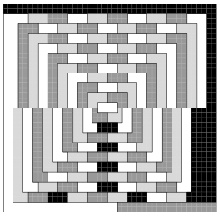</a>


<a href="../../../assets/volume4b/figures/satqa-a18b.svg">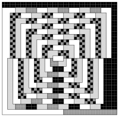</a>


<a href="../../../assets/volume4b/figures/satqa-a18c.svg">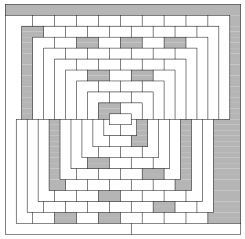</a>


颜色分布为 $(\lfloor n^2/3\rfloor,\lfloor n^2/3\rfloor,\lfloor n^2/3\rfloor,5k)+\bigl((0,1,k,-1),(1,k,1,0),(-1,k+1,1,2),(0,k,1,2),(1,k+1,1,2),(0,2,k+1,3)\bigr)$, 其中 $n\bmod6=(0,1,2,3,4,5)$, $k=\lfloor n/6\rfloor$. 由于在 $n\le16$ 时这个构造达到了 $f(n)$ 与 $g(n)$ 的所有最优值, 它对所有 $n$ 大概都是最优的. 此外, $g(n)$ 的值在所有已知情形下都等于最大独立集的大小. 进一步的猜想是, 只要 $n\bmod6=0$ 且 $n>6$, 最大独立集就是<em>唯一</em>的.

<a id="pdf-572"></a><a id="p-552"></a>

<a id="ans-7-2-2-2-19"></a>

**19.** [题目](../sec-7-2-2-2.md#ex-7-2-2-2-19) 取 $\operatorname{mcgregor}(n)$ 的子句, 对每个顶点再加上 $(v_1\lor v_2\lor v_3\lor\bar v_x)\land(v_1\lor v_2\lor v_4\lor\bar v_x)\land(v_1\lor v_3\lor v_4\lor\bar v_x)\land(v_2\lor v_3\lor v_4\lor\bar v_x)$, 还有来自 (20)、(21) 的子句, 要求至少 $r$ 个变量 $v_x$ 为真. 还要给四个团顶点指定互异的颜色. (由于 $h(n)$ 的对称性比 $f(n)$ 或 $g(n)$ 强, 这里有一个赋值就足以破除对称性, 不必有四个.) 这些子句可满足当且仅当 $h(n)\ge r$. 若再添上要求每个色类都为核的子句 (见[习题 21](../sec-7-2-2-2.md#ex-7-2-2-2-21)), SAT 计算就会更快.

用这种方法很容易求得 $n=(3,4,\ldots,8)$ 时的值 $h(n)=(1,3,4,7,9,13)$. 此外, 若将[答案 18](#ans-7-2-2-2-18) 的构造中的色类 4 扩大成一个合适的核, 就有 $h(9)\ge17$, $h(10)\ge23$. 对于 $n=10$, 所得的图见[图 A–7](#fig-7-2-2-2-a7)(b), 它漂亮地同时展示了 McGregor 原着色问题的 $2^{23}$ 个解.

一个好的 SAT 求解器还可证明 $h(9)\le18$, $h(10)\le23$, 从而证明 $h(10)=23$. 2013 年 Armin Biere 的求解器发现了这里所示的出人意料的解, 证明了 $h(9)=18$. (本题受到 Frank Bernhart 的启发, 他在 1975 年曾将类似[图 A–7](#fig-7-2-2-2-a7)(b) 的一幅图寄给 Martin Gardner; 他的图得到了 $2^{21}$ 个解.)

<a href="../../../assets/volume4b/figures/satqa-a19.svg">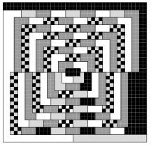</a>


<a id="ans-7-2-2-2-20"></a>

**20.** [题目](../sec-7-2-2-2.md#ex-7-2-2-2-20) 将[答案 15](#ans-7-2-2-2-15) 中的顶点 $(j,k)$ 以下列次序排列为 $v_0,v_1,\ldots$: $(n,n-1)$; $(0,n-1),(0,n-2),\ldots,(0,0)$; $(1,n-1),(1,n-2),\ldots,(1,1)$; $\ldots$; $(n-2,n-1),(n-2,n-2)$; $(n-1,n-2),(n-2,n-3),\ldots,(2,1)$; $(n-1,n-1)$; $(2,0),(3,1),\ldots,(n,n-2)$; $(3,0),(4,1),\ldots,(n,n-3)$; $(1,0)$; $(4,0),\ldots,(n,n-4)$; $\ldots$; $(n-1,0),(n,1)$; $(n,0)$. 令 $V_t=\{v_0,\ldots,v_{t-1}\}$, “边界” $F_t$ 由 $V_t$ 中至少有一个邻点不在 $V_t$ 的所有顶点组成. 若知道 $F_{t-1}$ 的相应计数, 就能枚举在 $F_t$ 上有给定颜色序列的所有 $V_t$ 的 4 着色. 可以假定 $(v_0,v_1,v_2)$ 的颜色为 $(0,1,2)$, 因为它们属于 4 团.

上述次序保证 $F_t$ 从不含多于 $2n-1$ 个元素; 事实上, 对任意给定的 $t$, 至多有 $3^{2n-2}$ 个可行的颜色序列. 由于 $3^{18}$ 小于四亿, 完全可以进行这样的增量计算. 总数 (使用约 6 吉字节内存, 计算约五千亿次内存访问而得) 为 $898431907970211$.

当 $n=10$ 时, 这个问题大得难以用 BDD 方法高效处理; 不过对于 $n\le8$ 可用 BDD 计算来检验该算法. 实际上, 各层的边界代表这个问题的一个 QDD 逐层的切片. $3\le n\le9$ 时的 4 着色数依次为 $6,99,1814,107907,9351764,2035931737,847019915170$.

<a id="ans-7-2-2-2-21"></a>

**21.** [题目](../sec-7-2-2-2.md#ex-7-2-2-2-21) 对图 $G$ 的每个顶点引入一个布尔变量 $v$, 则其核可由下列子句刻画: (i) 只要 $u\mathbin{—}v$, 就有 $\bar u\lor\bar v$; (ii) 对所有 $v$ 都有 $v\lor\bigvee_{u\mathbin{—}v}u$. 加上对称阈函数 $S_{\le r}(x_1,\ldots,x_N)$ 的子句, 就能求使全部子句可满足的最小 $r$. 对[图 76](../sec-7-2-2-2.md#fig-7-2-2-2-76), $r=17$ 时可以满足, 它的 46 个大小为 17 的核中有一个见[图 A–7](#fig-7-2-2-2-a7)(c).

[对于这个问题, BDD 方法较慢; 不过它枚举了全部 $520428275749$ 个核, 并给出生成函数 $46z^{17}+47180z^{18}+\cdots+317z^{34}+2z^{35}$, 按覆盖集大小计数.]

<a id="ans-7-2-2-2-22"></a>

**22.** [题目](../sec-7-2-2-2.md#ex-7-2-2-2-22) 需要八种颜色. 以下着色是 “均衡的”, 每种颜色至少使用三次:

```text
12771
22788
33668
34655
14451
```

<a id="ans-7-2-2-2-23"></a>

**23.** [题目](../sec-7-2-2-2.md#ex-7-2-2-2-23) 以 $k$ 表示 $x_k$, 以上下叠写的 $\genfrac{}{}{0pt}{}{k}{j}$ 表示 $s_j^k$, 则 (18)–(19) 的子句为

$$
\begin{aligned}
&\genfrac{}{}{0pt}{}{\bar{1}}{1}\genfrac{}{}{0pt}{}{1}{2},\ \genfrac{}{}{0pt}{}{\bar{1}}{2}\genfrac{}{}{0pt}{}{1}{3},\ \genfrac{}{}{0pt}{}{\bar{2}}{1}\genfrac{}{}{0pt}{}{2}{2},\ \genfrac{}{}{0pt}{}{\bar{2}}{2}\genfrac{}{}{0pt}{}{2}{3},\ \genfrac{}{}{0pt}{}{\bar{3}}{1}\genfrac{}{}{0pt}{}{3}{2},\ \genfrac{}{}{0pt}{}{\bar{3}}{2}\genfrac{}{}{0pt}{}{3}{3},\\
&\genfrac{}{}{0pt}{}{\bar{4}}{1}\genfrac{}{}{0pt}{}{4}{2},\ \genfrac{}{}{0pt}{}{\bar{4}}{2}\genfrac{}{}{0pt}{}{4}{3};\ \bar{1}\genfrac{}{}{0pt}{}{1}{1},\ \bar{2}\genfrac{}{}{0pt}{}{1}{2},\ \bar{3}\genfrac{}{}{0pt}{}{1}{3},\ \bar{2}\genfrac{}{}{0pt}{}{\bar{1}}{1}\genfrac{}{}{0pt}{}{2}{1},\\
&\bar{3}\genfrac{}{}{0pt}{}{\bar{1}}{2}\genfrac{}{}{0pt}{}{2}{2},\ \bar{4}\genfrac{}{}{0pt}{}{\bar{1}}{3}\genfrac{}{}{0pt}{}{2}{3},\ \bar{3}\genfrac{}{}{0pt}{}{\bar{2}}{1}\genfrac{}{}{0pt}{}{3}{1},\ \bar{4}\genfrac{}{}{0pt}{}{\bar{2}}{2}\genfrac{}{}{0pt}{}{3}{2},\ \bar{5}\genfrac{}{}{0pt}{}{\bar{2}}{3}\genfrac{}{}{0pt}{}{3}{3},\ \bar{4}\genfrac{}{}{0pt}{}{\bar{3}}{1}\genfrac{}{}{0pt}{}{4}{1},\\
&\bar{5}\genfrac{}{}{0pt}{}{\bar{3}}{2}\genfrac{}{}{0pt}{}{4}{2},\ \bar{6}\genfrac{}{}{0pt}{}{\bar{3}}{3}\genfrac{}{}{0pt}{}{4}{3},\ \bar{5}\genfrac{}{}{0pt}{}{\bar{4}}{1},\ \bar{6}\genfrac{}{}{0pt}{}{\bar{4}}{2},\ \bar{7}\genfrac{}{}{0pt}{}{\bar{4}}{3}.
\end{aligned}
$$

类似地, (20) 与 (21) 定义

$$
\begin{aligned}
&\bar{7}\genfrac{}{}{0pt}{}{6}{1},\ \bar{6}\genfrac{}{}{0pt}{}{6}{1},\ \bar{6}\bar{7}\genfrac{}{}{0pt}{}{6}{2};\ \bar{5}\genfrac{}{}{0pt}{}{5}{1},\ \bar{4}\genfrac{}{}{0pt}{}{5}{1},\ \bar{4}\bar{5}\genfrac{}{}{0pt}{}{5}{2};\\
&\bar{3}\genfrac{}{}{0pt}{}{4}{1},\ \bar{2}\genfrac{}{}{0pt}{}{4}{1},\ \bar{2}\bar{3}\genfrac{}{}{0pt}{}{4}{2};\ \bar{1}\genfrac{}{}{0pt}{}{3}{1},\ \genfrac{}{}{0pt}{}{\bar{6}}{1}\genfrac{}{}{0pt}{}{3}{1},\ \genfrac{}{}{0pt}{}{\bar{6}}{1}\bar{1}\genfrac{}{}{0pt}{}{3}{2},\\
&\genfrac{}{}{0pt}{}{\bar{6}}{2}\genfrac{}{}{0pt}{}{3}{2},\ \genfrac{}{}{0pt}{}{\bar{6}}{2}\bar{1}\genfrac{}{}{0pt}{}{3}{3};\ \genfrac{}{}{0pt}{}{\bar{5}}{1}\genfrac{}{}{0pt}{}{2}{1},\ \genfrac{}{}{0pt}{}{\bar{4}}{1}\genfrac{}{}{0pt}{}{2}{1},\ \genfrac{}{}{0pt}{}{\bar{5}}{2}\genfrac{}{}{0pt}{}{2}{2},\ \genfrac{}{}{0pt}{}{\bar{4}}{2}\genfrac{}{}{0pt}{}{2}{2},\\
&\genfrac{}{}{0pt}{}{\bar{4}}{1}\genfrac{}{}{0pt}{}{\bar{5}}{1}\genfrac{}{}{0pt}{}{2}{2},\ \genfrac{}{}{0pt}{}{\bar{4}}{1}\genfrac{}{}{0pt}{}{\bar{5}}{2}\genfrac{}{}{0pt}{}{2}{3},\ \genfrac{}{}{0pt}{}{\bar{4}}{2}\genfrac{}{}{0pt}{}{\bar{5}}{1}\genfrac{}{}{0pt}{}{2}{3},\ \genfrac{}{}{0pt}{}{\bar{4}}{2}\genfrac{}{}{0pt}{}{\bar{5}}{2}\genfrac{}{}{0pt}{}{2}{4};\ \genfrac{}{}{0pt}{}{\bar{2}}{4}\genfrac{}{}{0pt}{}{\bar{3}}{1},\ \genfrac{}{}{0pt}{}{\bar{2}}{3}\genfrac{}{}{0pt}{}{\bar{3}}{2},\\
&\genfrac{}{}{0pt}{}{\bar{2}}{2}\genfrac{}{}{0pt}{}{\bar{3}}{3}.
\end{aligned}
$$

所以当<a id="pdf-573"></a><a id="p-553"></a> $(n,r)=(7,4)$ 时, 基于树的方法看来多用了一个变量和两个子句. 但是下一题说明, (18) 与 (19) 其实并未占上风!

<a id="ans-7-2-2-2-24"></a>

**24.** [题目](../sec-7-2-2-2.md#ex-7-2-2-2-24) (a) 子句 $(\bar b^2_1\lor\bar b^3_r)$ 仅在 $t_3=r$ 时才出现, 而 $t_3\le n/2$.

(b) 例如 $n=11$, $r=5$ 时, $t_3=\min(r,4)<r$.

(c) 在这种情形中, $t_k$ 是结点 $k$ 下面的叶子数; 消去纯字面值之后, 剩下的辅助变量只有 $b_{t_k}^k$. 只剩 $n-1$ 个子句, 即 $(\bar b^{2k}_{t_{2k}}\lor\bar b^{2k+1}_{t_{2k+1}}\lor b^k_{t_k})$, $1<k<n$, 再加上 $(\bar b^2_{t_2}\lor\bar b^3_{t_3})$.

(d) 若 $2^k\le n\le2^k+2^{k-1}$, 则 $(n',n'')=(n-2^{k-1},2^{k-1})$; 另一方面, 若 $2^k+2^{k-1}\le n\le2^{k+1}$, 则 $(n',n'')=(2^k,n-2^k)$. (注意 $n''\le n'\le2n''$.)

(e) 在这个完全平衡的情形下 (它最容易分析), 没有纯字面值被除去. 我们得到 $a(2^k,2^{k-1})=(k-1)2^k$, $c(2^k,2^{k-1})=(2^{k-2}+k-1)2^k$.

(f) 可以证明
$$
a(n,r)=\begin{cases}
b(n',r)+b(n'',r),&r\le n'';\\
b(n',n'')+b(n'',n''),&n''<r\le n';\\
b(n',n-r)+b(n'',n-r),&n'<r,
\end{cases}
$$
其中 $b(1,1)=0$, $n\ge2$ 时有 $b(n,r)=r+b(n',\min(r,n'))+b(n'',\min(r,n''))$. 类似地,
$$
c(n,r)=\begin{cases}
r+f(n',0,r)+f(n'',0,r),&r\le n'';\\
n''+f(n',r-n'',r)+f(n'',0,n''),&n''<r\le n';\\
n-r+f(n',r-n'',n')+f(n'',r-n',n''),&n'<r,
\end{cases}
$$
其中 $f(1,0,1)=0$, 而对 $n\ge2$,
$$
\begin{aligned}
f(n,l,r)={}&\sum_{k=l+1}^{r}\min(k+1,n''+1,n+1-k)\\
&+\begin{cases}
r+f(n',0,r)+f(n'',0,r),&r\le n'';\\
n''+f(n',0,r)+f(n'',0,n''),&n''<r\le n';\\
n-r+f(n',0,n')+f(n'',0,n''),&n'<r<n;\\
f(n',(n'+l)\mathbin{\dot{-}}r,n')+f(n'',(n''+l)\mathbin{\dot{-}}r,n''),&r=n.
\end{cases}
\end{aligned}
$$
由这些递推关系作归纳, 即得所求结果.

顺便说, 三路分支还能再节省一些. 例如可用六个变量 $b_1^2,b_2^2,b_3^2,b_1^3,b_2^3,b_3^3$ 的 17 个子句处理 $n=6$, $r=3$.

<a id="ans-7-2-2-2-25"></a>

**25.** [题目](../sec-7-2-2-2.md#ex-7-2-2-2-25) 由 (18) 和 (19) 得到 $2n-4$ 个变量的 $5n-12$ 个子句, 有简单的格状结构. 但 (20) 和 (21) 产生较复杂的树形结构, 有 $2n-4$ 个变量, 有 $\lfloor n/2\rfloor$ 个结点各自覆盖恰好两个叶子. 于是在这 $\lfloor n/2\rfloor$ 个结点上各有 3 个子句, 在 $n\bmod2$ 个结点上各有 5 个子句, 在 $\lfloor n/2\rfloor-2$ 个结点上各有 7 个子句, 而 (21) 给出 2 个子句, 共计仍为 $5n-12$ (假定 $n>3$). 事实上, 两种情形中除 $n-2$ 个子句以外, 其余均为二元子句.

<a id="ans-7-2-2-2-26"></a>

**26.** [题目](../sec-7-2-2-2.md#ex-7-2-2-2-26) 设想边界条件 $s_j^0=1$, $s_j^{r+1}=0$, $s_0^k=0$, 对 $1\le j\le n-r$, $1\le k\le r$ 成立. 这些子句表示 $s_1^k\le\cdots\le s_{n-r}^k$ 以及 $x_{j+k}s_j^k\le s_j^{k+1}$; 因此对 $j,k$ 归纳即得提示的结论.

令 $j=n-r$, $k=r+1$, 可知当 $x_1+\cdots+x_n\ge r+1$ 时不能满足新子句. 反过来, 若能在 $x_1+\cdots+x_n\le r$ 时满足 $F$, 就可令 $s_j^k\gets[x_1+\cdots+x_{j+k-1}\ge k]$ 来满足 (18)、(19).

<a id="ans-7-2-2-2-27"></a>

**27.** [题目](../sec-7-2-2-2.md#ex-7-2-2-2-27) 如上一题的答案那样论证, 但设想 $b_0^k=1$, $b_{r+1}^k=0$; 对 $j$ 与 $n-k$ 归纳来证明提示 (从 $k=n-1$ 开始, 再取 $k=n-2$, 如此下去).

<a id="ans-7-2-2-2-28"></a>

**28.** [题目](../sec-7-2-2-2.md#ex-7-2-2-2-28) 例如, $n=5$ 时, $\bar x_1+\cdots+\bar x_n\le n-1$ 的子句是 $(x_1\lor s_1^1)$、$(x_2\lor\bar s_1^1\lor s_1^2)$、$(x_3\lor\bar s_1^2\lor s_1^3)$、$(x_4\lor\bar s_1^3\lor s_1^4)$、$(x_5\lor\bar s_1^4)$. 可假定 $n\ge4$; 则头两个子句可以用 $(x_1\lor x_2\lor s_1^2)$ 代替, 末两个可用 $(x_{n-1}\lor x_n\lor\bar s_1^{n-3})$ 代替, 得到 $n-3$ 个辅助变量上长度为 3 的 $n-2$ 个子句.

<a id="ans-7-2-2-2-29"></a>

**29.** [题目](../sec-7-2-2-2.md#ex-7-2-2-2-29) 可以假定 $1\le r_1\le\cdots\le r_n=r<n$. 只要再断言每当 $k=r_i+1$ 且 $j=i-r_i$ 时 $s_j^k$ 为假, Sinz 的子句 (18)、(19) 就恰好能办到.

<a id="ans-7-2-2-2-30"></a>

**30.** [题目](../sec-7-2-2-2.md#ex-7-2-2-2-30) 现在的子句为 $(\bar s_j^k\lor s_{j+1}^k)$、$(\bar x_{j+k}\lor\bar s_j^k\lor s_j^{k+1})$、$(s_j^k\lor\bar s_j^{k+1})$ 和 $(x_{j+k}\lor s_j^k\lor\bar s_{j+1}^k)$, 因而它们定义了量 $s_j^k=[x_1+\cdots+x_{j+k-1}\ge k]$; 隐含地有 $s_0^k=s_j^{r+1}=0$, $s_j^0=s_{n-r+1}^k=1$. [答案 23](#ans-7-2-2-2-23) 中要增添的子句为

$$
\begin{aligned}
&\genfrac{}{}{0pt}{}{1}{1}\genfrac{}{}{0pt}{}{\bar{2}}{1},\ \genfrac{}{}{0pt}{}{2}{1}\genfrac{}{}{0pt}{}{\bar{3}}{1},\ \genfrac{}{}{0pt}{}{3}{1}\genfrac{}{}{0pt}{}{\bar{4}}{1},\ \genfrac{}{}{0pt}{}{1}{2}\genfrac{}{}{0pt}{}{\bar{2}}{2},\ \genfrac{}{}{0pt}{}{2}{2}\genfrac{}{}{0pt}{}{\bar{3}}{2},\ \genfrac{}{}{0pt}{}{3}{2}\genfrac{}{}{0pt}{}{\bar{4}}{2},\\
&\genfrac{}{}{0pt}{}{1}{3}\genfrac{}{}{0pt}{}{\bar{2}}{3},\ \genfrac{}{}{0pt}{}{2}{3}\genfrac{}{}{0pt}{}{\bar{3}}{3},\ \genfrac{}{}{0pt}{}{3}{3}\genfrac{}{}{0pt}{}{\bar{4}}{3};\ 1\genfrac{}{}{0pt}{}{\bar{1}}{1},\ 2\genfrac{}{}{0pt}{}{\bar{2}}{1},\ 3\genfrac{}{}{0pt}{}{\bar{3}}{1},\\
&4\genfrac{}{}{0pt}{}{\bar{4}}{1},\ 2\genfrac{}{}{0pt}{}{1}{1}\genfrac{}{}{0pt}{}{\bar{1}}{2},\ 3\genfrac{}{}{0pt}{}{2}{1}\genfrac{}{}{0pt}{}{\bar{2}}{2},\ 4\genfrac{}{}{0pt}{}{3}{1}\genfrac{}{}{0pt}{}{\bar{3}}{2},\ 5\genfrac{}{}{0pt}{}{4}{1}\genfrac{}{}{0pt}{}{\bar{4}}{2},\ 3\genfrac{}{}{0pt}{}{1}{2}\genfrac{}{}{0pt}{}{\bar{1}}{3},\\
&4\genfrac{}{}{0pt}{}{2}{2}\genfrac{}{}{0pt}{}{\bar{2}}{3},\ 5\genfrac{}{}{0pt}{}{3}{2}\genfrac{}{}{0pt}{}{\bar{3}}{3},\ 6\genfrac{}{}{0pt}{}{4}{2}\genfrac{}{}{0pt}{}{\bar{4}}{3},\ 4\genfrac{}{}{0pt}{}{1}{3},\ 5\genfrac{}{}{0pt}{}{2}{3},\ 6\genfrac{}{}{0pt}{}{3}{3},\\
&7\genfrac{}{}{0pt}{}{4}{3}.
\end{aligned}
$$

<a id="pdf-574"></a><a id="p-554"></a>

对于 (20)、(21), 当结点 $k$ 下面有 $l_k>1$ 个叶子时, 可以把 $b'{}^k_j$ 与 $\bar b^k_{l_k+1-j}$ 等同起来. 于是 $b_j^k$ 为真<em>当且仅当</em> $k$ 下面的叶子有 $j$ 个或更多的 1. 例如, 对[答案 23](#ans-7-2-2-2-23) 增添子句

$$
\begin{aligned}
&7\genfrac{}{}{0pt}{}{\bar{6}}{2},\ 6\genfrac{}{}{0pt}{}{\bar{6}}{2},\ 67\genfrac{}{}{0pt}{}{\bar{6}}{1};\ 5\genfrac{}{}{0pt}{}{\bar{5}}{2},\ 4\genfrac{}{}{0pt}{}{\bar{5}}{2},\ 45\genfrac{}{}{0pt}{}{\bar{5}}{1};\\
&3\genfrac{}{}{0pt}{}{\bar{4}}{2},\ 2\genfrac{}{}{0pt}{}{\bar{4}}{2},\ 23\genfrac{}{}{0pt}{}{\bar{4}}{1};\ 1\genfrac{}{}{0pt}{}{\bar{3}}{3},\ \genfrac{}{}{0pt}{}{6}{2}\genfrac{}{}{0pt}{}{\bar{3}}{3},\ 1\genfrac{}{}{0pt}{}{6}{2}\genfrac{}{}{0pt}{}{\bar{3}}{2},\\
&\genfrac{}{}{0pt}{}{6}{1}\genfrac{}{}{0pt}{}{\bar{3}}{2},\ 1\genfrac{}{}{0pt}{}{6}{1}\genfrac{}{}{0pt}{}{\bar{3}}{1};\ \genfrac{}{}{0pt}{}{4}{2}\genfrac{}{}{0pt}{}{\bar{2}}{4},\ \genfrac{}{}{0pt}{}{5}{2}\genfrac{}{}{0pt}{}{\bar{2}}{4},\ \genfrac{}{}{0pt}{}{4}{1}\genfrac{}{}{0pt}{}{\bar{2}}{3},\ \genfrac{}{}{0pt}{}{4}{2}\genfrac{}{}{0pt}{}{5}{2}\genfrac{}{}{0pt}{}{\bar{2}}{3},\\
&\genfrac{}{}{0pt}{}{5}{1}\genfrac{}{}{0pt}{}{\bar{2}}{3},\ \genfrac{}{}{0pt}{}{4}{1}\genfrac{}{}{0pt}{}{5}{2}\genfrac{}{}{0pt}{}{\bar{2}}{2},\ \genfrac{}{}{0pt}{}{4}{2}\genfrac{}{}{0pt}{}{5}{1}\genfrac{}{}{0pt}{}{\bar{2}}{2},\ \genfrac{}{}{0pt}{}{4}{1}\genfrac{}{}{0pt}{}{5}{1};\ \genfrac{}{}{0pt}{}{2}{4}\genfrac{}{}{0pt}{}{3}{1},\ \genfrac{}{}{0pt}{}{2}{3}\genfrac{}{}{0pt}{}{3}{2},\\
&\genfrac{}{}{0pt}{}{2}{2}\genfrac{}{}{0pt}{}{3}{3}.
\end{aligned}
$$

而且, 对较弱的约束 $r'\le x_1+\cdots+x_n\le r$, (20) 和 (21) 也可以按同一方式统一起来. 比方说若要 $2\le x_1+\cdots+x_7\le4$, 只须把上一段的最后四个子句换成

$$
\begin{aligned}
&\genfrac{}{}{0pt}{}{4}{1}\genfrac{}{}{0pt}{}{5}{1}\genfrac{}{}{0pt}{}{\bar{2}}{1},\ \genfrac{}{}{0pt}{}{2}{2}\genfrac{}{}{0pt}{}{3}{1},\ \genfrac{}{}{0pt}{}{2}{1}\genfrac{}{}{0pt}{}{3}{2}.
\end{aligned}
$$

相形之下, 依 (18)、(19) 的约定, 这些较弱的约束会产生相近数目的新子句, 分别为

$$
\begin{aligned}
&\genfrac{}{}{0pt}{}{1}{1}\genfrac{}{}{0pt}{}{\bar{2}}{1},\ \genfrac{}{}{0pt}{}{1}{2}\genfrac{}{}{0pt}{}{\bar{2}}{2},\ \genfrac{}{}{0pt}{}{1}{3}\genfrac{}{}{0pt}{}{\bar{2}}{3},\ \genfrac{}{}{0pt}{}{1}{4}\genfrac{}{}{0pt}{}{\bar{2}}{4},\ \genfrac{}{}{0pt}{}{1}{5}\genfrac{}{}{0pt}{}{\bar{2}}{5},
\end{aligned}
$$

以及

$$
\begin{aligned}
&1\genfrac{}{}{0pt}{}{\bar{1}}{1},\ 2\genfrac{}{}{0pt}{}{\bar{2}}{1},\ 2\genfrac{}{}{0pt}{}{1}{1}\genfrac{}{}{0pt}{}{\bar{1}}{2},\ 3\genfrac{}{}{0pt}{}{2}{1}\genfrac{}{}{0pt}{}{\bar{2}}{2},\ 3\genfrac{}{}{0pt}{}{1}{2}\genfrac{}{}{0pt}{}{\bar{1}}{3},\ 4\genfrac{}{}{0pt}{}{2}{2}\genfrac{}{}{0pt}{}{\bar{2}}{3},\\
&4\genfrac{}{}{0pt}{}{1}{3}\genfrac{}{}{0pt}{}{\bar{1}}{4},\ 5\genfrac{}{}{0pt}{}{2}{3}\genfrac{}{}{0pt}{}{\bar{2}}{4},\ 5\genfrac{}{}{0pt}{}{1}{4}\genfrac{}{}{0pt}{}{\bar{1}}{5},\ 6\genfrac{}{}{0pt}{}{2}{4}\genfrac{}{}{0pt}{}{\bar{2}}{5},\ 6\genfrac{}{}{0pt}{}{1}{5},\ 7\genfrac{}{}{0pt}{}{2}{5};
\end{aligned}
$$

不过那些子句还涉及新变量

$$
\begin{aligned}
&\genfrac{}{}{0pt}{}{1}{4},\ \genfrac{}{}{0pt}{}{1}{5},\ \genfrac{}{}{0pt}{}{2}{4},\ \genfrac{}{}{0pt}{}{2}{5}.
\end{aligned}
$$


<a id="ans-7-2-2-2-31"></a>

**31.** [题目](../sec-7-2-2-2.md#ex-7-2-2-2-31) 可以用 (10) 第二行的约束, 再结合[习题 30](../sec-7-2-2-2.md#ex-7-2-2-2-30) 中强制 $x_1+\cdots+x_n=r$ 的约束. 然后寻找这样的 $n$: 这个问题可满足, 但同一个问题加上 $x_n=0$ 后便不可满足. 可用以下小规模的值核对计算:

<table id="sat-progression-table"><thead><tr><th>$r=$</th><th>1</th><th>2</th><th>3</th><th>4</th><th>5</th><th>6</th><th>7</th><th>8</th><th>9</th><th>10</th><th>11</th><th>12</th><th>13</th><th>14</th><th>15</th><th>16</th><th>17</th><th>18</th><th>19</th><th>20</th><th>21</th><th>22</th><th>23</th><th>24</th><th>25</th><th>26</th><th>27</th></tr></thead><tbody>
<tr><td>$F_{3}(r)=$</td><td>1</td><td>2</td><td>4</td><td>5</td><td>9</td><td>11</td><td>13</td><td>14</td><td>20</td><td>24</td><td>26</td><td>30</td><td>32</td><td>36</td><td>40</td><td>41</td><td>51</td><td>54</td><td>58</td><td>63</td><td>71</td><td>74</td><td>82</td><td>84</td><td>92</td><td>95</td><td>100</td></tr>
<tr><td>$F_{4}(r)=$</td><td>1</td><td>2</td><td>3</td><td>5</td><td>6</td><td>8</td><td>9</td><td>10</td><td>13</td><td>15</td><td>17</td><td>19</td><td>21</td><td>23</td><td>25</td><td>27</td><td>28</td><td>30</td><td>33</td><td>34</td><td>37</td><td>40</td><td>43</td><td>45</td><td>48</td><td>50</td><td>53</td></tr>
<tr><td>$F_{5}(r)=$</td><td>1</td><td>2</td><td>3</td><td>4</td><td>6</td><td>7</td><td>8</td><td>9</td><td>11</td><td>12</td><td>13</td><td>14</td><td>16</td><td>17</td><td>18</td><td>19</td><td>24</td><td>25</td><td>27</td><td>28</td><td>29</td><td>31</td><td>33</td><td>34</td><td>36</td><td>37</td><td>38</td></tr>
<tr><td>$F_{6}(r)=$</td><td>1</td><td>2</td><td>3</td><td>4</td><td>5</td><td>7</td><td>8</td><td>9</td><td>10</td><td>12</td><td>13</td><td>14</td><td>15</td><td>17</td><td>18</td><td>19</td><td>20</td><td>22</td><td>23</td><td>24</td><td>25</td><td>26</td><td>29</td><td>32</td><td>33</td><td>35</td><td>36</td></tr>
</tbody></table>

而且, 如果还利用先前算出的 $F_t(1),\ldots,F_t(r-1)$ 的值, 可以获得显著加速. 例如当 $t=3$ 且 $r\ge5$ 时, 对 $0\le a\le n-8$ 必有 $x_{a+1}+\cdots+x_{a+8}\le4$, 因为 $F_3(5)=9$. 这些额外的子区间约束与[习题 30](../sec-7-2-2-2.md#ex-7-2-2-2-30) 的约束十分相配, 因为对 $0\le a\le n-p$, $x_{a+1}+\cdots+x_{a+p}\le q$ 蕴涵 $\bar s_{b+p-q}^k\lor s_b^{k-q}$, 其中 $0\le b\le n+1-p+q-r$ 且 $q<k\le r$.

还可以借助单位子句利用左右对称性: 若 $r$ 为奇数, 添加 $\bar s_{\lceil(n-r)/2\rceil}^{\lceil r/2\rceil}$; 若 $n$ 和 $r$ 均为偶数, 则添加 $s_{n/2-r/2+1}^{r/2}$.

计算诸如 $F_3(27)$ 或 $F_4(36)$ 时, 会得到合适的基准实例. 不过对于大实例, 一般的基于 SAT 的方法似乎比不上最佳的专用回溯程序. 例如, Gavin Theobald 和 Rodolfo Niborski 求得了 $F_3(41)=194$, 这个值看来远非上述方法所及.

[见 P. Erdős 与 P. Turán, <em>J. London Math. Soc.</em> **11** (1936), 261–264; 勘误, **34** (1959), 480; S. S. Wagstaff, Jr., <em>Math. Comp.</em> **26** (1972), 767–771.]

<a id="ans-7-2-2-2-32"></a>

**32.** [题目](../sec-7-2-2-2.md#ex-7-2-2-2-32) 用 (15)、(16), 还可以用 (17), 但若 $j\notin L(v)$, 就略去变量 $v_j$.

<a id="ans-7-2-2-2-33"></a>

**33.** [题目](../sec-7-2-2-2.md#ex-7-2-2-2-33) 要用 $k$ 种颜色给图作双重着色, 把 (15) 换成 $k$ 个子句 $v_1\lor\cdots\lor v_{j-1}\lor v_{j+1}\lor\cdots\lor v_k$, $1\le j\le k$; 类似地, $\binom k2$ 个长度为 $k-2$ 的子句将给出三重着色. 从小例子可以看出, 对 $l\ge2$, 圈 $C_{2l+1}$ 可以用五种颜色双重着色: $\{1,2\}(\{3,4\}\{5,1\})^{l-1}\{2,3\}\{4,5\}$. 此外, 当 $l\ge3$ 时, 三重着色只需七种颜色: $\{1,2,3\}(\{4,5,6\}\{7,1,2\})^{l-2}\{3,4,5\}\{6,7,1\}\{2,3,4\}\{5,6,7\}$. 下一题证明这些着色实际上是最优的.

<a id="ans-7-2-2-2-34"></a>

**34.** [题目](../sec-7-2-2-2.md#ex-7-2-2-2-34) (a) 显然, 用 $q\chi(G)$ 种颜色可以得到一个 $q$ 重着色. 又因 McGregor 图有一个 4 团, $\chi^*(G)\ge4$.

(b) 任何使用 $p$ 种颜色的 $q$ 重着色, 若令 $\lambda_j=\sum_{i=1}^p[S_j\text{ 是着了颜色 }i\text{ 的顶点集}]/q$, 就给出了分数恰当覆盖问题的一个解. 反过来, 线性等式理论告诉我们, 总有一个最优解, 其 $\{\lambda_1,\ldots,\lambda_N\}$ 都是有理数; 选 $q$ 使每个 $q\lambda_j$ 都是整数, 这样的解便给出一个 $q$ 重着色.

<a id="pdf-575"></a><a id="p-555"></a>

(c) 若 $n$ 为偶数, 则 $\chi^*(C_n)=\chi(C_n)=2$; 而 $\chi^*(C_{2l+1})\le2+1/l=n/\alpha(C_{2l+1})$, 因为像上一题那样可以用 $n$ 种颜色作 $l$ 重着色. 另一方面, 一般都有 $\chi^*(G)\ge n/\alpha(G)$: $n=\sum_v\sum_j\lambda_j[v\in S_j]=\sum_j\lambda_j|S_j|\le\alpha(G)\sum_j\lambda_j$.

(d) 为证提示, 令 $S=\{v_1,\ldots,v_l\}$, 顶点按其颜色排序. 由于顶点 $v_j$ 属于满足 $|C_i|\ge|\{v_j,\ldots,v_l\}|$ 的 $C_i$, 可知 $t_{v_j}\le1/(l+1-j)$.

所以 $\chi(G)\le k=\sum_v t_v=\sum_v t_v\sum_j\lambda_j[v\in S_j]=\sum_j\lambda_j\sum_v t_v[v\in S_j]\le\sum_j\lambda_jH_{\alpha(G)}$.

[见 David S. Johnson, <em>J. Computer and System Sci.</em> **9** (1974), 264–269; L. Lovász, <em>Discrete Math.</em> **13** (1975), 383–390. 分数覆盖的概念由 A. J. W. Hilton、R. Rado 和 S. H. Scott 提出, <em>Bull. London Math. Soc.</em> **5** (1973), 302–306.]

<a id="ans-7-2-2-2-35"></a>

**35.** [题目](../sec-7-2-2-2.md#ex-7-2-2-2-35) (a) 下图的双重着色证明了 $\chi^*(G)\le7/2$; 而且这是最优的, 因为 NV 及其邻州导出了轮图 $W_5$. (注意 $\chi^*(W_n)=1+\chi^*(C_n)$.)

<a href="../../../assets/volume4b/figures/satqa-a35map.svg"></a>


(b) 由上一题 (c) 部分所用的下界, $\chi^*(G)\ge25/4$. 此外, 有一个用 25 种颜色的四重着色:

```text
AEUY ABUV BCVW CDWX DEXY
AEFJ ABFG BCGH CDHI DEIJ
FJKO FGKL GHLM HIMN IJNO
KOPT KLPQ LMQR MNRS NOST
PTUY PQUV QRVW RSWX STXY
```

[$\overline{C_5\boxtimes C_5}$ 是满足 $\chi^*(G)<\chi(G)-1$ 的最小的图吗?]

<a id="ans-7-2-2-2-36"></a>

**36.** [题目](../sec-7-2-2-2.md#ex-7-2-2-2-36) 类似于 (16), 再加几个二元的颜色约束, 就得到相应的 SAT 问题. 还可以假定右上角着色 0, 因为这个区域与 $n+4=14$ 个其他区域相接; 至少需要 $n+6$ 种颜色. 其他地方的约束不很紧 (见[习题 38](../sec-7-2-2-2.md#ex-7-2-2-2-38)(b)); 因此对于所有阶数 $n>4$ 的 McGregor 图, 都很容易得到使用 $n+6$ 种颜色的最优无线电着色, 如下所示. 当 $n=3$ 或 4 时, 第 $n+7$ 种颜色既必要又充分.

<a href="../../../assets/volume4b/figures/satqa-a36map.svg">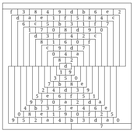</a>


<a id="ans-7-2-2-2-37"></a>

**37.** [题目](../sec-7-2-2-2.md#ex-7-2-2-2-37) 这里所示的十色着色是最优的, 因为密苏里州 (MO) 的度为 8.

<a href="../../../assets/volume4b/figures/satqa-a37map.svg">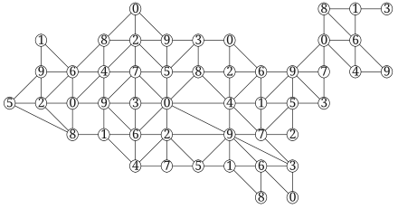</a>


<a id="ans-7-2-2-2-38"></a>

**38.** [题目](../sec-7-2-2-2.md#ex-7-2-2-2-38) 例如, 观察用算法 W (WalkSAT) 很快就能算出的 $n=10$ 的解, 容易看出一般的模式: (a) 取 $(x,y)$ 的颜色为 $(2x+4y)\bmod7$. ($n\ge3$ 时显然至少需要七色.) (b) 取 $(x,y,z)$ 的颜色为 $(2x+6y)\bmod9$. ($n\ge4$ 时显然至少需要九色.)

<a id="ans-7-2-2-2-39"></a>

**39.** [题目](../sec-7-2-2-2.md#ex-7-2-2-2-39) 令 $f(n)$ 为最少的连续颜色数. SAT 求解器很容易验证对于 $n=(0,1,2,3,4,5)$, 有 $f(n)=(1,3,5,7,8,9)$. 此外, 利用对称性可以证实 $f(6)>10$: 可以假定 000000 着色 0, 而 $000001,\ldots,100000$ 的颜色按递增排列; 这样, 这后几个顶点各自只有三种<a id="pdf-576"></a><a id="p-556"></a>可能. 最后, 我们可以找到一个仅用颜色 $\{0,1,3,4,6,7,9,10\}$ 的解, 从而验证 $f(6)=11$.

但对于 $f(7)$, 只知道它 $\ge11$ 且 $\le15$.

[$L(2,1)$ 标号的名字来自 J. R. Griggs 和 R. K. Yeh, 他们开创了这个理论, 见 <em>SIAM J. Discrete Math.</em> **5** (1992), 586–595. 已知的最佳上界, 包括 $f(2^k-k-1)\le2^k$ 这一事实, 是由 M. A. Whittlesey、J. P. Georges 和 D. W. Mauro 得到的, 他们还解出了[习题 38](../sec-7-2-2-2.md#ex-7-2-2-2-38)(a); 见 <em>SIAM J. Discrete Math.</em> **8** (1995), 499–506.]

<a id="ans-7-2-2-2-40"></a>

**40.** [题目](../sec-7-2-2-2.md#ex-7-2-2-2-40) 不是; 可满足的情形为 $z=0,1,2,3,4,5,6,7,8,9,10,12,14,15,21$. [如果还要求 $(x_m\lor\cdots\lor x_2)\land(y_n\lor\cdots\lor y_2)$, 这个断言就是真的.]

<a id="ans-7-2-2-2-41"></a>

**41.** [题目](../sec-7-2-2-2.md#ex-7-2-2-2-41) 首先要做 $mn$ 个与运算以形成 $x_i y_j$. 初始含有 $t$ 位的一个桶, 将用 $(t-1)/2$ 个加法器产生送往下一个桶的 $\lfloor t/2\rfloor$ 个进位. (例如, $t=6$ 将用两个全加器与一个半加器.) $\operatorname{bin}[2],\operatorname{bin}[3],\ldots,\operatorname{bin}[m+n+1]$ 对应的 $t$ 值分别为 $(1,2,4,6,\ldots,2m-2,2m-1,\ldots,2m-1,2m-2,2m-3,\ldots,5,3,1)$, 其中 $2m-1$ 出现 $n-m$ 次. 总共要用 $mn-m-n$ 个全加器及 $m$ 个半加器; 因而总共有 $mn+2(mn-m-n)+m$ 次与运算, $mn-m-n$ 次或运算, 以及 $2(mn-m-n)+m$ 次异或运算.

<a id="ans-7-2-2-2-42"></a>

**42.** [题目](../sec-7-2-2-2.md#ex-7-2-2-2-42) 三元异或需要四元子句, 而对于中值, 三元子句就够了:
$$
\begin{array}{llll}
(t\lor u\lor v\lor\bar x)&(t\lor u\lor\bar v\lor x)&(t\lor u\lor\bar y)&(\bar t\lor\bar u\lor y)\\
(t\lor\bar u\lor\bar v\lor\bar x)&(t\lor\bar u\lor v\lor x)&(t\lor v\lor\bar y)&(\bar t\lor\bar v\lor y)\\
(\bar t\lor u\lor\bar v\lor\bar x)&(\bar t\lor u\lor v\lor x)&(u\lor v\lor\bar y)&(\bar u\lor\bar v\lor y)\\
(\bar t\lor\bar u\lor v\lor\bar x)&(\bar t\lor\bar u\lor\bar v\lor x)&&
\end{array}
$$
四栏子句分别断言 $x\le t\oplus u\oplus v$, $x\ge t\oplus u\oplus v$, $y\le\langle tuv\rangle$, $y\ge\langle tuv\rangle$.

<a id="ans-7-2-2-2-43"></a>

**43.** [题目](../sec-7-2-2-2.md#ex-7-2-2-2-43) 当 $n=2$ 时取 $x=y=3$ 即可, 但 $3\le n\le7$ 的情形不可满足. 对所有 $n\ge8$, 可以用 $x=3(2^{n-2}+1)$, $y=7(2^{n-3}+1)$. (这样的解一点也不少见. 例如, $(x,y)=(\texttt{\#C4466223},\texttt{\#E26E7647})$ 是 $n=32$ 时的 293 个实例之一.)

<a id="ans-7-2-2-2-44"></a>

**44.** [题目](../sec-7-2-2-2.md#ex-7-2-2-2-44) 先迅速摸摸底, 查看 $x$ 或 $y$ 中至多有六个 0 的全部 $\binom{N+1}{2}\approx6600$ 亿种情形, 其中 $N=\binom{32}{26}+\binom{32}{27}+\cdots+\binom{32}{32}$. 这样就发现了非同寻常的一对数 $x=2^{32}-2^{26}-2^{22}-2^{11}-2^8-2^4-1$, $y=2^{32}-2^{11}+2^8-2^4+1$, 其乘积为 $2^{64}-2^{58}-2^{54}-2^{44}-2^{33}-2^8-1$. 现在 SAT 求解器只须证明 32 位乘 32 位的子句在附加约束 $\bar x_1+\cdots+\bar x_{32}+\bar y_1+\cdots+\bar y_{32}+\bar z_1+\cdots+\bar z_{64}\le15$ 下不可满足, 便可完成任务. (在作者用算法 L 所作的实验中, 子句的 LIFO 版本比 FIFO 快得多. 为破除对称性, 分别以 $x_k\ldots x_1=01^{k-1}$, $y_k\ldots y_1=1^k$ 运行.)

<a id="ans-7-2-2-2-45"></a>

**45.** [题目](../sec-7-2-2-2.md#ex-7-2-2-2-45) 用因子分解问题中的子句 $xy=z$, 其中 $m=\lfloor t/2\rfloor$, $n=\lceil t/2\rceil$, 并令 $x_j=y_j$, $1\le j\le m$; 若 $m<n$, 则附上单位子句 $(\bar y_n)$.

<a id="ans-7-2-2-2-46"></a>

**46.** [题目](../sec-7-2-2-2.md#ex-7-2-2-2-46) 最大的两个 $285000288617375^2$ 和 $301429589329949^2$ 都有 97 位; 下一个二进制回文平方数 $1178448744881657^2$ 有 101 位. [对于 SAT 求解器, 这个问题<em>并不</em>容易; 数论的办法好得多. 事实上, M. Coriand 发现只需考察 $O(2^{n/4})$ 种情形就能找到全部 $n$ 位实例的好方法, 因为一个二进制数的左右两半几乎由它的平方的左右两个<em>四分之一</em>所强制. 最初八个二进制回文平方数见 G. J. Simmons, <em>JRM</em> **5** (1972), 11–19; 更多结果见 OEIS 序列 A003166.]

<a id="ans-7-2-2-2-47"></a>

**47.** [题目](../sec-7-2-2-2.md#ex-7-2-2-2-47) 每条导线都有一 “顶” 一 “底”. 有 $n+g+2h$ 个导线顶和 $m+2g+h$ 个导线底. 所以导线数为 $n+g+2h=m+2g+h$, 必有 $n+h=m+g$.

<a id="pdf-577"></a><a id="p-557"></a>

<a id="ans-7-2-2-2-48"></a>

**48.** [题目](../sec-7-2-2-2.md#ex-7-2-2-2-48) 各导线计算 $q^1\gets q$, $q^2\gets q$, $x\gets p\oplus q^1$, $y\gets q^2\oplus r$, $z\gets x\oplus y$. 用 $p$ 表示 “$p$ 固定为 1”, 用 $\bar p$ 表示 “$p$ 固定为 0”. 各模式 $pqr$ 所能检测的故障如下:

<table id="sat-xor-faults"><thead><tr><th>$pqr$</th><th>所检测的故障</th></tr></thead><tbody>
<tr><td>000</td><td>$p, q^{1}, q^{2}, r, x, y, z$</td></tr>
<tr><td>001</td><td>$p, q^{1}, q^{2}, \bar r, x, \bar y, \bar z$</td></tr>
<tr><td>010</td><td>$p, \bar q^{1}, \bar q^{2}, r, \bar x, \bar y, z$</td></tr>
<tr><td>011</td><td>$p, \bar q^{1}, \bar q^{2}, \bar r, \bar x, y, \bar z$</td></tr>
<tr><td>100</td><td>$\bar p, q^{1}, q^{2}, r, \bar x, y, \bar z$</td></tr>
<tr><td>101</td><td>$\bar p, q^{1}, q^{2}, \bar r, \bar x, \bar y, z$</td></tr>
<tr><td>110</td><td>$\bar p, \bar q^{1}, \bar q^{2}, r, x, \bar y, \bar z$</td></tr>
<tr><td>111</td><td>$\bar p, \bar q^{1}, \bar q^{2}, \bar r, x, y, z$</td></tr>
</tbody></table>

注意 $q$ 的固定故障不能检测 (因为 $z=(p\oplus q)\oplus(q\oplus r)=p\oplus r$); 但可以检测它的副本 $q^1,q^2$ 上的故障. ([图 77](../sec-7-2-2-2.md#fig-7-2-2-2-77) 中的情形恰好相反.)

三个模式, 如 $\{100,010,001\}$, 便足以检测全部可检测的故障.

<a id="ans-7-2-2-2-49"></a>

**49.** [题目](../sec-7-2-2-2.md#ex-7-2-2-2-49) 例如会发现, 故障 $b_3^2,\bar c_1^2,\bar s^2,\bar q$ <em>只有</em>模式 $y_3y_2y_1x_2x_1=01111$ 才能检测; $\bar a_3^2,\bar b_3^2,\bar p,\bar c_2^2,\bar z_5$ 只有 11011 或 11111 才能检测.

建立一个含 99 个正子句的 CNF, 每个可检测故障对应一个子句, 就能找到所有覆盖集; 例如 $\bar z_5$ 的子句是 $x_{27}\lor x_{31}$, 而 $x_2^2$ 的子句是 $x_4\lor x_5\lor x_{12}\lor x_{13}\lor x_{20}\lor x_{21}\lor x_{28}\lor x_{29}$. 从这些子句的 BDD 中可以求出最小覆盖, 也可以用 SAT 求解器, 添加类似于 (20) 与 (21) 的子句来限制正字面值的数目. 恰有十四组五个模式足以覆盖, 其中最好记的是 $\{01111,10111,11011,11101,11110\}$. (事实上, 每个最小集都至少包含这五个模式中的两个.)

<a id="ans-7-2-2-2-50"></a>

**50.** [题目](../sec-7-2-2-2.md#ex-7-2-2-2-50) 受影响导线的带撇变量是 $x'_2,b'_2,b'_3,s',p',z'_3,c'_2,z'_4,z'_5$. 这些导线还有带升号的变量 $x_2^\sharp,b_2^\sharp,\ldots,z_5^\sharp$; 扇出导线则需要带升号的变量 $x_2^{1\sharp},x_2^{3\sharp},x_2^{4\sharp},b_2^{1\sharp},b_2^{2\sharp},b_3^{1\sharp},b_3^{2\sharp},s^{1\sharp},s^{2\sharp},c_2^{1\sharp},c_2^{2\sharp}$. 带撇变量由诸如 $(\bar p'\lor a_3)\land(\bar p'\lor b'_2)\land(p'\lor\bar a_3\lor\overline{b'_2})$ 的子句定义, 它对应于 $p'\gets a_3\land b'_2$. 把这些子句附加在正文 (23) 后列出的 49 个子句之后. 接着, 对十个既带撇又带升号的变量中的九个各有 (25) 的两个子句; 但对 $x_2$ 要改用单位子句 $(x'_2)\land(\bar x_2)$, 因为不存在变量 $x_2^\sharp$. 扇出的子句 (26) 有五个, 即 $(\overline{x_2^{1\sharp}}\lor x_2^{3\sharp}\lor x_2^{4\sharp})\land(\overline{b_2^\sharp}\lor b_2^{1\sharp}\lor b_2^{2\sharp})\land\cdots\land(\overline{c_2^\sharp}\lor c_2^{1\sharp}\lor c_2^{2\sharp})$. 有十一个子句用于门的受影响输入: $(\overline{x_2^{3\sharp}}\lor b_2^\sharp)\land(\overline{x_2^{4\sharp}}\lor b_3^\sharp)\land(\overline{b_2^{1\sharp}}\lor s^\sharp)\land\cdots\land(\overline{b_3^{2\sharp}}\lor z_5^\sharp)\land(\overline{c_2^{2\sharp}}\lor z_5^\sharp)$. 最后还有 $(x_2^{1\sharp})\land(z_3^\sharp\lor z_4^\sharp\lor z_5^\sharp)$.

<a id="ans-7-2-2-2-51"></a>

**51.** [题目](../sec-7-2-2-2.md#ex-7-2-2-2-51) (作者在 2013 年找到的一组完备模式有 196 个, 其中包括输入 $(x,y)=(2^{32}-1,2^{31}+1)$ 和 $(\lceil2^{63/2}\rceil,\lceil2^{63/2}\rceil)$, 以及正文提到的两个由数论得到的模式. 乘积中需要有长串的进位.)

<a id="ans-7-2-2-2-52"></a>

**52.** [题目](../sec-7-2-2-2.md#ex-7-2-2-2-52) $(z_{1,2}\lor z_{2,2}\lor\cdots\lor z_{M,2})\land(\bar z_{i,2}\lor\bar q_{i,1})\land(\bar z_{i,2}\lor\bar p_{i,2})\land(\bar z_{i,2}\lor\bar q_{i,3})\land(\bar z_{i,2}\lor\bar p_{i,4})\land\cdots\land(\bar z_{i,2}\lor\bar q_{i,20})$, 对 $1\le i\le M$. 在第 $k$ 个实例中, $z$ 的第二个下标是 $k$, $1\le k\le P$.

<a id="ans-7-2-2-2-53"></a>

**53.** [题目](../sec-7-2-2-2.md#ex-7-2-2-2-53) 左边是 $\pi$ 的二进制展开, 右边是 $e$ 的二进制展开, 每次取 20 位 (见附录 A).

对所有 20 位 $x$ 定义 $f(x)$ 的一种方式是写成 $\pi/4=\sum_{k=1}^\infty u_k/2^{20k}$ 与 $e/4=\sum_{l=1}^\infty v_l/2^{20l}$, 其中每个 $u_k,v_l$ 均为 20 位数. 令 $k,l$ 分别为使 $x=u_k$ 与 $x=v_l$ 的最小下标. 则 $f(x)=[k\le l]$.

实际上, 式 (27) 是专为<em>维持</em>魔术般的假象而设计的: 有许多简单布尔函数都与[表 2](../sec-7-2-2-2.md#tab-7-2-2-2-2) 的数据相符, 即使要求四项 DNF、每项恰有三个字面值也是如此. 但其中只有两个函数像 (27) 一样还具有以下性质: 再加十个实例, 取 $u_k$ 至 $k=22$, 取 $v_l$ 至 $l=20$, 仍与上段定义的 $f(x)$ 一致! 人们几乎会怀疑, SAT 求解器是不是发现了 $\pi$ 与 $e$ 之间一个深刻的新联系.

<a id="ans-7-2-2-2-54"></a>

**54.** [题目](../sec-7-2-2-2.md#ex-7-2-2-2-54) (a) 函数 $\bar x_1x_9x_{11}\bar x_{18}\lor\bar x_6\bar x_{10}\bar x_{12}\lor\bar x_4x_{10}\bar x_{12}$ 与[表 2](../sec-7-2-2-2.md#tab-7-2-2-2-2) 的 16 行全都相符; 但加上第 17 行之后, 三项 DNF 就不可能了.

(b) 21 行不可能, 而 (27) 满足 20 行.

<a id="pdf-578"></a><a id="p-558"></a>

(c) $\bar x_1\bar x_5\bar x_{12}x_{17}\lor\bar x_4x_8\bar x_{13}\bar x_{15}\lor\bar x_6\bar x_9\bar x_{12}x_{16}\lor\bar x_6\bar x_{13}\bar x_{16}x_{20}\lor x_{13}x_{14}\bar x_{16}$ 能处理 28 行, 这是最大数目. (顺便说, 当 $M$ 足够大时, 这个问题就失去了意义, 因为方程 $f(x)=1$ 大概并没有恰好 $2^{19}$ 个解.)

<a id="ans-7-2-2-2-55"></a>

**55.** [题目](../sec-7-2-2-2.md#ex-7-2-2-2-55) 在 (28)–(31) 中对所有 $i,j$ 取 $p_{i,j}=0$, 并加进类似于 (20)、(21) 的子句来保证 $q_{i,1}+\cdots+q_{i,20}\le3$, 可以得到例如以下的解:
$$
f(x_1,\ldots,x_{20})=\bar x_1\bar x_7\bar x_8\lor\bar x_2\bar x_3\bar x_4\lor\bar x_4\bar x_{13}\bar x_{14}\lor\bar x_6\bar x_{10}\bar x_{12}.
$$
(用长度<em>任意</em>的至多四项, 都没有单调<em>递增</em>的解.)

<a id="ans-7-2-2-2-56"></a>

**56.** [题目](../sec-7-2-2-2.md#ex-7-2-2-2-56) 只用一个变量子集就能一致地定义 $f$, 当且仅当限制在这些坐标上时, 左边的任何一项都不与右边的任何一项一致. 例如, 前 10 个坐标还不够, 因为左边的首项与右边的第 14 项有相同的开头 10 位. 前 11 个坐标则够了 (虽然右边有两项其实有相同的开头 12 位).

设左边的向量为 $u_k$, 右边的为 $v_l$, 如[答案 53](#ans-7-2-2-2-53); 构造一个 $256\times20$ 的矩阵, 其各行为 $u_k\oplus v_l$, $1\le k,l\le16$. 所给的问题可解, 当且仅当能找到五列, 对这些列, 该矩阵没有一行是 00000. 这就是经典的<em>覆盖问题</em> (不过行与列已互换): 要找五列覆盖每一行.

一般地, 这样的 $m\times n$ 覆盖问题对应于一个有 $m$ 个子句及 $n$ 个变量 $x_j$ 的 SAT 实例, 其中 $x_j$ 表示 “选第 $j$ 列”. 与某行相应的子句, 是对该行中为 1 的每列 $j$ 将 $x_j$ 作或运算. 例如, 在[表 2](../sec-7-2-2-2.md#tab-7-2-2-2-2) 中有 $u_1\oplus v_1=01100100111101111000$, 所以第一个子句是 $x_2\lor x_3\lor x_6\lor\cdots\lor x_{17}$. 要用至多五列覆盖, 可按 (20)、(21) 添加合适的子句; 这给出 75 个变量的 396 个子句, 总长度为 2894.

(当然, $\binom{20}{5}$ 只有 15504; 完成这项简单任务不需要 SAT 求解器! 不过算法 D 只用了 578 千次内存访问, 算法 C 则只用 $353\,\mathrm K\mu$ 就找到了答案.)

共有 12 个解: 可以只用坐标 $x_j$, 其中下标 $j$ 的取值集合为

$$
\begin{gathered}
\{1,4,15,17,20\},\quad \{1,10,15,17,20\},\quad \{1,15,17,18,20\},\\
\{4,6,7,10,12\},\quad \{4,6,9,10,12\},\quad \{4,6,10,12,19\},\\
\{4,10,12,15,19\},\quad \{5,7,11,12,15\},\quad \{6,7,8,10,12\},\\
\{6,8,9,10,12\},\quad \{7,10,12,15,20\},\quad \{8,15,17,18,20\}.
\end{gathered}
$$

(顺便说, BDD 方法表明, 此覆盖问题的解若按覆盖集大小计数, 则其生成函数为 $12z^5+994z^6+13503z^7+\cdots+20z^{19}+z^{20}$.)

<a id="ans-7-2-2-2-57"></a>

**57.** [题目](../sec-7-2-2-2.md#ex-7-2-2-2-57) [表 2](../sec-7-2-2-2.md#tab-7-2-2-2-2) 指定了一个 20 个布尔变量的部分定义函数, 有 $2^{20}-32$ 个 “无关项”. [习题 56](../sec-7-2-2-2.md#ex-7-2-2-2-56) 表明有十二种不同的方法把它嵌入只含 5 个布尔变量的部分定义函数. 因此有十二张不同的真值表:

```text
11110110 0*1*010* 10000111 10*0*1*0  00100101 11110*0* 1011**** **0**00*
011*011* 1*110100 10*001*1 1000**10  100*1**0 11*00010 1100**0* *0**0101
011*1*11 010*100* 10*0*000 *101*011  **1*1000 1*101100 1*100*10 0*****1*
10101110 0*100*1* 1*001*00 1**00***  1*1*1*10 10001100 0*101*1* **1*0*10
10101110 0*1*0*10 1*0*1*00 0**01***  1*01*00* 1101*0*0 0011*11* 1*100*0*
1*01110* 00**110* 11**0*00 10*****0  001*1001 *1**1*1* 11*0*010 01011001
```

其中第十张给出 $f(x)=\bigl((x_8\oplus(x_9\lor x_{10}))\lor((x_6\lor x_{12})\oplus\bar x_{10})\bigr)\oplus x_{12}$.

<a id="ans-7-2-2-2-58"></a>

**58.** [题目](../sec-7-2-2-2.md#ex-7-2-2-2-58) 只要其他子句可满足, 这些子句就可满足 (除了 $f(x)$ 对所有 $x$ 恒等于 0 的平凡情形), 因为不必在同一项中同时包含 $x_j$ 和 $\bar x_j$. 而且它们使可能性空间缩小至原来的 $(3/4)^N$. 因此似乎值得采用. (另一方面, 它们对运行时间的影响看起来可以忽略, 至少在算法 C 的小规模试验中是如此.)

<a id="pdf-579"></a><a id="p-559"></a>

<a id="ans-7-2-2-2-59"></a>

**59.** [题目](../sec-7-2-2-2.md#ex-7-2-2-2-59) $f(x)\oplus\hat f(x)=x_2\bar x_3\bar x_6\bar x_{10}\bar x_{12}\bigl(\bar x_8\lor x_8(x_{13}\lor x_{15})\bigr)$ 是有 7 个解的八变量函数. 因此概率为 $7/256=.02734375$.

<a id="ans-7-2-2-2-60"></a>

**60.** [题目](../sec-7-2-2-2.md#ex-7-2-2-2-60) 随机选取 $f(x)$ 的 32 个给定值, 一个典型例子得到
$$
\hat f(x_1,\ldots,x_{20})=x_4\bar x_7\bar x_{12}\lor\bar x_6x_8\bar x_{11}x_{14}x_{20}\lor\bar x_9\bar x_{12}x_{18}\bar x_{19}\lor\bar x_{13}\bar x_{16}\bar x_{17}x_{19},
$$
它当然相差甚远; 它与 $f(x)$ 不同的概率为 $102752/2^{18}\approx.39$. 但有 64 个训练值时,
$$
\hat f(x_1,\ldots,x_{20})=x_2\bar x_{13}\bar x_{15}x_{19}\lor\bar x_3\bar x_9\bar x_{19}\bar x_{20}\lor\bar x_6\bar x_{10}\bar x_{12}\lor\bar x_8x_{10}\bar x_{12}
$$
就较为接近, 两者不同的概率仅为 $402/2^{11}\approx.196$.

<a id="ans-7-2-2-2-61"></a>

**61.** [题目](../sec-7-2-2-2.md#ex-7-2-2-2-61) 可加入 24 个子句 $(p_{a,1}\lor q_{a,1}\lor p_{a,2}\lor\bar q_{a,2}\lor p_{a,3}\lor\bar q_{a,3}\lor\cdots\lor p_{b,1}\lor q_{b,1}\lor\cdots\lor p_{c,1}\lor q_{c,1}\lor\cdots\lor p_{d,1}\lor q_{d,1}\lor\cdots\lor\bar p_{d,10}\lor q_{d,10}\lor\cdots\lor p_{d,20}\lor q_{d,20})$, $\{1,2,3,4\}$ 的每个排列 $abcd$ 对应一个; 所得子句只能被其他函数 $f(x)$ 满足.

但在较大的例子中情形更复杂, 因为一个函数可能有许多等价的短 DNF 表示. 若想判定给定的一组 $p'_{i,j},q'_{i,j}$ 所描述的函数是否唯一, 一般的方法是添加较复杂的子句, 断言 $p_{i,j}$ 和 $q_{i,j}$ 给出不同的解. 这些子句可以通过对下式作 Tseytin 编码来生成:
$$
\bigvee_{i=1}^M\bigwedge_{j=1}^N
\bigl((\bar p_{i,j}\land\bar x_j)\lor(\bar q_{i,j}\land x_j)\bigr)
\ \oplus\
\bigvee_{i=1}^M\bigwedge_{j=1}^N
\bigl((\overline{p'_{i,j}}\land\bar x_j)\lor(\overline{q'_{i,j}}\land x_j)\bigr).
$$

<a id="ans-7-2-2-2-62"></a>

**62.** [题目](../sec-7-2-2-2.md#ex-7-2-2-2-62) 作者用 $N=20$, $p=1/8$ 所作的初步实验似乎表明, 这种方法需要更多数据点才收敛, 但 SAT 求解器的运行速度往往快十倍左右. 因此, 除非观测隐秘函数的代价较高, 否则局部有偏的数据点似乎更为可取.

顺便说, 在这些实验中 $x^{(k)}=x^{(k-1)}$ 的机会较高 ($(7/8)^{20}\approx.069$); 所以略过了 $x^{(k)}\oplus x^{(k-1)}=0$ 的情形.

<a id="ans-7-2-2-2-63"></a>

**63.** [题目](../sec-7-2-2-2.md#ex-7-2-2-2-63) 用 Tseytin 编码 (24), 很容易构造 $2r+2n-1$ 个变量上的 $6r+2n-1$ 个子句, 它们可满足当且仅当 $\alpha$ 不能把二进制序列 $x_1\ldots x_n$ 排好序. 例如当 $\alpha=[1:2][3:4][1:3][2:4][2:3]$ 时, 这些子句为
$$
\begin{aligned}
&(x_1\lor\bar l_1)\land(x_2\lor\bar l_1)\land(\bar x_1\lor\bar x_2\lor l_1)
\land(\bar x_1\lor h_1)\land(\bar x_2\lor h_1)\land(x_1\lor x_2\lor\bar h_1)\land\cdots\\
&{}\land(l_4\lor\bar l_5)\land(h_3\lor\bar l_5)\land(\bar l_4\lor\bar h_3\lor l_5)
\land(\bar l_4\lor h_5)\land(\bar h_3\lor h_5)\land(l_4\lor h_3\lor\bar h_5)\\
&{}\land(g_1\lor g_2\lor g_3)\land(\bar g_1\lor l_3)\land(\bar g_1\lor\bar l_5)
\land(\bar g_2\lor l_5)\land(\bar g_2\lor\bar h_5)\land(\bar g_3\lor h_5)\land(\bar g_3\lor\bar h_4).
\end{aligned}
$$
它们不可满足, 所以 $\alpha$ 总能正确排序.

<a id="ans-7-2-2-2-64"></a>

**64.** [题目](../sec-7-2-2-2.md#ex-7-2-2-2-64) 这里把上一题答案的做法倒过来, 构造子句使它们在描述一个排序网络时<em>可满足</em>: 令变量 $C_{i,j}^t$ 表示时刻 $t$ 存在比较器 $[i:j]$, 其中 $1\le i<j\le n$, $1\le t\le T$. 再改用 (20)、(21), 定义变量 $B^t_{j,k}$, $1\le j\le n-2$, $1\le k\le n$, 子句为
$$
(\overline{B^t_{2j,k}}\lor\overline{B^t_{2j+1,k}})
\land(\overline{B^t_{2j,k}}\lor B^t_{j,k})
\land(\overline{B^t_{2j+1,k}}\lor B^t_{j,k})
\land(B^t_{2j,k}\lor B^t_{2j+1,k}\lor\overline{B^t_{j,k}}).\qquad(*)
$$
在这个公式中, 用 $\{C^t_{1,k},\ldots,C^t_{k-1,k},C^t_{k,k+1},\ldots,C^t_{k,n}\}$ 代替 $n-1$ 个 “叶结点” $\{B^t_{n-1,k},\ldots,B^t_{2n-3,k}\}$. 这些子句禁止比较器在时刻 $t$ 发生冲突; 它们使 $B^t_{1,k}$ 为假当且仅当第 $k$ 条线未被使用.

若 $x=x_1\ldots x_n$ 是任意二进制向量, 令 $y_1\ldots y_n$ 为把 $x$ 排序的结果 (即 $(y_1\ldots y_n)_2=2^{\nu x}-1$). 以下子句 $F(x)$ 编码比较器 $C^t_{i,j}$ 将 $x$ 变换为 $y$ 这一事实:
$$
\begin{aligned}
&(\overline{C^t_{i,j}}\lor\overline{V^t_{x,i}}\lor V^{t-1}_{x,i})
\land(\overline{C^t_{i,j}}\lor\overline{V^t_{x,i}}\lor V^{t-1}_{x,j})
\land(\overline{C^t_{i,j}}\lor V^t_{x,i}\lor\overline{V^{t-1}_{x,i}}\lor\overline{V^{t-1}_{x,j}})\\
&{}\land(\overline{C^t_{i,j}}\lor V^t_{x,j}\lor\overline{V^{t-1}_{x,i}})
\land(\overline{C^t_{i,j}}\lor V^t_{x,j}\lor\overline{V^{t-1}_{x,j}})
\land(\overline{C^t_{i,j}}\lor\overline{V^t_{x,j}}\lor V^{t-1}_{x,i}\lor V^{t-1}_{x,j})\\
&{}\land(B^t_{1,i}\lor\overline{V^t_{x,i}}\lor V^{t-1}_{x,i})
\end{aligned}
$$

<a id="pdf-580"></a><a id="p-560"></a>

再合取 $(B^t_{1,i}\lor V^t_{x,i}\lor\overline{V^{t-1}_{x,i}})$, 其中 $1\le i<j\le n$, $1\le t\le T$. 这里以 $x_j$ 代替 $V^0_{x,j}$, 也以 $y_j$ 代替 $V^T_{x,j}$, 从而可简化边界条件.

此外, 若 $x$ 有 $i$ 个前导 0, 就可删去所有变量 $V^t_{x,i}$; 若 $x$ 有 $j$ 个尾随的 1, 就可删去所有变量 $V^t_{x,n+1-j}$, 分别以 0 和 1 代替它们, 作进一步的简化.

最后, 给定任一初始比较器序列 $\alpha=[i_1:j_1]\ldots[i_r:j_r]$, 若要再加 $T$ 个并行层便得到排序网络, 当且仅当子句 $(*)$ 以及对所有可由 $\alpha$ 产生的 $x$ 所取的 $\bigwedge_xF(x)$ 同时可满足.

置 $n=9$, $\alpha=[1:6][2:7][3:8][4:9]$, $T=5$, 略去已经排好序的向量 $x$, 得到 5175 个变量上的 85768 个子句. 算法 C 花了约两亿次内存访问, 发现它们不可满足; 因此 $\widehat T(9)>6$. (不过算法 L 在这些子句上败得很惨.) 置 $T=6$ 则很快得到 $\widehat T(9)\le7$. D. Bundala 与 J. Závodný [<em>LNCS</em> **8370** (2014), 236–247] 用这个办法进一步证明了 $\widehat T(11)=8$ 与 $\widehat T(13)=9$. 随后 T. Ehlers 与 M. Müller 将它推广 [<em>LNCS</em> **9136** (2015), 167–176], 由这里所示的出乎意料的最优网络证明了 $\widehat T(17)=10$.

<a href="../../../assets/volume4b/figures/satqa-a64.svg"></a>


<a id="ans-7-2-2-2-65"></a>

**65.** [题目](../sec-7-2-2-2.md#ex-7-2-2-2-65) (a) 目标是把转移方程表示成 CNF. 有 $\binom84$ 个形如 $(\bar x'\lor\bar x_a\lor\bar x_b\lor\bar x_c\lor\bar x_d)$ 的子句, 邻居 $\{a,b,c,d\}\subseteq\{\mathrm{NW},\ldots,\mathrm{SE}\}$ 的每种四选对应一个. 还有 $\binom87$ 个形如 $(\bar x'\lor x_a\lor\cdots\lor x_g)$ 的子句, 对应于每种七选. 还有 $\binom86$ 个形如 $(\bar x'\lor x\lor x_a\lor\cdots\lor x_f)$ 的子句, 对应于每种六选. 还有 $\binom83$ 个形如 $(x'\lor\bar x_a\lor\bar x_b\lor\bar x_c\lor x_d\lor\cdots\lor x_h)$ 的子句, 恰好三个取补. 以及最后的 $\binom82$ 个, 形如 $(x'\lor\bar x\lor\bar x_a\lor\bar x_b\lor x_c\lor\cdots\lor x_g)$, 恰好两个邻居取补, 并从其余邻居中任选一个略去. 共 $70+8+28+56+28=190$ 个子句, 平均长度 $(70\cdot5+8\cdot8+28\cdot8+56\cdot9+28\cdot9)/190\approx7.34$.

(b) 这里令 $x=x_{ij}$, $x_{\mathrm{NW}}=x_{(i-1)(j-1)}$, $\ldots$, $x_{\mathrm{SE}}=x_{(i+1)(j+1)}$, $x'=x'_{ij}$. 有七类辅助变量 $a_k^{ij},\ldots,g_k^{ij}$, 每类有两个孩子; 它们的意义是后代之和 $\ge k$. 对 $a$ 变量取 $k\in\{2,3,4\}$, 对 $b,c$ 变量取 $k\in\{1,2,3,4\}$, 对 $d,e,f,g$ 取 $k\in\{1,2\}$.

$a^{ij}$ 的孩子是 $b^{(i\mid1)j}$ 与 $c^{ij}$. $b^{ij}$ 的孩子是 $d^{i(j-(j\mathbin{\&}2))}$ 与 $e^{i(j+(j\mathbin{\&}2))}$. $c^{ij}$ 的孩子是 $f^{i'j'}$ 与 $g^{ij}$, 其中若 $i$ 为奇数, $i'=i+2$, $j'=(j-1)\mid1$; 否则 $i'=i$, $j'=j-(j\mathbin{\&}1)$. $d^{ij}$ 的孩子是 $x_{(i-1)(j+1)}$ 与 $x_{i(j+1)}$. $e^{ij}$ 的孩子是 $x_{(i-1)(j-1)}$ 与 $x_{i(j-1)}$. $f^{ij}$ 的孩子是 $x_{(i-1)j}$ 与 $x_{(i-1)(j+1)}$. 最后, $g^{ij}$ 的孩子是 $x_{i'j}$ 和 $x_{i''j''}$, 其中 $i'=i+1-((i\mathbin{\&}1)\ll1)$; 若 $i$ 为奇数, $(i'',j'')=(i+1,j\oplus1)$, 否则 $(i'',j'')=(i-1,j-1+((j\mathbin{\&}1)\ll1))$. (好吧——这不够优美. 但是, 嘿, 它管用!)

若 $p$ 的孩子为 $q$ 与 $r$, 则定义 $p_k$ 的子句是 $k'+k''=k$ 时的 $(p_k\lor\bar q_{k'}\lor\bar r_{k''})$, 和 $k'+k''=k+1$ 时的 $(\bar p_k\lor q_{k'}\lor r_{k''})$. 在这些子句中略去 $\bar q_0$ 或 $\bar r_0$; 当 $q$ 或 $r$ 的后代少于 $m$ 个时, 也略去 $q_m$ 或 $r_m$.

例如, 这些规则以下列六个子句定义 $d^{35}_1$ 与 $d^{35}_2$:
$$
(d^{35}_1\lor\bar x_{26}),\quad(d^{35}_1\lor\bar x_{36}),\quad(d^{35}_2\lor\bar x_{26}\lor\bar x_{36}),\quad
(\bar d^{35}_1\lor x_{26}\lor x_{36}),\quad(\bar d^{35}_2\lor x_{26}),\quad(\bar d^{35}_2\lor x_{36}).
$$
变量 $b^{ij}_k$ 只有在 $i$ 为奇数时才定义; $d^{ij}_k$ 和 $e^{ij}_k$ 只在 $i$ 为奇数且 $j\bmod4<2$ 时定义; $f^{ij}_k$ 只在 $i+j$ 为偶数时定义. 所以不计边界处的小修正, 对每格 $(i,j)$, 从 $a$ 至 $g$ 的各类辅助变量总数为 $3+4/2+4+2/4+2/4+2/2+2=13$, 而不是 19, 这得益于共享. 定义它们的子句数每格为 $21+16/2+16+6/4+6/4+6/2+6=57$.

<a id="pdf-581"></a><a id="p-561"></a>

最后用六个子句从 $a^{ij}_2,a^{ij}_3,a^{ij}_4$ 定义 $x'_{ij}$:
$$
\begin{gathered}
(\bar x'_{ij}\lor\bar a^{ij}_4),\quad(\bar x'_{ij}\lor a^{ij}_2),\quad
(\bar x'_{ij}\lor x_{ij}\lor a^{ij}_3),\\
(x'_{ij}\lor a^{ij}_4\lor\bar a^{ij}_3),\quad
(x'_{ij}\lor\bar x_{ij}\lor\bar y_{ij}),\quad
(y_{ij}\lor a^{ij}_4\lor\bar a^{ij}_2),
\end{gathered}
$$
其中 $y_{ij}$ 是另一个辅助变量 (引入它只是为了避免四元子句).

<a id="ans-7-2-2-2-66"></a>

**66.** [题目](../sec-7-2-2-2.md#ex-7-2-2-2-66) (a) 的所有解可由一个有 8852 个结点的 BDD 刻画, 从中能得到枚举这些解的生成函数 $38z^{28}+550z^{29}+\cdots+150z^{41}$ (总计算量仅约 1.5 亿次内存访问). 然而 (b) 最适合用 SAT, 且 $X_0$ 至少要有 38 个活细胞. 典型的答案是

<a href="../../../assets/volume4b/figures/satqa-a66.svg"></a>

<a id="ans-7-2-2-2-67"></a>

**67.** [题目](../sec-7-2-2-2.md#ex-7-2-2-2-67) 在左下角放置下图两种形态之一, 就会在时刻 1 产生 (37) 的 $X_0$. 但长度 22 不可能: 对 $r=4$ 可以验证 $X_4$ 的活细胞全位于某个 $3\times3$ 子方阵中. 于是对 $r=22$, 只须排除 $\bigl(\binom93+\binom94+\binom95\bigr)\times6=2016$ 种可能性, 即每种本质上不同的 $3\times3$ 子方阵内的每个可行 $X_4$.

<a href="../../../assets/volume4b/figures/satqa-a67.svg"></a>


<a id="ans-7-2-2-2-68"></a>

**68.** [题目](../sec-7-2-2-2.md#ex-7-2-2-2-68) (Ben Chaffin 解.) 用逐位计算就能穷举, 无须使用 SAT. 活细胞数为 $(6,7,8,9,10)$ 的起始形态能达到的最长路径分别有 $(8,9,10,11,11)$ 代; 图中给出了能达到长度 11 的起点. 在所有起点中, 最终分别出现 (活细胞太少、活细胞太多、不活动、静止、越界) 的约占 $(69\%,8\%,10\%,4\%,13\%)$.

<a href="../../../assets/volume4b/figures/satqa-a68.svg"></a>


<a id="ans-7-2-2-2-69"></a>

**69.** [题目](../sec-7-2-2-2.md#ex-7-2-2-2-69) 由于本质上不同的 $4\times4$ 位图只有 8548 种 (见 7.2.3 节), 穷举毫不费力. 小的稳定图案经常出现, 因而全都有了名字:

(a) 按图中次序, 依次是方块 (block)、浴盆 (tub)、小舟 (boat)、舰船 (ship)、蛇 (snake)、蜂巢 (beehive)、运载器 (carrier)、驳船 (barge)、面包 (loaf)、吞噬者 (eater)、长舟 (long boat)、长舰 (long ship)、池塘 (pond).

<a href="../../../assets/volume4b/figures/satqa-a69a.svg"></a>


(b) 闪烁器 (blinker)、时钟 (clock)、蟾蜍 (toad)、信标 (beacon).

<a href="../../../assets/volume4b/figures/satqa-a69b.svg"></a>

(滑翔机也被认为是稳定的, 虽然它不是振荡器.)

<a id="ans-7-2-2-2-70"></a>

**70.** [题目](../sec-7-2-2-2.md#ex-7-2-2-2-70) (a) 一个在定子中有三个活邻居的细胞将一直活着.

(b) $4\times n$ 棋盘不行; [图 A–8](#fig-7-2-2-2-a8) 给出了 $5\times8$ 的例子.

(c) 同样, 最小矩形内权最小的解见[图 A–8](#fig-7-2-2-2-a8). 在较大的棋盘上这几类转子的振荡器都很丰富; 每一类的第一个例子分别由 Richard Schroeppel (1970)、David Buckingham (1972)、Robert Wainwright (1985) 找到.

<a id="ans-7-2-2-2-71"></a>

**71.** [题目](../sec-7-2-2-2.md#ex-7-2-2-2-71) 以变量 $X_t=(x_{ijt})$ 刻画时刻 $t$ 的构形, 并假定要求 $X_r=X_0$. 有 $q=8r$ 个自同构 $\sigma$ 把 $X_t$ 映成 $X_{(t+p)\bmod r}\tau$, 其中 $0\le p<r$, 而 $\tau$ 是方形网格的八个对称之一.

$N=n^2r$ 个变量的任一全局排列都可借定理 E 得到一个规范形: 要求解按字典序小于或等于在自同构下与它等价的另外 $q-1$ 个解.

可以像 (169) 那样添加 $(q-1)(3N-2)$ 个长度 $\le3$ 的新子句来强制这样的字典序检验, 而且常常可用推论 E 作很大的简化.

这些附加子句能显著加快不可满足性的证明. 另一方面, 如果一个问题有许多解, 它们也可能拖慢查找.

<a id="pdf-582"></a><a id="p-562"></a>

实践中通常最好只要求<em>部分</em>规范的解: 只使用某些自同构, 而且只对部分变量要求字典序.

<a id="ans-7-2-2-2-72"></a>

**72.** [题目](../sec-7-2-2-2.md#ex-7-2-2-2-72) (a) [图 A–8](#fig-7-2-2-2-a8) 中的两个 $7\times7$ 例子, 分别由 R. Wainwright (trice tongs, 1972) 和 A. Flammenkamp (jam, 1988) 找到.

<a id="fig-7-2-2-2-a8"></a>**图 A–8.** 值得注意的 2 周期与 3 周期极小振荡器. 从左至右依次为 Omega、Van de Graaff、J3、genie、copter、trice tongs、jam、spinners、infinity.

<a href="../../../assets/volume4b/figures/satqa-a72a.svg"></a>


(b) 最小的例子分别为 $9\times13$ 和 $10\times15$; 前者有四个 L 形转子围绕着长而稳定的条带. 读者也会乐于去发现具有完整八重对称性的 $10\times10$ 和 $13\times13$ 实例. (用[习题 65](../sec-7-2-2-2.md#ex-7-2-2-2-65)(b) 编码这类对称问题时, 只需计算变量 $x_{tij}$ 之间的转移, $1\le i\le\lceil m/2\rceil$, $1\le j\le\lceil n/2\rceil$; 其余每个变量都与这些变量中的一个相同. 然而辅助变量 $a^{ij},\ldots,g^{ij}$ 不应以这种方式合并.)

(c,d) 最重的冠军有小转子. 多棒的四向蛇舞!

<a href="../../../assets/volume4b/figures/satqa-a72cd.svg"></a>

依次为 $120/225\approx.53$, $130/240\approx.54$, $132/256\approx.52$; $120/225\approx.53$, $136/256\approx.53$.

<a id="ans-7-2-2-2-73"></a>

**73.** [题目](../sec-7-2-2-2.md#ex-7-2-2-2-73) (a) 空白细胞既没有恰好三个 A 型邻居, 也没有恰好三个 B 型邻居.

(b) [图 A–9](#fig-7-2-2-2-a9) 中有两个例子, 它们尽可能紧密地装在 $12\times15$ 的框内. 这个图案由 R. W. Gosper 于 1971 年前后找到; 由于活细胞死而复生, 反复不已, 人们称它为<em>凤凰</em>. 它是最小的活动触发器; 同一想法给出第二小的例子 (也见[图 A–9](#fig-7-2-2-2-a9)), 其大小为 $10\times12$.

(c) 没有空白格的例子来自一个 $1\times4$ 环面; 棋盘格的例子来自一个 $8\times8$ 环面. 下面是对一些小的 $m,n$, 满足约束的奇妙的 $m\times n$ 摆法:

<a href="../../../assets/volume4b/figures/satqa-a73c1.svg">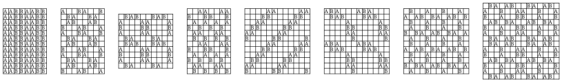</a>


<a href="../../../assets/volume4b/figures/satqa-a73c2.svg">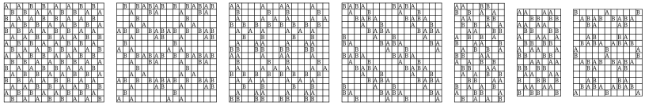</a>

注意, 其中若干图案暗含了无限的一维例子; 事实上, 把下图这样的对角线放在一起, 就能构造出棋盘格.

<a href="../../../assets/volume4b/figures/satqa-a73diag.svg"></a>

<a id="pdf-583"></a><a id="p-563"></a>

<a id="fig-7-2-2-2-a9"></a>**图 A–9.** 活动触发器: 给计算机高手的工作间铺地板的理想办法.

<a href="../../../assets/volume4b/figures/satqa-a73phoenix.svg">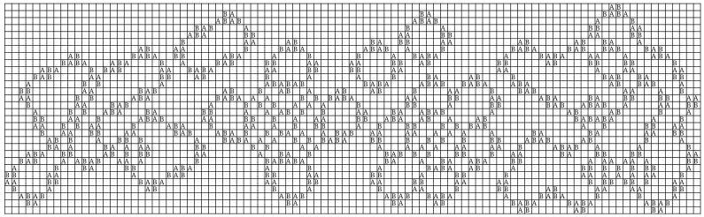</a>


<a id="ans-7-2-2-2-74"></a>

**74.** [题目](../sec-7-2-2-2.md#ex-7-2-2-2-74) 若一个 A 型细胞有不止一个 A 型邻居, 或一个 B 型细胞有不止一个 B 型邻居, 就称该细胞为<em>有瑕的</em>. 考虑含有瑕细胞的最上一行, 以及该行最左的有瑕细胞. 不失一般性, 假定它为 A, 它的邻居在所示图案中为 S、T、U、V、W、X、Y、Z. 八个邻居中恰有三个属 B 型, 至少四个属 A 型; 需要考虑以下几种情形.

<a href="../../../assets/volume4b/figures/satqa-a74.svg">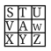</a>


<em>情形 1:</em> $\mathrm W=\mathrm X=\mathrm Y=\mathrm Z=\mathrm A$. 则必有 $\mathrm S=\mathrm U=\mathrm V=\mathrm B$, 且 $\mathrm T=0$ (空白), 因为 S、T、U、V 都没有瑕疵. V 的左边三个邻居都不能是 A 型, 因为 V 已经有三个 A 型邻居; 也都不能是 B 型, 因为 V 没有瑕疵. 所以有瑕的 X 在其下方的三个格中必有两个 B 型邻居, 不可能在那里又有两个以上的 A 型邻居.

<em>情形 2:</em> $\mathrm T=\mathrm A$ 或 $\mathrm V=\mathrm A$. 例如若 $\mathrm T=\mathrm A$, 则 $\mathrm X=\mathrm Y=\mathrm Z=\mathrm A$, 而且 V、W 都不能为 B 型.

<em>情形 3:</em> $\mathrm S\ne\mathrm A$, $\mathrm U=\mathrm A$. 那么 W 不能为 B 型, 且 S 必定有瑕.

<em>情形 4:</em> $\mathrm S=\mathrm A$, $\mathrm U\ne\mathrm A$. 那么在 W、X、Y、Z 中至少有一个是 B; 至少有三个是 A; 所以恰有三个 A. 这个 B 不能是 Y, 因为 Y 有四个 A 型邻居. 它也不能是 W 或 Z: 那将迫使 V 为空白, 从而 $\mathrm T=\mathrm U=\mathrm B$; 于是 $\mathrm W=\mathrm A$, $\mathrm Z=\mathrm B$. 因为 W 有瑕, 它右边的邻居中至少两个应当是 A, 与 $\mathrm Z=\mathrm B$ 矛盾.

所以在情形 4 中 $\mathrm X=\mathrm B$. T 与 V 中还有一个是 B, 另一个为空白; 不妨设 T 为空白. V 左边三个邻居不能是 A. 所以它们必须全为 B (使 S 左边的细胞有瑕) 或全为空白. 在后一种情形中, T 上方的邻居必须依次为 BBA, 因为 T 为空白. 但这会使 T 正上方的 B 有瑕. 若 V 为空白, 论证是对称的.

<em>情形 5:</em> $\mathrm S=\mathrm U=\mathrm A$. 则 $\mathrm W\ne\mathrm A$, 且 $\{\mathrm X,\mathrm Y,\mathrm Z\}$ 中至少有两个是 A. 取 $\mathrm Y=\mathrm Z=\mathrm A$ 会迫使 $\mathrm T=\mathrm V=\mathrm X=\mathrm B$ 且 W 为空白, 使 V 有瑕.

类似地, $\mathrm X=\mathrm Y=\mathrm A$ 迫使 $\mathrm T=\mathrm W=\mathrm Z=\mathrm B$ 且 V 为空白; 这一情形更为棘手. Y 下方的三个邻居必定依次为 AAB, 否则一个 B 会被四个 A 包围. 但这时 X 左边的邻居必须为 BBB; 从而 V 左边的邻居也是 BBB, 使其中间的细胞有瑕.

所以最后, 情形 5 蕴涵 $\mathrm X=\mathrm Z=\mathrm A$. T、V、W 或 Y 之中有一个为空白, 其余三个是 B. 空白不可能是 T, 因为 T 上方的三个邻居不能是 A. 也不可能是 W 或 Y, 因为 V 与 T 没有瑕疵. 因此 $\mathrm T=\mathrm W=\mathrm Y=\mathrm B$, V 为空白. S 左边的邻居不能是 A, 否则 S 有瑕. 所以 X 至少得有四个 A 型邻居, 但这不可能, 因为 Y 已有三个.

<a id="pdf-584"></a><a id="p-564"></a>

沿对角线相邻的 A 很少见. (实际上, 它们不可能出现在大小为 $15\times18$ 或 $16\times17$ 的矩形网格中.) 不过细心的读者能在[图 A–9](#fig-7-2-2-2-a9) 中找到它们, 此图展示了大网格中可能出现的种类繁多的不同图案.

<a id="ans-7-2-2-2-75"></a>

**75.** [题目](../sec-7-2-2-2.md#ex-7-2-2-2-75) 令时刻 $p-2,p-1,p$ 的活细胞依次为 X、Y、Z 型, 考虑曾有活细胞出现的最上一行. 不失一般性, 该行最左的活细胞为 Z 型. 这个 Z 正下方的细胞不可能为 Y 型, 因为那样的 Y 除去上方的 Z 和它左边的空白以外, 还会有三个 X 型邻居及四个 Y 型邻居.

因此图案一定如图所示, 这里已填上了 Z 与最上方的 Y 的三个前驱. 但是最上方的 X 的三个前驱已经没有位置可放了.

<a href="../../../assets/volume4b/figures/satqa-a75.svg"></a>


<a id="ans-7-2-2-2-76"></a>

**76.** [题目](../sec-7-2-2-2.md#ex-7-2-2-2-76) 已知最小的例子是 Jason Summers 于 2012 年找到的一个 $28\times33$ 图案. 这里用字母 $\{\mathrm F,\mathrm A,\mathrm B\}$、$\{\mathrm B,\mathrm C,\mathrm D\}$、$\{\mathrm D,\mathrm E,\mathrm F\}$ 依次表示 $t\bmod3=0,1,2$ 时存活的细胞.

<a href="../../../assets/volume4b/figures/satqa-a76large.svg">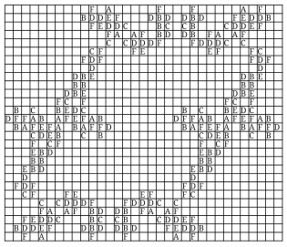</a>

他的巧妙构造特别给出了一个基于 $7\times24$ 环面的无限解. 此外还存在一个惊人的无限 $7\times7$ 环面图案, 关于这类图案, 其他方面所知甚少.

<a href="../../../assets/volume4b/figures/satqa-a76strip.svg">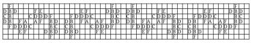</a>


<a href="../../../assets/volume4b/figures/satqa-a76small.svg">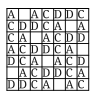</a>


<a id="ans-7-2-2-2-77"></a>

**77.** [题目](../sec-7-2-2-2.md#ex-7-2-2-2-77) 若 $X_0$ (以及 $X_5$) 第 4 行的最初四格含 $a,b,c,d$, 就需要 $a+b\ne1$, $a+b+c\ne1$, $b+c+d\ne2$. 写成子句就是 $\bar a\lor b$, $a\lor\bar b$, $b\lor\bar c$, $\bar c\lor d$, $\bar b\lor c\lor\bar d$.

类似地, 设第 5 列的最后四项为 $(f,g,h,i)$; 则需要 $f+g+h\ne2$, $g+h+i\ne2$, $h+i\ne2$. 这些条件简化为 $\bar f\lor\bar g$, $\bar f\lor\bar h$, $\bar g\lor\bar h$, $\bar g\lor\bar i$, $\bar h\lor\bar i$.

<a id="ans-7-2-2-2-78"></a>

**78.** [题目](../sec-7-2-2-2.md#ex-7-2-2-2-78) [图 A–10](#fig-7-2-2-2-a10) 中的 “$9^2$ 噬体” 是一个最小的例子.

<a id="ans-7-2-2-2-79"></a>

**79.** [题目](../sec-7-2-2-2.md#ex-7-2-2-2-79) (T. G. Rokicki 解.) 一场大战爆发, 各条战线都打得不可开交. 到时刻 1900 尘埃落定, 11 个滑翔机正在逃离现场 (1 个沿原来的东北方向, 3 个往西北, 5 个往西南, 2 个往东南), 留下了 16 个方块、1 个浴盆、2 个面包、3 艘小舟、4 艘舰船、8 个蜂巢、1 个池塘、15 个闪烁器和 1 只蟾蜍. (真该用一个合适的小程序亲眼看一看.)

<a id="ans-7-2-2-2-80"></a>

**80.** [题目](../sec-7-2-2-2.md#ex-7-2-2-2-80) 在 $10\times10$ 与 $11\times11$ 棋盘上, 取 $X_8=X_9$ 就找到了宝, 见[图 A–10](#fig-7-2-2-2-a10). 最小的例子 “symeater19” 有一个近亲 “symeater20”, 它仅由两块方块与两个运载器巧妙布置而成. (前者又称 “吞噬者 2”, 是 D. Buckingham 在 20 世纪 70 年代初发现的; 后者是 S. Silver 于 1998 年发现的.) 若把滑翔机从图中位置向右移一两格, 或向左移一格, 两者仍能把它吃掉.

必须注意, 滑翔机的对角轨迹<em>不</em>是穿过像素的顶点而把像素平分; 它的对称轴实际穿过像素边的<em>中点</em>, 从而切下小三角形, 面积为整个像素的 $1/8$. 因此, 任何关于对角线对称的吞噬者都能吞食两条相邻轨迹上的滑翔机. [图 A–10](#fig-7-2-2-2-a10) 中的两个例子特别之处在于它们能起四重作用. 此外, symeater20 还能从反方向吞食; 它的两个运载器都可以移到方块旁的另一位置.

<a id="ans-7-2-2-2-81"></a>

**81.** [题目](../sec-7-2-2-2.md#ex-7-2-2-2-81) 两个吞噬者组成 “ssymeater14” ([图 A–10](#fig-7-2-2-2-a10)), “ssymeater22” 则较窄.

<a id="ans-7-2-2-2-82"></a>

**82.** [题目](../sec-7-2-2-2.md#ex-7-2-2-2-82) (a) 若 $X\to X'$, 则只有在 $\sum_{i'=i-1}^{i+1}\sum_{j'=j-1}^{j+1}x_{i'j'}\ge3$ 时才有 $x'_{ij}=1$.

(b) 用同一不等式, 并对 $j$ 归纳.

<a id="pdf-585"></a><a id="p-565"></a>

<a id="fig-7-2-2-2-a10"></a>**图 A–10.** 吞食滑翔机与宇宙飞船的极小静物实例. 依次为 $9^2$ 噬体、symeater19、symeater20、ssymeater14、ssymeater22.

<a href="../../../assets/volume4b/figures/satqa-a78fig.svg"></a>


(c) (对提示的证明, John Conway, 1970.) 在以下转移中,

<a href="../../../assets/volume4b/figures/satqa-a82trans.svg">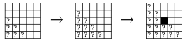</a>

$X'$ 的中心必为下图的第一种形态; 因而 $X$ 的左下部必为第二种形态. 但这样一来, $X'$ 的中心就是第三种形态.

<a href="../../../assets/volume4b/figures/satqa-a82blocks.svg"></a>


<a id="ans-7-2-2-2-83"></a>

**83.** [题目](../sec-7-2-2-2.md#ex-7-2-2-2-83) 考虑 $0\le t\le r=f(i_0,j_0)$ 时以细胞 $(i_0,j_0)$ 为中心的 $(2r+1-2t)\times(2r+1-2t)$ 网格 $x_{tij}$; 且假定只要 $f(i,j)>t$, 就有 $x_{tij}=0$. 例如若 $(i_0,j_0)=(1,2)$, 则只有 14 个 $x_{3ij}$ 能活, 即 $(i,j)=(-2\,..\,-1,2)$、$(-2\,..\,0,1)$、$(-2\,..\,1,0)$、$(-2\,..\,2,-1)$. 情形 $(i_0,j_0)=(1,2)$ 产生 1316 个变量上的 5031 个容易满足的子句, 其中包含单位子句 $x_{612}$, 这里按[答案 65](#ans-7-2-2-2-65) 编码状态转移; 这些变量中除了 106 个, 其余都是辅助变量.

<a id="ans-7-2-2-2-84"></a>

**84.** [题目](../sec-7-2-2-2.md#ex-7-2-2-2-84) (a) 使用一个放置得当的滑翔机, 使它的尖端在 $(0,0)$.

(b) 类似地, 宇宙飞船在尽可能短的时间内到达这些细胞.

(c) 考虑宽度为 $2n+1$ 的图案 $A_n$ 和 $B_n$, 这里依次画出 $n=3$ 的例子. 当 $j\bmod4\in\{1,2\}$ 时 $B_j$ 管用; 当 $j\bmod4\in\{2,3\}$ 时 $A_j$ 与 $B_{j-1}$ 管用; 当 $j\bmod4\in\{0,3\}$ 时 $A_{j-1}$ 管用.

<a href="../../../assets/volume4b/figures/satqa-a84ab.svg"></a>


(d) 所示图案在时刻 3 装配成一个合适的滑翔机.

<a href="../../../assets/volume4b/figures/satqa-a84d.svg"></a>


(e) SAT 求解器找到了所示图案, 它会发射一艘合适的宇宙飞船 (以及一些在 $t=5$ 时消失的施工碎片).

<a href="../../../assets/volume4b/figures/satqa-a84e.svg"></a>


[对于所有 $i,j$, 看来很可能都有 $f^*(i,j)=f(i,j)$. 不过目前最佳的一般性结果, 以 Tim Coe 的 “Max” 等填充空间的构造为依据, 是 $f^*(i,j)=f(i,j)+O(1)$. 甚至还不知道怎样证明例如对所有 $j\ge0$ 都有 $f^*(j,2j)=6j$ 这样一个特例. 不过最近有了重大突破: 截至 2024 年 2 月, Tomas Rokicki 已对 $i\le6$ 或 $j\le6$ 的全部细胞 $(i,j)$ 验证了等式.]

<a id="ans-7-2-2-2-85"></a>

**85.** [题目](../sec-7-2-2-2.md#ex-7-2-2-2-85) (a) 设 $X$ 为 $12\times12$ 位图. 我们要证明, [习题 65](../sec-7-2-2-2.md#ex-7-2-2-2-65) 的子句 $T(X,X')$ 加上由给定图案得到的 92 个一元子句 $x'_{23},\bar x'_{24},x'_{25},\ldots$ 后不可满足. (图案是对称的; 但生命游戏的规则常常由不对称状态产生对称状态.) 因此需要排除 $2^{144-8}$ 种不同的可能前驱状态. 幸好, 算法 C 只需不到 $100\,\mathrm M\mu$ 就能办到.

(b) 多数状态都有成千上万个前驱 (见下一题); 所以算法 C 几乎总能找到一个, 比如只需 $500\,\mathrm K\mu$. 因此, 可以通过迅速为 $2^{36}$ 个图案的每一个寻找前驱, 来证明例如不存在 $6\times6$ 的伊甸园. (利用对称性, 实际上只须试大约 $2^{36}/8$ 个图案.) 此外, 若按格雷码次序遍历图案, 每一步只改变一个假定为真的一元子句 $\pm x'_{ij}$ 的极性, 算法 C 的机制就会更快, 因为它倾向于为相近的问题找到相近的解. 因此每秒钟可以满足几千个图案, 这项任务是可行的.

<a id="pdf-586"></a><a id="p-566"></a>

但对于 $10\times10$ 的位图, 这种办法是行不通的, 因为 $2^{100}\gg2^{36}$. 不过我们<em>能够</em>找出所有具有 $90^\circ$ 旋转对称性的 $10\times10$ 伊甸园, 仍然使用格雷码次序, 只须试大约 $2^{25}/2$ 个图案. 啊哈: 有八个这样的图案没有前驱, 其中四个对应于所给的孤儿.

[见 C. Hartman、M. J. H. Heule、K. Kwekkeboom 和 A. Noels, <em>Electronic J. Combinatorics</em> **20**,3 (2013), #P16, 1–19. 最早以非构造的方式证明许多种元胞自动机中伊甸园存在的是 E. F. Moore, <em>Proc. Symp. Applied Math.</em> **14** (1962), 17–33.]

<a id="ans-7-2-2-2-86"></a>

**86.** [题目](../sec-7-2-2-2.md#ex-7-2-2-2-86) 内部 $8\times8$ 之外的 80 个细胞有 $N=11984516506952898$ 种选法. (一个大小为 53464 的 BDD 证明了这个结果.) 所以答案是 $N/2^{100-64}\approx174398$.

<a id="ans-7-2-2-2-87"></a>

**87.** [题目](../sec-7-2-2-2.md#ex-7-2-2-2-87) 不用下标 $t$ 与 $t+1$, 可以把 $X\to X'$ 的转移子句写成 $(\mathord{@}\lor\overline{\mathrm{A0}}\lor\mathrm{A0}')$ 等形式. 设 Alice 的状态为 $\{\alpha_1,\ldots,\alpha_p\}$, Bob 的为 $\{\beta_1,\ldots,\beta_q\}$. 子句 $(\mathord{@}\lor\bar\alpha_i\lor\alpha'_i)$ 与 $(\overline{\mathord{@}}\lor\bar\beta_i\lor\beta'_i)$ 表示, 除非轮到你被推动, 否则你的状态不变. 若状态 $\alpha$ 对应指令 ‘也许转到 $s$’, 则子句 $(\overline{\mathord{@}}\lor\bar\alpha\lor\alpha'\lor s')$ 给出了受推动后的可能状态. 对于 ‘临界, 转到 $s$’ 或 ‘置 $v\gets b$, 转到 $s$’, 相应的子句仅为 $(\overline{\mathord{@}}\lor\bar\alpha\lor s')$; 且后一条指令在 $b=1$ 时还生成子句 $(\overline{\mathord{@}}\lor\bar\alpha\lor v')$, 在 $b=0$ 时生成 $(\overline{\mathord{@}}\lor\bar\alpha\lor\bar v')$. 指令 ‘若 $v$ 则转到 $s_1$, 否则转到 $s_0$’ 生成 $(\overline{\mathord{@}}\lor\bar\alpha\lor\bar v\lor s'_1)\land(\overline{\mathord{@}}\lor\bar\alpha\lor v\lor s'_0)$. 而对每个变量 $v$, 若设置 $v$ 的指令所在的状态是 $\alpha_{i_1},\ldots,\alpha_{i_h}$, 则子句
$$
(\overline{\mathord{@}}\lor v\lor\alpha_{i_1}\lor\cdots\lor\alpha_{i_h}\lor\bar v')
\land(\overline{\mathord{@}}\lor\bar v\lor\alpha_{i_1}\lor\cdots\lor\alpha_{i_h}\lor v')
$$
编码了其他指令不改变 $v$ 这个事实.

Bob 的程序生成类似的子句——但要用 $\mathord{@}$ 代替 $\overline{\mathord{@}}$, 用 $\beta$ 代替 $\alpha$.

顺便说, 考虑 (40) 以外的其他协议时, 与 (41) 相似的初始状态 $X_0$ 可由以下方式构造: 将 Alice 和 Bob 都放在各自最小的可能状态, 并将所有共享变量置为 0.

<a id="ans-7-2-2-2-88"></a>

**88.** [题目](../sec-7-2-2-2.md#ex-7-2-2-2-88) 例如, 可以令除下列变量外的一切变量为假:
$$
\begin{gathered}
\mathrm{A0}_0,\mathrm{B0}_0,\mathord{@}_0,\quad
\mathrm{A1}_1,\mathrm{B0}_1,\quad \mathrm{A1}_2,\mathrm{B1}_2,\quad
\mathrm{A1}_3,\mathrm{B2}_3,\mathord{@}_3,\\
\mathrm{A2}_4,\mathrm{B2}_4,\mathord{@}_4,\quad
\mathrm{A3}_5,\mathrm{B2}_5,l_5,\quad\mathrm{A3}_6,\mathrm{B3}_6,l_6.
\end{gathered}
$$

<a id="ans-7-2-2-2-89"></a>

**89.** [题目](../sec-7-2-2-2.md#ex-7-2-2-2-89) 不正确; 同上一题一样, 可以找到相应子句的一个反例:
$$
\begin{gathered}
\mathrm{A0}_0,\mathrm{B0}_0,\quad\mathrm{A0}_1,\mathrm{B1}_1,\quad
\mathrm{A0}_2,\mathrm{B2}_2,b_2,\mathord{@}_2,\quad
\mathrm{A1}_3,\mathrm{B2}_3,b_3,\quad\mathrm{A1}_4,\mathrm{B3}_4,b_4,\\
\mathrm{A1}_5,\mathrm{B4}_5,b_5,\mathord{@}_5,\quad
\mathrm{A2}_6,\mathrm{B4}_6,a_6,b_6,\mathord{@}_6,\quad
\mathrm{A5}_7,\mathrm{B4}_7,a_7,b_7,\\
\mathrm{A5}_8,\mathrm{B2}_8,a_8,b_8,l_8,\quad
\mathrm{A5}_9,\mathrm{B5}_9,a_9,b_9,l_9.
\end{gathered}
$$

(这个协议是作者初次接触互斥这个引人入胜的问题时所见的例子 [见 <em>CACM</em> **9** (1966), 321–322, 878]; Dijkstra 曾就此说, “已经有相当多的试探性解法被证明不正确.”)

<a id="ans-7-2-2-2-90"></a>

**90.** [题目](../sec-7-2-2-2.md#ex-7-2-2-2-90) 在 (43) 中, 若 Alice 移至 A1, 此后每当推动 Bob 他都留在 B0, 那么在 (47) 中 $p=1$, $r=3$ 时 Alice 就会饥饿. 正文对 (45) 提到的 $\mathrm{A2}\land\mathrm{B2}$ 死锁, 对应于 (47) 的 $p=4$, $r=6$. 而在 (46) 中, 依次移至 $\mathrm{B1},(\mathrm{B2,A1,A2,B3,B1,A4,A5,A0})^\infty$ 会让可怜的 Bob 饥饿.

<a id="ans-7-2-2-2-91"></a>

**91.** [题目](../sec-7-2-2-2.md#ex-7-2-2-2-91) 若圈 (47) 不含 Alice 的 “也许” 或 “临界” 状态, 当然能使她饥饿. 反过来, 给定 (i)、(ii)、(iii), 设当 $t\ge t_0$ 时 Alice 不处在任何 “也许” 或 “临界” 状态; 并取 $t_0<t_1<t_2<\cdots$, 在这些时刻 $\mathord{@}_{t_i}=1$, 而 $t_i$ 与 $t_{i+1}$ 之间至少存在一个 $t$ 使 $\mathord{@}_t=0$. 则对某些 $i<j$ 必有 $X_{t_i}=X_{t_j}$, 因为状态数是有限的. 因此存在一个 $p=t_i$, $r=t_j$ 的饥饿圈.

<a id="ans-7-2-2-2-92"></a>

**92.** [题目](../sec-7-2-2-2.md#ex-7-2-2-2-92) 对 $0\le i<j\le r$, 需要编码条件 $X_i\ne X_j$ 的子句. 对 Alice 或 Bob 的每个状态 $\sigma$ 引入新变量 $\sigma_{ij}$, 对每个共享变量 $v$ 引入 $v_{ij}$. 断言这些新变量至少有一个为真. (对于协议 (40), 这个子句<a id="pdf-587"></a><a id="p-567"></a>就是 $(\mathrm{A0}_{ij}\lor\cdots\lor\mathrm{A4}_{ij}\lor\mathrm{B0}_{ij}\lor\cdots\lor\mathrm{B4}_{ij}\lor l_{ij})$.) 还要对每个 $\sigma$ 断言二元子句 $(\bar\sigma_{ij}\lor\sigma_i)\land(\bar\sigma_{ij}\lor\bar\sigma_j)$, 对每个 $v$ 断言三元子句 $(\bar v_{ij}\lor v_i\lor v_j)\land(\bar v_{ij}\lor\bar v_i\lor\bar v_j)$.

转移子句也可以简化, 因为无须允许 $X_{t+1}=X_t$ 的情形. 因此, 例如, 可以从 (42) 的子句 $(\mathord{@}_t\lor\overline{\mathrm{B0}_t}\lor\mathrm{B0}_{t+1}\lor\mathrm{B1}_{t+1})$ 中略去 $\mathrm{B0}_{t+1}$; 而且可以把子句 $(\mathord{@}_t\lor\overline{\mathrm{B1}_t}\lor\bar l_t\lor\mathrm{B1}_{t+1})$ 整个略去.

[若 $r$ 很大, 可以借助排序网络得到仅用 $O(r(\log r)^2)$ 个子句的编码, 如 D. Kroening 和 O. Strichman 所建议, <em>LNCS</em> **2575** (2003), 298–309. 不过最实用的方案似乎是按需要逐一添加 $ij$ 约束; 见 N. Eén 与 N. Sörensson, <em>Electronic Notes in Theoretical Computer Science</em> **89** (2003), 543–560.]

<a id="ans-7-2-2-2-93"></a>

**93.** [题目](../sec-7-2-2-2.md#ex-7-2-2-2-93) 例如, 对于 (50) 中的 $\Phi$, 可以使用
$$
\begin{aligned}
&(x_1\lor x_2\lor\cdots\lor x_{16})\land(\bar x_1\lor\overline{\mathrm{A0}'})\land\cdots\land(\bar x_1\lor\overline{\mathrm{A6}'})\\
&{}\land(\bar x_2\lor\overline{\mathrm{B0}'})\land\cdots\land(\bar x_2\lor\overline{\mathrm{B6}'})
\land(\bar x_3\lor\mathrm{A0}')\land(\bar x_3\lor a')\land\cdots\land(\bar x_{16}\lor\mathrm{B6}')\land(\bar x_{16}\lor\bar b').
\end{aligned}
$$

<a id="ans-7-2-2-2-94"></a>

**94.** [题目](../sec-7-2-2-2.md#ex-7-2-2-2-94) $(X\to X'\to\cdots\to X^{(r)})\land\Phi(X)\land\Phi(X')\land\cdots\land\Phi(X^{(r-1)})\land\neg\Phi(X^{(r)})$. [这个重要的技术称为 “$k$ 归纳”; 见 Mary Sheeran、Satnam Singh 和 Gunnar Stålmarck, <em>LNCS</em> **1954** (2000), 108–125. 例如可以向 (50) 中添加子句 $(\overline{\mathrm{A5}}\lor\overline{\mathrm{B5}})$, 再用 3 归纳证明所得的公式 $\Phi$ 是不变式.]

<a id="ans-7-2-2-2-95"></a>

**95.** [题目](../sec-7-2-2-2.md#ex-7-2-2-2-95) 由不变式可知, 临界步骤均有 $a=b=1$, 因此它们没有前驱.

<a id="ans-7-2-2-2-96"></a>

**96.** [题目](../sec-7-2-2-2.md#ex-7-2-2-2-96) $\mathrm{A5}_2\land\mathrm{B5}_2\land a_2\land b_2\land\bar l_2$ 的唯一前驱为 $\mathrm{A5}_1\land\mathrm{B4}_1\land a_1\land b_1\land\bar l_1$; 而<em>它</em>的唯一前驱又是 $\mathrm{A5}_0\land\mathrm{B3}_0\land a_0\land b_0\land\bar l_0$. 情形 $l_2$ 与此类似.

但若没有不变式, 就可以找出任意长的路径通往 $\mathrm{A5}_r\land\mathrm{B5}_r$. 事实上, 最长的<em>简单</em>路径有 $r=33$: 从 $\mathrm{A2}_0\land\mathrm{B2}_0\land\bar a_0\land\bar b_0\land l_0$ 开始, 可以依次推动 Alice 和 Bob 至状态

$$
\begin{gathered}
\mathrm{A3,A5,A6,A0,A1,A2,A3,B3,B4,A5,B3,A6,B4,A0,B3,A1,A2,}\\
\mathrm{A3,A5,A6,A0,A1,A2,B4,A3,A5,A6,A0,B5,A1,A2,A3,A5}.
\end{gathered}
$$

不重复任何先前的状态. (当然, 这些状态从真正的 $X_0$ 都不可达, 因为它们都不满足 $\Phi$.)

<a id="ans-7-2-2-2-97"></a>

**97.** [题目](../sec-7-2-2-2.md#ex-7-2-2-2-97) 不能. 从一条通往 $\mathrm{A6}\land\mathrm{B6}$ 的路径中删掉两人各自的最后一步, 就得到一条通往 $\mathrm{A5}\land\mathrm{B5}$ 的路径.

<a id="ans-7-2-2-2-98"></a>

**98.** [题目](../sec-7-2-2-2.md#ex-7-2-2-2-98) (a) 设 $X_0\to\cdots\to X_r=X_0$ 非纯, 且对某些 $0\le i<j<r$ 有 $X_i=X_j$. 不妨设 $i=0$. 若 $X_0\to\cdots\to X_j=X_0$ 与 $X_j\to\cdots\to X_r=X_j$ 两个圈之一非纯, 它就更短.

(b) 在那些状态中, 她在此前必定处于 A0 或 A5.

(c) 构造子句 $(\bar g_0)$, $(\bar g_t\lor g_{t-1}\lor\mathord{@}_{t-1})$, $(\bar h_0)$, $(\bar h_t\lor h_{t-1}\lor\overline{\mathord{@}_{t-1}})$, $(\bar f_t\lor g_t)$, $(\bar f_t\lor h_t)$, $(\bar f_t\lor\alpha_0\lor\bar\alpha_t)$, $(\bar f_t\lor\bar\alpha_0\lor\alpha_t)$, $(\bar f_t\lor v_0\lor\bar v_t)$, $(\bar f_t\lor\bar v_0\lor v_t)$, 其中 $1\le t\le r$; 再加 $(f_1\lor f_2\lor\cdots\lor f_r)$. 这里 $v$ 遍历所有共享变量, $\alpha$ 遍历所有能够在饥饿圈中出现的状态. (例如, 对于协议 (49), Alice 的状态将限于 A3 与 A4, Bob 则不受限制.)

(d) 可以用[习题 92](../sec-7-2-2-2.md#ex-7-2-2-2-92) 确定, 对于 (49), 仅用能够在饥饿圈中出现的状态, 最长的简单路径长度为 15. 而当 $r=15$ 且使用不变式 (50) 时, (c) 的子句不可满足. 因此, 唯一可能的饥饿圈由两个简单纯圈组成; 而它们很容易排除.

<a id="ans-7-2-2-2-99"></a>

**99.** [题目](../sec-7-2-2-2.md#ex-7-2-2-2-99) 不变断言确定了每一状态下 $a,b$ 的值. 因而如[习题 95](../sec-7-2-2-2.md#ex-7-2-2-2-95) 一样推出互斥. 对于无饥饿性, 可以从任何使 Alice 饥饿的圈中排除状态 A0、A6、A7、A8. 但还需证明状态 $\mathrm{A5}_t\land\mathrm{B0}_t\land l_t$ 不可能; 否则 Bob 留在 “也许” 状态时, 她就可能饥饿. 为此可在不变式 $\Phi(X)$ 中添加 $\neg((\mathrm{A6}\lor\mathrm{A7}\lor\mathrm{A8})\land(\mathrm{B6}\lor\mathrm{B7}\lor\mathrm{B8}))\land\neg(\mathrm{A8}\land\bar l)\land\neg(\mathrm{B8}\land l)\land\neg((\mathrm{A3}\lor\mathrm{A4}\lor\mathrm{A5})\land\mathrm{B0}\land l)\land\neg(\mathrm{A0}\land(\mathrm{B3}\lor\mathrm{B4}\lor\mathrm{B5})\land\bar l)$. 在允许的状态中, 最长简单路径的长度为 42; 而当 $r=42$ 时, 习题<a id="pdf-588"></a><a id="p-568"></a>98(c) 的子句不可满足. 注意 Alice 和 Bob 在设置公共变量 $l$ 时永远互不竞争, 因为状态 A7 与 B7 不可能同时出现.

(见正文所引 Dijkstra 的《协作顺序进程》.)

<a id="ans-7-2-2-2-100"></a>

**100.** [题目](../sec-7-2-2-2.md#ex-7-2-2-2-100) 走法 $\mathrm{B1},(\mathrm{A1,A2,A3,B2,A4,B3,A0,B4,B1})^\infty$ 使 Bob 饥饿. 但是, 用与上一题答案相似的论证可知 Alice 不会饥饿.

[与[习题 95](../sec-7-2-2-2.md#ex-7-2-2-2-95) 一样, 这个协议显然保证互斥. 20 世纪 70 年代后期, J. E. Burns 与 L. Lamport 独立设计出它, 作为只用 $N$ 个共享位的 $N$ 方协议的特例; 见 <em>JACM</em> **33** (1986), 337–339.]

<a id="ans-7-2-2-2-101"></a>

**101.** [题目](../sec-7-2-2-2.md#ex-7-2-2-2-101) 以下解法基于 G. L. Peterson 为 $N$ 个进程所设计的优美协议, 见 <em>ACM Transactions on Programming Languages and Systems</em> **5** (1983), 56–65:

```text
A0. 也许转到 A1.                     B0. 也许转到 B1.
A1. 置 a₁ ← 1, 转到 A2.              B1. 置 b₁ ← 1, 转到 B2.
A2. 若 b₂ 则转到 A2, 否则转到 A3.    B2. 若 a₁ 则转到 B2, 否则转到 B3.
A3. 置 a₂ ← 1, 转到 A4.              B3. 置 b₂ ← 1, 转到 B4.
A4. 置 a₁ ← 0, 转到 A5.              B4. 置 b₁ ← 0, 转到 B5.
A5. 若 b₁ 则转到 A5, 否则转到 A6.    B5. 若 a₂ 则转到 B5, 否则转到 B6.
A6. 置 a₁ ← 1, 转到 A7.              B6. 置 b₁ ← 1, 转到 B7.
A7. 若 b₁ 则转到 A8, 否则转到 A9.    B7. 若 a₁ 则转到 B8, 否则转到 B12.
A8. 若 b₂ 则转到 A7, 否则转到 A9.    B8. 若 a₂ 则转到 B9, 否则转到 B12.
A9. 临界, 转到 A10.                  B9. 置 b₁ ← 0, 转到 B10.
A10. 置 a₁ ← 0, 转到 A11.            B10. 若 a₁ 则转到 B11, 否则转到 B6.
A11. 置 a₂ ← 0, 转到 A0.             B11. 若 a₂ 则转到 B10, 否则转到 B6.
                                     B12. 临界, 转到 B13.
                                     B13. 置 b₁ ← 0, 转到 B14.
                                     B14. 置 b₂ ← 0, 转到 B0.
```

(Alice 和 Bob 也许得用个应用程序帮忙, 才能应付这些指令.)

<a id="ans-7-2-2-2-102"></a>

**102.** [题目](../sec-7-2-2-2.md#ex-7-2-2-2-102) 例如, 对于 ‘B5. 若 $a$ 则转到 B6, 否则转到 B7.’, 子句应为 $(\mathord{@}\lor\overline{\mathrm{B5}}\lor\bar a\lor\alpha_1\lor\cdots\lor\alpha_p\lor\mathrm{B6}')\land(\mathord{@}\lor\overline{\mathrm{B5}}\lor a\lor\alpha_1\lor\cdots\lor\alpha_p\lor\mathrm{B7}')\land(\mathord{@}\lor\overline{\mathrm{B5}}\lor\mathrm{B6}'\lor\mathrm{B7}')$, 其中 $\alpha_1,\ldots,\alpha_p$ 是 Alice 设置 $a$ 的各个状态.

<a id="ans-7-2-2-2-103"></a>

**103.** [题目](../sec-7-2-2-2.md#ex-7-2-2-2-103) 例如, 看一看 <em>SICOMP</em> 的任何一期封面, 或 1970 年以来 <em>SIAM Review</em> 的任何一期封面.

<a id="ans-7-2-2-2-104"></a>

**104.** [题目](../sec-7-2-2-2.md#ex-7-2-2-2-104) 设 $m\le n$. 情形 $m=n$ 显然不可能, 因为四角都必须被占据. 当 $m$ 为奇数且 $n=m+k+1$ 时, 在首、末两列中放 $m$ 个象, 然后在中间一行的中间各列中放 $k$ 个. 当 $m$ 为偶数且 $n=m+2k+1$ 时, 在首、末两列中放 $m$ 个, 再在列 $m/2+2j$ 的中间两行上各放一个, $1\le j\le k$. 当 $m,n$ 都为偶数时无解, 因为每种颜色的独立象的最大数目为 $(m+n-2)/2$. [R. Berghammer, <em>LNCS</em> **6663** (2011), 103–106.]

<a id="ans-7-2-2-2-105"></a>

**105.** [题目](../sec-7-2-2-2.md#ex-7-2-2-2-105) (a) 对 $t$ 个下标对 $ij$, 必有 $(x_{ij},x'_{ij})=(1,0)$; 对另外 $t$ 个则为 $(0,1)$; 其余均有 $x_{ij}=x'_{ij}$. 因此有 $2^{mn-2t}$ 个解.

(b) 用 $2mn$ 个变量 $y_{ij},y'_{ij}$, $1\le i\le m$, $1\le j\le n$, 以及二元子句 $(\bar y_{ij}\lor\overline{y'_{ij}})$; 再用 $m+n+2(m+n-1)$ 组类似于 (20)、(21) 的基数约束, 对每一行、每一列、每一条对角线 $L$ 强制平衡条件 $\sum\{y_{ij}+\overline{y'_{ij}}\mid ij\in L\}=|L|$.

(c) 当 $\min(m,n)<4$ 时, $T(m,n)=1$, 因为这时只有零矩阵合乎要求. 其他值若足够小, 可以通过回溯枚举. (渐近行为尚不知道.)

<table id="sat-tomographic-counts"><thead><tr><th>$n=$</th><th>4</th><th>5</th><th>6</th><th>7</th><th>8</th></tr></thead><tbody>
<tr><td>$T(4,n)=$</td><td>3</td><td>7</td><td>17</td><td>35</td><td>77</td></tr>
<tr><td>$T(5,n)=$</td><td>7</td><td>31</td><td>109</td><td>365</td><td>1367</td></tr>
<tr><td>$T(6,n)=$</td><td>17</td><td>109</td><td>877</td><td>6315</td><td>47607</td></tr>
<tr><td>$T(7,n)=$</td><td>35</td><td>365</td><td>6315</td><td>107637</td><td>1703883</td></tr>
<tr><td>$T(8,n)=$</td><td>77</td><td>1367</td><td>47607</td><td>1703883</td><td>66291089</td></tr>
</tbody></table>


(d) 设 $m\le n$. 对首行和首列都非零的任何解, 所有项都为零, 只有下列各项例外:

<a id="pdf-589"></a><a id="p-569"></a>

$$
y_{1t}=-y_{t1}=y_{(k+1-t)1}=
-y_{kt}=y_{k(k+1-t)}=-y_{(k+1-t)k}=y_{tk}=-y_{1(k+1-t)},
$$
其中 $t,k$ 满足 $1<t\le k/2\le m/2$. 因此答案为 $2\sum_{k=4}^m\lfloor k/2-1\rfloor(m+1-k)(n+1-k)$; 令 $q=\lfloor m/2\rfloor$, 即简化为 $q(q-1)\bigl(4q(n-q)-5n+2q+3+(m\bmod2)(6n-8q-5)\bigr)/3$.

[若 $(m,n)=(25,30)$, 则答案是 36080; 因此随机 $25\times30$ 图像平均有 $36080/256\approx140.9$ 个层析等价的 “邻居”, 它们恰在八个像素位置上与原图不同. [图 79](../sec-7-2-2-2.md#fig-7-2-2-2-79) 有五个这样的邻居, 其中一个见下面的答案 111.]

(e) 可以使主对角线以外的各项全都非零 (见下图). 这是最优的, 因为对应于 $a_1,a_3,\ldots,a_{4n-1},b_1,b_3,\ldots,b_{4n-1}$ 的对角线必须各含一个不同的零. 因此答案是 $2n(n-1)$. (然而奇数大小的棋盘上的最大值尚不知道; 对于 $m=n=(5,7,9)$, 其值为 $(6,18,33)$.)

```text
0 + + + − − − 0     0 + + + 0 − − − 0
− 0 + + − − 0 +     − − − − + + + 0 +     0 + + − − 0 0     0 + + − − 0 0
− − 0 + − 0 + +     0 − + − + − − + +     − − + + 0 0 0     − − + + 0 0 0
− − − 0 0 + + +     + + − + + 0 − − −     0 + − − 0 0 +     0 + − 0 − 0 +
+ + + 0 0 − − −     − + − + − − 0 + +     − 0 0 + 0 − +     − 0 − + 0 0 +
+ + 0 − + 0 − −     + 0 − 0 + 0 + − −     + 0 − 0 + 0 −     + 0 0 0 + − −
+ 0 − − + + 0 −     − − + − − + + + 0     + 0 + 0 − 0 −     + 0 + − 0 0 −
0 − − − + + + 0     + + + + − 0 − − −     0 − − 0 + + 0     0 − − 0 + + 0
                    0 − 0 − − + + + 0
```


(f) 最小的反例为 $7\times7$ (见上图).

<a id="ans-7-2-2-2-106"></a>

**106.** [题目](../sec-7-2-2-2.md#ex-7-2-2-2-106) 在一个 $m\times n$ 的问题中, 必须有 $0\le r_i\le n$, $0\le c_j\le m$, $0\le a_d,b_d\le\min\{d,m,n,m+n-d\}$. 所以若 $m\le n$, 可能情形的总数 $B$ 为 $(n+1)^m(m+1)^n\bigl((m+1)!(m+1)^{n-m}m!\bigr)^2$; 若 $(m,n)=(25,30)$, 其值约为 $3\cdot10^{197}$. 由于 $2^{750}/B\approx2\cdot10^{28}$, 可知一个 “随机” 的 $25\times30$ 数字层析问题通常有 $10^{28}$ 个以上的解. (当然还有其他约束; 例如, $\sum r_i=\sum c_j=\sum a_d=\sum b_d$ 这个事实至少使 $B$ 缩小 $(n+1)(m+1)^2$ 倍.)

<a id="ans-7-2-2-2-107"></a>

**107.** [题目](../sec-7-2-2-2.md#ex-7-2-2-2-107) (a) $(r_1,\ldots,r_6)=(11,11,11,9,9,10)$; $(c_1,\ldots,c_{13})=(6,5,6,2,4,4,6,5,4,2,6,5,6)$; $(a_1,\ldots,a_6)=(11,10,9,9,11,11)$; $(b_1,\ldots,b_{12})=(6,1,6,5,7,5,6,2,6,5,7,5)$.

(b) 还有两个, 即下面的图案及其左右反转:

<a href="../../../assets/volume4b/figures/satqa-a107.svg"></a>

[参考文献: P. Gerdes, <em>Sipatsi</em> (Maputo: U. Pedagógica, 2009), 第 62 页, 图案 122.]

<a id="ans-7-2-2-2-108"></a>

**108.** [题目](../sec-7-2-2-2.md#ex-7-2-2-2-108) 许多种可能性中的四种如下:

<a href="../../../assets/volume4b/figures/satqa-a108.svg"></a>


<a id="ans-7-2-2-2-109"></a>

**109.** [题目](../sec-7-2-2-2.md#ex-7-2-2-2-109) **F1.** [初始化.] 找出一个解 $y_1\ldots y_n$, 若问题不可满足则终止. 然后置 $y_{n+1}\gets1$, $d\gets0$.

**F2.** [推进 $d$.] 置 $d$ 为满足 $y_j=1$ 的最小下标 $j>d$.

**F3.** [结束?] 若 $d>n$, 终止, 答案为 $y_1\ldots y_n$.

**F4.** [试求更小的解.] 添加单位子句, 对 $1\le j<d$ 强制 $x_j=y_j$, 并强制 $x_d=0$, 然后尝试求解. 若成功, 置 $y_1\ldots y_n\gets x_1\ldots x_n$. 返回 F2.　■

更好的办法是把类似的过程纳入求解器本身; 见习题 275.

<a id="pdf-590"></a><a id="p-570"></a>

<a id="ans-7-2-2-2-110"></a>

**110.** [题目](../sec-7-2-2-2.md#ex-7-2-2-2-110) 实际上, 算法 B 可以直接给出这两个解:

```text
001111111011101111100101111101111011111110111011011111111100101111101111011111100111011111110111
111111111011111111001100111111001111011111111010111111110111101111111001100111110110111101111111
```


<a id="ans-7-2-2-2-111"></a>

**111.** [题目](../sec-7-2-2-2.md#ex-7-2-2-2-111) 这类问题看来提供了一系列很好的 (虽然有时颇为可怕的) SAT 求解器基准测试. 题目中建议尝试的例子有以下的解:

<a href="../../../assets/volume4b/figures/satqa-a111top.svg"></a>

(a) 反字典序首个; (b) 差异最小; (c) 反字典序末个.

(a) 中有些项可一点也不容易确定. 若按照从中心向外盘旋的车步路径取字典序 (从而偏向中部大多为 0 或大多为 1 的解), 则得到一个更困难的情形:

<a href="../../../assets/volume4b/figures/satqa-a111bottom.svg"></a>

(a) 盘旋的车步路径; (b) “螺旋序” 首个; (c) “螺旋序” 末个.

截至 2013 年, 其中许多项从来没有 SAT 求解器确定过, 虽然整数规划求解器仍然毫不费力. 事实上, E. Balas、M. Fischetti 与 A. Zanette 的 “字典序纯割平面” 方法 [<em>Math. Programming</em> **A130** (2011), 153–176; **A135** (2012), 509–514] 在这类问题上格外有效.

<a id="ans-7-2-2-2-112"></a>

**112.** [题目](../sec-7-2-2-2.md#ex-7-2-2-2-112) 相当紧的上界与下界也会很有意思.

<a id="ans-7-2-2-2-113"></a>

**113.** [题目](../sec-7-2-2-2.md#ex-7-2-2-2-113) 给定一个 $N\times N\times N$ 的列联问题, 其中有二进制约束 $C_{JK}=X_{*JK}$, $R_{IK}=X_{I*K}$, $P_{IJ}=X_{IJ*}$, 可如下构造一个等价的 $n\times n$ 数字层析问题, 其中 $n=N^2+N^3+N^4$: 先构造四维张量 $Y_{IJKL}=X_{(I\oplus L)JK}$, 其中 $I\oplus L=1+(I+L-1)\bmod N$, 并注意到 $Y_{*JKL}=Y_{IJK*}=X_{*JK}$, $Y_{I*KL}=X_{(I\oplus L)*K}$, $Y_{IJ*L}=X_{(I\oplus L)J*}$. 然后对于 $1\le i,j\le n$, 若 $i=I-N^2K+N^3L$, $j=NJ+N^2K+N^3L$, 令 $x_{ij}=Y_{IJKL}$; 否则 $x_{ij}=0$. 这条规则是明确的; 因为若 $1\le I,I',J,J',K,K',L,L'\le N$, 且 $I-N^2K+N^3L=I'-N^2K'+N^3L'$, $NJ+N^2K+N^3L=NJ'+N^2K'+N^3L'$, 则 $I\equiv I'\pmod N$; 从而 $I=I'$ 且 $K\equiv K'$; 因而 $K=K'$, $L=L'$, $J=J'$.

在此对应下, 边缘和为: 当 $i=I-N^2K+N^3L$ 时 $r_i=Y_{I*KL}$; 当 $j=NJ+N^2K+N^3L$ 时 $c_j=Y_{*JKL}$; 当 $d+1=I+NJ+2N^3L$ 时 $a_d=Y_{IJ*L}$; 当 $d-n=I-NJ-2N^2K$ 时 $b_d=Y_{IJK*}$; 其余为零. [见 S. Brunetti、A. Del Lungo、P. Gritzmann 和 S. de Vries, <em>Theoretical Comp. Sci.</em> **406** (2008), 63–71.]

<a id="pdf-591"></a><a id="p-571"></a>

<a id="ans-7-2-2-2-114"></a>

**114.** [题目](../sec-7-2-2-2.md#ex-7-2-2-2-114) (a) 由 $x_{7,23}+x_{7,24}=x_{7,23}+x_{7,24}+x_{7,25}=x_{7,24}+x_{7,25}=1$, 可推出 $x_{7,23}=x_{7,25}=0$ 且 $x_{7,24}=1$, 从而揭示 $n_{7,23}=n_{7,25}=5$. 现在 $x_{6,23}+x_{6,24}=x_{6,24}+x_{6,25}=x_{4,24}+x_{5,24}+x_{6,24}+x_{6,25}=1$; 因此 $x_{4,24}=x_{5,24}=0$, 揭示出 $n_{4,24}=n_{5,24}=2$. 所以 $x_{6,23}=x_{6,25}=0$, 其余就容易了.

(b) 令 $y_{i,j}$ 表示 “格 $(i,j)$ 已经安全地探查过, 揭示了 $n_{i,j}$”. 考虑如下得到的子句 $C$: 对所有 $x_{i,j}=0$ 的 $i,j$, 在对称函数 $\bigl[\sum_{i'=i-1}^{i+1}\sum_{j'=j-1}^{j+1}x_{i',j'}=n_{i,j}\bigr]$ 的每个子句后面附加 $\bar y_{i,j}$. 还要包括 $(\bar x_{i,j}\lor\bar y_{i,j})$; 若已告知雷的总数 $N$, 也应加入对称函数 $S_N(x)$ 的子句.

给定无雷格的任意子集 $F$, 子句 $C_F=C\land\bigwedge\{y_{i,j}\mid(i,j)\in F\}$ 恰好可由那些与数据 $\{n_{i,j}\mid(i,j)\in F\}$ 一致的地雷构形满足. 因此, 格 $(i,j)$ 安全当且仅当 $C_F\land x_{i,j}$ 不可满足.

只须简单地修改算法 C, 就能使 $F$ “生长”, 直到再也不能添加安全格: 给定 $C_F$ 的一个解, 若在根层 (第 0 层) 既未得到 $x_{i,j}$ 也未得到 $\bar x_{i,j}$, 就可在第 1 层以相反的取值作决策, 尝试找一个 “翻转” 解. 当且仅当翻转值相容时能找到这样的解; 否则, 未翻转的值将被强制在第 0 层. 通过改变默认极性可以偏向那些一次翻转许多变量的解. 每当在根层新推出一个字面值 $\bar x_{i,j}$ 时, 就能强制 $y_{i,j}$ 为真, 由此将 $(i,j)$ 加入 $F$. 如果得到的 $C_F$ 的一组解已经覆盖了每个未被强制的 $x_{i,j}$ 的两种取值, 便到了僵局.

情形 (i) 从 $F=\{(1,1)\}$ 开始, 其余类推. 仅给定情形 (iv) 只能揭开右下角的 56 个格子. 其他结果如下所示, 求出每个结果均用不到 $6\,\mathrm G\mu$:

<a href="../../../assets/volume4b/figures/satqa-a114.svg">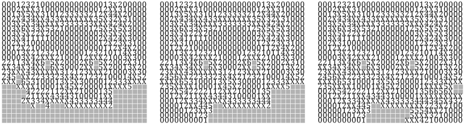</a>

从左至右分别为 (i) 与 (ii)、(iii)、(v). 注意, 柴郡猫著名的笑容偏不服从逻辑, 得靠大量猜测才能看到!

[关于扫雷中属于 NP 完全与 coNP 完全的问题, 见 Kaye、Scott、Stege 和 van Rooij, <em>Math. Intelligencer</em> **22**,2 (2000), 9–15; **33**,4 (2011), 5–17.]

<a id="ans-7-2-2-2-115"></a>

**115.** [题目](../sec-7-2-2-2.md#ex-7-2-2-2-115) 在已知雷的总数为 10 的情形下, 对上一题的算法运行几千次, 若第一次猜测分别在一个角、一条边的中央或整个棋盘的中心, 得到的成功概率为 $.490\pm.007$, $.414\pm.004$, $.279\pm.003$.

<a id="ans-7-2-2-2-116"></a>

**116.** [题目](../sec-7-2-2-2.md#ex-7-2-2-2-116) 最小的例子是[答案 69](#ans-7-2-2-2-69)(b) 的 “时钟”. 其他值得注意的可能性如下, 此外还有[图 A–9](#fig-7-2-2-2-a9) 的 “凤凰”.

<a href="../../../assets/volume4b/figures/satqa-a116.svg"></a>


<a id="pdf-592"></a><a id="p-572"></a>

<a id="ans-7-2-2-2-117"></a>

**117.** [题目](../sec-7-2-2-2.md#ex-7-2-2-2-117) (a) 置 $x_0=x_{n+1}=0$, 令 $(a,b,c)$ 分别为 $(01,10,11)$ 作为 $x_0x_1\ldots x_{n+1}$ 的子串出现的次数. 则 $a+c=b+c=\nu x$ 且 $c=\nu^{(2)}x$; 从而 $a=b=\nu x-\nu^{(2)}x$ 就是游程数.

(b) 在这种情形下, 完全二叉树只有 $n-1$ 个叶子, 对应于 $\{x_1x_2,\ldots,x_{n-1}x_n\}$; 因此要在 (20)、(21) 中以 $n-1$ 代替 $n$. 除非 $t_k\le3$, (20) 的子句保持不变. 当 $t_k=2$ 时, 它们成为
$$
(\bar x_{2k-n+1}\lor\bar x_{2k-n+2}\lor b_1^k)
\land(\bar x_{2k-n+2}\lor\bar x_{2k-n+3}\lor b_1^k)
\land(\bar x_{2k-n+1}\lor\bar x_{2k-n+2}\lor\bar x_{2k-n+3}\lor b_2^k).
$$
当 $t_k=3$ 时, 有 $2k=n-1$, 它们成为 $(\bar b_1^{2k}\lor b_1^k)\land(\bar x_1\lor\bar x_2\lor b_1^k)\land(\bar b_2^{2k}\lor b_2^k)\land(\bar b_1^{2k}\lor\bar x_1\lor\bar x_2\lor b_2^k)\land(\bar b_2^{2k}\lor\bar x_1\lor\bar x_2\lor b_3^k)$.

(21) 的子句保持不变, 除了 $n\le3$ 时的简单情形以外.

(c) 现在叶子表示 $\overline{x_ix_{i+1}}=\bar x_i\lor\bar x_{i+1}$. 所以当 $t_k=2$ 时, 将 (20) 变为 $(x_{2k-n+1}\lor b_1^k)\land(x_{2k-n+2}\lor b_1^k)\land(x_{2k-n+3}\lor b_1^k)\land(x_{2k-n+2}\lor b_2^k)\land(x_{2k-n+1}\lor x_{2k-n+3}\lor b_2^k)$. 当 $t_k=3$ 时则有八个子句: $(\bar b_1^{2k}\lor b_1^k)\land(x_1\lor b_1^k)\land(x_2\lor b_1^k)\land(\bar b_2^{2k}\lor b_2^k)\land(\bar b_1^{2k}\lor x_1\lor b_2^k)\land(\bar b_1^{2k}\lor x_2\lor b_2^k)\land(\bar b_2^{2k}\lor x_1\lor b_3^k)\land(\bar b_2^{2k}\lor x_2\lor b_3^k)$.

<a id="ans-7-2-2-2-118"></a>

**118.** [题目](../sec-7-2-2-2.md#ex-7-2-2-2-118) 令 $p_{i,j}=[\text{应覆盖第 }i\text{ 行第 }j\text{ 列的像素}]$; 当 $p_{i,j}=p_{i,j+1}=1$ 时引入变量 $h_{i,j}$, 当 $p_{i,j}=p_{i+1,j}=1$ 时引入 $v_{i,j}$. 子句为 (i) 每当 $p_{i,j}=1$, 取 $(h_{i,j}\lor h_{i,j-1}\lor v_{i,j}\lor v_{i-1,j})$, 略去不存在的变量; (ii) 每当 $p_{i,j}=1$, 取 $(\bar h_{i,j}\lor\bar h_{i,j-1})$, $(\bar h_{i,j}\lor\bar v_{i,j})$, $(\bar h_{i,j}\lor\bar v_{i-1,j})$, $(\bar h_{i,j-1}\lor\bar v_{i,j})$, $(\bar h_{i,j-1}\lor\bar v_{i-1,j})$, $(\bar v_{i,j}\lor\bar v_{i-1,j})$, 略去两个变量不都存在的子句; (iii) 每当 $p_{i,j}+p_{i,j+1}+p_{i+1,j}+p_{i+1,j+1}\ge3$, 取 $(h_{i,j}\lor h_{i+1,j}\lor v_{i,j}\lor v_{i,j+1})$, 略去不存在的变量. (本例在 2874 个变量上有 10527 个子句, 但很快就能解出.)

<a id="ans-7-2-2-2-119"></a>

**119.** [题目](../sec-7-2-2-2.md#ex-7-2-2-2-119) $l$ 与 $\bar l$ 之间有对称性, $l$ 与 $10-l$ 之间也有对称性; 所以只须考虑 $l=(1,2,3,4,5)$, 它们分别出现 $(4,4,6,6,8)$ 次. 最小的结果为
$$
\begin{aligned}
F\mid 5=\{&123,234,678,789,246,468,147,369,\bar1\bar2\bar3,\bar2\bar3\bar4,
\bar3\bar4,\bar4\bar6,\bar6\bar7,\\
&\bar6\bar7\bar8,\bar7\bar8\bar9,\bar1\bar3,\bar2\bar4\bar6,
\bar3\bar7,\bar4\bar6\bar8,\bar7\bar9,\bar1\bar4\bar7,\bar2\bar8,\bar3\bar6\bar9,\bar1\bar9\}.
\end{aligned}
$$

<a id="ans-7-2-2-2-120"></a>

**120.** [题目](../sec-7-2-2-2.md#ex-7-2-2-2-120) 真.

<a id="ans-7-2-2-2-121"></a>

**121.** [题目](../sec-7-2-2-2.md#ex-7-2-2-2-121) 值得注意的主要一点是, 空子句通常是在步骤 A3 <em>进行到中途</em>才发现的; 在撤销中断以前已经发生的改动时, 必须作部分回溯.

**A3.** [除去 $\bar l$.] 置 $p\gets\mathtt F(\bar l)$ (即 $\mathtt F(l\oplus1)$, 见 (57)). 当 $p\ge2n+2$ 时, 置 $j\gets\mathtt C(p)$, $i\gets\mathtt{SIZE}(j)$; 若 $i>1$, 置 $\mathtt{SIZE}(j)\gets i-1$, $p\gets\mathtt F(p)$. 但若 $i=1$, 则中断此循环并置 $p\gets\mathtt B(p)$; 接着当 $p\ge2n+2$ 时, 置 $j\gets\mathtt C(p)$, $i\gets\mathtt{SIZE}(j)$, $\mathtt{SIZE}(j)\gets i+1$, $p\gets\mathtt B(p)$; 最后转到 A5.

**A4.** [使 $l$ 的子句不活动.] 置 $p\gets\mathtt F(l)$. 当 $p\ge2n+2$ 时, 置 $j\gets\mathtt C(p)$, $i\gets\mathtt{START}(j)$, $p\gets\mathtt F(p)$; 对 $i\le s<i+\mathtt{SIZE}(j)-1$, 置 $q\gets\mathtt F(s)$, $r\gets\mathtt B(s)$, $\mathtt B(q)\gets r$, $\mathtt F(r)\gets q$, $\mathtt C(\mathtt L(s))\gets\mathtt C(\mathtt L(s))-1$. 然后置 $a\gets a-\mathtt C(l)$, $d\gets d+1$, 返回 A2.

**A7.** [让 $l$ 的子句重新活动.] 置 $a\gets a+\mathtt C(l)$, $p\gets\mathtt B(l)$. 当 $p\ge2n+2$ 时, 置 $j\gets\mathtt C(p)$, $i\gets\mathtt{START}(j)$, $p\gets\mathtt B(p)$; 对 $i\le s<i+\mathtt{SIZE}(j)-1$, 置 $q\gets\mathtt F(s)$, $r\gets\mathtt B(s)$, $\mathtt B(q)\gets\mathtt F(r)\gets s$, $\mathtt C(\mathtt L(s))\gets\mathtt C(\mathtt L(s))+1$. (链在这里稍稍舞动了一下.)

**A8.** [恢复 $\bar l$.] 置 $p\gets\mathtt F(\bar l)$. 当 $p\ge2n+2$ 时, 置 $j\gets\mathtt C(p)$, $i\gets\mathtt{SIZE}(j)$, $\mathtt{SIZE}(j)\gets i+1$, $p\gets\mathtt F(p)$. 然后转到 A5.　■

<a id="ans-7-2-2-2-122"></a>

**122.** [题目](../sec-7-2-2-2.md#ex-7-2-2-2-122) 要求所有的解时, 纯字面值会带来麻烦, 因此这里不利用它们. 实际上反而简单了; 只须用走法代码 1 和 2.

**A1\*.** [初始化.] 置 $d\gets1$.

<a id="pdf-593"></a><a id="p-573"></a>

**A2\*.** [访问或选择.] 若 $d>n$, 访问 $m_1\ldots m_n$ 所定义的解, 转到 A6*. 否则置 $l\gets2d+1$, $m_d\gets1$.

**A3\*.** [除去 $\bar l$.] 从所有活动子句中删去 $\bar l$; 但若这样做会使某个子句变空, 则转到 A5*.

**A4\*.** [使 $l$ 的子句不活动.] 暂时隐去一切含有 $l$ 的子句. 然后置 $d\gets d+1$, 返回 A2*.

**A5\*.** [再试.] 若 $m_d=1$, 置 $m_d\gets2$, $l\gets2d$, 转到 A3*.

**A6\*.** [回溯.] 若 $d=1$ 则终止. 否则置 $d\gets d-1$, $l\gets2d+(m_d\mathbin{\&}1)$.

**A7\*.** [使 $l$ 的子句重新活动.] 恢复所有含有 $l$ 的子句.

**A8\*.** [恢复 $\bar l$.] 将 $\bar l$ 放回所有原来含有它的活动子句中. 然后返回 A5*.　■

在 A4* 和 A7* 中, 已不必更新 $k<2n+2$ 时的 $\mathtt C(k)$ 值.

<a id="ans-7-2-2-2-123"></a>

**123.** [题目](../sec-7-2-2-2.md#ex-7-2-2-2-123) 例如, 可能有

<table id="sat-watch-list"><thead><tr><th>$p=$</th><th>0</th><th>1</th><th>2</th><th>3</th><th>4</th><th>5</th><th>6</th><th>7</th><th>8</th><th>9</th><th>10</th><th>11</th><th>12</th><th>13</th><th>14</th><th>15</th><th>16</th><th>17</th><th>18</th><th>19</th><th>20</th></tr></thead><tbody>
<tr><td>$L(p)=$</td><td>3</td><td>9</td><td>7</td><td>8</td><td>7</td><td>5</td><td>6</td><td>5</td><td>3</td><td>4</td><td>3</td><td>8</td><td>2</td><td>8</td><td>6</td><td>9</td><td>6</td><td>4</td><td>7</td><td>4</td><td>2</td></tr>
</tbody></table>

而且 $\mathtt{START}(j)=21-3j$, $0\le j\le7$; $W_2=3$, $W_3=7$, $W_4=4$, $W_5=0$, $W_6=5$, $W_7=1$, $W_8=6$, $W_9=2$. 此时对 $1\le j\le7$ 还有 $\mathtt{LINK}(j)=0$.

<a id="ans-7-2-2-2-124"></a>

**124.** [题目](../sec-7-2-2-2.md#ex-7-2-2-2-124) 置 $j\gets W_{\bar l}$. 当 $j\ne0$ 时, 在子句 $j$ 中应当监视一个不同于 $\bar l$ 的字面值, 因此如下操作: 置 $i\gets\mathtt{START}(j)$, $i'\gets\mathtt{START}(j-1)$, $j'\gets\mathtt{LINK}(j)$, $k\gets i+1$. 当 $k<i'$ 时, 置 $l'\gets\mathtt L(k)$; 若 $l'$ 不为假 (即 $|l'|>d$ 或 $l'+m_{|l'|}$ 为偶数, 见 (57)), 置 $\mathtt L(i)\gets l'$, $\mathtt L(k)\gets\bar l$, $\mathtt{LINK}(j)\gets W_{l'}$, $W_{l'}\gets j$, $j\gets j'$, 并退出对 $k$ 的循环; 否则置 $k\gets k+1$ 并继续该循环. 然而若 $k$ 达到 $i'$, 我们就不能停止监视 $\bar l$; 于是置 $W_{\bar l}\gets j$, 退出对 $j$ 的循环并转到 B5.

<a id="ans-7-2-2-2-125"></a>

**125.** [题目](../sec-7-2-2-2.md#ex-7-2-2-2-125) 按[答案 122](#ans-7-2-2-2-122) 中 A2* 和 A4* 的样子改写 B2 与 B4.

<a id="ans-7-2-2-2-126"></a>

**126.** [题目](../sec-7-2-2-2.md#ex-7-2-2-2-126) 从活动环 $(6\ 9\ 7\ 8)$ 出发, 将发现单位子句 9 (因为 9 出现在 8 之前); 子句 $\bar9\bar3\bar6$ 将变为 $\bar6\bar3\bar9$; 活动环将变为 $(7\ 8\ 6)$.

<a id="ans-7-2-2-2-127"></a>

**127.** [题目](../sec-7-2-2-2.md#ex-7-2-2-2-127) 之前为 11414545; 之后为 1142. (接着是 11425, 等等.)

<a id="ans-7-2-2-2-128"></a>

**128.** [题目](../sec-7-2-2-2.md#ex-7-2-2-2-128) 如下表所示.

<table id="sat-dpll-trace"><thead><tr><th>活动环</th><th>$x_1x_2x_3x_4$</th><th>单位子句</th><th>选择</th><th>改动的子句</th></tr></thead><tbody>
<tr><td>(1234)</td><td><code>----</code></td><td></td><td>$\bar{1}$</td><td>$21\bar{3}$</td></tr>
<tr><td>(234)</td><td><code>0---</code></td><td></td><td>$\bar{2}$</td><td>$\bar{3}12,32\bar{4}$</td></tr>
<tr><td>(34)</td><td><code>00--</code></td><td>$\bar{3}$</td><td>$\bar{3}$</td><td>$\bar{4}23,431$</td></tr>
<tr><td>(4)</td><td><code>000-</code></td><td>$4,\bar{4}$</td><td>回溯</td><td></td></tr>
<tr><td>(34)</td><td><code>0---</code></td><td></td><td>$2$</td><td>$\bar{3}\bar{2}4$</td></tr>
<tr><td>(34)</td><td><code>01--</code></td><td>$\bar{4}$</td><td>$\bar{4}$</td><td>$341,\bar{1}42$</td></tr>
<tr><td>(3)</td><td><code>01-0</code></td><td>$3,\bar{3}$</td><td>回溯</td><td></td></tr>
<tr><td>(43)</td><td><code>----</code></td><td></td><td>$1$</td><td>$4\bar{1}2,\bar{2}\bar{1}3$</td></tr>
<tr><td>(243)</td><td><code>1---</code></td><td></td><td>$\bar{2}$</td><td></td></tr>
<tr><td>(43)</td><td><code>10--</code></td><td>$4$</td><td>$4$</td><td>$32\bar{4},1\bar{4}\bar{2}$</td></tr>
<tr><td>(3)</td><td><code>10-1</code></td><td>$3,\bar{3}$</td><td>回溯</td><td></td></tr>
<tr><td>(43)</td><td><code>1---</code></td><td></td><td>$2$</td><td>$3\bar{1}\bar{2}$</td></tr>
<tr><td>(43)</td><td><code>11--</code></td><td>$3$</td><td>$3$</td><td>$4\bar{2}\bar{3},1\bar{3}2,\bar{4}\bar{3}\bar{1}$</td></tr>
<tr><td>(4)</td><td><code>111-</code></td><td>$4,\bar{4}$</td><td>回溯</td><td></td></tr>
</tbody></table>


<a id="pdf-594"></a><a id="p-574"></a>

<a id="ans-7-2-2-2-129"></a>

**129.** [题目](../sec-7-2-2-2.md#ex-7-2-2-2-129) 置 $j\gets W_l$, 当 $j\ne0$ 时执行以下各步: (i) 置 $p\gets\mathtt{START}(j)+1$. (ii) 若 $p=\mathtt{START}(j-1)$, 返回 1. (iii) 若 $\mathtt L(p)$ 为假 (即 $x_{|\mathtt L(p)|}=\mathtt L(p)\mathbin{\&}1$), 置 $p\gets p+1$, 重复 (ii). (iv) 置 $j\gets\mathtt{LINK}(j)$. 若 $j$ 变成零, 返回 0.

<a id="ans-7-2-2-2-130"></a>

**130.** [题目](../sec-7-2-2-2.md#ex-7-2-2-2-130) 置 $l\gets2k+b$, $j\gets W_l$, $W_l\gets0$; 当 $j\ne0$ 时执行以下各步: (i) 置 $j'\gets\mathtt{LINK}(j)$, $i\gets\mathtt{START}(j)$, $p\gets i+1$. (ii) 当 $\mathtt L(p)$ 为假时, 置 $p\gets p+1$ (见[答案 129](#ans-7-2-2-2-129); 这个循环将在 $p=\mathtt{START}(j-1)$ 之前结束). (iii) 置 $l'\gets\mathtt L(p)$, $\mathtt L(p)\gets l$, $\mathtt L(i)\gets l'$. (iv) 置 $p\gets W_{l'}$, $q\gets W_{\bar l'}$; 若 $p\ne0$ 或 $q\ne0$ 或 $x_{|l'|}\ge0$, 转到 (vi). (v) 若 $t=0$, 置 $t\gets h\gets |l'|$ 和 $\mathtt{NEXT}(t)\gets h$; 否则置 $\mathtt{NEXT}(|l'|)\gets h$, $h\gets|l'|$, $\mathtt{NEXT}(t)\gets h$ (从而将 $|l'|=l'\gg1$ 作为新的表头插入环中). (vi) 置 $\mathtt{LINK}(j)\gets p$, $W_{l'}\gets j$ (从而将 $j$ 插入 $l'$ 的监视表中). (vii) 置 $j\gets j'$.

[这里容易疏忽的是步骤 (v) 中 $t$ 可以为零.]

<a id="ans-7-2-2-2-131"></a>

**131.** [题目](../sec-7-2-2-2.md#ex-7-2-2-2-131) 例如, 作者曾选取使 $s_{2k}\cdot s_{2k+1}$ 最大的变量 $x_k$, 其中 $s_l$ 为 $l$ 的监视表的长度加上 $\varepsilon$, 参数 $\varepsilon$ 取 0.1. 这使 $\operatorname{waerden}(3,10;97)$ 的运行时间降至 1398 亿次内存访问, 涉及 860 万个结点. 对 $\operatorname{langford}(13)$ 效果没有如此显著: 用了 562 亿次内存访问和 1080 万个结点; 若改为选取使 $s_{2k}\cdot s_{2k+1}$ <em>最小</em>的变量, 则用 990 亿次内存访问.

<a id="ans-7-2-2-2-132"></a>

**132.** [题目](../sec-7-2-2-2.md#ex-7-2-2-2-132) 不可满足的子句 $(\bar x_1\lor x_2)$、$(x_1\lor\bar x_2)$、$(\bar x_3\lor x_4)$、$(x_3\lor\bar x_4)$、$\ldots$、$(\bar x_{2n-1}\lor x_{2n})$、$(x_{2n-1}\lor\bar x_{2n})$、$(\bar x_{2n-1}\lor\bar x_{2n})$、$(x_{2n-1}\lor x_{2n})$, 会使它在遇到矛盾而反复回溯之前, 先考察 $x_1,x_3,\ldots,x_{2n-1}$ 的全部 $2^n$ 种赋值.

(顺便说, 相继的走法代码形成了一个漂亮的图案. 若将这些子句随机排列, 算法将明显加快, 但看来仍需非多项式时间. 增长率是多少呢?)

<a id="ans-7-2-2-2-133"></a>

**133.** [题目](../sec-7-2-2-2.md#ex-7-2-2-2-133) (a) 从底向上考察全部 $3^n$ 个部分赋值, 就能在 $\Theta(n3^n)$ 时间与 $\Theta(3^n)$ 空间内算出 $n$ 变量 SAT 问题的最优回溯树. 在这个九变量的问题里, 若先对 $x_3,x_5$ 分支, 然后在 $x_3\ne x_5$ 时对 $x_6$ 分支, 所得的树有 67 个结点 (最少); 所有其他结点都会出现单位子句.

(b) 类似地, 最坏的树原来有 471 个结点. 但若要求只要有可能就对单位子句分支, 则最坏的大小为 187. (先对 $x_1$ 分支, 再对 $x_4$, 然后是 $x_7$; 尽量避开产生单位子句的机会.)

<a id="ans-7-2-2-2-134"></a>

**134.** [题目](../sec-7-2-2-2.md#ex-7-2-2-2-134) 对每个 BIMP 表, 用 ADDR、BSIZE、CAP、K 域来访问它; ADDR 是 MEM 中一块能容纳 CAP 项的存储块的起始地址, 且 $\mathtt{CAP}=2^{\mathtt K}$; ADDR 是 CAP 的倍数, BSIZE 则是当前使用的项数. 初始时 $\mathtt{CAP}=4$, $\mathtt K=2$, $\mathtt{BSIZE}=0$, ADDR 为适当的 4 的倍数. 因此 $2n$ 张 BIMP 表起初占 $8n$ 个位置. 如果 MEM 有容纳 $2^M$ 项的空间, 可以分配这些表, 使双链表 $\mathtt{AVAIL}[k]$ 起初含有 $a_k$ 个 (0 个或 1 个) 大小为 $2^k$ 的空闲块, 其中 $2^M-8n=(a_{M-1}\ldots a_0)_2$.

当 $\mathtt{BSIZE}=\mathtt{CAP}$ 而又需要增加 BSIZE 时, 必须调整容量. 置 $a\gets\mathtt{ADDR}$, $k\gets\mathtt K$, $\mathtt{CAP}\gets2^{k+1}$, 并令 $b\gets a\oplus2^k$ 为 $a$ 的伙伴的地址. 若 $b$ 是大小为 $2^k$ 的空闲块, 我们就走运了: 从 $\mathtt{AVAIL}[k]$ 中取出 $b$; 接着若 $a\mathbin{\&}2^k=0$, 无须再做什么; 否则将 BSIZE 项从 $a$ 复制到 $b$, 并置 $\mathtt{ADDR}\gets b$.

若不走运, $b$ 已被占用或是大小小于 $2^k$ 的空闲块, 就令 $p$ 为 $\mathtt{AVAIL}[k']$ 的首块地址, 其中对 $k<t<k'$ 有 $\mathtt{AVAIL}[t]$ 为空 (若超过 MEM 的容量, 就只好报急). 从 $\mathtt{AVAIL}[k']$ 中取出 $p$ 后, 若 $k'>k+1$, 便依次拆下大小为 $2^{k+1},\ldots,2^{k'-1}$ 的新空闲块. 最后, 将 BSIZE 项从块 $a$ 复制到块 $p$, 置 $\mathtt{ADDR}\gets p$, 并把 $a$ 放入 $\mathtt{AVAIL}[k]$. (不必再试着将 $a$ 与它的伙伴 “合并”, 因为伙伴并非空闲.)

<a id="ans-7-2-2-2-135"></a>

**135.** [题目](../sec-7-2-2-2.md#ex-7-2-2-2-135) 它们是 $\mathtt{BIMP}(\bar l)$ 中各字面值的补.

<a id="pdf-595"></a><a id="p-575"></a>

<a id="ans-7-2-2-2-136"></a>

**136.** [题目](../sec-7-2-2-2.md#ex-7-2-2-2-136) 之前为 $\{(1,2),(4,2),(4,5),(5,1),(5,7),(6,9)\}$; 之后为 $\{(1,2),(4,2),(6,9)\}$.

<a id="ans-7-2-2-2-137"></a>

**137.** [题目](../sec-7-2-2-2.md#ex-7-2-2-2-137) 若 TIMP 表中的 $p$ 指向数对 $(u,v)$, 就把 $u$ 记作 $\mathtt U(p)$, $v$ 记作 $\mathtt V(p)$.

(a) 置 $N\gets n-G$, $x\gets\mathtt{VAR}[N]$, $j\gets\mathtt{INX}[X]$, $\mathtt{VAR}[j]\gets x$, $\mathtt{INX}[x]\gets j$, $\mathtt{VAR}[N]\gets X$, $\mathtt{INX}[X]\gets N$. 然后对 $l=2X$ 与 $l=2X+1$, 对 $\mathtt{TIMP}(l)$ 中的每个 $p$, 执行以下操作:
$$
u\gets\mathtt U(p),\quad v\gets\mathtt V(p),\quad p'\gets\mathtt{LINK}(p),\quad p''\gets\mathtt{LINK}(p').
$$
置 $s\gets\mathtt{TSIZE}(\bar u)-1$, $\mathtt{TSIZE}(\bar u)\gets s$, $t\gets\mathtt{TIMP}(\bar u)$ 的第 $s$ 个数对; 若 $p'\ne t$, 如下交换数对:
$$
\begin{aligned}
&u'\gets\mathtt U(t),\quad v'\gets\mathtt V(t),\quad q\gets\mathtt{LINK}(t),\quad q'\gets\mathtt{LINK}(q),\\
&\mathtt{LINK}(q')\gets p',\quad\mathtt{LINK}(p)\gets t,\quad
\mathtt U(p')\gets u',\quad\mathtt V(p')\gets v',\quad\mathtt{LINK}(p')\gets q,\\
&\mathtt U(t)\gets v,\quad\mathtt V(t)\gets\bar l,\quad\mathtt{LINK}(t)\gets p'',\quad p'\gets t.
\end{aligned}
$$
再置 $s\gets\mathtt{TSIZE}(\bar v)-1$, $\mathtt{TSIZE}(\bar v)\gets s$, $t\gets\mathtt{TIMP}(\bar v)$ 的第 $s$ 个数对; 若 $p''\ne t$, 如下交换数对:
$$
\begin{aligned}
&u'\gets\mathtt U(t),\quad v'\gets\mathtt V(t),\quad q\gets\mathtt{LINK}(t),\quad q'\gets\mathtt{LINK}(q),\\
&\mathtt{LINK}(q')\gets p'',\quad\mathtt{LINK}(p')\gets t,\quad
\mathtt U(p'')\gets u',\quad\mathtt V(p'')\gets v',\quad\mathtt{LINK}(p'')\gets q,\\
&\mathtt U(t)\gets\bar l,\quad\mathtt V(t)\gets u,\quad\mathtt{LINK}(t)\gets p.
\end{aligned}
$$
注意, 当前 $\mathtt{TIMP}(l)$ 中的数对<em>不</em>置为不活动. 在算法需要撤销刚才的交换以前, 不会再访问它们.

(b) 在 VAR 和每张 TIMP 表中, 活动项都出现在前面. 接着是不活动项, 它们按被换出时的次序排列, 因为不活动项以后决不再参与交换. 因此, 仅仅增加活动项的计数, 就能使最近换出的那一项重新活动. 不过, 必须小心地使这种 “虚拟回换” 严格按先前交换次序的逆序进行.

所以, 对 $l=2X+1$ 与 $l=2X$, 以及 $\mathtt{TIMP}(l)$ 中的全部 $p$, 按 (a) 的逆序处理: 置 $u\gets\mathtt U(p)$, $v\gets\mathtt V(p)$, $\mathtt{TSIZE}(\bar v)\gets\mathtt{TSIZE}(\bar v)+1$, $\mathtt{TSIZE}(\bar u)\gets\mathtt{TSIZE}(\bar u)+1$.

(由于 L12 中 $N+E=n$, 自由变量数 $N$ 会隐式地增加. 因此无须对 VAR 或 INX 作任何操作. 这些基于交换的高效技术是 “稀疏集表示” 的例子; 见 7.2.2–(16) 至 (23).)

<a id="ans-7-2-2-2-138"></a>

**138.** [题目](../sec-7-2-2-2.md#ex-7-2-2-2-138) 由于 $\bar v\in\mathtt{BIMP}(\bar u)$, 将使用 (62) 使 $u$ 成为近真. 那个循环也会使 $v$ 成为近真, 因为 $v\in\mathtt{BIMP}(u)$ 等价于 $\bar u\in\mathtt{BIMP}(\bar v)$.

<a id="ans-7-2-2-2-139"></a>

**139.** [题目](../sec-7-2-2-2.md#ex-7-2-2-2-139) 引入一个类似于 ISTAMP 的新变量 BSTAMP, 在每个字面值 $l$ 的数据中引入类似于 $\mathtt{IST}(l)$ 的新域 $\mathtt{BST}(l)$. 在 L9 开始时置 $\mathtt{BSTAMP}\gets\mathtt{BSTAMP}+1$, 然后对于 $l=\bar u$ 以及所有 $l\in\mathtt{BIMP}(\bar u)$, 置 $\mathtt{BST}(l)\gets\mathtt{BSTAMP}$. 现在, 若 $\mathtt{BST}(\bar v)\ne\mathtt{BSTAMP}$ 且 $\mathtt{BST}(v)\ne\mathtt{BSTAMP}$, 则对每个 $w\in\mathtt{BIMP}(v)$ 作如下操作: 若 $w$ 在上下文 NT 中已定值 (必定为真, 因为 $\bar w$ 蕴涵 $\bar v$), 什么也不做. 否则若 $\mathtt{BST}(\bar w)=\mathtt{BSTAMP}$, 以 $l\gets u$ 执行 (62) 并退出对 $w$ 的循环 (因为 $\bar u$ 同时蕴涵 $w$ 与 $\bar w$). 否则, 若 $\mathtt{BST}(w)\ne\mathtt{BSTAMP}$, 将 $w$ 附加到 $\mathtt{BIMP}(\bar u)$, 将 $u$ 附加到 $\mathtt{BIMP}(\bar w)$. (需要时当然必须调用 (63).)

然后再次增大 BSTAMP, 并将 $u,v$ 互换, 再作一遍相同的操作.

<a id="ans-7-2-2-2-140"></a>

**140.** [题目](../sec-7-2-2-2.md#ex-7-2-2-2-140) 遗憾的是没有: 在查找树的 $\Omega(n)$ 层上, 每一层都可能使 $\Omega(n)$ 个 BSIZE 发生改变. 不过 ISTACK 的项数绝不会超过所有 BIMP 表中的单元总数 (即[答案 134](#ans-7-2-2-2-134) 中的 $2^M$).

<a id="ans-7-2-2-2-141"></a>

**141.** [题目](../sec-7-2-2-2.md#ex-7-2-2-2-141) 假定在 L5 中置 $\mathtt{ISTAMP}\gets(\mathtt{ISTAMP}+1)\bmod2^e$. 若此操作后 $\mathtt{ISTAMP}=0$, 就可放心地置 $\mathtt{ISTAMP}\gets1$, 并对 $2\le l\le2n+1$ 置 $\mathtt{IST}(l)\gets0$. (类似的说明也适用于[答案 139](#ans-7-2-2-2-139) 的 BSTAMP 与 $\mathtt{BST}(l)$.)

<a id="ans-7-2-2-2-142"></a>

**142.** [题目](../sec-7-2-2-2.md#ex-7-2-2-2-142) (在 L2 中设定 $\mathtt{BRANCH}[d]$ 后执行下列操作, 还会在没有作决策的查找层上输出 ‘$|$’ 作标记.) 置 $\mathtt{BACKL}[d]\gets F$, $r\gets k\gets0$, 并在 $k<d$ 时反复作如下操作: 当 $r<\mathtt{BACKF}[k]$ 时, 输出 ‘$6+(R_r\mathbin{\&}1)$’ 并置 $r\gets r+1$. 若 $\mathtt{BRANCH}[k]<0$, 输出 ‘$|$’; 否则输出 ‘$2\mathtt{BRANCH}[k]+(R_r\mathbin{\&}1)$’, 并置 $r\gets r+1$. 当 $r<\mathtt{BACKL}[k+1]$ 时, 输出 ‘$4+(R_r\mathbin{\&}1)$’, 并置 $r\gets r+1$. 然后置 $k\gets k+1$.

<a id="pdf-596"></a><a id="p-576"></a>

<a id="ans-7-2-2-2-143"></a>

**143.** [题目](../sec-7-2-2-2.md#ex-7-2-2-2-143) 以下解法处理 KINX 和 KSIZE 的方式, 与原算法处理 TIMP 和 TSIZE 的方式相同. CINX 和 CSIZE 则稍微巧妙一些: 若子句 $c$ 原来的大小为 $k$, 其中已有 $j$ 个字面值为假而尚无一个为真, 则 $\mathtt{CSIZE}(c)$ 为 $k-j$, 但非假的字面值未必位于表 $\mathtt{CINX}(c)$ 的开头. 一旦 $j$ 达到 $k-2$ 或有一个字面值成为真, 子句 $c$ 就变为不活动, 从所有自由字面值的 KINX 表中消失. 在解除使 $c$ 不活动的那个字面值的定值以前, 算法不会再查看 $\mathtt{CINX}(c)$ 或 $\mathtt{CSIZE}(c)$. 因此, 一个大子句不活动当且仅当它已满足 (含有真字面值) 或已成为二元子句 (至多有两个非假的字面值).

只需改动涉及 TIMP 的三个步骤. 修改后的 L1, 称为 L1′, 照常读入各大子句.

步骤 L7′ 从数据结构中删去原来自由的变量 $X$, 首先使含有 $L$ 的所有活动大子句变为不活动. 对 $\mathtt{KINX}(L)$ 中的 $\mathtt{KSIZE}(L)$ 个数 $c$ 中的每一个, 以及 $\mathtt{CINX}(c)$ 中的 $\mathtt{CSIZE}(c)$ 个自由字面值 $u$ 中的每一个, 如下将 $c$ 从 $u$ 的子句表中换出: 置 $s\gets\mathtt{KSIZE}(u)-1$, $\mathtt{KSIZE}(u)\gets s$; 找到满足 $\mathtt{KINX}(u)[t]=c$ 的 $t\le s$; 若 $t\ne s$, 置 $\mathtt{KINX}(u)[t]\gets\mathtt{KINX}(u)[s]$, $\mathtt{KINX}(u)[s]\gets c$. [启发式方法: 若 $c$ 所余的自由字面值数与原来的大小相比很少, 例如原来已有十五或二十个字面值变为假, 那么在使 $c$ 不活动时, 将所余非假的字面值换进 $\mathtt{CINX}(c)$ 的前 $\mathtt{CSIZE}(c)$ 个位置是合算的. 当 $\mathtt{CSIZE}(c)$ 至多为原来大小的 $\theta$ 倍时, 作者的实验程序就这样做, 参数 $\theta$ 通常取 $25/64$.]

接着, 步骤 L7′ 更新 $\bar L$ 已变为假的那些子句: 对 $\mathtt{KINX}(\bar L)$ 中的 $\mathtt{KSIZE}(\bar L)$ 个数 $c$ 中的每一个, 置 $s\gets\mathtt{CSIZE}(c)-1$, $\mathtt{CSIZE}(c)\gets s$; 若 $s=2$, 找到 $\mathtt{CINX}(c)$ 中的两个自由字面值 $(u,v)$, 将它们换到表头的两个位置, 压入一个临时栈, 并如上将 $c$ 从 $u$ 与 $v$ 的子句表中换出.

最后, 步骤 L7′ 对临时栈上的所有 $(u,v)$ 执行步骤 L8′ = L8. [这个栈的最大容量等于 L1′ 执行后所有 $l$ 的 $\mathtt{KSIZE}(l)$ 的最大值; 所以我们在 L1′ 中为它分配存储空间.]

在步骤 L12′ 中, 置 $L\gets R_E$, $X\gets|L|$, 并如下使涉及 $X$ 的子句恢复活动: 对 $\mathtt{KINX}(\bar L)$ 中的 $\mathtt{KSIZE}(\bar L)$ 个数 $c$, 按照与 L7′ 相反的次序, 置 $s\gets\mathtt{CSIZE}(c)$, $\mathtt{CSIZE}(c)\gets s+1$; 若 $s=2$, 将 $c$ 换回 $v$ 与 $u$ 的子句表中, 其中 $u=\mathtt{CINX}(c)[0]$, $v=\mathtt{CINX}(c)[1]$. 对 $\mathtt{KINX}(L)$ 中的 $\mathtt{KSIZE}(L)$ 个数 $c$, 以及 $\mathtt{CINX}(c)$ 中的 $\mathtt{CSIZE}(c)$ 个自由字面值 $u$, 仍按与 L7′ 相反的次序, 将 $c$ 换回 $u$ 的子句表. 后一个操作只需将 $\mathtt{KSIZE}(u)$ 增加 1.

ParamILS 建议将 (195) 中的 $\alpha$ 从 3.5 改成 0.001 (!).

<a id="ans-7-2-2-2-144"></a>

**144.** [题目](../sec-7-2-2-2.md#ex-7-2-2-2-144) 假. $h'(l)=0.1$ 当且仅当它的<em>补</em> $\bar l$ 不出现在任何子句中.

<a id="ans-7-2-2-2-145"></a>

**145.** [题目](../sec-7-2-2-2.md#ex-7-2-2-2-145) 由对称性可知, 在深度 0, 对 $1\le l\le9$ 有 $h(l)=h(\bar l)=h(10-l)$, 而且各 BIMP 表为空. 头五轮逐次精化分别给出 $(h(1),\ldots,h(5))$ 的近似值 $(4.10,4.10,6.10,6.10,8.10)$、$(5.01,4.59,6.84,6.84,7.98)$、$(4.80,4.58,6.57,6.57,8.32)$、$(4.88,4.54,6.72,6.67,8.06)$ 和 $(4.85,4.56,6.63,6.62,8.23)$, 缓慢地收敛于极限值
$$
(4.85810213,4.55160111,6.66761920,6.63699698,8.16778057).
$$
可是当 $d=1$ 时, 逐次精化所得的 $(h(1),h(\bar1),\ldots,h(4),h(\bar4))$ 的值却很不规则, 而且发散: $(2.10,9.10,3.10,6.60,3.10,13.60,4.10,11.10)$、$(5.63,3.37,9.24,2.57,5.48,5.67,8.37,4.87)$、$(1.42,10.00,2.31,10.42,1.28,17.69,1.94,16.07)$、$(8.12,1.43,12.42,1.30,7.51,2.41,12.02,1.81)$、$(0.32,14.72,0.42,16.06,0.30,26.64,0.43,24.84)$.

<a id="pdf-597"></a><a id="p-577"></a>

它们最终在偏重正字面值和偏重负字面值的两个极限之间振荡:
$$
\begin{gathered}
(0.1017,20.6819,0.1027,21.6597,0.1021,32.0422,0.1030,33.0200),\\
(8.0187,0.1712,11.9781,0.1361,11.9781,0.2071,15.9374,0.1718).
\end{gathered}
$$

[受调查传播启发而得的式 (64) 和 (65), 最早见于 S. Mijnders、B. de Wilde 和 M. J. H. Heule 在 2010 年未发表的工作. 上述计算表明, 对 $h(l)$ 不必太认真, 虽然它在实践中看来确实效果不错. 在作者的实现中, 若 (65) 的右边超过阈值参数 $\Theta$, 还要置 $h'(l)\gets\Theta$; 默认阈值为 20.0.]

<a id="ans-7-2-2-2-146"></a>

**146.** [题目](../sec-7-2-2-2.md#ex-7-2-2-2-146) 简单的公式
$$
h(l)=\varepsilon+\mathtt{KSIZE}(\bar l)+
\sum_{\substack{u\in\mathtt{BIMP}(l)\\u\ \text{自由}}}\mathtt{KSIZE}(\bar u)
$$
已经取得了不错的效果. 它估计当 $l$ 变为真时, 可能有多少个大子句缩短. 参数 $\varepsilon$ 通常取 0.001.

<a id="ans-7-2-2-2-147"></a>

**147.** [题目](../sec-7-2-2-2.md#ex-7-2-2-2-147) $\infty$, 600, 60, 30, 30.

<a id="ans-7-2-2-2-148"></a>

**148.** [题目](../sec-7-2-2-2.md#ex-7-2-2-2-148) 如果问题很容易, 我们并不在乎用 2 秒还是 0.000002 秒解出它. 另一方面, 如果问题很难, 所需的前瞻超出了我们在合理时间内能做的限度, 那就干脆承认解不了它. 在 $d=60$ 时对 60 个变量做前瞻没有意义, 因为在任何实际可处理的查找树中, 我们顶多能应付 $2^{50}$ 个左右的结点.

<a id="ans-7-2-2-2-149"></a>

**149.** [题目](../sec-7-2-2-2.md#ex-7-2-2-2-149) 其思想是给每个变量 $x$ 保留一个二进串 $\mathtt{SIG}(x)$, 表示 $x$ 所参与过的查找树中的最高结点. 令 $b_j=[\mathtt{BRANCH}[j]=1]$, 在步骤 L2 开始时置 $\sigma\gets b_0\ldots b_{d-1}$, 在步骤 L4 开始时置 $\sigma\gets b_0\ldots b_d$. 这样, $x$ 在步骤 X3 中是参与者, 当且仅当 $\mathtt{SIG}(x)$ 是 $\sigma$ 的前缀.

在步骤 L9 中, 若 $x=|u|$ 或 $x=|v|$, 就更新 $\mathtt{SIG}(x)$: 除非 $\mathtt{SIG}(x)$ 已是 $\sigma$ 的前缀, 否则置 $\mathtt{SIG}(x)\gets\sigma$. 选取 $\mathtt{SIG}(x)$ 的初值使它不会是任何可能的 $\sigma$ 的前缀.

(注意, 回溯时无须改变 $\mathtt{SIG}(x)$. 实际上, 对 $\sigma$ 和每个串 $\mathtt{SIG}(x)$, 我们只需保存开头的 32 位以及各串的准确长度, 因为前瞻计算容许近似. 在[答案 143](#ans-7-2-2-2-143) 的方法中, 更新发生在步骤 L7′. 每当一个含 $\bar L$ 的大子句第一次缩短时, 就对其中每个 $u\ne\bar L$ 作更新.)

<a id="ans-7-2-2-2-150"></a>

**150.** [题目](../sec-7-2-2-2.md#ex-7-2-2-2-150) 由于子句 $\bar1\bar4\bar7$, 在层次 22 断定 7 为真, 也会使 $\bar1$ 在层次 22 定值. 随后 $\bar1$ 使 3 和 9 在层次 22 定值, 二者又使 $\bar2$ 和 $\bar6$ 定值, 接着是 $\bar8$; 子句 258 变为假. 因此 $\bar7$ 成为初真, 而 (62) 使 3、6、9 都成为初真, 与 $\bar3\bar6\bar9$ 矛盾.

<a id="ans-7-2-2-2-151"></a>

**151.** [题目](../sec-7-2-2-2.md#ex-7-2-2-2-151) 例如, 下面是一种这样的排列:
$$
\begin{array}{r|rrrrrrrrrrrrrrrr}
l&2&\bar8&9&3&\bar1&6&\bar7&\bar4&4&7&\bar6&1&\bar3&\bar9&8&\bar2\\
o(l)&4&2&10&14&6&16&8&12&22&26&18&28&20&24&32&30
\end{array}.
$$

[按这种方式得到的有向图称为 “维数 $\le2$ 的偏序”, 或<em>排列偏序集</em>. 实际上, 在习题 5.1.1–11 中就已见过它们, 当时把弧的集合表示成逆序的集合. 排列偏序集有许多优美的性质, 我们将在 7.4.2 节研究它们. 例如, 若倒转表的次序并对各偏移量取补, 各箭头的方向就会反转. 在六个元素的 238 个连通偏序集中, 除了两个以外全都是排列偏序集. 遗憾的是, 若排列偏序集本身不是森林, 用它来做前瞻就不大方便. 例如, 在层次 10 对 ‘9’ 及它的推论定值之后, 在层次 14 对 ‘3’ 定值时, 我们希望从 $R$ 栈中删去那些字面值, 见 (71). 可是到了层次 6 对 ‘$\bar1$’ 定值时, 又希望把它们放回来.]

<a id="pdf-598"></a><a id="p-578"></a>

<a id="ans-7-2-2-2-152"></a>

**152.** [题目](../sec-7-2-2-2.md#ex-7-2-2-2-152) 单个子句, 如 ‘12’ 或 ‘123’, 原本就可以作例子, 只是还没到步骤 X3, 步骤 X9 的自足集检验便已解出了问题. 不过, 子句集 $\{12\bar3,1\bar23,\bar12\bar3,\bar1\bar23,245,3\bar4\bar5\}$ 确实合用: 第 0 层对 $x_1$ 分支, 第 1 层发现一个使 $x_2$ 与 $x_3$ 同时为真的自足集, 却返回 $l=0$. 随后第 2 层发现所有子句都已满足, 尽管两个自由变量 $x_4$ 和 $x_5$ 都是新手.

[事实上, 没有自由的参与者就意味着定值为真的字面值构成一个自足集. 如果有某个自由字面值 $l$ 的 $\mathtt{TSIZE}(l)$ 非零, 就有某个子句尚未满足. 否则所有子句都已满足, 除非对某个自由的 $l$, 有一个未定值的字面值 $l'\in\mathtt{BIMP}(l)$.]

<a id="ans-7-2-2-2-153"></a>

**153.** [题目](../sec-7-2-2-2.md#ex-7-2-2-2-153) 将 CAND 阵列构造成一个堆, 使评分 $r(x)$ <em>最小</em>的元素 $x$ 在堆顶. (见 5.2.3 节, 但下标从 0 开始, 使 $r(\mathtt{CAND}[k])\le\min(r(\mathtt{CAND}[2k+1]),r(\mathtt{CAND}[2k+2]))$.) 然后, 当 $C>C_{\max}$ 时, 删去堆顶 (即 $\mathtt{CAND}[0]$).

<a id="ans-7-2-2-2-154"></a>

**154.** [题目](../sec-7-2-2-2.md#ex-7-2-2-2-154) 子森林中的子结点 $\longrightarrow$ 父结点关系是 $d\longrightarrow c\longrightarrow a$, $b\longrightarrow a$, $\bar c\longrightarrow\bar d$, 以及 $\bar a\longrightarrow\bar b$ 或 $\bar a\longrightarrow\bar c$. 采用后者, 一种合适的序列如下:
$$
\begin{array}{r|rrrrrrrr}
\text{先序}&\bar b&a&b&c&d&\bar d&\bar c&\bar a\\
2\cdot\text{后序}&2&10&4&8&6&16&14&12
\end{array}.
$$

<a id="ans-7-2-2-2-155"></a>

**155.** [题目](../sec-7-2-2-2.md#ex-7-2-2-2-155) 先从 BIMP 表中抽出一部分弧, 在 $2C$ 个候选字面值上构造依赖图. (我们只是在作启发式计算, 不必十分精确; 可以限制所考察的弧数, 免得在这里花费太多时间. 然而有一点很重要: 弧 $u\longrightarrow v$ 存在当且仅当 $\bar v\longrightarrow\bar u$ 也存在.)

然后应用 Tarjan 算法 [见 7.4.1.2 节, 或 <em>SGB</em> 第 512–519 页]. 若某个强分图同时含有某个 $l$ 及其补 $\bar l$, 便由于矛盾而终止. 否则, 若一个强分图有多个字面值, 选一个使 $h(l)$ 最大的代表 $l$; 其余字面值都以 $l$ 为父结点. 须留意使 $l$ 是代表当且仅当 $\bar l$ 也是代表.

结果是按拓扑次序排列的候选字面值序列 $l_1l_2\ldots l_S$, 有 $l_i\longrightarrow l_j$ 必有 $i>j$. 计算每个 $l_j$ 的 “高度”, 即从 $l_j$ 到汇点的最长路径的长度. 于是, 每个高度为 $h>0$ 的字面值都有一个高度为 $h-1$ 的前驱, 我们取其中一个作为它在子森林中的父结点. 每个高度为 0 的字面值 (汇点) 的父结点为空. 现在按双序遍历这个子森林 (习题 2.3.1–18), 就很容易按先序构造 LL 表, 同时按后序填入 LO 表.

<a id="ans-7-2-2-2-156"></a>

**156.** [题目](../sec-7-2-2-2.md#ex-7-2-2-2-156) 若 $\bar l$ 不出现在 $F$ 的任何子句中, 则 $A=\{l\}$ 显然是一个自足集.

<a id="ans-7-2-2-2-157"></a>

**157.** [题目](../sec-7-2-2-2.md#ex-7-2-2-2-157) 当然, <em>任何</em>满足赋值都是一个自足集. 不过更切题的例子是 $F=\{1\bar23,\bar124,\bar3\bar4\}$ 的自足集 $\{1,2\}$.

<a id="ans-7-2-2-2-158"></a>

**158.** [题目](../sec-7-2-2-2.md#ex-7-2-2-2-158) $\mathtt{BIMP}(l)$ 和 $\mathtt{TIMP}(l)$ 都为空, 所以当算法 X 对 $l$ 前瞻时 $w$ 为零. 因而它会在深度 $d=0$ 强制 $l$ 为真. (但在 $d>0$ 的子问题中出现的纯字面值, 只有在它是预选的候选者时才会被发现.)

<a id="ans-7-2-2-2-159"></a>

**159.** [题目](../sec-7-2-2-2.md#ex-7-2-2-2-159) (a) 假 (考虑 $A=\{1\}$, $F=\{1,2,\bar12\}$); 但若将 $F\mid A$ 作为多重集来计算, 命题则为真 (在这个例子里 $F\mid A$ 为 $\{2,2\}\not\subseteq F$).

(b) 真: 假定 $A=A'\cup A''$, $A'\cap A''=\emptyset$, 并且 $A''$ 或 $\overline{A''}$ 与 $C\in F\mid A'$ 相交. 那么 $C\cap A'=\emptyset$, 且 $C\cup C'\in F$, 其中 $C'\subseteq\overline{A'}$. 由于 $A$ 或 $\bar A$ 与 $C\cup C'$ 相交, 就有某个 $a\in C\cup C'$ 属于 $A$; 因此 $a\in A''$.

<a id="ans-7-2-2-2-160"></a>

**160.** [题目](../sec-7-2-2-2.md#ex-7-2-2-2-160) (a) 如果灰色子句可满足, 就令所有黑色字面值为真. [顺便注意, 题中建议的示例着色在 (7) 中十分奏效.]

<a id="pdf-599"></a><a id="p-579"></a>

(b) 给定任一由严格不同的字面值构成的集合 $A$, 若 $l\in A$, 将 $l$ 着为黑色; 若 $\bar l\in A$, 着为白色; 否则着为灰色. 那么 $A$ 是自足集当且仅当条件 (a) 成立.

[E. A. Hirsch, <em>Journal of Automated Reasoning</em> **24** (2000), 397–420.]

<a id="ans-7-2-2-2-161"></a>

**161.** [题目](../sec-7-2-2-2.md#ex-7-2-2-2-161) (a) 若 $F'$ 可满足, 则 $F$ 也可满足. 若 $F$ 有一个使至少一个蓝色字面值为假的满足赋值, 则 $F'$ 也有这样的赋值. 若 $F$ 有一个使所有蓝色字面值为真的满足赋值, 就使所有黑色字面值为真 (保持灰色字面值不变). 这时 $F'$ 得到满足, 因为 $F'$ 中含有黑色或蓝色字面值的每个子句为真, 从而含有白色字面值的每个子句为真; 其余子句只含橙色与灰色字面值, 每个这样的子句都至少有一个为真的灰色字面值. [黑蓝条件等价于说 $A$ 是<em>条件自足集</em>, 即 $F\mid L$ 的自足集. Tseytin 的 “扩展归结” 概念是一个特例, 因为 $A$ 与 $L$ 的字面值可以不出现在 $F$ 中. 见 S. Jeannicot、L. Oxusoff 和 A. Rauzy, <em>Revue d’intelligence artificielle</em> **2** (1988), 41–60, 第 6 节; O. Kullmann, <em>Theoretical Comp. Sci.</em> **223** (1999), 1–72, 第 3、4 和 14 节.]

(b) 若所有含 $\bar a$ 的子句都含有 $l_1,\ldots,l_q$ 中的至少一个, 就可以添加或删除子句 $C=(a\lor\bar l_1\lor\cdots\lor\bar l_q)$ 而不影响可满足性. (这样的子句称为关于 $a$ “阻塞” 的子句, 因为 $C$ 与含有 $\bar a$ 的子句作归结时, 所得的全是重言式.)

(c) 若 $A$ 是 $F\mid l$ 的自足集, 就可以添加或删除子句 $(\bar l\lor a_1),\ldots,(\bar l\lor a_p)$ 中的任意几个, 乃至全部, 而不影响可满足性; 就是说, 只要 $A$ <em>几乎</em>是自足集便可这样做, 这里的意思是与 $\bar A$ 相交而与 $A$ 不相交的每个子句都含有 $l$.

(d) 只要含 $\bar a$ 的每个子句都含有 $l$, 就可以添加或删除子句 $(\bar l\lor a)$ 而不影响可满足性.

<a id="ans-7-2-2-2-162"></a>

**162.** [题目](../sec-7-2-2-2.md#ex-7-2-2-2-162) 构造一个 “阻塞有向图”: 若含字面值 $\bar l$ 的每个子句也含有 $l'$, 就有 $l'\hookrightarrow l$. (若 $l$ 为纯字面值, 则对所有 $l'$ 都有 $l'\hookrightarrow l$; 这种情形可以单独处理. 否则在 $k$SAT 问题中所有入度都小于 $k$, 若有 $m$ 个子句, 就能在 $O(k^2m)$ 步内构造出阻塞有向图.)

(a) 于是 $(l\lor l')$ 是阻塞二元子句当且仅当 $\bar l\hookrightarrow l'$ 或 $\bar l'\hookrightarrow l$. (因此在这些情形下, 可以把 $\bar l\longrightarrow l'$ 和 $\bar l'\longrightarrow l$ 都加到<em>依赖</em>有向图中.)

(b) 此外, $A=\{a,a'\}$ 是自足集当且仅当 $a\hookrightarrow a'\hookrightarrow a$. (而且, 每个含有 $t>1$ 个元素的强分图 $\{a_1,\ldots,a_t\}$ 都是大小为 $t$ 的自足集.)

<a id="ans-7-2-2-2-163"></a>

**163.** [题目](../sec-7-2-2-2.md#ex-7-2-2-2-163) 考虑 $n>0$ 时的递归关系
$$
\begin{aligned}
T_n&=1+\max(T_{n-1},T_{n-2},2U_{n-1}),\\
U_n&=1+\max(T_{n-1},T_{n-2},U_{n-1}+V_{n-1}),\\
V_n&=1+U_{n-1},
\end{aligned}
$$
其中 $T_{-1}=T_0=U_0=V_0=0$. 可以证明 $T_n,U_n,V_n$ 是步数的上界, 其中 $U_n$ 用于已知 $F$ 有一个非三元子句的情形, $V_n$ 用于 $s=1$ 且从 R3 进入 R2 的情形: 项 $T_{n-1}$ 与 $T_{n-2}$ 表示步骤 R2 中自足集的约简; 在其余情形下, R3 中的递归调用只需 $U_{n-1}$, 因为至少有一个子句含有 $\bar l_s$. 同样, $V_n=1+U_{n-1}$, 因为前一个步骤 R3 或者有一个含 $l_2$ 而不含 $l_1$ 的子句, 或者有一个含 $\bar l_1$ 而不含 $\bar l_2$ 的子句.

斐波那契数给出解 $T_n=2F_{n+2}-3+[n=0]$, $U_n=F_{n+3}-2$, $V_n=F_{n+2}-1$. [算法 R 是 B. Monien 和 E. Speckenmeyer 所设计的一个过程的简化; 他们在 <em>Discrete Applied Mathematics</em> **10** (1985), 287–295 中引入了 “自足集” 这个术语. 斯坦福的学生 Juan Bulnes 早在 1976 年就发现了一个受斐波那契数限制的 3SAT 算法; 不过他的方法不大吸引人, 因为还需要 $\Omega(\phi^n)$ 的<em>空间</em>.]

<a id="ans-7-2-2-2-164"></a>

**164.** [题目](../sec-7-2-2-2.md#ex-7-2-2-2-164) 若 $k<3$, $T_n=n$ 是一个上界; 所以不妨设 $k\ge3$. 令
$$
\begin{aligned}
U_n&=1+\max(T_{n-1},T_{n-2},U_{n-1}+V_{n-1,1},\ldots,U_{n-1}+V_{n-1,k-2}),\\
V_{n,1}&=1+U_{n-1},\\
V_{n,s}&=1+\max(U_{n-1},T_{n-2},U_{n-1}+V_{n-1,s-1})\qquad(s>1),
\end{aligned}
$$
其中 $V_{n,s}$ 指从 R3 进入 R2 的情形. $V_{n,s}$ 的公式中之所以能用 $U_{n-1}$, 是因为 <a id="pdf-600"></a><a id="p-580"></a> 前一次执行 R3 时, 或者有一个含 $l_{s+1}$ 而不含 $l_s$ 的子句, 或者有一个含 $\bar l_s$ 而不含 $\bar l_{s+1}$ 的子句. 用归纳法可以证明 $V_{n,s}=s+U_{n-1}+\cdots+U_{n-s}$, $U_n=V_{n,k-1}$; 而且当 $n\ge k$ 时, $T_n=U_n+U_{n-k}+1=2U_{n-1}+1$. 例如, 当 $k=4$ 时, 运行时间以三项斐波那契数为界, 其增长率 $1.83929^n$ 来自方程 $x^3=x^2+x+1$ 的根.

<a id="ans-7-2-2-2-165"></a>

**165.** [题目](../sec-7-2-2-2.md#ex-7-2-2-2-165) 例中的子句 $\bar1\bar3\bar4$ 告诉我们 $1,3,4\notin A$. 接着由 $13\bar6$ 得 $6\notin A$. 但 $A=\{2,5\}$ 合用, 所以它是最大的. 总存在一个最大的正自足集 (不只是极大的), 因为正自足集的并仍是正自足集.

$F$ 的每个子句 $(v_1\lor\cdots\lor v_s\lor\bar v_{s+1}\lor\cdots\lor\bar v_{s+t})$ (各 $v$ 为正) 告诉我们, $v_1\notin A,\ldots,v_s\notin A$ 蕴涵 $v_{s+j}\notin A$, $1\le j\le t$. 因此这个子句实际上产生 $t$ 个霍恩子句, 它们的核是所有不属于任何正自足集的正字面值的集合. 算法 7.1.1C 的一个简单变形就能在线性时间内求出这个核, 只需修改步骤 C1 与 C5, 便能从 $F$ 的一个子句取得 $t$ 个霍恩子句.

[通过将一部分变量取补并禁用另一部分变量, 我们可以在任意给定的严格不同的字面值集合中找出所包含的最大自足集 $A$. 本题源自 O. Kullmann、V. W. Marek 和 M. Truszczyński 未发表的工作.]

<a id="ans-7-2-2-2-166"></a>

**166.** [题目](../sec-7-2-2-2.md#ex-7-2-2-2-166) 先设 $\mathtt{PARENT}(l_0)=\Lambda$, 因此在 X9 开始时 $H(l_0)=0$ (见 X6). 由于 $l_0=\mathtt{LL}[j]$ 在上下文 $T$ 中未定值, 由 (62) 得 $R_F=l_0$. 而 $A=\{R_F,R_{F+1},\ldots,R_{E-1}\}$ 是一个自足集, 因为与 $A$ 或 $\bar A$ 相交的子句中, 没有一个全部为假或含有两个未定值的字面值. 因此可以强制 $l_0$ 为真 (这就是 “以 $l\gets l_0$ 执行步骤 X12” 的意思).

另一方面, 若 $w=0$ 且 $\mathtt{PARENT}(l_0)=p$, 因而在 X6 中有 $H(l_0)=H(p)>0$, 则集合 $A=\{R_F,\ldots,R_{E-1}\}$ 是 $F\mid p$ 的子句的自足集. 于是由黑蓝原理, 添加子句 $(l_0\lor\bar p)$ 不会降低子句的可满足性. (注意 $(\bar l_0\lor p)$ 已是一个已知的子句; 因此这里实际上使 $l_0$ 等于它的父结点.)

[所以作者的实现更进了一步, 加入了步骤
$$
\mathtt{VAL}[|l_0|]\gets\mathtt{VAL}[|p|]\oplus((l_0\oplus p)\mathbin{\&}1),\tag{*}
$$
把 $l_0$ 的真值等级提升到与 $p$ 相同. 这一步破坏了不变关系 (71), 但算法 X 并不依赖 (71).]

<a id="ans-7-2-2-2-167"></a>

**167.** [题目](../sec-7-2-2-2.md#ex-7-2-2-2-167) 如果在前瞻期间字面值 $l$ 在上下文 $T$ 中已定值, 则 $l_0$ 蕴涵它. 在步骤 X11 中, $\bar l_0$ 也蕴涵 $l$; 因此如果 $l$ 尚非初真, 就可以强制它为真. 在步骤 X6 中, $l_0$ 蕴涵 $\bar l_0$, 所以 $l_0$ 必为假.

<a id="ans-7-2-2-2-168"></a>

**168.** [题目](../sec-7-2-2-2.md#ex-7-2-2-2-168) 以下方法在 march 中效果不错: 若 $F=n$, 便成功终止. (在算法 L 的这一点, $F$ 为已定值的变量数, 它们都已定为实真或实假.) 否则, 在 $\{\mathtt{LL}[0],\ldots,\mathtt{LL}[S-1]\}$ 中找到 $l\bmod2=0$ 且 $(H(l)+0.1)(H(l+1)+0.1)$ 最大的 $l$. 若 $l$ 已定值, 置 $l\gets0$. (这时, 虽然 $U$ 现在为零, 算法 X 却已找出至少一个强制字面值; 我们希望在再次分支之前再做一次前瞻.) 否则, 若 $H(l)>H(l+1)$, 置 $l\gets l+1$. (约简得较少的子问题往往更容易满足.)

<a id="ans-7-2-2-2-169"></a>

**169.** [题目](../sec-7-2-2-2.md#ex-7-2-2-2-169) 当 $a$ 和 $b$ 为正数时, 函数 $f(x)=e^{-ax}+e^{-bx}-1$ 是递减的凸函数, 其唯一的根是 $\ln\tau(a,b)$. 用牛顿法解这个方程, 可由近似值 $x$ 算出更精确的值 $x'=x+f(x)/(ae^{-ax}+be^{-bx})$. 注意, $x$ 小于根当且仅当 $f(x)>0$; 并且 $f(x)>0$ 蕴涵 $f(x')>0$, 因为 $f$ 为凸函数时 $f(x')>f(x)+(x'-x)f'(x)$. 特别地, $f(1/(a+b))>0$, 因为 $f(0)=1$ 且 $0'=1/(a+b)$. 所以可以如下进行:

**K1.** [初始化.] 置 $j\gets k\gets1$, $x\gets1/(a_1+b_1)$.

<a id="pdf-601"></a><a id="p-581"></a>

**K2.** [结束?] (此时 $(a_j,b_j)$ 是 $(a_1,b_1),\ldots,(a_k,b_k)$ 中最好的一对, 且 $e^{-a_jx}+e^{-b_jx}\ge1$.) 若 $k=s$, 终止. 否则置 $k\gets k+1$, $x'\gets1/(a_k+b_k)$.

**K3.** [求 $\alpha,\beta$.] 若 $x'<x$, 交换 $j\leftrightarrow k$, $x\leftrightarrow x'$. 然后置 $\alpha\gets e^{-a_jx'}$, $\beta\gets e^{-b_jx'}$. 若 $\alpha+\beta\le1$, 转到 K2.

**K4.** [作牛顿迭代.] 置 $x\gets x'+(\alpha+\beta-1)/(a_j\alpha+b_j\beta)$, $\alpha'\gets e^{-a_kx'}$, $\beta'\gets e^{-b_kx'}$, $x'\gets x'+(\alpha'+\beta'-1)/(a_k\alpha'+b_k\beta')$, 并返回 K3.　■

(浮点计算应当满足, 当 $u<v$ 时有 $e^u\le e^v$ 且 $u+w\le v+w$.)

<a id="ans-7-2-2-2-170"></a>

**170.** [题目](../sec-7-2-2-2.md#ex-7-2-2-2-170) 若问题不可满足, Tarjan 算法会在同一强分图中发现 $l$ 和 $\bar l$. 若问题可满足, 算法 X 会找到自足集 (因为 $w$ 总为零), 从而在深度 0 强制定出所有字面值的值.

<a id="ans-7-2-2-2-171"></a>

**171.** [题目](../sec-7-2-2-2.md#ex-7-2-2-2-171) 它避免在查找树的同一结点对同一个字面值做两次双重前瞻.

<a id="ans-7-2-2-2-172"></a>

**172.** [题目](../sec-7-2-2-2.md#ex-7-2-2-2-172) 当算法 Y 正常结束时, 虽然 BASE 已经改变, 我们仍有 $T=\mathtt{BASE}+\mathtt{LO}[j]$. 算法 X 假定这个关系是不变的.

<a id="ans-7-2-2-2-173"></a>

**173.** [题目](../sec-7-2-2-2.md#ex-7-2-2-2-173) 正文所报告的那次运行采用未经优化的参数 (见习题 513), 进行了 29,194,670 次双重前瞻 (即执行步骤 Y2), 其中 23,245,231 次在步骤 Y8 转到 X13 (约有 80% 的双重前瞻成功地强制 $l_0$ 为假). 禁用算法 Y (i) 后, 运行时间从 0.68 万亿次内存访问增加到 1.13 万亿次, 访问了 2430 万个结点. 禁用折回 (ii) 后增加到 0.85 万亿次, 访问了 1330 万个结点. 令 $Y=1$, 仅在算法 Y 中禁用折回, 则用 0.72 万亿次, 访问了 1130 万个结点. (顺便说, 在正常运行中, 算法 X 的循环有 40% 发生折回, 平均每次折回 0.62 次, 最多 12 次; 算法 Y 有 20% 发生折回, 平均为 0.25 次, 只有 28 次达到了最大值 $Y=8$.) 禁用前瞻森林 (iii) 所得的结果出乎意料地好: 0.70 万亿次内存访问, 850 万个结点; 结点少了 [所以前瞻的辨别力更强], 但由于有重复工作, 每个结点所花的时间反而多了, 尽管这时已不计算强分图. (含有许多二元子句的结构化问题往往能产生比随机 3SAT 问题更有用的森林.) 禁用补偿归结式 (iv) 几乎没有影响: 0.70 万亿次, 990 万个结点. 可是禁用意外收获 (v) 使代价升至 0.89 万亿次和 1350 万个结点. 对随机的 $l\in\mathtt{LL}$ 分支 (vi) 更使运行时间猛增到 40.20 万亿次, 结点数达 5.947 亿. 最后, 完全禁用算法 X (vii) 简直是一场灾难, 估计运行时间远远超过 $10^{20}$ 次内存访问.

[习题 175](../sec-7-2-2-2.md#ex-7-2-2-2-175) 中较弱的启发式方法需要 3.09 万亿次内存访问, 3590 万个结点.

<a id="ans-7-2-2-2-174"></a>

**174.** [题目](../sec-7-2-2-2.md#ex-7-2-2-2-174) 把 $Y$ 设为 PT 那么大的数, 就永远到不了步骤 Y2. (但对 (ii)、(iii)、……、(vii), 必须改程序, 光靠现有的参数办不到.)

<a id="ans-7-2-2-2-175"></a>

**175.** [题目](../sec-7-2-2-2.md#ex-7-2-2-2-175) 先算好各个权: 置 $K_2=1$, 对从 3 到最大子句大小的每个 $s$, 置 $K_s\gets\gamma K_{s-1}+0.01$. (加上 0.01 可以避免得零.) 须将 (72) 的第三行改为 “对 $\mathtt{KINX}(\bar L)$ 中的所有 $c$ 考虑 $c$ 的作用”, 也就是说, “置 $s\gets\mathtt{CSIZE}(c)-1$; 若 $s\ge2$, 置 $\mathtt{CSIZE}(c)\gets s$, $w\gets w+K_s$; 否则, 若 $c$ 中所有字面值都已定值为假, 置一个标志; 否则, 若 $c$ 的某个字面值 $u$ 尚未定值 (这样的字面值只有一个), 将它压入临时栈”. 在执行 (72) 的末行之前, 若标志已置位, 转到 CONFLICT; 否则, 对临时栈上每个未定值的 $u$, 置 $W_i\gets u$, $i\gets i+1$, 以 $l\gets u$ 执行 (62); 若临时栈上有某个 $u$ 已定值为假, 转到 CONFLICT. (在这个较一般的情形下, “意外收获” 指一个子句中除一个字面值外, 其余全都由于 $l_0$ 定值为真而定值为假.)

当然, 必须撤销这些对 CSIZE 的改动; 凡是由于模拟取假而从子句中 “虚拟” 删除的字面值, 都必须虚拟地放回去. 幸而 <a id="pdf-602"></a><a id="p-582"></a> 不变关系 (71) 使这件事很容易做到: 在步骤 X5 中置 $G\gets F$, 在 (72) 的最开头插入如下恢复循环: “当 $G>F$ 时, 置 $u\gets R_{G-1}$; 若 $u$ 在上下文 $T$ 中已定值, 停止; 否则置 $G\gets G-1$, 对所有 $c\in\mathtt{KINX}(\bar u)$ 将 $\mathtt{CSIZE}(c)$ 加 1.” 在步骤 X7 或 X13 中结束算法 X 之前, 也要以 $T\gets\mathtt{NT}$ 执行这个恢复循环.

[这里不能采用[答案 166](#ans-7-2-2-2-166) 的附加步骤 (*), 因为 (71) 现在至关重要.]

对算法 Y 应作的改动与算法 X 大体相同.

[见 O. Kullmann, Report CSR 23-2002 (Swansea: Univ. of Wales, 2002), §4.2.]

<a id="ans-7-2-2-2-176"></a>

**176.** [题目](../sec-7-2-2-2.md#ex-7-2-2-2-176) (a) $a_j\mathbin{—}a_{j+1}$, $a_j\mathbin{—}b_j$, $a_j\mathbin{—}b_{j+1}$, $b_j\mathbin{—}c_j$, $b_j\mathbin{—}d_j$, $c_j\mathbin{—}d_j$, $c_j\mathbin{—}e_j$, $d_j\mathbin{—}f_j$, $e_j\mathbin{—}d_{j+1}$, $e_j\mathbin{—}f_{j+1}$, $f_j\mathbin{—}c_{j+1}$, $f_j\mathbin{—}e_{j+1}$.

(b) 当 $j$ 为偶数时, 令 $(t_j,u_j,v_j,w_j,a_j,b_j,c_j,d_j,e_j,f_j)$ 的颜色为 $(1,2,1,1,1,2,1,3,3,2)$, 当 $j$ 为奇数时取 $(2,1,2,2,3,2,3,1,1,2)$. 下界是显然的.

(c) 顶点 $a_j,e_j,f_j$ 不能全同色, 因为 $b_j,c_j,d_j$ 的颜色各异. 令 $\alpha_j$ 表示 $a_je_jf_j$ 的颜色. 则 $\alpha_j=112$ 蕴涵 $\alpha_{j+1}=332$ 或 233; $\alpha_j=121$ 蕴涵 $\alpha_{j+1}=233$ 或 323; $\alpha_j=211$ 蕴涵 $\alpha_{j+1}=323$ 或 332; $\alpha_j=123$ 蕴涵 $\alpha_{j+1}=213$ 或 321. 由于 $\alpha_1=\alpha_{q+1}$, $\alpha_1$ 的颜色必各异, 不妨设 $\alpha_1=123$. 但这样, 只要 $j$ 为偶数, $\alpha_j$ 便是一个奇排列.

[见 Rufus Isaacs, <em>AMM</em> **82** (1975), 233–234. E. Grinberg 未发表的笔记表明, 他曾于 1972 年独立地研究过图 $J_5$.]

<a id="ans-7-2-2-2-177"></a>

**177.** [题目](../sec-7-2-2-2.md#ex-7-2-2-2-177) 当 $q>1$ 时, $V_j=\{a_j,b_j,c_j,d_j,e_j,f_j\}$ 共有 20 个独立子集; 其中八个不含 $\{b_j,c_j,d_j\}$ 的任何元素, 四个含有 $b_j$. 令 $A$ 为 $20\times20$ 转移矩阵, 对独立子集 $R\subseteq V_j$, $C\subseteq V_{j+1}$, 它指出 $R\cup C$ 何时独立. 那么 $I_q=\operatorname{trace}(A^q)$; 最初的八个值为 8, 126, 1052, 11170, 112828, 1159416, 11869768, 121668290. $A$ 的特征多项式为
$$
x^{12}(x^2-2x-1)(x^2+2x-1)(x^4-8x^3-25x^2+20x+1),
$$
其非零根为 $\pm1\pm\sqrt2$ 及约 $-2.91,-0.05,+0.71,+10.25$; 因此 $I_q=\Theta(r^q)$, 其中 $r\approx10.24811166$ 是主根. <em>注:</em> 当 $1\le q\le8$ 时, $L(J_q)$ 的<em>核</em>数依次为 2, 32, 140, 536, 2957, 14336, 70093, 348872, 其增长率约为 $4.93^q$.

<a id="ans-7-2-2-2-178"></a>

**178.** [题目](../sec-7-2-2-2.md#ex-7-2-2-2-178) 采用第一种次序时, 查找树最上面的 $18k$ 层实际上表示子图 $\{a_j,b_j,c_j,d_j,e_j,f_j\mid1\le j\le k\}$ 的所有 3 着色; 由[答案 176](#ans-7-2-2-2-176), 共有 $\Theta(2^k)$ 种这样的着色. 采用第二种次序时, 最上面的 $6kq$ 层实际上表示图的所有独立集; 由[答案 177](#ans-7-2-2-2-177), 这样的集合有 $\Omega(10.2^k)$ 个.

实验表明, 采用第一种次序时, 当 $q=9,19,29$, 算法 B 证明不可满足分别需要 154 万、15.7 亿、1.61 万亿次内存访问; 而采用第二种次序时, 单是 $q=5$ 就已需要 1580 亿次! 加入额外的子句, 要求每个颜色类都是核 (见[答案 14](#ans-7-2-2-2-14)), 可以把这段时间降至 4.92 亿次内存访问.

算法 D 对这一系列问题的表现很差: 当 $q=19$ 时, 即使用 “好” 的次序, 它也用了 376 亿次内存访问. 当 $q=29$ 时, 它的循环工作方式不知怎地把好次序变成了坏次序, 影响到深度 200 及以下的许多变量. 即使在这个问题上花去整整 $10^{15}$ 次内存访问, 也丝毫看不出它接近结束!

算法 L 对次序不敏感, 当 $q=9,19,29$ 时, 分别需要 242 万、20.1 亿、1.73 万亿次内存访问. 因此看来它需要 $\Theta(2^q)$ 步, 而且随着 $q$ 增长, 比算法 B 略慢, 虽然习题 232 表明, 一个能预知结果的前瞻过程理论上可以快得多.

算法 C 在这里大获全胜, 见[图 92](../sec-7-2-2-2.md#fig-7-2-2-2-92).

<a id="pdf-603"></a><a id="p-583"></a>

<a id="ans-7-2-2-2-179"></a>

**179.** [题目](../sec-7-2-2-2.md#ex-7-2-2-2-179) 这是一个直接的恰当覆盖问题. 按照各坐标上出现的星号数给解分类, 结果表明, 类型分别为 (00088, 00268, 00448, 00466, 02248, 02266, 02446, 04444, 22228, 22246) 的解的数目恰为 (10, 240, 180, 360, 720, 480, 1440, 270, 200, 480).

取补可知, 选取八个子句的方法中有 4380 种不可满足; 所以 $q_8=1-4380/\binom{80}{8}=1-4380/28987537150\approx0.9999998$.

<a id="ans-7-2-2-2-180"></a>

**180.** [题目](../sec-7-2-2-2.md#ex-7-2-2-2-180) 引入 $N$ 个变量 $y_j$, 每个可能的子句 $C_j$ 对应一个变量. 函数 $f(y_1,\ldots,y_N)=[\bigwedge\{C_j\mid y_j=1\}\text{ 可满足}]$ 等于 $\bigvee_x f_x(y)$, 其中 $f_x(y)=[x\text{ 满足 }\bigwedge\{C_j\mid y_j=1\}]$ 就是 $\bigwedge\{\bar y_j\mid x\text{ 使 }C_j\text{ 为假}\}$. 例如, 若 $k=2$, $n=3$, 且 $C_1,C_7,C_{11}$ 分别为子句 $(x_1\lor x_2),(x_1\lor\bar x_3),(x_2\lor\bar x_3)$, 则 $f_{001}(y_1,\ldots,y_{12})=\bar y_1\land\bar y_7\land\bar y_{11}$.

每个函数 $f_x$ 的 BDD 都十分简单, 当然, $2^n$ 个这样的函数作或的结果可就不简单了. 对于那种看不出子句变量应当怎样自然排序, 而用筛法却能显著减小 BDD 规模的情形, 本题是个好例子. 事实上, 当 $k=3$, $n=4$ 时, 可以巧妙地安排子句的次序, 使对应于可满足性的 32 变量 BDD 只有 1362 个结点! 然而当 $k=3$, $n=5$ 时, 作者所得的最好结果是大小为 2,155,458 的 BDD. 它的生成函数的系数 (习题 7.1.4–25) 就是所求的数 $Q_m$.

其中最大的数 $Q_{35}=3{,}449{,}494{,}339{,}791{,}376{,}514{,}416$ 如此之大, 以致我们不可能指望用回溯把相应的 35 个子句的集合枚举出来.

<a id="ans-7-2-2-2-181"></a>

**181.** [题目](../sec-7-2-2-2.md#ex-7-2-2-2-181) 上一题实际上计算的是生成函数 $\sum_m Q_mz^m$; 现在我们想要的是<em>二元</em>生成函数 $\sum_{l,m}T_{l,m}w^lz^m$, 其中 $T_{l,m}$ 为选取 $m$ 个不同 $k$ 元子句使其恰由 $l$ 个向量 $x_1\ldots x_n$ 满足的方法数. 为此, 我们改为计算含有所有对称布尔函数 $S_l(f_{0\ldots0},\ldots,f_{1\ldots1})$, $0\le l\le2^n$, 的 BDD 基, 做法如下 (见习题 7.1.4–49): 将下标 $x$ 看作二进整数, 于是这些函数是 $f_x$, $0\le x<2^n$. 初始时对 $-1\le l\le2^n$ 置 $S_l=0$, 但 $S_0=1$. 然后依次对 $x=0,\ldots,2^n-1$ 作如下操作: 按 $l=x+1,\ldots,0$ 的次序置 $S_l=f_x\,?\,S_{l-1}:S_l$.

这个计算完成后, $S_l$ 的生成函数将为 $\sum_m T_{l,m}z^m$. 在作者的实验中, 对 $k=3$, $n=5$ 的 80 个子句, 筛法所找到的次序使得当 $x$ 达到 24 时只需约 600 万个结点; 此后筛法太耗时, 便将它关闭了. 最终的 BDD 基约有 8700 万个结点, 其中许多为各函数 $S_l$ 所共有. 总运行时间约为 220 亿次内存访问.

<a id="ans-7-2-2-2-182"></a>

**182.** [题目](../sec-7-2-2-2.md#ex-7-2-2-2-182) $T_0=32$, $T_1=28$, 而对 $71\le m\le80$ 有 $T_m=0$. 其余情形都有 $\min T_m<\max T_m$.

<a id="ans-7-2-2-2-183"></a>

**183.** [题目](../sec-7-2-2-2.md#ex-7-2-2-2-183) 令 $t_m=\Pr(T_m=1)$, 并假定我们逐个取出子句, 直到遇到不可满足的集合为止. $t_m$ 达到相当大的值, 说明在停止之前的最后一步, 我们很可能已经积累了一个<em>唯一</em>可满足的集合. (这个概率为 $2^{-k}N\sum_m t_m/(N-m)$; 当 $k=3$, $n=5$ 时约为 0.8853.)

然而, 除了[图 85](../sec-7-2-2-2.md#fig-7-2-2-2-85) 和[图 86](../sec-7-2-2-2.md#fig-7-2-2-2-86) 都具有钟形曲线, 并且在某些 $m$ 值处同样有相对较大或较小的倾向之外, 看来二者在数学上没有密切的联系. [图 86](../sec-7-2-2-2.md#fig-7-2-2-2-86) 的概率和为 1; [图 85](../sec-7-2-2-2.md#fig-7-2-2-2-85) 的概率和却没有明显的意义.

当 $n$ 很大时, 很少会遇到唯一可满足的集合. 对某些函数 $f$ 来说, 停止之前的最后一个集合几乎必然至多有 $f(n)$ 个解; 可是这样的 $f$ 中最小的那一个增长得有多快呢? [相关的想法见 D. J. Aldous, <em>J. Theoretical Probability</em> **4** (1991), 197–211.]

<a id="pdf-604"></a><a id="p-584"></a>

<a id="ans-7-2-2-2-184"></a>

**184.** [题目](../sec-7-2-2-2.md#ex-7-2-2-2-184) 概率 $\hat q_m$ 为 $\widehat Q_m/N^m$, 其中 $\widehat Q_m$ 是使 $C_1\land\cdots\land C_m$ 可满足的选取序列 $(C_1,\ldots,C_m)$ 的数目. 其中涉及 $t$ 个不同子句的序列数为 $t!\left\{\begin{smallmatrix}m\\t\end{smallmatrix}\right\}Q_t$, 因为 $\left\{\begin{smallmatrix}m\\t\end{smallmatrix}\right\}$ 枚举集合的分划; 见式 3.3.2–(5).

<a id="ans-7-2-2-2-185"></a>

**185.** [题目](../sec-7-2-2-2.md#ex-7-2-2-2-185) $\displaystyle \hat q_m=\sum_{t=0}^N\left\{\begin{smallmatrix}m\\t\end{smallmatrix}\right\}t!\,q_t\binom Nt/N^m\ge q_m\sum_{t=0}^N\left\{\begin{smallmatrix}m\\t\end{smallmatrix}\right\}t!\binom Nt/N^m=q_m$.

<a id="ans-7-2-2-2-186"></a>

**186.** [题目](../sec-7-2-2-2.md#ex-7-2-2-2-186) 对 $\sum_m\sum_t\left\{\begin{smallmatrix}m\\t\end{smallmatrix}\right\}t!\,q_t\binom Nt N^{-m}$ 可先关于 $m$ 求和, 因为由式 1.2.9–(28), $\sum_m\left\{\begin{smallmatrix}m\\t\end{smallmatrix}\right\}N^{-m}=1/(N-1)^{\underline t}$. 同样, 由 1.2.9–(28) 的导数可得 $\sum_m m\left\{\begin{smallmatrix}m\\t\end{smallmatrix}\right\}N^{-m}=(N/(N-1)+\cdots+N/(N-t))/(N-1)^{\underline t}$.

<a id="ans-7-2-2-2-187"></a>

**187.** [题目](../sec-7-2-2-2.md#ex-7-2-2-2-187) 在这个特例中, $q_m=[0\le m<N]$, $p_m=[m=N]$; 因此 $S_{n,n}=N=2^n$ (而且方差为零). 由 (78), 还有 $\widehat S_{n,n}=NH_N$; 事实上, 集券检验 (习题 3.3.2–8) 就是看待这种情形的一种等价方式.

<a id="ans-7-2-2-2-188"></a>

**188.** [题目](../sec-7-2-2-2.md#ex-7-2-2-2-188) 现在 $q_m=2^m n^{\underline m}/(2n)^{\underline m}$. 由 (78) 得 $\widehat S_{1,n}=\sum_{m=0}^n2^m n^{\underline m}/(2n-1)^{\underline m}$, 因为 $N=2n$. 恒等式 $2^m n^{\underline m}/(2n-1)^{\underline m}=2q_m-q_{m+1}$ 给出了令人惊讶的事实 $\widehat S_{1,n}=(2q_0-q_1)+(2q_1-q_2)+\cdots=1+S_{1,n}$; 而且还有 $\widehat S_{1,n}-1=\frac{2n}{2n-1}S_{1,n-1}$. 因此用归纳法便得到 (更加出人意料的) 闭合形式
$$
S_{1,n}=4^n\bigg/\binom{2n}{n},\qquad
\widehat S_{1,n}=4^n\bigg/\binom{2n}{n}+1.
$$
所以, 随机 1SAT 问题平均在 $\sqrt{\pi n}+O(1)$ 个子句之后变得不可满足.

<a id="ans-7-2-2-2-189"></a>

**189.** [题目](../sec-7-2-2-2.md#ex-7-2-2-2-189) 在作者实验性的 BDD 实现中使用自动筛法时, 对 $k=3$, $n=50$ 的 $m$ 个不同子句所组成的序列, 随着 $m$ 从 1 增大到 30 左右, BDD 的结点数升到了 1000 以上; 当 $m$ 略大于 100 时, 结点数往往达到约 50 万的峰值. 然后, 当 $m=150$ 时, BDD 的典型大小降至约 5 万, 而当 $m=200$ 时, 降至仅约 500.

当 $n$ 太大时, BDD 方法就行不通了; 但只要它适用, 我们就可以计算 $m$ 步之后所余解的总数. 在作者 $k=3$, $n=50$, $m=200$ 的试验中, 这个数在约 25 到约 2000 之间变化.

<a id="ans-7-2-2-2-190"></a>

**190.** [题目](../sec-7-2-2-2.md#ex-7-2-2-2-190) 例如, $S_1(x_1,\ldots,x_n)$ 不能用 $(n-1)$CNF 表示: $S_1(x_1,\ldots,x_n)$ 所蕴涵的所有长度为 $n-1$ 的子句, 也都是 $S_{\le1}(x_1,\ldots,x_n)$ 所蕴涵的.

<a id="ans-7-2-2-2-191"></a>

**191.** [题目](../sec-7-2-2-2.md#ex-7-2-2-2-191) 令 $f(x_0,\ldots,x_{2^n-1})=1$ 当且仅当 $x_0\ldots x_{2^n-1}$ 是一个可用 $k$CNF 表示的 $n$ 变量布尔函数的真值表. 这个函数 $f$ 是 $2^n$ 个约束 $c(t)$ 的合取, $0\le t=(t_0\ldots t_{n-1})_2<2^n$, 其中 $c(t)$ 是以下条件: 若 $x_t=0$, 则对某个满足 $\nu m=k$ 的 $n$ 位模式 $m$, 有 $\bigvee\{x_y\mid0\le y<2^n,\ (y\oplus t)\mathbin{\&}m=0\}=0$. 合并各个约束就能在 $n=4$, $k=3$ 时算出 $f$ 的 BDD; 它有 880 个结点和 43,146 个解.

类似地还有以下结果, 可与 7.1.1 节中的结果相比:
<table id="sat-cnf-functions"><thead><tr><th></th><th>$n=0$</th><th>$n=1$</th><th>$n=2$</th><th>$n=3$</th><th>$n=4$</th><th>$n=5$</th><th>$n=6$</th></tr></thead><tbody>
<tr><th scope="row">1CNF</th><td>2</td><td>4</td><td>10</td><td>28</td><td>82</td><td>244</td><td>730</td></tr>
<tr><th scope="row">2CNF</th><td>2</td><td>4</td><td>16</td><td>166</td><td>4,170</td><td>224,716</td><td>24,445,368</td></tr>
<tr><th scope="row">3CNF</th><td>2</td><td>4</td><td>16</td><td>256</td><td>43,146</td><td>120,510,132</td><td>4,977,694,100,656</td></tr>
</tbody></table>

若在取补和置换下考察等价性, 各数目为:
<table id="sat-cnf-equivalence"><thead><tr><th></th><th>$n=0$</th><th>$n=1$</th><th>$n=2$</th><th>$n=3$</th><th>$n=4$</th><th>$n=5$</th><th>$n=6$</th></tr></thead><tbody>
<tr><th scope="row">1CNF</th><td>2</td><td>3</td><td>4</td><td>5</td><td>6</td><td>7</td><td>8</td></tr>
<tr><th scope="row">2CNF</th><td>2</td><td>3</td><td>6</td><td>14</td><td>45</td><td>196</td><td>1,360</td></tr>
<tr><th scope="row">3CNF</th><td>2</td><td>3</td><td>6</td><td>22</td><td>253</td><td>37,098</td><td>109,873,815</td></tr>
</tbody></table>

<a id="ans-7-2-2-2-192"></a>

**192.** [题目](../sec-7-2-2-2.md#ex-7-2-2-2-192) (a) $S(p)=\sum_{m=0}^N p^m(1-p)^{N-m}Q_m$. (b) 由习题 1.2.6–40 和 41, 有 $\int_0^N(t/N)^m(1-t/N)^{N-m}\,dt=N\mathrm B(m+1,N-m+1)=\frac{N}{N+1}\big/\binom Nm$; 因此 $\overline S_{k,n}=\frac{N}{N+1}\sum_{m=0}^N q_m=\frac{N}{N+1}S_{k,n}$. [见 B. Bollobás, <em>Random Graphs</em> (1985), 定理 II.4.]

<a id="pdf-605"></a><a id="p-585"></a>

<a id="ans-7-2-2-2-194"></a>

**194.** [题目](../sec-7-2-2-2.md#ex-7-2-2-2-194) 当 $\alpha>\limsup_{n\to\infty}S_{3,n}/n$ 时, 关于<em>不可</em>满足性证明的类似问题, 也同样悬而未决.

<a id="ans-7-2-2-2-195"></a>

**195.** [题目](../sec-7-2-2-2.md#ex-7-2-2-2-195) $\mathop{\rm E}X=2^n\Pr(0\ldots0\text{ 满足所有子句})=2^n(1-2^{-k})^m=\exp(n\ln2+m\ln(1-2^{-k}))<2\exp(-2^{-k-1}n\ln2)$. 因此 $S_k(\lfloor(2^k\ln2)n\rfloor,n)=\Pr(X>0)\le\exp(-\Omega(n))$. [<em>Discrete Applied Math.</em> **5** (1983), 77–87. 反过来, D. Achlioptas 和 Y. Peres 在 <em>J. Amer. Math. Soc.</em> **17** (2004), 947–973 中利用二阶矩原理证明, $(2^k\ln2-O(k))n$ 个随机 $k$SAT 子句几乎总能同时得到满足, 而且可以取满足 $\nu x\approx n/2$ 的向量 $x$ 作为解. 仔细研究 “覆盖赋值” (见习题 364), 就得到如下精细的界:
$$
2^k\ln2-\frac{1+\ln2}{2}-O(2^{-k/3})
\le\liminf_{n\to\infty}\alpha_k(n)
\le\limsup_{n\to\infty}\alpha_k(n)
\le2^k\ln2-\frac{1+\ln2}{2}+O(2^{-k/3});
$$
见 A. Coja-Oghlan 和 K. Panagiotou, <em>Advances in Math.</em> **288** (2016), 985–1068.]

<a id="ans-7-2-2-2-196"></a>

**196.** [题目](../sec-7-2-2-2.md#ex-7-2-2-2-196) 在 $\alpha n+O(1)$ 个随机 $k$SAT 子句中不出现给定的 $t$ 个字母, 其概率为 $\bigl((n-t)^{\underline k}/n^{\underline k}\bigr)^{\alpha n+O(1)}=e^{-kt\alpha}(1+O(1/n))$. 令 $p=1-(1-e^{-k\alpha})^k$. 由容斥原理, 第一个子句是容易的概率为 $p(1+O(1/n))$, 而头两个子句都是容易的概率为 $p^2(1+O(1/n))$. 因此, 若 $X=\sum_{j=1}^m[\text{子句 }j\text{ 是容易的}]$, 则 $\mathrm E\,X=pm+O(1)$, $\mathrm E\,X^2=p^2m^2+O(m)$. 从而由切比雪夫不等式, $\Pr(|X-pm|\ge r\sqrt m)=O(1/r^2)$.

<a id="ans-7-2-2-2-197"></a>

**197.** [题目](../sec-7-2-2-2.md#ex-7-2-2-2-197) 由斯特林近似,
$$
\begin{aligned}
\ln q(a,b,A,B,n)={}&nf(a,b,A,B)+g(a,b,A,B)-\tfrac12\ln 2\pi n\\
&-(\delta_{an}-\delta_{(a+b)n})-(\delta_{bn}-\delta_{(b+B)n})\\
&-(\delta_{An}-\delta_{(a+A)n})-(\delta_{Bn}-\delta_{(A+B)n})-\delta_{(a+b+A+B)n},
\end{aligned}
$$
其中 $\delta_n$ 为正且递减. 又因为 $q(a,b,A,B,n)\le1$, 必有 $f(a,b,A,B)\le0$. 当 $0<\delta\le a,b,A,B\le M$ 时, 这个 $O$ 估计是一致的.

<a id="ans-7-2-2-2-198"></a>

**198.** [题目](../sec-7-2-2-2.md#ex-7-2-2-2-198) 考察由 $M$ 个 3SAT 子句组成的 $N^M$ 个可能序列之一, 其中 $N=8\binom n3$, $M=5n$. 由[习题 196](../sec-7-2-2-2.md#ex-7-2-2-2-196), 除去概率为 $O(n^{-1/2})$ 的例外, 它含有 $g=5(1-(1-e^{-15})^3)n+O(n^{3/4})$ 个容易的子句. 这些子句虽然少见, 却不影响可满足性; 而把它们插入其余 $r=M-g$ 个子句之间的 $\binom Mg$ 种方法都等可能, 所以它们会使相变趋于平缓.

取最大的 $l\le r$ 使开头 $l$ 个不容易的子句可满足. 令 $p(l,r,g,m)$ 为从装有 $g$ 个绿球和 $r$ 个红球的罐中取 $m$ 个球, 其中红球数至多为 $l$ 的概率. 于是 $S_3(m,n)=\sum p(l,r,g,m)/N^M$, $S_3(m',n)=\sum p(l,r,g,m')/N^M$, 两式都对全部 $N^M$ 个序列求和.

为完成证明, 我们将说明
$$
p(l,r,g,m+1)=p(l,r,g,m)-O(n^{-1/2}),\qquad 3.5n<m<4.5n;
$$
因此 $S_3(m+1,n)=S_3(m,n)-O(n^{-1/2})$, $S_3(m,n)-S_3(m',n)=O((m'-m)n^{-1/2})$. 注意当 $m<l$ 或 $m>l+g$ 时 $p(l,r,g,m)=p(l,r,g,m+1)$; 所以可假设 $l$ 在 $3.4n$ 与 $4.6n$ 之间. 此外, 差
$$
\begin{aligned}
d_m&=p(l,r,g,m)-p(l,r,g,m+1)\\
&=\frac{\binom ml\binom{r+g-m-1}{r-l-1}}{\binom{r+g}r}
=\frac{\binom ml\binom{r+g-m}{r-l}}{\binom{r+g}r}\,\frac{r-l}{r+g-m}
\end{aligned}
$$
的比值 $d_m/d_{m-1}=(m/(m-l))((l+g+1-m)/(r+g-m))$ 在 $m$ 从 $l$ 增至 $l+g$ 时递减. 因此 $\max d_m$ 出现在 $m\approx l(r+g)/r$ 处, 此时比值约为 1. 现在置 $a=l/n$, $b=\rho g/n$, $A=(r-l)/n$, $B=(1-\rho)g/n$, $\rho=l/r$, 即可应用习题 197.

[D. B. Wilson 在 <em>Random Structures &amp; Algorithms</em> **21** (2002), 182–195 中证明, 类似的方法也适用于许多其他阈值现象.]

<a id="pdf-606"></a><a id="p-586"></a>

<a id="ans-7-2-2-2-199"></a>

**199.** [题目](../sec-7-2-2-2.md#ex-7-2-2-2-199) (a) 给定所需的字母 $\{a_1,\ldots,a_t\}$, 有 $m$ 种方法放置最左边的 $a_1$, 再有 $m-1$ 种方法放置最左边的 $a_2$, 如此等等; 剩下的 $m-t$ 个位置每个至多有 $N$ 种填法.

(b) 用容斥原理: 不含其中 $k$ 个指定字母的字有 $(N-k)^m$ 个.

(c) $N^{-m}\sum_k\binom tk(-1)^k\sum_j\binom mjN^{m-j}(-k)^j=\sum_j\binom mj(-1)^{j+t}N^{-j}A_j$, 其中由式 1.2.6–(53) 有 $A_j=\sum_k\binom tk(-1)^{t-k}k^j=\left\{\begin{smallmatrix}j\\t\end{smallmatrix}\right\}t!$.

<a id="ans-7-2-2-2-200"></a>

**200.** [题目](../sec-7-2-2-2.md#ex-7-2-2-2-200) (a) 不可满足的有向图必有一个强分图, 其中有路
$$
\bar l_t\longrightarrow l_1\longrightarrow\cdots\longrightarrow l_t\longrightarrow l_{t+1}\longrightarrow\cdots\longrightarrow l_j=\bar l_t,
$$
且 $l_1,\ldots,l_t$ 严格互异. 取使得对某个 $1\le u<s$ 有 $|l_{s+1}|=|l_u|$ 的最小下标 $s$, 这条路就给出一个 $s$ 圈套 $(C;t,\pm u)$.

(b) 不总是. $(x\lor y)\land(\bar y\lor x)\land(\bar x\lor y)$ 与 $(x\lor y)\land(\bar y\lor x)\land(\bar x\lor\bar y)$ 都可满足.

(c) 对 $t=s+1$, $N=2n(n-1)$ 应用[习题 199](../sec-7-2-2-2.md#ex-7-2-2-2-199)(a); 注意 $m^{\underline{s+1}}\le m^{s+1}$.

<a id="ans-7-2-2-2-201"></a>

**201.** [题目](../sec-7-2-2-2.md#ex-7-2-2-2-201) (a) 置 $(l_i,l_{i+1})\gets(x_1,x_2)$ 或 $(\bar x_2,\bar x_1)$, 其中 $0\le i<2t$ (因此有 $4t$ 种方法).

(b) 置 $(l_i,l_{i+1},l_{i+2})\gets(x_1,x_2,x_3)$ 或 $(\bar x_3,\bar x_2,\bar x_1)$, 其中 $0\le i<2t$; 还可以置 $(\bar l_1,l_t,l_{t+1})$ 或 $(l_{t-1},l_t,\bar l_{2t-1})\gets(x_1,x_2,x_3)$ 或 $(\bar x_3,\bar x_2,\bar x_1)$ (若 $t>2$, 共有 $4t+4$ 种方法).

(c) $(l_1,l_{t-1},l_t)$ 或 $(\bar l_{2t-1},\bar l_{t+1},\bar l_t)\gets(x_1,x_{t-1},x_t)$ 或 $(\bar x_{t-1},\bar x_1,\bar x_t)$ (4 种方法).

(d) $l_i$ 或 $\bar l_{2t-i}\gets x_i$ 或 $\bar x_{t-i}$, $1\le i\le t$ (若你弄懂了这种记法, 就会看出有四种方法).

(e) 由 (a), 有 $2t\times4t=8t^2$ 种.

(f) 综合 (b) 和 (c), 当 $t>2$ 时得 $N(3,2)=(2t+2)\times(4t+4)+2\times4=8(t^2+2t+2)$. 由 (d) 得 $N(t,t)=8$. 此外 $N(2t-1,2t)=8$; 这正是指定同样 $2t$ 个子句的蛇的数目. (顺便说, 当 $t=5$ 时, 生成函数 $\sum_{q,r}N(q,r)w^qz^r$ 为
$$
\begin{aligned}
1&+200w^2z+(296w^3+7688w^4)z^2+(440w^4+12800w^5+55488w^6)z^3\\
 &+(640w^5+12592w^6+66560w^7+31104w^8)z^4+(8w^5+736w^6+8960w^7+32064w^8+6528w^9)z^5\\
 &+(32w^6+704w^7+4904w^8+4512w^9)z^6+(48w^7+704w^8+1232w^9)z^7\\
 &+(64w^8+376w^9)z^8+80w^9z^9+8w^9z^{10}.
\end{aligned}
$$
)

(g) 其余的 $l$ 至多有 $2^{2t-1-q}(n-q)^{\underline{2t-1-q}}=R/(2^qn^{\underline q})$ 种取法.

(h) 可假设 $r<2t$. 所选的 $r$ 个子句分成若干连通分量, 或为路径, 或为一个 “中央” 分量, 包含 $(\bar x_0\lor x_1)$ 与 $(\bar x_{t-1}\lor x_t)$, 或 $(\bar x_t\lor x_{t+1})$ 与 $(\bar x_{2t-1}\lor x_0)$. 因此 $q$ 等于 $r$ 加上分量数; 若中央分量含有圈, 还要减 1. 若有中央分量, 必须置 $l_t\gets x_t$ 或 $\bar x_t$, 至多有 8 种方法完成这个分量的映射. 而且当 $t<r<2t$ 时, $N(r,r)=16(r+1-t)$.

选取 $k>0$ 条路径, 至多有 $\binom{2t+2}{2k}$ 种方法, 因为我们只需选起点和终点. 映射它们至多有 $2^kk!\binom{2t+2}{2k}$ 种方法; 所以它们对 $(2n)^rp_r$ 的贡献为 $\sum_{k>0}O(t^{4k}k!/(k!^3n^k))=O(t^4/n)$. 无圈的中央分量有 $O(t^4)$ 种选法, 贡献也是 $O(t^4/n)$.

<a id="ans-7-2-2-2-202"></a>

**202.** [题目](../sec-7-2-2-2.md#ex-7-2-2-2-202) (a) 当 $r\le m<2n(n-1)$ 时, $m(m-1)\cdots(m-r+1)/m^r\ge1-\binom r2/m$; $(2n(n-1)-r)^{m-r}/(2n(n-1))^{m-r}\ge1-(m-r)r/(2n(n-1))$; 两个因子都 $\le1$.

(b) (95) 中 $r=0$ 的项等于 1 加上一个可忽略的误差. $r>0$ 时 $O(t^4/n)$ 的贡献为 $O(n^{4/5+1/6-1})$, 因为 $\sum_{r>0}(1+n^{-1/6})^{-r}=n^{1/6}$, 若包括 $r=0$ 则为 $n^{1/6}+1$. 当 $r\ge t$ 时, (96) 对 (95) 的贡献指数地小, 因为在这个范围内 $(1+n^{-1/6})^{-t}=\exp(-t\ln(1+n^{-1/6}))=\exp(-\Omega(n^{1/30}))$. 最后由二阶矩原理 MPR–(22), 得
$$
S_2(\lfloor n+n^{5/6}\rfloor,n)\le1-\Pr(X>0)\le1-\frac{(\mathrm E\,X)^2}{\mathrm E\,X^2}=1-\frac1{(\mathrm E\,X^2)/(\mathrm E\,X)^2}=1-\frac1{1+O(n^{-1/30})}=O(n^{-1/30}).
$$

<a id="ans-7-2-2-2-203"></a>

**203.** [题目](../sec-7-2-2-2.md#ex-7-2-2-2-203) (a) 由对称性, $\mathrm E\,X=d^n\mathrm E\,X(1,\ldots,1)$; 而 $\mathrm E\,X(1,\ldots,1)=(1-p)^m$, 因为每组 $q$ 个子句以概率 $p$ 不满足. 所以 $\mathrm E\,X=\exp((r\ln(1-p)+1)n\ln d)$, 当 $r\ln(1-p)+1<0$ 时指数地小; 我们知道 $\Pr(X>0)\le\mathrm E\,X$.

<a id="pdf-607"></a><a id="p-587"></a>

(b) 令 $\theta_s=\binom s2/\binom n2=s(s-1)/(n(n-1))$, 并在 $X(1,\ldots,1)=1$ 的条件下考察一组随机约束. 以概率 $\theta_s$, $u$ 和 $v$ 都有颜色 1, 这时已知约束得到满足. 以概率 $1-\theta_s$ 不属此情形, 则约束成立的概率是 $\binom{d^2-2}q/\binom{d^2-1}q$. 所以 $p_s=(\theta_s+(1-\theta_s)(d^2-pd^2-1)/(d^2-1))^m$.

(c) 由不等式及对称性, $\Pr(X>0)\ge d^n(1-p)^m/\mathrm E(X\mid X(1,\ldots,1)=1)$; 分母是 $\sum_{s=0}^n\binom ns(d-1)^{n-s}p_s$. 可用较简单的 $p'_s=(1-p+ps^2/n^2)^m$ 取代 $p_s$, 因为 $p_s\le(\theta_s+(1-\theta_s)(1-p))^m=(1-p+\theta_sp)^m\le p'_s$. 现在可以把简化后的和除以 $d^n(1-p)^m$.

(d) 有 $\sum_{s=0}^{3n/d}t_s=e^{O(m/d^2)}\sum_{s=0}^{3n/d}\binom ns(1/d)^s(1-1/d)^{n-s}$, 因为当 $s\le3n/d$ 时 $s^2/n^2=O(1/d^2)$. 由习题 1.2.10–22, 这个二项和 $\ge1-(e^2/27)^{n/d}$; 而关键假设 $\alpha>\tfrac12$ 使 $m/d^2\to0$.

(e) 当 $x_s\approx1$ 时发生增减之间的转变; 当 $s=\sigma n$ 时, 有
$$
\begin{aligned}
x_s&=\frac{n-s}{s+1}\frac1{d-1}
\left(1+\frac{(2s+1)p}{(1-p)n^2+ps^2}\right)^m\\
&\approx\exp\left(\ln\frac{1-\sigma}{\sigma}
+\left(\frac{2pr\sigma}{1-p+p\sigma^2}-1\right)\ln d\right).
\end{aligned}
$$
令 $f(\sigma)=2pr\sigma/(1-p+p\sigma^2)-1$. 注意当 $0\le\sigma<1$ 时 $f'(\sigma)>0$, 因为 $p\le\tfrac12$. 此外, 我们对 $r$ 的选取使 $f(\tfrac12)<0<f(1)$. 置 $g(\sigma)=f(\sigma)/\ln\frac{\sigma}{1-\sigma}$, 我们要求出使 $g(\sigma)=1/\ln d$ 的 $\sigma$. 有三个这样的根, 因为 $g(1/N)\approx-f(0)/\ln N\ge1/\ln N$, $g(\tfrac12\pm1/N)\approx\pm f(\tfrac12)N/4$, 且 $g(1-1/N)\approx f(1)/\ln N$.

(f) 在第二个峰处, $s=n-n/d^{f(1)}$, 有 (见习题 1.2.6–67)
$$
t_s<\left(\frac{ned}{n-s}\right)^{n-s}\left(\frac1d\right)^n
\left(1+\frac{p}{1-p}\right)^m
=\exp\left((-\epsilon+O(1/d^{f(1)}))n\ln d\right),
$$
这在指数意义下很小. 当 $s=3n/d$ 时, $t_s<(ne/(sd))^s e^{O(m/d^2)}=O((e/3)^{3n/d})$ 也在指数意义下很小. 因而 $\sum_{s=3n/d}^n t_s$ 在指数意义下很小.

[当随机约束为 $k$ 元而非二元, 且 $q=pd^k$, $\alpha>1/k$ 时, 这个推导仍然成立. 见 <em>J. Artificial Intelligence Res.</em> **12** (2000), 93–103.]

<a id="ans-7-2-2-2-204"></a>

**204.** [题目](../sec-7-2-2-2.md#ex-7-2-2-2-204) (a) 若原来涉及变量 $x_j$ 的字面值 $\pm x_j$ 对应于 $\sigma_1X_{i(1)},\ldots,\sigma_pX_{i(p)}$, 其中 $\sigma_h$ 是符号, 就加入子句 $(-\sigma_hX_{i(h)}\lor\sigma_{h^+}X_{i(h^+)})$, $1\le h\le p$, 以强制它们相容, 其中 $h^+=1+(h\bmod p)$. (这一变换由 C. A. Tovey 给出, 即使在退化情形下也适用. 例如, 若 $m=1$ 且给定的子句是 $(x_1\lor x_1\lor\bar x_2)$, 则变换后的子句为 $(X_1\lor X_2\lor X_3)$、$(\bar X_1\lor X_2)$、$(\bar X_2\lor X_1)$、$(X_3\lor\bar X_3)$.)

(b) (E. Wynn 的解.) 以下 35 个变量上的 44 个子句, 当且仅当每个变量都为假时得到满足: 对 $i\in\{1,2\}$ 取
$$
\begin{gathered}
a_i\lor\bar b_i\lor c_i,\quad\bar a_i\lor\bar b_i\lor c_i,\quad
\bar b_i\lor\bar c_i\lor\bar d_i,\quad\bar c_i\lor d_i\lor e_i,\\
d_i\lor\bar e_i\lor f_i,\quad\bar e_i\lor\bar f_i\lor\bar g_i,\quad
\bar f_i\lor g_i\lor h_i,\quad\bar f_i\lor g_i\lor\bar h_i;
\end{gathered}
$$
再取 $b_1\lor b_2\lor\bar A$, $A\lor B\lor\bar C$, $A\lor\bar B\lor D$, $A\lor\bar D\lor E$, $\bar B\lor\bar D\lor\bar E$, $B\lor C\lor\bar F_1$, $C\lor\bar E\lor G_1$, $C\lor F_1\lor\bar G_1$; 对 $1\le j\le6$ 取 $F_j\lor G_j\lor\bar F_{j+1}$, $F_j\lor G_j\lor\bar G_{j+1}$; 最后取 $D\lor E\lor\bar a_1$, $F_2\lor G_2\lor\bar a_2$, $F_3\lor G_3\lor\bar h_1$, $F_4\lor G_4\lor\bar h_2$, $a_1\lor h_1\lor\bar d_1$, $a_2\lor h_2\lor\bar d_2$, $F_5\lor G_5\lor\bar g_1$, $F_6\lor G_6\lor\bar g_2$.

(c) 在 (a) 的 $4m$ 个子句中, 加入 (b) 的子句以及 $F_j\lor G_j\lor\bar F_{j+1}$, $F_j\lor G_j\lor\bar G_{j+1}$, $7\le j\le\lceil3m/2\rceil+3$. 总是假值的字面值 $\{F_7,G_7,\ldots\}$ 可以填入各个二元子句, 而不使任何变量出现五次. 这样就得到至多 $7m+39$ 个三元子句, 变量数 $N\approx7m+30$.

<a id="ans-7-2-2-2-205"></a>

**205.** [题目](../sec-7-2-2-2.md#ex-7-2-2-2-205) (a) 依次构造 $F_0=\{\epsilon\}$, $F_1=F_0\sqcup F_0$, $F_2=F_0\sqcup F_1$, $F_3=F_0\sqcup F_2$, $F_4=F_3\sqcup F'_3$, $F_5=F_4\sqcup F''_4$, 每次都把新变量放入可选的四个最短子句中 (若不足四个就全用), 得到

$$
\begin{aligned} F_5=\{\, &345,\;2\bar{3}4,\;1\bar{2}\bar{3},\;\bar{1}\bar{2}\bar{3},\\ &3'\bar{4}5,\;2'\bar{3}'\bar{4},\;1'\bar{2}'\bar{3}',\;\bar{1}'\bar{2}'\bar{3}',\\ &3''4''\bar{5},\;2''\bar{3}''4'',\;1''\bar{2}''\bar{3}'',\;\bar{1}''\bar{2}''\bar{3}'',\\ &3'''\bar{4}''\bar{5},\;2'''\bar{3}'''\bar{4}'',\;1'''\bar{2}'''\bar{3}''',\;\bar{1}'''\bar{2}'''\bar{3}'''\,\}.\end{aligned}
$$

<a id="pdf-608"></a><a id="p-588"></a>

(b) 令 $F_0=\{\epsilon\}$,
$$
\begin{aligned}
F_1&=F_0\sqcup F_0,&F_2&=F_0\sqcup F_1,&F_3&=F_0\sqcup F_2,\\
F_4&=F_0\sqcup F_3,&F_5&=F_1\sqcup F_4,&F_6&=F_0\sqcup F_5,\\
F_7&=F_0\sqcup F_6,&F_8&=F_4\sqcup F'_7,&F_9&=F_0\sqcup F_8,\\
F_{10}&=F_7\sqcup F'_9,&F_{11}&=F_7\sqcup F'_{10},&F_{12}&=F_0\sqcup F_{11},\\
F_{13}&=F_9\sqcup F''_{12},&F_{14}&=F_{10}\sqcup F_{12}^{(3)},&F_{15}&=F_{12}\sqcup F_{14}^{(4)},\\
F_{16}&=F_{13}\sqcup F_{14}^{(6)},&F_{17}&=F_{14}\sqcup F_{15}^{(7)},&F_{18}&=F_{16}\sqcup F_{17}^{(13)}.
\end{aligned}
$$
(这里 ‘$x^{(3)}$’ 表示 ‘$x'''$’, 如此等等.) 于是 $F_{18}$ 由 234 个变量上的 257 个不可满足的四元子句构成.

(J. Stříbrná 在她的硕士论文中率先解决了这个问题 (Prague: Charles University, 1994), 用了 449 个子句. $\sqcup$ 方法由 S. Hoory 和 S. Szeider 在 <em>Theoretical Computer Science</em> **337** (2005), 347–359 中引入, 他们给出了一个不可满足的 5SAT 问题, 其中每个变量至多使用七次. 当每个子句大小为 5 时, 这个 7 能否降为 6, 还不知道. 见 T. Zhang、T. Peitl 和 S. Szeider, arXiv:2405.16149 [cs.DM] (2024), 25 页.)

<a id="ans-7-2-2-2-206"></a>

**206.** [题目](../sec-7-2-2-2.md#ex-7-2-2-2-206) 假定 $F$ 与 $F'$ 都极小不可满足, 并从 $F\sqcup F'$ 中删去一个出自 $F'$ 的子句; 这时可令 $x$ 为真而满足余下的子句.

反之, 若 $F\sqcup F'$ 极小不可满足, 则 $F$ 与 $F'$ 不能都可满足. 假设 $F$ 不可满足, 而 $L'$ 满足 $F'$. 从 $F\sqcup F'$ 删去一个出自 $F'$ 的子句后, 只可能在 $x$ 为真时满足; 但那样就可以用 $L'$ 满足整个 $F\sqcup F'$. 所以 $F$ 和 $F'$ 均不可满足. 最后, 若 $F\setminus C$ 不可满足, 则 $(F\sqcup F')\setminus(C\mid\bar x)$ 也不可满足, 因为任何解都必满足 $F\setminus C$ 或 $F'$.

<a id="ans-7-2-2-2-207"></a>

**207.** [题目](../sec-7-2-2-2.md#ex-7-2-2-2-207) $C(x,y,z;a,b,c)=\{x\bar ab,y\bar bc,z\bar ca,abc,\bar a\bar b\bar c\}$ 的五个子句经归结得到单个子句 $xyz$. 因而
$$
C(x,y,y;1,2,3)\cup C(x,\bar y,\bar y;4,5,6)\cup C(\bar x,z,z;7,8,9)\cup C(\bar x,\bar z,\bar z;a,b,c)
$$
是一个解. [K. Iwama 和 K. Takaki, <em>DIMACS</em> **35** (1997), 315–333, 指出这 16 个子句 $\{\bar x\bar y\bar z\}\cup C(x,x,x;1,2,3)\cup C(y,y,y;4,5,6)\cup C(z,z,z;7,8,9)$ 各使用每个变量恰好四次, 并证明含十二个子句的集合不可能具有同样的性质.]

<a id="ans-7-2-2-2-208"></a>

**208.** [题目](../sec-7-2-2-2.md#ex-7-2-2-2-208) 对[答案 207](#ans-7-2-2-2-207) 的 20 个子句, 除一个以外, 其余各作 $m$ 份副本, 并将那个子句的 $3m$ 个字面值副本放进[答案 204](#ans-7-2-2-2-204)(a) 的 $3m$ 个二元子句中. 这样得到 $23m$ 个三元子句, 除 $3m$ 个字面值 $\bar X_i$ 各只出现一次外, 每个字面值都出现两次.

为完成解答, 用一些总是可满足的附加子句将它们 “补齐”. 例如, 可引入 $3m$ 个新变量 $u_i$, 新子句为 $\bar X_i u_i\bar u_{i+1}$, $1\le i\le3m$, 以及 $\{u'_{3j}u'_{3j+1}u'_{3j+2},\bar u'_{3j}\bar u'_{3j+1}\bar u'_{3j+2}\}$, $1\le j\le m$ (下标按模 $3m$ 处理), 其中 $u'_i$ 表示 $(i\text{ 为偶数}\,?\,u_i:\bar u_i)$.

<a id="ans-7-2-2-2-209"></a>

**209.** [题目](../sec-7-2-2-2.md#ex-7-2-2-2-209) 任取 $t$ 个子句, 其中 $kt$ 个字面值所成的多重集至少含有 $t$ 个不同的变量. 所以 “婚配定理” (定理 7.5.1H) 保证能在每个子句中选出一个与其他子句所选者不同的变量, 很容易就能使它们都满足. [<em>Discrete Applied Math.</em> **8** (1984), 85–89.]

<a id="ans-7-2-2-2-210"></a>

**210.** [题目](../sec-7-2-2-2.md#ex-7-2-2-2-210) [P. Berman、M. Karpinski 和 A. D. Scott, <em>Electronic Colloquium on Computational Complexity</em> (2003), TR22.] 本解答用到奇妙的数 $\epsilon=\delta^7\approx1/58$, 其中 $\delta$ 为 $\delta((1-\delta^7)^6+(1-\delta^7)^7)=1$ 的最小正根. 我们将给每个变量随机赋值, 使 $\Pr(\text{所有子句都满足})>0$.

令 $\eta_j=(1-\epsilon)^j/((1-\epsilon)^j+(1-\epsilon)^{13-j})$. 注意对 $0\le j\le13$ 有 $\eta_j\le\delta(1-\epsilon)^j$. 若变量 $x$ 出现 $d^+$ 次而 $\bar x$ 出现 $d^-$ 次, 就以概率 $\eta_{d^-}$ 令 $x$ 为真, 以概率 $1-\eta_{d^-}=\eta_{13-d^-}\le\delta(1-\epsilon)^{13-d^-}\le\delta(1-\epsilon)^{d^+}$ 令它为假.

令 $\operatorname{bad}(C)=[\text{随机赋值使子句 }C\text{ 为假}]$, 并如习题 351 那样构造这些事件的偏斜依赖图. 若 $C=(l_1\lor\cdots\lor l_7)$ 的各字面值在其他子句中分别有 $d_1,\ldots,d_7$ 次以相反极性出现, 则
$$
\Pr(\operatorname{bad}(C))\le(\delta(1-\epsilon)^{d_1})\cdots(\delta(1-\epsilon)^{d_7})
=\epsilon(1-\epsilon)^{d_1+\cdots+d_7}\le\epsilon(1-\epsilon)^{\operatorname{degree}(C)},
$$
因为 $C$ 至多有 $d_1+\cdots+d_7$ 个邻点. 在定理 L 中对每个事件 $\operatorname{bad}(C)$ 取参数 $\theta_i=\epsilon$, 即得 $\Pr(\text{所有子句都满足})\ge(1-\epsilon)^m$.

[当 $k\to\infty$ 时适用于 $k$SAT 的渐近结果, 见 H. Gebauer、T. Szabó 和 G. Tardos, <em>JACM</em> **63** (2016), 43:1–43:32.]

<a id="pdf-609"></a><a id="p-589"></a>

<a id="ans-7-2-2-2-211"></a>

**211.** [题目](../sec-7-2-2-2.md#ex-7-2-2-2-211) 若给定 $n$ 个变量上的 $m$ 个子句, $3m=4n$, 令 $N=8n$. 考虑 $N$ 种名为 $jk$ 或 $\overline{jk}$ 的 “颜色”, 其中 $1\le j\le n$, $k$ 为含 $\pm x_j$ 的四个子句之一. 令 $\sigma$ 为颜色的一个置换, 它由各自只涉及同一变量的 4 圈组成, 并且 (i) 对某个 $k'$ 有 $(jk)\sigma=jk'$, (ii) $(\overline{jk})\sigma=\overline{(jk)\sigma}$.

$K_N$ 中有 $4n$ 个名为 $jk$ 的顶点, 分别有以下颜色列表:
$$
L(jk,1)=\{jk,\overline{jk}\},\quad L(jk,2)=\{jk,(jk)\sigma\},\quad L(jk,3)=\{\overline{jk},(jk)\sigma\}.
$$
$K_N$ 中的其余 $3m$ 个顶点对每个子句 $k$ 命名为 $a_k,b_k,c_k$. 假如这个子句为 $x_2\lor\bar x_5\lor x_6$, 则颜色列表为
$$
\begin{aligned}
L(a_k,1)&=\{2k,\overline{5k},6k\},&
L(b_k,1)=L(c_k,1)&=\{2k,\overline{2k},5k,\overline{5k},6k,\overline{6k}\};\\
L(a_k,2)&=\{\overline{(2k)\sigma}\},&
L(b_k,2)&=\{\overline{(5k)\sigma}\},&
L(c_k,2)&=\{\overline{(6k)\sigma}\};\\
L(a_k,3)&=\{\overline{(2k)\sigma^2},(2k)\sigma\},&
L(b_k,3)&=\{\overline{(5k)\sigma^2},(5k)\sigma\},&
L(c_k,3)&=\{\overline{(6k)\sigma^2},(6k)\sigma\}.
\end{aligned}
$$
则 $K_N\mathbin{\square}K_3$ 可作列表着色当且仅当这些子句可满足. (例如, $(jk,1)$ 着为 $jk\iff((jk)\sigma,1)$ 着为 $(jk)\sigma\iff(a_k,1)$ 不着为 $jk$.)

<a id="ans-7-2-2-2-212"></a>

**212.** [题目](../sec-7-2-2-2.md#ex-7-2-2-2-212) (a) 令 $x_{ijk}=1$ 当且仅当 $X_{ij}=k$. [另一个等价的问题是从选项 $\{\{Pij,Rik,Cjk\}\mid p_{ij}=r_{ik}=c_{jk}=1\}$ 中找出恰当覆盖. 这是三维匹配的特例. 顺便说, 三维匹配问题也可表为, 给定 $(y_{ijk})$, 寻找一个满足 $x_{ijk}\le y_{ijk}$ 且 $x_{i**}=x_{*j*}=x_{**k}=1$ 的二元张量 $(x_{ijk})$.]

(b) 当
$$
r=c=\begin{pmatrix}1&1&0&0\\0&1&1&0\\0&0&1&1\\1&0&0&1\end{pmatrix},\qquad
p=\begin{pmatrix}1&0&1&0\\1&1&0&0\\0&1&0&1\\0&0&1&1\end{pmatrix}
$$
时, $c_{31}=c_{32}=r_{13}=r_{14}=0$ 强制 $x_{13*}=0\ne p_{13}$.

(c) 对 $M<I\le N$, $1\le J\le N$ 置 $L(I,J)=\{1,\ldots,N\}$. 众所周知 (定理 7.5.1L), 拉丁矩形总可以扩充为拉丁方.

(d) 各个下标都取自集合 $\{1,\ldots,N\}\cup\bigcup_{I,J}\{(I,J,K)\mid K\in L(I,J)\}$. 称满足 $K=\min L(I,J)$ 的元素 $(I,J,K)$ 为<em>表头</em>. 置 $p_{ij}=1$ 当且仅当 (i) $i=j=(I,J,K)$ 不是表头; 或 (ii) $i=(I,J,K)$ 是表头, 且 $j=J$ 或 $j=(I,J,K')$ 不是表头; 或 (iii) $j=(I,J,K)$ 是表头, 且 $i=I$ 或 $i=(I,J,K')$ 不是表头. 置 $r_{ik}=c_{ik}=1$ 当且仅当 (i) $1\le i,k\le N$; 或 (ii) $i=(I,J,K)$ 且 $k=(I,J,K')$, 若 $i$ 不是表头, 还须有 $K'=K$ 或 $K'$ 是 $L(I,J)$ 中小于 $K$ 的最大元素. [参考文献: <em>SICOMP</em> **23** (1994), 170–184.]

<a id="ans-7-2-2-2-213"></a>

**213.** [题目](../sec-7-2-2-2.md#ex-7-2-2-2-213) 提示中所说的概率为 $(1-(1-p)^{n'}(1-q)^{n-n'})^m$, 其中 $n'=b_1+\cdots+b_n$. 所以若 $p\le q$, <em>每个</em> $x$ 满足所有子句的概率至少为 $(1-(1-p)^n)^m$. 除非 $n$ 很小或 $m$ 很大, 这个概率大得很: 若 $m<\alpha^n$, 其中 $\alpha$ 为任意小于 $1/(1-p)$ 的常数, 则当 $n>-1/\lg(1-p)$ 时,
$$
(1-(1-p)^n)^m>\exp(\alpha^n\ln(1-(1-p)^n))>\exp(-2(\alpha(1-p))^n)>1-2(\alpha(1-p))^n,
$$
与 1 的差指数地趋于零. 这样容易的问题, 谁还需要 SAT 求解器呢?

即使取 $p=q=k/(2n)$, 使子句的平均大小为 $k$, 一个子句为空 (因此不可满足) 的概率仍为 $e^{-k}+O(n^{-1})$; 事实上, 对固定的 $r$, 一个子句恰有 $r$ 个元素的概率为泊松概率 $e^{-k}k^r/r!+O(n^{-1})$. 所以这个模型并不十分切题. [见 J. Franco, <em>Information Proc. Letters</em> **23** (1986), 103–106.]

<a id="ans-7-2-2-2-214"></a>

**214.** [题目](../sec-7-2-2-2.md#ex-7-2-2-2-214) (a) $T(z)=ze^z+2T(pz)(e^{(1-p)z}-1)$.

(b) 若 $f(z)=\prod_{m=1}^\infty(1-e^{(p-1)z/p^m})$ 且 $\tau(z)=f(z)T(z)e^{-z}$, 则有 $\tau(z)=zf(z)+2\tau(pz)=zf(z)+2pzf(pz)+4p^2zf(p^2z)+\cdots$.

(c) 见 P. Jacquet、C. Knessl 和 W. Szpankowski, <em>Combinatorics, Probability, and Computing</em> **23** (2014), 829–841. [序列 $\langle T_n\rangle$ 最早由 A. T. Goldberg 研究, <em>Courant Computer Science Report</em> **16** (1979), 48–49.]

<a id="pdf-610"></a><a id="p-590"></a>

<a id="ans-7-2-2-2-215"></a>

**215.** [题目](../sec-7-2-2-2.md#ex-7-2-2-2-215) 对给定的 $x_1\ldots x_l$, 在 $\bigl(8\binom n3\bigr)^m$ 种可能情形中, 恰有 $\bigl(8\binom n3-\binom l3\bigr)^m$ 种使它成为部分解; 所以第 $l$ 层的平均结点数为 $P_l=2^l(1-\tfrac18l^{\underline3}/n^{\underline3})^m$. 当 $m=4n$, $n=50$ 时, 最大的几层为 $(P_{31},P_{32},\ldots,P_{36})\approx(6.4,6.9,7.2,7.2,6.8,6.2)\times10^6$, 树的平均总大小 $P_0+\cdots+P_{50}$ 约为 8560 万.

若 $l=2tn$, $m=\alpha n$, 则 $P_l=2^{f(t)n}$, 其中 $f(t)=2t+\alpha\lg(1-t^3)+O(1/n)$, $0\le t\le1/2$. 函数 $f(t)$ 在 $\ln4=3\alpha t^2/(1-t^3)$ 处取最大值, 此时 $t=t_\alpha=\beta-\tfrac12\beta^4+\tfrac58\beta^7+O(\beta^{10})$, 其中 $\beta=\sqrt{\ln4/(3\alpha)}$; 例如 $t_4\approx0.334$. 现在当 $L=2t_\alpha n$ 时, 有
$$
\frac{P_{L+k}}{P_L}=\exp\left(-\frac{\gamma k^2}{n}+O\left(\frac kn\right)+O\left(\frac{k^3}{n^2}\right)\right),\qquad
\gamma=\frac{(\ln2)^2}{6\alpha}\left(1+\frac2{t_\alpha^3}\right);
$$
将尾部换算成积分, 树的期望总大小为 $\sqrt{\pi n/\gamma}\,P_L(1+O(1/\sqrt n))$.

[这道题最早由 C. A. Brown 和 P. W. Purdom, Jr. 研究, <em>SICOMP</em> **10** (1981), 583–593; K. M. Bugrara 和 C. A. Brown, <em>Inf. Sciences</em> **40** (1986), 21–37.]

<a id="ans-7-2-2-2-216"></a>

**216.** [题目](../sec-7-2-2-2.md#ex-7-2-2-2-216) 若查找树有 $q$ 个双向分支, 它的结点数便小于 $2nq$; 我们将求出 $\mathrm E\,q$ 的上界. 设已给头 $l$ 个变量 $x_1,\ldots,x_l$ 赋值, 并因单位子句的强制作用而给另 $s$ 个变量 $y_1,\ldots,y_s$ 赋值, 这以后发生一个双向分支. 于是分支所在的层为 $t=l+s$. 共有 $2^t$ 种赋值方法, $y$ 的选法有 $\binom{n-1-l}s$ 种. 对于每个 $1\le i\le s$, 在给定的 $m$ 个子句中必有 $j_i\ge1$ 个子句是从 $F=\binom{t-1}2$ 个根据其他已知值强制出 $y_i$ 的值的子句中选出的 (允许重复). 其余 $m-j_1-\cdots-j_s$ 个必须从剩下的 $R=8\binom n3-sF-\binom t3-2\binom t2(n-t)$ 个子句中选, 这些子句既非全假又不再强制任何值. 所以双向分支的期望数至多为
$$
P_{lt}=2^t\binom{n-l-1}s
\sum_{j_1,\ldots,j_s\ge1}\binom{m}{j_1,\ldots,j_s,m-j}\frac{F^jR^{m-j}}{N^m},
\qquad j=j_1+\cdots+j_s,\quad N=8\binom n3,
$$
对 $0\le l\le t<n$ 取和. 令 $b=F/N$, $c=R/N$; 关于 $j_1,\ldots,j_s$ 的和为
$$
m^s e^{cz}
=\sum_r\binom sr(-1)^{s-r}(c+rb)^m
=s!\,c^m\sum_q\binom mq\left\{\begin{smallmatrix}q\\s\end{smallmatrix}\right\}\left(\frac bc\right)^q.
$$

当 $m=200$, $n=50$ 时, 这些 $P_{lt}$ 几乎都很小, 只有在 $l\ge45$, $t=49$ 时才超过 100; $\sum P_{lt}\approx4404.7$.

若 $l=xn$, $t=yn$, 则 $b\approx\tfrac38y^2/n$, $c\approx1-\tfrac18(3(y-x)y^2+y^3+6y^2(1-y))$. 用鞍点法可以求出 $[z^{\alpha n}](e^{\beta z/n}-1)^{\delta n}e^{\gamma z}$ 的渐近值: 令 $\zeta$ 满足 $\beta\delta e^\zeta/(e^\zeta-1)+\gamma=\alpha\beta/\zeta$, 并令 $\rho^2=\alpha/\zeta^2-\delta e^\zeta/(e^\zeta-1)^2$. 则所求的近似值为
$$
\frac{(e^\zeta-1)^{\delta n}e^{\gamma\zeta n/\beta}\sqrt n}{\sqrt{2\pi}\,\rho\beta(\zeta n/\beta)^{\alpha n+1}}.
$$

[精确公式和下界见 <em>SICOMP</em> **12** (1983), 717–733. 据 H.-M. Méjean、H. Morel 和 G. Reynaud, <em>SICOMP</em> **24** (1995), 621–649, 当 $\alpha<4.5$ 时, 找到全部解的总时间的增长近似为 $(2(\tfrac78)^\alpha)^n$.]

<a id="ans-7-2-2-2-217"></a>

**217.** [题目](../sec-7-2-2-2.md#ex-7-2-2-2-217) 假. 例如, $A=B=\{l\}$ 时两个子句可以同时满足, 但 $C$ 为空子句. 若如通常的归结那样, 假定 $l\in A$, $\bar l\in B$, 且 $A,B$ 都不是重言式, 则结论为真. 事实上, 设严格互异的字面值集 $L$ 同时覆盖 $A,B$. 由于 $L$ 不同时含 $l$ 和 $\bar l$, 而 $A$ 不含 $\bar l$, $B$ 不含 $l$, $L\setminus\{l,\bar l\}$ 必覆盖 $(A\setminus\{l,\bar l\})\cup(B\setminus\{l,\bar l\})=C$.

(然而, 若 $C\supseteq A$ 或 $C\supseteq B$, 这个归结的推广便没有什么用, 因为覆盖大的子句比覆盖它的任何子集都容易. 所以通常如正文那样假定 $l\in A$, $\bar l\in B$, 且 $C$ 不是重言式.)

<a id="ans-7-2-2-2-218"></a>

**218.** [题目](../sec-7-2-2-2.md#ex-7-2-2-2-218) $x\,?\,B:A$. [所以 $(x\lor A)\land(\bar x\lor B)$ 蕴涵 $A\lor B$.]

<a id="pdf-611"></a><a id="p-591"></a>

<a id="ans-7-2-2-2-219"></a>

**219.** [题目](../sec-7-2-2-2.md#ex-7-2-2-2-219) 若 $C'$ 或 $C''$ 为重言式 ($\wp$), 定义 $\wp\mathbin{\diamond}C=C\mathbin{\diamond}\wp=C$. 否则, 若存在唯一的字面值 $l$, 使 $C'$ 具有 $l\lor A'$ 的形式, $C''$ 具有 $\bar l\lor A''$ 的形式, 就如正文那样定义 $C'\mathbin{\diamond}C''=A'\lor A''$. 若至少有两个严格互异的这种字面值, 定义 $C'\mathbin{\diamond}C''=\wp$. 若没有这样的字面值, 定义 $C'\mathbin{\diamond}C''=C'\lor C''$.

[这个运算显然可交换, 却不可结合. 例如, 有 $(\bar x\mathbin{\diamond}\bar y)\mathbin{\diamond}(x\lor y)=\wp$, 而 $\bar x\mathbin{\diamond}(\bar y\mathbin{\diamond}(x\lor y))=\epsilon$.]

<a id="ans-7-2-2-2-220"></a>

**220.** [题目](../sec-7-2-2-2.md#ex-7-2-2-2-220) (a) 真: 若 $C\subseteq C'$, $C'\subseteq C''$ 且 $C''\ne\wp$, 则 $C'\ne\wp$; 所以 $C$ 的每个字面值都出现在 $C'$ 和 $C''$ 中. [包摄的概念可以追溯到 Hugh McColl 在 <em>Proc. London Math. Soc.</em> **10** (1878), 16–28 中的论文.]

(b) 真: 否则必有 $(C\mathbin{\diamond}C')\lor\alpha\lor\alpha'\ne\wp$, $C\ne\wp$, $C'\ne\wp$ 且 $C\mathbin{\diamond}C'\ne C\lor C'$; 所以有字面值 $l$ 使 $C=l\lor A$, $C'=\bar l\lor A'$, 并且 $A\lor A'\lor\alpha\lor\alpha'$ 的字面值严格互异. 所以很容易验证结论, 无论 $\alpha$ 或 $\alpha'$ 是否含 $l$ 或 $\bar l$. (注意总有 $C\mathbin{\diamond}C'\subseteq C\lor C'$.)

(c) 假: $\bar xy\subseteq\wp$, 但 $x\mathbin{\diamond}\bar xy=y\not\subseteq x=x\mathbin{\diamond}\wp$. 还有 $\epsilon\subseteq\bar x$, 但 $x\mathbin{\diamond}\epsilon=x\not\subseteq\epsilon=x\mathbin{\diamond}\bar x$.

(d) 当 $C\ne\epsilon$ 时可以有这样的例子: 有 $x,\bar x\vdash y$ (也有 $x,\bar x\vdash\wp$), 虽然从 $x$ 和 $\bar x$ 用归结只能得到 $x,\bar x,\epsilon$. (另一方面, $F\vdash\epsilon$ 当且仅当 $F$ 有反驳链 (104).)

(e) 给定一条归结链 $C'_1,\ldots,C'_{m+r}$, 我们可以构造另一条链 $C_1,\ldots,C_{m+r}$, 使 $1\le i\le m+r$ 时 $C_i\subseteq C'_i$. 事实上, 若 $i>m$ 且 $C'_i=C'_j\mathbin{\diamond}C'_k$, 很容易看出 $C_j\mathbin{\diamond}C_j$、$C_k\mathbin{\diamond}C_k$ 或 $C_j\mathbin{\diamond}C_k$ 中至少有一个包摄 $C'_i$.

(f) 由 (e), 只须在 $\alpha_1=\cdots=\alpha_m=\alpha$ 时证明; 又由归纳法, 不妨假设 $\alpha=l$ 是单个字面值. 给定归结链 $C_1,\ldots,C_{m+r}$, 可构造另一条链 $C'_1,\ldots,C'_{m+r}$, 使 $1\le i\le m$ 时 $C'_i=C_i\lor l$, $m+1\le i\le m+r$ 时 $C'_i\subseteq C_i\lor l$, 且每当 $C_i=C_j\mathbin{\diamond}C_k$ 时, $C'_i=C'_j$ 或 $C'_k$ 或 $C'_j\mathbin{\diamond}C'_k$.

<a id="ans-7-2-2-2-221"></a>

**221.** [题目](../sec-7-2-2-2.md#ex-7-2-2-2-221) 算法 A 认出 ‘1’ 是纯字面值, 但随即遇到矛盾, 因为<em>另外</em>两个子句不可满足. 归结反驳只用到另外两个子句. (这是一个不必要的分支的例子. 事实上, 纯字面值绝不会出现在反驳树中, 因为它无法消去; 见下一题.)

<a href="../../../assets/volume4b/figures/satqa-a221.svg">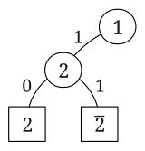</a>


<a id="ans-7-2-2-2-222"></a>

**222.** [题目](../sec-7-2-2-2.md#ex-7-2-2-2-222) 若 $A$ 是满足 $C$ 的自足集, 则从标号为 $C$ 的源顶点到 $\epsilon$ 的路上, 它也满足每个子句, 因为得到满足的字面值不可能同时消失. 逆命题见 <em>Discrete Appl. Math.</em> **107** (2000), 99–137, 定理 3.16.

<a id="ans-7-2-2-2-223"></a>

**223.** [题目](../sec-7-2-2-2.md#ex-7-2-2-2-223) (作者自己确信这个断言成立, 但一直未能给出一个形式证明.)

<a id="ans-7-2-2-2-224"></a>

**224.** [题目](../sec-7-2-2-2.md#ex-7-2-2-2-224) 对每个标号为 $F\mid\bar x$ 的公理 $A$ 且 $A$ 不是 $F$ 的公理的叶子, 将标号换为 $A\cup\{x\}$; 在这个叶子的所有祖先的标号中也加入 $x$. 这样得到一棵叶子标号为 $F$ 的公理的归结树. 若有标号改变, 根的标号为 $x$; 否则根的标号仍为 $\epsilon$.

[见 J. A. Robinson, <em>Machine Intelligence</em> **3** (1968), 77–94.]

<a id="ans-7-2-2-2-225"></a>

**225.** [题目](../sec-7-2-2-2.md#ex-7-2-2-2-225) 对子句 $A$ 的正则归结树, 若它至少有一个结点在 $A$ 的某个变量上作归结, 就称它是<em>棘手的</em>. 一棵导出 $A$ 的棘手的树 $T$, 总能变换成一棵导出某个子句 $A'\subseteq A$ 的不棘手的正则树 $T'$, 且 $T'$ 小于 $T$. <em>证明:</em> 假设 $T$ 棘手, 但它的各子树都不棘手. 不失一般性, 可找到一系列子树 $T_0,\ldots,T_p,T'_1,\ldots,T'_p$, 其中 $T_0=T$; 对 $1\le j\le p$, $T_{j-1}$ 由 $T_j$ 和 $T'_j$ 在变量 $x_j$ 上归结得到; 此外 $x_p\in A$. 可假设 $T_j$ 与 $T'_j$ 的标号为 $A_j,A'_j$, 其中 $A_j=x_j\cup R_j$, $A'_j=\bar x_j\cup R'_j$, 从而 $A_{j-1}=R_j\cup R'_j$. 令 $B_p=A_p$. 对于 <a id="pdf-612"></a><a id="p-592"></a> $j=p-1,p-2,\ldots,1$, 若 $x_j\notin B_{j+1}$, 令 $B_j=B_{j+1}$; 否则将 $B_{j+1}$ 与 $A'_j$ 归结, 得到 $B_j$. 由归纳法推得 $B_j\subseteq x_p\cup A_{j-1}$. 因而 $B_1\subseteq x_p\cup A_0=A$, 我们已用一棵小于 $T$ 的不棘手的树导出了 $B_1$.

现在可以证明一个比题目所要求的更强的结论: 若 $T$ 是导出子句 $A$ 的任意归结树, 且 $A\cup B$ 是任一包含 $A$ 的子句, 则存在一棵不棘手的正则归结树 $T_r$, 不大于 $T$, 它导出某个子句 $C\subseteq A\cup B$. 证明对 $T$ 的大小作归纳: 假定 $T$ 的根上的 $A=A'\cup A''$ 是由两棵子树 $T'$ 与 $T''$ 的标号 $x\cup A'$ 和 $\bar x\cup A''$ 经归结得到的. 找出不棘手的正则树 $T'_r$ 和 $T''_r$, 分别导出 $C'$ 与 $C''$, 其中 $C'\subseteq x\cup A'\cup B$, $C''\subseteq\bar x\cup A''\cup B$. 若 $x\in C'$ 且 $\bar x\in C''$, 在 $x$ 上归结 $T'_r$ 与 $T''_r$, 便得所需的 $T_r$. 否则可以取 $C=C'$, $T_r=T'_r$, 或取 $C=C''$, $T_r=T''_r$. [不妨把这个构造用于 (105) 中那些极不规则的归结, 很有意思.]

<a id="ans-7-2-2-2-226"></a>

**226.** [题目](../sec-7-2-2-2.md#ex-7-2-2-2-226) 起初 $\alpha$ 是根, $C(\alpha)=\epsilon$, $\lVert\alpha\rVert=N$, $s=0$. 若 $\alpha$ 不是叶子, 就有 $C(\alpha)=C(\alpha')\mathbin{\diamond}C(\alpha'')$, 其中对某个变量 $x$, 有 $x\in C(\alpha')$ 且 $\bar x\in C(\alpha'')$. 证明者说出 $x$, 若拖延者分别置 $x\gets0$ 或 $x\gets1$, 就分别改取 $\alpha\gets\alpha'$ 或 $\alpha\gets\alpha''$. 否则, $\min(\lVert\alpha'\rVert,\lVert\alpha''\rVert)\le\lVert\alpha\rVert/2$, 证明者可以继续下去.

<a id="ans-7-2-2-2-227"></a>

**227.** [题目](../sec-7-2-2-2.md#ex-7-2-2-2-227) 对变量个数 $n$ 作归纳. 若 $F$ 含空子句, 博弈结束, 拖延者得 0 分, 根的标号为 0. 否则, 证明者说出 $x$, 拖延者考虑 $F\mid x$ 与 $F\mid\bar x$ 的反驳的根的最小可能标号 $(m,m')$. 若 $m>m'$, 答 $x\gets1$ 保证得到 $m$ 分, 而答 $x\gets*$ 不会更好, 因为 $m'+1\le m$. 若 $m<m'$, 答 $x\gets0$ 保证得到 $m'$ 分; 若 $m=m'$, 答 $x\gets*$ 保证得到 $m+1$ 分. 因此, 对证明者所构造的反驳树的任一分支, 最优的拖延者总能至少取得与该分支的根的标号相等的分数. 反之, 若证明者总选择最优的 $x$, 拖延者便做不到更好.

(本题由 O. Kullmann 提出. 与[答案 133](#ans-7-2-2-2-133) 一样, 考虑全部 $3^n$ 个可能的部分赋值, 就能 “自底向上” 算出最优得分.)

<a id="ans-7-2-2-2-228"></a>

**228.** [题目](../sec-7-2-2-2.md#ex-7-2-2-2-228) 只需在 $i<j$ 且 $k<j$ 时采用 (100) 的传递性子句 $T_{ijk}$. [还要注意, $i=j$ 或 $k=j$ 时 $T_{ijk}$ 是重言式, 对归结没有用.]

<a id="ans-7-2-2-2-229"></a>

**229.** [题目](../sec-7-2-2-2.md#ex-7-2-2-2-229) 用二元关系来解释, 这些子句断言 $j\nprec j$, 当 $i\le k$ 且 $j<k$ 时成立传递律 “$i\prec j$ 且 $j\prec k$ 蕴涵 $i\prec k$”, 并且每个 $j$ 都有某个后继 $k$ 使 $j\prec k$. 最后一条公理与 $m$ 的有限性合在一起, 意味着必有一个圈 $j_0\prec j_1\prec\cdots\prec j_{p-1}\prec j_p=j_0$.

取这样的<em>最短</em>圈, 重排下标使 $j_p=\max\{j_0,\ldots,j_p\}$. 不可能有 $p\ge2$, 因为 (100′) 蕴涵 $j_{p-2}\prec j_p$, 产生一个更短的圈. 因而 $p=1$, 这又与 (99) 矛盾.

<a id="ans-7-2-2-2-230"></a>

**230.** [题目](../sec-7-2-2-2.md#ex-7-2-2-2-230) 如正文那样, 称这些公理为 $I_j,T_{ijk},M_{jm}$. 若略去 $I_{j_0}$, 对所有 $i,j$ 置 $x_{ij}=[j=j_0]$. 若略去 $T_{i_0j_0k_0}$, 对所有 $i\notin A=\{i_0,j_0,k_0\}$ 以及所有 $j$ 置 $x_{ij}=[j\in A]$; 又置 $x_{i_0j}=[j=j_0]$, $x_{j_0j}=[j=k_0]$, 若 $i_0\ne k_0$, 则置 $x_{k_0j}=[j=i_0]$. 若略去 $M_{j_0m}$, 则置 $x_{p_i p_j}=[i<j]$, 其中 $p_1\ldots p_m=1\ldots(j_0-1)(j_0+1)\ldots m j_0$. (同一构造表明, [答案 228](#ans-7-2-2-2-228) 的子句也是极小不可满足的.)

<a id="ans-7-2-2-2-231"></a>

**231.** [题目](../sec-7-2-2-2.md#ex-7-2-2-2-231) 由于 $G_{11}=M_{1m}$, 可假设 $j>1$. 于是 $G_{(j-1)j}=G_{(j-1)(j-1)}\mathbin{\diamond}I_{j-1}$. 若 $1\le i<j-1$, 则有 $G_{ij}=(\cdots((G_{(j-1)j}\mathbin{\diamond}A_{ijj})\mathbin{\diamond}A_{ij(j+1)})\mathbin{\diamond}\cdots)\mathbin{\diamond}A_{ijm}$, 其中 $A_{ijk}=G_{i(j-1)}\mathbin{\diamond}T_{i(j-1)k}=G_{ij}\lor\bar x_{(j-1)k}$. 于是可由这些子句导出 $B_{ij}=(\cdots((G_{ij}\mathbin{\diamond}T_{jij})\mathbin{\diamond}T_{ji(j+1)})\mathbin{\diamond}\cdots)\mathbin{\diamond}T_{jim}=G_{jj}\lor\bar x_{ji}$, $1\le i<j$, 从而得到 $G_{jj}=(\cdots((M_{jm}\mathbin{\diamond}B_{1j})\mathbin{\diamond}B_{2j})\mathbin{\diamond}\cdots)\mathbin{\diamond}B_{(j-1)j}$. 最后 $G_{mm}\mathbin{\diamond}I_m=\epsilon$.

<a id="pdf-613"></a><a id="p-593"></a>

<a id="ans-7-2-2-2-232"></a>

**232.** [题目](../sec-7-2-2-2.md#ex-7-2-2-2-232) 只须给出一棵深度为 $6\lg q+O(1)$ 的回溯树. 至多对六个变量分支, 就能找出[答案 176](#ans-7-2-2-2-176)(c) 中的颜色三元组 $\alpha_1$.

假设已知 $\alpha_j=\alpha$ 且 $\alpha_{j+p}=\alpha'$, 其中 $\alpha'$ 不能由 $\alpha$ 在 $p$ 步内得到; 初始时取 $j=1$, $\alpha=\alpha'=\alpha_1$, $p=q$, 确实如此. 若 $p=1$, 再作少数几次分支便会发现矛盾. 否则, 至多六次分支就能确定 $\alpha_l$, 其中 $l=j+\lfloor p/2\rfloor$; 或者 $\alpha_l$ 不能由 $\alpha$ 经 $\lfloor p/2\rfloor$ 步到达, 或者 $\alpha'$ 不能由 $\alpha_l$ 经 $\lceil p/2\rceil$ 步到达, 或二者都不能. 递归处理.

<a id="ans-7-2-2-2-233"></a>

**233.** [题目](../sec-7-2-2-2.md#ex-7-2-2-2-233) $C_9=C_6\mathbin{\diamond}C_8$, $C_{10}=C_1\mathbin{\diamond}C_9$, $C_{11}=C_3\mathbin{\diamond}C_{10}$, $C_{12}=C_7\mathbin{\diamond}C_{10}$, $C_{13}=C_4\mathbin{\diamond}C_{11}$, $C_{14}=C_2\mathbin{\diamond}C_{12}$, $C_{15}=C_{13}\mathbin{\diamond}C_{14}$, $C_{16}=C_5\mathbin{\diamond}C_{15}$, $C_{17}=C_6\mathbin{\diamond}C_{15}$, $C_{18}=C_8\mathbin{\diamond}C_{15}$, $C_{19}=C_{12}\mathbin{\diamond}C_{17}$, $C_{20}=C_{11}\mathbin{\diamond}C_{18}$, $C_{21}=C_{16}\mathbin{\diamond}C_{19}$, $C_{22}=C_{20}\mathbin{\diamond}C_{21}$.

<a id="ans-7-2-2-2-234"></a>

**234.** [题目](../sec-7-2-2-2.md#ex-7-2-2-2-234) 对不会让证明者违反 (107) 的任何询问都回答 $x_{jk}\gets*$. 这样, 证明者只有在每个巢都已被询问之后才能违反 (106).

<a id="ans-7-2-2-2-235"></a>

**235.** [题目](../sec-7-2-2-2.md#ex-7-2-2-2-235) 令 $C(k,A)=(\bigvee_{j=0}^k\bigvee_{a\in A}x_{ja})$, 因此 $C(0,\{1,\ldots,m\})=(x_{01}\lor\cdots\lor x_{0m})$, $C(m,\emptyset)=\epsilon$. 链由 $m$ 个阶段 $k=1,\ldots,m$ 组成. 在第 $k$ 阶段开始时, 对 $\{1,\ldots,m\}\setminus\{a\}$ 的每个含 $m-k$ 个元素的子集 $A$, 从第 $k-1$ 阶段的子句中导出子句 $\bar x_{ka}\lor C(k-1,A)$; 每个这样的子句需要用 (107) 作 $k$ 次归结. 第 $k$ 阶段以导出 $\{1,\ldots,m\}$ 的每个 $m-k$ 元子集 $A$ 的 $C(k,A)$ 结束, 每个子句用 (106) 作一次归结, 用本阶段开头的结果作 $k-1$ 次归结. (见 (103).) 因此第 $k$ 阶段共需 $\binom m{m-k}(k^2+k)$ 次归结.

例如, 当 $m=3$ 时, 各次归结的结果依次为:

$\overline{11}\,02\,03$, $\overline{12}\,01\,03$, $\overline{13}\,01\,02$, $01\,02\,11\,12$, $01\,03\,11\,13$, $02\,03\,12\,13$ (阶段 1);

$\overline{21}\,02\,11\,12$, $\overline{21}\,02\,12$, $\overline{21}\,03\,11\,13$, $\overline{21}\,03\,13$, $\overline{22}\,01\,12\,11$, $\overline{22}\,01\,11$, $\overline{22}\,03\,12\,13$, $\overline{22}\,03\,13$, $\overline{23}\,01\,13\,11$, $\overline{23}\,01\,11$, $\overline{23}\,02\,13\,12$, $\overline{23}\,02\,12$, $01\,11\,21\,22$, $01\,11\,21$, $02\,12\,22\,23$, $02\,12\,22$, $03\,13\,23\,22$, $03\,13\,23$ (阶段 2);

$\overline{31}\,11\,21$, $\overline{31}\,21$, $\overline{31}$, $\overline{32}\,12\,22$, $\overline{32}\,22$, $\overline{32}$, $\overline{33}\,13\,23$, $\overline{33}\,23$, $\overline{33}$, $32\,33$, $33$, $\epsilon$ (阶段 3).


[Stephen A. Cook 于 1972 年构造了这样的链 (未发表).]

<a id="ans-7-2-2-2-236"></a>

**236.** [题目](../sec-7-2-2-2.md#ex-7-2-2-2-236) 公理的对称性应当使 $m=2$ 的情形可以用计算机穷尽验证, $m=3$ 也许也行. 总之这个构造看来很难超越. Cook 在 1972 年猜测, 任何最短的归结证明, 对 $\{1,\ldots,m\}$ 的每个子集 $S$, 都至少包含一个子句 $C$ 使 $\bigcup_{\pm x_{jk}\in C}\{k\}=S$.

<a id="ans-7-2-2-2-237"></a>

**237.** [题目](../sec-7-2-2-2.md#ex-7-2-2-2-237) 其思想是对 $0\le j<m$, $1\le k<m$ 定义 $y_{jk}=x_{jk}\lor(x_{jm}\land x_{mk})$, 从而把 $m+1$ 只鸽子减少到 $m$ 只. 先添加 $6m(m-1)$ 个新子句
$$
(x_{jm}\lor z_{jk})\land(x_{mk}\lor z_{jk})\land(\bar x_{jm}\lor\bar x_{mk}\lor\bar z_{jk})\land(\bar x_{jk}\lor y_{jk})\land(y_{jk}\lor z_{jk})\land(x_{jk}\lor\bar y_{jk}\lor\bar z_{jk}),
$$
涉及 $2m(m-1)$ 个新变量 $y_{jk}$ 和 $z_{jk}$. 将这些子句依次称为 $A_{jk},\ldots,F_{jk}$.

若用 $P_j$ 表示 (106), 用 $H_{ijk}$ 表示 (107), 则要用归结导出 $P'_j=(y_{j1}\lor\cdots\lor y_{j(m-1)})$ 和 $H'_{ijk}=(\bar y_{ik}\lor\bar y_{jk})$. 首先, 将 $P_j$ 与 $D_{j1},\ldots,D_{j(m-1)}$ 归结得 $P'_j\lor x_{jm}$. 然后, $P_m\mathbin{\diamond}H_{jmm}=x_{m1}\lor\cdots\lor x_{m(m-1)}\lor\bar x_{jm}$, 可与 $G_{jk}=C_{jk}\mathbin{\diamond}E_{jk}=\bar x_{jm}\lor\bar x_{mk}\lor y_{jk}$ 归结, $1\le k<m$, 得 $P'_j\lor\bar x_{jm}$. 再来一步就得 $P'_j$. (这些操作可以由其直观 “意义” 来引导.)

由 $B_{jk}\mathbin{\diamond}F_{jk}=x_{jk}\lor x_{mk}\lor\bar y_{jk}$, 与 $H_{ijk}$ 和 $H_{imk}$ 归结即可得到 $Q_{ijk}=\bar x_{ik}\lor\bar y_{jk}$. 再由 $(Q_{jik}\mathbin{\diamond}F_{ik})\mathbin{\diamond}A_{ik}=x_{im}\lor\bar y_{ik}\lor\bar y_{jk}=R_{ijk}$. 最后如所求, $(R_{jik}\mathbin{\diamond}H_{ijm})\mathbin{\diamond}R_{ijk}=H'_{ijk}$. (构成 $R_{jik}$ 时需要 $j>i$ 的 $Q_{jik}$.)

将 $m+1$ 减至 $m$, 我们共用了 $5m^3-6m^2+3m$ 次归结. 重复直到 $m=0$, 每次都用新的 $y,z$ 变量, 约 $\tfrac54m^4$ 步后便得到 $\epsilon$.

[见 Stephen A. Cook, <em>SIGACT News</em> **8**,4 (1976 年 10 月), 28–32.]

<a id="ans-7-2-2-2-238"></a>

**238.** [题目](../sec-7-2-2-2.md#ex-7-2-2-2-238) 函数 $(1-cx)^{-x}=\exp(cx^2+c^2x^3/2+\cdots)$ 递增且大于 $e^{cx^2}$. 令 $c=1/(2n)$, $W=\sqrt{2n\ln r}$, $b=\lceil W\rceil$, 则 $f\le r<\rho^{-b}$. 此外, 当 <a id="pdf-614"></a><a id="p-594"></a> $n\ge w(\alpha_0)^2$ 且 $r\ge2$ 时, $W\ge w(\alpha_0)$; 因而如所求, $w(\alpha_0\vdash\epsilon)\le W+b\le\sqrt{8n\ln r}+1$. 陈述中的 ‘$-2$’ 照顾了 $r<2$ 的平凡情形.

(须注意, 在归纳证明中并不改变 $n$ 或 $W$. 顺便说, 在 $r=(1-W/(2n))^{-b}$ 的约束下, $W+b$ 的准确最小值在下述情形达到:
$$
W=2n(1-e^{-2T(z)})=4nz+\frac{2nz^3}3+\cdots;\qquad
b=\frac{\ln r}{2T(z)}=(\ln r)\left(\frac1{2z}-\frac12-\frac z4-\cdots\right),
$$
其中 $z^2=(\ln r)/(8n)$, $T(z)$ 为树函数. 因此看来引理 B 的证明很可能支持更强的结果 $w(\alpha_0\vdash\epsilon)<\sqrt{8n\ln r}-\tfrac12\ln r+1$.)

<a id="ans-7-2-2-2-239"></a>

**239.** [题目](../sec-7-2-2-2.md#ex-7-2-2-2-239) 令 $\alpha_0$ 由所有 $2^n$ 个长为 $n$ 的非重言式子句组成. 最短反驳为以它们为叶子的完全二叉树, 因为每个这样的子句都必须出现. 算法 A 表明, $2^n-1$ 次归结足以反驳 $n$ 个变量上的任何不可满足子句集; 从而 $\lVert\alpha_0\vdash\epsilon\rVert=2^n-1$, 这就是最坏情形.

<a id="ans-7-2-2-2-240"></a>

**240.** [题目](../sec-7-2-2-2.md#ex-7-2-2-2-240) 若 $A'$ 有 $t$ 个元素而 $\partial A'$ 少于 $t$ 个, 则对应于其邻点的 $5t$ 个整数 $f_{ij}$ 的序列中, 至少有 $2t$ 个数是先前已经出现过的. (事实上至少有 $2t+1$ 个重复, 因为恰好 $2t$ 个重复会在边界中留下至少 $t$ 个邻点; 不过用 $2t$ 计算较为简单, 而且只需要相当粗略的界.)

因此, 存在这种 $A'$ 的概率 $p_t$ 小于 $\binom{m+1}t\binom{5t}{2t}(3t/m)^{2t}$, 因为有 $\binom{m+1}t$ 种方法选 $A'$, $\binom{5t}{2t}$ 种方法选重复的位置, 这些位置至多有 $m^{2t}$ 种填法中的 $(3t)^{2t}$ 种. 又当 $t\le\tfrac12m$ 时, $\binom{m+1}t=\binom mt+\binom m{t-1}<2\binom mt$.

由习题 1.2.6–67 得 $p_t\le2(me/t)^t(5te/(2t))^{2t}(3t/m)^{2t}=2(ct/m)^t$, 其中 $c=225e^3/4\approx1130$. 又有 $p_0=p_1=0$. 所以当 $t\le m/3000$ 时, $p_t$ 的和小于 $2\sum_{t=2}^\infty(c/3000)^t\approx0.455$; 因此强扩张的概率大于 0.544.

<a id="ans-7-2-2-2-241"></a>

**241.** [题目](../sec-7-2-2-2.md#ex-7-2-2-2-241) 若 $0<|A'|\le m/3000$, 可将其中一个元素放入某个巢 $b_k\in\partial A'$. 然后用同样的方法安置其余元素, 因为 $b_k$ 不是它们的邻点.

<a id="ans-7-2-2-2-242"></a>

**242.** [题目](../sec-7-2-2-2.md#ex-7-2-2-2-242) 即使加入这些新公理, 定理 B 的证明仍然有效.

<a id="ans-7-2-2-2-243"></a>

**243.** [题目](../sec-7-2-2-2.md#ex-7-2-2-2-243) (a) 存在含 $t$ 个子句而 $V(F')$ 少于 $t$ 个元素的子族 $F'$ 的概率至多为 $\binom{\alpha n}t\binom nt(t/n)^{3t}\le(\alpha e^2t/n)^t$. 对 $1\le t\le\lg n$ 将此量求和得 $O(n^{-1})$; 对 $\lg n\le t\le n/(2\alpha e^2)$ 求和也是如此.

(b) 若 (a) 中的条件成立, 则由定理 7.5.1H 有一个从 $F'$ 到 $V(F')$ 的匹配; 所以能逐个给变量赋值, 使 $F'$ 满足. 因而若 $F$ 不可满足, 就需要用到多于 $n/(2\alpha e^2)$ 条公理.

(c) 设 $\lambda=\tfrac74$, 则存在含 $t$ 个子句且 $2|V(F')|-3|F'|<\tfrac12|F'|$ 的子族 $F'$ 的概率 $p_t$ 至多为
$$
\binom{\alpha n}t\binom n{\lambda t}\left(\frac{\lambda t}n\right)^{3t}
\le\left(\alpha e^{1+\lambda}\lambda^{3-\lambda}(t/n)^{1/4}\right)^t.
$$
有 $(e^{1+\lambda}\lambda^{3-\lambda})^4<10^6$; 所以当 $t\le n'$ 时 $p_t<c^t$, 其中 $c<1$, 而 $\sum_{t=n'/2}^{n'}p_t$ 指数地小.

(d) 由于 $n'<n/(2\alpha e^2)$, 每个反驳中几乎必然含有一个满足 $n'/2\le\mu(C)<n'$ 的子句 $C$. $C$ 所依赖的极小公理集 $F'$ 满足 $|F'|=\mu(C)$. 令 $k$ 为恰好只在 $F'$ 的一条公理中出现的 “边界” 变量的个数. 若 $v$ 是这样的变量, 我们可以使 $C$ 以及含 $v$ 的那条公理为假, 而使 $F'$ 的其他公理为真; 从而 $C$ 必定含 $v$ 或 $\bar v$. 有 $|V(F')|=k+|\text{非边界变量}|\le k+\tfrac12(3|F'|-k)$, 因为每个非边界变量至少出现两次. 因此相当必然有 $k\ge2|V(F')|-3|F'|\ge n'/4$. (注意与定理 B 的证明的相似之处.)

<a id="ans-7-2-2-2-244"></a>

**244.** [题目](../sec-7-2-2-2.md#ex-7-2-2-2-244) 有 $[A\cup B]^0=[A]^0[B]^0\cup[A]^1[B]^1$ 和 $[A\cup B]^1=[A]^0[B]^1\cup[A]^1[B]^0$, 其中集合的连接具有显然的意义. 当 $A=\emptyset$ 或 $B=\emptyset$ 时这些关系也成立, 因为 $[\emptyset]^0=\{\epsilon\}$, $[\emptyset]^1=\emptyset$.

<a id="pdf-615"></a><a id="p-595"></a>

<a id="ans-7-2-2-2-245"></a>

**245.** [题目](../sec-7-2-2-2.md#ex-7-2-2-2-245) (a) 以 $\bar e_{uv}$ 为条件时, 只需从 $G$ 中删去边 $u\mathbin{—}v$. 以 $e_{uv}$ 为条件时, 还要对 $l(u)$ 和 $l(v)$ 取补. 图有可能变得不连通; 这时它恰有两个分量, 按照标号之和一个为偶, 一个为奇. 偶分量的公理可满足, 可以舍去.

例如, $\alpha(G)\mid\{b,\bar e\}$ 与 $\alpha(G)\mid\{b,e\}$ 分别对应于下面的图. 在前一种情形中舍去左分量, 在后一种情形中舍去右分量.

<a href="../../../assets/volume4b/figures/satqa-a245.svg"></a>


(b) 若 $C\in\alpha(v)$, 可取 $V'=\{v\}$. 而 $\mu(\epsilon)=|V|$, 因为对每个 $u\in V$, 公理 $\bigcup_{v\in V\setminus\{u\}}\alpha(v)$ 都可满足.

(c) 若 $u\in V'$ 且 $v\notin V'$, 则存在一种赋值, 使 $C$ 及 $\alpha(u)$ 的一条公理为假, 同时对 $w\in V'\setminus\{u\}$ 满足所有 $\alpha(w)$, 因为 $|V'|$ 已经最小. 置 $e_{uv}\gets\bar e_{uv}$ 就会满足 $\alpha(u)$, 却不影响 $\alpha(w)$ 的公理 (它们不含 $e_{uv}$). 所以 $C$ 必须涉及 $e_{uv}$.

(d) 由 (b), 对 $\alpha(G)$ 的每个反驳都必含一个满足 $\tfrac13m\le\mu(C)<\tfrac23m$ 的子句 $C$. 对应的 $V'$ 满足 $|V'|/(|V'|+|\partial V'|)<(\tfrac23+8)/9$, 因此 $|\partial V'|>\tfrac1{26}|V'|$.

[性质 (i) 很有意思, 不过这个证明用不到它. 注意, 当 $G$ 为三次图时, $\alpha(G)$ 正好含有 $n=3m/2$ 个变量上的 $\tfrac83n\approx2.67n$ 个 3SAT 子句; 每个字面值出现四次. 在具有性质 (iii) 的图还不为人知的 1966 年, G. Tseytin 就已证明了用<em>正则</em>归结反驳 $\alpha(G)$ 的下界; A. Urquhart 在 <em>JACM</em> **34** (1987), 209–219 中得到一般归结的下界. 这里采用的简化论证出自 Ben-Sasson 和 Wigderson. 尽管很容易用模 2 线性方程反驳这些公理, $\alpha(G)$ 却需要指数长度的反驳链; 这件事实际上证明了回溯法并不适于处理异或方程! 斯坦福图库中的算法可以对无穷多个素数 $q$ 构造出合适的 Ramanujan 图 $\operatorname{raman}(2,q,3,0)$. 对多重图 $\operatorname{raman}(2,q,1,0)$ 和 $\operatorname{raman}(2,q,2,0)$ 也能得到同样的下界. 7.4.3 节将详细讨论扩张图.]

<a id="ans-7-2-2-2-246"></a>

**246.** [题目](../sec-7-2-2-2.md#ex-7-2-2-2-246) 将[习题 244](../sec-7-2-2-2.md#ex-7-2-2-2-244) 所说的 $[\{a_1,\ldots,a_k\}]^\ell$ 简写成 $[a_1\ldots a_k]^\ell$. 利用新变量 $x,y,z$, 可以引入 $\{xa,x\bar b,\bar x\bar ab,y\bar a,yb,\bar ya\bar b,zx,zy,\bar z\bar x\bar y\}$ 并将它们归结成 $[zab]^1$, 即 $z=a\oplus b$. 所以, 当 $z$ 为新变量时, 可以假设 ‘$z\gets a\oplus b$’ 是 “扩展归结硬件” 的一个合法原始操作. 此外还可用 $O(k)$ 步计算 $a_1\oplus\cdots\oplus a_k$: 置 $z_0\gets0$ (即子句 $[z_0]^1$, 也就是 $\bar z_0$), 当 $k\ge1$ 时置 $z_k\gets z_{k-1}\oplus a_k$.

令 $E(v)$ 中的边变量为 $a_1,\ldots,a_d$, 其中 $d$ 为 $v$ 的度. 置 $s_{v,0}\gets0$, $s_{v,k}\gets s_{v,k-1}\oplus a_k$, $s_v\gets s_{v,d}$, 即可算出 $s_v\gets a_1\oplus\cdots\oplus a_d$. 然后在 $O(2^d)$ 步内将 $s_v$ 与公理 $\alpha(v)$ 归结, 得到单字面值子句 $[s_v]^{l(v)\oplus1}$, 即 $s_v=l(v)$. 对全部 $v$ 求和, 这些操作共需 $O(N)$ 步.

另一方面, 我们还可以计算 $z_n\gets\bigoplus_v s_v$ 而得到零 (即 ‘$\bar z_n$’). 若做得巧妙, 并且能够预知 $G$, 事实上可以在 $O(mn)$ 步内完成: 随意选一个顶点 $v$, 置 $z_1\gets s_v$ (更确切地, 对 $0\le k\le d$ 置 $z_{1,k}\gets s_{v,k}$). 对 $1\le j<n$, 已知 $z_j$ 及其所有子变量 $z_{j,k}$, 就计算 $z_{j+1}\gets z_j\oplus s_u$, 其中 $u$ 是使 $s_{u,1}=z_{j,1}$ 的尚未使用的顶点. 我们可以安排边的次序, 使得若 $z_j$ 与 $s_u$ 共有 $p$ 个边变量, 则对 $1\le k\le p$ 有 $z_{j,k}=s_{u,k}$. 设 $z_j$ 与 $s_u$ 的其余变量分别为 $a_1,\ldots,a_q$ 与 $b_1,\ldots,b_r$; 我们将它们合并为序列 $c_1,\ldots,c_{q+r}$, 它正是以后使用 $z_{j+1}$ 时所需的序列. 所以置 $z_{j+1,0}\gets0$, $z_{j+1,k}\gets z_{j+1,k-1}\oplus c_k$, $z_{j+1}\gets z_{j+1,q+r}$.

由上一段所形成的子句, 归结能对 $1\le k\le p$ 推出 $[z_{j,k}s_{u,k}]^0$, 从而推出 $[z_{j+1,0}z_{j,p}s_{u,p}]^1$ (即 $z_{j+1,0}=z_{j,p}\oplus s_{u,p}$). 此外, 若 $c_k=a_i$, 且已知 $z_{j+1,k-1}=z_{j,s}\oplus s_{u,t}$, 其中 $s=p+i-1$ <a id="pdf-616"></a><a id="p-596"></a> 且 $t=p+k-i$, 则归结能推出 $z_{j+1,k}=z_{j,s+1}\oplus s_{u,t}$; 当 $c_k=b_i$ 时有类似的公式. 因此归结如所求给出 $z_{j+1}\gets z_j\oplus s_u$. 最终, 由单字面值子句 $s_v=l(v)$ 我们可以同时推出 $z_n$ 与 $\bar z_n$.

<a id="ans-7-2-2-2-247"></a>

**247.** [题目](../sec-7-2-2-2.md#ex-7-2-2-2-247) 从 $\{12,\bar12,\bar1\bar2\}$ 中消去 $x_2$ 得 $\{\bar1\}$; 再消去 $x_1$ 得 $\emptyset$. 因而这五个子句是可满足的.

<a id="ans-7-2-2-2-248"></a>

**248.** [题目](../sec-7-2-2-2.md#ex-7-2-2-2-248) 有 $F(x_1,\ldots,x_n)=(x_n\lor A'_1)\land\cdots\land(x_n\lor A'_p)\land(\bar x_n\lor A''_1)\land\cdots\land(\bar x_n\lor A''_q)\land A'''_1\land\cdots\land A'''_r=(x_n\lor G')\land(\bar x_n\lor G'')\land G'''$, 其中 $G'=A'_1\land\cdots\land A'_p$, $G''=A''_1\land\cdots\land A''_q$, $G'''=A'''_1\land\cdots\land A'''_r$ 仅依赖于 $\{x_1,\ldots,x_{n-1}\}$. 因此 $F'=(G'\lor G'')\land G'''$; 而 $G'\lor G''=\bigwedge_{i=1}^p\bigwedge_{j=1}^q(A'_i\lor A''_j)$ 的子句就是消去 $x_n$ 所得的各个归结式.

<a id="ans-7-2-2-2-249"></a>

**249.** [题目](../sec-7-2-2-2.md#ex-7-2-2-2-249) 如正文那样学得 $C_7=\bar2\bar3$ 之后, 置 $d\gets2$, $l_2\gets\bar2$, $C_j=2\bar3$, 学得 $C_8=\bar3$, 并置 $d\gets1$, $l_1\gets\bar3$. 然后取 $l_2\gets\bar4$ (譬如说), $l_3\gets\bar1$, $l_4\gets\bar2$. 现在 $C_i=1234$ 变为假; 置 $l_4\gets2$ 且 $C_j=1\bar2$ 后, 学得 $C_9=134$, 置 $l_3\gets1$, 并学得 $C_{10}=134\mathbin{\diamond}\bar13=34$. 最后 $l_2\gets4$, 学得 $C_{11}=3$; $l_1\gets3$, 学得 $C_{12}=\epsilon$.

<a id="ans-7-2-2-2-250"></a>

**250.** [题目](../sec-7-2-2-2.md#ex-7-2-2-2-250) $l_1\gets1$, $l_2\gets3$, $l_3\gets\bar2$, $l_4\gets4$; 学得 $\bar12\bar3$; $l_3\gets2$, $l_4\gets4$; 学得 $\bar1\bar2\bar3$ 和 $\bar1\bar3$; $l_2\gets\bar3$, $l_3\gets\bar2$, $l_4\gets4$; 学得 $\bar123$; $l_3\gets2$, $l_4\gets4$; 学得 $\bar1\bar23$, $\bar13$, $\bar1$; $l_1\gets\bar1$, $l_2\gets3$, $l_3\gets\bar4$, $l_4\gets2$; 学得 $1\bar34$; $l_3\gets4$, $l_4\gets\bar2$, $l_4\gets2$.

<a id="ans-7-2-2-2-251"></a>

**251.** [题目](../sec-7-2-2-2.md#ex-7-2-2-2-251) 算法 I 有如下性质: 若 $i_1<\cdots<i_k=d$, 且在步骤 I4 返回 I2 时刚学得新子句 $l_{i_1}\lor\cdots\lor l_{i_k}$, 则栈中已有 $\bar l_{i_1},\ldots,\bar l_{i_{k-1}},l_{i_k}$. 这些字面值限制了我们利用新子句的能力; 所以看来若不比 Stålmarck 多作几次归结, 就不可能解决这个问题.

不过, 可以如下进行. 对 $1\le i,k<m$, 令 $M''_{imk}$ 为子句 $x_{m1}\lor\cdots\lor x_{m(k-1)}\lor x_{ik}\lor\cdots\lor x_{i(m-1)}\lor\bar x_{im}$. 用 $ij$ 表示 $x_{ij}$, 当 $m=3$ 时, 开始先将 $\overline{11},\overline{12},13,\overline{21},\overline{22},23,\overline{31},\overline{32},33$ 放在栈中. 这时步骤 I3 有 $C_i=I_3$, 步骤 I4 有 $C_j=M_{33}$; 所以步骤 I5 学得 $I_3\mathbin{\diamond}M_{33}=M_{32}$. I4 现在将 $\overline{32}$ 变为 32 并选择 $C_j=T_{232}$; 于是 I5 学得 $M_{32}\mathbin{\diamond}T_{232}=M''_{232}$. 步骤 I4 将 $\overline{31}$ 变为 31 并选择 $C_j=T_{231}$; 现在学得 $M''_{232}\mathbin{\diamond}T_{231}=M''_{231}$. 接着学得 $M''_{231}\mathbin{\diamond}M_{23}=M_{22}$; 将 $\overline{22}$ 变为 22 之后, 还学得 $M_{21}$.

栈现含 $\overline{11},\overline{12},13,21$. 我们加上 $\overline{31},\overline{32}$, 接着学得 $M_{32}\mathbin{\diamond}T_{132}=M''_{132}$, $M''_{132}\mathbin{\diamond}T_{131}=M''_{131}$, $M''_{131}\mathbin{\diamond}M_{13}=M_{12}$. 栈现含 $\overline{11},12$, 实质上已把 $m$ 从 3 减至 2.

类似地, 用 $O(m^2)$ 次归结便会对 $i=m-1,\ldots,1$ 学得 $M_{i(m-1)}$, 而且栈中将留下 $\bar x_{11},\ldots,\bar x_{1(m-2)},x_{1(m-1)}$, 使此过程可以继续.

<a id="ans-7-2-2-2-252"></a>

**252.** [题目](../sec-7-2-2-2.md#ex-7-2-2-2-252) 不能. 消元过程会产生 $\bar x_{12}\lor\bar x_{23}\lor\cdots\lor\bar x_{89}\lor x_{19}$ 之类的大量子句. 这些子句虽然有效, 实际上却没有什么帮助.

然而习题 373 证明, 若只考虑[习题 228](../sec-7-2-2-2.md#ex-7-2-2-2-228) 的传递性子句, 证明确实可以在多项式时间内完成 (!).

<a id="ans-7-2-2-2-253"></a>

**253.** [题目](../sec-7-2-2-2.md#ex-7-2-2-2-253) 沿着一串强制走法前进, 就会发生冲突:

<table id="sat-trail253"><thead><tr><th>t</th><th>$L_t$</th><th>层</th><th>理由</th></tr></thead><tbody>
<tr><td>0</td><td>$\bar{6}$</td><td>1</td><td>$\Lambda$</td></tr>
<tr><td>1</td><td>$4$</td><td>1</td><td>$46$</td></tr>
<tr><td>2</td><td>$5$</td><td>2</td><td>$\Lambda$</td></tr>
<tr><td>3</td><td>$\bar{3}$</td><td>2</td><td>$\bar{3}\bar{4}\bar{5}$</td></tr>
<tr><td>4</td><td>$9$</td><td>2</td><td>$369$</td></tr>
<tr><td>5</td><td>$\bar{7}$</td><td>2</td><td>$\bar{5}\bar{7}\bar{9}$</td></tr>
<tr><td>6</td><td>$\bar{1}$</td><td>2</td><td>$\bar{1}\bar{5}\bar{9}$</td></tr>
<tr><td>7</td><td>$8$</td><td>2</td><td>$678$</td></tr>
<tr><td>8</td><td>$2$</td><td>2</td><td>$123$</td></tr>
<tr><td>9</td><td>$\bar{2}$</td><td>2</td><td>$\bar{2}\bar{5}\bar{8}$</td></tr>
</tbody></table>


现在有 $\bar2\bar5\bar8\longrightarrow\bar2\bar5\bar8\mathbin{\diamond}123=13\bar5\bar8\longrightarrow13\bar567\longrightarrow3\bar567\bar9\longrightarrow3\bar56\bar9\longrightarrow3\bar56\longrightarrow\bar4\bar56$; 因此学得 $\bar4\bar56$ (它可以简化为 $\bar56$, 因为如[习题 257](../sec-7-2-2-2.md#ex-7-2-2-2-257) 所说明, $\bar4$ 是 “冗余的”).

<a id="pdf-617"></a><a id="p-597"></a>

现在以 $\bar4\bar56$ 或 $\bar56$ 为理由置 $L_2\gets\bar5$, 就强制给出 $7,\bar1,3,9,\bar2,\bar8,8$, 全在第 1 层; 由这一冲突很快就能学得<em>单位</em>子句 6. (接下来将开辟第 0 层, 置 $L_0\gets6$. 在第 0 层无须给出 “理由”.)

<a id="ans-7-2-2-2-254"></a>

**254.** [题目](../sec-7-2-2-2.md#ex-7-2-2-2-254) 在第 1 层推出 $3,2,4,\bar4$ 之后, 它会发现 $\bar2\bar4\mathbin{\diamond}4\bar3=\bar2\bar3$ 和 $\bar2\bar3\mathbin{\diamond}2\bar3=\bar3$, 因而学得 $\bar3$. (也可能在推出 $\bar2$ 后学得 $\bar3$.) 接着将在第 0 层推出 $\bar3,\bar1,2,\bar4$.

<a id="ans-7-2-2-2-255"></a>

**255.** [题目](../sec-7-2-2-2.md#ex-7-2-2-2-255) 例如 $\{\bar1\bar2\bar4,\bar2\bar3\bar5,456,45\bar6\}$. [由于按正文所述过程学得的子句 $c'$ 中恰好有一个字面值 $l$ 来自冲突层 $d$, 因此 $\bar l$ 在轨迹中的位置被称为 “唯一蕴涵点” (UIP). 如果 $l$ 不是该层的决策字面值, 就可以将 $c'$ 与 $l$ 的理由归结, 再找到一个 UIP; 但每作一次新的归结都有可能增大 $b$ 阵列, 从而限制回跳的幅度. 所以我们在第一个 UIP 处停下!]

<a id="ans-7-2-2-2-256"></a>

**256.** [题目](../sec-7-2-2-2.md#ex-7-2-2-2-256) 若它为假, 则字面值 $50,26,\ldots,30$ 都为真; 因此 $\overline{25},23,29$ 也为真, 产生矛盾. 所以从 $\overline{23}\,\overline{26}\ldots\overline{50}$ 出发, 与 $23\,25\,27$, $25\,27\,29$, $\overline{25}\,\overline{30}\ldots\overline{70}$ 作归结, 就得到 ‘\*\*’. [类似而更简单地, 将 $\overline{11}\,\overline{16}\ldots\overline{56}$ 与 $31\,61\,91$, $41\,66\,91$, $56\,61\,66$ 归结, 即可学得 (122).]

<a id="ans-7-2-2-2-257"></a>

**257.** [题目](../sec-7-2-2-2.md#ex-7-2-2-2-257) (a) 假定第 $d'>0$ 层的 $\bar l'$ 是冗余的. 则 $l'$ 的理由中有一个 $l''$ 也在第 $d'$ 层; 并且 $l''$ 或者在 $c$ 中, 或者是冗余的. 对轨迹中的位置作归纳.

(b) 可设冲突归结中所用的戳记值 $s$ 是 3 的倍数, 且所有戳记都 $\le s$. 于是若已知 $\bar l$ 冗余, 可给字面值 $l$ 加上戳记 $\mathtt S(|l|)\gets s+1$; 若已知 $\bar l$ 不冗余且不在 $c$ 中, 则标为 $s+2$. (这些戳记用作 “记忆缓存”, 避免重复工作.) 在构造 $c$ 时, 除字面值外还可给<em>层</em>加戳记. 若第 $d'$ 层恰有一个 $b_i$, 置 $\mathtt{LS}[d']\gets s$; 若有多个, 则置为 $s+1$.

于是对于 $1\le j\le r$, $\bar b_j$ 是冗余的当且仅当 $\mathtt{LS}[\operatorname{lev}(b_j)]=s+1$ 且 $\operatorname{red}(\bar b_j)$ 为真, 其中 $\operatorname{lev}(l)=\mathtt{VAL}(|l|)\gg1$, $\operatorname{red}(\bar l)$ 是如下的递归过程: “若 $l$ 为决策字面值, 返回假. 否则令 $(l\lor\bar a_1\lor\cdots\lor\bar a_k)$ 为 $l$ 的理由. 对于满足 $\operatorname{lev}(a_i)>0$ 的每个 $1\le i\le k$, 若 $\mathtt S(|a_i|)=s+2$, 返回假; 若 $\mathtt S(|a_i|)<s$, 且 $\mathtt{LS}[\operatorname{lev}(a_i)]<s$ 或 $\operatorname{red}(\bar a_i)$ 为假这两个条件中至少一个成立, 就置 $\mathtt S(|a_i|)\gets s+2$ 并返回假. 但若这些情况都不发生, 则置 $\mathtt S(|l|)\gets s+1$ 并返回真.”

[见 Allen Van Gelder, <em>LNCS</em> **5584** (2009), 141–146.]

<a id="ans-7-2-2-2-258"></a>

**258.** [题目](../sec-7-2-2-2.md#ex-7-2-2-2-258) 在[表 3](../sec-7-2-2-2.md#tab-7-2-2-2-3) 中这个断言为真, 但一般来说为假. 试看[表 3](../sec-7-2-2-2.md#tab-7-2-2-2-3) 的后续: 决策 $L_{44}=\overline{57}$ 导致检查 57 的监视表, 因而以某种次序强制给出 15、78、87 (以及其他字面值), 理由是子句 $15\,57\,36$, $78\,57\,36$, $87\,57\,27$. 接着子句 $\overline{96}\,\overline{87}\ldots\overline{15}$ 将强制给出 $\overline{96}$; 若这个子句监视的字面值为 $\overline{96}$ 和 $\overline{15}$ (所以 $\overline{78}$ 和 $\overline{87}$ 不会使它受到检查), 则不论轨迹的次序如何, 在发生强制时该子句的第二个字面值都是 $\overline{15}$.

<a id="ans-7-2-2-2-259"></a>

**259.** [题目](../sec-7-2-2-2.md#ex-7-2-2-2-259) 当 $0.7245<\rho<0.7548$ 时, $1+\rho^6+\rho^7<\rho+\rho^2$. (实际上可以有任意多个交叉点: 考虑多项式 $(1-\rho-\rho^2)(1-\rho^3-\rho^6)(1-\rho^9-\rho^{18})$.)

<a id="ans-7-2-2-2-260"></a>

**260.** [题目](../sec-7-2-2-2.md#ex-7-2-2-2-260) 首先, 为了在堆中得到一个随机置换, 可以使用算法 3.4.2P 的一个变形: 依次对 $k\gets1,2,\ldots,n$, 令 $j$ 为 $[0\mathinner{\ldotp\ldotp}k-1]$ 中的随机整数, 置 $\mathtt{HEAP}[k-1]\gets\mathtt{HEAP}[j]$, $\mathtt{HEAP}[j]\gets k$. 然后对 $0\le j<n$ 置 $\mathtt{HLOC}(\mathtt{HEAP}[j])\gets j$.

其次, 置 $F\gets0$, 对 $2\le l\le2n+1$ 置 $W_l\gets0$, 并置 $c\gets3$. 对每个输入子句 $l_0l_1\ldots l_{k-1}$ 作如下操作: 若 $k=0$, 或 $k=1$ 且 $0\le\mathtt{VAL}(|l_0|)\ne(l_0\mathbin{\&}1)$, 则以失败告终. 若 $k=1$ 且 $\mathtt{VAL}(|l_0|)<0$, 置 $\mathtt{VAL}(|l_0|)\gets l_0\mathbin{\&}1$, $\mathtt{TLOC}(|l_0|)\gets F$, $L_F\gets l_0$, $F\gets F+1$. 若 $k>1$, 对 $0\le j<k$ 置 $\mathtt{MEM}[c+j]\gets l_j$; 又置 $\mathtt{MEM}[c-1]\gets k$, $\mathtt{MEM}[c-2]\gets W_{l_0}$, $W_{l_0}\gets c$, $\mathtt{MEM}[c-3]\gets W_{l_1}$, $W_{l_1}\gets c$, $c\gets c+k+3$.

<a id="pdf-618"></a><a id="p-598"></a>

最后, 置 $\mathtt{MINL}\gets\mathtt{MAXL}\gets c+2$ (给第一个学得子句的前导部分留出两个存放额外数据的单元). 当然还须确保 MEM 足够大.

<a id="ans-7-2-2-2-261"></a>

**261.** [题目](../sec-7-2-2-2.md#ex-7-2-2-2-261) (在本解答中, $l_j$ 始终是 $\mathtt{MEM}[c+j]$ 的简写.) 置 $q\gets0$, $c\gets W_{\bar l}$. 当 $c\ne0$ 时, 作如下操作: 置 $l'\gets l_0$. 若 $l'\ne\bar l$ (从而 $l_1=\bar l$), 置 $c'\gets l_{-3}$; 否则置 $l'\gets l_1$, $l_0\gets l'$, $l_1\gets\bar l$, $c'\gets l_{-2}$, $l_{-2}\gets l_{-3}$, $l_{-3}\gets c'$. 若 $\mathtt{VAL}(|l_0|)\ge0$ 且 $\mathtt{VAL}(|l_0|)+l_0$ 为偶数 (即 $l_0$ 为真), 执行下列操作:
$$
\text{若 }q\ne0,\ \text{置 }\mathtt{MEM}[q-3]\gets c,\ \text{否则置 }W_{\bar l}\gets c;\ \text{再置 }q\gets c.\tag{*}
$$
否则置 $j\gets2$. 当 $j<l_{-1}$, $\mathtt{VAL}(|l_j|)\ge0$ 且 $\mathtt{VAL}(|l_j|)+l_j$ 为奇数时, 置 $j\gets j+1$. 若此时 $j<l_{-1}$, 置 $l_1\gets l_j$, $l_j\gets\bar l$, $l_{-3}\gets W_{l_1}$, $W_{l_1}\gets c$. 但若 $j=l_{-1}$, 则执行上面的 (*); 若 $\mathtt{VAL}(|l_0|)\ge0$, 转到 C7; 否则置 $L_F\gets l_0$ 等等 (见步骤 C4). 每次继续循环前置 $c\gets c'$.

最后, 当 $c=0$ 时, 执行上面的 (*) 以结束 $\bar l$ 的新监视表.

<a id="ans-7-2-2-2-262"></a>

**262.** [题目](../sec-7-2-2-2.md#ex-7-2-2-2-262) 为在 C6 中删去 $k=\mathtt{HEAP}[0]$, 置 $h\gets h-1$, $\mathtt{HLOC}(k)\gets-1$. 若 $h=0$, 停止. 否则置 $i\gets\mathtt{HEAP}[h]$, $\alpha\gets\mathtt{ACT}(i)$, $j\gets0$, $j'\gets1$, 并在 $j'<h$ 时作如下操作: 置 $\alpha'\gets\mathtt{ACT}(\mathtt{HEAP}[j'])$; 若 $j'+1<h$ 且 $\mathtt{ACT}(\mathtt{HEAP}[j'+1])>\alpha'$, 置 $j'\gets j'+1$, $\alpha'\gets\mathtt{ACT}(\mathtt{HEAP}[j'])$; 若 $\alpha\ge\alpha'$, 置 $j'\gets h$; 否则置 $\mathtt{HEAP}[j]\gets\mathtt{HEAP}[j']$, $\mathtt{HLOC}(\mathtt{HEAP}[j'])\gets j$, $j\gets j'$, $j'\gets2j+1$. 然后置 $\mathtt{HEAP}[j]\gets i$, $\mathtt{HLOC}(i)\gets j$.

在 C7 中, 置 $k\gets|l|$, $\alpha\gets\mathtt{ACT}(k)+\mathtt{DEL}$, $\mathtt{ACT}(k)\gets\alpha$, $j\gets\mathtt{HLOC}(k)$. 若 $j>0$, 执行 “向上筛” 操作: “反复置 $j'\gets(j-1)\gg1$ 和 $i\gets\mathtt{HEAP}[j']$, 若 $\mathtt{ACT}(i)\ge\alpha$ 则退出; 否则置 $\mathtt{HEAP}[j]\gets i$, $\mathtt{HLOC}(i)\gets j$, $j\gets j'$, 若 $j=0$ 则退出. 然后置 $\mathtt{HEAP}[j]\gets k$, $\mathtt{HLOC}(k)\gets j$.”

为在 C8 中插入 $k$, 置 $\alpha\gets\mathtt{ACT}(k)$, $j\gets h$, $h\gets h+1$; 若 $j=0$, 置 $\mathtt{HEAP}[0]\gets k$, $\mathtt{HLOC}(k)\gets0$; 否则执行向上筛操作.

<a id="ans-7-2-2-2-263"></a>

**263.** [题目](../sec-7-2-2-2.md#ex-7-2-2-2-263) (本解答还设置[答案 257](#ans-7-2-2-2-257) 中所需的层戳记 $\mathtt{LS}[d]$, 假定 LS 阵列初值为零.) 让 “提高 $l$” 表示像[答案 262](#ans-7-2-2-2-262) 中那样将 $\mathtt{ACT}(|l|)$ 增加 DEL. 又令 $\operatorname{blit}(l)$ 为如下的子程序: “若 $\mathtt S(|l|)=s$, 什么也不做. 否则置 $\mathtt S(|l|)\gets s$, $p\gets\operatorname{lev}(l)$. 若 $p>0$, 提高 $l$; 然后若 $p=d$, 置 $q\gets q+1$; 否则置 $r\gets r+1$, $b_r\gets\bar l$, $d'\gets\max(d',p)$, 且若 $\mathtt{LS}[p]\le s$, 置 $\mathtt{LS}[p]\gets s+[\mathtt{LS}[p]=s]$.”

从 C4 进入步骤 C7 时, 假定 $d>0$, 置 $d'\gets r\gets0$, $q\gets-1$, $s\gets s+3$, 并对 $0\le j<k$ 执行 $\operatorname{blit}(l_j)$. 又置 $t\gets\max(\mathtt{TLOC}(|l_0|),\ldots,\mathtt{TLOC}(|l_{k-1}|))$. 然后, 当 $q>0$ 时, 置 $l\gets L_t$, $t\gets t-1$; 若 $\mathtt S(|l|)=s$, 则置 $q\gets q-1$, 若 $R_l\ne\Lambda$, 令子句 $R_l$ 为 $l_0l_1\ldots l_{k-1}$ 并对 $1\le j<k$ 执行 $\operatorname{blit}(l_j)$. 最后置 $l'\gets L_t$, 当 $\mathtt S(|l'|)\ne s$ 时置 $t\gets t-1$, $l'\gets L_t$.

现在可如[答案 257](#ans-7-2-2-2-257) 那样检查新子句的冗余性. 在步骤 C9 中存放它时有一点很微妙: <em>必须监视一个在第 $d'$ 层定值的字面值.</em> 因此置 $c\gets\mathtt{MAXL}$, $\mathtt{MEM}[c]\gets\bar l'$, $k\gets0$, $j'\gets1$; 对满足 $\mathtt S(|b_j|)=s$ 的每个 $1\le j\le r$, 置 $k\gets k+1$ 并作如下操作: 若 $j'=0$ 或 $\operatorname{lev}(b_j)<d'$, 置 $\mathtt{MEM}[c+k+j']\gets\bar b_j$; 否则置 $\mathtt{MEM}[c+1]\gets\bar b_j$, $j'\gets0$, $\mathtt{MEM}[c-2]\gets W_{\bar l'}$, $W_{\bar l'}\gets c$, $\mathtt{MEM}[c-3]\gets W_{\bar b_j}$, $W_{\bar b_j}\gets c$. 最后置 $\mathtt{MEM}[c-1]\gets k+1$, $\mathtt{MAXL}\gets c+k+6$.

<a id="ans-7-2-2-2-264"></a>

**264.** [题目](../sec-7-2-2-2.md#ex-7-2-2-2-264) 可维护一个 “历史代码” 阵列, 在设置 $L_F$ 时将 $H_F$ 置为 0、2、4 或 6, 然后用 $H_t+(L_t\mathbin{\&}1)$ 作为代表轨迹位置 $t$ 的走法代码, $0\le t<F$. 历史代码 6、4、0 分别适用于步骤 C1、C4、C6; 在 C9 中若 $l'$ 曾是决策字面值用代码 2, 否则用代码 6. [这些走法代码在轨迹被冲刷并重新开始时<em>并不</em>以字典序递增, 所以不像其他算法中的代码那样能很好地展示进度.]

<a id="ans-7-2-2-2-265"></a>

**265.** [题目](../sec-7-2-2-2.md#ex-7-2-2-2-265) (1) 轨迹上 $G\le t<F$ 的字面值 $L_t$ 已变为真, 但还没有查看 $\bar L_t$ 的监视表. (2) 若 $l_0$ 为真, 从而 $c$ 已满足, 当 $l_1$ 变为假时步骤 C4 不会 <a id="pdf-619"></a><a id="p-599"></a> 将 $c$ 从 $l_1$ 的监视表中删去. (这种做法合理, 因为在回溯步骤 C8 中 $l_1$ 恢复自由之前, 不会再查看 $c$.) (3) 成为 $l_0$ 的理由的子句, 仍保留在其假字面值 $l_1$ 的监视表中. (4) 在完整运行中, 触发冲突的子句可以保留两个均为假的受监视字面值.

一般说来, 一个为假的受监视字面值必定在其子句中所有字面值的最高轨迹层上定值.

<a id="ans-7-2-2-2-266"></a>

**266.** [题目](../sec-7-2-2-2.md#ex-7-2-2-2-266) 若 $U<p$, 其中 $U$ 是 0 到 1 之间的均匀随机数, 就这样做: 取 $0\le j<h$ 的随机整数 $j$, 置 $k\gets\mathtt{HEAP}[j]$. 若 $j=0$ 或 $\mathtt{VAL}(k)\ge0$, 照常执行 C6. 否则对 $k$ 分支 (不必费事将 $k$ 从堆中删去).

<a id="ans-7-2-2-2-267"></a>

**267.** [题目](../sec-7-2-2-2.md#ex-7-2-2-2-267) 如算法 L, 给每个字面值 $l$ 设置顺序表 $\mathtt{BIMP}(l)$, 包含所有使 $\bar l\lor l'$ 为二元子句的字面值 $l'$. 又当传播算法因 $l'\in\mathtt{BIMP}(l)$ 而置 $L_F\gets l'$ 时, 可以置 $R_{l'}\gets-l$, 代替用正的子句号作 “理由”. (注意, 既然二元子句隐式地表示在 BIMP 表中, 就无须在 MEM 中显式表示. 作者实现算法 C 时只用 BIMP 表加快处理原始输入中出现的二元子句. 这样做的好处是简单, 因为每张表所需的确切空间可以一次分配, 永久使用. 实际中学得的二元子句相对少见, 所以采用监视字面值通常已经足够, 无须设置在算法 L 中起重要作用的那套复杂的伙伴系统.)

下面更精确地说明 BIMP 怎样加快内循环. 由于二元传播很快, 我们希望尽早执行它, 因而引入类似于 (62) 的广度优先搜索:
$$
\begin{aligned}
&\text{置 }H\gets F;\ \text{对每个 }l'\in\mathtt{BIMP}(l_0)\text{ 处理 }l';\\
&\text{当 }H<F\text{ 时, 置 }l_0\gets L_H,\ H\gets H+1,\\
&\qquad\text{并对每个 }l'\in\mathtt{BIMP}(l_0)\text{ 处理 }l'.\tag{**}
\end{aligned}
$$
这里 “处理 $l'$” 的意思是: “若 $l'$ 为真, 什么也不做; 若 $l'$ 为假, 以 $\bar l_0\lor l'$ 为冲突子句转到 C7; 否则置 $L_F\gets l'$, $\mathtt{TLOC}(|l'|)\gets F$, $\mathtt{VAL}(|l'|)\gets2d+(l'\mathbin{\&}1)$, $R_{l'}\gets-l_0$, $F\gets F+1$.” 在[答案 261](#ans-7-2-2-2-261) 中置 $c\gets c'$ 之前执行 (**). 此外, 在步骤 C1 中置 $G\gets0$ 后, 以及在 C6 和 C9 中置 $F\gets F+1$ 后, 均立即置 $E\gets F$; 在步骤 C3 中置 $G\gets G+1$ 后, 若 $G\le E$, 就以 $l_0\gets l$ 执行 (**).

[答案 263](#ans-7-2-2-2-263) 也容易相应修改: 若 $R_l$ 的值为负数 $-l'$, 就将 “子句 $R_l$” 当作二元子句 $(l\lor\bar l')$ 处理.

<a id="ans-7-2-2-2-268"></a>

**268.** [题目](../sec-7-2-2-2.md#ex-7-2-2-2-268) 若 $\mathtt{MEM}[c-1]=k\ge3$ 是子句 $c$ 的大小, 且 $1<j<k$, 则可如下删去 $\mathtt{MEM}[c+j]$ 中的字面值 $l$: 置 $k\gets k-1$, $\mathtt{MEM}[c-1]\gets k$, $l'\gets\mathtt{MEM}[c+k]$, $\mathtt{MEM}[c+j]\gets l'$, $\mathtt{MEM}[c+k]\gets l+f$, 其中 $f$ 是一个将已删除字面值与普通字面值区分开的标志 (通常为 $2^{31}$). (当前层 $d$ 为零时无须这样做; 因此可以假定删除前 $k\ge3$ 且 $j>1$. 需要标志, 是为了使处理整个子句集的全局操作, 如清除算法, 能安然越过已删除的字面值. MEM 中的最后一个子句后面应跟着一个已知不带标志的元素 0.)

<a id="ans-7-2-2-2-269"></a>

**269.** [题目](../sec-7-2-2-2.md#ex-7-2-2-2-269) (a) 若当前子句含有不在平凡子句中的字面值 $l=\bar L_t$, 取最大的这种 $t$, 将当前子句与 $R_{\bar l}$ 归结.

(b) 对 $1\le j\le9$ 取 $(\bar u_1\lor b_j)\land(l_j\lor\bar l_{j-1}\lor\bar b_j)$, 再取 $(l_0\lor\bar u_2\lor\bar u_3)\land(\bar l_9\lor\bar l_8\lor\bar b_{10})$; $l'=l_0$.

(c) 若 $r\ge d'+\tau$, 其中 $\tau$ 是正参数, 就学得平凡子句以代替 $(\bar l'\lor\bar b_1\lor\cdots\lor\bar b_r)$. (受监视的字面值应为 $\bar l'$ 与 $\bar u_{d'}$.)

<a id="pdf-620"></a><a id="p-600"></a>

注意, 即使<em>总是</em>用平凡子句代替 (即使 $\tau=-\infty$), 这个过程也比算法 D 式的简单回溯学得更多, 因为在 $d'<d+1$ 时它允许回跳.

<a id="ans-7-2-2-2-270"></a>

**270.** [题目](../sec-7-2-2-2.md#ex-7-2-2-2-270) (a) 考虑子句 $3\bar2$, $4\bar3\bar2$, $5\bar4\bar3\bar1$, $6\bar5\bar4\bar1$, $\bar6\bar5\bar4$, 初始决策为 $L_1\gets1$, $L_2\gets2$. 于是 $L_3\gets3$ 的理由为 $R_3\gets3\bar2$; 类似地 $L_4\gets4$, $L_5\gets5$. 若 $L_6\gets6$, 冲突子句 $\bar6\bar5\bar4$ 使我们可以把 $R_6$ 加强为 $\bar5\bar4\bar1$; 但若以 $R_{\bar6}\gets\bar6\bar5\bar4$ 为理由置 $L_6\gets\bar6$, 就不会注意到 $6\bar5\bar4\bar1$ 可以加强. 不过, 在这两种情形中, 我们都能在学得子句 $\bar2\bar1$ 之前把 $R_5$ 加强为 $\bar4\bar3\bar1$.

(b) 对 $R_l$ 的各 $l_j$ 作完 $\operatorname{blit}(l_j)$ 后, 我们知道 $R_l\setminus l$ 包含在由 $\{\bar b_1,\ldots,\bar b_r\}$ 和 $d$ 层上已加戳记的 $q+1$ 个尚未归结的假字面值组成的集合中. ([习题 268](../sec-7-2-2-2.md#ex-7-2-2-2-268) 保证每次 $\operatorname{blit}$ 中 $p\ne0$.) 因此若 $q+r+1<k$ 且 $q>0$, 就可以即时包摄子句 $R_l$.

这时可用[答案 268](#ans-7-2-2-2-268) 的过程从 $c=R_l$ 删去 $l$. 然而还有一个麻烦: $l=l_0$ 是受监视字面值 (在那个答案中 $j=0$), 而其他字面值都为假. 删去 $l$ 后, 必须监视一个在轨迹第 $d$ 层定值的假字面值 $l'$. 所以我们找出满足 $\mathtt{VAL}(|\mathtt{MEM}[c+j']|)\ge2d$ 的最大 $j'<k$, 并置 $l'\gets\mathtt{MEM}[c+j']$. 若 $j'\ne k-1$, 还要置 $\mathtt{MEM}[c+j']\gets\mathtt{MEM}[c+k-1]$; 这里可假定 $j'>1$. 最后, 如[答案 268](#ans-7-2-2-2-268) 那样置 $\mathtt{MEM}[c]\gets l'$ 和 $\mathtt{MEM}[c+k-1]\gets l+f$, 并将 $\mathtt{MEM}[c-1]$ 减 1. 还要将 $c$ 从监视表 $W_l$ 删除, 并插入 $W_{l'}$.

[这一改进通常可省 1%–10% 的运行时间, 有时能省得多得多. 2009 年, 两组研究者独立发现了它: 见 H. Han 和 F. Somenzi, <em>LNCS</em> **5584** (2009), 209–222; Y. Hamadi、S. Jabbour 和 L. Saïs, <em>Int. Conf. Tools with Artif. Int.</em> (ICTAI) **21** (2009), 328–335.]

<a id="ans-7-2-2-2-271"></a>

**271.** [题目](../sec-7-2-2-2.md#ex-7-2-2-2-271) 只在当前子句 $C_i$ 不是平凡子句 (见[习题 269](../sec-7-2-2-2.md#ex-7-2-2-2-269)), 且 $C_{i-1}$ 的第一个字面值不在轨迹中时检查能否丢弃. (事实上, 经验表明, 几乎所有容许的丢弃都属于这一类.) 因此设 $C_{i-1}$ 为 $l_0l_1\ldots l_{k-1}$ 且 $\mathtt{VAL}(|l_0|)<0$; 我们要判断是否有 $\{\bar l',\bar b_1,\ldots,\bar b_r\}\subseteq\{l_1,\ldots,l_{k-1}\}$.

诀窍在于利用已经设好的戳记域. 置 $j\gets k-1$, $q\gets r+1$, 并且只要 $q>0$ 且 $j\ge q$ 就作如下操作: 若 $l_j=\bar l'$, 或者 $0\le\mathtt{VAL}(|l_j|)\le2d'+1$ 且 $\mathtt S(|l_j|)=s$, 置 $q\gets q-1$; 无论如何都置 $j\gets j-1$. 随后若 $q=0$, 就丢弃.

<a id="ans-7-2-2-2-272"></a>

**272.** [题目](../sec-7-2-2-2.md#ex-7-2-2-2-272) 除非 $C$ 是单位子句, 反射的实现并不像乍看起来那么容易, 因为既要在 MEM 中小心安排 $C^R$ 的位置, 又要使它与轨迹相容. 而且经验表明, 最好不要对<em>每个</em>学得的子句都学其反射, 因为多余的子句会拖慢单元传播. 不过, 每当 $C$ 的长度不超过给定参数 $R$ 时, 在步骤 C9 即将返回 C3 之前执行下列操作, 作者得到了一些令人鼓舞的结果:

给 $C^R$ 的字面值赋予秩. 若 $l$ 在轨迹中, 令 $\operatorname{rank}(l)=\infty$; 若 $\bar l$ 在轨迹中且位于 $d''<d'$ 层, 令 $\operatorname{rank}(l)=d''$; 否则令 $\operatorname{rank}(l)=d$. 取秩最高的两个字面值 $u,v$, 使 $\operatorname{rank}(u)\ge\operatorname{rank}(v)$. 把它们放在 $C^R$ 的前两个位置以便监视. 若 $\operatorname{rank}(v)>d'$, 便不必再做什么. 否则, 若 $\operatorname{rank}(v)<d'$, 回跳到 $\operatorname{rank}(v)$ 层并置 $d'\gets\operatorname{rank}(v)$. 然后, 若 $\operatorname{rank}(u)=\operatorname{rank}(v)=d'$, 就将 $C^R$ 当作冲突子句, 以 $c\gets C^R$ 转到步骤 C7. (这很少遇到, 但确实可能.) 否则, 若 $u$ 在当前轨迹中尚未定值, 置 $L_F\gets u$, $\mathtt{TLOC}(|u|)\gets F$, $R_u\gets C^R$, $\mathtt{VAL}(|u|)\gets2d'+(u\mathbin{\&}1)$, $F\gets F+1$. (现在可能有 $F=E+2$.)

(例如, 用 $R\gets6$ 及 (193) 的参数而令 $\rho\gets0.995$, 这个办法使 $\operatorname{waerden}(3,10;97)$ 和 $\operatorname{waerden}(3,13;160)$ 的运行时间大致减半.)

类似的想法也适用于 $\operatorname{langford}(n)$ 的子句, 一般地说, 只要输入的子句有一个阶为 2 的自同构就可以用.

<a id="pdf-621"></a><a id="p-601"></a>

<a id="ans-7-2-2-2-273"></a>

**273.** [题目](../sec-7-2-2-2.md#ex-7-2-2-2-273) (a) 在步骤 C5 中 $F$ 达到 $n$ 后继续运行, 就能将算法 C 改造成一台 “子句学习机”: 不终止, 而是重新开始, 基本上等于回到步骤 C1, 但要保留当前的子句集, 并将 OVAL 中的极性重置为随机位. 长度不超过参数 $K$ 的学得子句应写入一个文件. 找到给定数目的短子句, 或超过给定的时限, 就停止.

例如, 作者初次尝试求 $W(3,13)$ 时所发生的情况如下: 将此算法用于 $\operatorname{waerden}(3,13;158)$, 取 $K=3$, 时限为 $30\,\mathrm G\mu$ (300 亿次内存访问), 得到五个子句 $65\,68\,70$, $68\,78\,81$, $78\,81\,90$, $78\,79\,81$, $79\,81\,82$. 因此可以在 $\operatorname{waerden}(3,13;160)$ 中加入十五个子句 $65\,68\,70$, $66\,69\,71$, $\ldots$, $81\,83\,84$, 以及它们的十五个反射 $96\,93\,91$, $95\,92\,90$, $\ldots$, $80\,78\,77$. 随后, [习题 272](../sec-7-2-2-2.md#ex-7-2-2-2-272) 的算法 $\mathrm C^R$ 再用 $107\,\mathrm G\mu$ 就证明了扩充后的子句集不可满足. 第二次实验用 $K=2$ 和 $\operatorname{waerden}(3,13;159)$, 得到三个二元子句 $76\,84$, $81\,86$, $84\,88$. 平移与反射给出十二个二元子句, 把它们和 $\operatorname{waerden}(3,13;160)$ 合在一起, $\mathrm C^R$ 再用 $80\,\mathrm G\mu$ 就完成了反驳. (可资比较的是, 不加这些子句时, 算法 $\mathrm C^R$ 用约 $120\,\mathrm G\mu$ 反驳了 $\operatorname{waerden}(3,13;160)$; 算法 C 和算法 L 则都要约 $270\,\mathrm G\mu$.) 从可满足的子问题中学习有用子句的最佳策略还远不清楚, 尤其因为运行时间的变化很大. 不过这个办法确实有希望, 特别是对于更难的问题——这时可以用更多时间作预备性的学习.

(b) 例如, 当不要求 $X_0$ 为初始状态时, 从可满足的实例 $X_0\to X_1\to\cdots\to X_{r-1}$ 学得的短子句, 可以平移后用来帮助反驳 $X_0\to X_1\to\cdots\to X_r$.

<a id="ans-7-2-2-2-274"></a>

**274.** [题目](../sec-7-2-2-2.md#ex-7-2-2-2-274) 仔细处理便可以 (也必须) 避免循环论证. 但作者对这些想法 (以及相关的 “更好的冲突” 的概念) 所作的详尽实验令人失望; 它们没能胜过较简单的算法的运行时间. 不过 Allen Van Gelder 的一个有趣想法很有希望 [<em>Journal on Satisfiability, Boolean Modeling and Computation</em> **8** (2012), 117–122].

<a id="ans-7-2-2-2-275"></a>

**275.** [题目](../sec-7-2-2-2.md#ex-7-2-2-2-275) 找到一个解后, 取满足下列条件的最小 $k$: $x_k=1$, 且 $x_k$ 的值并非在第 0 层赋定. 若没有这种 $k$, 就停止. 否则, 可以对 $x_1$ 至 $x_{k-1}$ 的所有变量在第 0 层强制赋予它们当前的值, 因为我们知道这不会产生一个不可满足的问题. 于是固定这些值, 在第 1 层以试探性决策 ‘$x_k=0$’ 重新开始求解. 若发生冲突, 就知道在第 0 层必有 $x_k=1$; 否则将得到一个 $x_k=0$ 的解. 无论哪一种情况, 都可以增大 $k$. (这个办法比[答案 109](#ans-7-2-2-2-109) 的好得多, 因为<em>每个学得子句仍然有效</em>.)

<a id="ans-7-2-2-2-276"></a>

**276.** [题目](../sec-7-2-2-2.md#ex-7-2-2-2-276) 真. 单元传播实质上把 $F\land L$ 变换成 $F\mid L$.

<a id="ans-7-2-2-2-277"></a>

**277.** [题目](../sec-7-2-2-2.md#ex-7-2-2-2-277) 否则 $F\land C_1\land\cdots\land C_{t-1}\vdash_1\epsilon$ 不成立 (单元传播根本不能开始).

<a id="ans-7-2-2-2-278"></a>

**278.** [题目](../sec-7-2-2-2.md#ex-7-2-2-2-278) 例如, $(46,\bar56,\bar54,6,4,\epsilon)$. (六步是必需的.)

<a id="ans-7-2-2-2-279"></a>

**279.** [题目](../sec-7-2-2-2.md#ex-7-2-2-2-279) 真, 因为依赖有向图中有一个字面值 $l$ 满足 $l\longrightarrow^*\bar l\longrightarrow^*l$.

<a id="ans-7-2-2-2-280"></a>

**280.** [题目](../sec-7-2-2-2.md#ex-7-2-2-2-280) (a) 它们能满足当且仅当 $x_1\ldots x_n$ 至多含有 $j-1$ 个 0 且至多含有 $k-1$ 个 1. [问题 $\operatorname{cook}(k,k)$ 由 Stephen A. Cook 于 1971 年提出 (未发表).]

(b) 对 $t=1,2,\ldots,j$ 取 $\{1,\ldots,n-1-t\}$ 上所有正的 $j-t$ 元子句.

(c) 设第一个决策为 $L_0\gets x_n$. 算法就会像输入为 $\operatorname{cook}(j,k)\mid x_n=\operatorname{cook}(j,k-1)$ 那样进行. 此外, 它起初学得的每个子句都会包含 $\bar x_n$. 因此由归纳法, 所学得的第 $\binom{n-2}{j-1}$ 个子句将是单位子句 $(\bar x_n)$. 在它之前学得的所有其他子句均被它包摄, <a id="pdf-622"></a><a id="p-602"></a> 从而不再起作用. 剩下的问题为 $\operatorname{cook}(j,k)\mid\bar x_n=\operatorname{cook}(j-1,k)$; 因此算法再学得 $\binom{n-2}{j-2}$ 个子句便会结束.

类似地, 若第一个决策为 $L_0\gets\bar x_n$, 所学得的第 $\binom{n-2}{j-2}$ 个子句便是 $(x_n)$.

<a id="ans-7-2-2-2-281"></a>

**281.** [题目](../sec-7-2-2-2.md#ex-7-2-2-2-281) Stålmarck 的反驳对应于序列 $(M'_{jk1},M'_{jk2},\ldots,M'_{jk(k-1)},M_{j(k-1)})$, 其中对 $k=m,m-1,\ldots,1$, 依次取 $j=1,\ldots,k-1$. ($M'_{jk(k-1)}$ 可以省去.)

<a id="ans-7-2-2-2-282"></a>

**282.** [题目](../sec-7-2-2-2.md#ex-7-2-2-2-282) 先学排斥子句 (17). 在下面的子句中, 用 $a_j,b_j,\ldots$ 简写 $a_{j,p},b_{j,p},\ldots$, 其中 $p$ 是某一特定的颜色, $1\le p\le3$. 注意, $12q$ 条边出现在 $4q$ 个三角形中, 即 $\{b_j,c_j,d_j\}$, $\{a_j,a_{j'},b_{j'}\}$, $\{f_j,e_{j'},c_{j'}\}$, $\{e_j,f_{j'},d_{j'}\}$, $1\le j\le q$, 其中 $j'$ 为 $j+1$ 模 $q$. 对于每个这样的三角形 $\{u,v,w\}$, 学得 $(\bar u_{p'}\lor v_p\lor w_p)$, 然后学得 $(u_p\lor v_p\lor w_p)$, 其中 $p'$ 为 $p+1$ 模 3.

现在对 $j=1,2,\ldots,q$, 学得 $(a_j\lor f_j\lor a_{j'}\lor e_{j'})$, $(a_j\lor e_j\lor a_{j'}\lor f_{j'})$, $(e_j\lor f_j\lor e_{j'}\lor f_{j'})$, $(\bar a_j\lor\bar e_j\lor\bar e_{j'})$, $(\bar a_j\lor\bar f_j\lor\bar f_{j'})$, $(\bar e_j\lor\bar f_j\lor\bar a_{j'})$, 以及另外十八个子句:
$$
\begin{array}{ll}
(\bar u_1\lor\bar v_1\lor u'_j\lor v'_j),\quad(\bar u_2\lor\bar v_2\lor u'_{j'}\lor v'_{j'}),& j\ge3\text{ 为奇数};\\
(\bar u_1\lor\bar v_1\lor\bar u'_j),\quad(\bar u_2\lor\bar v_2\lor\bar u'_{j'}),& j\ge3\text{ 为偶数};
\end{array}
$$
这里 $u,v\in\{a,e,f\}$ 和 $u',v'\in\{a,e,f\}$ 给出 $(u,v,u',v')$ 的 $3\times3$ 种选择. 于是可以学得 $j\in\{1,2\}$ 时的 $(\bar a_j\lor\bar e_j)$, $(\bar a_j\lor\bar f_j)$, $(\bar e_j\lor\bar f_j)$, 以及 $(a_j\lor e_j\lor f_j\lor a_{j'})$, $(a_j\lor e_j\lor f_j)$ ($j\in\{1,q\}$). 对 $1\le p\le3$ 均应学得以上所有子句.

接着对 $j=q,q-1,\ldots,2$, 学得 $(\bar a_j\lor\bar e_j)$、$(\bar a_j\lor\bar f_j)$、$(\bar e_j\lor\bar f_j)$, $1\le p\le3$; 然后学得 $(a_{j-1}\lor e_{j-1}\lor f_{j-1}\lor a_j)$ 和 $(a_{j-1}\lor e_{j-1}\lor f_{j-1})$, $1\le p\le3$. 现在已经建立了提示中的全部子句.

收尾的步骤如下: 对 $1\le p\le3$, 对满足 $\{p,p',p''\}=\{1,2,3\}$ 的所有 $p',p''$ (因此有两种选择), 以及 $j=2,3,\ldots,q$, 学得三个子句:
$$
\begin{aligned}
&(\bar a_{1,p}\lor\bar e_{1,p'}\lor\bar a_{j,p}\lor e_{j,p''}),\
(\bar a_{1,p}\lor\bar e_{1,p'}\lor\bar a_{j,p'}\lor e_{j,p}),\
(\bar a_{1,p}\lor\bar e_{1,p'}\lor\bar a_{j,p''}\lor e_{j,p'}),&&j\text{ 为偶数};\\
&(\bar a_{1,p}\lor\bar e_{1,p'}\lor\bar a_{j,p}\lor e_{j,p'}),\
(\bar a_{1,p}\lor\bar e_{1,p'}\lor\bar a_{j,p'}\lor e_{j,p''}),\
(\bar a_{1,p}\lor\bar e_{1,p'}\lor\bar a_{j,p''}\lor e_{j,p}),&&j\text{ 为奇数}.
\end{aligned}
$$
然后学得 $(\bar a_{1,p}\lor\bar e_{1,p'})$. 最后学得 $\bar a_{1,p}$.

[这些子句并非每个都是必需的. 例如 $b,c,d$ 的排斥子句就没有用到. 此证书并不假定 $\operatorname{fsnark}(q)$ 中有用来破除对称性的单位子句 $b_{1,1}\land c_{1,2}\land d_{1,3}$; 事实上这些子句也帮不上多少忙. 算法 C 实际学得的子句长得多, 而且有些杂乱 (简直莫测高深); 很难指出究竟在哪一步会让人恍然大悟!]

<a id="ans-7-2-2-2-283"></a>

**283.** [题目](../sec-7-2-2-2.md#ex-7-2-2-2-283) 一个相关的问题是, 当 $q\to\infty$ 时, 学得子句长度的期望是否为 $O(1)$. <em>注:</em> 习题 7.2.2.3–232 还有进一步的说明.

<a id="ans-7-2-2-2-284"></a>

**284.** [题目](../sec-7-2-2-2.md#ex-7-2-2-2-284) 为方便起见, 把 $F\cup C_1\cup\cdots\cup C_t$ 中的各单位子句 $(l)$ 看成二元子句 $(l\lor\bar x_0)$, 其中 $x_0$ 为一个恒真的新变量. 借用算法 C 的一部分数据结构, 即轨迹阵列 $L$、理由阵列 $R$ 以及各变量所附的 TLOC、S、VAL 域. 当 $x_k$ 分别被强制定为真、定为假或未定值时, 置 $\mathtt{VAL}(k)=0,1,-1$.

为验证子句 $C_i=(a_1\lor\cdots\lor a_k)$, 首先对 $0\le j\le n$ 置 $\mathtt{VAL}(j)\gets-1$, 然后置 $L_0\gets0$, $L_1\gets\bar a_1,\ldots,L_k\gets\bar a_k$, $E\gets F\gets k+1$, $G\gets0$; 对 $0\le p<F$, 置 $\mathtt{VAL}(|L_p|)\gets L_p\mathbin{\&}1$, $\mathtt{TLOC}(|L_p|)\gets p$. 随后如同算法 C 那样作单元传播, 预期在 $G=F$ 以前遇到冲突. (若没有冲突, 就是验证失败.)

当一个子句 $c=l_0\ldots l_{k-1}$ 强制给出 $l_0$, 而 $\bar l_0$ 已被强制时, 就产生了冲突. 此时我们仿照步骤 C7 (见[习题 263](../sec-7-2-2-2.md#ex-7-2-2-2-263)), 不过操作简单得多: 标记 $c$, 对 $0\le j<k$ 置 $\mathtt S(|l_j|)\gets i$, 并令 $p$ 为 $\mathtt{TLOC}(|l_0|),\ldots,\mathtt{TLOC}(|l_{k-1}|)$ 中的最大值.

<a id="pdf-623"></a><a id="p-603"></a>

现在, 当 $p\ge E$ 时, 置 $l\gets L_p$, $p\gets p-1$; 若 $\mathtt S(|l|)=i$, 还要如下 “与 $l$ 的理由归结”: 设子句 $R_l$ 为 $l_0l_1\ldots l_{k-1}$, 标记 $R_l$, 对 $1\le j<k$ 置 $\mathtt S(|l_j|)\gets i$.

[Wetzler、Heule 和 Hunt 提出了一个有趣的改进. 以较复杂的算法为代价, 它常常能显著减少标记的子句数: 单元传播时优先使用已经标记的子句, 正如算法 L 优先取二元蕴涵而后取较长子句的蕴涵 (见 (62)).]

<a id="ans-7-2-2-2-285"></a>

**285.** [题目](../sec-7-2-2-2.md#ex-7-2-2-2-285) (a) $j=77$, $s_{77}=12+2827$, $m_{77}=404$, $b_{77}=710$.

(b) $j=72$, $s_{72}=12+2048$, $m_{72}=99+243+404+536=1282$, $b_{72}=584$ (恰在边界上的黑色子句有 $3+40+57+86=186$ 个). (当 $\alpha=\tfrac12$ 时, RANGE 统计量相当粗糙, 因为许多不同的特征标具有相同的值.)

(c) $j=71$, $s_{71}=12+3087$, $m_{71}=243$, $b_{71}=730$ (另有 40 个在边界上).

<a id="ans-7-2-2-2-286"></a>

**286.** [题目](../sec-7-2-2-2.md#ex-7-2-2-2-286) 最大值 738 唯一地由 $\alpha=\tfrac{15}{16}$ 时按 RANGE 选取的解达到, 只是还可以任选地加上 $a_{pq}=0$ 的特征标 $(6,0)$ 和 $(7,0)$. [这个解使子句选择的最坏情形最优, 因为题目所给的问题隐含地假设第二种启发式规则效果很差. 不过, 若假定按子句活跃度打破平局至少不会比随机选择差, 那么 $\alpha=\tfrac{15}{16}$ 时的期望数 $738+45\cdot\frac{10}{59}\approx745.6$ 还<em>不如</em> $\alpha=\tfrac9{16}$ 时的期望数 $710+287\cdot\frac{57}{404}\approx750.5$.]

<a id="ans-7-2-2-2-287"></a>

**287.** [题目](../sec-7-2-2-2.md#ex-7-2-2-2-287) 当步骤 C7 检测到冲突时 ($d>0$), 像步骤 C3 那样继续进行; 但要记下在每一层 $d$ 上检测到冲突的第一个子句 $C_d$.

最后步骤 C5 会发现 $F=n$. 如果为清除一些子句而作完整运行, 就在这时计算各子句的 RANGE 分数. (不过有时在一开始, 或刚刚重新启动之后, 作几次完整运行也有用, 因为可能学到一些有价值的子句.)

按 $d$ 递减的次序, 由记下的子句 $C_d$ 照常学习新子句, 但只有在这样的最低层才考虑 “平凡” 子句 ([习题 269](../sec-7-2-2-2.md#ex-7-2-2-2-269)). 必须跟踪所有这些冲突中的最小回跳层 $d'$. 如果几个新子句有相同的 $d'$, 则要记住最后回跳时将放入轨迹末尾的全部字面值.

<a id="ans-7-2-2-2-288"></a>

**288.** [题目](../sec-7-2-2-2.md#ex-7-2-2-2-288) 步骤 C5 启动完整运行, 最后发现 $F=n$. 若碰巧一次冲突都未遇到, 至此便告完成. 否则, 对 $0\le d<n$ 置 $\mathtt{LS}[d]\gets0$, 对 $1\le j<256$ 置 $m_j\gets0$. 每个学得子句 $c$ 的活跃度 $\mathtt{ACT}(c)$ 都以 32 位浮点数保存在 $\mathtt{MEM}[c-5]$ 中. 对所有学得的 $c$ 按递增次序执行下列步骤, 计算 $\mathtt{RANGE}(c)$ 并以整数存入 $\mathtt{MEM}[c-4]$. 设 $c$ 的字面值为 $l_0l_1\ldots l_{s-1}$:

若 $R_{l_0}=c$, 置 $\mathtt{RANGE}(c)\gets0$. 否则置 $p\gets r\gets0$, 对 $0\le k<s$ 作如下操作: 置 $v\gets\mathtt{VAL}(|l_k|)$. 若 $v<2$ 且 $v+l_k$ 为偶数, 置 $\mathtt{RANGE}(c)\gets256$ 并退出循环 (因为 $c$ 永久满足, 从而无用). 若 $v\ge2$ 且 $\mathtt{LS}[\operatorname{lev}(l_k)]<c$, 置 $\mathtt{LS}[\operatorname{lev}(l_k)]\gets c$, $r\gets r+1$. 然后若 $v\ge2$ 且 $\mathtt{LS}[\operatorname{lev}(l_k)]=c$ 且 $l_k+v$ 为偶数, 置 $\mathtt{LS}[\operatorname{lev}(l_k)]\gets c+1$, $p\gets p+1$. 当 $k$ 达到 $s$ 时, 置 $r\gets\min(\lfloor16(p+\alpha(r-p))\rfloor,255)$, $\mathtt{RANGE}(c)\gets r$, $m_r\gets m_r+1$.

现在处理各个冲突 (见[答案 287](#ans-7-2-2-2-287)), 给所有新学得的子句 $c$ 置 $\mathtt{ACT}(c)\gets0$, $\mathtt{RANGE}(c)\gets0$, 并回跳到轨迹的第 0 层. (一轮清除是件大事, 有点像春季大扫除. 有可能 $d'=0$, 此时有一个或多个字面值被加到了轨迹第 0 层, 而它们的后果还没有探索.) 按 (124) 的定义找出中位范围 $j$, 其中 $T$ 为当前学得子句总数的一半. 若 $j<256$ 且 $s_j+m_j>T$, 找出 $h=m_j-(T-s_j)$ 个 <a id="pdf-624"></a><a id="p-604"></a> 满足 $\mathtt{RANGE}(c)=j$ 且 $\mathtt{ACT}(c)$ 尽可能小的子句, 将它们的范围提升到 $j+1$. (可将其中前 $m_j-h$ 个放入一个堆, 随后在遇到其余 $h$ 个时, 反复提升活跃度最低者; 见习题 6.1–22.)

最后再按 $c$ 递增的次序遍历所有学得子句 $c$. 若 $\mathtt{RANGE}(c)>j$, 略去 $c$; 否则复制到新位置 $c'\le c$. (在第 0 层定值而永久为假的字面值此时也可删除, 所以 $\mathtt{MEM}[c'-1]$ 中的子句长度可能小于 $\mathtt{MEM}[c-1]$. 一个学得子句也有可能缩短成单位子句, 甚至成为空子句, 但这种情形不大可能.) 应将 $\mathtt{MEM}[c-5]$ 中的活跃度分数复制到 $\mathtt{MEM}[c'-5]$, 而 $\mathtt{RANGE}(c)$ 和 $\mathtt{MEM}[c-2]$, $\mathtt{MEM}[c-3]$ 中的监视链域无须复制.

复制完成后, 应当从头重建所有监视表, 方法同[答案 260](#ans-7-2-2-2-260), 将原始子句和剩下的学得子句一起包括在内.

<a id="ans-7-2-2-2-289"></a>

**289.** [题目](../sec-7-2-2-2.md#ex-7-2-2-2-289) 由归纳法得 $y_k=(2-2^{1-k})\Delta+(2(k-2)+2^{2-k})\delta$, 对所有 $k\ge0$ 成立.

<a id="ans-7-2-2-2-290"></a>

**290.** [题目](../sec-7-2-2-2.md#ex-7-2-2-2-290) 置 $k\gets\mathtt{HEAP}[0]$; 然后若 $\mathtt{VAL}(k)\ge0$, 如[答案 262](#ans-7-2-2-2-262) 那样将 $k$ 从堆中删去, 并重复这个循环.

<a id="ans-7-2-2-2-291"></a>

**291.** [题目](../sec-7-2-2-2.md#ex-7-2-2-2-291) $\mathtt{OVAL}(49)$ 将为偶数 36, 这是由于导出 (115) 的第 18 层上的传播所致.

<a id="ans-7-2-2-2-292"></a>

**292.** [题目](../sec-7-2-2-2.md#ex-7-2-2-2-292) 若 $\mathtt{AGILITY}\ge2^{32}-2^{13}$, (127) 或是减去 $2^{19}-1$, 或是加 1. 所以 AGILITY 确有极小的机会从 $2^{32}-1$ 变为 $2^{32}$ (零) 而溢出. (不过即使这样不可思议的事情发生, 溢出也不至于酿成灾难. 因此这是作者的程序中一个他<em>不</em>打算修的 “毛病”.)

<a id="ans-7-2-2-2-293"></a>

**293.** [题目](../sec-7-2-2-2.md#ex-7-2-2-2-293) 维护整数 $u_{\mathrm f},v_{\mathrm f},\theta_{\mathrm f}$, 其中 $\theta_{\mathrm f}$ 有 64 位. 初始时 $u_{\mathrm f}=v_{\mathrm f}=M_{\mathrm f}=1$. 在步骤 C5 中若 $M\ge M_{\mathrm f}$, 作如下操作: 置 $M_{\mathrm f}\gets M_{\mathrm f}+v_{\mathrm f}$. 若 $u_{\mathrm f}\mathbin{\&}(-u_{\mathrm f})=v_{\mathrm f}$, 置 $u_{\mathrm f}\gets u_{\mathrm f}+1$, $v_{\mathrm f}\gets1$, $\theta_{\mathrm f}\gets2^{32}\psi$; 否则置 $v_{\mathrm f}\gets2v_{\mathrm f}$, $\theta_{\mathrm f}\gets\theta_{\mathrm f}+(\theta_{\mathrm f}\gg4)$. 若 $\mathtt{AGILITY}\le\theta_{\mathrm f}$ 就冲刷.

<a id="ans-7-2-2-2-294"></a>

**294.** [题目](../sec-7-2-2-2.md#ex-7-2-2-2-294) 例如, 有 $g_{1100}=\tfrac z3(g_{0100}+g_{1000}+g_{1110})$, 而 $g_{01*1}=1$. 解为 $g_{00*1}=g_{01*0}=g_{11*1}=A/D$, $g_{00*0}=g_{10*1}=g_{11*0}=B/D$, $g_{10*0}=C/D$, 其中 $A=3z-z^2-z^3$, $B=z^2$, $C=z^3$, $D=9-6z-3z^2+z^3$. 从而总生成函数为 $g=(6A+6B+2C+2D)/(16D)$, 可得 $g'(1)=33/4$, $g''(1)=147$. 因此 $\operatorname{mean}(g)=8.25$, $\operatorname{var}(g)=87.1875$, 标准差约为 9.3.

<a id="ans-7-2-2-2-295"></a>

**295.** [题目](../sec-7-2-2-2.md#ex-7-2-2-2-295) 对互异的 $\{i,j,k\}$, 取全部 $3\binom n3$ 个子句 $\bar x_i\lor x_j\lor x_k$, 再加两个子句 $(\bar x_1\lor\bar x_2\lor\bar x_3)\land(\bar x_4\lor\bar x_5\lor\bar x_6)$, 使 $0\ldots0$ 成为唯一解. 在定理 U 的证明中, 只有后两个子句使变量 $X_t$ 与 $Y_t$ 彼此分离. [C. Papadimitriou, <em>Computational Complexity</em> (1994), 习题 11.5.6. 这些子句也会使许多其他 SAT 算法为难.]

<a id="ans-7-2-2-2-296"></a>

**296.** [题目](../sec-7-2-2-2.md#ex-7-2-2-2-296) 提示中的比值 $2(2p+q+1)(2p+q)/(9(p+1)(p+q+1))$ 在 $p\approx q$ 时约为 1 (更精确地, 是 $p=q-7+O(1/q)$). 而 $f(q+1,q+1)/f(q,q)=2(n-q)(3q+3)^3/(27(q+1)^2(2q+2)^2)$ 在 $q\approx n/3$ 时约为 1. 最后, 当 $n=3q$ 时, 由斯特林近似得 $f(n/3,n/3)=\frac3{4\pi n}(3/4)^n(1+O(1/n))$.

<a id="ans-7-2-2-2-297"></a>

**297.** [题目](../sec-7-2-2-2.md#ex-7-2-2-2-297) (a) 由式 7.2.1.6–(18) 和 (24), $G_q(z)=(z/3)^q C(2z^2/9)^q=G(z)^q$, 其中 $G(z)=(3-\sqrt{9-8z^2})/(4z)$. [见 <em>Algorithmica</em> **32** (2002), 620–622.]

(b) $G_q(1)=2^{-q}$ 是对某个有限的 $t$, $Y_t$ 确实达到 0 的概率.

(c) 若 $Y$ 过程确实停止, $G_q(z)/G_q(1)=(2G(z))^q$ 描述停止时间的分布. 所以 $G'_q(1)/G_q(1)=2qG'(1)=3q$ 是<em>在它终止的条件下</em>随机游动的平均长度. (顺便说, 方差是 $24q$. 一个没有很快结束的随机游动者 $Y$, 很可能注定要永久游荡.)

(d) $Y$ 过程的停止时间 $T$ 的生成函数为 $T(z)=\sum_q\binom nq2^{-n}G_q(z)$; 由 (b), $T$ 有限的概率为 $T(1)=(\tfrac34)^n$. 如果只考虑 <a id="pdf-625"></a><a id="p-605"></a> 这类情形, 均值 $T'(1)/T(1)$ 为 $n$; 马尔可夫不等式告诉我们 $\Pr(T\ge N\mid\text{算法终止})\le n/N$.

(e) 因此, 给定可满足的子句时, 算法以概率 $p\ge\Pr(T<N)\ge(1-n/N)(3/4)^n$ 成功. 所以, 经过 $K(4/3)^n$ 次试验后失败的概率小于 $\exp(K(4/3)^n\ln(1-p))<\exp(-K(4/3)^np)<\exp(-K/2)$, 其中 $N=2n$.

<a id="ans-7-2-2-2-298"></a>

**298.** [题目](../sec-7-2-2-2.md#ex-7-2-2-2-298) 将 (129) 中的 $\tfrac13$ 与 $\tfrac23$ 改为 $1/k$ 与 $(k-1)/k$. 其效果是将 $G(z)$ 改为 $(z/k)C((k-1)z^2/k^2)$, 且 $G(1)=1/(k-1)$, $G'(1)=k/((k-1)(k-2))$. 如前有 $T(1)=2^{-n}(1+G(1))^n$ 和 $T'(1)/T(1)=nG'(1)/(1+G(1))$. 因此, 推广后的推论 W 说明, 当用 $N=\lfloor2n/(k-2)\rfloor$ 将算法 P 执行 $K(2-2/k)^n$ 次时, 成功概率 $>1-e^{-K/2}$.

<a id="ans-7-2-2-2-299"></a>

**299.** [题目](../sec-7-2-2-2.md#ex-7-2-2-2-299) 这里 $G(z)=(1-\sqrt{1-z^2})/z$; 因此 $G(1)=T(1)=1$. 但 $G'(1)=\infty$, 必须改用另一种办法. 当 $N=n^2$ 时, 失败概率有如下的界:
$$
\begin{aligned}
\frac1{2^n}\sum_{p,q}\binom nq\frac{q}{2p+q}\binom{2p+q}p\frac{[2p+q>n^2]}{2^{2p+q}}
&=\sum_{t>n^2}\frac{2^{-n-t}}t\sum_p\binom n{t-2p}\binom tp(t-2p)\\
&\le\sum_{t>n^2}\frac{2^{-n-t}}t\binom t{\lfloor t/2\rfloor}\sum_p\binom n{t-2p}(t-2p)
=\frac n4\sum_{t>n^2}\frac{2^{-t}}t\binom t{\lfloor t/2\rfloor}\\
&<\frac n4\sum_{t>n^2}\sqrt{\frac2{\pi t^3}}
=\frac n{\sqrt{8\pi}}\int_{n^2}^\infty\frac{dx}{\lceil x\rceil^{3/2}}
<\frac n{\sqrt{8\pi}}\int_{n^2}^\infty\frac{dx}{x^{3/2}}=\frac1{\sqrt{2\pi}}.
\end{aligned}
$$
[见 C. Papadimitriou, <em>Computational Complexity</em> (1994), 定理 11.1.]

<a id="ans-7-2-2-2-300"></a>

**300.** [题目](../sec-7-2-2-2.md#ex-7-2-2-2-300) 在这个算法中, 大写字母所命名的变量 ($C$ 与 $N$ 除外) 均表示某个固定长度 (例如 64 位) 的位向量; 每一位代表一次独立试验. 记号 $U_r$ 表示<em>随机</em>位向量, 每一位以概率 $1/r$ 为 1, 独立于其他所有位以及先前所有的 $U$. 在这个算法 P 的变形中, 每一位所作的最大翻转次数只<em>近似</em>等于 $N$.

**P1′.** [初始化.] 对 $1\le i\le n$ 置 $X_i\gets U_2$. 又置 $t\gets0$.

**P2′.** [开始一遍.] 置 $Z\gets0$, $j\gets0$. (发生翻转的位置都记在 $Z$ 中.)

**P3′.** [移向下一子句.] 若 $j=m$, 转到 P5′. 否则置 $j\gets j+1$.

**P4′.** [翻转.] 令 $C_j$ 为子句 $(l_1\lor\cdots\lor l_k)$. 置 $Y\gets\bar L_1\mathbin{\&}\cdots\mathbin{\&}\bar L_k$, 其中当 $l_i=x_h$ 时 $L_i$ 表示 $X_h$, 当 $l_i=\bar x_h$ 时 $L_i$ 表示 $\bar X_h$. (故 $Y$ 的 1 位正是违反 $C_j$ 的位置.) 置 $Z\gets Z\mid Y$, $t\gets t+(Y\mathbin{\&}1)$. 然后依次对 $r=k,k-1,\ldots,2$, 置 $Y'\gets Y\mathbin{\&}U_r$, $L_r\gets L_r\oplus Y'$, $Y\gets Y-Y'$. 最后置 $L_1\gets L_1\oplus Y$ 并返回 P3′.

**P5′.** [结束?] 若 $Z\ne-1$, 以成功告终: 一个解由位 $(X_1\mathbin{\&}B),\ldots,(X_n\mathbin{\&}B)$ 给出, 其中 $B=\bar Z\mathbin{\&}(Z+1)$. 否则若 $t>N$, 以失败告终. 否则返回 P2′.　■

步骤 P4′ 中这番看似绕弯的操作, 使每个字面值中违反子句的位都以概率 $1/k$ 翻转; 因而将 $Y$ 的 1 公平地分配给各个字面值.

<a id="ans-7-2-2-2-301"></a>

**301.** [题目](../sec-7-2-2-2.md#ex-7-2-2-2-301) 实践中可假设所有子句的大小有限, 例如在步骤 P4′ 中 $k\le4$. 还可以将子句按大小排序.

传统的随机数生成器产生位向量 $U_2$; 用 $U_2\mathbin{\&}U_2$ 就可得到 $U_4$. 其他情形可采用习题 3.4.1–25 的方法; 例如
$$
U_2\mathbin{\&}(U_2\mid(U_2\mathbin{\&}(U_2\mid(U_2\mathbin{\&}(U_2\mid(U_2\mathbin{\&}(U_2\mid(U_2\mathbin{\&}U_2))))))))
$$

<a id="pdf-626"></a><a id="p-606"></a>

足以很接近地逼近 $U_3$. 步骤 P1′ 所需的随机数必须质量很高; 而 P4′ 中使用的则无须格外精确, 因为其中大多数位都无关紧要. 对后者可以预先计算, 为 $U_2,U_3,U_4$ 各制一张含 $2^d$ 个值的表, 并用表指标 U2P、U3P、U4P 循环取用, 如下面的代码, 其中 $\mathtt{UMASK}=2^{d+3}-1$. 每当 P2′ 开始新的一遍子句扫描时, U2P、U3P、U4P 都应初始化成 (真正的) 随机位, 并按八字节边界取表内的偏移.

下面是 $k=3$ 时内循环 P4′ 的示例程序. 存储位置 $\mathtt L+8(i-1)$ 上的八字节为存放 $X_h$ 的内存地址, 若应当对它取补, 就在地址上加 1; 例如, 若 $l_2=\bar x_3$, 则存储位置 $\mathtt L+8$ 中存有地址 $\mathtt X+3\times8+1$, 其中 L 是一个全局寄存器. 寄存器 mone 保存常数 $-1$.

```text
LDOU $1,L,0         addr(L₁)
LDOU $4,$1,0        |L₁|
LDOU $2,L,8         addr(L₂)
LDOU $5,$2,0        |L₂|
LDOU $3,L,16        addr(L₃)
LDOU $6,$3,0        |L₃|
ZSEV $0,$1,mone
XOR  $7,$4,$0       L̄₁
ZSEV $0,$2,mone
XOR  $8,$5,$0       L̄₂
ZSEV $0,$3,mone
XOR  $9,$6,$0       L̄₃
AND  $7,$7,$8
AND  $7,$7,$9       Y
OR   Z,Z,$7         Z | Y
AND  $0,$7,1        Y & 1
ADD  T,T,$0         新的 t
LDOU $0,U3,U3P
ADD  U3P,U3P,8
AND  U3P,U3P,UMASK
AND  $0,$0,$7       U₃ & Y
XOR  $6,$6,$0
STOU $6,$3,0        |L₃| ⊕ Y′
SUBU $7,$7,$0
LDOU $0,U2,U2P
ADD  U2P,U2P,8
AND  U2P,U2P,UMASK
AND  $0,$0,$7       U₂ & Y
XOR  $5,$5,$0
STOU $5,$2,0        |L₂| ⊕ Y′
SUBU $7,$7,$0
XOR  $4,$4,$7
STOU $4,$1,0        |L₁| ⊕ Y
```

<a id="ans-7-2-2-2-302"></a>

**302.** [题目](../sec-7-2-2-2.md#ex-7-2-2-2-302) 假设字面值的内部表示同算法 A, 而且每个子句内的字面值严格互异. 实际上, 高效的实现所需的阵列比正文所述的多一些: 正如我们需要知道给定子句中的字面值, 也需要确切知道哪些子句含有给定的字面值.

**W4.** [选取 $l$.] 置 $g\gets[U\ge p]$, $c\gets\infty$, $j\gets z\gets0$. 当 $j<k$ 时作如下操作: 置 $j\gets j+1$. 然后若 $c_{|l_j|}<c$ 且 $c_{|l_j|}=0$ 或 $g=1$ 这两个附加条件中至少一个成立, 置 $c\gets c_{|l_j|}$, $z\gets0$. 然后若 $c_{|l_j|}\le c$, 置 $z\gets z+1$, 若 $zU<1$ 则还置 $l\gets l_j$. (这里每个随机分数 $U$ 都应与其他各次独立.)

**W5.** [翻转 $l$.] 置 $s\gets0$. 对每个使 $C_j$ 含 $l$ 的 $j$, 如下使子句 $C_j$ 更满意: 置 $q\gets k_j$, $k_j\gets q+1$; 若 $q=0$, 置 $s\gets s+1$ 并从 $f$ 阵列删去 $C_j$ (见下文); 若 $q=1$, 则减小 $C_j$ 的关键变量的代价 (见下文). 然后置 $c_{|l|}\gets s$, $x_{|l|}\gets\bar x_{|l|}$. 对每个使 $C_j$ 含 $\bar l$ 的 $j$, 如下使 $C_j$ 更不满意: 置 $q\gets k_j-1$, $k_j\gets q$; 若 $q=0$, 将 $C_j$ 插入 $f$ 阵列; 若 $q=1$, 则增大 $C_j$ 的关键变量的代价. 置 $t\gets t+1$ 并返回 W2.　■

要在 $f$ 中插入 $C_j$, 置 $f_r\gets j$, $w_j\gets r$, $r\gets r+1$ (如步骤 W1 中一样). 要删去它, 置 $h\gets w_j$, $r\gets r-1$, $f_h\gets f_r$, $w_{f_r}\gets h$.

在步骤 W5 中每当需要更新 $C_j$ 的关键变量的代价时, 我们知道 $C_j$ 正好有一个真字面值. 因此, 若每个子句的字面值都顺序地出现在主阵列 $M$ 中, 就很容易定位其关键变量 $x_{|M_i|}$: 只须置 $i\gets\mathtt{START}(j)$; 然后当 $M_i$ 为假 (即 $x_{|M_i|}=M_i\mathbin{\&}1$) 时, 置 $i\gets i+1$.

在即将增大 $c_{|M_i|}$ 时还有一个值得采用的小改进: 若 $i\ne\mathtt{START}(j)$, 交换 $M_{\mathtt{START}(j)}\leftrightarrow M_i$. 这个改变能显著缩短以后减小 $c_{|M_i|}$ 时的查找. (事实上, 在作者的随机 3SAT 问题实验中, 它使总运行时间减少了 5% 以上.)

<a id="pdf-627"></a><a id="p-607"></a>

<a id="ans-7-2-2-2-303"></a>

**303.** [题目](../sec-7-2-2-2.md#ex-7-2-2-2-303) 这时 $D=3-z-z^2=A/z$, 并且有 $g'(1)=3$, $g''(1)=73/4$. 因此 $\operatorname{mean}(g)=3$, $\operatorname{var}(g)=12.25=3.5^2$.

<a id="ans-7-2-2-2-304"></a>

**304.** [题目](../sec-7-2-2-2.md#ex-7-2-2-2-304) 若 $\nu x=x_1+\cdots+x_n=a$, 就有 $a(n-a)$ 个未满足的子句; 因此有两个解, $0\ldots0$ 与 $1\ldots1$. 若 $x_1\ldots x_n$ 不是解, 算法 P 将 $a$ 变为 $a\pm1$, 两种情形的概率各为 $\tfrac12$. 所以未来翻转次数的概率生成函数 $g_a$, 在 $a=0$ 或 $a=n$ 时为 1, 否则为 $z(g_{a-1}+g_{a+1})/2$. 总的生成函数则是 $g=\sum_a\binom na g_a/2^n$. 显然 $g_a=g_{n-a}$.

习题 MPR–105 确定了 $g_a$, 并证明平均翻转次数 $g'_a(1)$ 等于 $a(n-a)$, $0\le a\le n$. 因此 $g'(1)=2^{-n}\sum_{a=0}^n\binom na g'_a(1)=\tfrac12\binom n2$.

现在来看算法 W, 仍设 $x_1+\cdots+x_n=a$. 当 $x_i=1$ 时 $x_i$ 的代价为 $a-1$, 当 $x_i=0$ 时为 $n-a-1$. 因此在这种情形下 $g_1=g_{n-1}=z$. 对 $2\le a\le n-2$, $a\ne n/2$, 以概率 $q$ 更接近一个解, 以概率 $p$ 更远离解, 其中 $p+q=1$, $p=p'/2\le1/2$; 这里 $p'$ 是算法 W 中用来避免贪心的参数. 所以对 $2\le a<n/2$ 有 $g_a=g_{n-a}=z(qg_{a-1}+pg_{a+1})$.

若 $p'=0$, 随机游动百分之百是贪心的, 算法 W 便径直朝解逼近, 对 $0\le a\le n/2$ 有 $g_a=z^a$. 由习题 1.2.6–68 中 $p=1/2$ 的情形可知, 此时 $g'(1)=n/2-m\binom nm/2^n=n/2-\sqrt{n/(2\pi)}+O(1)$, 其中 $m=\lceil n/2\rceil$. 另一方面, 若 $p'=1$, 游动仅在 $a=1$ 或 $a=n-1$ 时才是贪心的, 这几乎是算法 P 的情形, 但 $n$ 减少了 2. 此时 $g'(1)=2^{-n}\sum_{a=1}^{n-1}\binom na(1+(a-1)(n-2)-(a-1)^2)=n(n-5)/4+2+(2n-4)/2^n$; 贪心大获全胜.

当 $p'$ 从 0 升至 1 时会发生什么? 将 $n$ 减少 2, 并对 $1\le a\le n/2$ 采用规则 $g_a=z(qg_{a-1}+pg_{a+1})$, 使计算类似于上面对算法 P 所作的那样, 只是现在 $p\le1/2$, 而非 $p=1/2$. 可以像 MPR–105 中那样定义函数 $t_k$ 与 $u_k$; 新的递归关系为 $t_{k+1}=(t_k-pz^2t_{k-1})/q$, $u_{k+1}=(u_k-pz^2u_{k-1})/q$. 从而
$$
T(w)=\frac{q-pw}{q-w+pz^2w^2};\qquad U(w)=\frac{q-(1-qz)w}{q-w+pz^2w^2}.
$$
对 $z$ 求导再置 $z=1$, 得
$$
t'_k(1)=\frac{2pq(1-(p/q)^k)}{(q-p)^2}-\frac{2pk}{q-p},\qquad
u'_k(1)=\frac{(2p-(p/q)^k)q}{(q-p)^2}-\frac{2p(k-1/2)}{q-p}.
$$
由此可得, 当 $n$ 为偶数时, 对 $0\le a\le n/2$ 有 $g'_a(1)=a/(q-p)-2pq((p/q)^{m-a}-(p/q)^m)/(q-p)^2$; 当 $n$ 为奇数时则为 $a/(q-p)-q((p/q)^{m-a}-(p/q)^m)/(q-p)^2$. 当 $n=1000$, $p'=(0.001,0.01,0.1,0.5,0.9,0.99,0.999)$ 时, 总均值分别约为 $(487.9,492.3,541.4,973.7,4853.4,44688.2,183063.4)$.

<a id="ans-7-2-2-2-305"></a>

**305.** [题目](../sec-7-2-2-2.md#ex-7-2-2-2-305) 多了这么一个小小的子句, 情形就完全颠倒了! 现在只有一个解, 而当 $\nu x>n/2$ 时, 贪心表现得很糟, 因为它老想让 $x$ <em>远离</em>那个解. 要详细分析新情形, 需要 $3(n-1)$ 个生成函数 $g_{ab}$, 其中 $a=x_1+x_2$, $b=x_3+\cdots+x_n$. 期望翻转次数为 $g'(1)$, 其中 $g=2^{-n}\sum_{a=0}^2\sum_{b=0}^{n-2}\binom2a\binom{n-2}b g_{ab}$.

算法 P 的行为不是唯一确定的, 因为在步骤 P2 中找到的未满足子句取决于子句的顺序. 最有利的情形出现在 $a=2$ 时, 因为通过处理特殊子句 $\bar x_1\lor\bar x_2$, 可以把 $a$ 减至 1. 对任何其他子句, $a+b$ 增加或减少的可能性一样大. 所以最佳情形的生成函数使到达 $a=2$ 的机会最大:
$$
\begin{gathered}
g_{00}=1,\quad g_{01}=\tfrac z2(g_{00}+g_{11}),\quad g_{02}=\tfrac z2(g_{01}+g_{12}),\\
g_{10}=\tfrac z2(g_{00}+g_{20}),\quad g_{11}=\tfrac z2(g_{10}+g_{21}),\quad g_{12}=\tfrac z2(g_{11}+g_{22}),\quad g_{2b}=zg_{1b}.
\end{gathered}
$$
解为 $g_{1b}=(z/(2-z^2))^{b+1}$, 并且 $\operatorname{mean}(g)=183/32=5.71875$.

<a id="pdf-628"></a><a id="p-608"></a>

当 $g_{20}\ne zg_{10}$ 且 $g_{21}\ne zg_{11}$ 时出现最坏情形; 例如, 可取 $g_{20}=\tfrac z2(g_{10}+g_{21})$, $g_{21}=\tfrac z2(g_{20}+g_{22})$, 其余七个方程与最佳情形相同. 于是 $g_{01}=g_{10}=z(4-3z^2)/d$, $g_{02}=g_{11}=g_{20}=z^2(2-z^2)/d$, $g_{12}=g_{21}=z^3/d$, 其中 $d=8-8z^2+z^4$. 总体而言, $g=(1+z)^2(2-z^2)/(4d)$, $\operatorname{mean}(g)=11$.

(这个分析可以推广到较大的 $n$: 在最坏情形下 $g_{ab}=g_{a+b}=(z/2)^{a+b}t_{n-a-b}/t_n$, 这里采用上一题的记号, 平均翻转 $n(3n-1)/4$ 次. 在最佳情形中 $g_{1b}$ 同前; 从而当 $z=1$ 时有 $g'_{0b}=3b+2-2^{1-b}$, $g'_{1b}=3b+3$, $g'_{2b}=3b+4$. 因此, 最佳情形平均翻转次数竟是<em>线性</em>的: $\operatorname{mean}(g)=\tfrac32n-\tfrac89(3/4)^n$.)

对于算法 W, 分析更有意思, 也更微妙. 与上一题的答案一样, 设 $p=p'/2$, $q=1-p$. 显然 $g_{00}=1$, $g_{01}=g_{10}=zg_{00}$, $g_{02}=\tfrac z2(g_{01}+g_{12})$, 且 $g_{22}=zg_{12}$; 其余四种情形却要花点心思. 有
$$
g_{11}=\tfrac z4\bigl((\tfrac12+q)(g_{01}+g_{10})+g_{12}+2pg_{21}\bigr),
$$
因为当 $x_1x_2x_3x_4=1010$ 时各个代价为 1211, 而未满足的子句是 $(\bar x_1\lor x_4)$、$(\bar x_3\lor x_4)$、$(\bar x_1\lor x_2)$、$(\bar x_3\lor x_2)$; 对前两个子句, 两个字面值翻转的机会相等, 但对后两个, 以概率 $p$ 翻转 $x_2$, 以概率 $q$ 翻转另一个字面值. 类似而较简单的分析给出 $g_{21}=\tfrac z4(g_{11}+3g_{22})$, $g_{20}=\tfrac z5(3g_{10}+2g_{21})$.

最有意思的是 $g_{12}=\tfrac z3(pg_{02}+2pg_{11}+3qg_{22})$, 此时代价为 2122, 出问题的子句是 $(\bar x_1\lor x_2)$、$(\bar x_3\lor x_2)$、$(\bar x_4\lor x_2)$. 若 $p=0$, 算法 W 总是决定翻转 $x_2$; 可是下次翻转后又会回到状态 12.

事实上, 置 $p=0$ 给出 $g_{00}=1$, $g_{01}=g_{10}=z$, $g_{02}=\tfrac12z^2$, $g_{11}=\tfrac34z^2$, $g_{20}=\tfrac35z^2+\tfrac3{40}z^4$, $g_{21}=\tfrac3{16}z^3$, $g_{12}=g_{22}=0$. 加权总和因而是 $g=(40+160z+164z^2+15z^3+3z^4)/640$. 注意这时贪心随机游动决不会在超过四次翻转之后才成功; 所以应置 $N=4$, 每次失败就重新开始. 成功概率为 $g(1)=191/320$. (这个策略实际上很好: 平均用 $1577/382\approx4.13$ 次翻转, 随机选取起点 $x_1x_2x_3x_4$ 约 $320/191$ 次, 就能成功.)

若 $p$ 为正, 不论多么小, 取 $N=\infty$ 时的成功概率都是 $g(1)=1$. 但 $g$ 的分母为 $48-48z^2+26pz^2+6pz^4-17p^2z^4$, 可求得 $\operatorname{mean}(g)=(1548+2399p-255p^2)/(1280p-680p^2)=(6192+4798p'-255p'^2)/(2560p'-680p'^2)$. 在此公式中取 $p'=(0.001,0.01,0.1,0.5,0.9,0.99,0.999)$, 依次得近似值 $(2421.3,244.4,26.8,7.7,5.9,5.7,5.7)$.

(对 $n=12$ 的计算表明 $p=0$ 时 $g$ 是八次多项式, $g(1)\approx0.51$, $g'(1)\approx2.40$. 所以置 $N=8$, 平均约 16.1 次翻转、1.95 次初始化后就能成功. 若 $p>0$, 当 $p\to0$ 时 $g'(1)\approx1.635p^{-5}+O(p^{-4})$; 上述七个 $p'$ 值依次给出 $(5\times10^{16},5\times10^{11},5\times10^6,1034.3,91.1,83.89,83.95)$ 次翻转——出人意料地, 并不随 $p'$ 单调递减. 可将这些 WalkSAT 统计量与算法 P 的 17.97 至 105 次翻转相比较.)

<a id="ans-7-2-2-2-306"></a>

**306.** [题目](../sec-7-2-2-2.md#ex-7-2-2-2-306) (a) 由于 $l(N)=E_N+(1-q_N)(N+l(N))$, 有 $q_Nl(N)=E_N+N-Nq_N=p_1+2p_2+\cdots+Np_N+Np_{N+1}+\cdots+Np_\infty=N-(q_1+\cdots+q_{N-1})$.

(b) 若 $N=m+k$, $k\ge0$, 则 $E_N=m^2/n$, $q_1+\cdots+q_{N-1}=km/n$, $q_N=m/n$; 从而 $l(N)=n+k(n-m)/m$. 若 $N<m$, 则 $q_N=0$, 这种截止值不能使试验成功.

(c) 若 $N\le n$, 则 $l(N)=(N-\binom N2/n)/(N/n)=n-\tfrac{N-1}2$; 否则 $l(N)=l(n)=\tfrac{n+1}2$.

(d) 由 $q_N=p_1(N-q_1-\cdots-q_{N-1})$ 和 $q_{N+1}=p_1(N+1-q_1-\cdots-q_N)$ 得 $p_{N+1}=p_1(1-q_N)$, 从而 $1-q_{N+1}=(1-p_1)(1-q_N)$. 所以这是一个几何分布, $p_t=p(1-p)^{t-1}$, $t\ge1$. (大家知道, $l(1)=l(2)=\cdots$ 这个事实就叫作几何分布的 “无记忆性”.)

<a id="pdf-629"></a><a id="p-609"></a>

(e) 任取 $p_1,\ldots,p_n$, 使 $q_n=p_1+\cdots+p_n\le1$. 接着像 (d) 那样推导, 对 $N\ge n$, 用 $1-q_N=(1-1/l(n))^{N-n}(1-q_n)$ 来确定 $p_{n+1},p_{n+2},\ldots$.

(f) 由于 $l(n+1)-l(n)=(n-(q_1+\cdots+q_n))(1-1/q_n)\le0$, 不可能有 $l(n)<l(n+1)$. 相等时必有 $q_n=1$.

(g) 令 $x=p_1$, $y=p_2$. 由 (f), 条件等价于 $0\le x\le x+y\le1$ 且 $x(3-2x-y)>1$. 因此 $0\le xy<(2x-1)(1-x)$. 一般解是先取 $\tfrac12<x<1$, 再取 $0\le y<(2x-1)(1-x)/x$.

(h) 若 $E_\infty>l(n)$ 且 $l(n)<\infty$, 就能找到 $n'$ 使 $q_{n'}l(n')=p_1+2p_2+\cdots+n'p_{n'}+n'p_{n'+1}+\cdots+n'p_\infty>l(n)$. 于是对所有 $N\ge n'$ 有 $l(N)\ge q_Nl(N)\ge q_{n'}l(n')>l(n)$, 最小值必在有限位置达到. 因此当 $N^*=\infty$ 时, 对每个有限的 $l(n)$ 均有 $E_\infty\le l(n)$. 此时 $E_\infty<\infty$, $q_N\to1$, 从而 $l(N)\to E_\infty$ 且 $l=E_\infty$.

(i) 有 $q_{n+k}=k/(k+1)$, $k>0$; 因而 $l(n+k)=(k+1)(n+H_k)/k$. 当 $l(n+k)\approx l(n+k-1)$ 时, 即 $n\approx k-H_k$ 时达到最小值; 所以 $k=n+\ln n+O(1)$. 例如 $n=10$ 时最佳截止值为 $N^*=23$. (注意 $E_\infty=\infty$, 而 $l=l(N^*)\approx14.194$ 是有限的.)

(j) 取 $p_t=[t>1]/2^{t-1}$. 则 $l(N)=(3-2^{2-N})/(1-2^{1-N})$ 递减趋于 3.

(k) 显然 $l\le L$. 对 $N\le L$ 有
$$
l(N)=\frac{N-(q_1+\cdots+q_{N-1})}{q_N}\ge
\frac{N-(1+\cdots+(N-1))/L}{N/L}=L-(N-1)/2\ge(L+1)/2.
$$
而对 $N=\lfloor L\rfloor+k+1$, 类似地有 $l(N)\ge N-(1+\cdots+\lfloor L\rfloor+kL)/L=\lfloor L+1\rfloor(1-\lfloor L\rfloor/(2L))\ge(L+1)/2$.

<a id="ans-7-2-2-2-307"></a>

**307.** [题目](../sec-7-2-2-2.md#ex-7-2-2-2-307) (a) $\mathrm E\,X=E_{N_1}+(1-q_{N_1})(N_1+\mathrm E\,X')$, 其中 $X'$ 是序列 $(N_2,N_3,\ldots)$ 所用的步数. 为求数值结果, 先置 $j\gets0$, $s\gets0$, $\alpha\gets1$; 然后当 $\alpha>\epsilon$ 时, 置 $j\gets j+1$, $s\gets s+\alpha E_{N_j}$, $\alpha\gets(1-q_{N_j})\alpha$, $s\gets s+\alpha N_j$. (这里 $\epsilon$ 很小.)

(b) 令 $P_j=(1-q_{N_1})\cdots(1-q_{N_{j-1}})=\Pr(X>T_{j-1})$. 又注意 $P_j\le(1-p_n)^{j-1}$, 其中 $n=\min\{t\mid p_t>0\}$. 由于 $q_Nl(N)=E_N+(1-q_N)N$, 有
$$
\begin{aligned}
\mathrm E\,X&=q_{N_1}l(N_1)+(1-q_{N_1})(q_{N_2}l(N_2)+(1-q_{N_2})(q_{N_3}l(N_3)+\cdots))\\
&=\sum_{j=1}^\infty P_jq_{N_j}l(N_j)=\sum_{j=1}^\infty(P_j-P_{j+1})l(N_j).
\end{aligned}
$$

(c) $\mathrm E\,X\ge\sum_{j=1}^\infty(P_j-P_{j+1})l(N^*)=l$.

(d) 可假设对所有 $j$ 都有 $N_j\le n$, 否则策略的表现只会更差. 关于提示, 设 $N_1,\ldots,N_r$ 中有 $r_m$ 个等于 $m$, $1\le m\le n$, 并设 $t_m=r_m+\cdots+r_n$. 若 $t_m<n/(2m)$, 则失败概率为 $(1-m/n)^{t_m}\ge1-t_m m/n>1/2$. 因此对所有 $m$ 有 $t_m\ge n/(2m)$, 而 $N_1+\cdots+N_r=t_1+\cdots+t_n\ge nH_n/2$.

现在有某个 $m$ 使得对于 $p^{(m)}$, 头 $r-1$ 次试验失败的概率 $>\tfrac12$. 对这个 $m$, 有 $\mathrm E\,X>\tfrac12(N_1+\cdots+N_{r-1})\ge\tfrac12(N_1+\cdots+N_r-n)$.

<a id="ans-7-2-2-2-308"></a>

**308.** [题目](../sec-7-2-2-2.md#ex-7-2-2-2-308) (a) $2^{a+1}-1$; 此外对 $0\le b<2^a-1$ 有 $S_{2^a+b}=S_{b+1}$ (用归纳法).

(b) (131) 的序列 $(u_n,v_n)$ 有 $1+\rho k$ 个满足 $u_n=k$ 的项; 而由式 7.1.3–(61), $\rho1+\cdots+\rho n=n-\nu n$. 从二元生成函数 $g(w,z)=\sum_{n\ge0}w^{\nu n}z^n=(1+wz)(1+wz^2)(1+wz^4)(1+wz^8)\cdots$ 得到 $\sum_{k\ge0}z^{2k+1-\nu k}=zg(z^{-1},z^2)$.

(c) $\{n\mid S_n=2^a\}=\{2^{a+1}k+2^{a+1}-1-\nu k\mid k\ge0\}$; 因此 $\sum_{n\ge0}z^n[S_n=2^a]=z^{2^{a+1}-1}g(z^{-1},z^{2^{a+1}})=z^{2^{a+1}-1}(1+z^{2^{a+1}-1})(1+z^{2^{a+2}-1})(1+z^{2^{a+3}-1})\cdots$.

(d) 当 $2^a$ 第 $2^b$ 次出现时, 对每个 $0\le c\le a+b$, $2^c$ 已出现 $2^{a+b-c}-[c>a]$ 次. 因而 $\Sigma(a,b,1)=(a+b-1)2^{a+b}+2^{a+1}$.

(e) 精确的值为 $\sum_{c=0}^{a+b}2^{a+b-c}2^c+\sum_{c=1}^{\rho k}2^{a+b+c}$; 且 $\rho k\le\lambda k=\lfloor\lg k\rfloor$.

(f) 若加给算法一个罚则, 规定它只有在用特定的截止值 $N=2^a$ 运行时才能成功, 则所给的公式就是 $\mathrm E\min_k\{\Sigma(a,b,k)\mid\Sigma(a,b,k)\ge X\}$.

<a id="pdf-630"></a><a id="p-610"></a>

(g) 由 $Q\le(1-q_t)^{2^b}\le(1-q_t)^{1/q_t}<e^{-1}$, 得
$$
\mathrm E\,X<(a+b-1)2^{a+b}+2^{a+1}+\sum_{k=1}^\infty(a+b+2k-1)2^{a+b}e^{-k}
=2^{a+b}\left((a+b)\frac e{e-1}+\frac{e(3-e)}{(e-1)^2}+2^{1-b}\right).
$$
此外, 由[习题 306](../sec-7-2-2-2.md#ex-7-2-2-2-306)(k), $2^{a+b}<8l-4l[b=0]$.

<a id="ans-7-2-2-2-309"></a>

**309.** [题目](../sec-7-2-2-2.md#ex-7-2-2-2-309) 不是, 差得还远. 若算法 C 要满足[习题 306](../sec-7-2-2-2.md#ex-7-2-2-2-306) 的假设, 重启必须是<em>完全的</em>: 除了从轨迹中冲刷掉<em>每个</em>字面值外, 它还得忘掉学得的全部子句, 重新初始化随机堆. [不过迟缓倍增在拉斯维加斯以外的地方看来也颇为奏效.]

<a id="ans-7-2-2-2-310"></a>

**310.** [题目](../sec-7-2-2-2.md#ex-7-2-2-2-310) 可用类似于 (131) 的方法: 令 $(u'_1,v'_1)=(1,0)$; 然后定义
$$
(u'_{n+1},v'_{n+1})=(u'_n\mathbin{\&}(-u'_n)=1\ll v'_n\mathrel{?}(\operatorname{succ}(u'_n),0):(u'_n,v'_n+1)).
$$
这里 ‘$\operatorname{succ}$’ 是斐波那契码的后继函数, 在答案 7.1.3–158 中用六个逐位运算定义. 最后, 对 $n\ge1$ 令 $S'_n=F_{v'_n+2}$. (这个序列 $\langle S'_n\rangle$ 同 $\langle S_n\rangle$ 一样, “平衡得很好”, 所以也像[习题 308](../sec-7-2-2-2.md#ex-7-2-2-2-308) 中那样具有普适性. 例如 $F_a$ 初次出现时, 对 $2\le c\le a$, $F_c$ 已恰好出现过 $F_{a+2-c}$ 次.)

<a id="ans-7-2-2-2-311"></a>

**311.** [题目](../sec-7-2-2-2.md#ex-7-2-2-2-311) 在这些试验中 $\langle R_n\rangle$ 的表现出奇地好, 值得也去考察它的斐波那契类似物: 若 $f_n=\operatorname{succ}(f_{n-1})$ 是 $n$ 的二进斐波那契码, 则可称 $\langle\rho'n\rangle=\langle\rho f_n\rangle=(0,1,2,0,3,0,1,4,0,\ldots)$ 为 “斐波那契尺规函数”, 并称 $\langle R'_n\rangle=(1,2,3,1,5,1,2,8,1,\ldots)$ 为 “斐波那契数的尺规”, 其中 $R'_n=F_{2+\rho'n}$.

当 $m=1,2$ 时, 结果 $(E_S,E_{S'},E_R,E_{R'})$ 分别是 $(315.1,357.8,405.8,502.5)$ 和 $(322.8,284.1,404.9,390.0)$; 因此 $m=1$ 时 $S$ 胜过 $S'$ 胜过 $R$ 胜过 $R'$, 而 $m=2$ 时 $S'$ 胜过 $S$ 胜过 $R'$ 胜过 $R$. 可是 $m$ 较大时, 情况反过来了: $m=90$ 时 $R$ 胜过 $R'$ 胜过 $S$ 胜过 $S'$, 而 $m=89$ 时 $R'$ 胜过 $R$ 胜过 $S'$ 胜过 $S$.

一般说来, 迟缓法在 $m$ 小时出色, 而 $m$ 增大时更 “进取” 的尺规法领先. 当 $n=100$ 时, $S$ 胜过 $R$ 当且仅当 $m\le13$, $S'$ 胜过 $R'$ 当且仅当 $m\le12$. 当 $m$ 为 2 的幂或略小时, 倍增法最好; 当 $m$ 为斐波那契数或略小时, 斐波那契法最好. 对 $S$ 和 $R$ 而言, 最坏的情形出现在 $m=65=2^6+1$ (分别是 1402.2 和 845.0); 对 $S'$ 和 $R'$ 而言, 则出现在 $m=90=F_{11}+1$ (分别是 1884.8 和 805.9).

<a id="ans-7-2-2-2-312"></a>

**312.** [题目](../sec-7-2-2-2.md#ex-7-2-2-2-312) $T(m,n)=m+b2^b h_0(\theta)/\theta+2^b g(\theta)$, 其中 $b=\lceil\lg m\rceil$, $\theta=1-m/n$, $h_a(z)=\sum_n z^n[S_n=2^a]$, $g(z)=\sum_{n\ge1}S_nz^n=\sum_{a\ge0}2^a h_a(z)$.

<a id="ans-7-2-2-2-313"></a>

**313.** [题目](../sec-7-2-2-2.md#ex-7-2-2-2-313) 若 $l$ 变为 1, 未满足子句的个数将增加 $|l|$ 的代价, 并减去含 $l$ 的未满足子句数; 后一个数至少为 1.

考虑下列有趣的子句, 它们有唯一解 0000:
$$
x_1\lor\bar x_2,\quad\bar x_1\lor x_2,\quad x_2\lor\bar x_3,\quad\bar x_2\lor x_3,\quad
x_3\lor\bar x_4,\quad\bar x_3\lor x_4,\quad\bar x_1\lor\bar x_4.
$$
从 0110 出发, 算法会 “上坡”, 走向 1110 或 0111.

<a id="ans-7-2-2-2-314"></a>

**314.** [题目](../sec-7-2-2-2.md#ex-7-2-2-2-314) (Bram Cohen 于 2012 年给出的解.) 考虑十个子句

$$
\bar{1}\bar{2}34\bar{5}67,\quad \bar{1}2\bar{3}4\bar{5}67,\quad 123\bar{4}5,\quad 123\bar{4}6,\quad 123\bar{4}7,\quad \bar{1}\bar{2}\bar{3}\bar{4},\quad \bar{1}\bar{2}\bar{3}\bar{5},\quad \bar{1}\bar{2}\bar{3}\bar{6},\quad \bar{1}\bar{2}\bar{4}\bar{5},\quad \bar{1}\bar{2}\bar{4}\bar{6},
$$

以及由循环置换 $(1234567)$ 所得的另外 60 个子句. 对每个重量 $\nu x=2$ 的二进 $x=x_1\ldots x_7$, 都有零代价翻转通往重量 3, 却没有这样的翻转通往重量 1. 由于唯一解的重量为 0, 只要 $\nu x>1$, 算法 W 就会永远循环. (有没有更小的例子呢?)

<a id="ans-7-2-2-2-315"></a>

**315.** [题目](../sec-7-2-2-2.md#ex-7-2-2-2-315) $0\le p<1/2$ 的任意值都可以, 因为图的各连通分量或者为 $K_1$, 或者为 $K_2$.

<a id="ans-7-2-2-2-316"></a>

**316.** [题目](../sec-7-2-2-2.md#ex-7-2-2-2-316) 不能; 当 $0\le\theta<1$ 时, $\theta(1-\theta)^d$ 的最大值为 $d^d/(d+1)^{d+1}$, 在 $\theta=1/(d+1)$ 时达到. [不过当 $d>2$ 时, 定理 J <em>可以</em>由习题 356(c) 中改进的定理 L 推出.]

<a id="ans-7-2-2-2-317"></a>

**317.** [题目](../sec-7-2-2-2.md#ex-7-2-2-2-317) 给各顶点编号使顶点 1 的邻点为 $2,\ldots,d'$, 并令 $G_j=G\setminus\{1,\ldots,j\}$. 于是 $\alpha(G)=\alpha(G_1)-\Pr(A_1\cap\overline A_2\cap\cdots\cap\overline A_m)$, 而后一个概率 $\le\Pr(A_1\cap\overline A_{d'+1}\cap\cdots\cap\overline A_m)\le p\alpha(G_{d'})$.

<a id="pdf-631"></a><a id="p-611"></a>

令 $\rho=(d-1)/d$. 由归纳法, 对 $1\le j<d'$ 有 $\alpha(G_j)>\rho\alpha(G_{j+1})$, 因为顶点 $j+1$ 在 $G_j$ 中的度 $<d$. 若 $d'=1$, 则 $\alpha(G)\ge\alpha(G_1)-p\alpha(G_1)>\rho\alpha(G_1)>0$. 若 $2\le d'\le d$, 则 $\alpha(G)\ge\alpha(G_1)-p\alpha(G_{d'})>\alpha(G_1)-p\rho^{1-d'}\alpha(G_1)\ge\alpha(G_1)-p\rho^{1-d}\alpha(G_1)=\rho\alpha(G_1)>0$. 其余情形必有 $d'=d+1$, 此时顶点 1 的度为 $d$, 并有 $\alpha(G)>\alpha(G_1)-p\rho^{-d}\alpha(G_1)=\frac{d-2}{d-1}\alpha(G_1)\ge0$.

<a id="ans-7-2-2-2-318"></a>

**318.** [题目](../sec-7-2-2-2.md#ex-7-2-2-2-318) 令 $f_n=M_G(p)$, 其中 $G$ 为具有 $t^n$ 个叶子的完全 $t$ 叉树的图; 因此对 $0\le k\le n$, $G$ 在离根距离 $k$ 处有 $t^k$ 个顶点. 于是
$$
f_0=1-p,\quad f_1=(1-p)^t-p,\quad f_{n+1}=f_n^t-p f_{n-1}^{t^2}\quad(n\ge1).
$$
由定理 S, 只须证明对某个 $n$ 有 $f_n\le0$.

其关键是令 $g_0=1-p$, $g_{n+1}=f_{n+1}/f_n^t=1-p/g_n^t$. 设对所有 $n$ 有 $g_n>0$, 则 $g_1<g_0$, 当 $g_n<g_{n-1}$ 时 $g_n-g_{n+1}=p/g_n^t-p/g_{n-1}^t>0$. 从而 $\lim_{n\to\infty}g_n=\lambda$ 存在, 且 $0<\lambda<1$. 此外 $\lambda=1-p/\lambda^t$, 因此 $p=\lambda^t(1-\lambda)$. 但是当 $\theta=1-\lambda$ 时有 $p\le t^t/(t+1)^{t+1}$ (见[答案 316](#ans-7-2-2-2-316)).

[不过须承认, 往往要等 $n$ 极大时才达到这个界. 例如, 即使 $t=2$ 且 $p=0.149$, 直到 $n=45$ 才有 $f_n<0$. 所以 $G$ 至少要有 $2^{45}$ 个顶点, 对引理 L 来说, 这个 $p$ 值才太大.]

<a id="ans-7-2-2-2-319"></a>

**319.** [题目](../sec-7-2-2-2.md#ex-7-2-2-2-319) 令 $x=1/(d-1)$. 由于 $e^x>1+x=d/(d-1)$, 有 $e>(d/(d-1))^{d-1}$.

<a id="ans-7-2-2-2-320"></a>

**320.** [题目](../sec-7-2-2-2.md#ex-7-2-2-2-320) (a) 设 $f_m(p)$ 为 $p_1=\cdots=p_m=p$ 时的莫比乌斯多项式. 则有 $f_m(p)=f_{m-1}(p)-pf_{m-2}(p)$, 用归纳法可证 $f_m(1/(4\cos^2\theta))=\sin((m+2)\theta)/((2\cos\theta)^{m+1}\sin\theta)$. 当 $m\to\infty$ 时阈值递减趋于 $1/4$.

(b) $1/(4\cos^2\frac{\pi}{2m})$; 莫比乌斯多项式 $g_m(p)=f_{m-1}(p)-pf_{m-3}(p)$ 满足与 $f_m(p)$ 相同的递归关系, 在 $p=1/(4\cos^2\theta)$ 时等于 $2\cos(m\theta)/(2\cos\theta)^m$.

[用经典的切比雪夫多项式表示, $g_m(p)=2p^{m/2}T_m(1/(2\sqrt p))$, $f_m(p)=p^{(m+1)/2}U_{m+1}(1/(2\sqrt p))$.]

<a id="ans-7-2-2-2-321"></a>

**321.** [题目](../sec-7-2-2-2.md#ex-7-2-2-2-321) 令 $\theta=(2-\sqrt2)/2$, $\theta'=\theta(1-\theta)=(\sqrt2-1)/2$, $c=(p-\theta)/(1-\theta)$. 答案 345 的方法给出
$$
\begin{aligned}
&\bigl(\Pr(\bar A\bar B\bar C\bar D),\Pr(A\bar B\bar C\bar D),\Pr(AB\bar C\bar D),
\Pr(A\bar BC\bar D),\Pr(ABC\bar D),\Pr(ABCD)\bigr)\\
&\qquad=\bigl(0,\theta'(1-c)^3,2\theta'(1-c)^2c,\theta^2(1-c)^2+2\theta'(1-c)^2c,\\
&\hspace{75pt}\theta^2(1-c)c+3\theta'(1-c)c^2,\;2\theta^2c^2+4\theta'c^3\bigr).
\end{aligned}
$$
其余情形与这六种对称. 当 $p=3/10$ 时, 这六个概率约为 $(0,0.20092,0.00408,0.08815,0.00092,0.00002)$.

<a id="ans-7-2-2-2-322"></a>

**322.** [题目](../sec-7-2-2-2.md#ex-7-2-2-2-322) (a) 令 $a_j=\sum_i w_i[ij\in A]$, $b_j=\sum_k y_k[jk\in B]$, $c_l=\sum_k y_k[kl\in C]$, $d_l=\sum_i w_i[li\in D]$. 于是当 $X=j$, $Z=l$ 时, 在 $W$ 和 $Y$ 内分配这些事件的最好方法是

<a href="../../../assets/volume4b/figures/satqa-a322.svg">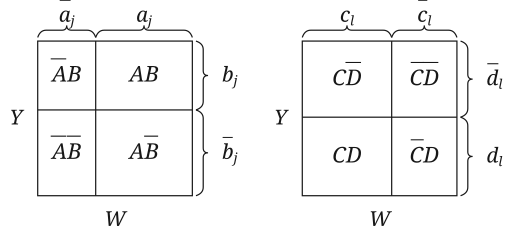</a>

由此得到的 $\Pr(\bar A\cap\bar B\cap\bar C\cap\bar D)=\sum_{j,l}x_jz_l((\bar a_j+\bar d_l)\mathbin{\dot-}1)((\bar b_j+\bar c_l)\mathbin{\dot-}1)$, 它等于零当且仅当对所有满足 $x_jz_l>0$ 的 $j,l$, 有 $a_j+d_l\ge1$ 或 $b_j+c_l\ge1$.

(b) 由于 $\sum_jx_j(a_j,b_j)=(p,p)$, 点 $(p,p)$ 位于各点 $(a_j,b_j)$ 的凸包中. 所以必有两点 $(a,b)=(a_j,b_j)$ 和 $(a',b')=(a_{j'},b_{j'})$, 使从 $(a,b)$ 到 $(a',b')$ 的线段与区域 $\{(x,y)\mid0\le x,y\le p\}$ 相交; 换言之, $\mu a+(1-\mu)a'\le p$ 且 $\mu b+(1-\mu)b'\le p$. 类似地可以找到 $c,c',d,d',\nu$.

<a id="pdf-632"></a><a id="p-612"></a>

(c) 事实: 若 $a\ge\tfrac23$ 且 $b'\ge\tfrac23$, 则 $\mu=\tfrac12$; 因此 $a=b'=\tfrac23$ 且 $a'=b=0$. 还要注意, 共有 16 种对称变换, 它们由下列变换生成: (i) $a\leftrightarrow b$, $c\leftrightarrow d$; (ii) $a\leftrightarrow a'$, $b\leftrightarrow b'$, $\mu\leftrightarrow1-\mu$; (iii) $c\leftrightarrow c'$, $d\leftrightarrow d'$, $\nu\leftrightarrow1-\nu$; (iv) $a\leftrightarrow d$, $b\leftrightarrow c$, $\mu\leftrightarrow\nu$, 同时交换相应的带撇变量.

若 $c\le c'$ 且 $d\le d'$, 或 $c\le\tfrac13$ 且 $d\le\tfrac13$, 则由对称性可假设上述事实适用; 于是得到整个约束组的一个解, $c=d=c'=d'=\tfrac13$.

对于其余的解, 不妨设 $a,b'>\tfrac13>a',b$. 设从 $(a,b)$ 到 $(a',b')$ 的直线和从 $(0,0)$ 到 $(1,1)$ 的直线交于 $(\alpha,\alpha)$; 将 $a,b,a',b'$ 除以 $3\alpha$ 可得一个解, 满足 $\mu a+(1-\mu)a'=\mu b+(1-\mu)b'=\tfrac13$. 类似地, 可假设 $d,c'>\tfrac13>d',c$ 且 $\nu c+(1-\nu)c'=\nu d+(1-\nu)d'=\tfrac13$. 因此 $a+d\ge1$ 且 $b'+c'\ge1$. 利用对称性还可假设 $a+d'\ge1$. 特别地, $a>\tfrac23$; 进而由上述事实, $b'<\tfrac23$. 所以 $a'+d\ge1$, $d>\tfrac23$, $c'<\tfrac23$.

现在把连接 $(a,b)$ 与 $(a',b')$ 以及连接 $(c,d)$ 与 $(c',d')$ 的线段延长, 增大 $a,b',c',d$ 同时减小 $a',b,c,d'$, 直到 $a'=1-d$, $a=1-d'$, 并且 $a=1$ 或 $b=0$, $d=1$ 或 $c=0$. 当 $b'+c'\ge1$ 时, 唯一的这种解为 $a=d=1$, $a'=b=c=d'=0$, $b'=c'=1/2$, $\mu=\tfrac13$, $\nu=\tfrac23$.

(d) 对第一个解, 可令 $W,X,Y,Z$ 分别在 $\{0,1,2\},\{0,1\},\{0,1,2\},\{0\}$ 上均匀分布, 取 $A=\{10,20\}$, $B=\{11,12\}$, $C=\{00\}$, $D=\{00\}$. (例如 $WXYZ=1110$ 给出事件 $B$.) 可见第二个解与此相同, 只是用 $(X,Y,Z,W)$ 代替 $(W,X,Y,Z)$. 注意这个解也适用于 $P_4$, 其阈值<em>正是</em> $\tfrac13$. [见 <em>STOC</em> **43** (2011), 242.]

<a id="ans-7-2-2-2-323"></a>

**323.** [题目](../sec-7-2-2-2.md#ex-7-2-2-2-323) $cbc$. 在这个简单的情形下, 只须排除所有在 $c$ 后面紧跟 $a$ 的串.

<a id="ans-7-2-2-2-324"></a>

**324.** [题目](../sec-7-2-2-2.md#ex-7-2-2-2-324) 对 $1\le j\le n$, 对每个满足 $v=x_j$ 或 $v\mathbin{—}x_j$ 的 $v$, 对所有满足 $i<j$, $v=x_i$ 的 $i$, 令 $i\prec j$. (若有几个 $i$ 合乎要求, 只须考虑最大的一个即可. 有些作者把这个偏序称为 “依赖图”.) 与 $\alpha$ 等价的迹对应于关于 $\prec$ 的拓扑排序, 因为保持堆叠的排列, 恰好就是这些字母的安排方式.

例如在 (136) 中 $x_1\ldots x_n=bcebafdc$, 有 $1\prec2$, $1\prec4$, $2\prec4$, $4\prec5$, $3\prec6$, $2\prec7$, $3\prec7$, $2\prec8$, $4\prec8$, $7\prec8$. 算法 7.2.1.2V 生成 105 个解, 从 12345678 ($bcebafdc$) 到 36127485 ($efbcdbca$).

<a id="ans-7-2-2-2-325"></a>

**325.** [题目](../sec-7-2-2-2.md#ex-7-2-2-2-325) 由每个这样的迹 $\alpha$ 可以得到一种无环定向: 若 $u$ 在 $\alpha$ 的堆叠中的层次低于 $v$, 就令 $u\longrightarrow v$. 反之, 任一无环定向的全部拓扑排序都是等价的迹; 所以这是一一对应. [见 Ira M. Gessel, <em>Discrete Mathematics</em> **232** (2001), 119–130.]

<a id="ans-7-2-2-2-326"></a>

**326.** [题目](../sec-7-2-2-2.md#ex-7-2-2-2-326) 真: $x$ 能与 $y$ 交换当且仅当 $y$ 能与 $x$ 交换.

<a id="ans-7-2-2-2-327"></a>

**327.** [题目](../sec-7-2-2-2.md#ex-7-2-2-2-327) 用高度 $h=h(\alpha)\ge0$ 以及 $h$ 张链表 $L_j=L_j(\alpha)$, $0\le j<h$, 来表示每个迹 $\alpha$. $L_j$ 的元素是 $\alpha$ 的堆叠中位于第 $j$ 层的字母. 这些字母的地盘互不相交, 我们将每张表按字母顺序排列, 因而表示是唯一的. 于是代表 $\alpha$ 的规范串为 $L_0L_1\ldots L_{h-1}$. (例如在 (136) 中有 $L_0=be$, $L_1=cf$, $L_2=bd$, $L_3=ac$, 规范表示为 $becfbdac$.) 还要用位向量维护集合 $U_j=\bigcup\{T(a)\mid a\in L_j\}$; 例如在 (136) 中, 它们是 $U_0=\mathtt{\#36}$, $U_1=\mathtt{\#1b}$, $U_2=\mathtt{\#3c}$, $U_3=\mathtt{\#78}$.

要计算 $\alpha$ 乘以 $\beta$, 依次对 $k=0,1,\ldots,h(\beta)-1$ 以及 $b\in L_k(\beta)$ 中的每个字母 (以任意次序), 作如下操作: 置 $j\gets h(\alpha)$; 当 $j>0$ 且 $T(b)\mathbin{\&}U_{j-1}(\alpha)=0$ 时, 置 $j\gets j-1$. 若 $j=h(\alpha)$, 置 $L_j(\alpha)$ 为空, $U_j(\alpha)\gets0$, $h(\alpha)\gets h(\alpha)+1$. 将 $b$ 插入 $L_j(\alpha)$ 并置 $U_j(\alpha)\gets U_j(\alpha)+T(b)$.

<a id="pdf-633"></a><a id="p-613"></a>

<a id="ans-7-2-2-2-328"></a>

**328.** [题目](../sec-7-2-2-2.md#ex-7-2-2-2-328) 依次对 $k=h(\beta)-1,\ldots,1,0$ 以及 $b\in L_k(\beta)$ 中的每个字母 (以任意次序), 作如下操作: 置 $j\gets h(\alpha)-1$; 当 $j>0$ 且 $T(b)\mathbin{\&}U_j(\alpha)=0$ 时, 置 $j\gets j-1$. 若 $b$ 不在 $L_j(\alpha)$ 中, 报告失败. 否则从该表中删去 $b$, 并置 $U_j(\alpha)\gets U_j(\alpha)-T(b)$; 若 $U_j(\alpha)$ 现在为零, 置 $h(\alpha)\gets h(\alpha)-1$.

若未失败, 所得的 $\alpha$ 即为答案.

<a id="ans-7-2-2-2-329"></a>

**329.** [题目](../sec-7-2-2-2.md#ex-7-2-2-2-329) 依次对 $k=0,1,\ldots,h(\alpha)-1$ 以及 $a\in L_k(\alpha)$ 中的每个字母 (以任意次序), 作如下操作: 若 $a$ 不在 $L_0(\beta)$ 中, 报告失败. 否则从该表中删去 $a$, 置 $U_0(\beta)\gets U_0(\beta)-T(a)$, 并将 $\beta$ 的表示重新规范化.

重新规范化包括下列步骤: 置 $j\gets c\gets1$. 当 $U_{j-1}(\beta)\ne0$ 且 $c\ne0$ 时, 若 $j=h(\beta)$ 就终止; 否则置 $c\gets0$, $j\gets j+1$, 然后对 $L_{j-1}(\beta)$ 中每个满足 $T(b)\mathbin{\&}U_{j-2}(\beta)=0$ 的字母 $b$, 将 $b$ 从 $L_{j-1}(\beta)$ 移至 $L_{j-2}(\beta)$, 置 $U_{j-2}(\beta)\gets U_{j-2}(\beta)+T(b)$, $U_{j-1}(\beta)\gets U_{j-1}(\beta)-T(b)$, $c\gets1$. 最后, 若 $U_{j-1}(\beta)=0$, 对 $j\le i<h(\beta)$ 置 $U_{i-1}(\beta)\gets U_i(\beta)$ 和 $L_{i-1}(\beta)\gets L_i(\beta)$, 然后置 $h(\beta)\gets h(\beta)-1$.

若未失败, 所得的 $\beta$ 即为答案.

<a id="ans-7-2-2-2-330"></a>

**330.** [题目](../sec-7-2-2-2.md#ex-7-2-2-2-330) 取地盘的全集为 $V\cup E$, 即 $G$ 的顶点和边, 并令 $T(a)=\{a\}\cup\{\{a,b\}\mid a\mathbin{—}b\}$. [G. X. Viennot 在 1985 年把这个子图称为<em>海星</em>.] 另一种作法是让每个集合 $T(a)$ 只含两个元素; 当且仅当 $G=L(H)$ 是某个多重图 $H$ 的线图时才办得到. 此时 $G$ 的每个顶点 $a$ 对应于 $H$ 的一条边 $u\mathbin{—}v$, 可取 $T(a)=\{u,v\}$.

[<em>注:</em> 最小的不是线图的图是 “爪图” $K_{1,3}$. 线图 $G$ 的独立顶点集是 $H$ 中互不相交的边的集合, 也称为 $H$ 的<em>匹配</em>; 因而 $G$ 的莫比乌斯多项式又称为 $H$ 的 “匹配多项式”. 这种多项式在理论化学及物理中很重要. 当所有地盘都满足 $|T(a)|\le2$ 时, 由习题 341 可知, (149) 中多项式 $M^*_G(z)$ 的根全是正实数. 但 $M_{\text{爪}}(z,z,z,z)=1-4z+3z^2-z^3$ 有复根: 各根约为 $0.317672$ 和 $1.34116\pm1.16154i$.]

<a id="ans-7-2-2-2-331"></a>

**331.** [题目](../sec-7-2-2-2.md#ex-7-2-2-2-331) 若 $\alpha$ 为含 $k>0$ 个子串 $ac$ 的串, 把 $\alpha$ 分解为 $\{a,b,c,ac\}$ 中的因子共有 $2^k$ 种方法, 展开式恰好各包含 $2^{k-1}$ 个 $+\alpha$ 和 $-\alpha$. 因此所剩下来的, 正是不含 ‘$ac$’ 的所有串的和.

<a id="ans-7-2-2-2-332"></a>

**332.** [题目](../sec-7-2-2-2.md#ex-7-2-2-2-332) 不是: 若 $b$ 能与 $a,c$ 交换而 $ac\ne ca$, 我们考察的是不含相邻对 $ba$ 或 $cb$ 的串. 所以 $cab$ 合格, 它却等价于较小的串 $bca$. [确有一些图的迹具有题中所说的性质, 我们已在 (135)、(136) 中见过. 利用下一题可以推出, 该性质成立当且仅当没有三个字母 $a<b<c$ 在相斥图中满足 $a\not\mathrel{—}b$, $b\not\mathrel{—}c$, $a\mathbin{—}c$. 因而字母可以排成合适的线性次序当且仅当 $G$ 是一个余可比图; 见 7.4.2 节.]

<a id="ans-7-2-2-2-333"></a>

**333.** [题目](../sec-7-2-2-2.md#ex-7-2-2-2-333) 为证明 $\sum_{\alpha\in A,\beta\in B}(-1)^{|\beta|}\alpha\beta=1$, 令 $\gamma=a_1\ldots a_n$ 为任一非空串. 若 $\gamma$ 不能分解得使 $a_1\ldots a_k\in A$, $a_{k+1}\ldots a_n\in B$, 则 $\gamma$ 不出现. 否则 $\gamma$ 恰有两种这样的分解, 一种的 $k$ 取最小可能值, 另一种的 $k$ 比它大 1; 在和式中这两种分解互相抵消. [<em>Discrete Mathematics</em> **14** (1976), 215–239; <em>Manuscripta Mathematica</em> **19** (1976), 211–243. 又见 R. Fröberg, <em>Mathematica Scandinavica</em> **37** (1975), 29–39.]

<a id="ans-7-2-2-2-334"></a>

**334.** [题目](../sec-7-2-2-2.md#ex-7-2-2-2-334) 等价地, 我们要生成字母表 $\{1,\ldots,m\}$ 上满足下列判据的全部长为 $n$ 的串; 它加强了[习题 332](../sec-7-2-2-2.md#ex-7-2-2-2-332) 的相邻字母检验: 若 $1\le i<j\le n$ 且 $x_i\not\mathrel{—}x_j$, $x_{i+1}\not\mathrel{—}x_j,\ldots,x_{j-1}\not\mathrel{—}x_j$, 则 $x_i\le x_j$. [见 A. V. Anisimov 和 D. E. Knuth, <em>Int. J. Comput. Inf. Sci.</em> **8** (1979), 255–260.]

**T1.** [初始化.] 置 $x_0\gets0$, 对 $1\le k\le n$ 置 $x_k\gets1$.

<a id="pdf-634"></a><a id="p-614"></a>

**T2.** [访问.] 访问迹 $x_1\ldots x_n$.

**T3.** [求 $k$.] 置 $k\gets n$. 当 $x_k=m$ 时, 置 $k\gets k-1$. 若 $k=0$, 则终止.

**T4.** [推进 $x_k$.] 置 $x_k\gets x_k+1$, $j\gets k-1$.

**T5.** [$x_k$ 是否有效?] 若 $x_j>x_k$ 且 $x_j\not\mathrel{—}x_k$, 返回 T4. 若 $j>0$ 且 $x_j<x_k$ 且 $x_j\not\mathrel{—}x_k$, 置 $j\gets j-1$, 重复本步.

**T6.** [重置 $x_{k+1}\ldots x_n$.] 当 $k<n$ 时作如下操作: 置 $k\gets k+1$, $x_k\gets1$; 当 $x_{k-1}>x_k$ 且 $x_{k-1}\not\mathrel{—}x_k$ 时置 $x_k\gets x_k+1$. 然后返回 T2.　■

<a id="ans-7-2-2-2-335"></a>

**335.** [题目](../sec-7-2-2-2.md#ex-7-2-2-2-335) 在这种排序下, 有 $M_G=\det(I-A)$, 其中 $A$ 的第 $u$ 行第 $v$ 列的元素为 $v[u\ge v\text{ 或 }u\mathbin{—}v]$. 对给出的例子, 按第一列展开, 再在右边的行列式中从其他各行减去第一行, 原行列式就等于

$$
\det \begin{pmatrix}
1&-b&-c&0&0&0\\
0&1-b&0&-d&0&0\\
0&-b&1-c&-d&-e&0\\
0&-b&-c&1-d&0&-f\\
0&-b&-c&-d&1-e&-f\\
0&-b&-c&-d&-e&1-f
\end{pmatrix}\;+\;\det \begin{pmatrix}
-a&-b&-c&0&0&0\\
0&1&c&-d&0&0\\
0&0&1&-d&-e&0\\
0&0&0&1-d&0&-f\\
0&0&0&-d&1-e&-f\\
0&0&0&-d&-e&1-f
\end{pmatrix}.
$$

因此这条规则满足递归式 (142).

[这个结果也可由 MacMahon 主定理 (习题 5.1.2–20) 推出, 只须利用[答案 334](#ans-7-2-2-2-334) 中对于字典序最小迹的刻画. 由定理 5.1.2B, 这些迹与多重集排列一一对应, 其两行表示在 $v>u$ 且 $v\not\mathrel{—}u$ 时不含 $\genfrac{}{}{0pt}{}{v}{u}$.] 当 $G$ 不是可比图时, 是否仍有类似的行列式表达式?

<a id="ans-7-2-2-2-336"></a>

**336.** [题目](../sec-7-2-2-2.md#ex-7-2-2-2-336) (a) 若 $\alpha$ 为 $G$ 的迹, $\beta$ 为 $H$ 的迹, 则 $\mu_{G\oplus H}(\alpha\beta)=\mu_G(\alpha)\mu_H(\beta)$. 因而 $M_{G\oplus H}=M_G M_H$. (b) 在这种情形下, 若 $\beta=\epsilon$, 有 $\mu_{G\mathbin{—}H}(\alpha\beta)=\mu_G(\alpha)$; 若 $\alpha=\epsilon$, 则为 $\mu_H(\beta)$; 否则为零. 因而 $M_{G\mathbin{—}H}=M_G+M_H-1$.

[当 $G$ 为余图 (见习题 7–90) 时, 这些规则递归地确定了 $M_G$. 特别地, 完全二部图和完全 $k$ 部图都有简单的莫比乌斯级数; 例如当 $G=K_{3,2,1}$ 时有 $M_G=(1-a)(1-b)(1-c)+(1-d)(1-e)+(1-f)-2$.]

<a id="ans-7-2-2-2-337"></a>

**337.** [题目](../sec-7-2-2-2.md#ex-7-2-2-2-337) 在 $M_G$ 中用 $a_1+\cdots+a_k$ 替换 $a$, 即得 $M_{G'}$. (只须给 $G$ 的迹中的各个 $a$ 加上下标, 就能得到 $G'$ 的每个迹.)

<a id="ans-7-2-2-2-338"></a>

**338.** [题目](../sec-7-2-2-2.md#ex-7-2-2-2-338) 定理 F 的证明只需稍加改变: 将 $\alpha$ 限制为不含 $A$ 中任何元素的迹, 并取 $a$ 为 $\gamma$ 的堆叠底层中不属于 $A$ 的最小字母, 据此定义 $\alpha'$ 与 $\beta'$. 若 $\gamma$ 没有这样的字母, 则只有一种分解, 即 $\alpha=\epsilon$. 其余情形可把相消的分解配成对. [顺便说, 汇点属于 $A$ 的一切迹的和必须以另一种次序写成 $M_G^{-1}M_{G\setminus A}$.]

<a id="ans-7-2-2-2-339"></a>

**339.** [题目](../sec-7-2-2-2.md#ex-7-2-2-2-339) (a) 在构件 $x_j$ 上 “往下推”, 把穿过地面的那一部分作为因子取出.

(b) 分出最小标号所对应的金字塔, 然后对剩余的部分重复.

(c) 这是带标号对象的一条一般卷积原理 [见 E. A. Bender 和 J. R. Goldman, <em>Indiana Univ. Math. J.</em> **20** (1971), 753–765]. 例如当 $l=3$ 时, 由三个带标号金字塔组成一个长为 $n$ 的带标号迹的方法数是 $\sum_{i,j,k}\binom n{i,j,k}P_iP_jP_k/3!=n!\sum_{i,j,k}(P_i/i!)(P_j/j!)(P_k/k!)/3!$, 两个和式中均有 $i+j+k=n$. 除以 $3!$ 是为了让最顶端的标号按递增次序排列.

(d) 对 $l=0,1,2,\ldots$ 求 (c) 中恒等式之和.

(e) 由定理 F, $T(z)=\sum_{n\ge0}t_nz^n=1/M_G(z)$, 而 $P(z)=\sum_{n\ge1}p_nz^n/n$.

<em>注:</em> 若保留字母的名称, 例如写 $M_G(z)=1-(a+b+c)z+acz^2$ 代替 $M_G(z)=1-3z+z^2$, 则形式幂级数 $-\ln M_G(z)$ 在 $z^n$ 的系数中列举长为 $n$ 的金字塔, <a id="pdf-635"></a><a id="p-615"></a> 但只限于<em>可交换</em>代数的意义 (不是迹代数). 例如, 用迹代数时, 从 $\sum_{k\ge1}(1-M_G(z))^k/k$ 所得的 $z^3$ 的系数里含有非金字塔项 $bac/6$.

<a id="ans-7-2-2-2-340"></a>

**340.** [题目](../sec-7-2-2-2.md#ex-7-2-2-2-340) 令 $w((i_1\ldots i_k))=(-1)^{k-1}a_{i_1i_2}a_{i_2i_3}\ldots a_{i_ki_1}$; 因此在所给的例子中 $w(\pi)=(-a_{13}a_{34}a_{42}a_{21})(-a_{57}a_{75})(a_{66})$. 根据行列式的定义, 置换多项式便是 $\det A$. (若略去 $(-1)^{k-1}$, 得到的就是<em>积和式</em>.)

<a id="ans-7-2-2-2-341"></a>

**341.** [题目](../sec-7-2-2-2.md#ex-7-2-2-2-341) 当 $n=2$ 时提示成立, 因为最初的两个对合多项式为 $w_{11}x$ 与 $w_{11}w_{22}x^2-w_{12}$. 而且有递归式 $W(S)=w_{ii}xW(S\setminus i)-\sum_{j\in S\setminus i}w_{ij}W(S\setminus\{i,j\})$, 其中用 $w_{ji}=w_{ij}$ 补足权的下三角部分.

因此可以用归纳法证明 $n+1$ 个根 $s_1<r_1<\cdots<r_n<s_{n+1}$ 的存在性. 令 $W_n(x)$ 为 $\{1,\ldots,n\}$ 的多项式. 则 $W_{n+1}(x)$ 为 $w_{(n+1)(n+1)}xW_n(x)$ 减去 $n$ 个多项式 $w_{(n+1)j}W(\{1,\ldots,n\}\setminus j)$, 其中每一个的各根 $q_k^{(j)}$ 都恰夹在 $W_n$ 的根之间. 又对 $1\le k\le n/2$, 有 $q_{n-k}^{(j)}=-q_k^{(j)}$ 且 $r_{n+1-k}=-r_k$. 因而 $W_{n+1}(r_n)<0$, $W_{n+1}(r_{n-1})>0$, 如此等等; 对 $1\le k\le n/2$ 有 $(-1)^k W_{n+1}(r_{n+1-k})>0$. 此外, $n$ 为偶数时 $W_{n+1}(0)=0$; $n=2k-1$ 时 $(-1)^k W_{n+1}(0)>0$; 对所有充分大的 $x$, $W_{n+1}(x)>0$. 因此所求的 $s_k$ 存在. [见 Heilmann 和 Lieb, <em>Physical Review Letters</em> **24** (1970), 1412.]

<a id="ans-7-2-2-2-342"></a>

**342.** [题目](../sec-7-2-2-2.md#ex-7-2-2-2-342) 若将 $(i_1\ldots i_k)$ 换成 $a_{i_1i_2}a_{i_2i_3}\ldots a_{i_ki_1}$ (如[答案 340](#ans-7-2-2-2-340), 但不用因子 $(-1)^{k-1}$), 则 $M_{G_n}$ 成为 $\det(I-A)$. 再将 $a_{ij}$ 换成 $a_{ij}x_j$ 就得到 MacMahon 主定理中的行列式. 若 $x_1=\cdots=x_n=x$, 则得多项式 $\det(I-xA)$, 其根是 $A$ 的特征多项式的非零根的倒数.

<a id="ans-7-2-2-2-343"></a>

**343.** [题目](../sec-7-2-2-2.md#ex-7-2-2-2-343) 按题面的写法, 关于余图的断言不成立. 取两个互不相交的 $K_2$ 的直和 $G$, 它是余图. 由[答案 336](#ans-7-2-2-2-336), $M_G=(1-p_1-p_2)(1-p_3-p_4)$. 在 $p_1=p_2=p_3=p_4=\tfrac34$ 时 $M_G=\tfrac14>0$, 但将 $p_3,p_4$ 同时减为零便有 $M_G=-\tfrac12$, 因此该概率向量不属于 $\mathcal R(G)$.

不超过四个顶点的图中, 唯一不是余图的是 $P_4$ (见习题 7–90); 此时
$$
M_G(p_1,p_2,p_3,p_4)=1-p_1-p_2-p_3-p_4+p_1p_3+p_1p_4+p_2p_4=(1-p_1)(1-p_3-p_4)-p_2(1-p_4).
$$
在这个情形下, 确可推出 $M_G(p_1,\ldots,p_4)>0$ 蕴涵 $(p_1,\ldots,p_4)\in\mathcal R(G)$. 而当 $G=P_5$ 时, 对 $0\le\epsilon<\phi^{-2}$ 有 $M_G(1-\epsilon,1-\epsilon,\epsilon,1-\epsilon,1-\epsilon)>0$. 可是 $(1-\epsilon,1-\epsilon,\epsilon,1-\epsilon,1-\epsilon)$ 决不属于 $\mathcal R(G)$, 因为 $M_G(0,0,\epsilon,1-\epsilon,1-\epsilon)=-(1-\epsilon)^2$.

<a id="ans-7-2-2-2-344"></a>

**344.** [题目](../sec-7-2-2-2.md#ex-7-2-2-2-344) (a) 若某个极小项, 例如 $B_1\bar B_2\bar B_3B_4$, 有负的 “概率”, 则 $p_1p_4(1-\pi_2-\pi_3+\pi_{23})<0$; 从而 $M_G(0,p_2,p_3,0)<0$, 与 $\mathcal R(G)$ 的定义矛盾.

(b) 实际上还有更强的结论: 若 $I\cap J=\emptyset$, 且对 $i\in I$, $j\in J$ 有 $i\not\mathrel{—}j$, 则 $\pi_{I\cup J}=\pi_I\pi_J$.

(c) 由 (140) 和 (141) 得 $M_G(p_1[1\in J],\ldots,p_m[m\in J])$. 在 (a) 的解中已经隐含了这个重要事实, 由此可知对所有 $J$ 有 $\beta(G\mid J)>0$.

(d) 将 ‘$G\mid J$’ 简写为 ‘$J$’. 我们将对 $|J|$ 作归纳, 证明当 $i\notin J$ 时 $\alpha(i\cup J)/\beta(i\cup J)\ge\alpha(J)/\beta(J)$. 令 $J'=\{j\in J\mid i\not\mathrel{—}j\}$. 则由 (133) 有
$$
\alpha(i\cup J)=\alpha(J)-\Pr\left(A_i\cap\bigcap_{j\in J}\bar A_j\right)
\ge\alpha(J)-\Pr\left(A_i\cap\bigcap_{j\in J'}\bar A_j\right)
\ge\alpha(J)-p_i\alpha(J').
$$
又 $\beta(i\cup J)=\beta(J)-p_i\beta(J')$. 因而
$$
\begin{aligned}
\alpha(i\cup J)\beta(J)-\alpha(J)\beta(i\cup J)
&\ge(\alpha(J)-p_i\alpha(J'))\beta(J)-\alpha(J)(\beta(J)-p_i\beta(J'))\\
&=p_i(\alpha(J)\beta(J')-\alpha(J')\beta(J)),
\end{aligned}
$$
由归纳法它 $\ge0$, 因为 $J'\subseteq J$.

[这段论证证明, 只要 $(p_1,\ldots,p_m)$ 产生满足 $\beta(G)>0$ 的合法概率分布, 引理 L 便成立; 从而这样的概率属于 $\mathcal R(G)$.]

(e) 由归纳法,
$$
\beta(i\cup J)\ge\beta(J)-\theta_i\beta(J')\prod_{i\mathbin{—}j\text{ 在 }G\text{ 中}}(1-\theta_j)
\ge\beta(J)-\theta_i\beta(J')\prod_{j\in J\setminus J'}(1-\theta_j)\ge(1-\theta_i)\beta(J),
$$
因为由归纳法 $\beta(J)/\beta(J')\ge\prod_{j\in J\setminus J'}(1-\theta_j)$.

<a id="ans-7-2-2-2-345"></a>

**345.** [题目](../sec-7-2-2-2.md#ex-7-2-2-2-345) (A. D. Scott 和 A. D. Sokal 的解.) 置 $p'_j=(1+\delta)p_j$, 其中 $\delta\le0$ 为 $(p_1,\ldots,p_m)$ 的余量. 此时 $M_G(p'_1,\ldots,p'_m)=0$, 但若将所有正的坐标按同一比例稍微减小, 所得的值便为正. 用[习题 344](../sec-7-2-2-2.md#ex-7-2-2-2-344) 的构造定义事件 $B'_1,\ldots,B'_m$. 令 $C_1,\ldots,C_m$ 为相互独立且与这些事件独立的二元随机变量, 满足 $\Pr(C_j=1)=q_j$, <a id="pdf-636"></a><a id="p-616"></a> 其中 $(1-p'_j)(1-q_j)=1-p_j$. 则事件 $B_j=B'_j\lor C_j$ 满足所求的条件: $\Pr(B_i\mid\bar B_{j_1}\cap\cdots\cap\bar B_{j_k})=\Pr(B_i\mid\bar B'_{j_1}\cap\cdots\cap\bar B'_{j_k})=\Pr(B_i)=p_i$; 又 $\Pr(B_1\lor\cdots\lor B_m)\ge\Pr(B'_1\lor\cdots\lor B'_m)=1$.

<a id="ans-7-2-2-2-346"></a>

**346.** [题目](../sec-7-2-2-2.md#ex-7-2-2-2-346) (a) 由 (144), $K_{a,G}$ 为 $G\setminus a$ 的概率上的一切源皆与 $a$ 相邻的迹之和. 减小 $p_j$ 不会增大任何一个迹的权.

(b) 假定顶点 $a=1$ 的邻点为 $2,\ldots,j$. 若递归地计算出 $M_{G\setminus a^*}$ 和 $M_{G\setminus a}$, 并已知 $(p_{j+1},\ldots,p_m)\in\mathcal R(G\setminus a^*)$ 且 $(p_2,\ldots,p_m)\in\mathcal R(G\setminus a)$, 就知道了 $K_{a,G}$; 而 (a) 中的单调性蕴涵 $(p_1,\ldots,p_m)\in\mathcal R(G)$ 当且仅当 $aK_{a,G}<1$.

例如, [习题 335](../sec-7-2-2-2.md#ex-7-2-2-2-335) 的图 $G$ 可以依下式处理:

<a href="../../../assets/volume4b/figures/satqa-a346.svg">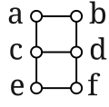</a>

$$
\begin{aligned}
M_{abcdef}&=M_{bcdef}\left(1-a\frac{M_{def}}{M_{bcdef}}\right)=(1-a')(1-b')\cdots(1-f'),&
a'&=\frac a{(1-b')(1-c')},\\
M_{bcdef}&=M_{cdef}\left(1-b\frac{M_{cef}}{M_{cdef}}\right)=(1-b')(1-c')\cdots(1-f'),&
b'&=\frac{b(1-c'')}{(1-c')(1-d')},\\
M_{cdef}&=M_{def}\left(1-c\frac{M_f}{M_{def}}\right)=(1-c')(1-d')(1-e')(1-f'),&
c'&=\frac c{(1-d')(1-e')},\\
M_{cef}&=M_{ef}\left(1-c\frac{M_f}{M_{ef}}\right)=(1-c'')(1-e')(1-f'),&
c''&=\frac c{1-e'},\\
M_{def}&=M_{ef}\left(1-d\frac{M_e}{M_{ef}}\right)=(1-d')(1-e')(1-f'),&
d'&=\frac{d(1-e'')}{(1-e')(1-f')},\\
M_{ef}&=M_f\left(1-e\frac{M_\epsilon}{M_f}\right)=(1-e')(1-f'),&
e'&=\frac e{1-f'},\\
M_e&=M_\epsilon\left(1-e\frac{M_\epsilon}{M_\epsilon}\right)=(1-e''),& e''&=e,\\
M_f&=M_\epsilon\left(1-f\frac{M_\epsilon}{M_\epsilon}\right)=(1-f'),& f'&=f,
\end{aligned}
$$

其中 $M_\epsilon=1$. (左边的方程从上至下导出, 接着从下至上计算右边的方程. 有 $(a,b,\ldots,f)\in\mathcal R(G)$ 当且仅当 $f'<1$, $e''<1$, $e'<1,\ldots,a'<1$.) 更好的办法是按另一种次序遍历该图, 对不连通的子图用规则 $M_{G\oplus H}=M_GM_H$ ([习题 336](../sec-7-2-2-2.md#ex-7-2-2-2-336)):

$$
\begin{aligned}
M_{cdabef}&=M_{dabef}\left(1-c\frac{M_bM_f}{M_{dabef}}\right)=(1-c')(1-d')(1-a')(1-b')(1-e')(1-f'),&
c'&=\frac c{(1-a')(1-d')(1-e')},\\
M_{dabef}&=M_{ab}M_{ef}\left(1-d\frac{M_aM_e}{M_{ab}M_{ef}}\right)
=(1-d')(1-a')(1-b')(1-e')(1-f'),& &\text{(见下文)}\\
M_{ab}&=M_b\left(1-a\frac{M_\epsilon}{M_b}\right)=(1-a')(1-b'),&a'&=\frac a{1-b'},\\
M_a&=M_\epsilon\left(1-a\frac{M_\epsilon}{M_\epsilon}\right)=(1-a''),&a''&=a,\\
M_b&=M_\epsilon\left(1-b\frac{M_\epsilon}{M_\epsilon}\right)=(1-b'),&b'&=b,
\end{aligned}
$$

其中 $d'=dM_aM_e/(M_{ab}M_{ef})=d(1-a'')(1-e'')/((1-a')(1-b')(1-e')(1-f'))$, 而 $M_{ef},M_e,M_f,M_\epsilon$ 同前. 用这种方法, 我们常常能在线性时间内解决问题. [见 A. D. Scott 和 A. D. Sokal, <em>J. Stat. Phys.</em> **118** (2005), 1151–1261, §3.4.]

<a id="pdf-637"></a><a id="p-617"></a>

<a id="ans-7-2-2-2-347"></a>

**347.** [题目](../sec-7-2-2-2.md#ex-7-2-2-2-347) (a) 假设 $v_1\mathbin{—}v_2\mathbin{—}\cdots\mathbin{—}v_k\mathbin{—}v_1$ 为一个诱导圈. 可假设 $v_1\succ v_2$. 对 $j$ 归纳, 必有 $v_1\succ\cdots\succ v_j$, $1<j\le k$; 因为若 $v_{j+1}\succ v_j$, 由于 $v_{j-1}$ 与 $v_{j+1}$ 都是 $v_j$ 的先辈, 由 (*) 可得 $v_{j+1}\mathbin{—}v_{j-1}$. 但现在 $v_k\mathbin{—}v_1$ 意味着 $k=3$.

(b) 设顶点为 $\{1,\ldots,m\}$, 其地盘集为 $T(a)\subseteq U$, $1\le a\le m$; 令 $U$ 为一棵使每个 $U\mid T(a)$ 均连通的树. 令 $U_a$ 为 $T(a)$ 在 $U$ 中的最近共同先辈. (因此 $T(a)$ 的各个结点出现在以 $U_a$ 为根的子树的顶端.) 由于 $U_a\in T(a)$, 若 $U_a=U_b$ 就有 $a\mathbin{—}b$.

以 $s\succ_U t$ 表示 $U$ 中的先辈关系, 现在规定当 $U_a\succ_U U_b$ 或 $U_a=U_b$ 且 $a<b$ 时 $a\succ b$. 于是 (*) 得到满足: 若 $t\in T(a)\cap T(b)$, 则 $U_a\succeq_U t$ 且 $U_b\succeq_U t$, 从而 $U_a\succeq_U U_b$ 或 $U_b\succeq_U U_a$, 因而 $a\succ b$ 或 $b\succ a$. 又若 $a\succ b\succ c$ 且 $t\in T(a)\cap T(c)$, 则有 $U_a\succeq_U U_b\succeq_U U_c$; 从而 $U_b\in T(a)\cap T(b)$, 因为 $U_b$ 位于 $U$ 中 $t$ 到 $U_a$ 的唯一路上, 而 $T(a)$ 连通.

(c) 只要 $U_a$ 是 $U_b$ 的真先辈, 就先于 $b$ 消去 $a$. 按任一这样的次序处理结点, 只会得到算法中无须使用 “双撇” 变量的子问题.

例如, 为配合[习题 346](../sec-7-2-2-2.md#ex-7-2-2-2-346) 的记号, 用 $(a,b,\ldots,g)$ 代替 $(1,2,\ldots,7)$. 设 $U$ 为以 $p$ 为根且有边 $p\mathbin{—}q$, $p\mathbin{—}r$, $r\mathbin{—}s$, $r\mathbin{—}t$ 的树; 令 $T(a)=\{p,q,r,t\}$, $T(b)=\{p,r,s\}$, $T(c)=\{p,q\}$, $T(d)=\{q\}$, $T(e)=\{r,s\}$, $T(f)=\{s\}$, $T(g)=\{t\}$. 则 $a\succ b\succ c\succ d$, $c\succ e\succ f$, $e\succ g$. 算法计算 $M_{abcdefg}=(1-a')M_{bcdefg}$, $M_{bcdefg}=(1-b')M_{cdefg}$, 等等, 其中 $a'=aM_f/M_{bcdefg}$, $b'=bM_{dfg}/M_{cdefg}=bM_dM_fM_g/(M_{cd}M_{ef}M_g)$, 等等.

一般地, 树序保证不需要 “双撇” 变量. 因此各公式化为对每个顶点 $v$ 有 $v'=v/\prod_{u\mathbin{—}v,\,v\succ u}(1-u')$.

(d) 例如在 (c) 中有 $p_1=a,\ldots,p_7=g$, $\theta_1=a',\ldots,\theta_7=g'$. $\theta$ 的值依赖于次序 $\succ$, 由所给方程唯一确定; 而无论如何都有 $M_G(p_1,\ldots,p_m)=(1-\theta_1)\cdots(1-\theta_m)$. [W. Pegden, <em>Random Structures &amp; Algorithms</em> **41** (2012), 546–556.]

<a id="ans-7-2-2-2-348"></a>

**348.** [题目](../sec-7-2-2-2.md#ex-7-2-2-2-348) 对某个 $\theta$, $z=\rho e^{i\theta}$ 处至少有一个奇点. 若 $0<r<\rho$, 幂级数 $f(z)=\sum_{n=0}^\infty f^{(n)}(re^{i\theta})(z-re^{i\theta})^n/n!$ 在每个这样的奇点方向上收敛半径至多为 $\rho-r$, 而由原点处的展开可知至少为 $\rho-r$, 故恰为此值. 若 $z=\rho$ 不是奇点, 对 $\theta=0$ 该半径便会超过 $\rho-r$. 然而
$$
|f^{(n)}(re^{i\theta})|=\left|\sum_{m=n}^\infty m^{\underline n}a_m(re^{i\theta})^{m-n}\right|\le f^{(n)}(r).
$$
[<em>Mathematische Annalen</em> **44** (1894), 41–42.]

<a id="ans-7-2-2-2-349"></a>

**349.** [题目](../sec-7-2-2-2.md#ex-7-2-2-2-349) 典型的生成函数有 $g_{0000001}=1$; 在情形 1 中,
$$
g_{0110110}=z(g_{0100110}+g_{0101110}+g_{0110110}+g_{0111110})/4;
$$
在情形 2 中则有 $g_{0110110}=z(g_{0000110}+g_{0010110}+g_{0100110}+g_{0110110})/4$. 这两组各含 128 个线性方程的方程组, 在情形 1 中所得的解, 其分母含有 $4-z$, $2-z$, $16-12z+z^2$, $4-3z$, $64-80z+24z^2-z^3$, $8-8z+z^2$ 中的一个或多个因子 (见[习题 320](../sec-7-2-2-2.md#ex-7-2-2-2-320)); 情形 2 的分母则都是 $4-z$ 的幂.

置 $g(z)=\sum_x g_x(z)/128$. 情形 1 给出 $g(z)=1/((2-z)(8-8z+z^2))$, 均值为 7, 方差为 42; 情形 2 给出 $g(z)=(1088-400z+42z^2-z^3)/(4-z)^6$, 均值为 $1139/729\approx1.56$, 方差为 $1139726/729^2\approx2.14$.

[情形 1 的分布达到了上界 $E_1+\cdots+E_6$, 因为它与路径图 $P_6$ 的极端分布 (148) 一致. 顺便说, 若将情形 1 从 $n=7$ 推广到任意 $n$, 均值为 $n(n-1)/6$, 方差为 $(n+3)(n+2)n(n-1)/90$.]

<a id="ans-7-2-2-2-350"></a>

**350.** [题目](../sec-7-2-2-2.md#ex-7-2-2-2-350) (a) $N$ 的生成函数为 $\prod_{k=1}^n(1-\xi_k)/(1-\xi_kz)$; 所以均值和方差一般分别为 $\sum_{k=1}^n\xi_k/(1-\xi_k)$ 和 $\sum_{k=1}^n\xi_k/(1-\xi_k)^2$. 具体地, 均值依次为 (i) $n$; (ii) $n/(2n-1)$; (iii) $n/(2^n-1)$; (iv) $H_{2n}-H_n+1/(2n)=\ln2+O(1/n)$; (v) $\tfrac12\bigl(1/(n+1)+1/(2n)-1/(2n+1)\bigr)=1/(2n)+O(1/n^2)$. 情形 (i) 的方差为 $2n$; 其余情形的方差渐近等于均值乘以 $1+O(1/n)$.

<a id="pdf-638"></a><a id="p-618"></a>

(b) 此时均值和方差为 $\xi/(1-\xi)$ 与 $\xi/(1-\xi)^2$, 其中 $\xi=\Pr(A_m)=1-(1-\xi_1)\cdots(1-\xi_n)$. 这个 $\xi$ 为 (i) $1-2^{-n}$; (ii) $1-(1-1/(2n))^n=1-e^{-1/2}+O(1/n)$; (iii) $1-(1-2^{-n})^n=n/2^n+O(n^2/4^n)$; (iv) $1/2$; (v) $1/(2n+2)$. 因此, 各均值为 (i) $2^n-1$; (ii) $e^{1/2}-1+O(1/n)$; (iii) $n/2^n+O(n^2/4^n)$; (iv) 1; (v) $1/(2n+1)$. 而方差为 (i) $4^n-2^n$; (ii) $e-e^{1/2}+O(1/n)$; (iii) $n/2^n+O(n^2/4^n)$; (iv) 2; (v) $1/(2n+1)+1/(2n+1)^2$.

(c) 由于 $G$ 为 $K_{n,1}$, 由[习题 336](../sec-7-2-2-2.md#ex-7-2-2-2-336) 的公式, $(\xi_1,\ldots,\xi_n,\xi)\in\mathcal R(G)$ 当且仅当 $\xi<\tfrac12$. 在 (ii)、(iii)、(v) 中满足这个条件 (这里考虑的是充分大的 $n$).

<a id="ans-7-2-2-2-351"></a>

**351.** [题目](../sec-7-2-2-2.md#ex-7-2-2-2-351) (Moser 和 Tardos 的解.) 若有一种变量赋值使 $A_i$ 为假而 $A_j$ 为真, 且改变 $\Xi_j$ 的一些变量可能使 $A_i$ 成为真, 就要求 $i\mathbin{—}j$. 将 $i,j$ 互换也一样.

(对于<em>有向</em>偏斜依赖图也能证明局部引理; 见 Noga Alon 和 Joel H. Spencer, <em>The Probabilistic Method</em> (2008), §5.1. 然而用来分析算法 M 的迹理论以无向图为基础, 目前还不知道怎样将算法推广到有向情形.)

<a id="ans-7-2-2-2-352"></a>

**352.** [题目](../sec-7-2-2-2.md#ex-7-2-2-2-352) 在[答案 344](#ans-7-2-2-2-344)(e) 中取 $M_G=\beta(i\cup J)$, $M_{G\setminus i}=\beta(J)$, 得 $M_G/M_{G\setminus i}\ge1-\theta_i$. 联合 (142) 和 (152) 即得结论.

<a id="ans-7-2-2-2-353"></a>

**353.** [题目](../sec-7-2-2-2.md#ex-7-2-2-2-353) (a) 情形 1 共有 $n+1$ 个排好序的串, 即 $0^k1^{n-k}$, $0\le k\le n$. 情形 2 共有 $F_{n+2}$ 个解 (例如见习题 7.2.1.1–91).

(b) 至少 $2^n M_G(1/4)$ 个, 其中 $G$ 为路径 $P_{n-1}$. 由[习题 320](../sec-7-2-2-2.md#ex-7-2-2-2-320), $M_G(1/4)=f_{n-1}(1/4)=(n+1)/2^n$; 所以情形 1 恰好达到下界.

(c) 这里<em>没有</em>偏斜依赖, 所以相应的 $G$ 是 $m=n-1$ 个顶点上的空图. 由[习题 336](../sec-7-2-2-2.md#ex-7-2-2-2-336), $M_G(1/4)=(3/4)^{n-1}$; 而且确有 $F_{n+2}\ge3^{n-1}2^{2-n}$.

<a id="ans-7-2-2-2-354"></a>

**354.** [题目](../sec-7-2-2-2.md#ex-7-2-2-2-354) 对 (151) 求导并置 $z\gets1$.

<a id="ans-7-2-2-2-355"></a>

**355.** [题目](../sec-7-2-2-2.md#ex-7-2-2-2-355) 若 $A=A_j$ 为 $G$ 的孤立顶点, 则 $1-p_jz$ 是 (149) 的多项式 $M_G^*(z)$ 的因子, 因而 $1+\delta\le1/p_j$; 且 $E_j=p_j/(1-p_j)\le1/\delta$. 一般地,
$$
M_G(p_1,\ldots,p_{j-1},p_j(1+\delta),p_{j+1},\ldots,p_m)
=M_G^*(1)-\delta p_j M_{G\setminus A^*}^*(1)\ge0,
$$
因此 $E_j=p_j M_{G\setminus A^*}^*(1)/M_G^*(1)\le1/\delta$.

<a id="ans-7-2-2-2-356"></a>

**356.** [题目](../sec-7-2-2-2.md#ex-7-2-2-2-356) (a) 对 $|S|$ 用归纳法证明提示中的条件概率界. 当 $S=\emptyset$ 时显然成立; 否则令 $X=S\cap\bigcup_{i\in U_k}U_k$, $Y=S\setminus X$. 由 (133) 有
$$
\begin{aligned}
\Pr(A_i\mid\bar A_S)
&=\frac{\Pr(A_i\cap\bar A_X\cap\bar A_Y)}{\Pr(\bar A_X\cap\bar A_Y)}
\le\frac{\Pr(A_i\cap\bar A_Y)}{\Pr(\bar A_X\cap\bar A_Y)}
\le\frac{\Pr(A_i)\Pr(\bar A_Y)}{\Pr(\bar A_X\cap\bar A_Y)}
=\frac{\Pr(A_i)}{\Pr(\bar A_X\mid\bar A_Y)}.
\end{aligned}
$$
设 $i$ 属于团 $U_{j_0},\ldots,U_{j_r}$, 其中 $j_0=j$. 令 $X_0=\emptyset$, 对 $1\le k\le r$ 令 $X_k=(S\cap U_{j_k})\setminus\bigcup_{k<h\le r}U_{j_h}$, $Y_k=Y\cup X_1\cup\cdots\cup X_{k-1}$. 由归纳假设, 对每个 $l\in X_k$, 有 $\Pr(A_l\mid\bar A_{Y_k})\le\theta_{l j_k}$, 因为当 $X_k\ne\emptyset$ 时 $|Y_k|<|S|$. 从而 $\Pr(\bar A_{X_k}\mid\bar A_{Y_k})\ge1+\theta_{i j_k}-\Sigma_{j_k}$. 由链式法则 (习题 MPR–14), $\Pr(\bar A_X\mid\bar A_Y)=\Pr(\bar A_{X_1}\mid\bar A_{Y_1})\cdots\Pr(\bar A_{X_r}\mid\bar A_{Y_r})\ge\prod_{k\ne j,\,i\in U_k}(1+\theta_{ik}-\Sigma_k)$, 所需的界即得.

最后, 对 $1\le k\le t$ 令 $W_k=U_1\cup\cdots\cup U_k$. 刚才的界蕴涵
$$
\Pr(\bar A_1\cap\cdots\cap\bar A_m)=\Pr(\bar A_{W_1})\Pr(\bar A_{W_2}\mid\bar A_{W_1})\cdots\Pr(\bar A_{W_t}\mid\bar A_{W_{t-1}})
\ge(1-\Sigma_1)\cdots(1-\Sigma_t)>0.
$$

(b) 定理 S 的极端事件 $B_1,\ldots,B_m$ 满足 (a) 的界. 因而对所有 $i\in U_j$, 有 $\Pr(B_i\mid\bigcap_{k\notin U_j}\bar B_k)\le\theta_{ij}$, 从而 $q_i=\Pr(B_i\mid\bigcap_{k\ne i}\bar B_k)\le\theta_{ij}/(1+\theta_{ij}-\Sigma_j)$. 此外, (152) 中 $E_i=q_i/(1-q_i)$, 因为 $q_i=p_i M_{G\setminus i^*}/M_{G\setminus i}$.

<a id="pdf-639"></a><a id="p-619"></a>

(c) 取 $U_1,\ldots,U_t$ 为 $G$ 的各条边, 当 $U_k=\{i,j\}$ 时取 $\theta_{ik}=\theta_i$. 于是 $\Sigma_k=\theta_i+\theta_j<1$, (a) 中的充分条件为, 对每个 $i\mathbin{—}k$, 有 $\Pr(A_i)\le\theta_i\prod_{j\ne k,\,i\mathbin{—}j}(1-\theta_j)$. (不过要注意, 定理 M 对这些较大的 $p_i$ 不成立.)

[K. Kolipaka、M. Szegedy 和 Y. Xu, <em>LNCS</em> **7408** (2012), 603–614.]

<a id="ans-7-2-2-2-357"></a>

**357.** [题目](../sec-7-2-2-2.md#ex-7-2-2-2-357) 若 $r>0$, 则 $x=r/(1-p)$, $y=r/(1-q)$. 只有在[图 94](../sec-7-2-2-2.md#fig-7-2-2-2-94) 的坐标轴上才可能有 $r=0$: 或者 $(p,q)=(0,1)$, $x=0$, $0<y\le1$; 或者 $(p,q)=(1,0)$, $0<x\le1$, $y=0$.

<a id="ans-7-2-2-2-358"></a>

**358.** [题目](../sec-7-2-2-2.md#ex-7-2-2-2-358) 不妨设 $x\ge y$ (从而 $p\ge q$ 且 $x>0$). 则 $p\le r$ 当且仅当 $1-y\le y$.

<a id="ans-7-2-2-2-359"></a>

**359.** [题目](../sec-7-2-2-2.md#ex-7-2-2-2-359) 不按 (154) 的公式直接计算 $\pi_l$, 而将它表示为两个数 $(\pi_l^+,\pi'_l)$, 其中 $\pi_l^+$ 为非零因子的积, $\pi'_l$ 为零因子的个数. 于是 (156) 所需的量 $\pi_{\bar l}$ 为 $\pi_{\bar l}^+[\pi'_{\bar l}=0]$; 若 $\eta_{C\to l}=1$, 则 $\pi_l/(1-\eta_{C\to l})$ 为 $\pi_l^+[\pi'_l=1]$, 否则为 $\pi_l^+[\pi'_l=0]/(1-\eta_{C\to l})$. 对 $\prod_{l\in C}\gamma_{l\to C}$ 也可用类似的办法分出零因子, 用于 (157).

<a id="ans-7-2-2-2-360"></a>

**360.** [题目](../sec-7-2-2-2.md#ex-7-2-2-2-360) 可假设 $\eta_3=0$. 由于 $\pi_l=1$ 蕴涵 $\eta_{C\to l}=\gamma_{\bar l\to C}=0$, 对所有 $C$ 均有 $\eta_{C\to1}=\eta_{C\to\bar2}=\eta_{C\to3}=\eta_{C\to\bar4}=\gamma_{\bar1\to C}=\gamma_{2\to C}=\gamma_{\bar3\to C}=\gamma_{4\to C}=0$. 因此如 (159), 除了三个 $\eta_{C\to l}$ 的值外其余全为零; 以 $x,y,z$ 表示那三个. 又令 $\eta_{\bar1}=a$, $\eta_2=b$, $\eta_4=c$, $\eta_{\bar3}=d$. 则 $\pi_{\bar1}=(1-a)(1-x)$, $\pi_2=(1-b)(1-y)$, $\pi_4=(1-c)(1-z)$, $\pi_{\bar3}=1-d$. 若
$$
x=d(b+cd(1-b)+ad^2(1-b)(1-c))/(1-d^3(1-a)(1-b)(1-c)),
$$
其余两式可循环地得到: $x=d(b+(1-b)y)$, $y=d(c+(1-c)z)$, $z=d(a+(1-a)x)$. 若 $d=0$, 则 $x=y=z=0$; 若 $d=1$ 且分母非零, 则 $x=y=z=1$. 分母为零时正好有 $d=1$, $a=b=c=0$, 此时 $x=y=z$ 可取区间 $[0,1]$ 中的任一值. [还有别的不动点吗, 例如 $\pi_1\ne1$ 的情形?]

<a id="ans-7-2-2-2-361"></a>

**361.** [题目](../sec-7-2-2-2.md#ex-7-2-2-2-361) 各 $\pi$ 和 $\gamma$ 也都是 0 或 1, 且排除 $\pi_l=\pi_{\bar l}=0$ 的情形; 因而每个变量 $v$ 分别按 $(\pi_v,\pi_{\bar v})$ 等于 $(0,1)$、$(1,0)$ 或 $(1,1)$ 而取 1、0 或 $*$.

给变量赋予 1、0、$*$ 的值是容许的, 只要每个子句至少有一个真字面值或两个取 $*$ 的字面值. (这样的部分赋值是 “稳定的”; 其中所有已赋值变量均受约束的那些称为 “覆盖的”, 即使子句不可满足, 通常也有这样的赋值; 见习题 364.) 所有调查消息 $\eta'_{C\to l}=\eta_{C\to l}$ 都为零, 只有当 $l$ 为子句 $C$ 唯一的非假字面值时才例外. 强化消息 $\eta_l$ 可以是 0 或 1; 但是若 $l$ 为真 ($\pi_l=0$) 且所有消息 $\eta_{C\to l}$ 均为零, 就必须为 1.

若还要求 $\eta'_l=\eta_l$, 就在 (158) 中取 $\kappa=1$, $\eta_l=1-\pi_l$.

<a id="ans-7-2-2-2-362"></a>

**362.** [题目](../sec-7-2-2-2.md#ex-7-2-2-2-362) 建立链表 $L$, 包含须强制为真的全部字面值, 也包括原问题单位子句中的所有字面值. 只要 $L$ 非空便如下进行: 从 $L$ 取出字面值 $l$; 删去所有含 $l$ 的子句, 并从剩余的全部子句中删去 $\bar l$. 若这样得到空子句, 就遇到了矛盾. 若有子句因此缩短为单个字面值 $(l')$, 则检查 $l'$ 或 $\bar l'$ 是否已在 $L$ 中. 若 $\bar l'$ 在表中, 已发生矛盾; 这时或以失败告终, 或增大 $\psi$ 并重新开始步骤 S8. 若 $l'$ 和 $\bar l'$ 都不在表中, 则将 $l'$ 放入.

<a id="ans-7-2-2-2-363"></a>

**363.** [题目](../sec-7-2-2-2.md#ex-7-2-2-2-363) (a) 真; 事实上, 这是算法 C 的一个重要不变性质.

(b) $W(001)=1$, $W({*}{*}{*})=p_1p_2p_3$, 其余 $W(x)=0$.

(c) 断言 (i) 和 (iii) 为真, (ii) 不一定; 考虑 $x=10{*}$, $x'=00{*}$ 和子句 123.

(d) $\{1,\bar2,\bar3\}$ 的八个子集中, 除 $\{\bar2,\bar3\}$ 外都稳定, 因为在 100 中 $x_1$ 受约束. 其余七个的偏序如下图所示. (此图表示 $L_7$, 即最小的下半模而非模的格.)

<a href="../../../assets/volume4b/figures/satqa-a363.svg"></a>


(e) 各权如下:

<table id="sat-weights363"><thead><tr><th>$x_1$ / $x_2x_3$</th><th><code>00</code></th><th><code>01</code></th><th><code>0*</code></th><th><code>10</code></th><th><code>11</code></th><th><code>1*</code></th><th><code>*0</code></th><th><code>*1</code></th><th><code>**</code></th></tr></thead><tbody>
<tr><th><code>0</code></th><td>$0$</td><td>$q_1q_2$</td><td>$0$</td><td>$q_1q_3$</td><td>$q_1q_2q_3$</td><td>$q_1q_2p_3$</td><td>$0$</td><td>$q_1p_2q_3$</td><td>$q_1p_2p_3$</td></tr>
<tr><th><code>1</code></th><td>$q_2q_3$</td><td>$q_1q_2q_3$</td><td>$q_1q_2p_3$</td><td>$q_1q_2q_3$</td><td>$q_1q_2q_3$</td><td>$q_1q_2p_3$</td><td>$q_1p_2q_3$</td><td>$q_1p_2q_3$</td><td>$q_1p_2p_3$</td></tr>
<tr><th><code>*</code></th><td>$0$</td><td>$p_1q_2q_3$</td><td>$p_1q_2p_3$</td><td>$p_1q_2q_3$</td><td>$p_1q_2q_3$</td><td>$p_1q_2p_3$</td><td>$p_1p_2q_3$</td><td>$p_1p_2q_3$</td><td>$p_1p_2p_3$</td></tr>
</tbody></table>

<a id="pdf-640"></a><a id="p-620"></a>

(f) 一个解为 $\{\bar1\bar23\bar4\bar5,\bar14,\bar25,\bar34\bar5,\bar3\bar45\}$. (对这些子句, 部分赋值 $\{3\}$ 是稳定的, 但在 $\{1,2,3,4,5\}$ 之下却 “不可达”.)

(g) 若 $L=L'\setminus l$, $L'\in\mathcal L$ 而 $L\notin\mathcal L$, 引入子句 $(x_l\lor\bigvee_{k\in L}\bar x_k)$.

(h) 真, 因为 $L'=L\setminus l'$ 且 $L''=L\setminus l''$, 其中 $|l'|$ 和 $|l''|$ 对 $L$ 都不受约束. 若删去同一个字面值, 结论显然. 若删去不同字面值, 再考察任一子句: 同时涉及这两个变量的子句在交集中至少有两个未知, 其余子句则与某个已知稳定的赋值给出的情形相同.

(i) 设 $L'=L'^{(0)}\prec\cdots\prec L'^{(s)}=\{1,\ldots,n\}$, $L''=L''^{(0)}\prec\cdots\prec L''^{(t)}=\{1,\ldots,n\}$. 由 (h) 并对 $i+j$ 归纳, $0\le i\le s$, $0\le j\le t$ 时, $L'^{(s-i)}\cap L''^{(t-j)}$ 都稳定, 也各自有一条稳定链通到顶端.

(j) 只须考虑 $L=\{1,\ldots,n\}$ 的情形. 假设不受约束的变量为 $x_1,x_2,x_3$. 则由归纳法, 和为 $q_1q_2q_3+p_1+p_2+p_3-(p_1p_2+p_1p_3+p_2p_3)+p_1p_2p_3=1$, 这里用 “容斥” 抵消了重复计数的项. 对任意多个不受约束变量, 有类似的论证.

<em>注:</em> 见 F. Ardila 和 E. Maneva, <em>Discrete Mathematics</em> **309** (2009), 3083–3091. 当对 $1\le k\le n$ 有 $p_k+q_k\le1$ 时, (j) 的和 $\le1$, 因为它是单调的. 由 (i), $L$ 之下的稳定集构成下半模格, 有
$$
L'\land L''=L'\cap L'',\qquad L'\lor L''=\bigcap\{L'''\mid L'''\supseteq L'\cup L''\text{ 且 }L'''\sqsubseteq L\}.
$$
E. Maneva 和 A. Sinclair 在 <em>Theoretical Comp. Sci.</em> **407** (2008), 359–369 中指出, 由恒等式 (j), 随机可满足性问题可满足的概率 $\le\mathrm E\sum_X W(X)$, 即具有给定分布的部分赋值的总权的期望. 这使他们得到了比先前所知更精细的界.

<a id="ans-7-2-2-2-364"></a>

**364.** [题目](../sec-7-2-2-2.md#ex-7-2-2-2-364) (a) 当且仅当所有子句的长度都至少为 2 时为真.

(b) 001 和 $\mathord{*}{*}{*}$ 是覆盖赋值; 它们是上一题中取 $q_1=\cdots=q_n=0$ 时权非零的部分赋值. 只有 001 是核心.

(c) $\mathord{*}{*}{*}{*}$ 是唯一的覆盖赋值, 也是唯一的核心; $W(0101)=W(0111)=q_3$.

(d) 事实上, 每个稳定的部分赋值 $L'$ 都有一个唯一的覆盖赋值 $L$ 使 $L\sqsubseteq L'$, 即 $L=\bigcap\{L''\mid L''\sqsubseteq L'\}$. 逐个删去不受约束的字面值即可得到它 (次序任意).

(e) 若 $L'$ 与 $L''$ 相邻, 则 $L'\cap L''\sqsubseteq L'$ 且 $L'\cap L''\sqsubseteq L''$.

(f) 不一定. 例如, 子句 $\{\bar1\bar234,\bar12\bar34,\bar123\bar4,1\bar2\bar34,1\bar23\bar4,12\bar3\bar4\}$ 定义 $\overline{S_2}(x_1,x_2,x_3,x_4)$; 有两个簇, 但只有一个空核心.

[A. Braunstein 和 R. Zecchina 在 <em>J. Statistical Mechanics</em> (2004 年 6 月), P06007:1–18 中引入了覆盖赋值的概念.]

<a id="ans-7-2-2-2-365"></a>

**365.** [题目](../sec-7-2-2-2.md#ex-7-2-2-2-365) 若 $L$ 为 (8) 中六个解的任一个, 且 $q$ 为奇数, 则当 $0\le d<q$, $8q-d\le n<9q-d$ 时, $qL-d$ 是一个覆盖赋值. (例如若 $L=\{\bar1,\bar2,3,4,\bar5,\bar6,7,8\}$, 则 $3L-1=\{\bar2,\bar5,8,11,\overline{14},\overline{17},20,23\}$ 对 $n\in[23\mathinner{\ldotp\ldotp}25]$ 适用.) 因而所有 $n>63$ 都得到了 “覆盖”. [是否 $\operatorname{waerden}(3,3;n)$ 的每个非空覆盖赋值都是这种形式?]

<a id="ans-7-2-2-2-366"></a>

**366.** [题目](../sec-7-2-2-2.md#ex-7-2-2-2-366) 通过归结消去变量 1 ($x_1$), 得到 erp 规则 $\bar x_1\gets(x_2\lor\bar x_3)\land(x_3\lor x_4)$ 和新子句 $\{2\bar34,2\bar3\bar4,234,\bar234\}$. 然后消去 2 ($x_2$), 得 $x_2\gets(x_3\lor x_4)\land(\bar x_3\lor x_4)$ 和新子句 $\{34,\bar34\}$. 现在 4 ($x_4$) 是纯字面值, 所以置 $x_4\gets1$, $F'=\emptyset$ 可满足. (再逆序执行 erp 规则, 将得 $x_4\gets1$, $x_2\gets1$, $x_1\gets0$, 与 $x_3$ 的值无关.)

<a id="ans-7-2-2-2-367"></a>

**367.** [题目](../sec-7-2-2-2.md#ex-7-2-2-2-367) (可以在两种赋值中选最方便的一种, 例如选择最短的, 因为两者都是有效的 erp 规则.) 任何解或者满足 $\bar x$ 的右端的全部子句, 或者满足 $x$ 的右端的全部子句, 或者两者都满足. 因为若一个解同时使 $C_i\setminus x$ 和 $C'_j\setminus\bar x$ 为假, 它也就使 $C_i\mathbin{\diamond}C'_j$ 为假. <a id="pdf-641"></a><a id="p-621"></a> 无论哪一种情形, 所取的 $x$ 的值都会使 $C_1,\ldots,C_p,C'_1,\ldots,C'_q$ 全部满足.

<a id="ans-7-2-2-2-368"></a>

**368.** [题目](../sec-7-2-2-2.md#ex-7-2-2-2-368) 若 $(l)$ 为一个子句, 包摄将除去含 $l$ 的所有其他子句. 然后归结 (其中 $p=1$) 将从含 $\bar l$ 的全部 $q$ 个子句中删去 $\bar l$, 并除去 $(l)$ 本身.

<a id="ans-7-2-2-2-369"></a>

**369.** [题目](../sec-7-2-2-2.md#ex-7-2-2-2-369) 令 $C_i=(l\lor\alpha_i)$, $C'_j=(\bar l\lor\beta_j)$. 每个被略去的子句 $C_i\mathbin{\diamond}C'_j=(\alpha_i\lor\beta_j)$, $1<i\le p$, $r<j\le q$, 都是多余的, 因为它是对未略去的子句 $(\alpha_i\lor\bar l_1),\ldots,(\alpha_i\lor\bar l_r),(l_1\lor\cdots\lor l_r\lor\beta_j)$ 作超归结所得的推论. [这项技术称为 “代换”, 因为我们实质上是用 $|l|$ 的定义替换它.]

<a id="ans-7-2-2-2-370"></a>

**370.** [题目](../sec-7-2-2-2.md#ex-7-2-2-2-370) $(a\lor b)\land(a\lor\bar b\lor\bar c)\land(\bar a\lor b\lor c)=(a\lor\bar c)\land(b\lor c)$. (见 7.1.1–(27) 后的讨论. 一般而言, 高级预处理器用 DNF 极小化理论的对偶形式求 CNF 的无冗余极小形式. 不过, 本节所讨论的预处理例子没有实现这些技术.)

<a id="ans-7-2-2-2-371"></a>

**371.** [题目](../sec-7-2-2-2.md#ex-7-2-2-2-371) 一种作法是先消去变量 1, 以八个新子句取代八个子句:

$23\bar{4}\bar{7}$, $\bar{2}\bar{3}47$, $23\bar{5}\bar{9}$, $\bar{2}\bar{3}59$, $3\bar{4}5\bar{7}$, $\bar{3}4\bar{5}7$, $4\bar{5}7\bar{9}$, $\bar{4}5\bar{7}9$. 随后消去 8, 再以八个换掉八个: $2\bar{4}5\bar{6}$, $\bar{2}4\bar{5}6$, $25\bar{6}\bar{7}$, $\bar{2}\bar{5}67$, $25\bar{7}\bar{9}$, $\bar{2}\bar{5}79$, $46\bar{7}\bar{9}$, $\bar{4}\bar{6}79$. 接着作自包摄: $23\bar{4}\bar{7}$ $\mapsto$ $23\bar{7}$ (用 $234$), $3\bar{4}5\bar{7}$ $\mapsto$ $35\bar{7}$ ($345$), $357$ $\mapsto$ $35$ ($35\bar{7}$); 而 $35$ 包摄 $345$, $35\bar{7}$. 再作自包摄得 $23\bar{5}\bar{9}$ $\mapsto$ $23\bar{9}$, $\bar{2}\bar{5}79$ $\mapsto$ $\bar{2}79$, $\bar{2}4\bar{5}6$ $\mapsto$ $\bar{2}46$, $246$ $\mapsto$ $46$; 而 $46$ 包摄 $456$, $46\bar{7}\bar{9}$, $\bar{2}46$. 类似地, $\bar{2}\bar{5}67$ $\mapsto$ $\bar{2}67$, $\bar{4}5\bar{7}9$ $\mapsto$ $\bar{4}59$, $\bar{2}\bar{3}47$ $\mapsto$ $\bar{2}\bar{3}7$, $\bar{3}4\bar{5}7$ $\mapsto$ $\bar{3}\bar{5}7$, $\bar{3}\bar{5}\bar{7}$ $\mapsto$ $\bar{3}\bar{5}$; 而 $\bar{3}\bar{5}$ 包摄 $\bar{3}\bar{4}\bar{5}$, $\bar{3}\bar{5}7$. 这时用 $\bar{3}\bar{5}$ 作 $\bar{2}\bar{3}59$ $\mapsto$ $\bar{2}\bar{3}9$. 随后 $2\bar{4}5\bar{6}$ $\mapsto$ $2\bar{4}\bar{6}$, $\bar{2}\bar{4}\bar{6}$ $\mapsto$ $\bar{4}\bar{6}$; 而 $\bar{4}\bar{6}$ 包摄 $\bar{4}\bar{5}\bar{6}$, $2\bar{4}\bar{6}$, $\bar{4}\bar{6}79$. 还有 $25\bar{6}\bar{7}$ $\mapsto$ $2\bar{6}\bar{7}$, $4\bar{5}7\bar{9}$ $\mapsto$ $4\bar{5}\bar{9}$, $25\bar{7}\bar{9}$ $\mapsto$ $2\bar{7}\bar{9}$.

第二轮变量消去先除去 4, 用[习题 369](../sec-7-2-2-2.md#ex-7-2-2-2-369) 将六个子句换成仅四个: $23\bar{6}$, $\bar{2}\bar{3}6$, $569$, $\bar{5}\bar{6}\bar{9}$. 然后除去变量 3; 仍利用[习题 369](../sec-7-2-2-2.md#ex-7-2-2-2-369), 将十个子句换成八个: $2\bar{5}\bar{6}$, $\bar{2}56$, $2\bar{5}\bar{7}$, $\bar{2}57$, $2\bar{5}\bar{9}$, $\bar{2}59$, $5\bar{6}\bar{9}$, $\bar{5}69$. 现在含 2 或其补的十个子句归结成仅四个: $56\bar{7}\bar{9}$, $5\bar{6}\bar{7}9$, $\bar{5}67\bar{9}$, $\bar{5}\bar{6}79$.

再消去 7 和 9 后, 只剩 $56$, $5\bar6$, $\bar56$, $\bar5\bar6$ 四个子句; 它们很快便产生矛盾.

<a id="ans-7-2-2-2-372"></a>

**372.** [题目](../sec-7-2-2-2.md#ex-7-2-2-2-372) (这个问题意外地难.) 子句 $\{\bar1\bar5,\bar1\bar6,\bar2\bar5,\bar2\bar6,\bar3\bar7,\bar3\bar8,\bar4\bar7,\bar4\bar8,123,124,134,234,567,568,578,678\}$ 是否已经 “小” 到不能再小?

<a id="ans-7-2-2-2-373"></a>

**373.** [题目](../sec-7-2-2-2.md#ex-7-2-2-2-373) 用 (102) 的记号, 消去 $x_{1m},x_{2m},\ldots,x_{mm}$ 产生新子句 $M'_{imk}$, $1\le i,k<m$, 以及 $M_{m(m-1)}$. 然后消去 $x_{m(m-1)}$, 对 $1\le i<m$ 得到 $(M_{i(m-1)}\lor M_{m(m-2)})$. 这个子句用 $M'_{im1},\ldots,M'_{im(m-2)}$ 自包摄, 得到 $M_{i(m-1)}$. 而 $M_{i(m-1)}$ 包摄各个 $M'_{imk}$, 所以已经把 $m$ 减至 $m-1$.

<a id="ans-7-2-2-2-374"></a>

**374.** [题目](../sec-7-2-2-2.md#ex-7-2-2-2-374) 如 (57), 变量编号从 1 至 $n$, 字面值编号从 2 至 $2n+1$. 但现在我们给子句编号从 $2n+2$ 至 $m+2n+1$. 子句的字面值与算法 A 类似地存储在单元中, 但带有额外的链域: 每个单元 $p$ 除了字面值 $\mathtt L(p)$、子句号 $\mathtt C(p)$ 以及指向有相同字面值的其他单元的向前和向后指针 $\mathtt F(p)$ 和 $\mathtt B(p)$ 外, 还含有指向同一<em>子句</em>中其他单元的向左和向右指针 $\mathtt S(p)$ 和 $\mathtt D(p)$. (想一想 “sinister” 和 “dexter”.) 单元 0 和 1 留作特殊用途; 对 $2\le l<2n+2$, 单元 $l$ 是含字面值 $l$ 的单元的双链表的头; 对 $2n+2\le c<m+2n+2$, 单元 $c$ 是含子句 $c$ 的元素的单元的双链表的头; 对 $m+2n+2\le p<M$, 单元 $p$ 或者空闲以供将来使用, 或者保存当前某个活动子句的字面值与子句数据.

通过全局指针 AVAIL 获取空闲单元. 当 $\mathtt{AVAIL}\ne0$ 时, 要取得一个新的 $p\Leftarrow\mathtt{AVAIL}$, 置 $p\gets\mathtt{AVAIL}$, $\mathtt{AVAIL}\gets\mathtt S(\mathtt{AVAIL})$; 若 $\mathtt{AVAIL}=0$, 则置 $p\gets M$, $M\gets M+1$ (假定 $M$ 决不会过大). 若一组单元由向左链域连在一起, 从 $p''$ 可沿链到达 $p'$, 则置 $\mathtt S(p')\gets\mathtt{AVAIL}$, $\mathtt{AVAIL}\gets p''$ 就会将它们释放.

<a id="pdf-642"></a><a id="p-622"></a>

所以含字面值 $l$ 的活动子句数 $\mathtt{TALLY}(l)$ 可如下计算: 置 $t\gets0$, $p\gets\mathtt F(l)$; 当 $\operatorname{lit}(p)$ 为假时, 置 $t\gets t+1$, $p\gets\mathtt F(p)$; 置 $\mathtt{TALLY}(l)\gets t$. 这里 ‘$\operatorname{lit}(p)$’ 表示 ‘$p<2n+2$’. 子句 $c$ 中的字面值数 $\mathtt{SIZE}(c)$ 可用类似循环计算, 用 ‘$\operatorname{cls}(p)$’ 表示 ‘$p<m+2n+2$’: 置 $t\gets0$, $p\gets\mathtt S(c)$; 当 $\operatorname{cls}(p)$ 为假时, 置 $t\gets t+1$, $p\gets\mathtt S(p)$; 置 $\mathtt{SIZE}(c)\gets t$. 初始化后, 每做一次局部更改, 都可以动态地更新 TALLY 与 SIZE 的统计值. ($\mathtt{TALLY}(l)$ 与 $\mathtt{SIZE}(c)$ 可以分别保存在 $\mathtt L(l)$ 和 $\mathtt C(c)$ 中.)

为便于归结, 我们要求每个子句中的字面值自左向右递增; 换言之, 当 $p=\mathtt S(q)$, $q=\mathtt D(p)$ 时, 必须有 $\mathtt L(p)<\mathtt L(q)$, 除非 $\operatorname{cls}(p)$ 或 $\operatorname{cls}(q)$ 为真. 但字面值表内的子句不必按任何特定次序出现. 即使 $\mathtt C(p)=\mathtt C(p')$, $\mathtt C(q)=\mathtt C(q')$, 也可能有 $\mathtt C(\mathtt F(p))>\mathtt C(q)$ 而 $\mathtt C(\mathtt F(p'))<\mathtt C(q')$.

为便于包摄, 给每个字面值 $l$ 指定一个 64 位<em>特征标</em> $\mathtt{SIG}(l)=(1\ll U_1)\mid(1\ll U_2)$, 其中 $U_1,U_2$ 为相互独立的随机 6 位数. 然后给每个子句 $c$ 指定特征标, 即其字面值特征标的逐位 OR: 置 $t\gets0$, $p\gets\mathtt S(c)$; 当 $\operatorname{cls}(p)$ 为假时, 置 $t\gets t\mid\mathtt{SIG}(\mathtt L(p))$, $p\gets\mathtt S(p)$; 置 $\mathtt{SIG}(c)\gets t$. (见 6.5 节关于 Bloom 叠加编码的讨论.)

(a) 为将含 $l$ 的 $c$ 与含 $\bar l$ 的 $c'$ 归结, 实质上要对两个表作归并. 置 $p\gets1$, $q\gets\mathtt S(c)$, $u\gets\mathtt L(q)$, $q'\gets\mathtt S(c')$, $u'\gets\mathtt L(q')$, 并只要 $u+u'>0$ 就作如下操作: 若 $u=u'$, $\operatorname{copy}(u)$ 并 $\operatorname{bump}(q,q')$; 若 $u=\bar u'=l$, $\operatorname{bump}(q,q')$; 若 $u=\bar u'\ne l$, 以失败告终; 否则若 $u>u'$, $\operatorname{copy}(u)$ 并 $\operatorname{bump}(q)$; 否则 $\operatorname{copy}(u')$ 并 $\operatorname{bump}(q')$. 这里 ‘$\operatorname{copy}(u)$’ 意思是 “置 $p'\gets p$, $p\Leftarrow\mathtt{AVAIL}$, $\mathtt S(p')\gets p$, $\mathtt L(p)\gets u$”; ‘$\operatorname{bump}(q)$’ 意思是 “置 $q\gets\mathtt S(q)$; 若 $\operatorname{cls}(q)$ 则置 $u\gets0$, 否则置 $u\gets\mathtt L(q)$”; ‘$\operatorname{bump}(q')$’ 类似, 但用 $q'$ 和 $u'$; ‘$\operatorname{bump}(q,q')$’ 就是 ‘$\operatorname{bump}(q)$ 和 $\operatorname{bump}(q')$’. 若 $c$ 和 $c'$ 归结成重言式, 就以失败告终; 此时置 $p\gets0$, 但若 $p\ne1$, 须先将 $p$ 至 $\mathtt S(1)$ 的单元归还空闲存储区. 当 $u=u'=0$ 而成功终止时, 归结式由 $p$ 至 $\mathtt S(1)$ 的各单元的字面值组成, 它们只通过 S 指针相连.

(b) 在 $C$ 中找使 $\mathtt{TALLY}(l)$ 最小的字面值 $l$. 置 $p\gets\mathtt F(l)$, 当 $\operatorname{lit}(p)$ 为假时作如下操作: 置 $c'\gets\mathtt C(p)$; 若 $c'\ne c$, $\mathord{\sim}\mathtt{SIG}(c')\mathbin{\&}\mathtt{SIG}(c)=0$ 且 $\mathtt{SIZE}(c')\ge\mathtt{SIZE}(c)$, 作详细包摄检验; 然后置 $p\gets\mathtt F(p)$. 详细检验开始时, 置 $q\gets\mathtt S(c)$, $u\gets\mathtt L(q)$, $q'\gets\mathtt S(c')$, $u'\gets\mathtt L(q')$, 当 $u'\ge u>0$ 时作如下操作: 只要 $u'>u$ 就 $\operatorname{bump}(q')$; 然后若 $u'=u$, $\operatorname{bump}(q,q')$. 循环终止时, $c$ 包摄 $c'$ 当且仅当 $u=0$.

(c) 用 (b) 的方法, 但置 $p\gets\mathtt F(l=\bar x\mathrel?x:l)$, 并用 $((\mathtt{SIG}(c)\mathbin{\&}\mathord{\sim}\mathtt{SIG}(\bar x))\mid\mathtt{SIG}(x))$ 代替 $\mathtt{SIG}(c)$. 还须修改详细检验: 每次 ‘$u\gets\mathtt L(q)$’ 之后立即插入 ‘若 $u=\bar x$ 则置 $u\gets x$’.

[部分 (b) 的算法由 A. Biere 在 <em>LNCS</em> **3542** (2005), 59–70, §4.2 中引入. 在实际上没有 (自) 包摄时却作了详细检验的 “假命中”, 在实践中往往不到 1%.]

<a id="ans-7-2-2-2-375"></a>

**375.** [题目](../sec-7-2-2-2.md#ex-7-2-2-2-375) 为每个字面值 $l$ 再设一个初值为零的域 $\mathtt{STAMP}(l)$, 并令 $s$ 为初值为零的全局 “时间戳”. 作检验时, 置 $s\gets s+1$, $\sigma\gets0$; 对使 $(\bar l\bar u)$ 为子句的所有 $u$, 置 $\mathtt{STAMP}(u)\gets s$, $\sigma\gets\sigma\mid\mathtt{SIG}(u)$. 若 $\sigma\ne0$, 置 $\sigma\gets\sigma\mid\mathtt{SIG}(l)$, 遍历所有含 $l$ 的子句 $c$: 若 $\mathtt{SIG}(c)\mathbin{\&}\mathord{\sim}\sigma=0$, 且 $c$ 中每个 $u\ne l$ 都有 $\mathtt{STAMP}(u)=s$, 则以 $C_1=c$ 和 $r=\mathtt{SIZE}(c)-1$ 退出. 若已找到这个 $C_1$, 置 $s\gets s+1$, 对 $c$ 中每个 $u\ne l$ 置 $\mathtt{STAMP}(\bar u)\gets s$. 这样子句 $(\bar l\lor\beta_j)$ 隐含地满足[习题 369](../sec-7-2-2-2.md#ex-7-2-2-2-369) 中的 $j\le r$, 当且仅当 $\beta_j$ 是一个满足 $\mathtt{STAMP}(u)=s$ 的单字面值 $u$.

给定变量 $x$, 先对 $l=x$ 检验此条件; 若失败, 再试 $l=\bar x$.

<a id="pdf-643"></a><a id="p-623"></a>

<a id="ans-7-2-2-2-376"></a>

**376.** [题目](../sec-7-2-2-2.md#ex-7-2-2-2-376) 最高优先级给予单位条件化和纯字面值消去这些常见的操作, 它们都是 “伸手可摘的果实”. 给每个变量 $x$ 增设两个域 $\mathtt{STATE}(x)$ 和 $\mathtt{LINK}(x)$. 一个 “待办栈” 收集所有这些容易处理的情形, 从 TODO 开始沿 LINK 走到 $\Lambda$. 非零状态称为 FF (强制为假)、FT (强制为真)、EQ (静默消去) 和 ER (归结消去). 只有在 $\mathtt{STATE}(x)$ 为 FF、FT 或 EQ 时, $x$ 才可能在待办栈中.

一旦发现单位子句 $(l)$ 且 $\mathtt{STATE}(|l|)=0$, 就置 $\mathtt{STATE}(|l|)\gets(l\mathbin{\&}1\mathrel?\mathtt{FF}:\mathtt{FT})$, $\mathtt{LINK}(|l|)\gets\mathtt{TODO}$, $\mathtt{TODO}\gets|l|$. 但若 $\mathtt{STATE}(|l|)=(l\mathbin{\&}1\mathrel?\mathtt{FT}:\mathtt{FF})$, 则终止, 因为子句不可满足.

一旦发现字面值 $l$ 满足 $\mathtt{TALLY}(\bar l)=0$, 若 $\mathtt{STATE}(|l|)=0$, 也作同样的事. 但若 $\mathtt{STATE}(|l|)=(l\mathbin{\&}1\mathrel?\mathtt{FT}:\mathtt{FF})$, 就只置 $\mathtt{STATE}(|l|)\gets\mathtt{EQ}$ 而不终止. (在这种情形下 $\mathtt{TALLY}(l)$ 也为零.)

为清空待办栈, 只要 $\mathtt{TODO}\ne\Lambda$ 就作如下操作: 置 $x\gets\mathtt{TODO}$, $\mathtt{TODO}\gets\mathtt{LINK}(x)$; 若 $\mathtt{STATE}(x)=\mathtt{EQ}$, 什么也不做 (消去 $x$ 不需要 erp 规则); 否则置 $l\gets(\mathtt{STATE}(x)=\mathtt{FT}\mathrel?x:\bar x)$, 输出 erp 规则 $l\gets1$, 用双链表删去含 $l$ 的全部子句并从所有子句中删去 $\bar l$. (这些删除会更新 TALLY 和 SIZE 域, 所以常常又给待办栈添入新项. 注意, 若子句 $c$ 失去一个字面值, 必须重算 $\mathtt{SIG}(c)$. 若子句 $c$ 消失, 就置 $\mathtt{SIZE}(c)\gets0$, 从此不再使用 $c$.)

下面轮到包摄和加强操作. 给每个子句 $c$ 增设一个域 $\mathtt{LINK}(c)$, 它非零当且仅当 $c$ 出现在 “待利用栈” 中. 这个栈从 EXP 开始, 沿 LINK 走到非零哨兵值 $\Lambda'$. 起初将所有子句放入待利用栈. 此后每当通过单位条件化或自包摄从子句 $c$ 删除字面值 $\bar l$ 时, 检验是否有 $\mathtt{LINK}(c)=0$; 若是, 置 $\mathtt{LINK}(c)\gets\mathtt{EXP}$, $\mathtt{EXP}\gets c$, 把 $c$ 放回栈中.

为清空待利用栈, 先清空待办栈. 然后当 $\mathtt{EXP}\ne\Lambda'$ 时, 置 $c\gets\mathtt{EXP}$, $\mathtt{EXP}\gets\mathtt{LINK}(c)$, $\mathtt{LINK}(c)\gets0$; 若 $\mathtt{SIZE}(c)\ne0$, 作如下操作: 除去 $c$ 包摄的子句; 清空待办栈; 若 $\mathtt{SIZE}(c)$ 仍非零, 加强 $c$ 能改进的子句, 清空待办栈并置 $\mathtt{TIME}(c)\gets T$ (见下文).

这一切都发生在考虑变量消去以前. 各轮变量消去构成了计算的 “外层”. 每个变量还有一个域 $\mathtt{STABLE}(x)$, 它非零当且仅当无须尝试消去 $x$. 起初该域为零, 消去 $x$ 或放弃消去它时置为非零. 以后每当一个变量被 “触及”, 即 $x$ 或 $\bar x$ 出现在被删去或被自包摄的子句中时, 就重置为零. (特别地, 归结所产生的新子句中的每个变量都会被触及, 因为它至少会出现在原来被替换的一个子句中.)

若一轮没有消去任何变量, 或者已将它们全部消去, 就完成了. 否则仍有工作可做, 因为新子句常常可以被包摄或加强. (实际上, 有些甚至可能是重复的.) 因此再引入<em>两个</em>域, 每个字面值有 $\mathtt{TIME}(l)$, 每个子句有 $\mathtt{TIME}(c)$, 初值均为零. 令 $T$ 为当前消去轮次的编号. 对通过归结被替换掉的所有子句中的全部字面值 $l$, 置 $\mathtt{TIME}(l)\gets T$; 如上所述, 在适当的时候也置 $\mathtt{TIME}(c)\gets T$.

另引入一个初值为零的域 $\mathtt{EXTRA}(c)$. 每当置 $\mathtt{TIME}(c)\gets T$ 时, 就将它重置为零; 每当 $c$ 被一个新子句替换时, 就将它置为 1. 对于在第 $T$ 轮末尾满足 $\mathtt{STATE}(|l|)=0$ 且 $\mathtt{TIME}(l)=T$ 的每个字面值, 对所有含 $l$ 的子句 $c$ 置 $\mathtt{EXTRA}(c)\gets\mathtt{EXTRA}(c)+4$, 对所有含 $\bar l$ 的子句 $c$ 置 $\mathtt{EXTRA}(c)\gets\mathtt{EXTRA}(c)\mid2$. 然后遍历满足 $\mathtt{SIZE}(c)>0$ 且 <a id="pdf-644"></a><a id="p-624"></a> $\mathtt{TIME}(c)<T$ 的全部子句 $c$. 若 $\mathtt{SIZE}(c)=\mathtt{EXTRA}(c)\gg2$, 除去 $c$ 包摄的子句并清空待利用栈. 此外, 若 $\mathtt{EXTRA}(c)\mathbin{\&}3\ne0$, 则也许能用 $c$ 加强其他子句——除非 $\mathtt{EXTRA}(c)\mathbin{\&}1=0$ 且 $\mathtt{EXTRA}(c)\gg2<\mathtt{SIZE}(c)-1$. 当 $\mathtt{EXTRA}(c)\mathbin{\&}1=0$ 时, 无须尝试使用 $l$ 的自包摄, 除非 $\mathtt{TIME}(\bar l)=T$ 且 $\mathtt{EXTRA}(c)\gg2=\mathtt{SIZE}(c)-[\mathtt{TIME}(l)=T]$. 最后, 将 $\mathtt{EXTRA}(c)$ 重置为零 (即使 $\mathtt{TIME}(c)=T$).

[见 Niklas Eén 和 Armin Biere, <em>LNCS</em> **3569** (2005), 61–75.]

<a id="ans-7-2-2-2-377"></a>

**377.** [题目](../sec-7-2-2-2.md#ex-7-2-2-2-377) $G$ 的每个顶点 $v$ 对应于 $F$ 中的变量 $v_1,v_2,v_3$; 每条边 $u\mathbin{—}v$ 对应于子句 $(\bar u_1\lor v_2)$、$(\bar u_2\lor v_3)$、$(\bar u_3\lor\bar v_1)$、$(u_2\lor\bar v_1)$、$(u_3\lor\bar v_2)$、$(\bar u_1\lor\bar v_3)$. $F$ 的依赖有向图中的最长路径形如 $t_1\to u_2\to v_3\to\bar w_1$ 或 $t_1\to\bar u_3\to\bar v_2\to\bar w_1$, 其中 $t\mathbin{—}u\mathbin{—}v\mathbin{—}w$ 是 $G$ 中的一条游走.

[一个类似的办法把给定有向图中是否有长为 $r$ 的有向圈的问题, 归约成某个依赖有向图中是否有失败字面值的问题. 圈检测问题的历史很长; 见 N. Alon、R. Yuster 和 U. Zwick, <em>Algorithmica</em> **17** (1997), 209–223. 所以, 判定失败字面值是否存在的任何出人意料的快算法——即当 $m=O(n)$ 且矩阵乘法需要 $O(n^\omega)$ 时间时, 快于 $n^{2\omega/(\omega+1)}$ 的算法——都会给其他问题带来出人意料的快算法.]

<a id="ans-7-2-2-2-378"></a>

**378.** [题目](../sec-7-2-2-2.md#ex-7-2-2-2-378) erp 规则 $l\gets l\lor(\bar l_1\land\cdots\land\bar l_q)$ 会把 $F\setminus C$ 的任意解变为 $F$ 的解. [见 M. Järvisalo、A. Biere 和 M. Heule, <em>LNCS</em> **6015** (2010), 129–144.]

(在实践中, 有时能一次删去成千上万个阻塞子句. 例如着色问题中的排斥子句 (17) 都是阻塞的, 在故障测试中出现的许多子句也是如此. 不过作者还没有见到过<em>一个</em>例子, 能表明阻塞子句消去同变换 1–4 合用时确有好处, 因为后面这些变换本身就已经相当有力了.)

<a id="ans-7-2-2-2-379"></a>

**379.** [题目](../sec-7-2-2-2.md#ex-7-2-2-2-379) (O. Kullmann 的解.) 一般而言, 若存在变量 $x$ 使从 $F$ 中消去 $x$ 和从 $F'$ 中消去 $x$ 所得的子句完全相同, 就可以用另一集合 $F'$ 替换<em>任一</em>子句集 $F$. 本题中消去 $a$ 就有这个性质.

<a id="ans-7-2-2-2-380"></a>

**380.** [题目](../sec-7-2-2-2.md#ex-7-2-2-2-380) (a) 逆向自包摄先将它放宽为 $(a\lor b\lor c\lor d)$, 再放宽为 $(a\lor b\lor c\lor d\lor e)$, 后者被 $(a\lor d\lor e)$ 包摄. [一般可以证明, 从 $C$ 出发作逆向自包摄能得到一个被包摄的子句, 当且仅当由其余子句可给 $C$ 出证书.]

(b) 仍将它放宽为 $(a\lor b\lor c\lor d\lor e)$; 不过这次是由 $c$ 将它阻塞.

(c) (a) 不需要 erp 规则, 但 (b) 需要 $c\gets c\lor(\bar a\land\bar b)$. [Heule、Järvisalo 和 Biere, <em>LNCS</em> **6397** (2010), 357–371, 将此称为 “不对称消去”.]

<a id="ans-7-2-2-2-381"></a>

**381.** [题目](../sec-7-2-2-2.md#ex-7-2-2-2-381) 由对称性, 我们删去最后一个子句. (删去它时, 所给的子句断言 $x_1\le x_2\le\cdots\le x_n$; 保留它时, 断言所有变量都相等.) 更一般地, 假设对 $1\le j<n$, 除 $(\bar x_j\lor x_{j+1})$ 以外每个含 $\bar x_j$ 的子句都含有 $x_n$ 或者某个 $i<j$ 的 $\bar x_i$. 这时, 对 $1\le j<n-1$, 可将 $(x_1\lor\cdots\lor x_j\lor\bar x_n)$ 放宽为 $(x_1\lor\cdots\lor x_{j+1}\lor\bar x_n)$. 最后, 由于 $x_{n-1}$ 的阻塞作用, 可消去 $(x_1\lor\cdots\lor x_{n-1}\lor\bar x_n)$.

虽然只消去了一个子句, 恢复原问题却实际上需要 $n-1$ 条 erp 规则: $x_1\gets x_1\lor x_n$; $x_2\gets x_2\lor(\bar x_1\land x_n)$; $x_3\gets x_3\lor(\bar x_1\land\bar x_2\land x_n)$; ……; $x_{n-1}\gets x_{n-1}\lor(\bar x_1\land\cdots\land\bar x_{n-2}\land x_n)$. (不过逆序应用时, 这些规则可对 $1\le j<n$ 简化为 $x_j\gets x_j\lor x_n$, 因为对任何解都有 $x_1\le\cdots\le x_n$.)

[见 Heule、Järvisalo 和 Biere, <em>EasyChair Proc. in Computing</em> **13** (2013), 41–46.]

<a id="ans-7-2-2-2-382"></a>

**382.** [题目](../sec-7-2-2-2.md#ex-7-2-2-2-382) 见 M. J. H. Heule、M. Järvisalo 和 A. Biere, <em>LNCS</em> **6695** (2011), 205–215.

<a id="ans-7-2-2-2-383"></a>

**383.** [题目](../sec-7-2-2-2.md#ex-7-2-2-2-383) (a) 在学习步骤中, 令 $\Phi'=\Phi$, $\Psi'=\Psi\cup C$. 在遗忘步骤中, 令 $\Phi'=\Phi$, $\Psi=\Psi'\cup C$. 在硬化步骤中, 令 $\Phi'=\Phi\cup C$, $\Psi=\Psi'\cup C$. 在软化步骤中, <a id="pdf-645"></a><a id="p-625"></a> 令 $\Phi=\Phi'\cup C$, $\Psi'=\Psi\cup C$. 在全部四种情形中都很容易验证, $(\operatorname{sat}(\Phi)\iff\operatorname{sat}(\Phi\cup\Psi))$ 蕴涵 $(\operatorname{sat}(\Phi)\iff\operatorname{sat}(\Phi')\iff\operatorname{sat}(\Phi'\cup\Psi'))$, 其中 $\operatorname{sat}(G)$ 表示 “$G$ 可满足”, 因为 $\operatorname{sat}(G\cup G')\implies\operatorname{sat}(G)$. 所以这些断言是不变式.

(b) 每条 erp 规则都使我们向后回溯一步, 直到回到 $F$.

(c) 第一步 (软化) 没有问题, 因为 $\Phi=(x)$ 和 $\Phi\setminus(x)=1$ 都可满足, 且 erp 规则无条件地使 $x$ 为真. 但第二步 (学习) 有问题, 因为当 $\Phi\cup\Psi=(x)$ 且 $C=(\bar x)$ 时, $\operatorname{sat}(\Phi\cup\Psi)$ 并不蕴涵 $\operatorname{sat}(\Phi\cup\Psi\cup C)$. (这个例子说明为什么对学习不能像对软化那样简单地用 ‘$\operatorname{sat}(\Phi)\implies\operatorname{sat}(\Phi\cup C)$’ 作准则.)

(d) 可以, 因为 $C$ 对 $\Phi\cup\Psi$ 也可出证书.

(e) 可以, 先将它软化. 不需要 erp 规则, 因为 $\Phi\setminus C\vdash C$.

(f) 无论是否被包摄, 软子句都可以丢弃. 要丢弃被软子句包摄的硬子句, 先把软子句硬化. 要丢弃被硬子句 $C'$ 包摄的硬子句 $C$, 先使 $C$ 软化再丢弃它. (这显然容许, 且不需要 erp 规则.)

(g) 若 $C$ 含 $\bar x$, $C'$ 含 $x$, 且 $C\setminus\bar x\subseteq C'\setminus x$, 可学得软子句 $C\mathbin{\diamond}C'=C'\setminus x$, 再如 (f) 那样用它包摄 $C'$.

(h) 遗忘所有含 $x$ 或 $\bar x$ 的软子句. 令 $C_1,\ldots,C_p$ 为含 $x$ 的硬子句, $C'_1,\ldots,C'_q$ 为含 $\bar x$ 的硬子句. 学得所有 (软) 子句 $C_i\mathbin{\diamond}C'_j$ 并使之硬化; 注意它们不涉及 $x$. 将每个 $C_i$ 软化, 用 erp 规则 $x\gets x\lor\overline{C_i\setminus x}$, 并遗忘它; 同样软化并遗忘每个 $C'_j$, 用 erp 规则 $x\gets x\land(C'_j\setminus\bar x)$. (可以证明 (161) 的两条 erp 规则中任意一条就已足够.)

(i) 只要 $\Phi\cup\Psi$ 可满足, $\Phi\cup\Psi\cup\{(x\lor z),(y\lor z),(\bar x\lor\bar y\lor\bar z)\}$ 也可满足, 因为总可以置 $z\gets\bar x\lor\bar y$.

[参考文献: M. Järvisalo、M. Heule 和 A. Biere, <em>LNCS</em> **7364** (2012), 355–370. 注意由[习题 368](../sec-7-2-2-2.md#ex-7-2-2-2-368), (f) 和 (h) 已说明可以使用单位条件化.]

<a id="ans-7-2-2-2-384"></a>

**384.** [题目](../sec-7-2-2-2.md#ex-7-2-2-2-384) 每当 $\Phi\setminus C$ 有一个使 $C$ 为假的解时, 我们将说明只须使 $l$ 为真就能满足 $\Phi$. 因此可以软化 $C$, erp 规则为 $l\gets l\lor\overline C$.

为证明这一断言, 注意只有含 $\bar l$ 的硬子句 $C'$ 可能出问题. 但若在给定的解中 $C'$ 的其他字面值全为假, 则 $C\mathbin{\diamond}C'$ 的所有字面值都为假, 与假设 $(\Phi\setminus C)\land\overline{C\mathbin{\diamond}C'}\vdash_1\epsilon$ 矛盾.

(这样的子句 $C$ 称为对 $\Phi\setminus C$ “归结可出证书的”. 阻塞子句是它的一个很特殊的情形. 类似地, 可以安全地学得关于 $\Phi\cup\Psi$ 归结可出证书的任意子句.)

<a id="ans-7-2-2-2-385"></a>

**385.** [题目](../sec-7-2-2-2.md#ex-7-2-2-2-385) (a) 真, 因为当 $l\in C$ 时 $\overline C\land l\vdash_1\epsilon$.

(b) $\bar1$ 被蕴涵但不可出证书; $\bar12$ 可出证书但不被吸收; $\bar123$ 被吸收.

(c), (d) 若 $C$ 是任一子句, $l$ 是任一字面值, 则 $F\land\overline C\vdash_1 l$ 蕴涵 $F'\land\overline C\vdash_1 l$, 因为 $F$ 中的单元传播也会在 $F'$ 中实现.

<a id="ans-7-2-2-2-386"></a>

**386.** [题目](../sec-7-2-2-2.md#ex-7-2-2-2-386) (a) 在第 $d$ 层作出决策 $\bar l$ 时, 有益轮次的轨迹中恰有 $\operatorname{score}(F,C,l)$ 个已定值字面值, 然后才加入这个决策. 此后冲突中学得的子句使得在某个 $d'<d$ 的层上至少多推出一个字面值.

(b) 当 $F$ 增长时, 分数不可能下降.

(c) 对每个 $l\in C$, 至多需要 $n$ 个有益轮次就能使 $\operatorname{score}(F,C,l)=\infty$.

(d) 例如, 假设 $F=(a\lor\bar d)\land(a\lor b\lor e\lor l)\land(\bar a\lor c)\land(\bar b)\land(c\lor d\lor\bar e\lor l)$, $C=(a\lor b\lor c\lor d\lor l)$. 有益的决策序列为 $(\bar a,\bar c,\bar l)$、$(\bar c,\bar l)$、$(\bar d,\bar a,\bar c,\bar l)$、$(\bar d,\bar c,\bar l)$, 它们出现的概率分别是 $\tfrac1{10}\tfrac16\tfrac14$, $\tfrac1{10}\tfrac14$, $\tfrac1{10}\tfrac18\tfrac16\tfrac14$, $\tfrac1{10}\tfrac18\tfrac14$.

<a id="pdf-646"></a><a id="p-626"></a>

一般地, 若即将作一个决策, 而 $\overline C$ 中尚有 $j$ 个元素不在轨迹上, 则随机作出适当决策的概率至少是
$$
f(n,j)=\min\left(\frac{j-1}{2n}f(n-1,j-1),\frac{j-2}{2(n-1)}f(n-2,j-2),\ldots,
\frac1{2(n-j+2)}f(n-j+1,1),\frac1{2(n-j+1)}\right)
=\frac{(j-1)!}{2^j n^{\underline j}}.
$$

(e) 吸收每个子句 $C_i$ 的等待时间, 以一个均值 $\le4n^{|C_i|}$ 的几何分布为上界, 至多重复 $|C_i|n$ 次.

参考文献: K. Pipatsrisawat 和 A. Darwiche, <em>Artif. Intell.</em> **175** (2011), 512–525; A. Atserias、J. K. Fichte 和 M. Thurley, <em>J. Artif. Intell. Research</em> **40** (2011), 353–373.

<a id="ans-7-2-2-2-387"></a>

**387.** [题目](../sec-7-2-2-2.md#ex-7-2-2-2-387) 可以先剔除 $G$ 中的孤立顶点, 并另行保证它们有足够多的剩余顶点可供映射. 令变量 $vv'$ 表示 $v$ 对应于 $v'$. 每个 $v$ 至少要有一个像, 而对 $u<v$ 需要子句 $(\overline{uv'}\lor\overline{vv'})$, 对 $u'<v'$ 需要 $(\overline{vu'}\lor\overline{vv'})$. 又对每个 $u\mathbin{—}v$ 其中 $u<v$, 对 $G'$ 中每个<em>有向的</em>边选择 $u'\mathbin{—}v'$, 引入辅助变量 $uu'vv'$, 并取子句 $(\overline{uu'vv'}\lor uu')\land(\overline{uu'vv'}\lor vv')$, 再对这条给定的 $u\mathbin{—}v$ 取 $(\bigvee\{uu'vv'\mid u'\mathbin{—}v'\text{ 在 }G'\text{ 中}\})$. 可将变量 $vv'$ 和 $uu'vv'$ 限制在满足 $\operatorname{degree}(v)\le\operatorname{degree}(v')$, $\operatorname{degree}(u)\le\operatorname{degree}(u')$ 的情形中.

<a id="ans-7-2-2-2-388"></a>

**388.** [题目](../sec-7-2-2-2.md#ex-7-2-2-2-388) (a) 完全图 $K_k$ 能嵌入 $G$ 吗? (b) $G$ 能嵌入每部分各有 $n$ 个顶点的完全 $k$ 部图 $K_{n,\ldots,n}$ 吗, 其中 $G$ 有 $n$ 个顶点? (c) 圈 $C_n$ 能嵌入具有 $n$ 个顶点的 $G$ 吗?

<a id="ans-7-2-2-2-389"></a>

**389.** [题目](../sec-7-2-2-2.md#ex-7-2-2-2-389) 这类似于一个图嵌入问题, 其中 $G'$ 是 $4\times4$ 的 (王步 $\cup$ 马步) 图, 而 $G$ 由边 $\mathtt T\mathbin{—}\mathtt H$, $\mathtt H\mathbin{—}\mathtt E$, $\mathtt E\mathbin{—}\text{␣}$, $\ldots$, $\mathtt N\mathbin{—}\mathtt G$ 来定义. 不过在 $v\ne w$ 时也容许 $v'=w'$, 并且标号必须吻合. 将 ‘PROGRAMMING’ 换成 ‘PROGRAMXING’ 或 ‘PROGRAXMING’, 即可避开两个相邻的 M.

算法 C 用不到一千万次内存访问便找到以下第一个解. 此外, 若也可移动空格, 算法还相当快地找到只用五个马步 (最少) 或用 17 个马步 (最多) 的解:

<table id="sat-grid389-1" aria-label="字母棋盘" style="border-collapse:collapse"><tbody>
<tr><td style="border:1px solid currentColor;width:1.8em;height:1.8em;padding:0;text-align:center;vertical-align:middle;font-family:monospace">U</td><td style="border:1px solid currentColor;width:1.8em;height:1.8em;padding:0;text-align:center;vertical-align:middle;font-family:monospace">P</td><td style="border:1px solid currentColor;width:1.8em;height:1.8em;padding:0;text-align:center;vertical-align:middle;font-family:monospace">C</td><td style="border:1px solid currentColor;width:1.8em;height:1.8em;padding:0;text-align:center;vertical-align:middle;font-family:monospace">F</td></tr>
<tr><td style="border:1px solid currentColor;width:1.8em;height:1.8em;padding:0;text-align:center;vertical-align:middle;font-family:monospace">M</td><td style="border:1px solid currentColor;width:1.8em;height:1.8em;padding:0;text-align:center;vertical-align:middle;font-family:monospace">M</td><td style="border:1px solid currentColor;width:1.8em;height:1.8em;padding:0;text-align:center;vertical-align:middle;font-family:monospace">O</td><td style="border:1px solid currentColor;width:1.8em;height:1.8em;padding:0;text-align:center;vertical-align:middle;font-family:monospace">␣</td></tr>
<tr><td style="border:1px solid currentColor;width:1.8em;height:1.8em;padding:0;text-align:center;vertical-align:middle;font-family:monospace">I</td><td style="border:1px solid currentColor;width:1.8em;height:1.8em;padding:0;text-align:center;vertical-align:middle;font-family:monospace">T</td><td style="border:1px solid currentColor;width:1.8em;height:1.8em;padding:0;text-align:center;vertical-align:middle;font-family:monospace">R</td><td style="border:1px solid currentColor;width:1.8em;height:1.8em;padding:0;text-align:center;vertical-align:middle;font-family:monospace">A</td></tr>
<tr><td style="border:1px solid currentColor;width:1.8em;height:1.8em;padding:0;text-align:center;vertical-align:middle;font-family:monospace">N</td><td style="border:1px solid currentColor;width:1.8em;height:1.8em;padding:0;text-align:center;vertical-align:middle;font-family:monospace">G</td><td style="border:1px solid currentColor;width:1.8em;height:1.8em;padding:0;text-align:center;vertical-align:middle;font-family:monospace">E</td><td style="border:1px solid currentColor;width:1.8em;height:1.8em;padding:0;text-align:center;vertical-align:middle;font-family:monospace">H</td></tr>
</tbody></table>

<table id="sat-grid389-2" aria-label="字母棋盘" style="border-collapse:collapse"><tbody>
<tr><td style="border:1px solid currentColor;width:1.8em;height:1.8em;padding:0;text-align:center;vertical-align:middle;font-family:monospace">M</td><td style="border:1px solid currentColor;width:1.8em;height:1.8em;padding:0;text-align:center;vertical-align:middle;font-family:monospace">M</td><td style="border:1px solid currentColor;width:1.8em;height:1.8em;padding:0;text-align:center;vertical-align:middle;font-family:monospace">I</td><td style="border:1px solid currentColor;width:1.8em;height:1.8em;padding:0;text-align:center;vertical-align:middle;font-family:monospace">N</td></tr>
<tr><td style="border:1px solid currentColor;width:1.8em;height:1.8em;padding:0;text-align:center;vertical-align:middle;font-family:monospace">A</td><td style="border:1px solid currentColor;width:1.8em;height:1.8em;padding:0;text-align:center;vertical-align:middle;font-family:monospace">P</td><td style="border:1px solid currentColor;width:1.8em;height:1.8em;padding:0;text-align:center;vertical-align:middle;font-family:monospace">O</td><td style="border:1px solid currentColor;width:1.8em;height:1.8em;padding:0;text-align:center;vertical-align:middle;font-family:monospace">G</td></tr>
<tr><td style="border:1px solid currentColor;width:1.8em;height:1.8em;padding:0;text-align:center;vertical-align:middle;font-family:monospace">H</td><td style="border:1px solid currentColor;width:1.8em;height:1.8em;padding:0;text-align:center;vertical-align:middle;font-family:monospace">R</td><td style="border:1px solid currentColor;width:1.8em;height:1.8em;padding:0;text-align:center;vertical-align:middle;font-family:monospace">␣</td><td style="border:1px solid currentColor;width:1.8em;height:1.8em;padding:0;text-align:center;vertical-align:middle;font-family:monospace">F</td></tr>
<tr><td style="border:1px solid currentColor;width:1.8em;height:1.8em;padding:0;text-align:center;vertical-align:middle;font-family:monospace">U</td><td style="border:1px solid currentColor;width:1.8em;height:1.8em;padding:0;text-align:center;vertical-align:middle;font-family:monospace">T</td><td style="border:1px solid currentColor;width:1.8em;height:1.8em;padding:0;text-align:center;vertical-align:middle;font-family:monospace">E</td><td style="border:1px solid currentColor;width:1.8em;height:1.8em;padding:0;text-align:center;vertical-align:middle;font-family:monospace">C</td></tr>
</tbody></table>

<table id="sat-grid389-3" aria-label="字母棋盘" style="border-collapse:collapse"><tbody>
<tr><td style="border:1px solid currentColor;width:1.8em;height:1.8em;padding:0;text-align:center;vertical-align:middle;font-family:monospace">H</td><td style="border:1px solid currentColor;width:1.8em;height:1.8em;padding:0;text-align:center;vertical-align:middle;font-family:monospace">N</td><td style="border:1px solid currentColor;width:1.8em;height:1.8em;padding:0;text-align:center;vertical-align:middle;font-family:monospace">U</td><td style="border:1px solid currentColor;width:1.8em;height:1.8em;padding:0;text-align:center;vertical-align:middle;font-family:monospace">F</td></tr>
<tr><td style="border:1px solid currentColor;width:1.8em;height:1.8em;padding:0;text-align:center;vertical-align:middle;font-family:monospace">E</td><td style="border:1px solid currentColor;width:1.8em;height:1.8em;padding:0;text-align:center;vertical-align:middle;font-family:monospace">M</td><td style="border:1px solid currentColor;width:1.8em;height:1.8em;padding:0;text-align:center;vertical-align:middle;font-family:monospace">O</td><td style="border:1px solid currentColor;width:1.8em;height:1.8em;padding:0;text-align:center;vertical-align:middle;font-family:monospace">I</td></tr>
<tr><td style="border:1px solid currentColor;width:1.8em;height:1.8em;padding:0;text-align:center;vertical-align:middle;font-family:monospace">G</td><td style="border:1px solid currentColor;width:1.8em;height:1.8em;padding:0;text-align:center;vertical-align:middle;font-family:monospace">T</td><td style="border:1px solid currentColor;width:1.8em;height:1.8em;padding:0;text-align:center;vertical-align:middle;font-family:monospace">␣</td><td style="border:1px solid currentColor;width:1.8em;height:1.8em;padding:0;text-align:center;vertical-align:middle;font-family:monospace">P</td></tr>
<tr><td style="border:1px solid currentColor;width:1.8em;height:1.8em;padding:0;text-align:center;vertical-align:middle;font-family:monospace">A</td><td style="border:1px solid currentColor;width:1.8em;height:1.8em;padding:0;text-align:center;vertical-align:middle;font-family:monospace">R</td><td style="border:1px solid currentColor;width:1.8em;height:1.8em;padding:0;text-align:center;vertical-align:middle;font-family:monospace">M</td><td style="border:1px solid currentColor;width:1.8em;height:1.8em;padding:0;text-align:center;vertical-align:middle;font-family:monospace">C</td></tr>
</tbody></table>


<a id="ans-7-2-2-2-390"></a>

**390.** [题目](../sec-7-2-2-2.md#ex-7-2-2-2-390) 令 $d(u,v)$ 表示顶点 $u,v$ 之间的距离. 则 $d(v,v)=0$, 且当 $u\ne v$ 时有
$$
d(u,v)\le j+1\iff \text{对某个 }w\in N(v)=\{w\mid w\mathbin{—}v\}\text{ 有 }d(u,w)\le j.
$$
在 (a)、(d) 中, 对每个顶点 $v$ 和 $0\le j\le k$ 引入变量 $v_j$. 在 (c) 中对 $0\le j<n$ 这样做. 但 (b)、(e)、(f) 只须 $n$ 个变量 $\{v\mid v\in V\}$.

(a) 子句 $(s_0)\land\bigwedge_{v\in V\setminus s}(\bar v_0)\land\bigwedge_{j=0}^{k-1}\bigwedge_{v\in V}(\bar v_{j+1}\lor v_j\lor\bigvee_{w\in N(v)}w_j)$ 只能在 $v_j\le[d(s,v)\le j]$ 时得到满足; 因此附加的子句 $(t_k)$ 也满足只可能在 $d(s,t)\le k$ 时. 反之若 $d(s,t)\le k$, 置 $v_j\gets[d(s,v)\le j]$ 便可满足所有子句.

(b) 从 $s$ 到 $t$ 有一条路当且仅当有一个子集 $H\subseteq V$, 使 $s\in H$, $t\in H$, 且诱导子图 $G\mid H$ 的每个顶点 $v$ 的度均为 $2-[v=s]-[v=t]$. [从 $s$ 到 $t$ 的一条最短路上的顶点组成一个这样的 $H$. 反过来, 给定 $H$, 可以找到 $H$ 中的顶点 $s=v_0\mathbin{—}v_1\mathbin{—}\cdots\mathbin{—}v_k=t$.]

为通过二元变量 $v=[v\in H]$ 上的子句表示这个判据, 断言 $(s)\land(t)$ 成立, 并加上子句以保证对所有 $v\in H$, 有 $\Sigma(v)=2-[v=s]-[v=t]$, 其中 $\Sigma(v)=\sum_{w\in N(v)}w$ 是 $v$ 在 $G\mid H$ 中的度. 每个 $v$ 至多需 $6|N(v)|+O(1)$ 个子句, 因为可以在 $r=2$ 时的 (18) <a id="pdf-647"></a><a id="p-627"></a> 与 (19) 的每个子句后加上 $\bar v$, 且用至多 $|N(v)|+O(1)$ 个附加子句即可排除 $\Sigma(v)<2$ (端点采用相应的度数 $2-[v=s]-[v=t]$). 总子句数为 $O(m+n)$, 因为 $\sum_{v\in V}|N(v)|=2m$; 先单独处理孤立点后即为 $O(m)$.

[类似而较简单的替代办法行不通, 如 (i) 只要求对所有 $v\in V\setminus\{s,t\}$ 有 $\Sigma(v)\in\{0,2\}$, 或 (ii) 只要求所有 $v\in H\setminus\{s,t\}$ 有 $\Sigma(v)\ge2$. 下图给出 (i) 和 (ii) 的反例. 还有一种较繁琐的解法, 将布尔变量赋给 $G$ 的每条<em>边</em>.]

<a href="../../../assets/volume4b/figures/satqa-a390.svg"></a>


(c) 任取顶点 $s$, 用 (a) 的构造, 取 $k=n-1$, 并且对所有 $v\in V\setminus s$ 加入 $(v_{n-1})$.

(d) 子句 $(s_0)\land\bigwedge_{j=0}^{k-1}\bigwedge_{v\in V}\bigwedge_{w\in N(v)}(\bar v_j\lor w_{j+1})$, 再加上使 $s_j$ 对全部 $j\le k$ 为真的单位子句, 只能在 $v_j\ge[d(s,v)\le j]$ 时得到满足; 因此若 $d(s,t)\le k$, 就不可能同时满足附加的单位子句 $(\bar t_k)$. 反之, 若 $d(s,t)>k$, 可置 $v_j\gets[d(s,v)\le j]$.

(e) $(s)\land(\bigwedge_{v\in V}\bigwedge_{w\in N(v)}(\bar v\lor w))\land(\bar t)$.

(f) 任取顶点 $s$, 用 $(s)\land(\bigwedge_{v\in V}\bigwedge_{w\in N(v)}(\bar v\lor w))\land(\bigvee_{v\in V\setminus s}\bar v)$.

[有向图与强连通性也有类似的构造. 本题的 (d)–(f) 是 Marijn Heule 建议的. 注意 (a) 和 (c)–(f) 构造的都是重命名霍恩子句, 使用起来效率很高 (见习题 444).]

<a id="ans-7-2-2-2-391"></a>

**391.** [题目](../sec-7-2-2-2.md#ex-7-2-2-2-391) (a) 令 $d-1=(q_{l-1}\ldots q_0)_2$. 为保证 $(x_{l-1}\ldots x_0)_2<d$, 每当 $q_i=0$ 时需要子句 $(\bar x_i\lor\bigvee\{\bar x_j\mid j>i,\ q_j=1\})$. 对 $y$ 也一样.

为强制 $x\ne y$, 引入辅助变量 $a_{l-1},\ldots,a_0$ 上的子句 $(a_{l-1}\lor\cdots\lor a_0)$, 并对 $0\le j<l$ 取 $(\bar a_j\lor x_j\lor y_j)\land(\bar a_j\lor\bar x_j\lor\bar y_j)$ (见 (172)).

(b) 现在用长为 $2l$ 的子句来强制 $x\ne y$, 它们分别断言对于 $0\le k<d$ 不许有 $x=y=k$. 例如当 $l=3$, $k=5$ 时, 所需的子句是 $(\bar x_2\lor\bar y_2\lor x_1\lor y_1\lor\bar x_0\lor\bar y_0)$.

(c) 对 $0\le k<2d-2^l$ 取 (b) 的子句; 对 $d\le k<2^l$ 取长为 $2l-2$ 的子句, 断言不许有 $(x_{l-1}\ldots x_1)_2=(y_{l-1}\ldots y_1)_2=k-2^{l-1}$. (当 $d=2^l$ 时, (b) 与 (c) 的编码相同.)

[见 A. Van Gelder, <em>Discrete Applied Mathematics</em> **156** (2008), 230–243.]

<a id="ans-7-2-2-2-392"></a>

**392.** [题目](../sec-7-2-2-2.md#ex-7-2-2-2-392) (a) [谜题 (ii) 由 Sam Loyd 在 1904 年 11 月 13 日的 <em>Boston Herald</em> 中提出; 他在 <em>Cyclopedia</em> (1914) 第 27 页说, 自己九岁时就创作过与 (i) 相仿的谜题! (iv) 略改自 H. E. Dudeney 在 <em>Strand</em> **42** (1911), 108 中的题目. (iii) 出自 Grabarchuk 一家的 <em>Big, Big, Big Book of Brainteasers</em> (2011), 第 196 题; (v) 由 Serhiy O. Grabarchuk 于 2015 年设计.]

(i) <a href="../../../assets/volume4b/figures/satqa-a392-1.svg">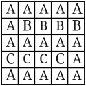</a>　(ii) <a href="../../../assets/volume4b/figures/satqa-a392-2.svg">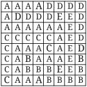</a>　(iii) <a href="../../../assets/volume4b/figures/satqa-a392-3.svg">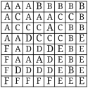</a>　(iv) <a href="../../../assets/volume4b/figures/satqa-a392-4.svg">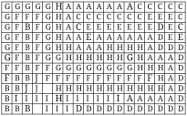</a>　(v) <a href="../../../assets/volume4b/figures/satqa-a392-5.svg">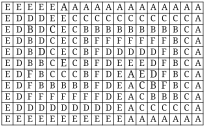</a>


(b) [谜题 (vi) 是奇偶换位排序的一个实例, 见习题 5.3.4–37. 若 (vii) 中只有八列而非九列, 八条倒转次序的连接就不可能实现, 因为置换的逆序太多.]

(vi) <a href="../../../assets/volume4b/figures/satqa-a392-6.svg">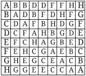</a>　(vii) <a href="../../../assets/volume4b/figures/satqa-a392-7.svg">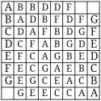</a>　(viii) <a href="../../../assets/volume4b/figures/satqa-a392-8.svg">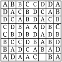</a>

<a id="pdf-648"></a><a id="p-628"></a>

(c) 令 $d_j=\sum_{i=1}^j(|T_i|-1)$, $d=d_t$. 对每个顶点 $v$ 引入变量 $v_i$, $1\le i\le d$. 当 $1\le j\le t$, $d_{j-1}<i\le d_j$ 时取如下子句: 对 $1\le i'\le d_{j-1}$ 取 $(\bar v_{i'}\lor\bar v_i)$; 对变量 $v_i$ 取[答案 390](#ans-7-2-2-2-390)(b) 的子句, 其中 $s$ 是 $T_j$ 的第 $i-d_{j-1}$ 个元素, $t$ 为末元素. 这些子句确保各个集合 $V_j=\{v\mid v_{d_{j-1}+1}\lor\cdots\lor v_{d_j}\}$ 互不相交, 且 $V_j$ 含有一个连通分量 $S_j\supseteq T_j$.

若 $T_j$ 仅含一个顶点 $v$, 便取 $S_j=\{v\}$; 还须对 $1\le i\le d$ 断言 $(\bar v_i)$.

[关于更一般的 “斯坦纳树堆积” 问题, 见 M. Grötschel、A. Martin 和 R. Weismantel, <em>Math. Programming</em> **78** (1997), 265–281.]

<a id="ans-7-2-2-2-393"></a>

**393.** [题目](../sec-7-2-2-2.md#ex-7-2-2-2-393) 可以采用与[答案 392](#ans-7-2-2-2-392)(c) 近似的构造, 使用五个不同的 $8\times8$ 图, 各对应于一对白子和黑子 $S_j$ 的走法. 但为了禁止边彼此相交, 除了顶点以外, 还须跟踪所使用的<em>边</em>. 可用附加子句排除这些交叉.

<a href="../../../assets/volume4b/figures/satqa-a393.png">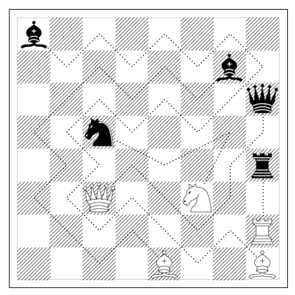</a>


<a id="ans-7-2-2-2-394"></a>

**394.** [题目](../sec-7-2-2-2.md#ex-7-2-2-2-394) 将这些子句称为 $\operatorname{langford}'''(n)$. [Steven Prestwich 在 <em>Trends in Constraint Programming</em> (Wiley, 2007), 269–274 中描述过类似的方法.] 典型结果如下:

<table id="sat-langford394"><thead><tr><th>问题</th><th>变量数</th><th>子句数</th><th>算法 D</th><th>算法 L</th><th>算法 C</th><th>结果</th></tr></thead><tbody>
<tr><th>$\operatorname{langford}'''(9)$</th><td>206</td><td>1157</td><td>$131\,\mathrm{M}\mu$</td><td>$18\,\mathrm{M}\mu$</td><td>$22\,\mathrm{M}\mu$</td><td>UNSAT</td></tr>
<tr><th>$\operatorname{langford}'''(13)$</th><td>403</td><td>2935</td><td>$1425\,\mathrm{G}\mu$</td><td>$44\,\mathrm{G}\mu$</td><td>$483\,\mathrm{G}\mu$</td><td>UNSAT</td></tr>
<tr><th>$\operatorname{langford}'''(16)$</th><td>584</td><td>4859</td><td>$713\,\mathrm{K}\mu$</td><td>$42\,\mathrm{M}\mu$</td><td>$343\,\mathrm{K}\mu$</td><td>SAT</td></tr>
<tr><th>$\operatorname{langford}'''(64)$</th><td>7352</td><td>120035</td><td>(极大)</td><td>(大)</td><td>$71\,\mathrm{M}\mu$</td><td>SAT</td></tr>
</tbody></table>


<a id="ans-7-2-2-2-395"></a>

**395.** [题目](../sec-7-2-2-2.md#ex-7-2-2-2-395) 对每个顶点 $v$ 的颜色, 如 (164) 那样, 对 $1\le j<d-1$ 取二元公理子句 $(\bar v^{j+1}\lor v^j)$. 对图中每条边 $u\mathbin{—}v$, 取 $d$ 个子句 $(\bar u^{j-1}\lor u^j\lor\bar v^{j-1}\lor v^j)$, $1\le j\le d$, 其中当 $j=1$ 时略去 $\bar u^0$ 和 $\bar v^0$, 当 $j=d$ 时略去 $u^d$ 和 $v^d$.

[顺序编码在图着色上出乎意料的用处, 最早由 N. Tamura、A. Taga、S. Kitagawa 和 M. Banbara 在 <em>Constraints</em> **14** (2009), 254–272 中指出.]

<a id="ans-7-2-2-2-396"></a>

**396.** [题目](../sec-7-2-2-2.md#ex-7-2-2-2-396) 首先, 对 $1\le j<d-1$ 有 $(\bar x^{j+1}\lor x^j)$ 和 $(\overline{\hat x^{j+1}}\lor\hat x^j)$. 然后用 “通道” 子句保证 $j\le x<j+1\iff j\pi\le x\pi<j\pi+1$, $0\le j<d$:
$$
(\bar x^j\lor x^{j+1}\lor\hat x^{j\pi})\land
(\bar x^j\lor x^{j+1}\lor\overline{\hat x^{j\pi+1}})\land
(\overline{\hat x^{j\pi}}\lor\hat x^{j\pi+1}\lor x^j)\land
(\overline{\hat x^{j\pi}}\lor\hat x^{j\pi+1}\lor\bar x^{j+1}).
$$
(在边界处应缩短或略去这些子句, 因为 $x^0$ 和 $\hat x^0$ 恒真, 而 $x^d$ 和 $\hat x^d$ 恒假. 每个 $x$ 得 $6d-8$ 个子句.)

对图的每个顶点取这些子句, 再配以上述基于相邻顶点和团的子句, 所得的 $n\times n$ 皇后图的 $n$ 着色编码有 $2(n^3-n^2)$ 个变量、$\tfrac53n^4+4n^3+O(n^2)$ 个子句; 仅用一份团提示和 (162) 时, 则有 $n^3-n^2$ 个变量、$\tfrac53n^4-n^3+O(n^2)$ 个子句. 在 $n=7,8,9$ 时, 算法 C 仅用一份团提示的典型运行时间分别为 $323\,\mathrm K\mu$, $13.1\,\mathrm M\mu$, $706\,\mathrm G\mu$; 使用双重团提示后, 分别变为 $252\,\mathrm K\mu$, $1.97\,\mathrm M\mu$, $39.8\,\mathrm G\mu$.

若 $\pi$ 为标准管风琴排列 $(0\pi,1\pi,\ldots,(d-1)\pi)=(0,2,4,\ldots,5,3,1)$ 而非其逆, 双重团提示就莫名其妙地没有多少效果. 对 $n=8$ 随机选择 $\pi$, 在作者的实验中, 将近一半的情形有显著的时间改进; 但三分之一的情形几乎没有效果.

注意在 $d=4$ 的例子中, 若以 $x_0,\ldots,x_3$ 表示四个直接编码位, 则 $x^1=\bar x_0$, $x^3=x_3$, $\hat x^1=\bar x_2$, $\hat x^3=x_1$. 所以直接编码实质上已是这种冗余表示的一部分, 而对 2 团 $\{u,v\}$ 的提示 $(\bar u^3\lor\bar v^3)\land(u^1\lor v^1)\land(\overline{\hat u^3}\lor\overline{\hat v^3})\land(\hat u^1\lor\hat v^1)$ 等价于 (16). 但当 $\{u,v,w\}$ 构成三角形时, 所用提示 $(u^2\lor v^2\lor w^2)\land(\bar u^2\lor\bar v^2\lor\bar w^2)\land(\hat u^2\lor\hat v^2\lor\hat w^2)\land(\overline{\hat u^2}\lor\overline{\hat v^2}\lor\overline{\hat w^2})$ 带来了额外的逻辑力量.

<a id="pdf-649"></a><a id="p-629"></a>

<a id="ans-7-2-2-2-397"></a>

**397.** [题目](../sec-7-2-2-2.md#ex-7-2-2-2-397) 对 $1\le i<p-1$, 有 $(p-2)d$ 个二元子句 $(\bar y_j^{i+1}\lor y_j^i)$; 另对 $1\le i<p$ 有 $(2p-2)d$ 个子句
$$
(\bar x_i^j\lor x_i^{j+1}\lor y_j^i)\land
(\bar x_{i-1}^j\lor x_{i-1}^{j+1}\lor\bar y_j^i),
$$
全取 $0\le j<d$. 提示子句 $(x_0^{p-1}\lor\cdots\lor x_{p-1}^{p-1})\land(\bar x_0^{d-p+1}\lor\cdots\lor\bar x_{p-1}^{d-p+1})$ 也成立.

(这一设定相当于将 $p$ 只鸽子放入 $d$ 个巢, 所以通常可以假定 $p\le d$. 若 $p\le4$, 最好像[习题 395](../sec-7-2-2-2.md#ex-7-2-2-2-395) 那样用 $\binom p2 d$ 个子句. 注意当 $p=d$ 时, 我们得到<em>置换</em>的一种有趣表示. 此时 $y$ 是逆置换, 因而对应于 $y_j=i\implies x_i=j$ 的 $(2d-2)p$ 个附加子句也都成立, $y$ 的两个提示子句同样成立.)

一个相关的想法由 I. Gent 和 P. Nightingale 在 <em>Proceedings of the International Workshop on Modelling and Reformulating Constraint Satisfaction Problems</em> **3** (2004), 95–110 中给出, 不过他们配合使用的是 $x$ 的直接编码.

<a id="ans-7-2-2-2-398"></a>

**398.** [题目](../sec-7-2-2-2.md#ex-7-2-2-2-398) 可以如同[习题 397](../sec-7-2-2-2.md#ex-7-2-2-2-397) 那样, 构造涉及 $y_j^i$ 的 $(3p-4)d$ 个二元子句. 但对至多一个的约束 $x_{0k}+x_{1k}+\cdots+x_{(p-1)k}\le1$, $0\le k<d$, 最好仅用 $(3p-6)d$ 个子句.

<a id="ans-7-2-2-2-399"></a>

**399.** [题目](../sec-7-2-2-2.md#ex-7-2-2-2-399) (a) $d^2-t$ 个排除子句 (二元的); 或 $2d$ 个支持子句 (总长度 $2(d+t)$).

(b) 若单元传播从 $(\bar u_i\lor\bar v_j)$ 推出 $\bar v_j$, 我们一定已知 $u_i$; 从而 (17) 对所有 $i'\ne i$ 给出 $\bar u_{i'}$, 于是从含 $\bar v_j$ 的支持子句可推出 $\bar v_j$.

(c) 若单元传播从支持子句推出 $\bar v_j$, 就已知对所有 $i\ne j$ 有 $\bar u_i$; 因此由 (15) 得 $u_j$, 由 (16) 得 $\bar v_j$. 或者, 若从该支持子句推出 $u_i$, 就已知 $v_j$ 以及对所有 $i'\notin\{i,j\}$ 有 $\bar u_{i'}$; 因此由 (16) 得 $\bar u_j$, 由 (15) 得 $u_i$.

(d) 没有合法数对就是一个平凡的例子; 这时二元排除子句甚至不能启动单元传播, 而 (单位的) 支持子句却能推出矛盾. 较实际的例子是 $d=3$, 除如 $(1,1)$ 和 $(1,2)$ 外所有数对均合法; 则有
$$
(15)\land(17)\land(\bar u_1\lor\bar v_1)\land(\bar u_1\lor\bar v_2)\land(\bar v_3)\not\vdash_1\bar u_1,
$$
而 $(15)\land(17)\land(\bar u_1\lor v_3)\land(\bar v_3)\vdash_1\bar u_1$.

[排除法由 S. W. Golomb 和 L. D. Baumert 在 <em>JACM</em> **12** (1965), 521–522 中引入. 支持编码是 I. P. Gent 根据 S. Kasif 的工作 (<em>Artificial Intelligence</em> **45** (1990), 275–286) 而提出的, 见 <em>European Conf. on Artificial Intelligence</em> **15** (2002), 121–125.]

<a id="ans-7-2-2-2-400"></a>

**400.** [题目](../sec-7-2-2-2.md#ex-7-2-2-2-400) 这个问题有 $n$ 个变量 $q_1,\ldots,q_n$, 每个取 $n$ 个值; 因而有 $n^2$ 个布尔值 $q_{ij}=[q_i=j]=[\text{第 }i\text{ 行第 }j\text{ 列有一个皇后}]$. $q_i$ 与 $q_j$ 的约束为 $q_i\notin\{q_j,q_j+i-j,q_j-i+j\}$; 所以共有 $n$ 个至少一个子句, $(n^3-n^2)/2$ 个至多一个子句, 以及 $n^3-n^2$ 个支持子句或 $n^3-n^2+\binom n3$ 个排除子句. 在这个问题中每个支持子句至少含 $n-2$ 个字面值, 所以支持编码大得多.

由于该问题很容易满足, 尝试 WalkSAT 很合理. 当 $n=20$ 时, 算法 W 利用排除子句通常只须不到 500 次翻转就得到一个解; 运行时间约 $500\,\mathrm K\mu$, 其中仅读取输入就用了约 $200\,\mathrm K\mu$. 但使用支持子句时, 需要约十倍的翻转以及约二十倍的内存访问才能成功.

算法 L 的表现差得多: 用排除子句时需 $50\,\mathrm M\mu$, 用支持子句时需 $11\,\mathrm G\mu$. 算法 C 胜出, 用排除子句时约 $400\,\mathrm K\mu$, 用支持子句时约 $600\,\mathrm K\mu$.

当然 $n=20$ 十分温和; 再看 $n=100$ 个皇后, 这时有 1 万个变量和一百多万个子句. 算法 L 已不在考虑之列; 在作者的实验中, 即使花去 $20\,\mathrm T\mu$, 也丝毫看不出它接近一个解. 但用排除子句的算法 W, 在仅约 5000 次翻转之后, 用 $50\,\mathrm M\mu$ 就能解决这个问题. 算法 C 再次胜出, 只用 $29\,\mathrm M\mu$ 便处理完毕. 使用 <a id="pdf-650"></a><a id="p-630"></a> 支持子句时, 需要读入近 1 亿个字面值, 算法 W 的效率低得令人绝望; 而算法 C 仍能在约 $200\,\mathrm M\mu$ 后结束.

在这个问题中, 排除子句实际上容许我们略去每行的至多一个子句, 因为即使不用它们, 同行出现两个皇后也会被排除. 当 $n=100$ 时, 这一改进使算法 W 的运行时间降到 $35\,\mathrm M\mu$.

除行的支持子句外还可附加列的支持子句. 这个想法使查找空间大约减半, 但没有改善效果, 因为要处理的子句翻了一番. <em>结论:</em> 支持子句对 $n$ 皇后的支持不大.

(然而若寻找 $n$ 皇后问题的<em>全部</em>解而非在第一个解处停止, 在作者的实验中, 用算法 D 的一个直接推广时 (见[习题 122](../sec-7-2-2-2.md#ex-7-2-2-2-122)), 支持子句确实更好.)

<a id="ans-7-2-2-2-401"></a>

**401.** [题目](../sec-7-2-2-2.md#ex-7-2-2-2-401) (a) $y^j=x^{2j-1}$. (b) $z^j=x^{3j-1}$. 一般地, $w=\lfloor(x+a)/b\rfloor\iff w^j=x^{bj-a}$.

<a id="ans-7-2-2-2-402"></a>

**402.** [题目](../sec-7-2-2-2.md#ex-7-2-2-2-402) (a) $\bigwedge_{j=1}^{\lfloor d/2\rfloor}(\bar x^{2j-1}\lor x^{2j})$; (b) $\bigwedge_{j=1}^{\lceil d/2\rceil}(\bar x^{2j-2}\lor x^{2j-1})$; 略去 $\bar x^0$ 和 $x^d$.

<a id="ans-7-2-2-2-403"></a>

**403.** [题目](../sec-7-2-2-2.md#ex-7-2-2-2-403) (a) $\bigwedge_{j=1}^{d-1}(\bar x^j\lor\bar y^j\lor z^j)$; (b) $\bigwedge_{j=1}^{d-1}((\bar x^j\lor z^j)\land(\bar y^j\lor z^j))$; (c) $\bigwedge_{j=1}^{d-1}((x^j\lor\bar z^j)\land(y^j\lor\bar z^j))$; (d) $\bigwedge_{j=1}^{d-1}(x^j\lor y^j\lor\bar z^j)$.

<a id="ans-7-2-2-2-404"></a>

**404.** [题目](../sec-7-2-2-2.md#ex-7-2-2-2-404) $\bigwedge_{j=0}^{d-a}(\bar x^j\lor x^{j+a}\lor\bar y^j\lor y^{j+a})$. (如常, 略去上标为 0 的否定字面值和上标为 $d$ 的正字面值.)

<a id="ans-7-2-2-2-405"></a>

**405.** [题目](../sec-7-2-2-2.md#ex-7-2-2-2-405) (a) 若 $a<0$, 可用 $(-a)\bar x$ 代替 $ax$, 并用 $c+a-ad$ 代替 $c$, 其中 $\bar x$ 如 (165) 所定义. 若 $b<0$ 也有类似的约化. $a,b$ 或 $c$ 为 0 的情形是平凡的.

(b) 有 $13x+8\bar y\le63\iff\neg(13x+8\bar y\ge64)\iff\neg(P_0\lor\cdots\lor P_{d-1})\iff\neg P_0\land\cdots\land\neg P_{d-1}$, 其中 $P_j$ 表示 ‘$x\ge j$ 且 $\bar y\ge\lceil(64-13j)/8\rceil$’. 因此得到 $\bigwedge_{j=0}^7(\bar x^j\lor y^{8-\lceil(64-13j)/8\rceil})$, 简化为 $(\bar x^1\lor y^1)\land(\bar x^2\lor y^3)\land(\bar x^3\lor y^4)\land(\bar x^4\lor y^6)\land(\bar x^5)$. (注意, 也可定义 $P_j$ 为 ‘$\bar y\ge j$ 且 $x\ge\lceil(64-8j)/13\rceil$’, 得到较低效的编码 $(\bar x^5)\land(y^7\lor\bar x^5)\land(y^6\lor\bar x^4)\land(y^5\lor\bar x^4)\land(y^4\lor\bar x^3)\land(y^3\lor\bar x^2)\land(y^2\lor\bar x^2)\land(y^1\lor\bar x^1)$; 按系数较大的变量来区分更好.)

(c) 类似地, $13\bar x+8y\le90$ 给出 $(x^5\lor\bar y^7)\land(x^4\lor\bar y^5)\land(x^3\lor\bar y^4)\land(x^2\lor\bar y^2)\land(x^1)$. 对 (b)、(c) 均合法的数对 $(x,y)$ 为 $(1,1),(2,3),(3,4),(4,6)$.

(d) 当 $a\ge b>0$, $c\ge0$ 时, 取
$$
\bigwedge_{j=\max(0,\lceil(c+1-b(d-1))/a\rceil)}^{\min(d-1,\lceil(c+1)/a\rceil)}
(\bar x^j\lor\bar y^{\lceil(c+1-aj)/b\rceil}).
$$

<a id="ans-7-2-2-2-406"></a>

**406.** [题目](../sec-7-2-2-2.md#ex-7-2-2-2-406) (a)
$$
\left(\bigwedge_{j=\lceil(a+1)/(d-1)\rceil}^{\lceil\sqrt{a+1}\rceil}
(\bar x^j\lor\bar y^{\lceil(a+1)/j\rceil})\right)
\land\left(\bigwedge_{j=\lceil(a+1)/(d-1)\rceil}^{\lceil\sqrt{a+1}\rceil-1}
(\bar x^{\lceil(a+1)/j\rceil}\lor\bar y^j)\right).
$$
(b)
$$
\left(\bigwedge_{j=l+1}^{\lfloor\sqrt{a-1}\rfloor+1}(x^j\lor y^{\lfloor(a-1)/(j-1)\rfloor+1})\right)
\land\left(\bigwedge_{j=l+1}^{\lfloor\sqrt{a-1}\rfloor}(x^{\lfloor(a-1)/(j-1)\rfloor+1}\lor y^j)\right)
\land(x^l)\land(y^l),
$$
其中 $l=\lfloor(a-1)/(d-1)\rfloor+1$. [两个公式都属于 2SAT.]

<a id="ans-7-2-2-2-407"></a>

**407.** [题目](../sec-7-2-2-2.md#ex-7-2-2-2-407) (a) 总有 $\lfloor x/2\rfloor+\lceil x/2\rceil=x$, $\lfloor x/2\rfloor+\lfloor y/2\rfloor\le(x+y)/2\le\lfloor x/2\rfloor+\lfloor y/2\rfloor+1$, 且 $\lceil x/2\rceil+\lceil y/2\rceil-1\le(x+y)/2\le\lceil x/2\rceil+\lceil y/2\rceil$. (奇偶归并网络的正确性也有类似的证明; 见式 5.3.4–(3).)

(b) 对 $u,v$ 甚至对于 $z$, 都不必引入 (164) 那样的公理子句; 因而这里不把它们计入, 尽管需要时仍可添加. 令 $a_d=d^2-1$ 为原方法的子句数. 则当 $a_{\lceil d/2\rceil}+a_{\lfloor d/2\rfloor+1}+3(d-2)<a_d$ 时新方法的子句较少, 即 $d\ge7$ 时. (新方法对 $d=7$ 有 45 个子句而非 48 个; 但它引入了 10 个新的辅助变量.) 渐近地, 只须用 $3t2^t+O(2^t)=3d\lg d+O(d)$ 个子句和 $d\lg d+O(d)$ 个辅助变量, 便可处理 $d=2^t+1$.

(c) $x+y\ge z\iff(d-1-x)+(d-1-y)\le(2d-2-z)$; 所以可用相同方法, 只须取补 (即将 $x^j$ 换成 $\bar x^{d-j}$, $y^j$ 换成 $\bar y^{d-j}$, $z^j$ 换成 $\bar z^{2d-1-j}$).

<a id="pdf-651"></a><a id="p-631"></a>

[见 N. Tamura、A. Taga、S. Kitagawa 和 M. Banbara, <em>Constraints</em> **14** (2009), 254–272; R. Asín、R. Nieuwenhuis、A. Oliveras 和 E. Rodríguez-Carbonell, <em>Constraints</em> **16** (2011), 195–221.]

<a id="ans-7-2-2-2-408"></a>

**408.** [题目](../sec-7-2-2-2.md#ex-7-2-2-2-408) (a) 不是; 总工期 11 最优, 可用下图的调度 (或其左右反射) 达到:

<table id="sat-schedule408-2" aria-label="工期 11 的调度"><thead><tr><th>时段起点</th><th>0</th><th>1</th><th>2</th><th>3</th><th>4</th><th>5</th><th>6</th><th>7</th><th>8</th><th>9</th><th>10</th></tr></thead><tbody>
<tr><th>$M_1$</th><td colspan="7" style="text-align:center;border:1px solid currentColor">$J_1$</td><td colspan="1" style="text-align:center;border:1px solid currentColor">　</td><td colspan="3" style="text-align:center;border:1px solid currentColor">$J_3$</td></tr>
<tr><th>$M_2$</th><td colspan="2" style="text-align:center;border:1px solid currentColor">$J_3$</td><td colspan="1" style="text-align:center;border:1px solid currentColor">　</td><td colspan="7" style="text-align:center;border:1px solid currentColor">$J_2$</td><td colspan="1" style="text-align:center;border:1px solid currentColor">$J_1$</td></tr>
<tr><th>$M_3$</th><td colspan="3" style="text-align:center;border:1px solid currentColor">$J_2$</td><td colspan="5" style="text-align:center;border:1px solid currentColor">$J_3$</td><td colspan="2" style="text-align:center;border:1px solid currentColor">$J_1$</td><td colspan="1" style="text-align:center;border:1px solid currentColor">　</td></tr>
</tbody></table>

<table id="sat-schedule408-3" aria-label="工期 11 的调度"><thead><tr><th>时段起点</th><th>0</th><th>1</th><th>2</th><th>3</th><th>4</th><th>5</th><th>6</th><th>7</th><th>8</th><th>9</th><th>10</th></tr></thead><tbody>
<tr><th>$M_1$</th><td colspan="3" style="text-align:center;border:1px solid currentColor">$J_3$</td><td colspan="7" style="text-align:center;border:1px solid currentColor">$J_1$</td><td colspan="1" style="text-align:center;border:1px solid currentColor">　</td></tr>
<tr><th>$M_2$</th><td colspan="7" style="text-align:center;border:1px solid currentColor">$J_2$</td><td colspan="1" style="text-align:center;border:1px solid currentColor">　</td><td colspan="2" style="text-align:center;border:1px solid currentColor">$J_3$</td><td colspan="1" style="text-align:center;border:1px solid currentColor">$J_1$</td></tr>
<tr><th>$M_3$</th><td colspan="2" style="text-align:center;border:1px solid currentColor">$J_1$</td><td colspan="1" style="text-align:center;border:1px solid currentColor">　</td><td colspan="5" style="text-align:center;border:1px solid currentColor">$J_3$</td><td colspan="3" style="text-align:center;border:1px solid currentColor">$J_2$</td></tr>
</tbody></table>


(b) 若 $j$ 是机器 $i$ 处理的最后一件作业, 它一定会在 $\sum_{k=1}^n w_{ik}+\sum_{k=1}^m w_{kj}-w_{ij}$ 以前或恰在此时完成, 因为在开始最后这项操作以前, 只要 $i$ 空闲, $j$ 就在某台其他机器上工作. [见 D. B. Shmoys、C. Stein 和 J. Wein, <em>SICOMP</em> **23** (1994), 631.]

(c) 显然 $0\le s_{ij}\le t-w_{ij}$. 又若 $ij\ne i'j'$ 且 $i=i'$ 或 $j=j'$, 就必须在 $w_{ij}w_{i'j'}\ne0$ 时有 $s_{ij}+w_{ij}\le s_{i'j'}$ 或 $s_{i'j'}+w_{i'j'}\le s_{ij}$.

(d) 当 $w_{ij}>0$ 时, 引入布尔变量 $s_{ij}^k$, $1\le k\le t-w_{ij}$, 以及公理子句 $(\bar s_{ij}^{k+1}\lor s_{ij}^k)$, $1\le k<t-w_{ij}$. 然后对 (c) 中所有相关的 $i,j,i',j'$ 取以下子句: 对 $0\le k\le t+1-w_{ij}-w_{i'j'}$, 若 $ij<i'j'$, 则断言 $(\bar p_{iji'j'}\lor\bar s_{ij}^k\lor s_{i'j'}^{k+w_{ij}})$; 若 $ij>i'j'$, 则断言 $(p_{i'j'ij}\lor\bar s_{ij}^k\lor s_{i'j'}^{k+w_{ij}})$. 在头一个这样的三元子句中略去 $\bar s_{ij}^0$, 在最后一个中略去 $s_{i'j'}^{t+1-w_{i'j'}}$.

[这个方法由 N. Tamura、A. Taga、S. Kitagawa 和 M. Banbara 在 <em>Constraints</em> **14** (2009), 254–272 中提出, 于 2008 年解出了几个其他方法一直未能解决的开放车间调度问题.]

由于左右反射将任何有效调度变为另一个有效调度, 还可以任取一个 $p$ 变量并断言 $(p_{iji'j'})$, 从而省去一半工作.

(e) 检查时隙 $0,k,2k,\ldots$, 就可见 $W,T$ 的任何调度都给出 $\lfloor W/k\rfloor$ 与 $\lceil T/k\rceil$ 的一个调度. [据此, 搜寻最优总工期时可以先解决较简单的问题, 以缩小范围; $\lfloor W/k\rfloor,T/k$ 的变量数及子句数大约是 $W,T$ 时的 $1/k$ 倍, 运行时间通常也大致有相同的比例. 例如, 作者解决一个非平凡的 $8\times8$ 问题时, 先用 $\lfloor W/8\rfloor$, 对 $t=(128,130,129)$ 分别得到结果 (U,S,U), 这里 U 表示 “不可满足”, S 表示 “可满足”; 所用时间约为 (75,10,1250) 百万次内存访问. 再用 $\lfloor W/4\rfloor$, 对 $t=(262,260,261)$ 得 (S,U,U), 时间为 (425,275,325); 用 $\lfloor W/2\rfloor$, 对 $t=(526,528,527)$ 得 (U,S,U), 时间为 (975,200,900). 最后用完整的 $W$, 对 $t=(1058,1060,1059)$ 得 (U,S,S), 时间为 (2050,775,300). 因此证明了 1059 为最优总工期, 而大部分工作都在小的子问题上进行.]

<em>注:</em> 注意在证明时限 $t$ 的问题可满足时学到的子句, 当 $t$ 减小时也有效; 这样还可进一步节省工作. 困难的随机问题可用 C. Guéret 和 C. Prins 在 <em>Annals of Operations Research</em> **92** (1999), 165–183 中建议的办法生成: 起初各 $w_{ij}$ 尽量相等, 各行、各列和均为常数 $s$. 然后随机选取行 $i\ne i'$ 及列 $j\ne j'$, 置 $w_{ij}\gets w_{ij}-\delta$, $w_{i'j}\gets w_{i'j}+\delta$, $w_{ij'}\gets w_{ij'}+\delta$, $w_{i'j'}\gets w_{i'j'}-\delta$, 转移 $\delta$ 个单位的权, 其中 $\delta\le w_{ij}$ 且 $\delta\le w_{i'j'}$; 这显然保持行和与列和. 在 $p\cdot\min\{w_{ij},w_{i'j'}\}$ 与 $\min\{w_{ij},w_{i'j'}\}$ 之间随机选择 $\delta$, 其中 $p$ 为参数. 作 $r$ 次这样的转移便得到最终的权. Guéret 和 Prins 建议当 $n\ge6$ 时取 $r=n^3$, $p=0.95$, 不过其他选择也能给出有用的基准.

<a id="ans-7-2-2-2-409"></a>

**409.** [题目](../sec-7-2-2-2.md#ex-7-2-2-2-409) (a) 若 $S\subseteq\{1,\ldots,r\}$, 令 $\Sigma_S=\sum_{j\in S}a_j$. 可假定作业 $n$ 依次在机器 1、2、3 上运行. 于是最小总工期为 $2w_{2n}+x$, 其中 $x$ 是 <a id="pdf-652"></a><a id="p-632"></a> 所有 $\ge\lceil(a_1+\cdots+a_r)/2\rceil$ 的 $\Sigma_S$ 中最小的一个. (众所周知, 寻找这样一个 $S$ 是 NP 难的 [R. M. Karp, <em>Complexity of Computer Computations</em> (New York: Plenum, 1972), 97–100]; 因而开放车间调度问题是 NP 完全的.)

(b) 当且仅当存在 $S$ 使 $\Sigma_S=(a_1+\cdots+a_r)/2$ 时, 才能达到总工期 $w_{2n}+w_{4n}$. 否则, 将作业 $1,\ldots,r$ 依次在机器 1 上运行, 令 $s_{3(n-1)}=0$, $s_{4n}=w_{2n}$; 若机器 1 在时刻 $w_{2n}$ 正处理作业 $j$, 还令 $s_{2j}=w_{2n}+w_{4n}$. 这样便可达到总工期 $w_{2n}+w_{4n}+1$. 其余作业都很容易安排.

(c) 显然需要 $\lfloor3n/2\rfloor-2$ 个时隙, 而且这已足够. (若 $W$ 的所有行和、列和都等于 $s$, 最小总工期能否 $\ge\tfrac32s$?)

(d) 总能达到 “紧” 的总工期 $s$: 给作业重新编号, 可假定 $1\le j\le k$ 时 $a_j\le b_j$, $k<j\le n$ 时 $a_j\ge b_j$, $b_1=\max\{b_1,\ldots,b_k\}$, $a_n=\max\{a_{k+1},\ldots,a_n\}$. 若 $b_n\ge a_1$, 机器 1 可按 $(1,\ldots,n)$ 的次序运行, 机器 2 可按 $(n,1,\ldots,n-1)$ 运行; 否则分别按 $(2,\ldots,n,1)$ 和 $(1,\ldots,n)$ 运行.

若 $a_1+\cdots+a_n\ne b_1+\cdots+b_n$, 可以增大 $a_n$ 或 $b_n$ 使之相等. 然后可加入一个 “虚” 作业, 令 $a_{n+1}=b_{n+1}=\max\{a_1+b_1,\ldots,a_n+b_n\}\mathbin{\dot-}s$, 并如上所述在 $O(n)$ 步内得到最优调度.

结果 (a)、(b)、(d) 归功于 T. Gonzalez 和 S. Sahni, 他们在 <em>JACM</em> **23** (1976), 665–679 中引入并命名了开放车间调度问题. 部分 (c) 是 Gonzalez 随后提出的一个观察和一个公开问题 (未发表).

<a id="ans-7-2-2-2-410"></a>

**410.** [题目](../sec-7-2-2-2.md#ex-7-2-2-2-410) 像 (23) 那样用半加器和全加器引入中间变量 $w_j$, 使 $(x_2x_1x_0)_2+(x_2x_1x_000)_2+(x_2x_1x_0000)_2+(\bar y_2\bar y_1\bar y_0000)_2\le(w_7w_6\ldots w_0)_2$, 再要求 $(\bar w_7)\land(\bar w_6)$. 把过程放慢来看, 依次计算 $(c_0z_0)_2\ge x_0+x_2$, $(c_1z_1)_2\ge x_0+x_1+\bar y_0$, $(c_2z_2)_2\ge c_0+z_1$, $(c_3z_3)_2\ge x_1+x_2+\bar y_1$, $(c_4z_4)_2\ge c_1+c_2+z_3$, $(c_5z_5)_2\ge x_2+\bar y_2+c_3$, $(c_6z_6)_2\ge c_4+z_5$, $(c_7z_7)_2\ge c_5+c_6$; 然后 $w_7w_6\ldots w_0=c_7z_7z_6z_4z_2z_0x_1x_0$. 再放慢一些, 每一步 $(c_iz_i)_2\ge u+v$ 展开为 $z_i\ge u\oplus v$, $c_i\ge u\land v$; 每一步 $(c_iz_i)_2\ge t+u+v$ 展开为 $s_i\ge t\oplus u$, $p_i\ge t\land u$, $z_i\ge v\oplus s_i$, $q_i\ge v\land s_i$, $c_i\ge p_i\lor q_i$. 在子句层上,
$$
\begin{aligned}
t\ge u\land v&\iff(t\lor\bar u\lor\bar v),\\
t\ge u\lor v&\iff(t\lor\bar u)\land(t\lor\bar v),\\
t\ge u\oplus v&\iff(t\lor u\lor\bar v)\land(t\lor\bar u\lor v).
\end{aligned}
$$
[用不等式代替等式时, (24) 的子句只需用到约一半. [习题 42](../sec-7-2-2-2.md#ex-7-2-2-2-42) 给出了改进办法.]

最后得到 44 个二元与三元子句, 还有 $(\bar c_7)\land(\bar z_7)$. 单元传播并删除含有纯字面值 $z_0,z_2,z_4,z_6$ 的子句后, 可以进一步约简结果. 但[习题 405](../sec-7-2-2-2.md#ex-7-2-2-2-405) 的顺序编码显然好得多. 只有在数较大时, 对数编码才变得有吸引力, 如下一题.

[见 J. P. Warners, <em>Information Processing Letters</em> **68** (1998), 63–69.]

<a id="ans-7-2-2-2-411"></a>

**411.** [题目](../sec-7-2-2-2.md#ex-7-2-2-2-411) 用 $m+n$ 个新变量表示辅助数 $w=(w_{m+n}\ldots w_1)_2$. 像[习题 41](../sec-7-2-2-2.md#ex-7-2-2-2-41) 那样为乘积 $xy=w$ 建立子句; 但仅保留约一半的子句, 如答案 410. 所得的 $9mn-5m-10n$ 个子句, 在 $w=xy$ 时可满足, 而且只要它们满足就有 $w\ge xy$. 现在如 (169) 那样再加 $3m+3n-2$ 个子句以保证 $z\ge w$. $z\le xy$ 的情形类似.

<a id="ans-7-2-2-2-412"></a>

**412.** [题目](../sec-7-2-2-2.md#ex-7-2-2-2-412) 混合进制表示在这里也很有意思. 例如见 N. Eén 和 N. Sörensson, <em>J. Satisfiability, Bool. Modeling and Comp.</em> **2** (2006), 1–26; T. Tanjo、N. Tamura 和 M. Banbara, <em>LNCS</em> **7317** (2012), 456–462.

<a id="ans-7-2-2-2-413"></a>

**413.** [题目](../sec-7-2-2-2.md#ex-7-2-2-2-413) 只有一个, 即 $\bigwedge_{\sigma_1,\ldots,\sigma_n\in\{-1,1\}}(\sigma_1x_1\lor\sigma_1y_1\lor\cdots\lor\sigma_n x_n\lor\sigma_n y_n)$. <em>证明:</em> 某个子句必只含正字面值, 因为 $f(0,\ldots,0)=0$. 这个子句必须是 $(x_1\lor y_1\lor\cdots\lor x_n\lor y_n)$, 否则它会在 $f$ 为真的某些情形下变假. 类似的论证表明, <em>每个</em>子句 $(\sigma_1x_1\lor\sigma_1y_1\lor\cdots\lor\sigma_n x_n\lor\sigma_n y_n)$ 都必须出现. 而 $f$ 的非重言式子句不可能同时含有 $x_j,\bar y_j$, 或同时含有 $\bar x_j,y_j$.

<a id="pdf-653"></a><a id="p-633"></a>

<a id="ans-7-2-2-2-414"></a>

**414.** [题目](../sec-7-2-2-2.md#ex-7-2-2-2-414) 先消去 $a_{n-1}$, 再消去 $a_{n-2}$, 如此等等, 得 $2^n-1$ 个子句. (对于 $x_1\ldots x_n<y_1\ldots y_n$, 类似的结果是 $2^n+2^{n-1}+1$ 个. 预处理器很可能会消去 $a_{n-1}$.)

<a id="ans-7-2-2-2-415"></a>

**415.** [题目](../sec-7-2-2-2.md#ex-7-2-2-2-415) 对 $1\le k\le n$, 利用 (166) 构造子句来编码 ‘$a_{k-1}$ 蕴涵 $x_k<y_k+a_k$’:
$$
\left(\bigwedge_{j=1}^{d-1}(\bar a_{k-1}\lor\bar x_k^j\lor y_k^j)\right)\land
\left(\bigwedge_{j=0}^{d-1}(\bar a_{k-1}\lor a_k\lor\bar x_k^j\lor y_k^{j+1})\right),
$$
略去 $\bar x_k^0$ 与 $y_k^d$; 也略去 $\bar a_0$. 对关系 $x_1\ldots x_n\le y_1\ldots y_n$, 可以略去含有 (纯) 字面值 $a_n$ 的 $d$ 个子句. 但对 $x_1\ldots x_n<y_1\ldots y_n$ 需要 $a_n=0$; 因此略去 $a_n$ 以及 $d-1$ 个子句 $(\bar a_{n-1}\lor\bar x_n^j\lor y_n^j)$. [子句 (169) 归功于 K. Sakallah, <em>Handbook of Satisfiability</em> (2009), 第 10 章, (10.32).]

<a id="ans-7-2-2-2-416"></a>

**416.** [题目](../sec-7-2-2-2.md#ex-7-2-2-2-416) 其余各子句为 $\bigwedge_{i=1}^m((u_i\lor\bar v_i\lor\bar a_0)\land(\bar u_i\lor v_i\lor\bar a_0))$ 和 $(a_0\lor a_1\lor\cdots\lor a_n)$.

[见 A. Biere 和 R. Brummayer, <em>Proceedings, International Conference on Formal Methods in Computer Aided Design</em> **8** (IEEE, 2008), 4 页 [FMCAD 08].]

<a id="ans-7-2-2-2-417"></a>

**417.** [题目](../sec-7-2-2-2.md#ex-7-2-2-2-417) 四个子句 $(\bar s\lor\bar t\lor u)\land(\bar s\lor t\lor v)\land(s\lor\bar t\lor\bar u)\land(s\lor t\lor\bar v)$ 保证 $s$ 为真当且仅当 $t\mathrel?u:v$ 为真. 但翻译分支程序时像 (173) 那样只需其中的两个, 因为另两个在第一步受到阻塞. 将它们删去后, 下一步的另外两个也受到阻塞, 如此等等.

<a id="ans-7-2-2-2-418"></a>

**418.** [题目](../sec-7-2-2-2.md#ex-7-2-2-2-418) 当 $n=3$ 时, $h_n$ 的一个合适的分支程序从 $I_{11}$ 开始:
$$
\begin{gathered}
I_{11}=(\bar1\mathrel?21:22),\ I_{21}=(\bar2\mathrel?31:32),\ I_{22}=(\bar2\mathrel?32:33),\\
I_{31}=(\bar3\mathrel?0:42),\ I_{32}=(\bar3\mathrel?42:43),\ I_{33}=(\bar3\mathrel?43:1),\
I_{42}=(\bar1\mathrel?0:1),\ I_{43}=(\bar2\mathrel?0:1).
\end{gathered}
$$
由 (173) 得到以下子句: 对行 $i$, $1\le i\le m$, 取 $(r_{i,1,1})$; 对 $1\le j\le k\le n$ 取 $(\bar r_{i,k,j}\lor x_{ik}\lor r_{i,k+1,j})\land(\bar r_{i,k,j}\lor\bar x_{ik}\lor r_{i,k+1,j+1})$; 取 $(\bar r_{i,n+1,1})\land(r_{i,n+1,n+1})$ 以及 $(\bar r_{i,n+1,j+1}\lor x_{ij})$, $1\le j<n$. 同样, 对列 $j$, $1\le j\le n$, 取 $(c_{j,1,1})$; 对 $1\le i\le k\le m$ 取 $(\bar c_{j,k,i}\lor x_{kj}\lor c_{j,k+1,i})\land(\bar c_{j,k,i}\lor\bar x_{kj}\lor c_{j,k+1,i+1})$; 取 $(c_{j,m+1,1})\land(\bar c_{j,m+1,m+1})$ 以及 $(\bar c_{j,m+1,i+1}\lor\bar x_{ij})$, $1\le i<m$.

<a id="ans-7-2-2-2-419"></a>

**419.** [题目](../sec-7-2-2-2.md#ex-7-2-2-2-419) (a) 恰有 $n-2$ 个解: 对 $2<k\le n$, $x_{ij}=[j=1][i\ne m-1]+[j=2][i=m-1]+[j=k][i=m-1]$.

(b) 恰有 $m-2$ 个解: 对 $1\le k<m-2$ 或 $k=m$, $\bar x_{ij}=[j>1][i=m-1]+[j=1][i=m-2]+[j=1][i=k]$.

<a id="ans-7-2-2-2-420"></a>

**420.** [题目](../sec-7-2-2-2.md#ex-7-2-2-2-420) 由 (24) 从下列子句开始:
$$
\begin{gathered}
(\bar x_1\lor x_2\lor s)\land(x_1\lor\bar x_2\lor s)\land
(x_1\lor x_2\lor\bar s)\land(\bar x_1\lor\bar x_2\lor\bar s);\\
(x_1\lor\bar c)\land(x_2\lor\bar c)\land(\bar x_1\lor\bar x_2\lor c);\\
(\bar s\lor x_3\lor t)\land(s\lor\bar x_3\lor t)\land
(s\lor x_3\lor\bar t)\land(\bar s\lor\bar x_3\lor\bar t);\\
(s\lor\bar c')\land(x_3\lor\bar c')\land(\bar s\lor\bar x_3\lor c');\qquad(\bar c)\land(\bar c').
\end{gathered}
$$
传播 $(\bar c)$ 和 $(\bar c')$, 得到 $(\bar x_1\lor\bar x_2)\land(\bar s\lor\bar x_3)$; 删去被包摄的子句 $(\bar x_1\lor\bar x_2\lor\bar s)$, $(\bar s\lor\bar x_3\lor\bar t)$; 删去阻塞子句 $(s\lor x_3\lor\bar t)$; 删去含有纯字面值 $t$ 的子句; 将 $s$ 改名为 $a_1$.

<a id="ans-7-2-2-2-421"></a>

**421.** [题目](../sec-7-2-2-2.md#ex-7-2-2-2-421) 由 (173) 从 $(\bar a_5\lor x_1\lor a_4)\land(\bar a_5\lor\bar x_1\lor a_3)\land(\bar a_4\lor\bar x_2\lor a_2)\land(\bar a_3\lor x_2\lor a_2)\land(\bar a_3\lor\bar x_2)\land(\bar a_2\lor\bar x_3)\land(a_5)$ 开始. 传播 $(a_5)$.

<a id="ans-7-2-2-2-422"></a>

**422.** [题目](../sec-7-2-2-2.md#ex-7-2-2-2-422) (a) $x_1$ 蕴涵 $\bar x_2$, 接着得到 $a_1$, 再得到 $\bar x_3$; $x_2$ 蕴涵 $\bar x_1$, 接着得到 $a_1$, 再得到 $\bar x_3$.

(b) $x_1$ 蕴涵 $a_3$, 接着得到 $\bar x_2$, 再得到 $a_2$, 最后得到 $\bar x_3$; $x_2$ 蕴涵 $\bar a_3$, 接着依次得到 $\bar x_1,a_4,a_2,\bar x_3$.

<a id="ans-7-2-2-2-423"></a>

**423.** [题目](../sec-7-2-2-2.md#ex-7-2-2-2-423) 否. 考虑 $x_1\,?\,(x_2\,?\,x_3:x_4):(x_2\,?\,x_4:x_3)$, 取 $L=(\bar x_3)\land(\bar x_4)$. (不过 Abío、Gange、Mayer-Eichberger 和 Stuckey 已经证明 [<em>LNCS</em> **9676** (2016), 1–17], 只要将 $(\bar a_j\lor a_l\lor a_h)$ 添入 (173), 就总能得到弱强制性. 此外, 通过[习题 436](../sec-7-2-2-2.md#ex-7-2-2-2-436) 中定义的附加子句, 总<em>能</em>构造出一个强制编码. 注意, 若再作失败字面值检验, 弱强制就相当于强制.)

<a id="ans-7-2-2-2-424"></a>

**424.** [题目](../sec-7-2-2-2.md#ex-7-2-2-2-424) 子句 $\bar1\bar3\bar4$ 是冗余的 (已有 $\bar1\bar2\bar3$ 和 $2\bar3\bar4$); 但它不能省去, 因为 $\{\bar2\bar3,2\bar3,12\}\not\vdash_1\bar3$. 子句 $2\bar3\bar4$ 也是冗余的 (已有 $\bar1\bar3\bar4$ 和 $12$); 它<em>可以</em>省去, 因为 $\{\bar1\bar4,34,1\}\vdash_1\bar4$, $\{\bar1\bar3,34,1\}\vdash_1\bar3$, 而且 $\{\bar1\bar2,\bar1,12\}\vdash_1 2$.

<a id="ans-7-2-2-2-425"></a>

**425.** [题目](../sec-7-2-2-2.md#ex-7-2-2-2-425) 若 $x$ 在核中, 则 $F\vdash_1 x$, 因为算法 7.1.1C 所做的就是单元传播. 否则只要把核内的变量全置为真, 核外的变量全置为假, $F$ 就得到满足.

<a id="pdf-654"></a><a id="p-634"></a>

<a id="ans-7-2-2-2-426"></a>

**426.** [题目](../sec-7-2-2-2.md#ex-7-2-2-2-426) (a) 真. 设涉及 $a_m$ 的子句为 $(a_m\lor\alpha_i)$, $1\le i\le p$, 和 $(\bar a_m\lor\beta_j)$, $1\le j\le q$; 则 $G$ 改为含有 $pq$ 个子句 $(\alpha_i\lor\beta_j)$. 设 $F\mid L\vdash_1 l$, 我们要证明 $G\mid L\vdash_1 l$. 若从 $F\mid L$ 出发的单元传播不涉及 $a_m$, 结论显然成立. 否则若 $F\mid L\vdash_1a_m$, 则单元传播已使某个 $\alpha_i$ 为假; 从 $F\mid L$ 出发, 此后每一个用到 $(\bar a_m\lor\beta_j)$ 的传播步骤, 都可以换成从 $G\mid L$ 出发用 $(\alpha_i\lor\beta_j)$ 的一步传播. $F\mid L\vdash_1\bar a_m$ 时有类似论证.

(顺便一提, 消去一个辅助变量也保持 “诚实性”.)

(b) 假. 取 $F=(x_1\lor x_2\lor a_1)\land(x_1\lor x_2\lor\bar a_1)$, $L=\bar x_1$ 或 $\bar x_2$.

<a id="ans-7-2-2-2-427"></a>

**427.** [题目](../sec-7-2-2-2.md#ex-7-2-2-2-427) 设 $n=3m$, 令 $f$ 为对称函数 $[\,\nu x<m\text{ 或 }\nu x>2m\,]$. $f$ 的素子句是由 $m$ 个正字面值和 $m$ 个负字面值作或而得的 $N=\binom{n}{m,m,m}\sim3^{n+3/2}/(2\pi n)$ 个子句. 有 $N'=\binom{n}{m-1,m,m+1}=\frac{m}{m+1}N$ 种方法指定 $x_{i_1}=\cdots=x_{i_m}=1$ 以及 $x_{i_{m+1}}=\cdots=x_{i_{2m-1}}=0$; 这个部分赋值蕴涵对 $j\notin\{i_1,\ldots,i_{2m-1}\}$ 有 $x_j=1$. 因此, 在任何强制 $f$ 的素子句集中, $m+1$ 个子句 $(\bar x_{i_1}\lor\cdots\lor\bar x_{i_m}\lor x_{i_{m+1}}\lor\cdots\lor x_{i_{2m-1}}\lor x_j)$ 中至少有一个必须出现. 由对称性, 每个这样的集合必须至少含 $N'/m$ 个素子句.

另一方面, $O(n^2)$ 个强制子句足以刻画 $f$ (见[答案 436](#ans-7-2-2-2-436)).

<a id="ans-7-2-2-2-428"></a>

**428.** [题目](../sec-7-2-2-2.md#ex-7-2-2-2-428) (a) 对 $1\le j\le n$ 取 $(y\lor z_{j1}\lor\cdots\lor z_{jd})$; 对 $1\le i<j\le n$, $1\le k\le d$ 取 $(\bar x_{ij}\lor\bar z_{ik}\lor\bar z_{jk})$.

(b) 设想一个有 $2N(N+1)$ 个门 $g_{lt}$ 的电路: $G_{nd}$ 的每个字面值 $l$、每个 $0\le t\le N$ 都有一个门. 它表示从给定的边开始, 经过 $t$ 轮单元传播后, 已知字面值 $l$ 为真. 于是若 $l=x_{ij}$, 置 $g_{l0}\gets x_{ij}$; 其余各门置 $g_{l0}\gets0$. 接着置
$$
g_{l(t+1)}\gets g_{lt}\lor\bigvee\{g_{\bar l_1t}\land\cdots\land g_{\bar l_kt}\mid(l\lor l_1\lor\cdots\lor l_k)\in G_{nd}\},\qquad 0\le t<N.
$$
给定已经出现的边, 当且仅当它们组成的图没有 $d$ 着色时才蕴涵字面值 $y$; 任意补入边也不能使这种图变得可着色. 至多 $N$ 轮便不会再有进展. 因此 $g_{yN}=\bar f_{nd}$ 有一条单调链.

[这道习题由 S. Buss 和 R. Williams 于 2014 年建议, 依据 M. Gwynne 和 O. Kullmann 的一个类似构造.]

<a id="ans-7-2-2-2-429"></a>

**429.** [题目](../sec-7-2-2-2.md#ex-7-2-2-2-429) 令 $\Sigma_k$ 为结点 $k$ 的后代叶子中已赋值的 $x$ 之和. 从叶子向根走, 单元传播将对 $1\le j\le\Sigma_k$ 强制 $b_j^k\gets1$. 接着从根向下走, 对 $j=\Sigma_k+1$ 它将强制 $b_j^k\gets0$, 因为 $r=\Sigma_2+\Sigma_3$, 且 (21) 在 $k=2$ 或 3 时启动这一过程.

<a id="ans-7-2-2-2-430"></a>

**430.** [题目](../sec-7-2-2-2.md#ex-7-2-2-2-430) 设想如[答案 26](#ans-7-2-2-2-26) 那样的边界条件, 设 $x_{j_1},\ldots,x_{j_r}$ 已被置为 1, 其中 $j_1<\cdots<j_r$. 对 $1\le k\le r$, 单元传播强制 $s^k_{j_k+1-k}\gets1$; 接着对 $r\ge k\ge1$, 它强制 $s^k_{j_k-k}\gets0$. 从而未赋值的 $x$ 都被迫为零.

<a id="ans-7-2-2-2-431"></a>

**431.** [题目](../sec-7-2-2-2.md#ex-7-2-2-2-431) 等价地, $x_1+\cdots+x_m+\bar y_1+\cdots+\bar y_n\le n$; 因而可用 (18)–(19) 或 (20)–(21).

<a id="ans-7-2-2-2-432"></a>

**432.** [题目](../sec-7-2-2-2.md#ex-7-2-2-2-432) 可以证明[答案 404](#ans-7-2-2-2-404)(b) 的子句是强制的. 但当 $a>1$ 时 404(a) 的子句却不是; 例如设 $a=2$, 若假设 $\bar x^2$, 单元传播并不能推出 $y^2$.

<a id="ans-7-2-2-2-433"></a>

**433.** [题目](../sec-7-2-2-2.md#ex-7-2-2-2-433) 是的. 例如, 设想部分赋值 $x=1{*}{*}{*}10{*}{*}1$, $y=10{*}00{*}1{*}{*}$. 那么 $y_3$ 必须为 1; 否则会有 $100010001\le x\le y\le100001111$. 在这种情形下, 由对应于 $1\le\langle a_1 01\rangle$, $a_1\le\langle a_2\bar x_2 0\rangle$, $a_2\le\langle a_3\bar x_3 y_3\rangle$, $a_3\le\langle a_4\bar x_4 0\rangle$, $a_4\le\langle a_5 00\rangle$ 的子句进行单元传播, 依次迫使 $a_1=1,a_2=1,a_4=0,a_3=0,y_3=1$.

一般而言, 若给定的部分赋值与 $x\le y$ 相容, 则必有 $x{\downarrow}\le y{\uparrow}$, 其中 $x{\downarrow}$ 与 $y{\uparrow}$ 分别由 $x$ 和 $y$ 将所有未赋值的变量换为 0 和 1 而得到. 若这个部分赋值迫使某个 $y_j$ 取一个特定的值, 这值一定为 1; 而且事实上一定有 $x{\downarrow}>y'{\uparrow}$, 其中 $y'$ 与 $y$ 相同, 只是将 $y_j=*$ 改作 $y_j=0$. 若 $x_j\ne1$, 则对某个 $k\ge j$, 单元传播将迫使 $a_1=\cdots=a_{j-1}=1$, $a_k=\cdots=a_j=0$, $y_j=1$.

<a id="pdf-655"></a><a id="p-635"></a>

当 $x_i$ 的取值被强制时也有类似的论证, 因为 $x\le y\iff\bar y\le\bar x$.

<a id="ans-7-2-2-2-434"></a>

**434.** [题目](../sec-7-2-2-2.md#ex-7-2-2-2-434) (a) 显然 $p_k$ 等价于 $\bar x_1\land\cdots\land\bar x_k$, $q_k$ 等价于 $\bar x_k\land\cdots\land\bar x_n$, 而 $r_k$ 蕴涵从 $x_k$ 起有一个恰含 $l$ 个 1 的游程.

(b) 当 $l=1$ 时, 若 $x_k=1$, 单元传播就对 $j\ge k$ 推出 $\bar p_j$, 对 $j\le k$ 推出 $\bar q_j$, 从而对 $j\ne k$ 推出 $\bar r_j$; 于是 $r_k$ 被强制为真, 使得对所有 $j\ne k$ 有 $x_j=0$. 反过来, $x_j=0$ 强制 $\bar r_j$; 若对一切 $j\ne k$ 都是如此, 则 $r_k$ 被强制为真, 使 $x_k=1$.

但当 $l=2$ 且 $n=3$ 时, 这些子句不能通过单元传播强制 $x_2=1$. 当 $l=2$, $n=4$, $x_3=1$ 时, 它们也不能强制 $x_1=0$.

<a id="ans-7-2-2-2-435"></a>

**435.** [题目](../sec-7-2-2-2.md#ex-7-2-2-2-435) 当 $l$ 很小时, 下面使用 $O(nl)$ 个子句的构造是合适的: 从[习题 434](../sec-7-2-2-2.md#ex-7-2-2-2-434)(a) 中 $p_k$ 和 $q_k$ 的子句开始 (不取 $r_k$ 的子句); 再对 $l<k\le n$ 加入 $(\bar x_k\lor p_{k-l})$, 对 $1\le k\le n-l$ 加入 $(\bar x_k\lor q_{k+l})$. 对 $1\le k\le n$ 添入 $(\bar p_{k-l}\lor\bar q_{k+l}\lor x_k)$, 其中 $j<1$ 时略去 $\bar p_j$, $j>n$ 时略去 $\bar q_j$. 最后添入
$$
(x_k\lor\bar x_{k+1}\lor x_{k+d}),\qquad 0\le k<n,\quad1<d<l,\tag{*}
$$
在 $j<1$ 或 $j>n$ 时略去 $x_j$.

为了将子句数减至 $O(n\log l)$, 设 $2^{e+1}<l\le2^{e+2}$, 其中 $e\ge0$. 若对 $1\le d\le\lfloor l/2\rfloor$ 有 $\bar x_{k-d}$ 蕴涵 $y_k^{(e)}$, 对 $1\le d\le\lceil l/2\rceil$ 有 $\bar x_{k+d}$ 蕴涵 $z_k^{(e)}$, 那么 (*) 的子句就可换成 $(\bar x_k\lor\bar y_k^{(e)}\lor\bar z_k^{(e)})$, $1\le k\le n$.

为此, 对 $1\le k\le n$, $0\le t<e$ 引入
$$
\begin{aligned}
&(\bar y_k^{(t)}\lor y_k^{(t+1)}),\quad(\bar y_{k-2^t}^{(t)}\lor y_k^{(t+1)}),\\
&(\bar z_k^{(t)}\lor z_k^{(t+1)}),\quad(\bar z_{k+2^t}^{(t)}\lor z_k^{(t+1)}),\\
&(x_{k-1}\lor y_k^{(0)}),\quad(x_{k+2^e-1-\lfloor l/2\rfloor}\lor y_k^{(0)}),\\
&(x_{k+1}\lor z_k^{(0)}),\quad(x_{k-2^e+1+\lceil l/2\rceil}\lor z_k^{(0)}).
\end{aligned}
$$
当 $j<1$ 或 $j>n$ 时一概略去 $x_j$, $\bar y_j$ 或 $\bar z_j$.

<a id="ans-7-2-2-2-436"></a>

**436.** [题目](../sec-7-2-2-2.md#ex-7-2-2-2-436) 用变量 $q_k$ ($0\le k\le n$, $q\in Q$) 表示状态序列; 当 $1\le k\le n$, 且 $T$ 含有形如 $(q',a,q)$ 的三元组时, 用变量 $t_{kaq}$ 表示一次转移. 子句 $F$ 如下, 其中 $1\le k\le n$:

(i) 若 $t_{kaq}$ 存在, 则取 $(\bar t_{kaq}\lor x_k^a)\land(\bar t_{kaq}\lor q_k)$, 其中 $x_k^0$ 表示 $\bar x_k$, $x_k^1$ 表示 $x_k$;

(ii) 对 $q\in Q$ 取 $\bigl(\bar q_{k-1}\lor\bigvee\{t_{kaq'}\mid(q,a,q')\in T\}\bigr)$;

(iii) 对 $q\in Q$ 取 $\bigl(\bar q_k\lor\bigvee\{t_{kaq}\mid(q',a,q)\in T\}\bigr)$;

(iv) 对 $a\in A$ 取 $\bigl(\bar x_k^a\lor\bigvee\{t_{kaq}\mid(q',a,q)\in T\}\bigr)$;

(v) 若 $t_{kaq'}$ 存在, 则取 $\bigl(\bar t_{kaq'}\lor\bigvee\{q_{k-1}\mid(q,a,q')\in T\}\bigr)$.

再取 (vi) $(\bar q_0)$, $q\in Q\setminus I$; $(\bar q_n)$, $q\in Q\setminus O$.

显然, 若 $F\vdash_1\bar x_k^a$, 则 $L$ 中没有一个串 $x_1\ldots x_n$ 能有 $x_k=a$. 反过来, 设 $F\not\vdash_1\bar x_k^a$, 特别地有 $F\not\vdash_1\epsilon$. 为证明强制性, 要说明 $L$ 中确有一个串满足 $x_k=a$. 以下若 $F\not\vdash_1\bar l$, 就简称字面值 $l$ 为 “未否” (尚未被判为假); 这里假设的便是 $x_k^a$ 未否.

由 (iv), 存在 $(q',a,q)\in T$ 使 $t_{kaq}$ 未否. 因此由 (i) 知 $q_k$ 未否. 若 $k=n$, 则由 (vi) 知 $q\in O$; 否则由 (ii) 知某个 $t_{(k+1)bq'}$ 未否, 从而 $x_{k+1}^b$ 未否. 此外, (v) 告诉我们, 存在 $(q'',a,q)\in T$ 使 $q''_{k-1}$ 未否. 若 $k=1$, 则 $q''\in I$; 否则由 (iii) 知某个 $t_{(k-1)cq''}$ 未否, 因而 $x_{k-1}^c$ 未否. 继续这样推理, 就得到 $x_1\ldots x_n\in L$, 其中 $x_k=a$ (当 $k<n$ 时还有 $x_{k+1}=b$, 当 $k>1$ 时还有 $x_{k-1}=c$).

即使向 $F$ 加入给一个或多个 $x$ 赋值的单元子句, 同一个证明也成立. 所以 $F$ 是强制的. [见 F. Bacchus, <em>LNCS</em> **4741** (2007), 133–147.]

例如, [习题 434](../sec-7-2-2-2.md#ex-7-2-2-2-434) 的语言 $L_2$ 导出 $20n+4$ 个子句和 $7n+3$ 个辅助变量:
$$
\begin{aligned}
F=\bigwedge_{k=1}^n\bigl(&(\bar t_{k00}\lor\bar x_k)\land(\bar t_{k00}\lor0_k)\land(\bar t_{k11}\lor x_k)\land(\bar t_{k11}\lor1_k)\\
&{}\land(\bar t_{k12}\lor x_k)\land(\bar t_{k12}\lor2_k)\land(\bar t_{k02}\lor\bar x_k)\land(\bar t_{k02}\lor2_k)\\
&{}\land(\bar0_{k-1}\lor t_{k00}\lor t_{k11})\land(\bar1_{k-1}\lor t_{k12})\land(\bar2_{k-1}\lor t_{k02})\\
&{}\land(\bar0_k\lor t_{k00})\land(\bar1_k\lor t_{k11})\land(\bar2_k\lor t_{k02}\lor t_{k12})\\
&{}\land(x_k\lor t_{k00}\lor t_{k02})\land(\bar x_k\lor t_{k11}\lor t_{k12})\\
&{}\land(\bar t_{k00}\lor0_{k-1})\land(\bar t_{k11}\lor0_{k-1})\land(\bar t_{k12}\lor1_{k-1})\land(\bar t_{k02}\lor2_{k-1})\bigr)\\
&{}\land(\bar1_0)\land(\bar2_0)\land(\bar0_n)\land(\bar1_n).
\end{aligned}
$$
这种通用构造产生的子句, 常常可通过预处理消去辅助变量而大为简化. (见习题 426.)

<a id="ans-7-2-2-2-437"></a>

**437.** [题目](../sec-7-2-2-2.md#ex-7-2-2-2-437) 现在每个变量 $x_k$ 都成为 $|A|$ 个变量 $x_{ka}$ ($a\in A$) 的集合, 并用类似于 (15) 和 (17) 的子句保证正好赋予一个值. 只须在各处将 “$x_k^a$” 换为 “$x_{ka}$”, <a id="pdf-656"></a><a id="p-636"></a> 同一构造和证明就都成立. (注意, 单元传播常能导出 $\bar x_{ka}$ 之类的部分信息, 意味着 $x_k\ne a$, 即使 $x_k$ 的确切值还未知.)

<a id="ans-7-2-2-2-438"></a>

**438.** [题目](../sec-7-2-2-2.md#ex-7-2-2-2-438) 令 $l_{\le j}=l_1+\cdots+l_j$. 由[习题 436](../sec-7-2-2-2.md#ex-7-2-2-2-436), 以下自动机就能完成任务: $Q=\{0,1,\ldots,l_{\le t}+t-1\}$, $I=\{0\}$, $O=\{l_{\le t}+t-1\}$;
$$
\begin{aligned}
T={}&\{(l_{\le j}+j,0,l_{\le j}+j)\mid0\le j<t\}\\
&{}\cup\{(l_{\le j}+j+k,1,l_{\le j}+j+k+1)\mid0\le j<t,\ 0\le k<l_{j+1}\}\\
&{}\cup\{(l_{\le j}+j-1,0,l_{\le j}+j-[j=t])\mid1\le j\le t\}.
\end{aligned}
$$

<a id="ans-7-2-2-2-439"></a>

**439.** [题目](../sec-7-2-2-2.md#ex-7-2-2-2-439) 显然要取子句 $(\bar x_j\lor\bar x_{j+1})$, $1\le j<n$; 此外例如可用 (18) 和 (19), 取 $r=t$, 使得只要 1 的个数达到 $t$, 就迫使其余各位全为 0. 难点在于从已知的一部分 0 强制得到 1; 例如若 $n=9$, $t=4$, 一旦知道 $x_3=x_7=0$, 就能断定 $x_4=x_6=1$.

对 (18) 和 (19) 作一个有趣的修改, 效果很好: 对 $1\le j<2t-1$, $1\le k\le n-2t+1$ 取子句 $(\bar t_j^k\lor t_{j+1}^k)$, 再对 $1\le j\le t$, $0\le k\le n-2t+1$ 取 $(x_{2j+k-1}\lor\bar t_{2j-1}^k\lor t_{2j-1}^{k+1})$, 略去 $\bar t_{2j-1}^0$ 和 $t_{2j-1}^{n-2t+2}$.

<a id="ans-7-2-2-2-440"></a>

**440.** [题目](../sec-7-2-2-2.md#ex-7-2-2-2-440) 方便的办法是引入 $\binom{n+1}{2}|N|$ 个变量 $P_{ik}$, 其中 $P\in N$, $1\le i\le k\le n$; 再引入 $\binom{n+1}{3}|N|^2$ 个变量 $QR_{ijk}$, 其中 $Q,R\in N$, $1\le i<j\le k\le n$. 尽管绝大多数变量都会被单元传播消去. 所取的子句为:

(i) $(\overline{QR}_{ijk}\lor Q_{i(j-1)})\land(\overline{QR}_{ijk}\lor R_{jk})$;

(ii) $(\bar P_{kk}\lor\bigvee\{x_k^a\mid P\to a\in U\})$;

(iii) 若 $i<k$, 取 $(\bar P_{ik}\lor\bigvee\{QR_{ijk}\mid i<j\le k,\ P\to QR\in W\})$;

(iv) $(\bar x_k^a\lor\bigvee\{P_{kk}\mid P\to a\in U\})$;

(v) 若 $i>1$ 或 $k<n$, 取 $(\bar P_{ik}\lor\bigvee\{PR_{i(k+1)l}\mid k<l\le n,\ R\in N\}\lor\bigvee\{QP_{hik}\mid1\le h<i,\ Q\in N\})$;

(vi) $(\overline{QR}_{ijk}\lor\bigvee\{P_{ik}\mid P\to QR\in W\})$;

(vii) 对 $P\in N\setminus S$ 取 $(\bar P_{1n})$.

推广[答案 436](#ans-7-2-2-2-436) 中的论证即可证明强制性: 假设 $x_k^a$ 未否, 则某个满足 $P\to a$ 的 $P_{kk}$ 也未否. 每当 $P_{ik}$ 未否且 $i>1$ 或 $k<n$ 时, 总有某个 $PR_{i(k+1)l}$ 或 $QP_{hik}$ 未否; 因此也有某个 “较大” 的 $P'_{il}$ 或 $P'_{hk}$ 未否. 而若 $P_{1n}$ 未否, 就有 $P\in S$.

此外还可以 “往下” 走: 每当 $P_{ik}$ 未否且 $i<k$ 时, 存在 $QR_{ijk}$, 使 $Q_{i(j-1)}$ 和 $R_{jk}$ 都未否; 另一方面, 若 $P_{kk}$ 未否, 则存在 $a\in A$ 使 $x_k^a$ 未否. 于是从 $x_k^a$ 未否的假设, 就证明了存在 $x_1\ldots x_n\in L$ 使 $x_k=a$.

[见 C.-G. Quimper 和 T. Walsh, <em>LNCS</em> **4741** (2007), 590–604.]

<a id="ans-7-2-2-2-441"></a>

**441.** [题目](../sec-7-2-2-2.md#ex-7-2-2-2-441) 见 O. Bailleux、Y. Boufkhad 和 O. Roussel, <em>LNCS</em> **5584** (2009), 181–194.

<a id="ans-7-2-2-2-442"></a>

**442.** [题目](../sec-7-2-2-2.md#ex-7-2-2-2-442) (a) $F\mid L_q^-=F\mid l_1\mid\cdots\mid l_{q-1}\mid\bar l_q$ 含有 $\epsilon$, 当且仅当 $F\mid l_1\mid\cdots\mid l_{q-1}$ 含有 $\epsilon$ 或单元子句 $(l_q)$.

(b) 若 $F\not\vdash_1 l$ 且 $F\mid\bar l\vdash_1\epsilon$, 则失败字面值消去法将 $F$ 归约为 $F\mid l$, 并继续寻找其他归约. 因此 $F\vdash_2 l$ 当且仅当单元传播加上失败字面值消去会推出 $\epsilon$ 或 $l$.

(c) 对 $k$ 用归纳法; 当 $k=0$ 时两个断言都是显然的. 设通过 $l_1,\ldots,l_p=\bar l$ 得到 $F\vdash_{k+1}\bar l$, 其中对 $1\le q\le p$ 有 $F\mid L_q^-\vdash_k\epsilon$. 若 $p>1$, 则对 $1\le q<p$ 有 $F\mid l\mid L_q^-\vdash_k\epsilon$; 从而 $F\mid l\vdash_{k+1}l_{p-1}$ 且 $F\mid l\vdash_{k+1}\bar l_{p-1}$. 若 $p=1$, 则有 $F\mid l\vdash_k\epsilon$. 因此两种情况下均有 $F\mid l\vdash_{k+1}\epsilon$.

现在已知 $F\vdash_{k+1}l'$ 且 $F\vdash_{k+1}\bar l'$, 要证明 $F\mid l\vdash_{k+1}\epsilon$ 且 $F\vdash_{k+2}\epsilon$. 若对 $1\le q\le p$ 有 $F\mid L_q^-\vdash_k\epsilon$ 且 $l_p=l'$, 则已知 $F\mid L_q^-\vdash_{k+1}\epsilon$. 此外可假设 $F\not\vdash_{k+1}\bar l$; 从而对 $1\le q\le p$ 有 $l\ne\bar l_q$, 并有 $l\ne l_p$. 若对某个 $q<p$ 有 $l=l_q$, 则对 $1\le r<q$ 有 $F\mid l\mid L_r^-\vdash_k\epsilon$, 对 $q<r\le p$ 有 $F\mid L_r^-\vdash_k\epsilon$; 否则对 $1\le q\le p$ 有 $F\mid l\mid L_q^-\vdash_k\epsilon$. 在两种情形下都得到 $F\mid l\vdash_{k+1}l'$ 和 $F\vdash_{k+2}l'$. 基本相同的证明给出 $F\mid l\vdash_{k+1}\bar l'$ 和 $F\vdash_{k+2}\bar l'$.

(d) 真, 由 (c) 的最后一个关系即得.

<a id="pdf-657"></a><a id="p-637"></a>

(e) 若 $F$ 的所有子句都有多于 $k$ 个字面值, 则 $L_k(F)$ 为空; 因此 $L_0(R')=L_1(R')=L_2(R')=\varnothing$. 但当 $k\ge3$ 时 $L_k(R')=\{\bar1,2,4\}$; 例如 $R'\vdash_3\bar1$, 因为 $R'\mid1\vdash_2\epsilon$, 这是由于 $R'\mid1\vdash_2 3$ 且 $R'\mid1\vdash_2\bar3$.

(f) 若 $N$ 是所有子句的总长度, 则单元传播可在 $O(N)$ 步完成; 这就处理了 $k=1$ 的情形.

对 $k\ge2$, 过程 $P_k(F)$ 依次调用 $P_{k-1}(F\mid x_1)$, $P_{k-1}(F\mid\bar x_1)$, $P_{k-1}(F\mid x_2)$ 等, 直至发现 $P_{k-1}(F\mid\bar l)=\{\epsilon\}$, 或者对 $F$ 的每个变量都已试过两个字面值. 在后一情形下, $P_k$ 返回 $F$. 在前一情形下, 如果 $P_{k-1}(F\mid l)$ <em>也是</em> $\{\epsilon\}$, 则 $P_k$ 返回 $\{\epsilon\}$; 否则返回 $P_k(F\mid l)$. 除非 $P_k(F)=\{\epsilon\}$, $L_k$ 由使我们将 $F$ 归约为 $F\mid l$ 的全部字面值 $l$ 组成. (若 $P_k(F)=\{\epsilon\}$, 则<em>每个</em>字面值都属于 $L_k$.)

为说明这个过程正确, 必须验证检验字面值的次序无关紧要. 若 $F\mid\bar l\vdash_k\epsilon$ 且 $F\mid\bar l'\vdash_k\epsilon$, 则由 (c) 有 $F\mid l\mid\bar l'\vdash_k\epsilon$ 且 $F\mid l'\mid\bar l\vdash_k\epsilon$; 因此 $P_k(F\mid l)=P_k(F\mid l\mid l')=P_k(F\mid l'\mid l)=P_k(F\mid l')$.

[见 O. Kullmann, <em>Annals of Math. and Artificial Intell.</em> **40** (2004), 303–352.]

<a id="ans-7-2-2-2-443"></a>

**443.** [题目](../sec-7-2-2-2.md#ex-7-2-2-2-443) (a) 若 $F\mid L\vdash\epsilon$, 则对所有字面值 $l$ 有 $F\mid L\vdash l$; 因此若 $F\in\mathrm{PC}_k$, 就有 $F\mid L\vdash_k l$, $F\mid L\vdash_k\bar l$ 和 $F\mid L\vdash_k\epsilon$, 证明了 $\mathrm{PC}_k\subseteq\mathrm{UC}_k$.

设 $F\in\mathrm{UC}_k$ 且 $F\mid L\vdash l$. 则 $F\mid L\mid\bar l\vdash\epsilon$, 从而 $F\mid L\mid\bar l\vdash_k\epsilon$. 因此 $F\mid L\vdash_{k+1}l$, 证明了 $\mathrm{UC}_k\subseteq\mathrm{PC}_{k+1}$.

可满足子句集 $\varnothing$, $\{1\}$, $\{1,\bar12\}$, $\{12,\bar12\}$, $\{12,\bar12,1\bar2,\bar1\bar23\}$, $\{123,\bar123,1\bar23,\bar1\bar23\}$, $\{123,\bar123,1\bar23,\bar1\bar23,12\bar3,\bar12\bar3,1\bar2\bar3,\bar1\bar2\bar34\},\ldots$, 表明 $\mathrm{PC}_k\ne\mathrm{UC}_k\ne\mathrm{PC}_{k+1}$.

(b) $F\in\mathrm{PC}_0$ 当且仅当 $F=\varnothing$ 或 $\epsilon\in F$. (可对 $F$ 的变量数用归纳法证明, 因为在 $\mathrm{PC}_0$ 中, $\epsilon\notin F$ 蕴涵 $F$ 没有单元子句.)

(c) 若 $F$ 只有一个子句, 它就属于 $\mathrm{UC}_0$. 更有趣的例子有 $\{1\bar2,\bar12\}$; $\{1234,\bar1\bar2\bar3\bar4\}$; $\{123\bar4,12\bar34,1\bar234,\bar1234\}$; $\{12,\bar1\bar2,34\bar5,\bar3\bar45\}$ 等等. 一般而言, $F$ 属于 $\mathrm{UC}_0$ 当且仅当它含有自己的全部素子句.

(d) 真. 对 $n$ 用归纳法: 若 $F\mid L\vdash l$, 则 $F\mid L\mid\bar l\vdash\epsilon$, 而 $F\mid L\mid\bar l$ 至多含 $n-1$ 个变量; 因而 $F\mid L\mid\bar l\in\mathrm{PC}_{n-1}\subseteq\mathrm{UC}_{n-1}$. 于是 $F\mid L\mid\bar l\vdash_{n-1}\epsilon$, 从而 $F\mid L\vdash_n l$.

(e) 假. 例如取 $n$ 个变量上全部 $2^n$ 个全长子句, 子句集不可满足, 而 $L_{n-1}$ 为空 (见[答案 442](#ans-7-2-2-2-442)(e)).

(f) $R'\in\mathrm{UC}_2\setminus\mathrm{PC}_2$. 例如, $R'\mid1\vdash_2 2$ 且 $R'\mid1\vdash_2\bar2$.

[见 M. Gwynne 和 O. Kullmann, arXiv:1406.7398 [cs.CC] (2014), 67 页.]

<a id="ans-7-2-2-2-444"></a>

**444.** [题目](../sec-7-2-2-2.md#ex-7-2-2-2-444) (a) 将一个变量取补不影响算法的行为, 所以可假设 $F$ 由未经改名的霍恩子句组成. 于是每当到达步骤 E2, $F$ 的所有子句都是长度 $\ge2$ 的霍恩子句. 将其余变量全置为假总能满足这样的子句; 因此步骤 E3 不可能同时发现 $F\mid l\vdash_1\epsilon$ 和 $F\mid\bar l\vdash_1\epsilon$.

(b) 例如 $\{12,\bar23,1\bar2\bar3,\bar123\}$.

(c) 被 SLUR 识别的每个不可满足的 $F$ 必属于 $\mathrm{UC}_1$. 反之, 若 $F\in\mathrm{UC}_1$, 则可证明每次到达步骤 E2 时 $F$ 均可满足且属于 $\mathrm{UC}_1$.

[基本相同的论证还证明, 若把步骤 E1 和 E3 中的 $\vdash_1$ 换成 $\vdash_k$, 则所得推广算法总能判定 $F$, 当且仅当 $F\in\mathrm{UC}_k$. 见 M. Gwynne 和 O. Kullmann, <em>Journal of Automated Reasoning</em> **52** (2014), 31–65.]

(d) 若步骤 E3 将对 $F\mid l$ 的单元传播与对 $F\mid\bar l$ 的单元传播交错进行, 直至任一分支已完成、另一分支尚未发现 $\epsilon$ 时停止, 那么采用类似于算法 L 的数据结构, 运行时间就与存放 $F$ 所用的单元数成正比. (这是 Klaus Truemper 尚未发表的想法.)

[SLUR 是 J. S. Schlipf、F. S. Annexstein、J. V. Franco 和 R. P. Swaminathan 提出的, 见 <em>Information Processing Letters</em> **54** (1995), 133–137.]

<a id="pdf-658"></a><a id="p-638"></a>

<a id="ans-7-2-2-2-445"></a>

**445.** [题目](../sec-7-2-2-2.md#ex-7-2-2-2-445) (a) 因为字典序约束 (169) 是强制的, 有一个简短证书 $(\bar x_{1m},\bar x_{2m},\ldots,\bar x_{(m-1)m},\bar x_{2(m-1)},\bar x_{3(m-1)},\ldots,\bar x_{(m-1)(m-1)},\bar x_{3(m-2)},\bar x_{4(m-2)},\ldots,\bar x_{(m-1)(m-2)},\ldots,\bar x_{(m-1)2},\varnothing)$. 头 $m-1$ 步可以用 “$x_{0m}$” 代替.

(b) $(\bar x_{(m-1)1},\bar x_{(m-2)2},\ldots,\bar x_{1(m-1)},\varnothing)$.

(c) $(x_{01},x_{12},\ldots,x_{(m-2)(m-1)},\varnothing)$.

<a id="ans-7-2-2-2-446"></a>

**446.** [题目](../sec-7-2-2-2.md#ex-7-2-2-2-446) $Z(m,n)-1$, 因为一个 4 圈就对应于一个四角.

<a id="ans-7-2-2-2-447"></a>

**447.** [题目](../sec-7-2-2-2.md#ex-7-2-2-2-447) 对一般的 $m$ 和 $n$, 可以在 (184) 上添入 $m^{\underline3}n^{\underline3}/3!$ 个约束 $(\bar x_{ij}\lor\bar x_{i'j}\lor\bar x_{i'j'}\lor\bar x_{i''j'}\lor\bar x_{i''j''}\lor\bar x_{ij''})$, 其中 $1\le i<i'<i''\le m$, 而 $\{j,j',j''\}\subseteq\{1,\ldots,n\}$ 的三个元素互异. 当 $m=n=8$ 时, 右图给出了一个可行的 19 边图; 使用行列字典序对称性, 算法 C 只需约 4 亿次内存访问, 就发现 20 条边与围长 $\ge8$ 不可同时满足.

<a href="../../../assets/volume4b/figures/satqa-a447.svg">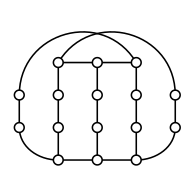</a>


<a id="ans-7-2-2-2-448"></a>

**448.** [题目](../sec-7-2-2-2.md#ex-7-2-2-2-448) 每一对点至多同属一条线. 因此若各线分别含有 $l_1,\ldots,l_n$ 个点, 我们就有 $\binom{l_1}2+\cdots+\binom{l_n}2\le\binom m2=3n$. 施泰纳三元系达到等号, 其中 $l_1=\cdots=l_n=3$. 因为当 $l\ge l'+2$ 时有 $\binom{l-1}2+\binom{l'+1}2<\binom l2+\binom{l'}2$, 不可能有 $l_1+\cdots+l_n>3n$. 所以 $Z(m,n)=3n+1$.

[若 $m$ 是偶数且 $\binom m2=3n$, 则不能用三元组覆盖所有点对, 因为任一点至多属于 $(m-2)/2$ 个三元组. Daniel Horsley 于 2015 年证明了在这些情形下 $Z(m,n)=3n+\lfloor1-m/14\rfloor$.]

<a id="ans-7-2-2-2-449"></a>

**449.** [题目](../sec-7-2-2-2.md#ex-7-2-2-2-449) 最好先试对称解 $x_{ij}=x_{ji}$, 这样可将变量数大致减半; 于是很快就能找到下列矩阵. $n=9,12,13$ 时这样的对称解不存在 ($n=15,16$ 时, 若坚持首行有五个 1, 也不可能有这样的解). $n=13$ 的情形对应于 3 阶射影平面; 事实上, $q$ 阶射影平面等价于 $m=n=q^2+q+1$ 且 $Z(n,n)=(q+1)n+1$ 的极大无四角矩阵.

$n=8$

```text
11100000
10011000
10000110
01010100
01000011
00110001
00101010
00001101
```

$n=9$

```text
111100000
100011100
100000011
010010010
010001001
001010001
001000110
000101010
000100101
```

$n=10$

```text
1111000000
1000110000
1000001100
1000000011
0100101010
0100000101
0010100001
0010010110
0001100100
0001011001
```

$n=11$

```text
11110000000
10001100000
10000011100
10000000011
01001010010
01000001001
00101001000
00100110001
00100000110
00011000101
00010101010
```

$n=12$

```text
111100000000
100011100000
100000011000
100000000111
010010010100
010001001010
010000100001
001010001001
001000110010
000110000010
000101010001
000100101100
```

$n=13$

```text
1111000000000
1000111000000
1000000111000
1000000000111
0100100100100
0100010010010
0100001001001
0010100010001
0010010001100
0010001100010
0001100001010
0001010100001
0001001010100
```

$n=14$

```text
11110000000000
10001110000000
10000001110000
10000000001110
01001001001000
01000100000101
01000010100010
00100101000010
00100010010100
00100000101001
00011000100100
00010100011000
00010011000001
00001000010011
```

$n=15$

```text
111100000000000
100011100000000
100000011100000
100000000011110
010010010010000
010001001001000
010000000100101
001010001000011
001001010000100
001000100110000
000110000101000
000101000010001
000100101000100
000100010000010
000000110001001
```

$n=16$

```text
1111000000000000
1000111000000000
1000000111100000
1000000000011100
0100100100010000
0100010010001010
0100000001000101
0010100010000100
0010010100000001
0010001001001000
0010000000110010
0001100000101001
0001010001010000
0001001100000110
0000010000100100
0000001010010001
```


<a id="ans-7-2-2-2-450"></a>

**450.** [题目](../sec-7-2-2-2.md#ex-7-2-2-2-450) 为证明提示中的断言, 在原有约束中添入单元子句 $(x_{15})$; 在按字典序将待检验的线放在首行后, 这个问题很快就被判为不可满足, 因此没有一条线含有多于 4 个点. 另一方面, 一条线也不可能少于 3 个点, 因为 $Z(9,10)=32$. 同样的论证说明, 每个点属于 3 条或 4 条线. 因此恰有四条线各含四个点, 并且恰有四个点各属于四条线.

若 $p\in l$, $l$ 是含四个点的线, 则过 $p$ 的每条其他线必须至少含有其余 6 个点中的 2 个. 而四条各含四个点的线合起来至少含 $4\times4-\binom42=10$ 个点. 因此由鸽巢原理可知, 每条含四个点的线上, 都恰有一个属于四条线的点.

把属于四条线的点记为 $\{a,b,c,d\}$, 把含有四个点的线记为 $\{A,B,C,D\}$. 其余各点可记为 $\{ab,ac,ad,bc,bd,cd\}$, 其中 $A=\{a,ab,ac,ad\}$, $B=\{b,ab,bc,bd\}$, $C=\{c,ac,bc,cd\}$, $D=\{d,ad,bd,cd\}$. 其余各线可记作 $\{AB,AC,AD,BC,BD,CD\}$; 有 $AB=\{a,b,cd\}$, $AC=\{a,c,bd\}$, 等等.

<a id="ans-7-2-2-2-451"></a>

**451.** [题目](../sec-7-2-2-2.md#ex-7-2-2-2-451) 由上一题, 有一种颜色的排法是唯一的. 于是只剩下给另 66 格涂两种颜色的简单问题, 要同时避免四个角全为 0 或全为 1. 当 $\sum x_{ij}$ 为奇数时, 这个问题不可满足. 作者随后 <a id="pdf-659"></a><a id="p-639"></a> 利用每个颜色类都不能使用被删去的格子这一事实, 手工构造了一个 $33+33+33$ 的解. [见 M. Beresin、E. Levine 和 J. Winn, <em>The College Mathematics Journal</em> **20** (1989), 106–114 及封面; J. L. Lewis, <em>JRM</em> **28** (1997), 266–273.]

<a href="../../../assets/volume4b/figures/satqa-a451-1.svg"></a>　<a href="../../../assets/volume4b/figures/satqa-a451-2.svg">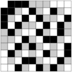</a>


<a id="ans-7-2-2-2-452"></a>

**452.** [题目](../sec-7-2-2-2.md#ex-7-2-2-2-452) 任何这样的解都必须使每种颜色恰占 81 格, 因为 R. Nowakowski 在 1978 年证明了 $Z(18,18)=82$. 这里所示的解是 B. Steinbach 和 C. Posthoff [<em>Multiple-Valued Logic and Soft Computing</em> **21** (2013), 609–625] 利用 $90^\circ$ 旋转对称性找到的.

<a href="../../../assets/volume4b/figures/satqa-a452.svg">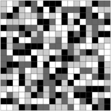</a>


<a id="ans-7-2-2-2-453"></a>

**453.** [题目](../sec-7-2-2-2.md#ex-7-2-2-2-453) (a) 若 $R\subseteq\{1,\ldots,m\}$, $C\subseteq\{1,\ldots,n\}$, 置 $V(R,C)=\{u_i\mid i\in R\}\cup\{v_j\mid j\in C\}$. 若 $X$ 可分解, 就没有从 $V(R,C)$ 内某个顶点到 $V(R,C)$ 外某个顶点的路; 因此图不连通. 反之, 若图不连通, 取一个连通分量作为 $V(R,C)$. 这时 $0<|R|+|C|<m+n$, 我们便分解了 $X$.

(b) 一般说来是假的, 除非 $X'$ 的每一行、每一列都含有正元素. 在后一种情形下, 由字典序的定义可知断言显然为真.

(c) 真. 直和当然可分解. 反之, 设 $X$ 可通过 $R$ 和 $C$ 分解. 可以假设 $1\in R$ 或 $1\in C$; 否则把 $R$ 换成 $\{1,\ldots,m\}\setminus R$, $C$ 换成 $\{1,\ldots,n\}\setminus C$. 取满足 $i\notin R$ 和 $j\notin C$ 的最小下标 $i\ge1$ 和 $j\ge1$. 于是对 $1\le i'<i$ 有 $x_{i'j}=0$, 对 $1\le j'<j$ 有 $x_{ij'}=0$. 由字典序约束, 当 $1\le i'<i$, $j'\ge j$ 时必有 $x_{i'j'}=0$; 当 $i'\ge i$, $1\le j'<j$ 时也一样. 所以 $X=X'\oplus X''$, 其中 $X'$ 为 $(i-1)\times(j-1)$, $X''$ 为 $(m+1-i)\times(n+1-j)$. (还要考虑 $i=1$, $j=1$, $i=m+1$ 或 $j=n+1$ 的退化情形, 但它们也都没有问题. 由此我们可以直接 “读出” 一个按字典序排列的矩阵的分块.)

<em>参考文献:</em> A. Mader 和 O. Mutzbauer, <em>Ars Combinatoria</em> **61** (2001), 81–95.

<a id="ans-7-2-2-2-454"></a>

**454.** [题目](../sec-7-2-2-2.md#ex-7-2-2-2-454) 有 $f(x)\le f(x\tau)\le f(x\tau\tau)\le\cdots\le f(x\tau^k)\le\cdots$; 最终 $x\tau^k=x$.

<a id="ans-7-2-2-2-455"></a>

**455.** [题目](../sec-7-2-2-2.md#ex-7-2-2-2-455) (a) 能, 因为 $C$ 只会使 1001 和 1011 不再是解. (b) 不能, 因为 $F$ 原先可能只被 0011 满足. (c) 能, 理由同 (a), 不过 (187) 在 (a) 中仍为 $F\land C$ 的自同态, 在这里却未必如此. (d) 能; 若 0110 是解, 则 0101 和 1010 也是解. [当然, 这道题颇为人为: 除非对解集的了解远不止这些, 我们大概不会知道像 (187) 这样古怪的映射是 $F$ 的自同态.]

<a id="ans-7-2-2-2-456"></a>

**456.** [题目](../sec-7-2-2-2.md#ex-7-2-2-2-456) 在 65536 种可能中仅有 $(1+2\cdot7)(1+2)(1+8)=405$ 种 (约 $0.62\%$).

<a id="ans-7-2-2-2-457"></a>

**457.** [题目](../sec-7-2-2-2.md#ex-7-2-2-2-457) 有 $\min_{0\le k\le16}(k^k16^{16-k})=6^6 16^{10}\approx51.3\times10^{15}$. 对一般的 $n$, 最小值在 $k=2^n/e+O(1)$ 时达到, 其值为 $2^{2^n(n-x)}$, 其中 $x=1/(e\ln2)+O(2^{-n})<1$.

<a id="ans-7-2-2-2-458"></a>

**458.** [题目](../sec-7-2-2-2.md#ex-7-2-2-2-458) 给一个自足集中的每个变量赋值, 使所有含有这些变量的子句都得到满足, 而让其他一切变量保持原值, 这个运算就是一个自同态. (例如, 考虑将一个纯字面值置真的运算.)

<a id="ans-7-2-2-2-459"></a>

**459.** [题目](../sec-7-2-2-2.md#ex-7-2-2-2-459) 在这里的二进制矩阵上, 当 $i=0$ 或 $j=0$ 时 $\operatorname{sweep}(X_{ij})=0$. 而对 $1\le i\le m$, $1\le j\le n$, 有
$$
\operatorname{sweep}(X_{ij})=\max\bigl(x_{ij}+\operatorname{sweep}(X_{(i-1)(j-1)}),\operatorname{sweep}(X_{(i-1)j}),\operatorname{sweep}(X_{i(j-1)})\bigr).
$$
[设矩阵中各个 1 为 $x_{i_1j_1},\ldots,x_{i_rj_r}$, 其中 $1\le i_1\le\cdots\le i_r\le m$, 且当 $i_{q+1}=i_q$ 时有 $j_{q+1}<j_q$. Richard Stanley 注意到 (未发表), 当用 Robinson–Schensted–Knuth 算法将序列 $n-j_1,\ldots,n-j_r$ 插入一张起初为空的表时, 所得到的行数就是 $\operatorname{sweep}(X)$.]

<a id="ans-7-2-2-2-460"></a>

**460.** [题目](../sec-7-2-2-2.md#ex-7-2-2-2-460) 引入辅助变量 $s^t_{ij}$, 使得当 $\operatorname{sweep}(X_{ij})>t$ 时它必为真. 约定 $t<0$ 时这些变量为真, $t=k$ 时为假. 对 $1\le i\le m$, $1\le j\le n$, $0\le t\le\min(i-1,j-1,k)$, 子句如下: 若 $i>1$ 且 <a id="pdf-660"></a><a id="p-640"></a> $t<k$, 取 $(\bar s^t_{(i-1)j}\lor s^t_{ij})$; 若 $j>1$ 且 $t<k$, 取 $(\bar s^t_{i(j-1)}\lor s^t_{ij})$; 并取 $(\bar x_{ij}\lor\bar s^{t-1}_{(i-1)(j-1)}\lor s^t_{ij})$. 若最后的子句中出现 $\bar s^{-1}_{0(j-1)}$, $\bar s^{-1}_{(i-1)0}$, $\bar s^{-1}_{(i-1)(j-1)}$ 或 $s^k_{ij}$, 就将其略去. 另用基数约束强制 $\sum_{i,j}x_{ij}\ge r$.

<a id="ans-7-2-2-2-461"></a>

**461.** [题目](../sec-7-2-2-2.md#ex-7-2-2-2-461) 所需子句为
$$
\bigwedge_{i=1}^{m-1}\bigwedge_{j=1}^{n-1}(x_{ij}\lor\bar c_{(i-1)j}\lor c_{ij})
\ \land\ \bigwedge_{i=1}^{m}\bigwedge_{j=1}^{n-1}(\bar c_{(i-1)j}\lor\bar x_{ij}\lor x_{i(j+1)}),
$$
略去 $\bar c_{0j}$. 这些子句处理了 $\tau_1$; 对 $\tau_2$ 交换 $i\leftrightarrow j$, $m\leftrightarrow n$.

<a id="ans-7-2-2-2-462"></a>

**462.** [题目](../sec-7-2-2-2.md#ex-7-2-2-2-462) 令 $\widetilde X_{ij}$ 表示 $X$ 的<em>末</em> $m+1-i$ 行、末 $n+1-j$ 列组成的子矩阵; 并令 $t_{ij}=\operatorname{sweep}(X_{(i-1)(j-1)})+\operatorname{sweep}(\widetilde X_{(i+1)(j+1)})$. 对 $\tau_1$, 已知 $1+t_{ij}\le k$, 须证明 $1+t_{i(j+1)}\le k$. 这是因为当列 $j$ 以 $i-1$ 个零开始时 $\operatorname{sweep}(X_{(i-1)j})=\operatorname{sweep}(X_{(i-1)(j-1)})$, 而且 $\operatorname{sweep}(\widetilde X_{(i+1)(j+2)})\le\operatorname{sweep}(\widetilde X_{(i+1)(j+1)})$.

令 $X'=X\tau_3$, 相应的扫幅和为 $t'_{ij}$. 已知 $1+t_{ij}\le k$, $1+t_{i(j+1)}\le k$, $1+t_{(i+1)j}\le k$, $t_{(i+1)(j+1)}\le k$, 要证明 $t'_{ij}\le k$ 且 $1+t'_{(i+1)(j+1)}\le k$. 关键是 $\operatorname{sweep}(X'_{ij})=\max(\operatorname{sweep}(X_{(i-1)j}),\operatorname{sweep}(X_{i(j-1)}))$, 因为 $x'_{ij}=0$. 还有 $\operatorname{sweep}(\widetilde X'_{(i+1)(j+1)})\le1+\operatorname{sweep}(\widetilde X_{(i+2)(j+1)})$.

(注意, $\tau_1$ 和 $\tau_2$ 实际上可能减小扫幅, 而 $\tau_3$ 保持扫幅不变.)

<a id="ans-7-2-2-2-463"></a>

**463.** [题目](../sec-7-2-2-2.md#ex-7-2-2-2-463) 若第 $i+1$ 行全为零而第 $i$ 行不全为零, 就可以使用 $\tau_2$. 因此全零行在顶部. 而由 $\tau_1$, 第一个非零行中的 1 必全在右边.

设第 1 至第 $i$ 行分别有 $r_1,\ldots,r_i$ 个 1, 全都在右边, 且 $r_i>0$. 则由 $\tau_2$ 有 $r_1\le\cdots\le r_i$. 若 $i<m$, 可以把 $i$ 增至 $i+1$: 当 $j\le n-r_i$ 时, 由 $\tau_1$ 不会有 $x_{(i+1)j}>x_{(i+1)(j+1)}$; 当 $j>n-r_i$ 时, 由 $\tau_3$ 也不会如此.

可见所有的 1 都集中在右边和底部, 好比一个旋转了 $180^\circ$ 的分拆图; 扫幅就是它的 “Durfee 方形” 的边长 (见 7.2.1.4 节的图 91). 因此给定扫幅 $k$, 1 的最大个数为 $k(m+n-k)$.

[在偏序 $(i,j)\prec(i',j')\iff i<i'\text{ 且 }j<j'$ 下, 扫幅 $\le k$ 的二进制矩阵对应于所有链的长度都 $\le k$ 的格子集合. 关于这种 “Sperner $k$ 族” 的格与拟阵性质, C. Greene 和 D. J. Kleitman 作过重要研究, 见 <em>J. Combinatorial Theory</em> **A20** (1976), 41–68.]

<a id="ans-7-2-2-2-464"></a>

**464.** [题目](../sec-7-2-2-2.md#ex-7-2-2-2-464) 由[答案 462](#ans-7-2-2-2-462), 可将 $\tau_1$ 加强为 $\tau'_1$: 置 $x_{i(j+1)}\gets1$ 而保留 $x_{ij}=1$. 同样可将 $\tau_2$ 加强为 $\tau'_2$. 这些自同态保持扫幅而增加重量, 因而不能作用于一个已达最大重量的矩阵. [事实上可以证明, 扫幅为 $k$ 的最大重量二进制矩阵恰好对应于 $k$ 条互不相交的最短路, 从第 $m$ 行最左边的格子走到第 1 行最右边的格子. 从而扫幅为 $k$ 的每个非负整数矩阵都是 $k$ 个扫幅为 1 的矩阵之和.]

<a id="ans-7-2-2-2-465"></a>

**465.** [题目](../sec-7-2-2-2.md#ex-7-2-2-2-465) 否则就有一个长度 $p>1$ 的圈 $x_0\to x_1\to\cdots\to x_p=x_0$, 其中 $x_i\tau_{uv_i}=x_{i+1}$. 令 $uv$ 为 $\{uv_0,\ldots,uv_{p-1}\}$ 中最大的一条边. 圈中其他各个 $\tau$ 均不能改变边 $uv$ 的状态. 然而那条边必须至少两次改变状态.

(另见定理 7.2.2.1S 中更一般的结果.)

<a id="ans-7-2-2-2-466"></a>

**466.** [题目](../sec-7-2-2-2.md#ex-7-2-2-2-466) 首先注意, 只要 $m\ge2$, $v_{11}$ 就必须为真. 否则单元传播将相继强制 $h_{11},v_{21},h_{22},v_{32},\ldots$, 直至在棋盘边缘遇到矛盾. 同理, 当 $m\ge4$ 时 $v_{31}$ 也必须为真. 因此第一列必须全由竖骨牌填满, 只有 $m$ 为奇数时的底行除外.

接着可以证明, 第 1 行余下的部分全由横骨牌填满, 只有 $n$ 为偶数时的最右列除外. 如此等等.

当 $m,n$ 均为偶数时, 唯一的解使用 $v_{ij}$ 当且仅当 $i+j$ 为偶数且 $1\le j\le\min(i,m-i,n/2)$, 或 $i+j$ 为奇数且使用了 $v_{i(n+1-j)}$. 当 $m$ 为奇数时, 在 $(m-1)\times n$ 解的下面添一行横骨牌. 当 $n$ 为奇数时, 删去 $m\times(n+1)$ 解最右边的一列竖骨牌.

<a id="ans-7-2-2-2-467"></a>

**467.** [题目](../sec-7-2-2-2.md#ex-7-2-2-2-467) $8\times7$ 的覆盖是图示 $7\times8$ 覆盖关于西南至东北对角线的反射. 两个解都是唯一的.

<a href="../../../assets/volume4b/figures/satqa-a467.svg"></a>

<a id="pdf-661"></a><a id="p-641"></a>

<a id="ans-7-2-2-2-468"></a>

**468.** [题目](../sec-7-2-2-2.md#ex-7-2-2-2-468) (a) 算法 C 在 $6\times6,8\times8,\ldots,16\times16$ 上的典型运行时间略有改善: $39\,\mathrm K\mu$, $368\,\mathrm K\mu$, $4.3\,\mathrm M\mu$, $48\,\mathrm M\mu$, $626\,\mathrm M\mu$, $8\,\mathrm G\mu$.

(b) 这时效果更好, 但仍呈指数增长: $30\,\mathrm K\mu$, $289\,\mathrm K\mu$, $2.3\,\mathrm M\mu$, $22\,\mathrm M\mu$, $276\,\mathrm M\mu$, $1.7\,\mathrm G\mu$.

<a id="ans-7-2-2-2-469"></a>

**469.** [题目](../sec-7-2-2-2.md#ex-7-2-2-2-469) 例如 $(v_{11}),(v_{31}),(v_{51}),(h_{12}),(h_{14}),(v_{22}),(v_{42}),(h_{23}),(v_{33}),\epsilon$.

<a id="ans-7-2-2-2-470"></a>

**470.** [题目](../sec-7-2-2-2.md#ex-7-2-2-2-470) 不可能有长 $p>1$ 的圈 $x_0\to x_1\to\cdots\to x_p=x_0$, 因为在配偶发生变化的顶点中, 最大的那个顶点的配偶总是越变越小.

<a id="ans-7-2-2-2-471"></a>

**471.** [题目](../sec-7-2-2-2.md#ex-7-2-2-2-471) 必须将 $2n$ 与 1 配对, 再将 $2n-1$ 与 2 配对, 如此下去, 直至将 $n+1$ 与 $n$ 配对.

<a id="ans-7-2-2-2-472"></a>

**472.** [题目](../sec-7-2-2-2.md#ex-7-2-2-2-472) 可以用从 1 至 $mn$ 的数给顶点编号, 使每个 4 圈都按所需的方式换向. 例如, 可令 $(i,j)<(i,j+1)\iff(i,j)<(i+1,j)\iff(i,j)\bmod4\in\{(0,0),(0,1),(1,1),(1,2),(2,2),(2,3),(3,3),(3,0)\}$. 图示为 $4\times4$ 情形的一个这样的编号.

<table id="sat-square472"><tbody>
<tr><td style="border:1px solid currentColor;text-align:center">16</td><td style="border:1px solid currentColor;text-align:center">15</td><td style="border:1px solid currentColor;text-align:center">1</td><td style="border:1px solid currentColor;text-align:center">2</td></tr>
<tr><td style="border:1px solid currentColor;text-align:center">4</td><td style="border:1px solid currentColor;text-align:center">14</td><td style="border:1px solid currentColor;text-align:center">13</td><td style="border:1px solid currentColor;text-align:center">3</td></tr>
<tr><td style="border:1px solid currentColor;text-align:center">5</td><td style="border:1px solid currentColor;text-align:center">6</td><td style="border:1px solid currentColor;text-align:center">12</td><td style="border:1px solid currentColor;text-align:center">11</td></tr>
<tr><td style="border:1px solid currentColor;text-align:center">9</td><td style="border:1px solid currentColor;text-align:center">7</td><td style="border:1px solid currentColor;text-align:center">8</td><td style="border:1px solid currentColor;text-align:center">10</td></tr>
</tbody></table>


<a id="ans-7-2-2-2-473"></a>

**473.** [题目](../sec-7-2-2-2.md#ex-7-2-2-2-473) 对每个偶长的圈 $v_0\mathbin{—}v_1\mathbin{—}\cdots\mathbin{—}v_{2r-1}\mathbin{—}v_0$, 其中 $v_0=\max v_i$ 且 $v_1>v_{2r-1}$, 断言 $(\overline{v_0v_1}\lor v_1v_2\lor\overline{v_2v_3}\lor\cdots\lor v_{2r-1}v_0)$.

<a id="ans-7-2-2-2-474"></a>

**474.** [题目](../sec-7-2-2-2.md#ex-7-2-2-2-474) (a) $(2n)(2n-2)\cdots2=2^nn!$.

(b) $(17\bar3)(\bar1\bar73)(25\bar2\bar5)(4\bar4)(6)(\bar6)$.

(c) 用 $\mathtt{0},\mathtt{1},\ldots,\mathtt f$ 表示从 0000 到 1111 的四元组, 则必须有 $f(\mathtt0)=f(\mathtt9)=f(\mathtt5)$, $f(\mathtt2)=f(\mathtt b)=f(\mathtt7)$, $f(\mathtt4)=f(\mathtt8)=f(\mathtt d)$ 和 $f(\mathtt6)=f(\mathtt a)=f(\mathtt f)$; 换言之, $f$ 的真值表必有形式 $abcdeagceagcfehg$, 其中 $a,b,c,d,e,f,g,h\in\{0,1\}$. 所以共有 $2^8$ 个这样的 $f$.

(d) 将 (c) 中的 “$=$” 换成 “$\ne$”. 不存在这样的真值表, 因为 (191) 含有奇圈; 一个反对称的所有圈都必须有偶长度.

(e) 128 个二进制七元组分成十六个 “轨道” $\{x,x\sigma,x\sigma^2,\ldots\}$, 其中八个大小为 12, 八个大小为 4. 例如一个大小为 4 的轨道是 $\{0011010,0010110,0111110,0110010\}$; 一个大小为 12 的轨道是 $\{0000000,0011101,\ldots,1111000\}$. 因此有 $2^{16}$ 个函数具有这一对称, 另有 $2^{16}$ 个函数具有这一反对称.

<a id="ans-7-2-2-2-475"></a>

**475.** [题目](../sec-7-2-2-2.md#ex-7-2-2-2-475) (a) $2^{n+1}n!$. (若 $f$ 有 $a$ 个自同构及反自同构合计, 就是 $2^{n+1}n!/a$.)

(b) $(x\bar z)(\bar xz)$, 因为颇出人意料的是, $(x\lor y)\land(x\oplus z)=(\bar z\lor y)\land(\bar z\oplus\bar x)$.

(c) 一般而言, 若置换 $\sigma$ 的阶含素因子 $p$, 则它的某个幂具有阶 $p$. 对每个异于 $p$ 的素因子 $q$, 反复取 $\sigma$ 的 $q$ 次幂, 直至所有圈长都是 $p$ 的幂. 若这时最长的圈有长度 $p^e$, 再取 $p^{e-1}$ 次幂即可.

(d) 设 $f(x_1,x_2,x_3)$ 有对称 $(x_1\bar x_2x_3)(\bar x_1x_2\bar x_3)$. 则 $f(0,0,0)=f(1,1,0)=f(0,1,1)$, $f(1,1,1)=f(0,0,1)=f(1,0,0)$, 所以 $(x_1\bar x_2)(\bar x_1x_2)$ 也是一个对称.

(e) 类似的论证表明 $(ux)(vw)(\bar u\bar x)(\bar v\bar w)$ 是一个对称.

(f) 若 $\sigma$ 为 $f$ 的反对称, 则 $\sigma^2$ 为一个对称. 若 $f$ 有非平凡对称, 则由 (c) 它有素数阶 $p$ 的对称. 而若 $p\ne2$, 由 (d) 和 (e) 它也有阶为 2 的对称, 除非 $n>5$.

(g) 令 $f(x_1,\ldots,x_6)=1$ 恰好在 $x_1\ldots x_6\in\{001000,001001,001011,010000,010010,010110,100000,100100,100101\}$ 时成立. (另一个有趣的例子有 $n=7$, 且 $f=1$ 当且仅当 $x_1\ldots x_7$ 是 0000001、0001101 或 0011101 的循环移位; 它有 21 个对称.)

<a id="ans-7-2-2-2-476"></a>

**476.** [题目](../sec-7-2-2-2.md#ex-7-2-2-2-476) 我们需要指定 $n$ 个变量上的 $r$ 步链, 其唯一输出为 $x_{n+r}$. 对 $0<t<t'<2^n$ 引入变量 $\Delta_{tt'}=x_{(n+r)t}\oplus x_{(n+r)t'}$. (见 (24).) 约定 $\Delta_{0t'}=x_{(n+r)t'}$, 因为正规链在全零输入上为零. 对每个不同于恒等置换的带符号对合 $\sigma$, 要用一个子句断言 “$\sigma$ 不是 $f$ 的对称”, 即 $(\bigvee\{\Delta_{tt'}\mid t<t',\ t'=t\sigma\})$. (如[习题 477](../sec-7-2-2-2.md#ex-7-2-2-2-477) 那样, 这里将 $t$ 与其二进制表示 $(t_1\ldots t_n)_2$ 等同起来.)

此外若 $\sigma$ 没有不动点——这等价于至少对一个 $i$, $\sigma$ 将 $x_i$ 映为 $\bar x_i$——还有些工作要做: 在情形 (b), 需要一个断言 “$\sigma$ <a id="pdf-662"></a><a id="p-642"></a> 不是反对称” 的子句, 即 $(\bigvee\{\bar\Delta_{tt'}\mid t<t',\ t'=t\sigma\})$. 但在情形 (a) 中, 还需要变量 $a_j$, $1\le j\le T$, 其中 $T$ 是没有不动点的带符号对合的数目. 添入子句 $(a_1\lor\cdots\lor a_T)$; 当 $\sigma$ 对应于下标 $j$ 时, 对所有满足 $t'=t\sigma$ 的 $t<t'$ 添入 $(\bar a_j\lor\Delta_{tt'})$. 这些子句断言 “至少有一个带符号对合是反对称”.

在 $n=2,3$ 时没有解. 对一个变量, $f(x_1)=x_1$ 即为 (a) 的解. 对 $n=4,5$, (a) 的答案分别为 $(((x_1\oplus x_2)\lor x_3)\land x_4)\oplus x_1$ 和 $((((\bar x_1\oplus x_2)\land x_3)\oplus x_4)\land x_5)\oplus x_1$; 两者都明显以带符号对合 $(1\bar1)(2\bar2)$ 为反对称. (b) 的答案为 $((x_1\oplus x_2)\lor x_3)\land(x_4\lor x_1)$ 和 $(((x_1\land x_2)\oplus x_3)\land x_4)\oplus(x_5\lor x_1)$. [是否有一个适用于所有 $n$ 的简单公式?]

<a id="ans-7-2-2-2-477"></a>

**477.** [题目](../sec-7-2-2-2.md#ex-7-2-2-2-477) 对 $1\le h\le m$, $n<i\le n+r$, $0<t<2^n$, 使用以下变量: $x_{it}=[x_i\text{ 的真值表的第 }t\text{ 位}]$; $g_{hi}=[g_h=x_i]$; 对 $1\le j<k<i$, $s_{ijk}=[x_i=x_j\circ_i x_k]$; 对 $0\le p,q\le1$, $p+q>0$, $f_{ipq}=\circ_i(p,q)$. (不需要 $f_{i00}$, 因为正规链中的每个运算都将 $(0,0)$ 映为 0.) 用于真值表计算的主要子句为
$$
\bigl(\bar s_{ijk}\lor(x_{it}\oplus a)\lor(x_{jt}\oplus b)\lor(x_{kt}\oplus c)\lor(f_{ibc}\oplus\bar a)\bigr),\quad 0\le a,b,c\le1,\quad1\le j<k<i.
$$
在特殊情形下可作简化: 例如若 $b=c=0$, 则 $a=0$ 时略去整个子句, $a=1$ 时略去项 $f_{i00}$. 此外, 若 $t=(t_1\ldots t_n)_2$ 且 $j\le n$, 则 (并不存在的) 变量 $x_{jt}$ 实际上具有已知值 $t_j$; 仍然是根据 $b$ 和 $t$ 略去整个子句或仅略去项 $(x_{jt}\oplus b)$. 例如, 通常有八个主要子句涉及 $s_{ijk}$; 但当 $t<2^{n-2}$ 时, 只有一个涉及 $s_{i12}$, 即 $(\bar s_{i12}\lor\bar x_{it})$, 因为 $x_1$ 和 $x_2$ 的真值表均以 $2^{n-2}$ 个 0 开始. (若定义了额外的变量 $f_{i00}$ 和 $x_{jt}$ 并用单元子句固定其值, 预处理程序也将作出上述全部简化.)

还有些更普通的子句: 当 $g_h(t_1,\ldots,t_n)$ 为 0 或 1 时分别取 $(\bar g_{hi}\lor\bar x_{it})$ 或 $(\bar g_{hi}\lor x_{it})$, 用以固定输出; 还要取 $(\bigvee_{i=n+1}^{n+r}g_{hi})$ 和 $(\bigvee_{k=1}^{i-1}\bigvee_{j=1}^{k-1}s_{ijk})$, 以保证每个输出都出现在链中且每步都有两个操作数.

另一些子句可以不加, 但能大大缩小可能性的范围: $(\bigvee_{h=1}^m g_{hi}\lor\bigvee_{i'=i+1}^{n+r}\bigvee_{j=1}^{i-1}s_{i'ji}\lor\bigvee_{i'=i+1}^{n+r}\bigvee_{j=i+1}^{i'-1}s_{i'ij})$ 确保步骤 $i$ 至少被使用一次; 对 $i<i'\le n+r$ 取 $(\bar s_{ijk}\lor\bar s_{i'ji})$ 和 $(\bar s_{ijk}\lor\bar s_{i'ki})$, 以免再次使用同一操作数.

最后, 可用子句 $(f_{i01}\lor f_{i10}\lor f_{i11})$, $(f_{i01}\lor\bar f_{i10}\lor\bar f_{i11})$, $(\bar f_{i01}\lor f_{i10}\lor\bar f_{i11})$ 排除平凡的二元运算. (但要留意: 对 $n<i\le n+r$ 加入这些子句后, 将无法用少于三步计算平凡函数 $g_1=0$!)

诸如 $(\bar s_{ijk}\lor f_{i01}\lor\bar x_{it}\lor x_{jt})$ 的其他子句也成立, 但实际中没有什么帮助.

<a id="ans-7-2-2-2-478"></a>

**478.** [题目](../sec-7-2-2-2.md#ex-7-2-2-2-478) 可以要求步骤 $n+1,\ldots,n+r$ 中的 $(j,k)$ 对依余字典序出现; 例如 $x_8=x_4\oplus x_5$ 这样的步骤不必排在 $x_7=x_2\land x_6$ 之后. 对 $n<i<n+r$, 子句为 $(\bar s_{ijk}\lor\bar s_{(i+1)j'k'})$, 其中 $1\le j'<j<k=k'<i$, 或 $1\le j<k$ 且 $1\le j'<k'<k<i$. (若 $(j,k)=(j',k')$, 还可要求 $f_{i01}f_{i10}f_{i11}$ 的字典序小于 $f_{(i+1)01}f_{(i+1)10}f_{(i+1)11}$. 不过作者并没有走这么远.)

此外若 $p<q$, 且交换 $x_p$ 和 $x_q$ 时每个输出函数都不变, 可以要求 $x_p$ 先于 $x_q$ 被用作操作数. 其子句为
$$
\left(\bar s_{ijq}\lor\bigvee_{n<i'<i}\ \bigvee_{\substack{1\le j'<k'<i'\\ j'=p\ \text{或}\ k'=p}}s_{i'j'k'}\right),\qquad j\ne p,
$$
对以 $q$ 作为第一个操作数的选择也作同样限制.

例如, 将[答案 477](#ans-7-2-2-2-477) 用于全加器问题, 在 $N_r$ 个变量上得到 $M_r$ 个子句, 其中 $(M_4,M_5)=(942,1662)$, $(N_4,N_5)=(82,115)$. 上述破除对称性的策略取 $(p,q)=(1,2)$ 和 $(2,3)$, 将子句数增至 $M'_r$, 其中 $(M'_4,M'_5)=(1025,1860)$. 算法 C 分别在用 $(M_4,M'_4)$ 个子句、耗费 $(1015,291)$ 千次内存访问后报告 “unsat”; 用 $(M_5,M'_5)$ 个子句、耗费 $(250,268)$ 千次内存访问后报告 “sat”. 较大的问题中, 这类对称破除在证明不可满足性时能显著加速, 但在可满足的实例中常常反倒碍事.

<a id="pdf-663"></a><a id="p-643"></a>

<a id="ans-7-2-2-2-479"></a>

**479.** [题目](../sec-7-2-2-2.md#ex-7-2-2-2-479) (a) 用上一答案的记号, 有 $(M_8,M'_8,N_8)=(14439,17273,384)$, $(M_9,M'_9,N_9)=(19719,24233,471)$. 用 $M_9$ 和 $M'_9$ 个子句求解 “sat” 情形的运行时间, 以百万次内存访问计, 分别为 $(16,645,1259)$ 和 $(66,341,1789)$; 这三项统计量是使用不同随机种子运行九次的 (最小值, 中位数, 最大值). 用 $M_8$ 和 $M'_8$ 的 “unsat” 情形差别甚大: 分别为 $(655631,861577,952218)$ 和 $(8858,10908,13171)$. 因而 7.1.2–(28) 中的 $s(4)=9$ 是最优的.

(b) 可是 7.1.2–(29) 虽然漂亮, $s(5)=12$ 却<em>不是</em>最优的! $N_{11}=957$ 个变量上的 $M_{11}=76321$ 个子句在 $680\,\mathrm G\mu$ 后得到 “sat”, 给出一条惊人的链:

$$
\begin{aligned}
x_{6}&=x_{1}\oplus x_{2}&\qquad x_{7}&=x_{1}\oplus x_{3}\\
x_{8}&=x_{4}\oplus x_{5}&\qquad x_{9}&=x_{3}\oplus x_{6}\\
x_{10}&=x_{6}\lor x_{7}&\qquad x_{11}&=x_{4}\oplus x_{9}\\
x_{12}&=x_{9}\oplus x_{10}&\qquad z_0=x_{13}&=x_{5}\oplus x_{11}\\
x_{14}&=\bar x_{8}\land x_{11}&\qquad z_1=x_{15}&=x_{10}\oplus x_{14}\\
z_2=x_{16}&=x_{12}\land \bar x_{15}
\end{aligned}
$$


而 $(M'_{10},N_{10})=(68859,815)$ 在 1773 十亿次内存访问后得到 “unsat”; 若添入单元子句 $(g_{3(15)})$, 就可降到 309 十亿次, 因为 $C(S_{4,5})=10$.

因此只需 $5+11+2+1=19$ 步就能算出 $x_1+\cdots+x_7$: 计算 $(u_1u_0)_2=x_5+x_6+x_7$, $(v_2v_1z_0)_2=x_1+x_2+x_3+x_4+u_0$, $(w_2z_1)_2=u_1+v_1$, $z_2=v_2\oplus w_2$.

(c) 对 $(M_8,N_8)=(6068,276)$, 求解器在 $6\,\mathrm M\mu$ 后找到了一个优美的八步解:

$$
\begin{aligned}
x_{4}&=x_{1}\lor x_{2}&\qquad x_{5}&=x_{1}\oplus x_{2}\\
x_{6}&=x_{3}\oplus x_{4}&\qquad \bar S_0=x_{7}&=x_{3}\lor x_{4}\\
x_{8}&=x_{3}\oplus x_{5}&\qquad S_3=x_{9}&=\bar x_{6}\land x_{8}\\
S_1=x_{10}&=x_{6}\land x_{8}&\qquad S_2=x_{11}&=x_{7}\oplus x_{8}
\end{aligned}
$$


相应的 $(M'_7,N_7)=(5016,217)$ 问题在 $97\,\mathrm M\mu$ 后得到 “unsat”.

(d) 若各自求出这些 $S$, 用 7.1.2 节图 9 的最优计算, 总代价为 $3+7+6+7+3=26$. 因此令作者吃惊的是, 用足迹启发式竟找到了 $S_1,S_2,S_3$ 的一条九步链:

$$
\begin{aligned}
x_{5}&=x_{1}\oplus x_{2}&\qquad x_{6}&=x_{1}\oplus x_{3}\\
x_{7}&=x_{3}\oplus x_{4}&\qquad x_{8}&=x_{5}\oplus x_{7}\\
x_{9}&=x_{6}\lor x_{7}&\qquad x_{10}&=x_{2}\oplus x_{9}\\
S_2=x_{11}&=\bar x_{8}\land x_{9}&\qquad S_3=x_{12}&=x_{8}\land \bar x_{10}\\
S_1=x_{13}&=x_{8}\land x_{10}
\end{aligned}
$$


这条链能在 13 步内解出问题 (d); 但 SAT 技术只用了 12 步 (!):

$$
\begin{aligned}
x_{5}&=x_{1}\oplus x_{2}&\qquad x_{6}&=x_{1}\oplus x_{3}\\
x_{7}&=x_{3}\oplus x_{4}&\qquad x_{8}&=x_{5}\oplus x_{7}\\
x_{9}&=x_{6}\lor x_{7}&\qquad x_{10}&=x_{2}\oplus x_{9}\\
x_{11}&=x_{5}\lor x_{9}&\qquad S_3=x_{12}&=x_{8}\land \bar x_{10}\\
S_1=x_{13}&=x_{8}\land x_{10}&\qquad S_4=x_{14}&=x_{1}\land \bar x_{11}\\
\bar S_0=x_{15}&=x_{4}\lor x_{11}&\qquad S_2=x_{16}&=\bar x_{8}\land x_{11}
\end{aligned}
$$


可用算法 C 作一次长计算 (11034 十亿次内存访问), 证明不存在十一步解; 计算过程中学到了 99,999,379 个子句 (!).

(e) 下面的解 (用 $342\,\mathrm G\mu$ 找到) 达到了习题 7.1.2–80 中的下界:

$$
\begin{aligned}
x_{7}&=x_{1}\oplus x_{2}&\qquad x_{8}&=x_{3}\oplus x_{4}\\
x_{9}&=x_{1}\oplus x_{5}&\qquad x_{10}&=x_{6}\oplus x_{8}\\
x_{11}&=x_{4}\oplus x_{10}&\qquad x_{12}&=x_{5}\oplus x_{10}\\
x_{13}&=x_{8}\lor x_{11}&\qquad x_{14}&=x_{7}\oplus x_{12}\\
x_{15}&=\bar x_{9}\land x_{12}&\qquad x_{16}&=x_{13}\oplus x_{15}\\
x_{17}&=x_{14}\land x_{16}
\end{aligned}
$$


(f) 下面的解 (用 $7471\,\mathrm G\mu$ 找到) 也达到了那个下界:

$$
\begin{aligned}
x_{7}&=x_{1}\land x_{2}&\qquad x_{8}&=x_{1}\oplus x_{2}\\
x_{9}&=x_{3}\oplus x_{4}&\qquad x_{10}&=x_{5}\land x_{6}\\
x_{11}&=x_{5}\oplus x_{6}&\qquad x_{12}&=x_{4}\oplus x_{11}\\
x_{13}&=x_{9}\oplus x_{11}&\qquad x_{14}&=x_{9}\lor x_{12}\\
x_{15}&=x_{8}\oplus x_{13}&\qquad x_{16}&=x_{10}\oplus x_{14}\\
x_{17}&=x_{7}\oplus x_{16}&\qquad x_{18}&=x_{15}\lor x_{17}
\end{aligned}
$$


这里 $x_{18}$ 是正规函数 $\bar S_{0,4}=S_{1,2,3,5,6}$. 我们将习题 7.1.2–28 的结果缩短了一步.

(g) 几乎立即就能找到 $t(3)=12$ 步的解 (1.2 亿次内存访问); 但十一步太少了 (301 十亿次内存访问后得到 “unsat”).

<a id="pdf-664"></a><a id="p-644"></a>

<a id="ans-7-2-2-2-480"></a>

**480.** [题目](../sec-7-2-2-2.md#ex-7-2-2-2-480) (a) 令 $x_1x_2x_3x_4=x_lx_ry_ly_r$. $z_l$ 和 $z_r$ 的真值表为 $\mathtt{0011010010001000}$ 和 $\mathtt{01{*}{*}1{*}00{*}011{*}011}$; 对星号 (“无关项”), 只须略去[答案 477](#ans-7-2-2-2-477) 中相应的子句 $(\bar g_{hi}\lor\pm x_{it})$.

不到十亿次内存访问便证明六步电路是 “unsat”. 下面的七步电路只用了 $30\,\mathrm M\mu$ 就找到了:

$$
\begin{aligned}
x_{5}&=x_{2}\oplus x_{3}&\qquad x_{6}&=x_{3}\lor x_{4}\\
x_{7}&=x_{1}\lor x_{5}&\qquad x_{8}&=x_{1}\oplus x_{6}\\
x_{9}&=x_{6}\oplus x_{7}&\qquad z_l=x_{10}&=x_{7}\land x_{8}\\
z_r=x_{11}&=x_{3}\oplus x_{9}
\end{aligned}
$$


(习题 7.1.2–60 有一个六步解, 使用的是<em>不同</em>的编码.)

(b) 取 $x_4x_5=y_ly_r$, 这时真值表为 $z_l=\mathtt{00110100010010000100100010000011}$, $z_r=\mathtt{01{*}{*}1{*}001{*}00{*}0111{*}00{*}011{*}01101{*}{*}}$. 在许多九步解中, 用 69 亿次内存访问找到了一个:

$$
\begin{aligned}
x_{6}&=x_{1}\oplus x_{2}&\qquad x_{7}&=x_{2}\oplus x_{5}\\
x_{8}&=x_{4}\oplus x_{6}&\qquad x_{9}&=\bar x_{4}\land x_{7}\\
x_{10}&=x_{1}\oplus x_{9}&\qquad x_{11}&=x_{8}\lor x_{9}\\
x_{12}&=x_{3}\oplus x_{10}&\qquad z_r=x_{13}&=x_{3}\oplus x_{11}\\
z_l=x_{14}&=x_{11}\land \bar x_{12}
\end{aligned}
$$


对于仅八步的相应子句, $190\,\mathrm G\mu$ 的运算证明了 “unsat”. (顺便说, 习题 7.1.2–60 的编码没有九步解.)

(c) 令 $c_n$ 为求出 $(x_1+\cdots+x_n)\bmod3$ 的表示 $z_lz_r$ 的最小代价. 则 $(c_1,c_2,c_3,c_4)=(0,2,5,7)$, 且 $c_{n+3}\le c_n+9$. 因此对所有 $n\ge2$ 有 $c_n\le3n-4$. [这个结果是 A. Kojevnikov、A. S. Kulikov 和 G. Yaroslavtsev 得到的; 他们的论文 <em>LNCS</em> **5584** (2009), 32–44, 也启发了习题 477–479.]

<em>猜想:</em> 对 $n\ge3$ 和 $0\le a\le2$, 求 (单一) 函数 $[(x_1+\cdots+x_n)\bmod3=a]$ 的最小代价为 $3n-5-[(n+a)\bmod3=0]$. ($n\le5$ 时成立. 当 $n=6$ 且 $a=0$ 时, Armin Biere 于 2014 年找到了以下十二步的计算:

$$
\begin{aligned}
x_{7}&=x_{1}\oplus x_{2}&\qquad x_{8}&=x_{3}\oplus x_{4}\\
x_{9}&=x_{1}\oplus x_{5}&\qquad x_{10}&=x_{3}\oplus x_{5}\\
x_{11}&=x_{2}\oplus x_{6}&\qquad x_{12}&=x_{8}\oplus x_{9}\\
x_{13}&=x_{8}\lor x_{10}&\qquad x_{14}&=x_{7}\oplus x_{13}\\
x_{15}&=\bar x_{12}\land x_{13}&\qquad x_{16}&=\bar x_{11}\land x_{14}\\
x_{17}&=x_{11}\oplus x_{15}&\qquad \bar S_{0,3,6}=x_{18}&=x_{16}\lor x_{17}
\end{aligned}
$$


作者写作时, $n=6$ 且 $a\ne0$ 的情形已接近当时求解器能力的极限, 仍未解决. $C(S_{1,4}(x_1,\ldots,x_6))$ 是多少?)

<a id="ans-7-2-2-2-481"></a>

**481.** [题目](../sec-7-2-2-2.md#ex-7-2-2-2-481) (a) 因为 $z\oplus z'=\langle x_1x_2x_3\rangle$, $z'=x_1\oplus x_2\oplus x_3$, 所以称这个电路为 “改进全加器”. 它比普通全加器少花一个门, 因为 $z'=(x_1\oplus x_2)\oplus x_3$, $z=(x_1\oplus x_2)\lor(x_1\oplus x_3)$. (它是习题 7.1.2–28 所述较一般情形中 $u=0$ 的特例.) (b) 描述了一个 “改进双全加器”.

(b) 函数 $z_2$ 有 20 个无关项, 所以有许多八步解 (虽然七步不可能); 例如:

$$
\begin{aligned}
x_{6}&=x_{1}\oplus x_{5}&\qquad x_{7}&=x_{2}\oplus x_{5}\\
z_3=x_{8}&=x_{3}\oplus x_{6}&\qquad x_{9}&=x_{4}\oplus x_{6}\\
x_{10}&=x_{1}\lor x_{7}&\qquad x_{11}&=\bar x_{3}\land x_{9}\\
z_2=x_{12}&=x_{6}\oplus x_{11}&\qquad z_1=x_{13}&=x_{10}\oplus x_{11}
\end{aligned}
$$


(c) 令 $y_{2k-1}y_{2k}=\llbracket x_{2k-1}x_{2k}\rrbracket$. 只须说明 $\Sigma_n=\nu\llbracket y_1y_2\rrbracket+\cdots+\nu\llbracket y_{2n-1}y_{2n}\rrbracket+y_{2n+1}$ 的二进制表示至多可用 $8n$ 步算出. $n=1$ 时四步就够了. 否则令 $c_0=y_{2n+1}$, 对 $1\le k\le\lfloor n/2\rfloor$, 可算出 $z$ 的各位使
$$
\nu\llbracket y_{4k-3}y_{4k-2}\rrbracket+\nu\llbracket y_{4k-1}y_{4k}\rrbracket+c_{k-1}
=2\nu\llbracket z_{2k-1}z_{2k}\rrbracket+c_k.
$$
于是 $n$ 为偶数时, $\Sigma_n=2(\nu\llbracket z_1z_2\rrbracket+\cdots+\nu\llbracket z_{n-1}z_n\rrbracket)+c_{n/2}$; $n$ 为奇数时, $\Sigma_n=2(\nu\llbracket z_1z_2\rrbracket+\cdots+\nu\llbracket z_{n-2}z_{n-1}\rrbracket+z_n)+c'$, 其中 $\nu\llbracket y_{2n-1}y_{2n}\rrbracket+c_{\lfloor n/2\rfloor}=2z_n+c'$. 两种情形的代价都是 $4n$. 其余的和由归纳假设至多花 $8\lfloor n/2\rfloor$ 步. [见 E. Demenkov、A. Kojevnikov、A. S. Kulikov 和 G. Yaroslavtsev, <em>Information Processing Letters</em> **110** (2010), 264–267.]

<a id="ans-7-2-2-2-482"></a>

**482.** [题目](../sec-7-2-2-2.md#ex-7-2-2-2-482) (a) 当 $k$ 为奇数时, $\sum_{j=1}^k(2y_j-1)$ 是奇数; 当 $k=1$ 时其值为 $\pm1$.

(b) 像[习题 29](../sec-7-2-2-2.md#ex-7-2-2-2-29)、30 那样改写 Sinz 的基数子句, 只需辅助变量 $a_j=s_j^{j-1}$, $b_j=s_j^j$, $c_j=s_j^{j+1}$, 因为 $s_j^{j+2}=0$ 而 $s_{j+2}^j=1$. 于是对 $1\le j<t/2-1$, 取 $(\bar b_j\lor a_{j+1})\land(\bar c_j\lor b_{j+1})\land(b_j\lor\bar c_j)\land(a_{j+1}\lor\bar b_{j+1})$; 对 $1\le j<t/2$, 取
$$
\begin{aligned}
&(\bar y_{2j-2}\lor a_j)\land(\bar y_{2j-1}\lor\bar a_j\lor b_j)\land(\bar y_{2j}\lor\bar b_j\lor c_j)\\
&{}\land(\bar y_{2j+1}\lor\bar c_j)\land(y_{2j-2}\lor\bar c_{j-1})\land(y_{2j-1}\lor c_{j-1}\lor\bar b_j)\\
&{}\land(y_{2j}\lor b_j\lor\bar a_{j+1})\land(y_{2j+1}\lor a_{j+1}).
\end{aligned}
$$
略去 $\bar a_1,c_0$ 及含 $y_0$ 的两个子句.

<a id="pdf-665"></a><a id="p-645"></a>

(c) 对 $1\le d\le n/3$, 用 (b) 的构造, 取 $y_j=x_{jd}$, 辅助变量 $a_{j,d}$, $b_{j,d}$, $c_{j,d}$ 则各自独立. 此外, 假定 $n\ge720$, 可断言单元子句 $(x_{720})$ 以破除对称性. (这比只断言 $(x_1)$ 好得多.)

B. Konev 和 A. Lisitsa [<em>Artificial Intelligence</em> **224** (2015), 103–118] 证明了这个问题可满足当且仅当 $n<1161$, 从而确立了 Paul Erdős 的一个著名猜想在 $C=2$ 时的情形 [<em>Michigan Math. J.</em> **4** (1957), 291–300, 问题 9]. 用[习题 512](../sec-7-2-2-2.md#ex-7-2-2-2-512) 的参数, 算法 C 不到 600 十亿次内存访问就能证明 $n=1161$ 时的不可满足性.

<a id="ans-7-2-2-2-483"></a>

**483.** [题目](../sec-7-2-2-2.md#ex-7-2-2-2-483) 用 (15) 那样的直接编码, 让 $v_{jk}$ 表示 $v_j$ 具有颜色 $k$. 可对 $1\le j<k\le d$ 生成子句 $(\bar v_{jk})$, 对 $2\le k<j\le n$ 且 $k<d$ 生成 $(\bar v_{j(k+1)}\lor\bigvee_{i=k}^{j-1}v_{ik})$. 用顺序编码时有一种类似但稍为简单的方案, 其中 $v_{jk}$ 表示 $v_j$ 的颜色 $>k$. [见 Ramani、Markov、Sakallah 和 Aloul, <em>Journal of Artificial Intelligence Research</em> **26** (2006), 289–322. 例如可以将顶点排列为 $\deg(v_1)\ge\cdots\ge\deg(v_n)$.]

给 Mycielski 图 $M_c$ 用 $c$ 种颜色着色 (这是最小色数), 即使<em>不作</em>任何破除对称性也不难. 例如有 3071 个顶点的图 $M_{12}$ 导出 36852 个变量上的 2,446,271 个子句 (总长度为 490 万); 算法 C、W、L 找到十二色解, 分别仅用 2.6、523 和 12200 百万次内存访问. 破除对称性的子句实际会使这个运算<em>变慢</em>, 因为它们长得多. 另一方面, 当我们想只用 $c-1$ 种颜色获得成功时, 这些子句极其有用: 算法 C 证明 $M_6$ 不可用五色着色所需的运行时间从 $124\,\mathrm G\mu$ 降至 $32\,\mathrm M\mu$! 此外算法 L 在这里的表现更好: 其运行时间从 $7.5\,\mathrm G\mu$ 降至 $28\,\mathrm M\mu$.

<a id="ans-7-2-2-2-484"></a>

**484.** [题目](../sec-7-2-2-2.md#ex-7-2-2-2-484) (a) 一步第 (iii) 类操作能奏效当且仅当有边 $v_1\mathbin{—}v_4$, $v_2\mathbin{—}v_4$, $v_2\mathbin{—}v_3$.

(b) 对 $0\le t<n-1$ 有子句 $(\bigvee_{k=1}^{n-t-1}q_{t,k}\lor\bigvee_{l=1}^{n-t-3}s_{t,l})$. 对 $1\le i<j<n-t$, 并在相应下标存在时 ($1\le k<n-t$, $1\le l<n-t-2$), 还有以下子句:
$$
\begin{gathered}
(\bar q_{t,k}\lor x_{t,k,k+1});\qquad
(\bar q_{t,k}\lor\bar x_{t+1,i,j}\lor x_{t,i',j'});\\
(\bar s_{t,l}\lor x_{t,l,l+3});\qquad
(\bar s_{t,l}\lor\bar x_{t+1,i,j}\lor x_{t,i'',j''}).
\end{gathered}
$$
这里 $i'=i+[i\ge k]$, $j'=j+[j\ge k]$, 而 $i'',j''$ 分别为 $i+[i\ge l+3]+3[i=l]$, $j+[j\ge l+3]+3[j=l]$ 中较小、较大的一个. 最后, 对一切 $1\le i<j\le n$ 且 $v_i$ 与 $v_j$ 不相邻的数对, 有单元子句 $(\bar x_{0,i,j})$.

(这些子句实质上计算 $[G\text{ 可消减}]$, 这是 $G$ 的邻接矩阵上三角部分 $\binom n2$ 个元素的一个单调布尔函数. 这个函数的素蕴涵元对应于某些生成树, 当 $n=1,2,3,4,5,6,7,\ldots$ 时, 它们的数目依次为 $1,1,2,6,28,164,1137,\ldots$.)

<a id="ans-7-2-2-2-485"></a>

**485.** [题目](../sec-7-2-2-2.md#ex-7-2-2-2-485) 令 $t'=t+1$. 可交换的情形有: 若 $k<k'$, $(q_{t,k},q_{t',k'})\leftrightarrow(q_{t,k'+1},q_{t',k})$; 若 $l+2<l'$, $(s_{t,l},s_{t',l'})\leftrightarrow(s_{t,l'+1},s_{t',l})$; 若 $k<l'$, $(q_{t,k},s_{t',l'})\leftrightarrow(s_{t,l'+1},q_{t',k})$; 若 $l+2<k'$, $(s_{t,l},q_{t',k'})\leftrightarrow(q_{t,k'+1},s_{t',l})$; 还有 $(s_{t,l},s_{t',l})\leftrightarrow(q_{t,l+3},s_{t',l})$. 可以用子句 $(\bar q_{t,k'+1}\lor\bar q_{t',k})$, $(\bar s_{t,l'+1}\lor\bar s_{t',l})$, ……，$(\bar q_{t,l+3}\lor\bar s_{t',l})$ 破除这些对称性.

以下两种情形也存在自同态: $(q_{t,k},q_{t',k})\leftrightarrow(q_{t,k+1},q_{t',k})$ 和 $(s_{t,k+1},q_{t',k})\leftrightarrow(q_{t,k+1},s_{t',k})$, 前提是每一对转移都合法. 可用 $(\bar q_{t,k+1}\lor\bar q_{t',k}\lor\bar x_{t,k,k+1})$ 和 $(\bar q_{t,k+1}\lor\bar s_{t',k}\lor\bar x_{t,k+1,k+4})$ 利用它们.

<a id="ans-7-2-2-2-486"></a>

**486.** [题目](../sec-7-2-2-2.md#ex-7-2-2-2-486) 这个游戏是图的消减的特例, 所以可以使用前两题. 不加破除对称性的子句时, 算法 C 约用 12 亿次内存访问找到一个解; 加入这些子句后, 时间降到约 8500 <em>万</em>次内存访问. 类似地, 对 $\mathrm A♣\times\mathrm J♣$ 之后相应的十七张牌问题, 不加时用 $15\,\mathrm G\mu$, 加入时用 $400\,\mathrm M\mu$, 即可判定不可满足. ($\mathrm A♣\times\!\times10♣$ 也失败.) 这些 SAT 问题的 (变量、子句、单元) 数分别是 $(1242,20392,60905)$, $(1242,22614,65590)$, $(1057,15994,47740)$, $(1057,17804,51571)$, 算法 A、B、D 或 L 都<em>不</em>容易处理它们. 有一个解使 <a id="pdf-666"></a><a id="p-646"></a> $q_{0,11}$ 与 $s_{0,7}$ <em>同时</em>为真; 再接着执行 $q_{1,15},s_{2,13},q_{3,12},s_{4,10},s_{5,7},q_{6,7},s_{7,5},q_{8,5},s_{9,4},q_{10,5},s_{11,3},q_{12,3},s_{13,1},s_{14,1},q_{15,1},q_{16,1}$, 就有两种赢法 (!).

<em>注:</em> 要是你有一天带着一副纸牌流落荒岛, 这个有点让人上瘾的游戏倒是一种有趣的消遣. 若成功地将原有的 18 堆收成一堆, 可以再发 17 张牌, 试着将新一轮的 18 堆收起来. 如果又成功了, 就还有 17 张牌可作第三次尝试, 因为 $52=18+17+17$. 连胜三局就是大满贯.

在对一万次随机发牌的研究中, 恰有 4432 局可胜. 计算机时间 (使用破除对称性) 相差悬殊: 可满足的情形从 $1014\,\mathrm K\mu$ 至 $37\,\mathrm G\mu$ (中位数 $220\,\mathrm M\mu$), 其余从 $46\,\mathrm K\mu$ 至 $36\,\mathrm G\mu$ (中位数 $848\,\mathrm M\mu$). 其中最难的可胜发牌与不可胜发牌分别是

$9♠\;7♣\;3♣\;\mathrm K♢\;7♠\;3♡\;2♢\;8♣\;6♡\;\mathrm J♢\;8♠\;2♡\;6♠\;4♢\;5♠\;4♡\;10♢\;\mathrm Q♠$ 和

$\mathrm A♡\;\mathrm Q♡\;2♢\;9♢\;7♣\;7♢\;8♡\;\mathrm K♣\;3♢\;10♣\;3♣\;3♠\;\mathrm Q♠\;8♣\;2♣\;\mathrm K♠\;6♢\;5♣$.

斯坦福大学研究生问题研讨班的学生于 1989 年研究过这个游戏 [见 K. A. Ross 和 D. E. Knuth, Report STAN-CS-89-1269 (Stanford Univ., 1989), 问题 1]. Ross 提出了一个有趣而尚未解决的问题: 是否存在 (比方说) 九张 “毒牌” 的序列, 只要开局发出这些牌, 就注定要输?

经典游戏 “闲年” 还有许多别名, 包括 Tower of Babel、Tower of London、Accordion、Methuselah 和 Skip Two. Albert H. Morehead 和 Geoffrey Mott-Smith 在 <em>The Complete Book of Solitaire and Patience Games</em> (1949), 61 中建议, 吃牌不宜太贪心.

<a id="ans-7-2-2-2-487"></a>

**487.** [题目](../sec-7-2-2-2.md#ex-7-2-2-2-487) 八个皇后中的每一个都至少攻击 14 个空格. 因此当皇后占据顶行时, $|\partial S|$ 达到最小值 $8\times14=112$. 八皇后问题的解, 即皇后彼此独立时, 都有 $|\partial S|\le176$. $|\partial S|$ 的最大值为 184, 例如[图 A–11](#fig-7-2-2-2-a11)(a) 的对称摆法即可达到. (这个问题一点也<em>不</em>适合 SAT 求解器, 因为图有 728 条边. 最好用旋转门格雷码 (算法 7.2.1.3R) 遍历全部 $\binom{64}{8}$ 种可能, 因为删去或插入一个皇后时容易求出 $|\partial S|$ 的增量. 这个方法总共只用 601 十亿次内存访问.)

$|\partial_{\rm out} S|$ 的最大值显然为 $64-8=56$. 对应于 Turton 问题的最小值为 45; 可用如[图 A–11](#fig-7-2-2-2-a11)(b) 的对称摆法达到, 留下 $64-8-45=11$ 个格子不受攻击 (在图中用黑皇后表示). 这次 SAT 求解器获胜: 旋转门方法需要 953 十亿次内存访问, 而 SAT 方法仅用 $2.2\,\mathrm G\mu$ 就表明 44 不可能. 再如下一题那样作对称归约, 即使有 789 个变量、4234 个子句, 也只用 $900\,\mathrm M\mu$. [Bernd Schwarzkopf 在 <em>Die Schwalbe</em> **76** (1982 年 8 月), 531 中, 对给定的 $|S|$, 算出了 $n\le8$ 的 $n\times n$ 棋盘上使 $|\partial_{\rm out}S|$ 最小的全部解. B. Lemaire 和 P. Vitushinskiy 在 2011 年写成的两篇文章中综述了 Turton 问题向较大 $n$ 的推广, 可从 www.ffjm.org 查阅. 对于 $n>16$, 最优解尚属猜想.]

八个皇后组成的一切集合 $S$ 显然都有 $|\partial_{\rm in} S|=8$.

<a id="ans-7-2-2-2-488"></a>

**488.** [题目](../sec-7-2-2-2.md#ex-7-2-2-2-488) 用变量 $w_{ij},b_{ij}$ 表示格 $(i,j)$ 是否有白皇后、黑皇后. 当 $(i,j)=(i',j')$ 或 $(i,j)\mathbin{—}(i',j')$ 时, 取子句 $(\bar w_{ij}\lor\bar b_{i'j'})$. 又若每支军队至少要有 $r$ 个皇后, 则根据 (20)、(21) 加入子句以保证 $\sum w_{ij}\ge r$ 且 $\sum b_{ij}\ge r$. 还可根据定理 E 加入子句, 使顶行的 $k$ 个 $w$ 变量按字典序大于或等于十五种对称变体中相应的 $k$ 个变量. (例如 $k=3$ 时, 可要求 $w_{11}w_{12}w_{13}\ge b_{1n}b_{2n}b_{3n}$.)

<a id="pdf-667"></a><a id="p-647"></a>

(a)　<a href="../../../assets/volume4b/figures/satqa-figA11-a.svg">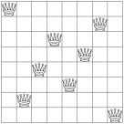</a>　(b)　<a href="../../../assets/volume4b/figures/satqa-figA11-b.svg">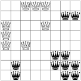</a>　(c)　<a href="../../../assets/volume4b/figures/satqa-figA11-c.svg">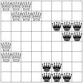</a>　(d)　<a href="../../../assets/volume4b/figures/satqa-figA11-d.svg">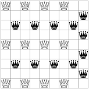</a>　(e)　<a href="../../../assets/volume4b/figures/satqa-figA11-e.svg">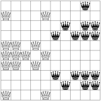</a>　(f)　<a href="../../../assets/volume4b/figures/satqa-figA11-f.svg">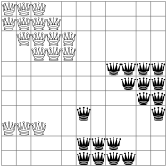</a>

<a id="fig-7-2-2-2-a11"></a>**图 A–11.** 各种最优的皇后摆法.


已知当 $3\le n\le13$ 时, 军队的最大规模分别为 $(1,2,4,5,7,9,12,14,17,21,24)$; 见 OEIS 数列 A250000. 实际上在 $n=3,4,6,8,10,11,13$ 时, 还可多放一个黑皇后. [图 A–11](#fig-7-2-2-2-a11) 给出了几例; 凡 $n=4q+1$, [图 A–11](#fig-7-2-2-2-a11)(d) 的构造均可推广到每军 $2q(q+1)$ 个皇后; 而 (c) 属于另一个构造族, 它达到了更高的渐近规模 $\tfrac7{48}n^2$.

当 $n=8$, $r=9$ 时, 算法 C 找到一个解通常约用 1000 万次内存访问 ($k=0$), 或 3000 万次 ($k=3$); 但当 $r=10$ 时, 它证明不可满足性通常约用 $1800\,\mathrm M\mu$ ($k=0$)、$850\,\mathrm M\mu$ ($k=3$)、$550\,\mathrm M\mu$ ($k=4$) 或 $600\,\mathrm M\mu$ ($k=5$). 因此在此例中, 破除对称性的约束对于不可满足情形有用, 对较容易的可满足情形却无益. 另一方面, 当 $n$ 较大时, 额外的约束对可满足和不可满足的变体都确实有帮助. 到 $n=10$ 和 $n=11$ 时, 最合适的是 $k=6$; 此时分别对 $r=15$ 和 $r=18$ 证明不可满足, 约需 $185\,\mathrm G\mu$ 和 $3500\,\mathrm G\mu$. [B. M. Smith、K. E. Petrie 和 I. P. Gent 用 CSP 方法得到了类似结果, 见 <em>LNCS</em> **3011** (2004), 271–286.]

(这个问题是 S. Ainley 在 <em>Mathematical Puzzles</em> (1977) 的问题 C1 中提出的. 他提到对 $n\le30$ 的一些解, 虽然是手工找到的, 至作者写作时仍未被超越. 关于推广到规模分别为 $r$ 和 $s$ 的共存军队, 另见 Martin Gardner, <em>Math Horizons</em> **7**, 2 (1999 年 11 月), 12–16. D. M. Kane 还证明, 若 $r=3q^2+3q+1$, 则 $s$ 的最大值渐近为 $n^2-(6q+3)n+O(1)$ [arXiv:1703.04538 [math.CO] (2017), 19 页].)

<a id="ans-7-2-2-2-489"></a>

**489.** [题目](../sec-7-2-2-2.md#ex-7-2-2-2-489) $T_0=1$, $T_1=2$, $T_n=2T_{n-1}+(2n-2)T_{n-2}$ (见式 5.1.4–(40)). 生成函数 $\sum_n T_nz^n/n!$ 和渐近值见习题 5.1.4–31.

<a id="ans-7-2-2-2-490"></a>

**490.** [题目](../sec-7-2-2-2.md#ex-7-2-2-2-490) 成立. 例如用带符号置换 $\bar413\bar2$, 可假设对于每个自同态, 某个解满足 $\bar x_4x_1x_3\bar x_2\le\bar x'_4x'_1x'_3\bar x'_2$; 因为使 $\bar x_4x_1x_3\bar x_2$ 按字典序最小的解就有这个性质. 注意带符号置换 $\bar1\bar2\ldots\bar n$ 将 “$\le$” 变成 “$\ge$”.

<a id="ans-7-2-2-2-491"></a>

**491.** [题目](../sec-7-2-2-2.md#ex-7-2-2-2-491) 令 $\sigma$ 为置换 $(1234\bar1\bar2\bar3\bar4)$. 则 $\sigma^4=(1\bar1)(2\bar2)(3\bar3)(4\bar4)$; 由定理 E, 只需查找满足 $x_1x_2x_3x_4\le\bar x_1\bar x_2\bar x_3\bar x_4$ 的解. 因此可以添入子句 $(\bar x_1)$ 而不影响可满足性.

(事实上可以断言 $x_1=x_2=x_4=0$, 因为把 $\sigma$ 写成状态的置换时, 两个 8 圈中字典序最小的代表分别为 0000 和 0010.)

一般而言, 若自同构 $\sigma$ 是一个字面值置换, 且它的某个圈同时含有某个变量 $v$ 的正、负字面值 $v$ 和 $\bar v$, 则可给 $v$ 赋一个固定值以简化问题, 然后只考虑不改变 $v$ 的自同构. (见 7.2.1.2 节关于 Sims 表的讨论.)

<a id="ans-7-2-2-2-492"></a>

**492.** [题目](../sec-7-2-2-2.md#ex-7-2-2-2-492) 设 $x_1\ldots x_n$ 满足 $F$ 的所有子句; 我们要证明 $(x_1\ldots x_n)\tau=x'_1\ldots x'_n$ 也都满足它们. 这很容易: 若 $(l_1\lor\cdots\lor l_k)$ 是一个子句, 就有 <a id="pdf-668"></a><a id="p-648"></a> $l'_1=l_1\tau,\ldots,l'_k=l_k\tau$; 而我们知道 $(l_1\tau\lor\cdots\lor l_k\tau)$ 为真, 因为它被 $F$ 的某个子句包摄. [见 S. Szeider, <em>Discrete Applied Math.</em> **130** (2003), 351–365.]

<a id="ans-7-2-2-2-493"></a>

**493.** [题目](../sec-7-2-2-2.md#ex-7-2-2-2-493) 采用全局次序 $p_1\ldots p_9=543219876$, 由推论 E 可添加子句以断言 $x_5=0$, $x_4x_3x_2x_1\le x_6x_7x_8x_9$. 即使只规定较弱的关系 $x_4\le x_6$, 矛盾也很快随之而来, 因为这就强制了 $x_6=1$.

<a id="ans-7-2-2-2-494"></a>

**494.** [题目](../sec-7-2-2-2.md#ex-7-2-2-2-494) [习题 475](../sec-7-2-2-2.md#ex-7-2-2-2-475)(d) 表明 $(uv)(\bar u\bar v)$ 是底层布尔函数的对称, 虽然未必是子句 $F$ 的对称. [这个观察来自前面引用的 Aloul、Ramani、Markov 和 Sakallah 的论文.] 其他的对称允许我们断言 (i) $(\bar x_i\lor x_j)\land(\bar x_j\lor\bar x_k)$, (ii) $(\bar x_i\lor\bar x_j)\land(\bar x_j\lor\bar x_k)$, (iii) $(\bar x_i\lor\bar x_j)\land(\bar x_j\lor x_k)$.

<a id="ans-7-2-2-2-495"></a>

**495.** [题目](../sec-7-2-2-2.md#ex-7-2-2-2-495) 例如设 $m=3$, $n=4$. 可将变量称为 $11,12,13,14,21,\ldots,34$; 给它们的全局次序为 $11,12,21,13,22,31,14,23,32,24,33,34$. 为断言 $21\,22\,23\,24\le31\,32\,33\,34$, 使用交换第 2 和第 3 行的对合; 若用 (192) 的形式而省去符号, 这个对合是 $(21\,31)(22\,32)(23\,33)(24\,34)$. 同样, 通过交换第 2 和第 3 列的对合 $(12\,13)(22\,23)(32\,33)$, 可断言 $12\,22\,32\le13\,23\,33$. 同一论证适用于任意相邻的两行或两列. 而且, 对所有变量取补就可将 “$\le$” 换为 “$\ge$”.

对一般的 $m,n$, 考虑任何满足下述条件的全局次序: 当 $1\le i\le i'\le m$ 且 $1\le j\le j'\le n$ 时, $x_{ij}$ 先于或等于 $x_{i'j'}$. 交换相邻两行会使全局字典序增加, 当且仅当这次交换使上面那行的字典序增加; 列也一样. [见 Anna Lubiw, <em>SICOMP</em> **16** (1987), 854–879. 矩阵元素不一定只能为 0 和 1.]

<a id="ans-7-2-2-2-496"></a>

**496.** [题目](../sec-7-2-2-2.md#ex-7-2-2-2-496) 不对; 那个推理还能 “证明” $m$ 只鸽子无法放入 $m$ 个巢. 谬误在于, 他所取的行序和列序并不像上一题那样, 同时与<em>一个</em>全局次序相容.

<a id="ans-7-2-2-2-497"></a>

**497.** [题目](../sec-7-2-2-2.md#ex-7-2-2-2-497) 用一个有 71,719 个结点的 BDD, 很容易算出总数 818,230,288,201, 以及生成函数
$$
\begin{aligned}
1+z+3z^2+8z^3+25z^4+\cdots&+21472125415z^{24}+31108610146z^{25}+\cdots\\
&+10268721131z^{39}+6152836518z^{40}+\cdots\\
&+24z^{60}+8z^{61}+3z^{62}+z^{63}+z^{64}.
\end{aligned}
$$
($z^{39}$ 和 $z^{40}$ 的系数相对较小, 这有助于解释为什么在 (185)–(186) 中选择了 $\ge$; 具有稀疏解的问题往往偏好 $\ge$.)

[Pólya 定理 (7.2.3 节) 表明恰有 14,685,630,688 个不等价矩阵; 相比之下, 不作对称归约时共有 $2^{64}\approx1.8447\times10^{19}$ 个.]

<a id="ans-7-2-2-2-498"></a>

**498.** [题目](../sec-7-2-2-2.md#ex-7-2-2-2-498) 考虑全局次序 $x_{01},x_{11},\ldots,x_{m1};\ x_{12},x_{22},\ldots,x_{m2},x_{02};\ x_{23},x_{33},\ldots,x_{m3},x_{03},x_{13};\ \ldots;\ x_{(m-1)m},x_{mm},x_{0m},\ldots,x_{(m-2)m}$. 有一个列对称固定所有排在 $x_{(j-1)j}$ 以前的元素, 并将 $x_{(j-1)j}$ 映为 $x_{(j-1)k}$.

<a id="ans-7-2-2-2-499"></a>

**499.** [题目](../sec-7-2-2-2.md#ex-7-2-2-2-499) 不合理. [答案 498](#ans-7-2-2-2-498) 的特别全局次序与通常的行或列字典序不相容. [类似的子句 $(x_{ii}\lor\bar x_{ij})$, $1\le i\le m$, $i<j\le n$, 也不能添入 (185) 和 (186). 当 $m=n=4$, $r=9$ 时, 没有一个无四角矩阵能满足所有这些约束.]

<a id="ans-7-2-2-2-500"></a>

**500.** [题目](../sec-7-2-2-2.md#ex-7-2-2-2-500) 若 $F_0$ 有解, 则它有一个使 $l$ 为真的解. 但 $(F_0\cup F_1)\mid l$ 可能无解. (例如令 $F_0=(\bar x_1\lor x_2)\land(\bar x_2\lor x_1)$, 它有对称 $\bar1\bar2$; 所以可以取 $S=(\bar x_1)$, $l=\bar x_1$. 再配上 $F_1=(x_1)$.)

<a id="ans-7-2-2-2-501"></a>

**501.** [题目](../sec-7-2-2-2.md#ex-7-2-2-2-501) 令 $x_{ij}$ 表示格 $(i,j)$ 有一个皇后, $1\le i\le m$, $1\le j\le n$. 再对 $1\le i\le m$, $1\le j<n$, 令 $r_{ij}=[x_{i1}+\cdots+x_{ij}\ge1]$ 且 $r'_{ij}=[x_{i1}+\cdots+x_{i(j+1)}\ge2]$. 用 (18) 和 (19) 很容易构造约 $8mn$ 个子句, 用 $x$ 定义 $r$, 并保证 $x_{i1}+\cdots+x_{in}\le2$. 于是 $r'_{i(n-1)}=[x_{i1}+\cdots+x_{in}=2]$; 将这个条件称为 $r_i$.

<a id="pdf-669"></a><a id="p-649"></a>

对列 $j$、对满足 $i+j=d+1$ 及 $i-j=d-n$ 的对角线, 也容易建立类似条件 $c_j,a_d,b_d$, 这里 $1\le i\le m$, $1\le j\le n$, $1\le d<m+n$. 于是条件 (ii) 对应于 $mn$ 个子句 $(x_{ij}\lor r_i\lor c_j\lor a_{i+j-1}\lor b_{i-j+n})$.

最后用来自 (20) 和 (21) 的子句保证 $\sum x_{ij}\le r$.

当 $m=n$ 时, A. S. Cooper、O. Pikhurko、J. R. Schmitt 和 G. S. Warrington [<em>AMM</em> **121** (2014), 213–221] 已经建立下界 $r\ge n-[n\bmod4=3]$; 他们还用回溯证明了在 $11\times11$ 棋盘上 $r\ge12$. 用 SAT 方法破除对称性, 可快得多地得到这个结果 (约用 9 万亿次内存访问); 不过当 $m,n$ 很大时, 这个问题像图 79 的层析成像问题一样, 用整数规划技术来解最好.

若称左上角为白格, 则看来对所有 $n>2$, 都有 $m=n=r-1$ 且皇后全在白格上的解, 而且几乎立刻就能找到. 但看不出一般规律. 事实上, 当 $n$ 为奇数时, 似乎还可能要求皇后全部出现在奇数行<em>和</em>奇数列.

下图给出几个不大的棋盘上的最优摆法. $8\times9,8\times10,8\times13,10\times10,12\times12$ 的解分别也适用于 $8\times8,9\times10,8\times12,9\times9,11\times11$.

<a href="../../../assets/volume4b/figures/satqa-a501-a.svg">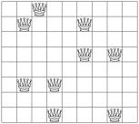</a>　<a href="../../../assets/volume4b/figures/satqa-a501-b.svg">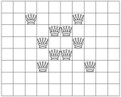</a>　<a href="../../../assets/volume4b/figures/satqa-a501-c.svg">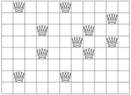</a>　<a href="../../../assets/volume4b/figures/satqa-a501-d.svg">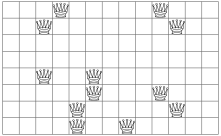</a>　<a href="../../../assets/volume4b/figures/satqa-a501-e.svg">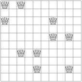</a>　<a href="../../../assets/volume4b/figures/satqa-a501-f.svg">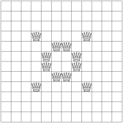</a>


$10\times10$ 棋盘上的这个十后摆法可用 “魔术序列” $(a_1,\ldots,a_5)=(1,3,7,5,9)$ 描述, 因为皇后出现在 $(a_i,a_{i+1})$ 和 $(a_{i+1},a_i)$ ($1\le i<n/2$), 以及 $(a_1,a_1)$ 和 $(a_{n/2},a_{n/2})$. 类似地, 魔术序列 $(1,3,9,13,15,5,11,7,17)$ 和 $(9,3,1,19,5,11,15,25,7,21,23,13,17)$ 描述了 $n=18$ 和 26 时的最优摆法. 作者还不知道其他魔术序列; 当 $n=34$ 时没有魔术序列.

<a id="ans-7-2-2-2-502"></a>

**502.** [题目](../sec-7-2-2-2.md#ex-7-2-2-2-502) 对每个 $j$, 为关系 $x_1^{(j)}+\cdots+x_n^{(j)}\le r_j$ 构造独立的基数约束, 例如用 (20) 和 (21), 其中 $x_k^{(j)}=(s_{jk}\,?\,\bar x_k:x_k)$.

<a id="ans-7-2-2-2-503"></a>

**503.** [题目](../sec-7-2-2-2.md#ex-7-2-2-2-503) 长为 $n$ 的二进制向量之间的汉明距离 $d(x,y)=\nu(x\oplus y)$ 满足 $d(x,y)+d(\bar x,y)=n$. 因此不存在对所有 $j$ 均有 $d(x,s_j)\ge r_j+1$ 的 $x$, 当且仅当不存在对所有 $j$ 均有 $d(\bar x,s_j)\le n-1-r_j$ 的 $x$. [见 M. Karpovsky, <em>IEEE Transactions</em> **IT-27** (1981), 462–472.]

<a id="ans-7-2-2-2-504"></a>

**504.** [题目](../sec-7-2-2-2.md#ex-7-2-2-2-504) (a) 设 $n\ge4$. 对长 $2n$ 的串, 有 $d(z,w)+d(z,\bar w)=2n$; 因此 $d(z,w)\le n$ 且 $d(z,\bar w)\le n$, 当且仅当 $d(z,w)=d(z,\bar w)=n$. 每个满足 $z_{2k-1}\ne z_{2k}$ ($1\le k\le n$) 的串 $z$, 对 $1\le j\le n$ 都有 $d(z,w_j)=n$. 反过来, 若 $1\le j<k\le n$ 且 $d(z,w_j)=d(z,w_k)=n$, 就有 $z_{2j-1}+z_{2j}=z_{2k-1}+z_{2k}$. 于是若对某个 $j$ 有 $z_{2j-1}=z_{2j}$, 就得到 $z=00\ldots0$ 或 $11\ldots1$, 与 $d(z,w_1)=n$ 矛盾.

(b) 对满足 (a) 的每个串 $\hat x=\bar x_1x_1\bar x_2x_2\ldots\bar x_nx_n$, 有 $d(\hat x,y)=2\bar l_1+2\bar l_2+2\bar l_3+n-3$, 它 $\le n+1$ 当且仅当 $(l_1\lor l_2\lor l_3)$ 得到满足.

(c) 对 $1\le j\le2n$, 置 $s_j=w_j$, $r_j=n$; 对 $1\le k\le m$, 置 $s_{2n+k}=y_k$, $r_{2n+k}=n+1$, 其中 $y_k$ 是第 $k$ 个子句在 (b) 中对应的串. 这个系统有一个最近字符串 $\hat x=\bar x_1x_1\bar x_2x_2\ldots\bar x_nx_n$, 当且仅当 $x_1\ldots x_n$ 满足每个子句. [如果给每个 $s_j$ 添上一位 $[n<j\le2n]$, 就得到一个所有串长均为 $2n+1$ 且半径均为 $n+1$ 的类似构造. 见 M. Frances 和 A. Litman, <em>Theory of Computing Systems</em> **30** (1997), 113–119.]

<a id="pdf-670"></a><a id="p-650"></a>

(d) 固定部分为 11000000、00110000、00001100、00000011、00111111、11001111、11110011、11111100, 距离 $\le4$; 对于各子句, 则为 01011000、00010110、01000101、10010001、10100100、00101001、10001010, 还可能有 01100010, 距离 $\le5$.

<a id="ans-7-2-2-2-505"></a>

**505.** [题目](../sec-7-2-2-2.md#ex-7-2-2-2-505) (对 $k=0,1,\ldots,n-1$, 可令 $j$ 为 $[0\mathinner{.\,.}k]$ 中的均匀随机整数, 并置 $\mathtt{INX}[k+1]\gets j$; 又若 $j=k$, 置 $\mathtt{VAR}[k]\gets k+1$, 否则置 $i\gets\mathtt{VAR}[j]$, $\mathtt{VAR}[k]\gets i$, $\mathtt{INX}[i]\gets k$, $\mathtt{VAR}[j]\gets k+1$.) 对九个随机种子, D3 的典型运行时间为 $(1241,873,206,15,748,1641,1079,485,3321)\,\mathrm M\mu$. 不可满足的 K0 的变化小得多, 为 $(1327,1349,1334,1330,1349,1322,1336,1330,1317)\,\mathrm M\mu$; 即使可满足的 W2 也一样: $(172,192,171,174,194,172,172,170,171)\,\mathrm M\mu$.

<a id="ans-7-2-2-2-506"></a>

**506.** [题目](../sec-7-2-2-2.md#ex-7-2-2-2-506) (a) <em>几乎</em>为真. 总和等于长度 $\ge2$ 的子句总数, 因为每个这样的长 $k$ 子句都对 $\binom k2$ 条边各贡献权 $1/\binom k2$.

(b) 残缺的 $12\times12$ 棋盘有 $12^2-2=142$ 格. 若某格有 $k$ 个可能的覆盖骨牌 $\{v_1,\ldots,v_k\}$, 它就贡献一个正子句 $(v_1\lor\cdots\lor v_k)$ 和 $\binom k2$ 个负子句 $(\bar v_i\lor\bar v_j)$. 因此骨牌 $u,v$ 在一个有 2、3 或 4 种盖法的格上重叠时, 两者间的权分别为 2、$4/3$ 或 $7/6$. 恰有 6 格只有两种盖法 (另有恰好 $10^2$ 格有四种盖法).

(图 95 中最大的边权为 $37/6$, 出现在 K6 的二十对顶点之间. 在另一个极端, X3 的 213064 条边中, 有 95106 条的权仅为 $1/8646$, 权不超过这个数两倍的则共有 200904 条.)

<a id="ans-7-2-2-2-507"></a>

**507.** [题目](../sec-7-2-2-2.md#ex-7-2-2-2-507) 例如考虑来自 (24) 的子句 $(u\lor\bar t)$, $(v\lor\bar t)$, $(\bar u\lor\bar v\lor t)$, $(u\lor\bar t')$, $(v\lor\bar t')$, $(\bar u\lor\bar v\lor t')$. 从 $t=1$ 前瞻得到意外收获 $(\bar t\lor t')$, 从 $t'=1$ 前瞻得到 $(\bar t'\lor t)$. 此后算法 L 就知道 $t$ 等于 $t'$.

<a id="ans-7-2-2-2-508"></a>

**508.** [题目](../sec-7-2-2-2.md#ex-7-2-2-2-508) 由 (194), 清除参数为 $\Delta_{\rm p}=1000$, $\delta_{\rm p}=500$; 因而在第 $k$ 次清除阶段约已学得 $1000k+500\binom k2$ 个子句. 学得 $1000L$ 个子句时, 相当于约 $(\sqrt{16L+9}-3)/2$ 次清除, $L=323$ 时约为 34.5 次. (实际数目确为 34.)

<a id="ans-7-2-2-2-509"></a>

**509.** [题目](../sec-7-2-2-2.md#ex-7-2-2-2-509) 防止过拟合的一种方法是随机选择训练实例. 这次由于训练中使用不同的种子, 本来就具有这种随机性.

<a id="ans-7-2-2-2-510"></a>

**510.** [题目](../sec-7-2-2-2.md#ex-7-2-2-2-510) (a) 由图 96、图 97 或表 7 可知, 在中位数的次序中 $\mathrm{T1}<\mathrm{T2}<\mathrm{L6}$; 因此 T2 遮住了 L6 和 T1.

(b) 类似地, $\mathrm{L8}<\mathrm{M3}<\mathrm{Q2}<\mathrm{X6}<\mathrm{F2}<\mathrm{X4}<\mathrm{X5}$; X6 遮住了 L8 和 X4.

(c) X7 遮住了 K0、K2 和 (间接地) A2, 因为 K2 遮住了 K0 和 A2.

<a id="ans-7-2-2-2-511"></a>

**511.** [题目](../sec-7-2-2-2.md#ex-7-2-2-2-511) (a) 随机运行九次, 仅用了 $(4.9,5.0,5.1,5.1,5.2,5.2,5.3,5.4,5.5)\,\mathrm M\mu$ 就结束 (!).

(b) 这次九次随机运行每次都尝试到一万亿次内存访问后才中止. (对于这个差异, 以及图 97 中 P4 的剧烈波动, 作者还不知道理论解释.)

(c) 不预处理时 $(0.2,\ldots,0.5,\ldots,3.2)\,\mathrm M\mu$; 预处理后 $(0.3,\ldots,0.5,\ldots,0.7)\,\mathrm M\mu$.

<a id="ans-7-2-2-2-512"></a>

**512.** [题目](../sec-7-2-2-2.md#ex-7-2-2-2-512) 2015 年用 ParamILS 作的一次训练运行建议采用参数
$$
\begin{aligned}
&\alpha=0.7,\quad\rho=0.998,\quad\varrho=0.99995,\quad\Delta_{\rm p}=100000,\quad\delta_{\rm p}=2000,\\
&\tau=10,\quad w=1,\quad p=0,\quad P=0.05,\quad\psi=0.166667,
\end{aligned}\tag{*}
$$
它们产生了[图 A–12](#fig-7-2-2-2-a12) 中的优良结果.

<a id="ans-7-2-2-2-513"></a>

**513.** [题目](../sec-7-2-2-2.md#ex-7-2-2-2-513) 在 $\operatorname{rand}(3,1062,250,314159)$ 上训练后, ParamILS 在 (195) 中选取 $\alpha=3.5$, $\Theta=20.0$, 同时选了显著不同的 $\beta=.9995$, $Y=32$, 有利于双重前瞻. [作者在准备[习题 173](../sec-7-2-2-2.md#ex-7-2-2-2-173) 时所用的未经调节的值是 $\alpha=3.3$, $\beta=.9985$, $\Theta=25.0$, $Y=8$.]

<a id="pdf-671"></a><a id="p-651"></a>

<a href="../../../assets/volume4b/figures/satqa-figA12.svg"></a>

<a id="fig-7-2-2-2-a12"></a>**图 A–12.** 算法 C 采用或不采用专门参数调节时的运行时间.


<a id="ans-7-2-2-2-514"></a>

**514.** [题目](../sec-7-2-2-2.md#ex-7-2-2-2-514) ParamILS 建议 $p=.85$, $N=5000n$; 这样得到的中位时间约为 $690\,\mathrm M\mu$. (但这些参数在多数其他问题上给出的结果却坏得可怕.)

<a id="ans-7-2-2-2-515"></a>

**515.** [题目](../sec-7-2-2-2.md#ex-7-2-2-2-515) 用变量 $S_{ijk}$ 表示解的格 $(i,j)$ 中填的是 $k$, 用 $Z_{ij}$ 表示谜题的格 $(i,j)$ 留空. 729 个 $S$ 变量受 $4\times81\times(1+\binom92)=11988$ 个形如 (13) 的子句约束. 由条件 (i), 只需 41 个变量 $Z_{ij}$. 通过 (i) 合并相等的 $Z$ 以后, 条件 (ii) 需要 15 个子句, 例如 $(Z_{11}\lor\cdots\lor Z_{19})$, $(Z_{11}\lor\cdots\lor Z_{51}\lor Z_{49}\lor\cdots\lor Z_{19})$, $(Z_{15}\lor\cdots\lor Z_{55})$, $(Z_{44}\lor Z_{45}\lor Z_{46}\lor Z_{54}\lor Z_{55})$. 类似地, 条件 (iii) 需要 28 个子句, 例如 $(\bar Z_{11}\lor\bar Z_{12}\lor\bar Z_{13})$, $(\bar Z_{11}\lor\bar Z_{21}\lor\bar Z_{31})$, $(\bar Z_{45}\lor\bar Z_{55})$. 条件 (vi) 用 34992 个子句实施, 其典型形式为 $(\bar S_{111}\lor\bar Z_{11}\lor\bar S_{122}\lor\bar Z_{12}\lor\bar S_{412}\lor\bar Z_{41}\lor\bar S_{421}\lor\bar Z_{42})$.

对条件 (iv)、(v), 引入辅助变量 $V_{ijk}=S_{ijk}\land\bar Z_{ij}$, 意即在 $(i,j)$ 可看到 $k$; $R_{ik}=V_{i1k}\lor\cdots\lor V_{i9k}$, 意即在第 $i$ 行可看到 $k$; $C_{jk}=V_{1jk}\lor\cdots\lor V_{9jk}$, 意即在第 $j$ 列可看到 $k$. 还有 $B_{bk}=\bigvee_{\langle i,j\rangle=b}V_{ijk}$, 意即在第 $b$ 宫可看到 $k$; 这里 $\langle i,j\rangle=1+3\lfloor(i-1)/3\rfloor+\lfloor(j-1)/3\rfloor$. 于是 $P_{ijk}=Z_{ij}\land\bar R_{ik}\land\bar C_{jk}\land\bar B_{\langle i,j\rangle k}$ 意即不冲突地填入格 $(i,j)$ 的可能选择之一为 $k$. 这 1701 个辅助变量用 8262 个子句定义.

条件 (iv) 由每个 $i,j$ 的九个九元子句实施, 它们禁止 $\{P_{ij1},\ldots,P_{ij9}\}$ 中恰有一个为真. 条件 (v) 类似, 由三组 $81\times9$ 个长为 9 的子句实施; 例如其中一个子句为
$$
(P_{417}\lor P_{427}\lor P_{437}\lor P_{517}\lor\bar P_{527}\lor P_{537}\lor P_{617}\lor P_{627}\lor P_{637}).
$$

<a id="pdf-672"></a><a id="p-652"></a>

(“并非明显地只能使用格 $(5,2)$ 来将 7 填入第 4 宫.”)

最后还可断言单元子句 $(S_{1kk})$ ($1\le k\le9$), $(\bar Z_{11})$, $(Z_{12})$, 以有效地破除一部分对称性. 总共有 2471 个变量、58212 个子句和 351432 个单元.

(此题由 Daniel Kroening 提出. 有不计其数的解, 其中看来每五六个就有一个能唯一补全为相应 $S$ 变量的设定. 因此再略带随机地添加诸如 $(S_{553})\land(\bar Z_{17})$ 之类的单元子句, 然后用舞蹈链淘汰有歧义的情形, 就能得到任意多个 “困难的数独”. 算法 L 或 C 很容易处理这些子句, 但它们常常难倒算法 D. 不过对于下面能唯一补全的解 (a), 后一算法仅用 $9.3\,\mathrm G\mu$ 就找到了.)

若加强条件 (iii), 改为要求每一宫中没有一行或一列含有多于<em>一个</em>空格, 条件 (vi) 就成了多余的. 这时得到的解如下面的 (b): 颇引人注意的是, 虽然有 58 个可见线索而且只有唯一的填法, 却没有强迫走法. 不过这题相当简单; 尚未填入的只涉及 2、4、7.

(a)

```text
1....6.8.
5.87214.6
.6.38.2.1
84...3..5
..5.6.8..
6..8...42
3.6.48.2.
4.76321.8
.8.5....4
```

(b)

```text
1.3.56.89
59738.61.
68.1.93.5
956.318.7
.315.896.
2.896.153
8.96.5.31
.65.13298
31.89.5.6
```

(c)

```text
1.3.5.7..
.5.79...1
7....125.
..1..5.76
..5.7.1..
47.1..5..
.185....7
5...87.1.
..7.1.8.5
```

(d)

```text
1.3.56.89
68.3.91.5
.9518.63.
3.896..51
.195.836.
56..319.8
.56.9381.
8.16.5.93
93.81.5.6
```


另一个想法是加强条件 (iv) 和 (v), 要求每次选择至少有<em>三</em>种方法而非仅两种. 这样得到的解如上面的 (c). 然而这个例子竟有 1237 种填法! 即使再像 (b) 那样加强条件 (iii), 也会得到如 (d) 的解, 可以用 12 种方法填完. 作者还不知道这样的数独题, 既能唯一补全又处处含有三重选择.

<a id="ans-7-2-2-2-516"></a>

**516.** [题目](../sec-7-2-2-2.md#ex-7-2-2-2-516) 这个猜想有几种等价的表述. R. Impagliazzo 和 R. Paturi [<em>J. Comp. Syst. Sci.</em> **62** (2001), 367–375] 定义了 $s_k=\inf\{\lg\tau\mid\text{有一种已知算法可在 }\tau^n\text{ 步内解 }k\text{SAT}\}$, 并提出了<em>指数时间假设</em>: $s_3>0$. 他们又定义 $s_\infty=\lim_{k\to\infty}s_k$, 并证明对某个正常数 $d$ 有 $s_k\le(1-d/k)s_\infty$. 他们猜想 $s_\infty=1$; 这就是<em>强指数时间假设</em>. 后来又找到一个表述 [C. Calabro、R. Impagliazzo 和 R. Paturi, <em>IEEE Conf. on Comput. Complexity</em> **21** (2006), 252–260]: “若 $\tau<2$, 则存在常数 $\alpha$, 使得没有一种可知的随机化算法能够在少于 $\tau^n$ 步内解决每个至多有 $\alpha n$ 个子句的 SAT 问题, 其中 $n$ 为变量数.”

<a id="ans-7-2-2-2-517"></a>

**517.** [题目](../sec-7-2-2-2.md#ex-7-2-2-2-517) (a) (Günter Rote 的解.) 将第 $j$ 个三元子句 $(l_j\lor l'_j\lor l''_j)$ 换为三个三元方程 $l_j+a_j+c_j=1$, $\bar l'_j+a_j+b_j=1$, $\bar l''_j+c_j+d_j=1$, 其中 $a_j,b_j,c_j,d_j$ 为新变量.

(b) 用以下事实去掉长度 $>3$ 的方程: $l_1+\cdots+l_k=1$ 当且仅当存在新变量 $t$ 使 $l_1+\cdots+l_j+t=1$ 且 $l_{j+1}+\cdots+l_k+\bar t=1$. 此外, 若 $a,b,c,d$ 为新变量且 $a+b+d=a+c+\bar d=1$, 则可用 $l+l'=1\iff l+l'+a=1$ 及 $l=1\iff\bar l+b+c=1$ 补足较短的方程.

[Thomas J. Schaefer 在 <em>STOC</em> **10** (1978), 216–226 中证明了三中恰一 SAT 的 NP 完全性, 这是更一般结果的一个特例.]

<a id="pdf-673"></a><a id="p-653"></a>

<a id="ans-7-2-2-2-518"></a>

**518.** [题目](../sec-7-2-2-2.md#ex-7-2-2-2-518) (a) $A=\left(\begin{smallmatrix}x&y&y\\y&x&y\\y&y&x\end{smallmatrix}\right)$, 其中 $x=\left(\begin{smallmatrix}-1&0\\1&0\end{smallmatrix}\right)$, $y=\left(\begin{smallmatrix}1&1\\-1&1\end{smallmatrix}\right)$.

(b) 在 $n$ 个变量行和 $n$ 个变量列中各两次; 在 $3m$ 个输出行和 $3m$ 个输入列中各一次; 在 $3m$ 个输入行和 $3m$ 个输出列中一次也没有.

(c) 由 (a), 在互异的行、列中选出若干个 2 的每种方法, 对积和式的贡献均为零, 除非在每个子句中所选的输入子集非空且与所选的输出相配. 在后一情形下, 其贡献为 $16^m2^n$. [见 A. Ben-Dor 和 S. Halevi, <em>Israel Symp. Theory of Computing Systems</em> **2** (IEEE, 1993), 108–117.]

<a id="ans-7-2-2-2-519"></a>

**519.** [题目](../sec-7-2-2-2.md#ex-7-2-2-2-519) 与 D1 和 D2 对应的不可满足问题的中位运行时间为 $2099\,\mathrm M\mu$ (输给 $\mathit{factor\_fifo}$ 和 $\mathit{factor\_lifo}$ 二者). 与 D3 和 D4 对应的可满足问题不太稳定 (如图 97 所示), 其中位数为 $903\,\mathrm M\mu$ (胜过二者).

<a id="ans-7-2-2-2-520"></a>

**520.** [题目](../sec-7-2-2-2.md#ex-7-2-2-2-520) (Sven Mallach 于 2015 年用求解器 X 和 Y 得到的解; X 为 CPLEX 12.6, Y 为 GUROBI 6, 两者均侧重于混合整数规划的可行性, 取常数目标函数, 解数限为 1.) 在单线程 Xeon 计算机上以 30 分钟为限, X 和 Y 都未能解决以下 46 个问题中的任何一个: A1、A2、C1、C2、C3、C4、C5、C6、C8、D1、D2、E1、E2、F1、F2、G1、G2、G5、G6、G7、G8、K7、K8、M5、M7、M8、O1、O2、P0、P1、P2、Q7、S3、S4、T5、T6、T7、T8、W2、W4、X1、X3、X5、X6、X7、X8. (特别地, 其中包括对算法 C 极为容易的 P0、S4 和 X1.) 另一方面, X 和 Y 都用不到一秒就解出了兰福德问题 L3 和 L4——它们对算法 C 却最为困难.

算法 C 在类似的 Xeon 上每分钟约完成 $20\,\mathrm G\mu$. 在这些实验中, 除了问题 K0、K1、K2、L3、L4、P4 (以及 B2 这样的若干容易情形), 它都明显胜过了几何方法.

当然应当记住, 表 6 中所用的特定子句未必是用 IP 求解器处理相应组合问题的最佳方式, 正如对于 SAT 求解器它们也未必是最佳编码. 这里比较的只是把求解器视作黑盒时求解子句的速度.

<a id="ans-7-2-2-2-521"></a>

**521.** [题目](../sec-7-2-2-2.md#ex-7-2-2-2-521) 关于各种简单方案的综述, 见 S. Jabbour、J. Lonlac、L. Saïs 和 Y. Salhi, <em>Int. J. Artificial Intelligence Tools</em> **27**, 8 (2018), 1850033:1–19.

<a id="ans-7-2-2-2-522"></a>

**522.** [题目](../sec-7-2-2-2.md#ex-7-2-2-2-522) 对长 $T$ 的圈, 可引入 $27T$ 个变量 $xyz_t$, $1\le x,y,z\le3$, $0\le t<T$, 表示顶点 $(x,y,z)$ 占据路径中的位置 $t$. 当 $xyz=x'y'z'$ 且 $t\ne t'$, 或 $xyz\ne x'y'z'$ 且 $t=t'$ 时, 二元排除子句 $\neg xyz_t\lor\neg x'y'z'_{t'}$ 保证没有顶点在路中出现两次, 也没有两个顶点占据同一位置. 有效的路由以下邻接子句指定:
$$
\neg xyz_t\lor\bigvee\{x'y'z'_{(t+1)\bmod T}\mid1\le x',y',z'\le3\ \text{且}\ |x'-x|+|y'-y|+|z'-z|=1\}.
$$
用 36 个变量 $a!b{*},ba!{*},a!{*}b,b{*}a!,{*}a!b,{*}ba!$ ($1\le a\le2$, $1\le b\le3$) 表示影子; 例如 $a!{*}b$ 表示 $(x,z)$ 坐标的影子在 $(a,b)$ 与 $(a+1,b)$ 之间有一步转移. 每当 $x<3$ 且 $t'\equiv t\pm1\pmod T$ 时, 这些变量出现在诸如 $(\neg xyz_t\lor\neg(x+1)yz_{t'}\lor x!{*}z)\land(\neg xyz_t\lor\neg(x+1)yz_{t'}\lor x!y{*})$ 的三元子句中. 为排除环, 添入形如
$$
\neg1!1{*}\lor\neg2!1{*}\lor\neg31!{*}\lor\neg32!{*}\lor\neg2!3{*}\lor\neg22!{*}\lor\neg1!2{*}\lor\neg11!{*}
$$
的子句; 这一个排除了例图中的那个环. 这样的防环子句有 39 个, 每个影子的 13 个简单圈各用一个.

最后, 可先验证没有一个解能避开全部八个角, 然后断言单元子句 $121_{T-1},111_0,112_1$; 这样破除对称性并不损失一般性.

<a id="pdf-674"></a><a id="p-654"></a>

显然 $T$ 必为偶数, 因为图是二部的; 并且 $T<27$. 若将[习题 12](../sec-7-2-2-2.md#ex-7-2-2-2-12) 的方法用于排除约束, 则当 $T=16$ 时, 共得 6264 个子句、822 个变量、17439 个单元; 当 $T=24$ 时, 则为 9456 个子句、1242 个变量、26199 个单元. 这些子句对算法 D 太难了. 但对每个给定的 $T$, 算法 L 几乎立刻就能解出; 结果当且仅当 $T=24$ 时可满足, 而在这种情况下有两个本质不同的解. 其中一个圈是 John Rickard 找到的 (他约于 1990 年在剑桥大学提出了这个问题), 它有美妙的对称性, 画在 Peter Winkler 的书 <em>Mathematical Mind-Benders</em> (2007) 的封面上. 它可用以下差分序列的第一个来表示, 另一个圈没有这种对称性, 对应于第二个序列; 其中 “$k$” 和 “$\bar k$” 分别将坐标 $k$ 改变 $+1$ 和 $-1$:

$(322\bar{3}133\bar{1}\bar{2}112\bar{3}\bar{2}\bar{2}3\bar{1}\bar{3}\bar{3}12\bar{1}\bar{1}\bar{2})$;

$(3321\bar{2}1\bar{3}\bar{3}\bar{1}221\bar{2}323\bar{1}\bar{1}\bar{3}1\bar{2}\bar{1}\bar{3}\bar{2})$.


<a id="ans-7-2-2-2-523"></a>

**523.** [题目](../sec-7-2-2-2.md#ex-7-2-2-2-523) (Peter Winkler 的解.) 取坐标 $(x,y,z)$, $1\le x\le m$, $1\le y\le n$, $1\le z\le2$. 任何具有无环影子的圈必须至少含有两步 $(x,y,1)\mathbin{—}(x,y,2)$ 和 $(x',y',1)\mathbin{—}(x',y',2)$. 可设 $x<x'$, 并使 $x'-x$ 尽可能小 (若两步的 $x$ 相等, 则交换坐标的作用来考察). $m\times2$ 的影子含有 $(x,1)\mathbin{—}(x,2)$ 和 $(x',1)\mathbin{—}(x',2)$, 以及例如路径 $(x,1)\mathbin{—}\cdots\mathbin{—}(x',1)$, 但对某个 $x\le x''<x'$ 却不含边 $(x'',2)\mathbin{—}(x''+1,2)$. 在 $m\times n$ 的影子中, 从 $(x,y)$ 到 $(x',y')$ 的唯一最短路含有某条边 $(x'',y'')\mathbin{—}(x''+1,y'')$; 因此 $(x'',y'',1)\mathbin{—}(x''+1,y'',1)$ 必须在圈中出现两次.

<a id="ans-7-2-2-2-524"></a>

**524.** [题目](../sec-7-2-2-2.md#ex-7-2-2-2-524) 这个问题的子句和闭路的子句十分相似, 不过更简单些; 有 $T=27$ 且没有 “首尾相接” 的条件. 通常有 1413 个变量、10410 个子句和 28701 个单元, 算法 L 又大显身手, 对基于起点和终点破除对称性后的几种情形, 每种只用十亿至二十亿次内存访问就能处理. 有四个本质不同的解, 不妨都假设从 111 开始; 一个终止于 333, 一个于 133, 一个于 113, 另一个于 223. 用上面的差分序列记号, 依次为

$(332\bar{3}\bar{3}2331\bar{3}\bar{3}\bar{2}33\bar{2}\bar{3}\bar{3}1332\bar{3}\bar{3}233)$;

$(31\bar{3}133\bar{1}\bar{1}211\bar{3}\bar{3}\bar{1}3\bar{1}\bar{3}231\bar{3}133\bar{1}\bar{1})$;

$(32\bar{3}231\bar{3}\bar{2}3\bar{2}\bar{3}132\bar{3}233\bar{2}\bar{2}\bar{1}22\bar{1}\bar{2}\bar{2})$;

$(1122\bar{1}\bar{1}\bar{2}13\bar{1}211\bar{2}\bar{2}\bar{1}\bar{1}31122\bar{1}\bar{1}\bar{2}1)$.


第一个是反射三进制码.

[这种路以及更一般的具有无环影子的生成树, 是 Oskar van Deventer 于 1983 年发明的, 他称之为 “空心迷宫”; 见 <em>The Mathemagician and Pied Puzzler</em> (1999), 213–218. 他的 <em>Mysterians</em> 谜题基于 $P_5\mathbin{\square}P_5\mathbin{\square}P_5$ 上一条具有无环影子的奇妙哈密顿路径.]

<a id="ans-7-2-2-2-525"></a>

**525.** [题目](../sec-7-2-2-2.md#ex-7-2-2-2-525) 截至 2015 年 7 月, 作者找到的最佳答案有 100 个变量、400 个子句、1200 个字面值 (单元); 它取自[习题 245](../sec-7-2-2-2.md#ex-7-2-2-2-245) 中 Tseytin 的例子, 用于一个近乎随机的 50 顶点 4-正则图, 其围长为 6. 在一个顶点取奇、49 个顶点取偶时, Tseytin 的构造给出 400 个 4SAT 子句, 它们确实相当难解. 还可以将它简化成一个 3SAT 问题, 进一步要求每个偶顶点在真边指定的子图中恰有度 2. (见 K. Markström, <em>J. Satisfiability, Boolean Modeling and Comp.</em> **2** (2006), 221–227.)

这个简化问题依然颇有挑战性: 算法 L 用 $3.3\,\mathrm T\mu$ 证明不可满足, 算法 C 用 $1.9\,\mathrm T\mu$. (但若应用[习题 473](../sec-7-2-2-2.md#ex-7-2-2-2-473) 的自同态, 添加 142 个长为 6 的子句破除对称性, 则时间分别降至仅 $263\,\mathrm M\mu$ 和 $949\,\mathrm M\mu$.)

还有一类规模虽小却难解的问题值得一提, 虽然它不符合本题的规格 [见 I. Spence, <em>ACM J. Experimental Algorithms</em> **20** (2015), 1.4:1–1.4:14]: 取一个三维匹配实例, 其恰当覆盖表示有 $3n$ 个项、$5n$ 个选项, 每项有五个选项, 每个选项含三个项. 可以将它表示成一个 SAT 问题, 有 $5n$ 个变量、$10n$ 个 <a id="pdf-675"></a><a id="p-655"></a> 二元子句和 $2n$ 个五元子句, 因而共有 $30n$ 个字面值. 当 $n=40$ 时, 这个 5SAT 问题与上述 3SAT 问题有相同数目的字面值; 但如果匹配问题不可满足, 它的难度要大得多. (这类问题中曾在 2014 年竞赛中难倒所有 SAT 求解器的实例, 用舞蹈链方法几乎立刻就能解决: 算法 7.2.2.1X 不到 $60\,\mathrm M\mu$ 就能证明其不可满足性. 另一方面, 若将这个三维匹配问题如 (13) 那样编码成 $3n$ 个至少一个的五元子句和 $3n\cdot10$ 个至多一个的二元子句, 而非至少一个只用 $2n$ 个、至多一个只用 $n\cdot10$ 个, 则算法 L 的表现几乎与舞蹈链一样好.)

<a id="ans-7-2-2-2-526"></a>

**526.** [题目](../sec-7-2-2-2.md#ex-7-2-2-2-526) 对 $|F|$ 用归纳法证明, 至多能让 $w(F)$ 个子句未满足, 其中 $w(F)=\sum_{C\in F}2^{-|C|}$. 若重集 $F$ 的所有子句都是空的, 则 $w(F)=|F|$, 结论成立. 否则设变量 $x$ 出现在 $F$ 中. 若 $w(\{C\mid x\in C\in F\})\ge w(\{C\mid\bar x\in C\in F\})$, 则取 $l=x$; 否则取 $l=\bar x$. 简单的计算表明 $w(F\mid l)\le w(F)$. [<em>J. Computer and System Sciences</em> **9** (1974), 256–278, 定理 3.]
