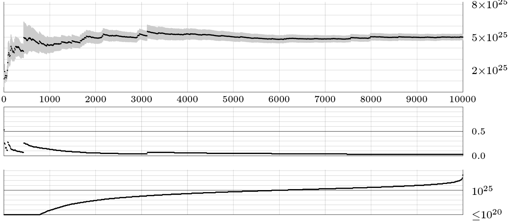
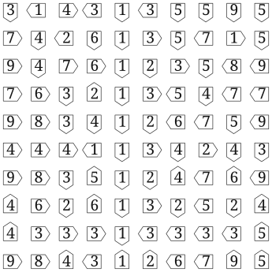
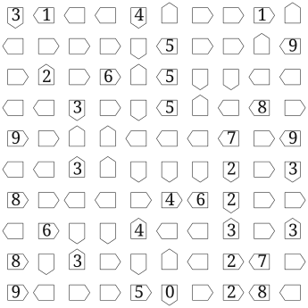

<a id="answers-7-2-2"></a>


<a id="pdf-418"></a><a id="p-398"></a>

# 7.2.2 节

<a id="ans-7-2-2-1"></a>

**1.** [题目](../sec-7-2-2.md#ex-7-2-2-1) 表述方法很多, 以下的一种也许最为简便. (i) $D_k$ 任意 (最好是有限的), $P_l$ 恒真. (ii) $D_k=\{1,2,\ldots,n\}$, $P_l$ 为 “对 $1\leq j<k\leq l$, $x_j\ne x_k$”. (iii) 从 $N$ 个对象中取 $n$ 个作组合, 令 $D_k=\{1,\ldots,N+1-k\}$, $P_l$ 为 “$x_1>\cdots>x_l$”. (iv) $D_k=\{0,1,\ldots,\lfloor n/k\rfloor\}$; $P_l$ 为 “$x_1\geq\cdots\geq x_l$ 且 $n-(n-l)x_l\leq x_1+\cdots+x_l\leq n$”. (v) 对于限制增长串, $D_k=\{0,\ldots,k-1\}$, $P_l$ 为 “对 $1\leq j<l$ 有 $x_{j+1}\leq1+\max(x_1,\ldots,x_j)$”. (vi) 对于左括号的下标 (见 7.2.1.6–(8)), $D_k=\{1,\ldots,2k-1\}$, $P_l$ 为 “$x_1<\cdots<x_l$”.

<a id="ans-7-2-2-2"></a>

**2.** [题目](../sec-7-2-2.md#ex-7-2-2-2) 真. (否则置 $D_1\gets D_1\cap\{x\mid P_1(x)\}$.)

<a id="ans-7-2-2-3"></a>

**3.** [题目](../sec-7-2-2.md#ex-7-2-2-3) 令 $D_k=\{1,\ldots,\text{第 }k-1\text{ 层的最大出度}\}$, $P_l(x_1,\ldots,x_l)$ 为 “$x_1\cdots x_l$ 是树 $T$ 的杜威十进记号中的一个标号” (见 §2.3).

<a id="ans-7-2-2-4"></a>

**4.** [题目](../sec-7-2-2.md#ex-7-2-2-4) 可以把 $D_1$ 限于 $\{1,2,3,4\}$, 因为任何解 $x_1\ldots x_8$ 的镜像 $(9-x_1)\ldots(9-x_8)$ 也是解. (H. C. Schumacher 在 1850 年 9 月 24 日写给 C. F. Gauss 的信中指出了这一点.) 注意图 68 是左右对称的.

<a id="ans-7-2-2-5"></a>

**5.** [题目](../sec-7-2-2.md#ex-7-2-2-5) $\operatorname{try}(l)=$ “若 $l>n$, 访问 $x_1\ldots x_n$. 否则, 依次取 $x_l\gets\min D_l,\min D_l+1,\ldots,\max D_l$, 若 $P_l(x_1,\ldots,x_l)$ 成立, 就调用 $\operatorname{try}(l+1)$.”

这种写法很优雅, 对简单问题也很好. 然而你根本看不出这个方法为什么叫做 “回溯”! 对于内循环要执行几十亿次的重要问题, 它也难以产生高效的代码. 我们将看到, 高效回溯的关键, 是为检验性质 $P_l$ 所用的数据结构提供高效的更新和撤销方法. 递归的开销可能碍事, 而且算法 B 实际采用的迭代结构并不难懂.

<a id="ans-7-2-2-6"></a>

**6.** [题目](../sec-7-2-2.md#ex-7-2-2-6) 在 (3) 中排除 $j=r$ 或 $k=r$ 的情形, 分别得到 $(312,396,430,458,458,430,396,312)$ 个解. (若第 $r$ 列也空出, 就只有 $(40,46,42,80,80,42,46,40)$ 个.)

<a id="ans-7-2-2-7"></a>

**7.** [题目](../sec-7-2-2.md#ex-7-2-2-7) 有, 几乎可以肯定所有 $n>16$ 都有. 一个例子是 $x_1x_2\ldots x_{17}=2\;17\;12\;10\;7\;14\;3\;5\;9\;13\;15\;4\;11\;8\;6\;1\;16$. [见 <em>Proc. Edinburgh Math. Soc.</em> **8** (1890), 43 及图 52.] Preußer 和 Engelhardt 在 $n=27$ 时找到了 34,651,355,392 个解.

<a id="ans-7-2-2-8"></a>

**8.** [题目](../sec-7-2-2.md#ex-7-2-2-8) 能, 如 $(42736815,42736851)$; 也就还有 $(57263148,57263184)$.

<a id="ans-7-2-2-9"></a>

**9.** [题目](../sec-7-2-2.md#ex-7-2-2-9) 能, 至少在 $m=4$ 时可以. 例如 $x_1\ldots x_{16}=5\;8\;13\;16\;3\;7\;15\;11\;6\;2\;10\;14\;1\;4\;9\;12$. 当 $m=5$ 时无解, 而在 $m=6$ 时, $7\;10\;13\;20\;17\;24\;3\;6\;23\;11\;16\;21\;4\;9\;14\;2\;19\;22\;1\;8\;5\;12\;15\;18$ 就是一个解. (是否所有偶数 $m\geq4$ 都有解? C. F. de Jaenisch 在 <em>Traité des applications de l’analyse mathématique au jeu des échecs</em> **2** (1862), 132–133 中指出, 八皇后问题的所有解都在两种颜色的格上各有四个皇后. 他证明了白格上的皇后数一定是偶数, 因为 $\sum_{k=1}^{4m}(x_k+k)$ 是偶数.)

<a id="ans-7-2-2-10"></a>

**10.** [题目](../sec-7-2-2.md#ex-7-2-2-10) 用位向量 $a_l,b_l,c_l$ 表示 (6) 中各集合的 “有用” 元素, 即 $a_l=\sum\{2^{x-1}\mid x\in A_l\}$, $b_l=\sum\{2^{x-1}\mid x\in B_l\cap[1\mathinner{.\,.}n]\}$, $c_l=\sum\{2^{x-1}\mid x\in C_l\cap[1\mathinner{.\,.}n]\}$. 于是步骤 W2 置 $s_l\gets\mu\mathbin{\&}\bar a_l\mathbin{\&}\bar b_l\mathbin{\&}\bar c_l$, 其中 $\mu$ 是掩码 $2^n-1$.

步骤 W3 可置 $t\gets s_l\mathbin{\&}(-s_l)$, $a_{l+1}\gets a_l+t$, $b_{l+1}\gets(b_l+t)\gg1$, $c_{l+1}\gets((c_l+t)\ll1)\mathbin{\&}\mu$. 在这里就置 $s_l\gets s_l-t$ 也很方便, 不必等到 W4.

(既不必在存储器中保存 $x_l$, 也不必在 W3 把它算成 $[1\mathinner{.\,.}n]$ 中的整数; 因为找到解时, 可由 $a_{l+1}-a_l$ 推出 $x_l$.)

<a id="ans-7-2-2-11"></a>

**11.** [题目](../sec-7-2-2.md#ex-7-2-2-11) (a) 只在 $n=1$ 时可以, 因为成镜像的一对皇后可以互相攻击.

(b) 不在中心的皇后必须成四个一组出现.

(c) 两种情形中的四个皇后占用相同的行、列和对角线.

<a id="pdf-419"></a><a id="p-399"></a>

(d) 对于 $c_n$ 所计数的任一解, 都可以独立地决定其 $\lfloor n/4\rfloor$ 个四皇后组中的每一组是否要改换倾斜方向. [<em>Mathematische Unterhaltungen und Spiele</em> **1**, 第 2 版 (Leipzig: Teubner, 1910), 249–258.]

<a id="ans-7-2-2-12"></a>

**12.** [题目](../sec-7-2-2.md#ex-7-2-2-12) 因各 $x_k$ 互异, 有 $\sum_{k=1}^n(x_k+k)=2\binom{n+1}2\equiv0\pmod n$. 若 $(x_k+k)\bmod n$ 也互异, 则同一个和还同余于 $\binom{n+1}2$. 但当 $n$ 为偶数时, 这是不可能的.

再设各 $(x_k-k)\bmod n$ 互异. 则 $\sum_{k=1}^n(x_k+k)^2\equiv\sum_{k=1}^n(x_k-k)^2\equiv\sum_{k=1}^nk^2=n(n+1)(2n+1)/6\pmod n$. 而且 $\sum_{k=1}^n(x_k+k)^2+\sum_{k=1}^n(x_k-k)^2=4n(n+1)(2n+1)/6$. 比较两种算法, 必须有 $2\sum_{k=1}^nk^2\equiv0\pmod n$; $n$ 是 3 的倍数时却不成立. [见 W. Ahrens, <em>Mathematische Unterhaltungen und Spiele</em> **2**, 第 2 版 (1918), 364–366, 其中 G. Pólya 引述了 A. Hurwitz 关于其他斜率的环绕对角线的较一般结果.]

反过来, 若 $n$ 不能被 2 或 3 整除, 可令 $x_n=n$, 对 $1\leq k<n$ 取 $x_k=(2k)\bmod n$. [规则 $x_k=(3k)\bmod n$ 也可用. 见 Édouard Lucas, <em>Récréations Mathématiques</em> **1** (1882), 84–86.]

<a id="ans-7-2-2-13"></a>

**13.** [题目](../sec-7-2-2.md#ex-7-2-2-13) 显然, $(n+1)$ 皇后问题有一个在角上放皇后的解, 当且仅当 $n$ 皇后问题有一个主对角线上不放皇后的解. 因此由上一答案, 当 $n\bmod6\in\{0,1,4,5\}$ 时总有解.

J. Franel [<em>L’Intermédiaire des Mathématiciens</em> **1** (1894), 140–141] 为 $n\bmod6\in\{2,4\}$ 找到另一个漂亮的解. 对 $1\leq k\leq n$ 置 $x_k=(n/2+2k-3[2k\leq n])\bmod n+1$. 若 $x_k-x_j=\pm(k-j)$ 且 $1\leq j<k\leq n$, 由此构造可得 $(1\text{ 或 }3)(k-j)+(0\text{ 或 }3)\equiv0\pmod n$, 因而 $k-j=n-(1\text{ 或 }3)$. 但 $x_1,x_2,x_3,x_{n-2},x_{n-1},x_n$ 的值表明, 除了 $n=2$ 以外不会发生攻击. Franel 的解有空的对角线, 因而也为 $n\bmod6\in\{3,5\}$ 给出解. 由此断定, 只有 $n=2$ 和 $n=3$ 无解.

[E. Pauls 更早就给出了适用于一切 $n>3$ 的较复杂构造, 见 <em>Deutsche Schachzeitung</em> **29** (1874), 129–134, 257–267. Pauls 还解释了原则上怎样通过逐层构造树来求全部解 (不使用回溯).]

<a id="ans-7-2-2-14"></a>

**14.** [题目](../sec-7-2-2.md#ex-7-2-2-14) 对 $1\leq j\leq n$, 各取 $m$ 皇后的一个解 $x_1^{(j)}\ldots x_m^{(j)}$, 再取 $n$ 个环面皇后的一个解 $y_1\ldots y_n$. 令 $X_{(i-1)n+j}=(x_i^{(j)}-1)n+y_j$, 其中 $1\leq i\leq m$, $1\leq j\leq n$, 就得到 $mn$ 皇后的一个解. [I. Rivin、I. Vardi 和 P. Zimmermann, <em>AMM</em> **101** (1994), 629–639, 定理 2.]

<a id="ans-7-2-2-15"></a>

**15.** [题目](../sec-7-2-2.md#ex-7-2-2-15) 更准确地说, 存在常数 $\sigma=e^{1-\alpha}$, 使得对任意固定的 $0<\epsilon<\sigma$, $Q(n)/n!$ 介于 $\bigl((1-\epsilon)\sigma\bigr)^n$ 与 $\bigl((1+\epsilon)\sigma\bigr)^n$ 之间 (当 $n$ 充分大时). 事实上, 一番精细的分析 [<em>Advances in Math.</em> **427** (2023), 109127:1–83] 表明, 把所有解取平均会趋近一个很有意思的概率分布. P. Nobel、A. Agrawal 和 S. Boyd 精确计算了 $\alpha$ [<em>Optimization Letters</em> **17** (2023), 1229–1240].

<a id="ans-7-2-2-16"></a>

**16.** [题目](../sec-7-2-2.md#ex-7-2-2-16) 设第 $k$ 行的蜂后占第 $x_k$ 格. 这就得到 $n$ 皇后问题的一个 “松弛” 形式, 只须在 (3) 中把 $|x_k-x_j|$ 改作 $x_k-x_j$. 因此在算法 B* 或习题 10 中可以略去向量 $b$. 所得结果为

| $n$ | 0 | 1 | 2 | 3 | 4 | 5 | 6 | 7 | 8 | 9 | 10 | 11 | 12 | 13 | 14 |
|---|---:|---:|---:|---:|---:|---:|---:|---:|---:|---:|---:|---:|---:|---:|---:|
| $H(n)$ | 1 | 1 | 1 | 3 | 7 | 23 | 83 | 405 | 2113 | 12657 | 82297 | 596483 | 4698655 | 40071743 | 367854835 |

[N. J. Cavenagh 和 I. M. Wanless, <em>Discr. Appl. Math.</em> **158** (2010), 136–146, 表 2.]

<a id="ans-7-2-2-17"></a>

**17.** [题目](../sec-7-2-2.md#ex-7-2-2-17) 步骤 L5 会出大乱子. 负号标明先前的哪项决定是强制的, 这是回溯时少不了的标记.

<a id="ans-7-2-2-18"></a>

**18.** [题目](../sec-7-2-2.md#ex-7-2-2-18) $x_4\ldots x_8=\bar2\bar1 0\bar4 0$, $p_0\ldots p_4=33300$, $y_1y_2y_3=130$. (若 $x_i\leq0$, 算法决不会查看 $y_i$, 因而此时 $y_4\ldots y_8$ 的状态无关紧要. 不过碰巧 $y_4y_5=20$, 这是先前操作留下来的; $y_6,y_7,y_8$ 还从未用过.)

<a id="pdf-420"></a><a id="p-400"></a>

<a id="ans-7-2-2-19"></a>

**19.** [题目](../sec-7-2-2.md#ex-7-2-2-19) 可以取 $D_l=\{-n,\ldots,-2,-1,1,2,\ldots,n\}$; 也可以缩小为 $\{k\mid k\ne0,\ 2-l\leq k\leq2n-l-1\}$, 或在这两者之间选取适当的集合. (不过这个观察没有什么大用.)

<a id="ans-7-2-2-20"></a>

**20.** [题目](../sec-7-2-2.md#ex-7-2-2-20) 先增设布尔数组 $a_1\ldots a_n$, $a_k$ 表示 “$k$ 已经出现”, 同算法 B* 的做法一样. 在 L1 中将它置为 $0\ldots0$; 在 L3 中置 $a_k\gets1$, 在 L5 中置 $a_k\gets0$.

L2 的循环改为 “当 $x_l<0$ 时, 若 $l\geq n-1$ 且 $a_{2n-l-1}=0$, 转到 L5, 否则置 $l\gets l+1$”. 在 L3 已确定 $l+k+1\leq2n$, 还未检查 $x_{l+k+1}$ 是否为 0 之处, 插入 “若 $l\geq n-1$ 且 $a_{2n-l-1}=0$, 则当 $l+k+1\ne2n$ 时置 $j\gets k$, $k\gets p_k$”.

<a id="ans-7-2-2-21"></a>

**21.** [题目](../sec-7-2-2.md#ex-7-2-2-21) (a) 在任何解中都有 $x_k=n\iff x_{k+n+1}=-n\iff x^D_{n-k}=n$.

(b) 对某个 $k\leq n/2$ 有 $x_k=n-1$, 当且仅当对某个 $k>n/2$ 有 $x_k^D=n-1$.

(c) 令 $n'=n-[n\text{ 为偶数}]$. 将改写后的 L2 中的 “$l\geq n-1$ 且 $a_{2n-l-1}=0$” 换为 “($l=\lfloor n/2\rfloor$ 且 $a_{n'}=0$) 或 ($l\geq n-1$ 且 $a_{2n-l-1}=0$)”. 在上题插入 L3 的语句之前再插入 “若 $l=\lfloor n/2\rfloor$ 且 $a_{n'}=0$, 则当 $k\ne n'$ 时置 $j\gets k$, $k\gets p_k$”. 在 L5 中, 若 $l=\lfloor n/2\rfloor$ 且 $k=n'$, 就转到 L5 而不转到 L4. 这个微妙的细节在 $n$ 为偶数时需要.

<a id="ans-7-2-2-22"></a>

**22.** [题目](../sec-7-2-2.md#ex-7-2-2-22) $n=1,2$ 的解 $1\bar1$ 和 $21\bar1\bar2$ 都是自对偶的. $n=4,5$ 的解是 $431\bar1 2\bar3\bar4\bar2$, $245\bar2 31\bar1\bar4\bar3\bar5$, $451\bar1 23\bar4\bar2\bar5\bar3$ 以及它们的对偶. 对 $n=1,2,\ldots$, 解的总数为 $1,1,0,2,4,20,0,156,516,2008,0,52536,297800,1767792,0,75678864,\ldots$. 由奇偶性论证, $n\bmod4=3$ 时无解.

算法 L 只须作显然的修改. 若要像习题 21 那样用简化的方法计算, 就按 $n\bmod4=(0,1,2,3)$ 分别取 $n'=n-(0,1,2,0)$, 将 “$l=\lfloor n/2\rfloor$” 替换为 “$l=\lfloor n/4\rfloor+(0,1,2,1)$”; 又将 “$l\geq n-1$ 且 $a_{2n-l-1}=0$” 换为 “$l\geq\lceil n/2\rceil$ 且 $a_{\lfloor(4n+2-2l)/3\rfloor}=0$”. 判定 $n=15$ 不可能时用了 3.97 亿个结点和 99.3 亿次内存访问.

<a id="ans-7-2-2-23"></a>

**23.** [题目](../sec-7-2-2.md#ex-7-2-2-23) 可把 $\mathtt{slums}$ 换成 $\mathtt{sluff}$, $\mathtt{slump}$, $\mathtt{slurs}$, $\mathtt{slurp}$ 或 $\mathtt{sluts}$; 也可以把 $(\mathtt{slums},\mathtt{total})$ 换成 $(\mathtt{slams},\mathtt{tonal})$.

<a id="ans-7-2-2-24"></a>

**24.** [题目](../sec-7-2-2.md#ex-7-2-2-24) 在 B1 中建立五字母词表和六字母词的检索结构, 并置 $a_{01}a_{02}a_{03}a_{04}a_{05}\gets00000$. 在 B2 用 $\min D_l=1$, 在 B4 用 $\max D_l=5757$. 在 B3 检验 $P_l$ 时, 若单词 $x_l$ 为 $c_1c_2c_3c_4c_5$, 则形成 $a_{l1}\ldots a_{l5}$, 其中 $a_{lk}=\mathit{trie}[a_{(l-1)k},c_k]$, $1\leq k\leq5$; 但只要有一个 $a_{lk}$ 为零就跳到 B4.

<a id="ans-7-2-2-25"></a>

**25.** [题目](../sec-7-2-2.md#ex-7-2-2-25) 共有 $5\times26$ 个单链表, 由指针 $h_{kc}$ 访问, 初值均为零. 第 $x$ 个词 $c_{x1}c_{x2}c_{x3}c_{x4}c_{x5}$ ($1\leq x\leq5757$) 属于五个表, 有五个指针 $l_{x1}l_{x2}l_{x3}l_{x4}l_{x5}$. 要插入它, 对于 $1\leq k\leq5$, 置 $l_{xk}\gets h_{k,c_{xk}}$, $h_{k,c_{xk}}\gets x$, $s_{k,c_{xk}}\gets s_{k,c_{xk}}+1$. (于是 $s_{kc}$ 就是由 $h_{kc}$ 访问的表的长度.)

可在检索结构的每个结点 $a$ 存储一个 “签名” $\sum_{c=1}^{26}2^{c-1}[\mathit{trie}[a,c]\ne0]$. 例如, 按 (11), 结点 260 的签名是 $2^0+2^4+2^8+2^{14}+2^{17}+2^{20}+2^{24}=\mathtt{\#1124111}$; 这里 $\mathtt A\leftrightarrow1,\ldots,\mathtt Z\leftrightarrow26$.

在步骤 B2 和 B4 中要遍历全部在位置 $z$ 匹配给定签名 $y$ 的 $x$. 做法如下. (i) 置 $i\gets0$. (ii) 当 $2^i\mathbin{\&}y=0$ 时, 置 $i\gets i+1$. (iii) 置 $x\gets h_{z,(i+1)}$; 若 $x=0$, 转 (vi). (iv) 访问 $x$. (v) 置 $x\gets l_{xz}$; 若 $x\ne0$, 转 (iv). (vi) 置 $i\gets i+1$; 若 $2^i\leq y$, 转 (ii).

令 $\mathit{trie}[a,0]$ 为结点 $a$ 的签名. 在 B2 中选定 $z$ 和 $y=\mathit{trie}[a_{(l-1)z},0]$, 使须访问的结点数 $\sum_{c=1}^{26}s_{zc}[2^{c-1}\mathbin{\&}y\ne0]$ 在 $1\leq z\leq5$ 中最小. 例如, 当 $l=3$, $x_1=1446$, $x_2=185$ 如 (10) 时, $z=1$ 的和为 $s_{11}+s_{15}+s_{19}+s_{1(15)}+s_{1(18)}+s_{1(21)}+s_{1(25)}=296+129+74+108+268+75+47=997$; 而 $z=2,3,4,5$ 的和分别为 4722, 1370, 5057 和 1646. 所以选择 $z=1$ 和 $y=\mathtt{\#1124111}$; 为了寻找 $x_3$, 只须检查 997 个词, 而非 5757 个.

保留 $y_l$ 和 $z_l$ 的值以供回溯. (在实际程序中, 大部分计算时间里 $x,y,z$ 都保存在寄存器中. 在 B3 将 $l$ 增为 $l+1$ 以前, 先置 $x_l\gets x$, $y_l\gets y$,<a id="pdf-421"></a><a id="p-401"></a> $z_l\gets z$; 在 B5 中则置 $x\gets x_l$, $y\gets y_l$, $z\gets z_l$. 像上面那样遍历子表时, 还把 $i$ 保存在寄存器中; 在 B5 中将它恢复为单词 $x$ 的第 $z$ 个字母的字符码减去 ‘A’ 的字符码.)

<a id="ans-7-2-2-26"></a>

**26.** [题目](../sec-7-2-2.md#ex-7-2-2-26) 下面是作者最喜欢的 $5\times7$ 和 $5\times8$ 单词矩形, 以及<em>仅有的</em>两个 $5\times9$ 单词矩形:

```text
SMASHES  GRANDEST  PASTELIST  VARISTORS
PARTIAL  RENOUNCE  ACCIDENCE  AGENTIVAL
IMMENSE  EPISODES  MORTGAGOR  COELOMATE
EMERGED  BASEMENT  PROREFORM  UNDELETED
SADNESS  EYESORES  ANDESYTES  OYSTERERS
```

按我们定下的规则, 没有 $5\times10$ 单词矩形.

<a id="ans-7-2-2-27"></a>

**27.** [题目](../sec-7-2-2.md#ex-7-2-2-27) 轮廓为 $(1,15727,8072679,630967290,90962081,625415)$, 平均结点代价为 $(15727.0,4321.6,1749.7,450.4,286.0)$. 总时间约为 18.3 万亿次内存访问.

<a id="ans-7-2-2-28"></a>

**28.** [题目](../sec-7-2-2.md#ex-7-2-2-28) 给 $m$ 字母词另建一个检索结构. 不过, 与其像 (11) 那样让每个结点有 26 项, 不如把这个检索结构转换成略去各零项的<em>压缩</em>表示. 例如, (12) 中前缀 ‘CORNE’ 的结点可表示为连续存放的五对表项 $(\mathtt T,5013)$, $(\mathtt R,171)$, $(\mathtt L,9602)$, $(\mathtt D,3878)$, $(\mathtt A,3879)$, 后接 $(0,0)$. 同样, 有 $c$ 个后继的较短前缀用连续的 $c$ 个 (字符, 链接) 对表示, 后接 $(0,0)$ 标志结点结束. 这样步骤 B3 和 B4 就很好处理了.

第 $l$ 层对应第 $i_l=1+(l-1)\bmod m$ 行, 第 $j_l=1+\lfloor(l-1)/m\rfloor$ 列. 为了回溯, 仍然存入 $n$ 字母词检索结构的指针 $a_{i_lj_l}$, 并存入一个指向压缩的 $m$ 字母词检索结构的下标 $x_l$.

M. D. McIlroy 在 1975 年用过这种方法 (见答案 32). 它只用 4000 亿次内存访问就能找齐所有 $5\times6$ 单词矩形; 对 “转置” 的 $6\times5$ 矩形, 运行时间还稍少一些 (3800 亿次内存访问). 注意, 访问压缩检索结构的每一对 (字符, 链接) 仅需一次内存访问.

<a id="ans-7-2-2-29"></a>

**29.** [题目](../sec-7-2-2.md#ex-7-2-2-29) 有, 625415 个解中恰有 1618 个含有重复的词. 例如:

```text
ACCESS  ASSERT  BEGGED  MAGMAS  TRADES
MOOLAH  JAILER  REALER  ONLINE  REVISE
IMMUNE  UGLIFY  ARTERY  DIOXIN  OTIOSE
NEEDED  GEODES  WIENIE  ASSESS  TRADES
OTTERS  ASSERT  LESSER  LESSEE  HONEST
```

<a id="ans-7-2-2-30"></a>

**30.** [题目](../sec-7-2-2.md#ex-7-2-2-30) 对行、列都用同一个压缩的检索结构, 就得到一个很漂亮的算法, 仅用 $120\,\mathrm M\mu$ 就能找到所有 541,968 个解. 其中没有 De Morgan 的例子, 因为按我们的约定, 专名 ‘ELLEN’ 不是合格的单词. 但有些方阵也许是 “有意思” 的, 至少用诗人的眼光来看是如此:

```text
BLAST  WEEKS  TRADE  SAFER  ADMIT  YARDS
LUNCH  EVENT  RULED  AGILE  DRONE  APART
ANGER  EERIE  ALONG  FIXES  MOVES  RADII
SCENE  KNIFE  DENSE  ELECT  INEPT  DRILL
THREE  STEEL  EDGES  RESTS  TESTS  STILL
```

恰好有六个解属于受限词表 $\mathrm{WORDS}(500)$, 其中三个甚至属于 $\mathrm{WORDS}(372)$, 即 ‘`***ASS|*IGHT|AGREE|SHEEP|STEPS`’, 其中 `***` 可以是 CLL、GLL 或 GRR. (若 `***` 为 GRL, 则得到 $\mathrm{WORDS}(372)$ 中一个<em>不对称</em>的 $5\times5$ 方阵. 在 $\mathrm{WORDS}(5757)$ 中共有 $(1787056-541968)/2=622544$ 个不对称方阵.)

<a id="ans-7-2-2-31"></a>

**31.** [题目](../sec-7-2-2.md#ex-7-2-2-31) 有, 共 27 个. 由东北至西南的对角线单词必为 $\mathrm{WORDS}(5757)$ 中 18 个回文之一, 利用这一点可以大大简化查找. ‘SCABS|CANAL|ANGLE|BALED|SLEDS’ 属于 $\mathrm{WORDS}(3025)$, 它所用的词最为常见. [见 Babbage, <em>Passages from The Life of a Philosopher</em> (London, 1864), 第 18 章末.]

<a id="pdf-422"></a><a id="p-402"></a>

<a id="ans-7-2-2-32"></a>

**32.** [题目](../sec-7-2-2.md#ex-7-2-2-32) 边长从 2 到 8 的方阵各有 $(717,120386,2784632,6571160,1117161,13077,6)$ 个, 更大的没有. 这些计算每次所需均不到 60 亿次内存访问. 下面的例子是尽可能用常见词所得的解:

```text
                                         NEREIDES
                                 CURTAIL ETERNISE
                          ESTATE UTERINE RELOCATE
                    HEART SLAVES REVERTS EROTIZED
              AWAY  ERROR TALENT TREBLES INCITERS
       ITS    WERE  ARGUE AVENUE AIRLINE DIAZEPAM
TO     THE    AREA  ROUTE TENURE INTENSE ESTERASE
OF     SEE    YEAR  TREES ESTEEM LESSEES SEEDSMEN
```

各自词表中 “最罕见词的名次” 依次为 $\mathtt{TO}=2$, $\mathtt{SEE}=25$, $\mathtt{AREA}=86$, $\mathtt{ERROR}=438$, $\mathtt{ESTEEM}=1607$, $\mathtt{TREBLES}=5696$, $\mathtt{ETERNISE}=23623$.

[单词方阵已有几千年历史. 著名的 $5\times5$ 方阵 ‘SATOR|AREPO|TENET|OPERA|ROTAS’ 在许多地方都有发现, 其中包括庞贝遗址, 而且实际上有四重对称性. 至于 $6\times6$ 方阵, 好像直到美国驻马耳他领事 (!) William Winthrop 在 <em>Notes & Queries</em> (2) **8** (1859 年 7 月 2 日), 第 8 页刊出 ‘CIRCLE|ICARUS|RAREST|CREATE|LUSTRE|ESTEEM’, 声称借此已把 “圆变成了方”, 才为人所知. (若有人提醒他不宜用 Icarus 这样的专名, 他本来可以用 ‘CIRCLE|INURES|RUDEST|CREASE|LESSER|ESTERS’.)]

> 从这种习作可得的结论是: 四个字母实在算不得什么; 五个字母容易得很, 除非组合起来颇有含义, 否则不值一提; 六个字母无论怎样排, 都值得起敬; 七个字母就堪称壮举了.
>
> ——奥古斯塔斯·德摩根, <em>Notes & Queries</em> (1859 年 9 月 3 日)

Henry Dudeney 给出过几个 $7\times7$ 例子, 并巧妙地将它们用在谜题中. 最早的是 ‘PALATED|ANEMONE|LEVANTS|AMASSES|TONSIRE|ENTERER|DESSERT’ [<em>The Weekly Dispatch</em> (1896 年 10 月 25 日及 11 月 8 日)] 和 ‘BOASTER|OBSCENE|ASSERTS|SCEPTRE|TERTIAN|ENTRANT|RESENTS’ [<em>The Weekly Dispatch</em> (1897 年 11 月 21 日及 12 月 5 日)]. 多年后, 他尤其高兴地找到了 ‘NESTLES|ENTRANT|STRANGE|TRAITOR|LANTERN|ENGORGE|STERNER’ [<em>Strand</em> **55** (1918), 488; **56** (1919), 74; <em>The World’s Best Word Puzzles</em> (1925), 谜题 142 和 145]. M. Douglas McIlroy 最早把计算机用于这项工作 [<em>Word Ways</em> **8** (1975), 195–197], 找到了 52 个例子, 如 ‘WRESTLE|RENEWAL|ENPLANE|SELEDOM|TWADDLE|LANOLIN|ELEMENT’. 随后他转向更困难的<em>双单词方阵</em>问题, 这种方阵不对称, 而且包含 $2n$ 个<em>不同</em>的词. 他在 <em>Word Ways</em> **9** (1976), 80–84 中发表了 117 个双单词方阵, 如 ‘REPAST|AVESTA|CIRCUS|INSECT|SCONCE|MENTOR’. (他的试验允许专名, 但排除复数及其他派生词形.)

关于单词方阵和单词立方的历史, 可参阅 Ross Eckler, <em>Making the Alphabet Dance</em> (New York: St. Martin’s Griffin, 1997), 188–203; <em>Tribute to a Mathemagician</em> (A K Peters, 2005), 85–91. 其中还记有后来的计算机进展, 以及用大词典进行的关于 $10\times10$ 例子的广泛查找.

<a id="ans-7-2-2-33"></a>

**33.** [题目](../sec-7-2-2.md#ex-7-2-2-33) 从下到上、从右到左地进行, 等价于对各词的反转从上到下、从左到右进行. 这确能使检索结构变小, 可惜程序却变慢了. 例如, 答案 28 的 $6\times5$ 计算, 其六字母词检索结构有 6347 个结点, 五字母词的压缩检索结构有 63060 个结点. 把词反转, 两个数分别降到 5188 和 56064, 运行时间却从 $380\,\mathrm G\mu$ 增至 $825\,\mathrm G\mu$.

<a id="pdf-423"></a><a id="p-403"></a>

<a id="ans-7-2-2-34"></a>

**34.** [题目](../sec-7-2-2.md#ex-7-2-2-34) 去掉 $\mathtt{face}$, 当然还有 $\mathtt{dada}$. 余下的十一个都可以保留.

<a id="ans-7-2-2-35"></a>

**35.** [题目](../sec-7-2-2.md#ex-7-2-2-35) 对 $0\leq i,j,k<m$ 维护表 $p_i,p'_{ij},p''_{ijk},s_i,s'_{ij},s''_{ijk}$, 每个表项可存一个三进制数字, 初始均为零. 另设表 $x_0,x_1,\ldots$ 保存暂时接受的词. 初置 $g\gets0$. 对每个输入词 $w_j=abcd$, 其中 $0\leq a,b,c,d<m$, 置 $x_g\gets abcd$, 并作如下处理: 置 $p_a\gets p_a\mathbin{\dot+}1$, $p'_{ab}\gets p'_{ab}\mathbin{\dot+}1$, $p''_{abc}\gets p''_{abc}\mathbin{\dot+}1$, $s_d\gets s_d\mathbin{\dot+}1$, $s'_{cd}\gets s'_{cd}\mathbin{\dot+}1$, $s''_{bcd}\gets s''_{bcd}\mathbin{\dot+}1$, 其中 $x\mathbin{\dot+}y=\min(2,x+y)$ 表示饱和三进制加法. 然后, 若对每个 $x_k=a'b'c'd'$ ($0\leq k\leq g$) 都有 $s_{a'}p''_{b'c'd'}+s'_{a'b'}p'_{c'd'}+s''_{a'b'c'}p_{d'}=0$, 就置 $g\gets g+1$. 否则拒绝 $w_j$, 并置 $p_a\gets p_a-1$, $p'_{ab}\gets p'_{ab}-1$, $p''_{abc}\gets p''_{abc}-1$, $s_d\gets s_d-1$, $s'_{cd}\gets s'_{cd}-1$, $s''_{bcd}\gets s''_{bcd}-1$.

<a id="ans-7-2-2-36"></a>

**36.** [题目](../sec-7-2-2.md#ex-7-2-2-36) (a) 码字 $bc$ 跨接在消息 $ab\,cd$ 中, 当且仅当 $a\to b$, $b\to c$, $c\to d$.

(b) 对 $0\leq k<r$, 若从顶点 $v$ 出发的最长有向路长度为 $k$, 就把 $v$ 归入第 $k$ 类. 对任意这样的划分, 把所有从第 $k$ 类通到第 $j$ 类 ($j<k$) 的弧都添入, 也不会增加最长路的长度. 因而问题归结为在 $p_0+p_1+\cdots+p_{r-1}=m$ 的条件下求 $\sum_{0\leq j<k<r}p_jp_k$ 的最大值. 取 $p_j=\lfloor(m+j)/r\rfloor$ 即可达到 (见习题 7.2.1.4–68(a)). $r=3$ 时最大值化为 $\lfloor m^2/3\rfloor$.

<a id="ans-7-2-2-37"></a>

**37.** [题目](../sec-7-2-2.md#ex-7-2-2-37) (a) 一个周期的因子为 $15,\ 926,\ 535,\ 89,\ 79,\ 323,\ 8314$, 分别从边界点 $3,5,8,11,13,15,18$ 开始 (接下来是 $3+19=22$, 等等). 所以第一轮保留边界 5、8 和 15. 第二轮的子串 $y_0=926$, $y_1=5358979$, $y_2=323831415$ 长度各异, 用不着比较字典序; 答案是 $y_2y_0y_1=x_{15}\ldots x_{33}$.

(b) 每个新子串至少包含上一轮的三个子串.

(c) 令 $a_0=0$, $b_0=1$, $a_{e+1}=a_ea_eb_e$, $b_{e+1}=b_ea_eb_e$. 当 $n=3^e$ 时取 $a_e$ 或 $b_e$.

(d) 使用一个辅助子程序 $\operatorname{less}(i)$, 在 $i>0$ 时返回 $[y_{i-1}<y_i]$. 若 $b_i-b_{i-1}\ne b_{i+1}-b_i$, 返回 $[b_i-b_{i-1}<b_{i+1}-b_i]$. 否则, 依次取 $j=0,1,\ldots$, 只要 $b_i+j<b_{i+1}$, 就在 $x_{b_{i-1}+j}\ne x_{b_i+j}$ 时返回 $[x_{b_{i-1}+j}<x_{b_i+j}]$. 最后返回 0.

算法的难处在于舍去开头不在周期内的因子. 秘诀是取使 $y_{i-3}\geq y_{i-2}<y_{i-1}$ 的最小下标 $i_0$ (即此式中的 $i=i_0$), 这样就能断定一个因子从 $y_{i_0}$ 开始.

**O1.** [初始化.] 对 $n\leq j<2n$ 置 $x_j\gets x_{j-n}$, 对 $0\leq j<2n$ 置 $b_j\gets j$, 并置 $t\gets n$.

**O2.** [开始一轮.] 置 $t'\gets0$. 求使 $\operatorname{less}(i)=0$ 的最小 $i>0$. 再求使 $\operatorname{less}(j-1)=1$ 且 $j\leq t+2$ 的最小 $j\geq i+2$. (若无此 $j$, 报错: 输入 $x$ 等于自身的一个循环移位.) 置 $i\gets i_0\gets j\bmod t$. (周期的一个下探段从 $i_0$ 开始.)

**O3.** [求下一因子.] 求使 $\operatorname{less}(j-1)=1$ 的最小 $j\geq i+2$. 若 $j-i$ 为偶数, 转 O5.

**O4.** [保留一个边界.] 若 $i<t$, 置 $b'_{t'}\gets b_i$; 否则依次对 $t'\geq k>0$ 置 $b'_k\gets b'_{k-1}$, 再置 $b'_0\gets b_{i-t}$. 最后置 $t'\gets t'+1$.

**O5.** [本轮结束?] 若 $j<i_0+t$, 置 $i\gets j$, 回到 O3. 否则, 若 $t'=1$, 则终止; $\sigma x$ 从 $x_{b'_0}$ 开始. 其余情形置 $t\gets t'$, 对 $0\leq k<t$ 置 $b_k\gets b'_k$, 再对 $k\geq t$ 依次置 $b_k\gets b_{k-t}+n$, 只要 $b_{k-t}<2n$ 就继续. 回到 O2.　■

(e) 把一个奇长度的下探段后面紧跟零个或多个偶长度下探段所得的串称作 “超下探段”. 任何以奇长度下探段开头的无穷序列 $y$ 都能唯一地分解成超下探段. 这些超下探段又可看作高一层的串中的原子, 再分解为下探段. 算法 O 所得的 $\sigma x$ 是一个无穷周期序列, 可以在愈来愈高的层次上反复分解为超下探段的无穷周期序列, 直至变为常数为止.

<a id="pdf-424"></a><a id="p-404"></a>

注意 $\sigma x$ 的第一个下探段在算法中的位置 $i_0$ 结束, 因为它的长度不是 2. 因此可以这样证明无逗号码性质: 若码字 $\sigma x''$ 出现在两个码字的拼接 $\sigma x\,\sigma x'$ 内, 那么它的各个超下探段因子也是这两个码字的超下探段因子. 如果 $\sigma x,\sigma x',\sigma x''$ 中有一个本身就是超下探段, 这就产生矛盾. 否则可将同一观察用于下一层的超下探段因子. [Eastman 的原始算法本质上相同, 但叙述较复杂; 见 <em>IEEE Trans.</em> **IT-11** (1965), 263–267. R. A. Scholtz 后来发现了一种有趣而完全不同的方法来定义算法 O 生成的码字集, 见 <em>IEEE Trans.</em> **IT-15** (1969), 300–306.]

<a id="ans-7-2-2-38"></a>

**38.** [题目](../sec-7-2-2.md#ex-7-2-2-38) 令 $f_k(m)$ 为长 $k$ 且 $m>z_1$, $z_k<m$ 的下探段数. 其中 $z_{k-1}=j$ 的序列有 $(m-j-1)\binom{m-j+k-3}{k-2}=(k-1)\binom{m-j+k-3}{k-1}$ 个. 对 $0\leq j<m$ 求和得 $f_k(m)=(k-1)\binom{m+k-2}k$. 因此 $F_m(z)=\sum_{k=0}^{\infty}f_k(m)z^k=(mz-1)/(1-z)^m$. (这里的公式给出 $f_0(m)=-1$, 这一点竟颇有用处!)

当且仅当 $x$ 的某个循环移位是一个超下探段时, 算法 O 才在一轮内结束. 因而一轮即结束的非周期串 $x$ 有 $n[z^n]G_m(z)$ 个, 其中

$$
G_m(z)=\frac{F_m(-z)-F_m(z)}{F_m(-z)+F_m(z)}
=\frac{(1+mz)(1-z)^m-(1-mz)(1+z)^m}
{(1+mz)(1-z)^m+(1-mz)(1+z)^m}.
$$

欲求所说的概率, 再除以非周期串 $x$ 的总数 $\sum_{d\mid n}\mu(d)m^{n/d}$ 即可. (见式 7.2.1.1–(60). 当 $n=3,5,7,9$ 时, 这些概率分别为 $1,1,1,1-3/\binom{m^3-1}3$.)

<a id="ans-7-2-2-39"></a>

**39.** [题目](../sec-7-2-2.md#ex-7-2-2-39) 否则它就不能含有 0011、0110、1100 或 1001.

<a id="ans-7-2-2-40"></a>

**40.** [题目](../sec-7-2-2.md#ex-7-2-2-40) 那一节对栈和队列讨论过这样的表示法, 但对无序集没有讨论, 因为在早年, 大块顺序存储空间要么根本没有, 要么价格高得惊人. 对大小可变的一族集合, 链表是唯一像样的选择, 它们较容易放进有限的高速存储器.

<a id="ans-7-2-2-41"></a>

**41.** [题目](../sec-7-2-2.md#ex-7-2-2-41) (a) $\alpha=\mathtt d$ 的蓝字 $x$ (即 1101) 出现在它的 P2 表的位置 $\mathtt{5e}$.

(b) 形为 010∗ 的字的 P3 表是空的. (0100 和 0101 都是红字.)

<a id="ans-7-2-2-42"></a>

**42.** [题目](../sec-7-2-2.md#ex-7-2-2-42) (a) 0010 的 S2 表已经关闭 (因此 0110 和 1110 被隐藏).

(b) 当 1001 变红时, 1101 在它的 S1 表中移到了 1001 先前所在的位置. (在此之前, 1011 已移到了 0001 先前所在的位置.)

<a id="ans-7-2-2-43"></a>

**43.** [题目](../sec-7-2-2.md#ex-7-2-2-43) 在这种当然很少发生的情形中, 可以把 $\mathtt{STAMP}$ 的所有元素都置为零, 再置 $\sigma\gets1$. (切<em>不要</em>为了省一行程序就把所有 $\mathtt{STAMP}$ 元素置为 $-1$ 而让 $\sigma$ 停在 0. 等 $\sigma$ 取到 $-1$ 时就可能出错!)

<a id="ans-7-2-2-44"></a>

**44.** [题目](../sec-7-2-2.md#ex-7-2-2-44) (a) 置 $r\gets5$. 依次对 $k\gets0,1,\ldots,f-1$ 置 $t\gets\mathtt{FREE}[k]$, $j\gets\mathtt{MEM}[\mathtt{CLOFF}+4t+m^4]-(\mathtt{CLOFF}+4t)$; 若 $j<r$, 置 $r\gets j$, $c\gets t$; 若 $r=0$, 跳出循环.

(b) 若 $r>0$, 置 $x\gets\mathtt{MEM}[\mathtt{CLOFF}+4c]$.

(c) 若 $r>1$, 置 $q\gets0$, $p'\gets\mathtt{MEM}[\mathtt{PP}]$, $p\gets\mathtt{POISON}$. 当 $p<p'$ 时执行下列步骤: 置 $y\gets\mathtt{MEM}[p]$, $z\gets\mathtt{MEM}[p+1]$, $y'\gets\mathtt{MEM}[y+m^4]$, $z'\gets\mathtt{MEM}[z+m^4]$. (这里 $y,z$ 指向前缀表或后缀表的头, $y',z'$ 指向表尾.) 若 $y=y'$ 或 $z=z'$, 就把表项 $p$ 从禁配表删除, 即按 (18) 先置 $p'\gets p'-2$, 若 $p\ne p'$, 再执行 $\operatorname{store}(p,\mathtt{MEM}[p'])$, $\operatorname{store}(p+1,\mathtt{MEM}[p'+1])$. 否则将 $y'-y$ 和 $z'-z$ 作比较: 若 $y'-y\geq z'-z$ 且 $y'-y>q$, 就置 $q\gets y'-y$, $x\gets\mathtt{MEM}[z]$; 若 $y'-y<z'-z$ 且 $z'-z>q$, 就置 $q\gets z'-z$, $x\gets\mathtt{MEM}[y]$. 此时置 $p\gets p+2$. 最后, 当 $p$ 已等于 $p'$ 时, 执行 $\operatorname{store}(\mathtt{PP},p')$, 并置 $c\gets\operatorname{cl}(\mathtt{ALF}[x])$. (试验表明, 当 $r>1$ 时, 这种 “尽量多杀” 的策略略胜于只按 $r$ 选择的策略.)

<a id="ans-7-2-2-45"></a>

**45.** [题目](../sec-7-2-2.md#ex-7-2-2-45) (a) 先写一个子程序 $\operatorname{rem}(\alpha,\delta,o)$, 按 (21) 的约定从表中删去一项. 置 $p\gets\delta+o$, $q\gets\mathtt{MEM}[p+m^4]-1$. 若 $q\geq p$ (即<a id="pdf-425"></a><a id="p-405"></a>表 $p$ 尚未关闭, 也没有正在被清空), 则执行 $\operatorname{store}(p+m^4,q)$, 置 $t\gets\mathtt{MEM}[\alpha+o-m^4]$; 若 $t\ne q$, 还要置 $y\gets\mathtt{MEM}[q]$, 执行 $\operatorname{store}(t,y)$, $\operatorname{store}(\mathtt{ALF}[y]+o-m^4,t)$.

现在要把 $x$ 染红, 置 $\alpha\gets\mathtt{ALF}[x]$, 执行 $\operatorname{store}(\alpha,\mathtt{RED})$; 然后依次执行 $\operatorname{rem}(\alpha,p_1(\alpha),\mathtt{P1OFF})$, $\operatorname{rem}(\alpha,p_2(\alpha),\mathtt{P2OFF}),\ldots,\operatorname{rem}(\alpha,s_3(\alpha),\mathtt{S3OFF})$, $\operatorname{rem}(\alpha,4\operatorname{cl}(\alpha),\mathtt{CLOFF})$.

(b) 简单的子程序 $\operatorname{close}(\delta,o)$ 可关闭表 $\delta+o$: 置 $p\gets\delta+o$, $q\gets\mathtt{MEM}[p+m^4]$; 若 $q\ne p-1$, 执行 $\operatorname{store}(p+m^4,p-1)$.

现在要把 $x$ 染绿, 置 $\alpha\gets\mathtt{ALF}[x]$, 执行 $\operatorname{store}(\alpha,\mathtt{GREEN})$. 然后依次执行 $\operatorname{close}(p_1(\alpha),\mathtt{P1OFF})$, $\operatorname{close}(p_2(\alpha),\mathtt{P2OFF}),\ldots,\operatorname{close}(s_3(\alpha),\mathtt{S3OFF})$, $\operatorname{close}(4\operatorname{cl}(\alpha),\mathtt{CLOFF})$. 最后, 对 $p\leq r<q$ (用的是刚刚在最后一次 $\operatorname{close}$ 中设定的 $p$ 和 $q$), 若 $\mathtt{MEM}[r]\ne x$, 就把 $\mathtt{MEM}[r]$ 染红.

(c) 先置 $p'\gets\mathtt{MEM}[\mathtt{PP}]+6$, 并执行 $\operatorname{store}(p'-6,p_1(\alpha)+\mathtt{S1OFF})$, $\operatorname{store}(p'-5,s_3(\alpha)+\mathtt{P3OFF})$, $\operatorname{store}(p'-4,p_2(\alpha)+\mathtt{S2OFF})$, $\operatorname{store}(p'-3,s_2(\alpha)+\mathtt{P2OFF})$, $\operatorname{store}(p'-2,p_3(\alpha)+\mathtt{S3OFF})$, $\operatorname{store}(p'-1,s_1(\alpha)+\mathtt{P1OFF})$. 这就加入了 (27) 的三个禁配项.

然后置 $p\gets\mathtt{POISON}$, 当 $p<p'$ 时执行以下步骤: 按答案 44(c) 设置 $y,z,y',z'$. 若 $y=y'$ 或 $z=z'$, 删去禁配项 $p$. 否则, 若 $y'<y$ 且 $z'<z$, 转到 C5 (已有一个违反禁配条件的后缀、前缀对). 若 $y'>y$ 且 $z'>z$, 置 $p\gets p+2$. 若 $y'<y$ 且 $z'>z$, 执行 $\operatorname{store}(z+m^4,z)$, 对 $z\leq r<z'$ 把 $\mathtt{MEM}[r]$ 染红, 并删去禁配项 $p$. 剩下的情形是 $y'>y$, $z'<z$; 执行 $\operatorname{store}(y+m^4,y)$, 对 $y\leq r<y'$ 把 $\mathtt{MEM}[r]$ 染红, 并删去禁配项 $p$.

最后, $p$ 与 $p'$ 相等时, 执行 $\operatorname{store}(\mathtt{PP},p')$.

<a id="ans-7-2-2-46"></a>

**46.** [题目](../sec-7-2-2.md#ex-7-2-2-46) 习题 37 对所有奇数 $n$ 都显式给出了这样的码. 关于这个问题的早期论文给出了 $n=2,4,6,8$ 的解. 后来 Yoji Niho 找到 $n=10$ 的码, 但未能解决 $n=12$ [<em>IEEE Trans.</em> **IT-19** (1973), 580–581].

这个问题很容易编码成 CNF 交给 SAT 求解器. $n=10$ 时需要 990 个变量、860 万个子句, 用算法 7.2.2.2C 花了 105 亿次内存访问解出. $n=12$ 时需要 4020 个变量、1.75 亿个子句. 将其分成七个独立的子问题 (附加互斥的单位子句) 后, 该算法经过约 86 万亿次内存访问, 证明它<em>不可满足</em>.

所以答案是 “不能”. 不过我们可以相当接近目标: 2021 年 Aaron Windsor 用 SAT 求解器为 $n=12$ 找到一个二元无逗号码, 除了循环类 $[000011001011]$ 以外, 每一类都有一个代表.

<a id="ans-7-2-2-47"></a>

**47.** [题目](../sec-7-2-2.md#ex-7-2-2-47) (a) 有 28 个长为 4、大小为 3 的二元无逗号码; 算法 C 只产生其中一半, 因为它假定循环类 $[0001]$ 的代表为 0001 或 0010. 它们分成八个等价类, 其中两个在先取补再反射的操作下对称, 代表为 $\{0001,0011,0111\}$ 和 $\{0010,0011,1011\}$. 其余六类的代表为 $\{0001,0110,0111\text{ 或 }1110\}$, $\{0001,1001,1011\text{ 或 }1101\}$, $\{0001,1100,1101\}$, $\{0010,0011,1101\}$.

(b) 算法 C 产生 144 个解的一半; 它们分成十二个等价类. 其中八类的代表由 $\{0001,0002,1001,1002,1102,2001,2002,2011,2012,2102,2112,2122\text{ 或 }2212\}$、($\{0102,1011,1012\}$ 或 $\{2010,1101,2101\}$) 和 ($\{1202,2202,2111\}$ 或 $\{2021,2022,1112\}$) 三部分合成. 其余四类的代表由 $\{0001,0020,0021,0022,1001,1020,1021,1022,1121\text{ 或 }1211,1201,1202,1221,2001,2201,2202\}$ 和 ($\{1011,1012,2221\}$ 或 $\{1101,2101,1222\}$) 合成.

(c) 算法 C 给出 2304 个解的一半; 它们分成 48 个等价类. 其中十二类各有唯一一个略去循环类 $[0123]$, $[0103]$, $[1213]$ 的代表, 下列码就是其中之一: $\{0010,0020,0030,0110,0112,0113,0120,0121,0122,0130,0131,0132,0133,0210,0212,0213,0220,0222,0230,0310,0312,0313,0320,0322,0330,0332,0333,1110,1112,1113,2010,2030,2110,2112,2113,2210,2212,2213,$<a id="pdf-426"></a><a id="p-406"></a> $2230,2310,2312,2313,2320,2322,2330,2332,2333,3110,3112,3113,3210,3212,3213,3230,3310,3312,3313\}$. 其余各类各有两个代表略去循环类 $[0123]$, $[0103]$, $[0121]$. 其中一对是码 $\{0001,0002,0003,0201,0203,1001,1002,1003,1011,1013,1021,1022,1023,1031,1032,1033,1201,1203,1211,1213,1221,1223,1231,1232,1233,1311,1321,1323,1331,2001,2002,2003,2021,2022,2023,2201,2203,2221,2223,3001,3002,3003,3011,3013,3021,3022,3023,3031,3032,3033,3201,3203,3221,3223,3321,3323,3331\}$ 和它经过反射及置换 $(01)(23)$ 得到的同构像.

<a id="ans-7-2-2-48"></a>

**48.** [题目](../sec-7-2-2.md#ex-7-2-2-48) 算法 C 用来解这道题还不够快. 不过 Aaron Windsor 在 2021 年用 SAT 求解器找到了大小为 $139=(5^4-5^2)/4-11$ 的这种码, 并证明大小为 140 的码不存在. (他还相当快地找出 $n=6$ 时的最优三元无逗号码, 含 $(3^6-3^3-3^2+3^1)/6-3=113$ 个码字.) 见 <em>Journal of Automated Reasoning</em> **67** (2023), 12:1–12:10.

<a id="ans-7-2-2-49"></a>

**49.** [题目](../sec-7-2-2.md#ex-7-2-2-49) 遇到 000 以前, 三比特序列 101、111、110 均被拒绝了. 一般地, 为从 $q$ 种可能中均匀地随机选一种, 正文建议查看接下来的 $t=\lceil\lg q\rceil$ 个比特 $b_1\ldots b_t$. 若 $(b_1\ldots b_t)_2<q$, 就选 $(b_1\ldots b_t)_2+1$; 否则拒绝 $b_1\ldots b_t$, 再试一次. [当 $q\leq4$ 时, 这个简单方法是最优的; 对于其他 $q$, 任何最优方法所用的比特数也都超过它的一半. 不过在 $q=5$ 时确有较好的方案: 每次选择只需 $3\tfrac35$ 比特, 而不是 $4\tfrac45$ 比特. 当 $q=6$ 时, 一个随机比特便可将问题化为 $q=3$. 见 D. E. Knuth 和 A. C. Yao, <em>Algorithms and Complexity</em>, J. F. Traub 编 (Academic Press, 1976), 357–428, §2.]

<a id="ans-7-2-2-50"></a>

**50.** [题目](../sec-7-2-2.md#ex-7-2-2-50) 这是查找树上第 $l+1$ 层 (深度 $l$) 的结点数. (因而可以估计轮廓. 注意算法 E 步骤 E2 中的 $D$ 等于 $D_1\ldots D_{l-1}$.)

<a id="ans-7-2-2-51"></a>

**51.** [题目](../sec-7-2-2.md#ex-7-2-2-51) $Z_0=C()$, $Z_{l+1}=c()+D_1c(X_1)+D_1D_2c(X_1X_2)+\cdots+D_1\ldots D_lc(X_1\ldots X_l)+D_1\ldots D_{l+1}C(X_1\ldots X_{l+1})$.

<a id="ans-7-2-2-52"></a>

**52.** [题目](../sec-7-2-2.md#ex-7-2-2-52) (a) 真. 生成函数是 $z(z+1)\ldots(z+n-1)/n!$; 见式 1.2.10–(9).

(b) 例如设 $Y_1Y_2\ldots Y_l=1457$, $n=9$. 艾丽斯的概率为 $\tfrac11\tfrac12\tfrac23\tfrac14\tfrac15\tfrac56\tfrac17\tfrac78\tfrac89=\tfrac13\tfrac14\tfrac16\tfrac19$. 埃尔莫得到 $X_1X_2\ldots X_l=7541$ 的概率是 $\tfrac19\tfrac16\tfrac14\tfrac13$.

(c) 取 $\mu=H_n$, 由尾不等式 1.2.10–22 得 $\Pr(l\geq(\ln n)(\ln\ln n))\leq\exp\bigl(-(\ln n)(\ln\ln n)(\ln\ln\ln n)+O((\ln n)(\ln\ln n))\bigr)$.

(d) 若 $k\leq n/3$, 则 $\sum_{j=0}^k\binom nj\leq2\binom nk$. 因此由习题 1.2.6–67, 前 $(\ln n)(\ln\ln n)$ 层的结点数至多是 $2\bigl(ne/((\ln n)(\ln\ln n))\bigr)^{(\ln n)(\ln\ln n)}$.

<a id="ans-7-2-2-53"></a>

**53.** [题目](../sec-7-2-2.md#ex-7-2-2-53) 要点在于仿照 (29) 建立递推式:

$$
\begin{aligned}
m(x_1\ldots x_l)&=c(x_1\ldots x_l)+\min_{1\leq i\leq d}\bigl(d\,m(x_1\ldots x_l x_{l+1}^{(i)})\bigr),\\
M(x_1\ldots x_l)&=c(x_1\ldots x_l)+\max_{1\leq i\leq d}\bigl(d\,M(x_1\ldots x_l x_{l+1}^{(i)})\bigr),\\
\widehat C(x_1\ldots x_l)&=c(x_1\ldots x_l)^2+\sum_{i=1}^d
\bigl(d\,\widehat C(x_1\ldots x_lx_{l+1}^{(i)})+2c(x_1\ldots x_l)C(x_1\ldots x_lx_{l+1}^{(i)})\bigr).
\end{aligned}
$$

利用辅助数组 $\mathtt{MIN},\mathtt{MAX},\mathtt{KIDS},\mathtt{COST},\mathtt{CHAT}$ 就能算出它们, 做法如下.

在步骤 B2 开头, 置 $\mathtt{MIN}[l]\gets\infty$, $\mathtt{MAX}[l]\gets\mathtt{KIDS}[l]\gets\mathtt{COST}[l]\gets\mathtt{CHAT}[l]\gets0$. 在 B3 的 $l\gets l+1$ 之前, 置 $\mathtt{KIDS}[l]\gets\mathtt{KIDS}[l]+1$.

在 B5 开头, 置 $c\gets c(x_1\ldots x_{l-1})$, $d\gets\mathtt{KIDS}[l]$. 有子结点时, 置 $m\gets c+d\,\mathtt{MIN}[l]$, $M\gets c+d\,\mathtt{MAX}[l]$; 若 $d=0$, 取 $m=M=c$. 再置 $C\gets c+\mathtt{COST}[l]$, $\widehat C\gets c^2+d\,\mathtt{CHAT}[l]+2c\,\mathtt{COST}[l]$. 若 $l\gets l-1$ 后 $l$ 为正, 就置 $\mathtt{MIN}[l]\gets\min(m,\mathtt{MIN}[l])$, $\mathtt{MAX}[l]\gets\max(M,\mathtt{MAX}[l])$, $\mathtt{COST}[l]\gets\mathtt{COST}[l]+C$, $\mathtt{CHAT}[l]\gets\mathtt{CHAT}[l]+\widehat C$. 若 $l$ 在 B5 中降为零, 则返回 $m,M,C,\widehat C-C^2$.

<a id="pdf-427"></a><a id="p-407"></a>

<a id="ans-7-2-2-54"></a>

**54.** [题目](../sec-7-2-2.md#ex-7-2-2-54) 令 $p(i)=p_{X_1\ldots X_{l-1}}(y_i)$, 只须将 $D\gets Dd$ 改为 $D\gets D/p(I)$. 这样, 到达结点 $x_1\ldots x_l$ 的概率为 $\Pi(x_1\ldots x_l)=p(x_1)p_{x_1}(x_2)\ldots p_{x_1\ldots x_{l-1}}(x_l)$, 而 $c(x_1\ldots x_l)$ 在 $S$ 中的权为 $1/\Pi(x_1\ldots x_l)$; 定理 E 的证明仍然照用. 注意, $p(I)$ 是选中分支 $I$ 后知道的该分支的概率.

(答案 53 中式子的乘数 $d$ 现在应改为除以 $p(i)$; 算法也应相应修改, 其中不再需要 $\mathtt{KIDS}$ 数组.)

<a id="ans-7-2-2-55"></a>

**55.** [题目](../sec-7-2-2.md#ex-7-2-2-55) 令 $p_{X_1\ldots X_{l-1}}(y_i)=C(x_1\ldots x_{l-1}y_i)/\bigl(C(x_1\ldots x_{l-1})-c(x_1\ldots x_{l-1})\bigr)$. (当然, 一般要先知道树的总代价, 才能知道这些理想概率的确切值, 所以在实际中没法这样把方差降到零. 不过这个解的形式指出了哪一类偏置有望减小方差.)

<a id="ans-7-2-2-56"></a>

**56.** [题目](../sec-7-2-2.md#ex-7-2-2-56) 向前看、动态排序和可撤销存储的效果, 都容易用各结点上设计得当的代价函数来体现. 可是在 C2 存在根本的不同: C5 撤销前一次选择的效果以后, 在<em>同一个结点</em> (即祖先 $x_1\ldots x_{l-1}$ 相同) 仍可能选择另一个码字类来分支. 层号 $l$ 从不超过 $L+1$, 实际上查找树却含有一些隐蔽的分支层次, 只是被隐含地合并进了单个结点.

因此最好把算法 C 的查找树看成一连串<em>二元</em>分支: $x$ 究竟该不该成为一个码字? (至少在答案 44 的 “尽量多杀” 策略选定了分支变量 $x$ 时如此. 但若 $r>1$ 而禁配表为空, $r$ 路分支也很合理; 若余量为正, 则作 $r+1$ 路分支. 因为考察完 $x$ 后 $r$ 将减少 1, 仍将选中同一个类 $c$.)

若选中 $x$ 是因为它会杀死许多其他候选码字, 我们大概要像习题 54 那样偏置分支概率, 给回答 “是” 的分支较小的权重, 因为包含 $x$ 的分支不大可能产生一棵很大的子树.

<a id="ans-7-2-2-57"></a>

**57.** [题目](../sec-7-2-2.md#ex-7-2-2-57) 令 $p_k=1/D^{(k)}$ 为算法 E 在第 $k$ 个叶处终止的概率. 则 $\sum_{k=1}^M(1/M)\lg(1/(Mp_k))$ 就是库尔贝克–莱布勒散度 $D(q\mathbin{\Vert}p)$, 其中 $q$ 为均匀分布 (见 MPR 习题 121). 所以 $\tfrac1M\sum_{k=1}^M\lg D^{(k)}\geq\lg M$. (本题的结果实质上对<em>任意</em>概率分布都成立.)

<a id="ans-7-2-2-58"></a>

**58.** [题目](../sec-7-2-2.md#ex-7-2-2-58) 取任意便于处理且 $\geq n$ 的数作为 $\infty$. 当顶点 $v$ 纳入路径时, 执行一个分为两阶段的算法. 第一阶段找出所有必须改变 $\mathtt{DIST}$ 的 “受影响” 顶点, 即从它们到 $t$ 的每条<em>最短</em>路径都经过 $v$ 的那些顶点 $u$. 它还建立一个 “资源” 顶点队列, 收入本身不受影响但邻接受影响顶点的顶点. 第二阶段更新一切仍能通到 $t$ 的受影响顶点的 $\mathtt{DIST}$ 值. 除 $\mathtt{DIST}$ 外, 每个顶点还具有 $\mathtt{LINK}$ 和 $\mathtt{STAMP}$ 域.

在第一阶段, 置 $d\gets\mathtt{DIST}(v)$, $\mathtt{DIST}(v)\gets\infty+1$, $\mathtt R\gets\Lambda$, $\mathtt T\gets v$, $\mathtt{LINK}(v)\gets\Lambda$. 随后, 当 $\mathtt T\ne\Lambda$ 时执行下列步骤. $(*)$ 置 $u\gets\mathtt T$, $\mathtt T\gets\mathtt S\gets\Lambda$. 对每个 $w\mathbin{-}u$, 若 $\mathtt{DIST}(w)<d$, 什么也不做 (这只在 $u=v$ 时发生); 若 $\mathtt{DIST}(w)\geq\infty$, 什么也不做 ($w$ 已经移除或已知受影响); 若 $\mathtt{DIST}(w)=d$, 则将 $w$ 作为资源 (见下文); 否则 $\mathtt{DIST}(w)=d+1$. 若 $w$ 没有距离为 $d$ 的邻点, 则 $w$ 受影响: 置 $\mathtt{LINK}(w)\gets\mathtt T$, $\mathtt{DIST}(w)\gets\infty$, $\mathtt T\gets w$. 否则将 $w$ 作为资源 (见下文). 置 $u\gets\mathtt{LINK}(u)$; 若 $u\ne\Lambda$, 回到 $(*)$ 后面处理邻点之处, 否则把 $\mathtt S$ 接到 $\mathtt R$ 末尾 (见下文), 并置 $d\gets d+1$.

资源队列以 $\mathtt R$ 开头. 用 $v$ 在每个资源上盖戳, 避免在队列中加入两次. 当 $\mathtt{DIST}(w)=d$ 时, 将 $w$ 作为资源的方法如下 (若 $u=v$ 或 $\mathtt{STAMP}(w)=v$, 则略过): 置 $\mathtt{STAMP}(w)\gets v$; 若 $\mathtt R=\Lambda$, 置 $\mathtt R\gets\mathtt{RT}\gets w$; 否则置 $\mathtt{LINK}(\mathtt{RT})\gets w$, $\mathtt{RT}\gets w$. 若 $\mathtt{DIST}(w)=d+1$, $u\ne v$ 且 $\mathtt{STAMP}(w)\ne v$, 则先按下法把 $w$ 压入栈 $\mathtt S$: 置 $\mathtt{STAMP}(w)\gets v$; 若 $\mathtt S=\Lambda$, 置 $\mathtt S\gets\mathtt{SB}\gets w$; 否则置 $\mathtt{LINK}(w)\gets\mathtt S$, $\mathtt S\gets w$.

<a id="pdf-428"></a><a id="p-408"></a>

最后, 当 $u=\Lambda$ 时, 把 $\mathtt S$ 接到 $\mathtt R$ 末尾. 若 $\mathtt S=\Lambda$, 就什么也不做. 否则, 若 $\mathtt R=\Lambda$, 置 $\mathtt R\gets\mathtt S$, $\mathtt{RT}\gets\mathtt{SB}$; 若 $\mathtt R\ne\Lambda$, 置 $\mathtt{LINK}(\mathtt{RT})\gets\mathtt S$, $\mathtt{RT}\gets\mathtt{SB}$. (这番周折是为了使资源队列按 $\mathtt{DIST}$ 有序.)

第二阶段的操作如下. 若 $\mathtt R=\Lambda$, 则什么也不做. 否则置 $\mathtt{LINK}(\mathtt{RT})\gets\Lambda$, $\mathtt S\gets\Lambda$. 当 $\mathtt R\ne\Lambda$ 或 $\mathtt S\ne\Lambda$ 时执行以下操作. (i) 若 $\mathtt S=\Lambda$, 置 $d\gets\mathtt{DIST}(\mathtt R)$. 否则置 $u\gets\mathtt S$, $d\gets\mathtt{DIST}(u)$, $\mathtt S\gets\Lambda$; 当 $u\ne\Lambda$ 时, 更新 $u$ 的邻点, 并置 $u\gets\mathtt{LINK}(u)$. (ii) 当 $\mathtt R\ne\Lambda$ 且 $\mathtt{DIST}(\mathtt R)=d$ 时, 置 $u\gets\mathtt R$, $\mathtt R\gets\mathtt{LINK}(u)$, 并更新 $u$ 的邻点. 在这两处, “更新 $u$ 的邻点” 都是检查所有 $w\mathbin{-}u$: 若 $\mathtt{DIST}(w)=\infty$, 置 $\mathtt{DIST}(w)\gets d+1$, $\mathtt{STAMP}(w)\gets v$, $\mathtt{LINK}(w)\gets\mathtt S$, $\mathtt S\gets w$. (确实行得通, 虽然 $\mathtt S$ 一身兼二职!)

<a id="ans-7-2-2-59"></a>

**59.** [题目](../sec-7-2-2.md#ex-7-2-2-59) (a) 计算生成函数 $g(z)$ (见习题 7.1.4–209), 再求 $g'(1)$.

(b) 设 $(A,B,C)$ 分别表示经过中心、东北角、西南角的路径集合. 在每个结点递归计算八个计数 $(c_0,\ldots,c_7)$, 其中 $c_j$ 统计满足 $j=4[\pi\in A]+2[\pi\in B]+[\pi\in C]$ 的路径 $\pi$. 在终结点 $\boxed{\top}$, 有 $c_0=1$, $c_1=\cdots=c_7=0$. 其余结点形如 $x=(\bar e\mathbin{?}x_l\mathbin{:}x_h)$, $e$ 为一条边. 两条边穿过中心, 会影响 $A$; $B$ 和 $C$ 各受三条边影响. 令这些边分别为第 4、2、1 类, 其余边归入第 0 类. 假定 $x_l,x_h$ 的计数分别为 $(c'_0,\ldots,c'_7)$ 和 $(c''_0,\ldots,c''_7)$, 边 $e$ 为第 $t$ 类. 则结点 $x$ 的计数 $c_j$ 等于 $c'_j+[t=0]c''_j+[t\mathbin{\&}j\ne0](c''_j+c''_{j-t})$.

用这个过程, 在根处得到下列各 “温氏图” 区域的精确计数:

$$
\begin{aligned}
c_0&=|\overline A\cap\overline B\cap\overline C|=7653685384889019648091604,\\
c_1=c_2&=|\overline A\cap\overline B\cap C|=|\overline A\cap B\cap\overline C|=7755019053779199171839134,\\
c_3&=|\overline A\cap B\cap C|=7857706970503366819944024,\\
c_4&=|A\cap\overline B\cap\overline C|=4888524166534573765995071,\\
c_5=c_6&=|A\cap\overline B\cap C|=|A\cap B\cap\overline C|=4949318991771252110605148,\\
c_7&=|A\cap B\cap C|=5010950157283718807987280.
\end{aligned}
$$

<a id="ans-7-2-2-60"></a>

**60.** [题目](../sec-7-2-2.md#ex-7-2-2-60) 有改进. 路径没有先前那样紊乱, 估计也更好:

<a href="../../../assets/volume4b/figures/backtrack-ans-60.png"></a>

<a id="ans-7-2-2-61"></a>

**61.** [题目](../sec-7-2-2.md#ex-7-2-2-61) (a) 令 $x_k$ 为距根 $k-1$ 的结点数.

(b) 令 $Q_n^{(m)}=P_n^{(1)}+\cdots+P_n^{(m)}$. 则有联合递推式 $P_1^{(m)}=1$, $P_{n+1}^{(m)}=Q_n^{(2m)}$; 特别地 $Q_1^{(m)}=m$. 对 $n\geq2$, 有 $Q_n^{(m)}=\sum_{k=1}^n a_{nk}\binom mk$, 其中的常数 $a_{nk}$ 可按如下方式计算: 对 $1\leq k\leq n$ 置 $t_k\gets P_n^{(k)}$. 再对 $k=2,\ldots,n$ 依次置 $t_n\gets t_n-t_{n-1},\ldots,t_k\gets t_k-t_{k-1}$. 最后, 对 $1\leq k\leq n$ 置 $a_{nk}\gets t_k$. 数 $P_n^{(m)}$ 有 $O(n^2+n\log m)$ 个比特.

<a id="pdf-429"></a><a id="p-409"></a>

(c) $P_n^{(m)}$ 对应于满足 $X_1=m$, $D_k=2X_k$, $X_{k+1}=\lceil2U_kX_k\rceil$ 的随机路径, 其中各 $U_k$ 为独立均匀随机数. 因此 $P_n^{(m)}=\mathrm E(D_1\ldots D_{n-1})$ 是一棵无穷树的第 $n$ 层上的结点数. 由归纳法有 $X_{k+1}\geq2^k U_1\ldots U_k m$, 因而

$$
P_n^{(m)}\geq\mathrm E\bigl(2^{\binom n2}U_1^{n-2}U_2^{n-3}\ldots U_{n-2}^1m^{n-1}\bigr)
=2^{\binom n2}m^{n-1}/(n-1)!.
$$

[M. Cook 和 M. Kleber 在 <em>Electronic Journal of Combinatorics</em> **7** (2000), #R44, 1–16 中讨论了类似的序列. 另见 K. Mahler 对二进制分划导出的渐近公式, <em>J. London Math. Society</em> **15** (1940), 115–123; 由此可知 $\lg P_n=\binom n2-\lg((n-1)!)+\binom{\lg n}2+O(1)$.]

<a id="ans-7-2-2-62"></a>

**62.** [题目](../sec-7-2-2.md#ex-7-2-2-62) 随机试验表明, 2 正则图数的期望约为 3.115. 不相交的图对数为 $(0,1,\ldots,9,\text{ 至少 }10)$ 的频率分别约占 $(74.4,4.3,8.7,1.3,6.2,0.2,1.5,0.1,2.0,0.0,12.2)\%$. 若限定每种颜色至少出现五次, 则期望约为 4.89, 相应的百分数变成 $(37.3,6.6,17.5,4.1,16.3,0.9,5.3,0.3,6.7,0.2,5.0)$.

然而, “唯一解” 的概念颇微妙: 一个有 $k$ 个圈的 2 正则图给出 $2^k$ 种放置立方体的方法. 不妨称一组立方体有<em>强唯一解</em>, 如果 (i) 它有唯一的一对互不相交的 2 正则图, 并且 (ii) 这两个图都是 $n$ 元圈. 在第一种情形中, 这种立方体组出现的概率仅约为 $0.3\%$, 在第二种情形中约为 $0.4\%$.

[N. T. Gridgeman 在 <em>Mathematics Magazine</em> **44** (1971), 243–252 中说明, 四种颜色的四立方体谜题恰有 434 “类” 解.]

<a id="ans-7-2-2-63"></a>

**63.** [题目](../sec-7-2-2.md#ex-7-2-2-63) 像上题答案的第二部分那样随机试, 很容易找到例子, 因为强唯一的组约占 $0.5\%$, 而弱唯一的组所占的比例约为 $8.4\%$. 例如, 各立方体相对两面的颜色对可取 $(12,13,34)$, $(02,03,14)$, $(01,14,24)$, $(04,13,23)$, $(01,12,34)$.

(顺便说一句, 若要求每种颜色恰好出现<em>六</em>次, 则只要一组立方体有一个解, 就至少有<em>三个</em>解, 因为可以有三种不同的方法选取 “隐藏” 的那几对面.)

<a id="ans-7-2-2-64"></a>

**64.** [题目](../sec-7-2-2.md#ex-7-2-2-64) 每个这样的立方体各有 16 种放法能给四个可见的词都提供合格字母. (各面均取自 $\{\mathtt C,\mathtt H,\mathtt I,\mathtt N,\mathtt O,\mathtt U,\mathtt X,\mathtt Z\}$ 的立方体有 24 种放法. 一个局部展开图为下图第一项那样的立方体, 则怎么也放不成.) 可把第一个立方体限制为两种放法; 因此保持立方体原有次序时, 摆法有 $2\cdot16\cdot16\cdot16\cdot16=131072$ 种. 其中只有 6144 种 “相容”, 即同一词中没有只能正放的字母和只能倒放的字母同时出现.

每种相容的摆法又可以按 $5!=120$ 种次序重新排列立方体. 其中一种给出唯一解; 重排前的四组字母按下图第二项所示的方向出现. (另有只拼成四词中的三个词的部分解. 还有 39 种方法能拼成两个合法词, 其中一种使 UNTIL 与 HOURS 相邻, 有几种使 SYRUP 与 ECHOS 相对.)

<a href="../../../assets/volume4b/figures/backtrack-ans-64-pattern.png"></a>

<a href="../../../assets/volume4b/figures/backtrack-ans-64-words.png"></a>

<a id="ans-7-2-2-65"></a>

**65.** [题目](../sec-7-2-2.md#ex-7-2-2-65) E. Robertson 和 I. Munro 在 <em>Utilitas Mathematica</em> **13** (1978), 99–116 中, 将恰当覆盖问题归约成了这个问题.

<a id="ans-7-2-2-66"></a>

**66.** [题目](../sec-7-2-2.md#ex-7-2-2-66) 将各射线称为北、东北、东、东南、南、西南、西、西北, 将圆盘从内到外编号为 1、2、3、4. 可把圆盘 1 固定不动. 北、南、东、西四条射线的数之和应为 48. 这个和来自圆盘 1 的 16, 加上圆盘 2 的 13 或 10, 圆盘 3 的 8 或 13, 以及圆盘 4 的 11 或 14. 因此, 保持原图的位置, 或者把圆盘 2、4 各顺时针转 $45^\circ$, 就能达到 48. (每个圆盘还可任意转动 $90^\circ$ 的整数倍, 这个和不变.)

<a id="pdf-430"></a><a id="p-410"></a>

接下来, 可再选择是否转动 $90^\circ$, 使北、南两条射线之和为 24. 在上面的第一种解中, 该和为 9 加上 (6 或 7)、(4 或 4)、(7 或 4), 所以无论如何都不是 24. 在另一种解中, 它是 9 加上 (4 或 6)、(4 或 4)、(5 或 9), 因此必须将圆盘 2 顺时针转 $90^\circ$, 圆盘 3 则转不转看似都可以. 不过如果圆盘 3 转 $90^\circ$, 东北与西南就会合为 25, 所以它不能动.

最后还可以选择转动 $180^\circ$, 使东北射线上的和为 12. 各项为 1 加上 (2 或 5)、(1 或 5)、(3 或 4), 所以必须转动圆盘 3、4. 好极了, 八条射线全对了! 两次分解已把 $8^3$ 次尝试减为 $2^3+2^3+2^3$ 次.

[见 George W. Ernst 和 Michael M. Goldstein, <em>JACM</em> **29** (1982), 1–23. 这类谜题可追溯到 19 世纪; Slocum 和 Botermans 的 <em>New Book of Puzzles</em> (1992) 第 28 页画有三个早期例子. 其中一个有六环六射线, 经过分解由 $6^5$ 次尝试减为 $2^5+3^5$ 次. 若改作五射线, 分解法就会失灵.]

<a id="ans-7-2-2-67"></a>

**67.** [题目](../sec-7-2-2.md#ex-7-2-2-67) 将各张卡片记为 1525、5113、…、3755 (依次读上、右、下、左四个数字). 关键在于 12 个和都必须是奇数, 因而可以先对模 2 的问题求解. 这时卡片可记为 1101、1111、…、1111; 旋转后有变化的只有三张, 即 1101、0100、1100 (它们分别是 1525、4542、7384 的模 2 像).

其次, 对一个解的行、列作排列, 或让全部九张卡片各旋转 $180^\circ$, 就得到 $6\times6\times2$ 种对称变形. 所以可假定左上角为 0011 (8473). 于是 0100 (4542) 必须在第一列, 也许要旋转成 0001 (4245), 才能保持左边两个黑数纵和的奇偶性. 可设它在第二行. 实际上, 从模 2 的 13 回到真正的 13 后, 便可看出它<em>必须</em>旋转. 因此左下角必须为 4725、7755 或 3755.

类似地, 1101 (1525) 必须在第一行, 也许要旋转成 0111 (2515); 可把它放在第二列. 它也必须旋转, 而右上角必须为 3454 或 3755. 剩下要考察的情形只有六个, 很快便得到解: $8473,2515,3454;\ 4245,2547,7452;\ 7755,1351,5537$.

<a id="ans-7-2-2-68"></a>

**68.** [题目](../sec-7-2-2.md#ex-7-2-2-68) 一般说来, 若对每个 $v$, 标在 $v$ 上的数等于 $\{w\mid v\to w\}$ 中不同标号的个数, 就称这个有向图的顶点标号<em>稳定</em>. 我们要找出给定部分标号的全部稳定扩充. 不妨先假设图中没有出度为零的顶点.

令 $\Lambda(v)$ 为包含 $v$ 在扩充问题的某个解中可能取到的所有数字的集合. 最初, 若 $v$ 已指定为 $d$, 取 $\Lambda(v)=\{d\}$; 否则取 $\Lambda(v)=\{1,\ldots,d^+(v)\}$. 用二进制数 $L(v)=\sum\{2^{k-1}\mid k\in\Lambda(v)\}$ 很便于表示这些集合. 目标是将每个 $L(v)$ 都化成只含一个 1 的数. 为此可以借助一个称为 “$\operatorname{refine}(v)$” 的回溯子程序.

令 $v_0=v$, $v_1,\ldots,v_n$ 为其后继, 取 $a_i=L(v_i)$. 仿照算法 B 的框架, 取仅含一个 1 的比特子集 $x_l\subseteq a_l$. 在 B3 中, 只有当 $2^{\nu s_l-1}\subseteq g_l$ 时才接受它, 其中 $s_l=x_1\mathbin{\vert}\cdots\mathbin{\vert}x_l$. 目标集由 $g_n=a_0$, $g_l=(g_{l+1}\mathbin{\vert}(g_{l+1}\gg1))\mathbin{\&}(2^l-1)$ 定义. 初置所有 $b_j\gets0$. 每访问一个解 $x_1\ldots x_n$, 就对 $1\leq j\leq n$ 置 $b_j\gets b_j\mathbin{\vert}x_j$, 并置 $b_0\gets b_0\mathbin{\vert}2^{\nu s_n-1}$. 找完全部解后, 对每个 $j$ 都有 $b_j\subseteq a_j$; 若 $b_j\ne a_j$, 就可以缩小 $L(v_j)\gets b_j$.

一轮一轮地进行. 第一轮对所有顶点作上述细化; 以后只对参数 $a_j$ 有变化的顶点进行. 每轮先细化乘积 $(\nu a_1)\ldots(\nu a_n)$ 最小的顶点, 因为这些顶点的可能解 $x_1\ldots x_n$ 最少. 这套方法不保证一定成功, 不过对本题确实奏效, 经六轮、301 次细化便得到了所示的解. [这类 “日本箭头谜” 是 Masanori Natsuhara 在 <em>Puzuraa</em> **128** (1992 年 7 月) 第 75 页上引入的.]

<a href="../../../assets/volume4b/figures/backtrack-ans-68.svg"></a>

<a id="pdf-431"></a><a id="p-411"></a>

<a id="ans-7-2-2-69"></a>

**69.** [题目](../sec-7-2-2.md#ex-7-2-2-69) (关键在于 $\pi$ 的第 33 位数字是零.) 2023 年 3 月 14 日, Germán González-Morris 给出了下图的谜题, 其中的已知数竟然显示了所求数字的前 35 位! (解见[附录 E](../sec-app-e.md#app-e-backtrack-69).) 能否再找出一道这样的谜题, 像习题 68 那样, 空框也关于中心对称?

<a href="../../../assets/volume4b/figures/backtrack-ans-69.svg"></a>

<a id="ans-7-2-2-70"></a>

**70.** [题目](../sec-7-2-2.md#ex-7-2-2-70) 一项极富启发性的分析 [<em>Combinatorics, Probability and Computing</em> **23** (2014), 725–748] 给出递推式 $P_m=(5+9z)P_{m-2}-4P_{m-4}$, $Q_m=(5+9z)Q_{m-2}-4Q_{m-4}$ ($m\geq6$). 初值为 $(P_2,P_3,P_4,P_5)=(1,1+z,1+3z,1+10z+9z^2)$, $(Q_2,Q_3,Q_4,Q_5)=(1-4z,1-9z-6z^2,1-19z-18z^2,1-36z-99z^2-54z^3)$. 分母 $Q_m(z)$ 的根全为实数, 其中恰有一个正根, 即 $1/\rho_m^2$.

<a id="ans-7-2-2-71"></a>

**71.** [题目](../sec-7-2-2.md#ex-7-2-2-71) 设有 $n$ 道题, 每一题的答案来自给定的集合 $S$. <em>应试者</em>交出答卷 $\alpha=a_1\ldots a_n$, 其中每个 $a_j\in S$; <em>阅卷者</em>给出布尔向量 $\beta=x_1\ldots x_n$. 每个 $j\in\{1,\ldots,n\}$ 和每个 $s\in S$ 对应一个布尔函数 $f_{js}(\alpha,\beta)$. 已评分的答卷 $(\alpha,\beta)$ 有效, 当且仅当 $F(\alpha,\beta)$ 为真, 其中

$$
F(\alpha,\beta)=F(a_1,\ldots,a_n,x_1,\ldots,x_n)
=\bigwedge_{j=1}^n\bigwedge_{s\in S}\bigl([a_j=s]\Rightarrow(x_j\equiv f_{js}(\alpha,\beta))\bigr).
$$

<em>最高分</em>是所有有效的已评分答卷 $(\alpha,\beta)$ 的 $x_1+\cdots+x_n$ 的最大值. <em>满分</em>能取得, 当且仅当 $F(\alpha,1\ldots1)$ 成立.

在热身题中, $n=2$, $S=\{\mathrm A,\mathrm B\}$, $f_{1\mathrm A}=[a_2=\mathrm B]$, $f_{1\mathrm B}=[a_1=\mathrm A]$, $f_{2\mathrm A}=x_1$, $f_{2\mathrm B}=\bar x_2\oplus[a_1=\mathrm A]$. 四份可能的答卷分别为

$$
\begin{aligned}
\mathrm{AA}:&\quad F=(x_1\equiv[\mathrm A=\mathrm B])\wedge(x_2\equiv x_1),\\
\mathrm{AB}:&\quad F=(x_1\equiv[\mathrm B=\mathrm B])\wedge(x_2\equiv\bar x_2\oplus[\mathrm A=\mathrm A]),\\
\mathrm{BA}:&\quad F=(x_1\equiv[\mathrm B=\mathrm A])\wedge(x_2\equiv x_1),\\
\mathrm{BB}:&\quad F=(x_1\equiv[\mathrm B=\mathrm A])\wedge(x_2\equiv\bar x_2\oplus[\mathrm B=\mathrm A]).
\end{aligned}
$$

所以 AA 和 BA 必须判为 00; AB 可判为 10 或 11; BB 则没有有效的评分. 只有 AB <em>能够</em>取得最高分 2, 却并不保证得到 2 分.

例如在表 666 中, $f_{1\mathrm C}=[a_2\ne\mathrm A]\wedge[a_3=\mathrm A]$, $f_{4\mathrm D}=[a_1=\mathrm D]\wedge[a_{15}=\mathrm D]$, $f_{12\mathrm A}=[\Sigma_{\mathrm A}-1=\Sigma_{\mathrm B}]$, 其中 $\Sigma_s=\sum_{1\leq j\leq20}[a_j=s]$. 有趣的是 $f_{14\mathrm E}=[\{\Sigma_{\mathrm A},\ldots,\Sigma_{\mathrm E}\}=\{2,3,4,5,6\}]$.

其余各项也都是类似的布尔函数 (往往还要复杂一些), 唯独 20(D) 和 20(E) 留待习题 72 进一步讨论.

注意, 同时选 10(E) 和 17(E) 的答卷必须舍去. 它无法评分, 因为 10(E) 说 “$x_{10}\equiv\bar x_{17}$”, 而 17(E) 说 “$x_{17}\equiv x_{10}$”.

用适当的回溯程序可先证明不可能得到满分. 事实上, 若依次考虑第 $(3,15,20,19,2,1,17,10,5,4,16,11,13,14,7,18,6,8,12,9)$ 题的答案, 许多情形很快就能排除. 例如设 $a_3=\mathrm C$, 则必须有 $a_1\ne a_2\ne\cdots\ne a_{16}\ne a_{17}=a_{18}\ne a_{19}\ne a_{20}$, 经常可以提早截断. (例如到达某个结点时, 第 5、6、7、8、9 题的剩余选项分别为 $\{\mathrm C,\mathrm D\}$, $\{\mathrm A,\mathrm C\}$, $\{\mathrm B,\mathrm D\}$, $\{\mathrm A,\mathrm B,\mathrm E\}$, $\{\mathrm B,\mathrm C,\mathrm D\}$. 这时若第 8 题只能选 B, 则第 7 题只能选 D; 因此第 6 题也只能选 A, 而第 9 题不能再选 B.) 一个颇有启发性的小型传播算法, 可以在查找树的各个结点上作好这种推断. 另一方面, 像 7、8、9 这样难处理的题, 最好<em>不用</em>复杂的机制; 等到全部二十个答案都已暂定、检查变得容易而快捷时才去查验更好. 作者的程序就这样只考察了 52859 个结点, 仅用 340 万次内存访问, 便证明不可能得到满分.

<a id="pdf-432"></a><a id="p-412"></a>

随后要尝试取得 19 分, 为此假定只有 $x_j$ 为假. 对于 $1\leq j\leq18$, 只需很少的计算就能看出这不可能 (当然, 尤以 $j=6$ 为最). 最难的是 $j=15$, 也只需 56 个结点和不到 5 千次内存访问. 然后, 瞧, 找到三个解! $j=19$ 有一个 (18.5 万个结点, 1100 万次内存访问), $j=20$ 有两个 (13.1 万个结点, 800 万次内存访问), 即

| 答卷 | 1 | 2 | 3 | 4 | 5 | 6 | 7 | 8 | 9 | 10 | 11 | 12 | 13 | 14 | 15 | 16 | 17 | 18 | 19 | 20 |
|---|---|---|---|---|---|---|---|---|---|---|---|---|---|---|---|---|---|---|---|---|
| (i) | D | C | E | A | B | E | B | C | E | A | B | E | A | E | D | B | D | A | b | B |
| (ii) | A | E | D | C | A | B | C | D | C | A | C | E | D | B | C | A | D | A | A | c |
| (iii) | D | C | E | A | B | A | D | C | D | A | E | D | A | E | D | B | D | B | E | e |

(这里用小写字母表示答错的题. 前两个解确定 20(B) 为真, 20(E) 为假.)

<a id="ans-7-2-2-72"></a>

**72.** [题目](../sec-7-2-2.md#ex-7-2-2-72) 现在只有<em>一份</em>答卷得分 $\geq19$, 即 (iii). 可是这就矛盾了: 它断言 20(E) 为假, 而如此一来最高分就<em>不能</em>是 19!

当答案 71 的全局函数 $F$ 在一个或多个局部函数 $f_{js}$ 中递归地出现时, 确实可能产生悖论. 我们用下面这个两道题、两个字母的例子来略作探究:

| 题号 | (A) | (B) |
|---:|---|---|
| 1 | 第 1 题答错了. | 第 2 题答错了. |
| 2 | 有些答卷无法前后一致地评分. | 没有答卷取得满分. |

这里 $f_{1\mathrm A}=\bar x_1$, $f_{1\mathrm B}=\bar x_2$, $f_{2\mathrm A}=\exists a_1\exists a_2\forall x_1\forall x_2\,\neg F(a_1a_2,x_1x_2)$, $f_{2\mathrm B}=\forall a_1\forall a_2\,\neg F(a_1a_2,11)$. (对 $\exists a$ 或 $\forall a$ 的量化式展开为 $|S|$ 项, 对 $\exists x$ 或 $\forall x$ 的量化式则展开为两项. 例如, 当 $S=\{\mathrm A,\mathrm B\}$ 时, $\exists a\forall x\,g(a,x)=\bigl(g(\mathrm A,0)\wedge g(\mathrm A,1)\bigr)\vee\bigl(g(\mathrm B,0)\wedge g(\mathrm B,1)\bigr)$.) 有时因为 “不动点” 不止一个, 展开式没有确定的值; 但本例没有这个问题, 因为 $f_{2\mathrm A}$ 为真: AA 无法评分, 其 1(A) 蕴涵 $x_1\equiv\bar x_1$. 此外 $f_{2\mathrm B}$ 也为真, 因为 BA 和 BB 均蕴涵 $x_1\equiv\bar x_2$. 所以 BA 和 BB 都得到评定 01, 最高分为 1.

反过来, 考虑只有一道题、一个字母可选的简单问卷 “**1.** (A) 最高分是 1”. 它的最高分<em>不确定</em>, 因为这时 $f_{1\mathrm A}=F(\mathrm A,1)$. 若 $F(\mathrm A,1)=0$, 则唯一有效的评分是 $(\mathrm A,0)$, 所以只能得到 0 分; 同样地, 若 $F(\mathrm A,1)=1$, 则只能得到 1 分.

好, 假定改动后的表 666 的最高分为 $m$. 已知 $m<19$, 因而 (iii) 不是有效评分. 由此 20(E) 为真, 即<em>每份得 $m$ 分的有效答卷</em>都满足 $x_{20}$ 为假. 而且可断定 $m=18$, 因为下面有两个解 (20(C) 为假时, 它们是题中所说的两种可能):

| 答卷 | 1 | 2 | 3 | 4 | 5 | 6 | 7 | 8 | 9 | 10 | 11 | 12 | 13 | 14 | 15 | 16 | 17 | 18 | 19 | 20 |
|---|---|---|---|---|---|---|---|---|---|---|---|---|---|---|---|---|---|---|---|---|
| 1 | B | A | d | A | B | E | D | C | D | A | E | D | A | E | D | E | D | B | E | c |
| 2 | A | E | D | C | A | B | C | D | C | A | C | E | D | B | a | C | D | A | A | c |

且慢: 若 $m=18$, 则可使 20(A) 为真并答错两题而得到 18 分, 例如

| 答卷 | 1 | 2 | 3 | 4 | 5 | 6 | 7 | 8 | 9 | 10 | 11 | 12 | 13 | 14 | 15 | 16 | 17 | 18 | 19 | 20 |
|---|---|---|---|---|---|---|---|---|---|---|---|---|---|---|---|---|---|---|---|---|
| 1 | D | e | D | A | B | E | D | e | C | A | E | D | A | E | D | B | D | C | C | A |

此外还有 47 份这样的答卷. 这与 $m=18$ <em>矛盾</em>, 因为 $x_{20}$ 为真.

事情到此为止了吗? 没有. 这番论证暗地里假定了 20(D) 为假. 若 $m$ 不确定又会怎样? 这时出现了一个新解

| 答卷 | 1 | 2 | 3 | 4 | 5 | 6 | 7 | 8 | 9 | 10 | 11 | 12 | 13 | 14 | 15 | 16 | 17 | 18 | 19 | 20 |
|---|---|---|---|---|---|---|---|---|---|---|---|---|---|---|---|---|---|---|---|---|
| 1 | D | C | E | A | B | E | D | C | E | A | E | B | A | E | D | B | D | A | d | D |

<a id="pdf-433"></a><a id="p-413"></a>

它得 19 分. 连同 (iii), 便得 $m=19$! 如果 $m$ 确定, 我们已经证明实际上不可能前后一致地定义 $m$; 如果 $m$ 不确定, 它又确确实实是 19.

> 第 20 题就是为了制造难题而设计的. [:-)]
>
> ——Donald R. Woods (2001)

<a id="ans-7-2-2-73"></a>

**73.** [题目](../sec-7-2-2.md#ex-7-2-2-73) 这 29 个词依次为

```text
spark often lucky other month ought names water games offer lying opens
magic brick lamps empty organ noise after raise drink draft backs among
under match earth roofs topic
```

它们给出如下引文: “The success or failure of backtrack often depends on the skill and ingenuity of the programmer. … Backtrack programming (as many other types of programming) is somewhat of an art.” (回溯的成败往往取决于程序员的本领和巧思. ……回溯程序设计, 像许多其他类型的程序设计一样, 多少是一门艺术.) ——Solomon W. Golomb、Leonard D. Baumert.

懂英语、熟悉常见的二字母词和三字母词, 再作些巧妙的猜测, 通过人机交互可以找到这个解. 但是, 一台只知道常见英语词而不懂词义的计算机, 也能发现它吗?

可把问题精确表述如下: 令 $w_1,\ldots,w_{29}$ 为 $\mathrm{WORDS}(1000)$ 中待求的词, $q_1,\ldots,q_{29}$ 为引文中待求的词. (两边恰好各有 29 个, 纯属巧合.) 例如可把 $q$ 限定为在《英国国家语料库》中至少出现过 32 次的词. 这样, 长度为 $(2,3,\ldots,11)$ 的词的选择数分别是 $(85,562,1863,3199,4650,5631,5417,4724,3657,2448)$; 特别地, 五字母的 $q_7,q_{11},q_{21},q_{22}$ 各有 3199 种可能, 因为不要求它们属于 $\mathrm{WORDS}(1000)$. 满足所给离合字谜约束的 $w_i$ 和 $q_j$ 的组合是否唯一?

这是一道颇有挑战性的问题, 结果 (意外吗?) 是<em>不唯一</em>. 事实上, 作者的机器 (!) 找到的第一个解是 “The success or failure of backtrack often depends on roe skill and ingenuity at the programmer. … Backtrack programming (as lacy offal types of programming) as somewhat al an art.” (《官方拼字游戏词典》第 4 版收录了印度桑树名 ‘al’; 英国语料库中的 ‘al’ 出现了 3515 次, 大多在不恰当的上下文里, 不过语料库本来就是件粗糙的工具.) 所给约束一共有 720 个解; 它们同 “真相” 的出入只在那些不超过五个字母的词上.

离合字谜也称作 double-crostic 等, 是 E. S. Kingsley 在 1933 年发明的. E. S. Spiegelthal, <em>Proceedings of the Eastern Joint Computer Conference</em> **18** (1960), 39–56, 记载了一次有趣的早期尝试: 在一台 IBM 704 计算机上解这类题, 而且<em>不使用</em>回溯.

<a id="ans-7-2-2-74"></a>

**74.** [题目](../sec-7-2-2.md#ex-7-2-2-74) 不必为位置 131、132、133、134、135 所构成的五字母词考虑 1000 种可能. 只须考虑 43 对 $xy$, 使 $cxyab$ 属于 $\mathrm{WORDS}(1000)$, 且 $abc$ 是常见的三字母词. (在 $\mathtt{ab},\mathtt{ag},\ldots,\mathtt{ve}$ 这些字母对中, 只有 $\mathtt{ar}$ 能导出解. 事实上, 720 个解可分成三组, 每组 240 个, 分别取 $\mathtt{earth}$, $\mathtt{harsh}$ 或 $\mathtt{large}$ 作为位置 131 至 135 的关键词.) 对位置 (137,139)、(118,119)、(46,48) 和 (32,35) 的词也可作类似的缩减, 只是效果没有这么显著.

<a id="ans-7-2-2-75"></a>

**75.** [题目](../sec-7-2-2.md#ex-7-2-2-75) 下面的算法为每个顶点 $u$ 增设一个整型辅助域 $\mathtt{TAG}(u)$, 表示 $u$ 被 “标记” 的次数. 操作 “标记 $u$” 和 “撤去 $u$ 的标记” 分别指 $\mathtt{TAG}(u)\gets\mathtt{TAG}(u)+1$ 和 $\mathtt{TAG}(u)\gets\mathtt{TAG}(u)-1$. 在那 21 个例子中, 画成 “⊙” 的顶点有非零的 $\mathtt{TAG}$ 域, 表示算法已决定<em>不把</em>它列入当前的 $H$.

在第 $l$ 层 ($0\leq l<n$) 用到状态变量 $v_l$ (顶点)、$i_l$ (下标) 和 $a_l$ (弧). 假定 $n>1$.

<a id="pdf-434"></a><a id="p-414"></a>

**R1.** [初始化.] 对所有顶点 $u$ 置 $\mathtt{TAG}(u)\gets0$. 再置 $v_0\gets v$, $i\gets i_0\gets0$, $a\gets a_0\gets\mathtt{ARCS}(v)$, $\mathtt{TAG}(v)\gets1$, $l\gets1$, 转 R4.

**R2.** [进入第 $l$ 层.] (此时 $i=i_{l-1}$, $v=v_i$, $a=a_{l-1}$ 是从 $v$ 到 $v_{l-1}$ 的弧.) 若 $l=n$, 访问解 $v_0v_1\ldots v_{n-1}$, 并置 $l\gets n-1$.

**R3.** [推进 $a$.] 置 $a\gets\mathtt{NEXT}(a)$, 即转向 $v$ 的下一个邻点.

**R4.** [本层完成?] 若 $a\ne\Lambda$, 转 R5. 否则, 若 $i=l-1$, 转 R6. 其余情形置 $i\gets i+1$, $v\gets v_i$, $a\gets\mathtt{ARCS}(v)$, 随后进入 R5.

**R5.** [试取 $a$.] 置 $u\gets\mathtt{TIP}(a)$ 并标记 $u$. 若 $\mathtt{TAG}(u)>1$, 回到 R3. 否则置 $i_l\gets i$, $a_l\gets a$, $v_l\gets u$, $l\gets l+1$, 转 R2.

**R6.** [回溯.] 置 $l\gets l-1$; 若 $l=0$, 终止. 否则置 $i\gets i_l$, $v\gets v_i$. 对 $l\geq k>i$, 撤去 $v_k$ 的各个邻点的标记. 再置 $a\gets\mathtt{NEXT}(a_l)$; 当 $a\ne\Lambda$ 时撤去 $\mathtt{TIP}(a)$ 的标记, 置 $a\gets\mathtt{NEXT}(a)$. 最后置 $a\gets a_l$, 返回 R3.　■

这个很有启发性的算法跟算法 B 的通常结构有微妙的区别. 尤其注意, R6 没有撤去 $\mathtt{TIP}(a_l)$ 的标记; 只有在重新考虑前面某项决定以后, 这个顶点才会被撤去标记, 得以再次被选中.

<a id="ans-7-2-2-76"></a>

**76.** [题目](../sec-7-2-2.md#ex-7-2-2-76) 设图 $G$ 有 $N$ 个顶点. 对 $1\leq k\leq N$, 在 $G$ 的第 $k$ 个顶点 $v$ 上运行算法 R, 只在 R1 中预先标记前 $k-1$ 个顶点, 使它们被排除. (还要让程序能处理 $n=1$ 的情形. 一个巧妙的捷径是: 算法 R 停止后, 若撤去 $v=v_0$ 的各个邻点的标记, 净效果就只是标记了 $v$.)

对于较小的 $n$, 几乎立刻就算得 $n$ 格骨牌的放置数 $1,4,22,113,571,2816,13616,64678,302574$. (较大的 $n$ 将在 §7.2.3 讨论.)

<a id="ans-7-2-2-77"></a>

**77.** [题目](../sec-7-2-2.md#ex-7-2-2-77) (a) 除了第 13 和第 18 个以外全是; 那两个需要向上或向左走一步.

(b) 真. 若 $u\in H$ 且 $u\ne v$, 取 $H$ 中从 $v$ 出发的有向最短路上比 $u$ 早一步的前驱为 $p_u$.

(c) 也是真. 这时有向生成树也就是通常的生成树.

(d) 原算法仍然适用, 但 R4 在置 $a\gets\mathtt{ARCS}(v)$ 后必须返回 R4 本身. (因为不能再保证 $\mathtt{ARCS}(v)\ne\Lambda$.)

<a id="ans-7-2-2-78"></a>

**78.** [题目](../sec-7-2-2.md#ex-7-2-2-78) 扩充算法 R, 若单点 $v$ 的权 $\mathtt{WT}(v)\geq U$, 就立即终止; 否则在 $\mathtt{WT}(v)\geq L$ 时访问单点解 $v$. 在 R1 另置 $w\gets\mathtt{WT}(v)$. 用下列两步代替 R2 和 R5:

**R2′.** [进入第 $l$ 层.] 若 $w\geq L$, 访问解 $v_0v_1\ldots v_{l-1}$.

**R5′.** [试取 $a$.] 置 $u\gets\mathtt{TIP}(a)$ 并标记 $u$. 若 $\mathtt{TAG}(u)>1$ 或 $w+\mathtt{WT}(u)\geq U$, 返回 R3. 否则置 $i_l\gets i$, $a_l\gets a$, $v_l\gets u$, $w\gets w+\mathtt{WT}(u)$, $l\gets l+1$, 转 R2′.

在 R6 中, 紧接 $i\gets i_l$ 之前置 $w\gets w-\mathtt{WT}(v_l)$.

<a id="ans-7-2-2-79"></a>

**79.** [题目](../sec-7-2-2.md#ex-7-2-2-79) (a) $j\geq44$ 时的 $(0,j)$、$(1,j)$; $j\geq32$ 时的 $(2,j)$; $j<12$ 时的 $(4,j)$、$(8,j)$、$(10,j)$.

(b) 真, 每个布尔函数 $r_{i,j}$ 显然都是单调的.

(c) 可以直接弹奏 $s_j^*$ 和 $g_j^*$ 来代替 $s_j$ 和 $g_j$, 从而模拟各个联动开关 (仿佛演奏者有助手一般). 因此可将问题<em>分解</em>为脚键盘部、表情部和主部三个独立的子问题. 设三者分别有 $P_n,S_n,G_n$ 个可奏的 $n$ 管声音, 定义 $P(z)=\sum_nP_nz^n$, $S(z)=\sum_nS_nz^n$, $G(z)=\sum_nG_nz^n$. 则 $Q(z)=\sum_nQ_nz^n$ 是三者的卷积 $P(z)S(z)G(z)$.

(d) 取 $p_0=p_{12}=c_0=c_1=c_{15}=1$, 得 $(0,0),(0,12),(0,24),(1,0),(1,12)$; 取 $s_0=s_{19}=s_{28}=c_3=c_4=1$, 得 (很悦耳的) $(3,0),(3,19),(3,28),(4,19),(4,28)$; 等等.

(e) 不能奏出当且仅当 $i\in\{2,14,15\}$ 或 $i'\in\{0,1,2,14,15\}$, 或者 $i\ne i'$ 且 ($3\leq i,i'\leq8$ 或 $9\leq i,i'\leq15$).

(f) $Q_1=812-112=700$, 因为 $(14,j)$ 和 $(15,j)$ 都不能脱离 $(13,j)$ 单独发声.

<a id="pdf-435"></a><a id="p-415"></a>

(g) $Q_{811}=8$. 对 $12\leq j<20$, 除了 $p_j$ 以外的全部输入都为 1 时, 只有 $r_{2,j}$ 为 0, 所以恰少一根音管发声. (幸好实际风压不足, 奏不出这种声音.)

(h) 可以编写穷举回溯程序, 用 (b) 的单调性截断, 核查小数值并列出实际的声音. 不过, 计算 $P_n,S_n,G_n$ 和 $Q_n$ 的最好办法是用生成函数.

例如, 令 $G(z)=G_0(z)+G_1(z)+\cdots+G_{63}(z)$, 其中 $k=(c_{14}c_{13}c_{12}c_{11}c_{10}c_9)_2$, $G_k(z)$ 计数在这些开关处于给定状态时的声音, 略去 $j<k$ 时已计入 $G_j(z)$ 的那些声音. 于是 $G_0(z)=1$; 若 $c_{13}c_{14}=1$, 则 $G_k(z)=0$. 其余情形分两类: 若 $c_{10}=0$, 则 $G_k(z)=f(c_9+c_{11}+c_{12}+c_{13}+3c_{14})$; 若 $c_{10}=1$, 则 $G_k(z)=g(c_9+1+c_{11}+c_{12}+c_{13}+3c_{14},1+c_{11}+c_{12}+c_{13}+3c_{14})$, 其中

$$
f(n)=(1+z^n)^{56}-1,\qquad g(m,n)=(1+z^n)^{12}\bigl((1+z^m)^{44}-1\bigr).
$$

于是 $G(z)=1+268z+8146z^2+139452z^3+\cdots+178087336020z^{10}+\cdots+12z^{374}+z^{380}$.

类似地, 写 $S(z)=\sum_{k=0}^{63}S_k(z)$, $k=(c_8c_7c_6c_5c_4c_3)_2$, 则有 $S_0(z)=1$; $S_{32}(z)=(1+z)^{44}-1$; 其余情形当 $c_4=c_8=0$ 时 $S_k(z)=f(c_3+c_5+c_6+c_7)$, 当 $c_4+c_8>0$ 时 $S_k(z)=g\bigl(c_3+c_4+c_5+c_6+c_7+c_8,\max(c_3,c_4)+c_5+c_6+c_7\bigr)$. 所以 $S(z)=1+312z+9312z^2+155720z^3+\cdots+180657383126z^{10}+\cdots+12z^{308}+z^{312}$. [有趣的是, 对 $1\leq n\leq107$, 都有 $S_n>G_n$.]

$P(z)=\sum_{k=0}^{31}P_k(z)$ 的各个生成函数稍为棘手, 其中 $k=(c_{16}c_{15}c_2c_1c_0)_2$. 令 $h(w,z)=(1+3wz^2+2w^2z^3+w^2z^4+w^3z^4)^8(1+2wz^2+w^2z^3)^4-1$. 则 $P_{31}(z)=h(z,z^2)$. 当 $0<k<31$ 时分为三个主要情形. 若 $c_0c_{15}=c_1c_{16}=0$, 则在 $c_0+c_1+c_2=0$ 时 $P_k(z)=(1+z^{c_{15}+c_{16}})^{32}-(1+z^{c_{15}+c_{16}})^{20}$, 否则 $P_k(z)=(1+z^{c_0+c_1+c_2+c_{15}+c_{16}})^{32}-1$. 若 $c_0=c_{15}$, $c_1=c_{16}$, $c_2=0$ (前一情形已经除外), 则 $P_k(z)=q(z^{c_0+c_1})$, 其中

$$
q(z)=(1+3z^2+2z^3+z^4)^8(1+2z^2+z^3)^4
      -2(1+2z^2+z^3)^8(1+z^2)^4+(1+z^2)^8.
$$

否则 $P_k(z)=h(z^{c_0+c_1+c_2+c_{15}+c_{16}-2},z)$. 从而 $P(z)=1+120z+2336z^2+22848z^3+\cdots+324113168z^{10}+\cdots+8z^{119}+z^{120}$. 最后,

$$
\begin{aligned}
Q(z)={}&1+700z+173010z^2+18838948z^3+1054376915z^4+38386611728z^5\\
&+1039287557076z^6+22560539157160z^7+410723052356833z^8\\
&+6457608682396156z^9+89490036797524716z^{10}+\cdots+8z^{811}+z^{812}.
\end{aligned}
$$

所以 $\bigl(Q_2/\binom{812}2,\ldots,Q_{10}/\binom{812}{10}\bigr)\approx(.5,.2,.06,.01,.003,.0005,.00009,.00002,.000003)$.

<a id="pdf-436"></a><a id="p-416"></a>

> 佩尔博士常说, 解题最要紧的是把题说清楚; 既要有天生的悟性和逻辑, 也要有代数. 只要题说得恰当, 它自己就会解开. ……循此而行, 思路就不会缠结, 也不会走错一步.
>
> ——约翰·奥布里, <em>An Idea of Education of Young Gentlemen</em> (约 1684 年)
