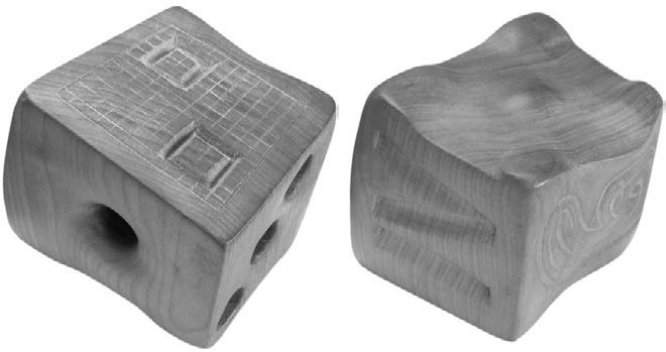

# 计算机程序设计艺术　卷 4B：组合算法（二）

[目录](#contents)　·　[再论数学准备](./sec-mpr.md#sec-mpr)　·　[回溯程序设计](./sec-7-2-2.md#sec-7-2-2)　·　[习题答案](./sec-answers.md#sec-answers)　·　[索引与词汇表](./sec-index.md#sec-index)

## 前言

> 从头读起. 切莫为了满足一点无谓的好奇心, 在书中这里翻翻, 那里看看. 否则你很可能说声 “这对我太难了!”, 便把书扔到一旁, 白白错过给自己平添一大桩思索之乐的机会.
>
> ——刘易斯·卡罗尔, 《符号逻辑》(1896)

组合算法使我们得以对付那些情形多得难以计数的问题. 人们对这类技术的认识增长如此之快, 要用好几卷书才能说清楚. 所以, 我原打算把《计算机程序设计艺术》的卷 4 用于讨论组合算法, 后来却变成了编写卷 4A、卷 4B 等一系列分册的计划. 本书是这个系列的第二册, 接续卷 4A.

在卷 4A 的前言中, 我曾解释为什么自己在爱上计算机以后不久, 就为组合算法所倾倒. “编写这种程序的技巧也特别重要, 而且富有吸引力, 因为只要有一个好主意, 有时就可能节省几年乃至几百年的计算机时间.”

第 7 章从卷 4A 开始, 先简略回顾图论, 随后用较多篇幅讨论 “0 与 1” (7.1 节). 该卷以 7.2.1 节 “生成基本组合模式” 作结, 那是 7.2 节 “生成所有可能的组合对象” 的第一部分. 现在我们接着往下讲, 来到 7.2.2 节 “回溯程序设计” 的开头几部分.

回溯是一系列重要技术的统称, 从一开始就是组合算法的支柱. 本书用三分之一以上的篇幅介绍 7.2.2.1 节, 研究一些数据结构, 其中的链会跳起令人赏心悦目的舞来. 这些结构十分适合回溯程序设计, 用来处理 “恰当覆盖问题” (XC) 尤其合适. XC 问题又称 “集合分划”, 大意是给定由若干<em>项</em>组成的集合, 从称为<em>选项</em>的子集中作适当的选择, 要找出覆盖整个集合的所有方式. 数十种重要应用原来都是 XC 的特例, 而舞蹈链往往是处理这类问题的首选方法.

写到这里时, 我意外地发现, 给经典的 XC 问题作一个看似无足轻重的推广, 竟会使值得研究的特例大大增多. 推广后的问题称为 XCC (即 “带颜色的恰当覆盖”), 允许给某些项赋予不同的颜色. 只要颜色相容, 同一个有颜色的项可以由多个不同的选项覆盖.

且容我先泄露一点天机: 有了舞蹈链, 求解 XCC 问题几乎同求解 XC 问题一样容易! 因此我相信, 关于 XCC 求解器的研究虽然刚刚起步, 将来一定会十分重要, 我在这里尽力为它作一番介绍. 还有一些相关的方法, 可以处理更一般的 MCC (即 “带颜色的多重覆盖”) 问题, 也可以找出<em>代价最小</em>的 XCC 解.

如果随手翻开 7.2.2.1 节的一页, 很可能会看到我在讨论某种<em>谜题</em>. 原因在于, 要阐明这里介绍的算法和技术, 就我所知, 谜题是远远胜过其他办法的. 一道谜题的用意很容易领会. 如此众多、彼此如此不同的谜题, 竟然都是 XCC 和 MCC 的特例, 这件事本身就很有意义. 由此也就不难看出, 同样的思想还能解决 “现实世界” 中许多较为复杂、较难解释的问题.

舞蹈链提供了新的工具, 有了它, 我便可以着重讨论怎样<em>创作</em>新谜题, 除了讲解现成谜题的解法以外, 还能更进一步. 我也尽力追溯每类谜题的历史, 把功劳归给首先想出它的能人. 我原意是教人使用计算机方法, 结果竟有了一项令我欣喜的副产品: 书中积攒了丰富的趣味数学资料. 其中既有拼边、放置皇后、多格骨牌、索玛立方体、矩形分割、单词纵横相扣的奇妙图案等脍炙人口的老题, 也有近年来风行的数独、数回、珍珠和数壹.

写这几卷书的其他部分, 我已经得到不少乐趣, 但写得最开心的无疑是 7.2.2.1 节. 我知道, 不少第一流的计算机科学家和数学家跟我一样喜欢好谜题. 他们亲口对我说, 正是这些智力挑战的启发, 使他们选择了自己的事业.

> 高德纳喜欢往那几卷书 [《计算机程序设计艺术》] 里塞进趣味材料, 塞得下多少就塞多少.
>
> ——马丁·加德纳, 《原汁原味的戏法》(2013)

本书的后半部是 7.2.2.2 节 “可满足性”. 它讨论整个计算机科学中最基本的问题之一: 给定一个布尔函数, 是否至少存在一种由 0 和 1 组成的变量赋值模式, 能使函数为真? 这个问题出现得如此频繁, 人们给它起了个简称 “SAT”.

可满足性看起来也许像是一道旨在理解形式系统的抽象习题, 实情却大不一样. 21 世纪初出现了求解 SAT 问题的革命性方法, 随之而来的工业应用改变了整个局面. 如今, 对于包含数以百万计变量的实际问题, 这些所谓的 “SAT 求解器” 已经能例行地求出解来, 而就在不久之前, 人们还以为这些问题难得毫无指望.

可满足性如此重要, 首先要归功于布尔代数的用途极广. 几乎任何问题都可以用基本逻辑运算来表述, 而且在许多情形下, 表述起来还格外简单. 因此, 7.2.2.2 节先从十个典型例子讲起, 让我们看到面貌迥异的应用, 最后给出一百个不同基准实例的详细实验结果. 这些问题都是 SAT 的特例, 但它们有多么不同, 看看第 300 和 301 页就知道了 (那是我在本书中最喜欢的两页).

可满足性的故事是软件工程取得胜利的故事, 其间又融入了许多优美的数学. 7.2.2.2 节详述七个 SAT 求解器, 说明这一奇迹是怎样发生的. 从算法 A 和 B 这种占用空间很小的方法, 一直到算法 W、L 和 C 这种足以投入工业应用的先进方法, 我们都将见到. (不过, 这话得留一点余地. 新方法还在不断涌现, SAT 技术一直在发展, 这个故事也还在继续. 但我确实认为, 算法 W、L 和 C 同 2010 年已知的同类最佳算法相比, 表现相当不错. 它们如今虽已不再处于技术前沿, 表现却仍然好得出奇.)

真想不到, 7.2.2.1 节和 7.2.2.2 节竟成了《计算机程序设计艺术》中篇幅最长的两节, 比其他各节长出许多, 尤其是 7.2.2.2 节. SAT 问题显然是个 “杀手级应用”, 因为它是解开许许多多其他问题的关键. 但愿我的长篇大论别把忠实的读者也给 “杀” 跑了! 我写这些材料时, 一个话题总是自然而然地引出另一个话题, 两节都找不到适合分成若干小节的截然分明的界线. (再说, 按照本书的体例, 也不容许有 7.2.2.1.3 节或 7.2.2.2.6 节.)

为了方便读者查找, 我在每个右手页的页眉加了一个小标题. 此外, 照例, 习题的排列顺序大体依照正文讲述相应论题的次序. 正文、习题和插图之间有很多相互参照, 读者应当颇容易跟上. 我还尽可能把索引编得详尽些.

举例来说, “随便” 翻开一页, 比如第 264 页, 那是关于蒙特卡罗算法的一页. 你会看到那里提到习题 302、303、299 和 306, 于是便能猜到, 蒙特卡罗算法的主要习题大都排在第 300 题往后不远的地方. (实际上, 习题 306 讨论一个重要特例 “拉斯维加斯算法”, 接下来的习题探索一个耐人寻味的概念, 称为 “勉强加倍”.) 全书到处都有意外的发现, 也到处可见同计算机科学其他方面的联系.

同前几卷一样, 正文中有些节或小节的标题前面标有星号 ($*$), 表示所讨论的是 “较深的” 论题, 初读时可以跳过.

你也许会想, 一本 700 页的书, 大概掺进了不少旁枝末节来充篇幅. 然而, 我写作时却不得不一再地 “删, 删, 再删”, 因为人们已经知道的东西还要多得多! 新的论题不断冒出来, 可能很有意思, 却还没有人深入探究, 足够花上一个人的毕生精力还有余. 可是我知道自己必须往前走. 但愿我在这里选中的概念, 能占日后那些最为重要的概念中相当大的一部分.

> 我每个星期都能碰上新鲜有趣的东西, 简直像在大声央求我把它写进《计算机程序设计艺术》.
>
> ——高德纳 (2008)

尽管经常会联系到前几卷讨论的论题, 本书的大部分内容仍然是自成一体的. 机器语言程序设计的底层细节在前面已经有过充分的论述, 因此本书的算法通常只在抽象层次上给出, 与任何具体机器无关. 不过, 组合程序设计的某些方面在很大程度上取决于过去没有遇到过的底层细节. 遇到这种情形, 本书的例子一律采用 MMIX 计算机, 它是卷 1 早期版本所定义的 MIX 机器的后继者. 关于 MMIX 的细节, 可见卷 1 的平装增补分册《计算机程序设计艺术》卷 1 第 1 分册, 其中包括 1.3.1′、1.3.2′ 等节. 互联网上也有这些材料, 并提供汇编程序和模拟器供下载.

另一种可以下载的资源是称为《斯坦福图库》 (The Stanford GraphBase) 的程序和数据集, 本书的例子多次引用它. 我鼓励读者亲自动手同它玩一玩. 在我看来, 这大概是学习组合算法最有效、也最愉快的途径.

在准备这些材料时, 我写了将近一千个计算机程序, 因为我发现, 自己不试着把一件事编成程序, 就谈不上真正理解它. 这些程序大多很短, 但也有几个颇具规模, 别人也许会感兴趣. 因此我挑了一些, 列在下面这个网页上供人取用.

<http://www-cs-faculty.stanford.edu/~knuth/programs.html>

特别是, 可以下载程序 `DLX1`、`DLX2`、`DLX3`、`DLX5`、`DLX6` 和 `DLX-PRE`, 它们分别是算法 X、C、M、$\mathrm C^{\$}$、Z 和 P 的实验版本, 我写 7.2.2.1 节时一直有它们相伴. 同样, `SAT0`、`SAT0W`、`SAT8`、`SAT9`、`SAT10`、`SAT11`、`SAT11K`、`SAT13` 分别对应于 7.2.2.2 节的算法 A、B、W、S、D、L、$\mathrm L'$、C. 如果手边没有其他 XCC 求解器或 SAT 求解器, 这些程序会有助于解答许多习题. 该网页还提供 `SATexamples.tgz` 供下载. 其中的程序能为正文讨论的全部 100 个基准实例生成数据, 此外还可以生成许多其他实例.

若干习题要用到我在准备例子时使用的英语单词表. 倘若你有勇气来做这些习题, 就需要从这里取得数据.

<http://www-cs-faculty.stanford.edu/~knuth/wordlists.tgz>

<em>特别说明.</em> 在编写卷 4 的这些年里, 我时常碰到一些概率论的基本技术. 要是我在 20 世纪 60 年代就有先见之明, 早会把它们写进卷 1 的 1.2 节. 后来我终于想到, 应当把其中的大部分集中于一处. 这些思想发展起来的故事实在有趣, 拆成小段, 东一块西一块地散开讲, 未免可惜.

因此, 本书以概率论的一篇专题入门和回顾开头, 题为 “再论数学准备” (Mathematical Preliminaries Redux), 这一节没有编号. 引用其中的公式和习题时采用缩写 “MPR”. (想想 “improvement” 这个词.)

顺便一提, 紧接在 MPR 之后的 7.2.2 节特意从左手页开始, 插图也从图 68 编起. 这是因为 7.2.1 节在卷 4A 的一个右手页结束, 其中最后一幅插图是图 67. 尽管第 7 章分装成好几册, 我的编辑决定把整章当作一个整体来处理.

我特别感谢尼古拉·别卢霍夫 (Nikolai Beluhov)、阿尔明·比雷 (Armin Biere)、尼克拉斯·埃恩 (Niklas Eén)、马赖恩·霍伊勒 (Marijn Heule)、霍尔格·胡斯 (Holger Hoos)、Wei-Hwa Huang、斯万特·詹森 (Svante Janson)、恩斯特·舒尔特-格尔斯 (Ernst Schulte-Geers)、乔治·西歇尔曼 (George Sicherman)、菲利普·斯塔珀斯 (Filip Stappers) 和乌多·维尔穆特 (Udo Wermuth), 他们对我的早期稿本提出了详尽的意见. 还有数十位又数十位来信者指出了要紧的错误, 我在此一并致谢. 我在艾迪生-韦斯利的编辑马克·陶布 (Mark Taub) 老练地引领这套书进入了 21 世纪, 高级内容制作人朱莉·纳希尔 (Julie Nahil) 一丝不苟地使本书一直保持最高的出版水准. 托马斯·罗基奇 (Tomas Rokicki) 让我的戴尔工作站始终井井有条, 而在它力有未逮时, 斯坦福的 InfoLab 又提供了额外的计算能力, 也谨向他们致谢.

任何人第一个向我报告本书的一处错误, 无论是排印上的、技术上的还是历史上的, 我都乐于奉上 2.56 美元的 “发现奖”. 找到我忘记列入索引的条目, 奖金也一样. 改进正文的有价值建议, 每条值 32 美分. (此外, 如果你找到了某道习题更好的解法, 我会当真尽力使你名垂不朽, 在以后印刷时把你的名字印出来 :-)

祝阅读愉快!

D. E. K.  
加利福尼亚州斯坦福, 2022 年 6 月

**关于参考文献的注释.** 常被引用的若干期刊和会议录在书中有专用简称, 可以在书末的 “索引与词汇表” 中查到. 不过, 引用 <em>IEEE Transactions</em> 的各刊时, 我在卷号前以粗体字母指明刊物种类. 例如, “<em>IEEE Trans.</em> **C-35**” 是指 <em>IEEE Transactions on Computers</em> 第 35 卷. IEEE 已经停用这些方便的字母代号, 但它们的含义并不难懂. 例如, “**EC**” 原指 “电子计算机”, “**IT**” 指 “信息论”, “**PAMI**” 指 “模式分析与机器智能”, “**SE**” 指 “软件工程”, 等等. “**CAD**” 原指 “集成电路和系统的计算机辅助设计”.

像 “习题 7.10–00” 这样的相互参照, 表示将来 7.10 节中一道如今还不知道题号的习题.

**关于记号的注释.** 用代数表示数学概念, 简单而直观的约定历来有助于科学进步, 尤其是当世界上大多数研究人员使用共同的符号语言时. 可惜在这方面, 组合数学目前多少有些混乱. 不同人群使用相同的符号, 偶尔竟表示完全不同的意思. 在比较狭窄的分支领域工作的专家, 也会无意间引入彼此冲突的记号. 计算机科学同数学的许多分支都有来往, 应当尽可能采用内部一致的记号, 以避开这种危险. 因此我经常不得不在几种相互竞争的方案中作出取舍, 明知不可能令人人满意. 我尽力找出自己认为在今后最合用的记号, 往往为此花上许多年作试验, 同同行商讨, 在几个方案间来回反复, 直到找到用起来顺手的表示. 通常总能找到一种方便的约定, 又没有人已经借用它来表示相抵触的意思.

附录 B 列出了本书所用主要记号的完整索引, 其中难免有些记号 (暂时?) 还不算标准. 如果你碰到一个看起来古怪或难以理解的公式, 十有八九, 附录 B 能指引你找到一页, 在那里我把用意解释清楚了. 不过, 这里不妨先举几例, 供初读本书时留意.

- 十六进制常数前面加井号 $\#$, 英文称为 number sign 或 hash mark. 例如, $\mathtt{\#123}$ 表示 $(123)_{16}$.
- “非亏减” 运算 $x\mathbin{\dot{-}}y$ 有时称为点减或饱和减, 结果是 $\max(0,x-y)$.
- 三个数 $\{x,y,z\}$ 的中位数用 $\langle xyz\rangle$ 表示.
- 用 “两点” 记号 $(x\mathinner{.\,.}y)$、$(x\mathinner{.\,.}y]$、$[x\mathinner{.\,.}y)$ 和 $[x\mathinner{.\,.}y]$ 表示区间.
- 像 $\{x\}$ 这样只有一个元素的集合, 在 $X\cup x$ 或 $X\setminus x$ 这样的上下文中, 常简写成 $x$.
- 如果 $n$ 是一个非负整数, 在 $n$ 的二进制表示中, 取 1 的位数记为 $\nu n$. 此外, 如果 $n>0$, $n$ 最左边和最右边的 1 的位值分别是 $2^{\lambda n}$ 和 $2^{\rho n}$. 例如, $\nu18=2$, $\lambda18=4$, $\rho18=1$.
- 图 $G$ 和图 $H$ 的笛卡儿积用 $G\mathbin{\square}H$ 表示. 例如, $C_m\mathbin{\square}C_n$ 表示一个 $m\times n$ 环面, 因为 $C_n$ 表示 $n$ 个顶点的一个环.

## 习题说明

这套书的习题既可用于自学, 也可用于课堂练习. 如果只靠阅读而不把学到的知识用于具体问题, 借此促使自己思考所读的内容, 要想学会一门学科, 即使可能, 也很困难. 而且, 我们总是对亲身发现的事物了解得最透彻. 因此, 习题是这套书的重要组成部分. 我力求让习题尽可能多地传授知识, 选题兼顾趣味与启发.

有许多书把简单的习题和极难的习题随意混杂在一起. 这样做往往不大理想, 因为读者总想事先知道一道题大约需要花多少时间, 否则很可能干脆把习题全跳过去. 理查德·贝尔曼的《动态规划》就是一个经典的例子. 在这本重要的开创性著作中, 有些章末列出一组 “习题和研究题”, 极为平常的问题同深奥的未解难题交错在一起. 据说有人问过贝尔曼博士, 怎样区分习题和研究题. 他答道: “若你能求解, 它就是一道习题, 否则就是一道研究题.”

像本书这样的著作, 既收研究题, 又收十分容易的习题, 两者都有充分的理由. 为了免去读者区分两者的为难, 我用<em>等级编号</em>标明习题的难度. 这些数的含义大致如下.

<table>
<thead><tr><th>等级</th><th>说明</th></tr></thead>
<tbody>
<tr><td>00</td><td>极为容易的习题. 只要理解了正文, 立即便可解答. 除非你正一心几用, 否则几乎总能 “在脑子里” 做出来.</td></tr>
<tr><td>10</td><td>简单问题, 让你思考刚读过的材料, 但绝非难题. 至多一分钟就应当做完, 纸笔可能派得上用场.</td></tr>
<tr><td>20</td><td>普通问题, 用来检验你对正文的基本理解. 完全解答也许需要十五到二十分钟. 也许要二十五分钟.</td></tr>
</tbody>
<tbody id="pdf-014">
<tr id="p-xii"><td>30</td><td>难度或复杂性适中的问题. 要得到满意的解答, 可能得花两个多小时. 如果开着电视, 还要更久.</td></tr>
<tr><td>40</td><td>相当困难或耗时很长的问题, 适合作为课堂教学中一个学期的设计项目. 学生应能在合理的时间内解决它, 但解答并不简单.</td></tr>
<tr><td>50</td><td>研究题. 据作者在写作时所知, 尽管已有许多人尝试, 这道题还没有得到满意的解答. 若你找到了答案, 应当把它写出来发表. 本书作者也很乐意尽快得知解法 (只要它是正确的).</td></tr>
</tbody>
</table>

在这个 “对数” 标度上作内插, 就可明白其他等级的含义. 例如, 等级 17 表示习题比普通问题略微简单一些. 如果一位读者后来解出一道等级为 50 的习题, 在本书以后的版本以及互联网上发布的勘误表 (见原书第 iv 页) 中, 它也许就会标作 40.

等级编号除以 5 的余数表示具体工作量的大小. 因此, 做等级 24 的习题可能比做等级 25 的习题花费更多时间, 但后者需要更多的创造性. 等级 46 及以上的习题都是有待进一步研究的开放问题, 它们的难度等级取决于迄今有多少种不同的攻题途径未能奏效.

我很想给每道习题定一个准确的等级. 可是, 出题人很难确知别人解一道题会觉得多难, 而且每个人都有自己比较擅长的题型. 但愿这里的等级相当接近习题的实际难度, 读者可以拿它作个大致的指引, 不必视为绝对的尺度.

本书读者所受的数学训练和具备的数学修养深浅不一, 因此有些习题专为比较喜爱数学的读者而设. 如果一道题所涉及的数学概念或数学上的考虑, 超过了一位主要关心怎样把算法编成程序的读者所需的程度, 便在等级前加上字母 $M$. 如果解题必须具备本书没有展开讨论的微积分或其他高等数学知识, 就标以 $HM$. 标有 $HM$ 并<em>不</em>一定意味着难.

有些习题前面标有一个箭头 “▶”, 表示问题特别有启发性, 我尤其推荐. 当然, 谁也不会指望读者或学生把<em>全部</em>习题都做完, 所以我选出了看来最有价值的那些. (这样做并无贬低其他习题之意!) 每位读者至少应试做所有等级不超过 10 的题. 对于等级更高的题, 箭头可以帮你决定先做哪些.

有好几节的习题都超过一百道. 在这许多题中, 该怎样找到头绪呢? 一般说来, 习题的次序大致依照正文引入各个思想的次序. 相邻的习题相互衔接, 正如波利亚和塞格的开创性习题集中那样. 一节的最后几道习题往往涉及全节的内容, 或者介绍补充的论题.

书后的答案部分给出了大多数习题的解答. 请善用它们. 除非你确实抽不出时间做某道题, 否则在自己认真尝试以前, 先别翻看答案. 自己解出来或着实下过一番功夫<em>以后</em>, 再看答案也许会很有启发和帮助. 书中的解答往往相当简短, 只勾勒若干细节, 因为我假定你已经认真试过用自己的方法解决它. 有时解答给出的信息比题目所问的少, 但往往给得更多. 完全可能你的答案比这里刊出的更好, 也可能你发现了书中解答的错误. 在这种情形下, 作者很愿意知道详情. 以后的印本将给出改进的解答, 并在适当的时候列出解题人的姓名.

做一道题时, 除非题目明文禁止, 通常可以利用前面习题的答案. 确定难度等级时已经考虑了这一点. 所以, 即使习题 $n$ 的结果是习题 $n+1$ 的一个特例, 后一题的等级仍然可能低于前一题.

**记号汇总**

| 记号 | 含义 | 等级 | 含义 |
|---|---|---|---|
| | | 00 | 一望即知 |
| | | 10 | 简单 (一分钟) |
| | | 20 | 中等 (一刻钟) |
| ▶ | 推荐 | 30 | 有一定难度 |
| $M$ | 偏重数学 | 40 | 学期项目 |
| $HM$ | 需要 “高等数学” | 50 | 研究题 |

### 习题

▶ **1.** [00] [答案](./answers/intro.md#ans-intro-1) 等级 “$M15$” 是什么意思?

**2.** [10] [答案](./answers/intro.md#ans-intro-2) 教科书中的习题对读者有什么价值?

**3.** [HM45] [答案](./answers/intro.md#ans-intro-3) 证明每一个单连通的闭三维流形都拓扑等价于一个三维球面.

> 从前那些竞逐公职的人, 才德素为众人称许,  
> 出身高贵, 行事光明磊落.  
> 他们习体育, 通文艺, 熟谙祭舞与歌咏,  
> 如今却尽遭驱逐, 让卑鄙之徒占了他们的位置.
>
> ——阿里斯托芬, 《蛙》(公元前 405 年)

> 凡欲从此书、从我现已刊行的书, 或从我将来刊行的书中获益的工匠, 我在此奉劝诸君: 初读不妨囫囵读过一遍, 再读宜用心辨别, 第三遍则须灵活地付诸实践. 如此, 不明白的事情便所剩无几了.
>
> ——伦纳德·迪格斯, 《测量术》(1556)

> 如今我才明白, 不先算算代价, 不先恰当地估量自己有多大力量把事情做到底, 便贸然动手, 是多么愚蠢. 可惜我懂得太晚了.
>
> ——丹尼尔·笛福, 《鲁滨孙漂流记》(1719)

## 目录

<table>
<thead><tr><th>内容</th><th>页码</th></tr></thead>
<tbody>
<tr><td><a href="#p-v"><strong>前言</strong></a></td><td>v</td></tr>
<tr><td><a href="#p-xi"><strong>习题说明</strong></a></td><td>xi</td></tr>
<tr><td><a href="./sec-mpr.md#p-1"><strong>再论数学准备</strong></a></td><td>1</td></tr>
<tr><td>　<a href="./sec-mpr.md#p-3">不等式</a></td><td>3</td></tr>
<tr><td>　<a href="./sec-mpr.md#p-6">鞅</a></td><td>6</td></tr>
<tr><td>　<a href="./sec-mpr.md#p-8">由鞅导出的尾部不等式</a></td><td>8</td></tr>
<tr><td>　<a href="./sec-mpr.md#p-9">应用</a></td><td>9</td></tr>
<tr><td>　<a href="./sec-mpr.md#p-11">几乎必然、甚至相当必然的命题</a></td><td>11</td></tr>
<tr><td>　<a href="./sec-mpr.md#p-12">习题</a></td><td>12</td></tr>
<tr><td><a href="https://qixiaoz.github.io/taocp-zh/volume4a/sec-7.html#sec-7"><strong><samp>第 7 章</samp>　组合查找</strong></a></td><td>[4A.1]</td></tr>
<tr><td>　<a href="https://qixiaoz.github.io/taocp-zh/volume4a/sec-7-2.html#sec-7-2"><strong><samp>7.2</samp>　生成所有可能的组合对象</strong></a></td><td>[4A.281]</td></tr>
<tr><td>　　<a href="https://qixiaoz.github.io/taocp-zh/volume4a/sec-7-2-1.html#sec-7-2-1"><strong><samp>7.2.1</samp>　生成基本组合模式</strong></a></td><td>[4A.281]</td></tr>
<tr><td>　　<a href="./sec-7-2-2.md#p-30"><strong><samp>7.2.2</samp>　回溯程序设计</strong></a></td><td>30</td></tr>
<tr><td>　　　<a href="./sec-7-2-2.md#p-32">数据结构</a></td><td>32</td></tr>
<tr><td>　　　<a href="./sec-7-2-2.md#p-33">沃克的方法</a></td><td>33</td></tr>
<tr><td>　　　<a href="./sec-7-2-2.md#p-34">排列和兰福德配对</a></td><td>34</td></tr>
<tr><td>　　　<a href="./sec-7-2-2.md#p-36">单词矩形</a></td><td>36</td></tr>
<tr><td>　　　<a href="./sec-7-2-2.md#p-37">无逗号码</a></td><td>37</td></tr>
<tr><td>　　　<a href="./sec-7-2-2.md#p-38">动态安排选择次序</a></td><td>38</td></tr>
<tr><td>　　　<a href="./sec-7-2-2.md#p-39">再论顺序分配</a></td><td>39</td></tr>
<tr><td>　　　<a href="./sec-7-2-2.md#p-41">无逗号码问题所用的表</a></td><td>41</td></tr>
<tr><td>　　　<a href="./sec-7-2-2.md#p-43">执行和撤销操作的通用机制</a></td><td>43</td></tr>
<tr><td>　　　<a href="./sec-7-2-2.md#p-44">用回溯法查找无逗号码</a></td><td>44</td></tr>
<tr><td>　　　<a href="./sec-7-2-2.md#p-46">运行时间的估计</a></td><td>46</td></tr>
<tr><td>　　　<a href="./sec-7-2-2.md#p-49">*估计解的个数</a></td><td>49</td></tr>
<tr><td>　　　<a href="./sec-7-2-2.md#p-52">问题的分解</a></td><td>52</td></tr>
<tr><td>　　　<a href="./sec-7-2-2.md#p-53">历史注记</a></td><td>53</td></tr>
<tr><td>　　　<a href="./sec-7-2-2.md#p-55">习题</a></td><td>55</td></tr>
<tr><td>　　　<a href="./sec-7-2-2-1.md#p-65"><strong><samp>7.2.2.1</samp>　舞蹈链</strong></a></td><td>65</td></tr>
<tr><td>　　　　<a href="./sec-7-2-2-1.md#p-66">恰当覆盖问题</a></td><td>66</td></tr>
<tr><td>　　　　<a href="./sec-7-2-2-1.md#p-70">次要项</a></td><td>70</td></tr>
<tr><td>　　　　<a href="./sec-7-2-2-1.md#p-73">进度报告</a></td><td>73</td></tr>
<tr><td>　　　　<a href="./sec-7-2-2-1.md#p-74">数独</a></td><td>74</td></tr>
<tr><td>　　　　<a href="./sec-7-2-2-1.md#p-79">多格骨牌</a></td><td>79</td></tr>
<tr><td>　　　　<a href="./sec-7-2-2-1.md#p-82">多立方块骨牌</a></td><td>82</td></tr>
<tr><td>　　　　<a href="./sec-7-2-2-1.md#p-83">恰当覆盖问题的分解</a></td><td>83</td></tr>
</tbody>
<tbody id="pdf-018">
<tr id="p-xvi"><td>　　　　<a href="./sec-7-2-2-1.md#p-87">由颜色控制的覆盖</a></td><td>87</td></tr>
<tr><td>　　　　<a href="./sec-7-2-2-1.md#p-92">引入重数</a></td><td>92</td></tr>
<tr><td>　　　　<a href="./sec-7-2-2-1.md#p-95">*一种新舞步</a></td><td>95</td></tr>
<tr><td>　　　　<a href="./sec-7-2-2-1.md#p-98">*算法 X 的分析</a></td><td>98</td></tr>
<tr><td>　　　　<a href="./sec-7-2-2-1.md#p-102">*匹配问题的分析</a></td><td>102</td></tr>
<tr><td>　　　　<a href="./sec-7-2-2-1.md#p-104">*使查找保持适当的焦点</a></td><td>104</td></tr>
<tr><td>　　　　<a href="./sec-7-2-2-1.md#p-106">利用局部等价性</a></td><td>106</td></tr>
<tr><td>　　　　<a href="./sec-7-2-2-1.md#p-108">*选项的预处理</a></td><td>108</td></tr>
<tr><td>　　　　<a href="./sec-7-2-2-1.md#p-111">最小代价解</a></td><td>111</td></tr>
<tr><td>　　　　<a href="./sec-7-2-2-1.md#p-116">*实现最小代价的截断</a></td><td>116</td></tr>
<tr><td>　　　　<a href="./sec-7-2-2-1.md#p-119">*同 ZDD 共舞</a></td><td>119</td></tr>
<tr><td>　　　　<a href="./sec-7-2-2-1.md#p-122">小结</a></td><td>122</td></tr>
<tr><td>　　　　<a href="./sec-7-2-2-1.md#p-123">历史注记</a></td><td>123</td></tr>
<tr><td>　　　　<a href="./sec-7-2-2-1.md#p-124">习题——第一组</a></td><td>124</td></tr>
<tr><td>　　　　<a href="./sec-7-2-2-1.md#p-156">习题——第二组</a></td><td>156</td></tr>
<tr><td>　　　　<a href="./sec-7-2-2-1.md#p-174">习题——第三组</a></td><td>174</td></tr>
<tr><td>　　　<a href="./sec-7-2-2-2.md#p-185"><strong><samp>7.2.2.2</samp>　可满足性</strong></a></td><td>185</td></tr>
<tr><td>　　　　<a href="./sec-7-2-2-2.md#p-188">应用实例</a></td><td>188</td></tr>
<tr><td>　　　　<a href="./sec-7-2-2-2.md#p-211">回溯算法</a></td><td>211</td></tr>
<tr><td>　　　　<a href="./sec-7-2-2-2.md#p-231">随机子句</a></td><td>231</td></tr>
<tr><td>　　　　<a href="./sec-7-2-2-2.md#p-238">子句的归结</a></td><td>238</td></tr>
<tr><td>　　　　<a href="./sec-7-2-2-2.md#p-244">子句学习算法</a></td><td>244</td></tr>
<tr><td>　　　　<a href="./sec-7-2-2-2.md#p-261">蒙特卡罗算法</a></td><td>261</td></tr>
<tr><td>　　　　<a href="./sec-7-2-2-2.md#p-265">局部引理</a></td><td>265</td></tr>
<tr><td>　　　　<a href="./sec-7-2-2-2.md#p-274">*消息传递算法</a></td><td>274</td></tr>
<tr><td>　　　　<a href="./sec-7-2-2-2.md#p-279">*子句的预处理</a></td><td>279</td></tr>
<tr><td>　　　　<a href="./sec-7-2-2-2.md#p-281">把约束编码成子句</a></td><td>281</td></tr>
<tr><td>　　　　<a href="./sec-7-2-2-2.md#p-287">单元传播和强制赋值</a></td><td>287</td></tr>
<tr><td>　　　　<a href="./sec-7-2-2-2.md#p-289">破除对称性</a></td><td>289</td></tr>
<tr><td>　　　　<a href="./sec-7-2-2-2.md#p-291">保持可满足性的映射</a></td><td>291</td></tr>
<tr><td>　　　　<a href="./sec-7-2-2-2.md#p-297">一百个测试实例</a></td><td>297</td></tr>
<tr><td>　　　　<a href="./sec-7-2-2-2.md#p-308">调节参数</a></td><td>308</td></tr>
<tr><td>　　　　<a href="./sec-7-2-2-2.md#p-312">利用并行性</a></td><td>312</td></tr>
<tr><td>　　　　<a href="./sec-7-2-2-2.md#p-313">历史</a></td><td>313</td></tr>
<tr><td>　　　　<a href="./sec-7-2-2-2.md#p-317">习题</a></td><td>317</td></tr>
</tbody>
<tbody id="pdf-019">
<tr id="p-xvii"><td><a href="./sec-answers.md#p-370"><strong>习题答案</strong></a></td><td>370</td></tr>
<tr><td><a href="./sec-app-a.md#p-656"><strong><samp>附录 A</samp>　数值表</strong></a></td><td>656</td></tr>
<tr><td><a href="./sec-app-a.md#p-656">　1.　基本常数 (十进制)</a></td><td>656</td></tr>
<tr><td><a href="./sec-app-a.md#p-657">　2.　基本常数 (十六进制)</a></td><td>657</td></tr>
<tr><td><a href="./sec-app-a.md#p-658">　3.　调和数、伯努利数、斐波那契数</a></td><td>658</td></tr>
<tr><td><a href="./sec-app-b.md#p-660"><strong><samp>附录 B</samp>　记号索引</strong></a></td><td>660</td></tr>
<tr><td><a href="./sec-app-c.md#p-666"><strong><samp>附录 C</samp>　算法与定理索引</strong></a></td><td>666</td></tr>
<tr><td><a href="./sec-app-d.md#p-667"><strong><samp>附录 D</samp>　组合问题索引</strong></a></td><td>667</td></tr>
<tr><td><a href="./sec-app-e.md#p-671"><strong><samp>附录 E</samp>　答案中谜题的解</strong></a></td><td>671</td></tr>
<tr><td><a href="./sec-index.md#p-674"><strong>索引与词汇表</strong></a></td><td>674</td></tr>
</tbody>
</table>

> 我们——或者说黑室——同 [高德纳] 有个小小的约定: 他不出版《计算机程序设计艺术》真正的卷 4, 他们也就不让他的身体出现新陈代谢方面的困难.
>
> ——查尔斯·斯特罗斯, 《暴行档案》(2001)

> 对于这类书, 我所能给你的建议只有一条: 只要题材许可, 就尽可能写得简单些.
>
> ——Kode Vicious (2012)

