<a id="pdf-085"></a><a id="p-65"></a>
<a id="lead-sec-7-2-2-1"></a>

> 他们跳的那是什么舞啊,  
> 天哪, 我可要说给你听!
>
> ——哈里·巴里斯, 《密西西比泥》(1927)

> 滑了一跤, 可别丢了信心.  
> 感激这一趟愉快的行程,  
> 爬起来, 掸去灰尘, 一切从头再来.
>
> ——多萝西·菲尔兹, 《站起来》(1936)

<a id="sec-7-2-2-1"></a>

### 7.2.2.1 舞蹈链

回溯算法的一个主要特点, 是它们通常需要<em>撤销</em>对数据结构所<em>作</em>的每一项操作. 在这一节, 我们将研究几种极其简单的链操作技术. 用这些技术修改结构和撤销修改都很容易. 我们还会看到, 这些思想有许许多多的实际应用.

假定有一张双向链表, 每个结点 `X` 的前驱和后继分别记为 `LLINK(X)` 和 `RLINK(X)`. 我们知道, 要把 `X` 从表中删除很容易, 只要置

$$
\mathtt{RLINK(LLINK(X))}\gets\mathtt{RLINK(X)},\qquad
\mathtt{LLINK(RLINK(X))}\gets\mathtt{LLINK(X)}.\tag{1}
$$

按通常的做法, 接下来应当回收结点 `X`, 以后就能在别的表中重用它. 我们也许还想收拾得干净些, 把 `LLINK(X)` 和 `RLINK(X)` 清为 $\Lambda$, 免得散落下来的指针指向仍在使用的结点而惹出麻烦. (例如, 见式 2.2.5–(4), 它同 (1) 一样, 只是多说了一句 “$\mathtt{AVAIL}\Leftarrow\mathtt X$”.) 然而, 舞蹈链的诀窍, 恰好是抵住作垃圾回收的诱惑. <em>在回溯应用中, 让 `LLINK(X)` 和 `RLINK(X)` 原样保留反而更好.</em> 这样, 要撤销操作 (1), 只须置

$$
\mathtt{RLINK(LLINK(X))}\gets\mathtt X,\qquad
\mathtt{LLINK(RLINK(X))}\gets\mathtt X.\tag{2}
$$

例如, 我们可能有一张含四个元素的表, 如 2.2.5–(2) 所示.

<a href="../../assets/volume4b/figures/links-initial.svg"></a>　(3)

如果用 (1) 删除第三个元素, (3) 就变成

<a href="../../assets/volume4b/figures/links-delete-3.svg"></a>

如果现在又决定把第二个元素也删除, 就得到

<a href="../../assets/volume4b/figures/links-delete-3-2.svg"></a>

<a id="pdf-086"></a><a id="p-66"></a>

接着删除最后一个元素, 再删除第一个元素, 结果如下.

<a href="../../assets/volume4b/figures/links-empty.svg"></a>　(4)

此时表已空, 各条链也纠缠得颇为厉害. (见习题 1.) 不过我们知道, 如果这时开始回溯, 依次用 (2) 撤销对元素 1、4、2、3 的删除, 就能像变戏法一样恢复到初始状态 (3). 看着这些指针有板有眼地移动, 实在很有趣, “舞蹈链” 这个名字便由此而来.

**恰当覆盖问题.** 随着我们研究的回溯实例越来越多, 会看到链在许多地方都能舞得既轻快又有效. 要欣赏这一思想的妙处, 也许最自然的是看一类称为<em>恰当覆盖</em>的重要问题. 给定一个由 0 和 1 组成的 $M\times N$ 矩阵 $A$, 要求出行的所有子集, 使选中各行在每一列的和都恰好为 1. 例如, 考虑 $6\times7$ 矩阵

$$
A=\begin{pmatrix}
0&0&1&0&1&0&0\\
1&0&0&1&0&0&1\\
0&1&1&0&0&1&0\\
1&0&0&1&0&1&0\\
0&1&0&0&0&0&1\\
0&0&0&1&1&0&1
\end{pmatrix}.\tag{5}
$$

$A$ 的每一行对应于一个七元素全集的一个子集. 稍想一下便能看出, 用互不相交的行来覆盖全部七列只有一种办法, 就是选择第 1、4、5 行. 当行和列都非常多时, 我们想教会计算机怎样解决这样的问题.

由 0 和 1 组成的矩阵在组合问题中屡见不鲜, 能帮助我们认识一些看似不同实则相同的问题之间的联系 (见习题 5). 但是, 在计算机内部, 我们很少愿意显式地用二维位数组来表示一个恰当覆盖问题, 因为矩阵往往极为稀疏, 其中的 1 通常很少. 因此我们将采用另一种表示, 在数据结构中基本上只为矩阵中的每个 1 设置一个结点.

此外, 我们甚至不再谈行和列! 在某些恰当覆盖问题自己的应用领域里, 已经有了称为 “行” 和 “列” 的概念. 因此我们改说<em>选项</em>和<em>项</em>. 每个选项是一个由若干项组成的集合. <em>恰当覆盖问题的目标, 是找出互不相交、又能覆盖所有项的选项.</em>

例如, 我们把 (5) 看作六个选项的说明, 它们涉及七个项. 把这些项命名为 $a,b,c,d,e,f,g$, 则各个选项为

$$
‘c\ e’,\quad ‘a\ d\ g’,\quad ‘b\ c\ f’,\quad ‘a\ d\ f’,\quad ‘b\ g’,\quad ‘d\ e\ g’.\tag{6}
$$

取第一、第四、第五个选项, 每一项都恰好出现一次.

<a id="pdf-087"></a><a id="p-67"></a>

恰当覆盖问题有个很好的特点: 每作一次试探性的选择, 留下的仍然是一个恰当覆盖问题, 只是规模小了, 而且往往小得多. 例如, 假定我们试着在 (6) 中选择选项 “$a\ d\ g$” 来覆盖 $a$, 那么余下的问题只有两个选项,

$$
‘c\ e’\qquad\text{和}\qquad ‘b\ c\ f’,\tag{7}
$$

因为其余四个选项都涉及已被覆盖的项. 很容易看出, (7) 没有解, 所以我们可以从 (6) 中<em>去掉</em>选项 “$a\ d\ g$”. 这就只剩下一个覆盖 $a$ 的选项 “$a\ d\ f$”. 选中它后余下的问题,

$$
‘c\ e’\qquad\text{和}\qquad ‘b\ g’,\tag{8}
$$

便给出了我们所求的解.

这样就很自然地得到一个递归算法, 它建立在 “覆盖一个项” 这一基本操作之上. <em>要覆盖项 $i$, 就从当前有效选项的数据库中删去涉及 $i$ 的一切选项, 并从尚待覆盖的项的表中删去 $i$.</em> 算法于是十分简单.

<a id="eq-7-2-2-1-9"></a>

- 选择一个尚待覆盖的项 $i$. 若已无这样的项, 就成功终止 (找到了一个解).
- 若没有一个有效选项涉及 $i$, 就以失败终止 (不存在解). 否则覆盖项 $i$.
- 依次处理每个刚刚删去而涉及 $i$ 的选项 $O$. 对 $O$ 中每个 $j\ne i$ 的项 $j$, 覆盖项 $j$. 随后用递归求出余下问题的每个解, 再把 $O$ 添入这些解.　(9)

(当然, 凡是覆盖了的, 以后都要撤销覆盖, 我们很快就会看到.)

给这个算法添上血肉, 看看适用的底层机制, 就能发现一些有趣的细节. 所有尚待覆盖的项组成一张 “横向” 双向链表. 每一项又有自己的 “纵向” 表, 列出所有涉及它的有效选项. 例如, (6) 的数据结构如下.

<a href="../../assets/volume4b/figures/exact-cover-layout.svg">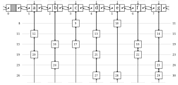</a>　(10)

(图中双向指针在点线处 “绕回”.) 横向表有 `LLINK` 和 `RLINK` 指针, 纵向表有 `ULINK` 和 `DLINK` 指针. 每张纵向表的结点还通过 `TOP` 域指向它们自己的表头.

<a id="pdf-088"></a><a id="p-68"></a>

图 (10) 的第一行给出了项的横向表及相应纵向表头的初始状态. 其余各行表示 (6) 的六个选项, 它们在各纵向表中共占十六个结点. 每个选项也隐含地组成一张横向表, 图中用浅灰色线标出. 不过, 选项中的结点<em>不必</em>用指针连起来, 因为这些表不会改变. 把它们顺序存放, 便能兼省时间和空间. 另一方面, 算法确实需要能沿任一方向循环遍历每个选项. 为此, 我们在选项之间插入<em>分隔结点</em>. 结点 $x$ 是分隔结点的标志为 $\mathtt{TOP}(x)\leq0$. 此外, 它还满足

$$
\begin{aligned}
\mathtt{ULINK}(x)&=x\text{ 前一个选项的首结点地址},\\
\mathtt{DLINK}(x)&=x\text{ 后一个选项的末结点地址}.
\end{aligned}\tag{11}
$$

按照这些约定, 内存的布局如表 1 所示. 最前面是各个项的记录, 其中有 `NAME`、`LLINK` 和 `RLINK` 三个域, `NAME` 供打印输出时使用. 随后是结点, 其中有 `TOP`、`ULINK` 和 `DLINK` 三个域. 不过, 在充当项表头的结点中, `TOP` 域称为 `LEN`, 因为下面的算法 X 要用它来存放各个项的表长. 本例中, 结点 8、11、15、19、23、26 和 30 是分隔结点. 标有 “—” 的域用不到, 可以存放任何内容.

<a id="tab-7-2-2-1-1"></a>

**表 1　对应于 (6) 和 (10) 的内存初始内容**

<table>
<tbody>
<tr><th scope="row">$i$</th><th>0</th><th>1</th><th>2</th><th>3</th><th>4</th><th>5</th><th>6</th><th>7</th></tr>
<tr><th scope="row">$\mathtt{NAME}(i)$</th><td>—</td><td>a</td><td>b</td><td>c</td><td>d</td><td>e</td><td>f</td><td>g</td></tr>
<tr><th scope="row">$\mathtt{LLINK}(i)$</th><td>7</td><td>0</td><td>1</td><td>2</td><td>3</td><td>4</td><td>5</td><td>6</td></tr>
<tr><th scope="row">$\mathtt{RLINK}(i)$</th><td>1</td><td>2</td><td>3</td><td>4</td><td>5</td><td>6</td><td>7</td><td>0</td></tr>
</tbody>
<tbody>
<tr><th scope="row">$x$</th><th>0</th><th>1</th><th>2</th><th>3</th><th>4</th><th>5</th><th>6</th><th>7</th></tr>
<tr><th scope="row">$\mathtt{LEN}(x)$</th><td>—</td><td>2</td><td>2</td><td>2</td><td>3</td><td>2</td><td>2</td><td>3</td></tr>
<tr><th scope="row">$\mathtt{ULINK}(x)$</th><td>—</td><td>20</td><td>24</td><td>17</td><td>27</td><td>28</td><td>22</td><td>29</td></tr>
<tr><th scope="row">$\mathtt{DLINK}(x)$</th><td>—</td><td>12</td><td>16</td><td>9</td><td>13</td><td>10</td><td>18</td><td>14</td></tr>
</tbody>
<tbody>
<tr><th scope="row">$x$</th><th>8</th><th>9</th><th>10</th><th>11</th><th>12</th><th>13</th><th>14</th><th>15</th></tr>
<tr><th scope="row">$\mathtt{TOP}(x)$</th><td>0</td><td>3</td><td>5</td><td>−1</td><td>1</td><td>4</td><td>7</td><td>−2</td></tr>
<tr><th scope="row">$\mathtt{ULINK}(x)$</th><td>—</td><td>3</td><td>5</td><td>9</td><td>1</td><td>4</td><td>7</td><td>12</td></tr>
<tr><th scope="row">$\mathtt{DLINK}(x)$</th><td>10</td><td>17</td><td>28</td><td>14</td><td>20</td><td>21</td><td>25</td><td>18</td></tr>
</tbody>
<tbody>
<tr><th scope="row">$x$</th><th>16</th><th>17</th><th>18</th><th>19</th><th>20</th><th>21</th><th>22</th><th>23</th></tr>
<tr><th scope="row">$\mathtt{TOP}(x)$</th><td>2</td><td>3</td><td>6</td><td>−3</td><td>1</td><td>4</td><td>6</td><td>−4</td></tr>
<tr><th scope="row">$\mathtt{ULINK}(x)$</th><td>2</td><td>9</td><td>6</td><td>16</td><td>12</td><td>13</td><td>18</td><td>20</td></tr>
<tr><th scope="row">$\mathtt{DLINK}(x)$</th><td>24</td><td>3</td><td>22</td><td>22</td><td>1</td><td>27</td><td>6</td><td>25</td></tr>
</tbody>
<tbody>
<tr><th scope="row">$x$</th><th>24</th><th>25</th><th>26</th><th>27</th><th>28</th><th>29</th><th>30</th><td></td></tr>
<tr><th scope="row">$\mathtt{TOP}(x)$</th><td>2</td><td>7</td><td>−5</td><td>4</td><td>5</td><td>7</td><td>−6</td><td></td></tr>
<tr><th scope="row">$\mathtt{ULINK}(x)$</th><td>16</td><td>14</td><td>24</td><td>21</td><td>10</td><td>25</td><td>27</td><td></td></tr>
<tr><th scope="row">$\mathtt{DLINK}(x)$</th><td>2</td><td>29</td><td>29</td><td>4</td><td>5</td><td>7</td><td>—</td><td></td></tr>
</tbody>
</table>

好了, 现在可以确切地说出, 算法 X 要覆盖编号为 $i$ 的项时, 计算机内存中会发生什么了.

$$
\operatorname{cover}(i)=\left\{\begin{aligned}
&\text{置 }p\gets\mathtt{DLINK}(i).\quad\text{(未声明的变量如 }p,l,r\text{ 都是局部变量.)}\\
&\text{只要 }p\ne i,\ \text{就执行 }\operatorname{hide}(p),\ \text{再置 }p\gets\mathtt{DLINK}(p)\text{ 并重复}.\\
&\text{置 }l\gets\mathtt{LLINK}(i),\ r\gets\mathtt{RLINK}(i),\\
&\qquad \mathtt{RLINK}(l)\gets r,\ \mathtt{LLINK}(r)\gets l.
\end{aligned}\right.\tag{12}
$$

<a id="pdf-089"></a><a id="p-69"></a>

$$
\operatorname{hide}(p)=\left\{\begin{aligned}
&\text{置 }q\gets p+1,\ \text{只要 }q\ne p,\ \text{就重复下列操作:}\\
&\quad\text{置 }x\gets\mathtt{TOP}(q),\ u\gets\mathtt{ULINK}(q),\ d\gets\mathtt{DLINK}(q).\\
&\quad\text{若 }x\leq0,\ \text{置 }q\gets u\text{ (此时 }q\text{ 原是分隔结点)}.\\
&\quad\text{否则置 }\mathtt{DLINK}(u)\gets d,\ \mathtt{ULINK}(d)\gets u,\\
&\qquad\quad \mathtt{LEN}(x)\gets\mathtt{LEN}(x)-1,\ q\gets q+1.
\end{aligned}\right.\tag{13}
$$

关键在于, 这些操作都很容易撤销.

$$
\operatorname{uncover}(i)=\left\{\begin{aligned}
&\text{置 }l\gets\mathtt{LLINK}(i),\ r\gets\mathtt{RLINK}(i),\\
&\qquad\mathtt{RLINK}(l)\gets i,\ \mathtt{LLINK}(r)\gets i.\\
&\text{置 }p\gets\mathtt{ULINK}(i).\\
&\text{只要 }p\ne i,\ \text{就执行 }\operatorname{unhide}(p),\ \text{再置 }p\gets\mathtt{ULINK}(p)\text{ 并重复}.
\end{aligned}\right.\tag{14}
$$

$$
\operatorname{unhide}(p)=\left\{\begin{aligned}
&\text{置 }q\gets p-1,\ \text{只要 }q\ne p,\ \text{就重复下列操作:}\\
&\quad\text{置 }x\gets\mathtt{TOP}(q),\ u\gets\mathtt{ULINK}(q),\ d\gets\mathtt{DLINK}(q).\\
&\quad\text{若 }x\leq0,\ \text{置 }q\gets d\text{ (此时 }q\text{ 原是分隔结点)}.\\
&\quad\text{否则置 }\mathtt{DLINK}(u)\gets q,\ \mathtt{ULINK}(d)\gets q,\\
&\qquad\quad \mathtt{LEN}(x)\gets\mathtt{LEN}(x)+1,\ q\gets q-1.
\end{aligned}\right.\tag{15}
$$

这里我们事事都倒过来做. (12) 和 (13) 中怎样用操作 (1) 来删除结点, (14) 和 (15) 中就怎样用操作 (2) 按严格相反的次序恢复它们. 而且, 我们一边修改这个数据结构, 一边踏着舞步从中穿行, 全部工作都在原处完成, 用不着复制.

**算法 X (用舞蹈链作恰当覆盖).** 本算法访问给定恰当覆盖问题的所有解, 使用刚才所述的数据结构, 以及全局变量 $N,Z,i,j,l,p$. 另外还维持一张结点指针表 $x_0,x_1,\ldots,x_T$ 以供回溯. $T$ 足够大, 能为部分解中的每个选项容纳一个表项.

**X1.** [初始化.] 在内存中建立问题的表示, 如表 1 所示. (见习题 8.) 另将 $N$ 置为项数, $Z$ 置为最后一个分隔结点的地址, 并置 $l\gets0$.

**X2.** [进入第 $l$ 层.] 若 $\mathtt{RLINK}(0)=0$ (因而所有的项都已覆盖), 访问由 $x_0x_1\ldots x_{l-1}$ 指定的解, 并转到 X8. (见习题 13.)

**X3.** [选取 $i$.] 此时尚待覆盖的项为 $i_1,\ldots,i_t$, 其中 $i_1=\mathtt{RLINK}(0)$, $i_{j+1}=\mathtt{RLINK}(i_j)$, $\mathtt{RLINK}(i_t)=0$. 从中选取一项, 称它为 $i$. (习题 9 的 MRV 启发式方法在实践中往往很有效.)

**X4.** [覆盖 $i$.] 用 (12) 覆盖项 $i$, 并置 $x_l\gets\mathtt{DLINK}(i)$.

**X5.** [试 $x_l$.] 若 $x_l=i$, 转到 X7 (关于 $i$ 的所有选项都已经试过了). 否则置 $p\gets x_l+1$, 只要 $p\ne x_l$ 就作如下处理: 置 $j\gets\mathtt{TOP}(p)$. 若 $j\leq0$, 置 $p\gets\mathtt{ULINK}(p)$. 否则执行 $\operatorname{cover}(j)$ 并置 $p\gets p+1$. (这就覆盖了包含 $x_l$ 的选项中所有不同于 $i$ 的项.) 置 $l\gets l+1$, 并返回 X2.

**X6.** [再试.] 置 $p\gets x_l-1$, 只要 $p\ne x_l$ 就作如下处理: 置 $j\gets\mathtt{TOP}(p)$. 若 $j\leq0$, 置 $p\gets\mathtt{DLINK}(p)$. 否则执行 $\operatorname{uncover}(j)$ 并置 $p\gets p-1$. (这按 X5 的相反次序撤销了对包含 $x_l$ 的选项中所有不同于 $i$ 的项的覆盖.) 置 $i\gets\mathtt{TOP}(x_l)$, $x_l\gets\mathtt{DLINK}(x_l)$, 并返回 X5.

**X7.** [回溯.] 用 (14) 撤销对项 $i$ 的覆盖.

**X8.** [离开第 $l$ 层.] 若 $l=0$, 则终止. 否则置 $l\gets l-1$, 并转到 X6.　▮

<a id="pdf-090"></a><a id="p-70"></a>

我强烈建议读者现在就做习题 11. 是的, 就是现在, 我是认真的! 这样才能亲自体会这个很有启发性的算法的舞步. 等到过程终止时, 所有的链都将恢复原状.

在这一节里, 我们会看到算法 X 以及类似算法的大量应用. 先来兑现第 7 章第 2 页上许下的诺言, 用舞蹈链来高效地解决<em>兰福德配对</em>问题.

任务是把 $2n$ 个数 $\{1,1,2,2,\ldots,n,n\}$ 放进 $2n$ 个位置 $s_1s_2\ldots s_{2n}$, 使得两个 $i$ 之间恰好隔着 $i$ 个数. 这是个很好的恰当覆盖例子, 因为可以把 $i$ 的 $n$ 个值和 $2n$ 个位置 $s_j$ 都看作待覆盖的项. 于是, 放置两个 $i$ 的可用选项为

$$
‘i\ s_j\ s_k’,\qquad 1\leq j<k\leq2n,\quad k=i+j+1,\quad 1\leq i\leq n.\tag{16}
$$

例如, 当 $n=3$ 时, 它们是

$$
‘1\ s_1\ s_3’,\ ‘1\ s_2\ s_4’,\ ‘1\ s_3\ s_5’,\ ‘1\ s_4\ s_6’,\
‘2\ s_1\ s_4’,\ ‘2\ s_2\ s_5’,\ ‘2\ s_3\ s_6’,\
‘3\ s_1\ s_5’,\ ‘3\ s_2\ s_6’.\tag{17}
$$

对全部项作恰当覆盖, 就等价于把每一对数放好, 填满每个位置. 算法 X 很快便能确定 (17) 只有两个解,

$$
‘3\ s_1\ s_5’,\ ‘2\ s_3\ s_6’,\ ‘1\ s_2\ s_4’
\qquad\text{和}\qquad
‘3\ s_2\ s_6’,\ ‘2\ s_1\ s_4’,\ ‘1\ s_3\ s_5’,
$$

对应于排法 $3\,1\,2\,1\,3\,2$ 和 $2\,3\,1\,2\,1\,3$. 注意, 这两种排法互为镜像. 习题 15 说明怎样略去 (16) 的某些选项, 消除这种对称性, 从而把工作量减半.

作了这项改动以后, 当 $n=16$ 时恰好有 $326\,721\,800$ 个解, 算法 X 访问所有解需要大约 $1.13$ 万亿次内存访问. 这些链旋转起来, 平均每个解大约只需 $3460$ 次内存访问, 很不错了.

当然, 我们已经见过一种专门为兰福德问题调整过的回溯过程, 即 7.2.2 节开头附近的算法 7.2.2L. 加上习题 7.2.2–21 的改进之后, 那个算法处理 $n=16$ 的情形要快一些, 约 $4000$ 亿次内存访问便可完成. 不过, 算法 X 作为一种通用方法, 同最好的专用方法相比也没落后很远, 它大可为此感到满意.

**次要项.** 经典的 $n$ 皇后问题能不能也表述成恰当覆盖问题呢? 当然可以! 不过构造就没有那么明显了. 在 7.2.2–(3) 中, 我们是为棋盘的每一行选择皇后的位置. 现在我们换个做法, 让行和列在作必要的选择时处于同等地位.

放置一个皇后有 $n^2$ 个选项. 我们希望每一行恰好有一个皇后, 每一列也恰好有一个皇后. 此外, 每条对角线上<em>至多</em>有一个皇后. 更确切地说, 若二元变量 $x_{ij}$ 表示第 $i$ 行、第 $j$ 列放有一个皇后, 则要求

$$
\sum_{i=1}^{n}x_{ij}=1\quad(1\leq j\leq n),\qquad
\sum_{j=1}^{n}x_{ij}=1\quad(1\leq i\leq n),\tag{18}
$$

<a id="pdf-091"></a><a id="p-71"></a>

$$
\sum\{x_{ij}\mid1\leq i,j\leq n,\ i+j=s\}\leq1,\qquad 1<s\leq2n,\tag{19}
$$

$$
\sum\{x_{ij}\mid1\leq i,j\leq n,\ i-j=d\}\leq1,\qquad -n<d<n.\tag{20}
$$

引入 “松弛变量” $u_2,\ldots,u_{2n},v_{-n+1},\ldots,v_{n-1}$, 其中每个变量取 $0$ 或 $1$, 就可以把 (19) 和 (20) 的不等式改成等式,

$$
\sum\{x_{ij}\mid1\leq i,j\leq n,\ i+j=s\}+u_s=1,\qquad 1<s\leq2n,\tag{21}
$$

$$
\sum\{x_{ij}\mid1\leq i,j\leq n,\ i-j=d\}+v_d=1,\qquad -n<d<n.\tag{22}
$$

这样就表明, 放置 $n$ 个互不攻击的皇后的问题等价于求 $n^2+4n-2$ 个二元变量 $x_{ij},u_s,v_d$ 的值, 使得 (18)、(21) 和 (22) 所指定的若干变量子集各有和 $1$.

这实质上就是一个恰当覆盖问题, 其中选项对应于二元变量, 各项对应于上述子集. 项为 $r_i,c_j,a_s,b_d$, 分别表示行 $i$、列 $j$、上行对角线 $s$ 和下行对角线 $d$. 对于放置皇后, 有选项 “$r_i\ c_j\ a_{i+j}\ b_{i-j}$”. 此外还有平凡选项 “$a_s$” 和 “$b_d$”, 用以补足各个松弛量.

例如, 当 $n=4$ 时, $n^2$ 个放置选项为

$$
\begin{array}{llll}
‘r_1\ c_1\ a_2\ b_0’;&‘r_2\ c_1\ a_3\ b_1’;&‘r_3\ c_1\ a_4\ b_2’;&‘r_4\ c_1\ a_5\ b_3’;\\
‘r_1\ c_2\ a_3\ b_{-1}’;&‘r_2\ c_2\ a_4\ b_0’;&‘r_3\ c_2\ a_5\ b_1’;&‘r_4\ c_2\ a_6\ b_2’;\\
‘r_1\ c_3\ a_4\ b_{-2}’;&‘r_2\ c_3\ a_5\ b_{-1}’;&‘r_3\ c_3\ a_6\ b_0’;&‘r_4\ c_3\ a_7\ b_1’;\\
‘r_1\ c_4\ a_5\ b_{-3}’;&‘r_2\ c_4\ a_6\ b_{-2}’;&‘r_3\ c_4\ a_7\ b_{-1}’;&‘r_4\ c_4\ a_8\ b_0’.
\end{array}\tag{23}
$$

另有 $4n-2$ 个松弛选项 (每个只包含一项),

$$
‘a_2’;\ ‘a_3’;\ ‘a_4’;\ ‘a_5’;\ ‘a_6’;\ ‘a_7’;\ ‘a_8’;\
‘b_{-3}’;\ ‘b_{-2}’;\ ‘b_{-1}’;\ ‘b_0’;\ ‘b_1’;\ ‘b_2’;\ ‘b_3’.\tag{24}
$$

算法 X 很容易解出这个小问题, 不过它对松弛选项的处理有点笨拙 (见习题 16).

再仔细看看就会发现, 只要给算法 X 稍作改动, 我们就可以完全不用松弛选项! 把恰当覆盖问题的项分为两组: <em>主要项</em>必须<em>恰好</em>覆盖一次, <em>次要项</em>则<em>至多</em>覆盖一次. 只须修改步骤 X1, 让有效项表中只出现主要项, 一切就会顺利进行. (请想一想.) 事实上, 对 X1 所需的改动已经在习题 8 的答案中给出.

次要项在应用中极为有用, 因此我们把它们考虑在内, 重新定义恰当覆盖问题. 从现在起, 假定恰当覆盖问题有 $N$ 个互异的项, 其中 $N_1$ 个是主要项, $N_2=N-N_1$ 个是次要项. 问题由一个选项族给出, 每个选项都是项的一个子集. <em>每个选项必须至少包含一个主要项.</em> 要求出选项的所有子集, 使得 (i) 每个主要项恰好出现一次, (ii) 每个次要项至多出现一次.

(新定义排除了只含次要项的选项, 因为经过上述改进的算法 X 永远不会选中它们. 如果因为某种缘故你不喜欢这条规则, 总可以回头采用松弛选项的办法. 习题 19 讨论了另一种有趣的选择.)

<a id="pdf-092"></a><a id="p-72"></a>

主要项在算法 X 的有效项表中出现的次序, 对运行时间可能有相当大的影响, 因为习题 9 中步骤 X3 的实现选取具有最小表长的<em>第一项</em>. 例如, 如果按自然次序 $r_1,c_1,r_2,c_2,\ldots,r_n,c_n$ 考察 $n$ 皇后问题的主要项, 往往先试着在棋盘的上方和左边放置皇后, 然后才轮到下方和右边. 如果改用 “风琴管” 顺序 $r_{\lfloor n/2\rfloor+1},c_{\lfloor n/2\rfloor+1},r_{\lfloor n/2\rfloor},c_{\lfloor n/2\rfloor},r_{\lfloor n/2\rfloor+2},c_{\lfloor n/2\rfloor+2},r_{\lfloor n/2\rfloor-1},c_{\lfloor n/2\rfloor-1},\ldots,$ ($r_1$ 或 $r_n$), ($c_1$ 或 $c_n$), 就会先把皇后放在中央, 这样能更有效地排除其余的可能性. 例如, 为了求出放置 16 个皇后的全部 $14\,772\,512$ 种方法, 用自然次序需要 $76\,\mathrm G\mu$ (十亿次内存访问为一个 $\mathrm G\mu$), 用风琴管顺序却只要 $40\,\mathrm G\mu$.

可以把这些运行时间同算法 7.2.2W 作高效按位运算所需的 $9\,\mathrm G\mu$ 相比较. 虽然那个算法已经作过专门调整, 通用的舞蹈链技术所花的时间也不过是它的五倍左右. 此外, 我们在这里采用的表示还能用来解决一些用普通回溯远没有这么容易的问题. 例如, 如果只要在最长的 $2+4l$ 条对角线上都有皇后的解, 只须在 $|n+1-s|\leq l$ 和 $|d|\leq l$ 的范围内, 把 $a_s$ 和 $b_d$ 当作主要项. (当 $n=16$, $l=4$ 时, 这样的解有 $18\,048$ 个, 按风琴管顺序用 $2.7\,\mathrm G\mu$ 找到了它们.)

还可以利用次要项来消除对称性, 使大多数解只被找到一次, 从而省去八次重复查找中的其余七次 (见习题 22 和 23). 其中的关键是一种<em>成对定序</em>的技巧, 在许多其他场合也用得上. 考虑以下 $2m$ 个选项组成的族,

$$
\alpha_j=‘a\ x_0\ \ldots\ x_{j-1}’\qquad\text{和}\qquad
\beta_j=‘b\ x_j’,\qquad 0\leq j<m,\tag{25}
$$

其中 $a$ 和 $b$ 是主要项, 而 $x_0,x_1,\ldots,x_{m-1}$ 是次要项. 例如, 当 $m=4$ 时, 选项为

$$
\begin{array}{ll}
\alpha_0=‘a’;&\beta_0=‘b\ x_0’;\\
\alpha_1=‘a\ x_0’;&\beta_1=‘b\ x_1’;\\
\alpha_2=‘a\ x_0\ x_1’;&\beta_2=‘b\ x_2’;\\
\alpha_3=‘a\ x_0\ x_1\ x_2’;&\beta_3=‘b\ x_3’.
\end{array}
$$

不难看出, 同时覆盖 $a$ 和 $b$ 恰好有 $\binom{m+1}{2}$ 种方法, 即选择满足 $0\leq j\leq k<m$ 的 $\alpha_j$ 和 $\beta_k$. 因为一旦选了 $\alpha_j$, 次要项 $x_0$ 至 $x_{j-1}$ 就排除了选项 $\beta_0,\ldots,\beta_{j-1}$.

在这种构造中, 各个 $\alpha$ 选项一共有 $\binom{m+1}{2}$ 个表项, 各个 $\beta$ 选项一共有 $2m$ 个表项. 但习题 20 说明, 在 $\alpha$ 和 $\beta$ 两组中分别只用 $O(m\log m)$ 个表项, 也可以做到成对定序. 例如, 当 $m=4$ 时得到以下巧妙的模式,

$$
\begin{array}{ll}
\alpha_0=‘a’;&\beta_0=‘b\ y_1\ y_2’;\\
\alpha_1=‘a\ y_1’;&\beta_1=‘b\ y_2’;\\
\alpha_2=‘a\ y_2’;&\beta_2=‘b\ y_3’;\\
\alpha_3=‘a\ y_3\ y_2’;&\beta_3=‘b’.
\end{array}\tag{26}
$$

<a id="pdf-093"></a><a id="p-73"></a>

**进度报告.** 算法 X 的许多应用都要运行很长时间, 特别是当我们用它来开拓新路、解决一道难题的时候. 我们当然不想只把它启动, 然后揣着一颗悬着的心, 巴望它赶紧算完. 我们很想看看它是怎样工作的, 究竟进展如何. 它大概还要跑几个小时? 快到一半了吗?

只要对步骤 X2 作一处简单的改动, 就可免去这些烦恼. 在这一步的开头, 即进入查找树的一个新结点时, 可以检验累计运行时间 $T$ 是否已达到某个阈值 $\Theta$. 初始时将阈值置为 $\Delta$. 如果 $T\geq\Theta$, 就打印一份进度报告, 并置 $\Theta\gets\Theta+\Delta$. (因此, 若 $\Delta=\infty$, 就不会有报告. 若 $\Delta=0$, 则每到一个结点都能看到一份报告.)

作者的实验程序用内存访问次数计时, 以便得到与机器无关的结果, 通常取 $\Delta=10\,\mathrm G\mu$. 程序主要有两种报告进度的方式, 一种用长格式, 一种用短格式. 长格式依据习题 12 详细给出查找的当前状态. 例如, 按上述方法求 16 皇后问题的全部解时, 显示的第一份进度报告如下.

```text
Current state (level 15):
 r8 c3 ab ba (4 of 16)
 c8 a8 bn r0 (1 of 13)
 r7 cb ai bj (7 of 10)
 r6 c4 aa bd (2 of 7)
   . . .
 3480159 solutions, 10000000071 mems, and max level 16 so far.
```

(计算机内部对项采用的编码同我们用的记号不同. 例如, `r8 c3 ab ba` 就是我们所说的 “$r_9\ c_4\ a_{13}\ b_5$”. 在第 0 层先选择覆盖项 `r8`, 就是要在第 9 行放一个皇后. 关于这一项的 16 个选项中, 第 4 个把皇后放在第 4 列. 随后在第 1 层, 我们试了覆盖项 `c8` 的 13 种方法中的第 1 种, 就是要在第 9 列放一个皇后. 其余类推. 每一层中, 所试选项最左边显示的项, 就是步骤 X3 选为分支依据的那一项.)

这就是长格式. 短格式是默认格式, 每次只输出一行状态报告.

```text
10000000071mu: 3480159 sols, 4g 1d 7a 27 36 24 23 13 12 12 22 12 ... .19048
20000000111mu: 6604373 sols, 7g cd 6a 88 36 35 44 44 24 11 12 22 .43074
30000000052mu: 9487419 sols, bg cd 9a 68 37 35 24 13 12 12 .68205
40000000586mu: 12890124 sols, fg 6d aa 68 46 35 23 33 23 .90370
Altogether 14772512 solutions, 62296+45565990457 mems, 193032021 nodes.
```

这里用两个字符组成的代码标明在树中的当前位置. 例如, `4g` 表示 16 个分支中的第 4 个, 接着的 `1d` 表示 13 个分支中的第 1 个, 等等. 看着这些代码稳步递增, 我们就能跟上查找的进程, 这还很有趣呢!

短格式报告的每一行末尾, 都估计了已经考察过的树占多大一部分, 这里假定查找树的结构相当均匀. 例如, `.19048` 表示大约完成了 $19\%$. 若当前在第 $l$ 层, 正试到 $t_l$ 个选择中的第 $c_l$ 个, 这个数就由下式算出,

$$
\frac{c_0-1}{t_0}+\frac{c_1-1}{t_0t_1}+\cdots+
\frac{c_l-1}{t_0t_1\cdots t_l}+\frac1{2t_0t_1\cdots t_l}.\tag{27}
$$

<a id="pdf-094"></a><a id="p-74"></a>

**数独.** 一个 “数独方阵” 是一个分成若干 $3\times3$ 宫的 $9\times9$ 数组, 其中填入数字 $\{1,2,3,4,5,6,7,8,9\}$, 使得

- 每一行恰好包含数字 $\{1,2,3,4,5,6,7,8,9\}$ 各一次,
- 每一列恰好包含数字 $\{1,2,3,4,5,6,7,8,9\}$ 各一次,
- 每一宫恰好包含数字 $\{1,2,3,4,5,6,7,8,9\}$ 各一次.

(因为每行、每列、每宫都有九个格子, 所以在定义中的任何一处, 把 “恰好一次” 换成 “至少一次” 或 “至多一次” 都可以.) 例如, 下面是三个高度对称的数独方阵.

<a href="../../assets/volume4b/figures/sudoku-28.svg">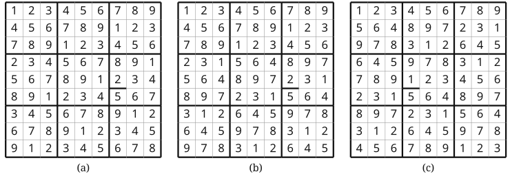</a>　(28)

若只给出方阵的一部分, 要把空格填上以完成整个方阵, 往往是一道很有意思的难题. 霍华德·加恩斯以这个想法为基础, 编制了一系列称为 Number Place 的谜题, 最早发表于 <em>Dell Pencil Puzzles &amp; Word Games</em> 第 16 期 (1979 年 5 月), 第 6 页. 这个构想很快传到日本, Nikoli 公司在 1984 年给它取名为 Su Doku (数独, 即 “单身的数字”), 后来便风行开来. 到 2005 年初, 一些大报已经开始每天刊登数独题. 如今, 数独已跻身历来最受人喜爱的智力游戏之列.

每道数独题都对应于一个形式特别简洁的恰当覆盖问题. 例如, 考虑以下三个实例.

<a href="../../assets/volume4b/figures/sudoku-29.svg">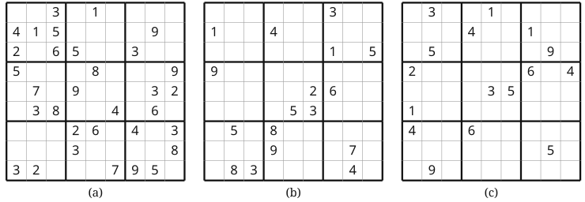</a>　(29)

((29a) 中的线索依次给出了 $\pi$ 的头 32 位数字, 而 (29b) 和 (29c) 的线索过不了多久就同 $\pi$ 不符了.) 为了方便, 让我们把行、列和宫都从 0 到 8 编号. 这样, 每个数独方阵 $S=(s_{ij})$ 就自然地对应于一个总的恰当覆盖问题的一个解. 该问题的 $9\cdot9\cdot9=729$ 个选项为

$$
‘p_{ij}\ r_{ik}\ c_{jk}\ b_{xk}’,\qquad
0\leq i,j<9,\quad 1\leq k\leq9,\quad x=3\lfloor i/3\rfloor+\lfloor j/3\rfloor,\tag{30}
$$

其 $4\cdot9\cdot9=324$ 个项就是 $p_{ij},r_{ik},c_{jk},b_{xk}$. 理由是, 以参数 $(i,j,k)$ 选择选项 (30) 当且仅当 $s_{ij}=k$. 能填入格 $(i,j)$ 的九个选项必须恰好选一个来覆盖项 $p_{ij}$, 能把 $k$ 放进第 $i$ 行的九个选项必须恰好选一个来覆盖项 $r_{ik}$, …… , 能把 $k$ 放进第 $x$ 宫的九个选项必须恰好选一个来覆盖项 $b_{xk}$. 明白了吗?

<a id="pdf-095"></a><a id="p-75"></a>

> 我写这个题目, 一部分动机是想为我花在解数独上的那许多小时找个说得过去的理由. 那个数目可够惊人的.
>
> ——布赖恩·海斯, <em>American Scientist</em> (2006)

要找出符合给定<em>部分</em>填法的所有数独方阵, 只须删去已经覆盖的项 $p_{ij},r_{ik},c_{jk},b_{xk}$, 同时删去涉及这些项的全部选项. 例如, (29a) 给出的恰当覆盖问题包含 $4\cdot(81-32)=196$ 个项 $p_{00},p_{01},p_{03},\ldots,r_{02},r_{04},r_{05},\ldots,c_{01},c_{06},c_{07},\ldots,b_{07},b_{08},b_{09},\ldots$ 和 146 个选项. 第一个选项为 “$p_{00}\ r_{07}\ c_{07}\ b_{07}$”, 最后一个为 “$p_{88}\ r_{86}\ c_{86}\ b_{86}$”. 把尚未被排除的每个值标在图上, 就能看清这些选项.

<a href="../../assets/volume4b/figures/sudoku-31.svg">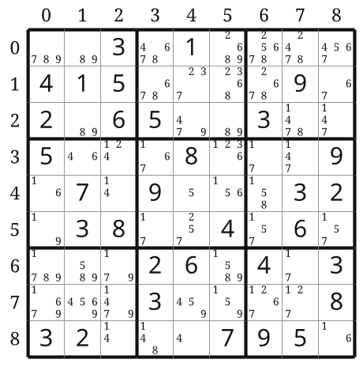</a>　(31)

比如说, 项 $p_{00}$ 的有效表中有取值 $\{7,8,9\}$ 的选项, 项 $r_{02}$ 的有效表中有列 $\{5,6,7\}$ 的选项, 项 $c_{01}$ 的有效表中有行 $\{4,5,6,7\}$ 的选项, 其余类推. (数独高手解题时, 实际上往往或明或暗地在心中画着这样的图.)

看哪, 正中间有个孤零零的小号 5! $p_{44}$ 只剩一个选项, 因此可以把这个小号 5 升成大号 5. 于是第 4 行、第 4 列和第 4 宫中其余的小号 5 全都可以擦掉. 这种操作称为 “确定一个显性唯一数” (forcing a naked single).

格 $(8,4)$ 中还藏着<em>另一个</em>显性唯一数. 把这里的小号 4 升为大号 4, 又会在格 $(7,4)$ 和 $(8,2)$ 中产生新的显性唯一数. 事实上, 只要在步骤 X1 把各个 $p_{ij}$ 放在最前面, 算法 X 就会踏上一条畅通无阻的道路, 一步步都只有一个选择, 很快找到 (29a) 的一个完整解, <em>全靠</em>显性唯一数.

当然, 数独题也不总是这么容易. 例如, (29b) 只给出了 17 个线索, 比前面的 32 个少, 显性唯一数也就不那么容易出现. ((29b) 出自戈登·罗伊尔在网上汇集的约 $50\,000$ 道 17 线索数独题. 这些题目在本质上各不相同, 而且尽管线索很少, 每道题都只有一种补全方法. 罗伊尔的收集看来已接近完备. 如今, 当数独迷遇见一道 17 线索的题目, 几乎总能发现它等价于罗伊尔表中的某一题.)

由加里·麦圭尔主持、于 2012 年完成的一项大规模计算, 已经表明<em>每一道有唯一解的数独题<a id="pdf-096"></a><a id="p-76"></a> 都必须至少有 17 个线索</em>. 我们将在 7.2.3 节看到, 不同构的数独方阵恰好有 $5\,472\,730\,538$ 个. 麦圭尔的程序逐个考察这些方阵, 并表明, 在每个方阵中, 有可能唯一确定它的 16 线索子集相对很少. 通常只有约 $16\,000$ 个子集能通过这道初筛, 而它们后来也被逐一排除. 凭借一些颇为巧妙、并已作过高度优化的按位算法, 每个数独方阵平均只用了约 3.6 秒就完成了上述判定. [见 G. McGuire、B. Tugemann 和 G. Civario, <em>Experimental Mathematics</em> **23** (2014), 190–217.]

用 (29b) 的 17 个线索可以画出与 (31) 类似的候选数图,

<a href="../../assets/volume4b/figures/sudoku-32.svg">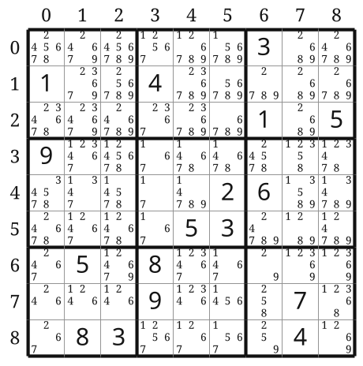</a>　(32)

这个问题还剩下 307 个选项, 是上一个问题的两倍多. 而且, 不出所料, 这里没有显性唯一数. 不过再仔细看看, 仍能找出非走不可的步! 例如, 第 3 列只有一个小号 3. 我们可以把它升为大号 3, 划掉第 2 行和第 1 宫中其余的小号 3. 这种操作称为 “确定一个隐性唯一数” (forcing a hidden single).

类似地, (32) 的第 2 宫只有一个小号 4, 此外还有两个隐性唯一数 (见习题 47). 填上这些非填不可的数, 会引出新的隐性唯一数, 不久也出现了显性唯一数. 但是, 连续填上 16 个这样确定的数之后, 容易摘的果子就都摘完了.

<a href="../../assets/volume4b/figures/sudoku-33.svg">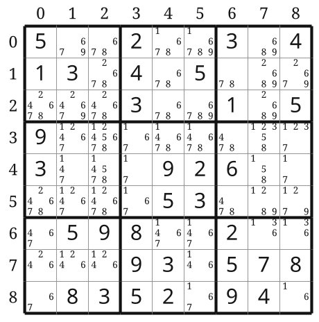</a>　(33)

<a id="pdf-097"></a><a id="p-77"></a>

算法 X 很容易从 (32) 推出 (33), 因为只要项 $p_{ij}$、$r_{ik}$、$c_{jk}$ 或 $b_{xk}$ 只剩一个选项, 它就能看到一个显性或隐性唯一数, 并且它的数据结构很容易随着链的舞动而改变. 可是到了状态 (33), 算法就要求助于二路分支了. 在这个例子中, 它先对 $p_{16}$ 考虑小号 7 的情形, 稍后再回溯去考虑小号 8.

数独高手其实只消瞥一眼 (33), 就会发现有个更聪明的办法, 因为 (33) 中有一个 “显性数对”. 格 $(4,3)$ 和 $(4,8)$ 都只有相同的两个选择, 因此可以把第 4 行其余地方出现的小号 1 和小号 7 全部删去, 这会在第 1 列产生一个显性唯一数 4. 习题 49 更详细地研究了这种较高阶的推理.

对于我们地球人来说, 涉及数对和三数组合的精巧逻辑也许更合用, 对机器来说, 简单的回溯就相当好. 事实上, 算法 X 只探索了一棵有 89 个结点的查找树便找到了 (29b) 的解, 其中头 16 个结点径直把它引到 (33). (在步骤 X1 中初始化数据结构花了约 25 万次内存访问, 随后再花约 5 万次就完成了任务. 如果要在步骤 X3 查找复杂的模式, 所花的时间会多得多.) 下面是它发现的解.

```text
c33 b13 p23 r23 (1 of 1)
r13 c13 b03 p11 (1 of 1)
   . . .
c42 b72 p84 r82 (1 of 1)
p16 r18 c68 b28 (2 of 2)
b27 p18 r17 c87 (1 of 1)
   . . .
p85 r81 c51 b71 (1 of 1)
```

在第 1 行的第 6 列选对了值, 剩下的就都确定了.

实际上, 舞蹈链几乎可以一路畅行, 以惊人的速度解决差不多每一道已知的数独题. 作者自 2005 年以来, 在世界各地的报刊、书籍及网页上见到了几十道有代表性的题, 随后把它们交给算法 X. 其中约有 $70\%$ 完全依靠显性或隐性唯一数所确定的步就能解出, 尽管许多题被评为 “魔鬼级”、“恶魔级”, 甚至 “折磨人”! 只有 $10\%$ 的题产生了超过 100 个结点的查找树, 而且没有一棵树超过 282 个结点. (不过, 请看习题 52.)

不妨考虑一下, 如果把算法削弱, 只让它走显性唯一数所确定的步, 会怎么样? 这是人最容易作出的一种推断. 假定我们把 $r_{ik},c_{jk},b_{xk}$ 列为次要项, 只留下 $p_{ij}$ 作为主要项. (换言之, 在每一行、每一列、每一宫里, 每个值 $k$ 都<em>至多</em>出现一次, 但并未明文要求每个 $k$ 都要得到覆盖.) 对于 (29b), 查找树一下子长到了 $41\,877$ 个结点.

最后, (29c) 又怎样呢? 这道题只有 16 个线索, 因而我们知道它不可能有唯一解. 不过, 这 16 个线索只涉及九个数字中的七个, 根本无法区别 7 和 8. 算法 X 用一棵含有 129 个结点的查找树断定, 它恰好有两个解. (这两个解实际上没有本质区别, 交换 7 与 8 就可从一个变成另一个.)

<a id="pdf-098"></a><a id="p-78"></a>

出题的人给传统数独想出了许多有趣的变形, 下面的习题里就讨论了其中几种. 最精彩的要算 “拼图数独” (jigsaw sudoku, 又称几何数独、多格骨牌数独、曲线数独等). 这里每个宫各有自己的形状, 用不着都是 $3\times3$ 的小方阵. 例如,

<a href="../../assets/volume4b/figures/sudoku-34.svg">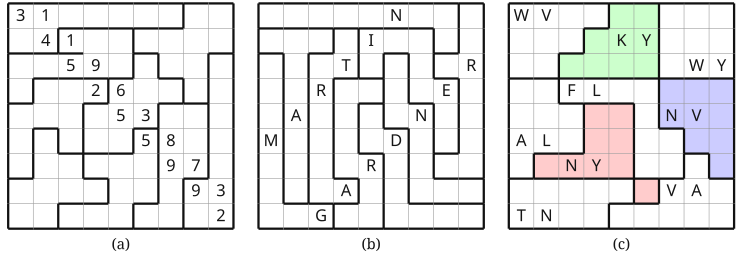</a>　(34)

题 (34a) 是作者于 2017 年在鲍勃·哈里斯的帮助下设计的. 例如可以看出, 由于第二行已经有一个 4, 第一行就只有两个地方可以放 4. 这道题同 (30) 一样是个恰当覆盖问题, 只是现在 $x$ 是 $i$ 和 $j$ 的一个更复杂的函数. 类似地, 哈里斯的经典题目 (34b) [<em>Mathematical Wizardry for a Gardner</em> (2009), 55–57] 要求把字母 $\{\mathtt G,\mathtt R,\mathtt A,\mathtt N,\mathtt D,\mathtt T,\mathtt I,\mathtt M,\mathtt E\}$ 填入每一行、每一列及每个形状不规则的宫. 我们仍然使用 (30), 不过 $k$ 改为取各个字母的值. [<em>提示.</em> 格 $(0,2)$ 中必须填 `A`, 因为第 2 列终究需要放一个 `A`.] 题 (34c) 称为 “美国拼图数独”, 是托马斯·斯奈德于 2006 年设计并发表在网上的一件杰作. 它别出心裁, 把各个宫做成西弗吉尼亚、肯塔基、怀俄明、阿拉巴马、佛罗里达、内华达、田纳西、纽约 (包括长岛) 和弗吉尼亚这九个州的形状, 而给出的线索竟是各州的邮政缩写! (见习题 59.)

拼图数独是 J. 马克·汤普森发明的. 他从 1996 年起以 “拉丁方” 为题发表这类谜题 [<em>GAMES World of Puzzles</em>, 第 14 期 (1996 年 7 月), 51、67]. 那时他还没有听说过数独. 他的题同普通数独相比, 有一个优点, 即大小随意, 不一定非得是 $9\times9$. 汤普森最初的例子是 $6\times6$ 的.

不过, 这类题的<em>解</em>在更早的时候就有了一段有趣的历史. 把数学用于农业的先驱瓦尔特·贝伦斯, 于 1956 年发表了一篇颇有影响的论文, 建议在研究施用不同肥料的作物时采用这样的图案来安排试验 [<em>Zeitschrift für landwirtschaftliches Versuchs- und Untersuchungswesen</em> **2** (1956), 176–193]. 他给出了几十种设计, 从 $4\times4$ 到 $10\times10$ 的都有, 其中包括

<a href="../../assets/volume4b/figures/sudoku-35.svg">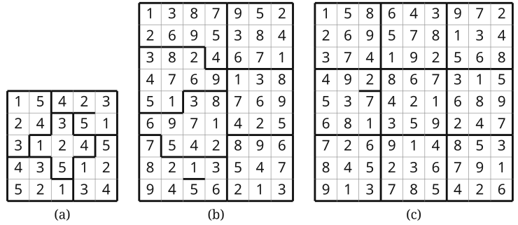</a>　(35)

<a id="pdf-099"></a><a id="p-79"></a>

注意, 贝伦斯的 (35b) 实际上是 $9\times7$ 的, 所以各行并不包含全部九种可能性. 他只要求同一处理编号在任何行或列中都不重复. 还要注意, 他的 (35c) 其实就是一个普通的数独排列. 据目前所知, 这是今天所谓的数独解最早见诸出版物的例子. 贝伦斯采用 F. 拉加勒尔的建议, 称这些设计为 “gerechte” (意思是 “公平的”) 拉丁方或拉丁矩形, 因为它们把田地分成相邻的小区, 每一组都受到全部 $n$ 种处理.

他的所有设计都把矩形分拆为连通区域, 每个区域由 $n$ 个小方格组成. 下面我们将看到, <em>这个</em>思想本身也有一段很不寻常的历史, 其中同样充满引人入胜的组合模式和游戏.

**多格骨牌.** 一个由 $n$ 个小方格组成的车连通区域, 按照 S. W. 戈洛姆的建议 [<em>AMM</em> **61** (1954), 675–682], 常称为一块 <em>$n$ 格骨牌</em> ($n$-omino). 当 $n=1,2,3,\ldots$ 时, 按戈洛姆的定义便分别有一格、二格、三格、四格、五格、六格骨牌, 如此等等. 如果不指定 $n$, 戈洛姆就把这类区域统称为<em>多格骨牌</em> (polyominoes).

我们在 7.1.4–(130) 中已经见过小型的多格骨牌, 也见过它们同恰当覆盖的关系. 显然, 一块二格骨牌只可能有一种形状. 但三格骨牌有两种, 一种是 “直的” ($1\times3$), 另一种 “拐了弯”, 占一个 $2\times2$ 方形中的三格. 同样, 四格骨牌可以分为五种不同的类型. (请先别看习题 274, 自己能画出这五种吗? 玩过俄罗斯方块 Tetris® 的读者是不会犯难的.)

不过, 最有滋味的多格骨牌几乎肯定是<em>五格骨牌</em>, 它有十二种. 这十二种形状能用那么多美妙的方法拼起来, 早已成为千百万人的老朋友. 用精制硬木或鲜艳塑料制成的成套五格骨牌, 不难以合理的价格买到. 每家真都应当备一套. 尽管用计算机应用程序摆弄 “虚拟” 五格骨牌很容易, 可是亲手摆放这些讨人喜欢的实物时, 那种奇妙而迷人的触感实在无法代替. 而且我们还将看到, 五格骨牌有许多关于组合计算的东西可以教给我们.

> 把 [这些骨牌] 裱在硬纸板上, 它们就能给家里带来无穷的乐趣.
>
> ——亨利·E. 迪德尼, 《坎特伯雷谜题》(1907)

> 哪些以 -o 结尾的英语名词用 -s 构成复数, 哪些用 -es?  
> 若人们仍觉得某个词带点异国口音, 就给它加 -s,  
> 若它已彻底入籍英语, 就给它加 -es.  
> 所以有 echoes、potatoes、tomatoes、dingoes、embargoes 等,  
> 而来自意大利语的音乐术语则有 altos、bassos、cantos、pianos、solos 等,  
> 还有 tangos、armadillos 这样的西班牙语词.  
> 我曾拥有 “Pentomino(-es)” 的商标, 如今却更愿把这些词  
> 作为我对语言的一点贡献, 交给公众自由使用.
>
> ——所罗门·W. 戈洛姆, 致高德纳的信 (1994)

<a id="pdf-100"></a><a id="p-80"></a>

拿到十二块各占 5 格的骨牌, 我们最先想试的事之一, 就是把它们装进一个长方形盒子, 比如 $6\times10$, $5\times12$, $4\times15$ 或 $3\times20$ 的盒子. 前三种都相当容易; $3\times20$ 的盒子却颇费思量. 戈洛姆在 1954 年的文章中提出了这个问题, 没有给出答案. 当时他并不知道, Frans Hansson 早在许多年前就已在一份不大为人所知的刊物 <em>The Problemist: Fairy Chess Supplement</em> **2**, 第 12、13 期 (1935 年 6 月、8 月) 的第 1844 题中给出了一个解:

<a href="../../assets/volume4b/figures/dlx-36.svg">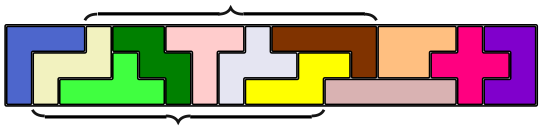</a>

(36)

汉松其实还指出, 括线所标的那些骨牌 “也可以旋转两个直角, 得到仅有的另一个解”.

这个问题和许多类似的问题, 都很适合表述为恰当覆盖问题. 不过在动手以前, 先得给各种五格骨牌取个<em>名字</em>. 大家都同意, 其中七种应该用字母表中连续的七个字母命名:

<a href="../../assets/volume4b/figures/dlx-pent-tz.svg"></a>

$\mathtt T,\quad\mathtt U,\quad\mathtt V,\quad\mathtt W,\quad\mathtt X,\quad\mathtt Y,\quad\mathtt Z$

其余五种却有两套不同的命名法:

<a href="../../assets/volume4b/figures/dlx-pent-filpn.svg">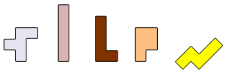</a>

$\mathtt F,\quad\mathtt I,\quad\mathtt L,\quad\mathtt P,\quad\mathtt N$　(S. W. 戈洛姆)

<a href="../../assets/volume4b/figures/dlx-pent-opqrs.svg"></a>

$\mathtt O,\quad\mathtt P,\quad\mathtt Q,\quad\mathtt R,\quad\mathtt S$　(J. H. 康威)

戈洛姆喜欢用 “Filipino” 这个词帮助记忆, 康威则喜欢让十二种五格骨牌与从 O 到 Z 的十二个连续字母一一对应. 康威的办法写起程序来通常方便些, 我们这里就采用它.

用五格骨牌铺满 $3\times20$ 的任务, 就是要把骨牌排得使每个牌名 $\{\mathtt O,\mathtt P,\ldots,\mathtt Z\}$ 恰好被覆盖一次, 每个格 $ij$ ($0\leq i<3$, $0\leq j<20$) 也恰好被覆盖一次. 因此共有 $12+3\cdot20=72$ 个项; 一块五格骨牌的每一种放法构成一个选项, 即

$$
\begin{gathered}
\mathtt{O\ 00\ 01\ 02\ 03\ 04}\\
\vdots\\
\mathtt{O\ 2f\ 2g\ 2h\ 2i\ 2j}\\
\mathtt{P\ 00\ 01\ 02\ 10\ 11}\\
\vdots\\
\mathtt{Z\ 0j\ 1h\ 1i\ 1j\ 2h}.
\end{gathered}\tag{37}
$$

这里把十六进记号再推广一点, 让 “数字” $(\mathtt a,\mathtt b,\ldots,\mathtt j)$ 表示 $(10,11,\ldots,19)$. 在这张表中, O 牌有 48 个选项, P 牌有 220 个.

<a id="pdf-101"></a><a id="p-81"></a>

其余各牌从 Q 到 Z 的选项数依次为 $(136,144,136,72,110,72,72,18,136,72)$; 十二块牌总计 1236 个. 习题 266 说明怎样生成这类问题的所有选项.

把算法 X 用于 (37), 会找到八个解, 因为汉松的每种摆法还可以作水平反射、垂直反射或两者兼作. 要消去这种对称性, 可以规定 V 牌必须像 (36) 中那样摆成 Γ 形, 即在它的 72 个选项中只留下 18 个. (看得出为什么吗? 请想一想.) 不作这种简化时, 查找树有 32,644 个结点, 用 1.46 亿次内存访问找出 8 个解; 简化后有 21,805 个结点, 用 1.03 亿次内存访问找出 2 个解.

仔细看一看, 其实还可以好得多. 例如 V 牌的一个 Γ 形选项是 $\mathtt{V\ 09\ 0a\ 0b\ 19\ 29}$, 如下图:

<a href="../../assets/volume4b/figures/dlx-38.svg"></a>

(38)

这种放法绝不可能用上, 因为它要求用五格骨牌铺满 V 左边的 27 格. 其他骨牌的许多选项也不能用, 因为它们和 (38) 一样, 隔出了面积不是 5 的倍数的区域.

事实上, 去掉所有这样的选项, 最初的 1236 种可能放法只剩下 728 种; $(\mathtt O,\mathtt P,\ldots,\mathtt Z)$ 各有 $(48,156,132,28,128,16,44,16,12,4,128,16)$ 种. 再去掉 V 牌余下放法中不成 Γ 形的 12 种, 就剩 716 个选项. 算法 X 用这个缩小的集合求全部解, 查找树减至 1243 个结点, 运行只需 450 万次内存访问.

(消去对称性还有一个稍好些的办法: 不规定 V 须成 Γ 形, 而规定 X 牌在左半边, Z 牌不得翻面. 这样 $(\mathtt V,\mathtt X,\mathtt Z)$ 的可能放法数便由 $(4,4,16)$ 变为 $(16,2,8)$. 所得查找树只有 1128 个结点, 运行需 $4.0\,\mathrm M\mu$.)

注意, 起初也可以用较弱的条件表述本题: 只要求每块骨牌<em>至多</em>用一次, 而每个格 $ij$ 仍须恰好覆盖一次. 这实质上就是把牌名 $\{\mathtt O,\mathtt P,\ldots,\mathtt Z\}$ 当作次要项. 这样, 用 (37) 的原来 1236 个选项将得到有 61,851 个结点的查找树, 运行需 $291\,\mathrm M\mu$. 对偶地, 也可保留牌名为主要项而把格名当作次要项, 这将得到有 1,086,521,921 个结点的树, 运行需 $2.94\,\mathrm T\mu$! 耐人寻味的是, 若用排除 (38) 这类情形后余下的 716 个选项, 这两项统计却<em>反过来</em>了: 牌名为次要项得 19306 个结点 ($68\,\mathrm M\mu$), 格名为次要项得 11656 个结点 ($37\,\mathrm M\mu$).

在计算机发展的早期, 五格骨牌问题是组合计算的好基准. 直到很久以后, 程序员才用得起大容量随机访问存储器. 因此, 像舞蹈链这样把一千多个选项显式列出再加以操作的技术, 在当时是不可想象的. 各块骨牌的选项都是在需要时才隐式生成的, 回溯时也没有理由采用<a id="pdf-102"></a><a id="p-82"></a>精巧的启发式方法. 查找的每个分支基本上都是根据第一个尚未被占据的格 $ij$ 有哪些覆盖方法而产生的.

让算法 X 不用 MRV 启发式方法, 在步骤 X3 中只置 $i\gets\mathtt{RLINK}(0)$, 就能模拟这些早期方法的行为. 这时会出现一个有趣的现象: 若按格 $ij$ 的自然次序考察, 先 00, 再 01, …, 再 0j, 然后 10, …, 最后 2j, 查找树有 15 亿个结点. (00 有 29 种覆盖方法; 若选取 “00 01 02 03 04 O”, 则 05 有 49 种覆盖方法; 等等.) 可是若将 $3\times20$ 的问题转成 $20\times3$, 对 $0\leq i<20$, $0\leq j<3$ 的格 $ij$ 依次考察 00、01、02、10、…、j2, 查找树就只有 71191 个结点, 很快就能找到全部八个解. (加快的主要原因是查找的 “焦点” 更好, 后面还要讨论.) 我们再一次看到, 问题设置上的一点小变化就可能产生极大的影响.

这些早期程序中最出色的几个都经过精心调整, 用汇编语言编写, 巧妙地运用了宏指令. 所以在不太大的问题上, 从内存访问次数来说, 它们优于算法 X. [见 J. G. Fletcher, <em>CACM</em> **8**, 10 (1965 年 10 月), 封面及 621–623; N. G. de Bruijn, <em>FGbook</em>, 465–466 页.] 不过当问题变大时, MRV 启发式方法终于会占上风.

用五格骨牌和其他类似的平面拼块拼出各种图案时, 会碰到许多引人入胜又富有启发的问题. [习题 268](#ex-7-2-2-1-268) 至[习题 323](#ex-7-2-2-1-323) 讨论了其中一些; 有几道题的规模之大, 确实超出了当今计算机的能力.

**多立方块骨牌.** 如果你觉得平面图形好玩, 你多半会更喜欢三维图形! <em>多立方块骨牌</em> (polycube) 是把一个或多个 $1\times1\times1$ 的单位立方块沿面相接而成的立体. 按块数, 分别称为单立方块骨牌 (monocube)、二立方块骨牌 (dicube)、三立方块骨牌 (tricube)、四立方块骨牌 (tetracube)、五立方块骨牌 (pentacube) 等等. 不过, 用 $n$ 个单位立方块拼成的骨牌<em>不能</em>叫作 “$n$-cube”, 因为数学家已把这个词留给了 $n$ 维的对象.

当 $n=4$ 时出现了新情形. 在二维中, 我们自然把下图的四格骨牌和它的镜像看成一样的, 因为只须把骨牌翻过来就行了.

<a href="../../assets/volume4b/figures/dlx-chiral-L.svg"></a>　<a href="../../assets/volume4b/figures/dlx-chiral-L-mirror.svg"></a>

可是下面的四立方块骨牌与其镜像确有区别, 因为不进入第四维, 就无法把一块变成另一块.

<a href="../../assets/volume4b/figures/dlx-chiral-left.svg"></a>　<a href="../../assets/volume4b/figures/dlx-chiral-right.svg"></a>

与镜像有别的多立方块骨牌称为<em>手性</em>骨牌. “手性” (chiral) 一词是开尔文勋爵于 1893 年研究手性分子时创造的.

最简单的多立方块骨牌是长方体; 喜爱长名字的人也把它叫作 “矩形平行六面体”. 它就像一块尺寸为 $l\times m\times n$ 的砖. 不过遇上不是长方体的形状, 事情就特别有意思了. Piet Hein 在 1933 年注意到, 这类形状中最小的七种, 即

<a href="../../assets/volume4b/figures/dlx-39.svg"></a>

1: 弯形;　2: L 形;　3: T 形;　4: 错位形;　5: 左扭形;　6: 右扭形;　7: 爪形.　(39)

能拼成一个 $3\times3\times3$ 的立方体. 海因十分喜欢这些拼块, 把它们命名为 “索玛” (Soma). 注意前四块实质上是平面的, 后三块才非得用三维表示. 两块扭形骨牌互为手性镜像.

<a id="pdf-103"></a><a id="p-83"></a>

马丁·加德纳在 <em>Scientific American</em> **199**, 3 (1958 年 9 月), 182–188 中介绍了索玛的乐趣, 它很快就风靡起来. 帕克兄弟公司推出了一套制作精良的骨牌, 随附海因写的说明书; 单在美国就卖出了两百多万套 SOMA® 立方体.

> 采用形状简单的最少数量积木. ……试验和计算表明, 用这套七块积木, 可以构造的几何形体数目, 大致和用二十七个分立的小立方体所能构造的一样多.
>
> ——皮特·海因, 英国专利说明书 420,349 (1934)

把这七块拼成立方体, 也很容易表述成一个恰当覆盖问题, 就像刚才铺五格骨牌那样. 不过这次要考虑拼块的 24 种三维旋转, 而五格骨牌考虑的是 8 种平面旋转与反射的组合. 因而要用习题 324 代替习题 266 来生成选项. 结果共有 688 个选项, 涉及可记作 $1,2,\ldots,7,000,001,\ldots,222$ 的 34 个项. 例如第一个选项

$$
\mathtt{1\quad 000\quad 001\quad 010}\tag{40}
$$

表示 “弯形” 1 号骨牌的 144 种可能放法之一.

算法 X 只用 4.07 亿次内存访问便能求出这个问题的全部 11,520 个解. 还可以利用对称性节省大部分时间: 每个解都能旋转到唯一的一个 “规范” 解, 使 “L 形” 的 2 号骨牌没有转动. 因此可以把这块骨牌限制到六种放法, 即 $(000,010,020,100)$, $(001,011,021,101)$, …, $(102,112,122,202)$, 它们之间只有平移的差别. 这个限制去掉了 $\tfrac{23}{24}\cdot144=138$ 个选项, 算法现在只用 2000 万次内存访问就找到了 480 个规范解. (这些规范解分为 240 对镜像.)

**恰当覆盖问题的分解.** 其实, 索玛立方体问题还可以简化许多. 只要巧妙地<em>分解</em>问题, 甚至可以在合理的时间内用手求出全部解.

先注意, 恰当覆盖问题的任何一个解都会自动解出无穷多个<em>其他</em>问题. 回到最初用 $m\times n$ 矩阵 $A=(a_{ij})$ 的表述, 任务是求出使每列之和均为 1 的所有行集, 也就是要找出所有二元向量 $x_1\ldots x_m$, 满足对 $1\leq j\leq n$ 均有 $\sum_{i=1}^m x_ia_{ij}=1$. 因此, 若置 $b_i=\alpha_1a_{i1}+\cdots+\alpha_na_{in}$ ($1\leq i\leq m$), 其中 $(\alpha_1,\ldots,\alpha_n)$ 为任意的系数 $n$ 元组, 则这些向量还都满足 $\sum_{i=1}^m x_ib_i=\alpha_1+\cdots+\alpha_n$. 明智地选择这些 $\alpha$, 关于 $x_1\ldots x_m$ 的可能取值或许就能知道不少.

例如再看 (5) 的 $6\times7$ 矩阵, 令 $\alpha_1=\cdots=\alpha_7=1$. $A$ 的每行元素之和为 2 或 3; 也就是说, 我们要每次买两件或三件, 最后买齐七件. 无须再了解 $A$ 的具体结构, 立刻就能断定凑足 7 的方法只有一种, 即 $2+2+3$! 而只有第 1 和第 5 行的和为 2, 所以这两行<em>非选不可</em>.

<a id="pdf-104"></a><a id="p-84"></a>

现在来看一个更有意思的挑战: “用 21 块直三格骨牌和一块一格骨牌盖住棋盘的 64 格.” 对应的矩阵相当大, 有 $96+64$ 行、$1+64$ 列,

$$
\begin{array}{ccccccccccccccccccccccccccc}
\scriptstyle\mathtt{M}&\scriptstyle\mathtt{00}&\scriptstyle\mathtt{01}&\scriptstyle\mathtt{02}&\scriptstyle\mathtt{03}&\scriptstyle\mathtt{04}&\scriptstyle\mathtt{05}&\scriptstyle\mathtt{06}&\scriptstyle\mathtt{07}&\scriptstyle\mathtt{10}&\scriptstyle\mathtt{11}&\scriptstyle\mathtt{12}&\scriptstyle\mathtt{13}&\scriptstyle\mathtt{14}&\scriptstyle\mathtt{15}&\scriptstyle\mathtt{16}&\scriptstyle\mathtt{17}&\scriptstyle\mathtt{20}&\scriptstyle\mathtt{21}&\scriptstyle\mathtt{22}&\scriptstyle\mathtt{23}&\scriptstyle\mathtt{24}&&\scriptstyle\mathtt{74}&\scriptstyle\mathtt{75}&\scriptstyle\mathtt{76}&\scriptstyle\mathtt{77}\\
0&1&1&1&0&0&0&0&0&0&0&0&0&0&0&0&0&0&0&0&0&0&\cdots&0&0&0&0\\
0&1&0&0&0&0&0&0&0&1&0&0&0&0&0&0&0&1&0&0&0&0&\cdots&0&0&0&0\\
0&0&1&1&1&0&0&0&0&0&0&0&0&0&0&0&0&0&0&0&0&0&\cdots&0&0&0&0\\
0&0&1&0&0&0&0&0&0&0&1&0&0&0&0&0&0&0&1&0&0&0&\cdots&0&0&0&0\\
\vdots&\vdots&\vdots&\vdots&\vdots&\vdots&\vdots&\vdots&\vdots&\vdots&\vdots&\vdots&\vdots&\vdots&\vdots&\vdots&\vdots&\vdots&\vdots&\vdots&\vdots&\vdots&\vdots&\vdots&\vdots&\vdots&\vdots\\
0&0&0&0&0&0&0&0&0&0&0&0&0&0&0&0&0&0&0&0&0&0&\cdots&0&1&1&1\\
1&1&0&0&0&0&0&0&0&0&0&0&0&0&0&0&0&0&0&0&0&0&\cdots&0&0&0&0\\
1&0&1&0&0&0&0&0&0&0&0&0&0&0&0&0&0&0&0&0&0&0&\cdots&0&0&0&0\\
\vdots&\vdots&\vdots&\vdots&\vdots&\vdots&\vdots&\vdots&\vdots&\vdots&\vdots&\vdots&\vdots&\vdots&\vdots&\vdots&\vdots&\vdots&\vdots&\vdots&\vdots&\vdots&\vdots&\vdots&\vdots&\vdots&\vdots\\
1&0&0&0&0&0&0&0&0&0&0&0&0&0&0&0&0&0&0&0&0&0&\cdots&0&0&0&1
\end{array}\tag{41}
$$

前 96 行规定直三格骨牌的所有可能放法, 其余 64 行规定一格骨牌的可能位置. 列 $ij$ 代表格 $(i,j)$, 列 M 表示 “一格骨牌”.

直三格骨牌所盖的三个格 $(i,j)$ 总使 $(i-j)\bmod3$ 取到三个不同的值. 所以将 (41) 中满足 $(i-j)\bmod3=0$ 的 22 列相加, 前 96 行的和各为 1, 其余 64 行各为 0 或 1. 选中的各行总和应为 22; 因此一格骨牌一定要放在 $i\equiv j\pmod3$ 的格 $(i,j)$ 中.

类似地, 用 $i+j$ 代替 $i-j$, 可知这一格还必须满足 $i+j\equiv1\pmod3$. 因而 $i\equiv j\equiv2\pmod3$. <em>我们证明了 $(i,j)$ 只有四种可能</em>: $(2,2)$, $(2,5)$, $(5,2)$, $(5,5)$. [戈洛姆在他 1954 年引入多格骨牌的论文中已作出这个观察, 当时他给棋盘的格子 “染” 上三种颜色. 分解的一般概念包括所有这类染色论证作为特例.]

我们用来证明五格骨牌的放法 (38) 不可行的理由, 也可以看成一个分解的例子. 如果选了 (38), 那么在余下的问题中, 相应矩阵的每行在左边那 27 格所对应的列里的和, 或为 0, 或为 5. 所以不可能从这些行得到总数 27.

再看一道三维问题 [J. Slothouber 和 W. Graatsma, <em>Cubics</em> (1970), 108–109]: 六个 $1\times2\times2$ 的长方体能否装进一个 $3\times3\times3$ 的盒子? 这就要求从下列 $36\times27$ 矩阵中选出六行,

$$
\begin{array}{ccccccccccccccccccccccccccc}
\scriptstyle\mathtt{000}&\scriptstyle\mathtt{001}&\scriptstyle\mathtt{002}&\scriptstyle\mathtt{010}&\scriptstyle\mathtt{011}&\scriptstyle\mathtt{012}&\scriptstyle\mathtt{020}&\scriptstyle\mathtt{021}&\scriptstyle\mathtt{022}&\scriptstyle\mathtt{100}&\scriptstyle\mathtt{101}&\scriptstyle\mathtt{102}&\scriptstyle\mathtt{110}&\scriptstyle\mathtt{111}&\scriptstyle\mathtt{112}&\scriptstyle\mathtt{120}&\scriptstyle\mathtt{121}&\scriptstyle\mathtt{122}&\scriptstyle\mathtt{200}&\scriptstyle\mathtt{201}&\scriptstyle\mathtt{202}&\scriptstyle\mathtt{210}&\scriptstyle\mathtt{211}&\scriptstyle\mathtt{212}&\scriptstyle\mathtt{220}&\scriptstyle\mathtt{221}&\scriptstyle\mathtt{222}\\
1&1&0&1&1&0&0&0&0&0&0&0&0&0&0&0&0&0&0&0&0&0&0&0&0&0&0\\
1&1&0&0&0&0&0&0&0&1&1&0&0&0&0&0&0&0&0&0&0&0&0&0&0&0&0\\
1&0&0&1&0&0&0&0&0&1&0&0&1&0&0&0&0&0&0&0&0&0&0&0&0&0&0\\
0&1&1&0&1&1&0&0&0&0&0&0&0&0&0&0&0&0&0&0&0&0&0&0&0&0&0\\
0&1&1&0&0&0&0&0&0&0&1&1&0&0&0&0&0&0&0&0&0&0&0&0&0&0&0\\
0&1&0&0&1&0&0&0&0&0&1&0&0&1&0&0&0&0&0&0&0&0&0&0&0&0&0\\
0&0&1&0&0&1&0&0&0&0&0&1&0&0&1&0&0&0&0&0&0&0&0&0&0&0&0\\
\vdots&\vdots&\vdots&\vdots&\vdots&\vdots&\vdots&\vdots&\vdots&\vdots&\vdots&\vdots&\vdots&\vdots&\vdots&\vdots&\vdots&\vdots&\vdots&\vdots&\vdots&\vdots&\vdots&\vdots&\vdots&\vdots&\vdots\\
0&0&0&0&0&0&0&0&0&0&0&0&0&0&0&0&0&0&0&0&0&0&1&1&0&1&1
\end{array}\tag{42}
$$

使每列之和都不超过 1.

<a id="pdf-105"></a><a id="p-85"></a>

$3\times3\times3$ 大立方体的 27 个小立方体 $(i,j,k)$ 可以分为四类, 取决于它的坐标中有几个等于中间值 1:

$$
\begin{array}{lll}
\text{顶点小立方体}&\text{没有 1}&\binom30 2^3=8\text{ 个};\\
\text{棱小立方体}&\text{有一个 1}&\binom31 2^2=12\text{ 个};\\
\text{面小立方体}&\text{有两个 1}&\binom32 2^1=6\text{ 个};\\
\text{中心小立方体}&\text{有三个 1}&\binom33 2^0=1\text{ 个}.
\end{array}\tag{43}
$$

立方体的每一种对称变换都保持这种分类.

设想在 (42) 的右边添上四个新列 $v,e,f,c$, 表示一次放置所占的顶点、棱、面及中心小立方体的个数. 有 24 行将得到 $(v,e,f,c)=(1,2,1,0)$, 另 12 行则为 $(0,1,2,1)$. 若第一种行取 $a$ 行, 第二种行取 $b$ 行, 分解就告诉我们必有

$$
a\geq0,\quad b\geq0,\quad a+b=6,\quad a\leq8,\quad
2a+b\leq12,\quad a+2b\leq6,\quad b\leq1.\tag{44}
$$

这些条件已经绰绰有余, 足以证明 $b=0$, $a=6$, 从而找到这六个长方体本质上唯一的装法.

(若把启发我们作出这个推论的初等代数藏起来, 还可以说得更令人印象深刻: “每个 $1\times2\times2$ 的长方体至少占据一个面小立方体, 所以六个长方体必须各占不同的一面.”)

有了这些例子, 现在可以对索玛立方体应用分解了. (39) 中的 1 至 7 号骨牌所有可能的 $(v,e,f,c)$ 值如下:

$$
\begin{array}{cl}
1:&(0,1,1,1),(0,0,2,1),(0,1,2,0),(0,2,1,0),(1,1,1,0),(1,2,0,0);\\
2:&(0,1,2,1),(0,2,2,0),(1,2,1,0),(2,2,0,0);\\
3:&(0,0,3,1),(0,2,1,1),(0,3,1,0),(2,1,1,0);\\
4:&(0,1,2,1),(1,2,1,0);\\
5:&(0,1,2,1),(0,2,2,0),(1,1,1,1),(1,2,1,0);\\
6:&(0,1,2,1),(0,2,2,0),(1,1,1,1),(1,2,1,0);\\
7:&(0,2,1,1),(0,0,3,1),(1,1,2,0),(1,3,0,0).
\end{array}\tag{45}
$$

(这些信息实际上比我们需要的多得多, 不过也没什么坏处.)

单看 $v$ 的总数便知, 必须有

$$
(0\text{ 或 }1)+(0,1\text{ 或 }2)+(0\text{ 或 }2)+(0\text{ 或 }1)
+(0\text{ 或 }1)+(0\text{ 或 }1)+(0\text{ 或 }1)=8;
$$

而达到这一总数的<em>唯一</em>办法是

$$
(0\text{ 或 }1)+(1\text{ 或 }2)+2+(0\text{ 或 }1)
+(0\text{ 或 }1)+(0\text{ 或 }1)+(0\text{ 或 }1)=8.
$$

这就排除了 2 号和 3 号骨牌的若干选项. 更确切地说, <em>2 号必须碰到至少一个顶点; 3 号必须沿一条棱放置.</em>

再看 $v+f$ 的总数. 若将小立方体黑白相间地染色, 八个角上都染黑, 则 $v+f$ 正是 “黑” 小立方体数. 因此还必须有

$$
(1\text{ 或 }2)+(1\text{ 或 }2)+3+2+(1\text{ 或 }2)+(1\text{ 或 }2)+(1\text{ 或 }2)=14;
$$

<a id="pdf-106"></a><a id="p-86"></a>

而凑成 14 的唯一办法是 1 号取二、7 号取一: <em>1 号必须占两个黑格, 7 号恰占一个.</em>

由此, 以 (40) 开头的表中的 688 个选项已经排除了 200 个. 还知道在 1、2、4、5、6、7 号骨牌中, 恰有五块各占了自己所能占的最多角数. 可引入 13 个新的主要项来编码这个附加信息:

$$
\mathtt{*,\ 1+,\ 1-,\ 2+,\ 2-,\ 4+,\ 4-,\ 5+,\ 5-,\ 6+,\ 6-,\ 7+,\ 7-},\tag{46}
$$

再加上六个新选项

$$
\begin{gathered}
\mathtt{*\ 1+\ 2-\ 4-\ 5-\ 6-\ 7-}\\
\mathtt{*\ 1-\ 2+\ 4-\ 5-\ 6-\ 7-}\\
\mathtt{*\ 1-\ 2-\ 4+\ 5-\ 6-\ 7-}\\
\mathtt{*\ 1-\ 2-\ 4-\ 5+\ 6-\ 7-}\\
\mathtt{*\ 1-\ 2-\ 4-\ 5-\ 6+\ 7-}\\
\mathtt{*\ 1-\ 2-\ 4-\ 5-\ 6-\ 7+},
\end{gathered}\tag{47}
$$

并在每块骨牌 $p$ 的各个选项后面附上 $p\mathtt+$ 或 $p\mathtt-$, 按此放法是否碰到最多的角而定. 例如, 索玛问题现在的 $6+488$ 个选项中, 下列是各种骨牌的典型放法:

```text
1 000 001 011 1+
1 001 011 101 1-
2 000 001 002 010 2+
2 001 011 021 101 2-
3 000 001 002 011
4 000 001 011 012 4+
4 001 011 111 121 4-
5 000 001 010 110 5+
5 001 010 011 101 5-
6 000 001 010 101 6+
6 001 010 011 110 6-
7 000 001 010 100 7+
7 001 010 011 111 7-
```

算法 X 仍然找到 11,520 个解, 而这次只需 1.08 亿次内存访问. 每个新选项至少在 21 个解中用到, 可见原集合中的 “赘肉” 已剔除干净. [这番颇有启发性的索玛分析出自 M. J. T. Guy、R. K. Guy 和 J. H. Conway, 1961 年. 见 Berlekamp、Conway 和 Guy, <em>Winning Ways</em>, 第 2 版 (2004), 845–847.]

利用对称性来减少解数, 可以强制 3 号骨牌占据 $\{000,001,002,011\}$ 四格 (从而减少到原数的 $1/24$), 再去掉 7 号骨牌用到 $k=2$ 的格 $ijk$ 的所有选项 (又减少到 $1/2$). 在余下的 455 个选项中, 算法 X 只需 200 万次内存访问, 就能生成全部 240 个本质不同的解.

这七块索玛骨牌千变万化, 其他小型多立方块骨牌也是如此. 习题 324–350 探索了它们的若干奇妙性质, 并附有历史文献.

<a id="pdf-107"></a><a id="p-87"></a>

**由颜色控制的覆盖.** <em>歇一歇!</em> 请先别往下读, 花一两分钟解一解图 71 的 “找词” 谜. 这种不大费脑筋的谜题不妨用来轻轻松松地练一练辨认单词的本领. 求解很容易, 比如顺着八个方向各将字母阵列扫一遍就行了. 解见下页图 72.

<a id="fig-7-2-2-1-71"></a>

**图 71. 找出数学家.**[^4b-names] 在这个 $15\times15$ 的方阵中圈出下面各个姓名. 可以从左往右或从右往左, 从上往下或从下往上, 也可以沿任何斜向读. 找齐以后, 剩下的字母会显出一句暗语. (解见[图 72](#fig-7-2-2-1-72).)

```text
ABEL       HENSEL     MELLIN
BERTRAND   HERMITE    MINKOWSKI
BOREL      HILBERT    NETTO
CANTOR     HURWITZ    PERRON
CATALAN    JENSEN     RUNGE
FROBENIUS  KIRCHHOFF  STERN
GLAISHER   KNOPP      STIELTJES
GRAM       LANDAU     SYLVESTER
HADAMARD   MARKOFF    WEIERSTRASS
```

<a href="../../assets/volume4b/figures/dlx-word-71.svg">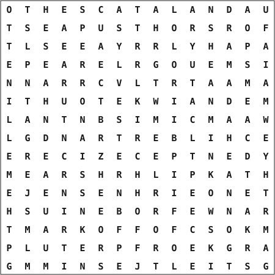</a>

怎样解这类谜题暂且不谈, 本节要讨论的是怎样<em>编出</em>它们. 将这 27 个姓名塞进格子里, 让它们的 184 个字母只占 135 格, 再使八种方向错落有致, 可一点也不容易. 怎样才能相当高效地办到呢?

为此, 我们引入<em>颜色代码</em>, 把恰当覆盖的思想推广一步. 设想要用字母 $\{\mathtt A,\ldots,\mathtt Z\}$ 之一给阵列的每格 $ij$ “着色”. 那么编这样一道谜的任务, 实质上就是从下列数目庞大的选项中选择若干个,

$$
\begin{gathered}
\mathtt{ABEL\ 00{:}A\ 01{:}B\ 02{:}E\ 03{:}L}\\
\mathtt{ABEL\ 00{:}A\ 10{:}B\ 20{:}E\ 30{:}L}\\
\mathtt{ABEL\ 00{:}A\ 11{:}B\ 22{:}E\ 33{:}L}\\
\mathtt{ABEL\ 00{:}L\ 01{:}E\ 02{:}B\ 03{:}A}\\[-2pt]
\vdots\\
\mathtt{WEIERSTRASS\ e4{:}S\ e5{:}S\ e6{:}A\ e7{:}R\ e8{:}T\ e9{:}S\ ea{:}R\ eb{:}E\ ec{:}I\ ed{:}E\ ee{:}W},
\end{gathered}\tag{48}
$$

使以下条件成立:

(i) 对于 27 位数学家的姓名, 每个恰好选择一个选项.

(ii) 对于 $15\times15$ 个格 $ij$ 中的每一格, 所选选项赋予它的颜色必须一致.

[^4b-names]: <em>Acta Mathematica</em> 为庆祝创刊 21 周年, 特别出版了 Marcel Riesz 主编的 <em>Table Générale des Tomes 1–35</em> (Uppsala, 1913), 179 页. 其中列全了该刊当时已发表的论文, 并附有全体作者的肖像和小传. 图 71 所列的 27 位数学家, 就是这些作者中后来又在《计算机程序设计艺术》卷 1、2 或 3 中提到过的人, 不包括 MITTAG-LEFFLER 或 POINCARÉ 等姓名含特殊字符者.

<a id="pdf-108"></a><a id="p-88"></a>

<a id="fig-7-2-2-1-72"></a>

**图 72.** 隐藏的数学家之谜 ([图 71](#fig-7-2-2-1-71)) 的解. 注意中央的字母 R 竟为下面六个不同的姓名所共有:

```text
BERTRAND
GLAISHER
HERMITE
HILBERT
KIRCHHOFF
WEIERSTRASS
```

<a href="../../assets/volume4b/figures/dlx-word-72.svg">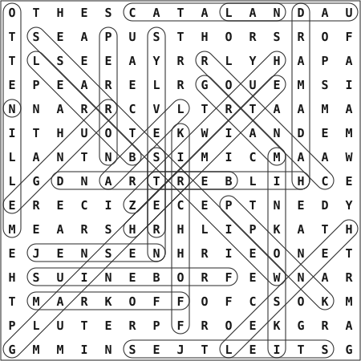</a>

它左边的 T 为五个姓名所共有. 剩下的字母这样说:

> These authors of early papers in <em>Acta Mathematica</em> were cited years later in <em>The Art of Computer Programming</em>.
>
> 这些在《数学学报》早期发表过论文的作者, 多年后又在《计算机程序设计艺术》中被引及.

此外还有些非形式的要求: 各个姓名最好能共用许多字母, 不同的方向也应穿插使用, 使谜题富于变化, 或许还能给人几分惊喜. 不过, 对计算机来说, 真正要考虑的是条件 (i) 和 (ii); 那些附带的要求最好通过人机交互, 由人指导处理.

注意颜色条件 (ii) 同姓名条件 (i) 有很大的区别. 允许若干个<em>不同</em>选项规定<em>同一</em>格的颜色, 只要这些规定彼此不冲突即可.

因此我们定义一个新问题, 称为<em>带颜色的恰当覆盖</em> (exact covering with colors), 简称 XCC. 同前, 给定一组项, 其中 $N_1$ 个是主要项, $N-N_1$ 个是次要项. 又给定一族 $M$ 个选项, 每个至少包含一个主要项. 新规则是给每个选项的次要项各指定一种<em>颜色</em>. 现在要求找出选项的所有选法, 使得

(i) 每个主要项恰好出现一次;

(ii) 每个次要项至多被赋予一种颜色.

所以主要项都是必选的; 次要项则随意.

用冒号表示颜色指定. 例如 (48) 中的 ‘00:A’ 表示给次要项 00 赋予颜色 A. 若某选项中的次要项后面没有冒号, 就默认给它赋予一种<em>独有</em>的颜色, 与该项在任何其他选项中的颜色都不相同. 因此, 先前研究过的普通恰当覆盖问题, 即次要项没有显式颜色而至多可在一个选项中被选取的情形, 只是 XCC 问题的特例, 尽管当时我们压根儿没提到颜色.

形形色色的组合问题很容易在 XCC 的框架内表述. 而且还有一个好消息: 舞蹈链技术处理这类问题十分得心应手! 我们将看到, 只须对算法 X 作一点扩充, 就能解这个一般得多的问题.

算法 X 的结点只有三个域: $\mathtt{TOP}$, $\mathtt{ULINK}$ 及 $\mathtt{DLINK}$. 现在增设第四个域 $\mathtt{COLOR}$. 当<a id="pdf-109"></a><a id="p-89"></a>结点所代表的项已被显式地指定颜色 $c$ 时, 这个域便置为正值 $c$. 例如, 考虑下列小问题, 其中有三个主要项 $\{\mathtt p,\mathtt q,\mathtt r\}$ 和两个次要项 $\{\mathtt x,\mathtt y\}$, 选项为

$$
\begin{gathered}
\mathtt{p\ q\ x\ y{:}A};\\
\mathtt{p\ r\ x{:}A\ y};\\
\mathtt{p\ x{:}B};\\
\mathtt{q\ x{:}A};\\
\mathtt{r\ y{:}B}.
\end{gathered}\tag{49}
$$

表 2 沿用表 1 的约定, 给出它在存储器中的表示. 注意未指定颜色时 $\mathtt{COLOR}=0$. 头结点 (本例的结点 1–5) 的 $\mathtt{COLOR}$ 域不必初始化, 因为只有在打印输出时才会查看 (见[习题 12](#ex-7-2-2-1-12) 的答案). 分隔结点 (6、11、16、19、22、25) 的 $\mathtt{COLOR}$ 域取什么值也无关紧要, 只是必须非负.

<a id="tab-7-2-2-1-2"></a>

**表 2. 对应于 (49) 的存储器初始内容**

<table>
<tbody>
<tr><th scope="row">$i$</th><td>0</td><td>1</td><td>2</td><td>3</td><td>4</td><td>5</td><td>6</td></tr>
<tr><th scope="row">$\mathtt{NAME}(i)$</th><td>—</td><td>p</td><td>q</td><td>r</td><td>x</td><td>y</td><td>—</td></tr>
<tr><th scope="row">$\mathtt{LLINK}(i)$</th><td>3</td><td>0</td><td>1</td><td>2</td><td>6</td><td>4</td><td>5</td></tr>
<tr><th scope="row">$\mathtt{RLINK}(i)$</th><td>1</td><td>2</td><td>3</td><td>0</td><td>5</td><td>6</td><td>4</td></tr>
</tbody>
<tbody>
<tr><th scope="row">$x$</th><td>0</td><td>1</td><td>2</td><td>3</td><td>4</td><td>5</td><td>6</td></tr>
<tr><th scope="row">$\mathtt{LEN}(x)$, $\mathtt{TOP}(x)$</th><td>—</td><td>3</td><td>2</td><td>2</td><td>4</td><td>3</td><td>0</td></tr>
<tr><th scope="row">$\mathtt{ULINK}(x)$</th><td>—</td><td>17</td><td>20</td><td>23</td><td>21</td><td>24</td><td>—</td></tr>
<tr><th scope="row">$\mathtt{DLINK}(x)$</th><td>—</td><td>7</td><td>8</td><td>13</td><td>9</td><td>10</td><td>10</td></tr>
<tr><th scope="row">$\mathtt{COLOR}(x)$</th><td>—</td><td>—</td><td>—</td><td>—</td><td>—</td><td>—</td><td>0</td></tr>
</tbody>
<tbody>
<tr><th scope="row">$x$</th><td>7</td><td>8</td><td>9</td><td>10</td><td>11</td><td>12</td><td>13</td></tr>
<tr><th scope="row">$\mathtt{TOP}(x)$</th><td>1</td><td>2</td><td>4</td><td>5</td><td>−1</td><td>1</td><td>3</td></tr>
<tr><th scope="row">$\mathtt{ULINK}(x)$</th><td>1</td><td>2</td><td>4</td><td>5</td><td>7</td><td>7</td><td>3</td></tr>
<tr><th scope="row">$\mathtt{DLINK}(x)$</th><td>12</td><td>20</td><td>14</td><td>15</td><td>15</td><td>17</td><td>23</td></tr>
<tr><th scope="row">$\mathtt{COLOR}(x)$</th><td>0</td><td>0</td><td>0</td><td>A</td><td>0</td><td>0</td><td>0</td></tr>
</tbody>
<tbody>
<tr><th scope="row">$x$</th><td>14</td><td>15</td><td>16</td><td>17</td><td>18</td><td>19</td><td>20</td></tr>
<tr><th scope="row">$\mathtt{TOP}(x)$</th><td>4</td><td>5</td><td>−2</td><td>1</td><td>4</td><td>−3</td><td>2</td></tr>
<tr><th scope="row">$\mathtt{ULINK}(x)$</th><td>9</td><td>10</td><td>12</td><td>12</td><td>14</td><td>17</td><td>8</td></tr>
<tr><th scope="row">$\mathtt{DLINK}(x)$</th><td>18</td><td>24</td><td>18</td><td>1</td><td>21</td><td>21</td><td>2</td></tr>
<tr><th scope="row">$\mathtt{COLOR}(x)$</th><td>A</td><td>0</td><td>0</td><td>0</td><td>B</td><td>0</td><td>0</td></tr>
</tbody>
<tbody>
<tr><th scope="row">$x$</th><td>21</td><td>22</td><td>23</td><td>24</td><td>25</td><td></td><td></td></tr>
<tr><th scope="row">$\mathtt{TOP}(x)$</th><td>4</td><td>−4</td><td>3</td><td>5</td><td>−5</td><td></td><td></td></tr>
<tr><th scope="row">$\mathtt{ULINK}(x)$</th><td>18</td><td>20</td><td>13</td><td>15</td><td>23</td><td></td><td></td></tr>
<tr><th scope="row">$\mathtt{DLINK}(x)$</th><td>4</td><td>24</td><td>3</td><td>5</td><td>—</td><td></td><td></td></tr>
<tr><th scope="row">$\mathtt{COLOR}(x)$</th><td>A</td><td>0</td><td>0</td><td>B</td><td>0</td><td></td><td></td></tr>
</tbody>
</table>

很容易看出怎样用这些 $\mathtt{COLOR}$ 域来达到目的: 选定某个选项时, 对它列出的每个次要项进行 “净化”, 其效果就是删去所有赋予该项冲突颜色的选项. 有一点稍微微妙些: 对一张已经筛过的表, 我们不愿浪费时间再净化一次. 窍门是在每个已知颜色正确的结点 $x$ 中置 $\mathtt{COLOR}(x)\gets-1$, 但隐藏起来的结点除外.

因此, 我们打算修改 (12)、(13) 中原来的操作 $\operatorname{cover}(i)$、$\operatorname{hide}(p)$ 及其在 (14)、(15) 中的逆操作 $\operatorname{uncover}(i)$、$\operatorname{unhide}(p)$,<a id="pdf-110"></a><a id="p-90"></a> 使之可以控制颜色. 改法很简单:

$$
\operatorname{cover}'(i)\text{ 同 (12) 的 }\operatorname{cover}(i),\quad
\text{但将 }\operatorname{hide}(p)\text{ 换为 }\operatorname{hide}'(p);\tag{50}
$$

$$
\operatorname{hide}'(p)\text{ 同 (13) 的 }\operatorname{hide}(p),\quad
\text{但略去 }\mathtt{COLOR}(q)<0\text{ 的结点 }q;\tag{51}
$$

$$
\operatorname{uncover}'(i)\text{ 同 }\operatorname{uncover}(i),\quad
\text{但将 }\operatorname{unhide}(p)\text{ 换为 }\operatorname{unhide}'(p);\tag{52}
$$

$$
\operatorname{unhide}'(p)\text{ 同 }\operatorname{unhide}(p),\quad
\text{但略去 }\mathtt{COLOR}(q)<0\text{ 的结点 }q.\tag{53}
$$

这个五彩缤纷的算法还引入了两个新操作及其逆操作:

$$
\operatorname{commit}(p,j)=\left\{\begin{aligned}
&\text{若 }\mathtt{COLOR}(p)=0,\ \operatorname{cover}'(j);\\
&\text{若 }\mathtt{COLOR}(p)>0,\ \operatorname{purify}(p).
\end{aligned}\right.\tag{54}
$$

$$
\operatorname{purify}(p)=\left\{\begin{aligned}
&\text{置 }c\gets\mathtt{COLOR}(p),\ i\gets\mathtt{TOP}(p),\ \mathtt{COLOR}(i)\gets c,\ q\gets\mathtt{DLINK}(i).\\
&\text{只要 }q\ne i,\ \text{就作下列操作, 再置 }q\gets\mathtt{DLINK}(q):\\
&\qquad\text{若 }\mathtt{COLOR}(q)=c,\ \text{置 }\mathtt{COLOR}(q)\gets-1;\\
&\qquad\text{否则 }\operatorname{hide}'(q).
\end{aligned}\right.\tag{55}
$$

$$
\operatorname{uncommit}(p,j)=\left\{\begin{aligned}
&\text{若 }\mathtt{COLOR}(p)=0,\ \operatorname{uncover}'(j);\\
&\text{若 }\mathtt{COLOR}(p)>0,\ \operatorname{unpurify}(p).
\end{aligned}\right.\tag{56}
$$

$$
\operatorname{unpurify}(p)=\left\{\begin{aligned}
&\text{置 }c\gets\mathtt{COLOR}(p),\ i\gets\mathtt{TOP}(p),\ q\gets\mathtt{ULINK}(i).\\
&\text{只要 }q\ne i,\ \text{就作下列操作, 再置 }q\gets\mathtt{ULINK}(q):\\
&\qquad\text{若 }\mathtt{COLOR}(q)<0,\ \text{置 }\mathtt{COLOR}(q)\gets c;\\
&\qquad\text{否则 }\operatorname{unhide}'(q).
\end{aligned}\right.\tag{57}
$$

除此以外, 算法 C 几乎与算法 X 逐字相同.

**算法 C** (<em>带颜色的恰当覆盖.</em>) 本算法沿用算法 X 的各项约定, 访问给定 XCC 问题的全部解.

**C1.** [初始化.] 如表 2 那样在存储器中设置问题. (见习题 8.) 另置 $N$ 为项数, $Z$ 为最后一个分隔结点的地址, $l\gets0$.

**C2.** [进入第 $l$ 层.] 若 $\mathtt{RLINK}(0)=0$ (所有主要项都已覆盖), 访问 $x_0x_1\ldots x_{l-1}$ 所指定的解, 转 C8. (见习题 13.)

**C3.** [选择 $i$.] 此时仍待覆盖的项为 $i_1,\ldots,i_t$, 其中 $i_1=\mathtt{RLINK}(0)$, $i_{j+1}=\mathtt{RLINK}(i_j)$, $\mathtt{RLINK}(i_t)=0$. 从中选取一个, 记为 $i$. ([习题 9](#ex-7-2-2-1-9) 的 MRV 启发式方法往往很有效.)

**C4.** [覆盖 $i$.] 用 (50) 覆盖项 $i$, 并置 $x_l\gets\mathtt{DLINK}(i)$.

**C5.** [试取 $x_l$.] 若 $x_l=i$, 转 C7 (项 $i$ 的选项都已试过). 否则置 $p\gets x_l+1$, 只要 $p\ne x_l$ 就执行下列操作: 置 $j\gets\mathtt{TOP}(p)$; 若 $j\leq0$, 置 $p\gets\mathtt{ULINK}(p)$; 否则执行 $\operatorname{commit}(p,j)$ 并置 $p\gets p+1$. (这就对含 $x_l$ 的选项中除 $i$ 以外的各项作了确认.) 置 $l\gets l+1$, 回到 C2.

**C6.** [再试.] 置 $p\gets x_l-1$. 只要 $p\ne x_l$ 就作下列操作: 置 $j\gets\mathtt{TOP}(p)$; 若 $j\leq0$, 置 $p\gets\mathtt{DLINK}(p)$; 否则执行 $\operatorname{uncommit}(p,j)$ 并置 $p\gets p-1$. (这就按相反次序撤销了对含 $x_l$ 的选项中除 $i$ 以外的各项的确认.) 置 $i\gets\mathtt{TOP}(x_l)$, $x_l\gets\mathtt{DLINK}(x_l)$, 回到 C5.

**C7.** [回溯.] 用 (52) 取消项 $i$ 的覆盖.

**C8.** [离开第 $l$ 层.] 若 $l=0$, 终止. 否则置 $l\gets l-1$, 转 C6.　■

<a id="pdf-111"></a><a id="p-91"></a>

算法 C 可直接用于前几节讨论过的好些问题. 例如, 它很容易生成单词矩形, 也能生成结构更精巧的有趣词阵 (见习题 87–93). 我们可用它来求所有的德布鲁因圈及其二维对应物 (见习题 94–97). 在恰当覆盖选项上附加颜色这一推广, 也让我们能针对具体应用加上额外的约束. 此外, 算法 C 便于试验 §2.3.4.3 中研究的四元组拼块 (见习题 120、121).

大组合数学家 P. A. MacMahon 提出了好几族彩色几何图案, 终生为之着迷. 例如, 在他和 J. R. J. Jocelyn 合写的 1892 年英国第 3927 号专利中, 他考虑了边上可以涂四种颜色的 24 种不同三角形,

<a href="../../assets/volume4b/figures/dlx-58.svg">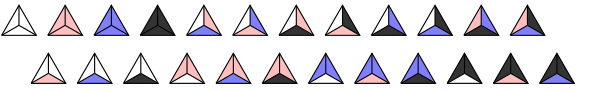</a>

(58)

并给出了两种把它们拼成六边形的方法, 其中相邻边颜色相配, 外边界各边都是纯色:

(a) <a href="../../assets/volume4b/figures/dlx-59a.svg">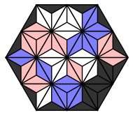</a>

(b) <a href="../../assets/volume4b/figures/dlx-59b.svg">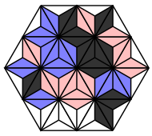</a>

(59)

(注意 (58) 中互为手性镜像的一对, 如下图, 算作不同的两块: 麦克马洪的拼块可以旋转, 但不能 “翻个面”.)

<a href="../../assets/volume4b/figures/dlx-chiral-triangles-left.svg"></a>　<a href="../../assets/volume4b/figures/dlx-chiral-triangles-right.svg"></a>

> 合适的四种颜色是黑、白、红、蓝, 它们在夜间也易于辨别.
>
> ——P. A. 麦克马洪, <em>New Mathematical Pastimes</em> (1921)

设外边界须为全白, 如 (59b). 满足这个条件的拼法有几百万种, 但每个真正不同的解被重复计数 72 次, 因为六边形在旋转和反射下有 12 种对称, 三种非白色又可作 $3!=6$ 种置换. 可以固定全白三角形的位置来消去六边形的对称性 (见习题 119). 至于颜色的对称性, 则可用算法 C 的一个有趣的扩充来消去: 当选项对于 $d$ 种颜色对称时, 它能将解数缩小到原来的 $1/d!$ (见习题 122). 这样, 找到所有的解——猜猜有多少个?——实际上只需 $4.5\,\mathrm G\mu$ 的计算 (见习题 126).

麦克马洪随后研究了这些三角形的许多其他配色问题, 还有以正方形、六边形及其他形状为基础的类似拼块组. 他也考虑过彩色立方体的三维装配, 要求它们在相接处同色. 习题 127–148 讨论了其中若干引人入胜的问题.

<a id="pdf-112"></a><a id="p-92"></a>

**引入重数.** 从许多例子已经看到, 算法 C 扩充了算法 X, 可以解任意的 XCC 问题, 用途十分广泛. 实际上, 在某种意义上, <em>每个</em>约束满足问题都是 XCC 问题的特例 (见习题 100).

不过还可以把算法 C 进一步扩充, 仍然不必大改, 就能远远超出恰当覆盖原有的范围. 例如, 考虑 Robert Wainwright 的 “鹧鸪谜” (1981). 启发他的是下面这个熟知的事实: 前 $n$ 个立方数的和是个完全平方数:

$$
1^3+2^3+\cdots+n^3=N^2,\qquad N=1+2+\cdots+n.\tag{60}
$$

温赖特想知道能否用几何方法来验证这个关系: 取一个 $1\times1$ 的正方形、两个 $2\times2$ 的正方形、…、$n$ 个 $n\times n$ 的正方形, 把它们装进一个 $N\times N$ 的大正方形. (由习题 1.2.1–8 我们知道, 每种 $k\times k$ 的正方形取 $4k$ 个, 就能装进一个 $2N\times2N$ 的正方形. 但温赖特希望能更直接地印证 (60).) 他证明了 $2\leq n\leq5$ 时不可能装满, 却在 $n=12$ 时找到了一个恰好装满的方案. 这使他想起了《圣诞节的十二天》, 因而给他的谜题起了这个名字 (见习题 154).

这道谜可以很容易地用选项来表述. 项有 $n$ 个 $\#k$ ($1\leq k\leq n$), 还有 $N^2$ 个格 $ij$ ($0\leq i,j<N$). 仿照五格骨牌的 (37), 选项为

$$
\text{‘}\#k\quad ij\ i(j+1)\ \ldots\ i(j+k-1)\ (i+1)j\ (i+1)(j+1)\ \ldots\ (i+k-1)(j+k-1)\text{’},\tag{61}
$$

其中 $1\leq k\leq n$, $0\leq i,j\leq N-k$. (恰有 $(N+1-k)^2$ 个选项含有 $\#k$, 每个都列出 $1+k^2$ 个项.) 例如, $n=2$ 时的选项为

```text
#1 00,  #1 01,  #1 02,  #1 10,  #1 11,  #1 12,  #1 20,  #1 21,  #1 22,
#2 00 01 10 11,  #2 01 02 11 12,  #2 10 11 20 21,  #2 11 12 21 22.
```

仍同前一样, 每个格 $ij$ 都要恰好覆盖一次. 不同之处在于, 主要项 $\#k$ 必须恰好覆盖 $k$ 次.

这可是不小的差别. 不过从下面的算法 M 可以看到, 舞蹈链的方法也能处理它. 例如, 算法能证明 $n=6,7$ 时鹧鸪谜都不能完全铺满; 当 $n=8$ 时却能找出几千种出人意料的解, 如

<a href="../../assets/volume4b/figures/dlx-62a.svg">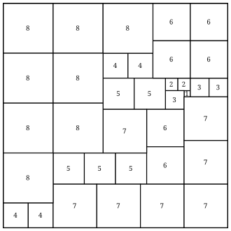</a>　<a href="../../assets/volume4b/figures/dlx-62b.svg">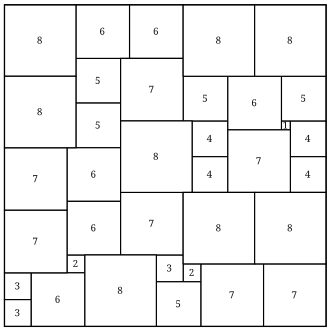</a>

(62)

<a id="pdf-113"></a><a id="p-93"></a>

本节开头定义恰当覆盖问题时, 我们所考虑的是 (5) 那样由 0 和 1 组成的 $M\times N$ 矩阵. 用矩阵的语言来说, 任务是找出行的所有子集, 使它们的和为 $11\ldots1$. 算法 M 将做得更多: 它能找出行和为 $v_1v_2\ldots v_N$ 的所有行子集, 这里 $v_1v_2\ldots v_N$ 可以是给定的<em>任意</em>重数向量.

事实上算法 M 还可再进一步, 允许给每个重数规定一个<em>区间</em> $[u_j\mathinner{.\,.}v_j]$. 它实际要解的一般 <em>MCC 问题</em>, 即 “带颜色的多重覆盖” (multiple covering with colors), 定义如下. 有 $N$ 个项, 其中 $N_1$ 个是主要项, $N-N_1$ 个是次要项. 给每个主要项 $j$ ($1\leq j\leq N_1$) 指定一个容许值的区间 $[u_j\mathinner{.\,.}v_j]$, 其中 $0\leq u_j\leq v_j$, $v_j>0$. 又有 $M$ 个选项, 每个至少含一个主要项. 每个选项的次要项各自指定一种颜色; “空白” 颜色表示一处独有、别处不见的颜色. 任务是找出所有满足以下条件的选项子集:

(i) 每个主要项 $j$ 至少出现 $u_j$ 次, 至多出现 $v_j$ 次;

(ii) 每个次要项至多被赋予一种颜色.

因而每个 XCC 问题都是 MCC 问题在 $u_j=v_j=1$ 时的特例.

MCC 问题的确<em>极为</em>一般! 例如取 $u_j=1$, $v_j=M$, 并且没有次要项, 就得到经典的<em>覆盖问题</em>, 其中只要求每个项<em>至少</em>出现在一个选项中. §7.2.2.6 将专门讨论覆盖问题.

为下面的算法 M 作准备, 这里再看几个 MCC 问题的例子就够了. 首先可以处理温赖特鹧鸪谜的一个改进版本: “对于 $1\leq k\leq n$, 至多取 $k$ 个 $k\times k$ 的正方形, 彼此不重叠地放入 $N\times N$ 的正方形内, 使 $N^2$ 个格中有尽可能多的格被覆盖.” (仍取 $N=1+2+\cdots+n$.) 从 (62) 已经知道, $n=8$ 时可以铺满; 较小的情形却是另一回事. 当 $2\leq n\leq5$ 时不难手工找到解:

<a href="../../assets/volume4b/figures/dlx-63.svg">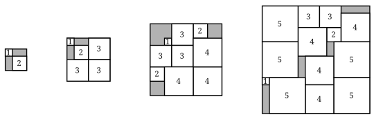</a>

(63)

要证明 $n=5$ 的每一种铺法都至少留下 13 个空格, 可以用算法 M 证明: 在 MCC 问题 (61) 中, 将项 $\#1,\#2,\#3$ 的重数分别从 $1,2,3$ 改为 $[0\mathinner{.\,.}13]$, $[0\mathinner{.\,.}2]$, $[0\mathinner{.\,.}3]$, 仍然无解. 习题 157 构造了 $n=6$ 和 $n=7$ 的最优铺法, 从而解决了鹧鸪谜的所有小规模情形.

再看一个很不相同的 MCC 问题: “放置 $m$ 个皇后, 使它们控制 $n\times n$ 棋盘上的所有格.” (经典的 “五后控制棋盘问题” 是 $m=5$, $n=8$ 的特例, 前面讨论的 “五皇后问题” 则要求五个皇后互不攻击.) 习题 7.1.4–241 讨论了这个问题的历史, 可追溯到 de Jaenisch 的一部杰出著作 (1863).

<a id="pdf-114"></a><a id="p-94"></a>

将它表述为 MCC 问题, 可引入 $n^2+1$ 个主要项, 即代表格子的有序对 $ij$ ($0\leq i,j<n$) 和特殊项 $\#$, 再引入 $n^2$ 个选项:

$$
\text{‘}\#\quad ij\quad i_1j_1\quad i_2j_2\quad\ldots\quad i_tj_t\text{’},\qquad0\leq i,j<n,\tag{64}
$$

其中 $i_1j_1,i_2j_2,\ldots,i_tj_t$ 是位于 $ij$ 的皇后能攻击的格. 每个格 $ij$ 的重数指定为 $[1\mathinner{.\,.}m]$; 项 $\#$ 的重数为 $m$.

根据这个表述, 算法 M 经过 130 亿次内存访问就能找出五后控制棋盘问题的全部 4860 个解. 例如, 一开始有 22 种办法覆盖角格 00. 若在那里放一个皇后, 就有 22 种办法覆盖格 17; 依此类推. 放好三个皇后后, 各步的分支数往往很快减小.

(64) 的 MCC 表述妙在只须略改条件, 便可解许多相关的问题. 例如, 只保留 $1\leq i,j\leq6$ 的 36 个选项, 就得到边上没有皇后的 284 个解. 或者删去 $2\leq i,j\leq5$ 的 16 个选项, 就会发现恰有 880 个解不在中央地带放皇后. 恰有 88 个解避开中间两行及中间两列. 恰有 200 个解将五个皇后全放在 “黑” 格上 ($i+j$ 为偶数). 恰有 90 个解避开左上及右下两个象限. 恰有 2 个解 (找得出来吗?) 将五个皇后全放在棋盘的上半部.

将底行各格的重数由 $[1\mathinner{.\,.}5]$ 改为 1, 会得到 18 个解, 其中底行每格都恰好受一个皇后控制. 又如, 将中央 16 格的重数改为 $[2\mathinner{.\,.}5]$, 会得到 48 个解, 其中靠近中心的每格都至少受两个皇后控制. 将所有格的重数改为 $[1\mathinner{.\,.}4]$, 解数就从 4860 减为 3248; 全改为 $[1\mathinner{.\,.}3]$ 则减为 96. [习题 161](#ex-7-2-2-1-161) 说明了几种不那么显而易见的可能性.

<a href="../../assets/volume4b/figures/dlx-65.svg">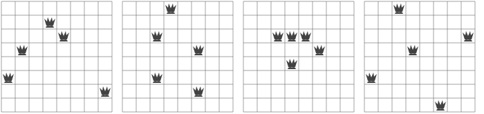</a>

(65)

至今看到的 MCC 问题都只涉及主要项. 次要项连同它们的颜色控制, 增加了新的维度, 极大地拓宽了应用范围. 例如再看 §7.2.2 中简单研究过的<em>单词矩形</em>. 下面是一个 $4\times5$ 单词矩形, 只用了字母表中九个不同的字母:

```text
LABEL
ABIDE
SLAIN
TESTS
```

如果只用常见词, 能否找到一个只用<em>八</em>个不同字母的单词矩形? (更确切地说, 有没有这样的矩形, 各列选自英语中最常见的 1000 个四字母词, 各行则属于斯坦福图库精选的 $\mathrm{WORDS}(2000)$?)

<a id="pdf-115"></a><a id="p-95"></a>

回答是可以, 事实上有六个解:

```text
STRUT  EASED  WADED  RADAR  LLAMA  SCARS
TEASE  AGILE  ARENA  ARENA  EAGER  COCOA
EATEN  SENSE  SEEDS  SEATS  STEAM  ARRAY
PRESS  EDGED  HARSH  HARSH  TESTS  REEDS
```

(66)

要找出它们, 并证明只用七个不同字母是不可能的, 可建立一个 MCC 问题, 取 $A_0,A_1,A_2,A_3,D_0,D_1,D_2,D_3,D_4,\mathtt{\#A},\mathtt{\#B},\ldots,\mathtt{\#Z},\mathtt\#$ 为主要项. 除了 $\mathtt\#$ 的重数为 8 外, 各主要项的重数均为 1. 次要项为 $\mathtt A,\mathtt B,\ldots,\mathtt Z$ 和 $ij$ ($0\leq i<4$, $0\leq j<5$). 计数字母用到 $2\cdot26$ 个短选项:

$$
\mathtt{\#A\ A{:}0},\ \mathtt{\#A\ A{:}1\ \#};\quad
\mathtt{\#B\ B{:}0},\ \mathtt{\#B\ B{:}1\ \#};\quad\ldots;\quad
\mathtt{\#Z\ Z{:}0},\ \mathtt{\#Z\ Z{:}1\ \#}.\tag{67}
$$

于是每个合法的五字母词 $c_1c_2c_3c_4c_5$ 给出四个选项 ‘$A_i\quad i0{:}c_1\ i1{:}c_2\ i2{:}c_3\ i3{:}c_4\ i4{:}c_5\ c_1{:}1\ c_2{:}1\ c_3{:}1\ c_4{:}1\ c_5{:}1$’, $0\leq i<4$; 每个合法的四字母词 $c_1c_2c_3c_4$ 给出五个选项 ‘$D_j\quad 0j{:}c_1\ 1j{:}c_2\ 2j{:}c_3\ 3j{:}c_4\ c_1{:}1\ c_2{:}1\ c_3{:}1\ c_4{:}1$’, $0\leq j<5$. (一个词中出现多次的字母只列一次.)

例如, (66) 第一个解所选的选项之一是 ‘$A_3\quad\mathtt{30{:}P\ 31{:}R\ 32{:}E\ 33{:}S\ 34{:}S\ P{:}1\ R{:}1\ E{:}1\ S{:}1}$’. 它迫使我们同时选取 ‘$\mathtt{\#P\ P{:}1\ \#}$’, ‘$\mathtt{\#R\ R{:}1\ \#}$’, ‘$\mathtt{\#E\ E{:}1\ \#}$’, ‘$\mathtt{\#S\ S{:}1\ \#}$’, 因而使含 $\mathtt\#$ 的已选选项数增加四个.

顺便说一句, 算法 M 用于这些选项时, 务必使用[习题 10](#ex-7-2-2-1-10) 及其答案所述的 “非锐偏好启发式方法”. 否则算法会傻乎乎地对 $\mathtt{\#A},\ldots,\mathtt{\#Z}$ 作二路分支, 然后才试真正的词. 在这种情形下, 对 $D_0$ 作千路分支比对 $\mathtt{\#Q}$ 作二路分支好得多.

**\*一种新舞步.** 为了实现重数, 需要用一种新方式更新数据结构. 例如, 假设某个主要项 $p$ 有五个可用选项, 分别由结点 $a,b,c,d,e$ 表示. 那么 $p$ 的活动选项纵表有如下链接:

$$
\begin{array}{r|cccccc}
x&p&a&b&c&d&e\\
\mathtt{ULINK}(x)&e&p&a&b&c&d\\
\mathtt{DLINK}(x)&a&b&c&d&e&p
\end{array}\tag{68}
$$

若 $p$ 的重数是 3, 从五个选项里选出三个有 $\binom53=10$ 种方法; 但我们<em>不想</em>作十路分支! 下面的算法 M 每个分支只选择解中这些选项的<em>第一个</em>. 随后递归地缩小问题; 缩小后的问题中 $p$ 的表短了, 其中还应再选两个选项. 由于第一个选项必是 $a,b,c$ 之一, 算法将以三路分支开始. 例如, 若选 $b$ 为第一个, 就要求缩小后的问题最终从选项 $\{c,d,e\}$ 中选出两个.

算法会递归地找出缩小后问题的所有解, 却不一定又在<em>同一个</em>项 $p$ 上开始分支; 另一个项 $q$ 可能已变得更为重要. 例如, 选择<a id="pdf-116"></a><a id="p-96"></a> $b$ 时指定的颜色可能使 $\mathtt{LEN}(q)\leq1$. (选择 $b$ 也可能使 $c,d,e$ 中的某些选项不再合法.)

要点在于, 原问题中对 $p$ 所需的三个选项选出第一个以后, 并没有像算法 X 和 C 那样把 $p$ “覆盖” 掉. 项 $p$ 仍与缩小后问题的其他活动项处于同等地位, 因此要相应地修改 (68).

当有重数时, 从项表中除去一个选项来缩小问题, 称为对这个选项作 “微调” (tweak). 例如, 算法刚选定 $b$ 为 $p$ 的第一个选项时, 它就已微调过 $a$ 和 $b$. 这个操作简单得有点出人意料:

$$
\operatorname{tweak}(x,p)=\left\{\begin{aligned}
&\operatorname{hide}'(x);\quad\text{置 }d\gets\mathtt{DLINK}(x),\ \mathtt{DLINK}(p)\gets d,\\
&\mathtt{ULINK}(d)\gets p,\quad\mathtt{LEN}(p)\gets\mathtt{LEN}(p)-1.
\end{aligned}\right.\tag{69}
$$

(见 (51). 只在 $x=\mathtt{DLINK}(p)$, $p=\mathtt{ULINK}(x)$ 时才会执行 $\operatorname{tweak}(x,p)$.) 注意微调 $x$ 比隐藏 $x$ 多做了一些, 却比覆盖 $p$ 少做了一些.

算法终究会把 $a,b,c$ 都尝试作为 $p$ 的第一个选项, 接下来就要回溯, 撤销这些微调. 依次执行 $\operatorname{tweak}(a,p)$, $\operatorname{tweak}(b,p)$ 和 $\operatorname{tweak}(c,p)$, 会把 (68) 中原有的向上链接大半改写掉:

$$
\begin{array}{r|cccccc}
x&p&a&b&c&d&e\\
\mathtt{ULINK}(x)&e&p&p&p&p&d\\
\mathtt{DLINK}(x)&d&b&c&d&e&p
\end{array}\tag{70}
$$

可惜这些残存的数据不足以恢复原状, 因为结点 $a$ 已经找不到了. 而如果一开始就记下 $a$ 的值, 情形就好办了: 有了指向 $a$ 的指针, 再沿 (70) 的 $\mathtt{DLINK}$ 走, 便依次能找到 $b,c,d$.

因此算法设一个数组 $\mathtt{FT}[l]$, 记住各层 $l$ 的 “第一次微调” 所在之处. 它还为操纵链的舞步添上一式, 称为 “撤销微调”:

$$
\operatorname{untweak}(l)=\left\{\begin{aligned}
&\text{置 }a\gets\mathtt{FT}[l],\ p\gets(a\leq N\mathbin{?}a\mathbin{:}\mathtt{TOP}(a)),\ x\gets a,\ y\gets p;\\
&\text{置 }z\gets\mathtt{DLINK}(p),\ \mathtt{DLINK}(p)\gets x,\ k\gets0;\\
&\text{只要 }x\ne z,\ \text{就置 }\mathtt{ULINK}(x)\gets y,\ k\gets k+1,\\
&\quad\operatorname{unhide}'(x),\quad y\gets x,\ x\gets\mathtt{DLINK}(x);\\
&\text{最后置 }\mathtt{ULINK}(z)\gets y,\ \mathtt{LEN}(p)\gets\mathtt{LEN}(p)+k.
\end{aligned}\right.\tag{71}
$$

(见习题 163. 这个计算依赖于[习题 2](#ex-7-2-2-1-2)(a) 所证的一个出人意料的事实: 可以按与隐藏<em>相同</em>的次序安全地恢复.)

给定的重数是一个<em>区间</em>时也能用这套办法. 例如, 若上例中 $p$ 必须出现在 2、3 或 4 个选项中, 而非恰好 3 个, 则第一个选项可以是 $a,b,c,d$ 中任意一个, 缩小后的问题要求 $p$ 再出现在余下的 1、2 或 3 个选项中. 将 $a,b,c,d$ 依次微调并考察以后, 算法终于要撤销这几次微调.

同样, 若给定 $p$ 的重数为 0、1 或 2, 则下面的算法会依次微调 $a$ 至 $e$. 在最终撤销微调并回溯以前, 它也会考察<em>完全不选</em> $p$ 的选项的那些解.

<a id="pdf-117"></a><a id="p-97"></a>

不过, 若规定 $p$ 的重数是 0 或 1, 就有一种特殊情形. 这时选了 $a$ 以后就不允许再选 $b,c,d,e$. 因此, 应当像算法 C 那样调用 $\operatorname{cover}'(p)$, 以免每次只隐藏一个选项 (见 (50)). 再将 $p$ 的各选项逐个微调, 从活动表中依次除去. 这种微调用特殊操作 $\operatorname{tweak}'(x,p)$, 与 (69) 的 $\operatorname{tweak}(x,p)$ 相同, 只是略去了 $\operatorname{hide}'(x)$, 因为覆盖 $p$ 时已经隐藏过了. 最后, 重数为 0 或 1 的情形以调用 $\operatorname{untweak}'(l)$ 告终. 它与 (71) 中的 $\operatorname{untweak}(l)$ 相同, 不过 (i) 略去 $\operatorname{unhide}'(x)$, (ii) 恢复 $\mathtt{LEN}(p)$ 后再调用 $\operatorname{uncover}'(p)$.

现在可以写算法 M 了, 只差在数据结构中表示重数的办法. 为此每个主要项增设两个域 $\mathtt{SLACK}$ 和 $\mathtt{BOUND}$. 设 $p$ 所要求的重数在区间 $[u\mathinner{.\,.}v]$ 内, 其中 $0\leq u\leq v$, $v\ne0$. 算法 X 和 C 对应于 $u=v=1$ 的情形. 在算法开始时置

$$
\mathtt{SLACK}(p)\gets v-u,\qquad\mathtt{BOUND}(p)\gets v.\tag{72}
$$

$\mathtt{SLACK}(p)$ 的值以后不再改变. 但随着问题的缩小, $\mathtt{BOUND}(p)$ 将动态减小, 从而我们为 $p$ 选择的选项数绝不超过它当前的界.

**算法 M** (<em>带重数和颜色的覆盖.</em>) 本算法扩充算法 X 和 C, 访问给定 MCC 问题的全部解.

**M1.** [初始化.] 如算法 C 的步骤 C1 那样在存储器中设置问题, 并按 (72) 加上重数规定. 另置 $N$ 为项数, $N_1$ 为主要项数, $Z$ 为最后一个分隔结点的地址, $l\gets0$.

**M2.** [进入第 $l$ 层.] 若 $\mathtt{RLINK}(0)=0$ (所有主要项都已覆盖), 访问 $x_0x_1\ldots x_{l-1}$ 所指定的解, 转 M9. (见习题 164.)

**M3.** [选择 $i$.] 此时仍待覆盖的项为 $i_1,\ldots,i_t$, 其中 $i_1=\mathtt{RLINK}(0)$, $i_{j+1}=\mathtt{RLINK}(i_j)$, $\mathtt{RLINK}(i_t)=0$. 从中选取一个, 记为 $i$. (习题 166 的 MRV 启发式方法往往很有效.) 若分支数 $\theta_i$ 为零 (见习题 166), 转 M9.

**M4.** [准备对 $i$ 分支.] 置 $x_l\gets\mathtt{DLINK}(i)$, $\mathtt{BOUND}(i)\gets\mathtt{BOUND}(i)-1$. 若 $\mathtt{BOUND}(i)$ 现为零, 覆盖项 $i$ (用 (50)). 若 $\mathtt{BOUND}(i)\ne0$ 或 $\mathtt{SLACK}(i)\ne0$, 置 $\mathtt{FT}[l]\gets x_l$.

**M5.** [酌情微调 $x_l$.] 若 $\mathtt{BOUND}(i)=\mathtt{SLACK}(i)=0$, 则 $x_l\ne i$ 时转 M6, $x_l=i$ 时转 M8. (这种情形同算法 C.) 否则, 若 $\mathtt{LEN}(i)\leq\mathtt{BOUND}(i)-\mathtt{SLACK}(i)$, 转 M8 (表 $i$ 太短). 否则, 若 $x_l\ne i$, 调用 $\operatorname{tweak}(x_l,i)$ (见 (69)); 但在 $\mathtt{BOUND}(i)=0$ 时改用 $\operatorname{tweak}'(x_l,i)$. 其余情形下, 若 $\mathtt{BOUND}(i)\ne0$, 置 $p\gets\mathtt{LLINK}(i)$, $q\gets\mathtt{RLINK}(i)$, $\mathtt{RLINK}(p)\gets q$, $\mathtt{LLINK}(q)\gets p$.

**M6.** [试取 $x_l$.] 若 $x_l\ne i$, 置 $p\gets x_l+1$, 只要 $p\ne x_l$ 就作下列操作: 置 $j\gets\mathtt{TOP}(p)$; 若 $j\leq0$, 置 $p\gets\mathtt{ULINK}(p)$; 否则, 若 $j\leq N_1$, 置 $\mathtt{BOUND}(j)\gets\mathtt{BOUND}(j)-1$, $p\gets p+1$, 并在 $\mathtt{BOUND}(j)$ 现为零时执行 $\operatorname{cover}'(j)$;<a id="pdf-118"></a><a id="p-98"></a>其余情形则执行 $\operatorname{commit}(p,j)$, 并置 $p\gets p+1$. (这个循环覆盖或确认了含 $x_l$ 的选项中除 $i$ 外的各项.) 置 $l\gets l+1$, 回到 M2.

**M7.** [再试.] 置 $p\gets x_l-1$. 只要 $p\ne x_l$, 就作下列操作: 置 $j\gets\mathtt{TOP}(p)$; 若 $j\leq0$, 置 $p\gets\mathtt{DLINK}(p)$; 否则, 若 $j\leq N_1$, 置 $\mathtt{BOUND}(j)\gets\mathtt{BOUND}(j)+1$, $p\gets p-1$, 并在 $\mathtt{BOUND}(j)$ 现为 1 时执行 $\operatorname{uncover}'(j)$; 其余情形则执行 $\operatorname{uncommit}(p,j)$ 并置 $p\gets p-1$. (这就按相反次序取消覆盖或撤销确认.) 置 $x_l\gets\mathtt{DLINK}(x_l)$, 回到 M5.

**M8.** [恢复 $i$.] 若 $\mathtt{BOUND}(i)=\mathtt{SLACK}(i)=0$, 用 (52) 取消对项 $i$ 的覆盖. 否则调用 $\operatorname{untweak}(l)$; 但在 $\mathtt{BOUND}(i)=0$ 时改用 $\operatorname{untweak}'(l)$. 置 $\mathtt{BOUND}(i)\gets\mathtt{BOUND}(i)+1$.

**M9.** [离开第 $l$ 层.] 若 $l=0$, 终止. 否则置 $l\gets l-1$. 若 $x_l\leq N$, 置 $i\gets x_l$, $p\gets\mathtt{LLINK}(i)$, $q\gets\mathtt{RLINK}(i)$, $\mathtt{RLINK}(p)\gets\mathtt{LLINK}(q)\gets i$, 转 M8. (这使 $i$ 重新成为活动项.) 否则置 $i\gets\mathtt{TOP}(x_l)$, 转 M7.　■

**\*算法 X 的分析.** 现在来作定量研究, 看看对这些算法的运行时间究竟能<em>证明</em>些什么.

为简单起见, 暂且不考虑颜色约束, 只看算法 X 怎样找出一个恰当覆盖问题的全部解, 其中问题由 (5) 那样的 $M\times N$ 零一矩阵 $A$ 给出.

我们假设问题是<em>严格的</em>, 意即矩阵中没有相同的两行, 也没有相同的两列. 因为如果有两行或两列相同, 只须保留其中一个, 很容易把缩小后问题 $A'$ 的各个解与原问题 $A$ 的全部解联系起来 (见习题 179).

第一个目标是以 $A$ 的行数 (即选项数) 为参数, 求出查找树结点数的上界. 这个上界按指数增长, 因为恰当覆盖问题可以有许多解; 不过我们将看到, 它实际上不至于大得太离谱.

为此, 我们定义一个 “末日函数” $D(n)$. 当算法 X 在步骤 X3 使用 MRV 启发式方法时, 它在任何有 $n$ 个选项的严格恰当覆盖问题上的查找树至多有 $D(n)$ 个结点.

查找树的根标为原矩阵 $A$, 其他结点则递归地定义. 当第 $l$ 层的一个结点标为某个子问题, 而步骤 X3 为它作 $t$ 路分支时, 它就有 $t$ 棵子树. 各子树的根标为经步骤 X4 覆盖项 $i$, 再由步骤 X5 随 $x_l$ 的 $t$ 种不同选择酌情覆盖另外若干项 $j$ 以后所余的问题.

例如, 若 $A$ 是 (5) 的矩阵, 则完整的查找树如下:

<a href="../../assets/volume4b/figures/dlx-tree72.svg">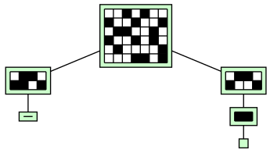</a>

<a id="pdf-119"></a><a id="p-99"></a>

(图中各个矩阵和子矩阵都加了一圈浅色边框. 左下结点表示 $0\times1$ 子矩阵, 剩下的那一列无从覆盖, 算法只好回溯. 右下结点表示 $0\times0$ 子矩阵; 它恰好是其上方 $1\times2$ 问题的一个解.) 若愿意, 还可删去所有子矩阵中的重复列来<em>化简</em>它们, 尽管算法 X 本身并不这样做. 于是查找树的每个结点处都有一个<em>严格</em>恰当覆盖问题:

<a href="../../assets/volume4b/figures/dlx-73.svg">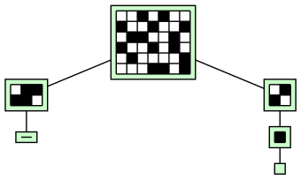</a>

(73)

$t$ 路分支意味着矩阵 $A$ 有某种结构. 必有一列, 比如 $i_1=i$, 在恰好 $t$ 行 $o_1,\ldots,o_t$ 中有 1; 而且<em>每一列</em>至少含有 $t$ 个 1. 当我们在分支中选择行 $o_p$ ($1\leq p\leq t$) 时, 定义第 $p$ 棵子树的缩小问题从 $A$ 中恰好去掉 $s_p$ 行, 其中 $s_p$ 是与 $o_p$ 相交的行数. 不妨将这些行排成 $s_1\leq\cdots\leq s_t$. 例如 (73) 中 $t=2$, $s_1=s_2=4$.

现在有件妙事发生: 存在唯一的初段长度 $0\leq t'\leq t$, 在这一段上

$$
s_p=t+p-1,\qquad 1\leq p\leq t'.\tag{74}
$$

也就是说, 或者 $s_1>t$, $t'=0$; 或者 $s_1=t$, $t'=1$, 且 $t=1$ 或 $s_2>t+1$; 或者 $s_1=t$, $s_2=t+1$, $t'=2$, 且 $t=2$ 或 $s_3>t+2$; …; 或者 $s_1=t$, $s_2=t+1$, …, $s_t=2t-1$, $t'=t$.

例如设 $t=4$, $s_1=4$; 须证 $s_2\geq5$. 因为 $s_1=4$, 行 $o_1$ 只与 $\{o_1,\ldots,o_4\}$ 中的行相交. 因此选项 $o_1$ 只含<em>一个</em>项 ‘$i_1$’ (任何同样只出现在这四行的列都会是重复列). 于是选项 $o_2$ 至少含有两个项 ‘$i_1\ i_2\ \ldots$’, 否则问题就不严格. 而新项 $i_2$ 至少出现在四个选项中, 其中没有 $o_1$. 所以 $o_2$ 与五个或更多选项相交 (包括自身). 证毕.

类似地, 若 $t=4$, $s_1=4$, $s_2=5$, 习题 180 证明 $s_3\geq6$, 而且结论还要更强. 例如若 $t=t'=4$, 即 (74) 要求的 $(s_1,s_2,s_3,s_4)=(4,5,6,7)$, 则习题 180 证明另有选项 $o_5,o_6,o_7$, 其形式格外简单:

$$
\begin{aligned}
&o_1=\text{‘}i_1\text{’},\quad o_2=\text{‘}i_1\ i_2\text{’},\quad
o_3=\text{‘}i_1\ i_2\ i_3\text{’},\quad o_4=\text{‘}i_1\ i_2\ i_3\ i_4\text{’};\\
&o_5=\text{‘}i_2\ i_3\ i_4\ \ldots\text{’},\quad o_6=\text{‘}i_3\ i_4\ \ldots\text{’},\quad o_7=\text{‘}i_4\ \ldots\text{’}.
\end{aligned}\tag{75}
$$

好, 现在可以构造答应过的 “末日函数” $D(n)$ 了. 它起初十分温和,

$$
D(0)=D(1)=1;\tag{76}
$$

为方便起见, $n<0$ 时置 $D(n)=-\infty$. 对于 $n\geq2$, 定义为

$$
D(n)=\max\{d(n,t,t')\mid 1\leq t<n,\ 0\leq t'\leq t\},\tag{77}
$$

<a id="pdf-120"></a><a id="p-100"></a>

其中 $d(n,t,t')$ 是所有含 $n$ 个选项且 (74) 的参数为 $t,t'$ 的严格恰当覆盖问题的查找树大小的上界. 这样的一个界是

$$
d(n,t,0)=1+tD(n-t-1).\tag{78}
$$

它处理 $t'=0$ 的情形, 因为这时查找树作 $t$ 路分支,

<a href="../../assets/volume4b/figures/dlx-79.png">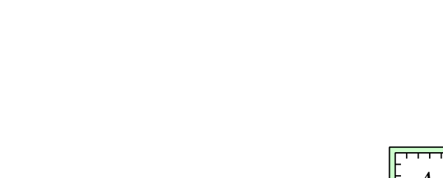</a>

(79)

且每个子问题 $A_p$ 至多有 $n-t-1$ 个选项.

当 $t'>0$ 时, 公式较为复杂, 也不那么显然:

$$
d(n,t,t')=t'+t'D(n-t-t'+1)+(t-t')D(n-t-t'-1),\qquad 1\leq t'\leq t.\tag{80}
$$

由习题 180 的结构理论可以证明此式, 所用的事实是前 $t'-1$ 个分支各自紧接着一个一路分支. 例如, $t=5$, $t'=3$ 时的查找树如下:

<a href="../../assets/volume4b/figures/dlx-81.png">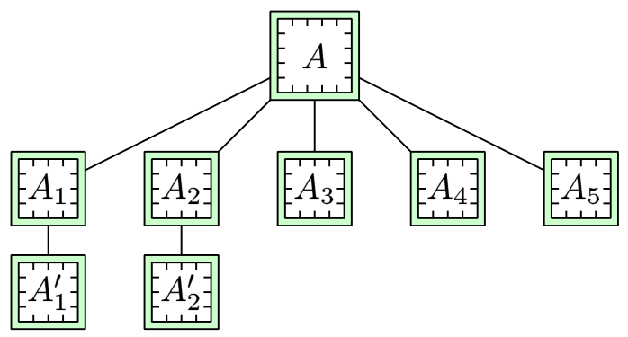</a>

(81)

这里 $A'_1$ 是在 $A_1$ 中覆盖 $i_2$ 的唯一办法, $A'_2$ 是在 $A_2$ 中覆盖 $i_3$ 的唯一办法. 严格问题 $A'_1,A'_2,A_3$ 至多各有 $n-7$ 个选项; $A_4,A_5$ 至多各有 $n-9$ 个. 所以 (81) 至多有 $3+3D(n-7)+2D(n-9)$ 个结点.

写一个简单的程序, 由 (76)、(78)、(80) 可算得

```text
   n = 0 1 2 3 4 5  6  7  8  9 10 11 12 13 14  15  16  17  18  19  20  21
D(n) = 1 1 2 4 5 6 10 13 17 22 31 41 53 69 94 125 165 213 283 377 501 661
```

对所有 $n\geq19$, 最大值都<em>只</em>在 $t=4$, $t'=0$ 时取得. 因而对所有充分大的 $n$, 有 $D(n)=1+4D(n-5)$; 实际上习题 181 给出了精确表示 $D(n)$ 的一个简单公式.

**定理 E.** <em>有 $n$ 个选项的严格恰当覆盖问题的查找树有 $O(4^{n/5})$ 个结点, 可能多达 $\Omega(7^{n/8})$ 个. 这两个指数的底数分别约为 $1.31951$ 和 $1.27537$.</em>

<em>证明.</em> 上界由习题 181 得出, 下界则来自习题 182 的一族问题.　■

[David Eppstein 将这条定理作为生日贺礼 (!) 送给了作者; 见 <code>11011110.github.io/blog/2008/01/10/analyzing-algorithm-x.html</code>.]

<a id="pdf-121"></a><a id="p-101"></a>

到目前为止, 我们只分析了算法 X 的查找树中的结点数. 但有些结点的代价可能比其他结点高得多, 因为它们可能从当前的活动表中删去格外多的选项.

因此再深入一步, 研究算法 X 对数据结构所作的<em>更新</em>次数, 即它使用操作 (1) 从双链表除去元素的次数. (这也是它最终要用操作 (2) <em>恢复</em>元素的次数.) 更确切地说, 更新数等于调用 $\operatorname{cover}(i)$ 的次数, 加上 $\operatorname{hide}(p)$ 置 $\mathtt{LEN}(x)\gets\mathtt{LEN}(x)-1$ 的次数 (见 (12)、(13)). 以访存次数来度量, 算法 X 总的运行时间通常约为总更新数的 13 倍.

有一类 “极端” 恰当覆盖问题值得分析一下更新数: 它们有 $n$ 个项、$2^n-1$ 个选项. 这样的题解数最多, 数据也最多, 因为项的<em>每个</em>非空子集都是一个选项. 其解恰为<em>集合分划</em>, 即 §7.2.1.5 中研究过的将这些项分成互不相交的各块的 $\varpi_n$ 种方法. 例如 $n=3$ 时选项为 ‘1’, ‘2’, ‘1 2’, ‘3’, ‘1 3’, ‘2 3’, ‘1 2 3’, 有 $\varpi_3=5$ 个解: (‘1’, ‘2’, ‘3’); (‘1’, ‘2 3’); (‘1 2’, ‘3’); (‘1 3’, ‘2’); (‘1 2 3’).

任给一个项, 有 $2^{n-1}$ 种办法覆盖它; 若用一个大小为 $k$ 的选项覆盖, 剩下的便是其余 $n-k$ 个项上的极端问题. 因此算法 X 从第 0 层向第 1 层前进 $2^{n-1}$ 次, 接着就相当于递归地调用自身. 在第 0 层进行的更新数记为 $v_n$, 它同 X3 中选取分支项的策略无关. 总更新数 $x_n$ 因而为

$$
x_n=v_n+\binom{n-1}0x_{n-1}+\binom{n-1}1 x_{n-2}+\cdots+\binom{n-1}{n-1}x_0.\tag{82}
$$

这个递推式的解为 $x_0=v_0$, $x_1=v_0+v_1$, $x_2=2v_0+v_1+v_2$; 一般地, $x_n=\sum_{k=0}^n a_{nk}v_k$, 其中矩阵 $(a_{nk})$ 为

$$
\begin{pmatrix}1&0&0&0&0&0&0&\cdots\\1&1&0&0&0&0&0&\cdots\\2&1&1&0&0&0&0&\cdots\\5&3&1&1&0&0&0&\cdots\\15&9&4&1&1&0&0&\cdots\\52&31&14&5&1&1&0&\cdots\\203&121&54&20&6&1&1&\cdots\\\vdots&\vdots&\vdots&\vdots&\vdots&\vdots&\vdots&\vdots\end{pmatrix}=\begin{pmatrix}1&0&0&0&0&0&0&\cdots\\-1&1&0&0&0&0&0&\cdots\\-1&-1&1&0&0&0&0&\cdots\\-1&-2&-1&1&0&0&0&\cdots\\-1&-3&-3&-1&1&0&0&\cdots\\-1&-4&-6&-4&-1&1&0&\cdots\\-1&-5&-10&-10&-5&-1&1&\cdots\\\vdots&\vdots&\vdots&\vdots&\vdots&\vdots&\vdots&\vdots\end{pmatrix}^{-1}\tag{83}
$$

行和列从 0 开始编号. 最左列的数 $a_{n0}$ 是在 $v_n=\delta_{n0}$ 时 (82) 的解, 也就是熟悉的贝尔数 $\varpi_n$; 它们计数的是查找树的叶. 第二列的 $a_{n1}$ 是 $v_n=\delta_{n1}$ 时的解, 即古尔德数 $\widehat\varpi_n$; 若按各块的最小元素排列, 它们计数的是最后一块 (或 “尾块”) 为单元素集的集合分划. 一般地, 对 $k>0$, $a_{nk}$ 计数的<a id="pdf-122"></a><a id="p-102"></a>是尾块大小为 $k$ 的集合分划. [见 H. W. Gould 和 J. Quaintance, <em>Applicable Analysis and Discrete Mathematics</em> **1** (2007), 371–385.]

习题 186 证明, 第 0 层的实际更新数为

$$
v_n=\bigl((9n-27)4^n-(8n-32)3^n+(36n-36)2^n+72-41\delta_{n0}\bigr)/72;\tag{84}
$$

习题 187 则利用各序列 $\langle a_{nk}\rangle$ 之间的关系, 证明

$$
x_n=22\varpi_n+12\widehat\varpi_n-\left(\tfrac23n-1\right)3^n
-\tfrac52n2^n-12n-5-12\delta_{n1}-18\delta_{n0}.\tag{85}
$$

渐近地, $\widehat\varpi_n/\varpi_n$ 很快趋于 “欧拉–戈姆佩茨常数”

$$
\hat g=\int_0^\infty\frac{e^{-x}\,dx}{1+x}=0.59634\,73623\,23194\,07434\,10784\,99369\,27937\,60742-\tag{86}
$$

(见习题 189). 所以 $x_n\approx(22+12\hat g)\varpi_n\approx29.156\varpi_n$. 我们已证明, 对极端恰当覆盖问题, <em>算法 X 每求出一个解平均约作 29.156 次更新</em>. 这个结果相当令人鼓舞: 面对 $2^n$ 个平均长度约为 $n/2$ 的选项, 本以为链表操作的代价要大得多; 实际上舞蹈链方法同 §7.2.1.5 中为集合分划精心调整的方法相比, 只差一个常数因子.

**\*匹配问题的分析.** 最简单的恰当覆盖问题中, 有一类是每个选项只含少数几个项的. 例如, 所谓 X2C 问题 (“用二元集作恰当覆盖”) 便是每个选项恰有 2 个项的特例; X3C 问题的每个选项有 3 个项, 依此类推. 从 (30) 已看到, 数独是一个 X4C 问题.

来仔细看看最简单的 X2C 问题. 尽管简单, 它实际上包含不少有趣的情形. 每个 X2C 问题都显然对应一个图 $G$, 其顶点 $v$ 为各项, 边 $u\mathbin{-}v$ 为同现于一个选项 ‘$u\ v$’ 中的项对. 用这种语言来说, X2C 问题就是求<em>完全匹配</em>的经典任务, 即求使每个顶点都恰好出现一次的边集.

后面的 §7.5.5 将研究完全匹配的高效算法. 眼下已有一个有趣的问题: 同专为图中匹配而开发、精心调整的算法相比, 我们的通用算法 X 究竟表现如何?

例如设 $G$ 为完全图 $K_{2q+1}$. 换句话说, 有 $n=2q+1$ 个项 $\{0,1,\ldots,2q\}$, 以及 $m=\binom{2q+1}2=(2q+1)q$ 个选项 ‘$i\ j$’, $0\leq i<j\leq2q$. 这个问题显然无解, 因为二元集不可能恰好覆盖奇数个点! 然而算法 X 并不知道这一点 (除非适当地分解问题, 给它一点提示). 所以很值得看看, 它要白忙多久才肯罢手.

事实上很容易分析: 不管 X3 选了哪个项 $i$, 算法都会恰好分成 $2q$ 个分支, 对每个 $j\ne i$ 的选项 ‘$i\ j$’ 各有一个. 而每个分支都等价于剩下 $2q-1$ 个项上的匹配问题; 事实上, 余下的选项对应完全图 $K_{2q-1}$. 因此查找树在深度 1 有 $2q$ 个结点,<a id="pdf-123"></a><a id="p-103"></a> 在深度 2 有 $(2q)(2q-2)$ 个结点, …, 在深度 $q$ 有 $(2q)(2q-2)\ldots(2)=2^q q!$ 个结点. 后者全都需要回溯; 它们是叶, 因为在图 $K_1$ 上不可能得到匹配.

这个过程要花多久? 仔细看看 (见习题 193) 就知道, 对数据结构所作的总更新数满足递推式

$$
U(2q+1)=1+2q+4q^2+2qU(2q-1),\quad q>0;\qquad U(1)=1.\tag{87}
$$

因而 (见习题 194), 算法 X 为发现 $K_{2q+1}$ 没有完全匹配所作的更新次数, 还不到叶数的 8.244 倍.

将完全图 $K_{2q}$ 交给算法 X, 情况好一些: 这道题有解, 而且解多得很. 不难看出 $K_{2q}$ 恰有 $(2q-1)(2q-3)\ldots(3)(1)=(2q)!/(2^q q!)$ 个完全匹配. 例如 $K_8$ 有 $7\cdot5\cdot3\cdot1=105$ 个. 此时的总更新数满足同 (87) 类似的递推式:

$$
U(2q)=1-2q+4q^2+(2q-1)U(2q-2),\quad q>0;\qquad U(0)=0.\tag{88}
$$

习题 194 证明, 平均每找到一个匹配还不到 10.054 次更新.

有了这些事实, 便可算出将下面的图

<a href="../../assets/volume4b/figures/dlx-89.png">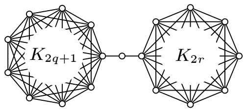</a>

(89)

交给算法 X 时会怎样. (这个图有 $2q+2r+2$ 个顶点.) 习题 195 揭晓的结果既有启发性又有些离奇.

<em>二维匹配</em>问题, 又称二部匹配, 简称 2DM, 是 X2C 的特例, 其中每个选项均如 ‘$X_j\ Y_k$’, 两个项集 $\{X_1,\ldots,X_n\}$ 和 $\{Y_1,\ldots,Y_n\}$ 互不相交. 更高维的匹配作类似定义; 数独其实是 4DM 的一例.

最后, 用<em>有界排列问题</em>来结束匹配的分析: “给定正整数序列 $a_1\ldots a_n$, 求 $\{1,\ldots,n\}$ 中满足 $p_j\leq a_j$ ($1\leq j\leq n$) 的所有排列 $p_1\ldots p_n$.” 由于 $p_1\ldots p_n$ 是排列, 不妨假设 $a_1\leq\cdots\leq a_n$. 还可假设 $a_j\geq j$, 否则无解; 取 $a_n\leq n$ 也不失一般性. 容易看出这是个 2DM 问题, 恰有 $a_1+\cdots+a_n$ 个选项, 即 ‘$X_j\ Y_k$’, 其中 $1\leq j\leq n$, $1\leq k\leq a_j$.

设先以 $X_1$ 分支. 每个 $a_1$ 子问题实质上仍是有界排列问题, 其中 $n$ 减去 1, $a_1\ldots a_n$ 换为 $(a_2-1)\ldots(a_n-1)$. 所以又可以递归分析, 而舞蹈链算法的表现也相当不错. 例如 $a_j=\min(j+1,n)$ ($1\leq j\leq n$) 时共有 $2^{n-1}$ 个解, 算法 X 每个解只需约 12 次更新. 若 $a_j=\min(2j,n)$, 则有 $\lfloor(n+1)/2\rfloor!\,\lfloor(n+2)/2\rfloor!$ 个解, 每个解只需约 $4e-1\approx9.87$ 次更新. 详见习题 196.

<a id="pdf-124"></a><a id="p-104"></a>

**\*使查找保持适当的焦点.** 有些回溯算法浪费时间, 同时去解两个或更多只有松散联系的问题. 例如, 考虑有 7 个项 $\{0,1,\ldots,6\}$ 和下列 13 个选项的二元覆盖问题:

$$
\mathtt{01,\ 02,\ 14,\ 15,\ 16,\ 24,\ 25,\ 26,\ 34,\ 35,\ 36,\ 45,\ 46}.\tag{90}
$$

这里每对数字表示两个单独的项. 采用 MRV 启发式的算法 X 会在项 0 上分支, 选 ‘0 1’ 或 ‘0 2’; 接下来遇到一个三路分支; 最终, 隐式遍历一棵 19 结点的查找树后, 才断定问题无解:

<a href="../../assets/volume4b/figures/dlx-91.svg"></a>

(91)

取问题 (90) 的 $n$ 个独立副本, 就得到一个焦点不良的极端例子. 问题有 $7n$ 个项 $\{k0,k1,\ldots,k6\}$, $13n$ 个选项 ‘$k0\ k1$’, ‘$k0\ k2$’, …, ‘$k4\ k6$’, 其中 $0\leq k<n$. 算法首先对 $00,10,\ldots,(n-1)0$ 各作一次二路分支; 然后逐个研究所得的 $2^n$ 个子问题, 每个都从三路分支开始, 再逐一证明无解. 到放弃时, 查找树已有 $10\cdot2^n-1$ 个结点. 相反, 如果能让算法专注于 (90) 的第一份副本 (即 $k=0$), 暂不使用 MRV 启发式, 它只须回溯 19 个结点就已断定无解.

同样, 对项集 $\{0,1,\ldots,5\}$ 及下列选项给出的简单恰当覆盖问题,

$$
\text{‘0 1’, ‘0 2’, ‘1 3 4’, ‘1 3 5’, ‘1 4 5’, ‘2 3 4’, ‘2 3 4 5’, ‘2 4 5’, ‘3 4’, ‘3 5’, ‘4 5’},\tag{92}
$$

查找树有 9 个结点, 其中一个是解:

<a href="../../assets/volume4b/figures/dlx-93.svg"></a>

(93)

取 (92) 的 $n$ 个独立副本, 得到一个只有唯一解的恰当覆盖问题; 用算法 X 及 MRV 得到的树有 $8\cdot2^n-7$ 个结点. 但若算法一次只专心解一个问题, 找到解的查找树就只有 $8n+1$ 个结点.

从实际角度看, 必须承认, 只有当 $n$ 大于 30 左右时, 这些小例子因焦点不良引起的指数行为才值得担心. 因为 $n$ 较小时, $2^n$ 对现代计算机并不可怕. 但可见焦点选得好确能大有裨益. 所以下面来看看, 一般来说, 当输入实际由两个独立的问题组成时, 算法 X 及其近亲怎样行动.

先花一点时间把查找树定义准确. 给定 $m\times n$ 的零一矩阵 $A$, 若 $n=0$, 相应恰当覆盖问题的查找树 $T$ 就是单独一个解结点 “▪”; 否则 $T$ 为

<a href="../../assets/volume4b/figures/dlx-94.png"></a>

(94)　$d\geq0$,<a id="pdf-125"></a><a id="p-105"></a> 其中步骤 X3 选作分支的项有 $d$ 个选项, $T_k$ 是删去第 $k$ 个选项所含各项后缩小的问题的查找树. (用 MRV 启发式时, $d$ 是所有活动项表的最小长度, 我们在具有这个 $d$ 值的项中选最靠左的一个.)

若矩阵 $A$ 和 $A'$ 给出两个独立的问题, 则试图同时解二者所得到的恰当覆盖问题, 对应的就是直和 $A\oplus A'$ (见式 7–(40)). 因此若 $T,T'$ 为相应的查找树, 就用 $T\oplus T'$ 表示 MRV 启发式下 $A\oplus A'$ 的查找树. (这棵树只取决于 $T,T'$, 与 $A,A'$ 的其他性质无关.) 如果其中之一只是一个解结点, 规则很简单:

$$
T\oplus\blacksquare=T;\qquad \blacksquare\oplus T'=T'.\tag{95}
$$

否则 $T$ 和 $T'$ 都形如 (94), 如下图所示.

<a href="../../assets/volume4b/figures/dlx-96.svg">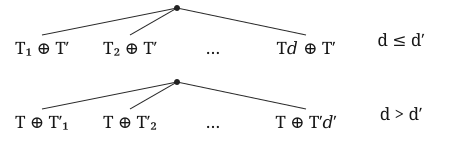</a>

 $T\oplus T'$ 有一个根结点, 它的各棵子树依次为

$$
\begin{cases}
T_1\oplus T',\ T_2\oplus T',\ \ldots,\ T_d\oplus T',& d\leq d';\\
T\oplus T'_1,\ T\oplus T'_2,\ \ldots,\ T\oplus T'_{d'},& d>d'.
\end{cases}\tag{96}
$$

亲爱的读者, 请先做习题 202——它很容易!——再往下读. 这道题会帮助你理解 $T\oplus T'$ 的定义. 你也将看到, $T\oplus T'$ 的每个结点都对应于一个有序对 $\alpha\alpha'$, 其中 $\alpha$ 和 $\alpha'$ 分别是 $T$ 和 $T'$ 的结点. 这些有序对是理解 $T\oplus T'$ 结构的关键: 若 $\alpha$ 和 $\alpha'$ 分别在两树的第 $l>0$ 层和第 $l'>0$ 层, 各自由根沿路径 $\alpha_0\mathbin{-}\alpha_1\mathbin{-}\cdots\mathbin{-}\alpha_l=\alpha$ 和 $\alpha'_0\mathbin{-}\alpha'_1\mathbin{-}\cdots\mathbin{-}\alpha'_{l'}=\alpha'$ 到达, 则 $\alpha\alpha'$ 在 $T\oplus T'$ 中的父结点或为 $\alpha_{l-1}\alpha'$, 或为 $\alpha\alpha'_{l'-1}$. 因而 $\alpha$ 在 $T$ 中的每个祖先 $\alpha_k$ ($0\leq k\leq l$), 都在 $\alpha\alpha'$ 于 $T\oplus T'$ 的某个祖先 $\alpha_k\alpha'_{k'}$ 中出现, 其中 $0\leq k'\leq l'$.

用 $\deg(\alpha)$ 表示查找树中的结点 $\alpha$ 的孩子数, 但若 $\alpha$ 为解结点, 就定义 $\deg(\alpha)=\infty$. (等价地, $\deg(\alpha)$ 是结点 $\alpha$ 所对应的子问题中所有活动项表的最小长度. 若 $\alpha$ 为解, 就没有活动项, 因此最小值为无穷大.) 若 $\alpha$ 的度大于它的每个真祖先的度, 就称 $\alpha$ 为<em>支配结点</em>. 根总是支配结点, 解结点也都是. 例如 (91) 有三个支配结点, (93) 有四个.

用这样的术语, 习题 205 证明了关于直和的一个重要事实:

**引理 D.** <em>$T\oplus T'$ 的每个结点对应于一个有序对 $\alpha\alpha'$, 其中 $\alpha$ 属于 $T$, $\alpha'$ 属于 $T'$. $\alpha$ 或 $\alpha'$ 在自己的树中是支配结点, 也可能两者都是.</em>　■

从焦点方面来看, 引理 D 是个好消息, 因为实际遇到的查找树往往只有较少的支配结点. 此时 MRV 启发式方法能使查找的焦点保持得相当好, 因为 $T\oplus T'$ 不会过大. 例如, 兰福德配对和 $n$ 皇后问题的查找树都是 “最少支配” 的: 只有根结点和解是支配结点, 其他地方的分支度不会达到新的高度.

<a id="pdf-126"></a><a id="p-106"></a>

<a id="fig-7-2-2-1-73"></a>

**图 73.** 要用 Y 五格骨牌铺满 $15\times15$ 的正方形, 只须建立一个恰当覆盖问题, 每格一个项, 每种 Y 的放法一个选项. (为消去八重对称性, 在盖住中心格的 40 个选项中只准许 5 个.) 图示算法 X 的第一个解, 是依次对标有 0、1、…、9、a、…、z、A、…、I 的格的可能填法作分支而得到的.

<a href="../../assets/volume4b/figures/dlx-fig73.svg">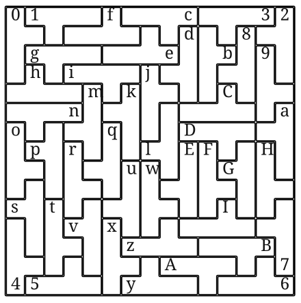</a>

现在看一个自然出现的例子. 图 73 示出一种有些出人意料的拼法, 将 45 块 Y 五格骨牌装进了一个 $15\times15$ 的正方形. [J. Haselgrove 于 1973 年率先找到了这样的铺法. 在此以前, 只知道偶数面积的长方形能用 Y 完全铺满. 她的程序先排除面积小于 225 的所有奇面积长方形, 以及 $9\times25$ 的情形, 才发现 $15\times15$ 的解. 见 <em>JRM</em> **7** (1974), 229.] 注意, 图 73 最先放的八块骨牌, 即标着 0 至 7 的那些, 都在四个角上或紧挨着角. 这样险些使算法同时去解四个独立的问题! 幸而随后的选择能取得并保持焦点, 因为难填的格几乎总会出现在刚刚动过的地方附近. 只有在放置标着 8、b、e、g、h 和 C 的骨牌时, 才需要作五路分支.

有时可按项名明确规定某些项优先, 以改善焦点; 见[习题 10](#ex-7-2-2-1-10) 的 “锐偏好” 启发式方法. 习题 207 讨论了另一种途径, 即对算法 X 作一种试验性的修改, 让用户指定最近动过的地方有多重要, 借此在图 73 这样的情形中改善焦点. 这些想法颇有趣, 不过迄今为止还没有取得什么惊人的成功.

**利用局部等价性.** 仔细观察图 73 还会发现恰当覆盖问题中经常出现的另一种现象: 右上角附近标有 8 和 b 的两块骨牌构成一个 H 形, 将它左右反射就会得到另一个合法的铺法. 事实上图中还有另外三个这样的 H, 因此图 73 实际代表 $2^4=16$ 个不同的解, 虽然这些解在 “局部” 等价.

图 73 的 $15\times15$ 铺砌问题恰有 212 个互不全等的解, 每一个都可旋转或反射为一组八个彼此全等的解, 且每个解都至少含两个 H. 算法 X 只需 $92\,\mathrm G\mu$ 就能找齐. 不过还可以利用 H 等价性做得更好: 对恰当覆盖问题的选项略加扩充, 就能只产生这样的解, 其中每个 H 都只取两种形态之一, 每个横放的 H (即转过 $90^\circ$ 的 H) 也如此. (见习题 208.) 修改后的问题只有 16 个解, 求出它们只需 $26\,\mathrm G\mu$, 却紧凑地代表了全部 212 个解.

<a id="pdf-127"></a><a id="p-107"></a>

一般地, 一个恰当覆盖问题可能含有四个不同的选项 $\alpha,\beta,\alpha',\beta'$, 其中 $\alpha$ 和 $\beta$ 不相交, $\alpha'$ 和 $\beta'$ 也不相交, 且

$$
\alpha+\beta=\alpha'+\beta'.\tag{97}
$$

(这里的 “$+$” 类似 “$\cup$”; 把选项看作零一矩阵的行时, 它表示二元向量相加.) 这时称 $(\alpha,\beta;\alpha',\beta')$ 为一个<em>双对</em> (bipair). 每当 $(\alpha,\beta;\alpha',\beta')$ 为双对, 每个同时含 $\alpha$ 和 $\beta$ 的解都导出另一个同时含 $\alpha'$ 和 $\beta'$ 的解, 反之亦然. 所以, 排除这两种选择之一, 就可以省去考察这类解的一半. 做起来很容易: 例如, 要排除同时含 $\alpha'$ 和 $\beta'$ 的所有情形, 只须引入一个新的次要项, 把它添在 $\alpha'$ 和 $\beta'$ 两个选项上.

把这一思想用于无解的小问题 (90) 来说明. 该问题有许多双对, 我们只考虑其中两个:

$$
(\text{‘0 1’, ‘2 4’; ‘0 2’, ‘1 4’})\quad\text{和}\quad
(\text{‘0 1’, ‘2 5’; ‘0 2’, ‘1 5’}).\tag{98}
$$

要排除同时含 ‘0 1’ 和 ‘2 4’ 的解, 以及同时含 ‘0 2’ 和 ‘1 5’ 的解, 可以引入次要项 A 和 B, 将 (90) 的四个选项分别扩充为

$$
\text{‘0 1 A’, ‘0 2 B’, ‘1 5 B’, ‘2 4 A’}.\tag{99}
$$

这样, 查找树 (91) 就缩小为

<a href="../../assets/volume4b/figures/dlx-100.svg"></a>

(100)

先前的焦点问题也就消失了.

可是, 你也许要问, (98) 中的两个双对都涉及选项 ‘0 1’ 和 ‘0 2’. 在这两个交叠的双对中, 为什么可以各选不同的一半? 如果允许我们对若干相互关联的双对分别随意作决定, 岂不会把自己 “逼进死角” 吗?

问得好. 的确, 决定得不好<em>会</em>出麻烦. 例如考虑完全二部图 $K_{3,3}$ 上的完全匹配问题. 可将它编码为 X2C 问题, 九个选项为 ‘$x\ X$’, 其中 $x\in\{\mathtt x,\mathtt y,\mathtt z\}$, $X\in\{\mathtt X,\mathtt Y,\mathtt Z\}$. ($K_{n,n}$ 上的完全匹配问题等价于求 $n$ 个元素的排列, 故 $K_{3,3}$ 有 $3!=6$ 个完全匹配.)

在一个完全匹配问题中, 每个双对 (‘$t\ u$’, ‘$v\ w$’; ‘$t\ w$’, ‘$u\ v$’) 都对应于给定图中的一个四圈 $t\mathbin{-}u\mathbin{-}v\mathbin{-}w\mathbin{-}t$. 若禁止下列六个双对中的右半部分,

```text
(‘x Y’, ‘y X’; ‘x X’, ‘y Y’)     (‘x Y’, ‘y Z’; ‘x Z’, ‘y Y’)
(‘y Y’, ‘z X’; ‘y X’, ‘z Y’)     (‘y Y’, ‘z Z’; ‘y Z’, ‘z Y’)
(‘z Y’, ‘x X’; ‘z X’, ‘x Y’)     (‘z Y’, ‘x Z’; ‘z Z’, ‘x Y’)
```

所得九个选项将无解:

$$
\begin{array}{lll}
\text{‘x X A’},&\text{‘y X B’},&\text{‘z X C’},\\
\text{‘x Y C D’},&\text{‘y Y A E’},&\text{‘z Y B F’},\\
\text{‘x Z E’},&\text{‘y Z F’},&\text{‘z Z D’}.
\end{array}\tag{101}
$$

<a id="pdf-128"></a><a id="p-108"></a>

幸而总有一种安全而简单的做法. 可以给所有选项规定一个任意的 (但固定的) 次序. 然后, 对每个双对 $(\alpha,\beta;\alpha',\beta')$, 总选含 $\min(\alpha,\beta,\alpha',\beta')$ 的那一半, 各项决定便不会抵触.

更确切地说, 对选项的任意固定次序, 每个双对均可写成如下规范形式:

$$
(\alpha,\beta;\alpha',\beta'),\qquad\alpha<\beta,\quad\alpha<\alpha',\quad\alpha'<\beta'.\tag{102}
$$

给定一组这样的规范双对, 若一个恰当覆盖的选项对于组中任一双对都不同时包含 $\alpha'$ 和 $\beta'$, 就称它为<em>强</em>恰当覆盖.

**定理 S.** <em>恰当覆盖问题若有解, 就有强解.</em>

<em>证明.</em> 每个解 $\Sigma$ 对应一个二元向量 $x=x_1\ldots x_M$, 其中 $x_j=[\text{选项 }j\text{ 在 }\Sigma\text{ 中}]$. 若 $\Sigma$ 对于给定的一组规范双对不是强解, 则它至少违反其中一个双对, 设为 $(\alpha,\beta;\alpha',\beta')$. 于是有下标 $j,k,j',k'$, 满足 $j<k$, $j<j'$, $j'<k'$, 而 $\alpha,\beta,\alpha',\beta'$ 分别是第 $j,k,j',k'$ 个选项, $x_{j'}=x_{k'}=1$. 由 (97) 知 $x_j=x_k=0$; 置 $x'_j\gets x'_k\gets1$, $x'_{j'}\gets x'_{k'}\gets0$, 其余 $x'_i=x_i$, 就得到另一个解 $\Sigma'$. 这个向量 $x'$ 按字典序大于 $x$; 因此反复施行这一步骤, 终将得到强解.　■

特别地, 关于 (98) 中的双对, 既可以禁止同时包含 ‘0 1’ 和 ‘2 4’, 又可以禁止同时包含 ‘0 2’ 和 ‘1 5’, 因为可以选择一个次序, 使选项 ‘1 4’ 和 ‘2 5’ 排在 ‘0 1’、‘0 2’、‘1 5’、‘2 4’ 之前.

要在相互关联的双对中作出一致的选择, 另一种方便的方法是对主要项而非选项排序 (见习题 212).

把这个理论用于完全图 $K_{2q+1}$ 的完全匹配问题很有意思. 我们从 (87) 看到, 算法 X 需要很长时间——$\Omega(2^q q!)$ 次内存访问——才发现这个问题无解. 双对这时可就派上用场了.

的确, $K_{2q+1}$ 的双对很多, 有 $\Theta(q^4)$ 个. 直接应用定理 S, 对 $\binom{2q+1}2$ 个选项用自然次序 ‘0 1’ $<$ ‘0 2’ $<\cdots<$ ‘$(2q-1)\ 2q$’, 只须用其中 $\Theta(q^3)$ 个双对, 就能以 $\Theta(q^4)$ 次内存访问解决问题. 若用一种更巧妙的选项次序, 只用精心选取的 $\Theta(q^2)$ 个双对, 便能在 $\Theta(q^2)$ 次内存访问内解决问题. 查找树甚至可以减至 $2q+1$ 个结点——这已经最优! 详见习题 215.

**\*选项的预处理.** 有时候, XCC 问题的输入可以大大简化, 因为能够删除它的许多选项或项. 所谓 “预处理”, 就是把组合问题变为等价却希望更简单的问题, 是一种重要的方法. 人们常称之为<em>核化</em> (kernelization), 原因以后再讲.

下面的算法 P 就是一个实例. 它接受算法 X 或算法 C 所能接受的任何一列项和选项, 产生另一列具有相同解数的项和选项. 只要愿意, 新问题的每个解还都可以转换为原问题的解.

<a id="pdf-129"></a><a id="p-109"></a>

算法完全基于两个一般原理, 反复使用, 直到二者都不再适用为止:

- 若一个选项堵住了某个主要项的所有用法, 就可以去掉这个选项.
- 若某个主要项总是迫使另一个项出现, 就可以去掉被迫出现的项.

更确切地说, 设 $o$ 为一般的选项 ‘$i_1\ i_2[{:}c_2]\ \ldots\ i_t[{:}c_t]$’, 其中 $i_1$ 是主要项, 其余 $t-1$ 个项可能受颜色控制. 算法 C 处理 $o$ 时, 在步骤 C4 覆盖 $i_1$, 在步骤 C5 确认其他各项, 从而去掉所有与 $o$ 不相容的选项. 如果这个过程使某个主要项 $p$ 丧失最后一个可用的选项, 就说 $o$ “堵住” 了 $p$. 这时 $o$ 没有用, 可以删去. 例如, (6) 中的 ‘$d\ e\ g$’ 可删除, 因为它堵住 $a$; (17) 中的 ‘$1\ s_4\ s_6$’ 也可删, 因为它堵住 $s_3$; 然后 ‘$1\ s_1\ s_3$’ 和 ‘$2\ s_2\ s_5$’ 也要删去, 因为它们堵住 $s_4$.

这是上面第一个原理, 即删选项的原理. 删项的原理与之类似, 不过在适用时效果更为显著: 设 $p$ 为主要项, 并且 $p$ 的选项都含另一项 $i$ 的一个无颜色实例. 这时说 $p$ “迫使” $i$ 出现; 可以删去项 $i$, 因为每个解都必须覆盖 $p$, 而覆盖 $p$ 就连带覆盖了 $i$. 例如 (6) 中 $a$ 迫使 $d$ 出现, 故可删去项 $d$, 使第二个和第四个选项缩短为 ‘$a\ g$’ 和 ‘$a\ f$’.

可以用于预处理恰当覆盖问题的变换当然远不止这两种. 例如, 它们发现不了五格骨牌问题的选项 (38) 无用, 也发现不了分解索玛立方体问题所得的简化 (见 (46) 以前的讨论). 习题 219 还讨论了另一种舍弃多余选项的办法.

一个 “完美” 而 “完备” 的预处理器实际上应当能识别<em>任何</em>至多有一个解的问题. 我们不能指望做到这一点, 所以总要适可而止. 这里限于排除堵塞和强制这两种情形, 因为这些变换可在多项式时间内完成, 而且看不出还有其他容易识别的简化.

算法 P 系统地遍历给定的项和选项, 找出所有这样的简化, 它沿用算法 C 的数据结构. 算法循环考察各项 $i$, 先观察覆盖 $i$ 时会发生什么, 试着删去 $i$. 若不能删去, 就研究确认以 $i$ 开头的选项的各项时会发生什么. 要对先前的覆盖和隐藏操作稍作改变 (与 (12)–(15)、(50)–(53) 比较):

$$
\operatorname{cover}''(i)=\left\{\begin{aligned}
&\text{置 }p\gets\mathtt{DLINK}(i).\ \text{只要 }p\ne i,\\
&\quad\text{若 }\mathtt{COLOR}(p)=0,\ \operatorname{hide}''(p);\\
&\quad\text{置 }p\gets\mathtt{DLINK}(p)\text{ 并重复}.
\end{aligned}\right.\tag{103}
$$

$$
\operatorname{hide}''(p)=\left\{\begin{aligned}
&\text{作 }\operatorname{hide}(p);\quad\text{此外, 每当 }\mathtt{LEN}(x)\text{ 被置为 }0\\
&\text{且 }x\leq N_1\text{ 时, 置 }S\gets x.
\end{aligned}\right.\tag{104}
$$

$$
\operatorname{uncover}''(i)=\left\{\begin{aligned}
&\text{置 }p\gets\mathtt{ULINK}(i).\ \text{只要 }p\ne i,\\
&\quad\text{若 }\mathtt{COLOR}(p)=0,\ \operatorname{unhide}(p);\\
&\quad\text{置 }p\gets\mathtt{ULINK}(p)\text{ 并重复}.
\end{aligned}\right.\tag{105}
$$

<a id="pdf-130"></a><a id="p-110"></a>

**算法 P** (<em>恰当覆盖的预处理.</em>) 本算法缩小给定的 XCC 问题, 直到不再有堵塞或强制为止. 它采用算法 C 的数据结构, 另加全局变量 $C$ 和 $S$.

**P1.** [初始化.] 如算法 C 的步骤 C1 那样在存储器中设置问题. (有 $N$ 个项, 其中 $N_1$ 个是主要项.) 另置 $C\gets1$. 若存在 $i\leq N_1$ 满足 $\mathtt{LEN}(i)=0$, 转 P9.

**P2.** [开始一轮.] 若 $C=0$, 转 P10. 否则置 $C\gets0$, $i\gets1$.

**P3.** [项 $i$ 是否活动?] 若 $i>N$, 回到 P2. 否则若 $\mathtt{LEN}(i)=0$, 转 P8.

**P4.** [覆盖 $i$.] 置 $S\gets0$. 用 (103) 覆盖项 $i$. 若 $S\ne0$, 转 P7; 否则置 $x\gets\mathtt{DLINK}(i)$.

**P5.** [试取 $x$.] 若 $x$ 不是其选项最靠左的剩余结点, 或 $\mathtt{COLOR}(x)\ne0$, 转 P6. 否则用习题 220 的方法检验该选项是否堵住某个主要项. 若是, 置 $C\gets1$, $\mathtt{TOP}(x)\gets S$, $S\gets x$.

**P6.** [再试.] 置 $x\gets\mathtt{DLINK}(x)$. 若 $x\ne i$, 回到 P5. 否则用 (105) 撤销对 $i$ 的覆盖; 用习题 221 的方法删去在 P5 压入栈中的全部选项; 转 P8.

**P7.** [除去项 $i$.] 撤销对项 $i$ 的覆盖 (主要项 $S$ 迫使它出现). 然后用习题 222 的方法将所有用到 $i$ 的选项删去或缩短. 最后置 $C\gets1$, $\mathtt{DLINK}(i)\gets\mathtt{ULINK}(i)\gets i$, $\mathtt{LEN}(i)\gets0$.

**P8.** [对 $i$ 循环.] 置 $i\gets i+1$, 回到 P3.

**P9.** [归结为无解.] 置 $N\gets1$, 删去全部选项. (问题无解.)

**P10.** [结束.] 输出缩小后的问题, 其中保留的项满足 $\mathtt{LEN}(i)>0$ 或 $i=N=1$, 然后终止. (见习题 223.)　■

算法 P 有多大效果呢? 有时它只是在白忙, 找不到任何能简化的地方. 例如 $n>5$ 时, $n$ 个兰福德配对的选项 (16) 中不存在堵塞或强制. $n>3$ 时的 $n$ 皇后问题也一样. 这些表述里没有 “赘肉”. 在麦克马洪的三角形问题 (习题 126) 中, 算法 P 只用 2000 万次内存访问便从 1537 个选项中删去了 576 个; 可是删去它们其实无关紧要, 因为不论有没有它们, 算法 C 遍历的查找树完全相同.

试着将五格骨牌装进 $6\times10$ 的盒子 (习题 271) 时, 可省约 10%. 不作预处理, 算法 X 发现这个经典任务的全部 2339 个解需 $4.11\,\mathrm G\mu$. 算法 P 只用 $0.19\,\mathrm G\mu$ 就能从 2032 个选项中去掉 235 个, 然后算法 X 用 $3.52\,\mathrm G\mu$ 找出同样的 2339 个解, 所以总时间减为 $3.71\,\mathrm G\mu$. 把<em>单面</em>五格骨牌装进 $6\times15$ 盒子的类似问题, 收益更大: 不作预处理时有 3308 个选项, 处理它们需 $15.5\,\mathrm T\mu$. 预处理只花 $260\,\mathrm M\mu$, 使选项数降为 3157, 运行时间降为 $13.1\,\mathrm T\mu$.

在上面两个五格骨牌问题中, 算法 P 所发现的简化都只涉及堵塞 (见习题 225). 不过, 在<a id="pdf-131"></a><a id="p-111"></a>图 73 的 Y 五格骨牌问题中出现了更微妙的化简. 例如, 格 10 迫使格 20 出现; 第二轮中格 22 迫使格 00 出现. 在第四轮, 选项 ‘50 51 52 53 62’ 堵住了格 61——这个发现颇出人意料! 可惜这些巧妙的化简对总运行时间影响不大.

预处理在习题 114 的问题上大显身手. 该题要求找出关于主对角线反射后自等价的全部数独解. 这时提供给算法 P 的有 5410 个选项, 涉及复杂的颜色控制、585 个主要项和 90 个次要项. 它很快就将其化简为 2426 个选项、506 个主要项和 90 个次要项; 处理这些选项并发现 30,258,432 个解, 算法 C 仅需 $287\,\mathrm G\mu$. 比直接处理化简以前的选项所需的 $2162\,\mathrm G\mu$ 快 7.5 倍.

因此预处理的效果并不一律. 有时大有收获, 有时可能浪费时间. 可以定一个预算来兼顾两面, 例如规定算法 P 至多运行一分钟左右. 在 P3 开始时数据结构处于 “安全” 状态; 因此若不想一直运行到结束, 可以从那里直接跳到 P10.

当然, 长时间计算的中途出现的子问题也可以预处理. 适当地权衡各种策略, 可能正是解决某些特别艰难的问题的关键.

**最小代价解.** 我们研究过的许多恰当覆盖问题要么无解, 要么只有寥寥几个解. 能发现其中的珍品, 就是我们的乐事. 但另有许多情形, 解数十分丰富; 到目前为止, 对这类问题我们假定所有解都有意思, 关心的是尽量缩短平均每求一个解的时间.

如果问题中每个选项都有一个非负<em>代价</em>, 便有了一个新角度. 这时自然要寻找总代价最小的解, 而且最好根本不去看多少高代价解; 它们大体上没有用, 一个低代价解却可能是无价之宝.

幸而, 可以用相当简单的方法修改我们的算法, 使它们较快地找到最小代价解. 在考察修改的细节之前, 先看几个例子, 了解它能做到些什么.

例如从这个角度来看兰福德配对. 在第 7 章开头, 我们已看到, 把 $\{1,1,2,2,\ldots,16,16\}$ 这 32 个数排成数组 $a_1a_2\ldots a_{32}$, 使每个 $i$ 的两次出现之间恰有 $i$ 项 ($1\leq i\leq16$), 共有 $2L_{16}=653,443,600$ 种方法. 当时还断言, 7–(3) 所示的配对, 即

$$
2\ 3\ 4\ 2\ 1\ 3\ 1\ 4\ 16\ 13\ 15\ 5\ 14\ 7\ 9\ 6\ 11\ 5\ 12\ 10\ 8\ 7\ 6\ 13\ 9\ 16\ 15\ 14\ 11\ 8\ 10\ 12,\tag{106}
$$

是使 $\Sigma_1=\sum_{k=1}^{32}ka_k$ 最大的 12,016 个解之一. 所以这个配对的<em>反序</em>, 即

$$
12\ 10\ 8\ 11\ 14\ 15\ 16\ 9\ 13\ 6\ 7\ 8\ 10\ 12\ 5\ 11\ 6\ 9\ 7\ 14\ 5\ 15\ 13\ 16\ 4\ 1\ 3\ 1\ 2\ 4\ 3\ 2,\tag{107}
$$

<a id="pdf-132"></a><a id="p-112"></a>

就是使 $\Sigma_1$ <em>最小</em>的 12,016 个解之一. 上面的 (16) 已指出, 兰福德配对是一个简单的恰当覆盖问题的解, 其中选项 ‘$i\ s_j\ s_k$’ 代表赋值 $a_j=i$, $a_k=i$. 因此若对选项 ‘$i\ s_j\ s_k$’ 指定代价 $\$(ji+ki)$, 最小代价解就恰好是使 $\Sigma_1$ 最小的兰福德配对. (见习题 226.)

使总代价最小的一种方法当然是访问所有解并算出各自的和. 不过还有更好的办法: 下面将称为算法 $\mathrm X^{\$}$ 的最小代价变种, 只须 600 亿次内存访问就能找到代价为 $\$3708$ 的解, 并证明它确实最小. 这比用普通算法 X 快 36 倍以上, 后者要花 2.2 万亿次内存访问才走得完全部解.

算法 $\mathrm X^{\$}$ 还不止于此. 对任给的 $K$, 它能算出代价最小的 $K$ 个解. 例如取 $K=12500$, 它只需 700 亿次内存访问就能发现代价为 $\$3708$ 的 12,016 个解, 以及具有次低代价 (恰为 $\$3720$) 的另外 484 个解.

若改求 $\Sigma_2=\sum_{k=1}^{32}k^2a_k$ 的最小值, 消息还要好. 算法 $\mathrm X^{\$}$ 只需 $28\,\mathrm G\mu$ 即能证明最小的 $\Sigma_2$ 为 $\$68880$. 更好的是, 只花 $10\,\mathrm G\mu$ 便可确定 $\sum_{k=1}^{32}ka_k^2$ 的最小值为 $\$37552$, 而且是由下列非凡的兰福德配对<em>唯一</em>取得的:

$$
16\ 14\ 15\ 9\ 6\ 13\ 5\ 7\ 12\ 10\ 11\ 6\ 5\ 9\ 8\ 7\ 14\ 16\ 15\ 13\ 10\ 12\ 11\ 8\ 4\ 1\ 3\ 1\ 2\ 4\ 3\ 2.\tag{108}
$$

它碰巧还使 $\Sigma_1$ 和 $\Sigma_2$ 都最小! (见习题 229.)

另一个经典组合任务——16 皇后问题——也给出了有益的例子. 前面已知, 在 $16\times16$ 棋盘上放 16 个互不攻击的皇后, 恰有 14,772,512 种方法. 还知道, 把 (23) 那样的选项交给算法 X, 访问所有这些解约需 $40\,\mathrm G\mu$ 的计算.

设在格 $(i,j)$ 中放一个皇后的代价为该格到棋盘中心的<em>距离</em>. (若行列均从 1 编到 16, 则距离 $d(i,j)=\sqrt{(i-17/2)^2+(j-17/2)^2}$, 从 $d(8,8)=1/\sqrt2$ 到 $d(1,1)=15/\sqrt2$.) 我们要使皇后尽可能集中在中央, 虽然因为每行每列必须各有一个皇后, 总有许多皇后要落在边缘或边缘附近.

<a id="fig-7-2-2-1-74"></a>

(a) <a href="../../assets/volume4b/figures/dlx-74a.png">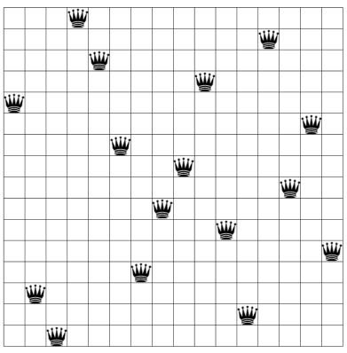</a>

(b) <a href="../../assets/volume4b/figures/dlx-74b.png">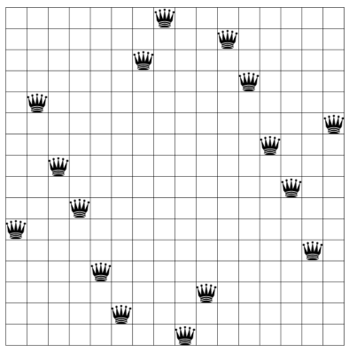</a>

(c) <a href="../../assets/volume4b/figures/dlx-74c.png">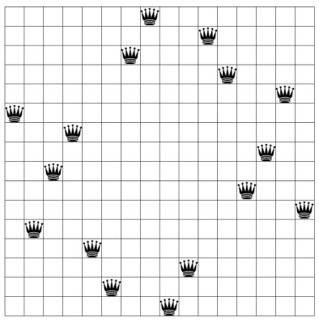</a>

**图 74.** 16 皇后问题的最优解: (a) 使它们尽可能接近中央; (b, c) 使它们尽可能远离中央.

<a id="pdf-133"></a><a id="p-113"></a>

图 74(a) 给出使总代价最小的摆法, 而且除去旋转和反射, 这个解实际上是唯一的. 类似地, 图 74(b) 和 74(c) 给出使代价<em>最大</em>的摆法. (有趣的是, 将中间八行左右反射、上面四行和下面四行不动, 就能从其中一种摆法得到另一种.) 算法 $\mathrm X^{\$}$ 取 $K=9$, 只用 (a) $3.7\,\mathrm G\mu$, (b, c) $0.8\,\mathrm G\mu$, 即可发现这些摆法并证明其最优性.

使算法 X 变成算法 $\mathrm X^{\$}$ 的修改, 也能使算法 C 变成算法 $\mathrm C^{\$}$. 因而即便远超普通恰当覆盖问题的 XCC 问题, 我们也可以找出它的最小代价解.

例如现在可以处理这样一道小问题: <em>在 $5\times5$ 方阵的行和列中放置十个不同的五位素数, 使它们的乘积尽可能小.</em> (五位素数是 10007 至 99991 之间的 8363 个素数之一, 包括两个端点.) 下面的一个 “素数方阵” 完全由小于 30000 的素数组成:

$$
\begin{bmatrix}2&1&2&1&1\\2&0&1&0&1\\1&1&0&0&3\\1&1&0&6&9\\1&1&1&1&3\end{bmatrix}.\tag{109}
$$

要把它设置为 XCC 问题, 引入十个主要项 $\{a_1,a_2,a_3,a_4,a_5\}$ 和 $\{d_1,d_2,d_3,d_4,d_5\}$ 分别表示 “横行” 和 “竖列”, 25 个次要项 $ij$ ($1\leq i,j\leq5$) 表示方阵的各格, 再加上 8363 个次要项 $p_1p_2p_3p_4p_5$, 每个可用素数 $p=p_1p_2p_3p_4p_5$ 对应一个. 将 $p$ 放在第 $i$ 行或第 $j$ 列的选项分别为

$$
\begin{aligned}
&\text{‘}a_i\quad i1{:}p_1\quad i2{:}p_2\quad i3{:}p_3\quad i4{:}p_4\quad i5{:}p_5\quad p_1p_2p_3p_4p_5\text{’};\\
&\text{‘}d_j\quad 1j{:}p_1\quad 2j{:}p_2\quad 3j{:}p_3\quad 4j{:}p_4\quad 5j{:}p_5\quad p_1p_2p_3p_4p_5\text{’}.
\end{aligned}\tag{110}
$$

例如 ‘$a_4\quad\mathtt{41{:}1\ 42{:}1\ 43{:}0\ 44{:}6\ 45{:}9\ 11069}$’ 使 (109) 中可以出现素数 11069.

这是一个预处理很有帮助的好例子: $a_1$ 和 $d_1$ 中可用的素数不能含 0; $a_5$ 和 $d_5$ 中可用的素数只能含 $\{1,3,7,9\}$ 四种数字. 无须向算法 P 特别交代什么数论知识, 它就自己发现了这些事实. 它把 (110) 的 83630 个选项减少为 62900 个, 而且这些化简还为选择哪些项作分支提供了有用的线索.

习题 86 的蒙特卡罗估计告诉我们, 将十个素数填进 $5\times5$ 方阵约有 $6\times10^{14}$ 种不同的办法——数目极大. 大概只须检视其中很小的一部分, 可是要决定哪些可以放心略过并不容易.

为了使素数的乘积最小, 给 (110) 中的各个选项指定代价 $\$(\ln p)$. (因为乘积的对数是各因子对数的和.) 更准确地说, 我们使用代价 $\$\lfloor C\ln p\rfloor$, 其中 $C$ 大得足以使截断误差可以忽略, 又不至于大到引起算术溢出, 因为算法 $\mathrm C^{\$}$ 要求代价全为整数.

每个解的代价都与其转置相同. 因此要得到最好的五个素数方阵, 只须请算法 $\mathrm C^{\$}$ 计算代价最小的 $K=10$ 个<a id="pdf-134"></a><a id="p-114"></a>解, 其中每个方阵及其转置各出现一次. 下面按从左到右的次序列出, 最好的在左:

$$
\begin{bmatrix}1&1&1&1&3\\1&0&1&0&3\\1&1&0&0&3\\3&1&7&6&9\\1&1&1&7&1\end{bmatrix}\quad\begin{bmatrix}1&1&1&1&3\\1&0&1&0&3\\1&1&0&0&3\\3&1&7&7&1\\1&1&1&9&7\end{bmatrix}\quad\begin{bmatrix}1&1&1&1&3\\1&0&0&0&7\\1&1&0&0&3\\3&1&6&9&9\\1&1&1&1&7\end{bmatrix}\quad\begin{bmatrix}1&1&1&1&3\\1&0&0&0&7\\1&1&0&0&3\\3&1&6&6&3\\1&1&1&7&7\end{bmatrix}\quad\begin{bmatrix}1&1&1&1&3\\1&0&0&0&7\\1&1&0&0&3\\3&1&6&6&3\\1&1&1&9&7\end{bmatrix}.\tag{111}
$$

不作预处理就需 $1270\,\mathrm G\mu$, 而这里的运行时间是 $440\,\mathrm G\mu$, 因此花在预处理上的 $280\,\mathrm G\mu$ 是值得的. 不过, 代价最高的五个解

$$
\begin{bmatrix}9&9&9&8&9\\8&8&9&9&7\\9&8&6&8&9\\9&9&7&9&3\\9&9&9&9&1\end{bmatrix}\quad\begin{bmatrix}9&9&9&8&9\\8&9&8&9&9\\9&6&7&9&9\\9&8&7&3&7\\9&9&9&9&1\end{bmatrix}\quad\begin{bmatrix}9&9&9&8&9\\8&8&9&9&7\\9&8&8&9&7\\9&9&5&7&1\\9&9&9&7&1\end{bmatrix}\quad\begin{bmatrix}9&9&9&8&9\\8&8&9&9&7\\9&8&8&9&7\\9&9&5&8&1\\9&9&9&9&1\end{bmatrix}\quad\begin{bmatrix}9&9&9&8&9\\8&8&9&9&7\\9&8&8&9&7\\9&9&5&7&7\\9&9&9&7&1\end{bmatrix}.\tag{112}
$$

(最高的在右) 无须预处理, 只需 $22\,\mathrm G\mu$ 就能找到.

现在从纯数学问题转向较能反映真实世界的 “有机” 情形. 美国本土相连的 48 个州

<a href="../../assets/volume4b/figures/dlx-113.png">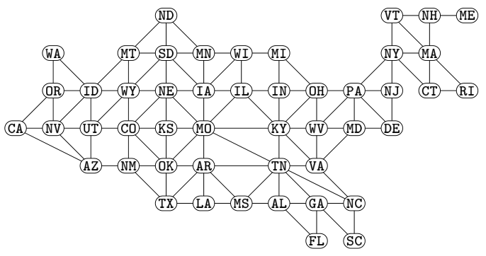</a>

(113)

定义了一个有趣的平面图, 已经给我们提供过许多有益的例子. 这个图 $G$ 有 48 个顶点及 105 条边. 假设要把它划分成八个各含六个顶点的连通子图. 至少删去多少条边才能办到?

习题 7.2.2–76 已经告诉我们怎样列出所有由六个州组成的连通子集, 恰有 11505 个. 因而在 48 个项上得到了 11505 个恰当覆盖选项, 它的解恰好就是我们感兴趣的那些划分. 总共有 4,536,539 个解; 算法 X 能全部访问, 代价为 8070 亿次内存访问.

但我们还是试试用算法 $\mathrm X^{\$}$ 做得更好些. 每个导出子图 $G\mid U$ 都有一个<em>外部代价</em>, 即从 $U$ 到 $U$ 以外顶点的边数. 通过删边来划分图时, 每一条这样的边都为余下的两个分量各贡献一次外部代价; 因此删去的边数恰好是所有外部代价之和的一半. 所以, 若将外部代价赋给各选项, 最佳划分便对应恰当覆盖问题的最小代价解. 例如, 11505 个选项中的一个为

$$
\mathtt{ND\ SD\ NE\ KS\ OK\ TX},\tag{114}
$$

它的代价是 $\$19$.

算法 $\mathrm X^{\$}$ 只用 32 亿次内存访问就找出最优解的代价为 $\$72$. 因而只需删去 36 条边就能得到所求划分.

<a id="pdf-135"></a><a id="p-115"></a>

在看答案以前, 再把这道题端详一会儿, 因为我们还没找到最好的解法! 仔细看会发现选项 (114) 无用, 因为它不可能出现在任何解中: 它把图切成了两块, 左边 11 个州, 右边 31 个州. (先前在 (38) 已遇到过类似情形.) 事实上, 11505 个选项中有 4961 个出于大致相同的理由而不能使用. 例如缅因州 (ME) 属于 25 个六阶连通子图, 但不难看出, 要让 ME 纳入最后的划分, 唯一的办法是把它和新英格兰其余五州 (NH、VT、MA、CT、RI) 放在同一组内. 习题 242 说明怎样迅速发现并排除无用的选项.

剩下的问题有 6544 个选项, 算法 X 用 $327\,\mathrm G\mu$ 可以解出, 算法 $\mathrm X^{\$}$ 只用 $1046\,\mathrm M\mu$.

用大体相同的方法也可把图划分成六个各含八州的连通组. 这次化简后的恰当覆盖问题有 40520 个选项, 共 4,177,616 个解. 不过算法 $\mathrm X^{\$}$ 只用不到 $2\,\mathrm G\mu$ 就能确定最小代价为 $\$54$.

下面是所求最优划分的例子, 左为 $8\times6$, 右为 $6\times8$:

(a) <a href="../../assets/volume4b/figures/dlx-115a.png">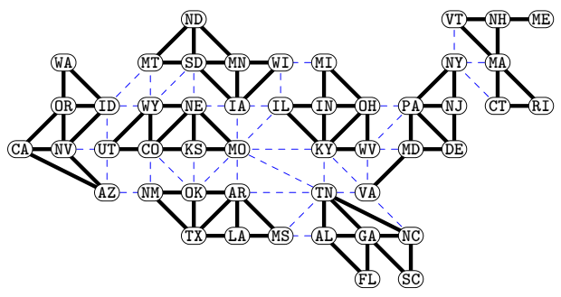</a>

(b) <a href="../../assets/volume4b/figures/dlx-115b.png">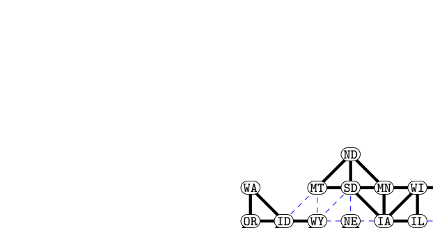</a>

(115)

两种情形下各有两个最优划分: 在左图中可以互换 VA 和 WV 的归属; 在右图中可以作较复杂的循环调动 (MI NE LA VA).

按另一种标准来解也很有意思, 即利用人口普查数据, 按各州的<em>人口</em>划分 $G$. 例如, 试找八个连通的州组, 使各组人口几乎相等. 2010 年这 48 个州的官方总人口 $P$ 为 306084180. 希望每组有 $P/8$ 人, 或者尽可能接近 $P/8$, 也就是每组约 3800 万人.

对给定的上下界 $L,U$, 习题 242 的算法能找出并化简所有人口 $x$ 满足 $L\leq x<U$ 的连通子图. 若取 $L>\lfloor P/9\rfloor$ (约为 3400 万), $U\leq\lceil P/7\rceil$ (约为 4400 万), 则这些候选子图将定义一个每个解恰好使用八个选项的恰当覆盖问题, 因为 $9x>P$, $7x<P$.

该算法证明, $G$ 中有 1,926,811 个州的连通集, 人口在 $[34009354\mathinner{.\,.}43726312)$ 之间; 它剪去了其中 1,571,057 个, 剩下 355,754 个. 不过这未免过了头. 这个问题的余地足够大, 最终解中的各个集合很可能都有接近 3800 万的人口. 所以不妨把范围缩小到 $[37000000\mathinner{.\,.}39000000)$. 这样的选项有 34,111 个, 总该够用了吧.

<a id="pdf-136"></a><a id="p-116"></a>

看起来颇有道理, 可惜行不通: 这 34,111 个选项无解, 因为算法 X 无法用它们覆盖 NY (纽约州)! 注意 NY 是 $G$ 的一个关节点. 纽约州约有 1940 万人, 新英格兰六州合计约有 1430 万人. 覆盖纽约州的选项最好也把整个新英格兰覆盖进去, 否则新英格兰就孤立了. 这样共有 $19.4+14.3=33.7$ 百万人. 纽约州仅有的其他邻州为新泽西州 (880 万) 和宾夕法尼亚州 (1270 万); 两者随便加上哪一个都会超过 4200 万.

因此显然不能用接近理想的 3800 万人的组来覆盖纽约州. 要么取一个轻量的组 (纽约加新英格兰), 要么取一个重量的组 (还要加上新泽西). 让我们把这两个选项加入原有的 34,111 个中.

注意这道题同先前的几道很不一样, 因为选项的大小相差极大. 有一个选项只含 CA (加利福尼亚), 它的人口最多 (3730 万); 另一些选项至多含十五个州, 从 DE 一直伸到 NV, 几乎横跨整个大陆.

现在给每个人口为 $x$ 的选项指定代价 $\$(x^2)$, 因为最小代价解将使平方偏差 $(x_1-P/8)^2+\cdots+(x_8-P/8)^2$ 最小 (见习题 243). 这个方法很奏效; 算法 $\mathrm X^{\$}$ 只需 33 亿次内存访问便找到了下面的最优解. 不含纽约州的七个选项, 人口都在 3730 万至 3810 万之间.

类似地划为六个人口相等的组, 用 $1.1\,\mathrm G\mu$ 可以得到一个最小代价解, 六组的人口都在 $[50650000\mathinner{.\,.}51150000]$ 中. 两个解如下图所示, 各顶点的面积与其人口成正比:

(a) <a href="../../assets/volume4b/figures/dlx-116a.png">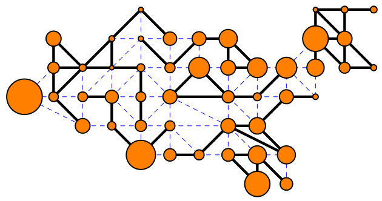</a>

(b) <a href="../../assets/volume4b/figures/dlx-116b.png">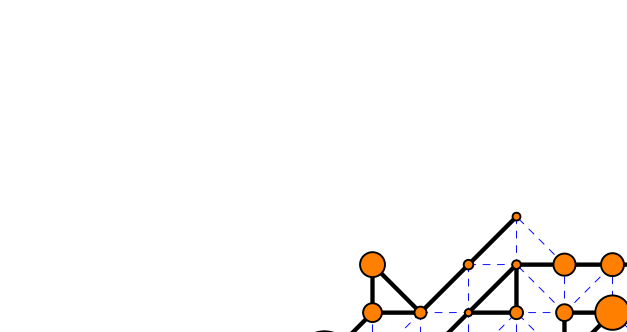</a>

(116)

两种情形的解都是唯一的. (而且也得承认, 两个解看起来都颇为古怪. 这样的划分只有计算机才会想得出来. 习题 246 讨论不那么离奇的近似解.)

**\*实现最小代价的截断.** 好, 现在我们已经看到许多需要算法 $\mathrm X^{\$}$ 和 $\mathrm C^{\$}$ 的理由. 可是究竟怎样扩充算法 X 和 C 才能得到它们呢? 只须说明算法 $\mathrm C^{\$}$ 的做法.

算法 $\mathrm C^{\$}$ 的任务是找出 $K$ 个最小代价解. 更确切地说, 它应该找出总代价尽可能小的 $K$ 个解, 同时允许不同的解有相同的代价. 例如, 设一个问题恰有十个解, 按算法 C 原会发现它们的次序, 代价分别为 $\$3,\$1,\$4,\$1,\$5,\$9,\$2,\$6,\$5,\$3$. 在找到 $K$ 个解之前, 算法<a id="pdf-137"></a><a id="p-117"></a> $\mathrm C^{\$}$ 与算法 C 没有区别, 因为这 $K$ 个也许就是最好的. 但已知 $K$ 个解以后, 它就比较挑剔了: 只有在新解优于当前最好的 $K$ 个解中的某一个时, 才会接受它. 因而若取 $K=3$, 被接受的解的代价分别为 $\$3,\$1,\$4,\$1,\$2$, 其余五个解都不会被算法 $\mathrm C^{\$}$ 找到.

为实现这种行为, 维护一张 $\mathtt{BEST}$ 表, 保存迄今为止最小的 $K$ 个代价. 该表按 “堆序” 排列, 有

$$
\mathtt{BEST}[\lfloor j/2\rfloor]\geq\mathtt{BEST}[j],
\qquad 1\leq\lfloor j/2\rfloor<j\leq K\tag{117}
$$

(见式 5.2.3–(3)). 特别地, $\mathtt{BEST}[1]$ 是这 $K$ 个最小代价中最大的一个, 称为<em>截断值</em> $T$. 算法 $\mathrm C^{\$}$ 将拒绝所有代价大于或等于 $T$ 的解. 最初对 $1\leq j\leq K$ 有 $\mathtt{BEST}[j]=\infty$; 随后将各个代价 $c<T$ 的新解像算法 5.2.3H 那样 “筛入” $\mathtt{BEST}$ 表. 因此在上例中, 若 $K=3$, 接连出现的截断值为 $\infty,\infty,4,3,3,3,2,2,2,2$. 若 $K=4$, 就是 $\infty,\infty,\infty,4,4,4,3,3,3,3$.

算法 $\mathrm C^{\$}$ 给每个结点加上一个 $\mathtt{COST}$ 域, 因而各结点都比原来多 64 比特. 在步骤 $\mathrm{C1}^{\$}$ 中, 各选项的代价 (假定为非负整数) 均存入属于该选项的所有结点.

步骤 $\mathrm{C1}^{\$}$ 建立的每张选项表都按代价排好序, 即

$$
\mathtt{COST}(x)\leq\mathtt{COST}(y),\qquad y=\mathtt{DLINK}(x),\tag{118}
$$

只要 $x,y$ 都不是头结点就成立. 因此, 若主要项 $p$ 属于 $t$ 个选项, 则 $\mathtt{COST}(x_1)\leq\mathtt{COST}(x_2)\leq\cdots\leq\mathtt{COST}(x_t)$, 其中 $x_1=\mathtt{DLINK}(p)$, 对 $1\leq j<t$ 有 $x_{j+1}=\mathtt{DLINK}(x_j)$, 且 $p=\mathtt{DLINK}(x_t)$. 据此可以略去那些代价太大、不可能属于最小代价解的选项.

为此, 给覆盖、净化、撤销覆盖和撤销净化的基本操作 (见 (50)–(57)) 增添一个参数<em>阈值</em> $\vartheta$. 这些循环在算法 $\mathrm C^{\$}$ 中将 “只要 $q\ne i$” 改为 “只要 $q\ne i$ 且 $\mathtt{COST}(q)<\vartheta$”. 我们还改变了撤销覆盖和撤销净化操作的方向, 使其沿 $\mathtt{DLINK}$ 向下行进, 不再沿 $\mathtt{ULINK}$ 向上. 另外让 (15) 中恢复隐藏结点的操作从左向右进行, 使 $q$ 递增, 同 (13) 中隐藏时一样. (这些约定分明违反了我们起初证明舞蹈链正确时所用的规则! 但我们运气好, [习题 2](#ex-7-2-2-1-2) 的理论证明这样做也行.)

在查找第 $l$ 层, 算法 $\mathrm C^{\$}$ 已构造了部分解, 由结点 $x_0\ldots x_{l-1}$ 所代表的 $l$ 个选项组成. 设其总代价为 $C_l$. 在步骤 $\mathrm{C4}^{\$}$ 中置 $x_l\gets\mathtt{DLINK}(i)$, 再用阈值 $\vartheta_0=T-C_l-\mathtt{COST}(x_l)$ 覆盖项 $i$. (选择项 $i$ 时已保证 $\vartheta_0>0$.) 若 $\vartheta_0$ 相当低, 覆盖过程就比以前快, 因为用不着费心隐藏不可能属于任何可接受解的选项. 要记住 $\vartheta_0$ 的值, 以便回溯时用完全相同的阈值; 因此步骤 $\mathrm{C4}^{\$}$ 置 $\mathtt{TH0}[l]\gets\vartheta_0$, 步骤 $\mathrm{C7}^{\$}$ 则用 $\mathtt{TH0}[l]$ 作为撤销覆盖项 $i$ 的阈值, 其中 $\mathtt{TH0}$ 是一个辅助数组.

截断值 $T$ 随计算的进行而减小. 因此在步骤 $\mathrm{C5}^{\$}$ 中用于覆盖和净化的阈值 $\vartheta=T-C_l-\mathtt{COST}(x_l)$ 每次可能<a id="pdf-138"></a><a id="p-118"></a>不同. 若 $\vartheta\leq0$, 步骤 $\mathrm{C5}^{\$}$ 应直接转到 $\mathrm{C7}^{\$}$. 否则在该步置 $\mathtt{TH}[l]\gets\vartheta$, 并在步骤 $\mathrm{C6}^{\$}$ 中用 $\mathtt{TH}[l]$ 来撤销操作, 其中 $\mathtt{TH}$ 是另一个辅助数组.

负责选择第 $l$ 层分支项的步骤 $\mathrm{C3}^{\$}$ 当然至关重要. 若某个主要项 $i$ 没有选项, 或它最便宜的选项已经贵到不可能导出优于已知解的解, 则 $\mathrm{C3}^{\$}$ 应立即跳到 $\mathrm{C8}^{\$}$. 在其余情形中, 有许多值得研究的策略, 这里的篇幅只够讨论作者试验所用的一种: 像 MRV 启发式方法那样, 选取代价不太大的选项最少的 $i$, 效果很好. 若有并列, 作者的实现选取最便宜的选项仍<em>最贵</em>的那个 $i$. (这个项迟早要覆盖, 那份代价怎样都省不掉. 尽量增大失败的机会, 或许更容易很快达到截断.) 详见习题 248.

算法 $\mathrm C^{\$}$ 的许多应用有特殊性质, 据此可远在上述方法能截断以前就从查找树上剪去没有收益的分支. 例如在 “素数方阵” 问题中, 每个选项恰好含一个主要项 (见 (110)). 在这种情形中, 将 $x_0\ldots x_{l-1}$ 扩充为解的代价至少为

$$
C_l+\mathtt{COST}(\mathtt{DLINK}(i_1))+\cdots+\mathtt{COST}(\mathtt{DLINK}(i_t)),\tag{119}
$$

这是 (118) 的结果, 其中 $i_1,\ldots,i_t$ 为仍活动的主要项. 若总数达到或超过 $T$, 步骤 $\mathrm{C3}^{\$}$ 可立即转 $\mathrm{C8}^{\$}$.

类似地, 在 $n$ 皇后问题中, 每个选项恰有两个主要项, 一个形为 $R_i$, 另一个形为 $C_j$. 因而活动项 $i_1,\ldots,i_t$ 中每一种必占 $t/2$ 个. 令 $C_{\mathrm R},C_{\mathrm C}$ 分别为对这两类项求得的 $\sum\mathtt{COST}(\mathtt{DLINK}(i_j))$. 若 $C_l+C_{\mathrm R}$ 和 $C_l+C_{\mathrm C}$ 中<em>任何一个</em>达到或超过 $T$, 步骤 $\mathrm{C3}^{\$}$ 就可跳到 $\mathrm{C8}^{\$}$.

在第一个美国本土相连各州的问题中, 每个选项恰有 6 个项 (见 (114)). 所以活动项数 $t$ 总是 6 的倍数. 习题 249 给出了一个漂亮的算法, 可求出未来 $t/6$ 个选项的最低可能代价; 算法 $\mathrm C^{\$}$ 的步骤 $\mathrm{C3}^{\$}$ 便用它来提早截断.

兰福德配对的选项含三个项, 其中一个是数字. 五格骨牌问题的选项含六个项, 其中一个是牌名. 在这两种情形下, 算法 $\mathrm C^{\$}$ 都可以<em>结合</em>前面提到的各种策略, 为提早截断取得适当的下界 (见习题 250).

最后, 算法 $\mathrm C^{\$}$ 还使用一项重要技术, 即<em>预处理代价</em>. 注意, <em>若 $p$ 是主要项, 而含 $p$ 的每个选项的代价至少为 $c$, 则可将所有这些选项的代价都减去 $c$, 而不改变最小代价解的集合.</em> 原因在于每个解中 $p$ 恰好出现一次. 可将 $c$ 看作无法避免、必须 “预付” 的税或 “入场费”.

一般说来, 有许多预处理代价的方法都不改变原问题. 适当变换后的代价, 有助于算法的启发式方法作出聪明得多的选择. 习题 247 讨论了前述试验的步骤 $\mathrm{C1}^{\$}$ 所用的简单方法.

<a id="pdf-139"></a><a id="p-119"></a>

**\*同 ZDD 共舞.** 算法 X 在步骤 X2 访问的解, 可以自然地用决策树来表示, 如 §7.1.4 所述. 例如, 去掉角格 22 后, 用四块二格骨牌铺满 $3\times3$ 棋盘余下八格的问题, 其解的决策树如下:

<a href="../../assets/volume4b/figures/dlx-120.png">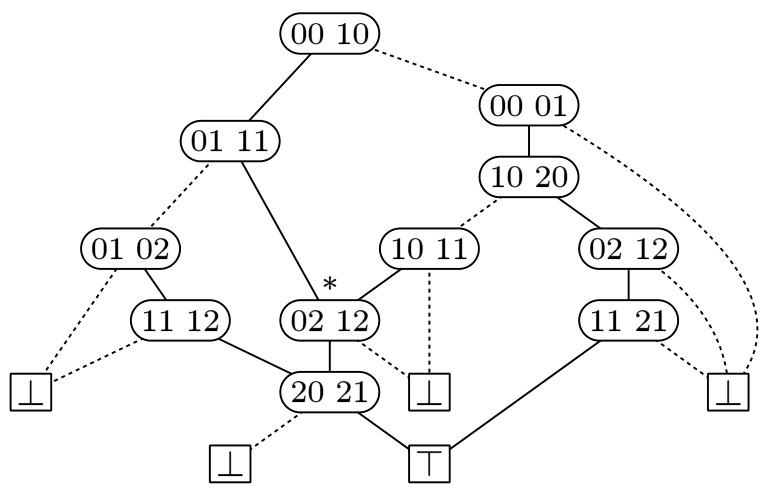</a>

(120)

图中采用标准的 ZDD 约定: 每个分支结点列出一个选项, 实线表示选它, 虚线表示不选. 终结点 $\bot$ 和 $\top$ 分别表示失败和成功. 这道题有四个解, 对应于从根到 $\top$ 的四条路径.

从 §7.1.4 已经知道, 很容易对 ZDD 作各种运算, 而且有时一个小小的 ZDD 就能刻画一个庞大的解族. 要是运气好, 只生成一个适当的 ZDD, 就能省去逐一访问各解的大量时间和精力.

当同一个子问题反复出现时, 便有这样的节省. 例如, (120) 中有两条分支在标 ‘∗’ 的结点会合, 原因是放置 ‘00 10’ 和 ‘01 11’ 两块骨牌后的剩余问题, 同放置 ‘00 01’ 和 ‘10 11’ 后的剩余问题相同. “这个地方来过, 这件事情做过.” 所以只要已构造一个子 ZDD 记下从前做了什么, 就无须再走一遍旧路. (这两对骨牌放法构成前面所说的一个 “双对”, 但 ZDD 的想法一般得多, 也有力得多.)

来看一看其中的细节. (120) 所解的恰当覆盖问题有八个项 00、01、10、02、11、20、12、21, 表示待覆盖的格, 并有如下十个选项, 表示二格骨牌的放法:

$$
\begin{array}{lllll}
1{:}\ \mathtt{00\ 01}&3{:}\ \mathtt{01\ 02}&5{:}\ \mathtt{02\ 12}&7{:}\ \mathtt{10\ 20}&9{:}\ \mathtt{11\ 21}\\
2{:}\ \mathtt{00\ 10}&4{:}\ \mathtt{01\ 11}&6{:}\ \mathtt{10\ 11}&8{:}\ \mathtt{11\ 12}&10{:}\ \mathtt{20\ 21}
\end{array}\tag{121}
$$

在内部, 把 ZDD (120) 表示为一系列分支指令,

$$
\begin{array}{llll}
I_{12}=(\bar2\mathbin?8:11),&I_9=(\bar8\mathbin?0:2),&I_6=(\bar5\mathbin?0:5),&\\
I_{11}=(\bar4\mathbin?10:3),&I_8=(\bar1\mathbin?0:7),&I_5=(\bar9\mathbin?0:1),&I_3=(\bar5\mathbin?0:2),\\
I_{10}=(\bar3\mathbin?0:9),&I_7=(\bar7\mathbin?4:6),&I_4=(\bar6\mathbin?0:3),&I_2=(\overline{10}\mathbin?0:1),
\end{array}\tag{122}
$$

其中 0 和 1 分别代表 $\bot$ 和 $\top$ (例如见 7.1.4–(8)). “若不选选项 2, 转到指令 8; 若选它, 则继续执行指令 11.”

<a id="pdf-140"></a><a id="p-120"></a>

对算法 X 略作修改, 就能使它从访问解的方法变成 ZDD 的构造器. 事实上, 连颜色控制也可以处理:

**算法 Z** (<em>同 ZDD 共舞.</em>) 给定一个同算法 C 一样的 XCC 问题, 本算法为满足该问题的选项集输出一个自由 ZDD. ZDD 指令 $\{I_2,\ldots,I_s\}$ 具有 (122) 所示的形式 $(\bar o_j\mathbin?l_j:h_j)$, 而 $I_s$ 为根. (但若问题无解, 算法将在 $s=1$ 时终止, 这时根为 0.) 将算法 C 的数据结构扩充, 增设一个 “记忆高速缓存”, 由签名 $\mathtt S[j]$ 和 ZDD 指针 $\mathtt Z[j]$ 构成. 在算法 C 的选择表 $x_0x_1\ldots$ 之外, 又添上两个按当前层 $l$ 索引的辅助表 $m_0m_1\ldots$ 和 $z_0z_1\ldots$.

**Z1.** [初始化.] 如算法 C 的步骤 C1 那样在存储器中设置问题. 另置 $N$ 为项数, $Z$ 为最后一个分隔结点的地址, $l\gets0$, $\mathtt S[0]\gets0$, $\mathtt Z[0]\gets1$, $m\gets1$, $s\gets1$.

**Z2.** [进入第 $l$ 层.] 形成刻画当前子问题的 “签名” $\sigma$ (见下文). 若对某个 $t$ 有 $\sigma=\mathtt S[t]$ (称为 “缓存命中”), 置 $\zeta\gets\mathtt Z[t]$, 转 Z8. 否则置 $\mathtt S[m]\gets\sigma$, $m_l\gets m$, $z_l\gets0$, $m\gets m+1$.

**Z3.** [选择 $i$.] 此时仍待覆盖的项为 $i_1,\ldots,i_t$, 同算法 C 的步骤 C3. 从中选取一个, 记为 $i$.

**Z4.** [覆盖 $i$.] 用 (12) 覆盖项 $i$, 并置 $x_l\gets\mathtt{DLINK}(i)$.

**Z5.** [试取 $x_l$.] 若 $x_l=i$, 转 Z7. 否则置 $p\gets x_l+1$, 只要 $p\ne x_l$ 就执行下列操作: 置 $j\gets\mathtt{TOP}(p)$; 若 $j\leq0$, 置 $p\gets\mathtt{ULINK}(p)$; 否则执行 $\operatorname{commit}(p,j)$ 并置 $p\gets p+1$. 置 $l\gets l+1$, 回到 Z2.

**Z6.** [再试.] 置 $p\gets x_l-1$. 只要 $p\ne x_l$ 就执行下列步骤: 置 $j\gets\mathtt{TOP}(p)$; 若 $j\leq0$, 置 $o\gets1-j$, $p\gets\mathtt{DLINK}(p)$; 否则执行 $\operatorname{uncommit}(p,j)$ 并置 $p\gets p-1$. 若 $\zeta\ne0$, 置 $s\gets s+1$, 输出 $I_s=(\bar o\mathbin?z_l:\zeta)$, 并置 $z_l\gets s$. 置 $i\gets\mathtt{TOP}(x_l)$, $x_l\gets\mathtt{DLINK}(x_l)$, 回到 Z5.

**Z7.** [回溯.] 用 (14) 撤销对项 $i$ 的覆盖. 然后置 $\mathtt Z[m_l]\gets z_l$, $\zeta\gets z_l$.

**Z8.** [离开第 $l$ 层.] 若 $l=0$, 终止. 否则置 $l\gets l-1$, 转 Z6.　■

<em>重要:</em> 步骤 Z5、Z6 的 “确认” 和 “撤销确认” 操作须修改 (54)–(57): 分别调用 $\operatorname{cover}(j)$, $\operatorname{hide}(q)$, $\operatorname{uncover}(j)$, $\operatorname{unhide}(q)$ 来代替 $\operatorname{cover}'(j)$, $\operatorname{hide}'(q)$, $\operatorname{uncover}'(j)$, $\operatorname{unhide}'(q)$. 这些修改使算法 Z 的每一步都与算法 C 的相应步骤略有不同. (不过只有 Z2 发生了实质上的变化.)

习题 253 表明, 再作几处修改就能让算法 Z 计算解的总数, 可以用它代替输出 ZDD, 也可以两者兼得.

算法 Z 能奏效的关键, 是步骤 Z2 算出的<em>签名</em>. 若没有次要项, 计算很简单: 签名 $\sigma$ 就是一个长 $N$ 的位向量, 凡项 $i$ 仍然活动, 就在位置 $i$ 放 1. 有次要项时事情要微妙一些, 详见习题 254.

分析一些特例很有启发性. 例如, 假设要算法 Z 寻找完全图 $K_N$ 的完全匹配. 这个<a id="pdf-141"></a><a id="p-121"></a>问题有 $N$ 个主要项 $\{1,\ldots,N\}$ 和 $\binom N2$ 个选项 ‘$j\ k$’, 其中 $1\leq j<k\leq N$. 在 (87) 以前的讨论中已经指出, 在第 $l$ 层每个项表都恰有 $N-1-2l$ 个选项, 同步骤 Z3 所作的选择无关. 若总选最小的未覆盖项, 步骤 Z2 在第 $l$ 层恰好算出 $\binom{N-l}l$ 个不同的签名, 即覆盖了项 $\{1,\ldots,l\}$ 且又覆盖了其余项 $\{l+1,\ldots,N\}$ 中恰好 $l$ 个的那些签名. 因此缓存中的条目总数是 $\sum_{l=0}^N\binom{N-l}l=F_{N+1}$, 一个斐波那契数 (!). (见习题 1.2.8–16.) 此外, 在有分支的第 $l$ 层, Z5 和 Z6 中的主循环执行 $(N-1-2l)\binom{N-l}l$ 次, 因为 Z3 和 Z4 执行了 $\binom{N-l}l$ 次.

事实上, 当 $N$ 为正偶数时, 为 $K_N$ 全部完全匹配输出的 ZDD 恰有 $\sum_{l=0}^{N/2-1}(N-1-2l)\binom{N-l}l+2$ 个结点, 渐近为 $(N/\sqrt5)F_{N+1}$. 习题 255 表明, 计算这个 ZDD 的总运行时间为 $\Theta(N^2 F_N)=\Theta(N^2\phi^N)$; 当 $N$ 为奇数而 ZDD 只有一个结点 ‘$\bot$’ 时, 这个估计仍然成立. 这比算法 X 所需的 $\Theta((N/e)^{N/2})$ 小得多.

具体地说, 算法 X 求 $K_{16}$ 的 2,027,025 个完全匹配, 约需 3.6 亿次内存访问, 占用约 6 KB 存储器. 算法 Z 只需约 200 万次内存访问便能用一个 10,228 结点的 ZDD 表示这些匹配, 不过它用了 2.5 MB 存储器. $K_{32}$ 有 191,898,783,962,510,625 个完全匹配, 差别更加显著: 算法 X 约需 $34000\times10^{15}$ 次内存访问和 25 KB 存储器; 算法 Z 约需 160 亿次内存访问和 85 MB 存储器, 得到有约 4800 万个结点的 ZDD.

不妨留意这个例子说明的几点重要事实. (1) 算法 Z 以空间换时间, 可大幅减少算法 X (或算法 C) 的运行时间. (2) 即使没有解, 如 $K_{2q+1}$ 的匹配问题, 仍可取得这种改进. (3) 输出 ZDD 的结点数可能远大于算法 Z 缓存中记忆条目的数目.

再仔细看看这些 ZDD. $N=8$ 时的输出示意如下:

<a href="../../assets/volume4b/figures/dlx-123.png">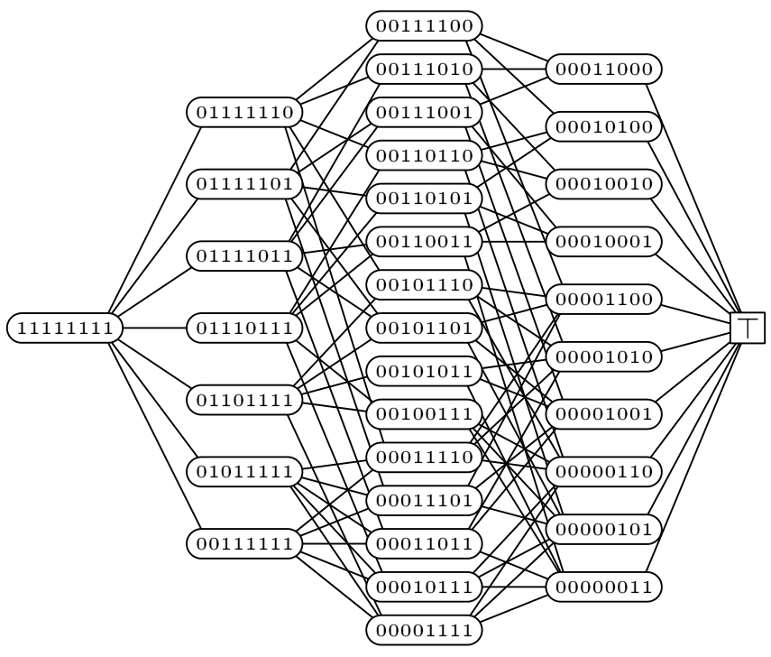</a>

<a href="../../assets/volume4b/figures/dlx-zdd-legend.svg">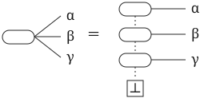</a>

(123)　图中一个有三条实线出边的签名框, 代表由虚线依次相接的三个分支结点. 它们的实线分支依次通向 $\alpha,\beta,\gamma$, 最后一条虚线通向 $\bot$.

例如, 写有 ‘00101101’ 的框代表签名 00101101 的结点.

<a id="pdf-142"></a><a id="p-122"></a>

一个签名代表一个子问题. 若它至少有一个解, 则整个问题的 ZDD 中必含一个子 ZDD, 指明该子问题的所有解. 若签名存于缓存位置 $\mathtt S[t]$, 则在步骤 Z7 结束时, 相应子 ZDD 的根就存于 $\mathtt Z[t]$.

这个子 ZDD 有一种很特别的结构, 如 (123) 所示. 假设处理签名 $\sigma$ 时用项 $i$ 作分支; 又假设 $i$ 的表中有选项 $o_1,o_2,\ldots,o_k$ 可以导出解. 那么, 签名为 $\sigma\setminus o_1,\sigma\setminus o_2,\ldots,\sigma\setminus o_k$ 的子问题便对应于分别以 $\zeta_1,\zeta_2,\ldots,\zeta_k$ 为根的子 ZDD. 步骤 Z3–Z6 的结果是为 $\sigma$ 构造一个子 ZDD, 它实质上以 $k$ 条条件指令开始:

$$
o_k\mathbin?\zeta_k:\ \ldots\ o_2\mathbin?\zeta_2:\ o_1\mathbin?\zeta_1:\ \bot.\tag{124}
$$

(ZDD 是自底向上构造的, 所以先测试 $o_k$.)

例如, (123) 的 ‘00101101’ 是一个子 ZDD 的根, 对应需要覆盖 $\{3,5,6,8\}$ 的子问题. 我们对项 3 分支, 其表中有三个选项 ‘3 5’, ‘3 6’, ‘3 8’. 输出三条分支指令,

$$
I_\theta=(\overline{3\ 5}\mathbin?0:\gamma),\qquad
I_\eta=(\overline{3\ 6}\mathbin?\theta:\beta),\qquad
I_\zeta=(\overline{3\ 8}\mathbin?\eta:\alpha);
$$

这里 $\gamma,\beta,\alpha$ 分别是签名 00000101、00001001、00001100 的子 ZDD. 签名 00101101 的子 ZDD 从 $\zeta$ 开始.

所以 (123) 图示的 ZDD 有 $1\cdot7+7\cdot5+15\cdot3+10\cdot1+2=99$ 个结点. 注意, 虚线总是或者指向 $\bot$, 或者指向一个 “不可见” 结点, 即 (124) 那样的分支链中的 $k-1$ 个辅助结点之一. 每个不可见结点都只有一个父结点. 另一方面, 每个有解的签名有一个可见结点, 可见结点可能有许多父结点.

习题 256–262 讨论了算法 Z 相对于算法 X (以及涉及颜色时的算法 C) 取得惊人改进的好些例子. 还可以举出许多其他例子. 然而我们在例子中考虑的大多数恰当覆盖问题并<em>没有</em>大量重复的公共子问题, 因此也就很难从记忆缓存中受益. 例如, 再看熟悉的兰福德配对问题. $n=14$ 时, 算法 X 需 $15\,\mathrm G\mu$ 才能证明无解; 算法 Z 只略减为 $11\,\mathrm G\mu$. $n=16$ 时, 算法 X 需 $1153\,\mathrm G\mu$ 列出 326,721,800 个解; 算法 Z 用 $450\,\mathrm G\mu$ 算出这个数目, 却要用 <em>20 千兆字节</em>存储器, 而且产生的 ZDD 有 5 亿个结点!

同样地, 对于 $n$ 皇后问题或单词拼排问题, 算法 Z 都不是首选的方法, 尽管它带来的适度加速比人们料想的更常见. 习题 263 考察了一些有代表性的例子.

**小结.** 本节一开始就看到, 链表的一些简单性质能够提高回溯的效率, 特别是用于恰当覆盖问题 (XC) 时. 随后又发现, 远超匹配范畴的许多组合任务都可以看成恰当覆盖的特例.

不过, 最值得带走的一点, 是<em>颜色代码</em>使经典的恰当覆盖问题有了一个重要的推广.

<a id="pdf-143"></a><a id="p-123"></a>

的确, 一般 XCC 问题——“带颜色的恰当覆盖”——的应用实在多得出奇. 后面的习题将展示众多很有启发性的问题, 它们用 “选项” 来描述都十分自然, 其中各 “项” 可以按一定方式着色, 也可以不着色. 前面讨论了算法 X (用于 XC 问题) 及算法 C (用于 XCC 问题); 而且看到这两个算法几乎完全相同.

此外还看到了怎样朝几个方向扩充算法 C: 算法 M 处理一般的 MCC 问题, 允许各项的覆盖次数在不同的区间内取值. 算法 $\mathrm C^{\$}$ 给每个选项赋予代价, 求出总代价最小的 XCC 解. 算法 Z 则以 ZDD 的形式给出 XCC 解, 这样又可以用其他方法来操作和优化它们.

**历史注记.** (2) 的基本思想是 H. Hitotumatu 和 K. Noshita 提出的 [<em>Information Processing Letters</em> **8** (1979), 174–175], 他们将它用于 $n$ 皇后问题. J. S. Rohl 在 1983 年发表的算法 7.2.1.2X 可以看作舞蹈链的一个简化版本, 适用于单链表已经够用的情形. (正如 Rohl 所指出的, $n$ 皇后问题就是这样的情形.) 将它推广到一般的恰当覆盖问题, 如上面的算法 X, 是作者向 C. A. R. Hoare 致敬的一篇文章的主题, 见 <em>Millennial Perspectives in Computer Science</em> (2000), 187–214, 其中给了许多例子. [该文后来增补订正, 作为 <em>FGbook</em> 第 38 章重印.] 他最初的实现称为 DLX, 采用比 (10) 复杂的数据结构, 结点带有四向链接.

高德纳于 2000 年 11 月思考二维德布鲁因序列时将算法 X 扩充为算法 C. 2004 年 8 月, 他考虑将各种大小的砖块装箱, 又得到了算法 M 的一个特例, 其中各项的重数都是固定的. 现行的算法 M 是在 2017 年 1 月发展出来的, 此前他已研究过 Wei-Hwa Huang 在 2007 年独立写下的算法 X 推广方法.

最早的恰当覆盖问题计算机程序是 J. F. Pierce [<em>Management Science</em> **15** (1968), 191–209] 和 R. S. Garfinkel、G. L. Nemhauser [<em>Operations Research</em> **17** (1969), 848–856] 各自独立开发的. 两者的给定选项都有代价, 而且目标都是得到最小代价解. 两个算法很相近, 只是对非最优选择使用不同的剪枝方法: 依据事先算好的固定次序来选取分支项, 各选项用位向量表示. 表中的选项从不删除; 若其比特与先前所选项相交, 则每逢遇到就再次拒绝. (<em>注意:</em> 运筹学文献的传统是将 (5) 这种矩阵的行、列作用互换: 项为行, 选项为列, 虽然位向量看上去像行.)

M. Nishino、N. Yasuda、S. Minato 和 M. Nagata 在 <em>AAAI Conference on Artificial Intelligence</em> **31** (2017), 868–874 中提出了 “同 ZDD 共舞” 的概念; 他们给出的是算法 Z 中所有项皆为主要项的特例.

<a id="pdf-144"></a><a id="p-124"></a>

XCC 求解的历史显然还在初期, 有许多工作要做. 例如, 在许多应用中如能找到更好的分支选项方法, 便会大有裨益, 尤其是算法 M 的步骤 M3, 迄今只探索了少数几种策略. 保持良好的 “焦点” 很重要; 此外, 利用 “分解” 技术可以大幅剪去无所收获的分支, 例如习题 343 所示.

算法 M 值得扩充为算法 $\mathrm M^{\$}$, 或许还可使它产生 ZDD 输出. 再进一步, 还可以允许每个选项的每个项各带一个权. (这样, 同 (5) 类似的相应矩阵就不止含 0 和 1 了.)

因此, XCC 求解还可望不断取得进展.

### 习题——第一组

<a id="ex-7-2-2-1-1"></a>

▶ **1.** [M25] [答案](./answers/7-2-2-1.md#ans-7-2-2-1-1) 一个含 $n$ 个元素的双链表以 0 为表头, 最初对 $1\leq k\leq n$ 有 $\mathtt{LLINK}(k)=k-1$, $\mathtt{RLINK}(k-1)=k$, 另有 $\mathtt{LLINK}(0)=n$, $\mathtt{RLINK}(n)=0$, 如 (3). 但当我们用操作 (1) 依次删去元素 $a_1,a_2,\ldots,a_n$ 后, 其中 $a_1a_2\ldots a_n$ 是 $\{1,2,\ldots,n\}$ 的一个排列, 表就空了, 各链接会像 (4) 那样交错在一起.

(a) 证明: 将关键字 $a_n,\ldots,a_2,a_1$ (逆序) 用算法 6.2.2T 依次插入一棵初始为空的树, 所得的二叉查找树可以描述 $\mathtt{LLINK}$ 和 $\mathtt{RLINK}$ 最后的设置.

(b) 若排列 $a_1a_2\ldots a_n$ 和 $b_1b_2\ldots b_n$ 在删除后给出的 $\mathtt{LLINK}$ 和 $\mathtt{RLINK}$ 值相同, 就称它们等价. 给定 $n$ 时有多少个不同的等价类?

(c) 这些等价类中有多少个只含一个排列?

<a id="ex-7-2-2-1-2"></a>

**2.** [M30] [答案](./answers/7-2-2-1.md#ans-7-2-2-1-2) 接着习题 1. 我们知道若按删除的相反次序, 用 (2) 将 $a_n,\ldots,a_2,a_1$ 逐个恢复, 就能还原原表.

(a) 证明即使用未反转的次序 $a_1,a_2,\ldots,a_n$, 也能恢复原表 (!).

(b) 按<em>任意</em>次序恢复各元素, 原表都能还原吗?

(c) 若只删去其中的 $k$ 个元素, 比如 $a_1,\ldots,a_k$, 然后严格按相同的次序 $a_1,\ldots,a_k$ 恢复它们, 总能还原原表吗?

<a id="ex-7-2-2-1-3"></a>

**3.** [20] [答案](./answers/7-2-2-1.md#ans-7-2-2-1-3) 一个要求恰好覆盖的 $m\times n$ 矩阵, 可看成含 $m$ 个未知数的 $n$ 个联立方程. 例如 (5) 等价于

$$
x_2+x_4=x_3+x_5=x_1+x_3=x_2+x_4+x_6=x_1+x_6=x_3+x_4=x_2+x_5+x_6=1,
$$

其中各 $x_k=[\text{选择第 }k\text{ 行}]$ 取 0 或 1.

(a) 这七个方程的通解是什么?

(b) 在实际中, 这种处理恰当覆盖问题的方法为什么几乎没有用处?

<a id="ex-7-2-2-1-4"></a>

**4.** [M20] [答案](./answers/7-2-2-1.md#ans-7-2-2-1-4) 给定图 $G$, 构造一个矩阵, 每个顶点 $v$ 一行, 每条边 $e$ 一列, 在行 $v$ 的列 $e$ 中填入 $[e\text{ 与 }v\text{ 相接}]$. 这个 “关联矩阵” 的恰当覆盖代表什么?

<a id="ex-7-2-2-1-5"></a>

**5.** [18] [答案](./answers/7-2-2-1.md#ans-7-2-2-1-5) 可以用零一矩阵表述的许多组合问题中, 一些最重要的问题涉及<em>集合族</em>: 矩阵的列代表给定全集的元素, 各行代表该全集的子集. 这时恰当覆盖问题就是用这样的子集划分全集. 在几何问题中, 一个恰当覆盖常称为一个<em>铺砌</em>.

<a id="pdf-145"></a><a id="p-125"></a>

等价地, 可以用超图的术语, 把各行称为超边, 各列称为构成超边的顶点; 此时恰当覆盖问题就是寻找完全匹配, 也称完全填装, 即求出互不重叠、又命中每个顶点的一组超边.

这类问题一般都有<em>对偶</em>, 把输入矩阵的行与列交换便得到对偶问题. 用超图的术语来说, 恰当覆盖问题的对偶是什么?

<a id="ex-7-2-2-1-6"></a>

**6.** [15] [答案](./answers/7-2-2-1.md#ans-7-2-2-1-6) 一个恰当覆盖问题若有 $N$ 个项和 $M$ 个选项, 所有选项的总长度为 $L$, 则算法 X 所用的数据结构中有多少个结点?

<a id="ex-7-2-2-1-7"></a>

**7.** [16] [答案](./answers/7-2-2-1.md#ans-7-2-2-1-7) 在表 1 中, 为什么 $\mathtt{TOP}(23)=-4$? 为什么 $\mathtt{DLINK}(23)=25$?

<a id="ex-7-2-2-1-8"></a>

**8.** [22] [答案](./answers/7-2-2-1.md#ans-7-2-2-1-8) 设计算法来建立恰当覆盖问题的初始存储器内容, 供算法 X 使用, 如表 1 所示. 算法的输入为一系列格式如下的行:

- 第一行列出所有项的名字.
- 余下各行各列出一个选项的项, 每行一个选项.

<a id="ex-7-2-2-1-9"></a>

**9.** [18] [答案](./answers/7-2-2-1.md#ans-7-2-2-1-9) 说明步骤 X3 中如何选取使 $\mathtt{LEN}(i)$ 最小的项 $i$ 来分支. 若有几个项都具有这一最小长度, 还须使 $i$ 最小. (这种选择法常称为 “剩余值最少” (MRV) 启发式方法.)

<a id="ex-7-2-2-1-10"></a>

**10.** [20] [答案](./answers/7-2-2-1.md#ans-7-2-2-1-10) 在某些应用中, [习题 9](#ex-7-2-2-1-9) 的 MRV 启发式方法会把查找引入歧途, 因为某些主要项虽然表短, 却几乎不能指明哪些选择可取. 修改[答案 9](./answers/7-2-2-1.md#ans-7-2-2-1-9), 使名字<em>不以</em>字符 ‘#’ 开头的项 $p$ 只有在 $\mathtt{LEN}(p)\leq1$ 或者别无选择时才能选中. (这个策略称为 “锐偏好” 启发式方法.)

<a id="ex-7-2-2-1-11"></a>

▶ **11.** [19] [答案](./answers/7-2-2-1.md#ans-7-2-2-1-11) 以表 1 为输入, 在步骤 X3 用[习题 9](#ex-7-2-2-1-9) 的方法, 手工执行算法 X 直到第一次到达步骤 X7. 这时存储器中的内容是什么?

<a id="ex-7-2-2-1-12"></a>

▶ **12.** [21] [答案](./answers/7-2-2-1.md#ans-7-2-2-1-12) 设计算法, 打印与给定结点 $x$ 关联的选项, 并使该选项循环移位, 以 $\mathtt{TOP}(x)$ 为首项. 还要打印这个选项在该项的纵表中的位置. (例如若表 1 中 $x=21$, 程序应打印 ‘$d\ f\ a$’, 并指出这是项 $d$ 的表中 3 个选项的第 2 个.)

<a id="ex-7-2-2-1-13"></a>

**13.** [16] [答案](./answers/7-2-2-1.md#ans-7-2-2-1-13) 当算法 X 在步骤 X2 找到一个解时, 怎样根据 $x_0x_1\ldots x_{l-1}$ 的值确定这个解是什么?

<a id="ex-7-2-2-1-14"></a>

▶ **14.** [20] [答案](./answers/7-2-2-1.md#ans-7-2-2-1-14) (<em>夫妇问题.</em>) “$n$ 对夫妇围圆桌而坐, 男女相间, 且夫妻不同邻, 有多少种坐法?”

(a) 设女士们已经坐好, 空座位为 $(S_0,S_1,\ldots,S_{n-1})$. 令 $M_j$ 为坐在 $S_j$ 与 $S_{(j+1)\bmod n}$ 之间的女士的丈夫. 将夫妇问题表述为项为 $S_j$ 和 $M_j$ 的恰当覆盖问题.

(b) 用算法 X 求出 $n\leq10$ 时的解. 用与不用 MRV 启发式方法时, 每个解大约需要多少次内存访问?

<a id="ex-7-2-2-1-15"></a>

**15.** [20] [答案](./answers/7-2-2-1.md#ans-7-2-2-1-15) (16) 的选项使兰福德配对问题的每个解都出现两次, 因为将任一解左右反转仍然是解. 证明只须删去其中少数几个选项, 就只会得到一半的解, 其余的都是这些解的反转.

<a id="ex-7-2-2-1-16"></a>

**16.** [16] [答案](./answers/7-2-2-1.md#ans-7-2-2-1-16) 按 (23)、(24) 表述的四皇后问题有哪些解? 算法 X 的查找树在头四层分别怎样分支?

<a id="ex-7-2-2-1-17"></a>

**17.** [16] [答案](./answers/7-2-2-1.md#ans-7-2-2-1-17) 重做[习题 16](#ex-7-2-2-1-16), 但将 $a_j,b_j$ 看成次要项, 省去松弛选项 (24). 按 $r_3,c_3,r_2,c_2,r_4,c_4,r_1,c_1$ 的次序考察主要项.

<a id="pdf-146"></a><a id="p-126"></a>

<a id="ex-7-2-2-1-18"></a>

**18.** [10] [答案](./answers/7-2-2-1.md#ans-7-2-2-1-18) 在 (6) 中若 $e,f,g$ 为<em>次要项</em>, 有哪些解?

<a id="ex-7-2-2-1-19"></a>

▶ **19.** [21] [答案](./answers/7-2-2-1.md#ans-7-2-2-1-19) 修改算法 X, 使它不要求每个选项都含主要项. 合法的解不能包含只由次要项组成的选项, 但必须与每个这样的选项相交. (例如, 若 (6) 只有 $a,b$ 是主要项, 唯一合法的解是选择 ‘$a\ d\ g$’ 和 ‘$b\ c\ f$’.)

<a id="ex-7-2-2-1-20"></a>

▶ **20.** [25] [答案](./answers/7-2-2-1.md#ans-7-2-2-1-20) 将 (26) 推广为选项 $(\alpha_0,\ldots,\alpha_{m-1};\beta_0,\ldots,\beta_{m-1})$ 的成对排序, 每个选项至多使用次要项 $y_1,\ldots,y_{m-1}$ 中的 $\lceil\lg m\rceil$ 个. (选项 $\alpha_j$ 与 $\beta_k$ 相容, 当且仅当 $0\leq j\leq k<m$.) <em>提示:</em> 想一想二进记号, 并使每个 $y_j$ 在 $\alpha$ 和 $\beta$ 各自的一组中至多使用 $2^{\rho j}$ 次.

<a id="ex-7-2-2-1-21"></a>

**21.** [22] [答案](./answers/7-2-2-1.md#ans-7-2-2-1-21) 将[习题 20](#ex-7-2-2-1-20) 推广为 $km$ 个选项 $\alpha_j^i$ ($1\leq i\leq k$, $0\leq j<m$) 的 $k$ 路排序. 解应为 $(\alpha^1_{j_1},\ldots,\alpha^k_{j_k})$, 其中 $0\leq j_1\leq\cdots\leq j_k<m$. 每个选项仍然至多有 $\lceil\lg m\rceil$ 个次要项.

<a id="ex-7-2-2-1-22"></a>

▶ **22.** [28] [答案](./answers/7-2-2-1.md#ans-7-2-2-1-22) $n$ 皇后问题的大多数解都不对称, 因而经旋转或反射导出另外七个解. 在下列各情形中, 用成对编码将解数减为八分之一.

(a) 两条主对角线上都没有皇后, $n$ 为奇数.

(b) 两条主对角线中只有一条上面有皇后.

(c) 两条主对角线各有一个皇后.

<a href="../../assets/volume4b/figures/dlx-ex22.png">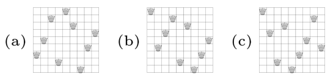</a>

<a id="ex-7-2-2-1-23"></a>

**23.** [28] [答案](./answers/7-2-2-1.md#ans-7-2-2-1-23) 在[习题 22](#ex-7-2-2-1-22) 未包含的其他情形中, 用成对编码将解数减少到<em>几乎</em>八分之一:

(a) 两条主对角线上都没有皇后, $n$ 为偶数.

(b) 中心格有一个皇后, $n$ 为奇数.

<a id="ex-7-2-2-1-24"></a>

**24.** [20] [答案](./answers/7-2-2-1.md#ans-7-2-2-1-24) 用算法 X 求出 $n$ 皇后问题中, 经 (a) $180^\circ$ 旋转、(b) $90^\circ$ 旋转后保持不变的全部解.

<a id="ex-7-2-2-1-25"></a>

**25.** [20] [答案](./answers/7-2-2-1.md#ans-7-2-2-1-25) 通过建立一个恰当覆盖问题并用算法 X 求解, 证明皇后图 $Q_8$ (习题 7.1.4–241) 不能用八种颜色着色.

<a id="ex-7-2-2-1-26"></a>

**26.** [21] [答案](./answers/7-2-2-1.md#ans-7-2-2-1-26) 皇后图 $Q_8$ 有多少种 “平衡” 的着色方法, 使 0 色恰有八个皇后, 而 1 至 8 色各有七个皇后?

<a id="ex-7-2-2-1-27"></a>

**27.** [22] [答案](./answers/7-2-2-1.md#ans-7-2-2-1-27) 巧妙地给选项 (16) 引入若干次要项, 使得只得到兰福德问题的<em>平面</em>解. (见习题 7–8.)

<a id="ex-7-2-2-1-28"></a>

**28.** [M22] [答案](./answers/7-2-2-1.md#ans-7-2-2-1-28) 对哪些整数 $c_0,t_0,c_1,t_1,\ldots,c_l,t_l$ ($1\leq c_j\leq t_j$), 估计完成比率的公式 (27) 的值为 (a) $1/2$? (b) $1/3$?

<a id="ex-7-2-2-1-29"></a>

▶ **29.** [26] [答案](./answers/7-2-2-1.md#ans-7-2-2-1-29) 设 $T$ 为任意一棵树. 构造一个无解的恰当覆盖问题的零一矩阵, 使得算法 X 采用 MRV 启发式方法遍历的回溯树就是 $T$. (每逢步骤 X3, 都应有<em>唯一</em>一个项具有最小的 $\mathtt{LEN}$.) 就下图的 $T$ 说明你的构造.

<a href="../../assets/volume4b/figures/dlx-ex29.png">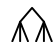</a>

<a id="ex-7-2-2-1-30"></a>

**30.** [25] [答案](./answers/7-2-2-1.md#ans-7-2-2-1-30) 接着[习题 29](#ex-7-2-2-1-29), 设 $T$ 的某些叶与其他叶有别, 被指定为 “解”. 所有这样的树都能在算法 X 中作为回溯树出现吗?

<a id="ex-7-2-2-1-31"></a>

**31.** [M21] [答案](./answers/7-2-2-1.md#ans-7-2-2-1-31) 算法 X 的运行时间取决于主要项在活动表中的次序, 还取决于各项表中选项的次序. 说明如何使算法<em>随机化</em>, 以便 (a) 在步骤 X1 以后各项表都按随机次序排列; (b) 步骤 X3 在 $\mathtt{LEN}$ 最小的项中随机选取.

<a id="ex-7-2-2-1-32"></a>

**32.** [M21] [答案](./answers/7-2-2-1.md#ans-7-2-2-1-32) 有 $M$ 个选项的恰当覆盖问题的解可以看成二元向量 $x=x_1\ldots x_M$, 其中 $x_k=[\text{选择选项 }k]$. 两个<a id="pdf-147"></a><a id="p-127"></a>解 $x$ 和 $x'$ 的<em>距离</em>可定义为汉明距离 $d(x,x')=\nu(x\oplus x')$, 即 $x$ 和 $x'$ 不同的位置数. 问题的<em>多样性</em>是其任意两个不同解之间的最小距离. (若至多有一个解, 多样性为 $\infty$.)

(a) 多样性可能是 1 吗?

(b) 多样性可能是 2 吗?

(c) 多样性可能是 3 吗?

(d) 若每个选项的项数相同, 就称恰当覆盖问题为<em>均匀</em>的. 证明均匀问题的解之间的距离总是偶数.

(e) 应用中遇到的恰当覆盖问题, 大多至少是<em>拟均匀</em>的, 意即存在一个非空主要项子集, 将问题限制到这些项后便是均匀的. (例如, 所有多格骨牌或多立方块骨牌的装箱问题都是拟均匀的, 因为每个选项恰好指定一个牌名.) 这类问题可以有奇距离吗?

<a id="ex-7-2-2-1-33"></a>

**33.** [M16] [答案](./answers/7-2-2-1.md#ans-7-2-2-1-33) 给定由零一矩阵 $A$ 指定的恰当覆盖问题, 高效地构造一个恰当覆盖问题 $A'$, 使其解比 $A$ 恰好多一个. [因此, 要判断一个至少有一个解的恰当覆盖问题是否不止一个解, 是 NP 困难的.] 假设 $A$ 不含全零行.

<a id="ex-7-2-2-1-34"></a>

**34.** [M25] [答案](./answers/7-2-2-1.md#ans-7-2-2-1-34) 给定如[习题 33](#ex-7-2-2-1-33) 的恰当覆盖问题 $A$, 构造一个恰当覆盖问题 $A'$, 使 (i) $A'$ 的每一列至多有三个 1; (ii) $A'$ 和 $A$ 的解数完全相同.

<a id="ex-7-2-2-1-35"></a>

**35.** [M21] [答案](./answers/7-2-2-1.md#ans-7-2-2-1-35) 如[习题 34](#ex-7-2-2-1-34) 那样构造 $A'$, 但要求每列<em>恰好</em>有三个 1.

<a id="ex-7-2-2-1-36"></a>

▶ **36.** [25] [答案](./answers/7-2-2-1.md#ans-7-2-2-1-36) 令 $i_k=\mathtt{TOP}(x_k)$ 是算法 X 中第 $k$ 层的分支项. 修改算法, 使它找到令 $i_0x_0i_1x_1i_2x_2\ldots$ 的字典序<em>最小</em>的解. (若仅在 X3 置 $i\gets\mathtt{RLINK}(0)$, 此事很容易; 不过大部分时间用 MRV 会快得多.) 32 皇后问题中, 字典序最先的解是什么?

<a id="ex-7-2-2-1-37"></a>

**37.** [M46] [答案](./answers/7-2-2-1.md#ans-7-2-2-1-37) (N. J. A. Sloane, 2016.) 设 $\langle q_n\rangle$ 为无穷皇后问题中字典序最小的解. (这个序列开头是

$$
1,3,5,2,4,9,11,13,15,6,8,19,7,22,10,25,27,29,31,12,14,35,37,39,41,16,18,45,\ldots,
$$

其中显然既有奇特的规律, 又有奇特的不规则之处.)

(a) 证明每个正整数都在序列中出现.

(b) 证明 $q_n$ 或为 $n\phi+O(1)$, 或为 $n/\phi+O(1)$.

<a id="ex-7-2-2-1-38"></a>

▶ **38.** [M25] [答案](./answers/7-2-2-1.md#ans-7-2-2-1-38) 设计一种高效的方法计算[习题 37](#ex-7-2-2-1-37) 中的序列 $\langle q_n\rangle$.

<a id="ex-7-2-2-1-39"></a>

▶ **39.** [M21] [答案](./answers/7-2-2-1.md#ans-7-2-2-1-39) 试验由 $n$ 个项上的 $m$ 个<em>随机</em>选项定义的恰当覆盖问题. (各个选项独立生成, 允许重复.)

(a) 取固定概率 $p$, 使任一项以概率 $p$ 出现在任一给定选项中.

(b) 令每个选项为由 $r$ 个不同项组成的随机样本.

<a id="ex-7-2-2-1-40"></a>

▶ **40.** [21] [答案](./answers/7-2-2-1.md#ans-7-2-2-1-40) 若只想数出恰当覆盖问题的解数, 无须实际构造这些解, 有时可以采用一条完全不同的途径, 用位运算代替链表处理.

下面的朴素算法说明这一想法. 给定一个 $m\times n$ 的零一矩阵, 用长度为 $n$ 的位向量 $r_1,\ldots,r_m$ 表示各行. 算法使用一个可能很大的数据库, 其中存放有序对 $(s_j,c_j)$, $s_j$ 是表示一个项集的 $n$ 位二进制数, 正整数 $c_j$ 表示恰好覆盖该集合的方法数. 令 $p$ 为代表主要项的 $n$ 位掩码.

<a id="pdf-148"></a><a id="p-128"></a>

**N1.** [初始化.] 置 $N\gets1$, $s_1\gets0$, $c_1\gets1$, $k\gets1$.

**N2.** [完成?] 若 $k>m$, 终止; 答案为 $\sum_{j=1}^N c_j[s_j\mathbin{\&}p=p]$.

**N3.** [尽可能添入 $r_k$.] 置 $t\gets r_k$. 依次对 $N\geq j\geq1$, 若 $s_j\mathbin{\&}t=0$, 将 $(s_j+t,c_j)$ 插入数据库 (见下文).

**N4.** [对 $k$ 循环.] 置 $k\gets k+1$, 回到 N2.　■

插入 $(s,c)$ 有两种情形: 若已有某项 $(s_i,c_i)$ 满足 $s=s_i$, 只须置 $c_i\gets c_i+c$. 否则置 $N\gets N+1$, $s_N\gets s$, $c_N\gets c$.

证明下述技巧能显著改进这个算法: 置 $u_k\gets r_k\mathbin{\&}\bar f_k$, 其中 $f_k=r_{k+1}\mathbin{\vert}\cdots\mathbin{\vert}r_m$ 是以后各行的按位或. 若 $u_k\ne0$, 就可从数据库中除去所有 $s_j$ 没有包含 $u_k\mathbin{\&}p$ 的表项. 还可以利用 $u_k$ 中的非主要项进一步压缩数据库.

<a id="ex-7-2-2-1-41"></a>

**41.** [25] [答案](./answers/7-2-2-1.md#ans-7-2-2-1-41) 实现上题改进后的算法, 并将它用于 $n$ 皇后问题, 同算法 X 比较运行时间.

<a id="ex-7-2-2-1-42"></a>

**42.** [M21] [答案](./answers/7-2-2-1.md#ans-7-2-2-1-42) 说明怎样扩充[习题 40](#ex-7-2-2-1-40) 的方法, 使它既能计数, 又能给出全部解的表示.

<a id="ex-7-2-2-1-43"></a>

**43.** [M20] [答案](./answers/7-2-2-1.md#ans-7-2-2-1-43) 给出 (28) 中三个数独方阵的元素 $a_{ij},b_{ij},c_{ij}$ 的公式.

<a id="ex-7-2-2-1-44"></a>

**44.** [M04] [答案](./answers/7-2-2-1.md#ans-7-2-2-1-44) 一个数独谜题的线索有可能是 $\pi$ 的前 33 位数字吗? (见 (29a).)

<a id="ex-7-2-2-1-45"></a>

**45.** [14] [答案](./answers/7-2-2-1.md#ans-7-2-2-1-45) 列出算法 X 轻松解出 (29a) 时依次填入的显性唯一数. (若有几个可能的 $p_{ij}$, 每步选 $ij$ 最小的一个.)

<a id="ex-7-2-2-1-46"></a>

**46.** [19] [答案](./answers/7-2-2-1.md#ans-7-2-2-1-46) 列出图 (31) 中全部<em>隐性</em>唯一数的走法.

<a id="ex-7-2-2-1-47"></a>

**47.** [19] [答案](./answers/7-2-2-1.md#ans-7-2-2-1-47) 在格 $(2,3)$ 填入 ‘3’ 以后, (32) 中有哪些隐性唯一数?

<a id="ex-7-2-2-1-48"></a>

▶ **48.** [24] [答案](./answers/7-2-2-1.md#ans-7-2-2-1-48) 图 (33) 实际上按行、列排列数据. 证明同一组数据还可以按 (a) 行与数值, 或 (b) 数值与列, 排成图表.

<a id="ex-7-2-2-1-49"></a>

▶ **49.** [24] [答案](./answers/7-2-2-1.md#ans-7-2-2-1-49) 一个恰当覆盖问题的任何解, 都能解从中除去若干项而得到的 “松弛” 子问题. 例如可以将数独问题 (30) 松弛, 除去全部项 $c_{jk}$ 和 $b_{xk}$, 以及 $i\ne i_0$ 的各 $r_{ik}$. 只看第 $i_0$ 行的选项, 每个便只余两个项 ‘$p_{i_0j}\ r_{i_0k}$’, 其中 $(j,k)$ 取某些值. 换句话说, 余下的是一个二维匹配问题.

构造一个二部图: 若有数独选项含 ‘$p_{i_0j}\ r_{i_0k}$’, 就连边 $u_j\mathbin{-}v_k$. 下图是 (33) 中 $i_0=4$ 时的例子. 图的每个完全匹配都必须把 $u_3,u_8$ 配给 $v_7,v_1$, 因此可删去其他 $u$ 通往这两个 $v$ 的边; 这称为第 $i_0$ 行的 “显性数对”. 对偶地, $v_5,v_8$ 必须配给 $u_2,u_7$, 因而可删去其他 $v$ 通往这两个 $u$ 的边; 这称为第 $i_0$ 行的 “隐性数对”.

<a href="../../assets/volume4b/figures/xc-first-49.png">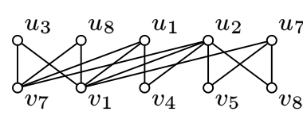</a>

一般地, 若 $q$ 个 $u$ 的邻点合计只有 $q$ 个 $v$, 就称这些 $u$ 构成<em>显性 $q$ 元组</em>; 若 $q$ 个 $v$ 的邻点只有 $q$ 个 $u$, 就称这些 $v$ 构成<em>隐性 $q$ 元组</em>.

(a) 以上是就行而言. 说明对于 (i) 列、(ii) 宫, 可以怎样类似地定义显性和隐性 $q$ 元组.

(b) 证明若这个二部图的两部各有 $r$ 个顶点且存在完全匹配, 则有隐性 $q$ 元组当且仅当有显性 $(r-q)$ 元组.

(c) 求出 (33) 的全部显性和隐性 $q$ 元组. 可以因此排除哪些选项?

(d) 试删去 $p_{ij},b_{xk}$ 各项以及 $k\ne k_0$ 的全部 $r_{ik},c_{jk}$. 这样能进一步化简 (33) 吗?

<a id="ex-7-2-2-1-50"></a>

**50.** [20] [答案](./answers/7-2-2-1.md#ans-7-2-2-1-50) 有多少道只含 17 个线索而解唯一的谜题, 包含 (29c) 的那 16 个线索?

<a id="pdf-149"></a><a id="p-129"></a>

<a id="ex-7-2-2-1-51"></a>

**51.** [22] [答案](./answers/7-2-2-1.md#ans-7-2-2-1-51) 有多少种办法填完 (29c), 使每行、每列、每宫都是多重集 $\{1,2,3,4,5,6,7,7,9\}$ 的一个排列?

<a id="ex-7-2-2-1-52"></a>

**52.** [40] [答案](./answers/7-2-2-1.md#ans-7-2-2-1-52) 试找一道对算法 X 来说尽可能难的数独题.

<a id="ex-7-2-2-1-53"></a>

**53.** [M26] [答案](./answers/7-2-2-1.md#ans-7-2-2-1-53) 初学数独时, 不妨在一种叫作 <em>shidoku</em> 的袖珍数独上练手. 它把 $4\times4$ 方阵分成四个 $2\times2$ 的宫.

(a) 证明每道解唯一的袖珍数独至少有四个线索.

(b) 若把行和列作保持宫划分的置换, 或旋转 $90^\circ$, 或置换各个数字, 或将这几种操作合用, 可以把一道袖珍数独变成另一道, 就称二者等价. 证明解唯一的四线索袖珍数独恰有 13 种本质不同的题.

<a id="ex-7-2-2-1-54"></a>

▶ **54.** [35] [答案](./answers/7-2-2-1.md#ans-7-2-2-1-54) (<em>极小线索集.</em>) 题 (29a) 中有些线索并非确定唯一解所必需. (例如最后的 ‘95’ 就可略去.) 求这 32 个线索的所有子集 $X$, 使 (i) 给定 $X$ 时解唯一; 而且 (ii) 对每个 $x\in X$, 给定 $X\setminus\{x\}$ 时解<em>不</em>唯一.

<a id="ex-7-2-2-1-55"></a>

**55.** [34] [答案](./answers/7-2-2-1.md#ans-7-2-2-1-55) (G. McGuire.) 证明, 以 (28a) 为唯一解的任何数独至少要有 18 个线索. 再找出足够用的 18 个线索. <em>提示:</em> 头三行中出现的九个 1、4、7 里至少有两个必须给出.

类似地, 求使 (28b) 成为唯一解的一个最小线索集.

<a id="ex-7-2-2-1-56"></a>

**56.** [47] [答案](./answers/7-2-2-1.md#ans-7-2-2-1-56) 数独的一个极小线索集至多能有多少个线索?

<a id="ex-7-2-2-1-57"></a>

**57.** [22] [答案](./answers/7-2-2-1.md#ans-7-2-2-1-57) 任意数独解至多有 27 种横三数组和 27 种纵三数组, 即出现在同一宫的一行或一列内的三个数字组成的集合. 例如, (28a) 有九种横三数组 $\{1,2,3\},\{2,3,4\},\ldots,\{9,1,2\}$ 及三种纵三数组 $\{1,4,7\},\{2,5,8\},\{3,6,9\}$; (28b) 的横、纵三数组则各只有三种. (29a) 的解有 26 种横三数组和 23 种纵三数组; $\{3,6,8\}$ 横向出现一次, 纵向出现两次.

令 $T$ 为 27 个三数组组成的集合 $\{\{A,B,C\}\mid A\in\{1,2,3\},B\in\{4,5,6\},C\in\{7,8,9\}\}$. 找出全部横三数组及全部纵三数组都恰好是 $T$ 的所有数独解.

<a id="ex-7-2-2-1-58"></a>

▶ **58.** [22] [答案](./answers/7-2-2-1.md#ans-7-2-2-1-58) (A. Thoen 和 A. van de Wetering, 2019.) 求出数字 1、2、…、7 各自还构成九皇后问题的解的所有数独解.

<a id="ex-7-2-2-1-59"></a>

**59.** [20] [答案](./answers/7-2-2-1.md#ans-7-2-2-1-59) 解出 (34) 中的拼图数独. 算法 X 的查找树有多大?

<a id="ex-7-2-2-1-60"></a>

**60.** [20] [答案](./answers/7-2-2-1.md#ans-7-2-2-1-60) (<em>Puzzlium 数独 ABC.</em>) 填完以下用六格骨牌作宫的谜题:

(a) <a href="../../assets/volume4b/figures/xc-first-60a.png">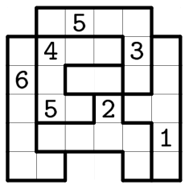</a>

(b) <a href="../../assets/volume4b/figures/xc-first-60b.png">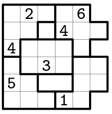</a>

(c) <a href="../../assets/volume4b/figures/xc-first-60c.png">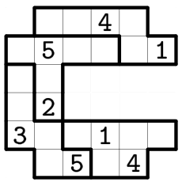</a>

<a id="ex-7-2-2-1-61"></a>

**61.** [21] [答案](./answers/7-2-2-1.md#ans-7-2-2-1-61) 将贝伦斯的 $5\times5$ 公平设计 (35a) 擦到只余 5 个数, 做成一道拼图数独.

<a id="ex-7-2-2-1-62"></a>

▶ **62.** [34] [答案](./answers/7-2-2-1.md#ans-7-2-2-1-62) 对 $n\leq7$, 生成所有用 $n$ 块非直形 $n$ 格骨牌铺满 $n\times n$ 正方形的方法. (这些就是正方形拼图数独中可能的分宫方式.) 其中有多少种对称? <em>提示:</em> 见习题 7.2.2–76.

<a id="ex-7-2-2-1-63"></a>

**63.** [29] [答案](./answers/7-2-2-1.md#ans-7-2-2-1-63) 贝伦斯的 $9\times9$ 方阵 (35c) 可用多少种方式看作一个公平拉丁方? (换句话说, 将方阵分解成若干个大小为 9 的宫, 使每宫恰有一个完整的 “彩虹” $\{1,2,3,4,5,6,7,8,9\}$, 有多少种办法? 整行和整列都不算作宫.)

<a id="pdf-150"></a><a id="p-130"></a>

<a id="ex-7-2-2-1-64"></a>

**64.** [23] [答案](./answers/7-2-2-1.md#ans-7-2-2-1-64) (<em>无提示拼图数独.</em>) 若仅凭一行或一列中填入的符号就能唯一确定一道拼图数独的解, 不妨称它为 “无提示” 的: 这样的线索只不过是给题中出现的 $n$ 个符号各取一个名字. 最早发表的这类题由 Oriel Maxime 于 2000 年发现, 如图所示.

<a href="../../assets/volume4b/figures/xc-first-64.png">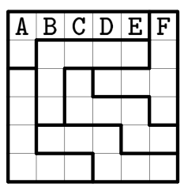</a>

(a) 求出阶数 $n\leq6$ 的所有无提示拼图数独.

(b) 证明每阶 $n\geq4$ 都有这样的题.

<a id="ex-7-2-2-1-65"></a>

**65.** [24] [答案](./answers/7-2-2-1.md#ans-7-2-2-1-65) 求下列各道拼图数独的唯一解:

<a href="../../assets/volume4b/figures/xc-first-65.png">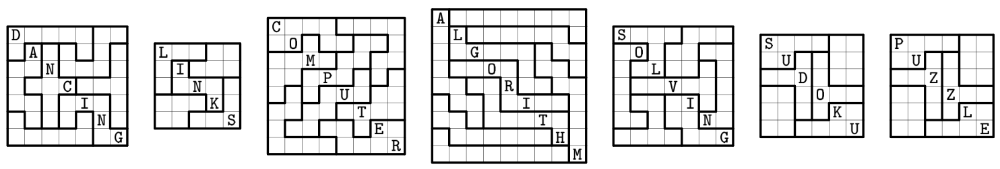</a>

<a id="ex-7-2-2-1-66"></a>

▶ **66.** [30] [答案](./answers/7-2-2-1.md#ans-7-2-2-1-66) 将以下每组九张卡片排成 $3\times3$ 的方阵, 使它们组成一道解唯一的数独. (卡片不可旋转.)

<a href="../../assets/volume4b/figures/xc-first-66.svg">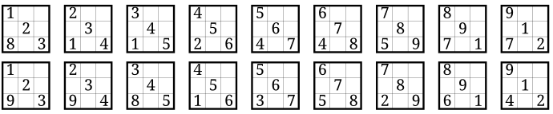</a>

<a id="ex-7-2-2-1-67"></a>

▶ **67.** [22] [答案](./answers/7-2-2-1.md#ans-7-2-2-1-67) <em>超级数独</em>在普通数独上增加了四个宫 (图中有阴影), 每宫都必须出现完整的 “彩虹” $\{1,2,3,4,5,6,7,8,9\}$:

(i) <a href="../../assets/volume4b/figures/xc-first-67i.svg">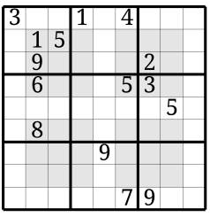</a>

(ii) <a href="../../assets/volume4b/figures/xc-first-67ii.svg">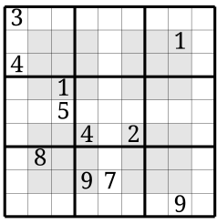</a>

(这类谜题由 P. Ritmeester 于 2005 年引入, 许多报纸都有刊载.)

(a) 证明超级数独的解实际上有 18 个彩虹宫, 而不只有 13 个.

(b) 用这个观察扩充 (30), 以便高效地解超级数独.

(c) 解 (i) 和 (ii) 时, 这一观察有多大帮助?

(d) 判断真假: 将贴着四角的四个 $4\times4$ 块同时旋转 $180^\circ$, 将中间一行和中间一列的各半段也各自反转 (中心不动), 超级数独的解仍然是解.

<a id="ex-7-2-2-1-68"></a>

**68.** [28] [答案](./answers/7-2-2-1.md#ans-7-2-2-1-68) 若同一行或同一列内任意两个格之间的各格都属于某块多格骨牌, 就说它是<em>凸</em>的. (这当且仅当其周长等于最小外接矩形的周长, 因为每行和每列都贡献 2.) 例如 (36) 的五格骨牌除 U 外都是凸的.

(a) 对 $n\leq7$, 生成用 $n$ 块凸 $n$ 格骨牌铺满 $n\times n$ 盒子的全部方法.

(b) 将九块凸九格骨牌铺满 $9\times9$ 盒子, 并且每块都装得进 $4\times4$ 的小方框, 有多少种办法? (也考虑其对称性.)

<a id="pdf-151"></a><a id="p-131"></a>

<a id="ex-7-2-2-1-69"></a>

▶ **69.** [30] [答案](./answers/7-2-2-1.md#ans-7-2-2-1-69) 图 (i) 给出比特国的 81 个社区及九个选区. 各社区的选民要么全是大端派 (B), 要么全是小端派 (L). 每区由多数票决定一位议会代表.

注意每区都恰有五个 L、四个 B, 所以议会百分之百属于小端派. 大家都认为这样不公平, 于是聘请你作计算机顾问, 重新设计选区.

一位腰缠万贯的大人物私下许诺, 若能为他那一派争取到尽可能好的结果, 他就给你一大车钱. 你可以照图 (ii) 那样划分, 让大端派取得七席. 但那样未免偏袒得太露骨.

(i) <a href="../../assets/volume4b/figures/xc-first-69i.png">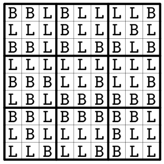</a>

(ii) <a href="../../assets/volume4b/figures/xc-first-69ii.png">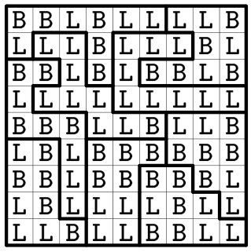</a>

证明 B 派确实可以赢七席, 同时让九个选区都相当尊重比特国各社区原有的地缘关系: 每区都是能装进 $4\times4$ 方框的凸九格骨牌 (见[习题 68](#ex-7-2-2-1-68)).

<a id="ex-7-2-2-1-70"></a>

**70.** [21] [答案](./answers/7-2-2-1.md#ans-7-2-2-1-70) <em>Dominosa</em> 是一种单人骨牌游戏. 把双六骨牌从双白、白幺一直到双六的 28 张牌 “洗匀”, 随机铺入 $7\times8$ 的框内, 记下每格的点数, 收走骨牌, 再试着仅凭这个 $7\times8$ 的数字阵列恢复其位置. 例如以下铺法

<a href="../../assets/volume4b/figures/xc-first-70.png"></a>

给出阵列

$$
\begin{pmatrix}
0&6&5&2&1&4&1&2\\1&4&5&3&5&3&3&6\\1&1&5&6&0&0&4&4\\4&4&5&6&2&2&2&3\\0&0&5&6&1&3&3&6\\6&6&2&0&3&2&5&1\\1&5&0&4&4&0&3&2
\end{pmatrix}.
$$

(a) 证明另有一种骨牌铺法也给出同一个数字矩阵.

(b) 什么样的骨牌铺法会产生下列阵列?

$$
\begin{pmatrix}
3&3&6&5&1&5&1&5\\6&5&6&1&2&3&2&4\\2&4&3&3&3&6&2&0\\4&1&6&1&4&4&6&0\\3&0&3&0&1&1&4&4\\2&6&2&5&0&5&0&0\\2&5&0&5&4&2&1&6
\end{pmatrix}
$$

<a id="ex-7-2-2-1-71"></a>

▶ **71.** [20] [答案](./answers/7-2-2-1.md#ans-7-2-2-1-71) 证明 Dominosa 的复原是三维匹配 (3DM) 的一个特例.

<a id="ex-7-2-2-1-72"></a>

**72.** [M22] [答案](./answers/7-2-2-1.md#ans-7-2-2-1-72) 随机生成 Dominosa 的实例, 并估计所得 $7\times8$ 矩阵解唯一的概率. 采用两种随机模型: (i) 元素是多重集 $\{8\times0,8\times1,\ldots,8\times6\}$ 的排列的各个矩阵等可能; (ii) 随机打乱骨牌并铺出矩阵, 使每种铺法等可能.

<a id="ex-7-2-2-1-73"></a>

**73.** [46] [答案](./answers/7-2-2-1.md#ans-7-2-2-1-73) 一个 Dominosa 实例的解数最大是多少?

<a id="pdf-152"></a><a id="p-132"></a>

<a id="ex-7-2-2-1-74"></a>

**74.** [22] [答案](./answers/7-2-2-1.md#ans-7-2-2-1-74) (M. Keller, 1987.) 有没有一种解唯一的 Dominosa 阵列, 每张骨牌的两个数字都能在阵列中找到三处或四处相邻的配对位置?

<a id="ex-7-2-2-1-75"></a>

▶ **75.** [M24] [答案](./answers/7-2-2-1.md#ans-7-2-2-1-75) 设 $G$ 是带有二元运算 $\circ$ 的集合, 对一切 $x,y\in G$ 都有 $x\circ(y\circ x)=y$. 称这种代数结构为 <em>grope</em> (半对称拟群).

(a) 证明在任何半对称拟群中, 恒等式 $(x\circ y)\circ x=y$ 也成立.

(b) 下列哪些 “乘法表” 定义了 $\{0,1,2,3\}$ 上的半对称拟群?

```text
0123   0321   0132   0231   0312
1032   3210   1023   3102   2130
2301   2103   3210   1320   3021
3210   1032   2301   2013   1203
```

在第一例中 $x\circ y=x\oplus y$; 第二例中 $x\circ y=(-x-y)\bmod4$. 最后两例有 $x\circ y=x\oplus f(x\oplus y)$, 其中 $f$ 是某个函数.

(c) 对所有 $n$, 构造元素为 $\{0,1,\ldots,n-1\}$ 的一个半对称拟群.

(d) 考虑具有 $n^2$ 个项 $xy$ ($0\leq x,y<n$) 及下列 $n+(n^3-n)/3$ 个选项的恰当覆盖问题:

(i) ‘$xx$’, $0\leq x<n$;

(ii) ‘$xx\ xy\ yx$’, $0\leq x<y<n$;

(iii) ‘$xy\ yz\ zx$’, $0\leq x<y,z<n$.

证明其解与元素为 $\{0,1,\ldots,n-1\}$ 的半对称拟群的乘法表一一对应.

(e) 若 $x\circ x=x$, 就称元素 $x$ <em>幂等</em>. 若 $k$ 个元素幂等, 其余 $n-k$ 个不幂等, 证明 $k\equiv n^2\pmod3$.

<a id="ex-7-2-2-1-76"></a>

**76.** [21] [答案](./answers/7-2-2-1.md#ans-7-2-2-1-76) 修改[习题 75](#ex-7-2-2-1-75)(d) 的恰当覆盖问题, 以求出下列各种半对称拟群的乘法表: (a) 所有<em>幂等</em>的, 即对所有 $x$ 都有 $x\circ x=x$; (b) 所有<em>交换</em>的, 即对所有 $x,y$ 都有 $x\circ y=y\circ x$; (c) 所有以 0 为<em>单位元</em>的, 即对所有 $x$ 都有 $x\circ0=0\circ x=x$.

<a id="ex-7-2-2-1-77"></a>

**77.** [M21] [答案](./answers/7-2-2-1.md#ans-7-2-2-1-77) 给定各有 $n$ 个顶点的图 $G$ 和 $H$, 用算法 X 判断 $G$ 是否同构于 $H$ 的一个子图. (这种情形下称 $G$ <em>嵌入</em> $H$.)

<a id="ex-7-2-2-1-78"></a>

**78.** [16] [答案](./answers/7-2-2-1.md#ans-7-2-2-1-78) 证明可以相当容易地将图 71 的 27 位数学家姓名都从左到右地排入 $12\times15$ 阵列. (当然, 这样的找词谜可<em>糟透</em>了.)

<a id="ex-7-2-2-1-79"></a>

**79.** [M20] [答案](./answers/7-2-2-1.md#ans-7-2-2-1-79) 将 (48) 的选项列全时, 一共有多少个?

<a id="ex-7-2-2-1-80"></a>

**80.** [19] [答案](./answers/7-2-2-1.md#ans-7-2-2-1-80) 以表 2 为输入, 在 C3 采用[习题 9](#ex-7-2-2-1-9) 的方法, 手工执行算法 C, 直到首次找到一个解. 此时存储器的内容是什么?

<a id="ex-7-2-2-1-81"></a>

**81.** [21] [答案](./answers/7-2-2-1.md#ans-7-2-2-1-81) 判断真假: 一个没有颜色指定的恰当覆盖问题, 用算法 X 和算法 C 求解的运行时间完全相同.

<a id="ex-7-2-2-1-82"></a>

**82.** [21] [答案](./answers/7-2-2-1.md#ans-7-2-2-1-82) 判断真假: 在算法 X 和 C 的隐藏、恢复操作中, 当 $x>N_1$ 时不更新 $\mathtt{LEN}$ 域, 就能节省内存访问.

<a id="ex-7-2-2-1-83"></a>

▶ **83.** [20] [答案](./answers/7-2-2-1.md#ans-7-2-2-1-83) 算法 C 可以按下面这种奇特的方式扩充. 设 $p$ 为最先覆盖的主要项, 可以用 $k$ 种办法覆盖它. 再设 $p$ 的第 $j$ 个选项以次要项 $s_j$ 结束, 各 $s_1,\ldots,s_k$ 互不相同. 修改算法, 使得只要解含 $p$ 的第 $j$ 个选项, 就让项 $\{s_1,\ldots,s_{j-1}\}$ 全部不被覆盖. (换句话说, 修改后的算法将模拟原算法应用于一个大得多的实例时的行为; 在那个实例中, $p$ 的第 $j$ 个选项包含 $s_1,s_2,\ldots,s_j$.)

<a id="pdf-153"></a><a id="p-133"></a>

<a id="ex-7-2-2-1-84"></a>

▶ **84.** [25] [答案](./answers/7-2-2-1.md#ans-7-2-2-1-84) 将 XCC 问题的选项从 1 至 $M$ 编号. <em>极小极大解</em>是指使其中最大的选项编号尽可能小的解. 说明如何修改算法 C, 使它确定全部极小极大解 (略去那些已知比已找到的解差的解).

<a id="ex-7-2-2-1-85"></a>

**85.** [22] [答案](./answers/7-2-2-1.md#ans-7-2-2-1-85) 改进上题的算法, 使它<em>恰好给出一个</em>极小极大解——当然, 问题根本无解时除外.

<a id="ex-7-2-2-1-86"></a>

▶ **86.** [M25] [答案](./answers/7-2-2-1.md#ans-7-2-2-1-86) 修改算法 C, 用定理 7.2.2E 给出 XCC 问题解数及求出这些解所需时间的<em>蒙特卡罗估计</em>, 从而代替找出所有解的做法. (修改后的算法之于算法 C, 就如同算法 7.2.2E 之于算法 7.2.2B.)

<a id="ex-7-2-2-1-87"></a>

**87.** [20] [答案](./answers/7-2-2-1.md#ans-7-2-2-1-87) <em>双单词方阵</em>是一个各行、各列共含 $2n$ 个不同单词的 $n\times n$ 阵列. 将问题编码成 XCC 问题. 能否通过不再生成已有解的转置来节省一个因子 2? 算法 C 比得过习题 7.2.2–28 的算法吗 (后者是专为处理这类题设计的)?

<a id="ex-7-2-2-1-88"></a>

**88.** [21] [答案](./answers/7-2-2-1.md#ans-7-2-2-1-88) 通常, 比起找出<em>全部</em>双单词方阵, 我们对求<em>最好</em>的一个更感兴趣, 其好坏取决于能否只用相当常见的词. 例如可以用 $\mathrm{WORDS}(1720)$ 中的词造出一个双单词方阵, 用 $\mathrm{WORDS}(1719)$ 却不行. 证明用舞蹈链很容易找到支持双单词方阵的最小 $W$, 即所用的词都属于 $\mathrm{WORDS}(W)$.

<a id="ex-7-2-2-1-89"></a>

**89.** [24] [答案](./answers/7-2-2-1.md#ans-7-2-2-1-89) 以[习题 88](#ex-7-2-2-1-88) 的标准, 用 <em>The Official SCRABBLE® Players Dictionary</em> 来衡量, 从 $2\times2$, $3\times3$, …, 到 $7\times7$ 各种尺寸的最佳双单词方阵是什么? [习题 7.2.2–32 对<em>对称</em>单词方阵考虑过类似问题.]

<a id="ex-7-2-2-1-90"></a>

▶ **90.** [22] [答案](./answers/7-2-2-1.md#ans-7-2-2-1-90) 周期为 $p$ 的<em>单词阶梯</em>是单词逐级错开的循环排列, 横读、竖读共有 $2p$ 个不同的词. 有左斜和右斜两种:

```text
                ⋯                      ⋯
                S T A I R           S T A I R
              S H A R P               S L O O P
            S T E M S                   S T O O D
          S C R A P                       S T E E R
        S T A I R                           S T A I R
      S H A R P                               S L O O P
    S T E M S              p = 4                S T O O D
  S C R A P                                       S T E E R
S T A I R                                           S T A I R
⋯                                                   ⋯
```

按[习题 88](#ex-7-2-2-1-88) 的标准, 在 $1\leq p\leq10$ 时, 最好的五字母单词阶梯是什么? <em>提示:</em> 假定第一个词最常见, 可节省一个因子 $2p$.

<a id="ex-7-2-2-1-91"></a>

**91.** [40] [答案](./answers/7-2-2-1.md#ans-7-2-2-1-91) 给定 $W$, 求使 $\mathrm{WORDS}(W)$ 支持周期 $p$ 的单词阶梯的最大 $p$. (每个 $W$ 都有两道题, 分别考察左斜和右斜的阶梯.)

<a id="ex-7-2-2-1-92"></a>

**92.** [24] [答案](./answers/7-2-2-1.md#ans-7-2-2-1-92) 有些 $p$ 个词的循环给出<em>双向</em>单词阶梯, 其中有 $3p$ 个不同的词:

```text
                ⋯                      ⋯
                R A P I D           R A P I D
              R A T E D               R A T E D
            L A C E S                   L A C E S
          R O B E S                       R O B E S
        R A P I D                           R A P I D
      R A T E D                               R A T E D
    L A C E S              p = 4                L A C E S
  R O B E S                                       R O B E S
R A P I D                                           R A P I D
⋯                                                   ⋯
```

当 $1\leq p\leq10$ 时, 这种五字母例子的最佳者为何?

<a id="pdf-154"></a><a id="p-134"></a>

<a id="ex-7-2-2-1-93"></a>

**93.** [22] [答案](./answers/7-2-2-1.md#ans-7-2-2-1-93) 还有一种周期性排列的 $3p$ 个词, 也许比[习题 92](#ex-7-2-2-1-92) 的更有趣. 如图所示 ($p=3$), 除横向外, 还可沿斜线向上或向下读. 当 $1\leq p\leq10$ 时, 这种排列的最佳五字母例子是什么? (注意这里有 $2p$ 重对称性.)

<a href="../../assets/volume4b/figures/xc-next-93.png"></a>

<a id="ex-7-2-2-1-94"></a>

**94.** [20] [答案](./answers/7-2-2-1.md#ans-7-2-2-1-94) (É. Lucas.) 求一个二进制圈 $(x_0x_1\ldots x_{15})$, 使十六个四元组 $x_kx_{(k+1)\bmod16}x_{(k+3)\bmod16}x_{(k+4)\bmod16}$ ($0\leq k<16$) 互不相同.

<a id="ex-7-2-2-1-95"></a>

▶ **95.** [20] [答案](./answers/7-2-2-1.md#ans-7-2-2-1-95) 给定 $0\leq p<q\leq n$, 说明如何利用颜色控制和算法 C 求出一切具有下述性质的零一圈 $(x_0x_1\ldots x_{m-1})$, 其中 $m=\sum_{k=p}^q\binom nk$: 这 $m$ 个二进制向量 $\{x_0x_1\ldots x_{n-1},x_1x_2\ldots x_n,\ldots,x_{m-1}x_0\ldots x_{n-2}\}$ 互不相同, 而且重量介于 $p$ 与 $q$ 之间. (换句话说, 满足 $p\leq\nu y\leq q$ 的每个长度为 $n$ 的位向量 $y=y_1\ldots y_n$ 在圈中恰好出现一次. §7.2.1.1 研究过 $p=0$, $q=n$ 的特殊情形, 即德布鲁因圈.)

例如, 当 $n=7$, $p=0$, $q=3$ 时, 圈

```text
(0000000100000110000101000101100010010101001001100100011010000111)
```

给出了所有 0 占多数的二进制七元组. 当 $n=7$, $p=3$, $q=4$ 时, 圈

```text
(0000111000101100011010010101011010100110011011001011100100111010001111)
```

给出了从含四个 0、四个 1 的八元组中删去第一比特所能得到的全部七元组.

当 $(n,p,q)=(7,0,3)$ 或 $(7,3,4)$ 时, 究竟有多少个这样的圈? 算法 C 要用多长时间才能将它们求出?

<a id="ex-7-2-2-1-96"></a>

**96.** [M20] [答案](./answers/7-2-2-1.md#ans-7-2-2-1-96) 求一个 $8\times8$ 的二进制环面, 使它的六十四个 $2\times3$ 子矩形互不相同.

<a id="ex-7-2-2-1-97"></a>

**97.** [M21] [答案](./answers/7-2-2-1.md#ans-7-2-2-1-97) 求出所有具有如下对称性的 $9\times9$ 三进制外环面 $D=(d_{i,j})$: $d_{(i+3)\bmod9,(j+3)\bmod9}=(d_{i,j}+1)\bmod3$. (见习题 7.2.1.1–109.)

<a id="ex-7-2-2-1-98"></a>

**98.** [25] [答案](./answers/7-2-2-1.md#ans-7-2-2-1-98) 证明带颜色控制的恰当覆盖问题是 NP 完全的, 即便每个选项只含两个项也是如此.

<a id="ex-7-2-2-1-99"></a>

**99.** [20] [答案](./answers/7-2-2-1.md#ans-7-2-2-1-99) 判断正误: 每个 XCC 问题都能重新表为一个<em>普通的</em>恰当覆盖问题, 两者有相同的解及相同数目的选项.

<a id="ex-7-2-2-1-100"></a>

▶ **100.** [20] [答案](./answers/7-2-2-1.md#ans-7-2-2-1-100) 一般的<em>约束满足问题</em> (CSP) 是求出满足给定约束系统 $C_1,\ldots,C_m$ 的全部 $n$ 元组 $x_1\ldots x_n$, 其中每个约束由变量集 $\{x_1,\ldots,x_n\}$ 的一个非空子集上的关系定义.

例如, 一元约束是形如 $x_k\in D_k$ 的关系; 二元约束是形如 $(x_j,x_k)\in D_{jk}$ 的关系; 三元约束是形如 $(x_i,x_j,x_k)\in D_{ijk}$ 的关系; 依此类推.

(a) 求出满足 $0\leq x_1\leq x_2\leq x_3\leq x_4\leq x_5\leq2$ 且 $x_1+x_3+x_5=3$ 的全部 $x_1x_2x_3x_4x_5$.

(b) 将 (a) 表为 XCC 问题.

(c) 说明如何将任意 CSP 表为 XCC 问题.

<a id="ex-7-2-2-1-101"></a>

▶ **101.** [25] [答案](./answers/7-2-2-1.md#ans-7-2-2-1-101) (<em>斑马谜题.</em>) 把下面的问题表为 XCC 问题: “五个人来自五个不同的国家, 从事五种不同的职业, 各养一种不同的宠物, 各喝一种不同的饮料, 住在一排颜色各异的五所房子里.

- 英国人住红房子.
- 画家来自日本.
- 黄房子里住着一位外交官.
- 爱喝咖啡的人住绿房子.
- 挪威人的房子在最左边.
- 狗的主人来自西班牙.
- 喝牛奶的人住在中间那所房子里.
- 小提琴手喝橙汁.

<a id="pdf-155"></a><a id="p-135"></a>

- 白房子紧挨着绿房子, 在它的左边.
- 乌克兰人喝茶.
- 挪威人住在蓝房子的隔壁.
- 雕塑家养蜗牛.
- 马住在外交官的隔壁.
- 护士住在狐狸的隔壁.

谁驯养斑马? 谁最爱喝白水?”

<a id="ex-7-2-2-1-102"></a>

▶ **102.** [25] [答案](./answers/7-2-2-1.md#ans-7-2-2-1-102) 说明怎样用算法 C 找出日本箭头谜的全部解. (见[习题 7.2.2–68](./sec-7-2-2.md#ex-7-2-2-68).)

<a id="ex-7-2-2-1-103"></a>

▶ **103.** [M28] [答案](./answers/7-2-2-1.md#ans-7-2-2-1-103) 西方 “平均律” 中的音高对应于频率为每秒 $440\cdot2^{n/12}$ 周的音, 其中 $n$ 为整数. 这样的音所属的<em>音级</em>是 $n\bmod12$. 十二个音级中有七个按惯例用字母表示:

$$
0=\mathrm A,\quad2=\mathrm B,\quad3=\mathrm C,\quad5=\mathrm D,\quad
7=\mathrm E,\quad8=\mathrm F,\quad10=\mathrm G.
$$

其余各级的名称通过加升号 (♯) 或降号 (♭) 得到, 分别升高或降低一级; 因此 1 = A♯ = B♭, 4 = C♯ = D♭, …, 11 = G♯ = A♭.

阿诺尔德·勋伯格推广了一种作曲技法, 称为<em>十二音序列</em>, 它就是十二个音级的一个排列. 例如, 他的学生阿尔班·贝尔格在《抒情组曲》(1926) 第一乐章及他在 1925 年写的另一部作品中, 都突出了下面的动机,

<a href="../../assets/volume4b/figures/xc-next-103.png"></a>

即十二音序列 $8\ 7\ 3\ 0\ 10\ 5\ 11\ 4\ 6\ 9\ 1\ 2$.

一般地, <em>$n$ 音序列</em> $x=x_0x_1\ldots x_{n-1}$ 是 $\{0,1,\ldots,n-1\}$ 的一个排列. 两个 $n$ 音序列 $x,x'$ 如果只相差一次<em>移调</em>, 就称它们<em>等价</em>; 换句话说, 存在一个 $d$, 使得对 $0\leq k<n$ 都有 $x'_k=(x_k+d)\bmod n$. 因此不等价的 $n$ 音序列恰有 $(n-1)!$ 个.

(a) 贝尔格的上述十二音序列还有一个性质: 相邻两音的<em>音程</em> $(x_k-x_{k-1})\bmod n$ 恰为 $\{1,\ldots,n-1\}$. 证明 $n$ 音序列只有在 $n$ 为偶数且 $x_{n-1}=(x_0+n/2)\bmod n$ 时才可能具有这种<em>全音程</em>性质.

(b) 用算法 C 找出具有全音程性质的 $n$ 音序列. 当 $2\leq n\leq12$ 时有多少个不等价的解?

(c) 由一个全音程序列很容易得到另外几个. 例如, 若 $x=x_0x_1\ldots x_{n-1}$ 是解, 它的逆序 $x^R=x_{n-1}\ldots x_1x_0$ 也是解; 当 $c\perp n$ 时, $cx=(cx_0\bmod n)(cx_1\bmod n)\ldots(cx_{n-1}\bmod n)$ 也是解. 证明当 $x_k-x_{k-1}=\pm n/2$ 时, 循环移位 $x^Q=x_k\ldots x_{n-1}x_0\ldots x_{k-1}$ 也是解.

(d) 判断正误: 在 (c) 中总有 $x^{RQ}=x^{QR}$.

(e) 上面贝尔格的十二音序列是对称的, 因为它与 $x^R$ 等价. 还可能有别的对称性; 例如, 序列 $x=0\ 1\ 3\ 7\ 2\ 5\ 11\ 10\ 8\ 4\ 9\ 6$ 与 $-x^Q$ 等价. 当 $n\leq12$ 时, 有多少个对称的全音程 $n$ 音序列?

<a id="ex-7-2-2-1-104"></a>

**104.** [M28] [答案](./answers/7-2-2-1.md#ans-7-2-2-1-104) 设 $n+1=p$ 为素数. 给定 $n$ 音序列 $x=x_0x_1\ldots x_{n-1}$, 定义 $y_k=x_{(k-1)\bmod p}$. 令 $x^{(r)}=y_ry_{2r}\ldots y_{nr}$ 为 “每隔 $r$ 项取 $x$ 的一项” 所得的序列 (把 $x_n$ 留空). 例如, 当 $n=12$ 时, 每隔 5 项取一项所得的序列为 $x^{(5)}=x_4x_9x_1x_6x_{11}x_3x_8x_0x_5x_{10}x_2x_7$.

若对 $1\leq r\leq n$ 都有 $x$ 与 $x^{(r)}$ 等价, 则称这个 $n$ 音序列为<em>完美的</em>. 例如, 奇妙的十二音序列 $0\ 1\ 4\ 2\ 9\ 5\ 11\ 3\ 8\ 10\ 7\ 6$ 就是完美的.

(a) 证明完美的 $n$ 音序列具有全音程性质.

(b) 证明完美的 $n$ 音序列还满足 $x\equiv x^R$.

<a id="pdf-156"></a><a id="p-136"></a>

<a id="ex-7-2-2-1-105"></a>

**105.** [22] [答案](./answers/7-2-2-1.md#ans-7-2-2-1-105) 按[图 71](#fig-7-2-2-1-71) 和[图 72](#fig-7-2-2-1-72) 中 “找词谜” 的规则, 说明怎样把 ONE、TWO、THREE、FOUR、FIVE、SIX、SEVEN、EIGHT、NINE、TEN、ELEVEN、TWELVE 全部装进一个 $6\times6$ 正方形, 恰好留下一格未用.

<a id="ex-7-2-2-1-106"></a>

**106.** [22] [答案](./answers/7-2-2-1.md#ans-7-2-2-1-106) 再把 ONE、TWO、THREE、FOUR、FIVE <em>各两份</em>装进一个 $5\times5$ 正方形.

<a id="ex-7-2-2-1-107"></a>

▶ **107.** [25] [答案](./answers/7-2-2-1.md#ans-7-2-2-1-107) 将下列词尽量多地装入一个 $9\times9$ 的阵列, 同时遵守找词谜和数独<em>两者</em>的规则:

```text
ACRE   COMPARE    CORPORATE   MACRO   MOTET       ROAM
ART    COMPUTER   CROP        META    PARAMETER   TAME
```

<a id="ex-7-2-2-1-108"></a>

▶ **108.** [32] [答案](./answers/7-2-2-1.md#ans-7-2-2-1-108) 美国前 44 任总统有 38 个不同的姓: ADAMS、ARTHUR、BUCHANAN、BUSH、CARTER、CLEVELAND、CLINTON、COOLIDGE、EISENHOWER、FILLMORE、FORD、GARFIELD、GRANT、HARDING、HARRISON、HAYES、HOOVER、JACKSON、JEFFERSON、JOHNSON、KENNEDY、LINCOLN、MADISON、MCKINLEY、MONROE、NIXON、OBAMA、PIERCE、POLK、REAGAN、ROOSEVELT、TAFT、TAYLOR、TRUMAN、TYLER、VANBUREN、WASHINGTON、WILSON.

(a) 按找词谜的规则放入所有这些姓, 并要求所有词通过重叠连成一片, 所需的最小<em>正方形</em>有多大?

(b) 在相同条件下, 最小的<em>矩形</em>有多大?

<a id="ex-7-2-2-1-109"></a>

▶ **109.** [28] [答案](./answers/7-2-2-1.md#ans-7-2-2-1-109) “交叉排词谜” 要求把给定的一组词放入矩形, 满足以下条件: (i) 同纵横填字谜一样, 每个词都从左向右或从上向下读. (ii) 两个字母只有在同属一个给定的词时才可共边相邻. (iii) 各词按车的走法连通. (iv) 只有一个横词和一个竖词能够重叠. 例如, 图中把 ZERO、ONE、…、TEN 这十一个词放入 $8\times8$ 正方形, 满足 (i) 和 (ii), 却违反 (iii), 因为它有三个连通分支.

```text
THREE F
W    SIX
ONE   V
   SEVEN
 Z     I
 EIGHT N
 R   E E
FOUR N
```

说明怎样把交叉排词谜编码为 XCC 问题. 用这个编码找出上题的一个正确解. 在条件 (i)、(ii)、(iii) 下, 这十一个词放得进更小的矩形吗?

<a id="ex-7-2-2-1-110"></a>

**110.** [30] [答案](./answers/7-2-2-1.md#ans-7-2-2-1-110) 能容纳美国前 44 任总统的姓的最小交叉排词正方形有多大? (用[习题 108](#ex-7-2-2-1-108) 中的姓, 但把 VANBUREN 改作 VAN BUREN.)

<a id="ex-7-2-2-1-111"></a>

**111.** [21] [答案](./answers/7-2-2-1.md#ans-7-2-2-1-111) 求全部 $8\times8$ 纵横填字谜图式, 其中恰有 (a) 12 个三字母词、12 个四字母词、4 个五字母词; (b) 12 个五字母词、8 个二字母词、4 个八字母词. 不许有其他长度的词. (纵横填字谜图式是黑白方格图, 如习题 1.3.2–23 所示.)

<a id="ex-7-2-2-1-112"></a>

▶ **112.** [28] [答案](./answers/7-2-2-1.md#ans-7-2-2-1-112) 巴西流行一种叫作 “Torto” (“弯曲”) 的字谜, 要从给定的 $6\times3$ 字母阵列中尽量找出更多的词, 每个词均沿一条不自交的王步路径读出. 例如, 下图中能找到 THE、MATURE、ART、OF、COMPUTER 和 PROGRAMMING.

```text
OCG
FMN
MIP
AUR
TRO
EHG
```

(a) 图中还有哪些常见的八字母或更长的词?

(b) 构造一个含 TORTO、WORDS、SOLVER 以及许多其他有趣的五字母或更长的英语单词的 $6\times3$ 阵列. (请展开想象!)

(c) 能把 ONE、TWO、THREE、…、EIGHT、NINE、TEN 装进一个 Torto 阵列吗?

<a id="ex-7-2-2-1-113"></a>

▶ **113.** [21] [答案](./answers/7-2-2-1.md#ans-7-2-2-1-113) “字母积木” 是六个面各写有一个字母的立方体. 有没有一套五块的字母积木, 能拼出 TREES、NODES、STACK、AVAIL、FIRST、RIGHT、ORDER、LISTS、GIVEN、LINKS、QUEUE、GRAPH、TIMES、BLOCK、VALUE、TABLE、FIELD、EMPTY、ABOVE、POINT、THREE、UNTIL、HENCE、QUITE、DEQUE 这 25 个词? (在第 2 章里, 这些词每个都出现过 50 次以上.)

<a id="pdf-157"></a><a id="p-137"></a>

<a id="ex-7-2-2-1-114"></a>

**114.** [M25] [答案](./answers/7-2-2-1.md#ans-7-2-2-1-114) 设 $\alpha$ 是 $9\times9$ 阵列中各格的一个排列, 能将任何数独解变成另一个数独解. 若存在 $\{1,2,\ldots,9\}$ 上的排列 $\pi$, 使得对 $0\leq i,j<9$ 都有 $s_{(ij)\alpha}=s_{ij}\pi$, 就称 $\alpha$ 为数独解 $S=(s_{ij})$ 的一个<em>自同构</em>. 例如, 将 $ij$ 变成 $(ij)\alpha=ji$ 的排列通常称为<em>转置</em>. 它是 (28b) 的一个自同构, 相应的排列为 $\pi=(24)(37)(68)$; 但它<em>不是</em> (28a) 或 (28c) 的自同构.

通过定义适当的 XCC 问题, 说明怎样用算法 C 求出具有给定自同构 $\alpha$ 的全部数独解.

有多少数独解以转置为自同构?

<a id="ex-7-2-2-1-115"></a>

**115.** [M25] [答案](./answers/7-2-2-1.md#ans-7-2-2-1-115) 续习题 114. 有多少<em>超级数独</em>解具有下列类型的自同构? (a) 转置; (b) [习题 67](#ex-7-2-2-1-67)(d) 的变换; (c) $90^\circ$ 旋转; (d) 同时有 (b) 和 (c).

<a id="ex-7-2-2-1-116"></a>

▶ **116.** [M25] [答案](./answers/7-2-2-1.md#ans-7-2-2-1-116) 给定顶点集为 $V$ 的图 $G$, 按下法得到 $\mu(G)$: (i) 增添新顶点 $V'=\{v'\mid v\in V\}$, 每当 $u\mathbin{-}v$ 时连边 $u'\mathbin{-}v$; (ii) 另添一个顶点 $w$, 对所有 $v'\in V'$ 连边 $w\mathbin{-}v'$. (若 $G$ 有 $m$ 条边、$n$ 个顶点, 则 $\mu(G)$ 有 $3m+n$ 条边和 $2n+1$ 个顶点.) 对所有 $c\geq2$, 置 $M_2=K_2$ 和 $M_{c+1}=\mu(M_c)$, 这就定义了<em>迈切尔斯基图</em> $M_c$. 它们有 $\tfrac7{18}3^c-\tfrac342^c+\tfrac12$ 条边和 $\tfrac342^c-1$ 个顶点:

$M_2=$ <a href="../../assets/volume4b/figures/xc-next-m2.svg"></a>　$M_3=$ <a href="../../assets/volume4b/figures/xc-next-m3.svg"></a>　$M_4=$ <a href="../../assets/volume4b/figures/xc-next-m4.svg"></a>,　… .

(a) 证明每个 $M_c$ 都不含三角形 (不含子图 $K_3$).

(b) 证明色数 $\chi(M_c)=c$.

(c) 证明 $M_c$ 确实是 “$\chi$ 临界的”: 去掉任意一条边都会使 $\chi$ 减小.

<a id="ex-7-2-2-1-117"></a>

▶ **117.** [24] [答案](./answers/7-2-2-1.md#ans-7-2-2-1-117) (<em>图着色.</em>) 设要找出用 $d$ 种颜色给图 $G$ 的顶点着色的所有方法; 相邻顶点须着不同的颜色.

(a) 将其表为恰当覆盖问题, 每个顶点有一个主要项, 每条边有 $d$ 个次要项.

(b) 有时用一个团族 $\{C_1,\ldots,C_r\}$ 来规定 $G$ 的边很方便, 其中每个 $C_j$ 都是顶点的子集; 此时 $u\mathbin{-}v$ 当且仅当对某个 $j$ 有 $u\in C_j$ 且 $v\in C_j$. (例如皇后图 $Q_8$ 的 728 条边, 只须 $8+8+13+13=42$ 个团就足以规定, 每行、每列、每条对角线各用一个团.) 修改 (a) 的构造, 使之只需 $rd$ 个次要项.

(c) $Q_8$ 有多少种 9 着色? (对照方法 (a) 和方法 (b).)

(d) 由于颜色之间的对称性, 图着色问题中每个用了 $k$ 种不同颜色的解都得到 $d^{\underline{k}}=d(d-1)\ldots(d-k+1)$ 次. 修改 (a) 和 (b), 使之配合习题 122 的破除对称性技巧时, 每个本质上不同的解都只得到一次.

(e) 当 $2\leq c\leq5$ 时, 迈切尔斯基图 $M_c$ 有多少种 $c$ 着色?

(f) 用算法 C 验证: 当 $2\leq c\leq5$ 时, $M_c$ 不能用 $c-1$ 色着色.

(g) 当 $2\leq c\leq5$ 时, 任意随机删去 $M_c$ 的一条边, 试用 $c-1$ 色给它着色.

<a id="ex-7-2-2-1-118"></a>

**118.** [21] [答案](./answers/7-2-2-1.md#ans-7-2-2-1-118) (<em>超图着色.</em>) 用四种颜色给棋盘的 64 格着色, 使得无论斜率如何, 任何直线上都没有三个同色的格心.

<a id="ex-7-2-2-1-119"></a>

**119.** [21] [答案](./answers/7-2-2-1.md#ans-7-2-2-1-119) 证明把麦克马洪的 24 块三角形骨牌 (58) 拼成全白边界六边形时, 各解经旋转和反射都可使全白三角形占据它在 (59b) 中的位置. <em>提示:</em> 分解因子.

<a id="pdf-158"></a><a id="p-138"></a>

<a id="ex-7-2-2-1-120"></a>

**120.** [M29] [答案](./answers/7-2-2-1.md#ans-7-2-2-1-120) §2.3.4.3 讨论过王浩的 “四元组拼块”, 即四边各有指定颜色的正方形. 求出用下面两族四元组拼块铺满整个平面的所有方法, 相邻拼块相接的边颜色须相同 [见 <em>Scientific American</em> **213**, 5 (1965 年 11 月), 103, 106]:

(a) <a href="../../assets/volume4b/figures/dlx-tiles-q120a.svg"></a>

(b) <a href="../../assets/volume4b/figures/dlx-tiles-q120b.svg"></a>

(四元组拼块不得旋转或翻转.) <em>提示:</em> 算法 C 会有帮助.

<a id="ex-7-2-2-1-121"></a>

▶ **121.** [M29] [答案](./answers/7-2-2-1.md#ans-7-2-2-1-121) 习题 2.3.4.3–5 讨论了能铺满平面的 92 种四元组, 并证明这样的铺法不可能是环面的 (周期的).

(a) 证明那道题中称为 $\beta US$ 的拼块不能成为任何无穷铺砌的一部分. 事实上, 在 $m\times n$ 阵列中, 当 $m,n\geq4$ 时, 它可能出现的位置只有 $n+1$ 个.

(b) 证明对所有 $k\geq1$, 恰有一种 $(2^k-1)\times(2^k-1)$ 的铺法使中心的拼块为 $\delta RD$. (因此由无穷引理可知, 恰有一种铺满整个平面的办法使 $\delta RD$ 位于原点.)

(c) 类似地证明, 对每个 $k\geq3$, 中心拼块分别为 $(\delta RU,\delta LD,\delta LU,\delta SU)$ 的 $(2^k-1)\times(2^k-1)$ 铺法恰有 $(2,2,3,57)$ 种.

(d) 用 $(\delta RU,\delta LD,\delta LU,\delta SU)$ 作原点时, 铺满无穷平面的办法各有多少种?

<a id="ex-7-2-2-1-122"></a>

▶ **122.** [28] [答案](./answers/7-2-2-1.md#ans-7-2-2-1-122) 扩充算法 C, 使它在输入选项关于 $d$ 种颜色完全对称、且每个解至少用到这些颜色各一次时, 只求出全部解的 $1/d!$. 假定这 $d$ 个颜色值为 $\{v,v+1,\ldots,v+d-1\}$, 其他颜色值均 $<v$. <em>提示:</em> 修改算法, 使它赋予的第一种这样的颜色一定是 $v$, 然后是 $v+1$, 依此类推.

<a id="ex-7-2-2-1-123"></a>

**123.** [M20] [答案](./answers/7-2-2-1.md#ans-7-2-2-1-123) 将[习题 122](#ex-7-2-2-1-122) 的算法用于下面这个以 $m,n$ 为参数的小问题: 对 $1\leq k\leq n$ 有 $n$ 个主要项 $p_k$ 和 $n$ 个次要项 $q_k$; 对 $1\leq j\leq m$, $1\leq k\leq n$, 有 $mn$ 个选项 ‘$p_k\ q_k{:}j$’. (这个问题的解是从 $\{1,\ldots,n\}$ 到 $\{1,\ldots,m\}$ 中的映射, 也可看成把 $\{1,\ldots,n\}$ 划分为带标号 $\{1,\ldots,m\}$ 的各部分的划分.) 显然算法 C 会找到 $m^n=\left\{{n\atop1}\right\}m^{\underline1}+\left\{{n\atop2}\right\}m^{\underline2}+\cdots+\left\{{n\atop m}\right\}m^{\underline m}$ 个解. 修改后的算法却只找到 “不带标号” 的划分, 共 $\left\{{n\atop1}\right\}+\left\{{n\atop2}\right\}+\cdots+\left\{{n\atop m}\right\}$ 个.

<a id="ex-7-2-2-1-124"></a>

▶ **124.** [M22] [答案](./answers/7-2-2-1.md#ans-7-2-2-1-124) 设计一套坐标系来表示 (59) 一类图案中等边三角形的位置. 也要能表示它们之间的边.

<a id="ex-7-2-2-1-125"></a>

**125.** [M20] [答案](./answers/7-2-2-1.md#ans-7-2-2-1-125) 将一组 $s$ 个三角形按整数 $k$ 倍放大, 就得到 $sk^2$ 个三角形. 用[习题 124](#ex-7-2-2-1-124) 的坐标系, 根据原三角形的坐标写出这些三角形的坐标.

<a id="ex-7-2-2-1-126"></a>

**126.** [23] [答案](./answers/7-2-2-1.md#ans-7-2-2-1-126) 用算法 C 求出麦克马洪问题 (59) 的全部解, 根据[习题 124](#ex-7-2-2-1-124) 的坐标系选取适当的项和选项. 采用[习题 122](#ex-7-2-2-1-122) 改进的算法能节省多少时间?

<a id="ex-7-2-2-1-127"></a>

**127.** [M28] [答案](./answers/7-2-2-1.md#ans-7-2-2-1-127) 像 (59) 那样的六边形, 其边界的颜色有 $4^{12}$ 种指定方法. 哪些能扩充为将 24 块三角形全部放入、颜色相配的解?

<a id="ex-7-2-2-1-128"></a>

▶ **128.** [25] [答案](./answers/7-2-2-1.md#ans-7-2-2-1-128) 麦克马洪三角形 (58) 中有十一块只用了头三种颜色 (不含黑色). 将它们排成一个美观的图案, 使得用这个图案的复制品可以铺满整个平面.

<a id="ex-7-2-2-1-129"></a>

▶ **129.** [M34] [答案](./answers/7-2-2-1.md#ans-7-2-2-1-129) 麦克马洪三角形所能拼出的最美图案, 是那些有引人入目的对称性的图案. 对称性可分为两种: <em>强对称</em> (旋转或反射后, 除颜色可能发生排列之外图案不变)<a id="pdf-159"></a><a id="p-139"></a>或<em>弱对称</em> (旋转或反射后, 各种 “色块”, 即异色区域间的分界线集合, 保持不变).

强对称: <a href="../../assets/volume4b/figures/dlx-tiles-q129strong.png"></a>　弱对称: <a href="../../assets/volume4b/figures/dlx-tiles-q129weak.svg"></a>

在一个六边形里究竟能拼出多少个本质上不同的对称图案?

<a id="ex-7-2-2-1-130"></a>

**130.** [21] [答案](./answers/7-2-2-1.md#ans-7-2-2-1-130) 把麦克马洪三角形 (58) 分成三组, 每组八块, 使每组都可以贴在一个八面体的各面上, 并使相邻边的颜色相配.

<a href="../../assets/volume4b/figures/dlx-tiles-q130.png"></a>

<a id="ex-7-2-2-1-131"></a>

**131.** [28] [答案](./answers/7-2-2-1.md#ans-7-2-2-1-131) (P. A. MacMahon, 1921.) (58) 的彩色拼块给出了 (59). 现在换个做法, 还有两种用 24 块不同的三角形拼成六边形的方法:

<a href="../../assets/volume4b/figures/dlx-tiles-q131a.svg"></a>　<a href="../../assets/volume4b/figures/dlx-tiles-q131b.png"></a>

左图是 “拼图谜”, 拼块的边有四种. 右图是 “三三三角骨牌”, 每条边上有 0、1、2 或 3 个点; 相邻骨牌相接处总共应有 3 个点.

(a) 这副拼图能用多少种方法拼成六边形? (各块都是白色.)

(b) 有多少种三角骨牌排列具有图示的边界点数?

<a id="ex-7-2-2-1-132"></a>

**132.** [40] [答案](./answers/7-2-2-1.md#ans-7-2-2-1-132) (W. E. Philpott, 1971.) 与 (58) 类似的一套拼块, 若将四种颜色改为 24 种, 就有 $4624=68^2$ 块. 能否把它们拼成边长 68 的等边三角形, 使边界为单色而内部各处的边都相配?

<a id="ex-7-2-2-1-133"></a>

**133.** [21] [答案](./answers/7-2-2-1.md#ans-7-2-2-1-133) (P. A. MacMahon, 1921.) 仿照 (58) 的三角形拼块, 若限制只用三种颜色, 可构造一套 24 块的<em>正方形</em>拼块. 例如, 可以将它们拼成一个四边全白的 $4\times6$ 矩形, 如图所示. 有多少种拼法?

<a href="../../assets/volume4b/figures/dlx-tiles-q133.svg"></a>

<a id="ex-7-2-2-1-134"></a>

**134.** [23] [答案](./answers/7-2-2-1.md#ans-7-2-2-1-134) [习题 133](#ex-7-2-2-1-133) 的图案中, 非白色的部分形成了多格骨牌 (转过了 $45^\circ$). 事实上, 较浅的颜色中有一个 S 五格骨牌, 较深的颜色中既有 P 也有 V. 在所有解中, 十二种五格骨牌各出现多少次?

<a id="ex-7-2-2-1-135"></a>

**135.** [23] [答案](./answers/7-2-2-1.md#ans-7-2-2-1-135) (H. L. Nelson, 1970.) 证明[习题 133](#ex-7-2-2-1-133) 的麦克马洪正方形能把 $2\times2\times2$ 立方体的表面包起来, 使各处相邻的颜色都相配.

<a id="ex-7-2-2-1-136"></a>

▶ **136.** [HM28] [答案](./answers/7-2-2-1.md#ans-7-2-2-1-136) (J. H. Conway, 1958.) 若不区分旋转和反射, 用 $\{0,1,2,3,4\}$ 标记五边形的边有十二种方法:

<a href="../../assets/volume4b/figures/dlx-tiles-q136.png"></a>

用这些拼块覆盖正十二面体, 使相接的边号码相配. (允许反射.)

<a id="pdf-160"></a><a id="p-140"></a>

<a id="ex-7-2-2-1-137"></a>

**137.** [22] [答案](./answers/7-2-2-1.md#ans-7-2-2-1-137) 流行的拼图游戏 Drive Ya Nuts 用到七颗 “六角螺母”, 各用 $\{1,2,3,4,5,6\}$ 的一个排列装饰. 目标是把它们像图中那样排列起来, 使边上的数字相配.

<a href="../../assets/volume4b/figures/dlx-tiles-q137.png"></a>

(a) 证明用图中这七颗螺母, 此题有唯一解. (螺母<em>不许</em>翻面!)

(b) 用这七颗螺母仍排成同一形状, 但让相接的数字之和为 7 ($\{1,6\}$、$\{2,5\}$ 或 $\{3,4\}$), 能办到吗?

(c) 用 $\{1,2,3,4,5,6\}$ 装饰六角螺母共有 $5!=120$ 种不同的方法. 若从中随机选取七种, 按配边条件 (a) 构成的题有唯一解的概率约为多少?

(d) 找出七颗螺母, 使得在条件 (a) 和 (b) 下都各有唯一解.

<a id="ex-7-2-2-1-138"></a>

**138.** [25] [答案](./answers/7-2-2-1.md#ans-7-2-2-1-138) (<em>头与尾.</em>) 有一套麦克马洪竟然漏掉了的 24 块正方形拼块:

<a href="../../assets/volume4b/figures/dlx-tiles-q138set.png"></a>

每块上画着三角形的两个 “头” 和两个 “尾”, 四种颜色呈现了所有可能的排列, 头指向尾. 拼块可旋转, 不可翻面. 有许多种使它们正确匹配的放法, 例如

<a href="../../assets/volume4b/figures/dlx-tiles-q138rect.png"></a>　或　<a href="../../assets/volume4b/figures/dlx-tiles-q138joker.png"></a>

其中 $4\times6$ 的排列可以铺满平面; $5\times5$ 的排列在中央放了一块特殊的 “百搭牌”, 上面全是头, 四种颜色各一.

(a) 有多少种 $4\times6$ 排列可以铺满平面? (考虑对称性.)

(b) 注意 $5\times5$ 排列的上、下、左、右各边上的半个图形都能同中央的头匹配. 这样的排列有多少种?

(c) 设计一种 $5\times5$ 的排列, 使它同上面给出的 $5\times5$ 图案合在一起能铺满平面. <em>提示:</em> 用一块 “反百搭牌”, 上面是全部四个尾.

<a id="ex-7-2-2-1-139"></a>

**139.** [M25] [答案](./answers/7-2-2-1.md#ans-7-2-2-1-139) 从[习题 138](#ex-7-2-2-1-138) 的 24 块中挑出九块, 用有趣的图形代替三角形重新绘制, 要求排成头尾正确相接的 $3\times3$ 阵列, 就能制成很适合人来解的好题.

(a) 九块的 $\binom{24}{9}$ 种选法中, 有多少种本质上不同的题?

(b) 对 $k=0,1,2,\ldots$, 其中分别有多少道题恰有 $k$ 个解?

<a id="ex-7-2-2-1-140"></a>

**140.** [29] [答案](./answers/7-2-2-1.md#ans-7-2-2-1-140) (C. D. Langford, 1959.) 麦克马洪给拼块的<em>边</em>着色, 我们也可以改给<em>顶点</em>着色. 例如, 用 (58) 的 24 块拼块所对应的顶点着色三角形, 可以拼成两个平行四边形, 或一个<a id="pdf-161"></a><a id="p-141"></a>截角三角形:

<a href="../../assets/volume4b/figures/dlx-tiles-q140.png"></a>

这类放法比边匹配的放法少得多, 因为一条边只为两块拼块所共有, 而一个顶点却可能与六块拼块有关.

(a) 本质上不同的拼法, 对这三个形状各有多少种?

(b) 第一个平行四边形是 “直的六三角格骨牌” <a href="../../assets/volume4b/figures/dlx-tiles-q140straight.svg"></a> 的各边放大一倍所得. 其余十一种六三角格骨牌也这样放大后, 有多少种能用 Langford 的拼块拼出? (见[习题 125](#ex-7-2-2-1-125) 和 309.)

(c) 七种四六角格骨牌中的每一种, 也都给出一个含 24 个三角形的有趣形状. (见习题 316.) Langford 的拼块在这些形状中能怎样放?

<a id="ex-7-2-2-1-141"></a>

**141.** [24] [答案](./answers/7-2-2-1.md#ans-7-2-2-1-141) 结合[习题 133](#ex-7-2-2-1-133) 和 140, 我们也可以让麦克马洪的 24 块三色正方形从配边改为匹配顶点. 下面是几个值得注意的解:

<a href="../../assets/volume4b/figures/dlx-tiles-q141.png"></a>

(a) 把 24 块拼块正确地放入这些大小的矩形, 在 $5\times5$ 的中央留一个洞, 各有多少种本质上不同的放法?

(b) 讨论用这样的解铺满平面的问题.

<a id="ex-7-2-2-1-142"></a>

▶ **142.** [23] [答案](./answers/7-2-2-1.md#ans-7-2-2-1-142) (Zdravko Zivkovic, 2008.) 如果把麦克马洪的 24 块正方形换成 24 个八边形, 一种设计中就可以兼有边匹配和顶点匹配. 例如

<a href="../../assets/volume4b/figures/dlx-tiles-q142.png"></a>

是三种 $4\times6$ 排列, 分别在 (i) 左半部、(ii) 下半部、(iii) 西北与东南两个象限作顶点匹配, 其余部分作边匹配. (八边形中心是黄色菱形时匹配顶点, 是黄色正方形时匹配边.) 满足 (i)、(ii)、(iii) 的 $4\times6$ 排列各有多少种?

<a id="ex-7-2-2-1-143"></a>

▶ **143.** [M25] [答案](./answers/7-2-2-1.md#ans-7-2-2-1-143) 斯坦福图库中的图 $\mathit{simplex}(n,a,b,c,0,0,0)$ 是截断的三角网格, 它由满足 $x+y+z=n$, $0\leq x\leq a$, $0\leq y\leq b$, $0\leq z\leq c$ 的全部顶点 $xyz$ 组成. 两个顶点的各个坐标之差的绝对值都不超过 1 时, 它们相邻. 边界上的边总是围成凸多边形. 图中所示的是 $\mathit{simplex}(7,7,5,3,0,0,0)$.

<a href="../../assets/volume4b/figures/dlx-tiles-q143.png"></a>

(a) [习题 140](#ex-7-2-2-1-140) 的三个形状各对应于什么 $\mathit{simplex}$ 图?

<a id="pdf-162"></a><a id="p-142"></a>

(b) (a) 中的例子都含 24 个内部三角形, 而 $\mathit{simplex}(7,7,5,3,0,0,0)$ 含 29 个. 还有别的凸多边形可以由 24 个三角形共边相接而成吗?

(c) 设计一个有效的算法, 给定 $N$, 列出恰用 $N$ 个三角形所能拼出的全部凸多边形. <em>提示:</em> 三角网格中的每个凸多边形都能由其边界路径的六个数 $x_0x_1x_2x_3x_4x_5$ 来刻画, 其中对 $k=0,1,\ldots,5$, 沿 $(60k)^\circ$ 方向走 $x_k$ 步. 例如 $\mathit{simplex}(7,7,5,3,0,0,0)$ 的边界路径为 503412.

(d) 三角网格中的每个凸多边形都能用一个 $\mathit{simplex}$ 图描述吗?

<a id="ex-7-2-2-1-144"></a>

**144.** [24] [答案](./answers/7-2-2-1.md#ans-7-2-2-1-144) [习题 142](#ex-7-2-2-1-142) 的想法也适用于三角形和六边形, 由此得到另外一套 24 块拼块, 也能同时作顶点匹配和边匹配:

(i) <a href="../../assets/volume4b/figures/dlx-tiles-q144a.svg"></a>　(ii) <a href="../../assets/volume4b/figures/dlx-tiles-q144b.png"></a>

这里 (i) 的下方五块作顶点匹配, (ii) 的左上方五块和下方五块作顶点匹配, 其余部分作边匹配. 在约束 (i)、(ii) 下, 用这 24 个小六边形拼成大六边形各有多少种方法?

<a id="ex-7-2-2-1-145"></a>

▶ **145.** [M20] [答案](./answers/7-2-2-1.md#ans-7-2-2-1-145) 许多涉及 $l\times m\times n$ 长方体的问题, 除了它的 $lmn$ 个单元格以外, 还需要妥善地在内部表示它的 $(l+1)(m+1)(n+1)$ 个顶点、$l(m+1)(n+1)+(l+1)m(n+1)+(l+1)(m+1)n$ 条边及 $lm(n+1)+l(m+1)n+(l+1)mn$ 个面. 证明用整数坐标 $(x,y,z)$ 可以方便地做到这一点, 其范围为 $0\leq x\leq2l$, $0\leq y\leq2m$, $0\leq z\leq2n$.

<a id="ex-7-2-2-1-146"></a>

▶ **146.** [M30] [答案](./answers/7-2-2-1.md#ans-7-2-2-1-146) 用 $\{\mathtt a,\mathtt b,\mathtt c,\mathtt d,\mathtt e,\mathtt f\}$ 六种颜色给立方体的面涂色, 共有 30 种方法:

<a href="../../assets/volume4b/figures/dlx-tiles-q146all.png"></a>

(若顶面是 $\mathtt a$, 底面的颜色有五种选法, 其余四种颜色有六种循环排列.) 下图是把六个着色不同的立方体排成一行的一种方法, 顶面、底面、正面和背面各自的颜色都互不相同 (同 “Instant Insanity” 谜题一样); 还有一条附加条件, 就是相邻立方体相接的面须同色:

<a href="../../assets/volume4b/figures/dlx-tiles-q146row.png"></a>　$(*)$

(a) 解释为什么在任何这样的排列中, 最左端和最右端也必定同色.

<a id="pdf-163"></a><a id="p-143"></a>

(b) 想一种命名各个立方体的方法, 使每个立方体都与其余 29 个区别开来.

(c) 本质上不同的 (*) 形排列有多少种?

(d) 能同时用这 30 个立方体组成五个这样的排列吗?

<a id="ex-7-2-2-1-147"></a>

**147.** [30] [答案](./answers/7-2-2-1.md#ans-7-2-2-1-147) 用[习题 146](#ex-7-2-2-1-146) 的 30 个立方体可以拼成大小为 $l\times m\times n$ 的各种 “砖”. 把 $l\cdot m\cdot n$ 个立方体拼成长方体, 每一个外表面为纯色, 每个内部面两侧的颜色也相配. 例如, 每个立方体自然可与它的镜像拼成一块 $1\times1\times2$ 砖. 再把两块这样的砖拼在一起便得到 $1\times2\times2$ 的砖; 图中这块的正面是 $\mathtt a$, 背面是 $\mathtt b$, 左右两侧是 $\mathtt c$, 顶面是 $\mathtt d$, 底面是 $\mathtt e$.

<a href="../../assets/volume4b/figures/dlx-tiles-q147.png"></a>

(a) 用全部 30 个立方体拼成一块 $2\times3\times5$ 的大砖.

(b) 编出一个目录, 收入所有本质上不同的砖.

<a id="ex-7-2-2-1-148"></a>

**148.** [24] [答案](./answers/7-2-2-1.md#ans-7-2-2-1-148) 找出所有用 $\mathtt a,\mathtt b,\mathtt c$ 给面着色、且相对的面颜色必须不同的不同立方体. 再把它们拼成一个对称的形状, 使相接处颜色相配.

<a id="ex-7-2-2-1-149"></a>

**149.** [M22] [答案](./answers/7-2-2-1.md#ans-7-2-2-1-149) (<em>顶点着色的四面体.</em>) 图 $\mathit{simplex}(3,3,3,3,3,0,0)$ 是一个边长为 3、有 20 个顶点的四面体. 它有 60 条边, 这些边来自十个单位四面体.

从 $\{\mathtt a,\mathtt b,\mathtt c,\mathtt d,\mathtt e\}$ 五种颜色中取四种给单位四面体的顶点着色, 由于镜像视作不同, 共有十种方法. 能否把这十个着色四面体装入 $\mathit{simplex}(3,3,3,3,3,0,0)$, 使每个顶点的颜色都相配?

<a id="ex-7-2-2-1-150"></a>

**150.** [23] [答案](./answers/7-2-2-1.md#ans-7-2-2-1-150) 下面是一道开此类拼图先河的 19 世纪经典题: “将所有的拼块排成正方形……使链上的环全部相连, 成为无端无尽的一条链. 链可以是任意形状, 只要所有的环首尾相连, 并用到全部拼块. 此谜题有好几种不同的解法.”

<a href="../../assets/volume4b/figures/dlx-tiles-q150.png"></a>

(要求的正方形为 $8\times8$.) 究竟有多少种不同的解法?

<a id="ex-7-2-2-1-151"></a>

▶ **151.** [30] [答案](./answers/7-2-2-1.md#ans-7-2-2-1-151) (<em>路径骨牌.</em>) 一张二格骨牌的边界上有六个自然的连接点, 可以在其上画一段与相邻骨牌相连的路径. 因此, 有可能画出的不同路径段共有 $\binom62=15$ 种. 可是只画一段路径时, 实际上只有 9 种不同的骨牌图案, 因为旋转 $180^\circ$ 后, 15 种可能性分成六对, 再加上三个中心对称的图案. 类似地, 有 27 种不同的骨牌图案含有<em>两段</em>路径 (两段路径可以互相交叉). 图中这个 $8\times9$ 的排列恰好把 36 种可能性全画了出来; 注意其中的路径为哈密顿圈, 由<em>单一的回路</em>组成.

<a href="../../assets/volume4b/figures/dlx-tiles-q151.png"></a>

(a) 上图的排列中只有两张骨牌横放. 求一个只有一个回路的 $8\times9$ 排列, 使横放和竖放的骨牌各有 18 张.

(b) 类似地, 求一个横放的骨牌数<em>最多</em>的排列.

<a id="ex-7-2-2-1-152"></a>

**152.** [30] [答案](./answers/7-2-2-1.md#ans-7-2-2-1-152) <em>全套</em>路径骨牌还包括另外十二种图案:

<a href="../../assets/volume4b/figures/dlx-tiles-q152.png"></a>

把全部 48 张排成一个 $8\times12$ 阵列, 使它们形成单一回路.

<a id="pdf-164"></a><a id="p-144"></a>

<a id="ex-7-2-2-1-153"></a>

**153.** [25] [答案](./answers/7-2-2-1.md#ans-7-2-2-1-153) 下面是六张路径骨牌, 另加一张 “起点” 牌和一张 “终点” 牌:

<a href="../../assets/volume4b/figures/dlx-tiles-q153.png"></a>

(a) 把它们放在 $4\times5$ 的阵列中, 使它们给出一条从 “起点” 到 “终点” 的路径.

(b) 若每张起点牌或终点牌都含一段子路径及一个端点, 则不同的起点牌或终点牌共有多少种?

(c) 设计一道类似 (a) 的八块拼图题, 但把含两段子路径的骨牌从两张增至<em>四张</em>. (所设计的题应有唯一解.)

<a id="ex-7-2-2-1-154"></a>

**154.** [M30] [答案](./answers/7-2-2-1.md#ans-7-2-2-1-154) (C. R. J. Singleton, 1996.) 按一首流行圣诞颂歌的唱法, 过完十二天圣诞节, 唱歌的人已从心上人那里收到了十二只梨树上的鹧鸪、十一对蜂鸟、……、还有一队十二个击鼓的鼓手. 因此, “正宗” 的鹧鸪谜应当试着把 $k\times k$ 的正方形各 $n+1-k$ 块 ($1\leq k\leq n$) 装入含 $P(n)=n\cdot1^2+(n-1)\cdot2^2+\cdots+1\cdot n^2$ 个格子的盒子. 对哪些 $n$, $P(n)$ 是完全平方数?

<a id="ex-7-2-2-1-155"></a>

**155.** [20] [答案](./answers/7-2-2-1.md#ans-7-2-2-1-155) 当 $n=6$ 时, 这种 “正宗” 鹧鸪谜有正方形解.

(a) 此时究竟有多少个不同的解?

(b) 鹧鸪铺法的<em>亲和分数</em>是位于两个大小相同的正方形交界处的内部单位边的条数. (在 (62) 中, 分数分别为 165、67.) (a) 的哪些解具有最高和最低的亲和分数?

<a id="ex-7-2-2-1-156"></a>

▶ **156.** [30] [答案](./answers/7-2-2-1.md#ans-7-2-2-1-156) 直接用回溯法就能解 $n=8$ 的鹧鸪谜: 运用按位技巧, 只用 36 个八字节字就能表示部分填好的 $36\times36$ 方阵. 另一种方法是把它作为庞大的 MCC 问题 (61), 用算法 M 那样的高度通用的求解器处理. 将两种方法都实现, 比较它们. 这个鹧鸪谜本质上不同的解有多少个?

<a id="ex-7-2-2-1-157"></a>

**157.** [22] [答案](./answers/7-2-2-1.md#ans-7-2-2-1-157) 把 (63) 扩展到 $n=6$ 和 7, 完成小规模鹧鸪谜的研究.

<a id="ex-7-2-2-1-158"></a>

**158.** [23] [答案](./answers/7-2-2-1.md#ans-7-2-2-1-158) 当 $2\leq n\leq7$ 时, 鹧鸪谜的另一种变形是求能容纳 $k\times k$ 的正方形各 $k$ 块 ($1\leq k\leq n$)、各块不重叠的<em>最小矩形面积</em>. 例如, 下面是 $n=2,3,4$ 时的解:

<a href="../../assets/volume4b/figures/dlx-tiles-q158.png"></a>

(为了证明 $n=4$ 时的最优性, 必须证明 $6\times17$, $8\times13$, $5\times21$, $7\times15$ 的矩形都太小.) 求 $n=5,6,7$ 的解.

<a id="ex-7-2-2-1-159"></a>

▶ **159.** [21] [答案](./answers/7-2-2-1.md#ans-7-2-2-1-159) 设法利用正方形的对称性来修改 (64) 的项和选项, 从而加速正文中 五后控制棋盘问题的解法.

<a id="ex-7-2-2-1-160"></a>

**160.** [21] [答案](./answers/7-2-2-1.md#ans-7-2-2-1-160) 五后控制棋盘问题导出一个有趣的图, 其顶点是 4860 个解, 若可移动一个皇后从 $u$ 得到 $v$, 就令 $u\mathbin{-}v$. 这个图有多少个连通分支? 其中有没有一个 “巨分支”?

<a id="ex-7-2-2-1-161"></a>

▶ **161.** [23] [答案](./answers/7-2-2-1.md#ans-7-2-2-1-161) 文献中有三种著名的、附加了限制的皇后控制问题:

(i) 解中没有两个皇后互相攻击.

(ii) 解中每个皇后都至少受到另一个皇后的攻击.

(iii) 解中的皇后组成一个团.

((65) 的第三个和第四个例子分别属于 (ii) 和 (i).)

说明怎样像 (64) 那样把每种变形表为一个 MCC 问题. 在 五后控制棋盘问题中, 每类解各有多少个?

<a id="pdf-165"></a><a id="p-145"></a>

<a id="ex-7-2-2-1-162"></a>

**162.** [24] [答案](./answers/7-2-2-1.md#ans-7-2-2-1-162) 设 $\mathcal Q_n$ 为 $n\times n$ 棋盘上 $n$ 个互不攻击的皇后的摆法. 有时在一个 $\mathcal Q_n$ 里会包含一个 $\mathcal Q_m$, $m<n$; 例如十个可能的 $\mathcal Q_5$ 中有八个包含 $\mathcal Q_4$, 而图中的 $\mathcal Q_{17}$ 同时包含 $\mathcal Q_4$ 和 $\mathcal Q_5$.

<a href="../../assets/volume4b/figures/mcc-q162.svg"></a>

若至少有一种 $\mathcal Q_n$ 包含下列各组, $n$ 最小为多少? (a) 两个 $\mathcal Q_4$; (b) 三个 $\mathcal Q_4$; (c) 四个 $\mathcal Q_4$; (d) 五个 $\mathcal Q_4$; (e) 两个 $\mathcal Q_5$; (f) 三个 $\mathcal Q_5$; (g) 四个 $\mathcal Q_5$; (h) 两个 $\mathcal Q_6$; (i) 三个 $\mathcal Q_6$.

<a id="ex-7-2-2-1-163"></a>

**163.** [20] [答案](./answers/7-2-2-1.md#ans-7-2-2-1-163) 说明 (71) 中设置 $p$ 的特殊规则.

<a id="ex-7-2-2-1-164"></a>

**164.** [17] [答案](./answers/7-2-2-1.md#ans-7-2-2-1-164) 算法 M 在步骤 M2 找到解 $x_0x_1\ldots x_{l-1}$ 时, 某些结点 $x_j$ 可能表示某个主要项不会出现在后续的任何选项中. 修改[答案 13](./answers/7-2-2-1.md#ans-7-2-2-1-13), 说明如何处理这种 “空” 情形.

<a id="ex-7-2-2-1-165"></a>

**165.** [M30] [答案](./answers/7-2-2-1.md#ans-7-2-2-1-165) 考虑一个 MCC 问题, 为覆盖项 1, 必须从四个选项中取两个; 为覆盖项 2, 必须从七个选项中取五个; 这些选项互不影响.

(a) 若先对项 1 分支、再对项 2 分支, 查找树有多大? 先对项 2 分支、再对项 1 分支会更好吗?

(b) 将 (a) 推广到项 1 需要 $p+d$ 个选项中的 $p$ 个, 项 2 需要 $q+d$ 个选项中的 $q$ 个的情形, 其中 $q>p$, $d>0$.

<a id="ex-7-2-2-1-166"></a>

**166.** [21] [答案](./answers/7-2-2-1.md#ans-7-2-2-1-166) 把[答案 9](./answers/7-2-2-1.md#ans-7-2-2-1-9) 扩充到算法 M 中出现的较一般情形:

(a) 若在查找树的当前位置选主要项 $p$ 分支, 令 $\theta_p$ 为将要探索的不同选择数. 将 $\theta_p$ 表示为 $\mathtt{LEN}(p)$、$\mathtt{SLACK}(p)$、$\mathtt{BOUND}(p)$ 的函数.

(b) 设 $\theta_p=\theta_{p'}$, 且 $\mathtt{SLACK}(p)=\mathtt{SLACK}(p')=0$, 但 $\mathtt{LEN}(p)<\mathtt{LEN}(p')$. 根据[习题 165](#ex-7-2-2-1-165), 应优先在 $p$ 还是在 $p'$ 上分支?

<a id="ex-7-2-2-1-167"></a>

**167.** [24] [答案](./answers/7-2-2-1.md#ans-7-2-2-1-167) 在给定的 MCC 问题中, 以 $M_p$ 表示含主要项 $p$ 的选项数, 并设 $p$ 的重数上界 $v_p\geq M_p$. 这个上界的确切值会影响算法 M 的行为吗? (换句话说, $v_p=\infty$ 时的运行时间与 $v_p=M_p$ 时相同吗?)

<a id="ex-7-2-2-1-168"></a>

▶ **168.** [15] [答案](./answers/7-2-2-1.md#ans-7-2-2-1-168) MCC 问题中可能有两个<em>完全相同</em>的选项 $\alpha$, 其中的项允许多次出现. 此时可以要求, 只有第一份已经出现时, 第二份 $\alpha$ 才能出现在解中. 怎样做到这一点?

<a id="ex-7-2-2-1-169"></a>

▶ **169.** [22] [答案](./answers/7-2-2-1.md#ans-7-2-2-1-169) 设 $G$ 为一个有 $n$ 个顶点的图. 将求它的所有 $t$ 元独立集的问题表为一个含 $1+n$ 个项、$n$ 个选项的 MCC 问题.

<a id="ex-7-2-2-1-170"></a>

**170.** [22] [答案](./answers/7-2-2-1.md#ans-7-2-2-1-170) 续习题 169. 生成 $G$ 的所有 $t$ 元<em>核</em>, 即它的所有 $t$ 元极大独立集. (此时需要在表示中增加一些项和选项.)

<a id="ex-7-2-2-1-171"></a>

**171.** [35] [答案](./answers/7-2-2-1.md#ans-7-2-2-1-171) 用十个五字母词给彼得森图的顶点作标记, 使得两个顶点相邻当且仅当它们的标记有一个公共字母.

<a id="ex-7-2-2-1-172"></a>

▶ **172.** [29] [答案](./answers/7-2-2-1.md#ans-7-2-2-1-172) 图 $G$ 中的一条<em>蛇路径</em>是顶点集 $U$, 使导出子图 $G|U$ 为一条路径. (因此 $U$ 中有起点 $s$ 和终点 $t$, 各在 $U$ 中恰有一个邻点; $U$ 中其余每个顶点都在 $U$ 中恰有两个邻点; 而且 $G|U$ 连通.)

例如, 令 $G=P_4\boxtimes P_4$ 为 $4\times4$ 棋盘上的王步图. 图中这组王<em>不是</em> $G$ 中的蛇路径; 但除去角上的王, 它就成了这样一条路径.

<a href="../../assets/volume4b/figures/mcc-q172.png"></a>

(a) 当 $G$ 分别为 $8\times8$ 棋盘上所有 (i) 王步、(ii) 马步、(iii) 象步、(iv) 车步、(v) 皇后步组成的图时, 用算法 M 找出所有尽可能长的蛇路径.

<a id="pdf-166"></a><a id="p-146"></a>

(b) 类似地, <em>蛇圈</em>是使 $G|U$ 成为一个圈的集合. (换句话说, 导出子图连通且为 2 正则.) 对这五种棋子, 最长的蛇圈各是什么?

<a id="ex-7-2-2-1-173"></a>

▶ **173.** [30] [答案](./answers/7-2-2-1.md#ans-7-2-2-1-173) (<em>马数独与象数独.</em>) 图 (i) 中放了 27 匹马, 每行三匹、每列三匹, 每个 $3\times3$ 宫也各有三匹. 每匹马的标号为一步马步所能达到的其他马的数目. 图 (ii) 给出其中八匹, 可由此推出其余十九匹的位置. 图 (iii)、(iv) 类似, 但以象代马: (iii) 是题面 (iv) 的解.

<a href="../../assets/volume4b/figures/mcc-q173a.png"></a>

(a) 说明如何用算法 M 找出这类图的全部填法.

(b) 求下面各题的唯一填法:

<a href="../../assets/volume4b/figures/mcc-q173b.png"></a>

(c) 另编一些和 (b) 类似的题目, 要求各条线索的数字标号相同. 设法让线索尽量少.

(d) 构造一道解唯一、只有三条线索的马数独.

<a id="ex-7-2-2-1-174"></a>

**174.** [35] [答案](./answers/7-2-2-1.md#ans-7-2-2-1-174) (Nikolai Beluhov, 2019.) 找到一道有解且解唯一、以九个带标号的马为线索的数独题, 使把马全改成象后仍有唯一解.

<a id="ex-7-2-2-1-175"></a>

▶ **175.** [M22] [答案](./answers/7-2-2-1.md#ans-7-2-2-1-175) 给定一个由 0 和 1 组成的 $M\times N$ 矩阵 $A=(a_{ij})$, 说明如何求出所有满足下述条件的向量 $x=(x_1\ldots x_M)$: 对 $1\leq i\leq M$ 有 $0\leq x_i\leq r_i$, 且 $xA=(y_1\ldots y_N)$, 其中对 $1\leq j\leq N$ 有 $u_j\leq y_j\leq v_j$. (这推广了 MCC 问题, 允许第 $i$ 个选项最多重复 $r_i$ 次.)

<a id="ex-7-2-2-1-176"></a>

▶ **176.** [M25] [答案](./answers/7-2-2-1.md#ans-7-2-2-1-176) 给定由 0、1、2 组成的 $M\times N$ 矩阵 $A=(a_{ij})$, 说明如何找出所有使每列的和恰为 (a) 2、(b) 3、(c) 4、(d) 11 的行子集, 将这些任务表为 MCC 问题.

<a id="ex-7-2-2-1-177"></a>

**177.** [M21] [答案](./answers/7-2-2-1.md#ans-7-2-2-1-177) 算法 7.2.1.5M 生成多重集 $\{n_1\cdot1,\ldots,n_m\cdot m\}$ 划分为子多重集的全部 $p(n_1,\ldots,n_m)$ 种划分. 考虑特殊情形 $n_1=\cdots=n_s=1$, $n_{s+1}=\cdots=n_{s+t}=2$, 且 $s+t=m$.

(a) 利用前两题, 用算法 M 生成这些划分.

(b) 还要生成划分为<em>互异</em>多重集的全部 $q(n_1,\ldots,n_m)$ 种多重划分.

<a id="ex-7-2-2-1-178"></a>

**178.** [M22] [答案](./answers/7-2-2-1.md#ans-7-2-2-1-178) (<em>整数的因子分解.</em>) 用算法 M 求出 360 表为乘积 $n_1\cdots n_t$ 的全部方法, 其中 (a) $1<n_1<\cdots<n_t$; (b) $1<n_1\leq\cdots\leq n_t$.

<a id="pdf-167"></a><a id="p-147"></a>

<a id="ex-7-2-2-1-179"></a>

**179.** [15] [答案](./answers/7-2-2-1.md#ans-7-2-2-1-179) 删去重复的行和列, 矩阵 $A$ 可化为 $A'$:

$$
A=\begin{pmatrix}
1&0&0&0&0&0\\0&1&1&1&0&0\\1&1&0&1&1&1\\0&1&1&1&0&0\\0&0&0&0&1&1\\0&0&0&0&1&1\\1&0&1&0&0&0\\0&1&0&1&1&1\\1&1&1&1&0&0
\end{pmatrix},\qquad
A'=\begin{pmatrix}1&0&0&0\\0&1&1&0\\1&1&0&1\\0&0&0&1\\1&0&1&0\\0&1&0&1\\1&1&1&0\end{pmatrix}.
$$

由 $A'$ 的恰当覆盖导出 $A$ 的恰当覆盖.

<a id="ex-7-2-2-1-180"></a>

▶ **180.** [M28] [答案](./answers/7-2-2-1.md#ans-7-2-2-1-180) (D. Eppstein, 2008.) 证明每个具有 (74) 中定义的参数 $1\leq t'\leq t$ 的严格恰当覆盖问题, 都含有 $t'$ 个项 $i_1,\ldots,i_{t'}$ 及 $t+t'-1$ 个选项,

$$
o_p=‘i_1\ \ldots\ i_p’,\quad 1\leq p\leq t';\qquad
o_{t'+q}=‘\ldots\ i_{t'}\ \ldots’,\quad 1\leq q<t.
$$

而且, 对 $1\leq r\leq t'$, $i_r\in o_{t'+q}$ 当且仅当 $1\leq q<t+r-t'$.

<a id="ex-7-2-2-1-181"></a>

**181.** [M20] [答案](./answers/7-2-2-1.md#ans-7-2-2-1-181) 求常数 $c_r$, 使得当 $n\geq3$, $0\leq r<5$ 时, $D(5n+r)=4^nc_r-\tfrac13$.

<a id="ex-7-2-2-1-182"></a>

**182.** [21] [答案](./answers/7-2-2-1.md#ans-7-2-2-1-182) (D. Eppstein, 2008.) 找出一个有 8 个选项的严格恰当覆盖问题, 使它的查找树含 16 个结点和 7 个解.

<a id="ex-7-2-2-1-183"></a>

**183.** [46] [答案](./answers/7-2-2-1.md#ans-7-2-2-1-183) 设 $\widehat D(n)$ 是在所有含 $n$ 个选项的严格恰当覆盖问题中, 算法 X 的查找树结点数的最大值. $\limsup_{n\to\infty}\widehat D(n)^{1/n}$ 是多少?

<a id="ex-7-2-2-1-184"></a>

▶ **184.** [M22] [答案](./answers/7-2-2-1.md#ans-7-2-2-1-184) 设 $0\leq t\leq\varpi_n$. 有没有一种含 $n$ 个项的严格恰当覆盖问题恰有 $t$ 个解? (例如, 考虑 $n=9$, $t=10000$ 的情形.)

<a id="ex-7-2-2-1-185"></a>

**185.** [M23] [答案](./answers/7-2-2-1.md#ans-7-2-2-1-185) 有 $N_1$ 个主要项、$N_2$ 个次要项的严格恰当覆盖问题, 最多能有多少个解?

<a id="ex-7-2-2-1-186"></a>

**186.** [M24] [答案](./answers/7-2-2-1.md#ans-7-2-2-1-186) 考虑将 $n$ 阶极端问题交给算法 X 时第 $l=0$ 层的情形.

(a) 在步骤 X4 中覆盖 $i$ 时作多少次更新 $u_n$?

(b) 若包含 $x_0$ 的选项大小为 $k$, 在步骤 X5 中又作多少次更新?

(c) 由此导出 (84).

<a id="ex-7-2-2-1-187"></a>

**187.** [HM29] [答案](./answers/7-2-2-1.md#ans-7-2-2-1-187) 以 $X(z)=\sum_n x_n z^n/n!$ 为 (82) 中序列 $\langle x_n\rangle$ 的生成函数.

(a) 利用 (84) 证明

$$
X(z)=e^{e^z}\int_0^z\bigl((2t-1)e^{4t}-(t-1)e^{3t}+2te^{2t}+e^t\bigr)e^{-e^t}\,dt.
$$

(b) 令 $T_{r,s}(z)=e^{e^z}\int_0^z t^r e^{st}e^{-e^t}\,dt$. 证明 $T_{r,0}(z)/r!$ 是 (83) 中 $a_{n,r+1}$ 的生成函数.

(c) 证明 $T_{r,0}(z)=(T_{r+1,1}(z)+z^{r+1})/(r+1)$; 此外, 当 $s>0$ 时,

$$
T_{r,s}(z)=
\left(\sum_{k=0}^r\frac{(-1)^k r^{\underline k}}{s^{k+1}}
\bigl(T_{r-k,s+1}(z)+z^{r-k}e^{sz}\bigr)\right)
-\frac{(-1)^r r!}{s^{r+1}}e^{e^z-1}.
$$

(d) 由此导出 $X(z)=22e^{e^z-1}+12T_{0,0}(z)-(2z-1)e^{3z}-5ze^{2z}-(12z+5)e^z-12z-18$.

<a id="ex-7-2-2-1-188"></a>

▶ **188.** [M21] [答案](./answers/7-2-2-1.md#ans-7-2-2-1-188) 证明古尔德数 $\langle\widehat\varpi_n\rangle=\langle0,1,1,3,9,31,121,523,2469,\ldots\rangle$ 可以像皮尔斯三角形 7.2.1.5–(12) 那样, 排成数的三角阵来迅速计算:

$$
\begin{array}{rrrrrr}
0\\1&1\\3&2&1\\9&6&4&3\\31&22&16&12&9\\121&90&68&52&40&31
\end{array}
$$

<a id="pdf-168"></a><a id="p-148"></a>

这里第 $n$ 行的数 $\widehat\varpi_{n1},\widehat\varpi_{n2},\ldots,\widehat\varpi_{nn}$ 满足简单的递推关系

$$
\widehat\varpi_{nk}=\widehat\varpi_{(n-1)k}+\widehat\varpi_{n(k+1)}
\quad(1\leq k<n);\qquad
\widehat\varpi_{nn}=\widehat\varpi_{(n-1)1}\quad(n>2),
$$

初值为 $\widehat\varpi_{11}=0$, $\widehat\varpi_{22}=1$. <em>提示:</em> 赋予 $\widehat\varpi_{nk}$ 一种组合解释.

<a id="ex-7-2-2-1-189"></a>

**189.** [HM34] [答案](./answers/7-2-2-1.md#ans-7-2-2-1-189) 令 $\rho_n=\widehat\varpi_n-\hat g\varpi_n$ (见 (86)). 我们将对 $R(z)=\sum_n\rho_nz^n/n!=-e^{e^z}\int_z^\infty e^{-e^t}\,dt$ 应用鞍点法来证明 $|\rho_n|=O(e^{-n/\ln^2n}\varpi_n)$. 想法是证明当 $z=\xi e^{i\theta}$ 时 $|R(z)|$ 很小, 其中 $\xi e^\xi=n$, 同 7.2.1.5–(24).

(a) 若 $z=x+iy$, 用 $x,y$ 表示 $|e^{e^z}|$ 和 $|e^{-e^z}|$.

(b) 若 $0\leq\theta\leq\pi/2$, $y=\xi\sin\theta\leq3/2$, $0<c_1<\cos(3/2)$, 证明 $|R(\xi e^{i\theta})|=O(\exp(e^\xi-c_1e^\xi))$.

(c) 若 $0\leq\theta\leq\pi/2$, $y=\xi\sin\theta\geq3/2$, $0<c_2<9/8$, 证明 $|R(\xi e^{i\theta})|=O(\exp(e^\xi-c_2e^\xi/\xi))$.

(d) 因此 $\rho_{n-1}/\varpi_{n-1}=O(e^{-n/\ln^2n})$, 即所欲证.

<a id="ex-7-2-2-1-190"></a>

**190.** [HM46] [答案](./answers/7-2-2-1.md#ans-7-2-2-1-190) 研究[习题 189](#ex-7-2-2-1-189) 中残差 $\rho_n=\widehat\varpi_n-\hat g\varpi_n$ 的<em>符号</em>.

<a id="ex-7-2-2-1-191"></a>

**191.** [HM22] [答案](./answers/7-2-2-1.md#ans-7-2-2-1-191) 已知随机集合分划的尾块长度服从下述概率分布, 其生成函数为 $G(z)=\int_0^\infty e^{-x}(1+x)^z\,dx-1=\sum_{k=1}^\infty\hat g_k z^k$. (这个分布的前几项概率为 $(\hat g_1,\hat g_2,\ldots,\hat g_9)\approx(.59635,.26597,.09678,.03009,.00823,.00202,.00045,.00009,.00002)$; 见答案 189.) 平均长度是多少? 方差是多少?

<a id="ex-7-2-2-1-192"></a>

**192.** [HM29] [答案](./answers/7-2-2-1.md#ans-7-2-2-1-192) 当 $n$ 很大时 $\hat g_n$ 的渐近值是多少?

<a id="ex-7-2-2-1-193"></a>

**193.** [M21] [答案](./answers/7-2-2-1.md#ans-7-2-2-1-193) 为什么 (87)、(88) 计算的是在完全图中求匹配时的更新次数?

<a id="ex-7-2-2-1-194"></a>

**194.** [HM23] [答案](./answers/7-2-2-1.md#ans-7-2-2-1-194) 考虑形如 $X(t+1)=a_t+tX(t-1)$ 的递推关系. 例如, $a_t=1$ 时得到的是求 $K_{t+1}$ 的匹配的查找树结点总数.

(a) 证明 $1+2q+(2q)(2q-2)+\cdots+(2q)(2q-2)\ldots(2)=\lfloor e^{1/2}2^q q!\rfloor$.

(b) 对 $1+(2q-1)+(2q-1)(2q-3)+\cdots+(2q-1)(2q-3)\ldots(3)(1)$ 求类似的 “封闭公式”. <em>提示:</em> 利用 $e^x\operatorname{erf}(\sqrt{x})=\sum_{n\geq0}x^{n+1/2}/(n+1/2)!$.

(c) 将 (87) 的解 $U(2q+1)$ 估计到误差为 $O(1)$.

(d) 类似地, 求 (88) 的解 $U(2q)$ 的良好近似.

<a id="ex-7-2-2-1-195"></a>

▶ **195.** [M22] [答案](./answers/7-2-2-1.md#ans-7-2-2-1-195) 要求算法 X 找出图 (89) 的全部完全匹配时, 约需作多少次更新?

<a id="ex-7-2-2-1-196"></a>

▶ **196.** [M29] [答案](./answers/7-2-2-1.md#ans-7-2-2-1-196) 考虑由 $a_1\ldots a_n$ 定义的有界排列问题及由 $b_1\ldots b_n$ 定义的 “对偶” 问题, 其中 $b_k$ 是满足 $1\leq j\leq n$ 且 $a_j\geq n+1-k$ 的 $j$ 的数目. [等价地, 按 §7.2.1.4 的意义, $b_n\ldots b_1$ 是整数分划 $a_n\ldots a_1$ 的共轭.]

(a) 当 $n=9$, $a_1\ldots a_9=246677889$ 时, 对偶问题是什么?

(b) 证明对偶问题的解本质上是原问题各解的逆排列.

(c) 若算法 X 开头在项 $X_1$ 上作 $a_1$ 路分支, 为查找树中深度 1 的子问题作准备时要作多少次更新?

(d) 给定 $a_1,\ldots,a_n$, 有界排列问题有多少个解?

(e) 给出总更新数的公式, 假设算法在深度 $j-1$ 总是在 $X_j$ 上分支.

(f) 对 $1\leq j\leq n$ 都有 $a_j=n$ (即所有排列) 时, 求 (e) 中公式的值.

(g) 对 $1\leq j\leq n$ 有 $a_j=\min(j+1,n)$ 时, 求 (e) 中公式的值.

(h) 对 $1\leq j\leq n$ 有 $a_j=\min(2j,n)$ 时, 求 (e) 中公式的值.

(i) 不过, 试证明 (e) 的假设并非总是正确的. 一般情形下怎样正确地计算总更新数?

<a id="pdf-169"></a><a id="p-149"></a>

<a id="ex-7-2-2-1-197"></a>

**197.** [M25] [答案](./answers/7-2-2-1.md#ans-7-2-2-1-197) 设 $a_1\leq a_2\leq\cdots\leq a_n$ 且 $a_j\geq j$. 以 $P(a_1,\ldots,a_n)$ 表示 $a_1\ldots a_n$ 的有界排列问题的全部解 $p_1\ldots p_n$ 所成的集合.

(a) 证明 $P(a_1,\ldots,a_n)=\{(n\,t_n)\ldots(2\,t_2)(1\,t_1)\mid j\leq t_j\leq a_j,\ 1\leq j\leq n\}$.

(b) 还要证明 $P(a_1,\ldots,a_n)=\{\sigma_{nt_n}\ldots\sigma_{2t_2}\sigma_{1t_1}\mid j\leq t_j\leq a_j,\ 1\leq j\leq n\}$, 其中 $\sigma_{st}$ 是 $(t+1-s)$ 元循环 $(t\ t-1\ \ldots\ s+1\ s)$.

(c) 以 $C(p)$ 表示排列 $p$ 的循环数, 以 $I(p)$ 表示逆序数. 求生成函数

$$
C(a_1,\ldots,a_n)=\sum_{p\in P(a_1,\ldots,a_n)}z^{C(p)}
\quad\text{及}\quad I(a_1,\ldots,a_n)=\sum_{p\in P(a_1,\ldots,a_n)}z^{I(p)}.
$$

<a id="ex-7-2-2-1-198"></a>

**198.** [M25] [答案](./answers/7-2-2-1.md#ans-7-2-2-1-198) 若 $p$ 是 $P(a_1,\ldots,a_n)$ 的随机元素, 令 $\pi_{rs}=\Pr(p_r=s)$.

(a) 当 $n=9$, $a_1a_2\ldots a_9=255667999$ 时计算这些概率.

(b) 若 $r<r'$ 且 $s<s'$, 证明当 $\pi_{rs'}\pi_{r's'}\ne0$ 时有 $\pi_{rs}/\pi_{rs'}=\pi_{r's}/\pi_{r's'}$.

<a id="ex-7-2-2-1-199"></a>

**199.** [M25] [答案](./answers/7-2-2-1.md#ans-7-2-2-1-199) 分析算法 X 在如下三维匹配问题中的行为, 其选项为 ‘$a_i\ b_j\ c_k$’, $1\leq i,j\leq n$, $1\leq k\leq(i\leq m\mathbin?m-1:n)$.

<a id="ex-7-2-2-1-200"></a>

▶ **200.** [HM25] [答案](./answers/7-2-2-1.md#ans-7-2-2-1-200) (A. Björklund, 2010.) 可以用多项式代数代替回溯, 判定给定的三维匹配问题是否可解. 设项为 $\{a_1,\ldots,a_n\},\{b_1,\ldots,b_n\},\{c_1,\ldots,c_n\}$, 并给每个选项各赋一个符号变量. 对 $C$ 的任一子集 $X$, 令 $Q(X)$ 表示如下的 $n\times n$ 矩阵: 第 $i$ 行第 $j$ 列的元素是对应于所有满足 $c_k\notin X$ 的选项 ‘$a_i\ b_j\ c_k$’ 的变量之和.

例如设 $n=3$. 七个选项 $t$: ‘$a_1\ b_1\ c_2$’, $u$: ‘$a_1\ b_2\ c_1$’, $v$: ‘$a_2\ b_3\ c_2$’, $w$: ‘$a_2\ b_3\ c_3$’, $x$: ‘$a_3\ b_1\ c_3$’, $y$: ‘$a_3\ b_2\ c_1$’, $z$: ‘$a_3\ b_2\ c_2$’ 给出下列矩阵:

$$
\begin{array}{c|cccc}
X&\varnothing&\{c_3\}&\{c_2\}&\{c_2,c_3\}\\
Q(X)&\begin{pmatrix}t&u&0\\0&0&v+w\\x&y+z&0\end{pmatrix}
&\begin{pmatrix}t&u&0\\0&0&v\\0&y+z&0\end{pmatrix}
&\begin{pmatrix}0&u&0\\0&0&w\\x&y&0\end{pmatrix}
&\begin{pmatrix}0&u&0\\0&0&0\\0&y&0\end{pmatrix}
\end{array}
$$

$$
\begin{array}{c|ccc}
X&\{c_1\}&\{c_1,c_3\}&\{c_1,c_2\}\\
Q(X)&\begin{pmatrix}t&0&0\\0&0&v+w\\x&z&0\end{pmatrix}
&\begin{pmatrix}t&0&0\\0&0&v\\0&z&0\end{pmatrix}
&\begin{pmatrix}0&0&0\\0&0&w\\x&0&0\end{pmatrix}
\end{array}
$$

(而 $Q(C)$ 总是零矩阵). $Q(\varnothing)$ 的行列式为 $u(v+w)x-t(v+w)(y+z)$.

(a) 若给定的问题有 $r$ 个解, 证明多项式 $S=\sum_{X\subset C}(-1)^{|X|}\det Q(X)$ 是 $r$ 个单项式的和, 每项的系数为 $\pm1$. (在所给的例子中, 它是 $uvx-twy$.) <em>提示:</em> 考虑所有可能的选项都存在的情形.

(b) 据此设计一个随机化算法, 用 $O(2^nn^4)$ 步判定匹配是否存在, 并且相当必然给出正确的结果.

<a id="ex-7-2-2-1-201"></a>

▶ **201.** [M30] [答案](./answers/7-2-2-1.md#ans-7-2-2-1-201) 考虑具有 $3n$ 个选项的二部匹配问题, 即 ‘$X_j\ Y_k$’, 其中 $1\leq j,k\leq n$, $(j-k)\bmod n\in\{0,1,n-1\}$. (假定 $n\geq3$.)

(a) 什么 “自然的、直观上显而易见的” 问题与它等价?

(b) 这个问题有多少个解?

(c) 如果项的顺序为 $X_1,Y_1,\ldots,X_n,Y_n$, 步骤 X3 中采用[习题 9](#ex-7-2-2-1-9) 的方法, 那么算法 X 在找出所有解时作多少次更新?

<a id="ex-7-2-2-1-202"></a>

**202.** [13] [答案](./answers/7-2-2-1.md#ans-7-2-2-1-202) 下图中的和等于什么?

<a href="../../assets/volume4b/figures/mcc-q202.svg"></a>

<a id="ex-7-2-2-1-203"></a>

**203.** [M15] [答案](./answers/7-2-2-1.md#ans-7-2-2-1-203) 式 (95) 表明查找树的二元运算 $T\oplus T'$ 有单位元 ‘■’. 该运算是否 (a) 满足结合律? (b) 满足交换律?

<a id="pdf-170"></a><a id="p-150"></a>

<a id="ex-7-2-2-1-204"></a>

**204.** [M25] [答案](./answers/7-2-2-1.md#ans-7-2-2-1-204) 判断正误: 结点 $\alpha\alpha'$ 是 $T\oplus T'$ 的支配结点, 当且仅当 $\alpha$ 是 $T$ 的支配结点且 $\alpha'$ 是 $T'$ 的支配结点. <em>提示:</em> 用 $\deg(\alpha)$ 和 $\deg(\alpha')$ 表示 $\deg(\alpha\alpha')$.

<a id="ex-7-2-2-1-205"></a>

**205.** [M28] [答案](./answers/7-2-2-1.md#ans-7-2-2-1-205) 证明关于 $T\oplus T'$ 结构的引理 D.

<a id="ex-7-2-2-1-206"></a>

**206.** [20] [答案](./answers/7-2-2-1.md#ans-7-2-2-1-206) 若 $T$ 是最少支配的, 且 $\deg(\operatorname{root}(T))\leq\deg(\operatorname{root}(T'))$, 证明这时很容易描述树 $T\oplus T'$.

<a id="ex-7-2-2-1-207"></a>

**207.** [35] [答案](./answers/7-2-2-1.md#ans-7-2-2-1-207) 后面将讨论的主要 SAT 求解器, 即算法 7.2.2.2C, 通过计算 “活跃分数” 来保持焦点, 这种分数度量数据结构近期的变动. 类似的想法也可用于算法 X: 为每个项 $i$ 计算分数

$$
\alpha_i=\rho^{t_1}+\rho^{t_2}+\cdots,
$$

其中 $\rho$ 是用户指定的衰减因子 (典型值为 0.9), 项 $i$ 的活动选项表在时刻 $t-t_1,t-t_2,\ldots$ 有过改动; $t$ 是用某个方便的时钟测出的当前 “时间”. 在 X3 选择分支项时, [习题 9](#ex-7-2-2-1-9) 的 MRV 启发式方法按度 $\lambda_i=\mathtt{LEN}(i)$ 来评定 $i$; 新的启发式方法则改用

$$
\lambda'_i=\begin{cases}\lambda_i,&\lambda_i\leq1;\\
1+\lambda_i/(1+\mu\alpha_i),&\lambda_i\geq2.\end{cases}
$$

这里 $\mu$ 是用户指定的另一个参数. 若 $\mu=0$, 就按原来的办法作出选择; $\mu$ 越大, 近期活跃的项就越受重视, 即使它们的分支数相当大也是如此.

(a) 例如设 $\alpha_i=1$, $\alpha_j=1/2$, $\mu=1$. 若 $\mathtt{LEN}(i)=\mathtt{LEN}(j)+1$ 且 $0\leq\mathtt{LEN}(j)\leq4$, 则 $i,j$ 中应优先选择哪一项?

(b) 怎样修改算法 X 来实现这一方案?

(c) 将它用于 $n$ 个独立的小问题 (90) 的副本或 $n$ 个 (92) 的副本时, $\rho,\mu$ 取什么值才能避免指数增长?

(d) 对图 73 中 Y 五格骨牌的问题, 这种方法能节省时间吗?

<a id="ex-7-2-2-1-208"></a>

▶ **208.** [21] [答案](./answers/7-2-2-1.md#ans-7-2-2-1-208) 修改图 73 的恰当覆盖问题, 使组成 ‘H’ 或横倒的 ‘H’ 的 Y 五格骨牌都没有翻过面. <em>提示:</em> 要防止标有 8 和 $\mathtt b$ 的两块翻面拼块同时出现, 可用选项 ‘$\mathtt{1c\ 2c\ 3c\ 4c\ 3b}\ V_{1\mathtt b}$’ 和 ‘$\mathtt{1a\ 2a\ 3a\ 4a\ 2b}\ V_{1\mathtt b}$’, 其中 $V_{1\mathtt b}$ 为次要项.

<a id="ex-7-2-2-1-209"></a>

**209.** [20] [答案](./answers/7-2-2-1.md#ans-7-2-2-1-209) 考虑 (92) 中的两个双对, 用 (100) 改进 (91) 的办法改进查找树 (93).

<a id="ex-7-2-2-1-210"></a>

**210.** [21] [答案](./answers/7-2-2-1.md#ans-7-2-2-1-210) “三元对” $(\alpha,\beta,\gamma;\alpha',\beta',\gamma')$ 类似于双对, 只是把 (97) 换成 $\alpha+\beta+\gamma=\alpha'+\beta'+\gamma'$. 如何修改恰当覆盖问题, 排除所有同时出现选项 $\alpha',\beta',\gamma'$ 的解?

<a id="ex-7-2-2-1-211"></a>

**211.** [20] [答案](./answers/7-2-2-1.md#ans-7-2-2-1-211) 正文中表示 兰福德配对问题的选项中有没有双对? $n$ 皇后问题呢? 数独呢?

<a id="ex-7-2-2-1-212"></a>

▶ **212.** [M21] [答案](./answers/7-2-2-1.md#ans-7-2-2-1-212) 设恰当覆盖问题中的主要项已经线性排序. 称双对 $(\alpha,\beta;\alpha',\beta')$ 为<em>规范的</em>, 若 (i) 四个选项中的最小项出现在 $\alpha,\alpha'$ 中, 并且 (ii) 将 $\alpha,\alpha'$ 中的项按升序列出时, $\alpha$ 按字典序小于 $\alpha'$.

(a) 证明若按这一规范性定义确定恰当覆盖的强解, 定理 S 仍适用. <em>提示:</em> 证明这是正文中那种规范性定义的一个特例.

(b) 项有没有一种这样的次序, 能使 (99) 中的选择成立?

<a id="ex-7-2-2-1-213"></a>

**213.** [M21] [答案](./answers/7-2-2-1.md#ans-7-2-2-1-213) 若 $\pi,\pi'$ 均为同一集合的分划, 且 $\pi$ 的限制增长串按字典序小于<a id="pdf-171"></a><a id="p-151"></a> $\pi'$ 的限制增长串, 则称 $\pi<\pi'$. 令 $(\alpha,\beta;\alpha',\beta')$ 为[习题 212](#ex-7-2-2-1-212) 意义下的规范双对. 再设 $\pi$ 是项的一个划分, $\alpha,\beta$ 是其中的两块; 令 $\pi'$ 为将这两块换成 $\alpha',\beta'$ 后的划分. 是否有 $\pi<\pi'$?

<a id="ex-7-2-2-1-214"></a>

▶ **214.** [21] [答案](./answers/7-2-2-1.md#ans-7-2-2-1-214) 在定理 S 的假设下, 给定恰当覆盖问题的全部强解所成的集合, 如何求出它的全部解?

<a id="ex-7-2-2-1-215"></a>

▶ **215.** [M30] [答案](./answers/7-2-2-1.md#ans-7-2-2-1-215) 完全图 $K_{2q+1}$ 上的完全匹配问题是一个 X2C 问题, 有 $2q+1$ 个主要项 $\{0,\ldots,2q\}$, 以及 $\binom{2q+1}2$ 个选项 ‘$i\ j$’ ($0\leq i<j\leq2q$).

(a) 这个问题中有多少个双对?

(b) 若存在规范双对 $(\alpha,\beta;\alpha',\beta')$, 其中 $\alpha'=‘i\ j’$, $\beta'=‘k\ l’$, 就称 $(i,j,k,l)$ 是<em>被排除的</em>. 证明无论怎样排列选项, 被排除的四元组数总是双对数的 $2/3$.

(c) 若选项按字典序排列, 哪些四元组被排除?

(d) 对每个被排除的四元组 $(i,j,k,l)$ 引入次要项 $(i,j,k,l)$, 将它添加到选项 ‘$i\ j$’, ‘$k\ l$’ 中, 就能减少查找量. 对 (c) 的四元组这样做后, 试描述所得的查找树.

(e) 证明只需排除 $\Theta(q^3)$ 个四元组就足以得到这棵查找树.

(f) 巧妙地排列选项, 使查找树只有 $2q+1$ 个结点.

(g) 要得到<em>那棵</em>查找树, 排除多少个四元组就够了?

<a id="ex-7-2-2-1-216"></a>

**216.** [25] [答案](./answers/7-2-2-1.md#ans-7-2-2-1-216) 续习题 215. 试验用下列方法得到的查找树: (i) 为选项选取一种随机次序; (ii) 只使用被该次序排除的四元组中的 $m$ 个 (这 $m$ 个也随机选取).

<a id="ex-7-2-2-1-217"></a>

**217.** [M32] [答案](./answers/7-2-2-1.md#ans-7-2-2-1-217) <em>五格骨牌的双对</em> $(\alpha,\beta;\alpha',\beta')$ 是如下的一种构形: 两块五格骨牌以两种不同的方法恰好占据相同的十格区域.

<a href="../../assets/volume4b/figures/mcc-q217.svg"></a>

在这个例子中, 可以写出 $\alpha=\mathrm S+00+01+11+12+13$, $\beta=\mathrm Y+02+03+04+05+14$, $\alpha'=\mathrm S+04+05+12+13+14$, $\beta'=\mathrm Y+00+01+02+03+11$; 因而正如 (97), 有 $\alpha+\beta=\alpha'+\beta'$.

编出互不相同的五格骨牌所能组成的全部双对的目录. 特别地, 证明十二块五格骨牌中的每一块都至少参加了一个这样的双对. (用手做而要一个也不漏相当难. 一个好办法是利用方程 $\alpha-\alpha'=-(\beta-\beta')$: 先对十二块骨牌各自求出全部差值 $\pm(\alpha-\alpha')$, 再找出两种或更多种拼块共有的差值. 例如 $00+01-04-05+11-14$ 是 S 和 Y 五格骨牌共有的一个差值.)

<a id="ex-7-2-2-1-218"></a>

▶ **218.** [20] [答案](./answers/7-2-2-1.md#ans-7-2-2-1-218) 对算法 P 定义 “强制” 时, 为什么 $i$ 必须不着色?

<a id="ex-7-2-2-1-219"></a>

**219.** [20] [答案](./answers/7-2-2-1.md#ans-7-2-2-1-219) 设 $p,q$ 为 XCC 问题中的主要项, 包含 $p$ 或 $q$ 的每个选项都含有不着色的 $i$ 或 $j$ (也可能两者都有), 其中 $i,j$ 是另外两个项; 然而 $p,q$ 从不出现在同一个选项中. 证明含 $i$ 或 $j$ 而既不含 $p$ 也不含 $q$ 的每个选项都可以删去, 而不改变问题.

<a id="ex-7-2-2-1-220"></a>

**220.** [28] [答案](./answers/7-2-2-1.md#ans-7-2-2-1-220) 算法 P 的步骤 P5 需要模拟算法 C 的步骤 C5, 看是否会有某个主要项失去全部选项. 详细说明应该怎么做.

<a id="ex-7-2-2-1-221"></a>

**221.** [23] [答案](./answers/7-2-2-1.md#ans-7-2-2-1-221) 步骤 P5 将以项 $i$ 开头的全部选项考察完毕后, 发现受阻的那些选项在一个从 $S$ 开始的栈中. 说明怎样删去它们. <em>注意:</em> 除去一个选项可能会使问题变得无解.

<a id="ex-7-2-2-1-222"></a>

**222.** [22] [答案](./answers/7-2-2-1.md#ans-7-2-2-1-222) 在步骤 P7 删去项 $i$ 之前, 应先把它从每个含 $S$ 的选项中除去, 做法是将相应的结点变为分隔结点. 凡是含 $i$ 而不含 $S$ 的选项也都应该删去. 写出这一过程的底层细节.

<a id="pdf-172"></a><a id="p-152"></a>

<a id="ex-7-2-2-1-223"></a>

**223.** [20] [答案](./answers/7-2-2-1.md#ans-7-2-2-1-223) 实现算法 P 的输出阶段 (步骤 P10).

<a id="ex-7-2-2-1-224"></a>

▶ **224.** [M21] [答案](./answers/7-2-2-1.md#ans-7-2-2-1-224) 构造一个只有 $O(n)$ 个选项的恰当覆盖问题, 使算法 P 要作 $n$ 轮化简 (即执行步骤 P2 共 $n$ 次).

<a id="ex-7-2-2-1-225"></a>

**225.** [21] [答案](./answers/7-2-2-1.md#ans-7-2-2-1-225) 在 $6\times10$ 的五格骨牌问题中, 算法 P 为什么能删去 235 个选项, 而在 “单面” 的 $6\times15$ 问题中却只删去 151 个?

<a id="ex-7-2-2-1-226"></a>

**226.** [M20] [答案](./answers/7-2-2-1.md#ans-7-2-2-1-226) 假定 $a_1\ldots a_{2n}$ 是一个 兰福德配对. 令 $a'_k=a_{2n+1-k}$, 于是 $a'_1\ldots a'_{2n}$ 是原配对的逆序. 下列各和之间有何明显的关系?

$$
\Sigma_1=\sum_{k=1}^{2n}ka_k,\qquad
\Sigma'_1=\sum_{k=1}^{2n}ka'_k,\qquad
\Sigma_2=\sum_{k=1}^{2n}k^2a_k,\qquad
\Sigma'_2=\sum_{k=1}^{2n}k^2a'_k.
$$

类似的和 $S=\sum_{k=1}^{2n}ka_k^2$ 与 $S'=\sum_{k=1}^{2n}k(a'_k)^2$ 呢?

<a id="ex-7-2-2-1-227"></a>

**227.** [10] [答案](./answers/7-2-2-1.md#ans-7-2-2-1-227) 应给选项 (16) 指定什么代价才能使 (a) $\Sigma_2$ 最小? (b) $S$ 最小?

<a id="ex-7-2-2-1-228"></a>

**228.** [M30] [答案](./answers/7-2-2-1.md#ans-7-2-2-1-228) 使 $\Sigma_2$ 达到最小的 $n=16$ 的 兰福德配对, 恰好就是使 $\Sigma_1$ 达到最小的那 12,016 个配对; 它们的逆序又恰好是使 $\Sigma_2,\Sigma_1$ <em>同时达到最大</em>的那 12,016 个配对. 这难道不令人惊讶吗?

<a id="ex-7-2-2-1-229"></a>

▶ **229.** [25] [答案](./answers/7-2-2-1.md#ans-7-2-2-1-229) 对 $n=16$, 哪些 兰福德配对分别是字典序最小和最大的?

<a id="ex-7-2-2-1-230"></a>

**230.** [20] [答案](./answers/7-2-2-1.md#ans-7-2-2-1-230) 说明算法 $\mathrm X^\$$ 既能使选项代价之和<em>最小</em>, 也能在图 74 一类问题中使它<em>最大</em>.

<a id="ex-7-2-2-1-231"></a>

**231.** [21] [答案](./answers/7-2-2-1.md#ans-7-2-2-1-231) 用四字母和五字母词填入下图, 若同一长度的词只许用英语中最常用的 (a) 1000 个、(b) 2000 个、(c) 3000 个, 能得到的类似 SCRABBLE® 的最高分是多少?

<a href="../../assets/volume4b/figures/mcc-q231.svg"></a>

```text
A  1  B  3  C  3  D  2  E  1  F  4  G  2
H  4  I  1  J  8  K  5  L  1  M  3  N  1
O  1  P  3  Q 10  R  1  S  1  T  1
U  1  V  4  W  4  X  8  Y  4  Z 10
```

例如, WATCH|AGILE|RADAR|TREND 得 $26+10+7+18+14+9+5+7+24$ 分.

<a id="ex-7-2-2-1-232"></a>

**232.** [20] [答案](./answers/7-2-2-1.md#ans-7-2-2-1-232) 给算法 $\mathrm X^\$$ 的代价必须是非负整数; 可是图 74 的 16 皇后问题中 $d(i,j)$ 从来不是整数. 放一个皇后在格 $(i,j)$ 的代价用 $\$\lfloor d(i,j)\rfloor$ 代替 $\$d(i,j)$, 可以吗?

<a id="ex-7-2-2-1-233"></a>

**233.** [20] [答案](./answers/7-2-2-1.md#ans-7-2-2-1-233) 使 16 个皇后距离的<em>乘积</em> (而非其和) 分别达到最小及最大.

<a id="ex-7-2-2-1-234"></a>

**234.** [M20] [答案](./answers/7-2-2-1.md#ans-7-2-2-1-234) 在格 $(i,j)$ 中放皇后的代价为 $\$d(i,j)^2$, 即它到中心距离的<em>平方</em>时, $n$ 个互不攻击的皇后的最小代价摆法是什么?

<a id="ex-7-2-2-1-235"></a>

▶ **235.** [21] [答案](./answers/7-2-2-1.md#ans-7-2-2-1-235) 使用 (整数) 代价 $\$4d(i,j)^4$ 来解图 74 的问题.

<a id="ex-7-2-2-1-236"></a>

▶ **236.** [M41] [答案](./answers/7-2-2-1.md#ans-7-2-2-1-236) 当 $N$ 的值越来越大时, 在格 $(i,j)$ 中放皇后的代价为 $\$d(i,j)^N$ 的 $n$ 皇后问题的最小代价解, 最终收敛到一个固定图案. 而且, 所得的 “极限” 解族可说是最漂亮的! 例如图中的 $n=16$ 情形, 用手稍加专心思考就可以发现. 注意它有两种对称性, 而形状优美地 “浑圆”.

<a href="../../assets/volume4b/figures/mcc-q236.svg"></a>

尽可能多地找出不同 $n$ 的这种最优摆法 (不必用手找).

<a id="ex-7-2-2-1-237"></a>

▶ **237.** [M21] [答案](./answers/7-2-2-1.md#ans-7-2-2-1-237) 判断正误: 正文中的素数方阵问题, 不同的两个解不可能有相同的乘积, 除非它们彼此为转置.

<a id="pdf-173"></a><a id="p-153"></a>

<a id="ex-7-2-2-1-238"></a>

**238.** [24] [答案](./answers/7-2-2-1.md#ans-7-2-2-1-238) 对 $3\leq n\leq7$, 求由互异的三位素数和 $n$ 位素数填成的 $3\times n$ 阵列, 使乘积分别达到可能的最小值和最大值.

<a id="ex-7-2-2-1-239"></a>

▶ **239.** [M27] [答案](./answers/7-2-2-1.md#ans-7-2-2-1-239) 给定 $\{1,\ldots,n\}$ 的一个子集族 $\{S_1,\ldots,S_m\}$ 和正权 $(w_1,\ldots,w_m)$, <em>最优集合覆盖</em>问题要求选出若干 $S_j$, 使其并集覆盖 $\{1,\ldots,n\}$ 且总权最小. 把它表为适宜用算法 $\mathrm X^\$$ 求解的<em>最优恰当覆盖</em>问题. <em>提示:</em> 使<em>没有</em>参加覆盖的集合的总权达到最大.

<a id="ex-7-2-2-1-240"></a>

**240.** [16] [答案](./answers/7-2-2-1.md#ans-7-2-2-1-240) 在美国各州划分问题中, 哪些可用的六州选项同时含 MT 和 TX?

<a id="ex-7-2-2-1-241"></a>

**241.** [21] [答案](./answers/7-2-2-1.md#ans-7-2-2-1-241) 用算法 P 预处理能否除去无用的选项 (114)?

<a id="ex-7-2-2-1-242"></a>

▶ **242.** [M23] [答案](./answers/7-2-2-1.md#ans-7-2-2-1-242) 扩充习题 7.2.2–78 的算法, 使它只访问这样的子图: 将其切去后不会留下大小不能表示成 $[L\mathinner{.\,.}U)$ 中若干整数之和的连通区域.

<a id="ex-7-2-2-1-243"></a>

**243.** [M20] [答案](./answers/7-2-2-1.md#ans-7-2-2-1-243) 假定给 XCC 问题中的每个项 $i$ 赋予<em>权</em> $w_i$. 设每个解恰含 $d$ 个选项, 且计权项在每个解中各被覆盖一次. 若每个选项的代价为 $\$(x^2)$, 其中 $x$ 为该选项中各项的权之和, 证明对任意给定的实数 $r$, 每个最小代价解也都使 $\sum_{k=1}^d(x_k-r)^2$ 最小.

<a id="ex-7-2-2-1-244"></a>

**244.** [M21] [答案](./answers/7-2-2-1.md#ans-7-2-2-1-244) 图或有向图 $G$ 的导出子图 $G|U$ 的<em>内部代价</em>定义为 $U$ 中不相邻的顶点有序对的数目. 例如, 选项 (114) 的内部代价为 20, 这是无向图的六个连通顶点可能具有的最大值.

考虑一个恰当覆盖问题, 其项为 $G$ 的顶点, 其选项皆恰含 $t$ 个项. 判断正误: 使内部代价之和最小的解也使正文中定义的外部代价之和最小.

<a id="ex-7-2-2-1-245"></a>

**245.** [23] [答案](./answers/7-2-2-1.md#ans-7-2-2-1-245) 在美国各州图中增加第 49 个顶点 DC, 使其与 MD 和 VA 相邻. 将这个图划分成七个连通分支, (a) 各分支大小均为 7, 去掉的边尽可能少; (b) 大小不限, 尽可能使它们的人口相等.

<a id="ex-7-2-2-1-246"></a>

**246.** [22] [答案](./answers/7-2-2-1.md#ans-7-2-2-1-246) 式 (116) 左侧的图划分有一个奇怪的分支, 它从 AZ 连通到 ND 和 OK, 却不经过 NM、CO 或 UT. 若保留相同的选项, 但把目标由人口平方和最小改为外部代价最小, 能否得到看起来较合理的解? (即左图只考虑人口在 $[37\mathinner{.\,.}39]$ 百万之间的 34,111 个选项, 再加上含有纽约州、新英格兰且可能还含新泽西州的两个选项. 右图的选项仍是人口在 $[50.5\mathinner{.\,.}51.5]$ 百万之间的连通子集.)

也考虑使[习题 244](#ex-7-2-2-1-244) 所定义的<em>内部</em>代价最小.

<a id="ex-7-2-2-1-247"></a>

**247.** [23] [答案](./answers/7-2-2-1.md#ans-7-2-2-1-247) 具体写出步骤 $\mathrm C1^\$$, 即从算法 C 扩充到算法 $\mathrm C^\$$ 时取代 C1 的步骤. 必要时修改给定的选项代价, 方法是给每个主要项征一笔 “税”, 将选项的代价减去其中各项的税额之和. 新的代价应非负, 而且每个主要项至少应属于一个现在代价为零的选项. 务必满足条件 (118).

<a id="ex-7-2-2-1-248"></a>

**248.** [22] [答案](./answers/7-2-2-1.md#ans-7-2-2-1-248) 在步骤 $\mathrm C3^\$$ 中令 $\vartheta=T-C_l$, 其中 $T$ 是当前的截断阈值, $C_l$ 是此前各层 (小于 $l$ 的层) 的当前部分解的代价. 说明如何选择一个活动项 $i$, 使它所含的代价 $<\vartheta$ 的选项可能最少. 不必花时间作完整查找: 在证实项 $i$ 至少有 $L$ 个这样的选项后, 就保守地假定有 $\mathtt{LEN}(i)$ 个, 其中 $L$ 是参数.

<a id="ex-7-2-2-1-249"></a>

**249.** [21] [答案](./answers/7-2-2-1.md#ans-7-2-2-1-249) 设有 $dk$ 个代价, $0\leq c_1\leq c_2\leq\cdots\leq c_{dk}$; 若 $c_k+c_{2k}+\cdots+c_{dk}\geq\theta$, 就称这个集合是坏的. 设计一个 “在线算法”, 当各个代价以任意次序逐个给出时, 尽早认出坏集合.

<a id="pdf-174"></a><a id="p-154"></a>

例如, 设 $d=6$, $k=2$, $\theta=16$. 若各代价依次为 $(3,1,4,1,5,9,2,6,5,3,5,8)$, 则算法应在看到 2 后停下.

<a id="ex-7-2-2-1-250"></a>

**250.** [21] [答案](./answers/7-2-2-1.md#ans-7-2-2-1-250) 算法 $\mathrm C^\$$ 的用户可以指定以下提示来加快计算: (i) 一个字符集 $Z$, 使得 $Z$ 的每个元素在每个选项中恰好是一个主要项的首字符; (ii) 一个数 $z>0$, 表示每个选项恰好含有 $z$ 个名字<em>不以</em> $Z$ 中字符开头的主要项. (例如在数独选项 (30) 中 $Z=\{p,r,c,b\}$; 在选项 (110) 中 $z=1$. 对于 兰福德配对的选项 (16), 可将每个数字项 $i$ 的名字改为 ‘$!i$’, 再取 $Z=\{!\}$ 和 $z=2$.) 说明怎样根据这些提示, 在步骤 $\mathrm C3^\$$ 开头按正文所说的那样作提前截断的检验.

<a id="ex-7-2-2-1-251"></a>

**251.** [18] [答案](./answers/7-2-2-1.md#ans-7-2-2-1-251) 如果给定的问题可解, 算法 Z 在什么时候首次发现这一事实?

<a id="ex-7-2-2-1-252"></a>

▶ **252.** [20] [答案](./answers/7-2-2-1.md#ans-7-2-2-1-252) 若步骤 Z3 只选最左边的项 $i_1=\mathtt{RLINK}(0)$, 不用 MRV 启发式方法, 则算法 Z 由选项 (121) 得到 ZDD (120). 若改用[习题 9](#ex-7-2-2-1-9) 的方法, 会得到什么 ZDD?

<a id="ex-7-2-2-1-253"></a>

▶ **253.** [21] [答案](./answers/7-2-2-1.md#ans-7-2-2-1-253) 扩充算法 Z, 使它报告解的总数.

<a id="ex-7-2-2-1-254"></a>

▶ **254.** [28] [答案](./answers/7-2-2-1.md#ans-7-2-2-1-254) 算法 Z 在步骤 Z2 中计算的签名 $\sigma$ 应能完全刻画当前子问题. 每个主要项用一个比特表示是否还需要覆盖它.

(a) 说明为什么对有颜色的次要项, 一个比特是不够的.

(b) 给出一种实现 $\sigma$ 的计算的好方法.

(c) 算法 C 使用 (50)–(57) 中的操作 $\operatorname{hide}'$ 和 $\operatorname{unhide}'$, 以免不必要地访问次要项结点的存储器. 说明为什么算法 Z 不宜采用这些优化. <em>提示:</em> 算法 Z 需要知道一个次要项的选项表是否为空.

(d) 对项 $i$ 的表净化时, 颜色不合的选项都从别的表中删去, 却<em>保留</em>在表 $i$ 中, 以便随后撤销净化. 那么算法 Z 怎样才能知道表 $i$ 与当前子问题已无关系?

<a id="ex-7-2-2-1-255"></a>

**255.** [HM29] [答案](./answers/7-2-2-1.md#ans-7-2-2-1-255) 求算法 Z 找到 $K_N$ 的完全匹配时所作更新的确切数目及它产生的 ZDD 结点的确切数目, 都用斐波那契数表示. <em>提示:</em> 见习题 193.

<a id="ex-7-2-2-1-256"></a>

▶ **256.** [M23] [答案](./answers/7-2-2-1.md#ans-7-2-2-1-256) 要求算法 Z 找出 “怪图” (89) 的全部完全匹配时, 它的行为怎样?

<a id="ex-7-2-2-1-257"></a>

▶ **257.** [21] [答案](./answers/7-2-2-1.md#ans-7-2-2-1-257) 对于 $n$ 个项、$2^n-1$ 个选项的 “极端” 恰当覆盖问题, 算法 Z 的表现如何? (见 (82) 前的讨论.)

(a) 步骤 Z2 中形成哪些签名?

(b) 当 $n=4$ 时, 画出类似 (123) 的 ZDD 示意图.

<a id="ex-7-2-2-1-258"></a>

**258.** [HM21] [答案](./answers/7-2-2-1.md#ans-7-2-2-1-258) 对这个极端问题, 算法 Z 作多少次更新?

<a id="ex-7-2-2-1-259"></a>

**259.** [M25] [答案](./answers/7-2-2-1.md#ans-7-2-2-1-259) [习题 196](#ex-7-2-2-1-196) 分析了算法 X 在 $a_1\ldots a_n$ 定义的有界排列问题上的行为. 当 $a_1a_2\ldots a_{n-1}a_n$ 为 (a) $nn\ldots nn$ (有 $n!$ 个解)、(b) $23\ldots nn$ (有 $2^{n-1}$ 个解) 时, 确定备忘录、ZDD 结点和更新的数目, 由此证明算法 Z 快得多. 假定项按 $X_1,X_2,\ldots,X_n,Y_1,Y_2,\ldots,Y_n$ 的次序排列.

<a id="ex-7-2-2-1-260"></a>

**260.** [M21] [答案](./answers/7-2-2-1.md#ans-7-2-2-1-260) [习题 14](#ex-7-2-2-1-14)、201 是涉及圆桌就座的二部匹配问题. 在这些问题上对算法 Z 作实验, 并说明它能在线性时间内解出后者 (尽管解数为指数级).

<a id="pdf-175"></a><a id="p-155"></a>

<a id="ex-7-2-2-1-261"></a>

▶ **261.** [23] [答案](./answers/7-2-2-1.md#ans-7-2-2-1-261) 设 $G$ 是有向无圈图, $S$ 为源点集, $T$ 为汇点集.

(a) 用算法 C (或 Z) 找出由 $m$ 条从 $S$ 到 $T$、顶点互不相交的路径组成的所有集合.

(b) 给定 $s_k,t_k$, $1\leq k\leq m$, 求出满足第 $k$ 条路径从 $s_k$ 到 $t_k$ 的所有这种路径集合.

(c) 利用 (a) 求出 $n-1$ 条互不相交的路径构成的所有集合, 这些路径由北边或东边进入一个 $n\times n$ 正方形, 向南或向西走, 从南边或西边出去, 并且避开各角. (图中为随机选取的一个 $16\times16$ 例子.)

<a href="../../assets/volume4b/figures/mcc-q261paths.svg"></a>

(d) 利用 (b) 找到八匹马的所有顶点互不相交的向下路径, 它们由棋盘顶行出发, 以相反次序终止于底行.

```text
1 2 3 4 5 6 7 8
3 4 1 2 0 8 5 6
1 2 3 8 5 6 0 7
4 8 5 2 3 7 0 0
5 1 4 8 6 2 3 7
0 0 0 1 4 7 6 2
0 5 8 7 6 1 4 3
8 7 6 5 4 3 2 1
```

<a id="ex-7-2-2-1-262"></a>

▶ **262.** [M23] [答案](./answers/7-2-2-1.md#ans-7-2-2-1-262) 算法 Z 的好处之一, 是利用 ZDD 能生成<em>均匀随机的解</em>. (见 7.1.4–(13) 后的说明.)

(a) 求算法 Z 对 $S_n$ 的二格骨牌铺法集合输出的 ZDD 结点数, 其中 $S_n$ 是从 $16\times n$ 矩形的每个角切去边长为 7 的直角三角形所得的形状:

<a href="../../assets/volume4b/figures/mcc-q262dom.png"></a>

对 $S_{16}$ (八阶阿兹特克菱形) 有多少种铺法? 对 $S_{32}$ 呢?

(b) 类似地, 求 $T_n$ 的所有菱形铺法构成的族的 ZDD 大小; $T_n$ 为网格 $\mathit{simplex}(n+16,n+8,16,n+8,0,0,0)$, 即边长为 $(8,8,n,8,8,n)$ 的六边形:

<a href="../../assets/volume4b/figures/mcc-q262diam.png"></a>

<a id="ex-7-2-2-1-263"></a>

**263.** [24] [答案](./answers/7-2-2-1.md#ans-7-2-2-1-263) 比较算法 C 和 Z 用于下列问题时所需的时间和空间: (a) 16 皇后问题; (b) 五格骨牌问题, 如习题 271 和 274; (c) 麦克马洪三角形问题, 如[习题 126](#ex-7-2-2-1-126); (d) [习题 95](#ex-7-2-2-1-95) 的广义德布鲁因序列; (e) [习题 90](#ex-7-2-2-1-90) 的 “右斜单词阶梯” 问题; (f) [习题 105](#ex-7-2-2-1-105) 的 $6\times6$ “找词” 问题; (g) 习题 431 的交叉加法谜.

<a id="ex-7-2-2-1-264"></a>

**264.** [M21] [答案](./answers/7-2-2-1.md#ans-7-2-2-1-264) 假定步骤 Z3 总是选择第一个活动项 $i=\mathtt{RLINK}(0)$ 而不使用 MRV 启发式方法, 除非另有活动项的 $\mathtt{LEN}$ 为 0. 证明这样算法 Z 输出的是一个<em>有序</em> ZDD.

<a id="ex-7-2-2-1-265"></a>

▶ **265.** [22] [答案](./answers/7-2-2-1.md#ans-7-2-2-1-265) 证明, 若所有项都是主要项, 算法 Z 绝不会在 $i\ne j$ 时生成相同的 ZDD 结点 $(\bar o_i\mathbin?l_i:h_i)=(\bar o_j\mathbin?l_j:h_j)$. 但次要项<em>可能</em>导致重复.

<a id="pdf-176"></a><a id="p-156"></a>

### 习题——第二组

以多格骨牌和它的各种近亲 (多立方块骨牌、多三角格骨牌、多六角格骨牌、多棍形, …) 为基础, 人们设计了成千上万道引人入胜的趣题. 下面的习题既探讨这类经典谜题中的精华, 也收入几道直到最近才发现的佳作.

在多数情形下, 习题的用意在于找到求出全部解的好办法, 通常是建立一个适当的恰当覆盖问题, 好让求解时不必花费大量时间.

<a id="ex-7-2-2-1-266"></a>

▶ **266.** [25] [答案](./answers/7-2-2-1.md#ans-7-2-2-1-266) 概述一个实用程序的设计: 它生成一组选项, 供恰当覆盖求解器用给定的一套多格骨牌填满一个给定的形状.

<a id="ex-7-2-2-1-267"></a>

**267.** [18] [答案](./answers/7-2-2-1.md#ans-7-2-2-1-267) 按 Conway 给拼块取的名字, 在右图形状中拼入五块五格骨牌, 使它们从左到右拼出一个常用的英语单词.

<a href="../../assets/volume4b/figures/dlx-polyform-q267.png"></a>

<a id="ex-7-2-2-1-268"></a>

▶ **268.** [21] [答案](./answers/7-2-2-1.md#ans-7-2-2-1-268) 用十二块五格骨牌铺满一个 $5\times12$ 的盒子, 不把镜像另计, 有 1010 种方法. 怎样用算法 X 有效地将它们全部找出来?

<a id="ex-7-2-2-1-269"></a>

**269.** [21] [答案](./answers/7-2-2-1.md#ans-7-2-2-1-269) 这 1010 种铺法中有多少种可分成 $5\times k$ 和 $5\times(12-k)$ 两部分?

<a id="ex-7-2-2-1-270"></a>

**270.** [21] [答案](./answers/7-2-2-1.md#ans-7-2-2-1-270) 用十一块非直条形的五格骨牌铺满 $5\times11$ 的盒子, 不把镜像另计, 有多少种方法? (巧妙地消除对称性.)

<a id="ex-7-2-2-1-271"></a>

**271.** [20] [答案](./answers/7-2-2-1.md#ans-7-2-2-1-271) 用十二块五格骨牌铺满 $6\times10$ 的盒子, 不把镜像另计, 有 2339 种方法. 怎样用算法 X 有效地将它们全部找出来?

<a id="ex-7-2-2-1-272"></a>

**272.** [23] [答案](./answers/7-2-2-1.md#ans-7-2-2-1-272) 续习题 271. 说明怎样找到下列几种特殊的铺法:

(a) 能分成 $6\times k$ 和 $6\times(10-k)$ 两部分的.

(b) 十二块五格骨牌全都接触外边界的.

(c) 除 V 以外的拼块都接触外边界, 而 V 不接触的.

(d) 同 (c), 但用其余十一种五格骨牌逐一取代 V.

(e) 接触外边界的五格骨牌数最少的.

(f) 符合下面 Arthur C. Clarke 的描写的, 即 X 五格骨牌只许接触 F (又名 R)、N (又名 S)、U、V, 不许接触其他拼块.

> 他十分轻柔地把那枚榍石十字放回原处, 嵌在 F、N、U、V 四块五格骨牌之间.
>
> —— ARTHUR C. CLARKE, <em>Imperial Earth</em> (1976)

<a id="ex-7-2-2-1-273"></a>

**273.** [25] [答案](./answers/7-2-2-1.md#ans-7-2-2-1-273) 十二块五格骨牌全部装进 $3\times20$ 的盒子只有两种方法, 如 (36) 所示.

(a) 若只把其中<em>十一块</em>装进这么大的盒子, 有多少种放法?

(b) (a) 的解中, 有多少种使五个空格按王步均<em>不相邻</em>?

(c) 用十一块五格骨牌装进 $3\times19$ 的盒子, 有多少个解?

<a id="ex-7-2-2-1-274"></a>

**274.** [21] [答案](./answers/7-2-2-1.md#ans-7-2-2-1-274) 有五种不同的<em>四格骨牌</em>:

<a href="../../assets/volume4b/figures/dlx-polyform-q274.svg"></a>

从左到右: 方块、直条、斜形、L 形、T 形.

使这五种骨牌中的一种与十二块五格骨牌一起装进 $8\times8$ 的正方形, 各有多少种本质上不同的放法?

<a id="ex-7-2-2-1-275"></a>

**275.** [21] [答案](./answers/7-2-2-1.md#ans-7-2-2-1-275) 将 $8\times8$ 的棋盘切成十三块, 分别为十二块五格骨牌和一块四格骨牌, 则某些五格骨牌的黑格会多于白格. 能否使 U、V、W、X、Y、Z 都以黑格占多数, 其余各块却都不如此?

<a id="ex-7-2-2-1-276"></a>

**276.** [18] [答案](./answers/7-2-2-1.md#ans-7-2-2-1-276) 用五种四格骨牌设计一个简洁而好看的铺砌图案.

<a id="pdf-177"></a><a id="p-157"></a>

<a id="ex-7-2-2-1-277"></a>

**277.** [25] [答案](./answers/7-2-2-1.md#ans-7-2-2-1-277) $6\times10$ 的五格骨牌铺法中, 有多少种是<em>强三色可着色的</em>? 即使每块可涂成红、白、蓝三色之一, 而同色的骨牌互不接触——连角点也不能相接.

<a id="ex-7-2-2-1-278"></a>

▶ **278.** [32] [答案](./answers/7-2-2-1.md#ans-7-2-2-1-278) 利用[习题 217](#ex-7-2-2-1-217) 的双对目录来减少 $6\times10$ 的五格骨牌铺法, 只列出强解 (见定理 S). 能节省多少时间?

<a id="ex-7-2-2-1-279"></a>

**279.** [40] [答案](./answers/7-2-2-1.md#ans-7-2-2-1-279) (H. D. Benjamin, 1948.) 证明十二块五格骨牌能包覆一个大小为 $\sqrt{10}\times\sqrt{10}\times\sqrt{10}$ 的立方体. 例如, 下图是作者的妻子在 1993 年用十二种彩布制成的这样一个立方体的正面及背面:

<a href="../../assets/volume4b/figures/dlx-polyform-q279.png"></a>

照片由 Héctor García 拍摄.

怎样使角上不希望出现的变形最少, 从而得到最好的包法?

<a id="ex-7-2-2-1-280"></a>

▶ **280.** [M26] [答案](./answers/7-2-2-1.md#ans-7-2-2-1-280) 将十二块五格骨牌排成宽度为 4 的莫比乌斯带. 图案应当 “没有贯通缝”: 每条直线都必须穿过某一块拼块.

<a id="ex-7-2-2-1-281"></a>

▶ **281.** [20] [答案](./answers/7-2-2-1.md#ans-7-2-2-1-281) 若 $(2n+1)\times(2n+1)$ 的棋盘角格为黑色, 其白格就构成一个有趣的图, 称为 $n$ 阶<em>阿兹特克菱形</em>; 黑格则构成 $n+1/2$ 阶的阿兹特克菱形. 例如 $11/2$ 阶和 $13/2$ 阶的菱形如下:

(i) <a href="../../assets/volume4b/figures/dlx-polyform-q281i.png"></a>　(ii) <a href="../../assets/volume4b/figures/dlx-polyform-q281ii.png"></a>

只是 (ii) 有一个 $3/2$ 阶的 “洞”. 因此 (i) 有 61 格, (ii) 有 80 格.

(a) 求用十二块五格骨牌和一块单格骨牌铺满 (i) 的所有方法.

(b) 求用十二块五格骨牌和五块四格骨牌铺满 (ii) 的所有方法.

设法避开彼此对称的解, 以加快计算.

<a id="ex-7-2-2-1-282"></a>

▶ **282.** [22] [答案](./answers/7-2-2-1.md#ans-7-2-2-1-282) (Craig S. Kaplan.) 有时可以用一个多格骨牌的不重叠副本将它围起来, 构成一道<em>围栏</em>: 凡是与这块骨牌接触的格子——即使只在角上接触——都属于围栏; 反之, 围栏的每一块也都接触里面的骨牌. 此外, 拼块不能围出没有被占据的 “洞”.

对十二块五格骨牌分别求 (a) 最小的、(b) 最大的围栏. (有些图案是唯一的, 而且相当漂亮.)

<a id="ex-7-2-2-1-283"></a>

**283.** [22] [答案](./answers/7-2-2-1.md#ans-7-2-2-1-283) 对满足习题 7.1.4–215 的<em>榻榻米条件</em>的围栏解[习题 282](#ex-7-2-2-1-282): 在任何一个 “十字路口” 处, 都不能有四条拼块的边相交.

<a id="ex-7-2-2-1-284"></a>

▶ **284.** [27] [答案](./answers/7-2-2-1.md#ans-7-2-2-1-284) Solomon Golomb 于 1965 年发现, 在一个 $5\times5$ 的正方形中放入两块五格骨牌, 恰好使其他骨牌全都无法放入, 只有一种放法:

<a href="../../assets/volume4b/figures/dlx-polyform-q284.svg"></a>

将 (a) $\{\mathrm O,\mathrm P,\mathrm U,\mathrm V\}$ 及 (b) $\{\mathrm P,\mathrm R,\mathrm T,\mathrm U\}$ 分别放进 $7\times7$ 的正方形, 使其余八块五格骨牌都放不进剩余的空格.

<a id="pdf-178"></a><a id="p-158"></a>

<a id="ex-7-2-2-1-285"></a>

**285.** [21] [答案](./answers/7-2-2-1.md#ans-7-2-2-1-285) (T. H. O’Beirne, 1961.) 若不许把拼块翻面, 能得到十八种不同的五格拼块, 称为<em>单面五格骨牌</em>:

<a href="../../assets/volume4b/figures/dlx-polyform-q285.png"></a>

注意现在 P、Q、R、S、Y、Z 各有两个版本.

把这十八块全都装进矩形, 有多少种方法?

<a id="ex-7-2-2-1-286"></a>

**286.** [21] [答案](./answers/7-2-2-1.md#ans-7-2-2-1-286) 若想用十二块五格骨牌铺满 $6\times10$ 的盒子, 又不把其中任何一块翻面, 则依单面拼块所取的朝向而有 $2^6$ 道不同的问题. 在这 64 道题中, 哪一道的解 (a) 最少? (b) 最多?

<a id="ex-7-2-2-1-287"></a>

▶ **287.** [23] [答案](./answers/7-2-2-1.md#ans-7-2-2-1-287) 一位公主请你用五格骨牌铺满 $m\times n$ 的盒子. 若格 $(i,j)$ 是由拼块 $c$ 覆盖的, 就给你 $\$c\cdot(ni+j)$ 的赏金, 其中对于拼块 $(\mathrm O,\mathrm P,\ldots,\mathrm Z)$ 分别取 $c=(1,2,\ldots,12)$. (最有价值的铺法将 “最接近于字母次序”.)

用算法 $\mathrm X^\$$ 使你在铺满 $4\times15$, $5\times12$, $6\times10$, $10\times6$, $12\times5$, $15\times4$ 的各个盒子时所得的赏金最大. 也考虑公主在 $9\times9$ 盒子中选出的圆形子集: 只须覆盖到中心的距离在 1 和 $\sqrt{18}$ 之间的 60 个格子. 与算法 X 找出<em>全部</em>解所需的时间相比, 算法 $\mathrm X^\$$ 的运行时间如何?

<a id="ex-7-2-2-1-288"></a>

**288.** [21] [答案](./answers/7-2-2-1.md#ans-7-2-2-1-288) 类似地, 将单面五格骨牌最优地铺入 $9\times10$ 和 $10\times9$ 的矩形.

<a id="ex-7-2-2-1-289"></a>

▶ **289.** [29] [答案](./answers/7-2-2-1.md#ans-7-2-2-1-289) (<em>用五格骨牌拼成的五格骨牌.</em>) 将 (36) 中的 $3\times20$ 铺法放大, 把它的每个单位格子替换为 (a) $3\times4$ 的矩形; (b) $4\times3$ 的矩形. 在所得的 720 格形状中放入十二整套五格骨牌, 使原来的每个五格骨牌区域各使用一套, 共有多少种放法?

(c) 将下图中每个灰格归入一个相邻区域, 把这个 720 格形状也划分成 $3\times20$ 个近似方形的 12 格区域. (叠加在图上的网格含有<em>真正</em>的 $\sqrt{12}\times\sqrt{12}$ 正方形.) 使所得 60 个区域的周长之和最小, 并设法使解的对称性悦目.

<a href="../../assets/volume4b/figures/dlx-polyform-q289.png"></a>

用你的划分表现 (36) 的一种放大版本, 仍然使用十二整套拼块.

<a id="ex-7-2-2-1-290"></a>

**290.** [21] [答案](./answers/7-2-2-1.md#ans-7-2-2-1-290) 若四格骨牌既有黑白相间的格子又是单面的 (见[习题 275](#ex-7-2-2-1-275) 和 285), 便有十种可能的拼块. 用这十块全部铺满一个矩形有多少种方法?

<a id="ex-7-2-2-1-291"></a>

**291.** [24] [答案](./answers/7-2-2-1.md#ans-7-2-2-1-291) (<em>每日一题.</em>) 用两块三格骨牌、五块四格骨牌以及三块五格骨牌, 可在下列两图中盖住 12 个 “月” 中的 11 个、31 个 “日” 中的 30 个, 从而露出当前的月、日:

<table class="puzzle-grid">
<tbody>
<tr><td>I</td><td>II</td><td>III</td><td>IV</td></tr>
<tr><td>V</td><td>VI</td><td>VII</td><td>VIII</td></tr>
<tr><td>IX</td><td>X</td><td>XI</td><td>XII</td></tr>
</tbody>
</table>

<table class="puzzle-grid">
<tbody>
<tr><td>1</td><td>2</td><td>3</td><td>4</td><td>5</td><td>6</td><td>7</td></tr>
<tr><td>8</td><td>9</td><td>10</td><td>11</td><td>12</td><td>13</td><td>14</td></tr>
<tr><td>15</td><td>16</td><td>17</td><td>18</td><td>19</td><td>20</td><td>21</td></tr>
<tr><td>22</td><td>23</td><td>24</td><td>25</td><td>26</td><td>27</td><td>28</td></tr>
<tr><td>29</td><td>30</td><td>31</td></tr>
</tbody>
</table>

$\binom{12}3$ 组三块五格骨牌中, 哪些组总能做到这一点?

<a id="pdf-179"></a><a id="p-159"></a>

<a id="ex-7-2-2-1-292"></a>

**292.** [20] [答案](./answers/7-2-2-1.md#ans-7-2-2-1-292) 有 35 种<em>六格骨牌</em>, 最早由谜题名家 H. D. Benjamin 于 1934 年枚举. 那年圣诞节前后, 他悬赏十先令, 赠予第一个能将它们铺入 $14\times15$ 矩形的人——尽管他也没有把握能不能做到. F. Kadner 赢得了奖金, 方式却出人意料: Kadner 证明了这些六格骨牌实际上装不进<em>任何</em>矩形! Benjamin 仍继续摆弄这些拼块, 终于发现它们恰能拼成图中这个三角形.

<a href="../../assets/volume4b/figures/dlx-polyform-q292.svg"></a>

证明 Kadner 的定理. <em>提示:</em> 见习题 275.

<a id="ex-7-2-2-1-293"></a>

**293.** [24] [答案](./answers/7-2-2-1.md#ans-7-2-2-1-293) (Frans Hansson, 1947.) 由于 $35=1^2+3^2+5^2$, 也许能把六格骨牌铺入三个盒子, 它们表示以三种不同倍数放大的<em>同一种</em>六格骨牌形状, 例如

<a href="../../assets/volume4b/figures/dlx-polyform-q293.svg"></a>

哪些六格骨牌可以做到这一点?

<a id="ex-7-2-2-1-294"></a>

▶ **294.** [30] [答案](./answers/7-2-2-1.md#ans-7-2-2-1-294) 证明 35 块六格骨牌可以装入五座 “城堡”:

<a href="../../assets/volume4b/figures/dlx-polyform-q294.png"></a>

有多少种方法?

<a id="ex-7-2-2-1-295"></a>

**295.** [41] [答案](./answers/7-2-2-1.md#ans-7-2-2-1-295) 对哪些 $m$, 这些六格骨牌能铺满这样形状的盒子?

<a href="../../assets/volume4b/figures/dlx-polyform-q295.png"></a>

<a id="ex-7-2-2-1-296"></a>

**296.** [41] [答案](./answers/7-2-2-1.md#ans-7-2-2-1-296) 一种也许是最好看的六格骨牌铺法, 使用一个有 15 个洞的 $5\times45$ 矩形,

<a href="../../assets/volume4b/figures/dlx-polyform-q296.png"></a>

由 W. Stead 于 1954 年提出. 用 35 块六格骨牌铺满它, 有多少种方法?

<a id="ex-7-2-2-1-297"></a>

**297.** [24] [答案](./answers/7-2-2-1.md#ans-7-2-2-1-297) (P. Torbijn, 1989.) 能把这 35 块六格骨牌装进六个 $6\times6$ 正方形吗?

<a id="ex-7-2-2-1-298"></a>

▶ **298.** [22] [答案](./answers/7-2-2-1.md#ans-7-2-2-1-298) 在 $8\times10$ 的矩形中放入十二块五格骨牌, 留出形状为五种四格骨牌的洞, 有多少种放法? (这些洞不能接触边界, 彼此也不能接触, 连角点都不行; 右图为一个例子.) 说明如何将此题编码为 XCC 问题.

<a href="../../assets/volume4b/figures/dlx-polyform-q298.png"></a>

<a id="ex-7-2-2-1-299"></a>

**299.** [39] [答案](./answers/7-2-2-1.md#ans-7-2-2-1-299) 如果可能, 求解[习题 298](#ex-7-2-2-1-298) 的类似问题: 在 $5\times54$ 的矩形中放入 35 块<em>六格骨牌</em>, 留出十二个<em>五格骨牌</em>形状的洞.

<a id="ex-7-2-2-1-300"></a>

▶ **300.** [24] [答案](./answers/7-2-2-1.md#ans-7-2-2-1-300) 在 $10\times10$ 的正方形中放入十二块五格骨牌, 要求每行、每列都恰好填六个格子, 有多少种放法, 若还要求 (a) 两条对角线上的格子全空? (b) 两条对角线上的格子全满? (c) 所得的图案确实有趣?

<a id="pdf-180"></a><a id="p-160"></a>

<a id="ex-7-2-2-1-301"></a>

**301.** [25] [答案](./answers/7-2-2-1.md#ans-7-2-2-1-301) 下图是把十二块五格骨牌放入 $5\times5$ 正方形的一种方法, 其中第 $(1,2,3,4,5)$ 行的各格分别恰好被覆盖 $(2,3,2,3,2)$ 次:

<table class="puzzle-grid">
<tbody>
<tr><td>QY</td><td>SX</td><td>ST</td><td>ST</td><td>RT</td></tr>
<tr><td>QXY</td><td>XYZ</td><td>RXZ</td><td>RST</td><td>RSV</td></tr>
<tr><td>QY</td><td>XZ</td><td>UW</td><td>RT</td><td>UV</td></tr>
<tr><td>QYZ</td><td>QWZ</td><td>UVW</td><td>PUV</td><td>PUV</td></tr>
<tr><td>OW</td><td>OW</td><td>OP</td><td>OP</td><td>OP</td></tr>
</tbody>
</table>

(a) 有多少种这样的放法?

(b) 假设刚才是把 O 放在最先, 再放 P, 再放 Q, …, 最后放 Z. 此时 Z 在 W 上面, W 在 V 上面, V 在 U 上面, U 在 P 上面, P 又在 O 上面; 因此五格骨牌堆成了六层. 证明若改用另一种放置次序, 只须四层就够了.

(c) 找出 (a) 中一个只须三层的解.

(d) 找出 (a) 中一个只用四层不可能实现的解.

<a id="ex-7-2-2-1-302"></a>

**302.** [26] [答案](./answers/7-2-2-1.md#ans-7-2-2-1-302) 若一块 $n$ 格骨牌装得进 $(\sqrt n+1)\times(\sqrt n+1)$ 的盒子, 就说它是 “小的”; 若它不含 $2\times2$ 的四格骨牌, 就说它是 “瘦的”. 例如五格骨牌 O、Q、S、Y 都不小; P 不瘦.

(a) 既小又瘦的九格骨牌有多少种?

(b) 用九块不同的又小又瘦的九格骨牌铺满 $9\times9$ 的盒子.

(c) 以 (b) 的一个解为基础, 编一道有唯一解的拼图数独题. 谜题的线索应为 $\pi$ 的开头若干数字.

<a id="ex-7-2-2-1-303"></a>

▶ **303.** [HM35] [答案](./answers/7-2-2-1.md#ans-7-2-2-1-303) <em>平行四边形多格骨牌</em> (简称 “parallomino”) 的边界由两条都只向北或向东行进的路径构成. (等价地, 它是一个 “阶梯多边形”、“斜杨表” 或 “斜费勒斯棋盘”, 即两个表或两个分划的图之差; 见 §5.1.4 和 §7.2.1.4.) 例如有五种这样的多格骨牌的边界路径长为 4:

<a href="../../assets/volume4b/figures/dlx-polyform-q303.svg"></a>

从左到右, 两条边界路径分别为 NNNE/ENNN、NNEE/ENEN、NNEE/EENN、NENE/EENN、NEEE/EEEN.

(a) 在有 $m$ 个叶、$n$ 个结点的有序树集合与宽为 $m$、高为 $n-m$ 的平行四边形多格骨牌集合之间建立一一对应.

(b) 研究生成函数 $G(w,x,y)=\sum_{\text{平行四边形多格骨牌}}w^{\text{面积}}x^{\text{宽}}y^{\text{高}}$.

(c) 证明宽与高之和为 $n$ 的全部平行四边形多格骨牌的总面积为 $4^{n-2}$.

(d) 由 (c) 令人想到, 也许能够把所有这些多格骨牌铺满一个 $2^{n-2}\times2^{n-2}$ 的正方形, 而不旋转或翻面. 当 $n=3$ 或 $n=4$ 时显然不可能; 但 $n=5$ 或 $n=6$ 时能否做到?

<a id="ex-7-2-2-1-304"></a>

**304.** [M25] [答案](./answers/7-2-2-1.md#ans-7-2-2-1-304) 证明: 给定 $n$ 块多格骨牌, 每块都能放入 $\Theta(\log n)\times\Theta(\log n)$ 的正方形, 判定它们是否恰能铺满一个正方形是 NP 完全的.

<a id="ex-7-2-2-1-305"></a>

**305.** [28] [答案](./answers/7-2-2-1.md#ans-7-2-2-1-305) 将正方形网格按 $1/\sqrt2$ 缩小并旋转 $45^\circ$, 可以使其顶点的一半落在原网格的顶点上; 其余 “异奇偶性” 的顶点就落在原来各方格的中心.

<a href="../../assets/volume4b/figures/dlx-polyform-q305grid.png"></a>

利用这个想法, 将一块面积为 1 的小二格骨牌粘在一块面积为 2 的普通二格骨牌上面的不同位置, 便可得到十种不同的双层拼块, 称为<em>风车骨牌</em>:

<a id="pdf-181"></a><a id="p-161"></a>

<a href="../../assets/volume4b/figures/dlx-polyform-q305tiles.svg"></a>

(a) 拼放四块风车骨牌, 使上层看起来像风车.

(b) 把全部十块风车骨牌互不重叠地放进一个 $4\times5$ 的盒子.

(c) 类似地, 将它们全部放入一个 $2\times10$ 的盒子.

(d) 拼放这些骨牌, 使上层填满 $(4/\sqrt2)\times(5/\sqrt2)$ 的矩形.

(e) 类似地, 使上层填入 $(2/\sqrt2)\times(10/\sqrt2)$ 的矩形.

对 (a)–(e) 各用算法 X 数出可能放法的总数. 也观察输出, 挑出特别漂亮的排列.

<a id="ex-7-2-2-1-306"></a>

▶ **306.** [32] [答案](./answers/7-2-2-1.md#ans-7-2-2-1-306) (S. Grabarchuk, 1996.) 将十块风车骨牌拼在一起, 使二十个大正方形按[习题 172](#ex-7-2-2-1-172)(b) 的意义组成一个蛇圈, 而二十个小正方形也组成一个蛇圈, 有多少种放法? (例如在下面的放法中, 两个蛇圈条件只满足了一个.)

<a href="../../assets/volume4b/figures/dlx-polyform-q306.svg"></a>

<a id="ex-7-2-2-1-307"></a>

**307.** [M21] [答案](./answers/7-2-2-1.md#ans-7-2-2-1-307) 若在 $(3m+1)\times(3n+2)$ 的盒子里放入 $3mn+2m+n$ 块直条三格骨牌和一块二格骨牌, 这块二格骨牌必须放在哪里?

<a id="ex-7-2-2-1-308"></a>

**308.** [22] [答案](./answers/7-2-2-1.md#ans-7-2-2-1-308) 受菱形 <a href="../../assets/volume4b/figures/dlx-polyform-q308diamond.png"></a> 的启发, 把三角网格中一组连通的三角形称为<em>多三角格骨牌</em> (polyiamond), 正如受二格骨牌 <a href="../../assets/volume4b/figures/dlx-polyform-q308dom.png"></a> 的启发, 把正方形网格中一组连通的正方形称为多格骨牌. 因此有单三角格骨牌、二三角格骨牌、三三角格骨牌等等.

(a) 用[习题 124](#ex-7-2-2-1-124) 的坐标系, 将[习题 266](#ex-7-2-2-1-266) 扩充到三角网格. 四三角格骨牌各有多少种基本放法?

(b) 找出用五三角格骨牌铺满凸多边形的全部方法 (见[习题 143](#ex-7-2-2-1-143)).

(c) 类似地, 求单面五三角格骨牌的全部这种铺法.

<a id="ex-7-2-2-1-309"></a>

**309.** [24] [答案](./answers/7-2-2-1.md#ans-7-2-2-1-309) 六三角格骨牌尤其引人入胜, 因为它们和五格骨牌一样, 都有十二块. 下面的字母名称由 J. H. Conway 提议:

<a href="../../assets/volume4b/figures/dlx-polyform-q309.svg"></a>

从左到右依次为 A 至 L.

(a) <em>它们</em>各有多少种基本放法?

(b) <em>它们</em>能用多少种方法铺满凸多边形, 如[习题 308](#ex-7-2-2-1-308) 所说?

<a id="ex-7-2-2-1-310"></a>

**310.** [23] [答案](./answers/7-2-2-1.md#ans-7-2-2-1-310) 把十二块六三角格骨牌互不重叠地放进这样的容器, $m$ 的最小值是多少?

<a href="../../assets/volume4b/figures/dlx-polyform-q310.png"></a>

找出在这个最小容器中布置它们的一种悦目的放法.

<a id="pdf-182"></a><a id="p-162"></a>

<a id="ex-7-2-2-1-311"></a>

▶ **311.** [30] [答案](./answers/7-2-2-1.md#ans-7-2-2-1-311) (<em>六三角格骨牌壁纸.</em>) 将十二块六三角格骨牌放在含 $N$ 个三角形的区域中, 使 (i) 将该区域平移所得的副本铺满平面; (ii) 在得到的无穷图案中各骨牌互不接触, 即便在顶点处也是如此; (iii) $N$ 最小.

<a id="ex-7-2-2-1-312"></a>

**312.** [22] [答案](./answers/7-2-2-1.md#ans-7-2-2-1-312) 下列形状可以折起, 将八面体的各面盖住:

<a href="../../assets/volume4b/figures/dlx-polyform-q312.png"></a>

用六三角格骨牌将它填满, 使拼块跨越折线的次数尽量少.

<a id="ex-7-2-2-1-313"></a>

▶ **313.** [29] [答案](./answers/7-2-2-1.md#ans-7-2-2-1-313) (<em>用六三角格骨牌拼成的六三角格骨牌.</em>) 右图的 “旋子” 是一种有趣的十二三角格骨牌, 能以极美的方式铺满平面.

<a href="../../assets/volume4b/figures/dlx-polyform-q313.png"></a>

若把一块六三角格骨牌的每个三角形 ‘$\triangle$’ 换成一个旋子, 所得的 72 格三角形区域可以用多少种方法铺入全套六三角格骨牌? ([习题 289](#ex-7-2-2-1-289) 讨论了五格骨牌的类似问题.)

也考虑使用 “翻面的旋子”, 即各个旋子的左右镜像.

<a id="ex-7-2-2-1-314"></a>

▶ **314.** [28] [答案](./answers/7-2-2-1.md#ans-7-2-2-1-314) (G. Sicherman, 2008.) 能将四块五三角格骨牌分成两对, 让两对拼出的十格形状全等吗? 把它表为恰当覆盖问题.

<a id="ex-7-2-2-1-315"></a>

**315.** [20] [答案](./answers/7-2-2-1.md#ans-7-2-2-1-315) <em>多六角格骨牌</em> (polyhex) 是由六边形共边粘合而成的连通形状, 正如多格骨牌由正方形组成、多三角格骨牌由三角形组成一样. 例如, 单六角格和二六角格骨牌都只有一种, 三六角格骨牌却有三种. 十九世纪以来化学家们就研究过多六角格骨牌, 并为小形状取了名字:

<div style="display:flex;flex-wrap:wrap;gap:1em;align-items:end;justify-content:center">
<figure style="margin:0;text-align:center;max-width:100%"><a href="../../assets/volume4b/figures/dlx-polyform-chem1.png"></a><figcaption>苯</figcaption></figure>
<figure style="margin:0;text-align:center;max-width:100%"><a href="../../assets/volume4b/figures/dlx-polyform-chem2.svg"></a><figcaption>萘</figcaption></figure>
<figure style="margin:0;text-align:center;max-width:100%"><a href="../../assets/volume4b/figures/dlx-polyform-chem3.png"></a><figcaption>蒽</figcaption></figure>
<figure style="margin:0;text-align:center;max-width:100%"><a href="../../assets/volume4b/figures/dlx-polyform-chem4.png"></a><figcaption>菲</figcaption></figure>
<figure style="margin:0;text-align:center;max-width:100%"><a href="../../assets/volume4b/figures/dlx-polyform-chem5.svg"></a><figcaption>丙烯合萘</figcaption></figure>
</div>

依次为苯 (benzene)、萘 (naphthalene)、蒽 (anthracene)、菲 (phenanthrene)、丙烯合萘 (phenalene), 等等.

(每组六个碳原子可结合成近乎平面的形状, 形成长长的六边形链, 再接上氢原子. 但多六角格骨牌与多环芳烃并非严格对应.)

用类似笛卡儿坐标的方式来表示无穷网格中的各个六边形,

<a href="../../assets/volume4b/figures/dlx-polyform-q315coords.png"></a>

其中 $\bar1=-1$, $\bar2=-2$, 等等. 扩充[习题 266](#ex-7-2-2-1-266) 和 308(a), 说明已知一块多六角格骨牌放在该网格上时各格的坐标, 怎样求出它的基本放法.

<a id="ex-7-2-2-1-316"></a>

**316.** [20] [答案](./answers/7-2-2-1.md#ans-7-2-2-1-316) 证明全套三六角格和四六角格骨牌可以整齐地装进由 37 个六角格组成的同心花盘中. 有多少种方法?

<a id="ex-7-2-2-1-317"></a>

**317.** [22] [答案](./answers/7-2-2-1.md#ans-7-2-2-1-317) (<em>用四六角格骨牌拼成的四六角格骨牌.</em>) 若把一块四六角格骨牌中的每个六边形换成一个七格花盘, 就得到一块 28 六角格骨牌. 有多少种方法用七块不同的四六角格骨牌铺满这个放大的形状? (见[习题 289](#ex-7-2-2-1-289) 和 313.)

<a id="pdf-183"></a><a id="p-163"></a>

<a id="ex-7-2-2-1-318"></a>

▶ **318.** [20] [答案](./answers/7-2-2-1.md#ans-7-2-2-1-318) 称 $T$ 网格为全体满足 $x\not\equiv y\pmod3$ 的六角格 $xy$:

<a href="../../assets/volume4b/figures/dlx-polyform-q318.png"></a>

证明 $T$ 网格中的六边形与无穷三角网格中的三角形一一对应, 并且在这个对应下, 每块多三角格骨牌都对应于一块多六角格骨牌. (所以研究多三角格骨牌只是研究多六角格骨牌的一种特殊情形!) <em>提示:</em> [习题 124](#ex-7-2-2-1-124) 中讨论了表示三角形的坐标系.

<a id="ex-7-2-2-1-319"></a>

**319.** [21] [答案](./answers/7-2-2-1.md#ans-7-2-2-1-319) 在多格、多三角格和多六角格骨牌之外, 最流行的多格形是 S. J. Collins 于 1961 年提出的<em>多半方格骨牌</em> (polyabolo). 这是把等腰直角三角形沿边粘起来所能得到的形状; 例如二半方格骨牌共有三种: 正方形、平行四边形和等腰直角三角形. 注意, 将任何 $n$ 半方格骨牌放大 $\sqrt2$ 倍, 都可得到相应的 $2n$ 半方格骨牌.

14 种四半方格骨牌可按与六三角格骨牌大致相像的形状命名:

<a href="../../assets/volume4b/figures/dlx-polyform-q319.svg"></a>

证明研究多半方格骨牌可以归约为研究 (略加推广的) 多格骨牌, 恰如[习题 318](#ex-7-2-2-1-318) 将多三角格骨牌归约为多六角格骨牌.

<a id="ex-7-2-2-1-320"></a>

▶ **320.** [M28] [答案](./answers/7-2-2-1.md#ans-7-2-2-1-320) 说明如何枚举所有<em>凸的</em> $N$ 半方格骨牌. 凸的 56 半方格骨牌中, 有多少种能用十四块四半方格骨牌铺满?

<a id="ex-7-2-2-1-321"></a>

**321.** [24] [答案](./answers/7-2-2-1.md#ans-7-2-2-1-321) (T. H. O’Beirne, 1962.) 用八块单面的四半方格骨牌及其镜像拼成正方形, 有多少种方法?

<a id="ex-7-2-2-1-322"></a>

**322.** [23] [答案](./answers/7-2-2-1.md#ans-7-2-2-1-322) <em>多棍形</em>又给出了一族有趣的形状, 可以用各种有趣的方式将其组合起来. 一块 “$n$ 棍形” 由 $n$ 条水平或垂直的单位线段在格点附近连接而成. 例如有两种二棍形、五种三棍形; 单棍形当然只有一种. 它们在图中用白色画出, 被十六种黑色的四棍形包围着.

<a href="../../assets/volume4b/figures/dlx-polyform-q322.png"></a>

多棍形又给多格形拼图增添了一重变化, 因为将不同的拼块装入容器时不能让它们互相交叉. 将[习题 266](#ex-7-2-2-1-266) 扩充到多棍形, 使算法 X 能方便地处理它们.

<a id="ex-7-2-2-1-323"></a>

**323.** [M25] [答案](./answers/7-2-2-1.md#ans-7-2-2-1-323) 现在我们已见过多格骨牌、多三角格骨牌、多六角格骨牌、……、多棍形, 它们各有启发. 人们实际上还研究过许多其他族的 “多格形”. 最后来看一个较新的族, 似乎值得进一步探索. <em>多斜格骨牌</em> (polyskew) 是把正方形和菱形按棋盘式交替连接而得到的形状. 例如下面是四斜格骨牌:

<a href="../../assets/volume4b/figures/dlx-polyform-q323.svg"></a>

<a id="pdf-184"></a><a id="p-164"></a>

单斜格骨牌有两种, 二斜格骨牌一种, 三斜格骨牌五种.

(a) 说明怎样绘制这样的斜像素图.

(b) 证明多斜格骨牌同多半方格骨牌一样, 可归约为多格骨牌.

(c) 四斜格骨牌拼成一个斜矩形有多少种方法?

<a id="ex-7-2-2-1-324"></a>

▶ **324.** [20] [答案](./answers/7-2-2-1.md#ans-7-2-2-1-324) 将[习题 266](#ex-7-2-2-1-266) 扩充到三维. 七块索玛拼块各有多少种基本放法?

<a id="ex-7-2-2-1-325"></a>

**325.** [27] [答案](./answers/7-2-2-1.md#ans-7-2-2-1-325) <em>索玛图</em> (Somap) 的顶点为索玛立方体问题的 240 个不同的解; 当且仅当改变 $v$ 的一种等价摆法中至多三块的位置就能得到 $u$ 时, 有边 $u\mathbin{-}v$. <em>强</em>索玛图类似, 但只在改动<em>两块</em>就能从一个摆法变为另一个摆法时才有边 $u\mathbin{-}v$.

(a) 两个索玛图的度序列是什么?

(b) 它们各有多少个连通分支? 各有多少个双连通分支?

<a id="ex-7-2-2-1-326"></a>

▶ **326.** [M25] [答案](./answers/7-2-2-1.md#ans-7-2-2-1-326) 利用因子分解证明, [图 75](#fig-7-2-2-1-75) 中的 W 墙造不出来.

<a id="ex-7-2-2-1-327"></a>

**327.** [24] [答案](./answers/7-2-2-1.md#ans-7-2-2-1-327) [图 75](#fig-7-2-2-1-75)(a) 给出了能用七块索玛拼块造出的许多 “低层” (两层) 形状中的一些. 其中哪一个最难 (解最少)? 哪一个最容易? 对[图 75](#fig-7-2-2-1-75)(b) 中的三层棱柱形也回答这两个问题.

<a id="ex-7-2-2-1-328"></a>

▶ **328.** [M23] [答案](./answers/7-2-2-1.md#ans-7-2-2-1-328) 推广[图 75](#fig-7-2-2-1-75) 的前四例, 研究从 $3\times5\times2$ 盒子中除去三个单位立方块所能得到的<em>全部</em>形状. (图中给出两个例子.) 本质上不同的形状有多少个? 哪个最容易? 哪个最难?

<a href="../../assets/volume4b/figures/dlx-polyform-q328.png"></a>

<a id="ex-7-2-2-1-329"></a>

**329.** [22] [答案](./answers/7-2-2-1.md#ans-7-2-2-1-329) 类似地, 考虑 (a) 在 $3\times4\times3$ 盒子的最上层只留三个单位立方块所成的<em>全部</em>形状; (b) 可以放入 $3\times4\times3$ 盒子的所有三层棱柱.

<a href="../../assets/volume4b/figures/dlx-polyform-q329.png"></a>

<a id="ex-7-2-2-1-330"></a>

**330.** [25] [答案](./answers/7-2-2-1.md#ans-7-2-2-1-330) 在 1285 种九格骨牌中, 有多少种作为底面时, 所得的三层棱柱可以用索玛拼块拼成? 这些铺砌问题中有没有唯一解?

<a id="ex-7-2-2-1-331"></a>

**331.** [M40] [答案](./answers/7-2-2-1.md#ans-7-2-2-1-331) 对 Piet Hein 的想法作实证检验: 他认为七块索玛拼块能造出的形状数约等于含 27 个单位立方块的多立方块骨牌的数目.

<a id="ex-7-2-2-1-332"></a>

**332.** [20] [答案](./answers/7-2-2-1.md#ans-7-2-2-1-332) (B. L. Schwartz, 1969.) 证明用索玛拼块能造出看起来不止由 27 个单位立方块组成的形体, 因为内部或底部藏有空洞:

<a href="../../assets/volume4b/figures/dlx-polyform-q332.png"></a>

阶梯、屋顶小屋、金字塔. 这三种错视形体各有多少种造法?

<a id="ex-7-2-2-1-333"></a>

**333.** [22] [答案](./answers/7-2-2-1.md#ans-7-2-2-1-333) 证明这七块索玛拼块还能造出砂锅、小床、秃鹫、蘑菇、悬臂等形体,

<a href="../../assets/volume4b/figures/dlx-polyform-q333.svg"></a>

它们在重力作用下能够 “自行站稳”. (你也许得在顶上压一本小书.)

<a id="pdf-185"></a><a id="p-165"></a>

<a id="fig-7-2-2-1-75"></a>

**图 75.** 一组值得一看的多立方块骨牌, 各含 27 个单位立方块. 除了 W 墙, 其余都能用索玛的七块拼块拼成. 其中许多造型侧立甚至倒置也能站稳. (参见习题 326–334.)

(a) 两层图案

<div style="display:flex;flex-wrap:wrap;gap:1em;align-items:end;justify-content:center">
<figure style="margin:0;text-align:center;max-width:100%"><a href="../../assets/volume4b/figures/dlx-polyform-g75-1-1.svg"></a><figcaption>浴缸</figcaption></figure>
<figure style="margin:0;text-align:center;max-width:100%"><a href="../../assets/volume4b/figures/dlx-polyform-g75-1-2.svg"></a><figcaption>沙发</figcaption></figure>
<figure style="margin:0;text-align:center;max-width:100%"><a href="../../assets/volume4b/figures/dlx-polyform-g75-1-3.png"></a><figcaption>踏脚石</figcaption></figure>
<figure style="margin:0;text-align:center;max-width:100%"><a href="../../assets/volume4b/figures/dlx-polyform-g75-1-4.svg"></a><figcaption>运河</figcaption></figure>
<figure style="margin:0;text-align:center;max-width:100%"><a href="../../assets/volume4b/figures/dlx-polyform-g75-1-5.png"></a><figcaption>床</figcaption></figure>
<figure style="margin:0;text-align:center;max-width:100%"><a href="../../assets/volume4b/figures/dlx-polyform-g75-2-1.svg"></a><figcaption>塔 1</figcaption></figure>
<figure style="margin:0;text-align:center;max-width:100%"><a href="../../assets/volume4b/figures/dlx-polyform-g75-2-2.png"></a><figcaption>塔 2</figcaption></figure>
<figure style="margin:0;text-align:center;max-width:100%"><a href="../../assets/volume4b/figures/dlx-polyform-g75-2-3.png"></a><figcaption>塔 3</figcaption></figure>
<figure style="margin:0;text-align:center;max-width:100%"><a href="../../assets/volume4b/figures/dlx-polyform-g75-2-4.svg"></a><figcaption>塔 4</figcaption></figure>
<figure style="margin:0;text-align:center;max-width:100%"><a href="../../assets/volume4b/figures/dlx-polyform-g75-3-1.png"></a><figcaption>错位 0</figcaption></figure>
<figure style="margin:0;text-align:center;max-width:100%"><a href="../../assets/volume4b/figures/dlx-polyform-g75-3-2.png"></a><figcaption>错位 1</figcaption></figure>
<figure style="margin:0;text-align:center;max-width:100%"><a href="../../assets/volume4b/figures/dlx-polyform-g75-3-3.png"></a><figcaption>错位 2</figcaption></figure>
<figure style="margin:0;text-align:center;max-width:100%"><a href="../../assets/volume4b/figures/dlx-polyform-g75-4-1.png"></a><figcaption>长凳</figcaption></figure>
<figure style="margin:0;text-align:center;max-width:100%"><a href="../../assets/volume4b/figures/dlx-polyform-g75-4-2.png"></a><figcaption>4×4 鸡舍</figcaption></figure>
<figure style="margin:0;text-align:center;max-width:100%"><a href="../../assets/volume4b/figures/dlx-polyform-g75-4-3.svg"></a><figcaption>3×6 围栏</figcaption></figure>
<figure style="margin:0;text-align:center;max-width:100%"><a href="../../assets/volume4b/figures/dlx-polyform-g75-4-4.png"></a><figcaption>4×5 围栏</figcaption></figure>
<figure style="margin:0;text-align:center;max-width:100%"><a href="../../assets/volume4b/figures/dlx-polyform-g75-5-1.svg"></a><figcaption>城堡</figcaption></figure>
<figure style="margin:0;text-align:center;max-width:100%"><a href="../../assets/volume4b/figures/dlx-polyform-g75-5-2.png"></a><figcaption>五座长凳</figcaption></figure>
<figure style="margin:0;text-align:center;max-width:100%"><a href="../../assets/volume4b/figures/dlx-polyform-g75-5-3.png"></a><figcaption>门道</figcaption></figure>
<figure style="margin:0;text-align:center;max-width:100%"><a href="../../assets/volume4b/figures/dlx-polyform-g75-5-4.svg"></a><figcaption>存钱罐</figcaption></figure>
<figure style="margin:0;text-align:center;max-width:100%"><a href="../../assets/volume4b/figures/dlx-polyform-g75-5-5.png"></a><figcaption>龙虾</figcaption></figure>
<figure style="margin:0;text-align:center;max-width:100%"><a href="../../assets/volume4b/figures/dlx-polyform-g75-6-1.png"></a><figcaption>三角钢琴</figcaption></figure>
<figure style="margin:0;text-align:center;max-width:100%"><a href="../../assets/volume4b/figures/dlx-polyform-g75-6-2.svg"></a><figcaption>钢琴</figcaption></figure>
<figure style="margin:0;text-align:center;max-width:100%"><a href="../../assets/volume4b/figures/dlx-polyform-g75-6-3.png"></a><figcaption>大猩猩</figcaption></figure>
<figure style="margin:0;text-align:center;max-width:100%"><a href="../../assets/volume4b/figures/dlx-polyform-g75-6-4.png"></a><figcaption>脸</figcaption></figure>
<figure style="margin:0;text-align:center;max-width:100%"><a href="../../assets/volume4b/figures/dlx-polyform-g75-6-5.svg"></a><figcaption>笑脸</figcaption></figure>
</div>

(b) 以九格骨牌为底的三层棱柱

<div style="display:flex;flex-wrap:wrap;gap:1em;align-items:end;justify-content:center">
<figure style="margin:0;text-align:center;max-width:100%"><a href="../../assets/volume4b/figures/dlx-polyform-g75-7-1.png"></a><figcaption>鱼</figcaption></figure>
<figure style="margin:0;text-align:center;max-width:100%"><a href="../../assets/volume4b/figures/dlx-polyform-g75-7-2.png"></a><figcaption>金鱼</figcaption></figure>
<figure style="margin:0;text-align:center;max-width:100%"><a href="../../assets/volume4b/figures/dlx-polyform-g75-7-3.svg"></a><figcaption>踏脚石</figcaption></figure>
<figure style="margin:0;text-align:center;max-width:100%"><a href="../../assets/volume4b/figures/dlx-polyform-g75-7-4.svg"></a><figcaption>椅子</figcaption></figure>
<figure style="margin:0;text-align:center;max-width:100%"><a href="../../assets/volume4b/figures/dlx-polyform-g75-7-5.png"></a><figcaption>台阶</figcaption></figure>
<figure style="margin:0;text-align:center;max-width:100%"><a href="../../assets/volume4b/figures/dlx-polyform-g75-7-6.png"></a><figcaption>越栏梯</figcaption></figure>
<figure style="margin:0;text-align:center;max-width:100%"><a href="../../assets/volume4b/figures/dlx-polyform-g75-8-1.png"></a><figcaption>隧道</figcaption></figure>
<figure style="margin:0;text-align:center;max-width:100%"><a href="../../assets/volume4b/figures/dlx-polyform-g75-8-2.png"></a><figcaption>地下通道</figcaption></figure>
<figure style="margin:0;text-align:center;max-width:100%"><a href="../../assets/volume4b/figures/dlx-polyform-g75-8-3.png"></a><figcaption>门道</figcaption></figure>
<figure style="margin:0;text-align:center;max-width:100%"><a href="../../assets/volume4b/figures/dlx-polyform-g75-8-4.png"></a><figcaption>运河</figcaption></figure>
<figure style="margin:0;text-align:center;max-width:100%"><a href="../../assets/volume4b/figures/dlx-polyform-g75-8-5.png"></a><figcaption>床</figcaption></figure>
<figure style="margin:0;text-align:center;max-width:100%"><a href="../../assets/volume4b/figures/dlx-polyform-g75-8-6.png"></a><figcaption>夹子</figcaption></figure>
<figure style="margin:0;text-align:center;max-width:100%"><a href="../../assets/volume4b/figures/dlx-polyform-g75-9-1.png"></a><figcaption>锯齿墙 1</figcaption></figure>
<figure style="margin:0;text-align:center;max-width:100%"><a href="../../assets/volume4b/figures/dlx-polyform-g75-9-2.png"></a><figcaption>锯齿墙 2</figcaption></figure>
<figure style="margin:0;text-align:center;max-width:100%"><a href="../../assets/volume4b/figures/dlx-polyform-g75-9-3.png"></a><figcaption>公寓 1</figcaption></figure>
<figure style="margin:0;text-align:center;max-width:100%"><a href="../../assets/volume4b/figures/dlx-polyform-g75-9-4.png"></a><figcaption>公寓 2</figcaption></figure>
<figure style="margin:0;text-align:center;max-width:100%"><a href="../../assets/volume4b/figures/dlx-polyform-g75-9-5.png"></a><figcaption>近 W 墙</figcaption></figure>
<figure style="margin:0;text-align:center;max-width:100%"><a href="../../assets/volume4b/figures/dlx-polyform-g75-9-6.png"></a><figcaption>W 墙</figcaption></figure>
</div>

<a id="pdf-186"></a><a id="p-166"></a>

<a id="ex-7-2-2-1-334"></a>

▶ **334.** [M32] [答案](./answers/7-2-2-1.md#ans-7-2-2-1-334) 要是只要求从正面望去以假乱真 (就像好莱坞影片里的布景立面), 不可能的构造也能造出来! 对下列三种形状, 求出所有看上去正确的解.

<div style="display:flex;flex-wrap:wrap;gap:1em;align-items:end;justify-content:center">
<figure style="margin:0;text-align:center;max-width:100%"><a href="../../assets/volume4b/figures/dlx-solid-q334w.svg"></a><figcaption>W 墙</figcaption></figure>
<figure style="margin:0;text-align:center;max-width:100%"><a href="../../assets/volume4b/figures/dlx-solid-q334x.png"></a><figcaption>X 墙</figcaption></figure>
<figure style="margin:0;text-align:center;max-width:100%"><a href="../../assets/volume4b/figures/dlx-solid-q334c.png"></a><figcaption>立方体</figcaption></figure>
</div>

(为解本题, 须知这里的图都用斜投影 $(x,y,z)\mapsto(30x-42y,14x+10y+45z)u$ 把三维映到二维, 其中 $u$ 是比例因子.) 七块索玛拼块都要用上.

<a id="ex-7-2-2-1-335"></a>

**335.** [30] [答案](./answers/7-2-2-1.md#ans-7-2-2-1-335) 已知最早的多立方块骨牌拼图叫做 “魔鬼立方体” (Cube Diabolique), 是 19 世纪末法国的 Charles Watilliaux 制造的. 它由六块扁平的拼块组成, 大小分别为 $2,3,\ldots,7$:

<a href="../../assets/volume4b/figures/dlx-solid-q335.svg"></a>

(a) 用这些拼块拼成 $3\times3\times3$ 立方体有多少种方法?

(b) 能否找到大小分别为 $2,3,\ldots,7$ 的六块多立方块骨牌, 使它们<em>恰有一种</em>方法拼成立方体?

<a id="ex-7-2-2-1-336"></a>

**336.** [21] [答案](./answers/7-2-2-1.md#ans-7-2-2-1-336) (<em>L-bert Hall 拼图.</em>) 取两个单位立方块, 在每块上钻三个贯穿的孔; 再将它们粘合, 装上一块实心的单位立方块和一根圆销, 如图所示. 证明只有一种方法能把九块这样的拼块装进 $3\times3\times3$ 盒子.

<a href="../../assets/volume4b/figures/dlx-solid-q336.png"></a>

<a id="ex-7-2-2-1-337"></a>

**337.** [29] [答案](./answers/7-2-2-1.md#ans-7-2-2-1-337) (Angus Lavery, 1989.) 设计一种由九块弯形三立方块骨牌组成的拼图. 拼块上的每个方形面或者留白, 或者点上一个红点或绿点. 目标是将拼块以两种方式拼成 $3\times3\times3$ 立方体: (i) 看不见绿点, 红点构成一颗左手骰子; (ii) 看不见红点, 绿点构成一颗右手骰子.

<div style="display:flex;flex-wrap:wrap;gap:1em;align-items:end;justify-content:center">
<figure style="margin:0;text-align:center;max-width:100%"><a href="../../assets/volume4b/figures/dlx-solid-q337r.png"></a><figcaption>红</figcaption></figure>
<figure style="margin:0;text-align:center;max-width:100%"><a href="../../assets/volume4b/figures/dlx-solid-q337g.png"></a><figcaption>绿</figcaption></figure>
</div>

<a id="ex-7-2-2-1-338"></a>

**338.** [22] [答案](./answers/7-2-2-1.md#ans-7-2-2-1-338) 证明<em>四立方块骨牌</em> (大小为 4 的多立方块骨牌) 恰有八种. 在重力作用下, 它们能拼成下列哪些形状? 各有多少个解?

<div style="display:flex;flex-wrap:wrap;gap:1em;align-items:end;justify-content:center">
<figure style="margin:0;text-align:center;max-width:100%"><a href="../../assets/volume4b/figures/dlx-solid-q338a.svg"></a><figcaption>双塔</figcaption></figure>
<figure style="margin:0;text-align:center;max-width:100%"><a href="../../assets/volume4b/figures/dlx-solid-q338b.png"></a><figcaption>双爪</figcaption></figure>
<figure style="margin:0;text-align:center;max-width:100%"><a href="../../assets/volume4b/figures/dlx-solid-q338c.svg"></a><figcaption>炮</figcaption></figure>
<figure style="margin:0;text-align:center;max-width:100%"><a href="../../assets/volume4b/figures/dlx-solid-q338d.svg"></a><figcaption>高出 3 格</figcaption></figure>
<figure style="margin:0;text-align:center;max-width:100%"><a href="../../assets/volume4b/figures/dlx-solid-q338e.svg"></a><figcaption>高出 4 格</figcaption></figure>
<figure style="margin:0;text-align:center;max-width:100%"><a href="../../assets/volume4b/figures/dlx-solid-q338f.svg"></a><figcaption>高出 5 格</figcaption></figure>
</div>

<a id="ex-7-2-2-1-339"></a>

**339.** [25] [答案](./answers/7-2-2-1.md#ans-7-2-2-1-339) 在 369 种八格骨牌中, 有多少种的四层棱柱可以由四立方块骨牌拼成? 这些装填问题中有唯一解的吗?

<a id="ex-7-2-2-1-340"></a>

**340.** [30] [答案](./answers/7-2-2-1.md#ans-7-2-2-1-340) <em>五立方块骨牌</em>有 29 种, 可以很方便地各用一个字母表示:

<div style="display:flex;flex-wrap:wrap;gap:1em;align-items:end;justify-content:center">
<figure style="margin:0;text-align:center;max-width:100%"><a href="../../assets/volume4b/figures/dlx-solid-p340lowa.png"></a><figcaption>a</figcaption></figure>
<figure style="margin:0;text-align:center;max-width:100%"><a href="../../assets/volume4b/figures/dlx-solid-p340lowb.png"></a><figcaption>b</figcaption></figure>
<figure style="margin:0;text-align:center;max-width:100%"><a href="../../assets/volume4b/figures/dlx-solid-p340lowc.png"></a><figcaption>c</figcaption></figure>
<figure style="margin:0;text-align:center;max-width:100%"><a href="../../assets/volume4b/figures/dlx-solid-p340lowd.png"></a><figcaption>d</figcaption></figure>
<figure style="margin:0;text-align:center;max-width:100%"><a href="../../assets/volume4b/figures/dlx-solid-p340lowe.png"></a><figcaption>e</figcaption></figure>
<figure style="margin:0;text-align:center;max-width:100%"><a href="../../assets/volume4b/figures/dlx-solid-p340lowf.png"></a><figcaption>f</figcaption></figure>
<figure style="margin:0;text-align:center;max-width:100%"><a href="../../assets/volume4b/figures/dlx-solid-p340capa.svg"></a><figcaption>A</figcaption></figure>
<figure style="margin:0;text-align:center;max-width:100%"><a href="../../assets/volume4b/figures/dlx-solid-p340capb.svg"></a><figcaption>B</figcaption></figure>
<figure style="margin:0;text-align:center;max-width:100%"><a href="../../assets/volume4b/figures/dlx-solid-p340capc.svg"></a><figcaption>C</figcaption></figure>
<figure style="margin:0;text-align:center;max-width:100%"><a href="../../assets/volume4b/figures/dlx-solid-p340capd.png"></a><figcaption>D</figcaption></figure>
<figure style="margin:0;text-align:center;max-width:100%"><a href="../../assets/volume4b/figures/dlx-solid-p340cape.svg"></a><figcaption>E</figcaption></figure>
<figure style="margin:0;text-align:center;max-width:100%"><a href="../../assets/volume4b/figures/dlx-solid-p340capf.png"></a><figcaption>F</figcaption></figure>
<figure style="margin:0;text-align:center;max-width:100%"><a href="../../assets/volume4b/figures/dlx-solid-p340lowj.png"></a><figcaption>j</figcaption></figure>
<figure style="margin:0;text-align:center;max-width:100%"><a href="../../assets/volume4b/figures/dlx-solid-p340lowk.png"></a><figcaption>k</figcaption></figure>
<figure style="margin:0;text-align:center;max-width:100%"><a href="../../assets/volume4b/figures/dlx-solid-p340lowl.png"></a><figcaption>l</figcaption></figure>
<figure style="margin:0;text-align:center;max-width:100%"><a href="../../assets/volume4b/figures/dlx-solid-p340lowm.png"></a><figcaption>m</figcaption></figure>
<figure style="margin:0;text-align:center;max-width:100%"><a href="../../assets/volume4b/figures/dlx-solid-p340lown.png"></a><figcaption>n</figcaption></figure>
</div>

<a id="pdf-187"></a><a id="p-167"></a>

<div style="display:flex;flex-wrap:wrap;gap:1em;align-items:end;justify-content:center">
<figure style="margin:0;text-align:center;max-width:100%"><a href="../../assets/volume4b/figures/dlx-solid-p340lowo.svg"></a><figcaption>o</figcaption></figure>
<figure style="margin:0;text-align:center;max-width:100%"><a href="../../assets/volume4b/figures/dlx-solid-p340lowp.png"></a><figcaption>p</figcaption></figure>
<figure style="margin:0;text-align:center;max-width:100%"><a href="../../assets/volume4b/figures/dlx-solid-p340lowq.svg"></a><figcaption>q</figcaption></figure>
<figure style="margin:0;text-align:center;max-width:100%"><a href="../../assets/volume4b/figures/dlx-solid-p340lowr.png"></a><figcaption>r</figcaption></figure>
<figure style="margin:0;text-align:center;max-width:100%"><a href="../../assets/volume4b/figures/dlx-solid-p340lows.png"></a><figcaption>s</figcaption></figure>
<figure style="margin:0;text-align:center;max-width:100%"><a href="../../assets/volume4b/figures/dlx-solid-p340lowt.svg"></a><figcaption>t</figcaption></figure>
<figure style="margin:0;text-align:center;max-width:100%"><a href="../../assets/volume4b/figures/dlx-solid-p340lowu.png"></a><figcaption>u</figcaption></figure>
<figure style="margin:0;text-align:center;max-width:100%"><a href="../../assets/volume4b/figures/dlx-solid-p340lowv.png"></a><figcaption>v</figcaption></figure>
<figure style="margin:0;text-align:center;max-width:100%"><a href="../../assets/volume4b/figures/dlx-solid-p340loww.png"></a><figcaption>w</figcaption></figure>
<figure style="margin:0;text-align:center;max-width:100%"><a href="../../assets/volume4b/figures/dlx-solid-p340lowx.png"></a><figcaption>x</figcaption></figure>
<figure style="margin:0;text-align:center;max-width:100%"><a href="../../assets/volume4b/figures/dlx-solid-p340lowy.png"></a><figcaption>y</figcaption></figure>
<figure style="margin:0;text-align:center;max-width:100%"><a href="../../assets/volume4b/figures/dlx-solid-p340lowz.png"></a><figcaption>z</figcaption></figure>
</div>

不出所料, 从 o 到 z 的拼块称为<em>立体五格骨牌</em>, 或者称为<em>扁平五立方块骨牌</em>.

(a) a, b, c, d, e, f, A, B, C, D, E, F, j, k, l, $\ldots$, z 的镜像各是哪一块?

(b) 把立体五格骨牌装进 $a\times b\times c$ 长方体有多少种方法?

(c) 哪 25 块五立方块骨牌构成一个 “自然的” 集合, 可以填满 $5\times5\times5$ 立方体?

<a id="ex-7-2-2-1-341"></a>

▶ **341.** [25] [答案](./answers/7-2-2-1.md#ans-7-2-2-1-341) 用全套 29 块五立方块骨牌可以搭出极其丰富的优美构造. 其中有一个特别引人注目, 叫做 “Dowler 盒”. 这个 $7\times7\times5$ 的容器最早由 R. W. M. Dowler 于 1979 年研究, 由五块平板构成. 然而五立方块骨牌中只有 12 块可以平放; 其余 17 块都得设法嵌到棱上和角上去.

<a href="../../assets/volume4b/figures/dlx-solid-q341box.png"></a>

尽管有这些困难, Dowler 盒的解还是多得很, 以至于我们还可以给它的构造加上许多别的条件:

(a) 搭一个 Dowler 盒, 使手性拼块 a, b, c, d, e, f 和它们的镜像 A, B, C, D, E, F 各对都处在水平方向镜面对称的位置.

<div style="display:flex;flex-wrap:wrap;gap:1em;align-items:end;justify-content:center">
<figure style="margin:0;text-align:center;max-width:100%"><a href="../../assets/volume4b/figures/dlx-solid-q341h.png"></a><figcaption>水平方向镜面对称的 c 和 C</figcaption></figure>
<figure style="margin:0;text-align:center;max-width:100%"><a href="../../assets/volume4b/figures/dlx-solid-q341d.png"></a><figcaption>对角方向镜面对称的 c 和 C</figcaption></figure>
</div>

(b) 或者, 把它搭成各对都沿<em>对角线</em>镜面对称.

(c) 或者, 把拼块 x 放在中心, 其余部分用四个全等的部件拼成, 每个部件含七块五立方块骨牌.

<a id="ex-7-2-2-1-342"></a>

**342.** [25] [答案](./answers/7-2-2-1.md#ans-7-2-2-1-342) 利用 $3^4+4^3=29\cdot5$ 这个有趣的事实, 29 块五立方块骨牌还可拼成图中的形状. 可是, 除非我们运气很好, 算法 X 要经过很久很久才能告诉我们怎样拼成它, 因为可能的情形实在太多了. 怎样迅速找出一个解?

<a href="../../assets/volume4b/figures/dlx-solid-q342.png"></a>

<a id="ex-7-2-2-1-343"></a>

**343.** [40] [答案](./answers/7-2-2-1.md#ans-7-2-2-1-343) (T. Sillke, 1995.) 对十二种五格骨牌形状中的每一种, 用互不相同的五立方块骨牌搭一座尽可能高的塔, 要求塔壁竖直, 每一层都具有给定的形状. <em>提示:</em> 善用因子分解, 速度可以大大提高.

<a id="ex-7-2-2-1-344"></a>

**344.** [20] [答案](./answers/7-2-2-1.md#ans-7-2-2-1-344) 用 25 块立体 Y 形五格骨牌装满 $5\times5\times5$ 立方体有多少种不同的方法? (见[图 73](#fig-7-2-2-1-73).) 讨论怎样消去这个问题的 48 种对称性.

<a id="ex-7-2-2-1-345"></a>

**345.** [20] [答案](./answers/7-2-2-1.md#ans-7-2-2-1-345) 把十二块 U 形十二立方块骨牌装进 $4\times6\times6$ 盒子, 不许任何两块形成 “十字”.

<a href="../../assets/volume4b/figures/dlx-solid-q345.svg"></a>

<a id="ex-7-2-2-1-346"></a>

**346.** [M30] [答案](./answers/7-2-2-1.md#ans-7-2-2-1-346) 一个 $(l,m,n)$ <em>三脚架</em>由 $l+m+n+1$ 个单位立方块组成; 长度为 $l,m,n$ 的三条 “腿” 连接在角上的一块, 如图中的 $(1,2,3)$ 三脚架所示. 称如下这种特殊朝向的三脚架为 “足架”:
$$
\{(l,m,n)\}\cup\{(l',m,n)\mid0\le l'<l\}\cup\{(l,m',n)\mid0\le m'<m\}\cup\{(l,m,n')\mid0\le n'<n\}.
$$

<a href="../../assets/volume4b/figures/dlx-solid-q346.svg"></a>

(a) 证明对所有 $m,n\ge0$, 只须平移 $(1,m,n)$ 三脚架, 无须旋转或反射, 就可使它们互不重叠地填满整个三维空间. <em>提示:</em> 取 $N=m+n+2$, 把 $N^2$ 个这样的三脚架装进一个 $N\times N\times N$ 环面.

<a id="pdf-188"></a><a id="p-168"></a>

(b) 证明只用平移的 $(2,2,2)$ 三脚架可以填充三维空间的 $7/9$.

(c) 类似地, 只用平移的 $(3,3,3)$ 三脚架至少可以填充三维空间的 $65/108$.

(d) 设 $r(l,m,n)$ 为 $l\times m\times n$ 长方体中最多可装入的足架数. 证明只用平移的 $(l,m,n)$ 三脚架, 至少可以填充三维空间的 $(1+l+m+n)r(l,m,n)/(4lmn)$.

(e) 对 $4\le l\le m\le n\le6$, 用算法 M 求 $r(l,m,n)$.

<a id="ex-7-2-2-1-347"></a>

▶ **347.** [M21] [答案](./answers/7-2-2-1.md#ans-7-2-2-1-347) (N. G. de Bruijn, 1961.) 证明只有当 $k$ 整除 $l,m,n$ 中至少一个数时, $l\times m\times n$ 盒子才能用 $1\times1\times k$ 的砖填满. (因此, 若能用 $a\times b\times c$ 的砖填满它, 则 $a,b,c$ 必须各自满足这个条件.)

<a id="ex-7-2-2-1-348"></a>

**348.** [M41] [答案](./answers/7-2-2-1.md#ans-7-2-2-1-348) 求一个 $l\times m\times n$ 盒子中最多能装进多少块 “标准砖” ($1\times2\times4$), 使留下的空格尽量少.

<a id="ex-7-2-2-1-349"></a>

▶ **349.** [M27] [答案](./answers/7-2-2-1.md#ans-7-2-2-1-349) (D. Hoffman.) 证明 $a\times b\times c$ 的砖总可以装 27 块进边长为 $s=a+b+c$ 的立方体. 但若 $s/4<a<b<c$, 就装不进 28 块.

<a id="ex-7-2-2-1-350"></a>

**350.** [22] [答案](./answers/7-2-2-1.md#ans-7-2-2-1-350) 在 $12\times12\times12$ 立方体中, 能装进 28 块 $3\times4\times5$ 的砖吗?

<a id="ex-7-2-2-1-351"></a>

**351.** [M46] [答案](./answers/7-2-2-1.md#ans-7-2-2-1-351) 是否总能把 $5^5$ 个大小为 $a\times b\times c\times d\times e$ 的超长方体装进一个边长为 $a+b+c+d+e$ 的五维超立方体?

<a id="ex-7-2-2-1-352"></a>

**352.** [21] [答案](./answers/7-2-2-1.md#ans-7-2-2-1-352) 将十二块五格骨牌装进一个 $2\times2\times3\times5$ 盒子有多少种方法?

<a id="ex-7-2-2-1-353"></a>

**353.** [20] [答案](./answers/7-2-2-1.md#ans-7-2-2-1-353) 一个<em>弱多立方块骨牌</em>是通过共棱松散地连通起来的一组单位立方块, 它们不一定通过共面连通. 换言之, 两块的中心至多相距 $\sqrt2$ 个单位就算相邻, 因而每块可有多达 18 个邻块. 求出大小为 3 的所有弱多立方块骨牌, 并把它们装进一个对称的容器.

<a id="ex-7-2-2-1-354"></a>

▶ **354.** [M30] [答案](./answers/7-2-2-1.md#ans-7-2-2-1-354) <em>多球骨牌</em>是 “面心立方点阵” 中球形格子的连通集. 将炮弹 (或橙子) 作最紧密的堆积, 主要有两种方法, 这便是其中的一种. 用满足 $w+x+y+z=0$ 的一切整数四元组 $(w,x,y,z)$ 的集合 $S$ 来表示这个点阵很方便. $S$ 的每个格子有 12 个邻格, 分别由一个坐标加 1、另一个坐标减 1 得到.

把 $S$ 切成平面层, 使各层上的 $x+y+z$ 为常数 (因而 $w$ 为常数), 或者使 $y+z$ 为常数 (因而 $w+x$ 为常数), 就能从两个颇有启发的角度观察它:

<div style="display:flex;flex-wrap:wrap;gap:1em;align-items:end;justify-content:center">
<figure style="margin:0;text-align:center;max-width:100%"><a href="../../assets/volume4b/figures/dlx-solid-q354hex.png"></a><figcaption>x + y + z = 4</figcaption></figure>
<figure style="margin:0;text-align:center;max-width:100%"><a href="../../assets/volume4b/figures/dlx-solid-q354quad.png"></a><figcaption>y + z = 4</figcaption></figure>
</div>

(这里 $\boxed{\begin{smallmatrix}w&x\\y&z\end{smallmatrix}}$ 代表 $(w,x,y,z)$.) 把上下各一层也画出来, 就得到

<div style="display:flex;flex-wrap:wrap;gap:1em;align-items:end;justify-content:center">
<figure style="margin:0;text-align:center;max-width:100%"><a href="../../assets/volume4b/figures/dlx-solid-q354hex3.png"></a><figcaption>红、黑、蓝各层的 x + y + z 分别为 3、4、5</figcaption></figure>
<figure style="margin:0;text-align:center;max-width:100%"><a href="../../assets/volume4b/figures/dlx-solid-q354quad3.png"></a><figcaption>红、黑、蓝各层的 y + z 分别为 3、4、5</figcaption></figure>
</div>

每个球都坐落在下面三个或四个球之间的空隙里. 在左图的 “六角层” 中, $(w,x,y,z)$ 恰好在 $(w+3,x-1,y-1,z-1)$ 的正上方,<a id="pdf-189"></a><a id="p-169"></a> 却与它不接触; 在右图的 “方形层” 中, $(w,x,y,z)$ 恰好在 $(w+1,x+1,y-1,z-1)$ 的正上方, 也与它不接触.

(a) 证明每块多格骨牌、每块多六角格骨牌都可以看作一块多球骨牌:

<div style="display:flex;flex-wrap:wrap;gap:1em;align-items:end;justify-content:center">
<figure style="margin:0;text-align:center;max-width:100%"><a href="../../assets/volume4b/figures/dlx-solid-q354flat1.png"></a><figcaption>多格骨牌</figcaption></figure>
<figure style="margin:0;text-align:center;max-width:100%"><a href="../../assets/volume4b/figures/dlx-solid-q354flat2.png"></a><figcaption>多六角格骨牌</figcaption></figure>
</div>

(b) 反过来, 每块<em>平面</em>多球骨牌看上去总是一块多格骨牌或一块多六角格骨牌.

(c) 每块多球骨牌 $\{(w_1,x_1,y_1,z_1),\ldots,(w_n,x_n,y_n,z_n)\}$ 都有唯一的<em>基本放法</em> $\{(w'_1,x'_1,y'_1,z'_1),\ldots,(w'_n,x'_n,y'_n,z'_n)\}$, 它由每个 $(w_k,x_k,y_k,z_k)$ 减去 $(w',x',y',z')$ 得到, 其中 $x'=\min\{x_1,\ldots,x_n\}$, $y'=\min\{y_1,\ldots,y_n\}$, $z'=\min\{z_1,\ldots,z_n\}$, 且 $w'+x'+y'+z'=0$. 证明 $x'_k+y'_k+z'_k<n$.

(d) 和多立方块骨牌一样, 若多球骨牌 $v$ 的基本放法也是将 $v'$ 在三维空间中作某种旋转所得的基本放法, 就称 $v$ 与 $v'$ <em>等价</em>. (“手性” 多球骨牌的镜像不算与自身等价.) 形式上说, $S$ 绕过原点的一条轴线的旋转, 是一个行列式等于 1 且保持 $w+x+y+z$ 不变的 $4\times4$ 正交矩阵. 求这样的矩阵, 使 (i) 六角层旋转 $120^\circ$; (ii) 方形层旋转 $90^\circ$.

(e) 平面多球骨牌与其镜像等价, 因为可以绕其平面内的一条直线旋转 $180^\circ$. 对相当于 (i) 多格骨牌、(ii) 多六角格骨牌的多球骨牌, 求能实现这种合法反射的 $4\times4$ 矩阵.

(f) 证明每种把一块多球骨牌转成另一块多球骨牌的放法, 都可以用 (d)、(e) 中的矩阵乘积实现.

<a id="ex-7-2-2-1-355"></a>

**355.** [25] [答案](./answers/7-2-2-1.md#ans-7-2-2-1-355) 根据[习题 354](#ex-7-2-2-1-354) 的理论, 可以用三个整数坐标 $xyz$ 来表示多球骨牌的格子, 因为在基本放法中 $x,y,z$ 都非负. 另一个变元 $w$ 是多余的 (但值得记在心里); 它总等于 $-x-y-z$.

(a) 给定一块多球骨牌 $\{x_1y_1z_1,x_2y_2z_2,\ldots,x_ny_nz_n\}$, 有什么好方法找出它的全部基本放法? <em>提示:</em> 根据[习题 354](#ex-7-2-2-1-354) 稍稍改动[习题 324](#ex-7-2-2-1-324) 的方法.

(b) 三维空间中的任意三点共面. 所以由[习题 354](#ex-7-2-2-1-354)(b) 可知, 三球骨牌只有四种: 一块三格骨牌、两块三六角格骨牌, 还有一块兼属二者:

<div style="display:flex;flex-wrap:wrap;gap:1em;align-items:end;justify-content:center">
<figure style="margin:0;text-align:center;max-width:100%"><a href="../../assets/volume4b/figures/dlx-solid-q355bent.png"></a><figcaption>弯形三球骨牌</figcaption></figure>
<figure style="margin:0;text-align:center;max-width:100%"><a href="../../assets/volume4b/figures/dlx-solid-q355straight.png"></a><figcaption>直形三球骨牌 (蒽)</figcaption></figure>
<figure style="margin:0;text-align:center;max-width:100%"><a href="../../assets/volume4b/figures/dlx-solid-q355phenalene.png"></a><figcaption>丙烯合萘</figcaption></figure>
<figure style="margin:0;text-align:center;max-width:100%"><a href="../../assets/volume4b/figures/dlx-solid-q355phenanthrene.png"></a><figcaption>菲</figcaption></figure>
</div>

它们的基本放法是什么?

(c) 由[习题 354](#ex-7-2-2-1-354)(c), 四球骨牌的每种基本放法都出现在 SGB 图 $\operatorname{simplex}(3,3,3,3,3,0,0)$ 中. 利用[习题 7.2.2–75](./sec-7-2-2.md#ex-7-2-2-75) 找出这个图的全部四元素连通子集, 并辨认出所有不同的四球骨牌. 每块四球骨牌在图中出现了多少次?

<a id="ex-7-2-2-1-356"></a>

**356.** [23] [答案](./answers/7-2-2-1.md#ans-7-2-2-1-356) 用多球骨牌做拼图时, 常常要造以下三种形状:

<div style="display:flex;flex-wrap:wrap;gap:1em;align-items:end;justify-content:center">
<figure style="margin:0;text-align:center;max-width:100%"><a href="../../assets/volume4b/figures/dlx-solid-q356tet.png"></a><figcaption>n 阶四面体 (俯视, n = 4)</figcaption></figure>
<figure style="margin:0;text-align:center;max-width:100%"><a href="../../assets/volume4b/figures/dlx-solid-q356roof.png"></a><figcaption>m × n 屋顶 (m = 3, n = 4)</figcaption></figure>
<figure style="margin:0;text-align:center;max-width:100%"><a href="../../assets/volume4b/figures/dlx-solid-q356stretch.png"></a><figcaption>拉长的 m × n 屋顶 (m = 3, n = 4)</figcaption></figure>
</div>

($n\times n$ 的屋顶或拉长的屋顶称为 “$n$ 阶金字塔” 或 “拉长的 $n$ 阶金字塔”.)

(a) 给出合适的基本放法来定义以上各形状.

(b) 图中每种形状都用 20 个球, 拉长的 $4\times3$ 屋顶也是如此. 求出能造出这些形状的全部五块<em>四球骨牌</em>的多重集.

<a id="pdf-190"></a><a id="p-170"></a>

(c) 4 阶金字塔与拉长的 4 阶金字塔都用 30 个球. 哪些十块<em>三球骨牌</em>的多重集能造出它们?

(d) 表示 $\{1,2,3,4\}$ 全部排列的<em>截角八面体</em>, 是 $S$ 的一个值得注意的 24 格子集 (见习题 5.1.1–10). 哪些六块四球骨牌的多重集能造出它?

<a id="ex-7-2-2-1-357"></a>

**357.** [M40] [答案](./answers/7-2-2-1.md#ans-7-2-2-1-357) 研究 “多截角八面体骨牌” (polysplatts), 即把相邻的面 (正方形或六边形) 粘合所能得到的截角八面体集合.

<a id="ex-7-2-2-1-358"></a>

**358.** [HM41] [答案](./answers/7-2-2-1.md#ans-7-2-2-1-358) 研究 “六方多球骨牌” (polyhexaspheres), 即<em>六方密堆积</em>中的球的连通集. (它与[习题 354](#ex-7-2-2-1-354) 的堆积有所不同, 因为六角层的每个球正对着比它低两层的球; 在[习题 354](#ex-7-2-2-1-354) 中, 正对着的球比它低三层.)

<a id="ex-7-2-2-1-359"></a>

**359.** [29] [答案](./answers/7-2-2-1.md#ans-7-2-2-1-359) Nick Baxter 为 2014 年国际谜题聚会设计了一道名为 “正方形分割” 的谜题, 看起来无甚奇特, 解起来却难得叫人发狂. 题目要求把下面的九块拼块

<a href="../../assets/volume4b/figures/dlx-solid-q359.png"></a>

平放进一个 $65\times65$ 的正方形里. 很快就可以验算 $17\times20+18\times20+\cdots+24\times25=65^2$, 可是怎么放似乎都放不进去! 借助算法 X 解出这道谜题.

<a id="ex-7-2-2-1-360"></a>

▶ **360.** [20] [答案](./answers/7-2-2-1.md#ans-7-2-2-1-360) 接下来的一组习题专门讨论将矩形分成矩形, 右图是一个颇有 Mondrian 画风的例子. 这类图案的<em>约化</em>如下: 必要时将图案变形, 使它恰好落在一个 $m\times n$ 网格上, 每个纵坐标 $\{0,1,\ldots,m\}$ 都为至少一条水平边界所用, 每个横坐标 $\{0,1,\ldots,n\}$ 都为至少一条垂直边界所用. 例如, 图中图案约化为右边的小图, 其中 $m=3$, $n=5$. (注意, 原矩形的宽度或高度无须是有理数.)

<div style="display:flex;flex-wrap:wrap;gap:1em;align-items:end;justify-content:center">
<figure style="margin:0;text-align:center;max-width:100%"><a href="../../assets/volume4b/figures/dlx-solid-q360painting.svg"></a><figcaption>原图</figcaption></figure>
<figure style="margin:0;text-align:center;max-width:100%"><a href="../../assets/volume4b/figures/dlx-solid-q360reduced.png"></a><figcaption>约化图案</figcaption></figure>
</div>

若一个图案与其约化相同, 就称它是<em>约化的</em>. 给定 $m,n$, 设计一个恰当覆盖问题, 使算法 M 能找出 $m\times n$ 矩形的全部约化分割. 当 $(m,n)=(3,5)$ 时有多少种?

<a id="ex-7-2-2-1-361"></a>

**361.** [M25] [答案](./answers/7-2-2-1.md#ans-7-2-2-1-361) 一个 $m\times n$ 约化图案中的子矩形数目显然至多为 $mn$. <em>最少</em>有多少个?

<a id="ex-7-2-2-1-362"></a>

**362.** [10] [答案](./answers/7-2-2-1.md#ans-7-2-2-1-362) 若约化图案的每个子矩形 $[a\mathinner{.\,.}b)\times[c\mathinner{.\,.}d)$ 都满足 $(a,b)\ne(0,m)$ 且 $(c,d)\ne(0,n)$, 换句话说, 没有子矩形 “一刀横贯到底”, 就称它为<em>严格约化的</em>. 修改[习题 360](#ex-7-2-2-1-360) 的构造, 只产生严格约化的解. 有多少种 $3\times5$ 图案是严格约化的?

<a id="ex-7-2-2-1-363"></a>

**363.** [20] [答案](./answers/7-2-2-1.md#ans-7-2-2-1-363) 若一个矩形分割不能沿一条贯通的边界拆成两个或更多个矩形, 就称它<em>无断缝</em>. 例如, 图中分割就<em>有</em>断缝, 因为第 2 行与第 3 行之间有一条贯通的缝. (容易看出, 除非 $m=n=1$, 每个无断缝的约化图案都是<em>严格</em>约化的.) 修改[习题 360](#ex-7-2-2-1-360) 的构造, 只产生无断缝的解. 有多少种约化的 $3\times5$ 图案无断缝?

<a href="../../assets/volume4b/figures/dlx-solid-q363.png"></a>

<a id="ex-7-2-2-1-364"></a>

**364.** [23] [答案](./answers/7-2-2-1.md#ans-7-2-2-1-364) 下述命题是真是假? 除去 $(m,n)=(1,3)$ 或 $(3,1)$ 的平凡情形, 用 $1\times3$ 三格骨牌作出的 $m\times n$ 矩形的每一种无断缝铺法都是约化的.

<a id="ex-7-2-2-1-365"></a>

**365.** [22] [答案](./answers/7-2-2-1.md#ans-7-2-2-1-365) (<em>杂色分割.</em>) 将 $m\times n$ 矩形分解时, 许多最有趣的情形都是严格约化的图案, 且其子矩形 $[a_i\mathinner{.\,.}b_i)\times[c_i\mathinner{.\,.}d_i)$ 还满足附加条件
$$
(a_i,b_i)\ne(a_j,b_j)\quad\hbox{且}\quad(c_i,d_i)\ne(c_j,d_j),\qquad i\ne j.
$$

<a id="pdf-191"></a><a id="p-171"></a>

所以没有两个子矩形夹在同一对水平线或同一对垂直线之间. 这样的 “杂色分割” 中最小的是下面两种 $3\times3$ 风车. 它们互为镜像, 因此算是本质上相同的.

<div style="display:flex;flex-wrap:wrap;gap:1em;align-items:end;justify-content:center">
<figure style="margin:0;text-align:center;max-width:100%"><a href="../../assets/volume4b/figures/dlx-solid-q365left.png"></a><figcaption>左旋风车</figcaption></figure>
<figure style="margin:0;text-align:center;max-width:100%"><a href="../../assets/volume4b/figures/dlx-solid-q365right.svg"></a><figcaption>右旋风车</figcaption></figure>
</div>

大小为 $4\times n$ 的杂色矩形本质上有八种, 即

<a href="../../assets/volume4b/figures/dlx-solid-q365eight.png"></a>

两个 $4\times4$ 图案各可经旋转和反射画成 8 种不同的样子. 类似地, 多数 $4\times5$ 图案有 4 种画法. 但最后两个只有两种形式, 因为它们在 $180^\circ$ 旋转下对称. (若交换中间的两个 $x$ 坐标, 最后两个其实也等价.)

给定 $m,n$, 设计一个恰当覆盖问题, 使算法 M 能找出 $m\times n$ 矩形的全部杂色分割. (当 $m=n=4$ 时, 算法应找出 $8+8$ 个解; 当 $m=4$, $n=5$ 时, 应找出 $4+4+4+4+2+2$ 个.)

<a id="ex-7-2-2-1-366"></a>

▶ **366.** [25] [答案](./answers/7-2-2-1.md#ans-7-2-2-1-366) 改进上一题的构造, 利用对称性将解的数目减半. (当 $m=4$ 时, $n=4$ 现在有 $4+4$ 个解, $n=5$ 有 $2+2+2+2+1+1$ 个.) <em>提示:</em> 杂色分割从不等于它自身的左右反射, 因而无须两者都访问.

<a id="ex-7-2-2-1-367"></a>

**367.** [20] [答案](./answers/7-2-2-1.md#ans-7-2-2-1-367) 杂色分割的<em>阶</em>就是它的子矩形数. 不存在六阶的杂色分割. 然而, 证明对一切 $m>3$, 都有 $2m-1$ 阶的 $m\times m$ 杂色分割及 $2m$ 阶的 $m\times(m+1)$ 杂色分割.

<a id="ex-7-2-2-1-368"></a>

**368.** [M21] [答案](./answers/7-2-2-1.md#ans-7-2-2-1-368) (H. Postl, 2017.) 证明 $m\times n$ 的 $t$ 阶杂色分割只有在 $n<2t/3$ 时才可能存在. <em>提示:</em> 考虑相邻的子矩形.

<a id="ex-7-2-2-1-369"></a>

**369.** [21] [答案](./answers/7-2-2-1.md#ans-7-2-2-1-369) 一个 $m\times n$ 杂色分割的阶必小于 $\binom{m+1}{2}$, 因为允许的区间 $[a_i\mathinner{.\,.}b_i)$ 只有 $\binom{m+1}{2}-1$ 个. 当 $m=5,6,7$ 时, $m\times n$ 杂色分割实际能达到的最大阶是多少?

<a id="ex-7-2-2-1-370"></a>

▶ **370.** [23] [答案](./answers/7-2-2-1.md#ans-7-2-2-1-370) 修改[习题 366](#ex-7-2-2-1-366) 的构造, 说明怎样生成所有具有 $180^\circ$ 旋转对称性的 $m\times n$ 杂色分割, 如[习题 365](#ex-7-2-2-1-365) 的最后两例. (换句话说, 若 $[a\mathinner{.\,.}b)\times[c\mathinner{.\,.}d)$ 是分割的一个子矩形, 它的补矩形 $[m-b\mathinner{.\,.}m-a)\times[n-d\mathinner{.\,.}n-c)$ 也必须是一个子矩形, 可以与原来的是同一个.) 大小为 $8\times16$ 的这种分割有多少个?

<a id="ex-7-2-2-1-371"></a>

**371.** [24] [答案](./answers/7-2-2-1.md#ans-7-2-2-1-371) 当 $m=n$ 时还可有别的对称性 (如[习题 365](#ex-7-2-2-1-365) 的风车).

(a) 说明怎样生成所有具有 $90^\circ$ 旋转对称性的 $n\times n$ 杂色分割. 也就是说, 有 $[a\mathinner{.\,.}b)\times[c\mathinner{.\,.}d)$ 就有 $[c\mathinner{.\,.}d)\times[n-b\mathinner{.\,.}n-a)$.

(b) 说明怎样生成所有关于两条对角线的反射都对称的 $n\times n$ 杂色分割. 也就是说, 有 $[a\mathinner{.\,.}b)\times[c\mathinner{.\,.}d)$ 就有 $[c\mathinner{.\,.}d)\times[a\mathinner{.\,.}b)$ 和 $[n-d\mathinner{.\,.}n-c)\times[n-b\mathinner{.\,.}n-a)$, 因而也有 $[n-b\mathinner{.\,.}n-a)\times[n-d\mathinner{.\,.}n-c)$.

(c) 有 (b) 型对称解的最小 $n$ 是多少?

<a id="ex-7-2-2-1-372"></a>

▶ **372.** [M35] [答案](./answers/7-2-2-1.md#ans-7-2-2-1-372) (<em>平面布置图.</em>) 若矩形分割满足榻榻米条件, 即 “没有四个矩形交于一点”, 就常称它为<em>平面布置图</em>, 其子矩形称为<em>房间</em>. 划定房间的线段称为<em>界线</em>. 房间 $r$ 与界线 $s$ 相邻时有四种可能: $s\downarrow r$, $r\to s$, $r\downarrow s$ 或 $s\to r$, 分别表示 $r$ 的上、右、下或左边界是 $s$ 的一部分.

例如, 下一页的平面布置图有 10 个房间 $\{\mathrm A,\mathrm B,\ldots,\mathrm J\}$, $7+6$ 条界线 $\{h_0,\ldots,h_6,v_0,\ldots,v_5\}$, 以及下列邻接关系: $h_0\downarrow\mathrm A\downarrow h_3\downarrow\mathrm D\downarrow h_5\downarrow\mathrm E\downarrow h_6$, $h_0\downarrow\mathrm B\downarrow h_1\downarrow\mathrm C\downarrow h_3\downarrow\mathrm F\downarrow h_6$, $h_1\downarrow\mathrm G\downarrow h_2\downarrow\mathrm H\downarrow h_4\downarrow\mathrm I\downarrow h_6$, $h_2\downarrow\mathrm J\downarrow h_6$; $v_0\to\mathrm A\to v_1\to\mathrm B\to v_5$, $v_1\to\mathrm C\to v_3\to\mathrm H\to v_4$, $v_0\to\mathrm D\to v_2\to\mathrm F\to v_3\to\mathrm G\to v_5$, $v_0\to\mathrm E\to v_2$, $v_3\to\mathrm I\to v_4\to\mathrm J\to v_5$.

<a id="pdf-192"></a><a id="p-172"></a>

<div style="display:flex;flex-wrap:wrap;gap:1em;align-items:end;justify-content:center">
<figure style="margin:0;text-align:center;max-width:100%"><a href="../../assets/volume4b/figures/dlx-solid-q372a.png"></a><figcaption>(i)</figcaption></figure>
<figure style="margin:0;text-align:center;max-width:100%"><a href="../../assets/volume4b/figures/dlx-solid-q372b.png"></a><figcaption>(ii)</figcaption></figure>
<figure style="margin:0;text-align:center;max-width:100%"><a href="../../assets/volume4b/figures/dlx-solid-q372c.png"></a><figcaption>(iii)</figcaption></figure>
<figure style="margin:0;text-align:center;max-width:100%"><a href="../../assets/volume4b/figures/dlx-solid-q372d.png"></a><figcaption>(iv)</figcaption></figure>
</div>

具有相同邻接关系的两个平面布置图视为等价. 因而上面的四个布置图虽然面貌迥异, 本质上却都是同一个. 特别地, 房间 C 不一定要与房间 D 在水平方向上重叠; 我们只要求 $\mathrm C\downarrow h_3\downarrow\mathrm D$.

(a) 以 $r\Downarrow r'$ 表示对于某个 $k>0$ 有 $r=r_0\downarrow s_0\downarrow r_1\downarrow\cdots\downarrow s_{k-1}\downarrow r_k=r'$; 类似地定义 $r\Rightarrow r'$. 证明当 $r\ne r'$ 时, $[r\Downarrow r']+[r\Rightarrow r']+[r'\Downarrow r]+[r'\Rightarrow r]=1$. <em>提示:</em> 每个平面布置图都各有一个唯一的对角线等价图和反对角线等价图, 如图所示.

(b) <em>孪生树</em> (twintree) 是一种数据结构, 其结点 $x$ 各有四个指针域 $\mathtt{L0}(x)$, $\mathtt{R0}(x)$, $\mathtt{L1}(x)$, $\mathtt{R1}(x)$. 它在这些结点上定义两棵二叉树 $T_0$ 和 $T_1$, 其中 $T_\theta$ 的根为 $\mathtt{ROOT}\theta$, 子链为 $(\mathtt L\theta,\mathtt R\theta)$. 这两棵树满足 $\operatorname{inorder}(T_0)=\operatorname{inorder}(T_1)=x_1\ldots x_n$; 当 $1<k\le n$ 时, $\mathtt{L0}(x_k)=\Lambda\iff\mathtt{L1}(x_k)\ne\Lambda$; 当 $1\le k<n$ 时, $\mathtt{R0}(x_k)=\Lambda\iff\mathtt{R1}(x_k)\ne\Lambda$.

对每个房间 $r$, 若 $r$ 的左上角为 $\top$ 形接点, 令 $\mathtt{L0}(r)\gets\Lambda$, $\mathtt{L1}(r)\gets r'$, 其中 $r'$ 是该角另一侧与 $r$ 相对的房间; 否则交换 $\mathtt{L0}$ 和 $\mathtt{L1}$ 的作用. 类似地, 若 $r$ 的右下角为 $\dashv$ 形接点, 则令 $\mathtt{R0}(r)\gets\Lambda$, $\mathtt{R1}(r)\gets r'$, 否则反过来. (在最外角取 $r'=\Lambda$.) 再令 $\mathtt{ROOT0}$ 和 $\mathtt{ROOT1}$ 分别指向左下角和右上角的房间. 证明由此建立的是一棵孪生树, 可用来方便地表示平面布置图.

<a id="ex-7-2-2-1-373"></a>

**373.** [26] [答案](./answers/7-2-2-1.md#ans-7-2-2-1-373) “<em>完美分解矩形</em>” 的阶为 $t$, 是指一个矩形无断缝地分割成 $t$ 个子矩形 $[a_i\mathinner{.\,.}b_i)\times[c_i\mathinner{.\,.}d_i)$, 使 $2t$ 个尺寸 $b_1-a_1,d_1-c_1,\ldots,b_t-a_t,d_t-c_t$ 互不相同. 例如, 用大小为 $1\times2$, $3\times7$, $4\times6$, $5\times10$, $8\times9$ 的五个矩形, 可以拼成图中的 $13\times13$ 完美分解正方形. 在各尺寸都是整数的条件下, 5、6、7、8、9、10 阶的完美分解正方形分别<em>最小</em>可以多大?

<a href="../../assets/volume4b/figures/dlx-solid-q373.svg"></a>

<a id="ex-7-2-2-1-374"></a>

**374.** [M28] [答案](./answers/7-2-2-1.md#ans-7-2-2-1-374) 将一个矩形分成 $t$ 个子矩形, 其中任何一个都装不进另一个, 称为 $t$ 阶的 “<em>不可比分割</em>”. 换句话说, 若子矩形的高和宽分别为 $h_1\times w_1,\ldots,h_t\times w_t$, 则当 $i\ne j$ 时, 既无 ($h_i\le h_j$ 且 $w_i\le w_j$), 也无 ($h_i\le w_j$ 且 $w_i\le h_j$).

(a) 下述命题是真是假? 不可比分割是完美分解.

(b) 下述命题是真是假? 不可比分割的约化是杂色分割.

(c) 下述命题是真是假? 不可比分割的约化不可能是风车.

(d) 证明阶数 $\le7$ 的每一种不可比分割都约化为[习题 365](#ex-7-2-2-1-365) 的第一种 $4\times4$ 杂色分割, 且其七个区域可按图中所示标号, 使 $h_7<h_6<\cdots<h_2<h_1$, $w_1<w_2<\cdots<w_6<w_7$.

<a href="../../assets/volume4b/figures/dlx-solid-q374.png"></a>

(e) 设某个不可比分割的约化为 $m\times n$, 各区域已标上 $\{1,\ldots,t\}$. 则存在数 $x_1,\ldots,x_n,y_1,\ldots,y_m$, 使各宽度为 $x$ 的和, 各高度为 $y$ 的和. (例如 (d) 中有 $w_2=x_1$, $h_2=y_1+y_2+y_3$, $w_7=x_2+x_3+x_4$, $h_7=y_1$, 等等.) 证明存在这样一个满足 $w_1<w_2<\cdots<w_t$ 的分割当且仅当线性不等式 $w_1<w_2<\cdots<w_t$ 有正解 $(x_1,\ldots,x_n)$, 且线性不等式 $h_1>h_2>\cdots>h_t$ 有正解 $(y_1,\ldots,y_m)$.

<a id="pdf-193"></a><a id="p-173"></a>

<a id="ex-7-2-2-1-375"></a>

**375.** [M29] [答案](./answers/7-2-2-1.md#ans-7-2-2-1-375) 在尺寸均为整数的所有 (a) 七阶及 (b) 八阶不可比分割中, 求可能的半周长 (高加宽) 最小的矩形. 再求具有整数不可比分割的最小<em>正方形</em>. <em>提示:</em> 证明保持 $h$ 之间及 $w$ 之间的原次序, 将 $h$ 与 $w$ 混合排列有 $2^t$ 种可能方式; 并求出每种情形下的最小半周长.

<a id="ex-7-2-2-1-376"></a>

▶ **376.** [M25] [答案](./answers/7-2-2-1.md#ans-7-2-2-1-376) 找出七个<em>不同</em>的面积为 $1/7$ 的矩形, 使它们可拼成一个面积为 1 的正方形, 并证明答案是唯一的.

<a id="ex-7-2-2-1-377"></a>

**377.** [M28] [答案](./answers/7-2-2-1.md#ans-7-2-2-1-377) 若 $w=w'$, 形状为 $h\times w$ 与 $h'\times w'$ 的矩形可<em>拼接</em>成大小为 $(h+h')\times w$ 的较大矩形; 若 $h=h'$, 则可拼接成 $h\times(w+w')$.

(a) 给定矩形形状的集合 $S$, 令 $\Lambda(S)$ 为从 $S$ 的元素反复拼接可得的一切形状的集合. 描述 $\Lambda(\{1\times2,3\times1\})$.

(b) 令 $T=\{h\times w\mid1<h<w\}$. 求满足 $T\subseteq\Lambda(S)$ 的最小 $S\subseteq T$.

(c) 满足 $\Lambda(S)=\{h\times w\mid h,w>1\ \hbox{且}\ hw\bmod8=0\}$ 的最小 $S$ 是什么?

(d) 给定 $m,n$, 把 (c) 中的条件改为 $\Lambda(S)=\{h\times w\mid h,w>m\ \hbox{且}\ hw\bmod n=0\}$ 后求解.

<a id="ex-7-2-2-1-378"></a>

▶ **378.** [M30] [答案](./answers/7-2-2-1.md#ans-7-2-2-1-378) (<em>有限基定理.</em>) 续[习题 377](#ex-7-2-2-1-377), 证明矩形形状的<em>任何</em>集合 $T$ 都包含一个有限子集 $S$, 使 $T\subseteq\Lambda(S)$.

<a id="ex-7-2-2-1-379"></a>

▶ **379.** [23] [答案](./answers/7-2-2-1.md#ans-7-2-2-1-379) 哪些 $h\times w$ 的矩形可以用 Q 形五格骨牌的副本装满? <em>提示:</em> 利用上一题, 只需求出所有这类矩形的一个有限基.

<a id="ex-7-2-2-1-380"></a>

**380.** [35] [答案](./answers/7-2-2-1.md#ans-7-2-2-1-380) 对 Y 形五格骨牌解习题 379.

<a id="ex-7-2-2-1-381"></a>

**381.** [20] [答案](./answers/7-2-2-1.md#ans-7-2-2-1-381) 证明对一切充分大的 $n$, 可以用图中<em>不连通</em>形状的 $3n$ 个副本装满 $12\times n$ 矩形.

<a href="../../assets/volume4b/figures/dlx-solid-q381.png"></a>

<a id="ex-7-2-2-1-382"></a>

▶ **382.** [18] [答案](./answers/7-2-2-1.md#ans-7-2-2-1-382) 把杂色分割的概念推广到三维, 有一个自然的方法: 将 $l\times m\times n$ 长方体分成子长方体 $[a_i\mathinner{.\,.}b_i)\times[c_i\mathinner{.\,.}d_i)\times[e_i\mathinner{.\,.}f_i)$, 使区间 $[a_i\mathinner{.\,.}b_i)$, $[c_i\mathinner{.\,.}d_i)$, $[e_i\mathinner{.\,.}f_i)$ 各自没有重复.

例如, Scott Kim 发现了一种出色的 $7\times7\times7$ 杂色立方体, 由 23 块组成, 其中 11 块见图. (有两块藏在其余拼块之后.) 将这些块的镜像适当地放在前面, 再加上正中心的 $1\times1\times1$ 单位立方块, 就得到完整的立方体.

<a href="../../assets/volume4b/figures/dlx-solid-q382.png"></a>

仔细研究这幅图, 证明 Kim 的构造可由坐标区间 $[a_i\mathinner{.\,.}b_i)\times[c_i\mathinner{.\,.}d_i)\times[e_i\mathinner{.\,.}f_i)$ 定义, 其中 $0\le a_i,b_i,c_i,d_i,e_i,f_i\le7$, $1\le i\le23$, 使图案在变换 $xyz\mapsto\bar y\bar z\bar x$ 下对称. 换句话说, 若 $[a\mathinner{.\,.}b)\times[c\mathinner{.\,.}d)\times[e\mathinner{.\,.}f)$ 是一个子长方体, 则 $[7-d\mathinner{.\,.}7-c)\times[7-f\mathinner{.\,.}7-e)\times[7-b\mathinner{.\,.}7-a)$ 也是.

<a id="ex-7-2-2-1-383"></a>

**383.** [29] [答案](./answers/7-2-2-1.md#ans-7-2-2-1-383) 利用[习题 382](#ex-7-2-2-1-382) 构造一个完美分解的 $92\times92\times92$ 立方体, 由 23 个子长方体组成, 其 69 个整数尺寸各不相同. (见习题 373.)

<a id="ex-7-2-2-1-384"></a>

**384.** [24] [答案](./answers/7-2-2-1.md#ans-7-2-2-1-384) 推广[习题 365](#ex-7-2-2-1-365)、366, 说明怎样用算法 M 找出 $l\times m\times n$ 长方体的<em>每一种</em>杂色分割. <em>注:</em> 在三维中, [习题 362](#ex-7-2-2-1-362) 的严格条件 $(a_i,b_i)\ne(0,m)$ 且 $(c_i,d_i)\ne(0,n)$ 应改为
$$
[(a_i,b_i)=(0,l)]+[(c_i,d_i)=(0,m)]+[(e_i,f_i)=(0,n)]\le1.
$$
当 $l=m=n=7$ 时结果如何?

<a id="ex-7-2-2-1-385"></a>

**385.** [M36] [答案](./answers/7-2-2-1.md#ans-7-2-2-1-385) (H. Postl, 2017.) 将一个杂色长方体反复嵌套在另一个内部, 可造出任意大的杂色长方体 (见[答案 367](./answers/7-2-2-1.md#ans-7-2-2-1-367)). 若杂色长方体不含嵌套的杂色子长方体, 就称为<em>本原的</em>.

本原的 $l\times m\times n$ 杂色长方体是否只在 $l=m=n=7$ 时存在?

<a id="pdf-194"></a><a id="p-174"></a>

<a id="ex-7-2-2-1-386"></a>

▶ **386.** [M34] [答案](./answers/7-2-2-1.md#ans-7-2-2-1-386) 一块多格骨牌可有八种不同的对称类型:

<div style="display:flex;flex-wrap:wrap;gap:1em;align-items:end;justify-content:center">
<figure style="margin:0;text-align:center;max-width:100%"><a href="../../assets/volume4b/figures/dlx-solid-q3861.png"></a><figcaption>(i) 完全</figcaption></figure>
<figure style="margin:0;text-align:center;max-width:100%"><a href="../../assets/volume4b/figures/dlx-solid-q3862.svg"></a><figcaption>(ii) 90°</figcaption></figure>
<figure style="margin:0;text-align:center;max-width:100%"><a href="../../assets/volume4b/figures/dlx-solid-q3863.png"></a><figcaption>(iii) 180°</figcaption></figure>
<figure style="margin:0;text-align:center;max-width:100%"><a href="../../assets/volume4b/figures/dlx-solid-q3864.png"></a><figcaption>(iv) 双轴</figcaption></figure>
<figure style="margin:0;text-align:center;max-width:100%"><a href="../../assets/volume4b/figures/dlx-solid-q3865.png"></a><figcaption>(v) 双对角线</figcaption></figure>
<figure style="margin:0;text-align:center;max-width:100%"><a href="../../assets/volume4b/figures/dlx-solid-q3866.png"></a><figcaption>(vi) 单轴</figcaption></figure>
<figure style="margin:0;text-align:center;max-width:100%"><a href="../../assets/volume4b/figures/dlx-solid-q3867.png"></a><figcaption>(vii) 对角线</figcaption></figure>
<figure style="margin:0;text-align:center;max-width:100%"><a href="../../assets/volume4b/figures/dlx-solid-q3868.png"></a><figcaption>(viii) 无</figcaption></figure>
</div>

(情形 (i) 常称为八重对称; 情形 (iii) 常称为中心对称; 情形 (vi) 常称为左右对称. 情形 (ii)、(iv)、(v) 为四重对称; 情形 (ii)、(iii) 为旋转对称; 情形 (iv)–(vii) 为反射对称.) 上图对每种情形都给出了一块该对称类型的 $n$ 格骨牌, 所用 $n$ 最小.

多三角格骨牌或多六角格骨牌可有多少种对称类型? 对每种类型举出 $n$ 三角格骨牌和 $n$ 六角格骨牌的例子, 使 $n$ 最小.

<a id="ex-7-2-2-1-387"></a>

▶ **387.** [M36] [答案](./answers/7-2-2-1.md#ans-7-2-2-1-387) 续[习题 386](#ex-7-2-2-1-386), 多立方块骨牌可有多少种对称类型? 对每类各举一例, 所用单位立方块数应最小. (注意镜面反射<em>不是</em>多立方块骨牌的一种合法对称性; 左扭块 $\ne$ 右扭块!)

### 习题——第三组

下面的习题取材于几种近来流行、颇为有趣的逻辑谜题: 不等式数独、算独、珍珠、数回、数和, 等等. 和数独一样, 这些谜题通常都有一个隐藏的图案, 只透露了部分信息. 每道习题的目的通常是建立一个适当的恰当覆盖问题, 用来求解这类谜题或创造新题.

<a id="ex-7-2-2-1-388"></a>

▶ **388.** [21] [答案](./answers/7-2-2-1.md#ans-7-2-2-1-388) <em>不等式数独</em> (futoshiki) 的目标是推知一个秘密拉丁方中的各个数, 手头只有两种提示: “强线索” 明示一个格子的值; “弱线索” 给出相邻两格之间的大于关系. 格中的数取 1 至 $n$, $n$ 通常为 5, 如下例:

<div style="display:flex;flex-wrap:wrap;gap:1em;align-items:end;justify-content:center">
<figure style="margin:0;text-align:center;max-width:100%"><a href="../../assets/volume4b/figures/dlx-logic-q388a.svg"></a><figcaption>(a)</figcaption></figure>
<figure style="margin:0;text-align:center;max-width:100%"><a href="../../assets/volume4b/figures/dlx-logic-q388b.svg"></a><figcaption>(b)</figcaption></figure>
<figure style="margin:0;text-align:center;max-width:100%"><a href="../../assets/volume4b/figures/dlx-logic-q388c.svg"></a><figcaption>(c)</figcaption></figure>
</div>

运用类似于数独的原理, 手工解出这几道题.

<a id="ex-7-2-2-1-389"></a>

**389.** [20] [答案](./answers/7-2-2-1.md#ans-7-2-2-1-389) 试述一个简单算法, 对不等式数独中参与弱线索的每个格子, 反复利用法则 “由 $a\le x<y\le b$ 可得 $x\le b-1$ 且 $y\ge a+1$”, 求出简单的上界和下界. (你的算法不必力求给出<em>最好</em>的界, 那就等于解出谜题了! 不过它应当能推出[习题 388](#ex-7-2-2-1-388) 的题 (a) 中五个格子的值, 以及题 (b) 中格子 $(4,2)$ 的值.)

<a id="ex-7-2-2-1-390"></a>

▶ **390.** [21] [答案](./answers/7-2-2-1.md#ans-7-2-2-1-390) 证明每道不等式数独都是恰当覆盖问题的特殊情形. 更确切地说, 证明每道这样的题至少能用两种不同的方法建模:

(a) 采用类似 (25) 或 (26) 的<em>成对次序技巧</em>来编码弱线索.

(b) 用<em>颜色控制</em>将题目表为适合算法 C 的 XCC 问题.

<a id="ex-7-2-2-1-391"></a>

**391.** [20] [答案](./answers/7-2-2-1.md#ans-7-2-2-1-391) 若一道不等式数独恰有一个解, 就称它<em>有效</em>. 用算法 X 生成全部可能的 $5\times5$ 拉丁方. 说明为什么其中许多不可能成为有效不等式数独的解, 除非至少给出一条强线索.

<a id="pdf-195"></a><a id="p-175"></a>

<a id="ex-7-2-2-1-392"></a>

▶ **392.** [25] [答案](./answers/7-2-2-1.md#ans-7-2-2-1-392) 构造一个有六条弱线索而没有强线索的 $5\times5$ 不等式数独共有 $2^6\binom{40}6=245656320$ 种方法. 其中有多少 (a) 有效? (b) 无解? (c) 有多于一个解? 对 (a)、(b)、(c) 中每种情形, 再计算至少含一条 “长路径” $p<q<r<s<t$ (如[习题 388](#ex-7-2-2-1-388)(a) 中的长路径) 的题数, 将上述计数细分. 对每种情形各举一例.

<a id="ex-7-2-2-1-393"></a>

**393.** [25] [答案](./answers/7-2-2-1.md#ans-7-2-2-1-393) 构造一个有六条强线索而没有弱线索的 $5\times5$ 不等式数独共有 $5^6\binom{25}6=2767187500$ 种方法. 其中有多少 (a) 有效? (b) 无解? (c) 有多于一个解? 对每种情形各举一例.

<a id="ex-7-2-2-1-394"></a>

**394.** [29] [答案](./answers/7-2-2-1.md#ans-7-2-2-1-394) 证明每道有解的 $5\times5$ 不等式数独, 若只有五条线索 (全强、全弱或二者混合), 就至少有四个解. 哪些谜题达到这个最小值?

<a id="ex-7-2-2-1-395"></a>

**395.** [25] [答案](./answers/7-2-2-1.md#ans-7-2-2-1-395) 续[习题 391](#ex-7-2-2-1-391), 找出一个 $5\times5$ 拉丁方, 使它不可能成为有效不等式数独的解, 除非至少给出<em>三条</em>强线索.

<a id="ex-7-2-2-1-396"></a>

▶ **396.** [25] [答案](./answers/7-2-2-1.md#ans-7-2-2-1-396) 仿照[习题 388](#ex-7-2-2-1-388)(c), 构造一个有效的 $9\times9$ 不等式数独, 使其对角线上顺次含强线索 $(3,1,4,1,5,9,2,6,5)$. 其余每条线索都应是弱 ‘$<$’, 不得是 ‘$>$’、‘$\land$’ 或 ‘$\lor$’.

<a id="ex-7-2-2-1-397"></a>

▶ **397.** [30] [答案](./answers/7-2-2-1.md#ans-7-2-2-1-397) (<em>救羊.</em>) 给定一个网格, 有些格子中有羊. 谜题的目标是建一道栅栏, 把羊都留在同一侧. 栅栏须从网格的边缘开始, 到边缘为止, 沿网格线走, 不得两次经过同一点. 此外, <em>每只羊所在方格的四条边中须恰有两条属于栅栏</em>. 例如, 考虑下列 $5\times5$ 网格:

<div style="display:flex;flex-wrap:wrap;gap:1em;align-items:end;justify-content:center">
<figure style="margin:0;text-align:center;max-width:100%"><a href="../../assets/volume4b/figures/dlx-logic-q3971.svg"></a><figcaption>题面</figcaption></figure>
<figure style="margin:0;text-align:center;max-width:100%"><a href="../../assets/volume4b/figures/dlx-logic-q3972.svg"></a><figcaption>左题的栅栏</figcaption></figure>
<figure style="margin:0;text-align:center;max-width:100%"><a href="../../assets/volume4b/figures/dlx-logic-q3973.svg"></a><figcaption>题面</figcaption></figure>
</div>

左图的四只羊, 只有用中图的栅栏才能 “救下”. 一旦弄清其中原委, 就可以试着救右图的四只羊了.

(a) 证明每个解都满足某个 XCC 问题, 由此说明算法 C 怎样有助于解这类题. <em>提示:</em> 设想给每个方格 “染” 上 0 或 1, 以 1 表示栅栏上有羊的一侧的格子.

(b) 设计一道有趣的 $8\times8$ 题, 要求解唯一, 且至多有 10 只羊.

<a id="ex-7-2-2-1-398"></a>

**398.** [23] [答案](./answers/7-2-2-1.md#ans-7-2-2-1-398) (<em>算独</em>, KenKen®.) 元素为 $\{1,2,\ldots,n\}$ 的一个秘密拉丁方, 往往可以借助算术推断出来. 算独用粗线把格子划为一些 “笼”, 给出其中若干个或全部笼内各数之和、差、积或商, 如以下各例:

<div style="display:flex;flex-wrap:wrap;gap:1em;align-items:end;justify-content:center">
<figure style="margin:0;text-align:center;max-width:100%"><a href="../../assets/volume4b/figures/dlx-logic-q398a.svg"></a><figcaption>(a)</figcaption></figure>
<figure style="margin:0;text-align:center;max-width:100%"><a href="../../assets/volume4b/figures/dlx-logic-q398b.svg"></a><figcaption>(b)</figcaption></figure>
<figure style="margin:0;text-align:center;max-width:100%"><a href="../../assets/volume4b/figures/dlx-logic-q398c.svg"></a><figcaption>(c)</figcaption></figure>
</div>

(当运算为 ‘$-$’ 或 ‘$\div$’ 时, 笼中必须恰有两格. 单格笼没有运算, 一看便知其解, 除非没有给它指定线索.)

这些笼颇似拼图数独中的宫 (见 (34)); 不过规则很不相同: 同一笼中两个格子的数可以相等, 只要它们位于<a id="pdf-196"></a><a id="p-176"></a>不同的行和不同的列. 例如, (a) 中的 ‘$9\times$’ 只能由三个数 $\{1,3,3\}$ 相乘得到; 因而该笼恰有一种填法.

手工解 (a), (b), (c). 证明其中有一道实际上<em>不是</em>有效谜题.

<a id="ex-7-2-2-1-399"></a>

▶ **399.** [23] [答案](./answers/7-2-2-1.md#ans-7-2-2-1-399) 怎样用算法 X 求出一道算独题的全部解?

<a id="ex-7-2-2-1-400"></a>

**400.** [21] [答案](./answers/7-2-2-1.md#ans-7-2-2-1-400) 算独的许多线索往往是冗余的, 也就是说, 某个笼中的内容可能完全由其他笼的线索确定. 例如, 在题 398(a) 中任意删去一条线索, 实际上都不会多出新的解.

求这 11 条线索中足以确定唯一拉丁方的全部子集.

<a id="ex-7-2-2-1-401"></a>

**401.** [22] [答案](./answers/7-2-2-1.md#ans-7-2-2-1-401) 求出所有满足下述条件的 $4\times4$ 算独题: 唯一解为图中的拉丁方, 所有笼都恰有两格; 而且 $+,-,\times,\div$ 四种运算各恰有两个笼.

<table class="puzzle-grid" style="display:table;border-collapse:collapse;border-spacing:0;max-width:100%"><tbody>
<tr><td style="border:1px solid #888;text-align:center;min-width:1.3em;padding:.03em .23em;color:#222;background:#fff">1</td><td style="border:1px solid #888;text-align:center;min-width:1.3em;padding:.03em .23em;color:#222;background:#fff">2</td><td style="border:1px solid #888;text-align:center;min-width:1.3em;padding:.03em .23em;color:#222;background:#fff">3</td><td style="border:1px solid #888;text-align:center;min-width:1.3em;padding:.03em .23em;color:#222;background:#fff">4</td></tr>
<tr><td style="border:1px solid #888;text-align:center;min-width:1.3em;padding:.03em .23em;color:#222;background:#fff">2</td><td style="border:1px solid #888;text-align:center;min-width:1.3em;padding:.03em .23em;color:#222;background:#fff">1</td><td style="border:1px solid #888;text-align:center;min-width:1.3em;padding:.03em .23em;color:#222;background:#fff">4</td><td style="border:1px solid #888;text-align:center;min-width:1.3em;padding:.03em .23em;color:#222;background:#fff">3</td></tr>
<tr><td style="border:1px solid #888;text-align:center;min-width:1.3em;padding:.03em .23em;color:#222;background:#fff">4</td><td style="border:1px solid #888;text-align:center;min-width:1.3em;padding:.03em .23em;color:#222;background:#fff">3</td><td style="border:1px solid #888;text-align:center;min-width:1.3em;padding:.03em .23em;color:#222;background:#fff">1</td><td style="border:1px solid #888;text-align:center;min-width:1.3em;padding:.03em .23em;color:#222;background:#fff">2</td></tr>
<tr><td style="border:1px solid #888;text-align:center;min-width:1.3em;padding:.03em .23em;color:#222;background:#fff">3</td><td style="border:1px solid #888;text-align:center;min-width:1.3em;padding:.03em .23em;color:#222;background:#fff">4</td><td style="border:1px solid #888;text-align:center;min-width:1.3em;padding:.03em .23em;color:#222;background:#fff">2</td><td style="border:1px solid #888;text-align:center;min-width:1.3em;padding:.03em .23em;color:#222;background:#fff">1</td></tr>
</tbody></table>

<a id="ex-7-2-2-1-402"></a>

**402.** [24] [答案](./answers/7-2-2-1.md#ans-7-2-2-1-402) 解下面这道 $12\times12$ 的算独题, 采用从 1 到 C 的十六进制数字:

<a href="../../assets/volume4b/figures/dlx-logic-q402.svg"></a>

题中的五格笼都用乘法线索, 各以十二块五格骨牌的名称为代号:

<table><thead><tr><th>五格骨牌</th><th>线索</th></tr></thead><tbody>
<tr><td>O</td><td>9240×</td></tr>
<tr><td>P</td><td>5184×</td></tr>
<tr><td>Q</td><td>3168×</td></tr>
<tr><td>R</td><td>720×</td></tr>
<tr><td>S</td><td>15840×</td></tr>
<tr><td>T</td><td>19800×</td></tr>
<tr><td>U</td><td>10560×</td></tr>
<tr><td>V</td><td>4032×</td></tr>
<tr><td>W</td><td>1620×</td></tr>
<tr><td>X</td><td>5040×</td></tr>
<tr><td>Y</td><td>576×</td></tr>
<tr><td>Z</td><td>17248×</td></tr>
</tbody></table>

<a id="ex-7-2-2-1-403"></a>

▶ **403.** [31] [答案](./answers/7-2-2-1.md#ans-7-2-2-1-403) 仿照[习题 398](#ex-7-2-2-1-398)(a) 和 398(c), 构造一道有效的 $9\times9$ 算独题, 使它的线索依次和 $\pi$ 的十进制数字完全相合, 位数越多越好.

<a id="ex-7-2-2-1-404"></a>

▶ **404.** [25] [答案](./answers/7-2-2-1.md#ans-7-2-2-1-404) (<em>嗨达图</em>, Hidato®.) 一个 “嗨达图解” 是一个 $m\times n$ 矩阵, 其中各元素为 $\{1,2,\ldots,mn\}$ 的一个排列, 且对 $1\le k<mn$, 含 $k$ 和 $k+1$ 的格子彼此相邻, 可以横邻、竖邻或斜邻. (换句话说, 它在 $m\times n$ 棋盘上指定一条按王步走的 哈密顿路径.) 一道 “嗨达图题” 是这些数的一个子集, 由它能唯一确定其余各数; 解题人应从给定线索重新构造整条路径.

<div style="display:flex;flex-wrap:wrap;gap:1em;align-items:end;justify-content:center">
<figure style="margin:0;text-align:center;max-width:100%"><table class="puzzle-grid" style="display:table;border-collapse:collapse;border-spacing:0;max-width:100%"><tbody>
<tr><td style="border:1px solid #888;text-align:center;min-width:1.3em;padding:.03em .23em;color:#222;background:#fff">&#160;</td><td style="border:1px solid #888;text-align:center;min-width:1.3em;padding:.03em .23em;color:#222;background:#fff">3</td><td style="border:1px solid #888;text-align:center;min-width:1.3em;padding:.03em .23em;color:#222;background:#fff">14</td><td style="border:1px solid #888;text-align:center;min-width:1.3em;padding:.03em .23em;color:#222;background:#fff">1</td></tr>
<tr><td style="border:1px solid #888;text-align:center;min-width:1.3em;padding:.03em .23em;color:#222;background:#fff">&#160;</td><td style="border:1px solid #888;text-align:center;min-width:1.3em;padding:.03em .23em;color:#222;background:#fff">&#160;</td><td style="border:1px solid #888;text-align:center;min-width:1.3em;padding:.03em .23em;color:#222;background:#fff">&#160;</td><td style="border:1px solid #888;text-align:center;min-width:1.3em;padding:.03em .23em;color:#222;background:#fff">&#160;</td></tr>
<tr><td style="border:1px solid #888;text-align:center;min-width:1.3em;padding:.03em .23em;color:#222;background:#fff">5</td><td style="border:1px solid #888;text-align:center;min-width:1.3em;padding:.03em .23em;color:#222;background:#fff">9</td><td style="border:1px solid #888;text-align:center;min-width:1.3em;padding:.03em .23em;color:#222;background:#fff">&#160;</td><td style="border:1px solid #888;text-align:center;min-width:1.3em;padding:.03em .23em;color:#222;background:#fff">&#160;</td></tr>
<tr><td style="border:1px solid #888;text-align:center;min-width:1.3em;padding:.03em .23em;color:#222;background:#fff">&#160;</td><td style="border:1px solid #888;text-align:center;min-width:1.3em;padding:.03em .23em;color:#222;background:#fff">&#160;</td><td style="border:1px solid #888;text-align:center;min-width:1.3em;padding:.03em .23em;color:#222;background:#fff">8</td><td style="border:1px solid #888;text-align:center;min-width:1.3em;padding:.03em .23em;color:#222;background:#fff">&#160;</td></tr>
</tbody></table><figcaption>(i)</figcaption></figure>
<figure style="margin:0;text-align:center;max-width:100%"><table class="puzzle-grid" style="display:table;border-collapse:collapse;border-spacing:0;max-width:100%"><tbody>
<tr><td style="border:1px solid #888;text-align:center;min-width:1.3em;padding:.03em .23em;color:#222;background:#fff">&#160;</td><td style="border:1px solid #888;text-align:center;min-width:1.3em;padding:.03em .23em;color:#222;background:#fff">3</td><td style="border:1px solid #888;text-align:center;min-width:1.3em;padding:.03em .23em;color:#222;background:#fff">14</td><td style="border:1px solid #888;text-align:center;min-width:1.3em;padding:.03em .23em;color:#222;background:#fff">1</td></tr>
<tr><td style="border:1px solid #888;text-align:center;min-width:1.3em;padding:.03em .23em;color:#222;background:#fff">&#160;</td><td style="border:1px solid #888;text-align:center;min-width:1.3em;padding:.03em .23em;color:#222;background:#fff">4</td><td style="border:1px solid #888;text-align:center;min-width:1.3em;padding:.03em .23em;color:#222;background:#fff">2</td><td style="border:1px solid #888;text-align:center;min-width:1.3em;padding:.03em .23em;color:#222;background:#fff">&#160;</td></tr>
<tr><td style="border:1px solid #888;text-align:center;min-width:1.3em;padding:.03em .23em;color:#222;background:#fff">5</td><td style="border:1px solid #888;text-align:center;min-width:1.3em;padding:.03em .23em;color:#222;background:#fff">9</td><td style="border:1px solid #888;text-align:center;min-width:1.3em;padding:.03em .23em;color:#222;background:#fff">&#160;</td><td style="border:1px solid #888;text-align:center;min-width:1.3em;padding:.03em .23em;color:#222;background:#fff">&#160;</td></tr>
<tr><td style="border:1px solid #888;text-align:center;min-width:1.3em;padding:.03em .23em;color:#222;background:#fff">&#160;</td><td style="border:1px solid #888;text-align:center;min-width:1.3em;padding:.03em .23em;color:#222;background:#fff">&#160;</td><td style="border:1px solid #888;text-align:center;min-width:1.3em;padding:.03em .23em;color:#222;background:#fff">8</td><td style="border:1px solid #888;text-align:center;min-width:1.3em;padding:.03em .23em;color:#222;background:#fff">&#160;</td></tr>
</tbody></table><figcaption>(ii)</figcaption></figure>
<figure style="margin:0;text-align:center;max-width:100%"><table class="puzzle-grid" style="display:table;border-collapse:collapse;border-spacing:0;max-width:100%"><tbody>
<tr><td style="border:1px solid #888;text-align:center;min-width:1.3em;padding:.03em .23em;color:#222;background:#fff">&#160;</td><td style="border:1px solid #888;text-align:center;min-width:1.3em;padding:.03em .23em;color:#222;background:#fff">3</td><td style="border:1px solid #888;text-align:center;min-width:1.3em;padding:.03em .23em;color:#222;background:#fff">14</td><td style="border:1px solid #888;text-align:center;min-width:1.3em;padding:.03em .23em;color:#222;background:#fff">1</td></tr>
<tr><td style="border:1px solid #888;text-align:center;min-width:1.3em;padding:.03em .23em;color:#222;background:#fff">4</td><td style="border:1px solid #888;text-align:center;min-width:1.3em;padding:.03em .23em;color:#222;background:#fff">&#160;</td><td style="border:1px solid #888;text-align:center;min-width:1.3em;padding:.03em .23em;color:#222;background:#fff">2</td><td style="border:1px solid #888;text-align:center;min-width:1.3em;padding:.03em .23em;color:#222;background:#fff">&#160;</td></tr>
<tr><td style="border:1px solid #888;text-align:center;min-width:1.3em;padding:.03em .23em;color:#222;background:#fff">5</td><td style="border:1px solid #888;text-align:center;min-width:1.3em;padding:.03em .23em;color:#222;background:#fff">9</td><td style="border:1px solid #888;text-align:center;min-width:1.3em;padding:.03em .23em;color:#222;background:#fff">&#160;</td><td style="border:1px solid #888;text-align:center;min-width:1.3em;padding:.03em .23em;color:#222;background:#fff">&#160;</td></tr>
<tr><td style="border:1px solid #888;text-align:center;min-width:1.3em;padding:.03em .23em;color:#222;background:#fff">6</td><td style="border:1px solid #888;text-align:center;min-width:1.3em;padding:.03em .23em;color:#222;background:#fff">&#160;</td><td style="border:1px solid #888;text-align:center;min-width:1.3em;padding:.03em .23em;color:#222;background:#fff">8</td><td style="border:1px solid #888;text-align:center;min-width:1.3em;padding:.03em .23em;color:#222;background:#fff">&#160;</td></tr>
</tbody></table><figcaption>(iii)</figcaption></figure>
<figure style="margin:0;text-align:center;max-width:100%"><table class="puzzle-grid" style="display:table;border-collapse:collapse;border-spacing:0;max-width:100%"><tbody>
<tr><td style="border:1px solid #888;text-align:center;min-width:1.3em;padding:.03em .23em;color:#222;background:#fff">16</td><td style="border:1px solid #888;text-align:center;min-width:1.3em;padding:.03em .23em;color:#222;background:#fff">3</td><td style="border:1px solid #888;text-align:center;min-width:1.3em;padding:.03em .23em;color:#222;background:#fff">14</td><td style="border:1px solid #888;text-align:center;min-width:1.3em;padding:.03em .23em;color:#222;background:#fff">1</td></tr>
<tr><td style="border:1px solid #888;text-align:center;min-width:1.3em;padding:.03em .23em;color:#222;background:#fff">4</td><td style="border:1px solid #888;text-align:center;min-width:1.3em;padding:.03em .23em;color:#222;background:#fff">15</td><td style="border:1px solid #888;text-align:center;min-width:1.3em;padding:.03em .23em;color:#222;background:#fff">2</td><td style="border:1px solid #888;text-align:center;min-width:1.3em;padding:.03em .23em;color:#222;background:#fff">13</td></tr>
<tr><td style="border:1px solid #888;text-align:center;min-width:1.3em;padding:.03em .23em;color:#222;background:#fff">5</td><td style="border:1px solid #888;text-align:center;min-width:1.3em;padding:.03em .23em;color:#222;background:#fff">9</td><td style="border:1px solid #888;text-align:center;min-width:1.3em;padding:.03em .23em;color:#222;background:#fff">10</td><td style="border:1px solid #888;text-align:center;min-width:1.3em;padding:.03em .23em;color:#222;background:#fff">12</td></tr>
<tr><td style="border:1px solid #888;text-align:center;min-width:1.3em;padding:.03em .23em;color:#222;background:#fff">6</td><td style="border:1px solid #888;text-align:center;min-width:1.3em;padding:.03em .23em;color:#222;background:#fff">7</td><td style="border:1px solid #888;text-align:center;min-width:1.3em;padding:.03em .23em;color:#222;background:#fff">8</td><td style="border:1px solid #888;text-align:center;min-width:1.3em;padding:.03em .23em;color:#222;background:#fff">11</td></tr>
</tbody></table><figcaption>(iv)</figcaption></figure>
</div>

例如, 考虑 $4\times4$ 的题 (i). ‘2’ 只有一个地方可填. 随后 ‘4’ 有两个位置可选; 但其中一个会封住左上角 (见 (ii)), 所以必须选另一个. 同样, ‘6’ 不能封住任何角. 因而 (iii) 是被迫的, 剩下的空格很容易全部填满, 得到解 (iv).

说明怎样把这类谜题编码, 使算法 C 能求解.

<a id="pdf-197"></a><a id="p-177"></a>

<a id="ex-7-2-2-1-405"></a>

**405.** [21] [答案](./answers/7-2-2-1.md#ans-7-2-2-1-405) 上一题需要一个子程序: 在给定图中, 求从给定顶点 $v$ 出发、长度分别为 $1,2,\ldots,L$ 的所有简单路径的终点. 这个问题是 NP 困难的; 但试述一个在小图中对小 $L$ 很好用的算法.

<a id="ex-7-2-2-1-406"></a>

**406.** [16] [答案](./answers/7-2-2-1.md#ans-7-2-2-1-406) 证明下面这道嗨达图题并不像乍看起来那么难:

<table class="puzzle-grid" style="display:table;border-collapse:collapse;border-spacing:0;max-width:100%"><tbody>
<tr><td style="border:1px solid #888;text-align:center;min-width:1.3em;padding:.03em .23em;color:#222;background:#fff">19</td><td style="border:1px solid #888;text-align:center;min-width:1.3em;padding:.03em .23em;color:#222;background:#fff">52</td><td style="border:1px solid #888;text-align:center;min-width:1.3em;padding:.03em .23em;color:#222;background:#fff">53</td><td style="border:1px solid #888;text-align:center;min-width:1.3em;padding:.03em .23em;color:#222;background:#fff">54</td><td style="border:1px solid #888;text-align:center;min-width:1.3em;padding:.03em .23em;color:#222;background:#fff">4</td><td style="border:1px solid #888;text-align:center;min-width:1.3em;padding:.03em .23em;color:#222;background:#fff">62</td><td style="border:1px solid #888;text-align:center;min-width:1.3em;padding:.03em .23em;color:#222;background:#fff">63</td><td style="border:1px solid #888;text-align:center;min-width:1.3em;padding:.03em .23em;color:#222;background:#fff">64</td></tr>
<tr><td style="border:1px solid #888;text-align:center;min-width:1.3em;padding:.03em .23em;color:#222;background:#fff">20</td><td style="border:1px solid #888;text-align:center;min-width:1.3em;padding:.03em .23em;color:#222;background:#fff">&#160;</td><td style="border:1px solid #888;text-align:center;min-width:1.3em;padding:.03em .23em;color:#222;background:#fff">&#160;</td><td style="border:1px solid #888;text-align:center;min-width:1.3em;padding:.03em .23em;color:#222;background:#fff">&#160;</td><td style="border:1px solid #888;text-align:center;min-width:1.3em;padding:.03em .23em;color:#222;background:#fff">&#160;</td><td style="border:1px solid #888;text-align:center;min-width:1.3em;padding:.03em .23em;color:#222;background:#fff">&#160;</td><td style="border:1px solid #888;text-align:center;min-width:1.3em;padding:.03em .23em;color:#222;background:#fff">&#160;</td><td style="border:1px solid #888;text-align:center;min-width:1.3em;padding:.03em .23em;color:#222;background:#fff">1</td></tr>
<tr><td style="border:1px solid #888;text-align:center;min-width:1.3em;padding:.03em .23em;color:#222;background:#fff">21</td><td style="border:1px solid #888;text-align:center;min-width:1.3em;padding:.03em .23em;color:#222;background:#fff">&#160;</td><td style="border:1px solid #888;text-align:center;min-width:1.3em;padding:.03em .23em;color:#222;background:#fff">&#160;</td><td style="border:1px solid #888;text-align:center;min-width:1.3em;padding:.03em .23em;color:#222;background:#fff">&#160;</td><td style="border:1px solid #888;text-align:center;min-width:1.3em;padding:.03em .23em;color:#222;background:#fff">&#160;</td><td style="border:1px solid #888;text-align:center;min-width:1.3em;padding:.03em .23em;color:#222;background:#fff">&#160;</td><td style="border:1px solid #888;text-align:center;min-width:1.3em;padding:.03em .23em;color:#222;background:#fff">&#160;</td><td style="border:1px solid #888;text-align:center;min-width:1.3em;padding:.03em .23em;color:#222;background:#fff">60</td></tr>
<tr><td style="border:1px solid #888;text-align:center;min-width:1.3em;padding:.03em .23em;color:#222;background:#fff">41</td><td style="border:1px solid #888;text-align:center;min-width:1.3em;padding:.03em .23em;color:#222;background:#fff">&#160;</td><td style="border:1px solid #888;text-align:center;min-width:1.3em;padding:.03em .23em;color:#222;background:#fff">&#160;</td><td style="border:1px solid #888;text-align:center;min-width:1.3em;padding:.03em .23em;color:#222;background:#fff">&#160;</td><td style="border:1px solid #888;text-align:center;min-width:1.3em;padding:.03em .23em;color:#222;background:#fff">&#160;</td><td style="border:1px solid #888;text-align:center;min-width:1.3em;padding:.03em .23em;color:#222;background:#fff">&#160;</td><td style="border:1px solid #888;text-align:center;min-width:1.3em;padding:.03em .23em;color:#222;background:#fff">&#160;</td><td style="border:1px solid #888;text-align:center;min-width:1.3em;padding:.03em .23em;color:#222;background:#fff">59</td></tr>
<tr><td style="border:1px solid #888;text-align:center;min-width:1.3em;padding:.03em .23em;color:#222;background:#fff">31</td><td style="border:1px solid #888;text-align:center;min-width:1.3em;padding:.03em .23em;color:#222;background:#fff">&#160;</td><td style="border:1px solid #888;text-align:center;min-width:1.3em;padding:.03em .23em;color:#222;background:#fff">&#160;</td><td style="border:1px solid #888;text-align:center;min-width:1.3em;padding:.03em .23em;color:#222;background:#fff">&#160;</td><td style="border:1px solid #888;text-align:center;min-width:1.3em;padding:.03em .23em;color:#222;background:#fff">&#160;</td><td style="border:1px solid #888;text-align:center;min-width:1.3em;padding:.03em .23em;color:#222;background:#fff">&#160;</td><td style="border:1px solid #888;text-align:center;min-width:1.3em;padding:.03em .23em;color:#222;background:#fff">&#160;</td><td style="border:1px solid #888;text-align:center;min-width:1.3em;padding:.03em .23em;color:#222;background:#fff">58</td></tr>
<tr><td style="border:1px solid #888;text-align:center;min-width:1.3em;padding:.03em .23em;color:#222;background:#fff">32</td><td style="border:1px solid #888;text-align:center;min-width:1.3em;padding:.03em .23em;color:#222;background:#fff">&#160;</td><td style="border:1px solid #888;text-align:center;min-width:1.3em;padding:.03em .23em;color:#222;background:#fff">&#160;</td><td style="border:1px solid #888;text-align:center;min-width:1.3em;padding:.03em .23em;color:#222;background:#fff">&#160;</td><td style="border:1px solid #888;text-align:center;min-width:1.3em;padding:.03em .23em;color:#222;background:#fff">&#160;</td><td style="border:1px solid #888;text-align:center;min-width:1.3em;padding:.03em .23em;color:#222;background:#fff">&#160;</td><td style="border:1px solid #888;text-align:center;min-width:1.3em;padding:.03em .23em;color:#222;background:#fff">&#160;</td><td style="border:1px solid #888;text-align:center;min-width:1.3em;padding:.03em .23em;color:#222;background:#fff">9</td></tr>
<tr><td style="border:1px solid #888;text-align:center;min-width:1.3em;padding:.03em .23em;color:#222;background:#fff">33</td><td style="border:1px solid #888;text-align:center;min-width:1.3em;padding:.03em .23em;color:#222;background:#fff">&#160;</td><td style="border:1px solid #888;text-align:center;min-width:1.3em;padding:.03em .23em;color:#222;background:#fff">&#160;</td><td style="border:1px solid #888;text-align:center;min-width:1.3em;padding:.03em .23em;color:#222;background:#fff">&#160;</td><td style="border:1px solid #888;text-align:center;min-width:1.3em;padding:.03em .23em;color:#222;background:#fff">&#160;</td><td style="border:1px solid #888;text-align:center;min-width:1.3em;padding:.03em .23em;color:#222;background:#fff">&#160;</td><td style="border:1px solid #888;text-align:center;min-width:1.3em;padding:.03em .23em;color:#222;background:#fff">&#160;</td><td style="border:1px solid #888;text-align:center;min-width:1.3em;padding:.03em .23em;color:#222;background:#fff">10</td></tr>
<tr><td style="border:1px solid #888;text-align:center;min-width:1.3em;padding:.03em .23em;color:#222;background:#fff">35</td><td style="border:1px solid #888;text-align:center;min-width:1.3em;padding:.03em .23em;color:#222;background:#fff">34</td><td style="border:1px solid #888;text-align:center;min-width:1.3em;padding:.03em .23em;color:#222;background:#fff">37</td><td style="border:1px solid #888;text-align:center;min-width:1.3em;padding:.03em .23em;color:#222;background:#fff">28</td><td style="border:1px solid #888;text-align:center;min-width:1.3em;padding:.03em .23em;color:#222;background:#fff">27</td><td style="border:1px solid #888;text-align:center;min-width:1.3em;padding:.03em .23em;color:#222;background:#fff">26</td><td style="border:1px solid #888;text-align:center;min-width:1.3em;padding:.03em .23em;color:#222;background:#fff">11</td><td style="border:1px solid #888;text-align:center;min-width:1.3em;padding:.03em .23em;color:#222;background:#fff">12</td></tr>
</tbody></table>

<a id="ex-7-2-2-1-407"></a>

▶ **407.** [20] [答案](./answers/7-2-2-1.md#ans-7-2-2-1-407) 这里有一个有趣的 $4\times8$ 阵列, 有 52 个嗨达图解与它相容:

<table class="puzzle-grid" style="display:table;border-collapse:collapse;border-spacing:0;max-width:100%"><tbody>
<tr><td style="border:1px solid #888;text-align:center;min-width:1.3em;padding:.03em .23em;color:#222;background:#fff">&#160;</td><td style="border:1px solid #888;text-align:center;min-width:1.3em;padding:.03em .23em;color:#222;background:#fff">&#160;</td><td style="border:1px solid #888;text-align:center;min-width:1.3em;padding:.03em .23em;color:#222;background:#fff">&#160;</td><td style="border:1px solid #888;text-align:center;min-width:1.3em;padding:.03em .23em;color:#222;background:#fff">&#160;</td><td style="border:1px solid #888;text-align:center;min-width:1.3em;padding:.03em .23em;color:#222;background:#fff">&#160;</td><td style="border:1px solid #888;text-align:center;min-width:1.3em;padding:.03em .23em;color:#222;background:#fff">&#160;</td><td style="border:1px solid #888;text-align:center;min-width:1.3em;padding:.03em .23em;color:#222;background:#fff">&#160;</td><td style="border:1px solid #888;text-align:center;min-width:1.3em;padding:.03em .23em;color:#222;background:#fff">&#160;</td></tr>
<tr><td style="border:1px solid #888;text-align:center;min-width:1.3em;padding:.03em .23em;color:#222;background:#fff">22</td><td style="border:1px solid #888;text-align:center;min-width:1.3em;padding:.03em .23em;color:#222;background:#fff">&#160;</td><td style="border:1px solid #888;text-align:center;min-width:1.3em;padding:.03em .23em;color:#222;background:#fff">&#160;</td><td style="border:1px solid #888;text-align:center;min-width:1.3em;padding:.03em .23em;color:#222;background:#fff">&#160;</td><td style="border:1px solid #888;text-align:center;min-width:1.3em;padding:.03em .23em;color:#222;background:#fff">&#160;</td><td style="border:1px solid #888;text-align:center;min-width:1.3em;padding:.03em .23em;color:#222;background:#fff">&#160;</td><td style="border:1px solid #888;text-align:center;min-width:1.3em;padding:.03em .23em;color:#222;background:#fff">&#160;</td><td style="border:1px solid #888;text-align:center;min-width:1.3em;padding:.03em .23em;color:#222;background:#fff">12</td></tr>
<tr><td style="border:1px solid #888;text-align:center;min-width:1.3em;padding:.03em .23em;color:#222;background:#fff">&#160;</td><td style="border:1px solid #888;text-align:center;min-width:1.3em;padding:.03em .23em;color:#222;background:#fff">29</td><td style="border:1px solid #888;text-align:center;min-width:1.3em;padding:.03em .23em;color:#222;background:#fff">&#160;</td><td style="border:1px solid #888;text-align:center;min-width:1.3em;padding:.03em .23em;color:#222;background:#fff">26</td><td style="border:1px solid #888;text-align:center;min-width:1.3em;padding:.03em .23em;color:#222;background:#fff">16</td><td style="border:1px solid #888;text-align:center;min-width:1.3em;padding:.03em .23em;color:#222;background:#fff">8</td><td style="border:1px solid #888;text-align:center;min-width:1.3em;padding:.03em .23em;color:#222;background:#fff">3</td><td style="border:1px solid #888;text-align:center;min-width:1.3em;padding:.03em .23em;color:#222;background:#fff">&#160;</td></tr>
<tr><td style="border:1px solid #888;text-align:center;min-width:1.3em;padding:.03em .23em;color:#222;background:#fff">&#160;</td><td style="border:1px solid #888;text-align:center;min-width:1.3em;padding:.03em .23em;color:#222;background:#fff">&#160;</td><td style="border:1px solid #888;text-align:center;min-width:1.3em;padding:.03em .23em;color:#222;background:#fff">&#160;</td><td style="border:1px solid #888;text-align:center;min-width:1.3em;padding:.03em .23em;color:#222;background:#fff">&#160;</td><td style="border:1px solid #888;text-align:center;min-width:1.3em;padding:.03em .23em;color:#222;background:#fff">&#160;</td><td style="border:1px solid #888;text-align:center;min-width:1.3em;padding:.03em .23em;color:#222;background:#fff">&#160;</td><td style="border:1px solid #888;text-align:center;min-width:1.3em;padding:.03em .23em;color:#222;background:#fff">&#160;</td><td style="border:1px solid #888;text-align:center;min-width:1.3em;padding:.03em .23em;color:#222;background:#fff">&#160;</td></tr>
</tbody></table>

再加一条线索, 将它变为有效的嗨达图题.

<a id="ex-7-2-2-1-408"></a>

**408.** [28] [答案](./answers/7-2-2-1.md#ans-7-2-2-1-408) (N. Beluhov.) 构造有效的 $6\times6$ 嗨达图题, 要求 (a) 至多有五条线索; (b) 至少有十八条线索, 而且每一条都不可少.

<a id="ex-7-2-2-1-409"></a>

▶ **409.** [30] [答案](./answers/7-2-2-1.md#ans-7-2-2-1-409) 一道 $10\times10$ 嗨达图题的前 10 条线索能否依次给出 $\pi$ 的前 20 位数字?

<a id="ex-7-2-2-1-410"></a>

**410.** [22] [答案](./answers/7-2-2-1.md#ans-7-2-2-1-410) (<em>数回</em>, Slitherlink.) 另一类令人着迷的谜题, 是在给定图中找闭路或 “回路”, 其中容许的圈必须满足某些约束. 例如, 数回题指定了围绕矩形网格中特定格子的<em>回路边数</em>, 如图 (i).

解题 (i) 的第一步是看出哪些边必定不在、哪些必定在隐藏的回路上. 两个 0 除了禁止紧贴着它们的边, 还禁止另外几条边, 因为路径不能走进死胡同. 反过来, 3 迫使路径经过左上角; 于是得到情形 (ii):

<div style="display:flex;flex-wrap:wrap;gap:1em;align-items:end;justify-content:center">
<figure style="margin:0;text-align:center;max-width:100%"><a href="../../assets/volume4b/figures/dlx-logic-q410walk1.svg"></a><figcaption>(i)</figcaption></figure>
<figure style="margin:0;text-align:center;max-width:100%"><a href="../../assets/volume4b/figures/dlx-logic-q410walk2.svg"></a><figcaption>(ii)</figcaption></figure>
<figure style="margin:0;text-align:center;max-width:100%"><a href="../../assets/volume4b/figures/dlx-logic-q410walk3.svg"></a><figcaption>(iii)</figcaption></figure>
<figure style="margin:0;text-align:center;max-width:100%"><a href="../../assets/volume4b/figures/dlx-logic-q410walk4.svg"></a><figcaption>(iv)</figcaption></figure>
<figure style="margin:0;text-align:center;max-width:100%"><a href="../../assets/volume4b/figures/dlx-logic-q410walk5.svg"></a><figcaption>(v)</figcaption></figure>
</div>

现在稍作尝试, 就能断定靠下的那个 1 要配哪条边. 我们不能形成两个回路, 像 (iii) 或 (iv) 那样. 好极了! 唯一解是 (v).

下列哪些 $5\times5$ 的数回图是有效的谜题? 解出它们.

<div style="display:flex;flex-wrap:wrap;gap:1em;align-items:end;justify-content:center">
<figure style="margin:0;text-align:center;max-width:100%"><a href="../../assets/volume4b/figures/dlx-logic-q410board1.svg"></a><figcaption>(a)</figcaption></figure>
<figure style="margin:0;text-align:center;max-width:100%"><a href="../../assets/volume4b/figures/dlx-logic-q410board2.svg"></a><figcaption>(b)</figcaption></figure>
<figure style="margin:0;text-align:center;max-width:100%"><a href="../../assets/volume4b/figures/dlx-logic-q410board3.svg"></a><figcaption>(c)</figcaption></figure>
<figure style="margin:0;text-align:center;max-width:100%"><a href="../../assets/volume4b/figures/dlx-logic-q410board4.svg"></a><figcaption>(d)</figcaption></figure>
</div>

<a id="ex-7-2-2-1-411"></a>

**411.** [20] [答案](./answers/7-2-2-1.md#ans-7-2-2-1-411) 下述命题是真是假? 若一道数回题的每个格子都有数字线索, 则至多有一个解. <em>提示:</em> 考虑 $2\times2$ 的情形.

<a id="pdf-198"></a><a id="p-178"></a>

<a id="ex-7-2-2-1-412"></a>

▶ **412.** [22] [答案](./answers/7-2-2-1.md#ans-7-2-2-1-412) 一个数回图的 “弱解” 是一个边集, 它服从数值约束, 而且网格中每个顶点在其中的度数不是 2 就是 0; 但它可以形成任意多个回路. 例如, [习题 410](#ex-7-2-2-1-410)(i) 的图有六个弱解, 其中三个见 410(iii)、(iv)、(v).

证明可用一个适当的 XCC 问题, 很方便地求出给定图的一切弱解. <em>提示:</em> 设想各条边都是由以顶点为中心的拼片搭成的, 并像[答案 133](./answers/7-2-2-1.md#ans-7-2-2-1-133) 那样用奇偶坐标.

<a id="ex-7-2-2-1-413"></a>

▶ **413.** [30] [答案](./answers/7-2-2-1.md#ans-7-2-2-1-413) 说明怎样修改算法 C, 使[习题 412](#ex-7-2-2-1-412) 的构造只产生真正的 “单回路” 解. 修改后的算法不应专用于数回; 它还应适用于珍珠及其他找回路的谜题.

<a id="ex-7-2-2-1-414"></a>

**414.** [25] [答案](./answers/7-2-2-1.md#ans-7-2-2-1-414) 对[习题 413](#ex-7-2-2-1-413) 所能作的 “最强” 回答, 会使修改后的算法 C 在边的颜色的当前选择与任何单回路都不相容时立即回溯. 考察该题答案的算法在右图谜题上的行为, 证明它并<em>没有</em>达到这么强.

<a href="../../assets/volume4b/figures/dlx-logic-q414.svg"></a>

<a id="ex-7-2-2-1-415"></a>

▶ **415.** [M33] [答案](./answers/7-2-2-1.md#ans-7-2-2-1-415) $5\times5$ 非空数回图中, 恰有 $5\cdot(2^{25}-1)$ 个是 “齐次的”, 即所有线索都用同一个数字 $d\in\{0,1,2,3,4\}$. (见[习题 410](#ex-7-2-2-1-410)(a)–(d).) 其中有多少是有效的谜题? 对每个 $d$, 不含冗余线索的谜题最少、最多各有多少条线索?

<a id="ex-7-2-2-1-416"></a>

**416.** [M30] [答案](./answers/7-2-2-1.md#ans-7-2-2-1-416) 对每个 $d\in\{0,1,2,3,4\}$, 构造无穷多个 $n$ 的有效 $n\times n$ 数回图, 使其中非空的线索全部等于 $d$.

<a id="ex-7-2-2-1-417"></a>

**417.** [M46] [答案](./answers/7-2-2-1.md#ans-7-2-2-1-417) (N. Beluhov, 2018.) [习题 410](#ex-7-2-2-1-410)(a), (b), (d) 给出了三个齐次数回题, 在完全相同的非空线索位置上都是有效的. 是否存在无穷多组这样的三个正方形谜题?

<a id="ex-7-2-2-1-418"></a>

**418.** [M29] [答案](./answers/7-2-2-1.md#ans-7-2-2-1-418) 称一个 $m\times n$ 数回图<em>对称</em>, 是指对所有 $0\le i<m$, $0\le j<n$, 格子 $(i,j)$ 和 $(m-1-i,n-1-j)$ 总是同时为空或同时非空. (许多网格谜题遵从这条往往不明说的规则.)

(a) $5\times5$ 的数回图恰有 $6^{25}\approx2.8\times10^{19}$ 个, 因为 25 个格子中各可含 ‘0’、‘1’、‘2’、‘3’、‘4’ 或 ‘ ’. 其中多少个图对称?

(b) (a) 的对称图中有多少个是有效谜题?

(c) 这些有效谜题有多少个是<em>极小的</em>, 即删去 $(i,j)$ 和 $(4-i,4-j)$ 的非空线索就会使解不再唯一?

(d) 有效的 $5\times5$ 对称谜题最少有多少条线索?

(e) 极小的 $5\times5$ 对称有效谜题最多有多少条线索?

<a id="ex-7-2-2-1-419"></a>

**419.** [30] [答案](./answers/7-2-2-1.md#ans-7-2-2-1-419) 下面这道对称的数回题暗藏什么惊喜?

<a href="../../assets/volume4b/figures/dlx-logic-q419.svg"></a>

<a id="pdf-199"></a><a id="p-179"></a>

<a id="ex-7-2-2-1-420"></a>

**420.** [M22] [答案](./answers/7-2-2-1.md#ans-7-2-2-1-420) 考虑 $m,n$ 均为奇数的 $m\times n$ 数回题, 其中按下图的式样填有数字 2

<a href="../../assets/volume4b/figures/dlx-logic-q420.svg"></a>

(也许还有别的线索). 证明若 $m\bmod4=n\bmod4=1$, 则无解.

<a id="ex-7-2-2-1-421"></a>

▶ **421.** [20] [答案](./answers/7-2-2-1.md#ans-7-2-2-1-421) (<em>珍珠</em>, Masyu.) 珍珠 (原名意为 “邪恶的影响”) 和数回一样, 暗藏一个由直线段组成的回路. 不过两者有两个重要区别. 首先, 回路通过格子的<em>中心</em>, 而不沿其边界而行. 其次, 题中没有数值, 线索完全是视觉的和几何的.

回路必须通过画有线索的<em>圆</em>: (i) 在每个黑圆处必须拐 $90^\circ$, 而在拐弯前后的两个邻格中必须<em>直行</em>. (ii) 经过白圆时<em>不可</em>拐 $90^\circ$, 而在它前后的两个邻格中又<em>不可都</em>直行. (因此至少有一个邻格要拐弯, 也可以两个都拐. 每条线索都至少给出一个弯和一段直线.)

例如, 考虑图示 $5\times5$ 谜题, 其中 02 格有黑圆, 13、30、32、43 格有白圆. 显然, 回路必以某种次序含有子路径 $20\mathbin{-}30\mathbin{-}40\mathbin{-}41$ 和 $42\mathbin{-}43\mathbin{-}44\mathbin{-}34$. 由于那条黑线索, 它还须含 $00\mathbin{-}01\mathbin{-}02\mathbin{-}12\mathbin{-}22$ 或 $04\mathbin{-}03\mathbin{-}02\mathbin{-}12\mathbin{-}22$. 后一种选择却不可能, 因为这样一来便无法直穿 13 格的白圆. 所以 $10\mathbin{-}00\mathbin{-}01\mathbin{-}02\mathbin{-}12\mathbin{-}22$ 是被迫的, $23\mathbin{-}13\mathbin{-}03\mathbin{-}04\mathbin{-}14\mathbin{-}24\mathbin{-}34$ 也一样. (不能由 24 转往 23, 否则回路会过早闭合.) 余下的路径差不多就自动就位了.

<div style="display:flex;flex-wrap:wrap;gap:1em;align-items:end;justify-content:center">
<figure style="margin:0;text-align:center;max-width:100%"><a href="../../assets/volume4b/figures/dlx-logic-q421a.svg"></a><figcaption>题面</figcaption></figure>
<figure style="margin:0;text-align:center;max-width:100%"><a href="../../assets/volume4b/figures/dlx-logic-q421b.svg"></a><figcaption>被迫的路径片段</figcaption></figure>
</div>

证明这道例题中确有一条线索是冗余的. 而在其余四条中, 任意一条若缺失, 就会有别的解.

<a id="ex-7-2-2-1-422"></a>

**422.** [21] [答案](./answers/7-2-2-1.md#ans-7-2-2-1-422) 改用[习题 412](#ex-7-2-2-1-412) 的解法, 证明任一给定珍珠题的 “弱解” 就是一个很容易建立的 XCC 问题的解.

<a id="ex-7-2-2-1-423"></a>

▶ **423.** [M25] [答案](./answers/7-2-2-1.md#ans-7-2-2-1-423) 对 $m\times n$ 珍珠题的解中 $(m-1)n+m(n-1)$ 条可能的边 $e$, 令 $x_e$ 为布尔变元 ‘[边 $e$ 存在]’. [习题 422](#ex-7-2-2-1-422) 构造的 XCC 问题本质上是对这些变元的一组约束.

说明怎样利用珍珠题所具有的以下特殊性质, 大幅改进这一构造: 令 $N,S,E,W$ 为从含有线索的格子引出的边. 线索若为黑色, 则 $N=\mathord{\sim}S$ 且 $E=\mathord{\sim}W$; 若为白色, 则 $N=S$, $E=W$, 且 $E=\mathord{\sim}N$. (因此每条线索都至少减少两个独立变元.)

<a id="ex-7-2-2-1-424"></a>

▶ **424.** [36] [答案](./answers/7-2-2-1.md#ans-7-2-2-1-424) 对 $6\times6$ 的珍珠题作一次穷尽研究, 收集你认为特别有趣的统计. 例如, 为各格指定白圆、黑圆或留空的 $3^{36}\approx1.5\times10^{17}$ 种方法中, 有多少给出有效谜题? 哪些有效谜题线索最少、线索最多、回路最短或回路最长? 哪些只有白圆或只有黑圆? 有多少是<em>极小的</em>, 即删去哪一条线索都会容许新的解?

白圆线索的占格方式有 $2^{36}\approx6.9\times10^{10}$ 种, 其中多少种出现在有效谜题中? 黑圆线索呢? 哪些题对换黑白后仍然有效? 在你看来哪道 $6\times6$ 的珍珠题最难解?

<a id="pdf-200"></a><a id="p-180"></a>

<a id="ex-7-2-2-1-425"></a>

**425.** [28] [答案](./answers/7-2-2-1.md#ans-7-2-2-1-425) 珍珠题的解由五种 “拼片” 构成: 图示的四种和空白. 例如, 图中的 $3\times3$ 解恰有两片每种非空白类型的拼片.

<div style="display:flex;flex-wrap:wrap;gap:1em;align-items:end;justify-content:center">
<figure style="margin:0;text-align:center;max-width:100%"><a href="../../assets/volume4b/figures/dlx-logic-q425tile1.png"></a><figcaption>白圆直行</figcaption></figure>
<figure style="margin:0;text-align:center;max-width:100%"><a href="../../assets/volume4b/figures/dlx-logic-q425tile2.png"></a><figcaption>黑圆拐弯</figcaption></figure>
<figure style="margin:0;text-align:center;max-width:100%"><a href="../../assets/volume4b/figures/dlx-logic-q425tile3.png"></a><figcaption>无圆直行</figcaption></figure>
<figure style="margin:0;text-align:center;max-width:100%"><a href="../../assets/volume4b/figures/dlx-logic-q425tile4.png"></a><figcaption>无圆拐弯</figcaption></figure>
</div>

<a href="../../assets/volume4b/figures/dlx-logic-q425example.png"></a>

对每个可能的 $k$, 分别找出 $4\times4$, $5\times5$, $6\times6$ 的题, 使其唯一解中每种非空白类型的拼片恰有 $k$ 片.

<a id="ex-7-2-2-1-426"></a>

▶ **426.** [31] [答案](./answers/7-2-2-1.md#ans-7-2-2-1-426) 将下图 (i) 的每个蓝圆线索换成白圆或黑圆, 得到一道有效的珍珠题.

<div style="display:flex;flex-wrap:wrap;gap:1em;align-items:end;justify-content:center">
<figure style="margin:0;text-align:center;max-width:100%"><a href="../../assets/volume4b/figures/dlx-logic-q426i.svg"></a><figcaption>(i)</figcaption></figure>
<figure style="margin:0;text-align:center;max-width:100%"><a href="../../assets/volume4b/figures/dlx-logic-q426ii.svg"></a><figcaption>(ii)</figcaption></figure>
</div>

<a id="ex-7-2-2-1-427"></a>

▶ **427.** [25] [答案](./answers/7-2-2-1.md#ans-7-2-2-1-427) 在上图 (ii) 中添加线索 (只许加白圆), 设计一道 $25\times25$ 珍珠题. 所有线索都应保持这个图案的八重对称性.

<a id="ex-7-2-2-1-428"></a>

**428.** [M28] [答案](./answers/7-2-2-1.md#ans-7-2-2-1-428) 对无穷多个 $n$, 构造一道有 $O(n)$ 条线索、回路经过四个角格的有效 $n\times n$ 珍珠题, 其中各线索 (a) 全黑; (b) 全白.

<a id="ex-7-2-2-1-429"></a>

**429.** [21] [答案](./answers/7-2-2-1.md#ans-7-2-2-1-429) 三角网格中的闭路可以有使方向改变 $120^\circ$ 的 “急弯”, 可以有改变 $60^\circ$ 的 “缓弯”, 也可以两者都有. 因此<em>三角珍珠</em>有三类线索: 黑圆表示急弯, 蓝圆表示缓弯, 白圆当然仍表示不拐弯.

(a) 解出下列齐次的三角珍珠题:

<div style="display:flex;flex-wrap:wrap;gap:1em;align-items:end;justify-content:center">
<figure style="margin:0;text-align:center;max-width:100%"><a href="../../assets/volume4b/figures/dlx-logic-q429a1.svg"></a><figcaption>(i)</figcaption></figure>
<figure style="margin:0;text-align:center;max-width:100%"><a href="../../assets/volume4b/figures/dlx-logic-q429a2.svg"></a><figcaption>(ii)</figcaption></figure>
<figure style="margin:0;text-align:center;max-width:100%"><a href="../../assets/volume4b/figures/dlx-logic-q429a3.svg"></a><figcaption>(iii)</figcaption></figure>
<figure style="margin:0;text-align:center;max-width:100%"><a href="../../assets/volume4b/figures/dlx-logic-q429a4.svg"></a><figcaption>(iv)</figcaption></figure>
<figure style="margin:0;text-align:center;max-width:100%"><a href="../../assets/volume4b/figures/dlx-logic-q429a5.svg"></a><figcaption>(v)</figcaption></figure>
<figure style="margin:0;text-align:center;max-width:100%"><a href="../../assets/volume4b/figures/dlx-logic-q429a6.svg"></a><figcaption>(vi)</figcaption></figure>
</div>

(b) 下面这些三角珍珠图案显然没有解. 不过, 证明适当地置换三种颜色 (白、蓝、黑) 后, 它们每一个都<em>有</em>解:

<div style="display:flex;flex-wrap:wrap;gap:1em;align-items:end;justify-content:center">
<figure style="margin:0;text-align:center;max-width:100%"><a href="../../assets/volume4b/figures/dlx-logic-q429b1.svg"></a><figcaption>(i)</figcaption></figure>
<figure style="margin:0;text-align:center;max-width:100%"><a href="../../assets/volume4b/figures/dlx-logic-q429b2.svg"></a><figcaption>(ii)</figcaption></figure>
<figure style="margin:0;text-align:center;max-width:100%"><a href="../../assets/volume4b/figures/dlx-logic-q429b3.svg"></a><figcaption>(iii)</figcaption></figure>
<figure style="margin:0;text-align:center;max-width:100%"><a href="../../assets/volume4b/figures/dlx-logic-q429b4.svg"></a><figcaption>(iv)</figcaption></figure>
<figure style="margin:0;text-align:center;max-width:100%"><a href="../../assets/volume4b/figures/dlx-logic-q429b5.svg"></a><figcaption>(v)</figcaption></figure>
<figure style="margin:0;text-align:center;max-width:100%"><a href="../../assets/volume4b/figures/dlx-logic-q429b6.svg"></a><figcaption>(vi)</figcaption></figure>
</div>

<a id="ex-7-2-2-1-430"></a>

▶ **430.** [26] [答案](./answers/7-2-2-1.md#ans-7-2-2-1-430) (<em>数和</em>, Kakuro.) 数和题很像纵横字谜, 不过它的 “单词” 是由两个或更多个非零数字 $\{1,2,\ldots,9\}$ 组成的组块, 而不是字母串. 每个组块中的数字必须互不相同, 给出的线索是它们的<em>和</em>. 每个待填格恰好属于一个横向组块和一个纵向组块.

例如, 图中这道小数和题只有三个横块和三个纵块. 注意所求的和标在各块紧邻的左格或上格; 因而第一个横块应填两个和为 5 的数字, 有四种可能: 14, 23, 32, 41. 第一个纵块的和应为 6, 又有四种可能, 这次是 15, 24, 42, 51 (不许 33). 第二个横块有三个数字, 和应为 19, 所受约束宽松得多. 事实上, 三数和为 19 的方法有三十种, 即 $\{2,8,9\}$, $\{3,7,9\}$, $\{4,6,9\}$, $\{4,7,8\}$ 或 $\{5,6,8\}$ 的排列.

<a href="../../assets/volume4b/figures/dlx-logic-q430.svg"></a>

<a id="pdf-201"></a><a id="p-181"></a>

(a) 解出这道题. <em>提示:</em> 右下角只有一种可能.

(b) 试述一种简单的方法, 列出 $2\le k\le9$, $2\le n\le45$ 时所有适合于 “$k$ 数和为 $n$” 的组合. 哪些 $n$ 和 $k$ 的组合数最多? <em>提示:</em> 按位运算.

(c) <em>广义数和</em>是一种相关的谜题. 对每个长为 $k$ 的组块, 从 $\binom9k$ 种可能中指定一个组合集合 (不论和是多少). 例如, 假定小数和题的三个横块分别必须填入下列组合的某种排列: 第一个块取 $\{1,3\}$, $\{3,5\}$ 或 $\{5,7\}$; 第二个取 $\{1,3,5\}$, $\{1,7,9\}$, $\{2,4,6\}$, $\{6,8,9\}$ 或 $\{7,8,9\}$; 第三个取 $\{2,4\}$, $\{4,6\}$ 或 $\{6,8\}$. 对三个纵块也提出相同的要求. 求这道题的唯一解.

(d) 仿照[习题 87](#ex-7-2-2-1-87) 中对单词方阵的处理, 只要为每个组块的每种填法给一个选项, 就很容易将数和表为 XCC 问题. 然而所得问题可能极其庞大: 例如, 长组块在数和中不罕见, 每个九位数组块就有 $9!=362880$ 个选项(!). 证明广义数和<em>可以</em>高效地表为一个 XCC 问题.

<a id="ex-7-2-2-1-431"></a>

▶ **431.** [30] [答案](./answers/7-2-2-1.md#ans-7-2-2-1-431) 数和的发明人、加拿大 Manitoba 的 Jacob E. Funk 一向称自己的谜题为 “Cross Sums”. 他在 1950 年 8／9 月号 <em>Dell Official Crossword Puzzles</em> 第 50、66 页发表了下列挑战:

<a href="../../assets/volume4b/figures/dlx-logic-q431.svg"></a>

其中有许多巧妙的构造; 可惜他没有意识到解不止一个. 找出全部解, 并通过修订他的某些原始线索得到一道有效的题.

<a id="ex-7-2-2-1-432"></a>

▶ **432.** [M25] [答案](./answers/7-2-2-1.md#ans-7-2-2-1-432) 设计新的数和题, 不能只靠随机填满空格, 再将所得的各个和用作约束, 因为绝大多数可行的和都不能给出唯一解. 对以下两种一般图样作实验验证:

<div style="display:flex;flex-wrap:wrap;gap:1em;align-items:end;justify-content:center">
<figure style="margin:0;text-align:center;max-width:100%"><a href="../../assets/volume4b/figures/dlx-logic-q432a.svg"></a><figcaption>(a)</figcaption></figure>
<figure style="margin:0;text-align:center;max-width:100%"><a href="../../assets/volume4b/figures/dlx-logic-q432b.svg"></a><figcaption>(b)</figcaption></figure>
</div>

分别确定不在任何行或列中重复数字的填格方法究竟有多少种, 并准确求出其中有多少个填好的图能从各组块之和唯一还原. 也考虑对称性.

<a id="pdf-202"></a><a id="p-182"></a>

<a id="ex-7-2-2-1-433"></a>

**433.** [26] [答案](./answers/7-2-2-1.md#ans-7-2-2-1-433) 这道小数和题的六条和数线索尚未指定:

<a href="../../assets/volume4b/figures/dlx-logic-q433.svg"></a>

指定它们而得到有效谜题有多少种方法?

<a id="ex-7-2-2-1-434"></a>

**434.** [30] [答案](./answers/7-2-2-1.md#ans-7-2-2-1-434) $9\times9$ 网格上恰好有多少种可能的数和图? (除最上行和最左列全黑外, 每行每列都应至少含一个空白组块. 所有组块的长度必须 $\ge2$. 空白格不必按车步连通.) 组块数的最大值是多少?

<a id="ex-7-2-2-1-435"></a>

**435.** [31] [答案](./answers/7-2-2-1.md#ans-7-2-2-1-435) 设计一道矩形数和题, 解中最上面的各块为 31, 41, 59, 26, 53, 58, 97 (即 $\pi$ 的前十四位数字).

<a id="ex-7-2-2-1-436"></a>

▶ **436.** [20] [答案](./answers/7-2-2-1.md#ans-7-2-2-1-436) (<em>数壹</em>, Hitori.) 最后, 用一种截然不同的组合挑战结束这一组各式各样的例子. 数壹题 (原名意为 “独自一人”) 是一个 $m\times n$ 阵列; 我们要划去某些元素, 以达到三个条件:

(i) 任何行或列都不含重复元素.

(ii) 相邻元素不可同时划去.

(iii) 剩下的元素按车步连通.

例如, 考虑 $4\times5$ 单词矩形 $(\alpha)$. 满足条件 (i)、(ii) 有十六种方法, 例如 $(\beta)$ 和 $(\gamma)$. 但只有 $(\delta)$ 还满足 (iii).

<div style="display:flex;flex-wrap:wrap;gap:1em;align-items:end;justify-content:center">
<figure style="margin:0;text-align:center;max-width:100%"><table class="puzzle-grid" style="display:table;border-collapse:collapse;border-spacing:0;max-width:100%"><tbody>
<tr><td style="border:1px solid #888;text-align:center;min-width:1.3em;padding:.03em .23em;color:#222;background:#fff">S</td><td style="border:1px solid #888;text-align:center;min-width:1.3em;padding:.03em .23em;color:#222;background:#fff">K</td><td style="border:1px solid #888;text-align:center;min-width:1.3em;padding:.03em .23em;color:#222;background:#fff">I</td><td style="border:1px solid #888;text-align:center;min-width:1.3em;padding:.03em .23em;color:#222;background:#fff">F</td><td style="border:1px solid #888;text-align:center;min-width:1.3em;padding:.03em .23em;color:#222;background:#fff">F</td></tr>
<tr><td style="border:1px solid #888;text-align:center;min-width:1.3em;padding:.03em .23em;color:#222;background:#fff">I</td><td style="border:1px solid #888;text-align:center;min-width:1.3em;padding:.03em .23em;color:#222;background:#fff">N</td><td style="border:1px solid #888;text-align:center;min-width:1.3em;padding:.03em .23em;color:#222;background:#fff">N</td><td style="border:1px solid #888;text-align:center;min-width:1.3em;padding:.03em .23em;color:#222;background:#fff">E</td><td style="border:1px solid #888;text-align:center;min-width:1.3em;padding:.03em .23em;color:#222;background:#fff">R</td></tr>
<tr><td style="border:1px solid #888;text-align:center;min-width:1.3em;padding:.03em .23em;color:#222;background:#fff">T</td><td style="border:1px solid #888;text-align:center;min-width:1.3em;padding:.03em .23em;color:#222;background:#fff">I</td><td style="border:1px solid #888;text-align:center;min-width:1.3em;padding:.03em .23em;color:#222;background:#fff">T</td><td style="border:1px solid #888;text-align:center;min-width:1.3em;padding:.03em .23em;color:#222;background:#fff">L</td><td style="border:1px solid #888;text-align:center;min-width:1.3em;padding:.03em .23em;color:#222;background:#fff">E</td></tr>
<tr><td style="border:1px solid #888;text-align:center;min-width:1.3em;padding:.03em .23em;color:#222;background:#fff">S</td><td style="border:1px solid #888;text-align:center;min-width:1.3em;padding:.03em .23em;color:#222;background:#fff">T</td><td style="border:1px solid #888;text-align:center;min-width:1.3em;padding:.03em .23em;color:#222;background:#fff">O</td><td style="border:1px solid #888;text-align:center;min-width:1.3em;padding:.03em .23em;color:#222;background:#fff">L</td><td style="border:1px solid #888;text-align:center;min-width:1.3em;padding:.03em .23em;color:#222;background:#fff">E</td></tr>
</tbody></table><figcaption>(α)</figcaption></figure>
<figure style="margin:0;text-align:center;max-width:100%"><table class="puzzle-grid" style="display:table;border-collapse:collapse;border-spacing:0;max-width:100%"><tbody>
<tr><td style="border:1px solid #888;text-align:center;min-width:1.3em;padding:.03em .23em;color:#222;background:#fff">S</td><td style="border:1px solid #888;text-align:center;min-width:1.3em;padding:.03em .23em;color:#222;background:#fff">K</td><td style="border:1px solid #888;text-align:center;min-width:1.3em;padding:.03em .23em;color:#222;background:#fff">I</td><td style="border:1px solid #888;text-align:center;min-width:1.3em;padding:.03em .23em;color:#fff;background:#222">F</td><td style="border:1px solid #888;text-align:center;min-width:1.3em;padding:.03em .23em;color:#222;background:#fff">F</td></tr>
<tr><td style="border:1px solid #888;text-align:center;min-width:1.3em;padding:.03em .23em;color:#222;background:#fff">I</td><td style="border:1px solid #888;text-align:center;min-width:1.3em;padding:.03em .23em;color:#fff;background:#222">N</td><td style="border:1px solid #888;text-align:center;min-width:1.3em;padding:.03em .23em;color:#222;background:#fff">N</td><td style="border:1px solid #888;text-align:center;min-width:1.3em;padding:.03em .23em;color:#222;background:#fff">E</td><td style="border:1px solid #888;text-align:center;min-width:1.3em;padding:.03em .23em;color:#222;background:#fff">R</td></tr>
<tr><td style="border:1px solid #888;text-align:center;min-width:1.3em;padding:.03em .23em;color:#222;background:#fff">T</td><td style="border:1px solid #888;text-align:center;min-width:1.3em;padding:.03em .23em;color:#222;background:#fff">I</td><td style="border:1px solid #888;text-align:center;min-width:1.3em;padding:.03em .23em;color:#fff;background:#222">T</td><td style="border:1px solid #888;text-align:center;min-width:1.3em;padding:.03em .23em;color:#222;background:#fff">L</td><td style="border:1px solid #888;text-align:center;min-width:1.3em;padding:.03em .23em;color:#fff;background:#222">E</td></tr>
<tr><td style="border:1px solid #888;text-align:center;min-width:1.3em;padding:.03em .23em;color:#fff;background:#222">S</td><td style="border:1px solid #888;text-align:center;min-width:1.3em;padding:.03em .23em;color:#222;background:#fff">T</td><td style="border:1px solid #888;text-align:center;min-width:1.3em;padding:.03em .23em;color:#222;background:#fff">O</td><td style="border:1px solid #888;text-align:center;min-width:1.3em;padding:.03em .23em;color:#fff;background:#222">L</td><td style="border:1px solid #888;text-align:center;min-width:1.3em;padding:.03em .23em;color:#222;background:#fff">E</td></tr>
</tbody></table><figcaption>(β)</figcaption></figure>
<figure style="margin:0;text-align:center;max-width:100%"><table class="puzzle-grid" style="display:table;border-collapse:collapse;border-spacing:0;max-width:100%"><tbody>
<tr><td style="border:1px solid #888;text-align:center;min-width:1.3em;padding:.03em .23em;color:#fff;background:#222">S</td><td style="border:1px solid #888;text-align:center;min-width:1.3em;padding:.03em .23em;color:#222;background:#fff">K</td><td style="border:1px solid #888;text-align:center;min-width:1.3em;padding:.03em .23em;color:#222;background:#fff">I</td><td style="border:1px solid #888;text-align:center;min-width:1.3em;padding:.03em .23em;color:#fff;background:#222">F</td><td style="border:1px solid #888;text-align:center;min-width:1.3em;padding:.03em .23em;color:#222;background:#fff">F</td></tr>
<tr><td style="border:1px solid #888;text-align:center;min-width:1.3em;padding:.03em .23em;color:#222;background:#fff">I</td><td style="border:1px solid #888;text-align:center;min-width:1.3em;padding:.03em .23em;color:#222;background:#fff">N</td><td style="border:1px solid #888;text-align:center;min-width:1.3em;padding:.03em .23em;color:#fff;background:#222">N</td><td style="border:1px solid #888;text-align:center;min-width:1.3em;padding:.03em .23em;color:#222;background:#fff">E</td><td style="border:1px solid #888;text-align:center;min-width:1.3em;padding:.03em .23em;color:#222;background:#fff">R</td></tr>
<tr><td style="border:1px solid #888;text-align:center;min-width:1.3em;padding:.03em .23em;color:#fff;background:#222">T</td><td style="border:1px solid #888;text-align:center;min-width:1.3em;padding:.03em .23em;color:#222;background:#fff">I</td><td style="border:1px solid #888;text-align:center;min-width:1.3em;padding:.03em .23em;color:#222;background:#fff">T</td><td style="border:1px solid #888;text-align:center;min-width:1.3em;padding:.03em .23em;color:#fff;background:#222">L</td><td style="border:1px solid #888;text-align:center;min-width:1.3em;padding:.03em .23em;color:#222;background:#fff">E</td></tr>
<tr><td style="border:1px solid #888;text-align:center;min-width:1.3em;padding:.03em .23em;color:#222;background:#fff">S</td><td style="border:1px solid #888;text-align:center;min-width:1.3em;padding:.03em .23em;color:#222;background:#fff">T</td><td style="border:1px solid #888;text-align:center;min-width:1.3em;padding:.03em .23em;color:#222;background:#fff">O</td><td style="border:1px solid #888;text-align:center;min-width:1.3em;padding:.03em .23em;color:#222;background:#fff">L</td><td style="border:1px solid #888;text-align:center;min-width:1.3em;padding:.03em .23em;color:#fff;background:#222">E</td></tr>
</tbody></table><figcaption>(γ)</figcaption></figure>
<figure style="margin:0;text-align:center;max-width:100%"><table class="puzzle-grid" style="display:table;border-collapse:collapse;border-spacing:0;max-width:100%"><tbody>
<tr><td style="border:1px solid #888;text-align:center;min-width:1.3em;padding:.03em .23em;color:#fff;background:#222">S</td><td style="border:1px solid #888;text-align:center;min-width:1.3em;padding:.03em .23em;color:#222;background:#fff">K</td><td style="border:1px solid #888;text-align:center;min-width:1.3em;padding:.03em .23em;color:#222;background:#fff">I</td><td style="border:1px solid #888;text-align:center;min-width:1.3em;padding:.03em .23em;color:#222;background:#fff">F</td><td style="border:1px solid #888;text-align:center;min-width:1.3em;padding:.03em .23em;color:#fff;background:#222">F</td></tr>
<tr><td style="border:1px solid #888;text-align:center;min-width:1.3em;padding:.03em .23em;color:#222;background:#fff">I</td><td style="border:1px solid #888;text-align:center;min-width:1.3em;padding:.03em .23em;color:#222;background:#fff">N</td><td style="border:1px solid #888;text-align:center;min-width:1.3em;padding:.03em .23em;color:#fff;background:#222">N</td><td style="border:1px solid #888;text-align:center;min-width:1.3em;padding:.03em .23em;color:#222;background:#fff">E</td><td style="border:1px solid #888;text-align:center;min-width:1.3em;padding:.03em .23em;color:#222;background:#fff">R</td></tr>
<tr><td style="border:1px solid #888;text-align:center;min-width:1.3em;padding:.03em .23em;color:#fff;background:#222">T</td><td style="border:1px solid #888;text-align:center;min-width:1.3em;padding:.03em .23em;color:#222;background:#fff">I</td><td style="border:1px solid #888;text-align:center;min-width:1.3em;padding:.03em .23em;color:#222;background:#fff">T</td><td style="border:1px solid #888;text-align:center;min-width:1.3em;padding:.03em .23em;color:#fff;background:#222">L</td><td style="border:1px solid #888;text-align:center;min-width:1.3em;padding:.03em .23em;color:#222;background:#fff">E</td></tr>
<tr><td style="border:1px solid #888;text-align:center;min-width:1.3em;padding:.03em .23em;color:#222;background:#fff">S</td><td style="border:1px solid #888;text-align:center;min-width:1.3em;padding:.03em .23em;color:#222;background:#fff">T</td><td style="border:1px solid #888;text-align:center;min-width:1.3em;padding:.03em .23em;color:#222;background:#fff">O</td><td style="border:1px solid #888;text-align:center;min-width:1.3em;padding:.03em .23em;color:#222;background:#fff">L</td><td style="border:1px solid #888;text-align:center;min-width:1.3em;padding:.03em .23em;color:#fff;background:#222">E</td></tr>
</tbody></table><figcaption>(δ)</figcaption></figure>
</div>

被划去的格子称为黑格; 其余为白格. 解数壹题时, 不妨用圆圈标出肯定应为白色的元素. 一开始可以圈出所有的 “种子”, 即那些在本行本列均没有相同元素的格子.

例如, 题 $(\alpha)$ 有八个种子. 若决定把某格涂黑, 就立即圈出它的邻格 (因为邻格不能也是黑格). 所以, 例如, 我们不能划去 $(2,4)$ 中的 E: 那将使 $(2,3)$ 中的 L 被圈出, 迫使另一个 L 为黑色, 并像 $(\beta)$ 那样把角上的 E 隔断.

<table class="puzzle-grid" style="display:table;border-collapse:collapse;border-spacing:0;max-width:100%"><tbody>
<tr><td style="border:1px solid #888;text-align:center;min-width:1.3em;padding:.03em .23em;color:#222;background:#fff">S</td><td style="border:1px solid #888;text-align:center;min-width:1.3em;padding:.03em .23em;color:#222;background:#fff"><span style="display:inline-block;border:1px solid;border-radius:50%;min-width:1.15em">K</span></td><td style="border:1px solid #888;text-align:center;min-width:1.3em;padding:.03em .23em;color:#222;background:#fff"><span style="display:inline-block;border:1px solid;border-radius:50%;min-width:1.15em">I</span></td><td style="border:1px solid #888;text-align:center;min-width:1.3em;padding:.03em .23em;color:#222;background:#fff">F</td><td style="border:1px solid #888;text-align:center;min-width:1.3em;padding:.03em .23em;color:#222;background:#fff">F</td></tr>
<tr><td style="border:1px solid #888;text-align:center;min-width:1.3em;padding:.03em .23em;color:#222;background:#fff"><span style="display:inline-block;border:1px solid;border-radius:50%;min-width:1.15em">I</span></td><td style="border:1px solid #888;text-align:center;min-width:1.3em;padding:.03em .23em;color:#222;background:#fff">N</td><td style="border:1px solid #888;text-align:center;min-width:1.3em;padding:.03em .23em;color:#222;background:#fff">N</td><td style="border:1px solid #888;text-align:center;min-width:1.3em;padding:.03em .23em;color:#222;background:#fff"><span style="display:inline-block;border:1px solid;border-radius:50%;min-width:1.15em">E</span></td><td style="border:1px solid #888;text-align:center;min-width:1.3em;padding:.03em .23em;color:#222;background:#fff"><span style="display:inline-block;border:1px solid;border-radius:50%;min-width:1.15em">R</span></td></tr>
<tr><td style="border:1px solid #888;text-align:center;min-width:1.3em;padding:.03em .23em;color:#222;background:#fff">T</td><td style="border:1px solid #888;text-align:center;min-width:1.3em;padding:.03em .23em;color:#222;background:#fff"><span style="display:inline-block;border:1px solid;border-radius:50%;min-width:1.15em">I</span></td><td style="border:1px solid #888;text-align:center;min-width:1.3em;padding:.03em .23em;color:#222;background:#fff">T</td><td style="border:1px solid #888;text-align:center;min-width:1.3em;padding:.03em .23em;color:#222;background:#fff">L</td><td style="border:1px solid #888;text-align:center;min-width:1.3em;padding:.03em .23em;color:#222;background:#fff">E</td></tr>
<tr><td style="border:1px solid #888;text-align:center;min-width:1.3em;padding:.03em .23em;color:#222;background:#fff">S</td><td style="border:1px solid #888;text-align:center;min-width:1.3em;padding:.03em .23em;color:#222;background:#fff"><span style="display:inline-block;border:1px solid;border-radius:50%;min-width:1.15em">T</span></td><td style="border:1px solid #888;text-align:center;min-width:1.3em;padding:.03em .23em;color:#222;background:#fff"><span style="display:inline-block;border:1px solid;border-radius:50%;min-width:1.15em">O</span></td><td style="border:1px solid #888;text-align:center;min-width:1.3em;padding:.03em .23em;color:#222;background:#fff">L</td><td style="border:1px solid #888;text-align:center;min-width:1.3em;padding:.03em .23em;color:#222;background:#fff">E</td></tr>
</tbody></table>

种子具体取什么值与解题无关; 可以用与该行、该列中其他符号均不同的任何符号代替它.

照例, 数壹题若恰好有一个解就称为<em>有效的</em>. 解释为什么 (a) 每道有效的数壹题都有且仅有一个全部种子为白色的解; (b) 若全部种子为白色的解唯一, 则它是有效题当且仅当该解中一切<em>不</em>邻黑格的种子格都是白格集合的 “割点”, 即除去它就会使白格不连通. (见 $(\delta)$ 中的 $(3,1)$ 和 $(3,2)$.)

<a id="ex-7-2-2-1-437"></a>

▶ **437.** [21] [答案](./answers/7-2-2-1.md#ans-7-2-2-1-437) 数壹题的<em>弱解</em>是满足[习题 436](#ex-7-2-2-1-436) 的性质 (i)、(ii) 且种子全白的一种填色. 给定一道数壹题, 定义一个 XCC 问题, 使其解恰好为该题的弱解.

<a id="pdf-203"></a><a id="p-183"></a>

<a id="ex-7-2-2-1-438"></a>

**438.** [30] [答案](./answers/7-2-2-1.md#ans-7-2-2-1-438) 说明怎样修改算法 C, 使它在给定[答案 437](./answers/7-2-2-1.md#ans-7-2-2-1-437) 构造的 XCC 问题时, 只产生也满足连通性条件 (iii) 的解. <em>提示:</em> 见[习题 413](#ex-7-2-2-1-413); 也考虑可达性.

<a id="ex-7-2-2-1-439"></a>

**439.** [M20] [答案](./answers/7-2-2-1.md#ans-7-2-2-1-439) 设图 $G$ 的顶点集为 $V$. $G$ 的<em>数壹覆盖</em>是一个子集 $U\subseteq V$, 使 (i) $G\vert U$ 连通; (ii) 若 $v\notin U$ 且 $u\mathbin{-}v$, 则 $u\in U$; (iii) 若 $u\in U$, 且对一切 $u\mathbin{-}v$ 都有 $v\in U$, 则 $G\vert(U\setminus\{u\})$ 不连通.

(a) 用标准图论术语来描述数壹覆盖.

(b) 证明有效数壹题的解是 $P_m\mathbin{\square}P_n$ 的一个数壹覆盖.

<a id="ex-7-2-2-1-440"></a>

**440.** [21] [答案](./answers/7-2-2-1.md#ans-7-2-2-1-440) 下述命题是真是假? 若字母 A 在有效数壹题的顶行恰好出现两次, 则这两处在解中必恰有一处保留.

<a id="ex-7-2-2-1-441"></a>

**441.** [18] [答案](./answers/7-2-2-1.md#ans-7-2-2-1-441) 对有 $d$ 个字母的字母表, 描述每一道大小为 $1\times n$ 的有效数壹题.

<a id="ex-7-2-2-1-442"></a>

▶ **442.** [M33] [答案](./answers/7-2-2-1.md#ans-7-2-2-1-442) 对 $1\le m\le n\le9$, 枚举 $P_m\mathbin{\square}P_n$ 的一切数壹覆盖.

<a id="ex-7-2-2-1-443"></a>

▶ **443.** [M30] [答案](./answers/7-2-2-1.md#ans-7-2-2-1-443) 证明 $m\times n$ 数壹覆盖中至多有 $(mn+2)/3$ 个黑格.

<a id="ex-7-2-2-1-444"></a>

**444.** [M27] [答案](./answers/7-2-2-1.md#ans-7-2-2-1-444) 一道有效的 $n\times n$ 数壹题能否包含少于 $2n/3$ 个不同的元素? 只用元素 $\{0,1,\ldots,2k\}$, 构造一道大小为 $3k\times3k$ 的有效数壹题.

<a id="ex-7-2-2-1-445"></a>

▶ **445.** [M22] [答案](./answers/7-2-2-1.md#ans-7-2-2-1-445) 构造无种子的有效数壹题困难得出奇. 事实上, 当 $n\le9$ 时, 除 $n=6$ 外, 都没有 $n\times n$ 的例子. 不过确实有相当多 $6\times6$ 的无种子数壹题.

考虑下列五种数壹覆盖. 分别求出以给定黑白格图案为解的无种子有效数壹题的确切数目. <em>提示:</em> 有些情形的答案为零.

<div style="display:flex;flex-wrap:wrap;gap:1em;align-items:end;justify-content:center">
<figure style="margin:0;text-align:center;max-width:100%"><a href="../../assets/volume4b/figures/dlx-logic-q4451.svg"></a><figcaption>(i)</figcaption></figure>
<figure style="margin:0;text-align:center;max-width:100%"><a href="../../assets/volume4b/figures/dlx-logic-q4452.svg"></a><figcaption>(ii)</figcaption></figure>
<figure style="margin:0;text-align:center;max-width:100%"><a href="../../assets/volume4b/figures/dlx-logic-q4453.svg"></a><figcaption>(iii)</figcaption></figure>
<figure style="margin:0;text-align:center;max-width:100%"><a href="../../assets/volume4b/figures/dlx-logic-q4454.svg"></a><figcaption>(iv)</figcaption></figure>
<figure style="margin:0;text-align:center;max-width:100%"><a href="../../assets/volume4b/figures/dlx-logic-q4455.svg"></a><figcaption>(v)</figcaption></figure>
</div>

<a id="ex-7-2-2-1-446"></a>

▶ **446.** [24] [答案](./answers/7-2-2-1.md#ans-7-2-2-1-446) 众所周知, $e$ 的数字 $2.718281828459045\ldots$ 具有一种奇特的重复图案. 事实上, 前 25 位数字竟给出一道有效的 $5\times5$ 数壹题! 一个由十进制数字构成的随机 $5\times5$ 阵列具有这种性质的概率是多少? 八进制数字呢? 十六进制数字呢?

<a id="ex-7-2-2-1-447"></a>

**447.** [22] [答案](./answers/7-2-2-1.md#ans-7-2-2-1-447) (Johan de Ruiter.) 是否有 $m>1$ 及 $n>1$, 使 $\pi$ 的前 $mn$ 位数字给出一道有效的 $m\times n$ 数壹题?

<a id="ex-7-2-2-1-448"></a>

**448.** [22] [答案](./answers/7-2-2-1.md#ans-7-2-2-1-448) 由 <code>WORDS(3000)</code> 构成的 31344 个双单词方阵中, 有没有哪个能给出有效的数壹题 (见[习题 87](#ex-7-2-2-1-87))?

<a id="ex-7-2-2-1-449"></a>

**449.** [40] [答案](./answers/7-2-2-1.md#ans-7-2-2-1-449) (<em>隐藏的珍宝.</em>) Johan de Ruiter 于 2017 年发现, George Orwell 在小说《一九八四》(第二部第 9 章) 中放进了一道有效的数壹题:

<table class="puzzle-grid" style="display:table;border-collapse:collapse;border-spacing:0;max-width:100%"><tbody>
<tr><td style="border:1px solid #888;text-align:center;min-width:1.3em;padding:.03em .23em;color:#222;background:#fff">B</td><td style="border:1px solid #888;text-align:center;min-width:1.3em;padding:.03em .23em;color:#222;background:#fff">E</td><td style="border:1px solid #888;text-align:center;min-width:1.3em;padding:.03em .23em;color:#222;background:#fff">I</td><td style="border:1px solid #888;text-align:center;min-width:1.3em;padding:.03em .23em;color:#222;background:#fff">N</td><td style="border:1px solid #888;text-align:center;min-width:1.3em;padding:.03em .23em;color:#222;background:#fff">G</td><td style="border:1px solid #888;text-align:center;min-width:1.3em;padding:.03em .23em;color:#222;background:#fff">I</td><td style="border:1px solid #888;text-align:center;min-width:1.3em;padding:.03em .23em;color:#222;background:#fff">N</td><td style="border:1px solid #888;text-align:center;min-width:1.3em;padding:.03em .23em;color:#222;background:#fff">A</td><td style="border:1px solid #888;text-align:center;min-width:1.3em;padding:.03em .23em;color:#222;background:#fff">M</td><td style="border:1px solid #888;text-align:center;min-width:1.3em;padding:.03em .23em;color:#222;background:#fff">I</td></tr>
<tr><td style="border:1px solid #888;text-align:center;min-width:1.3em;padding:.03em .23em;color:#222;background:#fff">N</td><td style="border:1px solid #888;text-align:center;min-width:1.3em;padding:.03em .23em;color:#222;background:#fff">O</td><td style="border:1px solid #888;text-align:center;min-width:1.3em;padding:.03em .23em;color:#222;background:#fff">R</td><td style="border:1px solid #888;text-align:center;min-width:1.3em;padding:.03em .23em;color:#222;background:#fff">I</td><td style="border:1px solid #888;text-align:center;min-width:1.3em;padding:.03em .23em;color:#222;background:#fff">T</td><td style="border:1px solid #888;text-align:center;min-width:1.3em;padding:.03em .23em;color:#222;background:#fff">Y</td><td style="border:1px solid #888;text-align:center;min-width:1.3em;padding:.03em .23em;color:#222;background:#fff">E</td><td style="border:1px solid #888;text-align:center;min-width:1.3em;padding:.03em .23em;color:#222;background:#fff">V</td><td style="border:1px solid #888;text-align:center;min-width:1.3em;padding:.03em .23em;color:#222;background:#fff">E</td><td style="border:1px solid #888;text-align:center;min-width:1.3em;padding:.03em .23em;color:#222;background:#fff">N</td></tr>
<tr><td style="border:1px solid #888;text-align:center;min-width:1.3em;padding:.03em .23em;color:#222;background:#fff">A</td><td style="border:1px solid #888;text-align:center;min-width:1.3em;padding:.03em .23em;color:#222;background:#fff">M</td><td style="border:1px solid #888;text-align:center;min-width:1.3em;padding:.03em .23em;color:#222;background:#fff">I</td><td style="border:1px solid #888;text-align:center;min-width:1.3em;padding:.03em .23em;color:#222;background:#fff">N</td><td style="border:1px solid #888;text-align:center;min-width:1.3em;padding:.03em .23em;color:#222;background:#fff">O</td><td style="border:1px solid #888;text-align:center;min-width:1.3em;padding:.03em .23em;color:#222;background:#fff">R</td><td style="border:1px solid #888;text-align:center;min-width:1.3em;padding:.03em .23em;color:#222;background:#fff">I</td><td style="border:1px solid #888;text-align:center;min-width:1.3em;padding:.03em .23em;color:#222;background:#fff">T</td><td style="border:1px solid #888;text-align:center;min-width:1.3em;padding:.03em .23em;color:#222;background:#fff">Y</td><td style="border:1px solid #888;text-align:center;min-width:1.3em;padding:.03em .23em;color:#222;background:#fff">O</td></tr>
<tr><td style="border:1px solid #888;text-align:center;min-width:1.3em;padding:.03em .23em;color:#222;background:#fff">F</td><td style="border:1px solid #888;text-align:center;min-width:1.3em;padding:.03em .23em;color:#222;background:#fff">O</td><td style="border:1px solid #888;text-align:center;min-width:1.3em;padding:.03em .23em;color:#222;background:#fff">N</td><td style="border:1px solid #888;text-align:center;min-width:1.3em;padding:.03em .23em;color:#222;background:#fff">E</td><td style="border:1px solid #888;text-align:center;min-width:1.3em;padding:.03em .23em;color:#222;background:#fff">D</td><td style="border:1px solid #888;text-align:center;min-width:1.3em;padding:.03em .23em;color:#222;background:#fff">I</td><td style="border:1px solid #888;text-align:center;min-width:1.3em;padding:.03em .23em;color:#222;background:#fff">D</td><td style="border:1px solid #888;text-align:center;min-width:1.3em;padding:.03em .23em;color:#222;background:#fff">N</td><td style="border:1px solid #888;text-align:center;min-width:1.3em;padding:.03em .23em;color:#222;background:#fff">O</td><td style="border:1px solid #888;text-align:center;min-width:1.3em;padding:.03em .23em;color:#222;background:#fff">T</td></tr>
<tr><td style="border:1px solid #888;text-align:center;min-width:1.3em;padding:.03em .23em;color:#222;background:#fff">M</td><td style="border:1px solid #888;text-align:center;min-width:1.3em;padding:.03em .23em;color:#222;background:#fff">A</td><td style="border:1px solid #888;text-align:center;min-width:1.3em;padding:.03em .23em;color:#222;background:#fff">K</td><td style="border:1px solid #888;text-align:center;min-width:1.3em;padding:.03em .23em;color:#222;background:#fff">E</td><td style="border:1px solid #888;text-align:center;min-width:1.3em;padding:.03em .23em;color:#222;background:#fff">Y</td><td style="border:1px solid #888;text-align:center;min-width:1.3em;padding:.03em .23em;color:#222;background:#fff">O</td><td style="border:1px solid #888;text-align:center;min-width:1.3em;padding:.03em .23em;color:#222;background:#fff">U</td><td style="border:1px solid #888;text-align:center;min-width:1.3em;padding:.03em .23em;color:#222;background:#fff">M</td><td style="border:1px solid #888;text-align:center;min-width:1.3em;padding:.03em .23em;color:#222;background:#fff">A</td><td style="border:1px solid #888;text-align:center;min-width:1.3em;padding:.03em .23em;color:#222;background:#fff">D</td></tr>
</tbody></table>

按行读来, 这句话是: “身处少数派, 哪怕这少数派只有你一个人, 也不会使你成为疯子.” (见[附录 E](./sec-app-e.md#app-e-dlx-449-ex).)

Homer、Shakespeare、Tolstoy 等人是否也曾无意间创作出数壹题?

<a id="ex-7-2-2-1-450"></a>

**450.** [22] [答案](./answers/7-2-2-1.md#ans-7-2-2-1-450) 用算法 X 解第 7.2.1.7 节中的 “tot tibi sunt dotes” 问题.

<a id="pdf-204"></a><a id="p-184"></a>

> 我们应当“突出”游戏的作用.
>
> ——FRANCIS EDWARD SU, 〈数学与人的蓬勃发展〉 (2017)
