<a id="pdf-205"></a><a id="p-185"></a>
<a id="lead-sec-7-2-2-2"></a>

> 他从任何东西中都得不到满足, 除了卑下的感官享受, 或是对恶意激情的放纵.
>
> ——戴维·休谟, 《怀疑论者》(1742)

> 我怎么也得不到……
>
> ——米克·贾格尔和基思·理查兹, 《满足》(1965)

<a id="sec-7-2-2-2"></a>

# 7.2.2.2 可满足性

现在我们来研究计算机科学中最基本的问题之一. 给定布尔公式 $F(x_1,\ldots,x_n)$, 它写成所谓 “合取范式”, 即若干个 “或” 式的 “与”. 我们能否为各变量赋值, 使 $F(x_1,\ldots,x_n)=1$, 从而 “满足” $F$ 呢? 例如, 公式

$$
F(x_1,x_2,x_3)=(x_1\vee\bar x_2)\wedge(x_2\vee x_3)\wedge
(\bar x_1\vee\bar x_3)\wedge(\bar x_1\vee\bar x_2\vee x_3)\tag{1}
$$

在 $x_1x_2x_3=001$ 时得到满足. 但是, 如果我们定义

$$
G(x_1,x_2,x_3)=F(x_1,x_2,x_3)\wedge(x_1\vee x_2\vee\bar x_3),\tag{2}
$$

从而排除这个解, 那么 $G$ 就是不可满足的: 没有任何赋值能使它得到满足.

我们在 7.1.1 节讨论过一件令人尴尬的事实. 迄今没有人能想出求解一般可满足性问题的有效算法, 即对于任意一个规模为 $N$ 的给定公式, 能在 $N^{O(1)}$ 步之内判定它是否可满足的算法. 的确, 著名的未解问题 “$\mathrm P=\mathrm{NP}$ 吗?” 等价于问这样的算法是否存在. 到 7.9 节我们将看到, 每一个 NP 完全问题都可以很自然地从可满足性问题导出.[^v4b-185-np]

另一方面, 近年来技术上的巨大突破, 已经带来了对付可满足性问题的一些好得出奇的方法. 在 2000 年以前, 谁也不敢相信算法竟然能达到今天这样的效率. 这些所谓的 “SAT 求解器” 可以相当轻松地处理包含数以百万计变量的工业规模问题, 并已对计算机辅助验证等许多研究和开发领域产生了深刻影响. 在这一节, 我们将研究现代 SAT 求解过程所依据的原理.


<a id="pdf-206"></a><a id="p-186"></a>

让我们先给问题下一个仔细的定义, 并简化记号, 使讨论的效率也赶得上我们将要研究的算法. 本节从头至尾都要用到<em>变量</em>, 它们是任意一个方便的集合中的元素. 变量常记为 $x_1,x_2,x_3,\ldots$, 如 (1) 所示, 但也可以采用其他符号, 如 $a,b,c$, 甚至 $d_{74}'''$. 实际上, 我们经常用数字 $1,2,3,\ldots$ 代表变量. 在许多情形下, 干脆写 $j$ 来代替 $x_j$ 很方便, 用不着写那么多 $x$, 既省时间又省地方. 因而在下面的许多讨论中, “$2$” 和 “$x_2$” 表示同一个东西.

<em>字面值</em>是一个变量或一个变量的补. 换言之, 如果 $v$ 是一个变量, 那么 $v$ 和 $\bar v$ 都是字面值. 如果一个问题有 $n$ 个可能的变量, 就有 $2n$ 个可能的字面值. 如果 $l$ 是字面值 $\bar x_2$, 也写作 $\bar2$, 则 $l$ 的补记作 $\bar l$, 即 $x_2$, 也写作 $2$.

与字面值 $l$ 对应的变量记为 $|l|$. 所以对每个变量 $v$, 有 $|v|=|\bar v|=v$. 有时我们写 $\pm v$ 来代表 $v$ 或 $\bar v$ 两者之一. 也可以用 $\sigma v$ 表示这样的字面值, 其中 $\sigma$ 为 $\pm1$. 若 $|l|=l$, 就称字面值 $l$ 为<em>正</em>字面值. 否则 $|l|=\bar l$, 此时称 $l$ 为<em>负</em>字面值.

如果 $l\ne l'$, 就称两个字面值 $l$ 和 $l'$ <em>互异</em>. 如果 $|l|\ne|l'|$, 就称二者<em>严格互异</em>. 如果对于 $1\leq i<j\leq k$ 有 $|l_i|\ne|l_j|$, 就称字面值集合 $\{l_1,\ldots,l_k\}$ 中的元素严格互异.

同一切好问题一样, 可满足性问题有许多等价的理解方式. 研究它的不同方面时, 从一种观点转换到另一种观点往往十分方便. 例 (1) 是若干子句的 “与”, 每个子句又是若干字面值的 “或”. 不过, 我们也完全可以把每个子句简单地看作一个字面值<em>集合</em>, 把公式看作一个子句集合. 有了这种简化, 再把 $x_j$ 等同于 $j$, 式 (1) 就变成

$$
F=\bigl\{\{1,\bar2\},\{2,3\},\{\bar1,\bar3\},\{\bar1,\bar2,3\}\bigr\}.
$$

而且, 表示各个子句时, 连花括号和逗号也可以省去, 只须把其中的字面值写出来即可. 通过这种简记, 便能看清 (1) 和 (2) 的实质,

$$
F=\{1\bar2,23,\bar1\bar3,\bar1\bar2 3\},\qquad
G=F\cup\{12\bar3\}.\tag{3}
$$

这里 $F$ 是四个子句的集合, 而 $G$ 是五个子句的集合.

以这种形式出现的可满足性问题, 等价于一个<em>覆盖问题</em>, 同 7.2.2.1 节所讨论的恰当覆盖问题相似. 令

$$
T_n=\bigl\{\{x_1,\bar x_1\},\{x_2,\bar x_2\},\ldots,\{x_n,\bar x_n\}\bigr\}
=\{1\bar1,2\bar2,\ldots,n\bar n\}.\tag{4}
$$

“给定集合 $F=\{C_1,\ldots,C_m\}$, 其中每个 $C_j$ 都是子句, 每个子句由变量 $\{x_1,\ldots,x_n\}$ 的字面值组成, 求一个含有 $n$ 个字面值的集合 $L$, 它能 ‘覆盖’ $F\cup T_n$, 意即每个子句都至少包含 $L$ 的一个元素.” 例如, (3) 中的集合 $F$ 由 $L=\{\bar1,\bar2,3\}$ 所覆盖, 集合 $T_3$ 也被它覆盖. 因此 $F$ 可满足. 集合 $G$ 被 $\{1,\bar1,2\}$ 或 $\{1,\bar1,3\}$ 或 $\cdots$ 或 $\{\bar2,3,\bar3\}$ 覆盖, 然而找不到三个字面值能同时覆盖 $G$ 和 $T_3$, 所以 $G$ 不可满足.

类似地, 子句族 $F$ 可满足, 当且仅当能用一个由<em>严格互异</em>的字面值组成的集合 $L$ 覆盖它.

<a id="pdf-207"></a><a id="p-187"></a>

若 $F'$ 是将 $F$ 中一个或多个变量取补所得的任一公式, 显然 $F'$ 可满足当且仅当 $F$ 可满足. 例如, 在 (3) 中将 1 换成 $\bar1$, 将 2 换成 $\bar2$, 就得到
$$
F'=\{\bar1 2,\bar2 3,1\bar3,123\},\qquad G'=F'\cup\{\bar1\bar2\bar3\}.
$$
这里 $F'$ 是<em>平凡可满足的</em>, 因为它的每个子句都含有一个正字面值: 只须令 $L$ 为正字面值的集合, 每个这样的公式就都得到了满足. 因而可满足性问题等价于变换符号 (或 “极性”), 使得不再有全负子句的问题.

回到 (1) 的布尔解释, 对等式两边取补, 又得到一个等价于可满足性的问题. 由德摩根定律 7.1.1–(11)、(12) 有
$$
\overline F(x_1,x_2,x_3)=(\bar x_1\land x_2)\lor(\bar x_2\land\bar x_3)\lor(x_1\land x_3)\lor(x_1\land x_2\land\bar x_3);\tag{5}
$$
而 $F$ 不可满足 $\iff F=0\iff\overline F=1\iff\overline F$ 为重言式. 从而 $F$ 可满足当且仅当 $\overline F$ 不是重言式: 重言式问题与可满足性问题本质上相同.[^v4b-187-taut]


由于可满足性问题是如此重要, 我们就简称它为 SAT. 像 (1) 那样没有长度大于 3 的子句的实例称为 3SAT. 一般地说, $k$SAT 就是将可满足性问题限制到没有子句含有多于 $k$ 个字面值的情形.

长度为 1 的子句称为<em>单位子句</em>, 或一元子句. 类似地, 二元子句的长度为 2; 然后是三元子句、四元子句, 等等. 向另一个方向, <em>空子句</em>或零元子句的长度为 0, 记为 $\epsilon$; 它总是不可满足的. 短子句在 SAT 算法中很重要, 因为它们比长子句容易处理. 不过长子句也不见得坏; 满足长子句比满足短子句容易得多.

说到子句长度, 有个小小的技术问题. (1) 中的二元子句 $(x_1\lor\bar x_2)$ 等价于三元子句 $(x_1\lor x_1\lor\bar x_2)$, 也等价于 $(x_1\lor\bar x_2\lor\bar x_2)$, 以及 $(x_1\lor x_1\lor x_1\lor\bar x_2)$ 等更长的子句; 所以可以将它看作<em>任意</em>长度 $\ge2$ 的子句. 但若把子句看作字面值的<em>集合</em>而非字面值的或, 通常就要排除 $11\bar2$ 或 $1\bar2\bar2$ 之类并非集合的多重集; 在这个意义下, 二元子句<em>不是</em>三元子句的特殊情形. 另一方面, 若 $z$ 是另一个变量, 每个二元子句 $(x\lor y)$ 都可用<em>两个</em>三元子句 $(x\lor y\lor z)\land(x\lor y\lor\bar z)$ 代替; 每个 $k$ 元子句也都等价于两个 $(k+1)$ 元子句的合取. 因而只要愿意, 可以假定 $k$SAT 只处理 “$k$ 子句”, 即长度<em>恰好</em>为 $k$ 的子句.

若一个子句同时含有某个变量 $v$ 和 $\bar v$, 则该子句是重言式 (总被满足). 重言子句可记为 $\wp$ (见习题 7.1.4–222). 它们决不会影响可满足性问题; 因此通常假定输入 SAT 求解算法的子句由严格相异的字面值构成.

我们在第 7.1.1 节简略讨论 3SAT 问题时, 考察过公式 7.1.1–(32), 即 “3CNF 中最短的有趣公式”. 用这里的新<a id="pdf-208"></a><a id="p-188"></a>简记法, 它由以下八个合起来不可满足的子句组成:
$$
R=\{12\bar3,23\bar4,341,4\bar1 2,\bar1\bar2 3,\bar2\bar3 4,\bar3\bar4\bar1,\bar4 1\bar2\}.\tag{6}
$$
这个集合是个绝好的小测试例, 所以下面将经常提到它. (字母 $R$ 提醒我们, 它是根据 R. L. Rivest 的关联块设计 6.5–(13) 构成的.) $R$ 的前七个子句, 即
$$
R'=\{12\bar3,23\bar4,341,4\bar1 2,\bar1\bar2 3,\bar2\bar3 4,\bar3\bar4\bar1\},\tag{7}
$$
也构成很好的测试数据; 只有选用被略去的子句中诸字面值的补, 即 $\{4,\bar1,2\}$, 才能满足它们. 更确切地说, 要覆盖 $R'$, 字面值 4、$\bar1$ 和 2 都是必要的, 而且合起来已经充分; 解中还可选用 3 或 $\bar3$. 注意, (6) 在字面值的循环排列 $1\to2\to3\to4\to\bar1\to\bar2\to\bar3\to\bar4\to1$ 下对称; 因此从 (6) 略去<em>任何</em>一个子句都会得到与 (7) 等价的可满足性问题.

**一个简单的例子.** SAT 求解器之所以重要, 是因为种类极多的问题都易于用布尔运算表为若干个或式的与. 先看一道小谜题, 它将引出一个颇有启发性的例题族: <em>求一个二进制序列 $x_1\ldots x_8$, 其中既没有三个等距的 0, 又没有三个等距的 1.</em> 例如, 序列 01001011 几乎合格; 可惜 $x_2,x_5,x_8$ 是三个等距的 1.

若按字典序手工回溯所有八位串来解题, 就会看到 $x_1x_2=00$ 迫使 $x_3=1$. 然而取 $x_1x_2x_3x_4x_5x_6x_7=0010011$ 时, $x_8$ 无值可取. 再手算一两分钟, 就能发现这道题只有六个解:
$$
00110011,\quad01011010,\quad01100110,\quad10011001,\quad10100101,\quad11001100.\tag{8}
$$
此外很容易看出, 这些解中的任何一个都不能再扩充为合适的九位序列. 由此断定, <em>每个二进制序列 $x_1\ldots x_9$ 都包含三个等距的 0 或三个等距的 1.</em>

注意, 条件 $x_2x_5x_8\ne111$ 就是布尔子句 $(\bar x_2\lor\bar x_5\lor\bar x_8)$, 即 $\bar2\bar5\bar8$. 类似地, $x_2x_5x_8\ne000$ 就是 258. 所以我们刚才已验证, 下面的 32 个子句合起来不可满足:
$$
\begin{gathered}
123,234,\ldots,789,135,246,\ldots,579,147,258,369,159,\\
\bar1\bar2\bar3,\bar2\bar3\bar4,\ldots,\bar7\bar8\bar9,
\bar1\bar3\bar5,\bar2\bar4\bar6,\ldots,\bar5\bar7\bar9,
\bar1\bar4\bar7,\bar2\bar5\bar8,\bar3\bar6\bar9,\bar1\bar5\bar9.
\end{gathered}\tag{9}
$$
这是一个对任意给定正整数 $j,k$ 都成立的一般事实的特例: <em>若 $n$ 充分大, 则每个二进制序列 $x_1\ldots x_n$ 都含有 $j$ 个等距的 0 或 $k$ 个等距的 1</em> (或两者都有). 这样的最小 $n$ 记为 $W(j,k)$, 以纪念 B. L. van der Waerden. 他还证明了一个更一般的结果 (见习题 2.3.4.3–6): <em>若 $n$ 充分大, 且 $k_0,\ldots,k_{b-1}$ 为正整数, 则每个 $b$ 进制序列 $x_1\ldots x_n$ 对某个数字 $a$, $0\le a<b$, 含有 $k_a$ 个等距的 $a$.</em> 这样的最小 $n$ 为 $W(k_0,\ldots,k_{b-1})$.

据此, 当 $j,k,n>0$ 时, 定义如下子句集:
$$
\begin{aligned}
\operatorname{waerden}(j,k;n)={}&\{(x_i\lor x_{i+d}\lor\cdots\lor x_{i+(j-1)d})\mid 1\le i\le n-(j-1)d,\ d\ge1\}\\
&{}\cup\{(\bar x_i\lor\bar x_{i+d}\lor\cdots\lor\bar x_{i+(k-1)d})\mid1\le i\le n-(k-1)d,\ d\ge1\}.
\end{aligned}\tag{10}
$$

<a id="pdf-209"></a><a id="p-189"></a>

(9) 的 32 个子句就是 $\operatorname{waerden}(3,3;9)$. 一般地, $\operatorname{waerden}(j,k;n)$ 是一个很有吸引力的 SAT 实例, 它可满足当且仅当 $n<W(j,k)$.

显然, $W(1,k)=k$ 且 $W(2,k)=2k-[k\text{ 为偶数}]$; 但当 $j,k$ 都大于 2 时, 数 $W(j,k)$ 就相当神秘了. 我们已见到 $W(3,3)=9$, 还知道下列非平凡的值:

<table><thead><tr><th>$k=$</th><th>3</th><th>4</th><th>5</th><th>6</th><th>7</th><th>8</th><th>9</th><th>10</th><th>11</th><th>12</th><th>13</th><th>14</th><th>15</th><th>16</th><th>17</th><th>18</th><th>19</th></tr></thead><tbody>
<tr><td>$W(3,k)=$</td><td>9</td><td>18</td><td>22</td><td>32</td><td>46</td><td>58</td><td>77</td><td>97</td><td>114</td><td>135</td><td>160</td><td>186</td><td>218</td><td>238</td><td>279</td><td>312</td><td>349</td></tr>
<tr><td>$W(4,k)=$</td><td>18</td><td>35</td><td>55</td><td>73</td><td>109</td><td>146</td><td>309</td><td>?</td><td>?</td><td>?</td><td>?</td><td>?</td><td>?</td><td>?</td><td>?</td><td>?</td><td>?</td></tr>
<tr><td>$W(5,k)=$</td><td>22</td><td>55</td><td>178</td><td>206</td><td>260</td><td>?</td><td>?</td><td>?</td><td>?</td><td>?</td><td>?</td><td>?</td><td>?</td><td>?</td><td>?</td><td>?</td><td>?</td></tr>
<tr><td>$W(6,k)=$</td><td>32</td><td>73</td><td>206</td><td>1132</td><td>?</td><td>?</td><td>?</td><td>?</td><td>?</td><td>?</td><td>?</td><td>?</td><td>?</td><td>?</td><td>?</td><td>?</td><td>?</td></tr>
</tbody></table>

V. Chvátal 首先着手研究 $W(j,k)$, 他计算了 $j+k\le9$ 时的值以及 $W(3,7)$ [<em>Combinatorial Structures and Their Applications</em> (1970), 31–33]. 表中的大数多数是用当时最先进的 SAT 求解器算出的 [见 M. Kouril 和 J. L. Paul, <em>Experimental Math.</em> **17** (2008), 53–61; M. Kouril, <em>Integers</em> **12** (2012), A46:1–A46:13]. 表中 $j=3$ 那一行似乎暗示, 当 $k>4$ 时可能有 $W(3,k)<k^2$, 但实际并非如此. 人们还用 SAT 求解器建立了下列下界

<table><thead><tr><th>$k=$</th><th>20</th><th>21</th><th>22</th><th>23</th><th>24</th><th>25</th><th>26</th><th>27</th><th>28</th><th>29</th><th>30</th></tr></thead><tbody>
<tr><td>$W(3,k)\ge$</td><td>389</td><td>416</td><td>464</td><td>516</td><td>593</td><td>656</td><td>727</td><td>770</td><td>827</td><td>868</td><td>903</td></tr>
</tbody></table>

(在这个 $k$ 的范围里, 它们也许就是真值); 见 T. Ahmed、O. Kullmann 和 H. Snevily [<em>Discrete Applied Math.</em> **174** (2014), 27–51].

注意 $\operatorname{waerden}(j,k;n)$ 的每个子句中的字面值都同号: 要么全正, 要么全负. 这种 “单调” 性质使 SAT 问题容易一些吗? 可惜不能. 习题 10 证明, <em>任何</em>子句集都能转化为等价的单调子句集.

**恰当覆盖.** 在第 7.2.2.1 节用 “舞蹈链” 求解的恰当覆盖问题, 很容易改写成 SAT 实例而交给 SAT 求解器. 例如, 再来看看兰福德配对问题: 将两个 1、两个 2、$\ldots$、两个 $n$ 放进 $2n$ 个槽, 使每个 $k$ 的两次出现之间恰好隔着 $k$ 个槽. 当 $n=3$ 时, 相应的恰当覆盖问题有九个项、八个选项 (见 7.2.2.1–(17)):
$$
\text{‘}d_1\,s_1\,s_3\text{’},\
\text{‘}d_1\,s_2\,s_4\text{’},\
\text{‘}d_1\,s_3\,s_5\text{’},\
\text{‘}d_1\,s_4\,s_6\text{’},\
\text{‘}d_2\,s_1\,s_4\text{’},\
\text{‘}d_2\,s_2\,s_5\text{’},\
\text{‘}d_2\,s_3\,s_6\text{’},\
\text{‘}d_3\,s_1\,s_5\text{’}.\tag{11}
$$
各项为 $d_i$, $1\le i\le3$, 以及 $s_j$, $1\le j\le6$; 选项 ‘$d_i\,s_j\,s_k$’ 表示将数字 $i$ 放进槽 $j$ 和 $k$. 由于左右对称, 可从问题的规定中略去选项 ‘$d_3\,s_2\,s_6$’.

我们要选择 (11) 的选项, 使每个项恰好出现一次. 对 $1\le j\le8$, 令布尔变量 $x_j$ 表示 “选择第 $j$ 个选项”; 所要满足的就是九条约束
$$
\begin{aligned}
&S_1(x_1,x_2,x_3,x_4)\land S_1(x_5,x_6,x_7)\land S_1(x_8)\\
&\qquad{}\land S_1(x_1,x_5,x_8)\land S_1(x_2,x_6)\land S_1(x_1,x_3,x_7)\\
&\qquad{}\land S_1(x_2,x_4,x_5)\land S_1(x_3,x_6,x_8)\land S_1(x_4,x_7),
\end{aligned}\tag{12}
$$

<a id="pdf-210"></a><a id="p-190"></a>

每条对应一个项. (照例, $S_1(y_1,\ldots,y_p)$ 表示对称函数 $[y_1+\cdots+y_p=1]$.) 例如, 由于 $d_2$ 出现在 (11) 的选项 5, 6, 7 中, 必须有 $x_5+x_6+x_7=1$.

将对称布尔函数 $S_1$ 表为若干个或式的与, 最简单的办法之一是使用 $1+\binom p2$ 个子句:
$$
S_1(y_1,\ldots,y_p)=(y_1\lor\cdots\lor y_p)\land\bigwedge_{1\le j<k\le p}(\bar y_j\lor\bar y_k).\tag{13}
$$
“至少一个 $y$ 为真, 但不能有两个.” 于是, 用简记法写出时, (12) 变成
$$
\begin{gathered}
\{1234,\bar1\bar2,\bar1\bar3,\bar1\bar4,\bar2\bar3,\bar2\bar4,\bar3\bar4,567,\bar5\bar6,\bar5\bar7,\bar6\bar7,8,\\
158,\bar1\bar5,\bar1\bar8,\bar5\bar8,26,\bar2\bar6,137,\bar1\bar3,\bar1\bar7,\bar3\bar7,\\
245,\bar2\bar4,\bar2\bar5,\bar4\bar5,368,\bar3\bar6,\bar3\bar8,\bar6\bar8,47,\bar4\bar7\}.
\end{gathered}\tag{14}
$$
我们称这些子句为 $\operatorname{langford}(3)$. (注意, 实际上只有 30 个相异的子句, 因为 $\bar1\bar3$ 和 $\bar2\bar4$ 各出现两次.) 习题 13 定义了 $\operatorname{langford}(n)$; 由习题 7–1 可知, $\operatorname{langford}(n)$ 可满足 $\iff n\bmod4=0$ 或 3.

(14) 的一元子句 8 立即告诉我们 $x_8=1$. 再由二元子句 $\bar1\bar8,\bar5\bar8,\bar3\bar8,\bar6\bar8$ 得到 $x_1=x_5=x_3=x_6=0$. 于是三元子句 137 推出 $x_7=1$; 最后, $x_4=0$ (来自 $\bar4\bar7$), $x_2=1$ (来自 1234). (11) 的选项 8, 7, 2 就给出了所求的兰福德配对排列 312132.

顺便说一句, 函数 $S_1(y_1,y_2,y_3,y_4,y_5)$ 还可以表成
$$
\begin{aligned}
&(y_1\lor y_2\lor y_3\lor y_4\lor y_5)\land(\bar y_1\lor\bar y_2)\land(\bar y_1\lor\bar y_3)\land(\bar y_1\lor\bar t)\\
&{}\land(\bar y_2\lor\bar y_3)\land(\bar y_2\lor\bar t)\land(\bar y_3\lor\bar t)
\land(t\lor\bar y_4)\land(t\lor\bar y_5)\land(\bar y_4\lor\bar y_5),
\end{aligned}
$$
其中 $t$ 是一个新变量. 一般地, 当 $p$ 很大时, 引进习题 12 所述的 $\lfloor(p-3)/2\rfloor$ 个新变量, 就可只用 $3p-5$ 个子句来表示 $S_1(y_1,\ldots,y_p)$, 原先却要用 $\binom p2+1$ 个. 用这种编码表示 $n$ 阶兰福德配对时, 称所得子句为 $\operatorname{langford}'(n)$.

SAT 求解器处理 $\operatorname{langford}(n)$ 的子句办得好些, 还是处理 $\operatorname{langford}'(n)$ 的办得好些? 且听下文分解.

**图的着色.** 用至多 $d$ 种颜色给图着色这个经典问题, 也是 SAT 求解器基准实例的一个丰富来源. 若图有 $n$ 个顶点 $V$, 就引进 $nd$ 个变量 $v_j$, $v\in V$, $1\le j\le d$, 表示 $v$ 具有颜色 $j$; 所得子句很简单:
$$
(v_1\lor v_2\lor\cdots\lor v_d),\quad v\in V\qquad\text{(“每个顶点至少有一种颜色”)};\tag{15}
$$
$$
(\bar u_j\lor\bar v_j),\quad u\mathbin{-}v,\ 1\le j\le d\qquad\text{(“相邻顶点的颜色不同”)}.\tag{16}
$$
还可另加 $n\binom d2$ 个所谓的<em>排斥子句</em>
$$
(\bar v_i\lor\bar v_j),\quad v\in V,\ 1\le i<j\le d\qquad\text{(“每个顶点至多有一种颜色”)};\tag{17}
$$
不过它们是可选的, 因为一个顶点有好几种颜色也无妨. 事实上, 若找到一个 $v_1=v_2=1$ 的解, 我们会格外高兴, 因为它给出了为顶点 $v$ 着色的<em>两种</em>合法方法. (见习题 14.)

<a id="pdf-211"></a><a id="p-191"></a>

<a id="fig-7-2-2-2-76"></a>

**图 76.** 10 阶 McGregor 图. 这张 “地图” 中的各区域用两个十六进制数字标记. 能否用四种颜色给各区域着色而始终不让相邻区域同色?

<a href="../../assets/volume4b/figures/sat-fig76.svg">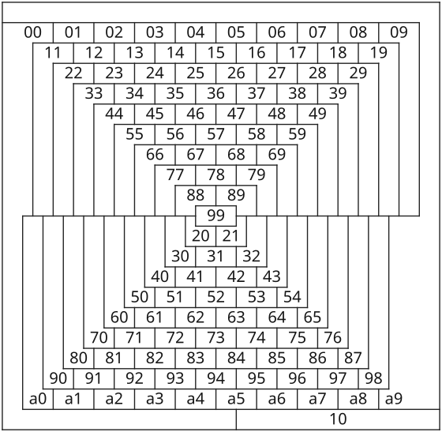</a>

1975 年, Martin Gardner 报告说, [图 76](#fig-7-2-2-2-76) 的平面地图须用<em>五种</em>不同颜色才能正常着色, 从而推翻了流传已久的四色猜想; 此言震惊了世界 [<em>Scientific American</em> **232**, 4 (1975 年 4 月), 126–130]. (在同一篇专栏中他还引用了另外几个据称发现于 1974 年的 “事实”: (i) $e^{\pi\sqrt{163}}$ 是整数; (ii) 国际象棋中第一步将王车前兵走到第四格 ‘h4’ 必胜; (iii) 狭义相对论有致命缺陷; (iv) Leonardo da Vinci 发明了抽水马桶; (v) Robert Ripoff 设计了一台完全靠精神能量驱动的发动机. 千千万万的读者竟没注意到他们上了愚人节的当!)

事实上, [图 76](#fig-7-2-2-2-76) 的地图<em>可以</em>四色着色. 在翻看习题 18 的答案以前, 请你先试着找出一种合适的办法. 正如第 7 章所述, 四色猜想在 1976 年成为四色定理. 幸好在 1975 年 4 月人们还不知道这个结果; 否则这张有趣的图很可能不会付印. McGregor 图有 110 个顶点 (区域) 和 324 条边 (区域间的邻接), 因而 (15) 和 (16) 在 440 个变量上给出 $110+1296=1406$ 个子句, 现代 SAT 求解器很快就能对付.

我们还可以走得远得多, 解出手工极难解的问题. 例如, 可以加上约束, 限制取得特定颜色的区域数. Randal Bryant 于 2010 年利用这个想法, 发现[图 76](#fig-7-2-2-2-76) 有一种四色着色, 其中一种颜色只用了 7 次 (见习题 17). 事实上, 他的着色是唯一的, 而且引出一个对所有阶数 $n\ge3$ 的 McGregor 图都适用的显式四色着色法 (习题 18).

这样的附加约束有许多种生成方法. 例如, 可以对每种八个区域的选择各加一个子句, 规定它们不全取颜色 1, 总共加 $\binom{110}{8}$ 个子句. 不成, 这个主意还是划掉吧: $\binom{110}{8}=409705619895$. 即便只考虑由八个<em>独立</em>区域组成的 74792876790 个集合, 子句仍然太多了.

<a id="pdf-212"></a><a id="p-192"></a>

C. Sinz [<em>LNCS</em> **3709** (2005), 827–831] 找到了一个有趣的、适于 SAT 的办法来保证 $x_1+\cdots+x_n$ 至多为 $r$, 即使 $n$ 和 $r$ 都相当大也很好用. 其方法引进 $(n-r)r$ 个新变量 $s_j^k$, $1\le j\le n-r$, $1\le k\le r$. 若 $F$ 是任一可满足性问题, 再加上下列 $(n-r-1)r+(n-r)(r+1)$ 个子句
$$
(\bar s_j^k\lor s_{j+1}^k),\qquad1\le j<n-r,\quad1\le k\le r,\tag{18}
$$
$$
(\bar x_{j+k}\lor\bar s_j^k\lor s_j^{k+1}),\qquad1\le j\le n-r,\quad0\le k\le r,\tag{19}
$$
其中 $k=0$ 时略去 $\bar s_j^k$, $k=r$ 时略去 $s_j^{k+1}$, 则新子句集可满足当且仅当 $F$ 在 $x_1+\cdots+x_n\le r$ 的条件下可满足. (见习题 26.) 用这个方案将 McGregor 图中红色区域的数目限于至多 7 个, 只须加入涉及 721 个新变量的 1538 个子句.

达到同一目的的另一方法由 O. Bailleux 和 Y. Boufkhad [<em>LNCS</em> **2833** (2003), 108–122] 提出, 事实证明它还更好. 这种方法描述起来稍难, 实现起来却仍然容易. 考虑一棵完全二叉树, 它有 $n-1$ 个内部结点, 编号 1 至 $n-1$, 以及 $n$ 个叶, 编号 $n$ 至 $2n-1$; 对 $1\le k<n$, 结点 $k$ 的子女是结点 $2k$ 和 $2k+1$ (见 2.3.4.5–(5)). 引进新变量 $b_j^k$, $1\le k<n$, $1\le j\le t_k$, 其中 $t_k$ 是 $r$ 与结点 $k$ 下方的叶数中的较小者. 下列子句就能完成任务, 见习题 27 的解释:
$$
(\bar b_i^{2k}\lor\bar b_j^{2k+1}\lor b_{i+j}^k),\quad0\le i\le t_{2k},\quad0\le j\le t_{2k+1},\quad1\le i+j\le r+1,\quad1<k<n;\tag{20}
$$
$$
(\bar b_i^2\lor\bar b_j^3),\qquad0\le i\le t_2,\quad0\le j\le t_3,\quad i+j=r+1.\tag{21}
$$
在这些公式中, 对 $n\le k<2n$ 取 $t_k=1$, $b_1^k=x_{k-n+1}$; 所有字面值 $\bar b_0^k$ 与 $b_{r+1}^k$ 都略去. 对 $n=110$, $r=7$ 的 McGregor 图应用 (20)、(21), 只得到涉及 399 个新变量的 1216 个新子句.

我们下文还要保证 $x_1+\cdots+x_n$ <em>至少为</em> $r$ 时, 也可用同样的思想, 因为有恒等式 $S_{\ge r}(x_1,\ldots,x_n)=S_{\le n-r}(\bar x_1,\ldots,\bar x_n)$. 习题 30 考虑等式的情形, 即目标为 $x_1+\cdots+x_n=r$. 在下文中还会讨论这种基数约束的其他编码.

**整数的因子分解.** 接下来要研究一个风味颇为不同的 SAT 实例族. <em>给定一个 $(m+n)$ 位二进制整数 $z=(z_{m+n}\ldots z_2z_1)_2$, 是否存在 $x=(x_m\ldots x_1)_2$ 和 $y=(y_n\ldots y_1)_2$, 使 $z=x\times y$?</em> 例如, 若 $m=2$, $n=3$, 就要反过来做二进制乘法
$$
\begin{array}{r}y_3y_2y_1\\[-2pt]\times\quad x_2x_1\\\hline a_3a_2a_1\\[-2pt]b_3b_2b_1\phantom{x}\\\hline c_3c_2c_1\phantom{x}\\\hline z_5z_4z_3z_2z_1\end{array}
\qquad
\begin{aligned}(a_3a_2a_1)_2&=(y_3y_2y_1)_2\times x_1\\
(b_3b_2b_1)_2&=(y_3y_2y_1)_2\times x_2\end{aligned}
\qquad
\begin{aligned}z_1&=a_1\\(c_1z_2)_2&=a_2+b_1\\(c_2z_3)_2&=a_3+b_2+c_1\\(c_3z_4)_2&=b_3+c_2\\z_5&=c_3\end{aligned}\tag{22}
$$
其中已知的是 $z$ 的各位. 当 $z=21=(10101)_2$ 时, 这个问题可满足, 意即有适当的二进制值 $x_1,x_2,y_1,y_2,y_3,a_1,a_2,a_3,b_1,b_2,b_3,c_1,c_2,c_3$ 满足上述方程. 但 $z=19=(10011)_2$ 时不可满足.

<a id="pdf-213"></a><a id="p-193"></a>

像 (22) 这样的算术运算很容易表成可以交给 SAT 求解器的子句: 先构造一条布尔链来规定计算, 再把链的每一步编码为少数几个子句. 若将 $a_1$ 与 $z_1$ 等同, 将 $c_3$ 与 $z_5$ 等同, 这样的一条链是
$$
\begin{array}{llllll}
z_1\gets x_1\land y_1,&b_1\gets x_2\land y_1,&z_2\gets a_2\oplus b_1,&s\gets a_3\oplus b_2,&z_3\gets s\oplus c_1,&z_4\gets b_3\oplus c_2,\\
a_2\gets x_1\land y_2,&b_2\gets x_2\land y_2,&c_1\gets a_2\land b_1,&p\gets a_3\land b_2,&q\gets s\land c_1,&z_5\gets b_3\land c_2,\\
a_3\gets x_1\land y_3,&b_3\gets x_2\land y_3,&&&c_2\gets p\lor q,
\end{array}\tag{23}
$$
它使用一个 “全加器” 计算 $c_2z_3$, 使用 “半加器” 计算 $c_1z_2$ 和 $c_3z_4$ (见 7.1.2–(23) 和 (24)). 这条链等价于下列 49 个子句:
$$
(x_1\lor\bar z_1)\land(y_1\lor\bar z_1)\land(\bar x_1\lor\bar y_1\lor z_1)\land\cdots\land
(\bar b_3\lor\bar c_2\lor\bar z_4)\land(b_3\lor\bar z_5)\land(c_2\lor\bar z_5)\land(\bar b_3\lor\bar c_2\lor z_5).
$$
它们是按照简单的规则展开基本运算而得的:
$$
\begin{aligned}
t\gets u\land v&\quad\text{变为}\quad(u\lor\bar t)\land(v\lor\bar t)\land(\bar u\lor\bar v\lor t);\\
t\gets u\lor v&\quad\text{变为}\quad(\bar u\lor t)\land(\bar v\lor t)\land(u\lor v\lor\bar t);\\
t\gets u\oplus v&\quad\text{变为}\quad(\bar u\lor v\lor t)\land(u\lor\bar v\lor t)\land(u\lor v\lor\bar t)\land(\bar u\lor\bar v\lor\bar t).
\end{aligned}\tag{24}
$$
若给定的数例如为 $z=(10101)_2$, 只须附加一元子句 $(z_5)\land(\bar z_4)\land(z_3)\land(\bar z_2)\land(z_1)$, 就完成了对这个因子分解问题的规定.

逻辑学家早已知道, 计算步骤很容易表为子句的合取. 像 (24) 这样的规则, 现在依 Gregory Tseytin (1966) 称为 <em>Tseytin 编码</em>. 用 $49+5$ 个子句来表示小小的五位数分解问题, 看起来也许不很有效; 不过我们马上就会看到, $m$ 位乘 $n$ 位的逆问题可表为一个可满足性问题, 所用变量不到 $6mn$ 个, 长度不超过 3 的子句不到 $20mn$ 个.

> 即使系统中有数百或数千个公式, 也能 “逐片” 将它化为合取范式, 无须把各项 “乘开”.
>
> ——MARTIN DAVIS 和 HILARY PUTNAM (1958)

设 $m\le n$. 要为乘法建立布尔链, 最简单的办法也许要算沿用 John Napier 的 <em>Rabdologiæ</em> (Edinburgh, 1617), 137–143 页中的老方法, 采用 Luigi Dadda 的现代形式 [<em>Alta Frequenza</em> **34** (1965), 349–356]. 先形成所有 $mn$ 个积 $x_i\land y_j$, 将每一位放入 $\mathit{bin}[i+j]$. 一共有 $m+n$ 个这样的 “箱”, 各保存二进制某一位权上要相加的位. 此时各箱分别含 $(0,1,2,\ldots,m,\ldots,m,\ldots,2,1)$ 位, 其中 “$m$” 在中间出现 $n-m+1$ 次. 现在依次查看 $k=2,3,\ldots$ 的 $\mathit{bin}[k]$. 若箱中只有一位 $b$, 只须置 $z_{k-1}\gets b$. 若有两位 $\{b,b'\}$, 就用半加器计算 $z_{k-1}\gets b\oplus b'$, $c\gets b\land b'$, 并将进位 $c$ 放入 $\mathit{bin}[k+1]$. 否则, $\mathit{bin}[k]$ 至少有 $t\ge3$ 位; 任取三位 $\{b,b',b''\}$, 将它们移出此箱. 再用全加器计算 $r\gets b\oplus b'\oplus b''$, $c\gets\langle b b' b''\rangle$, 于是 $b+b'+b''=r+2c$; 将 $r$ 放回 $\mathit{bin}[k]$, $c$ 放入 $\mathit{bin}[k+1]$. 这样 $t$ 减少 2, 因而最后总能算出 $z_{k-1}$. 习题 41 定量给出了所需计算的确切数目.

<a id="pdf-214"></a><a id="p-194"></a>

把乘法编码成子句的这种方法很灵活, 因为只要 $\mathit{bin}[k]$ 中有四位或更多位, 就可以从中<em>任取</em>三位. 我们可以采用先进先出策略, 总是从 “后端” 选择各位, 将它们的和放在 “前端”; 也可以后进先出, 实际上将 $\mathit{bin}[k]$ 看作栈而非队列. 还可以随机选位, 看看是否更合 SAT 求解器的胃口. 在本节下文, 分别称这些表示因子分解问题的子句为 $\operatorname{\mathit{factor\_fifo}}(m,n,z)$, $\operatorname{\mathit{factor\_lifo}}(m,n,z)$ 或 $\operatorname{\mathit{factor\_rand}}(m,n,z,s)$, 其中 $s$ 是生成这些子句所用的随机数生成器的种子.

认识到不必用什么数论居然也能分解整数, 有点令人难以置信! 整个过程中哪儿也没有最大公因子, 也没有 Fermat 定理的应用, 等等. 我们给求解器的提示, 不过是一批在位级上几乎盲目操作的布尔公式, 结果却找到了因子.

当然, 不能指望这个方法与第 4.5.4 节中精巧的因子分解算法竞争. 不过因子分解问题确实说明了子句用途之广. 它的子句还可以同<em>其他</em>约束组合起来, 远远超出过去所研究过的任何一种问题.

**故障测试.** 在 “现实世界” 中制造计算机芯片时, 很多地方会出毛病; 因此工程师早就对构造<em>测试模式</em>感兴趣, 以检验特定电路是否正常. 例如, 假设某块芯片的逻辑元件只有一个不正常; 这个坏元件卡住了, 无论给它什么输入, 输出都恒为同一个值. 这种失效称为<em>单固定故障</em>.

[图 77](#fig-7-2-2-2-77) 详示了一个典型的数字电路. 它将 (23) 的 15 个布尔运算实现为一个网络, 由五个输入 $y_3y_2y_1x_2x_1$ 产生五个输出信号 $z_5z_4z_3z_2z_1$. 除 15 个与门、或门和异或门 (每个都将两个输入变为一个输出) 外, 还有 15 个 “扇出” 门 (用分接点上的圆点表示), 各将一个输入分成两个输出. 因而共有 50 个可能不同的逻辑信号, 每条内部 “导线” 各有一个. 习题 47 说明, 一个有 $m$ 个输出、$n$ 个输入和 $g$ 个普通二入一出门的电路, 有 $g+m-n$ 个扇出门、$3g+2m-n$ 条导线. 有 $w$ 条导线的电路可能有 $2w$ 种单固定故障, 即各有 $w$ 种使某一导线上的信号固定于 0 或固定于 1 的故障.

<a id="fig-7-2-2-2-77"></a>

**图 77.** 对应于 (23) 的电路.

<a href="../../assets/volume4b/figures/sat-fig77.svg">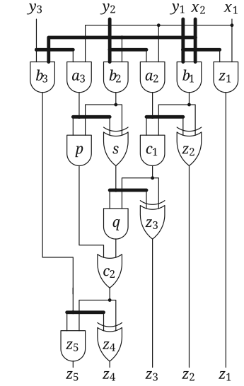</a>

[表 1](#tab-7-2-2-2-1) 给出了 101 种可能的情形: 以某一特定输入序列激活[图 77](#fig-7-2-2-2-77) 的 50 条导线, 并假定<a id="pdf-215"></a><a id="p-195"></a>至多存在一个固定故障.

<a id="tab-7-2-2-2-1"></a>

**表 1　当 $x_2x_1=11$, $y_3y_2y_1=110$ 时[图 77](#fig-7-2-2-2-77) 中的单固定故障**

<table id="sat-stuck-faults"><thead><tr><th rowspan="2">信号</th><th rowspan="2">OK</th><th colspan="2">$x_{1}$</th><th colspan="2">$x_{1}^{1}$</th><th colspan="2">$x_{1}^{2}$</th><th colspan="2">$x_{1}^{3}$</th><th colspan="2">$x_{1}^{4}$</th><th colspan="2">$x_{2}$</th><th colspan="2">$x_{2}^{1}$</th><th colspan="2">$x_{2}^{2}$</th><th colspan="2">$x_{2}^{3}$</th><th colspan="2">$x_{2}^{4}$</th><th colspan="2">$y_{1}$</th><th colspan="2">$y_{1}^{1}$</th><th colspan="2">$y_{1}^{2}$</th><th colspan="2">$y_{2}$</th><th colspan="2">$y_{2}^{1}$</th><th colspan="2">$y_{2}^{2}$</th><th colspan="2">$y_{3}$</th><th colspan="2">$y_{3}^{1}$</th><th colspan="2">$y_{3}^{2}$</th><th colspan="2">$z_{1}$</th><th colspan="2">$a_{2}$</th><th colspan="2">$a_{2}^{1}$</th><th colspan="2">$a_{2}^{2}$</th><th colspan="2">$a_{3}$</th><th colspan="2">$a_{3}^{1}$</th><th colspan="2">$a_{3}^{2}$</th><th colspan="2">$b_{1}$</th><th colspan="2">$b_{1}^{1}$</th><th colspan="2">$b_{1}^{2}$</th><th colspan="2">$b_{2}$</th><th colspan="2">$b_{2}^{1}$</th><th colspan="2">$b_{2}^{2}$</th><th colspan="2">$b_{3}$</th><th colspan="2">$b_{3}^{1}$</th><th colspan="2">$b_{3}^{2}$</th><th colspan="2">$z_{2}$</th><th colspan="2">$c_{1}$</th><th colspan="2">$c_{1}^{1}$</th><th colspan="2">$c_{1}^{2}$</th><th colspan="2">$s$</th><th colspan="2">$s^{1}$</th><th colspan="2">$s^{2}$</th><th colspan="2">$p$</th><th colspan="2">$z_{3}$</th><th colspan="2">$q$</th><th colspan="2">$c_{2}$</th><th colspan="2">$c_{2}^{1}$</th><th colspan="2">$c_{2}^{2}$</th><th colspan="2">$z_{4}$</th><th colspan="2">$z_{5}$</th></tr><tr><th>0</th><th>1</th><th>0</th><th>1</th><th>0</th><th>1</th><th>0</th><th>1</th><th>0</th><th>1</th><th>0</th><th>1</th><th>0</th><th>1</th><th>0</th><th>1</th><th>0</th><th>1</th><th>0</th><th>1</th><th>0</th><th>1</th><th>0</th><th>1</th><th>0</th><th>1</th><th>0</th><th>1</th><th>0</th><th>1</th><th>0</th><th>1</th><th>0</th><th>1</th><th>0</th><th>1</th><th>0</th><th>1</th><th>0</th><th>1</th><th>0</th><th>1</th><th>0</th><th>1</th><th>0</th><th>1</th><th>0</th><th>1</th><th>0</th><th>1</th><th>0</th><th>1</th><th>0</th><th>1</th><th>0</th><th>1</th><th>0</th><th>1</th><th>0</th><th>1</th><th>0</th><th>1</th><th>0</th><th>1</th><th>0</th><th>1</th><th>0</th><th>1</th><th>0</th><th>1</th><th>0</th><th>1</th><th>0</th><th>1</th><th>0</th><th>1</th><th>0</th><th>1</th><th>0</th><th>1</th><th>0</th><th>1</th><th>0</th><th>1</th><th>0</th><th>1</th><th>0</th><th>1</th><th>0</th><th>1</th><th>0</th><th>1</th><th>0</th><th>1</th><th>0</th><th>1</th><th>0</th><th>1</th><th>0</th><th>1</th></tr></thead><tbody>
<tr><th scope="row" style="white-space:nowrap;padding:.12em .45em">$x_{1} \gets \text{输入}$</th><td>1</td><td><strong>0</strong></td><td><strong>1</strong></td><td>1</td><td>1</td><td>1</td><td>1</td><td>1</td><td>1</td><td>1</td><td>1</td><td>1</td><td>1</td><td>1</td><td>1</td><td>1</td><td>1</td><td>1</td><td>1</td><td>1</td><td>1</td><td>1</td><td>1</td><td>1</td><td>1</td><td>1</td><td>1</td><td>1</td><td>1</td><td>1</td><td>1</td><td>1</td><td>1</td><td>1</td><td>1</td><td>1</td><td>1</td><td>1</td><td>1</td><td>1</td><td>1</td><td>1</td><td>1</td><td>1</td><td>1</td><td>1</td><td>1</td><td>1</td><td>1</td><td>1</td><td>1</td><td>1</td><td>1</td><td>1</td><td>1</td><td>1</td><td>1</td><td>1</td><td>1</td><td>1</td><td>1</td><td>1</td><td>1</td><td>1</td><td>1</td><td>1</td><td>1</td><td>1</td><td>1</td><td>1</td><td>1</td><td>1</td><td>1</td><td>1</td><td>1</td><td>1</td><td>1</td><td>1</td><td>1</td><td>1</td><td>1</td><td>1</td><td>1</td><td>1</td><td>1</td><td>1</td><td>1</td><td>1</td><td>1</td><td>1</td><td>1</td><td>1</td><td>1</td><td>1</td><td>1</td><td>1</td><td>1</td><td>1</td><td>1</td><td>1</td><td>1</td></tr>
<tr><th scope="row" style="white-space:nowrap;padding:.12em .45em">$x_{1}^{1} \gets x_{1}$</th><td>1</td><td>0</td><td>1</td><td><strong>0</strong></td><td><strong>1</strong></td><td>1</td><td>1</td><td>1</td><td>1</td><td>1</td><td>1</td><td>1</td><td>1</td><td>1</td><td>1</td><td>1</td><td>1</td><td>1</td><td>1</td><td>1</td><td>1</td><td>1</td><td>1</td><td>1</td><td>1</td><td>1</td><td>1</td><td>1</td><td>1</td><td>1</td><td>1</td><td>1</td><td>1</td><td>1</td><td>1</td><td>1</td><td>1</td><td>1</td><td>1</td><td>1</td><td>1</td><td>1</td><td>1</td><td>1</td><td>1</td><td>1</td><td>1</td><td>1</td><td>1</td><td>1</td><td>1</td><td>1</td><td>1</td><td>1</td><td>1</td><td>1</td><td>1</td><td>1</td><td>1</td><td>1</td><td>1</td><td>1</td><td>1</td><td>1</td><td>1</td><td>1</td><td>1</td><td>1</td><td>1</td><td>1</td><td>1</td><td>1</td><td>1</td><td>1</td><td>1</td><td>1</td><td>1</td><td>1</td><td>1</td><td>1</td><td>1</td><td>1</td><td>1</td><td>1</td><td>1</td><td>1</td><td>1</td><td>1</td><td>1</td><td>1</td><td>1</td><td>1</td><td>1</td><td>1</td><td>1</td><td>1</td><td>1</td><td>1</td><td>1</td><td>1</td><td>1</td></tr>
<tr><th scope="row" style="white-space:nowrap;padding:.12em .45em">$x_{1}^{2} \gets x_{1}$</th><td>1</td><td>0</td><td>1</td><td>1</td><td>1</td><td><strong>0</strong></td><td><strong>1</strong></td><td>1</td><td>1</td><td>1</td><td>1</td><td>1</td><td>1</td><td>1</td><td>1</td><td>1</td><td>1</td><td>1</td><td>1</td><td>1</td><td>1</td><td>1</td><td>1</td><td>1</td><td>1</td><td>1</td><td>1</td><td>1</td><td>1</td><td>1</td><td>1</td><td>1</td><td>1</td><td>1</td><td>1</td><td>1</td><td>1</td><td>1</td><td>1</td><td>1</td><td>1</td><td>1</td><td>1</td><td>1</td><td>1</td><td>1</td><td>1</td><td>1</td><td>1</td><td>1</td><td>1</td><td>1</td><td>1</td><td>1</td><td>1</td><td>1</td><td>1</td><td>1</td><td>1</td><td>1</td><td>1</td><td>1</td><td>1</td><td>1</td><td>1</td><td>1</td><td>1</td><td>1</td><td>1</td><td>1</td><td>1</td><td>1</td><td>1</td><td>1</td><td>1</td><td>1</td><td>1</td><td>1</td><td>1</td><td>1</td><td>1</td><td>1</td><td>1</td><td>1</td><td>1</td><td>1</td><td>1</td><td>1</td><td>1</td><td>1</td><td>1</td><td>1</td><td>1</td><td>1</td><td>1</td><td>1</td><td>1</td><td>1</td><td>1</td><td>1</td><td>1</td></tr>
<tr><th scope="row" style="white-space:nowrap;padding:.12em .45em">$x_{1}^{3} \gets x_{1}^{1}$</th><td>1</td><td>0</td><td>1</td><td>0</td><td>1</td><td>1</td><td>1</td><td><strong>0</strong></td><td><strong>1</strong></td><td>1</td><td>1</td><td>1</td><td>1</td><td>1</td><td>1</td><td>1</td><td>1</td><td>1</td><td>1</td><td>1</td><td>1</td><td>1</td><td>1</td><td>1</td><td>1</td><td>1</td><td>1</td><td>1</td><td>1</td><td>1</td><td>1</td><td>1</td><td>1</td><td>1</td><td>1</td><td>1</td><td>1</td><td>1</td><td>1</td><td>1</td><td>1</td><td>1</td><td>1</td><td>1</td><td>1</td><td>1</td><td>1</td><td>1</td><td>1</td><td>1</td><td>1</td><td>1</td><td>1</td><td>1</td><td>1</td><td>1</td><td>1</td><td>1</td><td>1</td><td>1</td><td>1</td><td>1</td><td>1</td><td>1</td><td>1</td><td>1</td><td>1</td><td>1</td><td>1</td><td>1</td><td>1</td><td>1</td><td>1</td><td>1</td><td>1</td><td>1</td><td>1</td><td>1</td><td>1</td><td>1</td><td>1</td><td>1</td><td>1</td><td>1</td><td>1</td><td>1</td><td>1</td><td>1</td><td>1</td><td>1</td><td>1</td><td>1</td><td>1</td><td>1</td><td>1</td><td>1</td><td>1</td><td>1</td><td>1</td><td>1</td><td>1</td></tr>
<tr><th scope="row" style="white-space:nowrap;padding:.12em .45em">$x_{1}^{4} \gets x_{1}^{1}$</th><td>1</td><td>0</td><td>1</td><td>0</td><td>1</td><td>1</td><td>1</td><td>1</td><td>1</td><td><strong>0</strong></td><td><strong>1</strong></td><td>1</td><td>1</td><td>1</td><td>1</td><td>1</td><td>1</td><td>1</td><td>1</td><td>1</td><td>1</td><td>1</td><td>1</td><td>1</td><td>1</td><td>1</td><td>1</td><td>1</td><td>1</td><td>1</td><td>1</td><td>1</td><td>1</td><td>1</td><td>1</td><td>1</td><td>1</td><td>1</td><td>1</td><td>1</td><td>1</td><td>1</td><td>1</td><td>1</td><td>1</td><td>1</td><td>1</td><td>1</td><td>1</td><td>1</td><td>1</td><td>1</td><td>1</td><td>1</td><td>1</td><td>1</td><td>1</td><td>1</td><td>1</td><td>1</td><td>1</td><td>1</td><td>1</td><td>1</td><td>1</td><td>1</td><td>1</td><td>1</td><td>1</td><td>1</td><td>1</td><td>1</td><td>1</td><td>1</td><td>1</td><td>1</td><td>1</td><td>1</td><td>1</td><td>1</td><td>1</td><td>1</td><td>1</td><td>1</td><td>1</td><td>1</td><td>1</td><td>1</td><td>1</td><td>1</td><td>1</td><td>1</td><td>1</td><td>1</td><td>1</td><td>1</td><td>1</td><td>1</td><td>1</td><td>1</td><td>1</td></tr>
<tr><th scope="row" style="white-space:nowrap;padding:.12em .45em">$x_{2} \gets \text{输入}$</th><td>1</td><td>1</td><td>1</td><td>1</td><td>1</td><td>1</td><td>1</td><td>1</td><td>1</td><td>1</td><td>1</td><td><strong>0</strong></td><td><strong>1</strong></td><td>1</td><td>1</td><td>1</td><td>1</td><td>1</td><td>1</td><td>1</td><td>1</td><td>1</td><td>1</td><td>1</td><td>1</td><td>1</td><td>1</td><td>1</td><td>1</td><td>1</td><td>1</td><td>1</td><td>1</td><td>1</td><td>1</td><td>1</td><td>1</td><td>1</td><td>1</td><td>1</td><td>1</td><td>1</td><td>1</td><td>1</td><td>1</td><td>1</td><td>1</td><td>1</td><td>1</td><td>1</td><td>1</td><td>1</td><td>1</td><td>1</td><td>1</td><td>1</td><td>1</td><td>1</td><td>1</td><td>1</td><td>1</td><td>1</td><td>1</td><td>1</td><td>1</td><td>1</td><td>1</td><td>1</td><td>1</td><td>1</td><td>1</td><td>1</td><td>1</td><td>1</td><td>1</td><td>1</td><td>1</td><td>1</td><td>1</td><td>1</td><td>1</td><td>1</td><td>1</td><td>1</td><td>1</td><td>1</td><td>1</td><td>1</td><td>1</td><td>1</td><td>1</td><td>1</td><td>1</td><td>1</td><td>1</td><td>1</td><td>1</td><td>1</td><td>1</td><td>1</td><td>1</td></tr>
<tr><th scope="row" style="white-space:nowrap;padding:.12em .45em">$x_{2}^{1} \gets x_{2}$</th><td>1</td><td>1</td><td>1</td><td>1</td><td>1</td><td>1</td><td>1</td><td>1</td><td>1</td><td>1</td><td>1</td><td>0</td><td>1</td><td><strong>0</strong></td><td><strong>1</strong></td><td>1</td><td>1</td><td>1</td><td>1</td><td>1</td><td>1</td><td>1</td><td>1</td><td>1</td><td>1</td><td>1</td><td>1</td><td>1</td><td>1</td><td>1</td><td>1</td><td>1</td><td>1</td><td>1</td><td>1</td><td>1</td><td>1</td><td>1</td><td>1</td><td>1</td><td>1</td><td>1</td><td>1</td><td>1</td><td>1</td><td>1</td><td>1</td><td>1</td><td>1</td><td>1</td><td>1</td><td>1</td><td>1</td><td>1</td><td>1</td><td>1</td><td>1</td><td>1</td><td>1</td><td>1</td><td>1</td><td>1</td><td>1</td><td>1</td><td>1</td><td>1</td><td>1</td><td>1</td><td>1</td><td>1</td><td>1</td><td>1</td><td>1</td><td>1</td><td>1</td><td>1</td><td>1</td><td>1</td><td>1</td><td>1</td><td>1</td><td>1</td><td>1</td><td>1</td><td>1</td><td>1</td><td>1</td><td>1</td><td>1</td><td>1</td><td>1</td><td>1</td><td>1</td><td>1</td><td>1</td><td>1</td><td>1</td><td>1</td><td>1</td><td>1</td><td>1</td></tr>
<tr><th scope="row" style="white-space:nowrap;padding:.12em .45em">$x_{2}^{2} \gets x_{2}$</th><td>1</td><td>1</td><td>1</td><td>1</td><td>1</td><td>1</td><td>1</td><td>1</td><td>1</td><td>1</td><td>1</td><td>0</td><td>1</td><td>1</td><td>1</td><td><strong>0</strong></td><td><strong>1</strong></td><td>1</td><td>1</td><td>1</td><td>1</td><td>1</td><td>1</td><td>1</td><td>1</td><td>1</td><td>1</td><td>1</td><td>1</td><td>1</td><td>1</td><td>1</td><td>1</td><td>1</td><td>1</td><td>1</td><td>1</td><td>1</td><td>1</td><td>1</td><td>1</td><td>1</td><td>1</td><td>1</td><td>1</td><td>1</td><td>1</td><td>1</td><td>1</td><td>1</td><td>1</td><td>1</td><td>1</td><td>1</td><td>1</td><td>1</td><td>1</td><td>1</td><td>1</td><td>1</td><td>1</td><td>1</td><td>1</td><td>1</td><td>1</td><td>1</td><td>1</td><td>1</td><td>1</td><td>1</td><td>1</td><td>1</td><td>1</td><td>1</td><td>1</td><td>1</td><td>1</td><td>1</td><td>1</td><td>1</td><td>1</td><td>1</td><td>1</td><td>1</td><td>1</td><td>1</td><td>1</td><td>1</td><td>1</td><td>1</td><td>1</td><td>1</td><td>1</td><td>1</td><td>1</td><td>1</td><td>1</td><td>1</td><td>1</td><td>1</td><td>1</td></tr>
<tr><th scope="row" style="white-space:nowrap;padding:.12em .45em">$x_{2}^{3} \gets x_{2}^{1}$</th><td>1</td><td>1</td><td>1</td><td>1</td><td>1</td><td>1</td><td>1</td><td>1</td><td>1</td><td>1</td><td>1</td><td>0</td><td>1</td><td>0</td><td>1</td><td>1</td><td>1</td><td><strong>0</strong></td><td><strong>1</strong></td><td>1</td><td>1</td><td>1</td><td>1</td><td>1</td><td>1</td><td>1</td><td>1</td><td>1</td><td>1</td><td>1</td><td>1</td><td>1</td><td>1</td><td>1</td><td>1</td><td>1</td><td>1</td><td>1</td><td>1</td><td>1</td><td>1</td><td>1</td><td>1</td><td>1</td><td>1</td><td>1</td><td>1</td><td>1</td><td>1</td><td>1</td><td>1</td><td>1</td><td>1</td><td>1</td><td>1</td><td>1</td><td>1</td><td>1</td><td>1</td><td>1</td><td>1</td><td>1</td><td>1</td><td>1</td><td>1</td><td>1</td><td>1</td><td>1</td><td>1</td><td>1</td><td>1</td><td>1</td><td>1</td><td>1</td><td>1</td><td>1</td><td>1</td><td>1</td><td>1</td><td>1</td><td>1</td><td>1</td><td>1</td><td>1</td><td>1</td><td>1</td><td>1</td><td>1</td><td>1</td><td>1</td><td>1</td><td>1</td><td>1</td><td>1</td><td>1</td><td>1</td><td>1</td><td>1</td><td>1</td><td>1</td><td>1</td></tr>
<tr><th scope="row" style="white-space:nowrap;padding:.12em .45em">$x_{2}^{4} \gets x_{2}^{1}$</th><td>1</td><td>1</td><td>1</td><td>1</td><td>1</td><td>1</td><td>1</td><td>1</td><td>1</td><td>1</td><td>1</td><td>0</td><td>1</td><td>0</td><td>1</td><td>1</td><td>1</td><td>1</td><td>1</td><td><strong>0</strong></td><td><strong>1</strong></td><td>1</td><td>1</td><td>1</td><td>1</td><td>1</td><td>1</td><td>1</td><td>1</td><td>1</td><td>1</td><td>1</td><td>1</td><td>1</td><td>1</td><td>1</td><td>1</td><td>1</td><td>1</td><td>1</td><td>1</td><td>1</td><td>1</td><td>1</td><td>1</td><td>1</td><td>1</td><td>1</td><td>1</td><td>1</td><td>1</td><td>1</td><td>1</td><td>1</td><td>1</td><td>1</td><td>1</td><td>1</td><td>1</td><td>1</td><td>1</td><td>1</td><td>1</td><td>1</td><td>1</td><td>1</td><td>1</td><td>1</td><td>1</td><td>1</td><td>1</td><td>1</td><td>1</td><td>1</td><td>1</td><td>1</td><td>1</td><td>1</td><td>1</td><td>1</td><td>1</td><td>1</td><td>1</td><td>1</td><td>1</td><td>1</td><td>1</td><td>1</td><td>1</td><td>1</td><td>1</td><td>1</td><td>1</td><td>1</td><td>1</td><td>1</td><td>1</td><td>1</td><td>1</td><td>1</td><td>1</td></tr>
<tr><th scope="row" style="white-space:nowrap;padding:.12em .45em">$y_{1} \gets \text{输入}$</th><td>0</td><td>0</td><td>0</td><td>0</td><td>0</td><td>0</td><td>0</td><td>0</td><td>0</td><td>0</td><td>0</td><td>0</td><td>0</td><td>0</td><td>0</td><td>0</td><td>0</td><td>0</td><td>0</td><td>0</td><td>0</td><td><strong>0</strong></td><td><strong>1</strong></td><td>0</td><td>0</td><td>0</td><td>0</td><td>0</td><td>0</td><td>0</td><td>0</td><td>0</td><td>0</td><td>0</td><td>0</td><td>0</td><td>0</td><td>0</td><td>0</td><td>0</td><td>0</td><td>0</td><td>0</td><td>0</td><td>0</td><td>0</td><td>0</td><td>0</td><td>0</td><td>0</td><td>0</td><td>0</td><td>0</td><td>0</td><td>0</td><td>0</td><td>0</td><td>0</td><td>0</td><td>0</td><td>0</td><td>0</td><td>0</td><td>0</td><td>0</td><td>0</td><td>0</td><td>0</td><td>0</td><td>0</td><td>0</td><td>0</td><td>0</td><td>0</td><td>0</td><td>0</td><td>0</td><td>0</td><td>0</td><td>0</td><td>0</td><td>0</td><td>0</td><td>0</td><td>0</td><td>0</td><td>0</td><td>0</td><td>0</td><td>0</td><td>0</td><td>0</td><td>0</td><td>0</td><td>0</td><td>0</td><td>0</td><td>0</td><td>0</td><td>0</td><td>0</td></tr>
<tr><th scope="row" style="white-space:nowrap;padding:.12em .45em">$y_{1}^{1} \gets y_{1}$</th><td>0</td><td>0</td><td>0</td><td>0</td><td>0</td><td>0</td><td>0</td><td>0</td><td>0</td><td>0</td><td>0</td><td>0</td><td>0</td><td>0</td><td>0</td><td>0</td><td>0</td><td>0</td><td>0</td><td>0</td><td>0</td><td>0</td><td>1</td><td><strong>0</strong></td><td><strong>1</strong></td><td>0</td><td>0</td><td>0</td><td>0</td><td>0</td><td>0</td><td>0</td><td>0</td><td>0</td><td>0</td><td>0</td><td>0</td><td>0</td><td>0</td><td>0</td><td>0</td><td>0</td><td>0</td><td>0</td><td>0</td><td>0</td><td>0</td><td>0</td><td>0</td><td>0</td><td>0</td><td>0</td><td>0</td><td>0</td><td>0</td><td>0</td><td>0</td><td>0</td><td>0</td><td>0</td><td>0</td><td>0</td><td>0</td><td>0</td><td>0</td><td>0</td><td>0</td><td>0</td><td>0</td><td>0</td><td>0</td><td>0</td><td>0</td><td>0</td><td>0</td><td>0</td><td>0</td><td>0</td><td>0</td><td>0</td><td>0</td><td>0</td><td>0</td><td>0</td><td>0</td><td>0</td><td>0</td><td>0</td><td>0</td><td>0</td><td>0</td><td>0</td><td>0</td><td>0</td><td>0</td><td>0</td><td>0</td><td>0</td><td>0</td><td>0</td><td>0</td></tr>
<tr><th scope="row" style="white-space:nowrap;padding:.12em .45em">$y_{1}^{2} \gets y_{1}$</th><td>0</td><td>0</td><td>0</td><td>0</td><td>0</td><td>0</td><td>0</td><td>0</td><td>0</td><td>0</td><td>0</td><td>0</td><td>0</td><td>0</td><td>0</td><td>0</td><td>0</td><td>0</td><td>0</td><td>0</td><td>0</td><td>0</td><td>1</td><td>0</td><td>0</td><td><strong>0</strong></td><td><strong>1</strong></td><td>0</td><td>0</td><td>0</td><td>0</td><td>0</td><td>0</td><td>0</td><td>0</td><td>0</td><td>0</td><td>0</td><td>0</td><td>0</td><td>0</td><td>0</td><td>0</td><td>0</td><td>0</td><td>0</td><td>0</td><td>0</td><td>0</td><td>0</td><td>0</td><td>0</td><td>0</td><td>0</td><td>0</td><td>0</td><td>0</td><td>0</td><td>0</td><td>0</td><td>0</td><td>0</td><td>0</td><td>0</td><td>0</td><td>0</td><td>0</td><td>0</td><td>0</td><td>0</td><td>0</td><td>0</td><td>0</td><td>0</td><td>0</td><td>0</td><td>0</td><td>0</td><td>0</td><td>0</td><td>0</td><td>0</td><td>0</td><td>0</td><td>0</td><td>0</td><td>0</td><td>0</td><td>0</td><td>0</td><td>0</td><td>0</td><td>0</td><td>0</td><td>0</td><td>0</td><td>0</td><td>0</td><td>0</td><td>0</td><td>0</td></tr>
<tr><th scope="row" style="white-space:nowrap;padding:.12em .45em">$y_{2} \gets \text{输入}$</th><td>1</td><td>1</td><td>1</td><td>1</td><td>1</td><td>1</td><td>1</td><td>1</td><td>1</td><td>1</td><td>1</td><td>1</td><td>1</td><td>1</td><td>1</td><td>1</td><td>1</td><td>1</td><td>1</td><td>1</td><td>1</td><td>1</td><td>1</td><td>1</td><td>1</td><td>1</td><td>1</td><td><strong>0</strong></td><td><strong>1</strong></td><td>1</td><td>1</td><td>1</td><td>1</td><td>1</td><td>1</td><td>1</td><td>1</td><td>1</td><td>1</td><td>1</td><td>1</td><td>1</td><td>1</td><td>1</td><td>1</td><td>1</td><td>1</td><td>1</td><td>1</td><td>1</td><td>1</td><td>1</td><td>1</td><td>1</td><td>1</td><td>1</td><td>1</td><td>1</td><td>1</td><td>1</td><td>1</td><td>1</td><td>1</td><td>1</td><td>1</td><td>1</td><td>1</td><td>1</td><td>1</td><td>1</td><td>1</td><td>1</td><td>1</td><td>1</td><td>1</td><td>1</td><td>1</td><td>1</td><td>1</td><td>1</td><td>1</td><td>1</td><td>1</td><td>1</td><td>1</td><td>1</td><td>1</td><td>1</td><td>1</td><td>1</td><td>1</td><td>1</td><td>1</td><td>1</td><td>1</td><td>1</td><td>1</td><td>1</td><td>1</td><td>1</td><td>1</td></tr>
<tr><th scope="row" style="white-space:nowrap;padding:.12em .45em">$y_{2}^{1} \gets y_{2}$</th><td>1</td><td>1</td><td>1</td><td>1</td><td>1</td><td>1</td><td>1</td><td>1</td><td>1</td><td>1</td><td>1</td><td>1</td><td>1</td><td>1</td><td>1</td><td>1</td><td>1</td><td>1</td><td>1</td><td>1</td><td>1</td><td>1</td><td>1</td><td>1</td><td>1</td><td>1</td><td>1</td><td>0</td><td>1</td><td><strong>0</strong></td><td><strong>1</strong></td><td>1</td><td>1</td><td>1</td><td>1</td><td>1</td><td>1</td><td>1</td><td>1</td><td>1</td><td>1</td><td>1</td><td>1</td><td>1</td><td>1</td><td>1</td><td>1</td><td>1</td><td>1</td><td>1</td><td>1</td><td>1</td><td>1</td><td>1</td><td>1</td><td>1</td><td>1</td><td>1</td><td>1</td><td>1</td><td>1</td><td>1</td><td>1</td><td>1</td><td>1</td><td>1</td><td>1</td><td>1</td><td>1</td><td>1</td><td>1</td><td>1</td><td>1</td><td>1</td><td>1</td><td>1</td><td>1</td><td>1</td><td>1</td><td>1</td><td>1</td><td>1</td><td>1</td><td>1</td><td>1</td><td>1</td><td>1</td><td>1</td><td>1</td><td>1</td><td>1</td><td>1</td><td>1</td><td>1</td><td>1</td><td>1</td><td>1</td><td>1</td><td>1</td><td>1</td><td>1</td></tr>
<tr><th scope="row" style="white-space:nowrap;padding:.12em .45em">$y_{2}^{2} \gets y_{2}$</th><td>1</td><td>1</td><td>1</td><td>1</td><td>1</td><td>1</td><td>1</td><td>1</td><td>1</td><td>1</td><td>1</td><td>1</td><td>1</td><td>1</td><td>1</td><td>1</td><td>1</td><td>1</td><td>1</td><td>1</td><td>1</td><td>1</td><td>1</td><td>1</td><td>1</td><td>1</td><td>1</td><td>0</td><td>1</td><td>1</td><td>1</td><td><strong>0</strong></td><td><strong>1</strong></td><td>1</td><td>1</td><td>1</td><td>1</td><td>1</td><td>1</td><td>1</td><td>1</td><td>1</td><td>1</td><td>1</td><td>1</td><td>1</td><td>1</td><td>1</td><td>1</td><td>1</td><td>1</td><td>1</td><td>1</td><td>1</td><td>1</td><td>1</td><td>1</td><td>1</td><td>1</td><td>1</td><td>1</td><td>1</td><td>1</td><td>1</td><td>1</td><td>1</td><td>1</td><td>1</td><td>1</td><td>1</td><td>1</td><td>1</td><td>1</td><td>1</td><td>1</td><td>1</td><td>1</td><td>1</td><td>1</td><td>1</td><td>1</td><td>1</td><td>1</td><td>1</td><td>1</td><td>1</td><td>1</td><td>1</td><td>1</td><td>1</td><td>1</td><td>1</td><td>1</td><td>1</td><td>1</td><td>1</td><td>1</td><td>1</td><td>1</td><td>1</td><td>1</td></tr>
<tr><th scope="row" style="white-space:nowrap;padding:.12em .45em">$y_{3} \gets \text{输入}$</th><td>1</td><td>1</td><td>1</td><td>1</td><td>1</td><td>1</td><td>1</td><td>1</td><td>1</td><td>1</td><td>1</td><td>1</td><td>1</td><td>1</td><td>1</td><td>1</td><td>1</td><td>1</td><td>1</td><td>1</td><td>1</td><td>1</td><td>1</td><td>1</td><td>1</td><td>1</td><td>1</td><td>1</td><td>1</td><td>1</td><td>1</td><td>1</td><td>1</td><td><strong>0</strong></td><td><strong>1</strong></td><td>1</td><td>1</td><td>1</td><td>1</td><td>1</td><td>1</td><td>1</td><td>1</td><td>1</td><td>1</td><td>1</td><td>1</td><td>1</td><td>1</td><td>1</td><td>1</td><td>1</td><td>1</td><td>1</td><td>1</td><td>1</td><td>1</td><td>1</td><td>1</td><td>1</td><td>1</td><td>1</td><td>1</td><td>1</td><td>1</td><td>1</td><td>1</td><td>1</td><td>1</td><td>1</td><td>1</td><td>1</td><td>1</td><td>1</td><td>1</td><td>1</td><td>1</td><td>1</td><td>1</td><td>1</td><td>1</td><td>1</td><td>1</td><td>1</td><td>1</td><td>1</td><td>1</td><td>1</td><td>1</td><td>1</td><td>1</td><td>1</td><td>1</td><td>1</td><td>1</td><td>1</td><td>1</td><td>1</td><td>1</td><td>1</td><td>1</td></tr>
<tr><th scope="row" style="white-space:nowrap;padding:.12em .45em">$y_{3}^{1} \gets y_{3}$</th><td>1</td><td>1</td><td>1</td><td>1</td><td>1</td><td>1</td><td>1</td><td>1</td><td>1</td><td>1</td><td>1</td><td>1</td><td>1</td><td>1</td><td>1</td><td>1</td><td>1</td><td>1</td><td>1</td><td>1</td><td>1</td><td>1</td><td>1</td><td>1</td><td>1</td><td>1</td><td>1</td><td>1</td><td>1</td><td>1</td><td>1</td><td>1</td><td>1</td><td>0</td><td>1</td><td><strong>0</strong></td><td><strong>1</strong></td><td>1</td><td>1</td><td>1</td><td>1</td><td>1</td><td>1</td><td>1</td><td>1</td><td>1</td><td>1</td><td>1</td><td>1</td><td>1</td><td>1</td><td>1</td><td>1</td><td>1</td><td>1</td><td>1</td><td>1</td><td>1</td><td>1</td><td>1</td><td>1</td><td>1</td><td>1</td><td>1</td><td>1</td><td>1</td><td>1</td><td>1</td><td>1</td><td>1</td><td>1</td><td>1</td><td>1</td><td>1</td><td>1</td><td>1</td><td>1</td><td>1</td><td>1</td><td>1</td><td>1</td><td>1</td><td>1</td><td>1</td><td>1</td><td>1</td><td>1</td><td>1</td><td>1</td><td>1</td><td>1</td><td>1</td><td>1</td><td>1</td><td>1</td><td>1</td><td>1</td><td>1</td><td>1</td><td>1</td><td>1</td></tr>
<tr><th scope="row" style="white-space:nowrap;padding:.12em .45em">$y_{3}^{2} \gets y_{3}$</th><td>1</td><td>1</td><td>1</td><td>1</td><td>1</td><td>1</td><td>1</td><td>1</td><td>1</td><td>1</td><td>1</td><td>1</td><td>1</td><td>1</td><td>1</td><td>1</td><td>1</td><td>1</td><td>1</td><td>1</td><td>1</td><td>1</td><td>1</td><td>1</td><td>1</td><td>1</td><td>1</td><td>1</td><td>1</td><td>1</td><td>1</td><td>1</td><td>1</td><td>0</td><td>1</td><td>1</td><td>1</td><td><strong>0</strong></td><td><strong>1</strong></td><td>1</td><td>1</td><td>1</td><td>1</td><td>1</td><td>1</td><td>1</td><td>1</td><td>1</td><td>1</td><td>1</td><td>1</td><td>1</td><td>1</td><td>1</td><td>1</td><td>1</td><td>1</td><td>1</td><td>1</td><td>1</td><td>1</td><td>1</td><td>1</td><td>1</td><td>1</td><td>1</td><td>1</td><td>1</td><td>1</td><td>1</td><td>1</td><td>1</td><td>1</td><td>1</td><td>1</td><td>1</td><td>1</td><td>1</td><td>1</td><td>1</td><td>1</td><td>1</td><td>1</td><td>1</td><td>1</td><td>1</td><td>1</td><td>1</td><td>1</td><td>1</td><td>1</td><td>1</td><td>1</td><td>1</td><td>1</td><td>1</td><td>1</td><td>1</td><td>1</td><td>1</td><td>1</td></tr>
<tr><th scope="row" style="white-space:nowrap;padding:.12em .45em">$z_{1} \gets x_{1}^{2} \land y_{1}^{1}$</th><td>0</td><td>0</td><td>0</td><td>0</td><td>0</td><td>0</td><td>0</td><td>0</td><td>0</td><td>0</td><td>0</td><td>0</td><td>0</td><td>0</td><td>0</td><td>0</td><td>0</td><td>0</td><td>0</td><td>0</td><td>0</td><td>0</td><td>1</td><td>0</td><td>1</td><td>0</td><td>0</td><td>0</td><td>0</td><td>0</td><td>0</td><td>0</td><td>0</td><td>0</td><td>0</td><td>0</td><td>0</td><td>0</td><td>0</td><td><strong>0</strong></td><td><strong>1</strong></td><td>0</td><td>0</td><td>0</td><td>0</td><td>0</td><td>0</td><td>0</td><td>0</td><td>0</td><td>0</td><td>0</td><td>0</td><td>0</td><td>0</td><td>0</td><td>0</td><td>0</td><td>0</td><td>0</td><td>0</td><td>0</td><td>0</td><td>0</td><td>0</td><td>0</td><td>0</td><td>0</td><td>0</td><td>0</td><td>0</td><td>0</td><td>0</td><td>0</td><td>0</td><td>0</td><td>0</td><td>0</td><td>0</td><td>0</td><td>0</td><td>0</td><td>0</td><td>0</td><td>0</td><td>0</td><td>0</td><td>0</td><td>0</td><td>0</td><td>0</td><td>0</td><td>0</td><td>0</td><td>0</td><td>0</td><td>0</td><td>0</td><td>0</td><td>0</td><td>0</td></tr>
<tr><th scope="row" style="white-space:nowrap;padding:.12em .45em">$a_{2} \gets x_{1}^{3} \land y_{2}^{1}$</th><td>1</td><td>0</td><td>1</td><td>0</td><td>1</td><td>1</td><td>1</td><td>0</td><td>1</td><td>1</td><td>1</td><td>1</td><td>1</td><td>1</td><td>1</td><td>1</td><td>1</td><td>1</td><td>1</td><td>1</td><td>1</td><td>1</td><td>1</td><td>1</td><td>1</td><td>1</td><td>1</td><td>0</td><td>1</td><td>0</td><td>1</td><td>1</td><td>1</td><td>1</td><td>1</td><td>1</td><td>1</td><td>1</td><td>1</td><td>1</td><td>1</td><td><strong>0</strong></td><td><strong>1</strong></td><td>1</td><td>1</td><td>1</td><td>1</td><td>1</td><td>1</td><td>1</td><td>1</td><td>1</td><td>1</td><td>1</td><td>1</td><td>1</td><td>1</td><td>1</td><td>1</td><td>1</td><td>1</td><td>1</td><td>1</td><td>1</td><td>1</td><td>1</td><td>1</td><td>1</td><td>1</td><td>1</td><td>1</td><td>1</td><td>1</td><td>1</td><td>1</td><td>1</td><td>1</td><td>1</td><td>1</td><td>1</td><td>1</td><td>1</td><td>1</td><td>1</td><td>1</td><td>1</td><td>1</td><td>1</td><td>1</td><td>1</td><td>1</td><td>1</td><td>1</td><td>1</td><td>1</td><td>1</td><td>1</td><td>1</td><td>1</td><td>1</td><td>1</td></tr>
<tr><th scope="row" style="white-space:nowrap;padding:.12em .45em">$a_{2}^{1} \gets a_{2}$</th><td>1</td><td>0</td><td>1</td><td>0</td><td>1</td><td>1</td><td>1</td><td>0</td><td>1</td><td>1</td><td>1</td><td>1</td><td>1</td><td>1</td><td>1</td><td>1</td><td>1</td><td>1</td><td>1</td><td>1</td><td>1</td><td>1</td><td>1</td><td>1</td><td>1</td><td>1</td><td>1</td><td>0</td><td>1</td><td>0</td><td>1</td><td>1</td><td>1</td><td>1</td><td>1</td><td>1</td><td>1</td><td>1</td><td>1</td><td>1</td><td>1</td><td>0</td><td>1</td><td><strong>0</strong></td><td><strong>1</strong></td><td>1</td><td>1</td><td>1</td><td>1</td><td>1</td><td>1</td><td>1</td><td>1</td><td>1</td><td>1</td><td>1</td><td>1</td><td>1</td><td>1</td><td>1</td><td>1</td><td>1</td><td>1</td><td>1</td><td>1</td><td>1</td><td>1</td><td>1</td><td>1</td><td>1</td><td>1</td><td>1</td><td>1</td><td>1</td><td>1</td><td>1</td><td>1</td><td>1</td><td>1</td><td>1</td><td>1</td><td>1</td><td>1</td><td>1</td><td>1</td><td>1</td><td>1</td><td>1</td><td>1</td><td>1</td><td>1</td><td>1</td><td>1</td><td>1</td><td>1</td><td>1</td><td>1</td><td>1</td><td>1</td><td>1</td><td>1</td></tr>
<tr><th scope="row" style="white-space:nowrap;padding:.12em .45em">$a_{2}^{2} \gets a_{2}$</th><td>1</td><td>0</td><td>1</td><td>0</td><td>1</td><td>1</td><td>1</td><td>0</td><td>1</td><td>1</td><td>1</td><td>1</td><td>1</td><td>1</td><td>1</td><td>1</td><td>1</td><td>1</td><td>1</td><td>1</td><td>1</td><td>1</td><td>1</td><td>1</td><td>1</td><td>1</td><td>1</td><td>0</td><td>1</td><td>0</td><td>1</td><td>1</td><td>1</td><td>1</td><td>1</td><td>1</td><td>1</td><td>1</td><td>1</td><td>1</td><td>1</td><td>0</td><td>1</td><td>1</td><td>1</td><td><strong>0</strong></td><td><strong>1</strong></td><td>1</td><td>1</td><td>1</td><td>1</td><td>1</td><td>1</td><td>1</td><td>1</td><td>1</td><td>1</td><td>1</td><td>1</td><td>1</td><td>1</td><td>1</td><td>1</td><td>1</td><td>1</td><td>1</td><td>1</td><td>1</td><td>1</td><td>1</td><td>1</td><td>1</td><td>1</td><td>1</td><td>1</td><td>1</td><td>1</td><td>1</td><td>1</td><td>1</td><td>1</td><td>1</td><td>1</td><td>1</td><td>1</td><td>1</td><td>1</td><td>1</td><td>1</td><td>1</td><td>1</td><td>1</td><td>1</td><td>1</td><td>1</td><td>1</td><td>1</td><td>1</td><td>1</td><td>1</td><td>1</td></tr>
<tr><th scope="row" style="white-space:nowrap;padding:.12em .45em">$a_{3} \gets x_{1}^{4} \land y_{3}^{1}$</th><td>1</td><td>0</td><td>1</td><td>0</td><td>1</td><td>1</td><td>1</td><td>1</td><td>1</td><td>0</td><td>1</td><td>1</td><td>1</td><td>1</td><td>1</td><td>1</td><td>1</td><td>1</td><td>1</td><td>1</td><td>1</td><td>1</td><td>1</td><td>1</td><td>1</td><td>1</td><td>1</td><td>1</td><td>1</td><td>1</td><td>1</td><td>1</td><td>1</td><td>0</td><td>1</td><td>0</td><td>1</td><td>1</td><td>1</td><td>1</td><td>1</td><td>1</td><td>1</td><td>1</td><td>1</td><td>1</td><td>1</td><td><strong>0</strong></td><td><strong>1</strong></td><td>1</td><td>1</td><td>1</td><td>1</td><td>1</td><td>1</td><td>1</td><td>1</td><td>1</td><td>1</td><td>1</td><td>1</td><td>1</td><td>1</td><td>1</td><td>1</td><td>1</td><td>1</td><td>1</td><td>1</td><td>1</td><td>1</td><td>1</td><td>1</td><td>1</td><td>1</td><td>1</td><td>1</td><td>1</td><td>1</td><td>1</td><td>1</td><td>1</td><td>1</td><td>1</td><td>1</td><td>1</td><td>1</td><td>1</td><td>1</td><td>1</td><td>1</td><td>1</td><td>1</td><td>1</td><td>1</td><td>1</td><td>1</td><td>1</td><td>1</td><td>1</td><td>1</td></tr>
<tr><th scope="row" style="white-space:nowrap;padding:.12em .45em">$a_{3}^{1} \gets a_{3}$</th><td>1</td><td>0</td><td>1</td><td>0</td><td>1</td><td>1</td><td>1</td><td>1</td><td>1</td><td>0</td><td>1</td><td>1</td><td>1</td><td>1</td><td>1</td><td>1</td><td>1</td><td>1</td><td>1</td><td>1</td><td>1</td><td>1</td><td>1</td><td>1</td><td>1</td><td>1</td><td>1</td><td>1</td><td>1</td><td>1</td><td>1</td><td>1</td><td>1</td><td>0</td><td>1</td><td>0</td><td>1</td><td>1</td><td>1</td><td>1</td><td>1</td><td>1</td><td>1</td><td>1</td><td>1</td><td>1</td><td>1</td><td>0</td><td>1</td><td><strong>0</strong></td><td><strong>1</strong></td><td>1</td><td>1</td><td>1</td><td>1</td><td>1</td><td>1</td><td>1</td><td>1</td><td>1</td><td>1</td><td>1</td><td>1</td><td>1</td><td>1</td><td>1</td><td>1</td><td>1</td><td>1</td><td>1</td><td>1</td><td>1</td><td>1</td><td>1</td><td>1</td><td>1</td><td>1</td><td>1</td><td>1</td><td>1</td><td>1</td><td>1</td><td>1</td><td>1</td><td>1</td><td>1</td><td>1</td><td>1</td><td>1</td><td>1</td><td>1</td><td>1</td><td>1</td><td>1</td><td>1</td><td>1</td><td>1</td><td>1</td><td>1</td><td>1</td><td>1</td></tr>
<tr><th scope="row" style="white-space:nowrap;padding:.12em .45em">$a_{3}^{2} \gets a_{3}$</th><td>1</td><td>0</td><td>1</td><td>0</td><td>1</td><td>1</td><td>1</td><td>1</td><td>1</td><td>0</td><td>1</td><td>1</td><td>1</td><td>1</td><td>1</td><td>1</td><td>1</td><td>1</td><td>1</td><td>1</td><td>1</td><td>1</td><td>1</td><td>1</td><td>1</td><td>1</td><td>1</td><td>1</td><td>1</td><td>1</td><td>1</td><td>1</td><td>1</td><td>0</td><td>1</td><td>0</td><td>1</td><td>1</td><td>1</td><td>1</td><td>1</td><td>1</td><td>1</td><td>1</td><td>1</td><td>1</td><td>1</td><td>0</td><td>1</td><td>1</td><td>1</td><td><strong>0</strong></td><td><strong>1</strong></td><td>1</td><td>1</td><td>1</td><td>1</td><td>1</td><td>1</td><td>1</td><td>1</td><td>1</td><td>1</td><td>1</td><td>1</td><td>1</td><td>1</td><td>1</td><td>1</td><td>1</td><td>1</td><td>1</td><td>1</td><td>1</td><td>1</td><td>1</td><td>1</td><td>1</td><td>1</td><td>1</td><td>1</td><td>1</td><td>1</td><td>1</td><td>1</td><td>1</td><td>1</td><td>1</td><td>1</td><td>1</td><td>1</td><td>1</td><td>1</td><td>1</td><td>1</td><td>1</td><td>1</td><td>1</td><td>1</td><td>1</td><td>1</td></tr>
<tr><th scope="row" style="white-space:nowrap;padding:.12em .45em">$b_{1} \gets x_{2}^{2} \land y_{1}^{2}$</th><td>0</td><td>0</td><td>0</td><td>0</td><td>0</td><td>0</td><td>0</td><td>0</td><td>0</td><td>0</td><td>0</td><td>0</td><td>0</td><td>0</td><td>0</td><td>0</td><td>0</td><td>0</td><td>0</td><td>0</td><td>0</td><td>0</td><td>1</td><td>0</td><td>0</td><td>0</td><td>1</td><td>0</td><td>0</td><td>0</td><td>0</td><td>0</td><td>0</td><td>0</td><td>0</td><td>0</td><td>0</td><td>0</td><td>0</td><td>0</td><td>0</td><td>0</td><td>0</td><td>0</td><td>0</td><td>0</td><td>0</td><td>0</td><td>0</td><td>0</td><td>0</td><td>0</td><td>0</td><td><strong>0</strong></td><td><strong>1</strong></td><td>0</td><td>0</td><td>0</td><td>0</td><td>0</td><td>0</td><td>0</td><td>0</td><td>0</td><td>0</td><td>0</td><td>0</td><td>0</td><td>0</td><td>0</td><td>0</td><td>0</td><td>0</td><td>0</td><td>0</td><td>0</td><td>0</td><td>0</td><td>0</td><td>0</td><td>0</td><td>0</td><td>0</td><td>0</td><td>0</td><td>0</td><td>0</td><td>0</td><td>0</td><td>0</td><td>0</td><td>0</td><td>0</td><td>0</td><td>0</td><td>0</td><td>0</td><td>0</td><td>0</td><td>0</td><td>0</td></tr>
<tr><th scope="row" style="white-space:nowrap;padding:.12em .45em">$b_{1}^{1} \gets b_{1}$</th><td>0</td><td>0</td><td>0</td><td>0</td><td>0</td><td>0</td><td>0</td><td>0</td><td>0</td><td>0</td><td>0</td><td>0</td><td>0</td><td>0</td><td>0</td><td>0</td><td>0</td><td>0</td><td>0</td><td>0</td><td>0</td><td>0</td><td>1</td><td>0</td><td>0</td><td>0</td><td>1</td><td>0</td><td>0</td><td>0</td><td>0</td><td>0</td><td>0</td><td>0</td><td>0</td><td>0</td><td>0</td><td>0</td><td>0</td><td>0</td><td>0</td><td>0</td><td>0</td><td>0</td><td>0</td><td>0</td><td>0</td><td>0</td><td>0</td><td>0</td><td>0</td><td>0</td><td>0</td><td>0</td><td>1</td><td><strong>0</strong></td><td><strong>1</strong></td><td>0</td><td>0</td><td>0</td><td>0</td><td>0</td><td>0</td><td>0</td><td>0</td><td>0</td><td>0</td><td>0</td><td>0</td><td>0</td><td>0</td><td>0</td><td>0</td><td>0</td><td>0</td><td>0</td><td>0</td><td>0</td><td>0</td><td>0</td><td>0</td><td>0</td><td>0</td><td>0</td><td>0</td><td>0</td><td>0</td><td>0</td><td>0</td><td>0</td><td>0</td><td>0</td><td>0</td><td>0</td><td>0</td><td>0</td><td>0</td><td>0</td><td>0</td><td>0</td><td>0</td></tr>
<tr><th scope="row" style="white-space:nowrap;padding:.12em .45em">$b_{1}^{2} \gets b_{1}$</th><td>0</td><td>0</td><td>0</td><td>0</td><td>0</td><td>0</td><td>0</td><td>0</td><td>0</td><td>0</td><td>0</td><td>0</td><td>0</td><td>0</td><td>0</td><td>0</td><td>0</td><td>0</td><td>0</td><td>0</td><td>0</td><td>0</td><td>1</td><td>0</td><td>0</td><td>0</td><td>1</td><td>0</td><td>0</td><td>0</td><td>0</td><td>0</td><td>0</td><td>0</td><td>0</td><td>0</td><td>0</td><td>0</td><td>0</td><td>0</td><td>0</td><td>0</td><td>0</td><td>0</td><td>0</td><td>0</td><td>0</td><td>0</td><td>0</td><td>0</td><td>0</td><td>0</td><td>0</td><td>0</td><td>1</td><td>0</td><td>0</td><td><strong>0</strong></td><td><strong>1</strong></td><td>0</td><td>0</td><td>0</td><td>0</td><td>0</td><td>0</td><td>0</td><td>0</td><td>0</td><td>0</td><td>0</td><td>0</td><td>0</td><td>0</td><td>0</td><td>0</td><td>0</td><td>0</td><td>0</td><td>0</td><td>0</td><td>0</td><td>0</td><td>0</td><td>0</td><td>0</td><td>0</td><td>0</td><td>0</td><td>0</td><td>0</td><td>0</td><td>0</td><td>0</td><td>0</td><td>0</td><td>0</td><td>0</td><td>0</td><td>0</td><td>0</td><td>0</td></tr>
<tr><th scope="row" style="white-space:nowrap;padding:.12em .45em">$b_{2} \gets x_{2}^{3} \land y_{2}^{2}$</th><td>1</td><td>1</td><td>1</td><td>1</td><td>1</td><td>1</td><td>1</td><td>1</td><td>1</td><td>1</td><td>1</td><td>0</td><td>1</td><td>0</td><td>1</td><td>1</td><td>1</td><td>0</td><td>1</td><td>1</td><td>1</td><td>1</td><td>1</td><td>1</td><td>1</td><td>1</td><td>1</td><td>0</td><td>1</td><td>1</td><td>1</td><td>0</td><td>1</td><td>1</td><td>1</td><td>1</td><td>1</td><td>1</td><td>1</td><td>1</td><td>1</td><td>1</td><td>1</td><td>1</td><td>1</td><td>1</td><td>1</td><td>1</td><td>1</td><td>1</td><td>1</td><td>1</td><td>1</td><td>1</td><td>1</td><td>1</td><td>1</td><td>1</td><td>1</td><td><strong>0</strong></td><td><strong>1</strong></td><td>1</td><td>1</td><td>1</td><td>1</td><td>1</td><td>1</td><td>1</td><td>1</td><td>1</td><td>1</td><td>1</td><td>1</td><td>1</td><td>1</td><td>1</td><td>1</td><td>1</td><td>1</td><td>1</td><td>1</td><td>1</td><td>1</td><td>1</td><td>1</td><td>1</td><td>1</td><td>1</td><td>1</td><td>1</td><td>1</td><td>1</td><td>1</td><td>1</td><td>1</td><td>1</td><td>1</td><td>1</td><td>1</td><td>1</td><td>1</td></tr>
<tr><th scope="row" style="white-space:nowrap;padding:.12em .45em">$b_{2}^{1} \gets b_{2}$</th><td>1</td><td>1</td><td>1</td><td>1</td><td>1</td><td>1</td><td>1</td><td>1</td><td>1</td><td>1</td><td>1</td><td>0</td><td>1</td><td>0</td><td>1</td><td>1</td><td>1</td><td>0</td><td>1</td><td>1</td><td>1</td><td>1</td><td>1</td><td>1</td><td>1</td><td>1</td><td>1</td><td>0</td><td>1</td><td>1</td><td>1</td><td>0</td><td>1</td><td>1</td><td>1</td><td>1</td><td>1</td><td>1</td><td>1</td><td>1</td><td>1</td><td>1</td><td>1</td><td>1</td><td>1</td><td>1</td><td>1</td><td>1</td><td>1</td><td>1</td><td>1</td><td>1</td><td>1</td><td>1</td><td>1</td><td>1</td><td>1</td><td>1</td><td>1</td><td>0</td><td>1</td><td><strong>0</strong></td><td><strong>1</strong></td><td>1</td><td>1</td><td>1</td><td>1</td><td>1</td><td>1</td><td>1</td><td>1</td><td>1</td><td>1</td><td>1</td><td>1</td><td>1</td><td>1</td><td>1</td><td>1</td><td>1</td><td>1</td><td>1</td><td>1</td><td>1</td><td>1</td><td>1</td><td>1</td><td>1</td><td>1</td><td>1</td><td>1</td><td>1</td><td>1</td><td>1</td><td>1</td><td>1</td><td>1</td><td>1</td><td>1</td><td>1</td><td>1</td></tr>
<tr><th scope="row" style="white-space:nowrap;padding:.12em .45em">$b_{2}^{2} \gets b_{2}$</th><td>1</td><td>1</td><td>1</td><td>1</td><td>1</td><td>1</td><td>1</td><td>1</td><td>1</td><td>1</td><td>1</td><td>0</td><td>1</td><td>0</td><td>1</td><td>1</td><td>1</td><td>0</td><td>1</td><td>1</td><td>1</td><td>1</td><td>1</td><td>1</td><td>1</td><td>1</td><td>1</td><td>0</td><td>1</td><td>1</td><td>1</td><td>0</td><td>1</td><td>1</td><td>1</td><td>1</td><td>1</td><td>1</td><td>1</td><td>1</td><td>1</td><td>1</td><td>1</td><td>1</td><td>1</td><td>1</td><td>1</td><td>1</td><td>1</td><td>1</td><td>1</td><td>1</td><td>1</td><td>1</td><td>1</td><td>1</td><td>1</td><td>1</td><td>1</td><td>0</td><td>1</td><td>1</td><td>1</td><td><strong>0</strong></td><td><strong>1</strong></td><td>1</td><td>1</td><td>1</td><td>1</td><td>1</td><td>1</td><td>1</td><td>1</td><td>1</td><td>1</td><td>1</td><td>1</td><td>1</td><td>1</td><td>1</td><td>1</td><td>1</td><td>1</td><td>1</td><td>1</td><td>1</td><td>1</td><td>1</td><td>1</td><td>1</td><td>1</td><td>1</td><td>1</td><td>1</td><td>1</td><td>1</td><td>1</td><td>1</td><td>1</td><td>1</td><td>1</td></tr>
<tr><th scope="row" style="white-space:nowrap;padding:.12em .45em">$b_{3} \gets x_{2}^{4} \land y_{3}^{2}$</th><td>1</td><td>1</td><td>1</td><td>1</td><td>1</td><td>1</td><td>1</td><td>1</td><td>1</td><td>1</td><td>1</td><td>0</td><td>1</td><td>0</td><td>1</td><td>1</td><td>1</td><td>1</td><td>1</td><td>0</td><td>1</td><td>1</td><td>1</td><td>1</td><td>1</td><td>1</td><td>1</td><td>1</td><td>1</td><td>1</td><td>1</td><td>1</td><td>1</td><td>0</td><td>1</td><td>1</td><td>1</td><td>0</td><td>1</td><td>1</td><td>1</td><td>1</td><td>1</td><td>1</td><td>1</td><td>1</td><td>1</td><td>1</td><td>1</td><td>1</td><td>1</td><td>1</td><td>1</td><td>1</td><td>1</td><td>1</td><td>1</td><td>1</td><td>1</td><td>1</td><td>1</td><td>1</td><td>1</td><td>1</td><td>1</td><td><strong>0</strong></td><td><strong>1</strong></td><td>1</td><td>1</td><td>1</td><td>1</td><td>1</td><td>1</td><td>1</td><td>1</td><td>1</td><td>1</td><td>1</td><td>1</td><td>1</td><td>1</td><td>1</td><td>1</td><td>1</td><td>1</td><td>1</td><td>1</td><td>1</td><td>1</td><td>1</td><td>1</td><td>1</td><td>1</td><td>1</td><td>1</td><td>1</td><td>1</td><td>1</td><td>1</td><td>1</td><td>1</td></tr>
<tr><th scope="row" style="white-space:nowrap;padding:.12em .45em">$b_{3}^{1} \gets b_{3}$</th><td>1</td><td>1</td><td>1</td><td>1</td><td>1</td><td>1</td><td>1</td><td>1</td><td>1</td><td>1</td><td>1</td><td>0</td><td>1</td><td>0</td><td>1</td><td>1</td><td>1</td><td>1</td><td>1</td><td>0</td><td>1</td><td>1</td><td>1</td><td>1</td><td>1</td><td>1</td><td>1</td><td>1</td><td>1</td><td>1</td><td>1</td><td>1</td><td>1</td><td>0</td><td>1</td><td>1</td><td>1</td><td>0</td><td>1</td><td>1</td><td>1</td><td>1</td><td>1</td><td>1</td><td>1</td><td>1</td><td>1</td><td>1</td><td>1</td><td>1</td><td>1</td><td>1</td><td>1</td><td>1</td><td>1</td><td>1</td><td>1</td><td>1</td><td>1</td><td>1</td><td>1</td><td>1</td><td>1</td><td>1</td><td>1</td><td>0</td><td>1</td><td><strong>0</strong></td><td><strong>1</strong></td><td>1</td><td>1</td><td>1</td><td>1</td><td>1</td><td>1</td><td>1</td><td>1</td><td>1</td><td>1</td><td>1</td><td>1</td><td>1</td><td>1</td><td>1</td><td>1</td><td>1</td><td>1</td><td>1</td><td>1</td><td>1</td><td>1</td><td>1</td><td>1</td><td>1</td><td>1</td><td>1</td><td>1</td><td>1</td><td>1</td><td>1</td><td>1</td></tr>
<tr><th scope="row" style="white-space:nowrap;padding:.12em .45em">$b_{3}^{2} \gets b_{3}$</th><td>1</td><td>1</td><td>1</td><td>1</td><td>1</td><td>1</td><td>1</td><td>1</td><td>1</td><td>1</td><td>1</td><td>0</td><td>1</td><td>0</td><td>1</td><td>1</td><td>1</td><td>1</td><td>1</td><td>0</td><td>1</td><td>1</td><td>1</td><td>1</td><td>1</td><td>1</td><td>1</td><td>1</td><td>1</td><td>1</td><td>1</td><td>1</td><td>1</td><td>0</td><td>1</td><td>1</td><td>1</td><td>0</td><td>1</td><td>1</td><td>1</td><td>1</td><td>1</td><td>1</td><td>1</td><td>1</td><td>1</td><td>1</td><td>1</td><td>1</td><td>1</td><td>1</td><td>1</td><td>1</td><td>1</td><td>1</td><td>1</td><td>1</td><td>1</td><td>1</td><td>1</td><td>1</td><td>1</td><td>1</td><td>1</td><td>0</td><td>1</td><td>1</td><td>1</td><td><strong>0</strong></td><td><strong>1</strong></td><td>1</td><td>1</td><td>1</td><td>1</td><td>1</td><td>1</td><td>1</td><td>1</td><td>1</td><td>1</td><td>1</td><td>1</td><td>1</td><td>1</td><td>1</td><td>1</td><td>1</td><td>1</td><td>1</td><td>1</td><td>1</td><td>1</td><td>1</td><td>1</td><td>1</td><td>1</td><td>1</td><td>1</td><td>1</td><td>1</td></tr>
<tr><th scope="row" style="white-space:nowrap;padding:.12em .45em">$z_{2} \gets a_{2}^{1} \oplus b_{1}^{1}$</th><td>1</td><td>0</td><td>1</td><td>0</td><td>1</td><td>1</td><td>1</td><td>0</td><td>1</td><td>1</td><td>1</td><td>1</td><td>1</td><td>1</td><td>1</td><td>1</td><td>1</td><td>1</td><td>1</td><td>1</td><td>1</td><td>1</td><td>0</td><td>1</td><td>1</td><td>1</td><td>0</td><td>0</td><td>1</td><td>0</td><td>1</td><td>1</td><td>1</td><td>1</td><td>1</td><td>1</td><td>1</td><td>1</td><td>1</td><td>1</td><td>1</td><td>0</td><td>1</td><td>0</td><td>1</td><td>1</td><td>1</td><td>1</td><td>1</td><td>1</td><td>1</td><td>1</td><td>1</td><td>1</td><td>0</td><td>1</td><td>0</td><td>1</td><td>1</td><td>1</td><td>1</td><td>1</td><td>1</td><td>1</td><td>1</td><td>1</td><td>1</td><td>1</td><td>1</td><td>1</td><td>1</td><td><strong>0</strong></td><td><strong>1</strong></td><td>1</td><td>1</td><td>1</td><td>1</td><td>1</td><td>1</td><td>1</td><td>1</td><td>1</td><td>1</td><td>1</td><td>1</td><td>1</td><td>1</td><td>1</td><td>1</td><td>1</td><td>1</td><td>1</td><td>1</td><td>1</td><td>1</td><td>1</td><td>1</td><td>1</td><td>1</td><td>1</td><td>1</td></tr>
<tr><th scope="row" style="white-space:nowrap;padding:.12em .45em">$c_{1} \gets a_{2}^{2} \land b_{1}^{2}$</th><td>0</td><td>0</td><td>0</td><td>0</td><td>0</td><td>0</td><td>0</td><td>0</td><td>0</td><td>0</td><td>0</td><td>0</td><td>0</td><td>0</td><td>0</td><td>0</td><td>0</td><td>0</td><td>0</td><td>0</td><td>0</td><td>0</td><td>1</td><td>0</td><td>0</td><td>0</td><td>1</td><td>0</td><td>0</td><td>0</td><td>0</td><td>0</td><td>0</td><td>0</td><td>0</td><td>0</td><td>0</td><td>0</td><td>0</td><td>0</td><td>0</td><td>0</td><td>0</td><td>0</td><td>0</td><td>0</td><td>0</td><td>0</td><td>0</td><td>0</td><td>0</td><td>0</td><td>0</td><td>0</td><td>1</td><td>0</td><td>0</td><td>0</td><td>1</td><td>0</td><td>0</td><td>0</td><td>0</td><td>0</td><td>0</td><td>0</td><td>0</td><td>0</td><td>0</td><td>0</td><td>0</td><td>0</td><td>0</td><td><strong>0</strong></td><td><strong>1</strong></td><td>0</td><td>0</td><td>0</td><td>0</td><td>0</td><td>0</td><td>0</td><td>0</td><td>0</td><td>0</td><td>0</td><td>0</td><td>0</td><td>0</td><td>0</td><td>0</td><td>0</td><td>0</td><td>0</td><td>0</td><td>0</td><td>0</td><td>0</td><td>0</td><td>0</td><td>0</td></tr>
<tr><th scope="row" style="white-space:nowrap;padding:.12em .45em">$c_{1}^{1} \gets c_{1}$</th><td>0</td><td>0</td><td>0</td><td>0</td><td>0</td><td>0</td><td>0</td><td>0</td><td>0</td><td>0</td><td>0</td><td>0</td><td>0</td><td>0</td><td>0</td><td>0</td><td>0</td><td>0</td><td>0</td><td>0</td><td>0</td><td>0</td><td>1</td><td>0</td><td>0</td><td>0</td><td>1</td><td>0</td><td>0</td><td>0</td><td>0</td><td>0</td><td>0</td><td>0</td><td>0</td><td>0</td><td>0</td><td>0</td><td>0</td><td>0</td><td>0</td><td>0</td><td>0</td><td>0</td><td>0</td><td>0</td><td>0</td><td>0</td><td>0</td><td>0</td><td>0</td><td>0</td><td>0</td><td>0</td><td>1</td><td>0</td><td>0</td><td>0</td><td>1</td><td>0</td><td>0</td><td>0</td><td>0</td><td>0</td><td>0</td><td>0</td><td>0</td><td>0</td><td>0</td><td>0</td><td>0</td><td>0</td><td>0</td><td>0</td><td>1</td><td><strong>0</strong></td><td><strong>1</strong></td><td>0</td><td>0</td><td>0</td><td>0</td><td>0</td><td>0</td><td>0</td><td>0</td><td>0</td><td>0</td><td>0</td><td>0</td><td>0</td><td>0</td><td>0</td><td>0</td><td>0</td><td>0</td><td>0</td><td>0</td><td>0</td><td>0</td><td>0</td><td>0</td></tr>
<tr><th scope="row" style="white-space:nowrap;padding:.12em .45em">$c_{1}^{2} \gets c_{1}$</th><td>0</td><td>0</td><td>0</td><td>0</td><td>0</td><td>0</td><td>0</td><td>0</td><td>0</td><td>0</td><td>0</td><td>0</td><td>0</td><td>0</td><td>0</td><td>0</td><td>0</td><td>0</td><td>0</td><td>0</td><td>0</td><td>0</td><td>1</td><td>0</td><td>0</td><td>0</td><td>1</td><td>0</td><td>0</td><td>0</td><td>0</td><td>0</td><td>0</td><td>0</td><td>0</td><td>0</td><td>0</td><td>0</td><td>0</td><td>0</td><td>0</td><td>0</td><td>0</td><td>0</td><td>0</td><td>0</td><td>0</td><td>0</td><td>0</td><td>0</td><td>0</td><td>0</td><td>0</td><td>0</td><td>1</td><td>0</td><td>0</td><td>0</td><td>1</td><td>0</td><td>0</td><td>0</td><td>0</td><td>0</td><td>0</td><td>0</td><td>0</td><td>0</td><td>0</td><td>0</td><td>0</td><td>0</td><td>0</td><td>0</td><td>1</td><td>0</td><td>0</td><td><strong>0</strong></td><td><strong>1</strong></td><td>0</td><td>0</td><td>0</td><td>0</td><td>0</td><td>0</td><td>0</td><td>0</td><td>0</td><td>0</td><td>0</td><td>0</td><td>0</td><td>0</td><td>0</td><td>0</td><td>0</td><td>0</td><td>0</td><td>0</td><td>0</td><td>0</td></tr>
<tr><th scope="row" style="white-space:nowrap;padding:.12em .45em">$s\gets a_{3}^{1} \oplus b_{2}^{1}$</th><td>0</td><td>1</td><td>0</td><td>1</td><td>0</td><td>0</td><td>0</td><td>0</td><td>0</td><td>1</td><td>0</td><td>1</td><td>0</td><td>1</td><td>0</td><td>0</td><td>0</td><td>1</td><td>0</td><td>0</td><td>0</td><td>0</td><td>0</td><td>0</td><td>0</td><td>0</td><td>0</td><td>1</td><td>0</td><td>0</td><td>0</td><td>1</td><td>0</td><td>1</td><td>0</td><td>1</td><td>0</td><td>0</td><td>0</td><td>0</td><td>0</td><td>0</td><td>0</td><td>0</td><td>0</td><td>0</td><td>0</td><td>1</td><td>0</td><td>1</td><td>0</td><td>0</td><td>0</td><td>0</td><td>0</td><td>0</td><td>0</td><td>0</td><td>0</td><td>1</td><td>0</td><td>1</td><td>0</td><td>0</td><td>0</td><td>0</td><td>0</td><td>0</td><td>0</td><td>0</td><td>0</td><td>0</td><td>0</td><td>0</td><td>0</td><td>0</td><td>0</td><td>0</td><td>0</td><td><strong>0</strong></td><td><strong>1</strong></td><td>0</td><td>0</td><td>0</td><td>0</td><td>0</td><td>0</td><td>0</td><td>0</td><td>0</td><td>0</td><td>0</td><td>0</td><td>0</td><td>0</td><td>0</td><td>0</td><td>0</td><td>0</td><td>0</td><td>0</td></tr>
<tr><th scope="row" style="white-space:nowrap;padding:.12em .45em">$s^{1} \gets s$</th><td>0</td><td>1</td><td>0</td><td>1</td><td>0</td><td>0</td><td>0</td><td>0</td><td>0</td><td>1</td><td>0</td><td>1</td><td>0</td><td>1</td><td>0</td><td>0</td><td>0</td><td>1</td><td>0</td><td>0</td><td>0</td><td>0</td><td>0</td><td>0</td><td>0</td><td>0</td><td>0</td><td>1</td><td>0</td><td>0</td><td>0</td><td>1</td><td>0</td><td>1</td><td>0</td><td>1</td><td>0</td><td>0</td><td>0</td><td>0</td><td>0</td><td>0</td><td>0</td><td>0</td><td>0</td><td>0</td><td>0</td><td>1</td><td>0</td><td>1</td><td>0</td><td>0</td><td>0</td><td>0</td><td>0</td><td>0</td><td>0</td><td>0</td><td>0</td><td>1</td><td>0</td><td>1</td><td>0</td><td>0</td><td>0</td><td>0</td><td>0</td><td>0</td><td>0</td><td>0</td><td>0</td><td>0</td><td>0</td><td>0</td><td>0</td><td>0</td><td>0</td><td>0</td><td>0</td><td>0</td><td>1</td><td><strong>0</strong></td><td><strong>1</strong></td><td>0</td><td>0</td><td>0</td><td>0</td><td>0</td><td>0</td><td>0</td><td>0</td><td>0</td><td>0</td><td>0</td><td>0</td><td>0</td><td>0</td><td>0</td><td>0</td><td>0</td><td>0</td></tr>
<tr><th scope="row" style="white-space:nowrap;padding:.12em .45em">$s^{2} \gets s$</th><td>0</td><td>1</td><td>0</td><td>1</td><td>0</td><td>0</td><td>0</td><td>0</td><td>0</td><td>1</td><td>0</td><td>1</td><td>0</td><td>1</td><td>0</td><td>0</td><td>0</td><td>1</td><td>0</td><td>0</td><td>0</td><td>0</td><td>0</td><td>0</td><td>0</td><td>0</td><td>0</td><td>1</td><td>0</td><td>0</td><td>0</td><td>1</td><td>0</td><td>1</td><td>0</td><td>1</td><td>0</td><td>0</td><td>0</td><td>0</td><td>0</td><td>0</td><td>0</td><td>0</td><td>0</td><td>0</td><td>0</td><td>1</td><td>0</td><td>1</td><td>0</td><td>0</td><td>0</td><td>0</td><td>0</td><td>0</td><td>0</td><td>0</td><td>0</td><td>1</td><td>0</td><td>1</td><td>0</td><td>0</td><td>0</td><td>0</td><td>0</td><td>0</td><td>0</td><td>0</td><td>0</td><td>0</td><td>0</td><td>0</td><td>0</td><td>0</td><td>0</td><td>0</td><td>0</td><td>0</td><td>1</td><td>0</td><td>0</td><td><strong>0</strong></td><td><strong>1</strong></td><td>0</td><td>0</td><td>0</td><td>0</td><td>0</td><td>0</td><td>0</td><td>0</td><td>0</td><td>0</td><td>0</td><td>0</td><td>0</td><td>0</td><td>0</td><td>0</td></tr>
<tr><th scope="row" style="white-space:nowrap;padding:.12em .45em">$p\gets a_{3}^{2} \land b_{2}^{2}$</th><td>1</td><td>0</td><td>1</td><td>0</td><td>1</td><td>1</td><td>1</td><td>1</td><td>1</td><td>0</td><td>1</td><td>0</td><td>1</td><td>0</td><td>1</td><td>1</td><td>1</td><td>0</td><td>1</td><td>1</td><td>1</td><td>1</td><td>1</td><td>1</td><td>1</td><td>1</td><td>1</td><td>0</td><td>1</td><td>1</td><td>1</td><td>0</td><td>1</td><td>0</td><td>1</td><td>0</td><td>1</td><td>1</td><td>1</td><td>1</td><td>1</td><td>1</td><td>1</td><td>1</td><td>1</td><td>1</td><td>1</td><td>0</td><td>1</td><td>1</td><td>1</td><td>0</td><td>1</td><td>1</td><td>1</td><td>1</td><td>1</td><td>1</td><td>1</td><td>0</td><td>1</td><td>1</td><td>1</td><td>0</td><td>1</td><td>1</td><td>1</td><td>1</td><td>1</td><td>1</td><td>1</td><td>1</td><td>1</td><td>1</td><td>1</td><td>1</td><td>1</td><td>1</td><td>1</td><td>1</td><td>1</td><td>1</td><td>1</td><td>1</td><td>1</td><td><strong>0</strong></td><td><strong>1</strong></td><td>1</td><td>1</td><td>1</td><td>1</td><td>1</td><td>1</td><td>1</td><td>1</td><td>1</td><td>1</td><td>1</td><td>1</td><td>1</td><td>1</td></tr>
<tr><th scope="row" style="white-space:nowrap;padding:.12em .45em">$z_{3} \gets s^{1} \oplus c_{1}^{1}$</th><td>0</td><td>1</td><td>0</td><td>1</td><td>0</td><td>0</td><td>0</td><td>0</td><td>0</td><td>1</td><td>0</td><td>1</td><td>0</td><td>1</td><td>0</td><td>0</td><td>0</td><td>1</td><td>0</td><td>0</td><td>0</td><td>0</td><td>1</td><td>0</td><td>0</td><td>0</td><td>1</td><td>1</td><td>0</td><td>0</td><td>0</td><td>1</td><td>0</td><td>1</td><td>0</td><td>1</td><td>0</td><td>0</td><td>0</td><td>0</td><td>0</td><td>0</td><td>0</td><td>0</td><td>0</td><td>0</td><td>0</td><td>1</td><td>0</td><td>1</td><td>0</td><td>0</td><td>0</td><td>0</td><td>1</td><td>0</td><td>0</td><td>0</td><td>1</td><td>1</td><td>0</td><td>1</td><td>0</td><td>0</td><td>0</td><td>0</td><td>0</td><td>0</td><td>0</td><td>0</td><td>0</td><td>0</td><td>0</td><td>0</td><td>1</td><td>0</td><td>1</td><td>0</td><td>0</td><td>0</td><td>1</td><td>0</td><td>1</td><td>0</td><td>0</td><td>0</td><td>0</td><td><strong>0</strong></td><td><strong>1</strong></td><td>0</td><td>0</td><td>0</td><td>0</td><td>0</td><td>0</td><td>0</td><td>0</td><td>0</td><td>0</td><td>0</td><td>0</td></tr>
<tr><th scope="row" style="white-space:nowrap;padding:.12em .45em">$q\gets s^{2} \land c_{1}^{2}$</th><td>0</td><td>0</td><td>0</td><td>0</td><td>0</td><td>0</td><td>0</td><td>0</td><td>0</td><td>0</td><td>0</td><td>0</td><td>0</td><td>0</td><td>0</td><td>0</td><td>0</td><td>0</td><td>0</td><td>0</td><td>0</td><td>0</td><td>0</td><td>0</td><td>0</td><td>0</td><td>0</td><td>0</td><td>0</td><td>0</td><td>0</td><td>0</td><td>0</td><td>0</td><td>0</td><td>0</td><td>0</td><td>0</td><td>0</td><td>0</td><td>0</td><td>0</td><td>0</td><td>0</td><td>0</td><td>0</td><td>0</td><td>0</td><td>0</td><td>0</td><td>0</td><td>0</td><td>0</td><td>0</td><td>0</td><td>0</td><td>0</td><td>0</td><td>0</td><td>0</td><td>0</td><td>0</td><td>0</td><td>0</td><td>0</td><td>0</td><td>0</td><td>0</td><td>0</td><td>0</td><td>0</td><td>0</td><td>0</td><td>0</td><td>0</td><td>0</td><td>0</td><td>0</td><td>0</td><td>0</td><td>0</td><td>0</td><td>0</td><td>0</td><td>0</td><td>0</td><td>0</td><td>0</td><td>0</td><td><strong>0</strong></td><td><strong>1</strong></td><td>0</td><td>0</td><td>0</td><td>0</td><td>0</td><td>0</td><td>0</td><td>0</td><td>0</td><td>0</td></tr>
<tr><th scope="row" style="white-space:nowrap;padding:.12em .45em">$c_{2} \gets p\lor q$</th><td>1</td><td>0</td><td>1</td><td>0</td><td>1</td><td>1</td><td>1</td><td>1</td><td>1</td><td>0</td><td>1</td><td>0</td><td>1</td><td>0</td><td>1</td><td>1</td><td>1</td><td>0</td><td>1</td><td>1</td><td>1</td><td>1</td><td>1</td><td>1</td><td>1</td><td>1</td><td>1</td><td>0</td><td>1</td><td>1</td><td>1</td><td>0</td><td>1</td><td>0</td><td>1</td><td>0</td><td>1</td><td>1</td><td>1</td><td>1</td><td>1</td><td>1</td><td>1</td><td>1</td><td>1</td><td>1</td><td>1</td><td>0</td><td>1</td><td>1</td><td>1</td><td>0</td><td>1</td><td>1</td><td>1</td><td>1</td><td>1</td><td>1</td><td>1</td><td>0</td><td>1</td><td>1</td><td>1</td><td>0</td><td>1</td><td>1</td><td>1</td><td>1</td><td>1</td><td>1</td><td>1</td><td>1</td><td>1</td><td>1</td><td>1</td><td>1</td><td>1</td><td>1</td><td>1</td><td>1</td><td>1</td><td>1</td><td>1</td><td>1</td><td>1</td><td>0</td><td>1</td><td>1</td><td>1</td><td>1</td><td>1</td><td><strong>0</strong></td><td><strong>1</strong></td><td>1</td><td>1</td><td>1</td><td>1</td><td>1</td><td>1</td><td>1</td><td>1</td></tr>
<tr><th scope="row" style="white-space:nowrap;padding:.12em .45em">$c_{2}^{1} \gets c_{2}$</th><td>1</td><td>0</td><td>1</td><td>0</td><td>1</td><td>1</td><td>1</td><td>1</td><td>1</td><td>0</td><td>1</td><td>0</td><td>1</td><td>0</td><td>1</td><td>1</td><td>1</td><td>0</td><td>1</td><td>1</td><td>1</td><td>1</td><td>1</td><td>1</td><td>1</td><td>1</td><td>1</td><td>0</td><td>1</td><td>1</td><td>1</td><td>0</td><td>1</td><td>0</td><td>1</td><td>0</td><td>1</td><td>1</td><td>1</td><td>1</td><td>1</td><td>1</td><td>1</td><td>1</td><td>1</td><td>1</td><td>1</td><td>0</td><td>1</td><td>1</td><td>1</td><td>0</td><td>1</td><td>1</td><td>1</td><td>1</td><td>1</td><td>1</td><td>1</td><td>0</td><td>1</td><td>1</td><td>1</td><td>0</td><td>1</td><td>1</td><td>1</td><td>1</td><td>1</td><td>1</td><td>1</td><td>1</td><td>1</td><td>1</td><td>1</td><td>1</td><td>1</td><td>1</td><td>1</td><td>1</td><td>1</td><td>1</td><td>1</td><td>1</td><td>1</td><td>0</td><td>1</td><td>1</td><td>1</td><td>1</td><td>1</td><td>0</td><td>1</td><td><strong>0</strong></td><td><strong>1</strong></td><td>1</td><td>1</td><td>1</td><td>1</td><td>1</td><td>1</td></tr>
<tr><th scope="row" style="white-space:nowrap;padding:.12em .45em">$c_{2}^{2} \gets c_{2}$</th><td>1</td><td>0</td><td>1</td><td>0</td><td>1</td><td>1</td><td>1</td><td>1</td><td>1</td><td>0</td><td>1</td><td>0</td><td>1</td><td>0</td><td>1</td><td>1</td><td>1</td><td>0</td><td>1</td><td>1</td><td>1</td><td>1</td><td>1</td><td>1</td><td>1</td><td>1</td><td>1</td><td>0</td><td>1</td><td>1</td><td>1</td><td>0</td><td>1</td><td>0</td><td>1</td><td>0</td><td>1</td><td>1</td><td>1</td><td>1</td><td>1</td><td>1</td><td>1</td><td>1</td><td>1</td><td>1</td><td>1</td><td>0</td><td>1</td><td>1</td><td>1</td><td>0</td><td>1</td><td>1</td><td>1</td><td>1</td><td>1</td><td>1</td><td>1</td><td>0</td><td>1</td><td>1</td><td>1</td><td>0</td><td>1</td><td>1</td><td>1</td><td>1</td><td>1</td><td>1</td><td>1</td><td>1</td><td>1</td><td>1</td><td>1</td><td>1</td><td>1</td><td>1</td><td>1</td><td>1</td><td>1</td><td>1</td><td>1</td><td>1</td><td>1</td><td>0</td><td>1</td><td>1</td><td>1</td><td>1</td><td>1</td><td>0</td><td>1</td><td>1</td><td>1</td><td><strong>0</strong></td><td><strong>1</strong></td><td>1</td><td>1</td><td>1</td><td>1</td></tr>
<tr><th scope="row" style="white-space:nowrap;padding:.12em .45em">$z_{4} \gets b_{3}^{1} \oplus c_{2}^{1}$</th><td>0</td><td>1</td><td>0</td><td>1</td><td>0</td><td>0</td><td>0</td><td>0</td><td>0</td><td>1</td><td>0</td><td>0</td><td>0</td><td>0</td><td>0</td><td>0</td><td>0</td><td>1</td><td>0</td><td>1</td><td>0</td><td>0</td><td>0</td><td>0</td><td>0</td><td>0</td><td>0</td><td>1</td><td>0</td><td>0</td><td>0</td><td>1</td><td>0</td><td>0</td><td>0</td><td>1</td><td>0</td><td>1</td><td>0</td><td>0</td><td>0</td><td>0</td><td>0</td><td>0</td><td>0</td><td>0</td><td>0</td><td>1</td><td>0</td><td>0</td><td>0</td><td>1</td><td>0</td><td>0</td><td>0</td><td>0</td><td>0</td><td>0</td><td>0</td><td>1</td><td>0</td><td>0</td><td>0</td><td>1</td><td>0</td><td>1</td><td>0</td><td>1</td><td>0</td><td>0</td><td>0</td><td>0</td><td>0</td><td>0</td><td>0</td><td>0</td><td>0</td><td>0</td><td>0</td><td>0</td><td>0</td><td>0</td><td>0</td><td>0</td><td>0</td><td>1</td><td>0</td><td>0</td><td>0</td><td>0</td><td>0</td><td>1</td><td>0</td><td>1</td><td>0</td><td>0</td><td>0</td><td><strong>0</strong></td><td><strong>1</strong></td><td>0</td><td>0</td></tr>
<tr><th scope="row" style="white-space:nowrap;padding:.12em .45em">$z_{5} \gets b_{3}^{2} \land c_{2}^{2}$</th><td>1</td><td>0</td><td>1</td><td>0</td><td>1</td><td>1</td><td>1</td><td>1</td><td>1</td><td>0</td><td>1</td><td>0</td><td>1</td><td>0</td><td>1</td><td>1</td><td>1</td><td>0</td><td>1</td><td>0</td><td>1</td><td>1</td><td>1</td><td>1</td><td>1</td><td>1</td><td>1</td><td>0</td><td>1</td><td>1</td><td>1</td><td>0</td><td>1</td><td>0</td><td>1</td><td>0</td><td>1</td><td>0</td><td>1</td><td>1</td><td>1</td><td>1</td><td>1</td><td>1</td><td>1</td><td>1</td><td>1</td><td>0</td><td>1</td><td>1</td><td>1</td><td>0</td><td>1</td><td>1</td><td>1</td><td>1</td><td>1</td><td>1</td><td>1</td><td>0</td><td>1</td><td>1</td><td>1</td><td>0</td><td>1</td><td>0</td><td>1</td><td>1</td><td>1</td><td>0</td><td>1</td><td>1</td><td>1</td><td>1</td><td>1</td><td>1</td><td>1</td><td>1</td><td>1</td><td>1</td><td>1</td><td>1</td><td>1</td><td>1</td><td>1</td><td>0</td><td>1</td><td>1</td><td>1</td><td>1</td><td>1</td><td>0</td><td>1</td><td>1</td><td>1</td><td>0</td><td>1</td><td>1</td><td>1</td><td><strong>0</strong></td><td><strong>1</strong></td></tr>
</tbody></table>

表头为 OK 的一列给出布尔链的正确行为 (它正确地将 $x=3$ 与 $y=6$ 相乘而得到 $z=18$). 可把这些称为 “默认” 值, 因为, 嗯, 它们没有出故障. 其余 100 列给出 50 条导线中只有一条的信号出错时会发生什么; 例如 $b_2^1$ 下的两列, 表示 $b_2$ 门扇出的最右导线固定于 0 或 1 时的结果. 除黑体数字是强制设置以外, 每一行都由前面的各行或输入按位求得. 若一个黑体数字与默认值一致, 它的整列就是正确的; 否则错误可能传播. 黑体对角线以上的所有值都与默认值相符.

若要测试有 $n$ 个输入、$m$ 个输出的芯片, 可以施加测试模式, 再观察产生什么输出. 仔细<a id="pdf-216"></a><a id="p-196"></a>观察就会发现, 例如[表 1](#tab-7-2-2-2-1) 所考察的模式未能检出 $q$ 固定于 1 的故障, 虽然 $q$ 理当为 0; 因为尽管有这个错误, 五个输出位 $z_5z_4z_3z_2z_1$ 却都正确. 事实上, 错误的 $q$ 影响不到 $c_2\gets p\lor q$, 因为本例中 $p=1$. 类似地, “$x_1^2$ 固定于 0” 的故障不会传播到 $z_1\gets x_1^2\land y_1^1$, 因为 $y_1^1=0$. 总的说来, 这个特定测试模式发现的是 44 种故障, 而不是 50 种.

所有相关的、可重复的故障, 不管是单固定故障还是极其复杂的故障, 显然都可以通过测试所有 $2^n$ 种可能模式来发现. 然而除非 $n$ 很小, 这是办不到的. 好在测试并非毫无希望; 实际经验表明, 只要测试模式足以查出所有可检测的单固定故障, 一般就能得到令人满意的结果. 习题 49 说明, 以此为准则, 只要五种模式就足以认证[图 77](#fig-7-2-2-2-77) 的电路.

习题 49 中的详细分析还表明, 有一种故障竟然无法检测, 即 “$s^2$ 固定于 1”! 错误的 $s^2$ 只有在 $c_1^2=1$ 时才可能传播为错误的 $q$, 而这又迫使 $x_1=x_2=y_1=y_2=1$; 只剩下两种可能, 然而不论 $y_3=0$ 还是 $y_3=1$ 都不能显出故障. 因此可删掉门 $q$ 来简化电路; 在链 (23) 中, 将 “$q\gets s\land c_1,\ c_2\gets p\lor q$” 换为 “$c_2\gets p\lor c_1$”, 链便短了些.

在这里, [图 77](#fig-7-2-2-2-77) 当然只是一条极小的电路, 只为引出固定故障的概念. 实际计算机中出现的电路大得多, 须为它们提供测试模式; 我们会看到 SAT 求解器能帮助找到这些模式. 例如, 考虑 Stanford GraphBase 中的一般乘法器电路 $\operatorname{prod}(m,n)$. 它将 $m$ 位的数 $x$ 乘以 $n$ 位的数 $y$, 产生 $(m+n)$ 位的积 $z$. 此外, 它是所谓 “并行乘法器”, 延迟时间为 $O(\log(m+n))$; 因此它比上述 $\operatorname{\mathit{factor\_fifo}}$ 一类方案更适于硬件设计, 因为后一种电路要用 $\Omega(m+n)$ 的时间传播进位.

我们来试着为 $\operatorname{prod}(32,32)$ 找出能揭示其所有单固定故障的测试模式. 这条深度为 33 的电路有 64 个输入、64 个输出、3660 个与门、1203 个或门、2145 个异或门, 从而有 7008 个扇出门和 21088 条导线. 怎样防备这 42176 种不同的故障呢?

在为这个任务构造子句以前, 应当看到, 只要随机选取模式就很容易查出大多数单固定故障, 因为故障通常会引起明显的麻烦, 不容易漏过. 方才多少有些随机地选了 $x=\mathtt{\#3243F6A8}$, $y=\mathtt{\#885A308D}$, 就已经排除了 14733 种情形; 而 $(x,y)=(\mathtt{\#2B7E1516},\mathtt{\#28AED2A6})$ 又排除了 6918 种. 我们不妨继续这样做, 因为[表 1](#tab-7-2-2-2-1) 中那样的按位运算很快. 较小乘法器 ([图 77](#fig-7-2-2-2-77)) 的经验提示, 若令输入有偏, 每一位取 1 的概率选 $.9$ 而不是 $.5$ (见习题 49), 测试会更有效. 一百万个这样的随机输入, 比方说, 会给出 243 种模式, 除 140 种故障外其余都能查出.

于是剩下的任务实质上就是在大小为 $2^{64}$ 的草垛里找 140 根针, 此前已摘下 $42176-140=42036$ 个低处的果子. 正在这时 SAT 求解器派上了用场. 例如, 考虑一个类似而较简单的问题: 为[图 77](#fig-7-2-2-2-77) 中的 “$q$ 固定于 0” 找出测试模式.

<a id="pdf-217"></a><a id="p-197"></a>

可用 (23) 得到的 49 个子句 $F$ 表示正常电路, 再设想相应的子句 $F'$ 表示有故障的计算, 它使用 “带撇” 的变量 $z'_1,a'_2,\ldots,z'_5$. 因此 $F'$ 以 $(x_1\lor\bar z'_1)\land(y_1\lor\bar z'_1)$ 开头, 以 $(\bar b'_3\lor\bar c'_2\lor z'_5)$ 结尾; 它与 $F$ 相似, 只是 (23) 中表示 $q'\gets s'\land c'_1$ 的子句径直变为 $\bar q'$ (意为 $q'$ 固定于 0). 于是 $F$ 和 $F'$ 的子句与另外几个表示 $z_1\ne z'_1$ 或 $\cdots$ 或 $z_5\ne z'_5$ 的子句合在一起, 只有使 $(y_3y_2y_1)_2\times(x_2x_1)_2$ 成为该故障的合适测试模式的变量赋值才能满足.

$F'$ 的这个构造显然可简化, 因为 $z'_1$ 与 $z_1$ 相同; 任何异于正确值的信号, 都必定位于唯一故障的 “下游”. 若一条导线本身发生了故障, 或它的输入线中至少有一条受到影响, 就称该线为<em>受影响线</em>. 我们只对受影响的导线 $g$ 引进新变量 $g'$. 因此在本例中, 为将 $F$ 扩充到与之配对的故障电路, 所需的 $F'$ 子句只有 $\bar q'$ 和对应于 $c'_2\gets p\lor q'$, $z'_4\gets b_3\oplus c'_2$, $z'_5\gets b_3\land c'_2$ 的那些子句.

此外, 测试模式所揭示的任何故障都必有一条导线的<em>活动路径</em>, 从故障处通往某个输出; 这条路径上的所有导线都必须传输错误的信号. 因此 Tracy Larrabee [<em>IEEE Trans.</em> **CAD-11** (1992), 4–15] 决定为每条受影响的导线引进附加的 “升号” 变量 $g^\sharp$, 表示 $g$ 在活动路径上. 两个子句
$$
(\bar g^\sharp\lor g\lor g')\land(\bar g^\sharp\lor\bar g\lor\bar g')\tag{25}
$$
保证只要 $g$ 在这条路径上就有 $g\ne g'$. 此外, 每当 $g$ 是一个有受影响输入 $v$ 的与门、或门或异或门时, 就有 $(\bar v^\sharp\lor g^\sharp)$. 在这方面扇出门略微麻烦些: 若导线 $g^1,g^2$ 从受影响的线 $g$ 扇出, 则除 $g^\sharp$ 外还须有变量 $g^{1\sharp},g^{2\sharp}$; 并引进子句
$$
(\bar g^\sharp\lor g^{1\sharp}\lor g^{2\sharp}),\tag{26}
$$
来规定活动路径至少取这两个分支之一.

按这些规则, 本例增加了新变量 $q^\sharp,c_2^\sharp,c_2^{1\sharp},c_2^{2\sharp},z_4^\sharp,z_5^\sharp$ 和新子句
$$
\begin{aligned}
&(\bar q^\sharp\lor q\lor q')\land(\bar q^\sharp\lor\bar q\lor\bar q')\land(\bar q^\sharp\lor c_2^\sharp)
\land(\bar c_2^\sharp\lor c_2\lor c'_2)\land(\bar c_2^\sharp\lor\bar c_2\lor\bar c'_2)\\
&{}\land(\bar c_2^\sharp\lor c_2^{1\sharp}\lor c_2^{2\sharp})\land(\bar c_2^{1\sharp}\lor z_4^\sharp)
\land(\bar z_4^\sharp\lor z_4\lor z'_4)\land(\bar z_4^\sharp\lor\bar z_4\lor\bar z'_4)\\
&{}\land(\bar c_2^{2\sharp}\lor z_5^\sharp)\land(\bar z_5^\sharp\lor z_5\lor z'_5)
\land(\bar z_5^\sharp\lor\bar z_5\lor\bar z'_5).
\end{aligned}
$$
活动路径从 $q$ 开始, 因而断言单位子句 $(q^\sharp)$; 它终止于受影响的某个输出, 因而还断言 $(z_4^\sharp\lor z_5^\sharp)$. 所得子句集能为这个故障找到测试模式当且仅当故障可检测. Larrabee 发现, 这样的活动路径变量给了 SAT 求解器重要线索, 显著加快求解过程.

回到大电路 $\operatorname{prod}(32,32)$, 140 种难测故障之一是 “$W_{21}^{26}$ 固定于 1”. 这里 $W_{21}^{26}$ 表示 Stanford GraphBase 程序 <code>GB_GATES</code> §75 中, 从名为 $W_{21}$ 的或门扇出的第 26 条附加导线; 它是该程序 §80 中门 $b_{40}^{40}\gets d_{40}^{19}\land W_{21}^{26}$ 的一个输入. 这个故障的测试模式可由涉及 7082 个变量的 23194 个子句刻画 (其中只有 4 个变量 “带撇”, 4 个 “带升号”).

<a id="pdf-218"></a><a id="p-198"></a>

幸运的是, 作者的实验很快就找到了一个解 $(x,y)=(\mathtt{\#7F13FEDD},\mathtt{\#5FE57FFE})$; 这个模式还排除了另外 13 种情形, 所以成绩现在是 “已解决 14 种, 还剩 126 种”!

接着寻找的故障是 “$A_5^{36,2}$ 固定于 1”, 其中 $A_5^{36,2}$ 是 <code>GB_GATES</code> §72 中从与门 $A_5^{36}$ 扇出的第二条附加导线 (门 $R_{11}^{36}\gets A_5^{36,2}\land R_1^{35,2}$ 的一个输入). 该故障对应于涉及 8342 个变量的 26131 个子句; 可是 SAT 求解器略加考察, 就几乎立即断定这些子句<em>不可满足</em>. 因而这个故障不可检测, 且可令 $R_{11}^{36}\gets R_1^{35,2}$ 来简化电路 $\operatorname{prod}(32,32)$. 事实上, 仔细检查可见存在对应于以下布尔方程的子句
$$
x=y\land z,\qquad y=v\land w,\qquad z=t\land u,\qquad u=v\oplus w
$$
(其中 $t=R_{13}^{44}$, $u=A_{58}^{45}$, $v=R_4^{44}$, $w=A_{14}^{45}$, $x=R_{23}^{46}$, $y=R_{13}^{45}$, $z=R_{19}^{45}$); 这些子句迫使 $x=0$. 所以待查故障之中还有 $R_{23}^{46}$, $R_{23}^{46,1}$ 和 $R_{23}^{46,2}$ 固定于 0, 也就不奇怪了. 总之, 随机输入未能检出的 140 种故障里有 26 种<em>绝对</em>不可检测; 其中只有一种, 即 “$Q_{26}^{46}$ 固定于 0”, 需要用非平凡的证明来说明其不可检测性.

待办清单上剩下的 $126-26=100$ 种故障中, 有些给 SAT 求解器带来了相当大的挑战. 等待期间, 作者有时间看看先前找到的某些解, 发觉这些模式本身也呈现出了规律! 果然, 就固定故障而论, 这条庞大而复杂的电路两端的部分其实有相当简单的结构. 于是数论又来帮忙了: 因子分解 $\mathtt{\#87FBC059}\times\mathtt{\#F0F87817}=2^{63}-1$ 解决了许多最难的情形, 其中有些情形在两个 32 位数相乘时出现的概率小于 $2^{-34}$; 而作者已熟知了四十多年的 “Aurifeuillian” 因子分解 $(2^{31}-2^{16}+1)(2^{31}+2^{16}+1)=2^{62}+1$ (见 4.5.4–(15)) 则解决了其余的大部分.

最终的结果 (见习题 51) 是, 并行乘法电路 $\operatorname{prod}(32,32)$ 的 42150 种可检测单固定故障, 实际上只须至多 196 个精心选取的测试模式就可全部检出.

**学习布尔函数.** 有时给定一个求布尔函数 $f(x_1,\ldots,x_N)$ 的 “黑箱”. 没法打开这个箱子, 可是我们猜想函数其实很简单. 对 $x=x_1\ldots x_N$ 代入不同的值, 就能观察黑箱的行为, 也许还能学得藏在里面的规则. 例如, 一个有 $N=20$ 个布尔变量的秘密函数也许取[表 2](#tab-7-2-2-2-2) 中的那些值, 表里列出了 $f(x)=1$ 的 16 种情形和 $f(x)=0$ 的 16 种情形.

假设我们认为这个函数有一个只含少数几项的 DNF (析取范式). 马上就会看到, 很容易把这种假设表为可满足性问题. 作者将对应于[表 2](#tab-7-2-2-2-2) 的子句交给 SAT 求解器时, 几乎立即就得知, 一个十分简单的公式与全部数据相符:
$$
f(x_1,\ldots,x_{20})=\bar x_2\bar x_3\bar x_{10}\lor\bar x_6\bar x_{10}\bar x_{12}\lor x_8\bar x_{13}\bar x_{15}\lor\bar x_8x_{10}\bar x_{12}.\tag{27}
$$

<a id="pdf-219"></a><a id="p-199"></a>

<a id="tab-7-2-2-2-2"></a>

**表 2　一个未知函数的取值**

<table id="sat-dnf-examples"><thead><tr><th>$f(x)=1$ 时的 $x_1x_2\ldots x_{20}$</th><th>$f(x)=0$ 时的 $x_1x_2\ldots x_{20}$</th></tr></thead><tbody>
<tr><td><code>11001001000011111101</code></td><td><code>10101101111110000101</code></td></tr>
<tr><td><code>10101010001000100001</code></td><td><code>01000101100010100010</code></td></tr>
<tr><td><code>01101000110000100011</code></td><td><code>10111011010010101001</code></td></tr>
<tr><td><code>01001100010011000110</code></td><td><code>10101010111111011100</code></td></tr>
<tr><td><code>01100010100010111000</code></td><td><code>01010110001000000010</code></td></tr>
<tr><td><code>00001101110000011100</code></td><td><code>01110011110100111100</code></td></tr>
<tr><td><code>11010001001010010000</code></td><td><code>11110001110110001011</code></td></tr>
<tr><td><code>00100100111000001000</code></td><td><code>10011100010110000011</code></td></tr>
<tr><td><code>10001010011001111100</code></td><td><code>11001110001011010011</code></td></tr>
<tr><td><code>11000111010000000010</code></td><td><code>01101001010110101001</code></td></tr>
<tr><td><code>00001011101111101010</code></td><td><code>11100001001101100100</code></td></tr>
<tr><td><code>01100011101100010011</code></td><td><code>00010001010001100100</code></td></tr>
<tr><td><code>10011011001000100101</code></td><td><code>00110011111110111100</code></td></tr>
<tr><td><code>00010100101000001000</code></td><td><code>11001001001110011101</code></td></tr>
<tr><td><code>01111001100011100011</code></td><td><code>11001110001001001001</code></td></tr>
<tr><td><code>01000000010011011101</code></td><td><code>10110011111011111001</code></td></tr>
</tbody></table>

这个公式是通过构造子句找到的. 对 $1\le i\le M$, $1\le j\le N$, 使用 $2MN$ 个变量 $p_{i,j}$ 和 $q_{i,j}$, 其中 $M$ 为 DNF 中容许出现的最大项数 (这里 $M=4$), 且
$$
p_{i,j}=[\text{第 }i\text{ 项含 }x_j],\qquad q_{i,j}=[\text{第 }i\text{ 项含 }\bar x_j].\tag{28}
$$
若约束函数在 $P$ 个指定点上等于 1, 还要用辅助变量 $z_{i,k}$, $1\le i\le M$, $1\le k\le P$; 在每个这样的点处, 每项各有一个.

[表 2](#tab-7-2-2-2-2) 告诉我们 $f(1,1,0,0,\ldots,1)=1$. 要表达这个条件, 可以构造子句
$$
(z_{1,1}\lor z_{2,1}\lor\cdots\lor z_{M,1})\tag{29}
$$
以及下列子句, $1\le i\le M$:
$$
(\bar z_{i,1}\lor\bar q_{i,1})\land(\bar z_{i,1}\lor\bar q_{i,2})\land(\bar z_{i,1}\lor\bar p_{i,3})\land(\bar z_{i,1}\lor\bar p_{i,4})\land\cdots\land(\bar z_{i,1}\lor\bar q_{i,20}).\tag{30}
$$
其含义是: (29) 说 DNF 中至少有一项必须为真; 而 (30) 说若第 $i$ 项在点 $1100\ldots1$ 处为真, 这一项就不能含 $\bar x_1$ 或 $\bar x_2$ 或 $x_3$ 或 $x_4$ 或 $\cdots$ 或 $\bar x_{20}$.

[表 2](#tab-7-2-2-2-2) 还告诉我们 $f(1,0,1,0,\ldots,1)=0$. 这个条件对应于子句
$$
(q_{i,1}\lor p_{i,2}\lor q_{i,3}\lor p_{i,4}\lor\cdots\lor q_{i,20}),\qquad1\le i\le M.\tag{31}
$$
(DNF 的每一项在给定点处都必须为零; 因而对于每个 $i$, $\bar x_1$ 或 $x_2$ 或 $\bar x_3$ 或 $x_4$ 或 $\cdots$ 或 $\bar x_{20}$ 必须出现.)

一般地, 每个 $f(x)=1$ 的情形给出一个像 (29) 那样长为 $M$ 的子句, 以及 $MN$ 个像 (30) 那样长为 2 的子句. 每个 $f(x)=0$ 的情形给出 $M$ 个像 (31) 那样长为 $N$ 的子句. 对 (30) 及 (31), 在所考察的点处若 $x_j=1$ 就用 $q_{i,j}$, 若 $x_j=0$ 就用 $p_{i,j}$. 这个构造出自 A. P. Kamath、N. K. Karmarkar、K. G. Ramakrishnan 和 M. G. C. Resende [<em>Mathematical Programming</em> **57** (1992), 215–238], 他们给出了大量例子.

<a id="pdf-220"></a><a id="p-200"></a>

应用于[表 2](#tab-7-2-2-2-2) 时, $M=4$, $N=20$, $P=16$. 这样在 224 个变量上生成 1360 个子句, 总长度为 3904; 随后, SAT 求解器找到满足 $p_{1,1}=q_{1,1}=p_{1,2}=0$, $q_{1,2}=1$, $\ldots$ 的一个解, 从而得到 (27).

(27) 如此简单, 使人觉得 SAT 求解器当真摸清了隐藏函数 $f(x)$ 的本性. 在 32 次中 32 次都与正确值相合的机会只有 $2^{32}$ 分之一, 因而我们似乎掌握了压倒性的证据支持这个方程.

不然: 这样的推理是谬误. [表 2](#tab-7-2-2-2-2) 的数实际上来自截然不同的途径, 而用式 (27) 预测 $x$ 取其他任何值时的 $f(x)$, 基本上<em>毫无</em>可信度! (见习题 53.) 错就错在, 20 个变量的短 DNF 布尔函数一点也不罕见; 其数目远远多于 $2^{32}$.

D. Morgenstern 找到了另一个简单得多、同样与[表 2](#tab-7-2-2-2-2) 相合的公式:
$$
f(x_1,\ldots,x_{20})=\bar x_4x_{10}\bar x_{12}\lor\bar x_6\bar x_{10}\bar x_{12}\lor x_9\bar x_{10}x_{11}.
$$
不过, 比起 (27) 来, 它实际上离习题 53 所揭示的 “真” $f$ 更远.

另一方面, 当我们<em>确实</em>知道隐藏函数 $f(x)$ 有一个至多 $M$ 项的 DNF 时 (虽然对它的其他性质一无所知), 子句 (29)–(31) 就给出一种发现这些项的好办法, 只要我们还有充分大且无偏的观测值 “训练集”.

例如, 不妨假定 (27) 当真<em>就是</em>黑箱中的函数. 若在 32 个随机点 $x$ 处观察 $f(x)$, 数据不足以作出推断; 但 100 个随机训练点几乎总能将目标锁定在正确解 (27) 上. 这种计算通常涉及 344 个变量上的 3942 个子句; 然而计算很快, 只需约一亿次内存访问.

作者有一次用含 100 个元素的训练集作实验, 得到
$$
\hat f(x_1,\ldots,x_{20})=\bar x_2\bar x_3\bar x_{10}\lor x_3\bar x_6\bar x_{10}\bar x_{12}\lor x_8\bar x_{13}\bar x_{15}\lor\bar x_8x_{10}\bar x_{12},\tag{32}
$$
接近真实情况, 但不完全准确. (习题 59 证明 $\hat f(x)$ 与 $f(x)$ 相等的机会超过 $97\%$.) 进一步研究这个例子表明, 再加九个训练点就足以唯一确定 $f(x)$, 这样便有 $100\%$ 的把握 (见习题 61).

**有界模型检验.** SAT 求解器在实际中有一些极其重要的应用, 与硬件或软件验证有关: 设计者通常希望获得某种保证, 知道特定的实现确实符合规格.

典型的设计通常可建模为布尔向量 $X=x_1\ldots x_n$ 之间的<em>转移关系</em>, 这些向量代表系统可能处于的状态. 若时刻 $t$ 的状态 $X$ 后面可以接着时刻 $t+1$ 的状态 $X'$, 就写 $X\to X'$. 一般的任务是研究状态转移序列
$$
X_0\to X_1\to X_2\to\cdots\to X_r,\tag{33}
$$
判定是否存在具有某些特殊性质的序列. 例如, 我们希望不存在 $X_0$ 是 “初始状态” 而 $X_r$ 是 “错误状态” 的序列; 否则设计就有缺陷.

<a id="pdf-221"></a><a id="p-201"></a>

<a id="fig-7-2-2-2-78"></a>

**图 78.** Conway 规则 (35) 给出这三次相继的转移.

<a href="../../assets/volume4b/figures/sat-fig78.svg"></a>

这样的问题很容易表为可满足性问题: 每个状态 $X_t$ 都是布尔变量的向量 $x_{t1}\ldots x_{tn}$, 每个转移关系都可由必须得到满足的一组 $m$ 个子句 $T(X_t,X_{t+1})$ 表示. 这些子句 $T(X,X')$ 除了涉及 $2n$ 个变量 $\{x_1,\ldots,x_n,x'_1,\ldots,x'_n\}$, 还可能涉及 $q$ 个辅助变量 $\{y_1,\ldots,y_q\}$. 正如 (24) 的 Tseytin 编码那样, 将布尔公式表为子句形式时可能需要这些变量. 于是序列 (33) 存在, 就等价于下列 $mr$ 个子句可满足:
$$
T(X_0,X_1)\land T(X_1,X_2)\land\cdots\land T(X_{r-1},X_r).\tag{34}
$$
这些子句的 $n(r+1)+qr$ 个变量为 $\{x_{tj}\mid0\le t\le r,\ 1\le j\le n\}\cup\{y_{tk}\mid0\le t<r,\ 1\le k\le q\}$. 实际上是把序列 (33) “展开” 为转移关系的 $r$ 个副本; 用变量 $x_{tj}$ 表示状态 $X_t$, 用 $y_{tk}$ 表示 $T(X_t,X_{t+1})$ 中的辅助量. 现在可以另加子句来规定对初态 $X_0$、终态 $X_r$ 或两者的约束, 以及我们要加在序列上的任何其他条件.

这种一般方法称为 “有界模型检验”: 我们用它检验模型 (一个转移关系) 的性质, 并且只考虑转移次数有界的序列, 界为 $r$.

John Conway 的<em>生命游戏</em>给出一组特别有启发性的例子, 说明有界模型检验的基本原理. 游戏的状态 $X$ 是二维位图, 对应于由活格 (1) 或死格 (0) 构成的方格阵列. 每幅位图 $X$ 都有唯一的后继 $X'$, 由一个简单的 $3\times3$ 元胞自动机决定. 设格子 $x$ 有八个邻格 $\{x_{\rm NW},x_{\rm N},x_{\rm NE},x_{\rm W},x_{\rm E},x_{\rm SW},x_{\rm S},x_{\rm SE}\}$, 令 $\nu=x_{\rm NW}+x_{\rm N}+x_{\rm NE}+x_{\rm W}+x_{\rm E}+x_{\rm SW}+x_{\rm S}+x_{\rm SE}$ 为时刻 $t$ 活着的邻格数. 则 $x$ 在时刻 $t+1$ 为活格当且仅当 (a) $\nu=3$, 或者 (b) $\nu=2$ 且 $x$ 在时刻 $t$ 为活格. 等价地说, 在每个格子 $x$ 上都成立转移规则
$$
x'=[2<x_{\rm NW}+x_{\rm N}+x_{\rm NE}+x_{\rm W}+\tfrac12 x+x_{\rm E}+x_{\rm SW}+x_{\rm S}+x_{\rm SE}<4].\tag{35}
$$
(例如见[图 78](#fig-7-2-2-2-78), 活格为黑色.)

Conway 称生命游戏为 “无人游戏”, 因为它不涉及策略: 一旦设定初态 $X_0$, 随后的一切状态 $X_1,X_2,\ldots$ 就完全确定了. 然而, 尽管规则简单, 他也证明了生命游戏本质上复杂且不可预测, 甚至超出人所能理解的范围, 因为它是通用的: <em>每一个有限的、离散的、确定性的系统, 不论多么复杂, 都能由生命游戏的某个有限初态 $X_0$ 忠实地模拟.</em> [见 Berlekamp、Conway 和 Guy, <em>Winning Ways</em> (2004), 第 25 章.]

在习题 7.1.4–160 至 162 中, 我们已用 BDD 方法看到了某些不可思议却又可能出现的生命游戏演化史. 生命游戏还有许多方面可用 SAT 方法探索, 因为 SAT 求解器往往能够处理<a id="pdf-222"></a><a id="p-202"></a>更多的变量. 例如, 为了得到[图 78](#fig-7-2-2-2-78), 对每个状态 $X_0,X_1,X_2,X_3$ 都用了 $7\times15=105$ 个变量. $X_3$ 的取值当然是预先规定的; 不过另外的 $105\times3=315$ 个变量须经计算求得, BDD 应付不了这么多变量. 此外, 还引进了附加变量以保证初态 $X_0$ 的活格尽可能少.

下面详细说说[图 78](#fig-7-2-2-2-78) 是怎样造出来的. 由于生命游戏是二维的, 我们用 $x_{ij}$ 代替 $x_j$ 来表示各格的状态, 用 $x_{tij}$ 代替 $x_{tj}$ 来表示时刻 $t$ 的格子状态. 一般假定给定的有限区域外所有格子都有 $x_{tij}=0$, 虽然按转移规则 (35), 随着游戏演进, 任意远处的格子都可能变活. 在[图 78](#fig-7-2-2-2-78) 中, 规定每个时刻的区域为一个 $7\times15$ 矩形. 此外禁止边界的一条边上有三个连续活格的配置, 以免 “盒外” 的格子被激活.

转移 $T(X_t,X_{t+1})$ 可以不引进附加变量而编码, 但那样就得为每个非边界格子引进 190 个相当长的子句. 有一种更好的做法, 基于上文 (20)、(21) 所用的二叉树思想, 每格只需约 63 个大小 $\le3$ 的子句及约 14 个辅助变量. 这种方法 (见习题 65) 利用了许多中间计算可以共享这一事实. 例如, 格子 $x$ 和 $x_{\rm W}$ 有共同的四个邻格 $\{x_{\rm NW},x_{\rm N},x_{\rm SW},x_{\rm S}\}$; 因而只须计算一次 $x_{\rm NW}+x_{\rm N}+x_{\rm SW}+x_{\rm S}$, 无须算两次.

若不越出 $7\times15$ 的框子, 对应于四步序列 $X_0\to X_1\to X_2\to X_3\to X_4$, 终点为 $X_4=\textsf{LIFE}$ 的子句原来是不可满足的. (用下文的算法 C, 只须 100 亿次内存访问即可确定此事实, 虽然要考察约 9000 个变量上的 34000 个子句!) 所以准备[图 78](#fig-7-2-2-2-78) 的下一步是试 $X_3=\textsf{LIFE}$; 这次试验成功了. 再添上使 $X_0$ 至多有 39 个活格的子句, 就得到图示的解, 耗费约 170 亿次内存访问. 而且这个解是最优的, 因为再一次运行 (耗费 120 亿次内存访问) 证明不存在至多有 38 个活格的解.

来看一会儿棋盘 (即 $8\times8$ 网格) 上可能出现的某些图案. 人类永远只能考察到 $2^{64}$ 个可能状态中的极小一部分; 因此, 即使在这么小的场地上, 我们也大可相信, 热爱生命游戏的人还没有探索过一切值得玩味的配置.

寻找一串有趣的生命游戏转移, 有一个好办法是规定任何格子都不能连续活过四步. 因此定义<em>活动的</em>生命游戏路径为满足下列附加性质的转移序列 $X_0\to X_1\to\cdots\to X_r$:
$$
(\bar x_{tij}\lor\bar x_{(t+1)ij}\lor\bar x_{(t+2)ij}\lor\bar x_{(t+3)ij}\lor\bar x_{(t+4)ij}),\qquad0\le t\le r-4.\tag{36}
$$
为避免平凡解, 还要规定 $X_r$ 不可全死. 例如, 若在棋盘上采用规则 (36), 只容许 $1\le i,j\le8$ 的 $x_{tij}$ 为活格, 并进一步规定每一代至多有五个活格,<a id="pdf-223"></a><a id="p-203"></a> SAT 求解器就能很快找出有趣的活动路径, 如

<a href="../../assets/volume4b/figures/sat-life37.svg"></a>

<p style="text-align:right">(37)</p>

它经过相当长的一段时间才离开棋盘. 确实, 在这条路径上如此优雅地行进的五格物体就是 R. K. Guy 著名的<em>滑翔机</em> (1970), 恐怕要算生命游戏天地里最有趣的小生物了. 滑翔机斜向行进, 每四步就重新造出一个平移过的自身副本.

若将每个时刻的活格数限制在 $\{6,7,8,9,10\}$ 而非 $\{1,2,3,4,5\}$ 中, 也会出现有趣的活动路径. 例如, 以下是作者的求解器最先找到的几条路径, 长度 $r=8$:

<a href="../../assets/volume4b/figures/sat-hist1.svg"></a>

<a href="../../assets/volume4b/figures/sat-hist2.svg"></a>

<a href="../../assets/volume4b/figures/sat-hist3.svg"></a>

<a href="../../assets/volume4b/figures/sat-hist4.svg"></a>

<a href="../../assets/volume4b/figures/sat-hist5.svg"></a>

这些路径说明, 在生命游戏的确定演化中, 可能获得对称性, 却决不会失去它. 在此过程中诞生了奇妙的图案. 对于上述每一串转移, 再下一幅位图 $X_9$ 就要违反基本规则: 在第一个和最后一个例子中, 紧接着 $X_8$ 活格数就增至 12; 在倒数第二个中缩到 5; 在另外两个例子中路径则不再活动. 确实, 第二个例子中有 $X_5=X_7$, 于是 $X_6=X_8$, $X_7=X_9$, 等等. 这样的重复图案称为周期为 2 的<em>振荡器</em>. 第三个例子以一个周期为 1 的振荡器结束, 即所谓 “静物”.

这些路径最终归宿何在? 第一条变为静物, $X_{69}=X_{70}$; 第四条变得<em>非常</em>安静, $X_{12}=0$! 第五条最迷人, 因为它先是不断产生更精细的心形, 然后翩舞、闪耀, 直到从时刻 177 开始以周期 2 闪烁. 因此其中从 $X_2$ 到 $X_7$ 的形态都算得上 “玛土撒拉”, Martin Gardner 将其定义为 “活格数少于 10, 而在 50 代内仍未稳定的生命游戏图案”. (滑翔机或振荡器这样重复出现的图案称为<em>稳定的</em>.)

SAT 求解器基本上不适于研究玛土撒拉, 因为状态空间会变得太大. 然而要阐明生命游戏的许多其他方面, 它们却很有用; 习题 66–85 讨论了一些值得注意的例子. 在继续往下以前, 我们再来研究一个颇有启发的例子,<a id="pdf-224"></a><a id="p-204"></a> 即关于 “吞噬者” 的应用. 考虑具有下列形式的生命游戏路径:

<a href="../../assets/volume4b/figures/sat-life38.svg">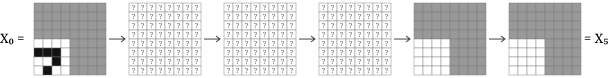</a>

<p style="text-align:right">(38)</p>

其中灰格形成静物, $X_1,X_2,X_3$ 中各格未知. 因而 $X_4=X_5$, $X_0=X_5+\text{滑翔机}$. 此外还要求静物 $X_5$ 不与滑翔机的前身 (见小图) 相互作用; 见习题 77. 想法是: 若滑翔机碰巧滑入这个特定静物, 就会被一口吞掉, 而静物将迅速恢复原状, 仿佛什么也没有发生.

<a href="../../assets/volume4b/figures/sat-gliderparent.svg"></a>

算法 C 几乎立即 (好吧, 是在约一亿次内存访问以后) 找到了

<a href="../../assets/volume4b/figures/sat-life39.svg"></a>

<p style="text-align:right">(39)</p>

这就是 R. W. Gosper 于 1971 年最先观察到的四步吞噬者.

**互斥的应用.** 现在来看有界模型检验怎样帮助我们证明算法正确 (或不正确). 验证中某些最有挑战性的问题, 出现在需要使并行进程的并发行为同步的时候. 为便于讨论, 不妨讲一个 Alice 和 Bob 的小故事.

Alice 和 Bob 是合住在一套公寓里的普通朋友. 他们共用的房间中有一间很特别, 有两扇门: 当其中一人在这间临界房间里时, 不愿另一个人也在里面. 此外, 两人都很忙, 不愿无谓地打扰对方. 因而他们商定用一盏可以开关的指示灯来控制进出.

他们最初试验的协议可以用一对对称的算法来描述:

```text
A0. 也许转到 A1.                     B0. 也许转到 B1.
A1. 若 l 则转到 A1, 否则转到 A2.     B1. 若 l 则转到 B1, 否则转到 B2.
A2. 置 l ← 1, 转到 A3.               B2. 置 l ← 1, 转到 B3.
A3. 临界, 转到 A4.                   B3. 临界, 转到 B4.
A4. 置 l ← 0, 转到 A0.               B4. 置 l ← 0, 转到 B0.
```

<p style="text-align:right">(40)</p>

在任何时刻, Alice 都处于五个状态 $\{\mathrm{A0},\mathrm{A1},\mathrm{A2},\mathrm{A3},\mathrm{A4}\}$ 之一, 她的程序规则说明状态可以如何改变. 在状态 A0, 她无意使用临界房间; 一旦想用, 就转到 A1. 在状态 A3, 她达到了这一目的. Bob 的情形类似. 指示灯亮时 ($l=1$), 他们等待, 直到对方退出房间并将灯关掉 ($l=0$).

Alice 和 Bob 不必以相同的速度行动. 但只有在 “也许” 状态 A0 或 B0 才容许磨蹭. 更确切地说, 我们把每一种有关的情形转化为一个离散的状态转移序列, 以此建立模型. 每个时刻 $t=0,1,2,\ldots$, Alice 或 Bob (不能两人同时) 执行对应于其当前状态的命令, 因而在时刻 $t+1$ 也许已变成另一状态. 这个选择是不确定的.

我们将研究的过程中只容许四种原始命令, (40) 中都有例子: (1) “临界”; (2) “转到<a id="pdf-225"></a><a id="p-205"></a> $s$”; (3) “置 $v\gets b$, 转到 $s$”; (4) “若 $v$ 则转到 $s_1$, 否则转到 $s_0$”. 这里 $s$ 表示状态名, $v$ 是共享的布尔变量, $b$ 为 0 或 1.

可惜 Alice 与 Bob 很快发现协议 (40) 并不可靠: 有一天, 她从 A1 走到 A2, 他从 B1 走到 B2, 此时两人都还没来得及把灯打开. 结果好不尴尬 (A3 与 B3).

若事先像 (33) 那样把 (40) 的状态转移化为有界模型检验的子句, 再应用 SAT 求解器, 就能发现这个问题. 这里对应于时刻 $t$ 的向量 $X_t$ 由布尔变量组成, 用来编码两人各自的当前状态以及 $l$ 的当前值. 例如, 可以用十一个变量 $\mathrm{A0}_t,\mathrm{A1}_t,\mathrm{A2}_t,\mathrm{A3}_t,\mathrm{A4}_t,\mathrm{B0}_t,\mathrm{B1}_t,\mathrm{B2}_t,\mathrm{B3}_t,\mathrm{B4}_t,l_t$, 再用十个二元排斥子句 $(\overline{\mathrm{A0}_t}\lor\overline{\mathrm{A1}_t})$, $(\overline{\mathrm{A0}_t}\lor\overline{\mathrm{A2}_t})$, $\ldots$, $(\overline{\mathrm{A3}_t}\lor\overline{\mathrm{A4}_t})$ 保证 Alice 至多处于一个状态, 对 Bob 也用十个类似的子句. 另有一个变量 $\mathord{@}_t$, 其真假取决于在时刻 $t$ 是 Alice 还是 Bob 执行其程序的一步. (当 $\mathord{@}_t=1$ 时称 Alice “获准前进一步”, 当 $\mathord{@}_t=0$ 时则是 Bob 获准前进一步.)

若以如下单位子句定义初态 $X_0$
$$
\mathrm{A0}_0\land\overline{\mathrm{A1}_0}\land\overline{\mathrm{A2}_0}\land\overline{\mathrm{A3}_0}\land\overline{\mathrm{A4}_0}
\land\mathrm{B0}_0\land\overline{\mathrm{B1}_0}\land\overline{\mathrm{B2}_0}\land\overline{\mathrm{B3}_0}\land\overline{\mathrm{B4}_0}\land\bar l_0,\tag{41}
$$
则对 $0\le t<r$, 下列子句 (习题 87 将讨论它们) 就能模拟 (40) 所规定的每种合法情形的前 $r$ 步:

$$
\begin{array}{lll}
\bigl(\mathord{@}_t\lor \overline{\mathrm{A0}_t}\lor \mathrm{A0}_{t+1}\bigr)&\bigl(\overline{\mathord{@}_t}\lor \overline{\mathrm{A0}_t}\lor \mathrm{A0}_{t+1}\lor \mathrm{A1}_{t+1}\bigr)&\bigl(\mathord{@}_t\lor \overline{\mathrm{B0}_t}\lor \mathrm{B0}_{t+1}\lor \mathrm{B1}_{t+1}\bigr)\\
\bigl(\mathord{@}_t\lor \overline{\mathrm{A1}_t}\lor \mathrm{A1}_{t+1}\bigr)&\bigl(\overline{\mathord{@}_t}\lor \overline{\mathrm{A1}_t}\lor \overline{l_t}\lor \mathrm{A1}_{t+1}\bigr)&\bigl(\mathord{@}_t\lor \overline{\mathrm{B1}_t}\lor \overline{l_t}\lor \mathrm{B1}_{t+1}\bigr)\\
\bigl(\mathord{@}_t\lor \overline{\mathrm{A2}_t}\lor \mathrm{A2}_{t+1}\bigr)&\bigl(\overline{\mathord{@}_t}\lor \overline{\mathrm{A1}_t}\lor l_t\lor \mathrm{A2}_{t+1}\bigr)&\bigl(\mathord{@}_t\lor \overline{\mathrm{B1}_t}\lor l_t\lor \mathrm{B2}_{t+1}\bigr)\\
\bigl(\mathord{@}_t\lor \overline{\mathrm{A3}_t}\lor \mathrm{A3}_{t+1}\bigr)&\bigl(\overline{\mathord{@}_t}\lor \overline{\mathrm{A2}_t}\lor \mathrm{A3}_{t+1}\bigr)&\bigl(\mathord{@}_t\lor \overline{\mathrm{B2}_t}\lor \mathrm{B3}_{t+1}\bigr)\\
\bigl(\mathord{@}_t\lor \overline{\mathrm{A4}_t}\lor \mathrm{A4}_{t+1}\bigr)&\bigl(\overline{\mathord{@}_t}\lor \overline{\mathrm{A2}_t}\lor l_{t+1}\bigr)&\bigl(\mathord{@}_t\lor \overline{\mathrm{B2}_t}\lor l_{t+1}\bigr)\\
\bigl(\overline{\mathord{@}_t}\lor \overline{\mathrm{B0}_t}\lor \mathrm{B0}_{t+1}\bigr)&\bigl(\overline{\mathord{@}_t}\lor \overline{\mathrm{A3}_t}\lor \mathrm{A4}_{t+1}\bigr)&\bigl(\mathord{@}_t\lor \overline{\mathrm{B3}_t}\lor \mathrm{B4}_{t+1}\bigr)\\
\bigl(\overline{\mathord{@}_t}\lor \overline{\mathrm{B1}_t}\lor \mathrm{B1}_{t+1}\bigr)&\bigl(\overline{\mathord{@}_t}\lor \overline{\mathrm{A4}_t}\lor \mathrm{A0}_{t+1}\bigr)&\bigl(\mathord{@}_t\lor \overline{\mathrm{B4}_t}\lor \mathrm{B0}_{t+1}\bigr)\\
\bigl(\overline{\mathord{@}_t}\lor \overline{\mathrm{B2}_t}\lor \mathrm{B2}_{t+1}\bigr)&\bigl(\overline{\mathord{@}_t}\lor \overline{\mathrm{A4}_t}\lor \overline{l_{t+1}}\bigr)&\bigl(\mathord{@}_t\lor \overline{\mathrm{B4}_t}\lor \overline{l_{t+1}}\bigr)\\
\bigl(\overline{\mathord{@}_t}\lor \overline{\mathrm{B3}_t}\lor \mathrm{B3}_{t+1}\bigr)&\bigl(\overline{\mathord{@}_t}\lor l_t\lor \mathrm{A2}_t\lor \mathrm{A4}_t\lor \overline{l_{t+1}}\bigr)&\bigl(\mathord{@}_t\lor l_t\lor \mathrm{B2}_t\lor \mathrm{B4}_t\lor \overline{l_{t+1}}\bigr)\\
\bigl(\overline{\mathord{@}_t}\lor \overline{\mathrm{B4}_t}\lor \mathrm{B4}_{t+1}\bigr)&\bigl(\overline{\mathord{@}_t}\lor \overline{l_t}\lor \mathrm{A2}_t\lor \mathrm{A4}_t\lor l_{t+1}\bigr)&\bigl(\mathord{@}_t\lor \overline{l_t}\lor \mathrm{B2}_t\lor \mathrm{B4}_t\lor l_{t+1}\bigr)
\end{array}\tag{42}
$$

现在若加上单位子句 $(\mathrm{A3}_r)$ 和 $(\mathrm{B3}_r)$, 在 $11+12r$ 个变量上就有 $13+50r$ 个子句. 当 $r=6$ 时很容易满足它们, 从而证明两人确实有可能同时占用临界房间. (顺便说, 互斥协议的标准术语会说 “两个线程并发地执行一个<em>临界段</em>”; 但我们还是沿用合住公寓的比喻.)

只好重新设计. 一个主意是修改 (40), 让 Alice 仅在 $l=1$ 时用房间, 却让 Bob 在 $l=0$ 时进去:

```text
A0. 也许转到 A1.                     B0. 也许转到 B1.
A1. 若 l 则转到 A2, 否则转到 A1.     B1. 若 l 则转到 B1, 否则转到 B2.
A2. 临界, 转到 A3.                   B2. 临界, 转到 B3.
A3. 置 l ← 0, 转到 A0.               B3. 置 l ← 1, 转到 B0.
```

<p style="text-align:right">(43)</p>

用 $r=100$ 作计算机试验, 相应子句不可满足; 看来 (43) 能保证互斥.

<a id="pdf-226"></a><a id="p-206"></a>

然而 (43) 根本不可取, 因为它索取的代价难以忍受: Bob 还没用过房间 $k$ 次, Alice 就不能用 $k$ 次! 还是扔掉吧.

何不再装一盏灯, 让两人各控制一盏呢?

```text
A0. 也许转到 A1.                     B0. 也许转到 B1.
A1. 若 b 则转到 A1, 否则转到 A2.     B1. 若 a 则转到 B1, 否则转到 B2.
A2. 置 a ← 1, 转到 A3.               B2. 置 b ← 1, 转到 B3.
A3. 临界, 转到 A4.                   B3. 临界, 转到 B4.
A4. 置 a ← 0, 转到 A0.               B4. 置 b ← 0, 转到 B0.
```

<p style="text-align:right">(44)</p>

不行; 这与 (40) 有同样的缺点. 但也许可以巧妙地颠倒第 1、2 两步的次序:

```text
A0. 也许转到 A1.                     B0. 也许转到 B1.
A1. 置 a ← 1, 转到 A2.               B1. 置 b ← 1, 转到 B2.
A2. 若 b 则转到 A2, 否则转到 A3.     B2. 若 a 则转到 B2, 否则转到 B3.
A3. 临界, 转到 A4.                   B3. 临界, 转到 B4.
A4. 置 a ← 0, 转到 A0.               B4. 置 b ← 0, 转到 B0.
```

<p style="text-align:right">(45)</p>

对了! 习题 95 很容易证明, 这个协议的确达到了互斥.

可惜现在又有一个新问题, 即所谓的 “死锁” 或 “活锁”. Alice 和 Bob 可能分别进入状态 A2 和 B2, 从此动弹不得: 每个人都等着另一个人进入临界房间.

遇到这种情形, 当然可以商量着设法 “重新启动”. 但那不过是逃避; 他们确实需要一个更好的解法. 有此烦恼的不只他们两位: 多年来, 已有不少人为这个出奇微妙的问题费尽心思, 下面的习题也给出了几种解法 (有好有坏). Edsger Dijkstra 在一部开创性的讲义 <em>Cooperating Sequential Processes</em> [Technological University Eindhoven (1965 年 9 月), §2.1] 中, 想到了一种颇有启发性的办法来改进 (45):

```text
A0. 也许转到 A1.                     B0. 也许转到 B1.
A1. 置 a ← 1, 转到 A2.               B1. 置 b ← 1, 转到 B2.
A2. 若 b 则转到 A3, 否则转到 A4.     B2. 若 a 则转到 B3, 否则转到 B4.
A3. 置 a ← 0, 转到 A1.               B3. 置 b ← 0, 转到 B1.
A4. 临界, 转到 A5.                   B4. 临界, 转到 B5.
A5. 置 a ← 0, 转到 A0.               B5. 置 b ← 0, 转到 B0.
```

<p style="text-align:right">(46)</p>

但他认识到这也不令人满意, 因为按此协议, 比如说, Alice 可以一直等待, 而 Bob 却在反复使用临界房间. (确实, 若 Alice 和 Bob 分别处于 A1 与 B2, 她可以走到 A2、A3, 再回到 A1, 于是他可依次走到 B4、B5、B0、B1、B2; 两人又回到起点, 她却寸步未进.)

这种称为<em>饥饿</em>的问题, 也可用有界模型检验来检测. 基本思想 (见习题 91) 是, 饥饿发生当且仅当存在转移回路
$$
X_0\to X_1\to\cdots\to X_p\to X_{p+1}\to\cdots\to X_r=X_p,\tag{47}
$$
使 (i) 在回路中 Alice 和 Bob 各至少获准前进一步; 且 (ii) 其中至少一人在回路中从未处于 “也许” 或 “临界” 状态.

<a id="pdf-227"></a><a id="p-207"></a>

这些条件容易编码成子句, 因为可以将时刻 $r$ 的变量与时刻 $p$ 的变量等同起来, 并附加子句
$$
(\overline{\mathord{@}_p}\lor\overline{\mathord{@}_{p+1}}\lor\cdots\lor\overline{\mathord{@}_{r-1}})
\land(\mathord{@}_p\lor\mathord{@}_{p+1}\lor\cdots\lor\mathord{@}_{r-1})\tag{48}
$$
来保证 (i). 条件 (ii) 只须附加单位子句即可; 例如, 要检验 (46) 能否使 Alice 饥饿, 相应的子句为 $\overline{\mathrm{A0}_p}\land\overline{\mathrm{A0}_{p+1}}\land\cdots\land\overline{\mathrm{A0}_{r-1}}\land\overline{\mathrm{A4}_p}\land\overline{\mathrm{A4}_{p+1}}\land\cdots\land\overline{\mathrm{A4}_{r-1}}$.

(43)、(45) 和 (46) 的缺点都可以看作饥饿的例子, 因为 (47)、(48) 可满足 (见习题 90). 因而, 对<em>任何</em>不令人满意的互斥协议, 都能用有界模型检验找出反例: 要么展示 Alice 与 Bob 同时在临界房间的情形, 要么展示一个可行的饥饿循环 (47).

当然也想反过来做: 如果某协议在例如 $r=100$ 时没有反例, 我们也许仍不知道它是否真的可靠; 反例可能要到极大的 $r$ 才会出现. 幸好有办法为 $r$ 求得适当的上界, 使有界模型检验既可证明正确, 又可示范错误. 例如, 可以验证 Alice 与 Bob 问题的已知最简单的正确解, 即 G. L. Peterson 的一个协议 [<em>Information Proc. Letters</em> **12** (1981), 115–116]; 他注意到, 将 (43) 与 (45) 小心组合起来其实就够了:

```text
A0. 也许转到 A1.                     B0. 也许转到 B1.
A1. 置 a ← 1, 转到 A2.               B1. 置 b ← 1, 转到 B2.
A2. 置 l ← 0, 转到 A3.               B2. 置 l ← 1, 转到 B3.
A3. 若 b 则转到 A4, 否则转到 A5.     B3. 若 a 则转到 B4, 否则转到 B5.
A4. 若 l 则转到 A5, 否则转到 A3.     B4. 若 l 则转到 B3, 否则转到 B5.
A5. 临界, 转到 A6.                   B5. 临界, 转到 B6.
A6. 置 a ← 0, 转到 A0.               B6. 置 b ← 0, 转到 B0.
```

<p style="text-align:right">(49)</p>

现在有<em>三</em>盏信号灯 $a,b,l$, 其中一盏由 Alice 控制, 一盏由 Bob 控制, 还有一盏两人都能拨动.

要证明 A5 和 B5 不能并发出现, 注意最短反例不会两次遇到同一状态; 换言之, 它是一条形如 (33) 的<em>简单</em>转移路径. 所以可假定 $r$ 至多为状态总数. 不过 (49) 有 $7\times7\times2\times2\times2=392$ 个状态; 界虽有限, 就这个问题而言一个好的 SAT 求解器也不是应付不了, 但还可以好得多. 例如, 构造一组子句, 使它们可满足当且仅当有一条长度 $\le r$ 的简单路径, 并不困难 (见习题 92); 而在这个特例中, 最长的简单路径原来只有 54 步.

其实还可以做得更好, 只须利用<em>不变式</em>这个重要的概念; 我们在第 1.2.1 节已经遇到过, 此后在这套书中也屡见不鲜. 不变断言是多数正确性证明的关键, 因此它们也能显著增强有界模型检验的能力, 并不奇怪. 形式上说, 若 $\Phi(X)$ 是状态向量 $X$ 的一个布尔函数, 而只要 $X\to X'$ 就由 $\Phi(X)$ 推出 $\Phi(X')$, 就称 $\Phi$ 为不变式. 例如,<a id="pdf-228"></a><a id="p-208"></a> 不难看出以下子句关于 (49) 是不变的:
$$
\begin{aligned}
\Phi(X)={}&(\mathrm{A0}\lor\mathrm{A1}\lor\mathrm{A2}\lor\mathrm{A3}\lor\mathrm{A4}\lor\mathrm{A5}\lor\mathrm{A6})\land(\mathrm{B0}\lor\mathrm{B1}\lor\mathrm{B2}\lor\mathrm{B3}\lor\mathrm{B4}\lor\mathrm{B5}\lor\mathrm{B6})\\
&{}\land(\overline{\mathrm{A0}}\lor\bar a)\land(\overline{\mathrm{A1}}\lor\bar a)\land(\overline{\mathrm{A2}}\lor a)\land(\overline{\mathrm{A3}}\lor a)\land(\overline{\mathrm{A4}}\lor a)\land(\overline{\mathrm{A5}}\lor a)\land(\overline{\mathrm{A6}}\lor a)\\
&{}\land(\overline{\mathrm{B0}}\lor\bar b)\land(\overline{\mathrm{B1}}\lor\bar b)\land(\overline{\mathrm{B2}}\lor b)\land(\overline{\mathrm{B3}}\lor b)\land(\overline{\mathrm{B4}}\lor b)\land(\overline{\mathrm{B5}}\lor b)\land(\overline{\mathrm{B6}}\lor b).
\end{aligned}\tag{50}
$$
(子句 $\overline{\mathrm{A0}}\lor\bar a$ 说 Alice 在状态 A0 时 $a=0$, 等等.) 我们可以用 SAT 求解器<em>证明</em> $\Phi$ 不变, 只须证明下列子句
$$
\Phi(X)\land(X\to X')\land\neg\Phi(X')\tag{51}
$$
不可满足. 而且 $\Phi(X_0)$ 对初态 $X_0$ 成立, 因为 $\neg\Phi(X_0)$ 不可满足. (见习题 93.) 因此由归纳法, $\Phi(X_t)$ 对一切 $t\ge0$ 都为真, 可以将这些有用的子句加入所有公式中.

不变式 (50) 使状态总数减少为原来的四分之一. 而最有决定性的事实是子句
$$
(X_0\to X_1\to\cdots\to X_r)\land\Phi(X_0)\land\Phi(X_1)\land\cdots\land\Phi(X_r)\land\mathrm{A5}_r\land\mathrm{B5}_r,\tag{52}
$$
其中<em>不</em>要求 $X_0$ 为初始状态, 在 $r=3$ 时竟不可满足. 换句话说, 从一个错误状态倒推, 若不违反不变式, 最多只能退回两步. 可以断定, 只须考察长度为 2 的路径, 就足以验证 (49) 的互斥性(!). 而且类似的想法 (习题 98) 表明, (49) 也不会发生饥饿.

<em>注意:</em> 尽管按 Alice 与 Bob 的基本规则 (49) 是正确的互斥协议, 在多数现代计算机上, 除非特别小心地使高速缓存和写缓冲同步, 否则并<em>不能</em>安全使用. 其原因是硬件设计者采用了各种各样的技巧来提高速度, 可能使一个进程在时刻 $t+1$ 仍看到 $a=0$, 而另一个进程在时刻 $t$ 已经置 $a\gets1$. 我们推导以上算法时所假定的并行计算模型, 就是 Leslie Lamport 所称的<em>顺序一致性</em> [<em>IEEE Trans.</em> **C-28** (1979), 690–691].

**数字层析成像.** 已知二进制图像的部分信息, 研究这样的图像又产生了一批适宜用 SAT 求解的有趣问题. 例如, [图 79](#fig-7-2-2-2-79) 让我们从一个新角度看第 7.1.3 节中的 “柴郡猫”. 这是一幅 $m\times n$ 的布尔变量阵列 $(x_{i,j})$, 有 $m=25$ 行、$n=30$ 列. 左上角元素 $x_{1,1}$ 为 0, 表示白色; $x_{1,24}=1$ 对应于顶行唯一的黑像素. 已知行和 $r_i=\sum_{j=1}^n x_{i,j}$, $1\le i\le m$, 列和 $c_j=\sum_{i=1}^m x_{i,j}$, $1\le j\le n$, 以及 $45^\circ$ 两个对角线方向的和, 即
$$
a_d=\sum_{i+j=d+1}x_{i,j}\quad\hbox{和}\quad b_d=\sum_{i-j=d-n}x_{i,j},\qquad0<d<m+n.\tag{53}
$$

单凭和数 $r_i,c_j,a_d,b_d$, 能在多大程度上重建这样一幅图像? 由这类 X 射线式的投影, 常可唯一确定较小的例子 (见习题 103). 但像素图像的离散性, 使重建问题比<a id="pdf-229"></a><a id="p-209"></a>相应的连续问题困难得多; 在连续情形下有来自许多不同角度的投影.

<a id="fig-7-2-2-2-79"></a>

**图 79.** 一个黑白像素阵列及其行和 $r_i$、列和 $c_j$、对角线和 $a_d,b_d$.

<a href="../../assets/volume4b/figures/sat-fig79.svg">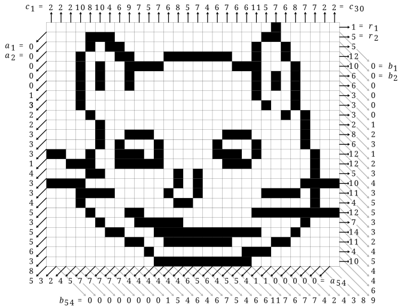</a>

例如, 经典的 “八皇后问题” 要求将八个互不攻击的皇后放在棋盘上, 它等价于解一个 $8\times8$ 的数字层析成像问题, 约束为 $r_i=1$, $c_j=1$, $a_d\le1$, $b_d\le1$.

[图 79](#fig-7-2-2-2-79) 的约束看起来相当严格, 所以也许会以为, 多数像素 $x_{i,j}$ 已由给定和数唯一确定. 例如, $a_1=\cdots=a_5=0$ 表明, 当 $i+j\le6$ 时 $x_{i,j}=0$; 在图像四角都可以作类似的推断. 作一个粗略的 “数量级估计”: 给出的和数略多于 150 个, 每个大多占 5 位; 因而大约有 $150\times5=750$ 位数据, 而我们希望用它们重建 $25\times30=750$ 个像素 $x_{i,j}$. 然而实际上, 这个问题有数十亿个解 (见[图 80](#fig-7-2-2-2-80)), 其中大多数都不像猫! 习题 106 给出了不那么粗略的估计; 从中可以看出解有这么多其实不足为奇.

<a id="fig-7-2-2-2-80"></a>

**图 80.** [图 79](#fig-7-2-2-2-79) 的约束所容许的几个极端解.

<div style="display:flex;flex-wrap:wrap;gap:.8em;align-items:end;justify-content:center">
<figure style="margin:0;max-width:100%;text-align:center"><a href="../../assets/volume4b/figures/sat-fig801.svg">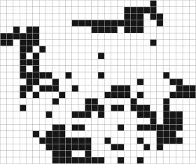</a><figcaption>(a) 按字典序最先</figcaption></figure>
<figure style="margin:0;max-width:100%;text-align:center"><a href="../../assets/volume4b/figures/sat-fig802.svg">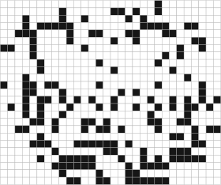</a><figcaption>(b) 差异最大</figcaption></figure>
<figure style="margin:0;max-width:100%;text-align:center"><a href="../../assets/volume4b/figures/sat-fig803.svg">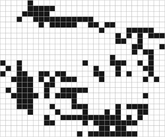</a><figcaption>(c) 按字典序最后</figcaption></figure>
</div>

<a id="pdf-230"></a><a id="p-210"></a>

像[图 79](#fig-7-2-2-2-79) 那样的数字层析成像问题, 很容易表为一系列要满足的子句, 因为每一项要求都是 (18)–(21) 中研究过的基数约束的特例. 这个问题与上面讨论的那些 SAT 实例的主要区别在于, 它<em>完全</em>由基数约束组成: 要解关于 750 个变量 $x_{i,j}$ 的 $25+30+54+54=163$ 个联立线性方程, 每个变量只许为 0 或 1. 因而它本质上是一个<em>整数规划</em> (IP) 实例, 而非可满足性 (SAT) 实例. 另一方面, Bailleux 和 Boufkhad 设计 (20)、(21) 的子句, 正是因为他们希望将 SAT 求解器而非 IP 求解器用于数字层析成像. 对[图 79](#fig-7-2-2-2-79), 他们的方法给出约 9000 个变量上的 40000 个子句, 总共约有 100000 个字面值.

[图 80](#fig-7-2-2-2-80)(b) 显示了一个与[图 79](#fig-7-2-2-2-79) 差异尽可能大的解. 也就是说, 在这些线性方程的所有 0、1 值解中, 它使对应于黑像素的 182 个变量之和 $x_{1,24}+x_{2,5}+x_{2,6}+\cdots+x_{25,21}$ 达到最小. 若<em>不</em>要求变量为整数, 用线性规划在 $0\le x_{i,j}\le1$ 下使这个和最小化, 几乎立即就能得到松弛条件下最小值约为 31.38; 所以任何黑白图像与[图 79](#fig-7-2-2-2-79) 的黑像素重合数都不能少于 32. [图 80](#fig-7-2-2-2-80)(b) 确实达到了这个最小值, 用 CPLEX 等广为采用的 IP 求解器, 几秒钟便可算出此图. 相比之下, 即使告知存在重合数为 32 的解, 到 2013 年为止最先进的 SAT 求解器也很难找到这幅图像.

类似地, [图 80](#fig-7-2-2-2-80) 的 (a) 和 (c) 与 SAT 技术的现状也有密切关系: 它们代表数百个单独的 SAT 实例, 其中前 $k$ 个变量置为已知的特定值, 再试着找出下一个变量分别为 0 或 1 的解. 在计算[图 80](#fig-7-2-2-2-80)(c) 的第 6、7 行时遇到的若干子问题相当棘手, 不过花上几个小时仍能解出; 而对于不同字典序的类似问题, 当时的 SAT 方法似乎依然无能为力. 但是 IP 求解器却能轻松地解决这些问题. (见习题 109 和 111.)

若能给出关于图像的更多信息, 唯一地重建它的机会自然也随之增加. 譬如, 假定还算出 $r'_i,c'_j,a'_d,b'_d$, 它们计数的是每条行、列及对角线上 1 的<em>游程</em>数. (有 $r'_1=1$, $r'_2=2$, $r'_3=4$, 等等.) 给出这些附加数据以后, 可以证明[图 79](#fig-7-2-2-2-79) 是唯一的解, 因为一组适当的子句原来不可满足. 习题 117 解释怎样修改 (20)、(21), 以便根据游程计数施加约束. 此外, 像 “第 4 列的游程长度依次为 (6,1,3)” 这样更详细的条件, 也不难表为一串子句; 见习题 438.

**SAT 例题小结.** 到此我们已充分看到, 简单的布尔子句 (将字面值作或后再作与) 用途极广. 除其他应用外, 我们已用它们编码了图着色、整数<a id="pdf-231"></a><a id="p-211"></a>因子分解、硬件故障测试、机器学习、模型检验以及层析成像等问题. 事实上, 第 7.9 节将说明, 3SAT 称得上一般 NP 完全问题的典型代表: NP 中的<em>任何</em>问题 (这一大类问题基本上包括所有规模为 $N$、其肯定答案可在 $N^{O(1)}$ 步内验证的是非问题), 都可表为 3SAT 的一个等价实例, 而不必大幅增加问题的规模.

**用回溯法解 SAT.** 好, 我们已经看到了各式各样引人入胜而又重要、并且已开始得到解决的 SAT 实例. 应当怎样解它们呢?

对于至少涉及一个变量的任何 SAT 实例, 可以系统地选择一个变量, 将它置为 0 或 1. 无论选哪一种, 都得到一个较小的 SAT 实例; 因而可以继续下去, 直到遇到一个空实例 (它平凡可满足, 因为没有需要满足的子句), 或者遇到一个含空子句的实例. 在后一情形必须退回去, 重新考虑先前的某个选择, 照样继续, 直到成功或穷尽一切可能.

例如, 再考虑公式 (1) 中的 $F$. 若置 $x_1=0$, 则 $F$ 约化为 $\bar x_2\land(x_2\lor x_3)$, 因为第一个子句 $(x_1\lor\bar x_2)$ 失去其 $x_1$, 而最后两个子句含 $\bar x_1$, 已经满足. 为这个约化问题引进一个记号很方便; 因而写作
$$
F\vert\bar x_1=\bar x_2\land(x_2\lor x_3).\tag{54}
$$
类似地, 若置 $x_1=1$, 就得到约化问题
$$
F\vert x_1=(x_2\lor x_3)\land\bar x_3\land(\bar x_2\lor x_3).\tag{55}
$$
$F$ 可满足当且仅当 (54) 或 (55) 可满足.

一般地, 若 $F$ 是任意子句集而 $l$ 是任意字面值, 则 $F\vert l$ (读作 “给定 $l$ 时的 $F$” 或 “$F$ 以 $l$ 为条件”) 就是由 $F$ 得到的如下子句集:

- 除去所有含 $l$ 的子句;
- 从所有含 $\bar l$ 的子句中除去 $\bar l$.

这种取条件的运算是可交换的, 亦即当 $l'\ne\bar l$ 时 $F\vert l\vert l'=F\vert l'\vert l$. 若 $L=\{l_1,\ldots,l_k\}$ 是严格互异的字面值的任一集合, 也可写 $F\vert L=F\vert l_1\vert\cdots\vert l_k$. 用这些术语来说, $F$ 可满足当且仅当对某个这样的 $L$ 有 $F\vert L=\varnothing$, 因为当 $F\vert L=\varnothing$ 时, $L$ 的字面值满足 $F$ 的每个子句.

因此可以将上述求解 SAT 的系统策略表为下面的递归过程 $B(F)$; 当 $F$ 不可满足时返回特殊值 $\bot$, 否则返回满足 $F$ 的集合 $L$:
$$
B(F)=\left\{\begin{array}{l}
\text{若 }F=\varnothing,\ \text{返回 }\varnothing.\quad(F\text{ 平凡可满足}.)\\
\text{否则若 }\epsilon\in F,\ \text{返回 }\bot.\quad(F\text{ 不可满足}.)\\
\text{否则令 }l\text{ 为 }F\text{ 中的一个字面值, 置 }L\gets B(F\vert l).\\
\text{若 }L\ne\bot,\ \text{返回 }L\cup\{l\}.\ \text{否则置 }L\gets B(F\vert\bar l).\\
\text{若 }L\ne\bot,\ \text{返回 }L\cup\{\bar l\}.\ \text{否则返回 }\bot.
\end{array}\right.\tag{56}
$$
下面将这个抽象算法化为较低层次的高效代码, 给它添上血肉. 从过去对回溯法的研究可知, 至关重要的是要有合适的数据结构, 使我们既能迅速从<a id="pdf-232"></a><a id="p-212"></a> $F$ 转到 $F\vert l$, 又能在必要时迅速返回 $F$, 其中 $F$ 是子句集, $l$ 是字面值. 特别要有一个好办法来找出含有给定字面值的所有子句.

由处理恰当覆盖问题的经验, 自然想到为此将顺序结构与链接结构结合起来. 可以把每个子句表为一组单元, 其中每个单元 $p$ 含字面值 $l=\mathtt L(p)$, 并有指针 $\mathtt F(p)$、$\mathtt B(p)$, 通过双向链表连到其他含 $l$ 的单元. 还须有 $\mathtt C(p)$, 即 $p$ 所属子句的编号. 子句 $C_i$ 的单元占据连续的位置 $\mathtt{START}(i)+j$, $0\le j<\mathtt{SIZE}(i)$.

为了表示涉及变量 $x_k$ 的两个字面值 $x_k$ 和 $\bar x_k$, 分别采用整数 $2k$ 和 $2k+1$ 很方便. 按此约定,
$$
\bar l=l\oplus1,\qquad |l|=x_{l\gg1}.\tag{57}
$$
在 (56) 的实现中, 假定变量为 $x_1,x_2,\ldots,x_n$; 因而 $2n$ 个可能的字面值位于范围 $2\le l\le2n+1$.

单元 0 至 $2n+1$ 留作特殊用途: 单元 $l$ 是 $l$ 在其他单元中诸出现位置的链表的表头. 此外, 若字面值 $l$ 的值尚未固定, $\mathtt C(l)$ 就是该表的长度, 即目前仍活动的子句中有 $l$ 出现的子句数.

例如, (7) 中 $m=7$ 个三元子句 $R'$ 可按这些约定在内部表示为如下 $2n+2+3m=31$ 个单元:

<table id="sat-linked-cells"><thead><tr><th>$p=$</th><th>0</th><th>1</th><th>2</th><th>3</th><th>4</th><th>5</th><th>6</th><th>7</th><th>8</th><th>9</th><th>10</th><th>11</th><th>12</th><th>13</th><th>14</th><th>15</th><th>16</th><th>17</th><th>18</th><th>19</th><th>20</th><th>21</th><th>22</th><th>23</th><th>24</th><th>25</th><th>26</th><th>27</th><th>28</th><th>29</th><th>30</th></tr></thead><tbody>
<tr><td>$L(p)=$</td><td>–</td><td>–</td><td>–</td><td>–</td><td>–</td><td>–</td><td>–</td><td>–</td><td>–</td><td>–</td><td>9</td><td>7</td><td>3</td><td>8</td><td>7</td><td>5</td><td>6</td><td>5</td><td>3</td><td>8</td><td>4</td><td>3</td><td>8</td><td>6</td><td>2</td><td>9</td><td>6</td><td>4</td><td>7</td><td>4</td><td>2</td></tr>
<tr><td>$F(p)=$</td><td>–</td><td>–</td><td>30</td><td>21</td><td>29</td><td>17</td><td>26</td><td>28</td><td>22</td><td>25</td><td>9</td><td>7</td><td>3</td><td>8</td><td>11</td><td>5</td><td>6</td><td>15</td><td>12</td><td>13</td><td>4</td><td>18</td><td>19</td><td>16</td><td>2</td><td>10</td><td>23</td><td>20</td><td>14</td><td>27</td><td>24</td></tr>
<tr><td>$B(p)=$</td><td>–</td><td>–</td><td>24</td><td>12</td><td>20</td><td>15</td><td>16</td><td>11</td><td>13</td><td>10</td><td>25</td><td>14</td><td>18</td><td>19</td><td>28</td><td>17</td><td>23</td><td>5</td><td>21</td><td>22</td><td>27</td><td>3</td><td>8</td><td>26</td><td>30</td><td>9</td><td>6</td><td>29</td><td>7</td><td>4</td><td>2</td></tr>
<tr><td>$C(p)=$</td><td>–</td><td>–</td><td>2</td><td>3</td><td>3</td><td>2</td><td>3</td><td>3</td><td>3</td><td>2</td><td>7</td><td>7</td><td>7</td><td>6</td><td>6</td><td>6</td><td>5</td><td>5</td><td>5</td><td>4</td><td>4</td><td>4</td><td>3</td><td>3</td><td>3</td><td>2</td><td>2</td><td>2</td><td>1</td><td>1</td><td>1</td></tr>
</tbody></table>

这里每个子句中的字面值按递减次序出现. 例如, 单元 19 至 21 中的字面值 $\mathtt L(p)=(8,4,3)$ 表示子句 $x_4\lor x_2\lor\bar x_1$, 即 (7) 中的第四个子句 ‘$4\bar1 2$’. 这种排序十分有用, 因为在 (56) 中我们总是选尚未赋值的最小变量作为 $l$ 或 $\bar l$; 这样 $l$ 或 $\bar l$ 总在它所在子句的右端, 只须更改有关的 $\mathtt{SIZE}$ 域就可将其除去或放回.

本例的子句有 $\mathtt{START}(i)=31-3i$, $1\le i\le7$; 在计算开始时 $\mathtt{SIZE}(i)=3$.

**算法 A** (<em>用回溯求可满足性.</em>) 给定含 $n>0$ 个布尔变量 $x_1\ldots x_n$ 的非空子句 $C_1\land\cdots\land C_m$, 按上面的形式表示. 本算法找到解当且仅当这些子句可满足. 它用 “走法” 阵列 $m_1\ldots m_n$ 记录当前进展, 各走法的含义见下文.

**A1.** [初始化.] 置 $a\gets m$, $d\gets1$. (这里 $a$ 表示活动子句数, $d$ 表示隐式查找树中的深度加 1.)

**A2.** [选择.] 置 $l\gets2d$. 若 $\mathtt C(l)\le\mathtt C(l+1)$, 则置 $l\gets l+1$. 再置 $m_d\gets(l\mathbin{\&}1)+4[\mathtt C(l\oplus1)=0]$. (见下文.) 若 $\mathtt C(l)=a$, 则成功终止.

**A3.** [除去 $\bar l$.] 从一切活动子句中删去 $\bar l$; 但若这样会使某个子句变空, 转到 A5. (由于正在使 $l$ 为真, 所以要略去 $\bar l$.)

<a id="pdf-233"></a><a id="p-213"></a>

<a id="fig-7-2-2-2-81"></a>

**图 81.** 对 (6) 定义的八个不可满足子句 $R$ 应用算法 A 时, 隐式遍历的查找树. 分支结点标以受检验的变量; 叶结点标以发现矛盾的子句.

<a href="../../assets/volume4b/figures/sat-fig81.svg">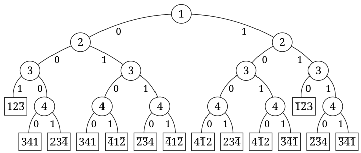</a>

**A4.** [使含 $l$ 的子句停止活动.] 抑制所有含 $l$ 的子句. (这些子句现在已被满足.) 然后置 $a\gets a-\mathtt C(l)$, $d\gets d+1$, 返回 A2.

**A5.** [再试.] 若 $m_d<2$, 则置 $m_d\gets3-m_d$, $l\gets2d+(m_d\mathbin{\&}1)$, 转到 A3.

**A6.** [回溯.] 若 $d=1$, 则失败终止 (子句不可满足). 否则置 $d\gets d-1$, $l\gets2d+(m_d\mathbin{\&}1)$.

**A7.** [重新激活含 $l$ 的子句.] 置 $a\gets a+\mathtt C(l)$, 解除对所有含 $l$ 的子句的抑制. (由于 $l$ 不再为真, 这些子句现在不再满足.)

**A8.** [放回 $\bar l$.] 在一切含 $\bar l$ 的活动子句中恢复 $\bar l$. 然后转回 A5.　■

(A3、A4 中更新数据结构以及 A7、A8 中撤销更新所需的低层链表处理操作, 详见习题 121.)

算法 A 的走法代码 $m_j$ 是 0 至 5 的整数, 它们按如下方式记录算法进行的状态:

- $m_j=0$ 表示正在试 $x_j=1$, 还未试过 $x_j=0$.
- $m_j=1$ 表示正在试 $x_j=0$, 还未试过 $x_j=1$.
- $m_j=2$ 表示已试 $x_j=0$ 而失败, 现在试 $x_j=1$.
- $m_j=3$ 表示已试 $x_j=1$ 而失败, 现在试 $x_j=0$.
- $m_j=4$ 表示因 $\bar x_j$ 没有出现而试 $x_j=1$.
- $m_j=5$ 表示因 $x_j$ 没有出现而试 $x_j=0$.

代码 4 和 5 针对所谓的 “纯字面值”: 若没有子句含字面值 $\bar l$, 则假定 $l$ 为真决不会错.

例如, 将子句 (7) 交给算法 A 时, 它径直置 $m_1m_2m_3m_4=1014$ 而得解; 解为 $x_1x_2x_3x_4=0101$. 但给定不可满足的子句 (6) 时, 在 A2 中相继出现的代码串 $m_1\ldots m_d$ 为
$$
1,11,110,1131,121,1211,1221,21,211,2111,2121,221,2221,\tag{58}
$$
随后算法才放弃. (见[图 81](#fig-7-2-2-2-81).)

<a id="pdf-234"></a><a id="p-214"></a>

每隔一段时间显示一下当前的串 $m_1\ldots m_d$ 很有帮助, 它方便地指出进展; 这个串按字典序递增. 果然, 随着 2 和 3 逐渐左移, 会出现令人着迷的图案. (请试试!)

当算法在 A2 中成功终止时, 令 $x_j\gets1\oplus(m_j\mathbin{\&}1)$, $1\le j\le d$, 即可从走法表中读出一个满足赋值. 算法 A 找到一个解就停止; 若要全部解, 见习题 122.

**惰性数据结构.** 算法 A 以精心设计的双向链结构为基础. 其实, Cynthia A. Brown 和 Paul W. Purdom, Jr. [<em>IEEE Trans.</em> **PAMI-4** (1982), 309–316] 发现了一个简单得多的办法, 他们引进了<em>受监视字面值</em>的概念. 他们注意到, 并不真的需要知道含给定字面值的<em>所有</em>子句, 因为在任何特定时刻, 每个子句真正有关系的只有一个字面值.

其思想是: 处理子句 $F\vert L$ 时, 出现在 $L$ 中的变量有已知值, 而其他变量没有. 例如, 在算法 A 中, 当 $j\le d$ 时变量 $x_j$ 已隐式确定为真或假, 当 $j>d$ 时其值未知. 这种情形称为<em>部分赋值</em>. 若没有子句完全由假字面值组成, 就称部分赋值与子句集<em>相容</em>. SAT 算法通常只处理相容的部分赋值; 其目标是逐步消除未知值, 将部分赋值变成相容的<em>完全</em>赋值.

所以在相容的部分赋值下, 每个子句至少有一个不假的字面值; 可以调整数据, 使子句在存储器中以这样一个字面值开头. 不假的字面值可能有好几个, 但只指定其中一个作为子句的 “监视对象”. 当一个受监视字面值变假时, 可尝试另找一个不假的字面值换到它的位置上来.

采用这个办法, 每个字面值 $l$ 只需维护一个比较短的表, 即含有目前正监视 $l$ 的全部子句的表 $W_l$. 这个表可以是单向链表. 因此每个子句只须一个链接; 总共只有 $2n+m$ 个链接, 而算法 A 却要求每个<em>单元</em>有两个链接.

此外——这是最妙的!——<em>回溯时无须对监视表作任何更新.</em> 回溯操作只把已知值变为未知值, 因而决不会使一个不假的字面值变假. 也许正因如此, 基于受监视字面值的数据结构称为<em>惰性的</em>, 以区别于算法 A 的 “急切” 数据结构.

因此不妨重新设计算法 A, 使它更为悠闲. 在新数据结构中, 每个单元 $p$ 只有一个域 $\mathtt L(p)$; 其他的域 $\mathtt F(p)$、$\mathtt B(p)$、$\mathtt C(p)$ 不再需要, 也无须 $2n+2$ 个特殊单元. 与前面一样, 将子句顺序存放, $C_j$ 的字面值从 $\mathtt{START}(j)$ 开始, $1\le j\le m$. 受监视的是 $\mathtt{START}(j)$ 处的字面值; 新域 $\mathtt{LINK}(j)$ 是另一个有相同受监视字面值的子句编号 (若 $C_j$ 为该表最后一个这样的子句, 则为 0). 变量 $W_l$ 若非零, 就指向监视字面值 $l$ 的第一个子句. 新算法不再<a id="pdf-235"></a><a id="p-215"></a>需要 $\mathtt{SIZE}(j)$. 只要适当定义 $\mathtt{START}(0)$, 就可假设 $C_j$ 的最后一个字面值位于 $\mathtt{START}(j-1)-1$.

所得过程简短可爱, 几乎令人难以置信. 对于规模适中的问题, 它肯定算是能称为高效的最简单的 SAT 求解器:

**算法 B** (<em>用监视法求可满足性.</em>) 给定含 $n>0$ 个布尔变量 $x_1\ldots x_n$ 的非空子句 $C_1\land\cdots\land C_m$, 按上面的形式表示. 本算法找到解当且仅当这些子句可满足. 它用 “走法” 阵列 $m_1\ldots m_n$ 记录当前进展, 其含义已如上所述.

**B1.** [初始化.] 置 $d\gets1$.

**B2.** [庆祝或选择.] 若 $d>n$, 则成功终止. 否则置 $m_d\gets[W_{2d}=0\ \hbox{或}\ W_{2d+1}\ne0]$, $l\gets2d+m_d$.

**B3.** [尽可能除去 $\bar l$.] 对于一切以 $\bar l$ 为监视对象的 $C_j$, 改为监视 $C_j$ 的另一个不假的字面值. 若做不到, 就转到 B5. (见习题 124.)

**B4.** [前进.] 置 $W_{\bar l}\gets0$, $d\gets d+1$, 返回 B2.

**B5.** [再试.] 若 $m_d<2$, 则置 $m_d\gets3-m_d$, $l\gets2d+(m_d\mathbin{\&}1)$, 转到 B3.

**B6.** [回溯.] 若 $d=1$, 则失败终止 (子句不可满足). 否则置 $d\gets d-1$, 转回 B5.　■

强烈建议读者做一做习题 124, 其中详细说明了步骤 B3 所需的低层操作. 这些操作实质上完成了算法 B 所要做的一切工作.

这个算法不用走法代码 4 或 5, 因为惰性数据结构没有足够信息来辨认纯字面值. 好在纯字面值在实践中并不十分重要; 借助纯字面值捷径而变得易解的问题, 通常不用它也能很快解出.

注意 A2 和 B2 使用不同的准则来决定在查找树的每处分支先试 $x_d=1$ 还是先试 $x_d=0$. 算法 A 选择能满足较多子句的那一种; 算法 B 在 $\bar l$ 的监视表为空而 $l$ 的监视表不空时, 选择使 $l$ 为真而不使 $\bar l$ 为真. (监视 $\bar l$ 的所有子句都将不得不改变, 而含 $l$ 的子句则得到满足, 情况正好.) 不分胜负时两个算法都置 $m_d\gets1$, 对应于 $x_d=0$. 原因是, 由人设计的 SAT 实例往往有主要由假字面值组成的解.

**由单位子句强制的走法.** 对许多不太大的问题, 算法 B 的简单逻辑很好用. 但它坚持先置 $x_1$, 再置 $x_2$, 如此等等, 因此在另外许多问题上很不高效, 因为它没有利用单位子句, 即大小为 1 的子句. 单位子句 $(l)$ 迫使 $l$ 为真; 因而只要存在单位子句, 就没有必要作双向分支. 而且单位子句并不罕见: 经验表明, 它们在实际中几乎无处不在, 以至于实际的查找树往往仅有几十个分支结点, 而不是成千上万或数百万个.

单位子句的重要性, 在最早的计算机 SAT 求解器实现中就已得到认识. 该求解器由 Martin Davis、George Logemann 和<a id="pdf-236"></a><a id="p-216"></a>Donald Loveland 设计 [<em>CACM</em> **5** (1962), 394–397], 根据的是 Davis 早先与 Hilary Putnam 一起发展的思想 [<em>JACM</em> **7** (1960), 201–215]. 他们给算法 A 增加了机制, 能识别子句的大小何时降为 1, 以及含有某个字面值而尚未满足的子句数何时降为 0. 遇到这些情形时, 将变量放入一个 “就绪表”, 在作任何进一步的双向分支以前, 先把这些变量赋以固定值. 所得程序相当复杂; 那时计算机存储器实在有限, 他们竟把查找树当前结点的所有数据写在磁带上来实现分支, 需要回溯时再从最近写入的磁带记录中恢复数据! 如今这四位作者的姓名合在 “DPLL 算法” 这个词中, 泛指通过部分赋值和回溯进行的 SAT 求解.

Brown 和 Purdom 在前面引用的论文中指出, 仿照算法 B 使用受监视字面值, 可以更简单地检测单位子句. 可在该算法的数据结构中加上索引 $h_1\ldots h_n$, 使深度 $d$ 处正在赋值的变量成为 $x_{h_d}$ 而非 $x_d$. 此外, 可以将尚未赋值而监视表不全为空的变量放入一个循环表, 称为 “活动环”; 其思想是沿活动环依次考察, 检查其中是否有变量目前处于单位子句中. 只有绕过整环也没找到这样的单位子句时, 才采用双向分支.

例如, 考虑 (9) 中 $\operatorname{waerden}(3,3;9)$ 的 32 个不可满足子句. 初始的活动环为 $(1\,2\,3\,4\,5\,6\,7)$, 因为 8、$\bar8$、9、$\bar9$ 都不被任何地方监视. 此时还没有单位子句. 下面的算法将决定先试 $\bar1$; 然后分别将子句 123, 135, 147, 159 改为 213, 315, 417, 519, 使假字面值 1 不受任何监视. 现在活动环变为 $(2\,3\,4\,5\,6\,7)$, 下一次选择 $\bar2$; 因而 213, 234, 246, 258 分别变为 312, 324, 426, 528. 此时活动环为 $(3\,4\,5\,6\,7)$, 检测出了单位子句 ‘3’ (因为 ‘312’ 中的 1 与 2 为假). 这就引起进一步的改变, 起初几步计算可归纳如下:

<table id="sat-cyclic-trace"><thead><tr><th>活动环</th><th>$x_1x_2x_3x_4x_5x_6x_7x_8x_9$</th><th>单位子句</th><th>选择</th><th>改动后的子句</th></tr></thead><tbody>
<tr><td>(1 2 3 4 5 6 7)</td><td><code>– – – – – – – – –</code></td><td></td><td>$\overline{1}$</td><td>213, 315, 417, 519</td></tr>
<tr><td>(2 3 4 5 6 7)</td><td><code>0 – – – – – – – –</code></td><td></td><td>$\overline{2}$</td><td>312, 324, 426, 528</td></tr>
<tr><td>(3 4 5 6 7)</td><td><code>0 0 – – – – – – –</code></td><td>3</td><td>3</td><td>$\overline{4}\overline{3}\overline{5},\,\overline{5}\overline{3}\overline{7},\,\overline{6}\overline{3}\overline{9}$</td></tr>
<tr><td>(4 5 6 7)</td><td><code>0 0 1 – – – – – –</code></td><td></td><td>$\overline{4}$</td><td>624, 714, 546, 648</td></tr>
<tr><td>(5 6 7)</td><td><code>0 0 1 0 – – – – –</code></td><td>6</td><td>6</td><td>$\overline{9}\overline{3}\overline{6},\,\overline{7}\overline{6}\overline{8}$</td></tr>
<tr><td>(9 7 5)</td><td><code>0 0 1 0 – 1 – – –</code></td><td>$\overline{9}$</td><td>$\overline{9}$</td><td></td></tr>
<tr><td>(7 5)</td><td><code>0 0 1 0 – 1 – – 0</code></td><td>7</td><td>7</td><td>$\overline{8}\overline{6}\overline{7},\,\overline{8}\overline{7}\overline{9}$</td></tr>
<tr><td>(8 5)</td><td><code>0 0 1 0 – 1 1 – 0</code></td><td>$\overline{8}$</td><td>$\overline{8}$</td><td></td></tr>
<tr><td>(5)</td><td><code>0 0 1 0 – 1 1 0 0</code></td><td>$5,\,\overline{5}$</td><td>回溯</td><td></td></tr>
<tr><td>(6 9 7 8 5)</td><td><code>0 0 1 – – – – – –</code></td><td></td><td>4</td><td>$\overline{5}\overline{3}\overline{4},\,\overline{5}\overline{4}\overline{6},\,\overline{6}\overline{4}\overline{8}$</td></tr>
<tr><td>(6 9 7 8 5)</td><td><code>0 0 1 1 – – – – –</code></td><td>$\overline{5}$</td><td>$\overline{5}$</td><td>456, 825, 915, 657, 759</td></tr>
</tbody></table>

<p style="text-align:right">(59)</p>

找到 6 时, 7 也是单位子句; 不过算法还没看见它, 因为先试变量 $x_6$. 找到 6 后, 活动环先变成 $(7\,5)$.

<a id="pdf-237"></a><a id="p-217"></a>

<a id="fig-7-2-2-2-82"></a>

**图 82.** 对 (6) 定义的八个不可满足子句 $R$ 应用算法 D 时, 隐式遍历的查找树. 分支结点标以受检验的变量; 叶结点标以发现矛盾的子句. 若分支结点的右子女是叶, 则左分支是一个条件单位子句所强制的.

<a href="../../assets/volume4b/figures/sat-fig82.svg">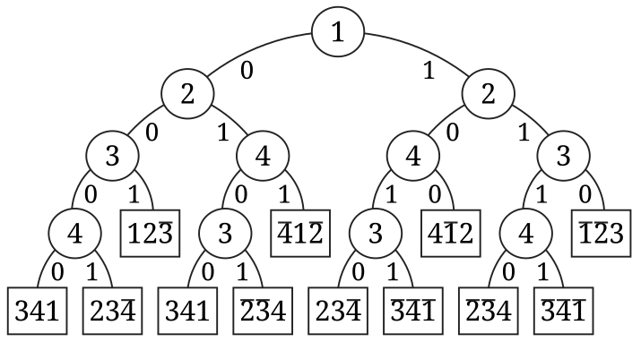</a>

这是因为按循环次序, 从 6 往后会先经过 7 再到 5; 我们希望先查看 7 而后查看 5, 不愿去访问差不多是同一批的子句. 选定 6 后, 因 $\bar9$ 的监视表变为非空, 9 插在左端. 回溯以后, 随着变量 8, 7, 9, 6 相继失去其强制值, 依次将它们插在左端.

下列算法以给每个变量增加一个 $\mathtt{NEXT}$ 域来表示活动环, $x_{\mathtt{NEXT}(k)}$ 为 $x_k$ 的后继. 通过位于左右两端的 “表头” 指针 $h$ 和 “表尾” 指针 $t$ 访问环, 有 $h=\mathtt{NEXT}(t)$. 但若环为空, 则 $t=0$, $h$ 无定义.

**算法 D** (<em>用循环 DPLL 求可满足性.</em>) 给定含 $n>0$ 个布尔变量 $x_1\ldots x_n$ 的非空子句 $C_1\land\cdots\land C_m$, 按上面的惰性数据结构和活动环形式表示. 本算法找到解当且仅当这些子句可满足. 它用索引阵列 $h_1\ldots h_n$ 和 “走法” 阵列 $m_0\ldots m_n$ 记录当前进展, 其含义见下文.

**D1.** [初始化.] 置 $m_0\gets d\gets h\gets t\gets0$, 并对 $k=n,n-1,\ldots,1$ 做如下操作: 置 $x_k\gets-1$ (表示值尚未确定); 若 $W_{2k}\ne0$ 或 $W_{2k+1}\ne0$, 则置 $\mathtt{NEXT}(k)\gets h$, $h\gets k$, 而若 $t=0$ 还置 $t\gets k$. 最后, 若 $t\ne0$, 则置 $\mathtt{NEXT}(t)\gets h$ 以完成活动环.

**D2.** [成功?] 若 $t=0$ 则终止 (所有子句都已满足). 否则置 $k\gets t$.

**D3.** [寻找单位子句.] 置 $h\gets\mathtt{NEXT}(k)$, 并用习题 129 的子程序计算 $f\gets[2h\text{ 是单位子句}]+2[2h+1\text{ 是单位子句}]$. 若 $f=3$, 转到 D7. 若 $f=1$ 或 2, 则置 $m_{d+1}\gets f+3$, $t\gets k$, 转到 D5. 否则, 若 $h\ne t$, 则置 $k\gets h$, 重复本步.

**D4.** [双向分支.] 置 $h\gets\mathtt{NEXT}(t)$, $m_{d+1}\gets[W_{2h}=0\ \hbox{或}\ W_{2h+1}\ne0]$.

**D5.** [继续前进.] 置 $d\gets d+1$, $h_d\gets k\gets h$. 若 $t=k$, 则置 $t\gets0$; 否则置 $\mathtt{NEXT}(t)\gets h\gets\mathtt{NEXT}(k)$, 从环中除去变量 $k$.

**D6.** [更新监视对象.] 置 $b\gets(m_d+1)\bmod2$, $x_k\gets b$, 并清空 $\bar x_k^{\,b}$ 的监视表 (见习题 130). 返回 D2.

<a id="pdf-238"></a><a id="p-218"></a>

**D7.** [回溯.] 置 $t\gets k$. 当 $m_d\ge2$ 时, 置 $k\gets h_d$, $x_k\gets-1$; 若 $W_{2k}\ne0$ 或 $W_{2k+1}\ne0$, 就置 $\mathtt{NEXT}(k)\gets h$, $h\gets k$, $\mathtt{NEXT}(t)\gets h$; 然后置 $d\gets d-1$.

**D8.** [失败?] 若 $d>0$, 则置 $m_d\gets3-m_d$, $k\gets h_d$, 返回 D6. 否则算法终止 (这些子句不可满足).　■

本算法的走法代码与前面略有不同:

- $m_j=0$ 表示正在试 $x_{h_j}=1$, 还未试过 $x_{h_j}=0$.
- $m_j=1$ 表示正在试 $x_{h_j}=0$, 还未试过 $x_{h_j}=1$.
- $m_j=2$ 表示已试 $x_{h_j}=0$ 而失败, 现在试 $x_{h_j}=1$.
- $m_j=3$ 表示已试 $x_{h_j}=1$ 而失败, 现在试 $x_{h_j}=0$.
- $m_j=4$ 表示因单位子句所强制而试 $x_{h_j}=1$.
- $m_j=5$ 表示因单位子句所强制而试 $x_{h_j}=0$.

和前面一样, 隐式查找树中双向分支结点的数目就是 $m_j$ 被置为 0 或 1 的次数.

**算法的比较.** 好, 我们已见到三个基本的 SAT 求解器. 它们实际表现如何呢? 本节后面还将研究另外几种算法, 然后再给出详细的性能统计. 不过先对算法 A、B、D 作一个简短的定量考察, 可以得到一些具体事实, 使我们在继续前进时对性能心中有数.

例如, 考虑兰福德配对问题 $\operatorname{langford}(n)$. 这个问题代表了一类在计算中会出现许多单位子句的 SAT 实例. 例如, 将算法 D 用于 $\operatorname{langford}(5)$ 时, 它会达到一个走法代码如下的阶段:
$$
m_1m_2\ldots m_d=1255555555555555114545545,\tag{60}
$$
表示在大量强制走法 (4 和 5) 中只有四个双向分支 (三个 1, 一个 2). 因此我们预计算法 D 的表现会优于不利用单位子句的 A 和 B.

果然, 即使在 $\operatorname{langford}(5)$ 这样小的例子上 (有 213 个子句、480 个单元、28 个变量), 算法 D 也 (略微) 胜出. 详细统计如下:

<table><thead><tr><th>算法</th><th>内存访问次数</th><th>字节数</th><th>结点数</th></tr></thead><tbody>
<tr><td>A</td><td>5379 + 108952</td><td>10552</td><td>705</td></tr>
<tr><td>B</td><td>1206 + 30789</td><td>4320</td><td>771</td></tr>
<tr><td>D</td><td>1417 + 28372</td><td>4589</td><td>11</td></tr>
</tbody></table>

(这里 “$5379+108952$ 次内存访问” 指的是算法开始前为初始化数据结构访问了 5379 次内存, 随后算法本身访问八字节数的内存 108952 次.) 注意, 算法 B 虽然作了 771 次而非 705 次双向分支, 速度却是这个例子中算法 A 的三倍多. 算法 A 需要的结点较少, 因为它辨认纯字面值; 不过算法 B 在每个结点上所做的工作要少得多. 另一方面, 算法 D 在每个结点上做的工作很多, 却仍然领先, 因为它选择作决定的方式将查找限制在很少几个结点中.

<a id="pdf-239"></a><a id="p-219"></a>

当考虑较大的问题时, 这些差别就更显著了. 例如, $\operatorname{langford}(9)$ 有 1722 个子句、3702 个单元、104 个变量, 得到

<table><thead><tr><th>算法</th><th>内存访问 ($\mathrm{M}\mu$)</th><th>字节数</th><th>结点数</th></tr></thead><tbody>
<tr><td>A</td><td>332.0</td><td>77216</td><td>1405230</td></tr>
<tr><td>B</td><td>53.4</td><td>31104</td><td>1654352</td></tr>
<tr><td>D</td><td>23.4</td><td>32057</td><td>6093</td></tr>
</tbody></table>

对有 5875 个子句、12356 个单元、228 个变量的 $\operatorname{langford}(13)$, 结果为

<table><thead><tr><th>算法</th><th>内存访问 ($\mathrm{G}\mu$)</th><th>千字节</th><th>结点数</th></tr></thead><tbody>
<tr><td>A</td><td>2699.1</td><td>253.9</td><td>87 亿</td></tr>
<tr><td>B</td><td>305.2</td><td>101.9</td><td>106 亿</td></tr>
<tr><td>D</td><td>71.7</td><td>104.0</td><td>1400 万</td></tr>
</tbody></table>

有心的读者会记得, 在第 7 章开头, 我们曾用初等推理证明, 对一切 $k$, $\operatorname{langford}(4k+1)$ 都不可满足. 显然, 即使 $k$ 很小, SAT 求解器要发现这一事实也相当困难. 在这里用它作基准测试题, 并不是建议用蛮力代替数学! 实际上, 不可满足性恰好增加了它作为基准的价值: 对不可满足的实例, 可满足性算法比较容易比较. 子句可满足时, 可能纯粹凭运气找到解, 因而表现差异极大. 不过, 不妨看看将三个算法放手用于可满足问题 $\operatorname{langford}(16)$ 会怎样, 结果倒是 “不费吹灰之力”. 它的 11494 个子句、23948 个单元、352 个变量给出下列统计:

<table><thead><tr><th>算法</th><th>内存访问 ($\mathrm{M}\mu$)</th><th>千字节</th><th>结点数</th></tr></thead><tbody>
<tr><td>A</td><td>11262.6</td><td>489.2</td><td>2880 万</td></tr>
<tr><td>B</td><td>932.1</td><td>196.2</td><td>4090 万</td></tr>
<tr><td>D</td><td>4.9</td><td>199.4</td><td>167</td></tr>
</tbody></table>

根据 $\operatorname{langford}$ 的数据, 算法 D 自然是我们迄今最喜欢的一种. 但它远非灵丹妙药, 因为在另一些问题上会惨败给轻装上阵的算法 B. 例如, $\operatorname{waerden}(3,10;97)$ 的 2779 个不可满足子句、11662 个单元、97 个变量给出

<table><thead><tr><th>算法</th><th>内存访问 ($\mathrm{G}\mu$)</th><th>千字节</th><th>百万结点</th></tr></thead><tbody>
<tr><td>A</td><td>150.9</td><td>212.8</td><td>106.7114</td></tr>
<tr><td>B</td><td>6.2</td><td>71.2</td><td>106.7116</td></tr>
<tr><td>D</td><td>1430.4</td><td>72.1</td><td>102.7</td></tr>
</tbody></table>

而 $\operatorname{waerden}(3,10;96)$ 的 2721 个可满足子句、11418 个单元、96 个变量给出

<table><thead><tr><th>算法</th><th>内存访问 ($\mathrm{M}\mu$)</th><th>千字节</th><th>千结点</th></tr></thead><tbody>
<tr><td>A</td><td>96.9</td><td>208.3</td><td>72.9</td></tr>
<tr><td>B</td><td>12.4</td><td>69.8</td><td>207.7</td></tr>
<tr><td>D</td><td>57962.8</td><td>70.6</td><td>4447.7</td></tr>
</tbody></table>

在这样的情形下, 单位子句并不能使查找树缩小多少, 每个结点上花这么多时间就不值得了.

**\*做更多工作来加快速度.** 算法 A、B、D 对比较小的问题尚可, 但真的难以对付前面例子中出现的较大 SAT 实例. 如果愿意做更多工作, 设计更精细的算法, 就可能获得显著的改进.

数学家一般力求给定理以漂亮、简短、优雅的证明; 计算机科学家一般也力求给出漂亮、简短、优雅的步骤序列,<a id="pdf-240"></a><a id="p-220"></a> 使问题得以迅速解决. 但有些定理没有短证明, 有些问题也不能用短程序高效解决.

因此, 至少暂时, 让我们换一种态度, 大胆决心用大量代码来对付 SAT: 查一查算法 D 在大问题上有哪些瓶颈, 想办法使计算更流畅, 哪怕所得程序可能大上十倍. 本小节将研究一个先进的 SAT 求解器, 即算法 L; 在许多重要问题上它能比算法 D 快好几个数量级. 这个算法无法只用几行话讲清楚, 但它的确由若干相互配合的过程组成, 每个过程本身都漂亮、简短、优雅而且可以理解.

算法 L 的第一个重要成分是改进了<em>单元传播</em>的机制. 算法 D 在 D3 中只需几行代码就能发现一个未知变量的值是否已被前面的赋值所强制; 但它从惰性数据结构间接推理, 速度并不特别快. 我们可以做得更好, 采用专为快速辨认强制值而设计的 “急切” 数据结构, 因为高速传播一个新断言值的全部推论, 在实践中原来极其重要.

当子句 $C$ 的其他字面值都已变假, 其中的字面值 $l$ 就被强制为真, 即当前已赋值的字面值集合 $L$ 使 $C$ 约化成单位子句 $C\vert L=(l)$. 这样的单位子句由二元子句约化而成. 因此, 算法 L 跟踪与当前子问题 $F\vert L$ 有关的二元子句 $(u\lor v)$. 对每个字面值 $l$, 在所谓 “二元蕴涵表” $\mathtt{BIMP}(l)$ 中保存这一信息; 表中列出因 $l$ 为真而必真的其他字面值 $l'$. 事实上, 算法 A、B、D 只是将二元子句一并列入给定子句的总表, 算法 L 却将 $(u\lor v)$ 所代表的有关事实以可直接使用的形式存放: 在 $\mathtt{BIMP}(\bar v)$ 中列出 $u$, 在 $\mathtt{BIMP}(\bar u)$ 中列出 $v$. $2n$ 个 $\mathtt{BIMP}(l)$ 表中的每个, 在内部都表为长度 $\mathtt{BSIZE}(l)$ 的顺序表; 通过伙伴系统动态分配存储器 (见习题 134).

二元子句又从三元子句产生. 为简单起见, 算法 L 假定所有子句的长度均为 3 或更小, 因为一般 SAT 的任何实例都很容易转换为 3SAT 形式 (见习题 28). 为了速度, 算法 L 用与二元蕴涵表类似的 “三元蕴涵表” 来表示三元子句. 每个字面值 $l$ 都有长度为 $\mathtt{TSIZE}(l)$ 的顺序表 $\mathtt{TIMP}(l)$, 其中含有数对 $p_1=(u_1,v_1)$, $p_2=(u_2,v_2)$, $\ldots$, 使得 $l$ 为真就意味着各个 $(u_i\lor v_i)$ 成为有关的二元子句. 若 $(u\lor v\lor w)$ 是一个三元子句, 则三个数对 $p=(v,w)$, $p'=(w,u)$, $p''=(u,v)$ 分别出现在 $\mathtt{TIMP}(\bar u)$, $\mathtt{TIMP}(\bar v)$, $\mathtt{TIMP}(\bar w)$ 中. 此外, 三个数对循环地链接在一起,
$$
\mathtt{LINK}(p)=p',\qquad\mathtt{LINK}(p')=p'',\qquad\mathtt{LINK}(p'')=p.\tag{61}
$$
读入子句时一次性分配三元蕴涵表的存储器, 因为算法 L 不会生成新的三元子句.

<a id="pdf-241"></a><a id="p-221"></a>

不过, 各个数对 $p$ 在这些顺序表中会交换位置, 使得含 $u$ 的当前活动三元子句总是出现在为 $\mathtt{TIMP}(\bar u)$ 分配的前 $\mathtt{TSIZE}(\bar u)$ 个位置中.

例如, 再来考虑 $\operatorname{waerden}(3,3;9)$ 的三元子句 (9). 开始时没有二元子句, 所以所有 BIMP 表都为空. 每个三元子句出现在三个 TIMP 表中. 在查找树的第 0 层, 我们也许决定置 $x_5=0$; 这时 $\mathtt{TIMP}(\bar5)$ 告诉我们, 有八个新的二元子句, 即 $\{13,19,28,34,37,46,67,79\}$. 这些新子句在 BIMP 表中用十六个表目表示; 例如, $\mathtt{BIMP}(\bar3)$ 现在是 $\{1,4,7\}$. 此外, 我们希望使所有涉及 5 或 $\bar5$ 的 TIMP 数对都停止活动, 因为含 5 的三元子句比新的二元子句弱, 而含 $\bar5$ 的三元子句现在已满足. (见习题 136.)

和上面的 (57) 一样, 假定给定公式的变量编号为 1 至 $n$, 在内部用数 $2k$ 和 $2k+1$ 分别表示字面值 $k$ 和 $\bar k$. 不过算法 L 引入了一个新变化, 让变量具有不同的<em>真值等级</em> [见 M. Heule、M. Dufour、J. van Zwieten 和 H. van Maaren, <em>LNCS</em> **3542** (2005), 345–359]. 这里 $D$ 为任一偶数, 若 $\mathtt{VAL}[k]=D$, 则称 $x_k$ 以等级 $D$ 为真; 若 $\mathtt{VAL}[k]=D+1$, 则称它以等级 $D$ 为假.

最高的可能等级在计算机中通常是 $2^{32}-2$, 称为 $\mathtt{RT}$, 即 “实真” (real truth). 次高等级通常为 $2^{32}-4$, 称为 $\mathtt{NT}$, 即 “近真” (near truth); 再下来是 $\mathtt{PT}=2^{32}-6$, 即 “初真” (proto truth). 更低的等级 $\mathtt{PT}-2,\mathtt{PT}-4,\ldots,2$ 也都很有用. 字面值 $l$ 称为<em>在上下文 $T$ 中已定</em>当且仅当 $\mathtt{VAL}[|l|]\ge T$; 若还有 $\mathtt{VAL}[|l|]\mathbin{\&}1=l\mathbin{\&}1$, 则为<em>定真</em>; 若其补 $\bar l$ 定真, 则为<em>定假</em>.

例如, 假设 $\mathtt{VAL}[2]=\mathtt{RT}+1$, $\mathtt{VAL}[7]=\mathtt{PT}$; 于是 $x_2$ “实假” 而 $x_7$ “初真”. 那么, 字面值 ‘7’ 在内部表示为 $l=14$, 在上下文 PT 中定真, 但在上下文 NT 或 RT 中未定. 字面值 ‘$\bar2$’ 在内部表示为 $l=5$, 在<em>每个</em>上下文中都定真.

算法 L 用一个顺序栈 $R_0,R_1,\ldots$ 记录已经赋值的字面值的名称. 当前栈的大小 $E$ 满足 $0\le E\le n$. 借助这些数据结构, 可以用一个简单的宽度优先查找过程, 迅速传播上下文 $T$ 中字面值 $l$ 的二元推论:

```text
置 H ← E; 处理 l;
当 H < E 时, 置 l ← R[H], H ← H + 1, 并
    对 BIMP(l) 中的所有 l′ 处理 l′.
```

<p style="text-align:right">(62)</p>

这里 “处理 $l$” 的意思是 “若 $l$ 在上下文 $T$ 中定真, 什么也不做; 若 $l$ 在上下文 $T$ 中定假, 转到步骤 CONFLICT; 否则置 $\mathtt{VAL}[|l|]\gets T+(l\mathbin{\&}1)$, $R_E\gets l$, $E\gets E+1$.” 名为 CONFLICT 的步骤是可变的.

在计算过程中, 一个字面值的 BIMP 表可能反复增长. 但只须将 $\mathtt{BSIZE}(l)$ 恢复到作决定以前的值, 就能撤销错误决定的后果. 每当开始新一轮决策时, 就让一个特殊变量 $\mathtt{ISTAMP}$ 增大; 每个<a id="pdf-242"></a><a id="p-222"></a>字面值 $l$ 各有自己的标记 $\mathtt{IST}(l)$. 每当 $\mathtt{BSIZE}(l)$ 行将增大时, 检查 $\mathtt{IST}(l)=\mathtt{ISTAMP}$ 是否成立. 若否, 就置
$$
\mathtt{IST}(l)\gets\mathtt{ISTAMP},\qquad\mathtt{ISTACK}[I]\gets(l,\mathtt{BSIZE}(l)),\qquad I\gets I+1.\tag{63}
$$
这样, 当我们回溯时, 借助 ISTACK 中的表目即可很容易地撤销对 BIMP 表的更新. (见下面算法的 L13.)

现在可以来看算法 L 的详细步骤了, 不过还须介绍它所用的另一个数据结构: 阵列 $\mathtt{VAR}$ 中存有 $\{1,\ldots,n\}$ 的一个排列, $\mathtt{VAR}[k]=x$ 当且仅当 $\mathtt{INX}[x]=k$. 此外, $\mathtt{VAR}[k]$ 为 “自由变量” (在上下文 RT 中未定) 当且仅当 $0\le k<N$. 利用这个安排, 很方便就能掌握目前哪些变量是自由的: 将某个变量与自由表末端的变量交换位置并把 $N$ 减 1, 就使它固定 (见习题 137); 以后只须把 $N$ 加 1 就能使它重新自由, 无须交换.

**算法 L** (<em>用带前瞻的 DPLL 求可满足性.</em>) 给定含 $n>0$ 个布尔变量 $x_1\ldots x_n$ 的非空子句 $C_1\land\cdots\land C_m$, 每个子句的大小 $\le3$. 本算法找到解当且仅当这些子句可满足. 正文已讨论过它那组相互配合的数据结构.

**L1.** [初始化.] 将所有二元子句记录在 BIMP 阵列中, 所有三元子句记录在 TIMP 阵列中. 令 $U$ 为单位子句中不同变量的数目; 若两个单位子句彼此矛盾, 则失败终止, 否则将互异的单位字面值记录为 $\mathtt{FORCE}[k]$, $0\le k<U$. 对 $0\le k<n$ 置 $\mathtt{VAR}[k]\gets k+1$, $\mathtt{INX}[k+1]\gets k$; 并置 $d\gets F\gets I\gets\mathtt{ISTAMP}\gets0$. (这里 $d$ 为深度, $F$ 为已固定的变量数, $I$ 为 ISTACK 的大小.)

**L2.** [新结点.] 置 $\mathtt{BRANCH}[d]\gets-1$. 若 $U=0$, 调用下文的算法 X (它向前查看能否作简化, 同时收集关于怎样进行下一次分支的数据). 若算法 X 发现所有子句都已满足, 则成功终止; 若算法 X 发现冲突, 转到 L15; 若 $U>0$, 转到 L5.

**L3.** [选择 $l$.] 选择一个宜于分支的字面值 $l$ (见习题 168). 若 $l=0$, 置 $d\gets d+1$, 返回 L2. 否则置 $\mathtt{DEC}[d]\gets l$, $\mathtt{BACKF}[d]\gets F$, $\mathtt{BACKI}[d]\gets I$, $\mathtt{BRANCH}[d]\gets0$.

**L4.** [试 $l$.] 置 $U\gets1$, $\mathtt{FORCE}[0]\gets l$.

**L5.** [接受近真值.] 置 $T\gets\mathtt{NT}$, $G\gets E\gets F$, $\mathtt{ISTAMP}\gets\mathtt{ISTAMP}+1$, $\mathtt{CONFLICT}\gets\mathrm{L11}$. 依次以 $l\gets\mathtt{FORCE}[0],\ldots,l\gets\mathtt{FORCE}[U-1]$ 执行二元传播程序 (62); 然后置 $U\gets0$.

**L6.** [选择近真的 $L$.] (此时, 对 $0\le k<G$, 栈中字面值 $R_k$ 均为 “实真”, 对 $G\le k<E$ 为 “近真”. 我们要让它们都变为实真.) 若 $G=E$, 转到 L10. 否则置 $L\gets R_G$, $G\gets G+1$.

**L7.** [将 $L$ 升为实真.] 置 $X\gets|L|$, $\mathtt{VAL}[X]\gets\mathtt{RT}+(L\mathbin{\&}1)$. 从自由表和一切 TIMP 数对中除去变量 $X$ (见习题 137). 对 $\mathtt{TIMP}(L)$ 的全部数对 $(u,v)$ 执行 L8, 然后返回 L6.

**L8.** [考察 $u\lor v$.] (我们已推出 $u$ 或 $v$ 必须为真; 有五种情形.) 若 $u$ 或 $v$ 已定真 (上下文 $T$ 为 NT), 则<a id="pdf-243"></a><a id="p-223"></a>什么也不做. 若 $u,v$ 都已定假, 转到 CONFLICT. 若 $u$ 已定假而 $v$ 未定, 则以 $l\gets v$ 执行 (62). 若 $v$ 已定假而 $u$ 未定, 则以 $l\gets u$ 执行 (62). 若 $u,v$ 都未定, 执行 L9.

**L9.** [利用 $u\lor v$.] 若 $\bar v\in\mathtt{BIMP}(\bar u)$, 以 $l\gets u$ 执行 (62) (因为 $\bar u$ 既蕴涵 $v$, 又蕴涵 $\bar v$). 否则, 若 $v\in\mathtt{BIMP}(\bar u)$, 什么也不做 (因为已经有子句 $u\lor v$). 否则, 若 $\bar u\in\mathtt{BIMP}(\bar v)$, 以 $l\gets v$ 执行 (62). 否则将 $v$ 加到 $\mathtt{BIMP}(\bar u)$ 的末尾, 将 $u$ 加到 $\mathtt{BIMP}(\bar v)$ 的末尾. (每次改变 BIMP 都可能调用 (63). 习题 139 说明怎样通过推出称为 “补偿归结式” 的进一步蕴涵来改进本步.)

**L10.** [接受实真值.] 置 $F\gets E$. 若 $\mathtt{BRANCH}[d]\ge0$, 置 $d\gets d+1$, 转到 L2. 否则, 若 $d>0$, 转到 L3; 若 $d=0$, 转到 L2.

**L11.** [解除近真值.] 当 $E>G$ 时, 置 $E\gets E-1$, $\mathtt{VAL}[|R_E|]\gets0$.

**L12.** [解除实真值.] 当 $E>F$ 时做如下操作: 置 $E\gets E-1$, $X\gets|R_E|$; 重新激活涉及 $X$ 的 TIMP 数对, 将 $X$ 恢复到自由表 (见习题 137); 置 $\mathtt{VAL}[X]\gets0$.

**L13.** [撤销 BIMP 的更新.] 若 $\mathtt{BRANCH}[d]\ge0$, 则当 $I>\mathtt{BACKI}[d]$ 时, 置 $I\gets I-1$ 和 $\mathtt{BSIZE}(l)\gets s$, 其中 $\mathtt{ISTACK}[I]=(l,s)$.

**L14.** [再试一次?] (我们已发现 $\mathtt{DEC}[d]$ 不行.) 若 $\mathtt{BRANCH}[d]=0$, 置 $l\gets\mathtt{DEC}[d]$, $\mathtt{DEC}[d]\gets l\gets\bar l$, $\mathtt{BRANCH}[d]\gets1$, 转回 L4.

**L15.** [回溯.] 若 $d=0$, 则失败终止. 否则置 $d\gets d-1$, $E\gets F$, $F\gets\mathtt{BACKF}[d]$, 返回 L12.　■

习题 143 将这一算法扩充到大小任意的子句.

**\*用前瞻加速.** 算法 L 照这样还不完整, 因为 L2 在选择分支字面值以前, 要调用尚未规定的 “算法 X”. 若采用最简单的算法 X, 即以当前自由变量表中碰巧排在最前面的变量的一个字面值作分支, (62)、(63) 中精简的强制走法传播法往往就能使算法 L 比算法 D 快三倍左右, 这种改进已不可忽视. 不过, 对重要的问题, 采用精巧一些的算法 X, 还能再快十倍乃至更多.

例如, 下面是一些典型的实验统计:

<table><thead><tr><th>问题</th><th>算法 D</th><th>算法 $\mathrm L^0$</th><th>算法 $\mathrm L^+$</th></tr></thead><tbody>
<tr><td>$\operatorname{waerden}(3,10;97)$</td><td>$1430\,\mathrm{G}\mu$, 1.03 亿个结点</td><td>$391\,\mathrm{G}\mu$, 3100 万个结点</td><td>$772\,\mathrm{M}\mu$, 4672 个结点</td></tr>
<tr><td>$\operatorname{langford}(13)$</td><td>$71.7\,\mathrm{G}\mu$, 1400 万个结点</td><td>$21.5\,\mathrm{G}\mu$, 1090 万个结点</td><td>$45.7\,\mathrm{G}\mu$, 94.4 万个结点</td></tr>
<tr><td>$\operatorname{rand}(3,420,100,0)$</td><td>$184\,\mathrm{M}\mu$, 3.4 万个结点</td><td>$34\,\mathrm{M}\mu$, 7489 个结点</td><td>$626\,\mathrm{K}\mu$, 19 个结点</td></tr>
</tbody></table>

这里, 算法 $\mathrm L^0$ 指算法 L 配上最简单的算法 X, 而算法 $\mathrm L^+$ 则采用下文将讨论的一切前瞻启发法. 前两个问题含有相当长的子句, 所以使用的是<a id="pdf-244"></a><a id="p-224"></a>习题 143 中的扩充算法 L. 第三个问题由 100 个变量上的 420 个随机三元子句组成. (顺便一提, 算法 B 需要 80.1 万亿次内存访问和一棵 4.50 万亿个结点的查找树, 才能证明这些子句不可满足.)

这个故事告诉我们, 若能将一棵大查找树的规模缩小到千分之一, 在每个结点上花一百倍的计算量是值得的.

那么, 怎样区别适宜和不适宜分支的变量呢? 我们将考察一个分三步进行的办法:

- 预选, 辨认出看起来值得作为候选者的自由变量;
- 嵌套, 使候选字面值能够共享由蕴涵得到的计算;
- 探索, 考察假设作出某种决定后立即产生的结果.

在执行这些步骤时, 算法 X 可能发现矛盾 (这时由算法 L 在 L15 重新接管); 或者, 前瞻过程可能发现若干个自由字面值被强制为真 (这时将它们放在 FORCE 阵列的前 $U$ 个位置). 探索甚至可能发现满足全部子句的一种方法 (这时算法 L 将终止, 皆大欢喜). 因而, 算法 X 所能做的远不止简单地选一个适宜分支的变量.

下面对算法 X 的建议是以 Marijn Heule 称为 <code>march</code> 的前瞻求解器为基础的; 这里采用的是它在 2013 年的形式, 当时属于全世界最好的求解器之列.

第一阶段预选在概念上最简单, 虽然也有几分 “凭手势比画” 的成分, 因为它所依赖的假设必然不十分牢靠. 设有 $N$ 个自由变量. 经验表明, 对每个字面值 $l$ 用启发性分数 $h(l)$ 来衡量断言 $l$ 会使当前问题缩小多少, 若这些分数近似满足下列联立非线性方程, 往往就能收到良好效果:
$$
h(l)=0.1+\alpha\sum_{\substack{u\in\mathtt{BIMP}(l)\\u\text{ 未定}}}\hat h(u)
+\sum_{(u,v)\in\mathtt{TIMP}(l)}\hat h(u)\hat h(v).\tag{64}
$$
这里 $\alpha$ 是一个神奇常数, 通常取 3.5; $\hat h(l)$ 是 $h(l)$ 乘以一个常数所得, 使 $\sum_l\hat h(l)=2N$, 即自由字面值的总数. (换句话说, 将右端的 $h$ 分数 “规范化”, 使它们的平均为 1.)

任给一组分数 $h(l)$, 可用以下公式导出一组更精细的分数 $h'(l)$:
$$
h'(l)=0.1+\alpha\sum_{\substack{u\in\mathtt{BIMP}(l)\\u\text{ 未定}}}\frac{h(u)}{h_{\rm ave}}
+\sum_{(u,v)\in\mathtt{TIMP}(l)}\frac{h(u)}{h_{\rm ave}}\frac{h(v)}{h_{\rm ave}},\qquad
h_{\rm ave}=\frac1{2N}\sum_l h(l).\tag{65}
$$

在查找树根部附近, 当 $d\le1$ 时, 对所有 $l$ 从 $h(l)=1$ 开始, 然后不妨精化五次. 在较深的层次, 从父结点的 $h(l)$ 值开始, 精化一次. 习题 145 给出了一个例子.

所有自由字面值 $l$ 的 $h(l)$ 都已算出, 却没有时间将它们统统探索一遍. 下一步是选取自由变量 $\mathtt{CAND}[j]$, $0\le j<C$, 其中 $C$ 不太大; 我们要求候选数目不超过
$$
C_{\max}=\max(C_0,C_1/d),\tag{66}
$$

<a id="pdf-245"></a><a id="p-225"></a>

所用截断参数一般为 $C_0=30$, $C_1=600$. (见习题 148.)

先将自由变量分为 “参与者” 与 “新手”. 若 $x$ 或 $\bar x$ 在查找树的一个祖先结点上曾充当 L8 中的 $u$ 或 $v$, 就称 $x$ 为<em>参与者</em>; <em>新手</em>即非参与者. 当 $d=0$ 时处于树根, 每个变量都是新手. 不过通常至少有一个参与者; 只要可能, 我们就希望仅以参与者作分支, 使回溯过程保持焦点.

即使只考虑参与者, 潜在候选仍可能太多; 这时可优先选择综合分数 $h(x)h(\bar x)$ 最大的变量 $x$, 借此筛选该表. 下面的 X3 将描述一种相当快的办法, 选出所要的 $C\le C_{\max}$ 个候选者.

对于选出来要进一步细察的 $2C$ 个字面值 $l=\mathtt{CAND}[j]$ 或 $l=\neg\mathtt{CAND}[j]$, 一个简单的前瞻算法现在就能计算更准确的启发性分数 $H(l)$. 其思想是模仿 L4–L9, 至少先作一个近似, 来模拟以 $l$ 分支会怎样. 像在精确算法中那样传播单位字面值; 不过每当执行到 L9 中改变 BIMP 表的部分时, 并不真的改变它; 只须记下以 $l$ 分支将推出 $u\lor v$, 并且认为这个可能的新子句的价值为 $h(u)h(v)$. 于是启发性分数 $H(l)$ 定义为所有这些子句权之和:
$$
H(l)=\sum\{h(u)h(v)\mid\text{在 L4 中断言 }l\text{ 导致在 L9 中断言 }u\lor v\}.\tag{67}
$$

例如, 对 (9) 的问题 $\operatorname{waerden}(3,3;9)$, 根结点处有九个候选变量 $\{1,2,\ldots,9\}$; 习题 145 求它们的粗略启发性分数 $h(l)$. 区分能力更强的分数 $H(l)$ 原来是
$$
\begin{aligned}
H(1)&=h(\bar2)h(\bar3)+h(\bar3)h(\bar5)+h(\bar4)h(\bar7)+h(\bar5)h(\bar9)\approx168.6;\\
H(2)&=h(\bar1)h(\bar3)+h(\bar3)h(\bar4)+h(\bar4)h(\bar6)+h(\bar5)h(\bar8)\approx157.3;\\
H(3)&=h(\bar1)h(\bar2)+h(\bar2)h(\bar4)+h(\bar4)h(\bar5)+\cdots+h(\bar6)h(\bar9)\approx233.4;\\
H(4)&=h(\bar2)h(\bar3)+h(\bar3)h(\bar5)+h(\bar5)h(\bar6)+\cdots+h(\bar1)h(\bar7)\approx231.8;\\
H(5)&=h(\bar3)h(\bar4)+h(\bar4)h(\bar6)+h(\bar6)h(\bar7)+\cdots+h(\bar1)h(\bar9)\approx284.0.
\end{aligned}
$$
问题是对称的, 因此还有 $H(6)=H(\bar6)=H(4)=H(\bar4)$ 等等. 根据这个估计, 用于分支的最佳字面值为 5 或 $\bar5$.

假定将 $x_5$ 置假, 然后对约化后的问题进行前瞻, $d=1$. 此时有八个候选变量 $\{1,2,3,4,6,7,8,9\}$; 现在它们之间还有二元蕴涵关系, 因为像原来的子句 ‘357’ 现在已约化为 ‘37’. 事实上, BIMP 表现在定义了以下依赖有向图

<a href="../../assets/volume4b/figures/sat-dependency68.svg">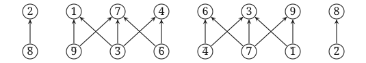</a>

<p style="text-align:right">(68)</p>

因为 $\bar3\to7$ 等等; 而在一般情形下, $2C$ 个候选字面值也将定义一个依赖有向图, 其结构能够提供关于当前子问题的重要线索. 例如, 可以用 Tarjan 算法找到这个有向图的<a id="pdf-246"></a><a id="p-226"></a>强分图 (强连通分量), 如定理 7.1.1K 之后所述. 若某个强分图同时含 $l$ 和 $\bar l$, 则当前子问题不可满足. 否则, 同一分量的两个字面值受约束而必须有相同的值; 因而从 $S\le2C$ 个强分图中各取一个字面值, 用所选者作为真正的前瞻候选.

继续上述例子. 现在可以用一个妙招节省重复的计算, 即从依赖有向图中提取一个<em>子森林</em>:

<a href="../../assets/volume4b/figures/sat-forest69.svg">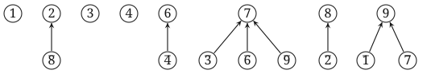</a>

<p style="text-align:right">(69)</p>

关系 $\bar8\to2$ 意味着断言字面值 ‘2’ 后发生的一切, 在断言 ‘$\bar8$’ 后也会发生; 因而分析 $\bar8$ 时不必重复为 2 而作的步骤. 类似地, 其他从属字面值 ‘$\bar1$’, $\ldots$, ‘$\bar9$’ 中的每一个, 都继承这一层次结构中其父结点的断言. Tarjan 算法实际上能在花费较少额外工作的情况下生成这样的子森林.

森林的嵌套结构还与数据结构中的 “真值等级” 非常合拍. 做法是按子森林的<em>前序</em>访问 $S$ 个候选字面值, 依次断言每个字面值 $l$, 其真值等级取它在<em>后序</em>中的位置的两倍. 例如, (69) 变为如下安排, 我们称之为 “前瞻森林”:

<table id="sat-lookahead-forest"><thead><tr><th>前序</th><th>1</th><th>2</th><th><span style="text-decoration:overline">8</span></th><th>3</th><th>4</th><th>6</th><th><span style="text-decoration:overline">4</span></th><th>7</th><th><span style="text-decoration:overline">3</span></th><th><span style="text-decoration:overline">6</span></th><th><span style="text-decoration:overline">9</span></th><th>8</th><th><span style="text-decoration:overline">2</span></th><th>9</th><th><span style="text-decoration:overline">1</span></th><th><span style="text-decoration:overline">7</span></th></tr></thead><tbody>
<tr><td>2 × 后序位置</td><td>2</td><td>6</td><td>4</td><td>8</td><td>10</td><td>14</td><td>12</td><td>22</td><td>16</td><td>18</td><td>20</td><td>26</td><td>24</td><td>32</td><td>28</td><td>30</td></tr>
</tbody></table>

<p style="text-align:right">(70)</p>

用 $l\gets1$ 和 $T\gets2$ 模拟 L4–L9, 就使 $x_1$ 以等级 2 为真 (称它为 “2 定值” 或 “2 真”); 还将分数置为 $H(1)\gets h(\bar2)h(\bar3)+h(\bar4)h(\bar7)$. 但若不启用下文的算法 Y, 就不会引起其他动作. 以 $l\gets2$, $T\gets6$ 模拟, 就使 2 成为 6 定值并算出 $H(2)\gets h(\bar1)h(\bar3)+h(\bar3)h(\bar4)+h(\bar4)h(\bar6)$; 在此过程中看不见 $x_1$ 的值, 因为它的等级低于 $T$. 遇到 $l\gets\bar8$, $T\gets4$ 时就有意思了: 此时将 $\bar8$ 置为 4 定值, 而我们仍然看得见 $x_2$ 为真, 因为 $6>T$. 所以可以继承 $H(2)$, 再置 $H(\bar8)\gets H(2)+h(4)h(6)+h(6)h(7)+h(7)h(9)$, 这就省下了一点计算.

再过几步, 当我们置 $l\gets\bar4$, $T\gets12$ 时, 真正的好戏才开始. 此时 (62) 不仅使 $\bar4$ 成为 12 定值, 还使 3 成为 12 定值, 因为 $\bar4\to3$; 而 3 的 12 真值很快会把我们带到被模拟的 L8 步, 其中 $u=\bar6$, $v=\bar9$. 啊哈: 因为 6 是 14 真的, 所以将 $\bar9$ 置为 12 定值. 随后 7、1 等字面值也成为 12 定值, 从而达到矛盾. <em>这个矛盾表明, 以 $\bar4$ 分支将导致冲突</em>; 因而若当前子句可满足, 字面值 4 必须为真.

每当算法 X 在前瞻模拟中发现某个字面值 $l$ 必须为真, 就像在这个例子中一样, 它都将 $l$ 放在 FORCE 表上, 并使 $l$ 为<em>初真</em> (即在上下文 PT 中为真). 初真字面值在这一轮前瞻期间始终定真, 因为一切有关的 $T$ 值都小于 PT. 随后算法 L 将把初真提升为近真, 最后提升为实真, 除非出现矛盾. (在 $\operatorname{waerden}(3,3;9)$ 的情形下, 的确会出现这样的矛盾; 见习题 150.)

<a id="pdf-247"></a><a id="p-227"></a>

为什么 (70) 中前序与后序的组合这么有效? 因为一般的森林有一个基本性质, 例如在习题 2.3.2–20 中就曾指出: <em>若 $u,v$ 是森林的结点, 则 $u$ 是 $v$ 的真祖先当且仅当 $u$ 在前序中先于 $v$, 而在后序中后于 $v$.</em> 此外, 按这个办法前瞻候选字面值时, $R$ 栈上还保持一个重要的不变关系, 即从栈底至栈顶真值等级从不增大:
$$
\mathtt{VAL}[|R_{j-1}|]\mathbin{\vert}1\ \ge\ \mathtt{VAL}[|R_j|],\qquad1\le j<E.\tag{71}
$$
栈底出现的是实真值, 然后是近真值、初真值, 等等. 例如, 在上述问题的某一时刻, 栈中含七个字面值:

<table><thead><tr><th>j</th><th>0</th><th>1</th><th>2</th><th>3</th><th>4</th><th>5</th><th>6</th></tr></thead><tbody>
<tr><td>Rⱼ</td><td>5̄</td><td>6</td><td>4̄</td><td>3</td><td>9̄</td><td>7</td><td>1</td></tr>
<tr><td>VAL[|Rⱼ|]</td><td>RT+1</td><td>14</td><td>13</td><td>12</td><td>13</td><td>12</td><td>12</td></tr>
</tbody></table>

其结果之一是, 哪些真值当前可见, 正好与从三元子句中清除假字面值的递归结构相对应.

算法 X 在预选候选者之后的第二阶段称为 “嵌套”, 因为它构造一个类似 (70) 的前瞻森林. 更确切地说, 它对 $0\le j<S$ 构造字面值序列 $\mathtt{LL}[j]$ 及相应的真值偏移量 $\mathtt{LO}[j]$. 它还设置 PARENT 指针, 更直接地指出森林结构; 例如, 对于 (69) 有 $\mathtt{PARENT}(\bar8)=2$ 和 $\mathtt{PARENT}(2)=\Lambda$.

第三阶段 “探索” 才来做实质工作. 它用前瞻森林来评估各候选字面值的启发性分数 $H(l)$, 运气好的话, 还能发现那些值已被强制的字面值.

探索阶段的核心是基于 L5、L6 和 L8 的宽度优先查找. 这个程序传播等级为 $T$ 的真值, 同时算出 $w$, 即以 $l$ 分支时将会产生的新二元子句的权:

```text
置 l₀ ← l, i ← w ← 0, G ← E ← F; 执行 (62);
当 G < E 时, 置 L ← R[G], G ← G + 1, 并
    对 TIMP(L) 中的每个 (u, v) 处理 (u, v);
对 0 ≤ k < i, 生成新的二元子句 (l̄₀ ∨ W[k]).
```

<p style="text-align:right">(72)</p>

这里 “处理 $(u,v)$” 的意思是 “若 $u$ 或 $v$ 已定真 (在上下文 $T$ 中), 什么也不做; 若 $u,v$ 都已定假, 转到 CONFLICT; 若 $u$ 已定假而 $v$ 未定, 置 $W_i\gets v$, $i\gets i+1$, 再以 $l\gets v$ 执行 (62); 若 $v$ 已定假而 $u$ 未定, 置 $W_i\gets u$, $i\gets i+1$, 再以 $l\gets u$ 执行 (62); 若 $u,v$ 都未定, 置 $w\gets w+h(u)h(v)$.”

<em>解释:</em> 若一个三元子句的形式为 $\bar L\lor u\lor v$, 其中 $L$ 已定真, 且 $u$ 由于 $l_0$ 定真而定假, 就称它为一笔 “意外收获”. 这样的子句是好消息, 因为它们意味着当前子问题中必须满足<em>二元</em>子句 $\bar l_0\lor v$. 将意外收获记录在名为 $W$ 的栈上, 在 (72) 结束时添入 BIMP 数据库.

<a id="pdf-248"></a><a id="p-228"></a>

探索阶段还利用了一个称为<em>自足原理</em>的重要事实. 它推广了前面讨论算法 A 时的 “纯字面值” 概念. SAT 问题 $F$ 的一个 “自足集” 是严格互异的字面值的集合 $A=\{a_1,\ldots,a_t\}$, 具有下面的性质: $F$ 的每个子句要么至少包含 $A$ 的一个字面值, 要么完全不含 $\overline A=\{\bar a_1,\ldots,\bar a_t\}$ 的字面值. 换言之, $A$ 满足它或 $\overline A$ 所 “触及” 的每个子句.

自足集是一个自给自足的系统. 只要 $A$ 是自足集, 就不妨假定它的全部字面值为真; 因为若 $F$ 可满足, 未触及的子句也可满足, 而 $A$ 已告诉我们如何满足触及的子句. 下面的算法 X 在 X9 中表明, 前瞻时某些自足集很容易检测出来.

**算法 X** (<em>算法 L 的前瞻.</em>) 这个算法在算法 L 的步骤 L2 中调用. 它使用算法 L 的数据结构, 另加自己的几个阵列, 以探索当前子问题的性质. 它发现 $U\ge0$ 个值被强制的字面值, 并将它们放在 FORCE 阵列中. 算法的结束有三种情形: (i) 满足了所有子句; (ii) 找到了矛盾; (iii) 算出了启发性分数 $H(l)$, 好让 L3 能选择一个合适的分支字面值. 在情形 (iii) 中还可能发现新的二元子句.

**X1.** [已满足?] 若 $F=n$, 成功终止 (没有自由变量).

**X2.** [编制粗略的启发性分数.] 置 $N=n-F$. 对每个自由变量 $x$, 置 $\mathtt{VAL}[x]\gets0$; 并用 (65) 算出各个自由字面值 $l$ 的粗略分数 $h(l)$.

**X3.** [预选候选者.] 令 $C$ 为当前属于 “参与者” 的自由变量数目, 将这些变量放入 CAND 阵列中. 若 $C=0$, 置 $C\gets N$, 将<em>所有</em>自由变量都放入 CAND; 不过若已满足所有子句, 则成功终止 (见习题 152). 对 CAND 中的每个变量 $x$ 给出评分 $r(x)=h(x)h(\bar x)$. 然后, 当 $C>2C_{\max}$ (见 (66)) 时, 删去 CAND 中评分低于平均评分的所有元素; 但若实际未删去任何元素, 就退出此循环. 最后, 若 $C>C_{\max}$, 只保留评分最高的候选者, 将 $C$ 减至 $C_{\max}$. (见习题 153.)

**X4.** [嵌套候选者.] 构造一个前瞻森林, 用 $0\le j<S$ 的 $\mathtt{LL}[j]$, $\mathtt{LO}[j]$ 及 PARENT 指针表示 (见习题 155).

**X5.** [准备探索.] 置 $U'\gets j'\gets\mathtt{BASE}\gets j\gets0$, $\mathtt{CONFLICT}\gets\mathrm{X13}$.

**X6.** [选择前瞻字面值 $l$.] 置 $l\gets\mathtt{LL}[j]$, $T\gets\mathtt{BASE}+\mathtt{LO}[j]$. 置 $H(l)\gets H(\mathtt{PARENT}(l))$, 其中 $H(\Lambda)=0$. 若 $l$ 在上下文 $T$ 中未定, 转到 X8. 否则, 若 $l$ 已定假而未初假, 则以 $l\gets\bar l$ 执行 X12.

**X7.** [移到下一个.] 若 $U>U'$, 置 $U'\gets U$, $j'\gets j$. 然后置 $j\gets j+1$. 若 $j=S$, 置 $j\gets0$, $\mathtt{BASE}\gets\mathtt{BASE}+2S$. 若 $j=j'$, 或 $j=0$ 且 $\mathtt{BASE}+2S>\mathtt{PT}$ (当心溢出), 均正常终止. 否则返回 X6.

**X8.** [计算更精确的启发性分数.] 执行 (72). 然后若 $w>0$, 置 $H(l_0)\gets H(l_0)+w$, 转到 X10.

**X9.** [利用自足集.] 若 $H(l_0)=0$, 则以 $l\gets l_0$ 执行 X12. 否则生成新二元子句 $l_0\lor\neg\mathtt{PARENT}(l_0)$. (习题 166 解释其原因.)

<a id="pdf-249"></a><a id="p-229"></a>

**X10.** [可选作更深的前瞻.] 执行下文的算法 Y.

**X11.** [利用必要赋值.] 对 $\mathtt{BIMP}(\bar l_0)$ 中所有已定真但未初真的字面值 $l$ 执行 X12. 然后转到 X7. (见习题 167.)

**X12.** [强制 $l$.] 置 $\mathtt{FORCE}[U]\gets l$, $U\gets U+1$, $T'\gets T$, 以 $T\gets\mathtt{PT}$ 执行 (72). 然后置 $T\gets T'$. (本步是供其他步骤使用的子程序.)

**X13.** [从冲突中恢复.] 若 $T<\mathtt{PT}$, 则以 $l\gets\bar l_0$ 执行 X12, 转到 X7. 否则, 以发现矛盾终止.　■

注意, 算法在 X5–X7 中循环遍历森林, 一直进行前瞻, 直到完成一次遍历而未发现新的强制字面值为止. 真值的基址 BASE 在有必要时会继续增长, 但不许增到太接近 PT 的程度.

**\*向更远处前瞻.** 若向前看一步是个好主意, 向前看<em>两步</em>也许更好. 这当然有点可怕, 因为我们的数据结构已经相当吃紧; 况且双重前瞻也许太费时间. 尽管如此, 还是有办法做到, 并使算法 L 在许多问题上跑得更快.

算法 X 考察假定某个字面值 $l_0$ 为真会产生怎样的直接后果. 在 X10 中启动的算法 Y 还要往外探一步, 考察若<em>另一个</em>字面值 $\hat l_0$ 也为真会怎样. 目的是检测很快就会死掉的分支, 让我们能够发现 $l_0$ 的新蕴涵, 甚至断定 $l_0$ 必为假.

为此, 算法 Y 在当前上下文 $T$ 与称为 “双真” 的真值等级 DT 之间划出一段真值空间; DT 在 Y2 中定义. 这段空间的大小取决于参数 $Y$, 它通常小于 10. 仍用同一个前瞻森林, 给出 DT 以下的相对真值等级. 双真不像初真 PT 那样可靠; 但在 $l_0$ 为真的假设下, 已在 DT 层固定的字面值可知是条件真 (“D 真”) 或条件假 (“D 假”).

回到 $\operatorname{waerden}(3,3;9)$ 的例子. 前面描述的情形假定没有做双重前瞻. 实际上, 将 $H(1)$ 置为 $h(\bar2)h(\bar3)+h(\bar4)h(\bar7)$ 以后, 通常还会有算法 Y 的动作. 若取 $Y=8$, 因为 $S=16$, DT 的值将置为 258. 字面值 1 成为 D 真. 继而对 2 前瞻, 将使 2 成为 6 定值, 并因子句 $\bar1\bar2\bar3$ 而使 $\bar3$ 成为 6 定值. 然后 $\bar3$ 又将 4 和 7 置为 6 定值, 与 $\bar1\bar4\bar7$ 矛盾, 从而使 2 成为 D 假. 其他字面值很快也会变成 D 真或 D 假, 导致矛盾; 于是算法 X 还没开始对字面值 2 前瞻, 算法 Y 就已能使字面值 1 初假.

双重前瞻的主循环类似于 (72), 不过它离实际的决定更远, 因而更简单:

```text
置 l̂₀ ← l, G ← E ← F; 执行 (62);
当 G < E 时, 置 L ← R[G], G ← G + 1, 并
    对 TIMP(L) 中的每个 (u, v) 处理 (u, v).
```

<p style="text-align:right">(73)</p>

<a id="pdf-250"></a><a id="p-230"></a>

此时 “处理 $(u,v)$” 的意思是 “若 $u$ 或 $v$ 已定真 (在上下文 $T$ 中), 或两者均未定, 什么也不做; 若 $u,v$ 都已定假, 转到 CONFLICT; 若 $u$ 已定假而 $v$ 未定, 以 $l\gets v$ 执行 (62); 若 $v$ 已定假而 $u$ 未定, 以 $l\gets u$ 执行 (62).”

双重前瞻代价昂贵, 因而只有在它颇有希望帮得上忙时才想尝试, 即在 $H(l_0)$ 很大时. 但究竟多大才够? 合适的阈值取决于所解的问题: 有些子句集得益于双重前瞻而处理得更快, 另一些却对这种洞察毫无反应. Marijn Heule 和 Hans van Maaren [<em>LNCS</em> **4501** (2007), 258–271] 设计了一个巧妙的反馈机制, 能自动适应手头问题的特点. 令 $\tau$ 为 “触发阈值”, 初始为 0. 仅在 $H(l_0)>\tau$ 时, Y1 才容许作双重前瞻; 否则 $\tau$ 降至 $\beta\tau$, 其中 $\beta$ 为阻尼因子 (通常为 0.999), 使双重前瞻更有吸引力. 反过来, 若双重前瞻没找到使 $l_0$ 初假的矛盾, 则在 Y6 中将触发阈值提高到 $H(l_0)$.

**算法 Y** (<em>算法 X 的双重前瞻.</em>) 本算法由 X10 调用, 利用相同的数据结构 (另加少数几个) 向更深处前瞻. 参数 $\beta$ 和 $Y$ 已在上面说明. 初始时所有 $l$ 都有 $\mathtt{DFAIL}(l)=0$.

**Y1.** [过滤.] 若 $\mathtt{DFAIL}(l_0)=\mathtt{ISTAMP}$, 或 $T+2S(Y+1)>\mathtt{PT}$, 则终止. 否则, 若 $H(l_0)\le\tau$, 置 $\tau\gets\beta\tau$ 并终止.

**Y2.** [初始化.] 置 $\mathtt{BASE}\gets T-2$, $\mathtt{LBASE}\gets\mathtt{BASE}+2S\cdot Y$, $\mathtt{DT}\gets\mathtt{LBASE}+\mathtt{LO}[j]$, $i\gets\hat j'\gets\hat j\gets0$, $E\gets F$, $\mathtt{CONFLICT}\gets\mathrm{Y8}$. 以 $l\gets l_0$ 和 $T\gets\mathtt{DT}$ 执行 (62).

**Y3.** [选择双重前瞻的 $l$.] 置 $l\gets\mathtt{LL}[\hat j]$, $T\gets\mathtt{BASE}+\mathtt{LO}[\hat j]$. 若 $l$ 在上下文 $T$ 中未定, 转到 Y5. 否则, 若 $l$ 已定假而非 D 假, 则以 $l\gets\bar l$ 执行 Y7.

**Y4.** [移到下一个.] 置 $\hat j\gets\hat j+1$. 若 $\hat j=S$, 置 $\hat j\gets0$, $\mathtt{BASE}\gets\mathtt{BASE}+2S$. 若 $\hat j'=\hat j$, 或 $\hat j=0$ 且 $\mathtt{BASE}=\mathtt{LBASE}$, 则转到 Y6. 否则返回 Y3.

**Y5.** [前瞻.] 执行 (73); 随后返回 Y4 (若未发生冲突).

**Y6.** [结束.] 对 $0\le k<i$ 生成二元子句 $(\bar l_0\lor W_k)$. 随后置 $\mathtt{BASE}\gets\mathtt{LBASE}$, $T\gets\mathtt{DT}$, $\tau\gets H(l_0)$, $\mathtt{DFAIL}(l_0)\gets\mathtt{ISTAMP}$, $\mathtt{CONFLICT}\gets\mathrm{X13}$, 然后终止.

**Y7.** [也假设 $l$.] 置 $\hat j'\gets\hat j$, $T'\gets T$, 以 $T\gets\mathtt{DT}$ 执行 (73). 然后置 $T\gets T'$, $W_i\gets\hat l_0$, $i\gets i+1$. (本步是子程序.)

**Y8.** [从冲突中恢复.] 若 $T<\mathtt{DT}$, 以 $l\gets\neg\mathtt{LL}[\hat j]$ 执行 Y7, 转到 Y4. 否则置 $\mathtt{BASE}\gets\mathtt{LBASE}$, $\mathtt{CONFLICT}\gets\mathrm{X13}$, 退出至 X13.　■

下面这组定量统计可以说明这些算法在实际中的表现. 让算法 L 处理 $\operatorname{rand}(3,2062,500,314)$, 即 500 个变量上的 2062 个随机三元子句, 它作了 684433234661 次内存访问, 构造一棵 9530489 个结点的查找树, 证明了不可满足性. 习题 173 说明禁用算法的某些部分会怎么样. 本节将讨论的其他 SAT 求解器都不能在合理时间内处理这样大的随机问题.

<a id="pdf-251"></a><a id="p-231"></a>

**随机可满足性.** 在随机条件下分析可满足性问题, 似乎没有什么简便的方法. 事实上, 有一个基本问题至今仍是著名的研究难题: “对于 $n$ 个变量的 3SAT, 平均要取多少个随机子句, 才会遇到不能同时满足它们的情形?”

从实用的观点看, 这个问题不如我们研究排序或查找算法时的类似问题那么切题, 因为实际的 3SAT 实例所含的子句往往很<em>不</em>随机. 对组合算法来说, 偏离随机性往往会使运行时间大为改观, 而排序和查找的方法通常仍与其预期行为相去不远. 因此, 一味着眼于随机性可能产生误导. 另一方面, 随机 SAT 子句确实提供了一个简洁明快的模型, 借此可以看清布尔世界中的一些现象. 而且, 这里的数学问题本身也很有意思. 幸好, 基本理论有很大一部分是初等的, 容易理解. 我们就来看看.

习题 180 表明, 当变量数至多为五时, 随机可满足性可以精确分析. 我们不妨从这里入手, 因为五个变量这个 “微型” 例子仍然足够大, 可以从中窥见大局. 如果有 $n$ 个变量, 每个子句有 $k$ 个字面值, 那么涉及 $k$ 个不同变量的可能子句数 $N$ 显然是 $2^k\binom nk$: 选取变量有 $\binom nk$ 种方法, 决定各个变量是否取补又有 $2^k$ 种方法. 例如, 五个变量的 3SAT 问题有 $N=2^3\binom53=80$ 个可能的子句.

从这些子句中随机选出 $m$ 个, 只要求它们互不相同, 设 $q_m$ 是这些子句可满足的概率. 于是 $q_m=Q_m/\binom Nm$, 其中 $Q_m$ 是从 $N$ 个子句中选出 $m$ 个, 使得至少有一个布尔向量 $x=x_1\ldots x_n$ 满足全部所选子句的方法数. [图 83](#fig-7-2-2-2-83) 画出了 $k=3$, $n=5$ 时的这些概率. 假定有人把互不相同的随机子句逐个交给我们. 从[图 83](#fig-7-2-2-2-83) 看, 收到 20 个不同的子句后, 我们能同时满足它们的机会还超过 $77\%$, 因为 $q_{20}\approx0.776$. 可是一旦从这 80 个子句中凑足 30 个, 可满足的机会就降到了 $q_{30}\approx0.179$; 再来十个便到了 $q_{40}\approx0.016$.


<a href="../../assets/volume4b/figures/sat-fig83.svg">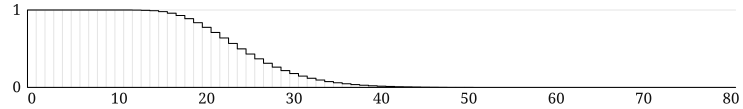</a>


<a id="fig-7-2-2-2-83"></a>**图 83.** 五个变量的 3SAT 中 $m$ 个不同子句可以同时满足的概率 $q_m$, $0\le m\le80$.

看图似乎会以为, 比方说, $m<15$ 时 $q_m=1$, $m>55$ 时 $q_m=0$. 不过由 (6) 可知, $q_8$ 实际上小于 1; 习题 179 给出了精确值. 而且 $q_{70}$ 大于 0, 因为 $Q_{70}=32$; 事实上, 在 $N$ 个可能的 $k$ 元子句中, 每个布尔向量 $x$ 恰好满足 $(2^k-1)\binom nk=(1-2^{-k})N$ 个. 所以, 五个变量可以有 70 个互不矛盾的三元子句, 毫不奇怪. 当然, 在随机情形下, 这组子句几乎不可能恰好就是最先收到的 70 个. $q_{70}$ 的实际值为 $32/1646492110120\approx2\times10^{-11}$.

<a id="pdf-252"></a><a id="p-232"></a>

<a href="../../assets/volume4b/figures/sat-fig84.svg">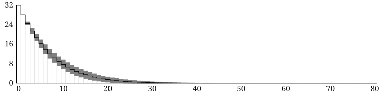</a>


<a id="fig-7-2-2-2-84"></a>**图 84.** 五个变量的 3SAT 中, 同时满足 $m$ 个不同子句的不同布尔向量 $x=x_1\ldots x_5$ 的总数 $T_m$, $0\le m\le80$.

[图 84](#fig-7-2-2-2-84) 从另一个角度描绘了同一过程: 随机选出 $m$ 个子句后, 有<em>多少种方式</em>能满足它们? 这个数 $T_m$ 是个随机变量. 图中黑线表示均值, 周围的灰色区域表示均值加减一个标准差的范围. 例如, $T_0$ 总是 32, $T_1$ 总是 28; 而 $T_2$ 可能是 24、25 或 26, 取这三个值的概率分别为 $(2200,480,480)/3160$. 因而 $m=2$ 时, 均值约为 $24.5$, 标准差约为 $0.743$.

当 $m=20$ 时, 从[图 83](#fig-7-2-2-2-83) 我们知道, $T_{20}$ 非零的机会超过 $77\%$; [图 84](#fig-7-2-2-2-84) 又表明 $T_{20}\approx1.47\pm1.17$. (这里记号 $\mu\pm\sigma$ 表示均值为 $\mu$, 标准差为 $\sigma$.) 事实上, 20 个随机子句有超过 $33\%$ 的机会是<em>唯一可满足的</em>, 即 $T_{20}=1$; 而 $T_{20}>4$ 的概率仅为 $0.013$. 到了 30 个子句, 可满足性就越来越难说了: $T_{30}\approx0.20\pm0.45$; 实际上, $T_{30}$ 小于 2 的机会超过 $98\%$, 不过若是给子句的人特别关照我们, 它也能高达 11. 到了 40 个子句, $T_{40}$ 超过 1 的机会还不到四千七百分之一. [图 85](#fig-7-2-2-2-85) 画出了 $T_m=1$ 的概率如何随 $m$ 而变.


<a href="../../assets/volume4b/figures/sat-fig85.svg">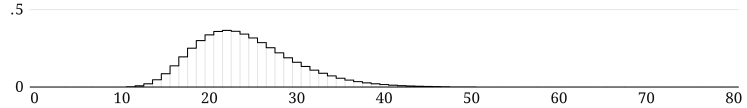</a>


<a id="fig-7-2-2-2-85"></a>**图 85.** 五个变量的 3SAT 中 $m$ 个不同子句唯一可满足的概率 $\Pr(T_m=1)$, $0\le m\le80$.

设 $P$ 为第一次无法满足所有已收到的子句时, 已收到的子句数. 于是 $P=m$ 的概率为 $p_m$, 其中 $p_m=q_{m-1}-q_m$ 是 $m-1$ 个随机子句可满足, 到第 $m$ 个却不可满足的概率. [图 86](#fig-7-2-2-2-86) 画出了这些概率. [图 85](#fig-7-2-2-2-85) 与[图 86](#fig-7-2-2-2-86) 看上去颇为相似, 你觉得奇怪吗? (见习题 183.)

按照定义, “停止时间” 的期望 $\mathrm E\,P$ 等于 $\sum_m mp_m$; 而且不难看出, 例如用分部求和法 (习题 1.2.7–10) 就可以看出, 我们只须把[图 83](#fig-7-2-2-2-83) 中的概率加起来就能求得它:
$$
\mathrm E\,P=\sum_m q_m.\tag{74}
$$

<a id="pdf-253"></a><a id="p-233"></a>

<a href="../../assets/volume4b/figures/sat-fig86.svg">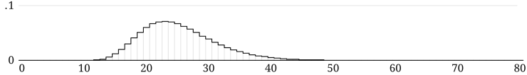</a>


<a id="fig-7-2-2-2-86"></a>**图 86.** 停止时间的概率 $p_m$, 即五个变量的 3SAT 中 $m$ 个不同的子句刚刚变得不可满足的概率, $0\le m\le80$.

$P$ 的方差 $\mathrm E(P-\mathrm E\,P)^2=(\mathrm E\,P^2)-(\mathrm E\,P)^2$ 也有一个用 $q$ 表示的简单式子, 因为
$$
\mathrm E\,P^2=\sum_m(2m+1)\,q_m.\tag{75}
$$
在[图 83](#fig-7-2-2-2-83) 和[图 86](#fig-7-2-2-2-86) 中, $\mathrm E\,P\approx25.22$, 方差约为 $35.73$.

至此我们所注意的是 3SAT 问题, 但同样的想法也适用于子句大小为其他值 $k$ 的 $k$SAT. [图 87](#fig-7-2-2-2-87) 给出了 $n=5$, $1\le k\le4$ 时各个概率的精确结果. $k$ 越大, 子句越容易满足, 因此停止时间也越长. 对于五个变量, 随机 1SAT、2SAT、3SAT 和 4SAT 的典型停止时间分别为 $4.06\pm1.19$, $11.60\pm3.04$, $25.22\pm5.98$ 和 $43.39\pm7.62$. 一般说来, 若 $P_{k,n}$ 是 $n$ 个变量的 $k$SAT 的停止时间, 就用
$$
S_{k,n}=\mathrm E\,P_{k,n}\tag{76}
$$
表示其期望值.


<a href="../../assets/volume4b/figures/sat-fig87.svg">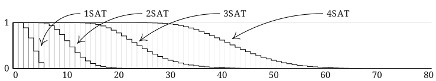</a>


<a id="fig-7-2-2-2-87"></a>**图 87.** 把[图 83](#fig-7-2-2-2-83) 推广到其他大小的子句.

到目前为止, 我们的讨论还有另一层限制: 我们一直假定, 交给 SAT 求解器的是 $m$ 个<em>互不相同</em>的子句. 不过实际生成子句时, 允许重复要容易得多; 那样, 每次选取子句都与以往的情形无关. 换言之, 研究随机可满足性有一个更加自然的出发点: 走了 $m$ 步之后, $N^m$ 个可能的子句<em>有序序列</em>等可能出现, 而不再假定 $\binom Nm$ 个子句集合等可能出现.

设 $\widehat q_m$ 是 $m$ 个随机子句 $C_1\land\cdots\land C_m$ 可满足的概率, 其中每个 $C_j$ 都是从 $n$ 个变量的 $k$SAT 问题的 $N=2^k\binom nk$ 种可能中随机选出的. [图 88](#fig-7-2-2-2-88) 画出了 $k=3$, $n=5$ 时的这些概率; 注意总有 $\widehat q_m\ge q_m$. 如果 $N$ 大而 $m$ 小, 那么 $\widehat q_m$ 显然很接近 $q_m$, 因为这时不大可能出现重复的子句. 尽管如此, 仍须记住 $q_N$ 总是零, 而 $\widehat q_m$ <em>永不</em>为零. 此外, 6.4 节讨论的 “生日悖论” 提醒<a id="pdf-254"></a><a id="p-234"></a>我们, 重复并不像想象中那么少见. 在[图 88](#fig-7-2-2-2-88) 这样的小例子里, $\widehat q_m$ 与 $q_m$ 的偏离尤其明显.


<a href="../../assets/volume4b/figures/sat-fig88.svg">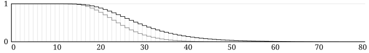</a>


<a id="fig-7-2-2-2-88"></a>**图 88.** 在五个变量的随机 3SAT 中有放回地抽取子句. 黑线表示概率 $\widehat q_m$, 灰线表示[图 83](#fig-7-2-2-2-83) 中较小的概率 $q_m$.

无论如何, 从概率 $q_t$ 和 $N$ 的值出发, 有一个直接求 $\widehat q_m$ 的方法 (见习题 184):
$$
\widehat q_m=\sum_{t=0}^N\genfrac{\{}{\}}{0pt}{}{m}{t}\,t!\,q_t\binom{N}{t}/N^m.\tag{77}
$$
而且对于停止时间 $\widehat P$, 其中 $\widehat p_m=\widehat q_{m-1}-\widehat q_m$, 还有两个形似 (74) 和 (75) 而又出奇简单的公式, 见习题 186:
$$
\mathrm E\,\widehat P=\sum_{m=0}^{N-1}\frac{N}{N-m}\,q_m;\tag{78}
$$
$$
\mathrm E\,\widehat P^{\,2}=\sum_{m=0}^{N-1}\frac{N}{N-m}\,q_m\left(1+2\left(\frac{N}{N-1}+\cdots+\frac{N}{N-m}\right)\right).\tag{79}
$$
这些公式表明, 只要 $m/N$ 不小时 $q_m$ 就小, $\widehat P$ 的期望行为就与 $P$ 很相近. 当 $k=3$, $n=5$ 时, 典型的停止时间 $\widehat P=30.58\pm9.56$ 明显大于 $P$ 的典型值; 不过我们主要关心 $n$ 很大, $\widehat q_m$ 与 $q_m$ 几乎没有区别的情形. 为了明确表示概率 $\widehat q_m$ 除了依赖于 $m$ 之外还依赖于 $k$ 和 $n$, 今后我们将把它记作 $S_k(m,n)$:
$$
S_k(m,n)=\Pr(m\text{ 个随机的 }k\text{SAT 子句可满足}),\tag{80}
$$
其中这 $m$ 个子句是 “有放回抽样” 得到的 (不必互异). 相应的伪随机子句 $\operatorname{rand}(k,m,n,\mathit{seed})$ 很容易生成.

当 $n>5$ 时, 精确公式似乎遥不可及, 但我们可以做实验检验. 例如, B. Selman、D. G. Mitchell 和 H. J. Levesque 对随机 3SAT 问题做过大量实验 [<em>Artificial Intelligence</em> **81** (1996), 17–29], 结果表明, 当子句数超过约 $4.27n$ 时, 可满足的机会急剧下降. 随着 $n$ 增大, 这种 “相变” 变得更加陡峭 (见[图 89](#fig-7-2-2-2-89)).

随机 $k$SAT 也有类似的行为. 这个现象引发了大量研究, 试图求出所谓的<em>可满足性阈值</em>
$$
\alpha_k=\lim_{n\to\infty}S_{k,n}/n.\tag{81}
$$

<a id="pdf-255"></a><a id="p-235"></a>

<a href="../../assets/volume4b/figures/sat-fig89.svg">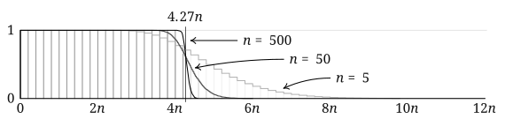</a>


<a id="fig-7-2-2-2-89"></a>**图 89.** 经验概率数据表明, 只要 $n$ 足够大, 当子句数超过 $\alpha_3n$ 时, 随机 3SAT 问题便迅速变得不可满足.

事实上, 用经验观测所得的 $\alpha_k$ 估计值生成大约 $\alpha_kn$ 个随机的 $k$ 元子句, 便能得到相当困难的 $k$SAT 问题. 如果 $n$ 很大, 随机 3SAT 有 $4.3n$ 个子句时, 运行时间通常比有 $4n$ 或 $4.6n$ 个子句时大几个数量级. (而且偶尔还会遇到更棘手的问题, 比方说, $3.9n$ 个子句竟然恰好<em>不可</em>满足.)

不过严格说来, 还没有人能证明这些所谓的常数 $\alpha_k$ 对所有的 $k$ 当真都存在! 经验证据压倒一切, 然而对于 $k=3$, 严格的证明迄今只确立了以下界限:
$$
\liminf_{n\to\infty}S_{3,n}/n\ge3.52;\qquad
\limsup_{n\to\infty}S_{3,n}/n\le4.49.\tag{82}
$$
[见 M. Hajiaghayi 和 G. B. Sorkin, arXiv:math/0310193 [math.CO] (2003), 8 页; A. C. Kaporis、L. M. Kirousis 和 E. G. Lalas, <em>Random Struct. &amp; Alg.</em> **28** (2006), 444–480; J. Díaz、L. Kirousis、D. Mitsche 和 X. Pérez-Giménez, <em>Theoretical Comp. Sci.</em> **410** (2009), 2920–2934.] E. Friedgut [<em>J. American Math. Soc.</em> **12** (1999), 1017–1045, 1053–1054] 得到了一个 “尖锐阈值” 结果: 他证明了对于 $k\ge2$, 存在函数 $\alpha_k(n)$ 使得
$$
\lim_{n\to\infty}S_k\bigl(\lfloor(\alpha_k(n)-\epsilon)n\rfloor,n\bigr)=1,\qquad
\lim_{n\to\infty}S_k\bigl(\lfloor(\alpha_k(n)+\epsilon)n\rfloor,n\bigr)=0,\tag{83}
$$
其中 $\epsilon$ 是任意正数. 但是这些函数未必趋于极限. 例如, 它们可能周期性地波动, 就像我们在式 5.2.2–(47) 中遇到的 “摆动函数” 那样.

根据下文将要讨论的 “调查传播” 技术所提供的启发, 目前对 $\alpha_3$ 的最佳猜测是 $\alpha_3=4.26675\pm0.00015$ [S. Mertens、M. Mézard 和 R. Zecchina, <em>Random Structures &amp; Algorithms</em> **28** (2006), 340–373]. 类似地, 有理由相信 $\alpha_4\approx9.931$, $\alpha_5\approx21.12$, $\alpha_6\approx43.37$, $\alpha_7\approx87.79$. 这些 $\alpha$ 按 $\Theta(2^k)$ 增长 (见习题 195); 并且已知当 $k$ 充分大时, 它们确实是常数 [见 J. Ding、A. Sly 和 N. Sun, <em>STOC</em> **47** (2015), 59–68].

**随机 2SAT 的分析.** 虽然还没有人知道怎样证明当子句数达到约 $4.27n$ 时随机 3SAT 问题几乎总是变得不可满足, 但 2SAT 的相应问题却有一个漂亮的答案: <em>可满足性阈值 $\alpha_2$ 等于 1.</em> 例如, 作者初次对含有一百万个变量的 1000 个随机 2SAT 问题做试验时, 有 960000 个子句时其中有 999 个可满足, 而当子句数升至 1040000 时, 则全部不可满足. [图 90](#fig-7-2-2-2-90) 表明这种转变怎样随着 $n$ 的增大而更加陡峭.

<a id="pdf-256"></a><a id="p-236"></a>

<a href="../../assets/volume4b/figures/sat-fig90.svg">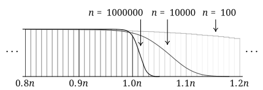</a>


<a id="fig-7-2-2-2-90"></a>**图 90.** 约有 $n$ 个随机子句的 2SAT 的经验可满足概率. (当 $n=100$ 时, 大约要生成 180 个以上的子句, 可满足的概率才会小到可以忽略.)

$S_{2,n}\approx n$ 这个事实是 V. Chvátal 和 B. Reed 在 1991 年发现的 [<em>FOCS</em> **33** (1992), 620–627]; 大约同时, A. Goerdt 和 W. Fernandez de la Vega 也各自独立地得到了同一结果 [见 <em>J. Comp. Syst. Sci.</em> **53** (1996), 469–486; <em>Theor. Comp. Sci.</em> **265** (2001), 131–146].

研究这个现象很能给人以启发, 因为它依靠的是刻画所有 2SAT 实例的有向图的性质. 而且, 下面的证明极好地说明了 “一阶矩原理和二阶矩原理” 的用法, 即式 MPR–(21) 和 MPR–(22). 有了这两条原理, 我们就可以来推导 2SAT 的阈值了:

**定理 C.** <em>设 $c$ 是一个固定常数, 则</em>
$$
\lim_{n\to\infty}S_2\bigl(\lfloor cn\rfloor,n\bigr)=
\begin{cases}1,&c<1;\\0,&c>1.\end{cases}\tag{84}
$$

<em>证明.</em> 每个 2SAT 问题都对应于字面值上的一个<em>蕴涵有向图</em>, 每个子句 $l\lor l'$ 给出弧 $\bar l\longrightarrow l'$ 和 $\bar l'\longrightarrow l$. 由定理 7.1.1K 可知, 一组 2SAT 子句可满足当且仅当对于任何变量 $x$, 它的蕴涵有向图都没有一个强分图同时含有 $x$ 和 $\bar x$. 此图有 $2m=2\lfloor cn\rfloor$ 条弧和 $2n$ 个顶点. 如果它是个随机有向图, 那么 Karp 的几个著名定理 (我们将在 7.4.4 节中研究它们) 就意味着, 当 $c<1$ 时, 从任一给定顶点可达的顶点只有 $O(\log n)$ 个; 而当 $c>1$ 时, 存在唯一一个大小为 $\Omega(n)$ 的 “巨型强分图”.

从随机 2SAT 得到的有向图并不完全随机, 因为它的弧是成对出现的, 即 $u\longrightarrow v$ 和 $\bar v\longrightarrow\bar u$. 不过凭直觉可以预期, 只有一半随机的有向图也会有类似的行为. 例如, 作者生成一个 $n=1000000$, $m=.99n$ 的随机 2SAT 问题时, 所得有向图只有两对互补的强分图含有一个以上的顶点, 而它们的大小也只有 2、2 和 7、7; 所以很容易满足这些子句. 再加 $.01n$ 个子句, 非平凡强分图的数目没有增加, 问题仍然可满足. 但另一次取 $m=n=1000000$ 的试验却得到了一个大小为 420 的强分图, 其中包含 210 个变量及其补; 那个问题不可满足.

从对这种内在结构的类似直觉出发, Chvátal 和 Reed 引入了下面用 “圈套与蛇” 证明定理 C 的方法: 把 $s$ 个严格互异的字面值形成的任意序列称为一条 $s$ <em>链</em>; 因此一共有 $2^s n^{\underline s}$ 条可能的 $s$ 链. 每条 $s$ 链 $C$ 对应于子句
$$
(\bar l_1\lor l_2),\;(\bar l_2\lor l_3),\;\ldots,\;(\bar l_{s-1}\lor l_s),\tag{85}
$$

<a id="pdf-257"></a><a id="p-237"></a>

这些子句又对应于有向图中的两条路
$$
l_1\longrightarrow l_2\longrightarrow l_3\longrightarrow\cdots\longrightarrow l_s
\qquad\text{和}\qquad
\bar l_s\longrightarrow\cdots\longrightarrow\bar l_3\longrightarrow\bar l_2\longrightarrow\bar l_1.\tag{86}
$$
一个 $s$ <em>圈套</em> $(C;t,u)$ 由一条 $s$ 链 $C$ 及两个指标 $t$ 和 $u$ 组成, 其中 $1<t\le s$, $1\le|u|<s$; 它指定子句 (85) 以及
$$
(l_t\lor l_1)\qquad\text{和}\qquad
(\bar l_s\lor l_u)\ \text{若 }u>0,\quad
(\bar l_s\lor\bar l_{-u})\ \text{若 }u<0,\tag{87}
$$
分别表示 $\bar l_t\longrightarrow l_1$ 以及 $l_s\longrightarrow l_{|u|}$ 或 $l_s\longrightarrow\bar l_{|u|}$. 可能的 $s$ 圈套数为 $2^{s+1}(s-1)^2 n^{\underline s}$. 当 $m$ 很小时, 一个圈套所需的子句很少会全部出现.

习题 200 解释了怎样用这些定义证明定理 C 中 $c<1$ 的情形. 首先我们证明, <em>每个不可满足的 2SAT 公式至少包含一个圈套的全部子句.</em> 然后, 若定义二值随机变量
$$
X(C;t,u)=[(C;t,u)\text{ 的全部子句都出现}],\tag{88}
$$
就不难证明每条 $s$ 链 $C$ 的各个圈套出现的可能性都很小:
$$
\mathrm E\,X(C;t,u)\le m^{\underline{s+1}}\big/\bigl(2n(n-1)\bigr)^{s+1}.\tag{89}
$$
最后, 令 $X$ 为对所有圈套求和所得的 $X(C;t,u)$ 之和, 由式 1.2.9–(20) 得
$$
\mathrm E\,X=\sum\mathrm E\,X(C;t,u)
\le\sum_{s\ge0}2^{s+1}s(s-1)n^s\left(\frac{m}{2n(n-1)}\right)^{s+1}
=\frac2n\left(\frac{m}{n-1-m}\right)^3.
$$
这个公式实际上给出了 (84) 的一个更强的形式, 因为它表明, 当 $m=n-n^{3/4}>cn$ 时, $\mathrm E\,X$ 只有 $O(n^{-1/4})$. 因此由一阶矩原理,
$$
S_2\bigl(\lfloor n-n^{3/4}\rfloor,n\bigr)\ge\Pr(X=0)=1-\Pr(X>0)\ge1-O(n^{-1/4}).\tag{90}
$$

定理 C 的另一半可以用 $t$ <em>蛇</em>的概念来证明, 它是 $(2t-1)$ 圈套的特殊情形 $(C;t,-t)$. 换句话说, 给定任意一条链 $(l_1,\ldots,l_t,\ldots,l_{2t-1})$, 其中 $s=2t-1$, $l_t$ 位于正中, 一条 $t$ 蛇就生成子句 (85) 以及 $(l_t\lor l_1)$ 和 $(\bar l_s\lor\bar l_t)$. 例如, 当 $t=5$ 且 $(l_1,\ldots,l_{2t-1})=(x_1,\ldots,x_9)$ 时, 这 $2t=10$ 个子句是
$$
51,\ \bar12,\ \bar23,\ \bar34,\ \bar45,\ \bar56,\ \bar67,\ \bar78,\ \bar89,\ \bar9\bar5,
$$
它们对应于 20 条弧, 环绕成图示的一个强分图. 我们将证明, 在 (84) 中 $c>1$ 时, 有向图几乎总是含有这样妨碍可满足性的结构.


<a href="../../assets/volume4b/figures/sat-snake.svg">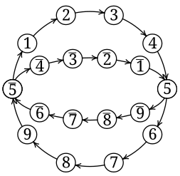</a>


给定一条 $(2t-1)$ 链 $C$, 参数 $t$ 的值稍后再选, 令
$$
X_C=[(C;t,-t)\text{ 的每个子句都恰好出现一次}].\tag{91}
$$
期望值 $\mathrm E\,X_C$ 显然是 $f(2t)$, 其中
$$
f(r)=m^{\underline{r}}\bigl(2n(n-1)-r\bigr)^{m-r}\big/\bigl(2n(n-1)\bigr)^{m}\tag{92}
$$

<a id="pdf-258"></a><a id="p-238"></a>

是指定的 $r$ 个子句各出现一次的概率. 注意
$$
f(r)=\left(\frac{m}{2n(n-1)}\right)^r
\left(1+O\left(\frac{r^2}{m}\right)+O\left(\frac{rm}{n^2}\right)\right);\tag{93}
$$
所以当 $n\to\infty$, $m=\Theta(n)$ 时, 相对误差为 $O(t^2/n)$.

现在令 $X=\sum X_C$, 对所有 $R=2^{2t-1}n^{\underline{2t-1}}$ 条可能的 $t$ 蛇 $C$ 求和, 于是 $\mathrm E\,X=Rf(2t)$. 我们想用二阶矩原理证明 $\Pr(X>0)$ 非常接近 1; 因此需要证明期望 $\mathrm E\,X^2=\mathrm E\bigl(\sum_C X_C\bigr)\bigl(\sum_D X_D\bigr)=\sum_C\sum_D\mathrm E\,X_C X_D$ 很小. 一个关键的观察是
$$
\mathrm E\,X_C X_D=f(4t-r)\qquad\text{若 }C\text{ 与 }D\text{ 恰有 }r\text{ 个公共子句}.\tag{94}
$$
设 $p_r$ 为随机选取的一条 $t$ 蛇与给定的蛇 $(x_1,\ldots,x_{2t-1})$ 恰有 $r$ 个公共子句的概率. 则
$$
\begin{aligned}
\frac{\mathrm E\,X^2}{(\mathrm E\,X)^2}
&=\frac{R^2\sum_{r=0}^{2t}p_r f(4t-r)}{R^2f(2t)^2}\\
&=\sum_{r=0}^{2t}p_r\frac{f(4t-r)}{f(2t)^2}
=\sum_{r=0}^{2t}p_r\left(\frac{2n(n-1)}m\right)^r
\left(1+O\left(\frac{t^2}{n}\right)\right).
\end{aligned}\tag{95}
$$
研究蛇与蛇之间的相互关系 (见习题 201), 可以证明
$$
(2n)^r p_r=O(t^4/n)+O(t)[r\ge t]+O(n)[r=2t],\qquad 1\le r\le2t.\tag{96}
$$
最后, 如习题 202 所述, 可以取 $t=\lfloor n^{1/5}\rfloor$, $m=\lfloor n+n^{5/6}\rfloor$, 从而在 $c>1$ 时得到 (84) 的一个更强的形式:
$$
S_2\bigl(\lfloor n+n^{5/6}\rfloor,n\bigr)=O(n^{-1/30}).\tag{97}
$$
(深吸一口气.) 定理 C 证毕. $\blacksquare$

B. Bollobás、C. Borgs、J. T. Chayes、J. H. Kim 和 D. B. Wilson 在 <em>Random Structures &amp; Algorithms</em> **18** (2001), 201–256 中得到了精确得多的结果. 例如, 他们证明了
$$
S_2\bigl(\lfloor n-n^{3/4}\rfloor,n\bigr)=\exp\bigl(-\Theta(n^{-1/4})\bigr);\quad
S_2\bigl(\lfloor n+n^{3/4}\rfloor,n\bigr)=\exp\bigl(-\Theta(n^{1/4})\bigr).\tag{98}
$$

**归结.** 算法 A、B、D 和 L 的回溯过程与一种称为<em>归结</em>的逻辑证明方法密切相关. 从一族称为 “公理” 的子句出发, 有一条简单规则能从这组给定的子句导出新的子句: 每当已有的子句中同时出现 $x\lor A'$ 和 $\bar x\lor A''$ 时, 我们就可以导出 “归结式” 子句 $A=A'\lor A''$, 记为 $(x\lor A')\mathbin{\diamond}(\bar x\lor A'')$. (见习题 218 和 219.)

一个<em>归结证明</em>由一个有向无圈图 (dag) 组成, 其顶点以下列方式标上子句: (i) 每个源点标上一条公理. (ii) 其余每个顶点的入度都是 2. (iii) 若顶点 $v$ 的前驱是 $v'$ 和 $v''$, 则 $v$ 的标号为 $C(v)=C(v')\mathbin{\diamond}C(v'')$.

如果这样的有向无圈图有一个标号为 $A$ 的汇点, 我们就称它为 “$A$ 的归结证明”; 若 $A$ 是空子句, 则此有向无圈图也称为一个 “归结反驳”.

<a id="pdf-259"></a><a id="p-239"></a>

把归结证明的有向无圈图中每个出度大于 1 的顶点按需复制, 就能将此图展开成一棵二叉树. 如果从根到叶的任何一条路上都不曾两次用同一个变量作归结, 就称这棵树是<em>正则的</em>. 例如, [图 91](#fig-7-2-2-2-91) 是一棵正则归结树, 它反驳了 Rivest 的不可满足公理 (6). 这棵树中的弧全都向上.


<a href="../../assets/volume4b/figures/sat-fig91.svg">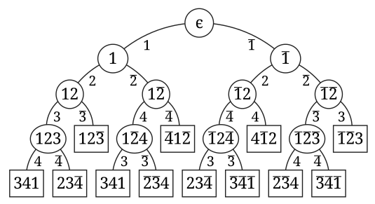</a>


<a id="fig-7-2-2-2-91"></a>**图 91.** 对不相容的子句 (6) 进行归结, 导出 $\epsilon$ 的一种方法.

注意, [图 91](#fig-7-2-2-2-91) 实质上与[第 217 页](#p-217)的[图 82](#fig-7-2-2-2-82) 相同; 后者是算法 D 用以发现 (6) 的子句不可满足的回溯树. 这种相似并非巧合: <em>记录算法 D 在一组不可满足子句上的行为的每棵回溯树, 都对应于一棵反驳这些公理的正则归结树</em>, 除非算法 D 作了多余的分支. (如果算法试过 $x\gets0$ 与 $x\gets1$, 却没有用到它们的后果就发现了公理中一个不可满足的子集, 那么这个分支就是多余的.) 反过来, 每棵正则反驳树都对应于一系列选择, 按这些选择, 基于回溯的 SAT 求解器便能证明不可满足性.

这个对应的缘由不难看出. 假设要证明不可满足, $x$ 的两种值都得试. 当我们在回溯树的一个分支上置 $x\gets0$ 时, 便如 (54) 那样, 用 $F\mid\bar x$ 代替原子句 $F$. 要点在于, <em>能从 $F\mid\bar x$ 用归结证明空子句, 当且仅当能从 $F$ 用归结证明 $x$, 而无须对 $x$ 作归结.</em> (见习题 224.) 类似地, 置 $x\gets1$ 相当于将子句从 $F$ 换成 $F\mid x$.

所以, 若 $F$ 是一组不相容的子句, 而且没有短的反驳树, 算法 D 就必须运行很长时间才能断定这些子句不可满足. 即使加强了前瞻, 算法 L 也不例外.

R. Impagliazzo 和 P. Pudlák [<em>SODA</em> **11** (2000), 128–136] 引入了一个很有意思的<em>证明者与拖延者的博弈</em>. 利用它, 我们比较容易证明某些不可满足的子句集需要很大的反驳树. 证明者指出一个变量 $x$, 拖延者答以 $x\gets0$, $x\gets1$ 或 $x\gets*$ 三种回答之一. 在最后一种情形下, 证明者可以决定 $x$ 的值, 但拖延者得一分. 一旦当前赋值使至少一个子句为假, 博弈便告结束. 如果拖延者有办法保证至少得到 $m$ 分, 习题 226 表明每棵反驳树至少有 $2^m$<a id="pdf-260"></a><a id="p-240"></a>个叶子; 因此必须至少做 $2^m-1$ 次归结, 任何基于回溯的求解器都需要 $\Omega(2^m)$ 次操作才能宣告这些子句不可满足.

例如, 可以把这个博弈应用于以下有趣的子句:
$$
(\bar x_{jj}),\qquad 1\le j\le m;\tag{99}
$$
$$
(\bar x_{ij}\lor\bar x_{jk}\lor x_{ik}),\qquad 1\le i,j,k\le m;\tag{100}
$$
$$
(x_{j1}\lor x_{j2}\lor\cdots\lor x_{jm}),\qquad 1\le j\le m.\tag{101}
$$
这里有 $m^2$ 个变量 $x_{jk}$, $1\le j,k\le m$, 可以把它们看成二元关系 ‘$j\prec k$’ 的关联矩阵. 这样一来, (99) 表示该关系是反自反的, (100) 表示它是传递的; 所以 (99) 和 (100) 合在一起就是说 $j\prec k$ 是一个<em>偏序</em>. 最后, (101) 表示对于每个 $j$ 都有一个 $k$ 使 $j\prec k$. 因此这些子句断言 $\{1,\ldots,m\}$ 上有一个没有极大元的偏序; 它们不可能同时满足.

不过, 如果我们在博弈中充当拖延者, 用 Massimo Lauria 建议的下述策略总能拿到 $m-1$ 分. 在每一步, 我们都知道一个由被视为 “小” 的元素组成的有序集 $S$; 初始时 $S=\emptyset$, 得到 $s$ 分时将有 $S=\{j_1,\ldots,j_s\}$. 假设证明者询问 $x_{jk}$, 并且 $s<m-2$. 若 $j=k$, 自然答 $x_{jk}\gets0$. 否则, 若 $j\notin S$ 且 $k\notin S$, 答 $x_{jk}\gets*$; 然后置 $s\gets s+1$, 并根据证明者指定的是 $x_{jk}\gets1$ 还是 $x_{jk}\gets0$, 分别置 $j_s\gets j$ 或 $j_s\gets k$. 在其余情形中, 若 $j\in S$ 而 $k\notin S$, 答 $x_{jk}\gets1$; 若 $j\notin S$ 而 $k\in S$, 答 $x_{jk}\gets0$. 最后, 若 $j=j_a\in S$ 且 $k=j_b\in S$, 答 $x_{jk}\gets[a<b]$. 这些回答总能满足 (99) 和 (100). 而在拖延者终于以 $s=m-2$ 的得分接到询问之前, (101) 中没有一个子句会变假. 这时答 $x_{jk}\gets*$ 又赢一分. 我们已经证明了

**定理 R.** <em>子句 (99)、(100)、(101) 的每棵反驳树都代表至少 $2^{m-1}-1$ 步归结.</em> $\blacksquare$

另一方面, 这些子句确实有大小为 $O(m^3)$ 的反驳<em>有向无圈图</em>. 分别用 $I_j$ 和 $T_{ijk}$ 表示反自反公理 (99) 和传递公理 (100); 再令 $M_{jk}=x_{j1}\lor\cdots\lor x_{jk}$, 于是 (101) 就是 $M_{jm}$. 则有
$$
M_{im}\mathbin{\diamond}T_{imk}=M_{i(m-1)}\lor\bar x_{mk},\qquad 1\le i,k<m.\tag{102}
$$
把这个新子句称为 $M'_{imk}$, 就可以导出
$$
M_{j(m-1)}=\bigl((\cdots((M_{mm}\mathbin{\diamond}M'_{jm1})\mathbin{\diamond}M'_{jm2})\mathbin{\diamond}\cdots)\mathbin{\diamond}M'_{jm(m-1)}\bigr)\mathbin{\diamond}I_m,
$$
其中 $1\le j<m$. 因此 $(m-1)^2+(m-1)m$ 次归结实质上已将 $m$ 化为 $m-1$. 最后就能导出 $M_{11}$; 而 $M_{11}\mathbin{\diamond}I_1=\epsilon$. [这个漂亮的反驳出自 G. Stålmarck, <em>Acta Informatica</em> **33** (1996), 277–280.]

顺便指出, 刚才从 $M_{mm}$ 得到 $M_{j(m-1)}$ 的办法, 是一个称为<em>超归结</em>的通用公式的特例. 此公式很有用, 对 $r$ 归纳便不难证明:
$$
\begin{aligned}
\bigl(\cdots((C_0\lor x_1\lor\cdots\lor x_r)&\mathbin{\diamond}(C_1\lor\bar x_1))\mathbin{\diamond}\cdots\bigr)\mathbin{\diamond}(C_r\lor\bar x_r)\\
&=C_0\lor C_1\lor\cdots\lor C_r.
\end{aligned}\tag{103}
$$

<a id="pdf-261"></a><a id="p-241"></a>

**\*一般归结的下界.** 让我们稍微换一个角度: 除了把归结证明看成有向图以外, 还可以把它看成一条 “直线式” 的<em>归结链</em>, 类似于 4.6.3 节中的加法链和 7.1.2 节中的布尔链. 一条基于 $m$ 条公理 $C_1,\ldots,C_m$ 的归结链, 在这些公理后面增添子句 $C_{m+1},\ldots,C_{m+r}$, 其中每一条都由链上前面的两个子句归结得到. 形式地说,
$$
C_i=C_{j(i)}\mathbin{\diamond}C_{k(i)},\qquad m+1\le i\le m+r,\tag{104}
$$
其中 $1\le j(i)<i$ 且 $1\le k(i)<i$. 若 $C_{m+r}=\epsilon$, 这就是 $C_1,\ldots,C_m$ 的一条<em>反驳链</em>. 例如, [图 91](#fig-7-2-2-2-91) 的树给出公理 (6) 的反驳链


$$
\begin{aligned}
&12\bar{3},\ 23\bar{4},\ 341,\ 4\bar{1}2,\ \bar{1}\bar{2}3,\ \bar{2}\bar{3}4,\ \bar{3}\bar{4}\bar{1},\ \bar{4}1\bar{2},\\
&123,\ 1\bar{2}4,\ \bar{1}2\bar{4},\ \bar{1}\bar{2}\bar{3},\ 12,\ 1\bar{2},\ \bar{1}\bar{2},\ \bar{1}2,\ 1,\ \bar{1},\ \epsilon
\end{aligned}
$$


此外还有许多方法可以反驳这些公理, 例如


$$
\begin{aligned}
&12\bar{3},\ 23\bar{4},\ 341,\ 4\bar{1}2,\ \bar{1}\bar{2}3,\ \bar{2}\bar{3}4,\ \bar{3}\bar{4}\bar{1},\ \bar{4}1\bar{2},\\
&1\bar{2}\bar{3},\ 1\bar{3},\ 14,\ \bar{3}\bar{4},\ 24,\ 2\bar{4},\ 2,\ \bar{1}3,\ \bar{3}4,\ 1\bar{4},\ \bar{3},\ 1,\ \bar{1},\ \epsilon.
\end{aligned}\tag{105}
$$


这条链与[图 91](#fig-7-2-2-2-91) 颇不相同, 或许还更好看些: 它虽然多了三步, 但在形成 ‘$1\bar2\bar3$’ 之后, 所构造的子句都很短.

马上就会看到, 如果想要短的链, 短的子句至关重要. 当我们试图证明某些易懂的公理族本来就比 (99)、(100)、(101) 更难时, 这个事实很重要; 这里的 “更难” 是指无法用多项式大小的链来反驳它们.

例如, 考虑众所周知的 “鸽巢原理”, 它断言 $m+1$ 只鸽子并不能分别住进 $m$ 个仅容一鸽的巢中. 对于 $0\le j\le m$, $1\le k\le m$, 以 $x_{jk}$ 表示鸽子 $j$ 占据巢 $k$, 则相应的不可满足子句就是
$$
(x_{j1}\lor x_{j2}\lor\cdots\lor x_{jm}),\qquad 0\le j\le m;\tag{106}
$$
$$
(\bar x_{ik}\lor\bar x_{jk}),\qquad 0\le i<j\le m,\quad 1\le k\le m.\tag{107}
$$
(“每只鸽子都有巢, 每个巢却至多住一只鸽子.”) 在 20 世纪 80 年代, 这些子句又为鸽巢原理增添了名声. 当时 Armin Haken [<em>Theoretical Computer Science</em> **39** (1985), 297–308] 证明了它们没有短反驳链. 这是首次证明<em>某一组</em>子句对一般归结来说是难处理的.

> 必定有两个人头上的头发恰好一样多.
>
> —— JEAN APPIER HANZELET, <em>Recreation Mathematicque</em> (1624)

Haken 的原证明颇为复杂. 但后来陆续找到了更简单的办法, 最终由 E. Ben-Sasson 和 A. Wigderson [<em>JACM</em> **48** (2001), 149–169] 得到一种基于子句长度的方法, 还适用于许多其他公理集. 设 $\alpha$ 是任一子句序列, 把它的最长子句的长度称为它的<em>宽度</em>, 记为 $w(\alpha)$. 此外, 若 $\alpha_0=(C_1,\ldots,C_m)$, 则用 $w(\alpha_0\vdash\epsilon)$ 表示 $\alpha_0$ 的所有反驳链 $\alpha=(C_1,\ldots,C_{m+r})$ 的 $w(\alpha)$ 的最小值, 用 $\lVert\alpha_0\vdash\epsilon\rVert$ 表示所有这些链的最小长度 $r$. 按 Ben-Sasson 与 Wigderson 的策略证明下界, 关键在于下面的引理:

<a id="pdf-262"></a><a id="p-242"></a>

**引理 B.** <em>对于 $n\ge w(\alpha_0)^2$ 个变量的子句, 有 $\lVert\alpha_0\vdash\epsilon\rVert\ge e^{(w(\alpha_0\vdash\epsilon)-1)^2/(8n)}-2$.</em> 所以, 若 $w(\alpha_0)=O(1)$ 而 $w(\alpha_0\vdash\epsilon)=\Omega(n)$, 就有指数增长.

<em>证明.</em> 设 $\alpha=(C_1,\ldots,C_{m+r})$ 为 $\alpha_0$ 的一个反驳, 其中 $r=\lVert\alpha_0\vdash\epsilon\rVert$. 若一个子句的长度至少为 $W$, 就称它为 “胖” 子句, 其中 $W\ge w(\alpha_0)$ 是一个稍后再定的参数. 若 $\alpha\setminus\alpha_0$ 含有 $f$ 个胖子句, 那些子句至少含有 $Wf$ 个字面值; 因此有某个字面值 $l$ 至少出现在其中的 $Wf/(2n)$ 个子句里.

现在把每个子句 $C_j$ 换成 $C_j\mid l$, 所得的链 $\alpha\mid l$ 是 $\alpha_0\mid l$ 的一个反驳, 而且其中的胖子句至多有 $\lfloor\rho f\rfloor$ 个, 其中 $\rho=1-W/(2n)$. (若 $l\in C_j$, 子句 $C_j\mid l$ 就是 $\wp$, 即重言式, 实际上可以不计.)

设对于某个整数 $b$ 有 $f<\rho^{-b}$. 我们将对 $b$ 作归纳, 再以全部子句的总长度为次要归纳指标, 证明 $\alpha_0$ 有一个反驳 $\beta$, 满足 $w(\beta)\le W+b$. 当 $b=0$ 时此断言成立, 因为 $W\ge w(\alpha_0)$. 若 $b>0$, 按上述方法选 $l$, 则 $\alpha_0\mid l$ 有一个反驳 $\beta_0$, 满足 $w(\beta_0)\le W+b-1$, 因为 $\rho f<\rho^{1-b}$ 且 $\alpha\mid l$ 反驳 $\alpha_0\mid l$. 于是可将 $\bar l$ 适当插入 $\beta_0$ 的子句, 形成一条从 $\alpha_0$ 导出 $\bar l$ 的归结链 $\beta_1$. 另有一条简单的链 $\beta_2$, 能从 $\alpha_0$ 与 $\bar l$ 导出 $\alpha_0\mid\bar l$ 的子句. 由归纳假设, $\alpha_0\mid\bar l$ 还有一个反驳 $\beta_3$ 满足 $w(\beta_3)\le W+b$, 因为 $\alpha\mid\bar l$ 反驳 $\alpha_0\mid\bar l$. 因此把它们合成 $\beta=\{\beta_1,\beta_2,\beta_3\}$ 就反驳了 $\alpha_0$, 且
$$
w(\beta)=\max\bigl(w(\beta_0)+1,w(\beta_2),w(\beta_3)\bigr)
\le\max\bigl(W+b,w(\alpha_0),W+b\bigr)=W+b.
$$

最后, 习题 238 选定 $W$, 得到所要的界. $\blacksquare$

鸽子公理太宽, 无法直接代入引理 B. 但 Ben-Sasson 和 Wigderson 注意到, 这些公理有一个只含 5SAT 子句的简化版本, 而这个版本已经是难处理的了.

注意, 可将变量 $x_{jk}$ 看成指示一个二部图中 $a_j$ 与 $b_k$ 之间是否有边, 此图的顶点为 $A=\{a_0,\ldots,a_m\}$ 和 $B=\{b_1,\ldots,b_m\}$. 条件 (106) 表示每个 $a_j$ 的度至少为 1, 条件 (107) 则表示每个 $b_k$ 的度至多为 1. 不过, 在这些顶点上存在一个二部图 $G_0$, 其中每个 $a_j$ 的度至多为 5, 而且满足下面这个很强的 “扩张” 条件:
$$
\text{在 }G_0\text{ 中, 每个满足 }|A'|\le m/3000\text{ 的子集 }A'\subseteq A\text{ 都有 }|\partial A'|\ge|A'|.\tag{108}
$$
这里 $\partial A'$ 表示 $A'$ 的二部边界, 即在 $A'$ 中恰有一个邻点的所有 $b_k$ 的集合.

给定这样的图 $G_0$ (习题 240 以非构造方式证明它存在), 就可表述一个<em>受限鸽巢原理</em>: 再要求每当 $a_j$ 与 $b_k$ 在 $G_0$ 中不相邻时 $\bar x_{jk}$ 为真, 则这些鸽巢子句不可满足.

用 $\alpha(G_0)$ 表示所得的子句, 即以所有这样的字面值 $\bar x_{jk}$ 为条件对公理 (106)、(107) 作限制所得的子句. 于是 $w(\alpha(G_0))\le5$, 且至多剩下 $5m+5$ 个未指定的变量 $x_{jk}$. 从引理 B 可知, 只要能证明 $\alpha(G_0)$ 的所有反驳链的宽度都为 $\Omega(m)$, 就能得知它们的长度都为 $\exp\Omega(m)$. Haken 定理断言 (106) 和 (107) 的所有反驳链的长度也都为 $\exp\Omega(m)$, 随即成立, 因为对 $\bar x_{jk}$ 作条件限制之后, 任何短反驳都会给出 $\alpha(G_0)$ 的一个短反驳.

<a id="pdf-263"></a><a id="p-243"></a>

于是, 下面的结果给我们的故事一个圆满的结局:

**定理 B.** <em>受限鸽巢公理 $\alpha(G_0)$ 的反驳宽度满足</em>
$$
w(\alpha(G_0)\vdash\epsilon)\ge m/6000.\tag{109}
$$

<em>证明.</em> 可给每个子句 $C$ 赋予一个复杂度量, 定义为
$$
\mu(C)=\min\bigl\{|A'|\mathrel{\vert}A'\subseteq A\ \text{且}\ \alpha(A')\vdash C\bigr\}.\tag{110}
$$
这里 $\alpha(A')$ 是 $a_j\in A'$ 的 “鸽子公理” (106) 连同全部 “巢公理” (107) 所成的集合; 而 $\alpha(A')\vdash C$ 表示仅用这些公理为起点就能以归结证明子句 $C$. 若 $C$ 是鸽子公理之一, 此定义给出 $\mu(C)=1$, 因为可以取 $A'=\{a_j\}$. 若 $C$ 是巢公理, 则显然 $\mu(C)=0$. 次可加律
$$
\mu(C'\mathbin{\diamond}C'')\le\mu(C')+\mu(C'')\tag{111}
$$
也成立, 因为若 $C'$ 可从 $\alpha(A')$ 推出且 $C''$ 可从 $\alpha(A'')$ 推出, 则 $C'\mathbin{\diamond}C''$ 的证明至多需要 $\alpha(A')\cup\alpha(A'')$ 中的公理.

可以假定 $m\ge6000$. 并且由强扩张条件 (108), 必有 $\mu(\epsilon)>m/3000$. (见习题 241.) 因此 $\alpha(G_0)$ 的每个反驳中必定有一个子句 $C$, 使 $m/6000\le\mu(C)<m/3000$; 事实上, 第一个满足 $\mu(C_j)\ge m/6000$ 的子句 $C_j$ 就满足这个条件, 这是由 (111) 得出的.

取一个顶点集 $A'$, 使得 $|A'|=\mu(C)$ 且 $\alpha(A')\vdash C$. 再任取 $b_k\in\partial A'$, 设 $a_j$ 为它在 $A'$ 中的唯一邻点. 因为 $|A'\setminus a_j|<\mu(C)$, 必有一种变量赋值满足 $\alpha(A'\setminus a_j)$ 的所有公理, 却使 $C$ 以及鸽子 $j$ 的公理都为假. 该赋值不会把两只鸽子放入同一巢中, 且安置了 $A'\setminus a_j$ 中的每只鸽子.

现在假设对于任何 $a_{j'}\in A$, $C$ 都不含形如 $x_{j'k}$ 或 $\bar x_{j'k}$ 的字面值. 那么可对所有 $j'$ 置 $x_{j'k}\gets0$, 而不使 $\alpha(A'\setminus a_j)$ 的任何公理变假; 接着置 $x_{jk}\gets1$, 就使 $\alpha(\{a_j\})$ 的公理也为真. 可是这样改变赋值仍将使 $C$ 为假, 与 $\alpha(A')\vdash C$ 的假设矛盾. 因此对于每个 $b_k\in\partial A'$, $C$ 都含有某个 $\pm x_{j'k}$; 我们必有 $w(C)\ge|\partial A'|\ge m/6000$. $\blacksquare$

类似的证明给出了一个定理: 固定 $\alpha$, 当 $n\to\infty$ 时, 对于几乎一切含 $n$ 个变量与 $\lfloor\alpha n\rfloor$ 个子句的随机 3SAT 实例, 反驳宽度有线性下界, 从而反驳长度有指数下界 (见习题 243). 这是 V. Chvátal 和 E. Szemerédi 的定理 [<em>JACM</em> **35** (1988), 759–768].

<em>历史注记:</em> 在更一般的一阶逻辑背景下, 归结证明由 J. A. Robinson 在 <em>JACM</em> **12** (1965), 23–41 中引入. [它们也等价于 G. Gentzen 的 “相继式的切规则”, <em>Mathematische Zeitschrift</em> **39** (1935), 176–210, III.1.2 1.] 受 Robinson 的论文启发, Gregory Tseytin 以习题 245 将要研究的一组不可满足的图公理为基础, 首先提出了证明归结证明长度下界的非平凡方法. 他在 1966 年的讲义发表于 <em>Steklov Mathematical Institute Seminars in Mathematics</em> 第 8 卷 (1968); 见 A. O. Slisenko 的英译, <em>Studies in Constructive Mathematics and Mathematical Logic</em>, 第 2 部分 (1970), 115–125.

<a id="pdf-264"></a><a id="p-244"></a>

Tseytin 指出, 只要允许使用新型的证明步骤, 就有一个简单的办法绕过他对这些图问题证明的下界: 给定任何公理集 $F$, 可引入一个没有在 $F$ 中任何地方出现过的新变量 $z$, 加上三个新子句 $G=\{xz,yz,\bar x\bar y\bar z\}$; 这里 $x$ 与 $y$ 是 $F$ 的任意字面值. 显然 $F$ 可满足当且仅当 $F\cup G$ 可满足, 因为 $G$ 实质上表示 $z=\operatorname{NAND}(x,y)$. 这样添加新变量, 有点像在证明定理时使用引理, 或是在计算机程序中引入记忆化缓存.

他的方法称为<em>扩展归结</em>, 比单纯作归结可以快得多. 例如, 用这种方法只需 $O(m^4)$ 步就能反驳鸽巢子句 (106) 和 (107) (见习题 237). 对于另一些问题, 例如随机 3SAT, 它似乎帮助不大; 不过, 谁知道呢?

**用归结求解 SAT.** 归结的概念还提示了求解可满足性问题的其他途径. 首先, 可以用它来消去变量: 若 $F$ 是 $n$ 个变量上的任一子句集而 $x$ 为其中一个变量, 就能构造其余 $n-1$ 个变量上的一个子句集 $F'$, 使 $F$ 可满足当且仅当 $F'$ 可满足. 办法很简单, 将每个形如 $x\lor A'$ 的子句与每个形如 $\bar x\lor A''$ 的子句归结, 然后丢弃参加归结的这些原子句.

例如, 考虑四个变量上的下列六个子句:
$$
1234,\ 1\bar2,\ \bar1\bar2\bar3,\ \bar13,\ 2\bar3,\ 3\bar4.\tag{112}
$$
由 $1234\mathbin{\diamond}3\bar4=123$ 可以消去 $x_4$. 接着, 将 $123$ 和 $\bar13$ 与 $\bar1\bar2\bar3$ 和 $2\bar3$ 分别归结, 就能消去 $x_3$:
$$
123\mathbin{\diamond}\bar1\bar2\bar3=\wp,\qquad 123\mathbin{\diamond}2\bar3=12,\qquad
\bar13\mathbin{\diamond}\bar1\bar2\bar3=\bar1\bar2,\qquad \bar13\mathbin{\diamond}2\bar3=\bar12.
$$
重言式 $\wp$ 消失之后, 余下的是 $\{12,1\bar2,\bar12,\bar1\bar2\}$. 消去 $x_2$ 得 $\{1,\bar1\}$, 消去 $x_1$ 得 $\{\epsilon\}$; 所以 (112) 不可满足.

此方法起初是 E. W. Samson 和 R. K. Mueller 在 1955 年为手算而提出的, 它对小问题十分奏效. 它为什么正确呢? 有 (至少) 两种好办法来理解其中的道理. 首先, 容易看出只要 $F$ 可满足, $F'$ 就可满足, 因为 $C'$ 与 $C''$ 都为真时 $C'\mathbin{\diamond}C''$ 也为真. 反过来, 若其余 $n-1$ 个变量的某个赋值满足 $F'$, 则这个赋值要么对所有形如 $x\lor A'$ 的子句都满足 $A'$, 要么对所有形如 $\bar x\lor A''$ 的子句都满足 $A''$. (否则就有某个 $A'$ 与某个 $A''$ 都不满足, 因而 $F'$ 中的子句 $A'\lor A''$ 将为假.) 故在 $x\gets0$ 与 $x\gets1$ 中, 至少有一个赋值会满足 $F$.

理解变量消去的另一个好办法, 是注意到它对应于消去一个存在量词 (见习题 248).

设 $F$ 中有 $p$ 个子句含 $x$, 有 $q$ 个子句含 $\bar x$. 那么消去 $x$ 最坏也只会得到 $pq$ 个新子句; 所以只要 $pq\le p+q$, 即 $(p-1)(q-1)\le1$, $F'$ 的子句就不会多于 $F$. 只要 $p=0$ 或 $q=0$, 这个条件显然成立; 事实上, 在算法 A 中遇到这种情形时, 我们称 $x$ 为 “纯字面值”. $p=1$ 或 $q=1$ 时该条件也成立, 甚至 $p=q=2$ 时也成立.

<a id="pdf-265"></a><a id="p-245"></a>

此外, 我们未必真会得到 $pq$ 个新子句. 如上例所示, 某些归结式可能是重言式, 另一些则可能被已有的子句包摄. (若 $C\subseteq C'$, 即 $C$ 中每个字面值也出现在 $C'$ 中, 就称子句 $C$ <em>包摄</em>另一个子句 $C'$. 这时可以放心地丢弃 $C'$.) 某些归结式也可能包摄已有的子句.

所以反复消去变量并不总会引起子句集的爆炸. 然而在最坏情形下, 这种办法的效率可能相当低.

1972 年 1 月, Stephen Cook 在多伦多大学向学生们展示了用归结求解 SAT 的一种很不一样的方法. 他把这个漂亮的过程称为 “方法 I”, 其实质是按需作归结以学习新子句:

**算法 I** (<em>用子句学习判定可满足性.</em>) 给定 $n$ 个布尔变量 $x_1\ldots x_n$ 上的 $m$ 个非空子句 $C_1\land\cdots\land C_m$, 本算法或者证明它们不可满足, 或者找出能满足它们的严格互异的字面值 $l_1\ldots l_n$. 在此过程中可能用归结生成新的子句 (这时 $m$ 随之增大).

**I1.** [初始化.] 置 $d\gets0$.

**I2.** [前进.] 若 $d=n$, 成功终止 (字面值 $\{l_1,\ldots,l_d\}$ 满足 $\{C_1,\ldots,C_m\}$). 否则置 $d\gets d+1$, 取一个与 $l_1,\ldots,l_{d-1}$ 严格互异的字面值 $l_d$.

**I3.** [找出变假的 $C_i$.] 若 $\{l_1,\ldots,l_d\}$ 未使 $C_1,\ldots,C_m$ 中的任何子句变假, 返回 I2. 否则令 $C_i$ 为一个已变假的子句.

**I4.** [找出变假的 $C_j$.] (此时 $\bar l_d\in C_i\subseteq\{\bar l_1,\ldots,\bar l_d\}$, 但没有任何子句包含在 $\{\bar l_1,\ldots,\bar l_{d-1}\}$ 中.) 置 $l_d\gets\bar l_d$. 若 $\{l_1,\ldots,l_d\}$ 未使 $C_1,\ldots,C_m$ 中的任何子句变假, 返回 I2. 否则取 $C_j$ 使 $\bar l_d\in C_j\subseteq\{\bar l_1,\ldots,\bar l_d\}$.

**I5.** [归结.] 置 $m\gets m+1$, $C_m\gets C_i\mathbin{\diamond}C_j$. 若 $C_m$ 为空, 失败终止. 否则置 $d\gets\max\{t\mid\bar l_t\in C_m\}$, $i\gets m$, 返回 I4.　■

在步骤 I5, 新子句 $C_m$ 不可能被先前的任何子句 $C_k$ ($k<m$) 包摄, 因为 $C_i\mathbin{\diamond}C_j\subseteq\{\bar l_1,\ldots,\bar l_{d-1}\}$. 所以特别地, 没有子句会被生成两次, 算法必然终止.

上述说明在 I2、I3、I4 中说 “取” 的时候有意没有说得很细: 在 I2 中可以选<em>任何</em>可选的字面值 $l_d$, 在 I3、I4 中也可以选<em>任何</em>已变假的子句 $C_i$ 和 $C_j$, 都不会使方法失效. 因此, 实际上算法 I 代表一族算法, 取决于用什么启发式规则来作出这些选择.

例如, Cook 提议用下面的办法 (“方法 IA”) 在 I2 中选 $l_d$: 从当前未满足的子句中, 找出未指定字面值最少的那些子句, 再选一个在其中出现次数最多的字面值. 把这条规则用于六个子句 (112), 将置 $l_1\gets3$, $l_2\gets2$, $l_3\gets1$; 接着 I3 将发现 $C_i=\bar1\bar2\bar3$ 为假. 于是 I4 置 $l_3\gets\bar1$, 发现 $C_j=1\bar2$ 为假, I5 便学到 $C_7=\bar2\bar3$. (以下过程见习题 249.)

Cook 引入算法 I, 主要是为了使归结的步数尽量少; 他并不特别关心怎样缩短运行时间. 后来 R. A. Reckhow 所做的实验 [博士论文<a id="pdf-266"></a><a id="p-246"></a>(多伦多大学, 1976), 81–84] 表明, 这个办法确能找到较短的归结反驳. 而且, 习题 251 说明算法 I 能在多项式时间内处理排除极大元的子句 (99)–(101); 因此, 对于这个问题, 所有基于回溯的算法都表现出指数行为 (见定理 R), 算法 I 却远胜于它们.

另一方面, 用于大问题时, 算法 I 的确很容易用大批新子句填满内存, 又没有显而易见的办法来高效处理这些子句. 因此, Cook 的方法看来没有多少实用价值, 四十多年都未曾发表.

**冲突驱动的子句学习.** 算法 I 表明, 选取字面值时一次不成功的尝试可以使我们发现有价值的新子句, 增进我们对问题特性的认识. 这个想法在 20 世纪 90 年代被人从另一个角度重新发现, 产生了革命性的影响: 有数千乃至数百万个变量的重要工业 SAT 实例, 突然间第一次变得可解.

人们常把这些新方法称为 CDCL 求解器, 因为它们以 “冲突驱动的子句学习” (conflict driven clause learning) 为基础, 有别于经典的回溯法. CDCL 求解器和已经见过的 DPLL 算法有许多共同概念; 不过差别也颇大, 从头说明这些想法反倒最容易理解. CDCL 求解器以<em>赋值轨迹</em>的概念为基础, 不再隐式地探索[图 82](#fig-7-2-2-2-82) 那样的一棵查找树. 一条轨迹是一个由严格互异的字面值组成的序列 $L_0L_1\ldots L_{F-1}$, 它不使任何子句变假. 开始时可取 $F=0$ (空轨迹). 计算的任务就是不断延长当前轨迹, 直到 $F=n$ 从而解出问题, 或者实质上学得空子句为真, 从而证明无解.

假设有一个形如 $l\lor\bar a_1\lor\cdots\lor\bar a_k$ 的子句 $c$, 其中 $a_1$ 至 $a_k$ 都在轨迹中, 而 $l$ 不在. 轨迹中的字面值暂定为真, 且必须满足 $c$, 因而只好让 $l$ 为真. 遇到这种情形, 我们将 $l$ 添在当前轨迹的末尾, 并称 $c$ 为它的 “理由”. (这个操作相当于前面的算法中所谓的 “单元传播”; 在那些算法中, 字面值 $\bar a_1,\ldots,\bar a_k$ 变假时, 实际上被移除了, 于是只剩 $l$ 自成一个 “单位”. 按现在的观点, 每个子句 $c$ 都保持完整, 它的所有字面值都可以查知.) 若互补的字面值 $\bar l$ 已在轨迹中, 就会发生<em>冲突</em>, 因为 $l$ 不能既真又假; 不过暂且假定没有冲突, 那么置 $L_F\gets l$, $F\gets F+1$, 就能合法地添入 $l$.

如果没有这样的强制子句, 而 $F<n$, 就以某种启发式方法选取一个新的互异字面值, 将它添在当前轨迹的末尾, 以 $\Lambda$ 为其 “理由”. 这样的字面值称为<em>决策</em>. 它们把轨迹分成一系列决策<em>层</em>, 层的边界可用一串指标 $0=i_0\le i_1<i_2<i_3<\cdots$ 表示; 字面值 $L_t$ 属于第 $d$ 层当且仅当 $i_d\le t<i_{d+1}$. 轨迹开头的第 0 层很特别: 若有长度为 1 的子句, 它就含有这些子句所强制的字面值. 这样的字面值无条件为真. 其他每一层都恰好以一个决策开头.

<a id="pdf-267"></a><a id="p-247"></a>

以 (9) 的问题 $\operatorname{waerden}(3,3;9)$ 为例. 最先放入轨迹的各项可能如下:

<table id="sat-trail113"><thead><tr><th>$t$</th><th>$L_{t}$</th><th>层</th><th>理由</th><th>说明</th></tr></thead><tbody>
<tr><td>0</td><td>$\overline{6}$</td><td>1</td><td>$\Lambda$</td><td>决策</td></tr>
<tr><td>1</td><td>$\overline{9}$</td><td>2</td><td>$\Lambda$</td><td>决策</td></tr>
<tr><td>2</td><td>3</td><td>2</td><td>396</td><td>由子句 369 重排</td></tr>
<tr><td>3</td><td>$\overline{4}$</td><td>3</td><td>$\Lambda$</td><td>决策</td></tr>
<tr><td>4</td><td>5</td><td>3</td><td>546</td><td>由子句 456 重排</td></tr>
<tr><td>5</td><td>8</td><td>3</td><td>846</td><td>由子句 468 重排</td></tr>
<tr><td>6</td><td>2</td><td>3</td><td>246</td><td></td></tr>
<tr><td>7</td><td>$\overline{7}$</td><td>3</td><td>$\overline{7}\overline{5}\overline{3}$</td><td>由子句 $\overline{3}\overline{5}\overline{7}$ 重排</td></tr>
<tr><td>8</td><td>$\overline{2}$</td><td>3</td><td>$\overline{2}\overline{5}\overline{8}$</td><td>发生冲突!</td></tr>
</tbody></table>

<p style="text-align:right">(113)</p>

这里做了三个决策, 分别以 $i_1=0$, $i_2=1$, $i_3=3$ 开始了三层. 有些子句已重新排列, 原因稍后便知. 传播导致了冲突, 因为 $2$ 与 $\bar2$ 都被强制为真. (最后一项 $L_8$ 实际上不算在轨迹内, 因为它与 $L_6$ 矛盾.)

如果 $l$ 的理由包含字面值 $\bar l'$, 就说 “$l$ <em>直接依赖于</em> $l'$”. 如果有一条由一个或多个直接依赖组成的链, 从 $l$ 到 $l_1$ 到 $\cdots$ 到 $l_k=l'$, 就简称 “$l$ <em>依赖于</em> $l'$”. 例如, (113) 中的 $5$ 直接依赖于 $\bar4$ 与 $\bar6$, $\bar2$ 直接依赖于 $5$ 与 $8$; 因此 $\bar2$ 依赖于 $\bar6$.

注意, 一个字面值只能依赖于轨迹中先于它的字面值. 而且, 在第 $d>0$ 层被强制的每个字面值 $l$, 都直接依赖于同一层上的某个<em>其他</em>字面值; 否则 $l$ 早在先前的某一层就被强制了. 因此 $l$ 必然依赖于第 $d$ 个决策.

之所以要给每个字面值记录理由, 是因为我们需要处理冲突. 我们将看到, 每次冲突都能用来构造一个新的子句 $c'$: 只要已有子句可满足, $c'$ 就必须为真, 但 $c'$ 本身并不包含任何已有的子句. 因此可将 $c'$ 加入已有子句, 将它 “学” 到手, 再来一试. 这个学习过程不可能无穷无尽, 因为可能的子句只有有限多个. 所以我们迟早会找到一个解, 或是学到空子句. 那自然好, 特别是来得越早越好.

第 $d$ 决策层上的一个冲突子句 $c$ 形如 $\bar l\lor\bar a_1\lor\cdots\lor\bar a_k$, 其中 $l$ 和所有的 $a$ 都属于轨迹; 此外 $l$ 与至少一个 $a_i$ 属于第 $d$ 层. 在 $c$ 中各个字面值的补当中, 可以设 $l$ 在轨迹中最靠右. 因此 $l$ 不会是第 $d$ 个决策; 它有一个理由, 设为 $l\lor\bar a'_1\lor\cdots\lor\bar a'_{k'}$. 把 $c$ 与这个理由归结, 得到子句 $c'=\bar a_1\lor\cdots\lor\bar a_k\lor\bar a'_1\lor\cdots\lor\bar a'_{k'}$, 它至少包含一个属于第 $d$ 层的字面值. 若这样的字面值不止一个, 那么 $c'$ 本身仍是一个冲突子句; 我们可以置 $c\gets c'$, 重复这个过程. 最终必将得到一个形如 $\bar l'\lor\bar b_1\lor\cdots\lor\bar b_r$ 的新子句 $c'$, 其中 $l'$ 在第 $d$ 层, $b_1$ 至 $b_r$ 均在较低层.

这个 $c'$ 正如所愿, 可以学到, 因为它不可能包含任何已有的子句. (否则, $c'$ 的任何这样的子句, 包括 $c'$ 自身, 早已在较低层给出了一个强制值.) 现在可以<em>丢弃</em>轨迹中高于 $d'$ 的各层, 其中 $d'$ 为 $b_1$ 至 $b_r$ 所在的最高层; 而且——这正是精彩之处——<a id="pdf-268"></a><a id="p-248"></a>可以把 $\bar l'$ 添在第 $d'$ 层的末尾, 以 $c'$ 为其理由. 强制过程于是从第 $d'$ 层继续, 就好像学到的子句从一开始就在那里似的.

例如, 在 (113) 的冲突之后, 初始的冲突子句为 $c=\bar2\bar5\bar8$, 这是 $\bar x_2\lor\bar x_5\lor\bar x_8$ 的简记. 它在轨迹中最靠右的补字面值是 $2$, 因为 $5$ 和 $8$ 都出现得早一些. 于是把 $c$ 与 $2$ 的理由 $246$ 归结, 得到 $c'=4\bar56\bar8$. 这个新子句中有三个字面值的补在第 3 层, 即 $\bar4$、$5$ 和 $8$; 所以它仍是冲突子句. 将它与 $8$ 的理由归结, 得到 $c'=4\bar56$. $c'$ 又是冲突子句. 再将这次冲突与 $5$ 的理由归结, 结果为 $c'=46$, 这个子句被当前轨迹上的字面值否定, 但只有 $\bar4$ 在第 3 层. 好——我们学到了 ‘$46$’: 在 $\operatorname{waerden}(3,3;9)$ 的每个解中, $x_4$ 或 $x_6$ 必须为真.

所以 (113) 的后续是

<table id="sat-trail114"><thead><tr><th>$t$</th><th>$L_{t}$</th><th>层</th><th>理由</th><th>说明</th></tr></thead><tbody>
<tr><td>0</td><td>$\overline{6}$</td><td>1</td><td>$\Lambda$</td><td>决策</td></tr>
<tr><td>1</td><td>4</td><td>1</td><td>46</td><td>刚学到的子句</td></tr>
</tbody></table>

<p style="text-align:right">(114)</p>

下一步将是开始一个新的第 2 层, 因为没有别的强制值了.

注意, 原先的第 2 层消失了. 我们学到, 决策变量 $x_9$ 无须分支, 因为 $\bar6$ 已经强制了 $4$. 这种对通常回溯方式的改进有时称为 “回跳”, 因为我们跳回到了可视为刚刚发现的冲突的根本原因所在的层.

习题 253 探索了 (114) 的一种可能的后续; 亲爱的读者, 现在请跳过去看看. 顺便说一句, 我们在这个例子里学到的子句 ‘$46$’ 涉及先前的决策 $\bar4$ 和 $\bar6$ 的补; 但习题 255 表明, 新学到的子句可能根本不含任何决策变量.

从冲突构造学得子句的过程并没有看起来那么困难, 因为可以用高效的方法进行所有必要的归结步骤. 如上, 假定初始冲突子句为 $\bar l\lor\bar a_1\lor\cdots\lor\bar a_k$. 接着用一个专有的数 $s$ 给每个字面值 $a_i$ “盖印”; 而且每当 $a_i$ 是一个在 $0<d'<d$ 的第 $d'$ 层获得其值的字面值时, 就把 $\bar a_i$ 插入一个辅助阵列, 它最终将保存字面值 $\bar b_1,\ldots,\bar b_r$. 也给 $l$ 盖印; 然后计算这样盖过印的第 $d$ 层的字面值数. 再沿着轨迹反复往回走, 直到遇见印戳等于 $s$ 的字面值 $L_t$. 如果此时计数大于 1, 而且 $L_t$ 的理由为 $L_t\lor\bar a'_1\lor\cdots\lor\bar a'_{k'}$, 就察看每个 $a'_i$, 给它盖印, 若以前还未盖过印 $s$, 则在适当时将它放进 $b$ 阵列. 最后, 未归结的字面值数将降至 1; 学得子句便是 $\overline{L_t}\lor\bar b_1\lor\cdots\lor\bar b_r$.

即使原问题的子句都相当短, 这些新子句也可能很长. 例如, [表 3](#tab-7-2-2-2-3) 给出了一个中等大小问题的一瞥. 对 $\operatorname{waerden}(3,10;97)$ 的 2779 个子句运行 CDCL 求解器, 学到约 10000 个子句之后, 所生成的轨迹的开头就在表中. (回想一下, 此问题试图寻找一个二进制向量 $x_1x_2\ldots x_{97}$, 其中既没有三个等距的 0, 也没有十个等距的 1.) 表中的第 18 层刚刚<a id="pdf-269"></a><a id="p-249"></a>以决策 $L_{44}=\overline{57}$ 开始; 这个决策将引发许多字面值 $15,49,61,68,77,78,87,\overline{96},\ldots$ 的赋值, 最终在试图设置 $L_{67}$ 时引起冲突. 所得冲突子句的长度是 22:


$$
53\ 27\ 36\ \overline{70}\ \overline{35}\ 37\ \overline{69}\ \overline{21}\ 46\ \overline{28}\ \overline{56}\ \overline{65}\ \overline{60}\ 50\ \overline{64}\ \overline{24}\ \overline{42}\ \overline{73}\ \overline{63}\ \overline{33}\ \overline{51}\ 57.\tag{115}
$$


(这里的字面值按其补在轨迹中的出现顺序排列.) 看到这样庞大的子句, 我们很可以怀疑自己是否真想 “学习” 这么一个晦涩的事实!

<a id="tab-7-2-2-2-3"></a>**表 3　中等大小的赋值轨迹的最初几层**


<table id="sat-trail-table3"><thead><tr><th>$t$</th><th>$L_{t}$</th><th>层</th><th>理由</th></tr></thead><tbody>
<tr><td>0</td><td>$\overline{53}$</td><td>1</td><td>$\Lambda$</td></tr>
<tr><td>1</td><td>55</td><td>2</td><td>$\Lambda$</td></tr>
<tr><td>2</td><td>44</td><td>3</td><td>$\Lambda$</td></tr>
<tr><td>3</td><td>54</td><td>4</td><td>$\Lambda$</td></tr>
<tr><td>4</td><td>43</td><td>5</td><td>$\Lambda$</td></tr>
<tr><td>5</td><td>30</td><td>6</td><td>$\Lambda$</td></tr>
<tr><td>6</td><td>34</td><td>7</td><td>$\Lambda$</td></tr>
<tr><td>7</td><td>45</td><td>8</td><td>$\Lambda$</td></tr>
<tr><td>8</td><td>40</td><td>9</td><td>$\Lambda$</td></tr>
<tr><td>9</td><td>$\overline{27}$</td><td>10</td><td>$\Lambda$</td></tr>
<tr><td>10</td><td>79</td><td>10</td><td>79 53 27</td></tr>
<tr><td>11</td><td>01</td><td>10</td><td>01 27 53</td></tr>
<tr><td>12</td><td>$\overline{36}$</td><td>11</td><td>$\Lambda$</td></tr>
<tr><td>13</td><td>18</td><td>11</td><td>18 36 27</td></tr>
<tr><td>14</td><td>19</td><td>11</td><td>19 36 53</td></tr>
<tr><td>15</td><td>70</td><td>11</td><td>70 36 53</td></tr>
<tr><td>16</td><td>35</td><td>12</td><td>$\Lambda$</td></tr>
<tr><td>17</td><td>39</td><td>13</td><td>$\Lambda$</td></tr>
<tr><td>18</td><td>$\overline{37}$</td><td>14</td><td>$\Lambda$</td></tr>
<tr><td>19</td><td>38</td><td>14</td><td>38 37 36</td></tr>
<tr><td>20</td><td>47</td><td>14</td><td>47 37 27</td></tr>
<tr><td>21</td><td>17</td><td>14</td><td>17 37 27</td></tr>
<tr><td>22</td><td>32</td><td>14</td><td>32 37 27</td></tr>
<tr><td>23</td><td>69</td><td>14</td><td>69 37 53</td></tr>
<tr><td>24</td><td>21</td><td>14</td><td>21 37 53</td></tr>
<tr><td>25</td><td>$\overline{46}$</td><td>15</td><td>$\Lambda$</td></tr>
<tr><td>26</td><td>28</td><td>15</td><td>28 46 37</td></tr>
<tr><td>27</td><td>41</td><td>15</td><td>41 46 36</td></tr>
<tr><td>28</td><td>26</td><td>15</td><td>26 46 36</td></tr>
<tr><td>29</td><td>56</td><td>15</td><td>56 46 36</td></tr>
<tr><td>30</td><td>08</td><td>15</td><td>08 46 27</td></tr>
<tr><td>31</td><td>65</td><td>15</td><td>65 46 27</td></tr>
<tr><td>32</td><td>60</td><td>15</td><td>60 46 53</td></tr>
<tr><td>33</td><td>$\overline{50}$</td><td>15</td><td>∗∗</td></tr>
<tr><td>34</td><td>64</td><td>15</td><td>64 50 36</td></tr>
<tr><td>35</td><td>22</td><td>15</td><td>22 50 36</td></tr>
<tr><td>36</td><td>24</td><td>15</td><td>24 50 37</td></tr>
<tr><td>37</td><td>42</td><td>15</td><td>42 50 46</td></tr>
<tr><td>38</td><td>48</td><td>15</td><td>48 50 46</td></tr>
<tr><td>39</td><td>73</td><td>15</td><td>73 50 27</td></tr>
<tr><td>40</td><td>04</td><td>15</td><td>04 50 27</td></tr>
<tr><td>41</td><td>63</td><td>15</td><td>63 50 37</td></tr>
<tr><td>42</td><td>33</td><td>16</td><td>$\Lambda$</td></tr>
<tr><td>43</td><td>51</td><td>17</td><td>$\Lambda$</td></tr>
<tr><td>44</td><td>$\overline{57}$</td><td>18</td><td>$\Lambda$</td></tr>
</tbody></table>

(这里 ∗∗ 表示先前学得的子句 <span style="text-decoration:overline">50</span> <span style="text-decoration:overline">26</span> 27 <span style="text-decoration:overline">30</span> <span style="text-decoration:overline">32</span> <span style="text-decoration:overline">35</span> <span style="text-decoration:overline">38</span> <span style="text-decoration:overline">40</span> <span style="text-decoration:overline">41</span> <span style="text-decoration:overline">44</span> <span style="text-decoration:overline">45</span> <span style="text-decoration:overline">47</span> <span style="text-decoration:overline">50</span> <span style="text-decoration:overline">55</span> <span style="text-decoration:overline">60</span> <span style="text-decoration:overline">65</span> <span style="text-decoration:overline">70</span>.)


仔细观察却发现, (115) 中有许多字面值是多余的. 例如可放心地删去 $\overline{70}$, 因为它的理由是 ‘$70\,36\,53$’; $36$ 和 $53$ 都已出现在 (115) 中, 所以 $(115)\mathbin{\diamond}(70\,36\,53)$ 消去了 $\overline{70}$. 事实上, 这个例子中有一半以上的字面值是多余的, (115) 可以简化为短得多、也容易记得多的子句


$$
53\ 27\ 36\ \overline{35}\ 37\ 46\ 50\ \overline{33}\ \overline{51}\ 57.\tag{116}
$$


习题 257 说明如何发现这样的简化, 这在实践中是相当重要的. 例如, 证明 $\operatorname{waerden}(3,10;97)$ 不可满足时学到的子句, 简化前平均长 19.9, 简化后只有 11.2; 简化使算法的速度提高了约 $33\%$.

CDCL 求解器的大部分计算时间用在单元传播上. 因此, 我们既需要知道一个字面值的值何时已被先前的赋值强制, 又希望很快就能知道. 上面算法 D 所用的 “惰性数据结构” 思想对长子句很管用, 只须把它推广一下, 让每个子句有<em>两个</em>受监视的字面值, 取代原先的一个. 如果知道一个子句的前两个字面值都不为假, 那么在它们有一个变假之前就不必查看该子句, 即使<a id="pdf-270"></a><a id="p-250"></a>子句中的其他字面值可能一再在真、假和未定义的暂态间变化. 当一个受监视的字面值确实变假时, 我们就设法将它与一个不为假的伙伴交换, 转而监视后者. 只有当其余字面值全部为假时, 才会发生传播或冲突.

因此下面的算法 C 用以下数据结构来表示子句: 假定有一个名为 MEM 的整块阵列, 它足以容纳全部子句中的全部字面值, 其间穿插控制信息. 每个 $k>1$ 的子句 $c=l_0\lor l_1\lor\cdots\lor l_{k-1}$ 由它在 MEM 中的起始位置表示, 其中 $\mathtt{MEM}[c+j]=l_j$, $0\le j<k$. 受监视的两个字面值为 $l_0$ 和 $l_1$, 大小 $k$ 存储在 $\mathtt{MEM}[c-1]$ 中. $k=1$ 的单位子句另行处理; 它们出现在轨迹的第 0 层, 不放在 MEM 中.

学得子句 $c$ 的编号较大, 满足 $\mathtt{MINL}\le c<\mathtt{MAXL}$, 因此可与初始子句区分. 开始时把 MAXL 置为 MINL, 后者是 MEM 中可供学得子句使用的最小单元; 随着新子句加入, MAXL 便随之增大. 学得子句集要定期筛选, 以免用处较小的子句堆满内存, 拖慢计算. 关于学得子句 $c$ 的附加信息存于 $\mathtt{MEM}[c-4]$ 和 $\mathtt{MEM}[c-5]$, 以助于这一回收过程 (见下文).

各个字面值 $x_k$ 和 $\bar x_k$, $1\le k\le n$, 在内部同上面的 (57) 一样以数 $2k$ 和 $2k+1$ 表示. 这 $2n$ 个字面值 $l$ 各有一个表指针 $W_l$, 它指向由监视 $l$ 的各个子句组成的链表的开头. 如果没有这样的子句, 就有 $W_l=0$; 但若 $W_l=c>0$, 则这条 “监视表” 中的下一个链接在 $l=l_0$ 时位于 $\mathtt{MEM}[c-2]$, 在 $l=l_1$ 时位于 $\mathtt{MEM}[c-3]$. [见 Armin Biere, <em>Journal on Satisfiability, Boolean Modeling and Comp.</em> **4** (2008), 75–97.]

例如表示 $\operatorname{waerden}(3,3;9)$ 的子句 (9) 时, MEM 的最初几个单元可能含有以下数据:

<table id="sat-mem117"><thead><tr><th><i>i</i></th><th>0</th><th>1</th><th>2</th><th>3</th><th>4</th><th>5</th><th>6</th><th>7</th><th>8</th><th>9</th><th>10</th><th>11</th><th>12</th><th>13</th><th>14</th><th>15</th><th>16</th><th>17</th><th>…</th></tr></thead><tbody>
<tr><td>MEM[<i>i</i>]</td><td>9</td><td>45</td><td>3</td><td>2</td><td>4</td><td>6</td><td>15</td><td>51</td><td>3</td><td>4</td><td>6</td><td>8</td><td>21</td><td>45</td><td>3</td><td>6</td><td>8</td><td>10</td><td>…</td></tr>
</tbody></table>

(子句 3 是 ‘123’, 子句 9 是 ‘234’, 子句 15 是 ‘345’, $\ldots$, 子句 45 是 ‘135’, 子句 51 是 ‘246’, $\ldots$; 字面值 $x_1,x_2,x_3,x_4$ 的监视表分别始于 $W_2=3$, $W_4=3$, $W_6=9$, $W_8=15$.)

算法 C 的其他主要数据结构着眼于变量. 每个变量 $x_k$, $1\le k\le n$, 有六个现行属性 $\mathtt{S}(k)$、$\mathtt{VAL}(k)$、$\mathtt{OVAL}(k)$、$\mathtt{TLOC}(k)$、$\mathtt{HLOC}(k)$ 和 $\mathtt{ACT}(k)$, 它们的关系如下: $\mathtt{S}(k)$ 是形成子句时所用的 “印戳”. 若 $x_k$ 和 $\bar x_k$ 均未出现在当前轨迹中, 则 $\mathtt{VAL}(k)=-1$, 我们称 $x_k$ 及其两个字面值都是 “自由的”. 但若 $L_t=l$ 是轨迹中属于第 $d$ 层的字面值, 则
$$
\mathtt{VAL}(|l|)=2d+(l\mathbin{\&}1)\qquad\text{且}\qquad \mathtt{TLOC}(|l|)=t,\qquad |l|=l\gg1,\tag{117}
$$
并称 $l$ 为 “真”, $\bar l$ 为 “假”. 因此, 给定字面值 $l$ 为假当且仅当 $\mathtt{VAL}(|l|)$ 非负且 $\mathtt{VAL}(|l|)+l$ 为奇数. 受监视的字面值大多不为假, 但也有例外 (见习题 265). 字面值 $l$ 的当前取值的 “理由” 存于变量 $R_l$ 中.

<a id="pdf-271"></a><a id="p-251"></a>

属性 $\mathtt{ACT}(k)$ 与 $\mathtt{HLOC}(k)$ 让算法知道怎样选取下一个决策变量. 每个变量 $x_k$ 都有一个<em>活跃度</em>分数 $\mathtt{ACT}(k)$, 用来启发性地估计它有多适合分支. 全部自由变量, 可能还有一些其他变量, 都存放在一个称为 HEAP 的阵列中; 当它含有 $h$ 个元素时, 这些元素的排列满足
$$
\mathtt{ACT}(\mathtt{HEAP}[j])\le\mathtt{ACT}(\mathtt{HEAP}[(j-1)\gg1]),\qquad 0<j<{h}\tag{118}
$$
(见 5.2.3 节). 因此, $\mathtt{HEAP}[0]$ 若是自由变量, 就一定是活跃度最高的自由变量; 轨迹即将开始新的一层时, 正是它被选来作决策.

活跃度分数帮助算法把注意力集中到近期的冲突. 例如, 假设已经解决 $M=100$ 次冲突, 因而学到了 100 个子句. 再假设在解决编号为 3、47、95、99 和 100 的冲突时曾给 $x_j$ 或 $\bar x_j$ 盖印; 而在冲突 41、87、94、95、96 和 97 中曾给 $x_k$ 或 $\bar x_k$ 盖印. 要表示它们近期的活跃情况, 可以计算
$$
\mathtt{ACT}(j)=\rho^0+\rho^1+\rho^5+\rho^{53}+\rho^{97},\qquad
\mathtt{ACT}(k)=\rho^3+\rho^4+\rho^5+\rho^6+\rho^{13}+\rho^{59},
$$
其中 $\rho$ 为阻尼因子 (例如 $\rho=.95$), 因为 $100-100=0$, $100-99=1$, $100-95=5$, $\ldots$, $100-41=59$. 在这个例子里, 除非 $\rho$ 小于约 $.8744$, 否则 $j$ 会被认为没有 $k$ 活跃.

为了按这个度量更新活跃度分数, 每当发生新冲突时就要做相当多的重新计算: 应将所有 $n$ 个旧分数都乘以 $\rho$, 再将刚盖过印的每个变量的活跃度加 1. 不过有一个好得多的办法, 即计算上述分数的 $\rho^{-M}=\rho^{-100}$ 倍:
$$
\mathtt{ACT}(j)=\rho^{-3}+\rho^{-47}+\rho^{-95}+\rho^{-99}+\rho^{-100},\qquad
\mathtt{ACT}(k)=\rho^{-41}+\cdots+\rho^{-96}+\rho^{-97}.
$$
这些经过换算的分数是 Niklas Eén 建议的, 它们给出完全相同的变量相对活跃度信息; 而且更新容易, 因为解决冲突时, 每个盖印的变量只需做一次加法.

唯一的问题是新分数可能变得极大, 因为当冲突数 $M$ 很大时, $\rho^{-M}$ 会引起浮点溢出. 补救办法是, 例如, 只要任何变量的分数超过 $10^{100}$, 就把所有分数都<em>除以</em> $10^{100}$. HEAP 无须改变, 因为 (118) 仍然成立.

算法运行中, 变量 DEL 保存当前的比例因子 $\rho^{-M}$, 每当全部活跃度重新定标时, 还要相应地除以 $10^{100}$.

最后, $\mathtt{OVAL}(k)$ 的奇偶性用来控制步骤 C6 中每个新决策的极性. 算法 C 开始时只须令每个 $\mathtt{OVAL}(k)$ 为奇数, 不过其他初始化方案也可以. 以后每当 $x_k$ 离开轨迹重获自由时, 就置 $\mathtt{OVAL}(k)\gets\mathtt{VAL}(k)$. 这个建议由 D. Frost 与 R. Dechter [<em>AAAI Conf.</em> **12** (1994), 301–306] 以及 K. Pipatsrisawat 与 A. Darwiche [<em>LNCS</em> **4501** (2007), 294–299] 分别提出, 因为经验表明, 近期被强制的极性往往仍是合适的. 这种技术称为 “黏着”、“进度保存” 或 “相位保存”.

算法 C 采用了先驱性的 CDCL 求解器 Chaff 的框架, 并借鉴了 Chaff 的一个早期后继 MiniSAT, 后者由 N. Eén 与 N. Sörensson 开发 [<em>LNCS</em> **2919** (2004), 502–518].

<a id="pdf-272"></a><a id="p-252"></a>

**算法 C** (<em>用 CDCL 判定可满足性.</em>) 给定 $n$ 个布尔变量上的一组子句, 本算法当且仅当这些子句可满足时找到一个解 $L_0L_1\ldots L_{n-1}$, 同时发现 $M$ 个由原子句推出的新子句. 发现 $M_{\mathrm p}$ 个新子句之后, 它会从内存中清除其中一些, 并重置 $M_{\mathrm p}$; 发现 $M_{\mathrm f}$ 个新子句之后, 它会冲刷部分轨迹, 重置 $M_{\mathrm f}$, 重新开始. (清除与冲刷的细节将在后面讨论.)

**C1.** [初始化.] 对 $1\le k\le n$, 置 $\mathtt{VAL}(k)\gets\mathtt{OVAL}(k)\gets\mathtt{TLOC}(k)\gets-1$, $\mathtt{ACT}(k)\gets\mathtt{S}(k)\gets0$, $R_{2k}\gets R_{2k+1}\gets\Lambda$, $\mathtt{HLOC}(k)\gets p_k-1$, $\mathtt{HEAP}[p_k-1]\gets k$, 其中 $p_1\ldots p_n$ 是 $\{1,\ldots,n\}$ 的一个随机排列. 然后按上文所述把子句输入 MEM 及各监视表. 将不同的单位子句放入 $L_0L_1\ldots L_{F-1}$; 但若有相矛盾的子句 $(l)$ 和 $(\bar l)$, 则失败终止. 将 MINL 和 MAXL 置为 MEM 的第一个可用位置. (见习题 260.) 置 $i_0\gets d\gets s\gets M\gets G\gets0$, $h\gets n$, $\mathtt{DEL}\gets1$.

**C2.** [本层已完成?] (现在轨迹 $L_0\ldots L_{F-1}$ 包含了 $L_0\ldots L_{G-1}$ 所强制的所有字面值.) 若 $G=F$, 转到 C5.

**C3.** [推进 $G$.] 置 $l\gets L_G$, $G\gets G+1$. 然后对 $\bar l$ 的监视表中的所有 $c$ 执行 C4, 除非该步发现冲突并跳到 C7. 若无冲突, 返回 C2. (见习题 261.)

**C4.** [$c$ 是否强制了一个单位子句?] 令 $l_0l_1\ldots l_{k-1}$ 为子句 $c$ 的字面值, 其中 $l_1=\bar l$. (必要时交换 $l_0\leftrightarrow l_1$.) 若 $l_0$ 为真, 什么也不做. 否则寻找一个不为假的字面值 $l_j$, $1<j<k$. 若找到, 将 $c$ 移到 $l_j$ 的监视表. 但若 $l_2,\ldots,l_{k-1}$ 全为假, 且 $l_0$ 也为假, 则跳到 C7. 另一方面, 若 $l_0$ 自由, 就令它为真, 置 $L_F\gets l_0$, $\mathtt{TLOC}(|l_0|)\gets F$, $\mathtt{VAL}(|l_0|)\gets2d+(l_0\mathbin{\&}1)$, $R_{l_0}\gets c$, $F\gets F+1$.

**C5.** [新的一层?] 若 $F=n$, 成功终止. 否则若 $M\ge M_{\mathrm p}$, 准备清除多余的子句 (见下文). 否则若 $M\ge M_{\mathrm f}$, 按下文所述冲刷字面值, 返回 C2. 否则置 $d\gets d+1$, $i_d\gets F$.

**C6.** [作决策.] 置 $k\gets\mathtt{HEAP}[0]$ 并从堆中删去 $k$ (见习题 262 和 266). 若 $\mathtt{VAL}(k)\ge0$, 重复本步. 否则置 $l\gets2k+(\mathtt{OVAL}(k)\mathbin{\&}1)$, $\mathtt{VAL}(k)\gets2d+(\mathtt{OVAL}(k)\mathbin{\&}1)$, $L_F\gets l$, $\mathtt{TLOC}(|l|)\gets F$, $R_l\gets\Lambda$, $F\gets F+1$. (此时 $F=G+1$.) 转到 C3.

**C7.** [解决冲突.] 若 $d=0$, 失败终止. 否则用冲突子句 $c$ 如上构造新子句 $\bar l'\lor\bar b_1\lor\cdots\lor\bar b_r$. 对在这个过程中盖过印的每个字面值 $l$, 置 $\mathtt{ACT}(|l|)\gets\mathtt{ACT}(|l|)+\mathtt{DEL}$; 并置 $d'$ 为 $\{b_1,\ldots,b_r\}$ 在轨迹中占据的最高层. (见习题 263. 增加 $\mathtt{ACT}(|l|)$ 也可能改变 HEAP.)

**C8.** [回跳.] 当 $F>i_{d'+1}$ 时, 如下操作: 置 $F\gets F-1$, $l\gets L_F$, $k\gets|l|$, $\mathtt{OVAL}(k)\gets\mathtt{VAL}(k)$, $\mathtt{VAL}(k)\gets-1$, $R_l\gets\Lambda$; 并且若 $\mathtt{HLOC}(|l|)<0$, 则将 $k$ 插入 HEAP (见习题 262). 然后置 $G\gets F$, $d\gets d'$.

**C9.** [学习.] 若 $d>0$, 置 $c\gets\mathtt{MAXL}$, 将新子句存于 MEM 的位置 $c$, 并将 MAXL 推进至 MEM 的下一个可用位置. (详细说明见习题 263.) 置 $M\gets M+1$, $L_F\gets\bar l'$, $\mathtt{VAL}(|l'|)\gets2d+(\bar l'\mathbin{\&}1)$, $\mathtt{TLOC}(|l'|)\gets F$, $R_{\bar l'}\gets c$, $F\gets F+1$, $\mathtt{DEL}\gets\mathtt{DEL}/\rho$, 返回 C3.　■

<a id="pdf-273"></a><a id="p-253"></a>

习题 260–263 用初等的低层步骤详述了本算法对数据结构所做的高层操作. 习题 266–271 讨论下面报告的实验里采用的一些简单改进.

<em>用实际数据核对.</em> 算法 C 对许多不同问题的详细性能统计将在后面列出, 这里先看几个典型例子, 弄清此方法在实践中怎样工作. 由于有随机选择, 本算法的运行时间比算法 A、B、D 或 L 更不稳定; 有时我们运气好, 有时则不然.

就 $\operatorname{waerden}(3,10;97)$ 而言, 这是[表 3](#tab-7-2-2-2-3) 中那个有 97 个变量和 2779 个子句的不算大的问题, 算法 C 的九次测试运行在作了 2.5 亿至 3 亿次内存访问之后都证实了不可满足性; 中位数为 $272\,\mathrm M\mu$. (这比此前算法 L 得到的最佳时间还快一倍以上.) 平均做了约 63000 个决策, 即 C6 中执行 $L_F\gets l$ 的次数; 相形之下, 算法 L 的 L3 有 1701 个 “结点”, 算法 A、B、D 则有一亿个结点. 共学得约 53000 个子句, 平均大小为 11.5 个字面值 (简化前平均约为 19.9).


<a href="../../assets/volume4b/figures/sat-fig92.svg">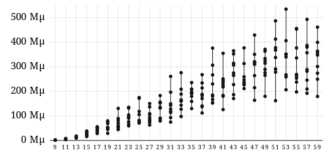</a>


<a id="fig-7-2-2-2-92"></a>**图 92.** 当 $q$ 为奇数时, 无法用三种颜色给花形斯纳克图 $J_q$ 的边着色. 算法 C 证明这一点的速度惊人. 图中对每个 $q$ 都给出了九次试验的计算时间 (单位为百万次内存访问).

事实上, 算法 C 所带来的加速往往更为显著. 例如[图 92](#fig-7-2-2-2-92) 表明它怎样迅速解完一系列基于 “花形斯纳克图” 的三着色问题. 习题 176 定义的 $\operatorname{fsnark}(q)$ 是一组有趣的不可满足子句, 在 $18q$ 个变量上共有 $42q+3$ 个子句. 算法 A、B、D 和 L 处理 $\operatorname{fsnark}(q)$ 的运行时间与 $2^q$ 成正比, 所以远远超出了图的范围——$q=19$ 时就已大大超过十亿次内存访问了. 而用同样多的时间, 算法 C 便能解决 $q=99$ 的情形 (因而胜出 24 个数量级)! 另一方面, 对于[图 92](#fig-7-2-2-2-92) 中看似线性的行为, 目前还没有令人满意的理论解释.

**不可满足性证书.** 当 SAT 求解器报告给定实例可满足时, 它还给出一组互异的字面值, 从中很容易检验每个子句都已满足. 但若报告是<em>否定的</em>——UNSAT——我们对这个判断的真实性有多大把握? 也许实现中有一个微妙的错误; 毕竟, 大而复杂的程序以毛病多著称, 计算机硬件也不完美. 所以一个否定的答案可能不只让问题无法满足, 还会让程序员和用户都不满意.

<a id="pdf-274"></a><a id="p-254"></a>

我们已经看到, 构造一个归结反驳就能严格证明不可满足性; 它是一串以空子句 $\epsilon$ 结束的归结步骤, 如[图 91](#fig-7-2-2-2-91) 所示. 但是这样的反驳实际上相当于构造一张巨大的有向无圈图.

不可满足性还可以用紧凑得多的方式刻画. 对于子句族 $F$, 若子句序列 $(C_1,C_2,\ldots,C_t)$ 满足 $C_t=\epsilon$, 且有
$$
F\land C_1\land\cdots\land C_{i-1}\land\overline C_i\ \vdash_1\ \epsilon,\qquad 1\le i\le t,\tag{119}
$$
便称该序列为 $F$ 的一个<em>不可满足性证书</em>. 这里 ‘$G\vdash_1\epsilon$’ 中的下标 1 表示子句 $G$ 通过<em>单元传播</em>导出矛盾; 若 $C_i$ 是子句 $(a_1\lor\cdots\lor a_k)$, 则 $\overline C_i$ 是单位子句的合取 $(\bar a_1)\land\cdots\land(\bar a_k)$ 的简记.

例如, 取 $F=R$, 即 Rivest 的子句 (6), [图 91](#fig-7-2-2-2-91) 已证明它们不可满足. 这时 $(12,1,2,\epsilon)$ 就是一个不可满足性证书, 因为
$$
\begin{aligned}
R\land\bar1\land\bar2&\vdash_1\bar3\vdash_1\bar4\vdash_1\epsilon&&(\text{用 }12\bar3,\ 23\bar4,\ 341);\\
R\land12\land\bar1&\vdash_1 2\vdash_1\bar4\vdash_1\bar3\vdash_1\epsilon&&(\text{用 }12,\ \bar41\bar2,\ \bar2\bar34,\ 341);\\
R\land12\land1\land\bar2&\vdash_1 4\vdash_1 3\vdash_1\epsilon&&(\text{用 }4\bar12,\ 23\bar4,\ \bar3\bar4\bar1);\\
R\land12\land1\land2&\vdash_1 3\vdash_1 4\vdash_1\epsilon&&(\text{用 }\bar1\bar23,\ \bar2\bar34,\ \bar3\bar4\bar1).
\end{aligned}
$$

不可满足性证书给出的证明确实足以令人信服, 因为由 (119) 可知, 每当 $F,C_1,\ldots,C_{i-1}$ 为真时, $C_i$ 都必须为真. 而且对任何给定的子句集 $G$, 都很容易检验是否有 $G\vdash_1\epsilon$, 因为一切都是强制的, 无须作任何选择. 单元传播就像水往低处流; 即使不信任生成待验证书的 CDCL 求解器, 对单元传播的实现是否正确, 我们仍可以有相当大的把握.

E. Goldberg 和 Y. Novikov [<em>Proceedings of DATE: Design, Automation and Test in Europe</em> **6**,1 (2003), 886–891] 指出, CDCL 求解器在运行时, 自然就产生这样的证书作为副产品:

**定理 G.** <em>若算法 C 失败终止, 则它所学得的子句序列 $(C_1,C_2,\ldots,C_t)$ 是一个不可满足性证书.</em>

<em>证明.</em> 只须证明, 每当算法 C 学得一个子句 $C'=\bar l'\lor\bar b_1\lor\cdots\lor\bar b_r$ 时, 若在算法已知的子句后面附加单位子句 $(l')\land(b_1)\land\cdots\land(b_r)$, 就能通过单元传播推出 $\epsilon$. 要点在于, $C'$ 实质上由反复归结而得:
$$
C'=\bigl(\cdots((C\mathbin{\diamond}R_{l_1})\mathbin{\diamond}R_{l_2})\mathbin{\diamond}\cdots\bigr)\mathbin{\diamond}R_{l_s},\tag{120}
$$
其中 $C$ 是原来的冲突子句, $R_{l_1},R_{l_2},\ldots,R_{l_s}$ 是步骤 C7 构造 $C'$ 时被除去的各个字面值的理由. 更确切地说, 有 $C=A_0$, $R_{l_i}=l_i\lor A_i$, 其中 $A_0\cup A_1\cup\cdots\cup A_s$ 的所有字面值均为假 (其补出现在轨迹中); 且
$$
\begin{aligned}
\bar l_i&\in A_0\cup\cdots\cup A_{i-1},\qquad 1\le i\le s;\\
A_0\cup A_1\cup\cdots\cup A_s&=\{\bar l',\bar l_1,\ldots,\bar l_s,\bar b_1,\ldots,\bar b_r\}.
\end{aligned}\tag{121}
$$
所以由已知的子句加上 $b_1,\ldots,b_r$ 以及 $l'$, 利用子句 $R_{l_s}$ 就会强制 $l_s$. 接着利用 $R_{l_{s-1}}$ 就会强制 $l_{s-1}$. 如此下去. $\blacksquare$

<a id="pdf-275"></a><a id="p-255"></a>

由于这个证明中的单位字面值是按 (120) 中归结步骤的逆序 $l_s,l_{s-1},\ldots,l_1$ 传播的, 这种验证证书的程序被称为 “逆向单元传播” [见 A. Van Gelder, <em>Proc. Int. Symp. on Artificial Intelligence and Math.</em> **10** (2008), 9 页, 网上编号 ISAIM2008].

注意, 定理 G 的证明并没有断言逆向单元传播一定会重建算法 C 学得子句时所用的确切推理. 在典型情形中, 通常存在由 $\vdash_1$ 步骤组成的许多条通向 $\epsilon$ 的下坡路. 我们所证明的只是, 从一次冲突中学得到的每个子句, 都意味着至少存在一条这样的下坡路.

算法 C 的一次典型运行中, 学到的许多子句不过是 “在黑暗中乱发的子弹”, 事后才知道瞄准的是没有成果的方向. 因此定理 G 中的证书通常比证明不可满足性所实际必需的要长. 例如, 算法 C 在反驳 $\operatorname{waerden}(3,10;97)$ 时学到约 53000 个子句, 反驳 $\operatorname{fsnark}(99)$ 时学到约 135000 个; 但后来实际用到的, 在前者中还不到 50000 个, 在后者中还不到 47000 个. 习题 284 说明怎样在验证不可满足性证书的过程中把它缩短.

然而这里发生了一个意想不到的困难: 验证一个证书所用的时间可能比生成它还长! 例如只用 2.72 亿次内存访问就找到了 $\operatorname{waerden}(3,10;97)$ 的一个证书, 而用直接的单元传播验证它, 实际上用了 22 <em>亿</em>次内存访问. 问题越大, 这个差距就越是显著, 因为简单的验证程序必须在内存中保持全部子句为活动的. 如果有一百万个活动子句, 便有两百万个字面值在受监视; 因此每次改变一个字面值都需要对数据结构作许多次更新.

解决办法是给证书验证程序再加些提示. 我们马上会看到, 算法 C <em>并不</em>在内存里保留所有学得的子句; 它有系统地清除收藏中的一部分, 使总数保持适当. 此时还可以告诉证书验证程序, 那些被清除的子句以后不会再与证明有关.

进一步的改进还可以让带注解的证书容纳更强的证明规则, 例如 Tseytin 的扩展归结和基于广义自足集的技术; 见 N. Wetzler、M. J. H. Heule 和 W. A. Hunt, Jr., <em>LNCS</em> **8561** (2014), 422–429.

只要一个子句族有不可满足性证书, 算法 C 的一种变体实际上就能找到一个长不了多少的证书. (见习题 386.)

**\*清除无益的子句.** 发生了几千次冲突之后, 算法 C 也就学到了几千个新子句. 新子句引导着查找, 使我们避开徒劳的路径; 不过它们也拖慢了传播过程, 因为必须监视它们.

我们已经看到证书通常可以缩短; 因此知道, 学得的子句中有许多大概永远也用不上了. 为此算法 C 定期给积累的子句排个次序, 设法剔除那些看起来弊大于利的.

<a id="pdf-276"></a><a id="p-256"></a>

> 在我看来, 人的头脑起初就像一间空空的小阁楼, 你可以随意挑选家具往里面放. …… 手艺高明的工匠极其留心, 看看自己往脑子这间阁楼里搬了些什么. …… 以为这间小屋的墙壁富有弹性, 想撑多大就撑多大, 那是错的. …… 因此最要紧的是, 别让无用的事实把有用的挤出去.
>
> —— 夏洛克·福尔摩斯, 《血字的研究》 (1887)

学得 $M\ge M_{\mathrm p}$ 个子句且到达相当稳定的状态 (步骤 C5) 时, 算法 C 便开始一个专门的子句筛选过程. 为把问题讲得具体些, 继续看我们的老例子 $\operatorname{waerden}(3,10;97)$. 若 $M_{\mathrm p}$ 大得从来不丢弃任何子句, 一次典型的运行在证明不可满足之前, 将学得约 48000 个子句, 并作约 8 亿次内存访问. 但若 $M_{\mathrm p}=10000$, 则将学得约 50000 个子句, 计算时间却下降到约 5 亿次内存访问. 在后一种情形下, 内存中学得子句的总数很少超过一万.

事实上, 我们就取 $M_{\mathrm p}=10000$, 仔细看看作者第一次实验时究竟发生了什么. 算法 C 在学得 10002 个子句之后暂停下来察看形势. 不过, 由于习题 271 中讨论的子句丢弃机制, 此时这 10002 个子句只有 6252 个实际留在内存里. 有些子句长度为 2, 最大长度为 24, 中位数为 11; 下面列出完整的频数分布:

<table id="sat-clause-histogram"><thead><tr><th>长度</th><th>2</th><th>3</th><th>4</th><th>5</th><th>6</th><th>7</th><th>8</th><th>9</th><th>10</th><th>11</th><th>12</th><th>13</th><th>14</th><th>15</th><th>16</th><th>17</th><th>18</th><th>19</th><th>20</th><th>21</th><th>22</th><th>23</th><th>24</th></tr></thead><tbody>
<tr><td>子句数</td><td>2</td><td>9</td><td>49</td><td>126</td><td>216</td><td>371</td><td>542</td><td>719</td><td>882</td><td>1094</td><td>661</td><td>540</td><td>414</td><td>269</td><td>176</td><td>111</td><td>35</td><td>20</td><td>10</td><td>3</td><td>1</td><td>1</td><td>1</td></tr>
</tbody></table>

短子句往往更有用, 因为它们能较快地约化为单位子句.

若一个学得子句是轨迹中某个字面值的理由, 就不能清除. 在我们的例子中, 6252 个子句里有 12 个属于这一类; 例如, $\overline{30}$ 出现在轨迹的第 10 层, 因为此前已经学到了 ‘$\overline{30}\ \overline{33}\ \overline{39}\ 41\ \overline{42}\ \overline{45}\ 46\ \overline{48}\ \overline{54}\ \overline{57}$’, 以后作归结时可能还需要知道这个子句.

清除过程将试图删去现有学得子句的至少一半, 使至多 3126 个留存. 那 12 个充当理由的子句不能动; 所以希望忘掉其余 6240 个中的 3114 个. 应当逐出哪些呢?

人们试过许多启发式方法, 实践中最成功的那些以 Gilles Audemard 与 Laurent Simon 所谓的 “字面值块距离” 为基础 [见 <em>Proc. Int. Joint Conference on Artificial Intelligence</em> **21** (2009), 399–404]. 他们观察到, 轨迹的每一层都可以看作一块多少有些关联的变量; 因此, 若一个长子句的字面值都只在一两层上, 而一个短子句的字面值分属三层以上, 那个长子句就可能比短子句更有用.

设子句 $C=l_1\lor\cdots\lor l_r$ 的所有字面值都出现在轨迹中, 或以正的形式 $l_j$ 出现, 或以负的形式 $\bar l_j$ 出现. 可以按层将它们分组, 设恰有 $p+q$ 层出现, 其中 $p$ 层至少含一个正的 $l_j$, 其余 $q$ 层只含 $\bar l_j$. 则称 $(p,q)$ 为 $C$ 关于这条轨迹的<em>特征标</em>, $p+q$ 就是字面值块距离. 例如, 在作者的试验中, 从 $\operatorname{waerden}(3,10;97)$ 学到的第一<a id="pdf-277"></a><a id="p-257"></a>个子句是
$$
\overline{11}\ \overline{16}\ \overline{21}\ \overline{26}\ \overline{36}\ \overline{46}\ \overline{51}\ 61\ 66\ 91;\tag{122}
$$
后来, 轮到给子句排名以便清除时, 这些字面值的值及轨迹层由 $\mathtt{VAL}(11),\mathtt{VAL}(16),\ldots,\mathtt{VAL}(91)$ 给出, 它们是
$$
20\quad21\quad21\quad21\quad20\quad15\quad16\quad8\quad14\quad20.
$$
所以 $61$ 在第 $8\gg1=4$ 层为真; $\overline{46}$ 和 $66$ 在第 $15\gg1=14\gg1=7$ 层为真; $\overline{51}$ 在第 8 层为假; 其余各项在第 10 层有真有假; 因此 (122) 关于当前轨迹有 $p=3$, $q=1$.

若 $C$ 的特征标为 $(p,q)$, $C'$ 的特征标为 $(p',q')$, 其中 $p\le p'$, $q\le q'$ 且 $(p,q)\ne(p',q')$, 则可预期 $C$ 比 $C'$ 更可能对以后的传播有用. 同一结论在 $p+q=p'+q'$ 且 $p<p'$ 时看来也有道理, 因为至少要有 $p+1$ 个不同层上的字面值改变符号, $C'$ 才有可能强制什么. 从 $\operatorname{waerden}(3,10;97)$ 得到的下面这些详细数据证实了这样的直觉:


$$
\begin{pmatrix}
0&4&17&22&30&54&67&99&17\\
17&81&191&395&360&404&438&66&6\\
63&232&463&536&521&386&117&6&0\\
52&243&291&298&308&112&22&0&0\\
18&59&86&77&53&7&0&0&0\\
0&8&3&10&0&0&0&0&0\\
0&0&1&0&0&0&0&0&0
\end{pmatrix}\qquad\begin{pmatrix}
0&1&9&15&21&16&15&3&0\\
7&26&74&107&82&57&16&1&0\\
20&74&104&86&61&21&9&0&0\\
13&40&37&16&14&4&0&0&0\\
6&10&9&4&1&1&0&0&0\\
0&1&1&0&0&0&0&0&0\\
0&0&0&0&0&0&0&0&0
\end{pmatrix}
$$


左边的矩阵给出 6240 个可供筛选的子句中具有给定特征标 $(p,q)$ 的数目, 其中 $1\le p\le7$, $0\le q\le8$; 右边的矩阵则给出假如一个也不删, 将来有多少会用于解决冲突. 例如, 有 536 个学得子句的 $p=q=3$, 其中实际上只有 86 个有用. [图 93](#fig-7-2-2-2-93) 用图形表示这些数据, 灰色矩形的面积对应于左矩阵, 叠在上面的黑色矩形的面积对应于右矩阵. 我们不能预知未来, 但 $(p,q)$ 较小时, 黑色与灰色的面积之比往往较大.


<a href="../../assets/volume4b/figures/sat-fig93.svg">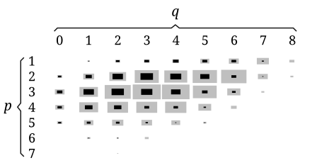</a>


<a id="fig-7-2-2-2-93"></a>**图 93.** 有 $p$ 个含正字面值的层和 $q$ 个全为负字面值的层的学得子句. 灰色的以后再也用不上了. 可惜, 除非能未卜先知, 否则很难预先分辨灰与黑.

不过细心的读者会纳闷, 这些特征标是怎样求得的, 因为只有等到所有变量都出现在轨迹中, 才能算出所有子句的特征标——可那要到所有子句都满足时才会发生! 答案 [见 A. Goultiaeva 和 F. Bacchus, <em>LNCS</em> **7317** (2012), 30–43] 是: 只要稍微改变算法 C 的正常行为, 就完全可以做一次 “完整运行”, 使<em>每个</em>变量都获得一个值. 我们可以<a id="pdf-278"></a><a id="p-258"></a>在每次发生冲突之后继续走下去, 直到所有传播都停止, 然后继续用同一方法构造轨迹, 直到每个变量都出现在某一层上, 把原来要立即做的冲突处理与回跳延后. 冲突可能已在好几层上发生, 不过可以放心地随后再解决它们, 到那时才学到新子句. 同时, 利用完整的轨迹就可以根据 VAL 域计算特征标. 回跳之后这些 VAL 域进入 OVAL 域, 因而每块中的变量往往能保持它们的关系.

作者的算法 C 的实现给每个子句 $c$ 赋予一个八位值
$$
\mathtt{RANGE}(c)\gets\min\bigl(\lfloor16(p+\alpha q)\rfloor,255\bigr),\tag{123}
$$
其中 $\alpha$ 是一个参数, $0\le\alpha\le1$. 若 $c$ 是轨迹中某个字面值的理由, 还要置 $\mathtt{RANGE}(c)\gets0$; 若 $c$ 在第 0 层已满足, 则置 $\mathtt{RANGE}(c)\gets256$. 若范围值为 $j$ 的子句有 $m_j$ 个, 而希望在内存中最多保留 $T$ 个子句, 就求最大的 $j\le256$ 使得
$$
s_j=m_0+m_1+\cdots+m_{j-1}\le T.\tag{124}
$$
然后保留 $\mathtt{RANGE}(c)<j$ 的所有子句, 再从 $\mathtt{RANGE}(c)=j$ 的并列者中取 $T-s_j$ 个 (除非 $j=256$). 当 $\alpha$ 取相当高的值 $15/16=.9375$ 时, 这条规则实质上是尽可能多地保留字面值块距离较小的子句; $p+q$ 固定时则偏向 $p$ 小的那些.

例如, 取 $\alpha=15/16$ 和[图 93](#fig-7-2-2-2-93) 中的数据, 就要分别在 $q\le(5,4,3,2,0)$ 时保存 $p=(1,2,3,4,5)$ 的子句. 这样得到 $s_{95}=12+3069$ 个子句, 距目标 $T=3126$ 只差 45. 所以还要在 $\mathtt{RANGE}(c)=95$, $(p,q)=(5,1)$ 的 59 个子句中选出 45 个并列者.

可以用第二种启发式指标 $\mathtt{ACT}(c)$ 来打破平局, 这个指标称为 “子句活跃度”, 类似于变量的活跃度分数, 但更容易维护. 例如, 若子句 $c$ 用于解决过编号为 3、47、95、99 和 100 的冲突, 则
$$
\mathtt{ACT}(c)=\varrho^{-3}+\varrho^{-47}+\varrho^{-95}+\varrho^{-99}+\varrho^{-100}.\tag{125}
$$
这个阻尼因子 $\varrho$ (通常为 $.999$) 与用于变量活跃度的因子 $\rho$ 无关. 对于[图 93](#fig-7-2-2-2-93), 将具有 $(p,q)=(5,1)$ 的 59 个子句按 ACT 分数递增排列, 灰与黑的图样如下

<a href="../../assets/volume4b/figures/sat-activity59.svg"></a>

所以若保留活跃度最高的 45 个, 最终有用的 10 个当中我们就挑中了 8 个. (子句活跃度并非完美的预测指标, 不过它通常比这个例子让人以为的要稍好一些.)

习题 287 和 288 详细说明了怎样依照这些想法来清除子句. 还剩一个问题: 完成一次清除之后, 应当把下一次安排在什么时候? 采用两个参数 $\Delta_{\mathrm p}$ 与 $\delta_{\mathrm p}$ 效果不错. 初始时 $M_{\mathrm p}=\Delta_{\mathrm p}$; 每次清除之后, 置 $\Delta_{\mathrm p}\gets\Delta_{\mathrm p}+\delta_{\mathrm p}$, $M_{\mathrm p}\gets M_{\mathrm p}+\Delta_{\mathrm p}$. 例如, 若 $\Delta_{\mathrm p}=10000$, $\delta_{\mathrm p}=100$, 则约在学到 $10000,20100,30300,40600,\ldots,k\Delta_{\mathrm p}+\binom k2\delta_{\mathrm p}$,<a id="pdf-279"></a><a id="p-259"></a> $\ldots$ 个子句时发生清除; 第 $k$ 轮开始时的子句数约为 $20000+200k=2\Delta_{\mathrm p}+2k\delta_{\mathrm p}$. (见习题 289.)

这段讨论所依据的是 $\operatorname{waerden}(3,10;97)$, 它还算是个简单的问题. 对于更大的问题, 清除子句给算法 C 带来的好处自然要大得多. 例如, $\operatorname{waerden}(3,13;160)$ 只比 $\operatorname{waerden}(3,10;97)$ 大一点. 取 $\Delta_{\mathrm p}=10000$, $\delta_{\mathrm p}=100$, 用 1320 亿次内存访问就运行完毕, 此时已学得 950 万个子句, 却仅占用 50.3 万个 MEM 单元. 如果不清除子句, 它只学得 710 万个子句就证明了不可满足性, 代价却高出十倍以上: 43070 亿次内存访问, 以及 1.02 亿个 MEM 单元.

**\*冲刷字面值和重新开始.** 算法 C 在 C5 中给自己安排中断, 不仅为了清除子句, 也为了 “冲刷字面值”, 因为轨迹中某些决策或许并不是最好的选择. 解一个棘手的可满足性问题, 需要小心地权衡两端: 我们不希望困在查找空间中走错的地方, 也不想 “连孩子带洗澡水一起倒掉”, 丢失辛苦得来的成果. Peter van der Tak、Antonio Ramos 和 Marijn Heule [<em>J. Satisfiability, Bool. Modeling and Comp.</em> **7** (2011), 133–138] 找到了一个很好的折中办法; 他们利用活跃度分数 $\mathtt{ACT}(k)$ 的变化趋势, 定期使轨迹重新焕发活力.

回到[表 3](#tab-7-2-2-2-3) 来说明他们的方法. 学到子句 (116) 后, 算法 C 会在第 17 层置 $L_{44}\gets57$, 从而更新轨迹; 因为 $39,42,\ldots,63$ 都已成为真, 所以这将强制 $L_{45}\gets\overline{66}$; 另外的正字面值 $6,58,82,86,95,96$ 也将依某种次序加入轨迹. 然后步骤 C5 就可能介入, 建议考虑冲刷当前已有赋值的 $F=52$ 个字面值中的一部分或全部.

第 $1,2,3,\ldots,17$ 层上的决策字面值 $\overline{53},55,44,\ldots,51$ 在各层开始时被选中, 都是因为它们当时的活跃度分数最高. 但是活跃度分数在不断更新, 旧分数也许已经相当脱离现状. 例如, 在学得 (116) 的过程中——见 (115)——刚刚提高了 $\mathtt{ACT}(53),\mathtt{ACT}(27),\mathtt{ACT}(36),\mathtt{ACT}(70),\ldots$. 因此, 起初的 17 个决策中完全可能已有好几个看来不再明智, 因为那些字面值一直没有参与最近的任何冲突.

设 $x_k$ 是不在当前轨迹的所有变量中 $\mathtt{ACT}(k)$ 最大的一个变量. 这样的 $k$ 很容易找到 (见习题 290). 现在作一个思想实验, 想想假如此时一路跳回第 0 层重新开始, 会怎样. 回想一下, 按相位保存策略, 取消变量赋值时, 要在置 $\mathtt{VAL}(j)\gets-1$ 之前先置 $\mathtt{OVAL}(j)\gets\mathtt{VAL}(j)$.

假如现在从步骤 C6 以 $d\gets1$ 重新开始, 活跃度超过 $\mathtt{ACT}(k)$ 的所有变量都将获得它们原先的值 (不过次序可能不同), 因为相应的字面值或者作为决策, 或者通过强制传播进入轨迹. 历史多多少少会重演, 因为旧赋值没有引起任何冲突, 而且相位也已保存.

因此大可避免这番来回撤销又设置的大部分工作, 办法是重新利用轨迹, 只往回跳一段, 跳到当前的活跃度分数使局面大为改观的第一<a id="pdf-280"></a><a id="p-260"></a>层:
$$
\begin{aligned}
&\text{置 }d'\gets0.\quad\text{当 }\mathtt{ACT}(|L_{i_{d'+1}}|)\ge\mathtt{ACT}(k)\text{ 时, 置 }d'\gets d'+1.\\
&\text{然后, 若 }d'<d,\text{ 回跳至第 }d'\text{ 层.}
\end{aligned}\tag{126}
$$
这个技术称为 “字面值冲刷”, 因为它去掉了第 $d'+1$ 至第 $d$ 层的字面值, 让其他字面值保持赋值. 它能有效地将查找引入新的区域, 又不至于像完全重新开始那样剧烈.

例如, 在[表 3](#tab-7-2-2-2-3) 中, $\mathtt{ACT}(49)$ 可能超过其他每个未赋值变量的活跃度分数; 还可能超过第 15 层决策字面值 $\overline{46}$ 的活跃度 $\mathtt{ACT}(46)$. 如果前 14 个决策的活跃度 $\mathtt{ACT}(53),\mathtt{ACT}(55),\ldots,\mathtt{ACT}(37)$ 都 $\ge\mathtt{ACT}(49)$, 我们就冲刷第 $d'=14$ 层以上的所有字面值 $L_{25},L_{26},\ldots$, 并开始一个新的第 15 层.

注意, 被冲刷的字面值中, 除了 $\overline{46}$ 以外, 可能真有些活跃度比谁都高. 在这种情形下, 它们会在 49 登场之前重新把自己插入轨迹. 不过最终, 下一次冲突发生前, 字面值 49 将开创一个新层. (见习题 291.)

经验表明冲刷确实可能大有助益. 另一方面, 若让我们放弃了富有成果的探索方向, 冲刷也会有害. 求解器运转顺畅, 有用的子句成打地学进来时, 我们可不想横生枝节, 扰乱局面. 因此 Armin Biere 引入一种有用的统计量, 称为<em>灵活度</em>, 它通常与在某个给定时刻冲刷是否合宜有关. 他的想法 [<em>LNCS</em> **4996** (2008), 28–33] 简单得很漂亮: 维护一个 32 位整数变量 AGILITY, 初值为零. 每当在 C4、C6 或 C9 中把一个字面值 $l$ 放到轨迹上, 就按下式更新灵活度
$$
\mathtt{AGILITY}\gets\mathtt{AGILITY}-(\mathtt{AGILITY}\gg13)
+\bigl(((\mathtt{OVAL}(|l|)-\mathtt{VAL}(|l|))\mathbin{\&}1)\ll19\bigr).\tag{127}
$$
换言之, 分数 $\mathtt{AGILITY}/2^{32}$ 实质上先乘以 $1-\delta$, 若 $l$ 的新极性不同于先前的极性, 则再加上 $\delta$, 其中 $\delta=2^{-13}\approx.0001$. 灵活度高, 表示最近的许多传播都在翻转变量的值、尝试新的可能性; 灵活度低, 则表示算法基本上陷在车辙里, 轮子空转而毫无进展.

<a id="tab-7-2-2-2-4"></a>**表 4　冲刷, 还是不冲刷?**

设置 $M_{\mathrm f}\gets M+\Delta_{\mathrm f}$ 时, 取 $a=\mathtt{AGILITY}/2^{32}$, 并令 $\psi=1/6$, $\theta=17/16$.

<table id="sat-flush-table4"><thead><tr><th>若 $\Delta_{\mathrm f}$ 为</th><th>则在此条件下冲刷</th><th>若 $\Delta_{\mathrm f}$ 为</th><th>则在此条件下冲刷</th><th>若 $\Delta_{\mathrm f}$ 为</th><th>则在此条件下冲刷</th></tr></thead><tbody>
<tr><td>1</td><td>$a\le \psi\approx .17$</td><td>32</td><td>$a\le \theta^{5}\psi\approx .23$</td><td>1024</td><td>$a\le \theta^{10}\psi\approx .31$</td></tr>
<tr><td>2</td><td>$a\le \theta\psi\approx .18$</td><td>64</td><td>$a\le \theta^{6}\psi\approx .24$</td><td>2048</td><td>$a\le \theta^{11}\psi\approx .32$</td></tr>
<tr><td>4</td><td>$a\le \theta^{2}\psi\approx .19$</td><td>128</td><td>$a\le \theta^{7}\psi\approx .25$</td><td>4096</td><td>$a\le \theta^{12}\psi\approx .34$</td></tr>
<tr><td>8</td><td>$a\le \theta^{3}\psi\approx .20$</td><td>256</td><td>$a\le \theta^{8}\psi\approx .27$</td><td>8192</td><td>$a\le \theta^{13}\psi\approx .37$</td></tr>
<tr><td>16</td><td>$a\le \theta^{4}\psi\approx .21$</td><td>512</td><td>$a\le \theta^{9}\psi\approx .29$</td><td>16384</td><td>$a\le \theta^{14}\psi\approx .39$</td></tr>
</tbody></table>

有了灵活度的概念, 终于可以说明算法 C 在步骤 C5 发现 $M\ge M_{\mathrm f}$ 时究竟做什么. 首先将 $M_{\mathrm f}$ 重置为 $M+\Delta_{\mathrm f}$, 其中 $\Delta_{\mathrm f}$ 是<a id="pdf-281"></a><a id="p-261"></a>一个 2 的幂, 由 “迟缓倍增” 序列 $\langle1,1,2,1,1,2,4,1,\ldots\rangle$ 决定; 下文和习题 293 将讨论这个序列. 然后根据 $\Delta_{\mathrm f}$, 把灵活度与[表 4](#tab-7-2-2-2-4) 所给的阈值进行比较. (若想增加或减少冲刷的次数, 可以调高或调低该表中的参数 $\psi$.) 若灵活度足够小, 就找到 $x_k$ 并执行 (126). 若灵活度很大, 或者 $d'=d$, 什么也没有变化; 否则 (126) 就借助于 C8 的操作冲刷掉了一些字面值.

**蒙特卡罗算法.** 现在来谈谈处理可满足性问题的一种全然不同的方法. 它通过纯粹启发式的随机方法来找解, 常称为<em>随机局部查找</em>. 这类方法虽然没有成功的保证, 我们在日常生活中却经常使用. 其中最简单的一种可满足性技术是 Jun Gu [见 <em>SIGART Bulletin</em> **3**,1 (1992 年 1 月), 8–12] 和 Christos Papadimitriou [<em>FOCS</em> **32** (1991), 163–169] 在作更一般的研究时顺带提出的:

> “从任意一个真值赋值开始. 只要还有未满足的子句, 就任选其中一个, 随机翻转其中一个字面值.”

有些程序员排错时东改一下、西改一下, 与此法颇为相似; 我们知道这样的 “盲改” 很不明智, 因为它往往会引入新错. 但对可满足性来说, 这个想法确有可取之处, 我们就把它写成算法:

**算法 P** (<em>用随机游走求解可满足性.</em>) 给定 $n$ 个布尔变量 $x_1\ldots x_n$ 上的 $m$ 个非空子句 $C_1\land\cdots\land C_m$, 本算法或者找到一个解, 或者在作了 $N$ 次尝试后失败终止.

**P1.** [初始化.] 为 $x_1\ldots x_n$ 赋随机布尔值. 置 $j\gets0$, $s\gets0$, $t\gets0$. (作了 $t$ 次翻转之后, 已知有 $s$ 个子句得到满足.)

**P2.** [成功?] 若 $s=m$, 成功终止, 解为 $x_1\ldots x_n$. 否则置 $j\gets(j\bmod m)+1$. 若 $x_1\ldots x_n$ 满足子句 $C_j$, 则置 $s\gets s+1$ 并重复本步.

**P3.** [结束?] 若 $t=N$, 失败终止.

**P4.** [翻转一位.] 设子句 $C_j$ 为 $(l_1\lor\cdots\lor l_k)$. 随机选取指标 $i\in\{1,\ldots,k\}$, 改变变量 $|l_i|$ 的值, 使字面值 $l_i$ 为真. 置 $s\gets1$, $t\gets t+1$, 返回 P2.　■

例如, 假设给定 (7) 的七个子句 $R'$. 此时 $m=7$, $n=4$, 有两个解 $01{*}1$. 在这个例子中, 每个非解都恰好违反一个子句; 例如 1100 违反子句 $\bar1\bar23$, 因此 P4 将以相同的概率分别把 1100 改为 0100、1000 或 1110, 其中只有一个离解更近. 精确的分析 (见习题 294) 表明, 算法 P 平均作 $8.25$ 次翻转就会找到一个解. 这比对全部 $2^n=16$ 种可能穷举查找并没有什么改进; 不过, 这样小的例子并不能告诉我们 $n$ 很大时会有怎样的情形.

Papadimitriou 注意到, 算法 P 用在 2SAT 问题上相当有效, 因为这时候每次翻转都有约一半的机会取得<a id="pdf-282"></a><a id="p-262"></a>进展. 几年之后, Uwe Schöning [<em>Algorithmica</em> **32** (2002), 615–623] 发现这个算法用在 3SAT 实例上也出奇地好, 尽管 $k>2$ 时 P4 中的翻转往往会走 “错误的方向”:

**定理 U.** <em>如果给定的子句可满足, 且每个子句至多有三个字面值, 则算法 P 作至多 $n$ 次翻转, 就能以 $\Omega((3/4)^n/n)$ 的概率成功.</em>

<em>证明.</em> 必要时将变量取补, 就可假定 $0\ldots0$ 是一个解; 在这个假定下, 每个子句至少有一个负字面值. 令 $X_t=x_1+\cdots+x_n$ 为作了 $t$ 次翻转之后 1 的数目. 每次翻转都使 $X_t$ 改变 $\pm1$, 我们要证明 $X_t$ 变成 0 的机会不可忽略. 在 P1 之后, 随机变量 $X_0$ 以概率 $\binom nq/2^n$ 等于 $q$.

含三个负字面值的子句对算法 P 来说是好消息, 因为只有当三个变量全为 1 时才会违反它; 在这种情形下, 翻转<em>总能</em>使 $X_t$ 减小. 类似地, 若违反一个有两个负字面值、一个正字面值的子句, 翻转有 $2/3$ 的机会取得进展. 唯有造成困难的子句仅含一个负字面值时, 才会出现最坏情形. 遗憾的是, 据我们所知, 每个子句都有可能属于这种最坏情形.

$X_t$ 依赖于子句的具体格局, 研究它不如研究另一个随机变量 $Y_t$ 容易得多. 定义如下: 初始时 $Y_0=X_0$; 以后仅当 P4 翻转了下标最小的负字面值时才令 $Y_{t+1}=Y_t-1$, 否则 $Y_{t+1}=Y_t+1$. 例如, 处理被违反的子句 $x_3\lor\bar x_5\lor\bar x_8$ 后, 在三种可能的情形下分别有 $X_{t+1}=X_t+(+1,-1,-1)$, 而 $Y_{t+1}=Y_t+(+1,-1,+1)$. 此外, 若子句含有的字面值少于三个, 还要让 $Y_{t+1}$ 再吃点亏, 使它只能以 $1/3$ 的概率成为 $Y_t-1$. (例如, 对于 $x_4\lor\bar x_6$ 这样的子句, 当翻转 $x_6$ 时, 仅在 $2/3$ 的情形下置 $Y_{t+1}=Y_t-1$; 否则 $Y_{t+1}=Y_t+1$.)

显然对所有 $t$ 都有 $X_t\le Y_t$. 因此, 作了 $t$ 次翻转后有 $\Pr(X_t=0)\ge\Pr(Y_t=0)$; 而且按照我们的定义, 计算 $\Pr(Y_t=0)$ 相当容易, 因为 $Y_t$ 不依赖于当前子句 $j$:
$$
\Pr(Y_{t+1}=Y_t-1)=1/3\qquad\text{且}\qquad
\Pr(Y_{t+1}=Y_t+1)=2/3\qquad\text{当 }Y_t>0.
$$

诚然, 7.2.1.6 节所发展的随机游走理论告诉我们怎样计算以下历程的数目: 从 $Y_0=q$ 开始, $Y_t$ 增大 $p$ 次、减小 $p+q$ 次后, 以 $Y_t=0$ 结束, 而且在 $0\le t<2p+q$ 时始终为正. 它就是式 7.2.1.6–(23) 的 “选票数”
$$
C_{p,p+q-1}=\frac{q}{2p+q}\binom{2p+q}{p}.\tag{128}
$$
所以, $Y_0=q$ 且 $Y_t$ 在 $t=2p+q$ 时首次达到 0 的概率恰为
$$
f(p,q)=\frac1{2^n}\binom nq\frac{q}{2p+q}\binom{2p+q}{p}
\left(\frac13\right)^{p+q}\left(\frac23\right)^p.\tag{129}
$$

<a id="pdf-283"></a><a id="p-263"></a>

$p$ 和 $q$ 的每组取值都给出了算法 P 成功概率的一个下界; 习题 296 表明取 $p=q\approx n/3$ 便可得到定理 U 所声称的结果. $\blacksquare$

定理 U 也许看似没有什么用处, 因为当 $N=n$ 时, 它只预言了一个指数小的成功概率. 但如果一开始没有成功, 我们可以再试再试, 每次用不同的随机选择来重复算法 P. 而且若重复 $Kn(4/3)^n$ 次, 只要 $K$ 足够大, 除非这些子句不能同时满足, 否则几乎一定能找到一个解.

事实上, 还能说得更多, 因为定理 U 的证明没有充分利用 (129). 习题 297 以特别富有启发性的方式把分析更推进一步, 证明了一个强得多的结果:

**推论 W.** <em>当 $N=2n$, 对一组可满足的三元子句应用 $K(4/3)^n$ 次算法 P 时, 成功概率超过 $1-e^{-K/2}$.</em> $\blacksquare$

若子句 $C_1\land\cdots\land C_m$ 不可满足, 算法 P 就永远不能确凿地证实这个事实. 但如果重复 $100(4/3)^n$ 次仍未得到解, 推论 W 告诉我们, 可满足问题如此多次都漏解的机会小得难以置信 (小于 $10^{-21}$). 在这种情形下认定无解, 算得上很有把握.

所以算法 P 在所有 $2^n$ 个二进制向量构成的巨大空间里随机游走, “闭着眼” 也有出奇好的机会找到解; 不难想象, 如果能设计睁大眼睛走路的随机游走方法, 应当还能取得更好的结果. 因此许多人试验过一些策略, 力图在每次翻转时明智地选择方向. 其中一个最简单也最好的改进通常称为 WalkSAT, 由 B. Selman、H. A. Kautz 和 B. Cohen 提出 [<em>Nat. Conf. Artificial Intelligence</em> **12** (1994), 337–343]:

**算法 W** (<em>WalkSAT.</em>) 给定 $n$ 个布尔变量 $x_1\ldots x_n$ 上的 $m$ 个非空子句 $C_1\land\cdots\land C_m$, 以及一个 “避免贪心” 参数 $p$, 本算法或者找到一个解, 或者在作了 $N$ 次尝试后失败终止. 它使用辅助阵列 $c_1\ldots c_n$, $f_0\ldots f_{m-1}$, $k_1\ldots k_m$ 和 $w_1\ldots w_m$.

**W1.** [初始化.] 为 $x_1\ldots x_n$ 赋随机布尔值. 另置 $r\gets t\gets0$, $c_1\ldots c_n\gets0\ldots0$. 然后对 $1\le j\le m$, 置 $k_j$ 为 $C_j$ 中为真的字面值数; 若 $k_j=0$, 置 $f_r\gets j$, $w_j\gets r$, $r\gets r+1$; 或者若 $k_j=1$ 且 $C_j$ 中唯一为真的字面值是 $x_i$ 或 $\bar x_i$, 则置 $c_i\gets c_i+1$. (现在 $r$ 为未满足子句的数目, $f$ 阵列列出了这些子句. 数 $c_i$ 是变量 $x_i$ 的 “代价” 或 “破坏数”, 即若翻转 $x_i$ 将新变为假的子句数.)

**W2.** [结束?] 若 $r=0$, 成功终止, 解为 $x_1\ldots x_n$. 否则若 $t=N$, 失败终止.

**W3.** [选取 $j$.] 置 $j\gets f_q$, 其中 $q$ 在 $\{0,1,\ldots,r-1\}$ 中均匀随机选取. (换言之, 随机选取一个未满足的子句 $C_j$, 每个这样的子句等可能; 习题 3.4.1–3 讨论了计算 $q$ 的最佳方法.) 设子句 $C_j$ 为 $(l_1\lor\cdots\lor l_k)$.

<a id="pdf-284"></a><a id="p-264"></a>

**W4.** [选取 $l$.] 设 $c$ 为字面值 $\{l_1,\ldots,l_k\}$ 中的最小代价. 若 $c=0$, 或者 $c\ge1$ 且 $U\ge p$, 其中 $U$ 在 $[0\,..\,1)$ 上均匀分布, 则从代价为 $c$ 的字面值中随机选 $l$. (称此选择为 “贪心的”, 因为翻转 $l$ 会使新变为假的子句数最少.) 否则从 $\{l_1,\ldots,l_k\}$ 中随机选 $l$.

**W5.** [翻转 $l$.] 改变变量 $|l|$ 的值, 更新 $r$, $c_1\ldots c_n$, $f_0\ldots f_{r-1}$, $k_1\ldots k_m$, $w_1\ldots w_m$, 使之与新值一致. (习题 302 说明怎样高效地实现 W4 和 W5, 以适合计算机的方式改变数据结构.) 置 $t\gets t+1$, 返回 W2.　■

举例说, 若像上面用算法 P 时那样, 尝试用算法 W 满足 (7) 的七个子句, 取 $x_1x_2x_3x_4=0110$ 将违反 $\bar2\bar34$; 这时 $c_1c_2c_3c_4$ 恰为 0110. 所以 W4 将选取 $x_4$ 来翻转, 得到解 0111. (见习题 303.)

注意, 步骤 W3 把注意力集中在那些变量需要改变的子句上. 而且, 出现在最多未满足子句中的字面值, 也最有可能在选定的子句 $C_j$ 中出现.

若没有无代价的翻转可选, W4 将以概率 $p$ 作非贪心选择. 这个策略使算法不至于被困在一个没有贪心出口的不可满足区域中. S. Seitz、M. Alava 和 P. Orponen 所作的大量实验 [<em>J. Statistical Mechanics</em> (2005 年 6 月), P06006:1–27] 表明, 处理大型随机 3SAT 问题且 $N=\infty$ 时, $p$ 的最佳选择为 $.57$. 例如, 使用这个 $p$, 且有 $m=4.2n$ 个随机三元子句时, 算法 W 的效果好极了: $n=10^4$ 时通常翻转不到 $10000n$ 次便找到解, $10^5\le n\le10^6$ 时则不到 $2500n$ 次.

参数 $N$ 又怎样呢? 我们应把它置为 $2n$ (如对 3SAT 问题用算法 P 时所建议的), 或者 $n^2$ (如习题 299 对 2SAT 所建议的), 或者 $2500n$ (如刚才对算法 W 的 3SAT 所说的), 或者另一个值? 像 WalkSAT 这样的算法, 其行为可能随随机选择和数据的未知特性而剧烈变化, 使用时往往最好 “及时止损”, 用全新的一组随机数从头开始.

习题 306 证明了这样的算法总有一个最佳截断值 $N=N^*$: 如果每次失败后都重新开始算法, 它就使成功所需的期望时间最小. 有时最佳选择是 $N^*=\infty$, 即应当总是坚持往前走; 在另外的情形下, $N^*$ 却很小.

但是 $N^*$ 只是在理论上存在, 而理论要求完全了解算法的行为. 在实践中, 对于怎样指定 $N$ 最为合适, 我们通常所知甚少, 甚至一无所知. 幸好仍有一种有效的做法, 它使用 M. Luby、A. Sinclair 和 D. Zuckerman [<em>Information Proc. Letters</em> **47** (1993), 173–180] 引入的<em>迟缓倍增</em>概念. 他们定义了以下有趣的序列
$$
S_1,S_2,\ldots=1,1,2,1,1,2,4,1,1,2,1,1,2,4,8,1,1,2,1,1,2,4,1,1,2,\ldots.\tag{130}
$$

<a id="pdf-285"></a><a id="p-265"></a>

这个序列的各项都是 2 的幂. 此外, 若数 $S_n$ 至此已出现偶数次, 就有 $S_{n+1}=2S_n$; 否则 $S_{n+1}=1$. 生成此序列的一种方便方法是使用两个整数 $(u,v)$, 从 $(u_1,v_1)=(1,1)$ 开始; 然后
$$
(u_{n+1},v_{n+1})=\bigl(u_n\mathbin{\&}{-u_n}=v_n\mathrel{?}(u_n+1,1)\mathrel{:}(u_n,2v_n)\bigr).\tag{131}
$$
相继的数对为 $(1,1),(2,1),(2,2),(3,1),(4,1),(4,2),(4,4),(5,1),\ldots$, 并且对一切 $n\ge1$ 都有 $S_n=v_n$.

迟缓倍增策略就是以 $N=cS_1,cS_2,cS_3,\ldots$ 反复运行算法 W, 直到成功, 其中 $c$ 是某个常数. 习题 308 证明了这样得到的期望运行时间 $X$ 至多是最优值的 $O(\log X)$ 倍. 除了 $\langle S_n\rangle$ 以外, 另有一些序列也有这个性质, 有时还更好 (见习题 311). 最好的策略恐怕是使用 $\langle cS_n\rangle$, 其中 $c$ 是我们对于 $N^*$ 的最佳猜测; 这样, 即使 $c$ 太小, 也还有所补救.

**局部引理.** 要确立某种组合模式的存在性, 常使用一种称为 “概率方法” 的非构造性证明技术, 其先驱是 Paul Erdős. 如果能证明在某个概率空间中 $\Pr(X)>0$, 那么 $X$ 至少在一种情形下必须为真. 例如 [<em>Bull. Amer. Math. Soc.</em> **53** (1947), 292–294], Erdős 有一个著名的观察: 只要
$$
\binom nk<2^{k(k-1)/2-1},\tag{132}
$$
就存在一个 $n$ 个顶点的图 $G$, 使得 $G$ 和 $\overline G$ 都不含 $k$ 团. 因为若考虑一个随机图 $G$, 它的 $\binom n2$ 条可能的边各以概率 $1/2$ 出现, 且 $U$ 是 $G$ 中某个特定的 $k$ 个顶点的子集, 则 $G\mid U$ 与 $\overline G\mid U$ 之中有一个是完全图的概率显然为 $2/2^{k(k-1)/2}$. 从而, 对 $\binom nk$ 个子集 $U$ 都不发生这件事的概率至少为 $1-\binom nk2^{1-k(k-1)/2}$. 这个概率为正; 因此这样的图必定存在.

刚才的证明没有给出任何显式构造. 但它确实表明, 只要 $n$ 与 $k$ 小到能在合理的时间内检验全部 $\binom nk$ 个子图, 平均做至多 $1/(1-\binom nk2^{1-k(k-1)/2})$ 次随机试验便能找到这样的图.

这类概率计算常常因为所考察的随机事件之间的依赖而复杂起来. 例如, 图的某个部分中有一个团, 会影响许多与它共用某些顶点的其他团的似然性. 但事件之间的依赖往往很局部, 因此 “遥远的” 事件实质上彼此独立. 20 世纪 70 年代初期, László Lovász 引入了一个处理这类情形的重要方法. 由于已用它来证明许多定理, 后来人们就把这个方法称为 “局部引理”. 起初它作为一篇较长论文中的一条引理发表于第 616–617 页 [Erdős 和 Lovász, <em>Infinite and Finite Sets, Colloquia Math. Soc. János Bolyai</em> **10** (1975), 609–627], 后来又推广为一种 “偏斜” 形式 [P. Erdős 和 J. Spencer, <em>Discrete Applied Math.</em> **30** (1991), 151–154]. 可以表述如下:

<a id="pdf-286"></a><a id="p-266"></a>

**引理 L.** <em>设 $A_1,\ldots,A_m$ 是某个概率空间中的事件. 令 $G$ 为顶点集 $\{1,\ldots,m\}$ 上的一个图, $(p_1,\ldots,p_m)$ 为一组数, 使得</em>
$$
\Pr(A_i\mid\overline A_{j_1}\cap\cdots\cap\overline A_{j_k})\le p_i
\quad\text{只要 }k\ge0\text{ 且 }i\mathrel{\not\text{—}} j_1,\ldots,i\mathrel{\not\text{—}} j_k.\tag{133}
$$
<em>那么, 只要 $(p_1,\ldots,p_m)$ 位于某个集合 $\mathcal R(G)$ 内, 就有 $\Pr(\overline A_1\cap\cdots\cap\overline A_m)>0$.</em> $\blacksquare$

在应用中把 $A_j$ 看成 “坏” 事件, 即有碍于找到所求之物的不合意条件. 称图 $G$ 为这个应用的 “偏斜依赖图”; 这个名称是从 Lovász 原来的术语 “依赖图” 引申而来的, 在原来的依赖图中, (133) 的 ‘$\le p_i$’ 要换成较严格的条件 ‘$=p_i$’.

在给定 (133) 时, 对于哪些概率界限我们能够保证所有坏事件都可同时避免, 就是集合 $\mathcal R(G)$ 所刻画的问题, 下文还会继续讨论. 如果 $G$ 是完全图 $K_m$, 因而 (133) 仅表示 $\Pr(A_i)\le p_i$, 则 $\mathcal R(G)$ 显然是 $\{(p_1,\ldots,p_m)\mid(p_1,\ldots,p_m)\ge(0,\ldots,0)\text{ 且 }p_1+\cdots+p_m<1\}$; 这是最小可能的 $\mathcal R(G)$. 在另一极端, 若 $G$ 为空图 $\overline K_m$, 则得 $\{(p_1,\ldots,p_m)\mid0\le p_j<1,\ 1\le j\le m\}$, 这是最大可能的 $\mathcal R(G)$. 在 $G$ 中添一条边将使 $\mathcal R(G)$ 变小. 注意, 若 $(p_1,\ldots,p_m)$ 在 $\mathcal R(G)$ 中, 且对于 $1\le j\le m$ 有 $0\le p'_j\le p_j$, 则 $(p'_1,\ldots,p'_m)\in\mathcal R(G)$ 也成立.

Lovász 发现了一个漂亮的局部条件, 足以使引理 L 广泛适用 [见 J. Spencer, <em>Discrete Math.</em> **20** (1977), 69–76]:

**定理 L.** <em>若存在数 $0\le\theta_1,\ldots,\theta_m<1$ 使</em>
$$
p_i=\theta_i\prod_{i\mathrel{\text{—}} j\text{ 于 }G}(1-\theta_j),\tag{134}
$$
<em>则概率向量 $(p_1,\ldots,p_m)$ 属于 $\mathcal R(G)$.</em>

<em>证明.</em> 习题 344(e) 证明了 $\Pr(\overline A_1\cap\cdots\cap\overline A_m)\ge(1-\theta_1)\cdots(1-\theta_m)$. $\blacksquare$

James B. Shearer [<em>Combinatorica</em> **5** (1985), 241–245] 又为所有图 $G$ 确定了 $\mathcal R(G)$ 的精确最大范围, 我们稍后就会看到; 他还确立了下面这个重要的特例:

**定理 J.** <em>假定 $G$ 的每个顶点的度都 $\le d$, 其中 $d>1$. 若 $p\le(d-1)^{d-1}/d^d$, 则概率向量 $(p,\ldots,p)$ 属于 $\mathcal R(G)$.</em>

<em>证明.</em> 见习题 317 中有趣的归纳论证. $\blacksquare$

只要 $p\le1/(ed)$, 对 $p$ 的这个条件就成立 (见习题 319).

进一步的研究带来了一个惊喜: 局部引理只证明合意的组合模式<em>存在</em>, 尽管它们可能很罕见. 但是 Robin Moser 和 Gábor Tardos 发现 [<em>JACM</em> **57** (2010), 11:1–11:15], 我们竟然可以用一个类似 WalkSAT、简单得几乎难以置信的算法, 高效地<em>算出</em>一个避开全部坏事件 $A_j$ 的模式!

**算法 M** (<em>局部重抽样.</em>) 给定依赖于 $n$ 个布尔变量 $\{x_1,\ldots,x_n\}$ 的 $m$ 个事件 $\{A_1,\ldots,A_m\}$, 本算法或者找到一个向量 $x_1\ldots x_n$, 对于它, 这些事件全都不发生, 或者永远循环下去. 假定 $A_j$ 是变量 $\{x_k\mid k\in\Xi_j\}$ 的函数, 其中 $\Xi_j\subseteq\{1,\ldots,n\}$ 是某个给定的子集.

<a id="pdf-287"></a><a id="p-267"></a>

每当算法给 $x_k$ 赋值时, 就以概率 $\xi_k$ 置 $x_k\gets1$, 以概率 $1-\xi_k$ 置 $x_k\gets0$, 其中 $\xi_k$ 是另一个给定的参数.

**M1.** [初始化.] 对 $1\le k\le n$, 置 $x_k\gets[U<\xi_k]$, 其中 $U$ 在 $[0\,..\,1)$ 上均匀分布.

**M2.** [选取 $j$.] 令 $j$ 为任一使 $A_j$ 为真的事件的指标. 若不存在这样的 $j$, 成功终止, 此时已找到解 $x_1\ldots x_n$.

**M3.** [为 $A_j$ 重抽样.] 对每个 $k\in\Xi_j$, 置 $x_k\gets[U<\xi_k]$, 其中 $U$ 在 $[0\,..\,1)$ 上均匀分布. 返回 M2.　■

(我们纯为方便, 用二进制变量 $x_k$ 表述了算法 M. 若每个 $x_k$ 在<em>任何</em>值集上有离散概率分布, 即使各个 $k$ 的值集不同, 同样的想法仍然适用.)

为了把这个算法与局部引理联系起来, 假定只要事件 $A_i$ 所依赖的变量具有给定分布, 它就以 $\le p_i$ 的概率发生. 例如, 若 $A_i$ 是事件 “$x_3\ne x_5$”, 则 $p_i$ 必须至少为 $\xi_3(1-\xi_5)+(1-\xi_3)\xi_5$.

再假定顶点 $\{1,\ldots,m\}$ 上有一个图 $G$, 使得条件 (133) 成立, 并且每当 $i\ne j$ 且 $\Xi_i\cap\Xi_j\ne\emptyset$ 时有 $i\mathrel{\text{—}} j$. 则 $G$ 是 $\{A_1,\ldots,A_m\}$ 的一个合适的依赖图, 因为当 $i\mathrel{\not\text{—}} j_1,\ldots,i\mathrel{\not\text{—}} j_k$ 时, 事件 $A_{j_1},\ldots,A_{j_k}$ 不可能影响 $A_i$. (那些事件与 $A_i$ 没有公共变量.) 有时把 $G$ 取为偏斜依赖图, 还能少用一些边; 见习题 351.

对于<em>任何</em>给定的事件, 算法 M 都有可能碰巧成功. 但若满足局部引理的条件, 成功就有了保证:

**定理 M.** <em>若 (133) 成立, 并且其中的概率满足定理 L 的条件 (134), 则步骤 M3 为 $A_j$ 执行的次数平均至多为 $\theta_j/(1-\theta_j)$.</em>

<em>证明.</em> 习题 352 表明, 这个结果是下面将作的更一般分析的一个推论. 所给的上界是个好消息, 因为 $\theta_j$ 通常相当小. $\blacksquare$

**迹和构件.** 要理解算法 M 为什么如此高效, 最好从代数的角度, 用 “迹” 来看它. 迹理论是数学的一个美妙领域, 在那里人们为深刻的结果找到了惊人简单的证明. 最早 P. Cartier 与 D. Foata [<em>Lecture Notes in Math.</em> **85** (1969)] 提出了它的基本思想; 后来 R. M. Keller [<em>JACM</em> **20** (1973), 514–537, 696–710] 和 A. Mazurkiewicz [“Concurrent program schemes and their interpretations,” DAIMI Report PB 78 (Aarhus University, 1977 年 7 月)] 又各自从不同角度发展了这些思想. G. X. Viennot [<em>Lecture Notes in Math.</em> **1234** (1985), 321–350] 作出了重大推进; 他给出了许多涉及面很广的应用, 并解释了怎样用他所谓的 “构件堆” 来直观地展现这一理论.

迹理论研究的是变量不一定可交换的代数乘积. 因此它把字符串的研究 (例如, 其中 $acbbaca$ 与 $baccaab$ 截然不同) 和通常的交换代数的研究 (其中这两个例子都等于<a id="pdf-288"></a><a id="p-268"></a> $aaabbcc=a^3b^2c^2$) 联系了起来. 对于每一对相邻字母 $\{a,b\}$, 它们或者<em>可交换</em>, 即 $ab=ba$, 或者<em>相斥</em>, 即 $ab$ 与 $ba$ 不同. 例如, 若规定 $a$ 与 $c$ 可交换, 而 $b$ 与 $a,c$ 都相斥, 则 $acbbaca$ 等于 $cabbaac$, 共有六种写法; 同样, 写 $baccaab$ 则有十种同样合适的方法.

形式地说, <em>迹</em>是一些字符串的等价类, 其中的串可以通过反复交换相邻而不相斥的字母彼此转化. 不过不必为等价类的出现费心; 只用其中任一个等价的串就可以代表一个迹, 正如我们不区分 $1/2$ 与 $3/6$ 这样的相等分数一样.

顶点表示不同字母的任何一个图都在那些字母上定义一个迹族, 只须规定两个字母相斥当且仅当它们在图中相邻. 例如, 路图 $a\mathbin{—}b\mathbin{—}c$ 就对应于上面的规则. 若先按大小、再按字典序排列, 此图的不同迹为
$$
\epsilon,a,b,c,aa,ab,ac,ba,bb,bc,cb,cc,aaa,aab,\ldots,ccb,ccc,aaaa,\ldots\tag{135}
$$
(注意其中没有 $ca$, 因为 $ac$ 已经出现.) 完全图 $K_n$ 的迹就是字符串, 因为<em>什么都不</em>可交换; 空图 $\overline K_n$ 的迹则是单项式, 因为<em>一切</em>都可交换. 用路 $a\mathbin{—}b\mathbin{—}c\mathbin{—}d\mathbin{—}e\mathbin{—}f$ 定义相斥关系时, $bcebafdc$ 与 $efbcdbca$ 原来是同一个迹.

Viennot 注意到, 如果把字母看成各自占有一块 “地盘” 的 “构件”, 那么部分可交换性其实是一个熟悉的概念. 构件相斥当且仅当其地盘相交; 构件可交换当且仅当其地盘不相交. 一个迹对应于把这些构件从左到右一个个往上堆, 让每个新构件 “落下”, 直至搁在地面或另一个构件上. 在后一种情形下, 它必须搁在最近的一个与它相斥的构件上. 他把这种构形称为 <em>empilement</em> (堆叠)——一个很贴切的法语词.

更精确地说, 给每个构件 $a$ 指定某个全集的一个非空子集 $T(a)$, 并规定 $a$ 与 $b$ 相斥当且仅当 $T(a)\cap T(b)\ne\emptyset$. 例如, 取
$$
T(a)=\{1,2\},\quad T(b)=\{2,3\},\quad T(c)=\{3,4\},\quad\ldots,\quad T(f)=\{6,7\};
$$
就得到图 $a\mathbin{—}b\mathbin{—}c\mathbin{—}d\mathbin{—}e\mathbin{—}f$ 的约束; 这时迹 $bcebafdc$ 与 $efbcdbca$ 都有下面的堆叠:

<a href="../../assets/volume4b/figures/sat-heap136.svg">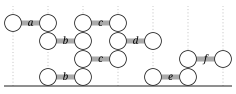</a>

<p style="text-align:right">(136)</p>

(玩过俄罗斯方块® 的读者会立即明白这种图是怎么形成的, 不过迹理论中的构件与俄罗斯方块不同, 因为它们只占据一个水平层. 而且每一类构件总是落在完全相同的位置; 构件的地盘 $T(a)$ 还可能有 “孔洞”——它不必连通.)

<a id="pdf-289"></a><a id="p-269"></a>

两个迹相同当且仅当它们有相同的堆叠. 事实上, 图中隐含地定义了所出现的构件上的一个偏序; 而代表给定迹的不同字符串的数目, 就是对这个偏序进行拓扑排序的方法数 (见习题 324).

每个迹 $\alpha$ 都有一个<em>长度</em>, 记为 $|\alpha|$, 即它的任一等价串中的字母数. 它还有一个<em>高度</em>, 记为 $h(\alpha)$, 即其堆叠中的层数. 例如 $|bcebafdc|=8$, 而 $h(bcebafdc)=4$.

**迹的运算.** 两个迹相乘, 只须将它们连接起来. 例如, 若 $\alpha=bcebafdc$ 是 (136) 对应的迹, 则 $\alpha\alpha^R=bcebafdccdfabecb$ 的堆叠如下:

<a href="../../assets/volume4b/figures/sat-heap137.svg">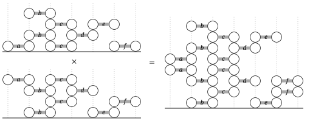</a>

<p style="text-align:right">(137)</p>

习题 327 的算法精确地表述了这个过程. 稍加思索便知 $|\alpha\beta|=|\alpha|+|\beta|$, $h(\alpha\beta)\le h(\alpha)+h(\beta)$, 且 $h(\alpha\alpha^R)=2h(\alpha)$.

迹也可以相<em>除</em>: 已知 $\alpha\beta$ 与 $\beta$, 就可以唯一确定 $\alpha=(\alpha\beta)/\beta$. 只须从堆叠的顶端往下, 将 $\beta$ 的构件从 $\alpha\beta$ 的构件中逐个除去即可. 类似地, 也可以由迹 $\alpha$ 和 $\alpha\beta$ 算出 $\beta=\alpha\setminus(\alpha\beta)$. (见习题 328 和 329.)

注意, (136) 和 (137) 这样的图可以旋转 90 度, 让构件向<em>左</em>落, 而不向下落. (在 5.3.4 节的图 50 中, 我们曾为类似目的采用了从左到右的办法.) 也可以让它们向上落或向右落. 视所要做的事情而定, 有时其他方位更为自然.

还可以把迹相加和相减, 从而得到其变量只部分可交换的多项式. 这样的多项式能照常相乘; 例如 $(\alpha+\beta)(\gamma-\delta)=\alpha\gamma-\alpha\delta+\beta\gamma-\beta\delta$. 事实上, 至少形式上我们甚至可以处理<em>无穷</em>和: 属于图 $a\mathbin{—}b\mathbin{—}c$ 的一切迹的生成函数为
$$
1+a+b+c+aa+ab+ac+ba+bb+bc+cb+cc+aaa+\cdots+ccc+aaaa+\cdots.\tag{138}
$$
(与 (135) 比较; 现在用 1 代表空串, 先前用的是 $\epsilon$.)

事实上, 无穷和 (138) 可表示为闭形式: 它等于
$$
\frac1{1-a-b-c+ac}=1+(a+b+c-ac)+(a+b+c-ac)^2+\cdots,\tag{139}
$$

<a id="pdf-290"></a><a id="p-270"></a>

这个恒等式不仅在变量可交换时成立, 而且在迹的代数中也成立, 此时变量只有在不相斥时才可交换.

Cartier 与 Foata 在他们 1969 年的开创性专著中表明, 对于<em>任一</em>图, 所有迹之和都能用一个推广 (139) 的极其简单的形式表示. 按下式定义迹 $\alpha$ 关于图 $G$ 的<em>莫比乌斯函数</em>:
$$
\mu_G(\alpha)=\begin{cases}0,&h_G(\alpha)>1;\\(-1)^{|\alpha|},&\text{其余情形}.\end{cases}\tag{140}
$$
(习题 4.5.2–10 中给出的整数的经典莫比乌斯函数 $\mu(n)$ 与此类似.) 接着定义 $G$ 的<em>莫比乌斯级数</em>为
$$
M_G=\sum_\alpha\mu_G(\alpha)\alpha,\tag{141}
$$
其中对一切迹求和. 当 $G$ 有限时, 这个和是多项式, 因为 $G$ 中顶点的每个独立集恰好对应于它的一个非零项; 因此不妨称它为<em>莫比乌斯多项式</em>. 例如当 $G$ 为路 $a\mathbin{—}b\mathbin{—}c$ 时, 就有 $M_G=1-a-b-c+ac$, 即 (139) 的分母. Cartier 与 Foata 对 (139) 所作的推广有一个非常简单的证明:

**定理 F.** <em>对于任意图 $G$, 一切迹之和的生成函数 $T_G$ 为 $1/M_G$.</em>

<em>证明.</em> 我们想要证明在迹的 (部分可交换的) 代数中, $M_GT_G=1$. 这个无穷乘积为 $\sum_{\alpha,\beta}\mu_G(\alpha)\alpha\beta=\sum_\gamma\sum_{\alpha,\beta}\mu_G(\alpha)\gamma[\gamma=\alpha\beta]$.

所以, 对于把 $\gamma=\alpha\beta$ 分解成两个迹 $\alpha$ 和 $\beta$ 之积的一切方式, 我们要证明只要 $\gamma$ 非空, $\mu_G(\alpha)$ 的和就是零.

但这很容易. 可以假定字母以任意的某种次序排列. 令 $a$ 为 $\gamma$ 的堆叠的底层中最小的字母. 只须考虑 $\alpha$ 由独立的 (可交换的) 字母 (构件) 组成的情形, 因为其他情形都有 $\mu_G(\alpha)=0$. 现在, 若对某个迹 $\alpha'$ 有 $\alpha=a\alpha'$, 则取 $\beta'=a\beta$; 否则对于某个迹 $\beta'$ 必有 $\beta=a\beta'$, 此时令 $\alpha'=a\alpha$. 在两种情形下都有 $\alpha\beta=\alpha'\beta'$, $(\alpha')'=\alpha$, $(\beta')'=\beta$, 且 $\mu_G(\alpha)+\mu_G(\alpha')=0$. 因而我们已将 $\gamma$ 的一切可能分解两两配对, 在求和时彼此抵消. $\blacksquare$

任意图的莫比乌斯级数都可以由下式递归计算
$$
M_G=M_{G\setminus a}-aM_{G\setminus a^*},\qquad a^*=\{a\}\cup\{b\mid a\mathrel{\text{—}} b\},\tag{142}
$$
其中 $a$ 是 $G$ 的任一字母 (顶点), 因为对于独立集 $I$, 无非是 $a\notin I$ 或 $a\in I$. 例如, 若 $G$ 为路 $a\mathbin{—}b\mathbin{—}c\mathbin{—}d\mathbin{—}e\mathbin{—}f$, 则 $G\setminus a^*=G\mid\{c,d,e,f\}$ 为路 $c\mathbin{—}d\mathbin{—}e\mathbin{—}f$; 反复应用 (142), 在此情形下得到
$$
\begin{aligned}
M_G={}&1-a-b-c-d-e-f+ac+ad+ae+af\\
&+bd+be+bf+ce+cf+df-ace-acf-adf-bdf.
\end{aligned}\tag{143}
$$
由于 $M_G$ 是个多项式, 可以写成 $M_G(a,b,c,d,e,f)$ 来指出它对变量的依赖性. 注意, $M_G$ 总是多重线性的 (即对每个变量都是线性的); 而且 $M_{G\setminus a}(b,c,d,e,f)=M_G(0,b,c,d,e,f)$.

<a id="pdf-291"></a><a id="p-271"></a>

在应用中, 我们往往希望把多项式中的每个字母换成同一个变量, 如 $z$, 写作 $M_G(z)$. 于是 (143) 中的多项式成为 $M_G(z)=1-6z+10z^2-4z^3$; 由定理 F 可知, 关于 $G$ 的长度为 $n$ 的迹数为 $[z^n]\,1/(1-6z+10z^2-4z^3)=\tfrac14(2+\sqrt2)^{n+2}+\tfrac14(2-\sqrt2)^{n+2}-2^{n+1}$.

虽然 (142) 是计算 $M_G$ 的一个简单递推式, 却不能就此断定 $G$ 是大而复杂的图时 $M_G$ 也容易计算. 事实上, $M_G$ 的次数正是 $G$ 中一个最大独立集的大小; 确定这个数是 NP 难的! 另一方面, 对于很多类图, 例如区间图和森林, $M_G$ 都能在线性时间内算出.

若 $\alpha$ 是一个迹, 在代表它的串中能最先出现的字母称为 $\alpha$ 的<em>源</em>; 它们是 $\alpha$ 的堆叠中位于最底层的构件, 也称为它的极小构件. 对偶地, 能最后出现的字母是 $\alpha$ 的<em>汇</em>, 即它的极大构件. 只有一个源的迹称为<em>锥</em>; 这时所有构件最终都由底部的一个构件支撑. 类似地, 只有一个汇的迹称为<em>金字塔</em>. Viennot 在他的讲义中证明了定理 F 的一个漂亮推广:
$$
M_{G\setminus A}/M_G\ \text{是源全在 }A\text{ 中的所有迹之和}.\tag{144}
$$
(见习题 338; 定理 F 是 $A$ 为全体顶点之集时的特例.) 特别地, 以 $a$ 为唯一源的锥由下式生成
$$
M_{G\setminus a}/M_G-1=aM_{G\setminus a^*}/M_G.\tag{145}
$$

**\*迹与局部引理.** 现在可以来看看, 为什么迹理论与局部引理有密切的关系. 若 $G$ 为顶点 $\{1,\ldots,m\}$ 上的任一图, 我们将 $\mathcal R(G)$ 定义为满足如下条件的一切非负向量 $(p_1,\ldots,p_m)$ 的集合: 只要对 $1\le j\le m$ 有 $0\le p'_j\le p_j$, 就有 $M_G(p'_1,\ldots,p'_m)>0$. 由于 J. B. Shearer 所发现的下述刻画, $\mathcal R(G)$ 的这个定义与引理 L 中给出的隐式定义相符:

**定理 S.** <em>在引理 L 的条件 (133) 下, $(p_1,\ldots,p_m)\in\mathcal R(G)$ 蕴涵</em>
$$
\Pr(\overline A_1\cap\cdots\cap\overline A_m)\ge M_G(p_1,\ldots,p_m)>0.\tag{146}
$$
<em>反过来, 若 $(p_1,\ldots,p_m)\notin\mathcal R(G)$, 则存在事件 $B_1,\ldots,B_m$ 使得</em>
$$
\Pr(B_i\mid\overline B_{j_1}\cap\cdots\cap\overline B_{j_k})=p_i
\quad\text{只要 }k\ge0\text{ 且 }i\mathrel{\not\text{—}}j_1,\ldots,i\mathrel{\not\text{—}}j_k,\tag{147}
$$
<em>并且 $\Pr(\overline B_1\cap\cdots\cap\overline B_m)=0$.</em>

<em>证明.</em> 当 $(p_1,\ldots,p_m)\in\mathcal R(G)$ 时, 习题 344 证明了事件 $B_1,\ldots,B_m$ 有唯一的分布, 使它们满足 (147), 而且对每个子集 $J\subseteq\{1,\ldots,m\}$ 都有
$$
\Pr\left(\bigcap_{j\in J}\overline A_j\right)
\ge\Pr\left(\bigcap_{j\in J}\overline B_j\right)
=M_G\bigl(p_1[1\in J],\ldots,p_m[m\in J]\bigr).\tag{148}
$$
在这个最坏可能的 “极端” 分布中, 只要 $i$ 与 $j$ 在 $G$ 中相邻, 就有 $\Pr(B_i\cap B_j)=0$. 习题 345 证明了逆命题. $\blacksquare$

<a id="pdf-292"></a><a id="p-272"></a>

给定概率向量 $(p_1,\ldots,p_m)$, 令
$$
M_G^*(z)=M_G(p_1z,\ldots,p_mz).\tag{149}
$$
定理 F 告诉我们, 幂级数 $1/M_G^*(z)$ 中 $z^n$ 的系数, 是 $G$ 的所有长度为 $n$ 的迹的权之和. 由于这个系数非负, 由 Pringsheim 定理 (见习题 348) 可知, 对所有 $|z|<1+\delta$, 该幂级数收敛, 其中 $1+\delta$ 是多项式方程 $M_G^*(z)=0$ 的最小正实根; 这个数 $\delta$ 称为 $(p_1,\ldots,p_m)$ 关于 $G$ 的<em>余量</em>.

容易看出, $(p_1,\ldots,p_m)\in\mathcal R(G)$ 当且仅当余量为正. 因为若 $\delta\le0$, 取 $p'_j=(1+\delta)p_j$ 所得的概率 $(p'_1,\ldots,p'_m)$ 就使 $M_G=0$. 但若 $\delta>0$, 该幂级数在 $z=1$ 时收敛. 而且 (由于它是所有迹的和), 若将任一 $p_j$ 减小, 它也收敛到正数 $1/M_G$; 因此由定义 $(p_1,\ldots,p_m)$ 位于 $\mathcal R(G)$ 中. 事实上, 这个论证还说明, 当 $(p_1,\ldots,p_m)\in\mathcal R(G)$ 时, 我们可以把这些概率<em>增大</em>为 $((1+\epsilon)p_1,\ldots,(1+\epsilon)p_m)$, 而且只要 $\epsilon<\delta$, 它们仍位于 $\mathcal R(G)$ 中.

现在回到算法 M. 假定步骤 M3 试图扑灭的各个坏事件 $A_j$ 依次为 $X_1,X_2,\ldots,X_N$, 其中 $N$ 为 M3 的总执行次数 ($N$ 也许是 $\infty$). 为了证明算法 M 高效, 我们将在 M1、M3 中出现的各个独立均匀随机数 $U$ 的概率空间里, 证明随机变量 $N$ 的期望很小. 主要想法是 $X_1X_2\ldots X_N$ 实质上是关于底层图的一个迹; 因此可以把它视为构件的一个堆叠.

几个简单而具体的例子有助于培养直觉; 我们来看两个实例. 在两种情形下都有 $m=6$ 个事件 $A,B,C,D,E,F$ 和 $n=7$ 个变量 $x_1\ldots x_7$. 每个变量都是一个随机位; 因此在算法中 $\xi_1=\cdots=\xi_7=1/2$. 事件 $A$ 依赖于 $x_1x_2$, $B$ 依赖于 $x_2x_3$, $\ldots$, $F$ 依赖于 $x_6x_7$. 此外, 每个事件都以概率 $1/4$ 发生. 在情形 1 中, 每个事件都在相应的子串为 ‘10’ 时为真; 所以所有事件都为假当且仅当 $x_1\ldots x_7$ 已排序, 即 $x_1\le x_2\le\cdots\le x_7$. 在情形 2 中, 每个事件都在相应的子串为 ‘11’ 时为真; 所以所有事件都为假当且仅当 $x_1\ldots x_7$ 中没有两个相继的 1.

把算法 M 用于这两种情形时会怎样? 一种可能的历程是 M3 执行 $N=8$ 次, 依次有 $X_1X_2\ldots X_8=BCEBAFDC$. 这时 $x_1\ldots x_7$ 各位的实际变化可能如下:

<a href="../../assets/volume4b/figures/sat-resample150.svg">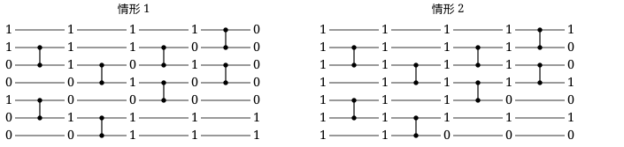</a>

<p style="text-align:right">(150)</p>

(图中从上到下读 $x_1\ldots x_7$, 从左向右扫描. 每个小构件 ‘<a href="../../assets/volume4b/figures/sat-resample-symbol.svg"></a>’ 表示 “把左边的两个坏位换成右边的两个随机<a id="pdf-293"></a><a id="p-273"></a>位”. 在这样的例子中, 任何有效的解 $x_1\ldots x_7$ 都可以放在最右边; 构件左边的所有值随后就都确定了.)

注意, 这些图就像堆叠 (136), 只是旋转了 90 度. 由 (136) 可知, 同一张图既适用于历程 $BCEBAFDC$, 也适用于 $EFBCDBCA$, 因为它们作为迹是相同的. 嗯……也不尽然! 实际上, 如果按算法 M 目前的写法来执行, $EFBCDBCA$ 并不产生与 $BCEBAFDC$ 完全一样的结果. 然而, 若为每个变量 $x_k$ 分别使用独立随机数流 $U_k$, 结果就会相同. 因此, 在这些随机事件的概率空间中, 我们确实可以把等价的迹视为相等.

实践中, 算法用于情形 2 时的运行速度比用于情形 1 时快得多. 怎么会这样? 就随机数而言, (150) 中的两张图出现的概率相同, 都是 $(1/2)^7(1/4)^8$. 而且情形 1 的每张图在情形 2 中都有对应的图; 所以不同图的数目无法将两种情形区分开来. 真正的差别在于, 情形 1 中的 M2 绝不会有两个事件可选, 除非它们是互不相交的, 因而可按任意次序处理. 在情形 2 中却几乎步步都有大批等着扑灭的事件. 所以 (150) 右边的历程其实颇不可能出现; 算法凭什么先选 $B$ 作第一个改正的事件, 接着又选 $C$, 而不选 $A$ 呢? 无论 M2 采取什么方法, 情形 2 的那些图都将比单看严格的概率所预示的更少出现, 因为还有其他选择竞争, 任何某个特定事件下一个被选来处理的可能性就降低了. (另见习题 353.)

因此算法 M 的运行时间的最坏情形上界来自类似情形 1 的情况. 一般地, 在算法 M 的一次运行中, (150) 的堆叠 $BCEBAFDC$ 出现的概率至多为 $bcebafdc$, 其中 ‘$a$’ 代表 (133) 中当 $A$ 为 $A_i$ 时以 ‘$p_i$’ 表示的事件 $A$ 的概率上界, 而 ‘$b$’, $\ldots$, ‘$f$’ 对于 $B$, $\ldots$, $F$ 也具有类似意义. 道理是, 若相应堆叠的各层由变量集 $\Xi_j$ 之间的依赖来定义, 那么 $bcebafdc$ 显然就是那些事件由算法所设的独立随机变量 $x_k$ 产生的概率. 即使同一层的事件由于共享变量而相依, 但并不偏斜相依 (按习题 351 的意义), 这样的事件也正相关; 因而习题 MPR–61 的 FKG 不等式适用于算法 M 的伯努利分布变量, 表明 $bcebafdc$ 是一个上界. 此外, 步骤 M2 恰好选取 $B,C,E,B,A,F,D,C$ 依次来处理的概率至多为 1.

因此当 $(p_1,\ldots,p_m)\in\mathcal R(G)$ 时, 算法 M 用于习题 344 的极端分布 (148) 中的事件 $B_1,\ldots,B_m$ 时, 运行时间最大. 对于这些极端事件, 其实还能写下运行时间的<em>生成函数</em>. 我们有
$$
\sum_{N\ge0}\Pr(\text{算法 M 对 }B_1,\ldots,B_m\text{ 作 }N\text{ 次重抽样})z^N
=\frac{M_G^*(1)}{M_G^*(z)},\tag{151}
$$

<a id="pdf-294"></a><a id="p-274"></a>

其中 $M_G^*(z)$ 如 (149) 的定义, 因为 $1/M_G^*(z)$ 中 $z^N$ 的系数是长度为 $N$ 的一切迹的概率之和. 定理 F 将 $1/M_G^*(1)$ 的意义描述为变量 $p_i$ 的一个 “形式” 幂级数; 证明它时, 我们不曾理会当这些变量取数值时无穷和是否收敛. 不过当 $(p_1,\ldots,p_m)\in\mathcal R(G)$ 时, 这个级数的确收敛 (它甚至有正的 “余量”).

这个推理导出了 K. Kolipaka 和 M. Szegedy 的下述定理 [<em>STOC</em> **43** (2011), 235–243]:

**定理 K.** <em>若 $(p_1,\ldots,p_m)\in\mathcal R(G)$, 则算法 M 对 $\Xi_j$ 重抽样的次数平均至多为</em>
$$
E_j=p_j M_{G\setminus A_j^*}(p_1,\ldots,p_m)/M_G(p_1,\ldots,p_m).\tag{152}
$$
<em>特别地, 步骤 M3 的期望迭代次数至多是 $E_1+\cdots+E_m\le m/\delta$, 其中 $\delta$ 是 $(p_1,\ldots,p_m)$ 的余量.</em>

<em>证明.</em> 极端分布 $B_1,\ldots,B_m$ 使 $\Xi_j$ 的重抽样次数最大, 而极端情形下这个数的生成函数是
$$
\frac{M_G(p_1,\ldots,p_{j-1},p_j,p_{j+1},\ldots,p_m)}
{M_G(p_1,\ldots,p_{j-1},p_jz,p_{j+1},\ldots,p_m)}.\tag{153}
$$
对 $z$ 求导, 然后置 $z\gets1$, 就得到 (152), 因为由 (141) 可知分母的导数为 $-p_jM_{G\setminus A_j^*}(p_1,\ldots,p_m)$.

关于 $E_1+\cdots+E_m$ 的上述上界在习题 355 中证明. $\blacksquare$

**\*消息传递.** 研究统计力学的物理学家利用他们关于大量粒子相互作用的经验, 创立了一种很不一样的方法, 将随机化运用于可满足性问题. 从他们的角度来看, 取值为 0 或 1 的一组布尔变量最好看作一群具有正或负 “自旋” 的粒子; 这些粒子彼此影响, 随局部吸引和排斥而改变自旋, 就像磁学的定律一样. 一个可满足性问题可表述为自旋的一个联合概率分布, 其中 “能量” 最低的状态, 恰好是满足子句数尽可能多的那些状态.

本质上, 他们的方法是考虑一种二部结构, 其中每个变量都连接一个或多个子句, 每个子句也都连接一个或多个变量. 我们可以把变量和子句都看作活跃的个体, 在这个社交网络中不停地向邻居发送短讯. 一个变量也许告诉它的子句 “我看我大概应当为真”; 其中几个子句却可能回话说 “我真希望你为假.” 仔细权衡这些消息, 局部相互作用就能不断传播, 对远处的联系积累起越来越多的认识, 往往会收敛到整个网络都还算满意的状态.

一种特定的消息传递策略称为<em>调查传播</em> [A. Braunstein、M. Mézard 和 R. Zecchina, <em>Random Structures &amp; Algorithms</em> **27** (2005),<a id="pdf-295"></a><a id="p-275"></a> 201–226]. 实践表明, 对于恰好位于不可满足性阈值之前的 “困难” 区域中的随机可满足性问题, 它有惊人的求解能力.

设 $C$ 为一个子句, $l$ 为它的一个字面值. “调查消息” $\eta_{C\to l}$ 是 0 与 1 之间的一个分数, 表示 $C$ 希望 $l$ 为真的迫切程度. 若 $\eta_{C\to l}=1$, 就迫切需要 $l$ 为真, 否则 $C$ 将为假; 若 $\eta_{C\to l}=0$, 子句 $C$ 则一点也不担心变量 $|l|$ 的值. 初始时把每个 $\eta_{C\to l}$ 置为一个完全随机的分数.

我们来考虑原调查传播法的一种推广 [见 J. Chavas、C. Furtlehner、M. Mézard 和 R. Zecchina, <em>J. Statistical Mechanics</em> (2005 年 11 月), P11016:1–25; A. Braunstein 和 R. Zecchina, <em>Physical Review Letters</em> **96** (2006 年 1 月 27 日), 030201:1–4], 它为每个字面值 $l$ 引入另外一条 “强化消息” $\eta_l$. 这些新消息起初全为零, 表示作用于 $l$ 的一种外力. 它们强化已显示成效的决策, 从而帮助网络把活动集中起来.

假设变量 $v$ 恰好出现在三个子句中: 在 $A$ 与 $B$ 中正出现, 在 $C$ 中负出现. 此变量对收到的消息 $\eta_{A\to v}$、$\eta_{B\to v}$、$\eta_{C\to\bar v}$、$\eta_v$ 和 $\eta_{\bar v}$ 的响应方式是用下式计算两个 “灵活性系数” $\pi_v$ 和 $\pi_{\bar v}$:
$$
\pi_v=(1-\eta_v)(1-\eta_{A\to v})(1-\eta_{B\to v}),\qquad
\pi_{\bar v}=(1-\eta_{\bar v})(1-\eta_{C\to\bar v}).
$$
例如, 若 $\eta_v=\eta_{\bar v}=0$, 而 $\eta_{A\to v}=\eta_{B\to v}=\eta_{C\to\bar v}=2/3$, 则 $\pi_v=1/9$, $\pi_{\bar v}=1/3$. 这些 $\pi$ 与 $\eta$ 实质上互为对偶, 因为迫切性高就对应于灵活性低, 反之亦然. 对每个字面值 $l$ 的一般公式为
$$
\pi_l=(1-\eta_l)\prod_{C:\,l\in C}(1-\eta_{C\to l}).\tag{154}
$$

调查传播利用这些系数, 计算三个数来估计变量 $v$ 取 1 (真)、0 (假) 或 $*$ (任意) 的倾向:
$$
p=\frac{(1-\pi_v)\pi_{\bar v}}{\pi_v+\pi_{\bar v}-\pi_v\pi_{\bar v}},\qquad
q=\frac{(1-\pi_{\bar v})\pi_v}{\pi_v+\pi_{\bar v}-\pi_v\pi_{\bar v}},\qquad
r=\frac{\pi_v\pi_{\bar v}}{\pi_v+\pi_{\bar v}-\pi_v\pi_{\bar v}};\tag{155}
$$
此时 $p+q+r=1$, $(p,q,r)$ 称为 $v$ 的 “场”, 分别表示 (真、假、任意) 的倾向. 在上例中, 场为 $(8/11,2/11,1/11)$, 表明 $v$ 很可能应赋值 1. 不过若 $\eta_{A\to v}$ 与 $\eta_{B\to v}$ 都只有 $1/3$ 而非 $2/3$, 场就会是 $(5/17,8/17,4/17)$, 为了满足子句 $C$, 我们多半会希望 $v=0$. [图 94](#fig-7-2-2-2-94) 给出了把 $p-q$ 看成 $\pi_v$ 与 $\pi_{\bar v}$ 的函数时的等值线; 最有决断性的情形 ($|p-q|\approx1$) 出现在右下方和左上方.


<a href="../../assets/volume4b/figures/sat-fig94.svg"></a>


<a id="fig-7-2-2-2-94"></a>**图 94.** 变量 “场” 中的等偏置线.

<a id="pdf-296"></a><a id="p-276"></a>

若 $\pi_v=\pi_{\bar v}=0$, 就完全没有灵活性: 变量 $v$ 被要求既真又假. 这时场没有定义, 调查传播法寄希望于不发生这种情形.

每个字面值 $l$ 算好自己的灵活性之后, 含有 $l$ 或 $\bar l$ 的子句就能利用 $\pi_l$ 和 $\pi_{\bar l}$ 来精化自己的调查消息. 例如, 设 $C$ 为子句 $u\lor\bar v\lor w$. 它将把原消息 $\eta_{C\to u}$、$\eta_{C\to\bar v}$、$\eta_{C\to w}$ 换成
$$
\eta'_{C\to u}=\gamma_{\bar v\to C}\gamma_{w\to C},\qquad
\eta'_{C\to\bar v}=\gamma_{u\to C}\gamma_{w\to C},\qquad
\eta'_{C\to w}=\gamma_{u\to C}\gamma_{\bar v\to C},
$$
其中每个 $\gamma_{l\to C}$ 都是一条从字面值 $l$ 收到的 “偏置消息”,
$$
\gamma_{l\to C}=
\frac{(1-\pi_{\bar l})\pi_l/(1-\eta_{C\to l})}
{\pi_{\bar l}+(1-\pi_{\bar l})\pi_l/(1-\eta_{C\to l})},\tag{156}
$$
反映了在 $C$ 以外的子句中 $l$ 为假的倾向. 一般地有
$$
\eta'_{C\to l}=\left(\prod_{l'\in C}\gamma_{l'\to C}\right)/\gamma_{l\to C}.\tag{157}
$$
(在公式 (156) 与 (157) 中必须采用适当约定以免被零除; 见习题 359.)

也可以定期算出新的强化消息 $\eta'_l$, 对每个字面值 $l$ 应用公式
$$
\eta'_l=\frac{\kappa(\pi_{\bar l}\mathbin{\dot{-}}\pi_l)}{\pi_l+\pi_{\bar l}-\pi_l\pi_{\bar l}},\tag{158}
$$
这里 $x\mathbin{\dot{-}}y$ 表示 $\max(x-y,0)$, 而 $\kappa$ 是由算法指定的强化参数. 注意只有在 $\eta'_{\bar l}=0$ 时, 才可能有 $\eta'_l>0$.

例如, 为了满足 (7) 的七个子句, 可能传递如下消息:

<table id="sat-survey-clauses"><thead><tr><th>$l_1$</th><th>$l_2$</th><th>$l_3$</th><th>$\eta_{C\to l_1}$</th><th>$\eta_{C\to l_2}$</th><th>$\eta_{C\to l_3}$</th><th>$\gamma_{l_1\to C}$</th><th>$\gamma_{l_2\to C}$</th><th>$\gamma_{l_3\to C}$</th></tr></thead><tbody>
<tr><td>1</td><td>2</td><td>$\overline{3}$</td><td>0</td><td>0</td><td>0</td><td>3/5</td><td>0</td><td>0</td></tr>
<tr><td>$\overline{1}$</td><td>$\overline{2}$</td><td>3</td><td>1/5</td><td>0</td><td>0</td><td>0</td><td>3/5</td><td>1/3</td></tr>
<tr><td>2</td><td>3</td><td>$\overline{4}$</td><td>1/5</td><td>0</td><td>0</td><td>0</td><td>1/3</td><td>3/5</td></tr>
<tr><td>$\overline{2}$</td><td>$\overline{3}$</td><td>4</td><td>0</td><td>0</td><td>0</td><td>3/5</td><td>0</td><td>0</td></tr>
<tr><td>1</td><td>3</td><td>4</td><td>0</td><td>0</td><td>1/5</td><td>3/5</td><td>1/3</td><td>0</td></tr>
<tr><td>$\overline{1}$</td><td>$\overline{3}$</td><td>$\overline{4}$</td><td>0</td><td>0</td><td>0</td><td>0</td><td>0</td><td>3/5</td></tr>
<tr><td>$\overline{1}$</td><td>2</td><td>4</td><td>0</td><td>0</td><td>0</td><td>0</td><td>0</td><td>0</td></tr>
</tbody></table>

<table id="sat-survey-literals"><thead><tr><th>$l$</th><th>$\pi_{l}$</th><th>$\eta_{l}$</th></tr></thead><tbody>
<tr><td>1</td><td>1</td><td>0</td></tr>
<tr><td>$\overline{1}$</td><td>2/5</td><td>1/2</td></tr>
<tr><td>2</td><td>2/5</td><td>1/2</td></tr>
<tr><td>$\overline{2}$</td><td>1</td><td>0</td></tr>
<tr><td>3</td><td>1</td><td>0</td></tr>
<tr><td>$\overline{3}$</td><td>2/3</td><td>1/3</td></tr>
<tr><td>4</td><td>2/5</td><td>1/2</td></tr>
<tr><td>$\overline{4}$</td><td>1</td><td>0</td></tr>
</tbody></table>

<p style="text-align:right">(159)</p>

(回想一下, 这些子句只有两个解, 即 $\bar1234$ 和 $\bar12\bar34$.) 在这一情形下, 读者可以验证, (159) 的消息构成一个 “不动点”: $\eta$ 消息确定各个 $\pi$; 反过来, 只要强化消息 $\eta_l$ 保持不变, 对所有子句 $C$ 及一切字面值 $l$ 就都有 $\eta'_{C\to l}=\eta_{C\to l}$.

习题 361 证明, 可满足子句集的每个解, 对应于联立方程 (154)、(156)、(157) 的一个不动点, 具有性质 $\eta_l=[l\text{ 在解中为真}]$.

<a id="pdf-297"></a><a id="p-277"></a>

然而对于这种消息传递策略, 实验表明, 最好的结果是只把它用于初步筛选, 旨在找出取值最为关键的变量; 不必一直传送消息到每个子句都完全满足. 一旦把合适的值赋给最敏感的变量, 剩余问题通常就很容易用 WalkSAT 等其他算法求解.

调查消息、强化消息与偏置消息可以用各种各样的协议来交换. 下面的过程采用了 C. Baldassi 在 2012 年编写的一个实现中的两个想法: (1) 强化的强度 $\kappa$ 从零开始, 以指数速率趋于 1. (2) 每次强化之后, 根据变量的当前场中 $\max(p,q,r)$ 为 $p$、$q$ 还是 $r$, 将变量分别评为 1、0 或 $*$. 如果这时每个子句都至少有一个字面值为真或为 $*$, 即使有些调查消息仍在波动, 也将停止传递消息.

**算法 S** (<em>调查传播.</em>) 给定 $n$ 个变量上的 $m$ 个非空子句, 本算法试图给大部分变量赋值, 使尚未满足的子句比较容易满足. 它为每个字面值 $l$ 维护浮点数阵列 $\pi_l$ 与 $\eta_l$, 并为每个子句 $C$ 及每个 $l\in C$ 维护 $\eta_{C\to l}$. 它有多种参数: $\rho$ (强化的阻尼因子), $N_0$ 与 $N$ (最小和最大迭代限数), $\epsilon$ (收敛的容差), $\psi$ (置信水平).

**S1.** [初始化.] 对所有字面值 $l$ 置 $\eta_l\gets\pi_l\gets0$; 对所有子句 $C$ 及 $l\in C$ 置 $\eta_{C\to l}\gets U$, 其中 $U$ 在 $[0\,..\,1)$ 上均匀随机取值. 另置 $i\gets0$, $\phi\gets1$.

**S2.** [结束?] 若 $i\ge N$, 失败终止. 若 $i$ 为偶数或 $i<N_0$, 转到 S5.

**S3.** [强化.] 用 (158), 对所有字面值 $l$ 以 $\eta'_l$ 替换 $\eta_l$; 在此之前置 $\phi\gets\rho\phi$, $\kappa\gets1-\phi$, 而且若 $\pi_l=\pi_{\bar l}=0$, 则失败终止.

**S4.** [检验伪可满足性.] 如果至少有一个子句的字面值 $l$ 看来全为假, 即对它们都有 $\pi_{\bar l}<\pi_l$ 且 $\pi_{\bar l}<\tfrac12$ (见习题 358), 转到 S5. 否则欣然转到 S8.

**S5.** [计算各个 $\pi$.] 用 (154) 计算每个 $\pi_l$; 另见习题 359.

**S6.** [更新调查消息.] 置 $\delta\gets0$. 对所有子句 $C$ 和字面值 $l\in C$, 用 (157) 计算 $\eta'_{C\to l}$, 并置 $\delta\gets\max(\delta,|\eta'_{C\to l}-\eta_{C\to l}|)$, $\eta_{C\to l}\gets\eta'_{C\to l}$.

**S7.** [对 $i$ 循环.] 若 $\delta\ge\epsilon$, 置 $i\gets i+1$, 返回 S2.

**S8.** [约化问题.] 为场满足 $|p-q|\ge\psi$ 的每个变量赋一个值. (更详细的说明见习题 362.)　■

计算经验——也就是试错——提示了合适的参数值. 对于不算大的问题, 默认值 $\rho=.995$, $N_0=5$, $N=1000$, $\epsilon=.01$, $\psi=.50$ 似乎是一个还不错的起点. 例如, 作者初次尝试一个有 42000 个子句、10000 个变量的随机 3SAT 问题时, 它们的效果很好: 在 $i=143$ 时这些子句是伪可满足的 (虽然 $\delta\approx.43$ 仍相当大); 接着 S8 便为 8282 个场有强偏置的变量固定了值, 单元传播又给另外 57 个变量赋值. 这个过程仅用了约 2.18 亿次内存访问. 约化后的问题有 1526 个二元子句和 196 个三元子句, 分布在<a id="pdf-298"></a><a id="p-278"></a>1464 个变量上 (因为许多其他变量已无须再用); WalkSAT 只多用了 42000 次内存访问, 走了 626 步便解决了它. 相形之下, 当 WalkSAT 拿到原问题时 (取 $p=.57$), 它走了 3100 多万步, 作了 34 亿次内存访问, 才找到一个解.

同样, 作者第一次把调查传播用于一个有 $n=10^6$ 个变量、$m=4.2n$ 个子句的随机 3SAT 问题时大获成功: 只用 328 亿次内存访问就消去了 80 多万个变量, WalkSAT 再作 850 万次内存访问便解决了其余的子句. 对照之下, 单用 WalkSAT 需要 2370 亿次内存访问来执行 21 亿步.

一百万个变量、425 万个子句的问题却难得多. 多出来的这 5 万个子句使问题远远超过了 WalkSAT 的能力; 算法 S 用默认参数也失败了. 不过取 $\rho=.9999$, $N_0=9$ 让强化过程慢下来, 效果不错, 也产生了颇能说明问题的行为. 考虑矩阵


$$
\begin{pmatrix}
3988&3651&3071&2339&1741&1338&946&702&508&329\\
5649&5408&4304&3349&2541&2052&1448&1050&666&510\\
8497&7965&6386&4918&3897&3012&2248&1508&1075&718\\
11807&11005&8812&7019&5328&4135&3117&2171&1475&1063\\
15814&14789&11726&9134&7188&5425&4121&3024&2039&1372\\
20437&19342&15604&12183&9397&7263&5165&3791&2603&1781\\
26455&24545&19917&15807&12043&9161&6820&5019&3381&2263\\
33203&31153&25052&19644&15587&11802&8865&6309&4417&2919\\
39962&38097&31060&24826&18943&14707&10993&7924&5225&3637\\
40731&40426&32716&26561&20557&15739&11634&8327&5591&4035
\end{pmatrix},
$$


它给出 $\pi_{\bar v}$ 相对于 $\pi_v$ 的分布 (见[图 94](#fig-7-2-2-2-94)); 例如, 左上角的 ‘3988’ 表示一百万个变量中, 有 3988 个变量的 $\pi_{\bar v}$ 介于 0.0 与 0.1 之间, $\pi_v$ 介于 0.9 与 1.0 之间. 这个分布出现在作了 110 次迭代而使 $\delta$ 降到约 $0.0098$ 时, 它糟糕透了——真正有显著偏置的变量少得很. 于是把 $\epsilon$ 降到 $.001$ 又作了一次运行; 但做了 1000 次迭代仍不收敛. 最后, 取 $\epsilon=.001$, $N=2000$, 在 $i=1373$ 时出现了伪满足, 具有如下漂亮的分布


$$
\begin{pmatrix}
406678&1946&1045&979&842&714&687&803&1298&167649\\
338&2&2&3&0&3&1&4&2&1289\\
156&1&0&0&0&1&0&2&1&875\\
118&4&0&0&0&0&0&0&1&743\\
99&0&0&0&0&0&0&1&0&663\\
62&0&0&0&0&0&1&0&3&810\\
41&0&0&0&0&0&0&0&0&1015\\
55&0&0&0&1&0&1&1&0&1139\\
63&0&0&1&0&0&0&1&2&1949\\
116&61&72&41&61&103&120&162&327&406839
\end{pmatrix}
$$


(虽然此时 $\delta$ 约为 1!) 现在偏置很明显, 却并非全都可靠; 为了避免在约化后的问题中传播单位字面值时出现矛盾, 不得不提高参数 $\psi$. 最后取 $\psi=.99$, 成功地给 80 多万个变量赋了值. 经过 2100 亿次内存访问, 得到了一个解 (其中包括最后由 WalkSAT 完成任务所需的 2100 万次内存访问).

当问题出现时, 允许步骤 S8 回溯, 重新设置偏置较小的变量, 还可获得更好的结果. 见 R. Marino、G. Parisi 和 F. Ricci-Tersenghi, <em>Nature Communications</em> **7**, 12996 (2016), 1–8.

<a id="pdf-299"></a><a id="p-279"></a>

调查传播并不保证成功. 不过, 嘿, 当它确实奏效时, 对于特别棘手的问题, 它有时是唯一已知的解法.

算法 S 可以看成研究贝叶斯网络时所用 “信念传播” 消息的一种推广 [见 J. Pearl, <em>Probabilistic Reasoning in Intelligent Systems</em> (1988), 第 4 章]; 它实质上从 $\{0,1\}$ 上的布尔逻辑跨到了 $\{0,1,*\}$ 上的三值逻辑. 事实上, H. A. Bethe 和 R. E. Peierls [<em>Proc. Royal Society of London</em> **A150** (1935), 552–575] 很早就已考虑过类似的消息传递启发式方法, R. G. Gallager [<em>IRE Transactions</em> **IT-8** (1962), 21–28] 也曾独立地考虑过. 更详细的资料见 M. Mézard 与 A. Montanari, <em>Information, Physics, and Computation</em> (2009), 第 14–22 章.

**\*子句的预处理.** 若把输入变换为等价而较简单的一组子句, SAT 求解算法往往会运行得快得多. 这类变换和简化通常需要一些不适合求解器主要工作的数据结构, 因此最好单独考虑.

当然可以把预处理器和求解器合成一个程序; 而且若学到新子句后到了想要清理一下再重新开始的阶段, 还可以再次应用 “预处理” 技术. 在后一种情形下, 这种简化称为<em>求解中处理</em> (inprocessing). 不过, 假定我们只想预处理一个给定的子句族 $F$, 最容易说明基本想法. 我们的目标是产生较好的子句 $F'$, 使它们可满足当且仅当 $F$ 可满足.

把预处理看作一系列初等变换
$$
F=F_0\to F_1\to\cdots\to F_r=F',\tag{160}
$$
其中每一步 $F_j\to F_{j+1}$ 都是 “下坡” 的, 就是说它或者 (i) 消去一个变量而不增加子句数, 或者 (ii) 保留全部变量却减少子句中字面值的数目. 已知有许多不同的下坡变换; 我们可按某种次序试用手里的各个办法, 直到它们都不能再推进一步为止.

有时竟会就此<em>解出</em>给定的问题, 到达一个平凡可满足 (为空集 $\emptyset$) 或平凡不可满足 (含 $\epsilon$) 的 $F'$. 不过除非 $F$ 本来就相当容易, 大概不会这么走运, 因为我们只打算考虑相当简单的下坡变换.

不过, 在讨论具体的变换之前, 先想想怎样收尾: 假设 $F$ 有 $n$ 个变量, 而 $F'$ 只有 $n'<n$ 个. 把子句 $F'$ 送入 SAT 求解器, 得到一个解 $x'_1\ldots x'_{n'}$ 后, 怎样才能把它转回原问题 $F$ 的一个完整解 $x_1\ldots x_n$? 办法如下: 对于消去某个变量 $x_k$ 的每个变换 $F_j\to F_{j+1}$, 我们都要指定一条 <em>erp 规则</em> (将 pre 倒写成 erp, 是因为它要逆转预处理的效果). 一条用于消元的 erp 规则只是一个赋值 ‘$l\gets E$’, 其中 $l$ 是 $x_k$ 或 $\bar x_k$, 而 $E$ 是一个布尔表达式, 只涉及尚未消去的变量. 给 $x_k$ 赋一个值, 使 $l$ 为真当且仅当 $E$ 为真, 就能撤销这次消元的效果.

<a id="pdf-300"></a><a id="p-280"></a>

例如, 假定两个变换消去了 $x$ 与 $y$, 并给出了 erp 规则
$$
\bar x\gets\bar y\lor z,\qquad y\gets1.
$$
从右至左撤销这两次消元, 便先将 $y$ 置真, 再置 $x\gets\bar z$.

预处理器一旦发现消元的方法, 就可以立即将相应的 erp 规则写到文件中, 以免占用内存空间. 事后给定一个约化解 $x'_1\ldots x'_{n'}$, 后处理器就能<em>按逆序</em>读取这个文件, 给出未约化的解 $x_1\ldots x_n$.

**变换 1. 单位子句的条件限制.** 若存在单位子句 ‘$(l)$’, 就可以用 $F\mid l$ 取代 $F$, 并使用 erp 规则 $l\gets1$. 多数求解器本来就会自然地作这一初等简化; 不过它在预处理器中或许更为重要, 因为它往往能引出求解器不容易发现的进一步变换. 反过来, 预处理器的其他变换也可能引出单位子句的条件限制, 从而一层层地传播下去.

单位子句的条件限制有一个结果: 除非 $F'$ 平凡不可满足, 否则 $F'$ 的所有子句的长度都至少为 2.

**变换 2. 包摄.** 若子句 $C$ 中的每个字面值也出现在另一个子句 $C'$ 中, 就可以删去 $C'$. 特别地, 重复的子句将被丢弃. 由于没有消去变量, 无须 erp 规则.

**变换 3. 自包摄.** 若 $C$ 含有 $\bar x$, $C$ 中其余每个字面值也出现在另一个子句 $C'$ 中, 且 $C'$ 含有 $x$, 就可以从 $C'$ 中删去 $x$, 因为 $C'\setminus x=C\mathbin{\diamond}C'$. 换言之, $C$ <em>几乎</em>包摄 $C'$ 这个事实, 使我们即使不能真正删去 $C'$, 至少也能把它<em>加强</em>. 同样无须 erp 规则. [J. A. Robinson 在 <em>JACM</em> **12** (1965), 39 中把自包摄称为 “替换原理”.]

习题 374 讨论了能够以合理的效率发现包摄和自包摄的数据结构与算法.

**变换 4. 下坡归结.** 假定 $x$ 仅出现在子句 $C_1,\ldots,C_p$ 中, $\bar x$ 仅出现在 $C'_1,\ldots,C'_q$ 中. 我们已经看到 (见 (112)), 若用 $pq$ 个子句 $\{C_i\mathbin{\diamond}C'_j\mid1\le i\le p,\ 1\le j\le q\}$ 替换这 $p+q$ 个子句, 就能消去变量 $x$. 相应的 erp 规则 (见习题 367) 是
$$
\text{或者 }\bar x\gets\bigwedge_{i=1}^p(C_i\setminus x)
\qquad\text{或者 }x\gets\bigwedge_{j=1}^q(C'_j\setminus\bar x).\tag{161}
$$

用这种方式可以消去每个变量, 不过过多的子句也许会把我们淹没. 为了防止这种情形, 可以只准许 “下坡” 的情形, 使新子句不多于原子句. 正如 (112) 后面所说, 条件 $pq\le p+q$ 等价于 $(p-1)(q-1)\le1$; 在这种情形下总是消去该变量. 即使 $pq$ 很大, 新子句的数目仍可能很小, 因为有重言式或包摄. 而且 N. Eén 与 A. Biere 写过一篇关于预处理的奠基性论文 [<em>LNCS</em> **3569** (2005), 61–75], 引入了一些重要的特例, 使 $pq$ 个可能的子句中有许多可以略去; 见习题 369. 所以预处理器<a id="pdf-301"></a><a id="p-281"></a>通常在 $\min(p,q)$ 不超过例如 10 时都尝试用归结来消元, 只在生成的归结式已多于 $p+q$ 个时才放弃.

其他许多变换也是可能的, 只不过实践表明上面列出的四种最为有效. 例如, 可以寻找<em>失败字面值</em>: 若假定某个字面值 $l$ 为真后, 单元传播导出矛盾 (即 $F\land(l)\vdash_1\epsilon$), 便能认定 $l$ 为假 (因为单位子句 $(\bar l)$ 有证书可验; 见 (119)). 上面算法 Y 的前瞻机制已经利用了这个观察结果及其他几个有关的结果. 不过算法 C 通常可以毫不费力地自行找到失败字面值, 它们是其解决冲突机制的自然副产品. 习题 378–384 讨论了另一些为预处理而提出的技术.

有时预处理会取得惊人的成功. 例如, 当 $m=50$ 时, 对习题 228 中排除极大元的子句使用变换 1–4, 只需约 4 亿次内存访问便能证明不可满足. 可是只要 $m=14$, 算法 C 用于那个未变换的问题就要作 30 亿次内存访问; $m=15$ 时又要 $11\,\mathrm G\mu$, $\ldots$, 还没到 $m=20$ 就完全无能为力了.

一个更为典型的例子与上面的[图 78](#fig-7-2-2-2-78) 有关: 证明没有到达 LIFE 图案的四步路径, 涉及 8725 个变量、33769 个子句及 84041 个字面值, 算法 C 需要约 60 亿次内存访问来证明这些子句不可满足. 预处理用不到一千万次内存访问就将它约化到只有 3263 个变量、19778 个子句及 56552 个字面值; 然后算法 C 再用 $5\,\mathrm G\mu$ 即可处理.

另一方面, 预处理也可能用时过多, 或者产生比原子句更难处理的子句. 对 waerden 或 langford 问题, 它全无用处. (下文还将讨论其他例子.)

**把约束编码成子句.** 有些问题, 如 $\operatorname{waerden}(j,k;n)$, 天生就是布尔问题, 实质上作为一堆先或后与的式子原封不动地交给我们. 不过在大多数情形下, 一个组合问题可用多种不同的方法表示为子句, 这些方法不一定显而易见; 而我们选取哪种具体编码, 对 SAT 求解器得出答案的速度可能有极大影响. 因此, 为问题编码的技艺竟与设计可满足性算法的技艺同等重要.

研究 SAT 实例时, 我们已经见过几十种有趣的编码; 由于布尔代数如此灵活多用, 新的应用又往往会引出更多想法. 每个问题乍看之下似乎都需要一些自己的特殊技巧. 不过我们将看到, 还是有若干可资遵循的一般原理.

首先, 不同的求解器往往喜欢不同的编码: 适合某一算法的编码, 对另一算法也许并不好.

例如, 考虑许多应用中出现的<em>至多一个</em>约束 $y_1+\cdots+y_p\le1$. 保证这个条件的明显办法是断言 $\binom p2$ 个二元子句 $(\bar y_i\lor\bar y_j)$, $1\le i<j\le p$, 使 $y_i=y_j=1$ 被禁止; 但当 $p$ 很大时这些子句就难于驾驭. 习题 12 中 Marijn Heule 提出的另一种编码, 当 $p\ge3$ 时只用 $3p-6$ 个二元约束就能做到同样的事, 代价是引入少数辅助变量<a id="pdf-302"></a><a id="p-282"></a> $a_1,\ldots,a_{\lfloor(p-3)/2\rfloor}$. 因此, 在用 (12)、(13)、(14) 将兰福德问题表述为子句时, 我们考虑了 $\operatorname{langford}(n)$ 与 $\operatorname{langford}'(n)$ 两个变体; 前者对至多一个约束采用明显的编码, 后者则采用 Heule 的方法. 此外, 习题 7.1.1–55(b) 还用另一种办法编码了至多一个约束, 它用同样数目的二元子句, 却需要约两倍的辅助变量; 我们就把由此方案得到的子句称为 $\operatorname{langford}''(n)$.

上面引入 $\operatorname{langford}(n)$ 与 $\operatorname{langford}'(n)$ 时, 还不能讨论哪种编码在实践中更好, 因为当时尚未考察任何 SAT 求解算法. 现在可以揭晓答案了; 答案是 “看情况”. 有时 $\operatorname{langford}'(n)$ 胜过 $\operatorname{langford}(n)$, 有时它又落败. 它似乎总能胜过 $\operatorname{langford}''(n)$. 例如, 下面是一些典型统计, 运行时间已舍入为百万次内存访问 ($\mathrm M\mu$) 或千次内存访问 ($\mathrm K\mu$):

<table id="sat-langbench"><thead><tr><th>问题</th><th>变量</th><th>子句</th><th>算法 D</th><th>算法 L</th><th>算法 C</th><th>结果</th></tr></thead><tbody>
<tr><td>$\operatorname{langford}(9)$</td><td>104</td><td>1722</td><td>$23\,\mathrm{M}\mu$</td><td>$16\,\mathrm{M}\mu$</td><td>$15\,\mathrm{M}\mu$</td><td>(UNSAT)</td></tr>
<tr><td>$\operatorname{langford}'(9)$</td><td>213</td><td>801</td><td>$82\,\mathrm{M}\mu$</td><td>$16\,\mathrm{M}\mu$</td><td>$21\,\mathrm{M}\mu$</td><td>(UNSAT)</td></tr>
<tr><td>$\operatorname{langford}''(9)$</td><td>335</td><td>801</td><td>$139\,\mathrm{M}\mu$</td><td>$20\,\mathrm{M}\mu$</td><td>$24\,\mathrm{M}\mu$</td><td>(UNSAT)</td></tr>
<tr><td>$\operatorname{langford}(13)$</td><td>228</td><td>5875</td><td>$71685\,\mathrm{M}\mu$</td><td>$45744\,\mathrm{M}\mu$</td><td>$295571\,\mathrm{M}\mu$</td><td>(UNSAT)</td></tr>
<tr><td>$\operatorname{langford}'(13)$</td><td>502</td><td>1857</td><td>$492992\,\mathrm{M}\mu$</td><td>$38589\,\mathrm{M}\mu$</td><td>$677815\,\mathrm{M}\mu$</td><td>(UNSAT)</td></tr>
<tr><td>$\operatorname{langford}''(13)$</td><td>795</td><td>1857</td><td>$950719\,\mathrm{M}\mu$</td><td>$46398\,\mathrm{M}\mu$</td><td>$792757\,\mathrm{M}\mu$</td><td>(UNSAT)</td></tr>
<tr><td>$\operatorname{langford}(16)$</td><td>352</td><td>11494</td><td>$5\,\mathrm{M}\mu$</td><td>$52\,\mathrm{M}\mu$</td><td>$301\,\mathrm{K}\mu$</td><td>(SAT)</td></tr>
<tr><td>$\operatorname{langford}'(16)$</td><td>796</td><td>2928</td><td>$12\,\mathrm{M}\mu$</td><td>$31\,\mathrm{M}\mu$</td><td>$418\,\mathrm{K}\mu$</td><td>(SAT)</td></tr>
<tr><td>$\operatorname{langford}''(16)$</td><td>1264</td><td>2928</td><td>$20\,\mathrm{M}\mu$</td><td>$38\,\mathrm{M}\mu$</td><td>$510\,\mathrm{K}\mu$</td><td>(SAT)</td></tr>
<tr><td>$\operatorname{langford}(64)$</td><td>6016</td><td>869650</td><td>(巨大)</td><td>(较大)</td><td>$35\,\mathrm{M}\mu$</td><td>(SAT)</td></tr>
<tr><td>$\operatorname{langford}'(64)$</td><td>14704</td><td>53184</td><td>(更大)</td><td>(大)</td><td>$73\,\mathrm{M}\mu$</td><td>(SAT)</td></tr>
<tr><td>$\operatorname{langford}''(64)$</td><td>23488</td><td>53184</td><td>(最大)</td><td>(最大)</td><td>$304\,\mathrm{M}\mu$</td><td>(SAT)</td></tr>
</tbody></table>

算法 D 更喜欢 langford 而非 langford′, 因为它的单元传播效率不高. 擅长单元传播的算法 L 更喜欢 langford′. 算法 C 的单元传播也很出色, 但其行为有点古怪: 它更喜欢 langford, 在可满足实例上很快就能逼近一个解; 可由于某种原因, 当 $n\ge10$ 时, 它在不可满足实例上却运行得<em>非常</em>慢.

另一个一般原理是: 短的编码——变量少或子句少、或两者皆少的编码——<em>未必</em>好于长的编码. 例如, 常须用布尔变量来编码一个变量 $x$ 的值, 而这个变量实际上可取 $d>2$ 个不同的值, 比方说 $0\le x<d$. 这种情形下自然会想到使用二进制表示 $x=(x_{l-1}\ldots x_0)_2$, 其中 $l=\lceil\lg d\rceil$, 并根据各个独立的位 $x_j$ 来构造子句; 但令人意外的是, 许多情形下这种称为<em>对数编码</em>的表示法并不高明, 除非 $d$ 很大. 采用 $d$ 个二进制变量 $x_0,x_1,\ldots,x_{d-1}$ 的<em>直接编码</em>常常好得多, 其中 $x_j=[x=j]$. 而采用 $d-1$ 个二进制变量 $x^1,\ldots,x^{d-1}$ 的<em>顺序编码</em>往往更好, 其中 $x^j=[x\ge j]$; 这种编码由 J. M. Crawford 和 A. B. Baker 于 1994 年引入 [<em>AAAI Conf.</em> **12** (1994), 1092–1097]. 事实上, 习题 408 给出了一个重要的<a id="pdf-303"></a><a id="p-283"></a>应用, 其中即使 $d$ 达到 1000 乃至更大, 顺序编码仍是首选的方法! 顺序编码的规模比对数编码大一个指数因子, 在这个应用中它却获胜了, 因为它能让 SAT 求解器很快地通过单元传播导出后果.

图着色问题很好地说明了这条原理. 在本节开头试着给图用 $d$ 种颜色着色时, 对每个顶点的颜色我们采用了直接表示 (15); 不过那些颜色也可以用二进制记数法表示. 还可以用顺序编码, 即使在问题本身中颜色的数值次序无关紧要. 对于对数编码, 习题 391 给出了强制相邻顶点异色的三种不同方法 (a)、(b)、(c). 对于顺序编码, 习题 395 说明图着色很容易处理. 另外还有四种使用直接编码的方式, 即 (i) 包含至多一个色的互斥子句 (17), 强制每个顶点只有一种颜色; 或者 (ii) 略去这些子句, 允许多值 (多色) 顶点; 或者 (iii) 略去 (17) 并强制每个色类成为一个核, 从而实际上<em>欢迎</em>多色顶点, 如答案 14 所建议的; 或者 (iv) 包含 (17), 但按习题 399 所述, 用所谓的 “支持” 子句取代 “排斥” 子句 (16).

为了对这八种选择作实验比较, 可试着在一块棋盘上摆放 64 个有色皇后, 使同色的皇后不出现在同一行、同一列或同一条对角线上. 这个任务用 9 种颜色能办到, 用 8 种颜色却办不到. 由对称性, 顶行中各个皇后的颜色都可以预先指定.

<table id="sat-queenbench"><thead><tr><th>编码</th><th>颜色</th><th>变量</th><th>子句</th><th>算法 L</th><th>算法 C</th><th>结果</th></tr></thead><tbody>
<tr><td>单值</td><td>8</td><td>512</td><td>7688</td><td>$3333\,\mathrm{M}\mu$</td><td>$9813\,\mathrm{M}\mu$</td><td>(UNSAT)</td></tr>
<tr><td>多值</td><td>8</td><td>512</td><td>5896</td><td>$1330\,\mathrm{M}\mu$</td><td>$11997\,\mathrm{M}\mu$</td><td>(UNSAT)</td></tr>
<tr><td>核</td><td>8</td><td>512</td><td>6408</td><td>$4196\,\mathrm{M}\mu$</td><td>$12601\,\mathrm{M}\mu$</td><td>(UNSAT)</td></tr>
<tr><td>支持</td><td>8</td><td>512</td><td>13512</td><td>$16796\,\mathrm{M}\mu$</td><td>$20990\,\mathrm{M}\mu$</td><td>(UNSAT)</td></tr>
<tr><td>log(a)</td><td>8</td><td>2376</td><td>5120</td><td>(极大)</td><td>$20577\,\mathrm{M}\mu$</td><td>(UNSAT)</td></tr>
<tr><td>log(b)</td><td>8</td><td>192</td><td>5848</td><td>(庞大)</td><td>$15033\,\mathrm{M}\mu$</td><td>(UNSAT)</td></tr>
<tr><td>log(c)</td><td>8</td><td>192</td><td>5848</td><td>(庞大)</td><td>$15033\,\mathrm{M}\mu$</td><td>(UNSAT)</td></tr>
<tr><td>顺序</td><td>8</td><td>448</td><td>6215</td><td>$43615\,\mathrm{M}\mu$</td><td>$5122\,\mathrm{M}\mu$</td><td>(UNSAT)</td></tr>
<tr><td>单值</td><td>9</td><td>576</td><td>8928</td><td>$2907\,\mathrm{M}\mu$</td><td>$464\,\mathrm{M}\mu$</td><td>(SAT)</td></tr>
<tr><td>多值</td><td>9</td><td>576</td><td>6624</td><td>$104\,\mathrm{M}\mu$</td><td>$401\,\mathrm{M}\mu$</td><td>(SAT)</td></tr>
<tr><td>核</td><td>9</td><td>576</td><td>7200</td><td>$93\,\mathrm{M}\mu$</td><td>$87\,\mathrm{M}\mu$</td><td>(SAT)</td></tr>
<tr><td>支持</td><td>9</td><td>576</td><td>15480</td><td>$2103\,\mathrm{M}\mu$</td><td>$613\,\mathrm{M}\mu$</td><td>(SAT)</td></tr>
<tr><td>log(a)</td><td>9</td><td>3168</td><td>6776</td><td>(巨大)</td><td>$1761\,\mathrm{M}\mu$</td><td>(SAT)</td></tr>
<tr><td>log(b)</td><td>9</td><td>256</td><td>6776</td><td>(极其庞大)</td><td>$1107\,\mathrm{M}\mu$</td><td>(SAT)</td></tr>
<tr><td>log(c)</td><td>9</td><td>256</td><td>6584</td><td>(极大)</td><td>$555\,\mathrm{M}\mu$</td><td>(SAT)</td></tr>
<tr><td>顺序</td><td>9</td><td>512</td><td>7008</td><td>(惊人地大)</td><td>$213\,\mathrm{M}\mu$</td><td>(SAT)</td></tr>
</tbody></table>

(这里的每个运行时间都是用不同随机种子做九次运行的中位数.) 从这些数据可以看出, 对数编码完全不适合算法 L; 就连顺序编码也会干扰该算法的启发式判断. 但对于大多数直接编码, 算法 L 的表现胜过算法 C. 另一方面, 算法 C 却特别喜爱顺序编码, 尤其是在困难的不可满足情形中.

<a id="pdf-304"></a><a id="p-284"></a>

故事还没有讲完. H. Tajima [硕士论文, 神户大学 (2008)] 和 N. Tamura 注意到, 对图着色而言, 顺序编码还具有一个能胜过所有其他编码的性质: 图中每个由顶点 $\{v_1,\ldots,v_k\}$ 组成的 $k$ 团, 都允许我们给 $d$ 着色的子句再添两个 “提示子句”
$$
(\bar v_1^{d-k+1}\lor\cdots\lor\bar v_k^{d-k+1})\land
(v_1^{k-1}\lor\cdots\lor v_k^{k-1}),\tag{162}
$$
因为团中一定有一个顶点的颜色 $\le d-k$, 也一定有一个顶点的颜色 $\ge k-1$. 加上这些子句后, 证明 8 着色问题不可满足所需的运行时间大大缩短: 用算法 L 只要 $60\,\mathrm M\mu$, 用算法 C 只要 $13\,\mathrm M\mu$. 把这个想法用<em>两次</em>, 甚至能把时间降至仅仅 $2\,\mathrm M\mu$ (!) (见习题 396).

顺序编码还有其他几个好性质, 值得仔细研究. 用二进制变量 $x^j=[x\ge j]$, $1\le j<d$, 表示范围 $0\le x<d$ 中的值 $x$ 时, 总有
$$
x=x^1+x^2+\cdots+x^{d-1};\tag{163}
$$
因此顺序编码也常称为<em>一元表示</em>. 总要包含以下公理子句
$$
(\bar x^{j+1}\lor x^j),\qquad 1\le j<d-1,\tag{164}
$$
它们表示对每个 $j$, $x\ge j+1$ 蕴涵 $x\ge j$; 这些子句强制所有的 1 在左, 所有的 0 在右. 当 $d=2$ 时, 一元表示退化为等于 $x$ 本身的一位编码; 当 $d=3$ 时, 它是两位编码, 00、10 和 11 分别表示 0、1 和 2.

在问题的求解过程中, 我们可能尚不知道 $x$ 的一元编码的全部位 $x^j$. 不过, 若已知例如 $x^3=1$, $x^7=0$, 就可知 $x$ 属于区间 $[3\,..\,7)$.

假定已知 $x$ 的一元表示. 若想知道 $y=x+a$ 的一元表示, 其中 $a$ 是常数, 则无须计算, 因为 $y^j=x^{j-a}$. 类似地, $z=a-x$ 等价于 $z^j=\bar x^{a+1-j}$; 而 $w=\lfloor x/a\rfloor$ 等价于 $w^j=x^{aj}$. 在这样的公式中, 越界的上标很容易处理, 因为 $i\le0$ 时 $x^i=1$, $i\ge d$ 时 $x^i=0$. 特例 $\bar x=d-1-x$ 可由 $\bar x^1\ldots\bar x^{d-1}$ 左右翻转而得:
$$
(d-1-x)^j=(\bar x)^j=\overline{x^{d-j}}.\tag{165}
$$

若对两个独立变量 $x,y$ 采用顺序编码, 其中 $0\le x,y<d$, 则编码附加的关系 $x\le y+a$ 也同样容易:
$$
x-y\le a\quad\Longleftrightarrow\quad x\le y+a\quad\Longleftrightarrow\quad
\bigwedge_{j=\max(0,a+1)}^{\min(d-1,d+a)}(\bar x^j\lor y^{j-a}).\tag{166}
$$
对和 $x+y$ 的界也有类似的表示:
$$
x+y\le a\quad\Longleftrightarrow\quad x\le\bar y+a+1-d\quad\Longleftrightarrow\quad
\bigwedge_{j=\max(0,a+2-d)}^{\min(d-1,a+1)}(\bar x^j\lor\bar y^{a+1-j});\tag{167}
$$

<a id="pdf-305"></a><a id="p-285"></a>

$$
x+y\ge a\quad\Longleftrightarrow\quad\bar x\le y-a-1+d\quad\Longleftrightarrow\quad
\bigwedge_{j=\max(1,a+1-d)}^{\min(d,a)}(x^j\lor y^{a+1-j}).\tag{168}
$$
事实上, 习题 405 表明, 当 $a,b,c$ 为常数时, 一般条件 $ax+by\le c$ 至多用 $d$ 个二元子句就能强制. 因此, 只要每个约束至多涉及两个变量, 任何一组这样的关系都是一个 2SAT 问题.

三个以上顺序编码变量之间的关系也容易处理, 只要 $d$ 不太大. 例如, $x+y\le z$ 及 $x+y\ge z$ 这样的条件可以用 $O(d\log d)$ 个长度 $\le3$ 的子句表示 (见习题 407). 原则上任意线性不等式也都可以表示. 当然, 在本质上属于数值计算的问题上, 不应指望 SAT 求解器与代数方法竞争.

对组合问题进行编码时, 另一个极为重要的约束是<em>字典序</em>关系: 给定两个位向量 $x_1\ldots x_n$ 与 $y_1\ldots y_n$, 我们想把条件 $(x_1\ldots x_n)_2\le(y_1\ldots y_n)_2$ 编码为若干子句的合取. 幸好有一个漂亮的办法, 只需 $3n-2$ 个三元子句, 涉及 $n-1$ 个辅助变量 $a_1,\ldots,a_{n-1}$, 即
$$
\bigwedge_{k=1}^{n-1}
\bigl((\bar x_k\lor y_k\lor\bar a_{k-1})\land(\bar x_k\lor a_k\lor\bar a_{k-1})
\land(y_k\lor a_k\lor\bar a_{k-1})\bigr)
\land(\bar x_n\lor y_n\lor\bar a_{n-1}),\tag{169}
$$
其中略去 ‘$\bar a_0$’. 例如, 子句
$$
(\bar x_1\lor y_1)\land(\bar x_1\lor a_1)\land(y_1\lor a_1)
\land(\bar x_2\lor y_2\lor\bar a_1)\land(\bar x_2\lor a_2\lor\bar a_1)
\land(y_2\lor a_2\lor\bar a_1)\land(\bar x_3\lor y_3\lor\bar a_2)
$$
断言 $x_1x_2x_3\le y_1y_2y_3$. 同一个公式, 只须把最后一项 $(\bar x_n\lor y_n\lor\bar a_{n-1})$ 换成 $(\bar x_n\lor\bar a_{n-1})\land(y_n\lor\bar a_{n-1})$, 就适用于<em>严格</em>比较 $x_1\ldots x_n<y_1\ldots y_n$. 这些公式是从将 $(\bar x_1\ldots\bar x_n)_2+(1\text{ 或 }0)$ 加到 $(y_1\ldots y_n)_2$ 时所产生的进位得到的. (见习题 415.)

把布尔变量 $x_1,\ldots,x_n$ 上的约束编码的<em>一般</em>问题, 就是要找一个子句族 $F$, 它可满足当且仅当 $f(x_1,\ldots,x_n)$ 为真, 其中 $f$ 是给定的布尔函数. 除非 $f$ 能直接用很短的 CNF 公式表示, 否则常在 $F$ 的子句中引入辅助变量 $a_1,\ldots,a_m$; 因此编码问题就是寻找一个 “好” 的族 $F$, 使得
$$
f(x_1,\ldots,x_n)=1\quad\Longleftrightarrow\quad
\exists a_1\ldots\exists a_m\ \bigwedge_{C\in F}C,\tag{170}
$$
其中每个 $C$ 都是变量 $\{a_1,\ldots,a_m,x_1,\ldots,x_n\}$ 上的一个子句. 这些变量 $a_1,\ldots,a_m$ 至少原则上可以像 (112) 中那样通过归结消去, 给我们留下 $f$ 的一个 CNF——尽管这个 CNF 也许极大. (见习题 248.)

若有一个计算 $f$ 的简单电路, 就由 (24) 和[习题 42](#ex-7-2-2-2-42) 知道, 有一个同样简单的 “Tseytin 编码” $F$, 电路中每个门对应一个辅助变量. 例如, 假设要编码条件 $x_1\ldots x_n\ne y_1\ldots y_n$. 这个函数 $f(x_1,\ldots,x_n,y_1,\ldots,y_n)$ 的最短 CNF 表达式有 $2^n$ 个子句 (见习题 413); 不过有一个简单的<a id="pdf-306"></a><a id="p-286"></a>电路 (布尔链) 只用 $n+1$ 个门:
$$
a_1\gets x_1\oplus y_1,\quad\ldots,\quad a_n\gets x_n\oplus y_n,\qquad f\gets a_1\lor\cdots\lor a_n.
$$
用 (24) 得到 $4n$ 个子句
$$
\bigwedge_{j=1}^n\bigl((\bar x_j\lor y_j\lor a_j)\land(x_j\lor\bar y_j\lor a_j)
\land(x_j\lor y_j\lor\bar a_j)\land(\bar x_j\lor\bar y_j\lor\bar a_j)\bigr),\tag{171}
$$
连同 $(a_1\lor\cdots\lor a_n)$, 就是 ‘$x_1\ldots x_n\ne y_1\ldots y_n$’ 的一种表示.

不过这有点用力过猛; D. A. Plaisted 和 S. Greenbaum 指出 [<em>Journal of Symbolic Computation</em> **2** (1986), 293–304], 在这种情形下往往能省去约一半子句. 实际上, (171) 中只需其中的 $2n$ 个子句 (已足够), 即那些含有 $\bar a_j$ 的子句:
$$
\bigwedge_{j=1}^n\bigl((x_j\lor y_j\lor\bar a_j)\land(\bar x_j\lor\bar y_j\lor\bar a_j)\bigr).\tag{172}
$$
其余的子句是 “阻塞的” (见习题 378), 帮不上忙. 因此检查一下 Tseytin 编码的子句是否个个都需要, 是个好主意. 习题 416 说明了另一个有趣的例子.

当 $f$ 有一个小的 BDD 时也可以高效编码; 更一般地, 只要能用一个短的分支程序算出 $f$ 就可以. 回想 7.1.1–(22) 引入的 “Pi 函数”, 我们在 7.1.2–(6) 中注意到它可写作 $\bigl(((x_2\land\bar x_4)\oplus\bar x_3)\land\bar x_1\bigr)\oplus x_2$. 因此它有一个含十二个子句的 Tseytin 编码
$$
\begin{aligned}
&(x_2\lor\bar a_1)\land(\bar x_4\lor\bar a_1)\land(\bar x_2\lor x_4\lor a_1)\land(x_3\lor a_1\lor a_2)\land(\bar x_3\lor\bar a_1\lor a_2)\land(\bar x_3\lor a_1\lor\bar a_2)\\
&\quad{}\land(x_3\lor\bar a_1\lor\bar a_2)\land(\bar x_1\lor\bar a_3)\land(a_2\lor\bar a_3)\land(x_1\lor\bar a_2\lor a_3)\land(x_2\lor a_3)\land(\bar x_2\lor\bar a_3).
\end{aligned}
$$
Pi 函数还有一个短的分支程序 7.1.4–(8), 即
$$
\begin{aligned}
I_8&=(\bar1\mathrel{?}7:6),\quad I_7=(\bar2\mathrel{?}5:4),\quad I_6=(\bar2\mathrel{?}0:1),\quad I_5=(\bar3\mathrel{?}1:0),\\
I_4&=(\bar3\mathrel{?}3:2),\quad I_3=(\bar4\mathrel{?}1:0),\quad I_2=(\bar4\mathrel{?}0:1),
\end{aligned}
$$
其中指令 ‘$(\bar v\mathrel{?}l:h)$’ 表示 “若 $x_v=0$, 转到 $I_l$, 否则转到 $I_h$”, 唯一的例外是 $I_0$ 与 $I_1$ 无条件地产生值 0 和 1. 任何这样的分支程序都可换成一个子句序列, 只须把 ‘$I_j=(\bar v\mathrel{?}l:h)$’ 翻译成
$$
(\bar a_j\lor x_v\lor a_l)\land(\bar a_j\lor\bar x_v\lor a_h),\tag{173}
$$
其中略去 $a_0$, 所有含 $a_1$ 的子句也都丢弃. 还要略去 $\bar a_t$, 其中 $I_t$ 是第一条指令; 此例中 $t=8$. (这些简化相当于断言单位子句 $(\bar a_0)\land(a_1)\land(a_t)$.) 所以上面的分支程序给出十个子句
$$
(x_1\lor a_7)\land(\bar x_1\lor a_6)\land(\bar a_7\lor x_2\lor a_5)\land(\bar a_7\lor\bar x_2\lor a_4)\land(\bar a_6\lor x_2)
\land(\bar a_5\lor\bar x_3)\land(\bar a_4\lor x_3\lor a_3)\land(\bar a_4\lor\bar x_3\lor a_2)\land(\bar a_3\lor\bar x_4)\land(\bar a_2\lor x_4).
$$
我们很容易消去 $a_6,a_5,a_3,a_2$, 从而得到等价的六个子句
$$
(x_1\lor a_7)\land(\bar x_1\lor x_2)\land(\bar a_7\lor x_2\lor\bar x_3)\land(\bar a_7\lor\bar x_2\lor a_4)
\land(\bar a_4\lor x_3\lor\bar x_4)\land(\bar a_4\lor\bar x_3\lor x_4);
$$

<a id="pdf-307"></a><a id="p-287"></a>

预处理器还会将它简化为四个子句的 CNF
$$
(\bar x_1\lor x_2)\land(x_2\lor\bar x_3)\land(x_1\lor\bar x_2\lor x_3\lor\bar x_4)\land(x_1\lor\bar x_3\lor x_4),\tag{174}
$$
这个式子在习题 7.1.1–19 中出现过.

习题 417 解释了为什么这套翻译方案是有效的. 此法适用于<em>任何</em>分支程序: 变量 $x$ 可以按任意次序测试, 即 $v$ 不必像 BDD 中那样递减; 而且一个变量可以测试不止一次.

**单元传播和强制赋值.** 一种编码的有效性, 主要取决于它能多好地避开变量的不良部分赋值. 如果试图编码布尔条件 $f(x_1,x_2,\ldots,x_n)$, 而暂定赋值 $x_1\gets1$, $x_2\gets0$ 使得不管 $x_3$ 至 $x_n$ 取何值, $f$ 总是假, 那么我们希望求解器毫不迟疑地推知这一事实, 最好在断言 $x_1$ 和 $\bar x_2$ 之后仅靠单元传播就能办到. 对于算法 C 那样的 CDCL 求解器, 快速识别的冲突意味着较短的学得子句——而这是取得进展的标志. 更理想的情形是, 单元传播在断言 $x_1$ 后就已强制 $x_2$ 为真; 并且在断言 $\bar x_2$ 后也会强制 $\bar x_1$.

这样的情形并不互相等价. 例如考虑子句 $F=(\bar x_1\lor x_3)\land(\bar x_1\lor x_2\lor\bar x_3)$. 用 ‘$F\vdash_1 l$’ 表示 $F$ 经由单元传播导出 $l$, 则有 $F\mid x_1\vdash_1 x_2$, 但 $F\mid\bar x_2\nvdash_1\bar x_1$. 而若子句为 $G=(\bar x_1\lor x_2\lor x_3)\land(\bar x_1\lor x_2\lor\bar x_3)$, 则有 $G\mid x_1\mid\bar x_2\vdash_1\epsilon$ (见式 (119)), 但 $G\mid x_1\nvdash_1 x_2$, $G\mid\bar x_2\nvdash_1\bar x_1$.

现在考虑仅有三个变量的简单的至多一个约束: $f(x_1,x_2,x_3)=[x_1+x_2+x_3\le1]$. 可以按前面建议的方法有步骤地试着表示 $f$, 或构造计算 $f$ 的电路, 或构造 $f$ 的 BDD. 第一条途径 (见习题 420) 得到
$$
F=(x_1\lor\bar x_2\lor a_1)\land(\bar x_1\lor x_2\lor a_1)\land(x_1\lor x_2\lor\bar a_1)\land(\bar x_1\lor\bar x_2)\land(\bar x_3\lor\bar a_1);\tag{175}
$$
第二条途径 (见习题 421) 导出略有不同的解,
$$
G=(x_1\lor a_4)\land(\bar x_1\lor a_3)\land(\bar a_4\lor\bar x_2\lor a_2)\land(\bar a_3\lor x_2\lor a_2)\land(\bar a_3\lor\bar x_2)\land(\bar a_2\lor\bar x_3).\tag{176}
$$
不过这两种编码实际上都不大好, 因为 $F\mid x_3\nvdash_1\bar x_1$, 而 $G\mid x_3\nvdash_1\bar x_1$. 从一般方案 (18)、(19) 在 $n=3$, $r=1$ 时得到的编码要好得多, 即
$$
S=(\bar a_1\lor a_2)\land(\bar x_1\lor a_1)\land(\bar x_2\lor a_2)\land(\bar x_2\lor\bar a_1)\land(\bar x_3\lor\bar a_2),\tag{177}
$$
其中 $a_1$ 与 $a_2$ 分别代表 $s^1_1$ 与 $s^1_2$; 或者采用从 (20) 与 (21) 得到的编码,
$$
B=(\bar x_3\lor a_1)\land(\bar x_2\lor a_1)\land(\bar x_2\lor\bar x_3)\land(\bar a_1\lor\bar x_1),\tag{178}
$$
其中 $a_1$ 代表 $b^2_1$. 不论用 (177) 还是 (178), 只要 $i\ne j$, 就由单元传播分别得到 $S\mid x_i\vdash_1\bar x_j$ 与 $B\mid x_i\vdash_1\bar x_j$. 当然, 对这个特定的 $f$ 来说, 由于 $n$ 如此小, 最明显的编码是最好的:
$$
O=(\bar x_1\lor\bar x_2)\land(\bar x_1\lor\bar x_3)\land(\bar x_2\lor\bar x_3).\tag{179}
$$

<a id="pdf-308"></a><a id="p-288"></a>

设 $f(x_1,\ldots,x_n)$ 是由子句族 $F$ 表示的布尔函数, 其中可能涉及辅助变量 $\{a_1,\ldots,a_m\}$, 如 (170). 若只要 $L\cup l$ 是包含于 $\{x_1,\ldots,x_n,\bar x_1,\ldots,\bar x_n\}$ 的一组严格互异的字面值, 就有
$$
F\mid L\vdash l\qquad\text{蕴涵}\qquad F\mid L\vdash_1 l,\tag{180}
$$
则称 $F$ 为一个<em>强制表示</em>. 换言之, 若 $L$ 代表的部分赋值在逻辑上蕴涵另一个字面值 $l$ 的真, 则应能仅以单元传播从 $F\mid L$ 推出 $l$. 辅助变量 $\{a_1,\ldots,a_m\}$ 可免于这个要求; 只须在<em>主</em>变量 $\{x_1,\ldots,x_n\}$ 之间出现强制关系时能够容易识别.

(<em>技术要点:</em> 若 $F\mid L\vdash\epsilon$, 即 $F\mid L$ 不可满足, 则对于<em>所有</em>字面值 $l$, 隐含地有 $F\mid L\vdash l$. 在这种情形下 (180) 告诉我们 $F\mid L\vdash_1 l$ 和 $F\mid L\vdash_1\bar l$ 都成立; 因而这时单靠单元传播就能证明 $F\mid L$ 不可满足.)

我们已经看到, (177) 和 (178) 中的子句 $S,B$ 对 $[x_1+x_2+x_3\le1]$ 是强制的, 而 (175) 和 (176) 中的子句 $F,G$ 不是. 事实上, 导出 (177) 的 (18)、(19) 的子句对于一般的基数约束 $[x_1+\cdots+x_n\le r]$ <em>总是</em>强制的; 导出 (178) 的 (20)、(21) 的子句也一样. (见习题 429 和 430.) 而且对于一般的至多一个约束 $[x_1+\cdots+x_n\le1]$, 使用 Heule 的 $3(n-2)$ 个二元子句与 $\lfloor(n-3)/2\rfloor$ 个辅助变量 ([习题 12](#ex-7-2-2-2-12)), 或用约 $n\lg n$ 个二元子句与仅 $\lceil\lg n\rceil$ 个辅助变量 (习题 394), 都能更高效地表示; 这两种表示也是强制的.

一般说来, 我们希望在其他值强制了某变量的取值时尽早知道, 因为大问题的变量通常同时参与许多约束. 若知道在约束 $f$ 中 $x$ 不能为 0, 而 $x$ 同时出现在 $f$ 与 $g$ 中, 我们往往便能断定在别的约束 $g$ 中另一个变量 $y$ 不能为 1. 其间有许多反馈.

另一方面, 使用较大的强制表示 $F$ 未必胜过使用较小但不强制的表示 $G$, 因为额外的子句可能让 SAT 求解器多做工作. 这里的权衡很微妙, 也很难事先预料.

每个布尔约束 $f(x_1,\ldots,x_n)$ 至少有一个不涉及辅助变量的强制表示. 事实上, 不难看出 $f$ 的<em>合取素形式</em> $F$——即 $f$ 的所有素子句之与——就是强制的.

即使不用辅助变量, 较小的表示也往往是强制的. 例如, 简单的约束 $[x_1\ge x_2\ge\cdots\ge x_n]$ 有 $\binom n2$ 个素子句, 即 $1\le j<k\le n$ 时的 $(x_j\lor\bar x_k)$; 但要作强制, 其中只有 $n-1$ 个子句是必要而且充分的, 即 (164) 那样的 $k=j+1$ 的情形. 习题 424 还给出了一个多少有些随机的例子.

在最坏情形下, 已知某些约束的所有强制表示都很大, 即使引入辅助变量也是如此 (见习题 428). 不过, 习题 431–441 讨论了许多有用而富于启发性的强制表示实例, 它们只需相当少的子句.

<a id="pdf-309"></a><a id="p-289"></a>

不过, 在定义 (180) 中我们略过了一个有趣的技术细节: 一个爱钻空子的人其实可能构造出表示 $F$, 它满足关于强制的全部准则, 但在实际中毫无用处. 例如, 设 $G(a_1,\ldots,a_m)$ 是一个可满足的子句族, 然而只有将辅助变量 $a_j$ 置为极难找到的值时才能满足它. 那么就可能有 $f(x_1)=x_1$ 而 $F=(x_1)\land G(a_1,\ldots,a_m)$ (!). M. Gwynne 与 O. Kullmann [arXiv:1406.7398 [cs.CC] (2014), 67 页] 最先指出了定义 (180) 中的这个缺陷, 他们还考察了这个课题的历史.

为避免这种毛病, 我们隐含地假定 $F$ 是 $f$ 的一个<em>诚实</em>表示, 意思如下: 每当 $L$ 是 $n$ 个字面值的集合, 完全刻画约束 $f(x_1,\ldots,x_n)=1$ 的一个解 $x_1\ldots x_n$ 时, 子句 $F\mid L$ <em>必须容易满足</em>, 用习题 444 的 SLUR 算法即可. 该算法不回溯, 因而高效. 习题 439–444 中的所有例子都通过了这项诚实性检验; 事实上, 只要 $F$ 的每个子句至多含一个取补的辅助变量, 就会自动通过这项检验.

有些作者建议, SAT 求解器应尽可能只对主变量 $x_i$ 分支, 避免对辅助变量 $a_j$ 分支. 但是 M. Järvisalo 与 I. Niemelä 的一项广泛研究 [<em>LNCS</em> **4741** (2007), 348–363; <em>J. Algorithms</em> **63** (2008), 90–113] 表明, 对算法 C 不宜施加这一限制, 它可能使算法慢很多.

**破除对称性.** 有时利用对称性可以使计算大大加快. 例如考虑将 $m+1$ 只鸽子放入 $m$ 个巢中的子句 (106)–(107). 由引理 B 和定理 B, 我们已经知道, 随 $m$ 增长, 算法 C 和其他与归结有关的方法都必须执行指数多步才能证实这些子句不可满足. 可是, 这些子句关于鸽子是对称的; 而且又独立地关于巢对称: 若 $\pi$ 为 $\{0,1,\ldots,m\}$ 的任意排列, $\rho$ 为 $\{1,2,\ldots,m\}$ 的任意排列, 则对 $0\le j\le m$, $1\le k\le m$ 作变换 $x_{jk}\mapsto x_{(j\pi)(k\rho)}$, 子句集 (106)–(107) 保持不变. 因此鸽巢问题有 $(m+1)!\,m!$ 个对称.

我们将在下文证明, 由于巢的对称性, 不妨假定各个巢的占用向量按字典序排列, 即
$$
x_{0k}x_{1k}\ldots x_{mk}\le x_{0(k+1)}x_{1(k+1)}\ldots x_{m(k+1)},\qquad 1\le k<m.\tag{181}
$$
这些约束保持可满足性; 而且由 (169) 知道它们很容易表示成子句. 没有这些附加子句的帮助, 算法 C 的运行时间从 $m=7$ 时的 1900 万次内存访问升至 $m=8$ 时的 $177\,\mathrm M\mu$, 再升至 $m=9$ 和 $10$ 时的 35 亿次内存访问和 $86\,\mathrm G\mu$. 但有了 (181), 同一个算法只用一百万次内存访问就能证实 $m=10$ 时的不可满足性; 对 $m=20$ 和 $m=30$ 则分别只用 $284\,\mathrm M\mu$ 和 $3.6\,\mathrm G\mu$.

若将<em>鸽子</em>的占用向量排序, 效果还要好:
$$
x_{j1}x_{j2}\ldots x_{jm}\le x_{(j+1)1}x_{(j+1)2}\ldots x_{(j+1)m},\qquad 0\le j<m.\tag{182}
$$
将这些约束加到 (106)、(107) 之后, 算法 C 只用 69000 次内存访问便解决了 $m=10$ 的情形. 甚至 $m=100$ 的情形, 它也能在 1.3 亿次内存访问内处理完. 这样<a id="pdf-310"></a><a id="p-290"></a>显著的改进, 不过是在 (106) 和 (107) 原有的 $m^2+m$ 个变量与 $(m+1)+(m^3+m^2)/2$ 个子句之上, 添了 $m^2-m$ 个新变量及 $3m^2-2m$ 个新子句而已. (而且, 为 (182) 辩护的推理并没有暗中借用数学上的鸽巢原理来 “作弊”.)

其实还不止如此. 列对称性的理论 (见习题 498) 也告诉我们, 可以用 $\binom m2$ 个简单的二元子句
$$
(x_{(j-1)j}\lor\bar x_{(j-1)k}),\qquad 1\le j<k\le m,\tag{183}
$$
代替 (182) 加到 (106) 和 (107) 中. 一般来说这条原理颇弱, 却原来极其适合鸽子: 它使 $m=100$ 的运行时间缩短到仅仅 2100 万次内存访问, 而且一个辅助变量都不需要!

当然, (106)–(107) 的可满足性状况一向毫无疑问. 由于这些子句简单, 这里只是把它们用作初学骑车时的辅助轮, 以说明有许多破除对称性的策略. 让我们转向一个更有意思的问题; 它实质上有同样的对称性, 不过分别由 “点” 和 “线” 来充当鸽子和巢. 考虑 $m$ 个点和 $n$ 条线, 每条线是一个点子集; 要求没有两个点同时出现在一条以上的线上. (等价地, 没有两条线相交于一个以上的点.) 不妨称这样的构形为<em>无四角的</em>, 因为它等价于一个不含 “四角” 的 $m\times n$ 二进制矩阵 $(x_{ij})$: 即没有全 1 的 $2\times2$ 子矩阵; 元素 $x_{ij}$ 表示点 $i$ 属于线 $j$. 显然, 无四角矩阵由 $\binom m2\binom n2$ 个子句刻画,
$$
(\bar x_{ij}\lor\bar x_{ij'}\lor\bar x_{i'j}\lor\bar x_{i'j'}),\qquad
1\le i<i'\le m,\quad 1\le j<j'\le n.\tag{184}
$$

在 $m\times n$ 无四角矩阵中, 最多能有多少个 1? [当 $m=n$ 时, 这个问题是 K. Zarankiewicz 提出的, 见 <em>Colloquium Mathematicæ</em> **2** (1951), 301; 他还考虑过怎样避免更一般的全 1 子矩阵.] 把这个值称为 $Z(m,n)-1$; 那么 $Z(m,n)$ 就是使每个恰有 $r$ 个非零元的 $m\times n$ 矩阵都包含四角的最小的 $r$.

其实我们已在别的装束下遇到过这个问题的例子. 例如 (见习题 448), $v$ 个对象上的一个施泰纳三元系存在, 当且仅当 $v$ 为奇数且有一个无四角矩阵, 其中 $m=v$, $n=v(v-1)/6$, $r=v(v-1)/2$. 其他组合区组设计也有类似的刻画.

[表 5](#tab-7-2-2-2-5) 给出了小规模情形下 $Z(m,n)$ 的值. 这些值是通过精巧的组合推理发现的, 全未借助计算机; 因而看看 SAT 求解器与真正的智慧相比能有怎样的表现, 很有意思.

第一个有意思的情形发生在 $m=n=8$ 时: 可以在棋盘上放 24 个标记而不形成四角, 但 $Z(8,8)=25$ 个标记就太多了. 若直接把基数约束 $\sum_{i=1}^m\sum_{j=1}^n x_{ij}\ge r$ 加到 (184) 中, 算法 C 很快就能在 $m=n=8$, $r=24$ 时找到一个解. 但到 $r=25$ 时却陷入困境, 需要约十万亿次内存访问才能证明不可满足性.

幸好我们可以利用 $m!\,n!$ 个对称, 它们任意置换行和列却不影响四角. 习题 495 表明, 这些对称性<a id="pdf-311"></a><a id="p-291"></a>允许我们加入字典序约束
$$
x_{i1}x_{i2}\ldots x_{in}\ge x_{(i+1)1}x_{(i+1)2}\ldots x_{(i+1)n},\qquad 1\le i<m;\tag{185}
$$
$$
x_{1j}x_{2j}\ldots x_{mj}\ge x_{1(j+1)}x_{2(j+1)}\ldots x_{m(j+1)},\qquad 1\le j<n.\tag{186}
$$

<a id="tab-7-2-2-2-5"></a>**表 5　$Z(m,n)$: 使 (184) 不可满足的最少 1 的个数**


<table id="sat-quad-table5"><thead><tr><th>m / n</th><th>2</th><th>3</th><th>4</th><th>5</th><th>6</th><th>7</th><th>8</th><th>9</th><th>10</th><th>11</th><th>12</th><th>13</th><th>14</th><th>15</th><th>16</th><th>17</th><th>18</th><th>19</th><th>20</th><th>21</th><th>22</th><th>23</th><th>24</th><th>25</th><th>26</th><th>27</th></tr></thead><tbody>
<tr><th>2</th><td>4</td><td>5</td><td>6</td><td>7</td><td>8</td><td>9</td><td>10</td><td>11</td><td>12</td><td>13</td><td>14</td><td>15</td><td>16</td><td>17</td><td>18</td><td>19</td><td>20</td><td>21</td><td>22</td><td>23</td><td>24</td><td>25</td><td>26</td><td>27</td><td>28</td><td>29</td></tr>
<tr><th>3</th><td>5</td><td>7</td><td>8</td><td>9</td><td>10</td><td>11</td><td>12</td><td>13</td><td>14</td><td>15</td><td>16</td><td>17</td><td>18</td><td>19</td><td>20</td><td>21</td><td>22</td><td>23</td><td>24</td><td>25</td><td>26</td><td>27</td><td>28</td><td>29</td><td>30</td><td>31</td></tr>
<tr><th>4</th><td>6</td><td>8</td><td>10</td><td>11</td><td>13</td><td>14</td><td>15</td><td>16</td><td>17</td><td>18</td><td>19</td><td>20</td><td>21</td><td>22</td><td>23</td><td>24</td><td>25</td><td>26</td><td>27</td><td>28</td><td>29</td><td>30</td><td>31</td><td>32</td><td>33</td><td>34</td></tr>
<tr><th>5</th><td>7</td><td>9</td><td>11</td><td>13</td><td>15</td><td>16</td><td>18</td><td>19</td><td>21</td><td>22</td><td>23</td><td>24</td><td>25</td><td>26</td><td>27</td><td>28</td><td>29</td><td>30</td><td>31</td><td>32</td><td>33</td><td>34</td><td>35</td><td>36</td><td>37</td><td>38</td></tr>
<tr><th>6</th><td>8</td><td>10</td><td>13</td><td>15</td><td>17</td><td>19</td><td>20</td><td>22</td><td>23</td><td>25</td><td>26</td><td>28</td><td>29</td><td>31</td><td>32</td><td>33</td><td>34</td><td>35</td><td>36</td><td>37</td><td>38</td><td>39</td><td>40</td><td>41</td><td>42</td><td>43</td></tr>
<tr><th>7</th><td>9</td><td>11</td><td>14</td><td>16</td><td>19</td><td>22</td><td>23</td><td>25</td><td>26</td><td>28</td><td>29</td><td>31</td><td>32</td><td>34</td><td>35</td><td>37</td><td>38</td><td>40</td><td>41</td><td>43</td><td>44</td><td>45</td><td>46</td><td>47</td><td>48</td><td>49</td></tr>
<tr><th>8</th><td>10</td><td>12</td><td>15</td><td>18</td><td>20</td><td>23</td><td>25</td><td>27</td><td>29</td><td>31</td><td>33</td><td>34</td><td>36</td><td>37</td><td>39</td><td>40</td><td>42</td><td>43</td><td>45</td><td>46</td><td>48</td><td>49</td><td>51</td><td>52</td><td>54</td><td>55</td></tr>
<tr><th>9</th><td>11</td><td>13</td><td>16</td><td>19</td><td>22</td><td>25</td><td>27</td><td>30</td><td>32</td><td>34</td><td>37</td><td>38</td><td>40</td><td>41</td><td>43</td><td>44</td><td>46</td><td>47</td><td>49</td><td>50</td><td>52</td><td>53</td><td>55</td><td>56</td><td>58</td><td>59</td></tr>
<tr><th>10</th><td>12</td><td>14</td><td>17</td><td>21</td><td>23</td><td>26</td><td>29</td><td>32</td><td>35</td><td>37</td><td>40</td><td>41</td><td>43</td><td>45</td><td>47</td><td>48</td><td>50</td><td>52</td><td>53</td><td>55</td><td>56</td><td>58</td><td>59</td><td>61</td><td>62</td><td>64</td></tr>
<tr><th>11</th><td>13</td><td>15</td><td>18</td><td>22</td><td>25</td><td>28</td><td>31</td><td>34</td><td>37</td><td>40</td><td>43</td><td>45</td><td>46</td><td>48</td><td>51</td><td>52</td><td>54</td><td>56</td><td>58</td><td>60</td><td>61</td><td>63</td><td>64</td><td>66</td><td>67</td><td>69</td></tr>
<tr><th>12</th><td>14</td><td>16</td><td>19</td><td>23</td><td>26</td><td>29</td><td>33</td><td>37</td><td>40</td><td>43</td><td>46</td><td>49</td><td>50</td><td>52</td><td>54</td><td>56</td><td>58</td><td>61</td><td>62</td><td>64</td><td>66</td><td>67</td><td>69</td><td>71</td><td>73</td><td>74</td></tr>
<tr><th>13</th><td>15</td><td>17</td><td>20</td><td>24</td><td>28</td><td>31</td><td>34</td><td>38</td><td>41</td><td>45</td><td>49</td><td>53</td><td>54</td><td>56</td><td>58</td><td>60</td><td>62</td><td>65</td><td>67</td><td>68</td><td>70</td><td>72</td><td>74</td><td>76</td><td>79</td><td>80</td></tr>
<tr><th>14</th><td>16</td><td>18</td><td>21</td><td>25</td><td>29</td><td>32</td><td>36</td><td>40</td><td>43</td><td>46</td><td>50</td><td>54</td><td>57</td><td>59</td><td>61</td><td>64</td><td>66</td><td>69</td><td>71</td><td>73</td><td>74</td><td>76</td><td>79</td><td>81</td><td>83</td><td>85</td></tr>
<tr><th>15</th><td>17</td><td>19</td><td>22</td><td>26</td><td>31</td><td>34</td><td>37</td><td>41</td><td>45</td><td>48</td><td>52</td><td>56</td><td>59</td><td>62</td><td>65</td><td>68</td><td>70</td><td>73</td><td>76</td><td>78</td><td>79</td><td>81</td><td>83</td><td>86</td><td>87</td><td>89</td></tr>
<tr><th>16</th><td>18</td><td>20</td><td>23</td><td>27</td><td>32</td><td>35</td><td>39</td><td>43</td><td>47</td><td>51</td><td>54</td><td>58</td><td>61</td><td>65</td><td>68</td><td>71</td><td>74</td><td>77</td><td>81</td><td>82</td><td>84</td><td>86</td><td>88</td><td>91</td><td>92</td><td>94</td></tr>
</tbody></table>


[资料来源: R. K. Guy, <em>Theory of Graphs</em>, Tihany 1966, Erdős 与 Katona 编 (Academic Press, 1968), 119–150; R. J. Nowakowski, 博士论文 (卡尔加里大学, 1978), 202.]

(也可以用 ‘$\le$’ 取代 ‘$\ge$’, 作递增排列; 不过递减排列的效果要好些, 见习题 497.) 当 $r=25$ 时, 证明不可满足性的时间现在大为下降, 只需约 5000 万次内存访问. 若把字典序约束缩短为只考虑行或列开头的 4 项, 不检验全部 8 项, 则更降至 $48\,\mathrm M\mu$.

(185) 和 (186) 的约束在可满足问题中也有用——这里说的不是容易的 $m=n=8$ 的情形, 其中用不着它们; 例如在 $m=n=13$, $r=52$ 的情形中, 它们能让算法 C 经约 2000 亿次内存访问就找到一个解, 而没有这种帮助时, 找一个解就需要 18 万亿次以上的内存访问. (见习题 449.)

**保持可满足性的映射.** 现在来讨论前面答应要讲的破除对称性的理论. 实际上我们还要再进一步: 对称性所谈的是保持结构性质的<em>排列</em>, 但我们将考虑任意的<em>映射</em>. 映射比排列更为一般, 因为它们未必可逆. 若 $x=x_1\ldots x_n$ 为可满足性问题的任一候选解, 那么我们的理论所依据的是将 $x$ 映成 $x\tau=x'_1\ldots x'_n$ 的变换 $\tau$, 要求只要 $x$ 是解, $x\tau$ 也就是解.

换言之, 若 $F$ 为 $n$ 个变量上的子句族且 $f(x)=[x\text{ 满足 }F]$, 我们感兴趣的就是满足 $f(x)\le f(x\tau)$ 的所有映射 $\tau$. 这样的映射照例称为解的一个<em>自同态</em>.[^v4b-291-endomorphism] 若一个<a id="pdf-312"></a><a id="p-292"></a>自同态 $\tau$ 实际上是一个排列, 就称它为<em>自同构</em>. 因此, 若问题在 $N=2^n$ 种可能中有 $K$ 个解, 则映射的总数为 $N^N$; 自同态的总数为 $K^KN^{N-K}$; 自同构的总数为 $K!\,(N-K)!$.


注意, 我们并不要求 $f(x)$ 恰好等于 $f(x\tau)$. 自同态可以把非解映入解, 只有 $K^K(N-K)^{N-K}$ 个映射满足那一条更强的性质. 另一方面, 自同构一定<em>确实</em>满足 $f(x)=f(x\tau)$; 见习题 454.

例如, 当 $n=4$ 时, 以下是一个多少有些随机的映射:

<a href="../../assets/volume4b/figures/sat-map187.svg"></a>

<p style="text-align:right">(187)</p>

习题 455 与 456 考察了这个映射可能是谁的自同态.

一般地, 有一个或多个<em>圈</em>, 圈上的每个元素还各是一棵导向它的有向树的根. 例如, (187) 中的圈为 $(0011)$、$(1010\ 0101\ 0110)$ 和 $(1000)$.

常常已知若干不同的自同态 $\tau_1,\tau_2,\ldots,\tau_p$. 此时有助于想象这样一个有向图: 它有 $2^n$ 个顶点, 从每个顶点 $x$ 都有弧指向它的后继 $x\tau_1,x\tau_2,\ldots,x\tau_p$. 这个有向图将有一个或多个<em>汇分量</em>, 即没有出路的强分图 $Y$: 若 $x\in Y$, 则对 $1\le k\le p$ 都有 $x\tau_k\in Y$. (在每个 $\tau_k$ 都是自同构的特殊情形下, 汇分量传统上称为自同构群的<em>轨道</em>.) 当 $p=1$ 时, 汇分量就是一个圈.

子句 $F$ 可满足当且仅当至少存在一个 $x$ 使 $f(x)=1$. 这样的 $x$ 将通向至少一个汇分量 $Y$, 其中的所有元素都满足 $f(y)=1$. 所以为了检验可满足性, 从每个汇分量 $Y$ 中只取一个元素 $y$, 看是否有 $f(y)=1$, 就够了.

考虑一个简单的问题, 它以 $m\times n$ 矩阵 $X=(x_{ij})$ 的 “扫幅” 为基础, 即各个 $t\times t$ 子矩阵中最大的对角线和:
$$
\operatorname{sweep}(X)=
\max_{\substack{1\le i_1<i_2<\cdots<i_t\le m\\1\le j_1<j_2<\cdots<j_t\le n}}
(x_{i_1j_1}+x_{i_2j_2}+\cdots+x_{i_tj_t}).\tag{188}
$$
当 $X$ 为二进制矩阵时, $\operatorname{sweep}(X)$ 是经过其中的 1, 同时向下向右行进的最长路径的长度. 给定 $m,n,k,r$, 可以用可满足性判定是否存在这样的矩阵, 使得 $\operatorname{sweep}(X)\le k$ 且 $\sum_{i=1}^m\sum_{j=1}^n x_{ij}\ge r$; 习题 460 给出了合适的子句. 下图是 $m=n=10$, $k=3$, $r=51$ 的一个解: 它有 51 个 1, 但其中没有哪四个同在一条严格向东南行进的路径上.

```text
0000111111
0000100011
0000100111
0001101101
0111111001
1111100001
1010000011
1010000010
1110111110
1111100000
```

这个问题有 $2^{mn}$ 个候选矩阵 $X$. 对小的 $m$ 与 $n$ 所作的实验提示, 可以对这些候选者应用如下几个自同态, 都不会增大扫幅.

- $\tau_1$: 若 $x_{ij}=1$ 且 $x_{i(j+1)}=0$, 同时对 $1\le i'<i$ 有 $x_{i'j}=0$, 则可以置 $x_{ij}\gets0$, $x_{i(j+1)}\gets1$.
- $\tau_2$: 若 $x_{ij}=1$ 且 $x_{(i+1)j}=0$, 同时对 $1\le j'<j$ 有 $x_{ij'}=0$, 则可以置 $x_{ij}\gets0$, $x_{(i+1)j}\gets1$.

<a id="pdf-313"></a><a id="p-293"></a>

- $\tau_3$: 若行 $\{i,i+1\}$ 与列 $\{j,j+1\}$ 上的 $2\times2$ 子矩阵为 $\begin{smallmatrix}1&1\\1&0\end{smallmatrix}$, 则可将它改成 $\begin{smallmatrix}0&1\\1&1\end{smallmatrix}$.

这些变换的理由见习题 462. 对于不同的 $i,j$, 有时不止一种选择可以应用; 例如在这个示例解中, 有八个不同的 $2\times2$ 子矩阵可以用 $\tau_3$ 改动. 遇到这样的情形, 就任意作一个决定, 比方说, 选字典序最小的可行 $(i,j)$.

编码此问题的子句除 $x_{ij}$ 之外还有辅助变量; 不过在推理自同态的性质时可以忽略辅助变量.

每个这样的自同态或者保持 $X$ 不变, 或者用一个字典序<em>较小</em>的矩阵取代它. <em>因此 $\{\tau_1,\tau_2,\tau_3\}$ 的汇分量恰由同时是三个变换的不动点的矩阵 $X$ 构成.</em> 所以可以附加子句, 断言 $\tau_1$、$\tau_2$、$\tau_3$ 均不适用. 例如, 用以下子句排除变换 $\tau_3$:
$$
\bigwedge_{i=1}^{m-1}\bigwedge_{j=1}^{n-1}
(\bar x_{ij}\lor\bar x_{i(j+1)}\lor\bar x_{(i+1)j}\lor x_{(i+1)(j+1)}),\tag{189}
$$
它们断言子矩阵 $\begin{smallmatrix}1&1\\1&0\end{smallmatrix}$ 不出现. 对 $\tau_1$ 与 $\tau_2$ 的子句仅稍复杂一些 (见习题 461).

在可满足的实例中, 这些附加子句能给出有趣的答案, 不过对运行时间没有什么帮助. 另一方面, 在<em>不可满足</em>的问题上它们却大获成功.

例如, 不用自同态, 也能证明 $m=n=10$, $k=3$, $r=52$ 的情形不可能, 因而 $r=51$ 时的任何解都是最优的; 算法 C 约需 160 亿次内存访问来证明这一点. 只添 $\tau_1$ 与 $\tau_2$ 的子句而不添 $\tau_3$ 的, 会把运行时间增加到 $23\,\mathrm G\mu$; 而只添 $\tau_3$ 的子句, 不添 $\tau_1$ 与 $\tau_2$ 的, 则使时间降为 $6\,\mathrm G\mu$. 然而如果同时使用三个自同态, 证明不可满足性的时间便降至仅仅 350 <em>万</em>次内存访问, 加速了 4500 倍以上.

更妙的是, $\{\tau_1,\tau_2,\tau_3\}$ 的不动点实质上具有一种极其简单的形式——见习题 463——从中我们不必运行机器就能轻易用手算出答案! 计算机实验帮助我们猜到了这个结果; 而一旦将它证明, 就一举解决了无穷多种情形. 理论与实践相辅相成.

另一个有趣的例子出现在我们想检验给定图有无<em>完全匹配</em>的时候, 完全匹配是由互不重叠的边组成的集合, 这些边恰好触及每个顶点一次. 我们将在 7.5.1 节和 7.5.5 节讨论这个问题的一些漂亮而高效的算法; 不过看看一个头脑简单的 SAT 求解器能在多大程度上与这些方法竞争, 也颇有意思.

完全匹配很容易表成 SAT 问题, 变量名为 ‘$uv$’, 每条边 $u\mathbin{—}v$ 对应一个. 变量 ‘$uv$’ 与 ‘$vu$’ 是同一个. 每当图含有一个 4 圈 $v_0\mathbin{—}v_1\mathbin{—}v_2\mathbin{—}v_3\mathbin{—}v_0$, 匹配中可能包含它的两条边 $\{v_0v_1,v_2v_3\}$; 但也完全可以改为包含 $\{v_1v_2,v_3v_0\}$. 于是便有一个自同态说, “若 $v_0v_1=v_2v_3=1$ (从而 $v_1v_2=v_3v_0=0$), 则置 $v_0v_1\gets v_2v_3\gets0$, $v_1v_2\gets v_3v_0\gets1$.”

<a id="pdf-314"></a><a id="p-294"></a>

这个想法还能再推进一步: 任意给边定一个全序, 对每条边 $uv$ 考虑以 $uv$ 为最大边的所有 4 圈. 换句话说, 我们考虑形如 $u\mathbin{—}v\mathbin{—}u'\mathbin{—}v'\mathbin{—}u$ 且 $vu',u'v',v'u$ 在次序中都先于 $uv$ 的所有圈. 若有这样的圈, 就任选一个, 令 $\tau_{uv}$ 为下列两个自同态之一:
$$
\begin{aligned}
\tau_{uv}^-:\quad&\text{“若 }uv=u'v'=1,\text{ 置 }uv\gets u'v'\gets0,\quad vu'\gets v'u\gets1\text{.”}\\
\tau_{uv}^+:\quad&\text{“若 }vu'=v'u=1,\text{ 置 }uv\gets u'v'\gets1,\quad vu'\gets v'u\gets0\text{.”}
\end{aligned}
$$
对每个 $uv$, 指定 $\tau_{uv}^-$ 或 $\tau_{uv}^+$. 习题 465 证明, 完全匹配处在任一这样的自同态族的汇分量中, 当且仅当它被其中全部自同态固定. 所以只需要查找不动点.

例如, 考虑用多米诺骨牌覆盖 $m\times n$ 棋盘. 这就是在网格图 $P_m\mathbin{\square}P_n$ 上找完全匹配的问题. 此图有 $mn$ 个顶点 $(i,j)$, 有 $m(n-1)$ 条从 $(i,j)$ 到 $(i,j+1)$ 的 “水平” 边 $h_{ij}$, 有 $(m-1)n$ 条从 $(i,j)$ 到 $(i+1,j)$ 的 “竖直” 边 $v_{ij}$. 它恰有 $(m-1)(n-1)$ 个 4 圈; 若把边从左往右编号, 没有两个 4 圈有同一条最大边. 因此可构造 $(m-1)(n-1)$ 个自同态; 在每一个自同态中, 我们都可以自由决定, 允许以两块水平骨牌还是两块竖直骨牌填充某个特定的圈.

规定只在 $i+j$ 为奇数时才允许 $h_{ij}$ 与 $h_{(i+1)j}$ 同时出现; 只在 $i+j$ 为偶数时才允许 $v_{ij}$ 与 $v_{i(j+1)}$ 同时出现. 于是 $m=n=4$ 时的九个自同态为

<a href="../../assets/volume4b/figures/sat-domino190.svg">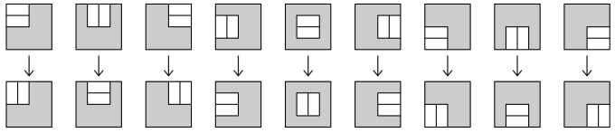</a>

<p style="text-align:right">(190)</p>

不难看出, 只有<em>一个</em> $4\times4$ 多米诺骨牌覆盖同时被这九个变换固定. 实际上 (习题 466), 对<em>所有</em> $m,n$, 解原来都是唯一的.

有名的 “残缺棋盘” 问题要求在删去了两个相对的角格后用多米诺骨牌覆盖棋盘. 当 $m,n$ 都是偶数时, 由习题 7.1.4–213 知道此问题不可满足. 可是只用那些子句, SAT 求解器并不能很快发现这个事实, 因为有许多办法可以十分接近一个解; 见 7.1.4–(130) 之后的讨论. [事实上, S. Dantchev 与 S. Riis 在 <em>FOCS</em> **42** (2001), 220–229 中已证明, 对这些子句的每个归结反驳都需要 $2^{\Omega(n)}$ 步.]

当把 $6\times6$, $8\times8$, $10\times10$, $\ldots$, $16\times16$ 的残缺棋盘交给算法 C 时, 为证明不可满足性, 分别约需 $55\,\mathrm K\mu$, $1.4\,\mathrm M\mu$, $31\,\mathrm M\mu$, $668\,\mathrm M\mu$, $16.5\,\mathrm G\mu$ 和 $.91\,\mathrm T\mu$ (最后这个量是万亿次内存访问). 然而, (190) 所示的奇偶自同态把我们救了出来: 它们极为显著地缩小了查找空间, 使相应的运行时间分别降至仅 $15\,\mathrm K\mu$, $60\,\mathrm K\mu$, $135\,\mathrm K\mu$, $250\,\mathrm K\mu$, $470\,\mathrm K\mu$, $690\,\mathrm K\mu$ (都是<em>千</em>次内存访问). 它们甚至能用不到 $4.2\,\mathrm G\mu$ 的计算量验证残缺的 $256\times256$ 骨牌覆盖不可满足, 其增长率约为 $O(n^3)$.

<a id="pdf-315"></a><a id="p-295"></a>

自同态还可以用另一种重要的方法来加快 SAT 求解:

**定理 E.** <em>设 $p_1p_2\ldots p_n$ 是 $\{1,2,\ldots,n\}$ 的任一排列. 如果布尔函数 $f(x_1,x_2,\ldots,x_n)$ 可满足, 那么它有一个解, 对于 $f$ 的每个将 $x_1x_2\ldots x_n$ 映成 $x'_1x'_2\ldots x'_n$ 的自同态, 都有 $x_{p_1}x_{p_2}\ldots x_{p_n}$ 按字典序小于或等于 $x'_{p_1}x'_{p_2}\ldots x'_{p_n}$.</em>

<em>证明.</em> $f$ 的字典序最小解具有这个性质. $\blacksquare$

也许不该把它称为 “定理”; 它是自同态总把解映成解这个事实的一个明显推论. 不过, 它值得记住, 也值得供上某种底座, 因为我们将看到它有许多有用的应用.

定理 E 至少很有希望成为大好消息, 因为每个布尔函数都有<em>极多</em>个自同态. (见习题 457.) 另一方面, 这里有个麻烦: 在解出问题<em>之前</em>, 我们几乎永远<em>不知道</em>这些自同态中的任何一个! 不过只要我们<em>确实</em>碰巧知道那无数非平凡自同态中的一个, 就可以添加子句缩小查找范围. 只要有解, 就总有一个 “字典序领头” 的解, 满足 $x_1x_2\ldots x_n\le x'_1x'_2\ldots x'_n$.

另一个使定理 E 稍失光彩的困难是, 大部分自同态都过于复杂, 无法简洁地用子句表示. 我们真正想要的是一个简单明了的自同态, 这样字典序关系也同样简单.

幸好这样的自同态经常能找到; 事实上, 它们通常是由变量的<em>带符号排列</em>定义的<em>自同构</em>——问题的对称. 带符号排列表示既可以置换变量又可以将它们取补的操作; 例如, 带符号排列 ‘$\bar413\bar2$’ 代表映射 $(x_1,x_2,x_3,x_4)\mapsto(x_{\bar4},x_1,x_3,x_{\bar2})=(\bar x_4,x_1,x_3,\bar x_2)$. 它作用于各个状态, 其变换比 (187) 规则得多:

<a href="../../assets/volume4b/figures/sat-map191.svg">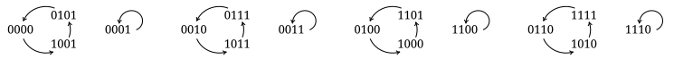</a>

<p style="text-align:right">(191)</p>

若 $\sigma$ 把字面值 $u$ 映成 $v$, 就写成 $u\sigma=v$; 在这种情形下, $\sigma$ 也把 $\bar u$ 映成 $\bar v$. 因此总有 $\bar u\sigma=\overline{u\sigma}$. 我们也用 $x\sigma$ 表示把 $\sigma$ 作用于字面值序列 $x$ 的结果; 例如 $(x_1,x_2,x_3,x_4)\sigma=(\bar x_4,x_1,x_3,\bar x_2)$. 若对所有 $x$ 都有 $f(x)=f(x\sigma)$, 则称此映射为 $f(x)$ 的一个对称或自同构. 习题 474 和 475 讨论了这些对称的基本性质; 另见习题 7.2.1.2–20.

注意, 一个带符号排列可以看成 $2n$ 个字面值 $\{x_1,\ldots,x_n,\bar x_1,\ldots,\bar x_n\}$ 的一个无符号排列, 因而可以写成圈的乘积. 例如对称 $\bar413\bar2$ 对应于圈 $(1\bar42)(\bar14\bar2)(3)(\bar3)$. 可以按通常的方法把这些圈相乘, 从而实现带符号排列的乘法, 与 1.3.3 节中一样.

两个对称 $\sigma$ 和 $\tau$ 的乘积 $\sigma\tau$ 总是一个对称. 因而特别地, 若 $\sigma$ 是任一对称, 它的幂 $\sigma^2,\sigma^3$ 等也都是对称. 若 $\sigma,\sigma^2,\ldots,\sigma^r$ 互异且 $\sigma^r$ 是恒等排列, 就说 $\sigma$ 的<em>阶</em>为 $r$. 阶为<a id="pdf-316"></a><a id="p-296"></a>1 或 2 的带符号排列称为<em>带符号的对合</em>; 这个重要的特例出现当且仅当 $\sigma$ 是它自己的逆 ($\sigma^2=1$).

显然, 处理 $2n$ 个字面值的排列比处理 $2^n$ 个状态 $x_1\ldots x_n$ 的排列要容易. 带符号的排列 $\sigma$ 有一个主要优点: 我们可以检验它是否保持可满足性问题的子句族 $F$ 不变. 如果保持不变, 就可以断定 $\sigma$ 作用在全部 $2^n$ 个状态上时也是一个自同构. (见[习题 492](#ex-7-2-2-2-492).)

再来看上面经常讨论的例子 $\operatorname{waerden}(3,10;97)$. 它的子句有一个明显的对称, 将 $x_1x_2\ldots x_{97}$ 变为 $x_{97}x_{96}\ldots x_1$. 如果不破除这个对称, 算法 C 通常经过约 $530\,\mathrm M\mu$ 的计算就证实不可满足性. 定理 E 告诉我们, 也可以断言例如 $x_1x_2x_3\le x_{97}x_{96}x_{95}$; 可是这个破除对称性的条件实际上毫无帮助, 因为 $x_1$ 对 $x_{97}$ 的影响很小. 幸好定理 E 允许我们在作字典序比较的依据时选<em>任一</em>排列 $p_1p_2\ldots p_n$. 例如可断言 $x_{48}x_{47}x_{46}\ldots\le x_{50}x_{51}x_{52}\ldots$——只要不<em>同时</em>要求 $x_1x_2x_3\ldots\le x_{97}x_{96}x_{95}\ldots$. (必须使用一个固定的全局次序, 不过自同态可以是任意的.)

就连简单的断言 $x_{48}\le x_{50}$, 即子句 ‘$\overline{48}\ 50$’, 也把运行时间降至约 $410\,\mathrm M\mu$, 因为这个新子句与已有的子句 $46\ 48\ 50$, $48\ 49\ 50$, $48\ 50\ 52$ 配合得很好, 产生了有用的二元子句 $46\ 50$, $49\ 50$, $50\ 52$. 若进一步断言 $x_{48}x_{47}\le x_{50}x_{51}$, 运行时间将改善至 $345\,\mathrm M\mu$. 再往下逐步加入 $x_{48}x_{47}x_{46}\le x_{50}x_{51}x_{52}$, $\ldots$, $x_{48}x_{47}x_{46}x_{45}x_{44}x_{43}\le x_{50}x_{51}x_{52}x_{53}x_{54}x_{55}$, 就依次降至 $290\,\mathrm M\mu$, $260\,\mathrm M\mu$, $235\,\mathrm M\mu$, $220\,\mathrm M\mu$; 单凭一个反射对称, 我们就省下了一半以上的运行时间! 按 (169) 高效地编码字典序, 只需以下 16 个简单的附加子句就获得了这种加速
$$
\overline{48}\,50,\quad\overline{48}\,a_1,\quad50\,a_1,\quad
\overline{47}\,51\,\bar a_1,\quad\overline{47}\,a_2\bar a_1,\quad51\,a_2\bar a_1,\quad
\overline{46}\,52\,\bar a_2,\quad\ldots,\quad\overline{43}\,55\,\bar a_5.
$$

当然, 好景总有尽头, 此时已到了收益递减的地步: 再添子句, 对 $\operatorname{waerden}(3,10;97)$ 断言 $x_{48}x_{47}\ldots x_{42}\le x_{50}x_{51}\ldots x_{56}$, 结果反而有害.

当对称 $\sigma$ 是一个所含 2 圈相对少的带符号的对合时, 就有一个极好的简化. 例如假定 $\sigma=5\bar3\bar241\bar6\bar9\bar8\bar7$; 它的圈形式为 $(15)(\bar1\bar5)(2\bar3)(\bar23)(4)(\bar4)(6\bar6)(7\bar9)(\bar79)(8\bar8)$. 则字典序关系 $x=x_1\ldots x_9\le x'_1\ldots x'_9=x\sigma$ 成立当且仅当 $x_1x_2x_6\le x_5\bar x_3\bar x_6$. 仔细一看便明白其中的道理 (见 F. A. Aloul、A. Ramani、I. L. Markov 和 K. A. Sakallah, <em>IEEE Trans. CAD-22</em> (2003), 1117–1137, §III.C): 在这个情形中, $x_1\ldots x_9\le x'_1\ldots x'_9$ 就是说 “$x_1\le x_5$; 若 $x_1=x_5$, 则 $x_2\le\bar x_3$; 若 $x_1=x_5$, $x_2=\bar x_3$, 则 $x_3\le\bar x_2$; 若 $x_1=x_5$, $x_2=\bar x_3$, $x_3=\bar x_2$, 则 $x_4\le x_4$; 若 $x_1=x_5$, $x_2=\bar x_3$, $x_3=\bar x_2$, $x_4=x_4$, 则 $x_5\le x_1$; 若 $x_1=x_5$, $x_2=\bar x_3$, $x_3=\bar x_2$, $x_4=x_4$, $x_5=x_1$, 则 $x_6\le\bar x_6$; 若 $x_1=x_5$, $x_2=\bar x_3$, $x_3=\bar x_2$, $x_4=x_4$, $x_5=x_1$, $x_6=\bar x_6$, 就都做完了.” 展开写出以后, 可以简化之处便一目了然.

一般说来, 这个推理让我们能够把定理 E 改进如下:

<a id="pdf-317"></a><a id="p-297"></a>

**推论 E.** <em>设 $p_1p_2\ldots p_n$ 是 $\{1,2,\ldots,n\}$ 的任一排列. 对于子句 $F$ 的每个带符号的对合对称 $\sigma$, 可以把 $\sigma$ 写成圈形式</em>
$$
(p_{i_1}\,{\pm}p_{j_1})(\bar p_{i_1}\,{\mp}p_{j_1})
(p_{i_2}\,{\pm}p_{j_2})(\bar p_{i_2}\,{\mp}p_{j_2})\ldots
(p_{i_t}\,{\pm}p_{j_t})(\bar p_{i_t}\,{\mp}p_{j_t}),\tag{192}
$$
<em>其中 $i_1\le j_1$, $i_2\le j_2$, $\ldots$, $i_t\le j_t$, $i_1<i_2<\cdots<i_t$, 在 $i_k=j_k$ 时略去 $(\bar p_{i_k}\,{\mp}p_{j_k})$; 而且允许向 $F$ 添加断言下列字典序关系的子句: $x_{p_{i_1}}x_{p_{i_2}}\ldots x_{p_{i_q}}\le x_{\pm p_{j_1}}x_{\pm p_{j_2}}\ldots x_{\pm p_{j_q}}$, 其中 $q=t$, 或 $q$ 为满足 $i_k=j_k$ 的最小的 $k$.</em> $\blacksquare$

在常见的 $\sigma$ 为普通无符号对合的情形下, 这里的符号全可去掉; 只须断言 $x_{p_{i_1}}\ldots x_{p_{i_t}}\le x_{p_{j_1}}\ldots x_{p_{j_t}}$.

上面在鸽巢问题和无四角矩阵问题中用来破除对称性的所有技术, 都可由这条对合原理得到依据. 例如见习题 495 中的详细讨论.

通过附加子句来破除对称性的想法, 最早由 J.-F. Puget [<em>LNCS</em> **689** (1993), 350–361] 提出, 后有 J. Crawford、M. Ginsberg、E. Luks 和 A. Roy [<em>Int. Conf. Knowledge Representation and Reasoning</em> **5** (1996), 148–159]; 后者只考虑无符号排列. 他们还试图用算法从输入子句中发现对称性. 不过经验表明, 有用的对称性几乎总是由了解底层问题结构的人提供得更好.

事实上, 对称性往往属于 “语义” 而非 “语法”. 就是说, 它们是底层布尔函数的对称, 却不是子句本身的对称. 例如在 Zarankiewicz 的无四角矩阵问题中, 我们添加了高效的基数子句来保证 $\sum x_{ij}\ge r$; 这个条件在交换行或交换列时对称, 子句却不对称.

这里也不妨提一下<em>扳手捣乱原理</em>: 我们用来迅速证明鸽巢子句不可满足的所有技术, 只要再添一个例如 $(x_{01}\lor x_{11}\lor\bar x_{22})$ 的子句, 就会变得无用; 这个子句会破坏对称性!

由此可知, 允许从 $F$ 中<em>删去</em>子句, 直到剩下一个可添加破除对称性子句 $S$ 的子集 $F_0$. 若 $F=F_0\cup F_1$, 且 $F_0$ 可满足当且仅当 $F_0\cup S$ 可满足, 则 $F_0\cup S\vdash\epsilon\ \Longrightarrow\ F\vdash\epsilon$.

**一百个测试实例.** 现在——好戏来了!——让我们进入这个长故事的高潮, 看看面对 100 个具有一定挑战性的可满足性问题时, 我们的 SAT 求解器表现如何. 接下来两页概述的 100 组子句来自丰富多样的应用; 许多已在本节开头讨论过, 其余则出现在后面的习题中.

每个测试实例都有一个由一个字母和一个数字组成的代号. [表 6](#tab-7-2-2-2-6) 描述了各个问题, 并精确给出所涉及的变量数、子句数和字面值总数. 例如, 问题 A1 的说明以 ‘2043 | <u>24772</u> | 55195 | U’ 结束; 这表示 A1 有 2043 个变量、24772 个子句, 共有 55195 个字面值, 这些子句不可满足. 而且由于 ‘24772’ 下有横线, A1 的所有子句的长度都不超过 3.

<a id="pdf-318"></a><a id="p-298"></a>

<a id="tab-7-2-2-2-6"></a>**表 6　一百个测试实例的概要**


<table id="sat-cases-six"><thead><tr><th>代号</th><th>说明</th><th>变量</th><th>子句</th><th>字面值</th><th>结果</th></tr></thead><tbody>
<tr><th scope="row">A1</th><td>寻找 $x=x_1x_2\ldots x_{99}$, 其中 $\nu x=27$, 并且没有三个等距的 1. (见习题 31.)</td><td>2043</td><td><u>24772</u></td><td>55195</td><td>U</td></tr>
<tr><th scope="row">A2</th><td>同 A1, 但改用 $x_1x_2\ldots x_{100}$.</td><td>2071</td><td><u>25197</u></td><td>56147</td><td>S</td></tr>
<tr><th scope="row">B1</th><td>用 49 块多米诺骨牌覆盖残缺的 $10\times10$ 棋盘, <em>不</em>用额外子句破除对称性.</td><td>176</td><td>572</td><td>1300</td><td>U</td></tr>
<tr><th scope="row">B2</th><td>同 B1, 但改用 $12\times12$ 棋盘和 71 块骨牌.</td><td>260</td><td>856</td><td>1948</td><td>U</td></tr>
<tr><th scope="row">C1</th><td>寻找一条八步布尔链, 计算 $(z_2z_1z_0)_2=x_1+x_2+x_3+x_4$. (见习题 479(a).)</td><td>384</td><td>16944</td><td>66336</td><td>U</td></tr>
<tr><th scope="row">C2</th><td>寻找一条七步布尔链, 计算习题 481(b) 中改动后的全加器函数 $z_1,z_2,z_3$.</td><td>469</td><td>26637</td><td>100063</td><td>U</td></tr>
<tr><th scope="row">C3</th><td>同 C2, 但允许八步.</td><td>572</td><td>33675</td><td>134868</td><td>S</td></tr>
<tr><th scope="row">C4</th><td>寻找一条九步布尔链, 计算习题 480(b) 的模 3 加法问题中的 $z_l$ 和 $z_r$.</td><td>678</td><td>45098</td><td>183834</td><td>S</td></tr>
<tr><th scope="row">C5</th><td>在习题 392(iv) 的 Dudeney 谜题中, 将 A 与 A 相连, $\ldots$, 将 J 与 J 相连.</td><td>1980</td><td>22518</td><td>70356</td><td>S</td></tr>
<tr><th scope="row">C6</th><td>同 C5, 但把第 8 行的 J 从第 4 列移到第 5 列.</td><td>1980</td><td>22518</td><td>70356</td><td>U</td></tr>
<tr><th scope="row">C7</th><td>给定长度为 200 的二进制串 $s_1,\ldots,s_{50}$, 它们随机生成, 各自与某个串 $x$ 的距离 $\le r_j$; 求 $x$ (见习题 502).</td><td>65719</td><td><u>577368</u></td><td>1659623</td><td>S</td></tr>
<tr><th scope="row">C8</th><td>给定长度为 500 的二进制串 $s_1,\ldots,s_{40}$, 其构造受生物数据启发, 求一个与它们中的每一个的距离都 $\le42$ 的串.</td><td>123540</td><td><u>909120</u></td><td>2569360</td><td>U</td></tr>
<tr><th scope="row">C9</th><td>同 C8, 但距离上限为 43.</td><td>124100</td><td><u>926200</u></td><td>2620160</td><td>S</td></tr>
<tr><th scope="row">D1</th><td>满足 $\operatorname{factor\_fifo}(18,19,111111111111)$. (见习题 41.)</td><td>1940</td><td><u>6374</u></td><td>16498</td><td>U</td></tr>
<tr><th scope="row">D2</th><td>同 D1, 但用 $\operatorname{factor\_lifo}$.</td><td>1940</td><td><u>6374</u></td><td>16498</td><td>U</td></tr>
<tr><th scope="row">D3</th><td>同 D1, 但参数为 $(19,19,111111111111)$.</td><td>2052</td><td><u>6745</u></td><td>17461</td><td>S</td></tr>
<tr><th scope="row">D4</th><td>同 D2, 但参数为 $(19,19,111111111111)$.</td><td>2052</td><td><u>6745</u></td><td>17461</td><td>S</td></tr>
<tr><th scope="row">D5</th><td>解 $(x_1\ldots x_9)_2\times(y_1\ldots y_9)_2\ne(x_1\ldots x_9)_2\times(y_1\ldots y_9)_2$, 两边使用<em>同一个</em> Dadda 乘法电路的两个副本.</td><td>864</td><td>2791</td><td>7236</td><td>U</td></tr>
<tr><th scope="row">E0</th><td>寻找一个 Erdős 偏差模式 $x_1\ldots x_{500}$ (见习题 482).</td><td>1603</td><td><u>9157</u></td><td>27469</td><td>S</td></tr>
<tr><th scope="row">E1</th><td>同 E0, 但改用 $x_1\ldots x_{750}$.</td><td>2556</td><td><u>14949</u></td><td>44845</td><td>S</td></tr>
<tr><th scope="row">E2</th><td>同 E0, 但改用 $x_1\ldots x_{1000}$.</td><td>3546</td><td><u>21035</u></td><td>63103</td><td>S</td></tr>
<tr><th scope="row">F1</th><td>满足 $\operatorname{fsnark}(99)$. (见习题 176.)</td><td>1782</td><td><u>4161</u></td><td>8913</td><td>U</td></tr>
<tr><th scope="row">F2</th><td>同 F1, 但去掉子句 $(\bar e_{1,3}\lor\bar f_{99,3})\land(\bar f_{1,1}\lor\bar e_{2,1})$.</td><td>1782</td><td><u>4159</u></td><td>8909</td><td>S</td></tr>
<tr><th scope="row">G1</th><td>在迟绑定单人纸牌游戏中, 赢下答案 486 中 “最难的可胜牌局”.</td><td>1242</td><td>22617</td><td>65593</td><td>S</td></tr>
<tr><th scope="row">G2</th><td>同 G1, 但采用最难的<em>不可胜</em>牌局.</td><td>1242</td><td>22612</td><td>65588</td><td>U</td></tr>
<tr><th scope="row">G3</th><td>在 $\operatorname{prod}(16,32)$ 中, 为故障 “$B_{43}^{43}$ 固定为 0” 寻找一个测试模式.</td><td>3498</td><td><u>11337</u></td><td>29097</td><td>S</td></tr>
<tr><th scope="row">G4</th><td>同 G3, 但故障为 “$D_{34}^{13,9}$ 固定为 0”.</td><td>3502</td><td><u>11349</u></td><td>29127</td><td>S</td></tr>
<tr><th scope="row">G5</th><td>寻找一个至多有 38 个活细胞的 $7\times15$ 阵列 $X_0$, 使它像<a href="#fig-7-2-2-2-78">图 78</a> 那样演化为 $X_3=\mathrm{LIFE}$.</td><td>7150</td><td><u>28508</u></td><td>71873</td><td>U</td></tr>
<tr><th scope="row">G6</th><td>同 G5, 但允许至多 39 个活细胞.</td><td>7152</td><td><u>28536</u></td><td>71956</td><td>S</td></tr>
<tr><th scope="row">G7</th><td>同 G5, 但 $X_4=\mathrm{LIFE}$, 且 $X_0$ 可以任意.</td><td>8725</td><td><u>33769</u></td><td>84041</td><td>U</td></tr>
<tr><th scope="row">G8</th><td>在生命游戏中寻找一个证明 $f^*(7,7)=28$ 的构形 (见<a href="#ex-7-2-2-2-83">习题 83</a>).</td><td>97909</td><td><u>401836</u></td><td>1020174</td><td>S</td></tr>
<tr><th scope="row">K0</th><td>用 8 色给 $8\times8$ 皇后图着色, 使用直接编码 (15)、(16), 并强制顶行所有顶点的颜色.</td><td>512</td><td>5896</td><td>12168</td><td>U</td></tr>
<tr><th scope="row">K1</th><td>同 K0, 但还加上互斥子句 (17).</td><td>512</td><td>7688</td><td>15752</td><td>U</td></tr>
<tr><th scope="row">K2</th><td>同 K1, 但用核子句代替 (17) (见<a href="./answers/7-2-2-2.md#ans-7-2-2-2-14">答案 14</a>).</td><td>512</td><td>6408</td><td>24328</td><td>U</td></tr>
<tr><th scope="row">K3</th><td>同 K1, 但用支持子句代替 (16) (见习题 399).</td><td>512</td><td>13512</td><td>97288</td><td>U</td></tr>
<tr><th scope="row">K4</th><td>同 K0, 但对颜色使用顺序编码.</td><td>448</td><td>6215</td><td>21159</td><td>U</td></tr>
<tr><th scope="row">K5</th><td>同 K4, 但加上提示子句 (162).</td><td>448</td><td>6299</td><td>21663</td><td>U</td></tr>
<tr><th scope="row">K6</th><td>同 K5, 但用双重团提示 (习题 396).</td><td>896</td><td>8559</td><td>27927</td><td>U</td></tr>
<tr><th scope="row">K7</th><td>同 K1, 但使用习题 391(a) 的对数编码.</td><td>2376</td><td><u>5120</u></td><td>15312</td><td>U</td></tr>
<tr><th scope="row">K8</th><td>同 K1, 但使用习题 391(b) 的对数编码.</td><td>192</td><td>5848</td><td>34968</td><td>U</td></tr>
<tr><th scope="row">L1</th><td>满足 $\operatorname{langford}(10)$.</td><td>130</td><td>2437</td><td>5204</td><td>U</td></tr>
<tr><th scope="row">L2</th><td>满足 $\operatorname{langford}'(10)$.</td><td>273</td><td>1020</td><td>2370</td><td>U</td></tr>
<tr><th scope="row">L3</th><td>满足 $\operatorname{langford}(13)$.</td><td>228</td><td>5875</td><td>12356</td><td>U</td></tr>
<tr><th scope="row">L4</th><td>满足 $\operatorname{langford}'(13)$.</td><td>502</td><td>1857</td><td>4320</td><td>U</td></tr>
<tr><th scope="row">L5</th><td>满足 $\operatorname{langford}(32)$.</td><td>1472</td><td>102922</td><td>210068</td><td>S</td></tr>
<tr><th scope="row">L6</th><td>满足 $\operatorname{langford}'(32)$.</td><td>3512</td><td>12768</td><td>29760</td><td>S</td></tr>
<tr><th scope="row">L7</th><td>满足 $\operatorname{langford}(64)$.</td><td>6016</td><td>869650</td><td>1756964</td><td>S</td></tr>
<tr><th scope="row">L8</th><td>满足 $\operatorname{langford}'(64)$.</td><td>14704</td><td>53184</td><td>124032</td><td>S</td></tr>
<tr><th scope="row">M1</th><td>用 4 色给 10 阶 McGregor 图 (<a href="#fig-7-2-2-2-76">图 76</a>) 着色, 其中一种颜色至多使用 6 次, 采用基数约束 (18) 和 (19).</td><td>1064</td><td>2752</td><td>6244</td><td>U</td></tr>
</tbody>
<tbody id="pdf-319">
<tr id="p-299"><th scope="row">M2</th><td>同 M1, 但采用 (20) 和 (21).</td><td>814</td><td>2502</td><td>5744</td><td>U</td></tr>
<tr><th scope="row">M3</th><td>同 M1, 但至多使用 7 次.</td><td>1161</td><td>2944</td><td>6726</td><td>S</td></tr>
<tr><th scope="row">M4</th><td>同 M2, 但至多使用 7 次.</td><td>864</td><td>2647</td><td>6226</td><td>S</td></tr>
<tr><th scope="row">M5</th><td>同 M4, 但取 16 阶, 并且至多使用 11 次.</td><td>2256</td><td>7801</td><td>18756</td><td>U</td></tr>
<tr><th scope="row">M6</th><td>同 M5, 但至多使用 12 次.</td><td>2288</td><td>8080</td><td>19564</td><td>S</td></tr>
<tr><th scope="row">M7</th><td>用 4 色给 9 阶 McGregor 图着色, 并且要求至少有 18 个区域着两种颜色 (见<a href="#ex-7-2-2-2-19">习题 19</a>).</td><td>952</td><td>4539</td><td>13875</td><td>S</td></tr>
<tr><th scope="row">M8</th><td>同 M7, 但至少有 19 个区域着两种颜色.</td><td>952</td><td>4540</td><td>13877</td><td>U</td></tr>
<tr><th scope="row">N1</th><td>在 $100\times100$ 棋盘上放置 100 个互不攻击的皇后.</td><td>10000</td><td>1151800</td><td>2313400</td><td>S</td></tr>
<tr><th scope="row">O1</th><td>求解一个随机的开放车间调度问题, 有 8 台机器、8 项作业, 限时 1058 个时间单位.</td><td>50846</td><td><u>557823</u></td><td>1621693</td><td>U</td></tr>
<tr><th scope="row">O2</th><td>同 O1, 但限时 1059 个单位.</td><td>50901</td><td><u>558534</u></td><td>1623771</td><td>S</td></tr>
<tr><th scope="row">P0</th><td>对于 $m=20$, 满足 (99)、(100) 和 (101), 借此给出一个大小为 20 而没有极大元的偏序集.</td><td>400</td><td>7260</td><td>22080</td><td>U</td></tr>
<tr><th scope="row">P1</th><td>同 P0, 但 $m=14$, 仅用习题 228 的子句.</td><td>196</td><td>847</td><td>2667</td><td>U</td></tr>
<tr><th scope="row">P2</th><td>同 P0, 但 $m=12$, 使用习题 229 的子句.</td><td>144</td><td>530</td><td>1674</td><td>U</td></tr>
<tr><th scope="row">P3</th><td>同 P2, 但略去子句 $(\bar x_{31}\lor\bar x_{16}\lor x_{36})$.</td><td>144</td><td>529</td><td>1671</td><td>S</td></tr>
<tr><th scope="row">P4</th><td>同 P3, 但 $m=20$.</td><td>400</td><td>2509</td><td>7827</td><td>S</td></tr>
<tr><th scope="row">Q0</th><td>同 K0, 但用 9 色.</td><td>576</td><td>6624</td><td>13688</td><td>S</td></tr>
<tr><th scope="row">Q1</th><td>同 K1, 但用 9 色.</td><td>576</td><td>8928</td><td>18296</td><td>S</td></tr>
<tr><th scope="row">Q2</th><td>同 K2, 但用 9 色.</td><td>576</td><td>7200</td><td>27368</td><td>S</td></tr>
<tr><th scope="row">Q3</th><td>同 K3, 但用 9 色.</td><td>576</td><td>15480</td><td>123128</td><td>S</td></tr>
<tr><th scope="row">Q4</th><td>同 K4, 但用 9 色.</td><td>512</td><td>7008</td><td>24200</td><td>S</td></tr>
<tr><th scope="row">Q5</th><td>同 K5, 但用 9 色.</td><td>512</td><td>7092</td><td>24704</td><td>S</td></tr>
<tr><th scope="row">Q6</th><td>同 K6, 但用 9 色.</td><td>1024</td><td>9672</td><td>31864</td><td>S</td></tr>
<tr><th scope="row">Q7</th><td>同 K7, 但用 9 色.</td><td>3168</td><td>6776</td><td>20800</td><td>S</td></tr>
<tr><th scope="row">Q8</th><td>同 K8, 但用 9 色.</td><td>256</td><td>6776</td><td>52832</td><td>S</td></tr>
<tr><th scope="row">Q9</th><td>同 Q8, 但采用习题 391(c) 的对数编码.</td><td>256</td><td>6584</td><td>42256</td><td>S</td></tr>
<tr><th scope="row">R1</th><td>满足 $\operatorname{rand}(3,1061,250,314159)$.</td><td>250</td><td><u>1061</u></td><td>3183</td><td>S</td></tr>
<tr><th scope="row">R2</th><td>满足 $\operatorname{rand}(3,1062,250,314159)$.</td><td>250</td><td><u>1062</u></td><td>3186</td><td>U</td></tr>
<tr><th scope="row">S1</th><td>求一个关于 $\{x_1,\ldots,x_{20}\}$ 的四项析取范式, 它与 (27) 不同, 但在 108 个随机训练点处与其一致.</td><td>356</td><td>4229</td><td>16596</td><td>S</td></tr>
<tr><th scope="row">S2</th><td>同 S1, 但有 109 个训练点.</td><td>360</td><td>4310</td><td>16760</td><td>U</td></tr>
<tr><th scope="row">S3</th><td>找到九个元素的一个排序网络, 它以比较器 [1:6]、[2:7]、[3:8]、[4:9] 开始, 再用五轮并行比较完成排序.</td><td>5175</td><td>85768</td><td>255421</td><td>U</td></tr>
<tr><th scope="row">S4</th><td>同 S3, 但再用六轮完成.</td><td>6444</td><td>107800</td><td>326164</td><td>S</td></tr>
<tr><th scope="row">T1</th><td>找出一个 $24\times100$ 的榻榻米铺砌, 拼出习题 118 那样的 ‘TATAMI’.</td><td>2874</td><td>10527</td><td>26112</td><td>S</td></tr>
<tr><th scope="row">T2</th><td>同 T1, 但改为 $24\times106$, 且 ‘I’ 要有衬线.</td><td>3048</td><td>11177</td><td>27724</td><td>U</td></tr>
<tr><th scope="row">T3</th><td>仅走 4 步马步, 解出习题 389 的 TAOCP 问题.</td><td>3752</td><td>12069</td><td>27548</td><td>U</td></tr>
<tr><th scope="row">T4</th><td>同 T3, 但走 5 步马步.</td><td>3756</td><td>12086</td><td>27598</td><td>S</td></tr>
<tr><th scope="row">T5</th><td>确定<a href="#fig-7-2-2-2-80">图 80</a>(c) 中第 5 行第 18 列的像素, 即柴郡猫层析问题中字典序最后的解在该处的像素.</td><td>8837</td><td><u>39954</u></td><td>100314</td><td>S</td></tr>
<tr><th scope="row">T6</th><td>同 T5, 但改为第 19 列.</td><td>8837</td><td><u>39955</u></td><td>100315</td><td>U</td></tr>
<tr><th scope="row">T7</th><td>解出柴郡猫层析问题的游程数推广 (见习题 117).</td><td>25734</td><td>65670</td><td>167263</td><td>S</td></tr>
<tr><th scope="row">T8</th><td>同 T7, 但寻找不同于<a href="#fig-7-2-2-2-79">图 79</a> 的解.</td><td>25734</td><td>65671</td><td>167749</td><td>U</td></tr>
<tr><th scope="row">W1</th><td>满足 $\operatorname{waerden}(3,10;97)$.</td><td>97</td><td>2779</td><td>11662</td><td>U</td></tr>
<tr><th scope="row">W2</th><td>满足 $\operatorname{waerden}(3,13;159)$.</td><td>159</td><td>7216</td><td>31398</td><td>S</td></tr>
<tr><th scope="row">W3</th><td>满足 $\operatorname{waerden}(5,5;177)$.</td><td>177</td><td>7656</td><td>38280</td><td>S</td></tr>
<tr><th scope="row">W4</th><td>满足 $\operatorname{waerden}(5,5;178)$.</td><td>178</td><td>7744</td><td>38720</td><td>U</td></tr>
<tr><th scope="row">X1</th><td>证明 “轮流” 协议 (43) 至少在 100 步内保证互斥.</td><td>1010</td><td>3612</td><td>10614</td><td>U</td></tr>
<tr><th scope="row">X2</th><td>证明类似于 (50) 的断言 $\Phi$ 对习题 101 的四位协议是不变的.</td><td>129</td><td>354</td><td>926</td><td>U</td></tr>
<tr><th scope="row">X3</th><td>在 X2 的 $\Phi$ 假设下, 证明 Bob 不可能在 36 步内出现饥饿.</td><td>1652</td><td>10552</td><td>28971</td><td>U</td></tr>
<tr><th scope="row">X4</th><td>在 X2 的 $\Phi$ 假设下, 证明四位协议中存在一条简单的 36 步路径.</td><td>22199</td><td>50264</td><td>130404</td><td>S</td></tr>
<tr><th scope="row">X5</th><td>同 X4, 但改为 37 步.</td><td>23388</td><td>52822</td><td>137034</td><td>U</td></tr>
<tr><th scope="row">X6</th><td>同 X1, 但采用 Peterson 的协议 (49) 代替 (43).</td><td>2218</td><td>8020</td><td>23222</td><td>U</td></tr>
<tr><th scope="row">X7</th><td>证明协议 (49) 中有一条简单的 54 步路径.</td><td>26450</td><td>56312</td><td>147572</td><td>S</td></tr>
<tr><th scope="row">X8</th><td>同 X7, 但改为 55 步.</td><td>27407</td><td>58317</td><td>152807</td><td>U</td></tr>
</tbody></table>

<a id="pdf-320"></a><a id="p-300"></a>

<a id="fig-7-2-2-2-95"></a>


<figure><a href="../../assets/volume4b/figures/sat-fig95-a1.jpg">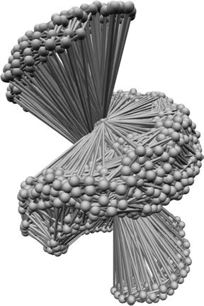</a><figcaption>A1</figcaption></figure>

<figure><a href="../../assets/volume4b/figures/sat-fig95-g4.jpg">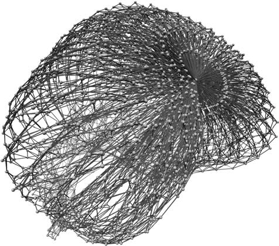</a><figcaption>G4</figcaption></figure>

<figure><a href="../../assets/volume4b/figures/sat-fig95-b2.jpg">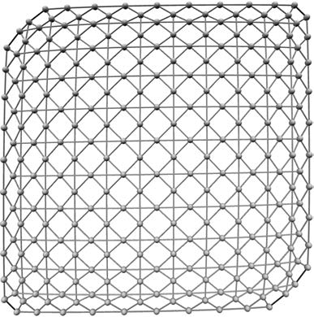</a><figcaption>B2</figcaption></figure>

<figure><a href="../../assets/volume4b/figures/sat-fig95-k6.jpg">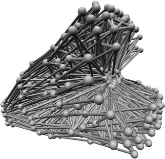</a><figcaption>K6</figcaption></figure>

<figure><a href="../../assets/volume4b/figures/sat-fig95-c5.jpg">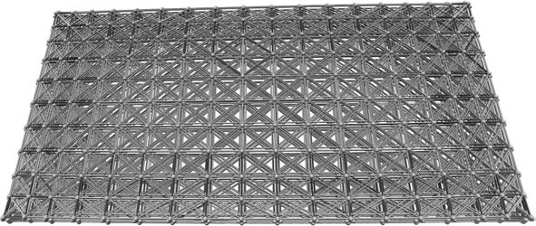</a><figcaption>C5</figcaption></figure>

<a id="pdf-321"></a><a id="p-301"></a>

<figure><a href="../../assets/volume4b/figures/sat-fig95-m1.jpg">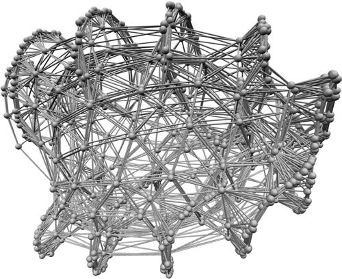</a><figcaption>M1</figcaption></figure>

<figure><a href="../../assets/volume4b/figures/sat-fig95-m2.jpg">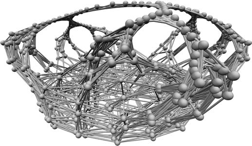</a><figcaption>M2</figcaption></figure>

<figure><a href="../../assets/volume4b/figures/sat-fig95-t3.jpg">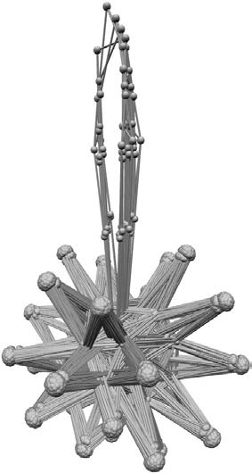</a><figcaption>T3</figcaption></figure>

<figure><a href="../../assets/volume4b/figures/sat-fig95-s3.jpg">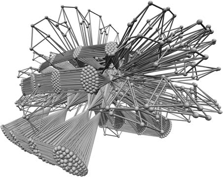</a><figcaption>S3</figcaption></figure>

<figure><a href="../../assets/volume4b/figures/sat-fig95-x3.jpg">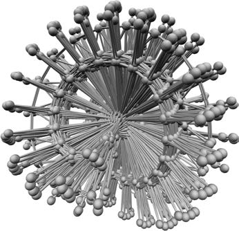</a><figcaption>X3</figcaption></figure>


**图 95.** 这些测试实例中的子句以显著不同的方式把变量联系在一起. (图由 Carsten Sinz 绘制.)

<a id="pdf-322"></a><a id="p-302"></a>

当然, 要区分难题与容易的问题, 不能只数一数变量、子句和字面值. 子句极其灵活, 能表达各种逻辑关系, 因而不同的子句集所导致的现象也可能大相径庭. [图 95](#fig-7-2-2-2-95) 展现了这种丰富性的一角, 画出了十幅颇有启发性的 “变量相互作用图”. 每个变量用一个球表示, 两个变量若至少在一个子句中共同出现, 就用边相连. (有的边比别的边深; 见习题 506. 关于这种三维图示的其他例子, 包括彩色图, 见 Carsten Sinz, <em>Journal of Automated Reasoning</em> **39** (2007), 219–243.)

不能指望同一个 SAT 求解器对形形色色的问题都表现出色. 而且[表 6](#tab-7-2-2-2-6) 的一百个实例中, 几乎全部远远超出了我们起初所用的简单算法的能力: 除了最简单的几个例子——L1、L2、L5、P3、P4 和 X2——以外, 算法 A、B、D 要解其中任何一个, 所需计算量都超过五百亿次内存访问. 算法 L 是算法 D 的强化改进, 对大部分实例也相当吃力. 另一方面, 算法 C 表现得出色: 它用不到 $10\,\mathrm G\mu$ 就解决了其中 79 个问题.

所以[表 6](#tab-7-2-2-2-6) 中的实例尽管棘手, 却并非高不可攀. 用今天已知的方法, 几乎都可在至多比如两分钟之内解出.

全部细节可在作者网站的文件 <code>SATexamples.tgz</code> 中查到, 那里还收有许多有关的问题, 有大有小.

这 100 个实例恰有 50 个是可满足的. 因此我们自然想知道, 算法 W (“WalkSAT”) 能否很好地处理它们. 答案是, 算法 W 有时成绩辉煌——特别是在问题 C7、C9、L5、L7、M3、M4、M6、P3、P4、Q0、Q1、R1、S1 上, 它通常胜过已经讨论的其他一切方法. 具体地说, 在作者取 $N=50n$, $p=.4$ 的测试中, 它只用 $1\,\mathrm M\mu$ 就解出了 S1, 而次优的算法 C 要 $25\,\mathrm M\mu$; 在 M3 上它以 $15\,\mathrm M\mu$ 胜过算法 C 的 $83\,\mathrm M\mu$, 在 Q0 上以 $83\,\mathrm M\mu$ 胜过算法 L 的 $104\,\mathrm M\mu$, 在 Q1 上以 $95\,\mathrm M\mu$ 胜过算法 C 的 $464\,\mathrm M\mu$, 在 C7 上竟以 $104\,\mathrm M\mu$ 胜过算法 C 的 $7036\,\mathrm M\mu$. 这很出人意料. WalkSAT 在 N1 上也很有竞争力. 但在其他一切情形中, 它都远远赶不上首选方法. 因此以下只考虑算法 L 和 C.[^v4b-302-lookahead]

有前瞻的算法, 如 L, 在什么时候胜过有子句学习的算法, 如 C? [图 96](#fig-7-2-2-2-96) 表示它们在这一百个测试实例上的比较: 每个问题的纵坐标为算法 C 的运行时间, 横坐标为算法 L 的运行时间. 因此, 在点线以上的问题上算法 L 取胜. (点线之所以 “弯弯曲曲”, 是因为时间没有按比例画: 从图的左边或底部量起, 第 $k$ 快的运行时间都放在距离为 $k$ 个单位的位置.)


<a id="pdf-323"></a><a id="p-303"></a>

<a href="../../assets/volume4b/figures/sat-fig96.svg">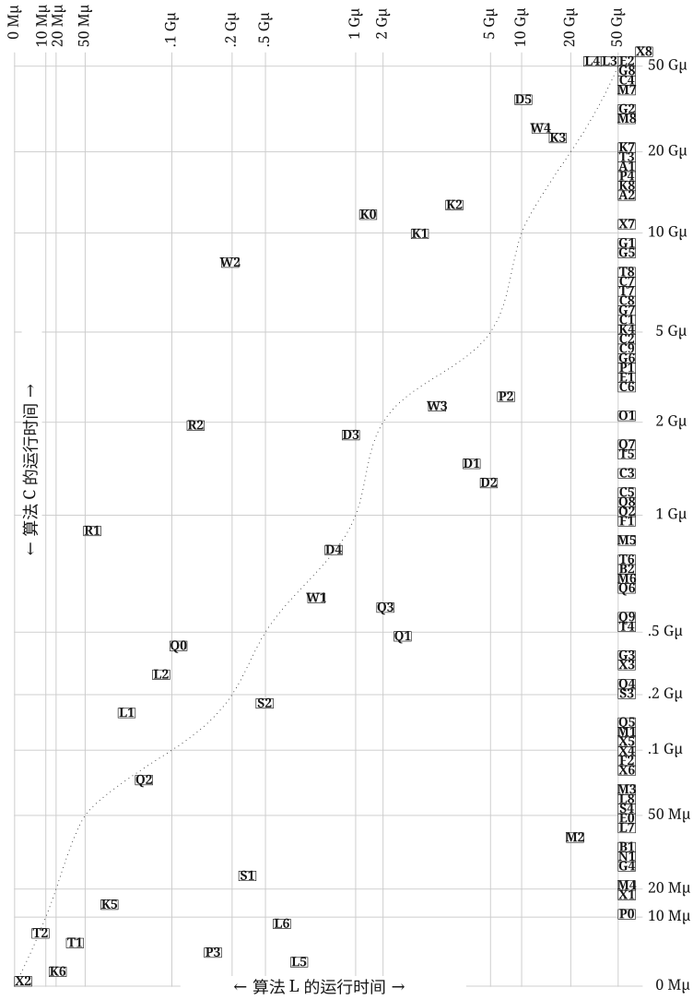</a>


<a id="fig-7-2-2-2-96"></a>**图 96.** 算法 C 和 L 在 100 个中等难度的可满足性问题上的比较.

<a id="pdf-324"></a><a id="p-304"></a>

以上所有实验若运行到 $50\,\mathrm G\mu$ 仍未结束, 就在此截断, 因为其中许多问题可能要算上几个世纪才会结束. 因此, 算法 L 超时的实例出现在[图 96](#fig-7-2-2-2-96) 的右边缘, 而算法 C 感到棘手的实例出现在上边缘. 只有 E2 与 X8 两个问题困难得使两种算法都未能在规定的截止时间内解决.

算法 L 是确定性的: 它不用随机变量. 然而稍作改动 (见习题 505) 就能使它随机化, 因为可以像算法 C 那样把输入打乱; 我们不妨假定已经这样改过了. 于是算法 L 与 C 的运行时间都会变化. 对于同一个问题, 有时它们能较快地找到解或证明不可满足性, 有时则较慢, 正如我们在[图 92](#fig-7-2-2-2-92) 中对算法 C 所看到的那样.

为了补偿这种变异性, [图 96](#fig-7-2-2-2-96) 所报告的每个运行时间都是九次独立试验的<em>中位数</em>. [图 97](#fig-7-2-2-2-97) 给出了算法 C 得到的全部 $9\times100$ 个实测运行时间, 按各组的中位数排序. 可以看出, 许多问题的行为近乎恒定; 事实上, 有 38 个实例的最大值与最小值之比小于 2. 但是在这些实验中, 有 10 个实例极不稳定, 最大值与最小值之比超过 100; 问题 P4 有一次竟然只作 $323$ <em>千</em>次内存访问就解出来了, 另一次却作了 $339$ <em>十亿</em>次!

人们也许预期, 像 P4 这样的可满足问题, 会比不可满足问题更能从侥幸猜中获益; 这些实验有力地支持这种假设: 在最大值与最小值之比大于 30 的 21 个问题中, 除 P0 外全都可满足, 而这个比值小于 1.7 的 32 个问题全都不可满足. 人们也许还预期, 对于这类问题, 平均运行时间 (算术平均值) 会超过中位运行时间——因为坏运气虽说但愿少有, 却可能坏得出奇. 可是有 30 个实例的均值实际上<em>小于</em>中位数, 它们大致均分在可满足与不可满足的两类中.

中位数是一种很好的度量, 因为即使偶有超时, 它仍有意义. 它也公平, 因为达到中位时间或做得更好的机会, 总比做得更差的机会多.

应当指出, 这些时间比较不含输入和输出. 假定每个可满足性问题已作为一个简单的子句表出现在计算机内存中, 从此时才真正开始计数内存访问. 初始化数据结构及求解问题的开销都包括在内, 但在实际输出解之前就停止计数.

[表 6](#tab-7-2-2-2-6) 和[图 96](#fig-7-2-2-2-96) 中有些测试实例是同一问题的不同编码. 例如, 问题 K0–K8 都要说明 $8\times8$ 皇后图无法用 8 色着色. 类似地, Q0–Q9 都说明 9 色足够. 前面考察不同的编码时, 我们已经讨论过这些例子; 当时注意到, 最好的解法 K6 和 Q5 都使用扩充的顺序编码和算法 C. 因此, 算法 L 在 K0、K1、K2 和 K3 上胜过算法 C 这个事实, 多少有些无关紧要; 这些问题在实践中不会出现.

问题 L5 和 L6 比较了处理至多一个约束的不同方法. L6 对算法 L 略好, 算法 C 却较喜欢 L5. 类似地, M1 与 M2 比较的是处理更一般的<a id="pdf-325"></a><a id="p-305"></a>基数约束的不同办法. 在这里 M2 表现较好, 不过两者对算法 C 都相当容易, 对算法 L 都很困难.


<a href="../../assets/volume4b/figures/sat-fig97.svg">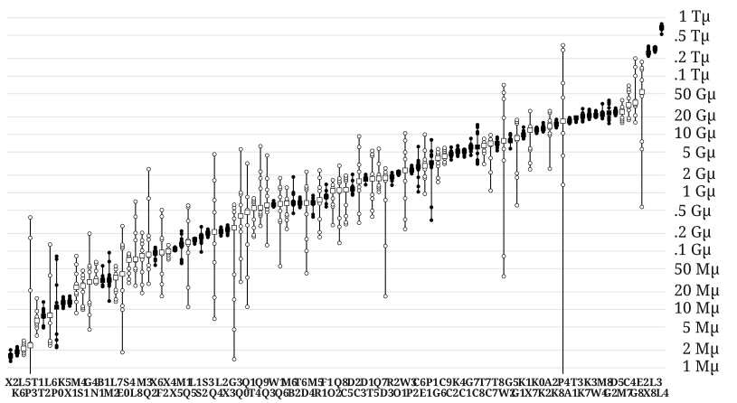</a>


<a id="fig-7-2-2-2-97"></a>**图 97.** 算法 C 的九次随机运行时间, 按中位数排序. (不可满足实例用实心圆点或方块表示, 可满足实例用空心符号表示.)

我们已经指出, 算法 L 在 R1、R2 这类随机问题上大显身手; 当不可满足的随机 3SAT 问题变得更大时, 它领先所有对手的优势更为显著. 前瞻方法对 W1–W4 这类 waerden 问题也很成功.

L3 和 L4 这类不可满足的兰福德问题的确是算法 C 的克星, 算法 L 却没有那么怕它们. 2013 年, 即使是当时世界上最快的 CDCL 求解器 “Treengeling”, 也要等学到了 267 亿个子句才反驳了 $\operatorname{langford}(17)$ 的子句; 24 台计算机组成集群一同工作, 仍用去一个多星期. 相比之下, 习题 7.2.2–21 的回溯法用不到 $4\,\mathrm T\mu$ 的计算量就能证明不可满足性——在一颗 2013 年前后的 CPU 上约为 50 分钟.

现在, 除了 D5 以外, 算法 L 远胜算法 C 的实例已经全都讨论过了; 而 D5 实在有点让人难堪! 它本来是一个简单问题, 硬件设计者称为 “miter”: 设想两个<em>完全相同</em>的电路计算某个函数 $f(x_1,\ldots,x_n)$, 一个用门 $g_1,\ldots,g_m$, 另一个用相应的门 $g'_1,\ldots,g'_m$, 均按 (24) 表示. 问题是找一个 $x_1\ldots x_n$, 使最终结果 $g_m$ 与 $g'_m$ 不等. 显然它不可满足. 而且有一个很明显的反驳方法, 即相继学得子句 $(\bar g_1\lor g'_1)$、$(\overline{g'_1}\lor g_1)$、$(\bar g_2\lor g'_2)$、$(\overline{g'_2}\lor g_2)$ 等. 因此在理论上, 算法 C 几乎必然会在多项式时间内结束 (见习题 386). 但是在实践中, 除非引入专用技术来帮助发现同构的门, 否则算法总要瞎忙许久才能发现那些子句.

<a id="pdf-326"></a><a id="p-306"></a>

所以算法 C 的确有那么一两处致命弱点. 另一方面, 在我们的绝大多数测试实例上, 它显然都是首选的方法, 而且可以预期, 日常工作中遇到的大部分可满足性问题主要都将靠它解决. 因此, 我们应当较为详细地了解它的行为, 不应只看以内存访问次数衡量的总开销.

<a id="tab-7-2-2-2-7"></a>**表 7　算法 C 在一百个测试实例上的实测表现**


<table id="sat-stats-seven"><thead><tr><th>代号</th><th>运行时间</th><th>字节</th><th>单元</th><th>结点</th><th>学得</th><th>平均长度</th><th>平凡</th><th>丢弃</th><th>包摄</th><th>冲刷</th><th>可满足?</th></tr></thead><tbody>
<tr><th scope="row">X2</th><td>$0+2\,\mathrm{M}\mu$</td><td>57 K</td><td>9 K</td><td>2 K</td><td>1 K</td><td>$32.0\to 12.0$</td><td>50%</td><td>6%</td><td>1%</td><td>30</td><td>U</td></tr>
<tr><th scope="row">K6</th><td>$0+2\,\mathrm{M}\mu$</td><td>314 K</td><td>46 K</td><td>1 K</td><td>0 K</td><td>$15.8\to 11.8$</td><td>22%</td><td>4%</td><td>3%</td><td>6</td><td>U</td></tr>
<tr><th scope="row">L5</th><td>$1+1\,\mathrm{M}\mu$</td><td>1841 K</td><td>210 K</td><td>0 K</td><td>0 K</td><td>$146.1\to 38.4$</td><td>51%</td><td>23%</td><td>0%</td><td>0</td><td>S</td></tr>
<tr><th scope="row">P3</th><td>$0+2\,\mathrm{M}\mu$</td><td>96 K</td><td>19 K</td><td>2 K</td><td>1 K</td><td>$18.4\to 12.6$</td><td>4%</td><td>11%</td><td>1%</td><td>45</td><td>S</td></tr>
<tr><th scope="row">T1</th><td>$0+6\,\mathrm{M}\mu$</td><td>541 K</td><td>35 K</td><td>3 K</td><td>1 K</td><td>$7.4\to 6.8$</td><td>3%</td><td>2%</td><td>6%</td><td>9</td><td>S</td></tr>
<tr><th scope="row">T2</th><td>$0+7\,\mathrm{M}\mu$</td><td>574 K</td><td>37 K</td><td>4 K</td><td>1 K</td><td>$7.2\to 6.8$</td><td>1%</td><td>2%</td><td>4%</td><td>6</td><td>U</td></tr>
<tr><th scope="row">L6</th><td>$0+8\,\mathrm{M}\mu$</td><td>672 K</td><td>39 K</td><td>1 K</td><td>0 K</td><td>$195.9\to 67.8$</td><td>86%</td><td>0%</td><td>0%</td><td>0</td><td>S</td></tr>
<tr><th scope="row">P0</th><td>$0+11\,\mathrm{M}\mu$</td><td>376 K</td><td>81 K</td><td>8 K</td><td>4 K</td><td>$17.8\to 14.7$</td><td>3%</td><td>10%</td><td>10%</td><td>28</td><td>U</td></tr>
<tr><th scope="row">K5</th><td>$0+13\,\mathrm{M}\mu$</td><td>294 K</td><td>55 K</td><td>3 K</td><td>2 K</td><td>$18.6\to 12.4$</td><td>33%</td><td>1%</td><td>1%</td><td>14</td><td>U</td></tr>
<tr><th scope="row">X1</th><td>$0+13\,\mathrm{M}\mu$</td><td>284 K</td><td>38 K</td><td>29 K</td><td>4 K</td><td>$6.3\to 5.8$</td><td>0%</td><td>3%</td><td>8%</td><td>53</td><td>U</td></tr>
<tr><th scope="row">M4</th><td>$0+24\,\mathrm{M}\mu$</td><td>308 K</td><td>47 K</td><td>6 K</td><td>4 K</td><td>$20.5\to 16.3$</td><td>14%</td><td>2%</td><td>1%</td><td>3</td><td>S</td></tr>
<tr><th scope="row">S1</th><td>$0+25\,\mathrm{M}\mu$</td><td>366 K</td><td>72 K</td><td>9 K</td><td>4 K</td><td>$34.0\to 26.7$</td><td>22%</td><td>4%</td><td>1%</td><td>14</td><td>S</td></tr>
<tr><th scope="row">G4</th><td>$0+29\,\mathrm{M}\mu$</td><td>759 K</td><td>76 K</td><td>3 K</td><td>2 K</td><td>$37.1\to 24.2$</td><td>26%</td><td>0%</td><td>0%</td><td>1</td><td>S</td></tr>
<tr><th scope="row">N1</th><td>$16+14\,\mathrm{M}\mu$</td><td>19644 K</td><td>2314 K</td><td>41 K</td><td>0 K</td><td>$629.3\to 291.7$</td><td>44%</td><td>6%</td><td>0%</td><td>15</td><td>S</td></tr>
<tr><th scope="row">B1</th><td>$0+31\,\mathrm{M}\mu$</td><td>251 K</td><td>55 K</td><td>10 K</td><td>7 K</td><td>$13.5\to 11.3$</td><td>3%</td><td>5%</td><td>4%</td><td>14</td><td>U</td></tr>
<tr><th scope="row">M2</th><td>$0+32\,\mathrm{M}\mu$</td><td>326 K</td><td>53 K</td><td>7 K</td><td>5 K</td><td>$18.2\to 12.8$</td><td>20%</td><td>1%</td><td>1%</td><td>6</td><td>U</td></tr>
<tr><th scope="row">L7</th><td>$12+23\,\mathrm{M}\mu$</td><td>14695 K</td><td>1758 K</td><td>2 K</td><td>1 K</td><td>$411.2\to 107.6$</td><td>66%</td><td>4%</td><td>0%</td><td>0</td><td>S</td></tr>
<tr><th scope="row">E0</th><td>$0+40\,\mathrm{M}\mu$</td><td>571 K</td><td>95 K</td><td>5 K</td><td>3 K</td><td>$30.2\to 19.3$</td><td>14%</td><td>11%</td><td>0%</td><td>6</td><td>S</td></tr>
<tr><th scope="row">S4</th><td>$1+69\,\mathrm{M}\mu$</td><td>3291 K</td><td>600 K</td><td>6 K</td><td>2 K</td><td>$17.2\to 12.6$</td><td>19%</td><td>1%</td><td>1%</td><td>8</td><td>S</td></tr>
<tr><th scope="row">L8</th><td>$1+72\,\mathrm{M}\mu$</td><td>3047 K</td><td>224 K</td><td>3 K</td><td>2 K</td><td>$547.9\to 169.1$</td><td>87%</td><td>0%</td><td>0%</td><td>0</td><td>S</td></tr>
<tr><th scope="row">M3</th><td>$0+83\,\mathrm{M}\mu$</td><td>493 K</td><td>84 K</td><td>13 K</td><td>9 K</td><td>$28.4\to 19.2$</td><td>31%</td><td>0%</td><td>1%</td><td>1</td><td>S</td></tr>
<tr><th scope="row">Q2</th><td>$0+87\,\mathrm{M}\mu$</td><td>885 K</td><td>190 K</td><td>11 K</td><td>8 K</td><td>$61.7\to 45.8$</td><td>36%</td><td>0%</td><td>0%</td><td>11</td><td>S</td></tr>
<tr><th scope="row">X6</th><td>$0+93\,\mathrm{M}\mu$</td><td>775 K</td><td>122 K</td><td>86 K</td><td>17 K</td><td>$13.5\to 11.4$</td><td>0%</td><td>3%</td><td>3%</td><td>32</td><td>U</td></tr>
<tr><th scope="row">F2</th><td>$0+95\,\mathrm{M}\mu$</td><td>714 K</td><td>118 K</td><td>42 K</td><td>22 K</td><td>$14.3\to 13.1$</td><td>0%</td><td>2%</td><td>4%</td><td>5</td><td>S</td></tr>
<tr><th scope="row">X4</th><td>$1+98\,\mathrm{M}\mu$</td><td>3560 K</td><td>158 K</td><td>24 K</td><td>3 K</td><td>$16.2\to 11.4$</td><td>9%</td><td>2%</td><td>3%</td><td>623</td><td>S</td></tr>
<tr><th scope="row">X5</th><td>$1+106\,\mathrm{M}\mu$</td><td>3747 K</td><td>166 K</td><td>23 K</td><td>3 K</td><td>$16.5\to 11.0$</td><td>11%</td><td>3%</td><td>3%</td><td>726</td><td>U</td></tr>
<tr><th scope="row">M1</th><td>$0+131\,\mathrm{M}\mu$</td><td>483 K</td><td>84 K</td><td>16 K</td><td>12 K</td><td>$23.2\to 13.4$</td><td>33%</td><td>1%</td><td>0%</td><td>1</td><td>U</td></tr>
<tr><th scope="row">Q5</th><td>$0+143\,\mathrm{M}\mu$</td><td>708 K</td><td>157 K</td><td>13 K</td><td>11 K</td><td>$28.8\to 23.6$</td><td>21%</td><td>2%</td><td>2%</td><td>6</td><td>S</td></tr>
<tr><th scope="row">L1</th><td>$0+157\,\mathrm{M}\mu$</td><td>597 K</td><td>139 K</td><td>21 K</td><td>18 K</td><td>$36.7\to 19.0$</td><td>60%</td><td>3%</td><td>0%</td><td>30</td><td>U</td></tr>
<tr><th scope="row">S2</th><td>$0+176\,\mathrm{M}\mu$</td><td>722 K</td><td>161 K</td><td>29 K</td><td>17 K</td><td>$37.5\to 27.5$</td><td>33%</td><td>3%</td><td>1%</td><td>8</td><td>U</td></tr>
<tr><th scope="row">S3</th><td>$1+201\,\mathrm{M}\mu$</td><td>2624 K</td><td>471 K</td><td>12 K</td><td>6 K</td><td>$14.5\to 9.8$</td><td>21%</td><td>1%</td><td>2%</td><td>1</td><td>U</td></tr>
<tr><th scope="row">Q4</th><td>$0+213\,\mathrm{M}\mu$</td><td>781 K</td><td>175 K</td><td>19 K</td><td>16 K</td><td>$29.2\to 23.3$</td><td>25%</td><td>3%</td><td>1%</td><td>6</td><td>S</td></tr>
<tr><th scope="row">L2</th><td>$0+216\,\mathrm{M}\mu$</td><td>588 K</td><td>136 K</td><td>23 K</td><td>20 K</td><td>$36.2\to 17.4$</td><td>75%</td><td>1%</td><td>0%</td><td>6</td><td>U</td></tr>
<tr><th scope="row">X3</th><td>$0+235\,\mathrm{M}\mu$</td><td>1000 K</td><td>191 K</td><td>61 K</td><td>25 K</td><td>$37.7\to 19.3$</td><td>34%</td><td>1%</td><td>2%</td><td>14</td><td>U</td></tr>
<tr><th scope="row">G3</th><td>$0+251\,\mathrm{M}\mu$</td><td>1035 K</td><td>145 K</td><td>12 K</td><td>9 K</td><td>$57.9\to 28.1$</td><td>42%</td><td>1%</td><td>0%</td><td>0</td><td>S</td></tr>
<tr><th scope="row">Q0</th><td>$0+401\,\mathrm{M}\mu$</td><td>1493 K</td><td>342 K</td><td>37 K</td><td>28 K</td><td>$63.3\to 40.0$</td><td>50%</td><td>0%</td><td>0%</td><td>14</td><td>S</td></tr>
<tr><th scope="row">Q1</th><td>$0+464\,\mathrm{M}\mu$</td><td>1516 K</td><td>343 K</td><td>41 K</td><td>33 K</td><td>$63.0\to 41.0$</td><td>45%</td><td>0%</td><td>0%</td><td>14</td><td>S</td></tr>
<tr><th scope="row">T4</th><td>$0+546\,\mathrm{M}\mu$</td><td>2716 K</td><td>544 K</td><td>202 K</td><td>18 K</td><td>$218.3\to 61.5$</td><td>83%</td><td>1%</td><td>0%</td><td>3018</td><td>S</td></tr>
<tr><th scope="row">Q9</th><td>$0+555\,\mathrm{M}\mu$</td><td>1409 K</td><td>343 K</td><td>152 K</td><td>71 K</td><td>$26.7\to 20.6$</td><td>3%</td><td>5%</td><td>2%</td><td>99</td><td>S</td></tr>
<tr><th scope="row">Q3</th><td>$0+613\,\mathrm{M}\mu$</td><td>1883 K</td><td>448 K</td><td>27 K</td><td>22 K</td><td>$60.1\to 40.3$</td><td>41%</td><td>1%</td><td>1%</td><td>7</td><td>S</td></tr>
<tr><th scope="row">W1</th><td>$0+626\,\mathrm{M}\mu$</td><td>848 K</td><td>208 K</td><td>71 K</td><td>63 K</td><td>$20.8\to 13.4$</td><td>5%</td><td>14%</td><td>1%</td><td>28</td><td>U</td></tr>
<tr><th scope="row">Q6</th><td>$0+646\,\mathrm{M}\mu$</td><td>1211 K</td><td>266 K</td><td>40 K</td><td>35 K</td><td>$30.4\to 23.2$</td><td>30%</td><td>1%</td><td>1%</td><td>2</td><td>S</td></tr>
<tr><th scope="row">M6</th><td>$0+660\,\mathrm{M}\mu$</td><td>1378 K</td><td>266 K</td><td>80 K</td><td>52 K</td><td>$34.0\to 22.2$</td><td>33%</td><td>1%</td><td>1%</td><td>59</td><td>S</td></tr>
<tr><th scope="row">B2</th><td>$0+668\,\mathrm{M}\mu$</td><td>906 K</td><td>216 K</td><td>96 K</td><td>75 K</td><td>$17.1\to 13.2$</td><td>4%</td><td>5%</td><td>2%</td><td>16</td><td>U</td></tr>
<tr><th scope="row">T6</th><td>$1+668\,\mathrm{M}\mu$</td><td>2355 K</td><td>291 K</td><td>34 K</td><td>25 K</td><td>$41.4\to 19.1$</td><td>57%</td><td>0%</td><td>1%</td><td>11</td><td>U</td></tr>
<tr><th scope="row">D4</th><td>$0+669\,\mathrm{M}\mu$</td><td>1009 K</td><td>186 K</td><td>35 K</td><td>28 K</td><td>$55.7\to 15.9$</td><td>70%</td><td>0%</td><td>0%</td><td>2</td><td>S</td></tr>
<tr><th scope="row">M5</th><td>$0+677\,\mathrm{M}\mu$</td><td>1183 K</td><td>219 K</td><td>73 K</td><td>48 K</td><td>$32.6\to 20.2$</td><td>37%</td><td>1%</td><td>1%</td><td>139</td><td>U</td></tr>
<tr><th scope="row">R1</th><td>$0+756\,\mathrm{M}\mu$</td><td>913 K</td><td>220 K</td><td>87 K</td><td>74 K</td><td>$17.3\to 12.4$</td><td>3%</td><td>8%</td><td>0%</td><td>9</td><td>S</td></tr>
<tr><th scope="row">F1</th><td>$0+859\,\mathrm{M}\mu$</td><td>1485 K</td><td>311 K</td><td>218 K</td><td>135 K</td><td>$17.6\to 15.1$</td><td>1%</td><td>3%</td><td>3%</td><td>6</td><td>U</td></tr>
<tr><th scope="row">O2</th><td>$7+1069\,\mathrm{M}\mu$</td><td>18951 K</td><td>3144 K</td><td>3 K</td><td>2 K</td><td>$17.0\to 9.5$</td><td>35%</td><td>0%</td><td>0%</td><td>1</td><td>S</td></tr>
<tr><th scope="row">Q8</th><td>$0+1107\,\mathrm{M}\mu$</td><td>1786 K</td><td>437 K</td><td>184 K</td><td>109 K</td><td>$29.4\to 20.2$</td><td>6%</td><td>6%</td><td>1%</td><td>109</td><td>S</td></tr>
</tbody>
<tbody id="pdf-327">
<tr id="p-307"><th scope="row">C5</th><td>$0+1127\,\mathrm{M}\mu$</td><td>1987 K</td><td>419 K</td><td>159 K</td><td>104 K</td><td>$24.4\to 16.5$</td><td>12%</td><td>2%</td><td>1%</td><td>776</td><td>S</td></tr>
<tr><th scope="row">D2</th><td>$0+1159\,\mathrm{M}\mu$</td><td>962 K</td><td>177 K</td><td>54 K</td><td>45 K</td><td>$51.8\to 11.5$</td><td>73%</td><td>0%</td><td>0%</td><td>2</td><td>U</td></tr>
<tr><th scope="row">C3</th><td>$0+1578\,\mathrm{M}\mu$</td><td>2375 K</td><td>571 K</td><td>190 K</td><td>96 K</td><td>$49.7\to 23.4$</td><td>39%</td><td>3%</td><td>2%</td><td>11</td><td>S</td></tr>
<tr><th scope="row">D1</th><td>$0+1707\,\mathrm{M}\mu$</td><td>1172 K</td><td>230 K</td><td>76 K</td><td>62 K</td><td>$45.1\to 11.6$</td><td>73%</td><td>0%</td><td>0%</td><td>2</td><td>U</td></tr>
<tr><th scope="row">T5</th><td>$1+1735\,\mathrm{M}\mu$</td><td>3658 K</td><td>617 K</td><td>80 K</td><td>59 K</td><td>$72.5\to 40.9$</td><td>50%</td><td>0%</td><td>0%</td><td>43</td><td>S</td></tr>
<tr><th scope="row">Q7</th><td>$0+1761\,\mathrm{M}\mu$</td><td>2055 K</td><td>419 K</td><td>515 K</td><td>118 K</td><td>$33.9\to 20.3$</td><td>9%</td><td>7%</td><td>0%</td><td>12</td><td>S</td></tr>
<tr><th scope="row">D3</th><td>$0+1807\,\mathrm{M}\mu$</td><td>1283 K</td><td>254 K</td><td>77 K</td><td>64 K</td><td>$57.3\to 14.0$</td><td>80%</td><td>0%</td><td>0%</td><td>1</td><td>S</td></tr>
<tr><th scope="row">R2</th><td>$0+1886\,\mathrm{M}\mu$</td><td>1220 K</td><td>296 K</td><td>173 K</td><td>149 K</td><td>$17.0\to 11.8$</td><td>3%</td><td>9%</td><td>0%</td><td>14</td><td>U</td></tr>
<tr><th scope="row">O1</th><td>$7+2212\,\mathrm{M}\mu$</td><td>18928 K</td><td>3140 K</td><td>5 K</td><td>3 K</td><td>$17.3\to 8.9$</td><td>39%</td><td>0%</td><td>0%</td><td>4</td><td>U</td></tr>
<tr><th scope="row">W3</th><td>$0+2422\,\mathrm{M}\mu$</td><td>1819 K</td><td>448 K</td><td>191 K</td><td>174 K</td><td>$19.3\to 15.5$</td><td>2%</td><td>12%</td><td>1%</td><td>18</td><td>S</td></tr>
<tr><th scope="row">P2</th><td>$0+2435\,\mathrm{M}\mu$</td><td>2039 K</td><td>504 K</td><td>378 K</td><td>301 K</td><td>$20.9\to 13.7$</td><td>3%</td><td>11%</td><td>1%</td><td>45</td><td>U</td></tr>
<tr><th scope="row">C6</th><td>$0+2792\,\mathrm{M}\mu$</td><td>2551 K</td><td>560 K</td><td>305 K</td><td>217 K</td><td>$27.0\to 17.0$</td><td>20%</td><td>2%</td><td>1%</td><td>492</td><td>U</td></tr>
<tr><th scope="row">E1</th><td>$0+2902\,\mathrm{M}\mu$</td><td>2116 K</td><td>453 K</td><td>180 K</td><td>144 K</td><td>$38.0\to 20.5$</td><td>21%</td><td>18%</td><td>0%</td><td>2</td><td>S</td></tr>
<tr><th scope="row">P1</th><td>$0+3280\,\mathrm{M}\mu$</td><td>2726 K</td><td>674 K</td><td>819 K</td><td>549 K</td><td>$18.2\to 14.4$</td><td>0%</td><td>9%</td><td>3%</td><td>45</td><td>U</td></tr>
<tr><th scope="row">G6</th><td>$1+3941\,\mathrm{M}\mu$</td><td>3523 K</td><td>647 K</td><td>380 K</td><td>253 K</td><td>$31.0\to 17.8$</td><td>31%</td><td>0%</td><td>0%</td><td>0</td><td>S</td></tr>
<tr><th scope="row">C9</th><td>$13+4220\,\mathrm{M}\mu$</td><td>35486 K</td><td>4923 K</td><td>116 K</td><td>32 K</td><td>$11.8\to 9.9$</td><td>5%</td><td>1%</td><td>1%</td><td>4986</td><td>S</td></tr>
<tr><th scope="row">C2</th><td>$0+4625\,\mathrm{M}\mu$</td><td>2942 K</td><td>712 K</td><td>442 K</td><td>255 K</td><td>$46.1\to 18.8$</td><td>42%</td><td>4%</td><td>1%</td><td>15</td><td>U</td></tr>
<tr><th scope="row">K4</th><td>$0+5122\,\mathrm{M}\mu$</td><td>1858 K</td><td>446 K</td><td>267 K</td><td>241 K</td><td>$19.6\to 13.7$</td><td>19%</td><td>2%</td><td>1%</td><td>5</td><td>U</td></tr>
<tr><th scope="row">C1</th><td>$0+5178\,\mathrm{M}\mu$</td><td>2532 K</td><td>613 K</td><td>510 K</td><td>311 K</td><td>$48.9\to 17.0$</td><td>48%</td><td>6%</td><td>1%</td><td>20</td><td>U</td></tr>
<tr><th scope="row">G7</th><td>$1+6070\,\mathrm{M}\mu$</td><td>4227 K</td><td>771 K</td><td>546 K</td><td>369 K</td><td>$32.5\to 17.6$</td><td>35%</td><td>0%</td><td>0%</td><td>0</td><td>U</td></tr>
<tr><th scope="row">C8</th><td>$13+6081\,\mathrm{M}\mu$</td><td>35014 K</td><td>4823 K</td><td>151 K</td><td>58 K</td><td>$15.3\to 10.7$</td><td>15%</td><td>1%</td><td>1%</td><td>8067</td><td>U</td></tr>
<tr><th scope="row">T7</th><td>$1+6467\,\mathrm{M}\mu$</td><td>5428 K</td><td>544 K</td><td>333 K</td><td>108 K</td><td>$26.8\to 15.3$</td><td>32%</td><td>1%</td><td>1%</td><td>14565</td><td>S</td></tr>
<tr><th scope="row">C7</th><td>$8+7029\,\mathrm{M}\mu$</td><td>20971 K</td><td>3174 K</td><td>908 K</td><td>32 K</td><td>$9.5\to 8.4$</td><td>0%</td><td>3%</td><td>0%</td><td>4965</td><td>S</td></tr>
<tr><th scope="row">T8</th><td>$1+7046\,\mathrm{M}\mu$</td><td>5322 K</td><td>517 K</td><td>356 K</td><td>117 K</td><td>$26.9\to 15.0$</td><td>33%</td><td>0%</td><td>1%</td><td>15026</td><td>U</td></tr>
<tr><th scope="row">W2</th><td>$0+7785\,\mathrm{M}\mu$</td><td>3561 K</td><td>884 K</td><td>501 K</td><td>432 K</td><td>$34.7\to 21.3$</td><td>13%</td><td>17%</td><td>1%</td><td>28</td><td>S</td></tr>
<tr><th scope="row">G5</th><td>$1+7799\,\mathrm{M}\mu$</td><td>4312 K</td><td>844 K</td><td>642 K</td><td>446 K</td><td>$33.4\to 17.4$</td><td>39%</td><td>0%</td><td>0%</td><td>0</td><td>U</td></tr>
<tr><th scope="row">G1</th><td>$0+8681\,\mathrm{M}\mu$</td><td>5052 K</td><td>1221 K</td><td>631 K</td><td>350 K</td><td>$61.1\to 34.1$</td><td>38%</td><td>1%</td><td>2%</td><td>55</td><td>S</td></tr>
<tr><th scope="row">K1</th><td>$0+9813\,\mathrm{M}\mu$</td><td>2864 K</td><td>685 K</td><td>405 K</td><td>360 K</td><td>$36.2\to 18.4$</td><td>53%</td><td>2%</td><td>0%</td><td>13</td><td>U</td></tr>
<tr><th scope="row">X7</th><td>$1+11857\,\mathrm{M}\mu$</td><td>6235 K</td><td>697 K</td><td>1955 K</td><td>224 K</td><td>$40.6\to 23.7$</td><td>35%</td><td>0%</td><td>1%</td><td>31174</td><td>S</td></tr>
<tr><th scope="row">K0</th><td>$0+11997\,\mathrm{M}\mu$</td><td>3034 K</td><td>731 K</td><td>493 K</td><td>421 K</td><td>$35.6\to 19.4$</td><td>45%</td><td>2%</td><td>0%</td><td>14</td><td>U</td></tr>
<tr><th scope="row">K2</th><td>$0+12601\,\mathrm{M}\mu$</td><td>3028 K</td><td>729 K</td><td>500 K</td><td>427 K</td><td>$34.8\to 18.0$</td><td>46%</td><td>2%</td><td>0%</td><td>12</td><td>U</td></tr>
<tr><th scope="row">A2</th><td>$0+13947\,\mathrm{M}\mu$</td><td>3766 K</td><td>843 K</td><td>645 K</td><td>585 K</td><td>$34.4\to 15.9$</td><td>32%</td><td>1%</td><td>0%</td><td>0</td><td>S</td></tr>
<tr><th scope="row">K8</th><td>$0+15033\,\mathrm{M}\mu$</td><td>2748 K</td><td>680 K</td><td>821 K</td><td>699 K</td><td>$21.2\to 13.1$</td><td>8%</td><td>15%</td><td>1%</td><td>93</td><td>U</td></tr>
<tr><th scope="row">P4</th><td>$0+16907\,\mathrm{M}\mu$</td><td>6936 K</td><td>1721 K</td><td>1676 K</td><td>1314 K</td><td>$36.5\to 24.0$</td><td>5%</td><td>11%</td><td>1%</td><td>33</td><td>S</td></tr>
<tr><th scope="row">A1</th><td>$0+17073\,\mathrm{M}\mu$</td><td>3647 K</td><td>815 K</td><td>763 K</td><td>701 K</td><td>$30.7\to 14.7$</td><td>29%</td><td>2%</td><td>0%</td><td>0</td><td>U</td></tr>
<tr><th scope="row">T3</th><td>$0+19266\,\mathrm{M}\mu$</td><td>10034 K</td><td>2373 K</td><td>2663 K</td><td>323 K</td><td>$291.8\to 72.9$</td><td>86%</td><td>1%</td><td>0%</td><td>34265</td><td>U</td></tr>
<tr><th scope="row">K7</th><td>$0+20577\,\mathrm{M}\mu$</td><td>3168 K</td><td>721 K</td><td>1286 K</td><td>828 K</td><td>$23.3\to 13.5$</td><td>9%</td><td>15%</td><td>0%</td><td>9</td><td>U</td></tr>
<tr><th scope="row">K3</th><td>$0+20990\,\mathrm{M}\mu$</td><td>3593 K</td><td>878 K</td><td>453 K</td><td>407 K</td><td>$36.7\to 19.0$</td><td>55%</td><td>2%</td><td>0%</td><td>6</td><td>U</td></tr>
<tr><th scope="row">W4</th><td>$0+21295\,\mathrm{M}\mu$</td><td>3362 K</td><td>834 K</td><td>977 K</td><td>899 K</td><td>$19.0\to 14.1$</td><td>4%</td><td>15%</td><td>0%</td><td>21</td><td>U</td></tr>
<tr><th scope="row">M8</th><td>$0+22281\,\mathrm{M}\mu$</td><td>4105 K</td><td>994 K</td><td>992 K</td><td>785 K</td><td>$37.3\to 20.5$</td><td>43%</td><td>1%</td><td>1%</td><td>6</td><td>U</td></tr>
<tr><th scope="row">G2</th><td>$0+23424\,\mathrm{M}\mu$</td><td>6910 K</td><td>1685 K</td><td>1198 K</td><td>701 K</td><td>$68.8\to 34.3$</td><td>47%</td><td>1%</td><td>1%</td><td>120</td><td>U</td></tr>
<tr><th scope="row">D5</th><td>$0+24141\,\mathrm{M}\mu$</td><td>3232 K</td><td>779 K</td><td>787 K</td><td>654 K</td><td>$63.5\to 13.4$</td><td>78%</td><td>0%</td><td>0%</td><td>2</td><td>U</td></tr>
<tr><th scope="row">M7</th><td>$0+24435\,\mathrm{M}\mu$</td><td>4438 K</td><td>1077 K</td><td>1047 K</td><td>819 K</td><td>$40.6\to 23.3$</td><td>42%</td><td>1%</td><td>1%</td><td>6</td><td>S</td></tr>
<tr><th scope="row">C4</th><td>$1+31898\,\mathrm{M}\mu$</td><td>8541 K</td><td>2108 K</td><td>1883 K</td><td>1148 K</td><td>$60.6\to 25.7$</td><td>42%</td><td>4%</td><td>1%</td><td>12</td><td>S</td></tr>
<tr><th scope="row">G8</th><td>$7+35174\,\mathrm{M}\mu$</td><td>24854 K</td><td>2992 K</td><td>4350 K</td><td>1101 K</td><td>$48.0\to 34.7$</td><td>9%</td><td>0%</td><td>0%</td><td>1523</td><td>S</td></tr>
<tr><th scope="row">E2</th><td>$0+53739\,\mathrm{M}\mu$</td><td>5454 K</td><td>1258 K</td><td>2020 K</td><td>1658 K</td><td>$41.5\to 20.8$</td><td>25%</td><td>21%</td><td>0%</td><td>3</td><td>S</td></tr>
<tr><th scope="row">X8</th><td>$2+248789\,\mathrm{M}\mu$</td><td>12814 K</td><td>2311 K</td><td>17005 K</td><td>3145 K</td><td>$56.4\to 22.5$</td><td>63%</td><td>0%</td><td>0%</td><td>330557</td><td>U</td></tr>
<tr><th scope="row">L3</th><td>$0+295571\,\mathrm{M}\mu$</td><td>19653 K</td><td>4894 K</td><td>7402 K</td><td>6886 K</td><td>$70.7\to 31.0$</td><td>63%</td><td>8%</td><td>0%</td><td>30</td><td>U</td></tr>
<tr><th scope="row">L4</th><td>$0+677815\,\mathrm{M}\mu$</td><td>22733 K</td><td>5664 K</td><td>8545 K</td><td>7931 K</td><td>$78.6\to 35.4$</td><td>86%</td><td>0%</td><td>0%</td><td>5</td><td>U</td></tr>
</tbody></table>


[表 7](#tab-7-2-2-2-7) 概括了主要的统计数据, 仍按运行时间的中位数列出全部实例 (不含输入、输出). 每个运行时间实际上分成 ‘$x+y$’ 两部分, 其中 $x$ 是步骤 C1 初始化数据结构的时间, $y$ 是其他步骤的时间, 两者都舍入到百万次内存访问. 例如实例 L5 的准确中位运行中, 初始化用了 $1484489\mu$, 随后找出解用了 $655728\mu$; 表中第三行记作 ‘$1+1\,\mathrm M\mu$’. 除非像问题 N1 那样有大量子句, 初始化时间通常可以忽略.

<a id="pdf-328"></a><a id="p-308"></a>

取得中位时间的那一次 L5 运行, 还为数据分配了 1841372 个字节的内存; 总数包括 MEM 阵列 210361 个单元所需的空间 (每单元 4 字节), 以及 VAL、OVAL、HEAP 等其他阵列. 此处所考察的实现把非学习得到的二元子句另存于 BIMP 表, 如习题 267 的答案所述.

这次 L5 运行隐式地遍历一棵有 138 个 “结点” 的查找树后找到了一个解. 结点数, 或 “决策” 数, 就是算法 C 从步骤 C6 转到步骤 C3 的次数. [表 7](#tab-7-2-2-2-7) 中记为 ‘0 K’, 因为结点数、字节数和单元数都舍入到了最接近的千数.

结点数总是大于或等于学得的子句数; 后者是所发现的层 $d>0$ 的冲突数 (见步骤 C7). 对问题 L5, 只学得了 84 个子句, 所以表上又记作 ‘0 K’. 这 84 个子句的平均长度为 $r+1=146.1$; 经过习题 257 的简化过程, 平均长度缩至 38.4. 然而简化后的子句仍然够长, 因而有时改用习题 269 所讨论的 “平凡” 子句; 这种替代共发生 43 次 ($51\%$). 而且按习题 271 的方法, 有 19 个学得子句 ($23\%$) 随即被丢弃. 这些百分数列在表的 “平凡” 与 “丢弃” 两栏.

有时, 如在问题 D1–D5 中, 学得子句的绝大多数都被平凡子句取代; 另一方面, 有 27 个实例在这个意义下的平凡子句比例不到 $10\%$. [表 7](#tab-7-2-2-2-7) 还表明有 26 个实例的丢弃率达到或超过 $5\%$. “包摄” 栏指按习题 270 的技术 “即时包摄” 的学得子句; 这种优化虽然较少发生, 却也发生得足够频繁, 值得采用.

例子的多样性反映在[表 7](#tab-7-2-2-2-7) 的各种不同行为中, 不过也能看出一些有意思的趋势. 例如, 结点数与学得子句数自然是相关的, 这两个统计量也都往往随总运行时间而增大. 但有一些显著的例外: O1 和 O2 这两个离群者, 因数据量极大, 每学得一个子句所需的内存访问次数异乎寻常地高.

[表 7](#tab-7-2-2-2-7) 的倒数第二栏计算算法 C 决定从当前轨迹中冲刷掉没有成效的字面值并重新开始的次数. 这个量并不只是步骤 C5 发现 $M\ge M_{\mathrm f}$ 的次数; 它还依赖于当前的灵活度 (见 (127)) 和[表 4](#tab-7-2-2-2-4) 的参数 $\psi$. 有些问题, 如 A1 和 A2, 灵活度高到可以不经一次重新开始便得到满意的解决; 另一个问题 T4 则在重新开始 3000 多次之后, 用约五亿次内存访问完成了计算.

表中没有列出 “清除” (回收阶段) 的次数, 不过可以从学得子句的数目中估计 (见习题 508). 积极清除的策略使内存单元总数保持得相当小.

**调节参数.** [表 7](#tab-7-2-2-2-7) 表明, 在这些实验中对算法 C 最难的问题 L4, 有 $86\%$ 的时候不得不用平凡子句代替学得子句, 却只重新开始了 5 次. 假如专门针对兰福德问题的实例调节算法参数, 这个测试实例也许会<a id="pdf-329"></a><a id="p-309"></a>解得快得多.

在上述实验所用的实现中, 算法 C 有十个主要参数, 用户每次运行时都可以改变:

- $\alpha$, 子句 RANGE 分数中 $p$ 与 $q$ 之间的权衡 (见式 (123));
- $\rho$, 变量 ACT 分数的阻尼因子 (见 (118) 之后);
- $\varrho$, 子句 ACT 分数的阻尼因子 (见式 (125));
- $\Delta_{\mathrm p}$, 清除阈值 $M_{\mathrm p}$ 的初值 (见 (125) 之后);
- $\delta_{\mathrm p}$, $M_{\mathrm p}$ 逐步增加的增量参数 (见 (125) 之后);
- $\tau$, 优先使用平凡子句的阈值 (见习题 269 的答案);
- $w$, 重新开始之后所作的完整 “预热” 运行次数 (见习题 287 的答案);
- $p$, 随机选取决策变量的概率 (见习题 266);
- $P$, $\mathtt{OVAL}(k)$ 初始为偶数的概率;
- $\psi$, 冲刷的灵活度阈值 (见[表 4](#tab-7-2-2-2-4)).

这些参数当初都是凭经验猜出来的:
$$
\begin{aligned}
&\alpha=0.2,\ \rho=0.95,\ \varrho=0.999,\ \Delta_{\mathrm p}=20000,\ \delta_{\mathrm p}=500,\\
&\tau=1,\ w=0,\ p=0.02,\ P=0,\ \psi=0.166667;
\end{aligned}\tag{193}
$$
这组默认值效果相当不错, 所以我们高高兴兴地用了好几个月 (不过并没有理由相信它们已无可改进). 终于, 作者集齐了[表 6](#tab-7-2-2-2-6) 中的 100 个测试实例, 该决定是推荐默认值 (193), 还是找出一组更好的数了.

要为用途广泛的一般情形优化参数, 是一件望而生畏的事. 不但各类 SAT 实例相差很大, 就是在求解同一个特定实例时, 随机选择也会带来变异. 当运行时间如此反复无常时, 很难知道改变一个参数究竟有利还是有害. 哎呀——[图 97](#fig-7-2-2-2-97) 表明, 即使十个参数全都保持不变, 仅仅改变随机数种子, 变化也已经如此剧烈! 而且这十个参数绝不是彼此独立的: 比方说, 增大 $\rho$ 也许有好处, 却可能要其余九个参数也改得恰当才行. 那么, 不花上大量时间和金钱, 怎么能够推荐<em>任何</em>一组默认值呢?

幸而, 由于学习理论的进展, 这个两难困境有了出路. F. Hutter、H. H. Hoos、K. Leyton-Brown 和 T. Stützle 开发了专为这类调节设计的工具 ParamILS [<em>J. Artificial Intelligence Research</em> **36** (2009), 267–306]; 名称中的 ‘ILS’ 代表 “迭代局部查找”. 基本想法是从一组有代表性、又不过于困难的训练问题开始, 在十维参数空间中作随机游走, 巧妙地改进并运用类似 WalkSAT 的原理. 训练期间发现的最佳参数, 随后用训练集以外较难的问题来评估.

<a id="pdf-330"></a><a id="p-310"></a>

2015 年 3 月, Holger Hoos 帮助作者用 ParamILS 调节算法 C. [图 97](#fig-7-2-2-2-97)、[表 7](#tab-7-2-2-2-7) 以及上下文中讨论的许多其他运行时间, 都是用调节所得的参数得到的. 训练集有 17 个问题, 用原参数 (193) 时它们通常耗费不到 $200\,\mathrm M\mu$, 即 $\{\mathrm{K5,K6,M2,M4,N1,S1,S4,X4,X6}\}$ 以及 $\{\mathrm{A1,C2,C3,D1,D2,D3,D4,K0}\}$ 的简化版本. 例如, 原问题 A1 要求向量 $x_1\ldots x_{99}$, 我们只寻找较短的向量 $x=x_1\ldots x_{62}$, 此时 $\nu x=20$; D1 与 D2 改成求 31415926 的 13 位因子; K0 改成给 SGB 图 <code>jean</code> 作 9 着色.

用 ParamILS 作十次独立训练, 得到十组备选的参数值 $(\alpha_i,\rho_i,\ldots,\psi_i)$. 我们用原先的 17 个基准问题, 再加上 25 个稍难的问题来评估它们: 后者是 $\{\mathrm{F1,F2,S2,S3,T4,X5}\}$ 和 $\{\mathrm{A1,A2,A2,C7,C7,D3,D4,F1,F2,G1,G1,G2,G2,G8,K0,O1,O2,Q0,Q2}\}$ 的若干简化程度较低的变体. 对每组入围参数, 这 $17+25$ 个问题都分别用随机种子 $\{1,2,\ldots,25\}$ 各运行一次. 终于, 好哇, 我们找到了获胜者: 这次实验中总运行时间最短的参数 $(\alpha,\rho,\ldots,\psi)$ 是
$$
\begin{aligned}
&\alpha=0.4,\ \rho=0.9,\ \varrho=0.9995,\ \Delta_{\mathrm p}=1000,\ \delta_{\mathrm p}=500,\\
&\tau=10,\ w=0,\ p=0.02,\ P=0.5,\ \psi=0.05.
\end{aligned}\tag{194}
$$
这便是现在推荐用于一般目的的默认值.

我们由此得益多少呢? [图 98](#fig-7-2-2-2-98) 比较了 100 个例子在调节前、后的运行时间. 可以看出, 绝大部分——共 77 个——运行得更快了; 它们位于从 $(1\,\mathrm M\mu,1\,\mathrm M\mu)$ 到 $(1\,\mathrm T\mu,1\,\mathrm T\mu)$ 的点线右方. 半数实例的加速比超过 1.455; 其中 27 个比原先快了一倍以上.

当然, 凡规则都有例外. P4 的表现差得惊人, 慢了将近三个数量级! 诚然, 我们已在[图 97](#fig-7-2-2-2-97) 中看到这个实例的运行时间极不稳定; 关于 P4 的其他特殊之处, 见习题 511.

另一个重要的 SAT 求解器, 算法 L, 也有参数, 其中特别值得一提的是:

- $\alpha$, 启发式分数中的魔术权衡系数 (见式 (64));
- $\beta$, 触发双重前瞻的阻尼因子 (见步骤 Y1);
- $\gamma$, 启发式分数中每个字面值所占的子句权 (见习题 175);
- $\varepsilon$, 启发式分数中的偏移量 (见习题 146 的答案);
- $\Theta$, 启发式分数的最大阈值 (见习题 145 的答案);
- $Y$, 双重前瞻的最大深度 (见步骤 Y1).

ParamILS 建议以下默认值, [图 96](#fig-7-2-2-2-96) 即采用这些值:
$$
\alpha=3.5,\quad\beta=0.9998,\quad\gamma=0.2,\quad\varepsilon=0.001,\quad\Theta=20.0,\quad Y=1.\tag{195}
$$

回到[图 98](#fig-7-2-2-2-98), 请注意, 从 (193) 改为 (194) 给实例 G3 和 G4 带来了相当大的妨碍; 它们是生成测试模式的例子. 显然, 这类子句具有某些特别的特性, 因而偏爱特别的<a id="pdf-331"></a><a id="p-311"></a>参数设置. 当然, 当初引入参数的主要原因, 正是要允许针对不同的子句族分别作调节.


<a href="../../assets/volume4b/figures/sat-fig98.svg"></a>


<a id="fig-7-2-2-2-98"></a>**图 98.** 算法 C 调节参数前、后的中位运行时间.

显然, 除了寻找在用途广泛的应用上有良好效果的 $(\alpha,\rho,\ldots,\psi)$ 以外, 还能利用 ParamILS 这样的系统为某一类特定的问题量身选取参数. 事实上, 后一个任务比较容易. 例如 Hoos 与作者要求为这十个参数选择数值, 使算法 C 在形如 $\operatorname{waerden}(3,k;n)$ 的问题上尽量有好的表现. 只根据两个简单的训练实例 $\operatorname{waerden}(3,9;77)$ 和 $\operatorname{waerden}(3,10;95)$, 作两次 ParamILS 运行, 建议的参数是
$$
\begin{aligned}
&\alpha=0.5,\quad\rho=0.9995,\quad\varrho=0.99,\quad\Delta_{\mathrm p}=100,\quad\delta_{\mathrm p}=10,\\
&\tau=10,\quad w=8,\quad p=0.01,\quad P=0.5,\quad\psi=0.15,
\end{aligned}\tag{196}
$$
这组数值的确非常管用. [图 99](#fig-7-2-2-2-99) 给出了典型的细节, 对 $7\le k\le14$, 每一组 $k,n$ 的选择都独立抽样运行九次. 每个不可满足实例都有 $n=W(3,k)$, 见上面 (10) 后面的表; 每个可满足实例都有 $n=W(3,k)-1$. 用默认参数<a id="pdf-332"></a><a id="p-312"></a>(194) 的最快运行, 在[图 99](#fig-7-2-2-2-99) 中与用专为 waerden 调节的参数 (196) 的最快运行配对; 类似地, 第二快的, $\ldots$, 第二慢的, 以及最慢的运行也都分别配对. 注意可满足实例往往需要长短难以预料的时间, 就像[图 97](#fig-7-2-2-2-97) 中那样. 虽然新参数 (196) 只来自对两个简单实例的仔细研究, 用到性质相似而困难得<em>多</em>的问题时, 它们显然仍能大大节省计算量. (另一个有启发性的例子见习题 512.)


<a href="../../assets/volume4b/figures/sat-fig99.svg"></a>


<a id="fig-7-2-2-2-99"></a>**图 99.** 算法 C 在子句 $\operatorname{waerden}(3,k;n)$ 上的运行时间, 分别采用通用参数和专门调节的参数.

**利用并行性.** 本书的注意力几乎完全集中在顺序算法上, 不过应当知道, 对那些真正棘手的 SAT 实例, 最好的解法是并行方法.

适合回溯的问题很容易分解为子问题, 将解空间划分开来. 例如, 若有 16 个处理器可用, 就可以让它们分别开始处理独立的 SAT 实例, 其中变量 $x_1x_2x_3x_4$ 分别被强制为 $0000,0001,\ldots,1111$.

不过, 像这样朴素地分解问题, 很少是最佳策略. 也许十六种情形中只有一个真正棘手. 也许有些<a id="pdf-333"></a><a id="p-313"></a>处理器比其他的慢. 也许几个处理器会学到其他处理器也应当知道的新子句. 而且, 分成子问题这件事不必只在查找树的根部进行. 仔细平衡负载、共享信息将会好得多. 一个名为 PSATO 的先驱系统应对了这些挑战 [H. Zhang、M. P. Bonacina 和 J. Hsiang, <em>Journal of Symbolic Computation</em> **21** (1996), 543–560].

还应提到一种简单得多的做法: 可以启动许多不同的求解器, 或启动同一个求解器的许多副本, 为它们提供不同的随机数源. 一旦有一个完成了计算, 就可终止其余的.

目前可用的最佳并行 SAT 求解器基于 “分块征服” (cube and conquer) 范式, 它把冲突驱动的子句学习与用于选取分割所需分支变量的前瞻技术结合起来; 见 M. J. H. Heule、O. Kullmann、S. Wieringa 和 A. Biere, <em>LNCS</em> **7261** (2012), 50–65. 对于 waerden 问题, 这一办法尤其出色.

> 今天成了我的逻辑研究中划时代的一天. …… 我想把它称为 “谱系法”.
>
> —— CHARLES L. DODGSON, 《日记》 (1894 年 7 月 16 日)
>
> 要证明一个陈述是重言式, 只须用通常的方法在它下面作一张表, 看看主要联结词下的那一列是否全由 ‘T’ 组成.
>
> —— W. V. O. QUINE, 《数理逻辑》 (1940)

**简史.** 经典的三段论 “所有人都会死; 苏格拉底是人; 所以苏格拉底会死”, 说明<em>归结</em>的概念相当古老:
$$
\neg\text{人}\lor\text{会死};\qquad
\neg\text{苏格拉底}\lor\text{人};\qquad
\therefore\ \neg\text{苏格拉底}\lor\text{会死}.
$$

当然, 用代数方法证明 $(\neg x\lor y)\land(\neg z\lor x)$ 蕴涵 $(\neg z\lor y)$, 其中 $x,y,z$ 是任意布尔表达式, 则要等到 19 世纪 Boole 及其追随者把数学用于这个课题之后. 在与归结有关的研究上, 贡献最值得注意的也许是 C. L. Dodgson. 他晚年致力于推理理论, 以期用手工分析复杂的推理链. 1896 年他出版了《符号逻辑》第一部, 用他闻名遐迩的笔名 Lewis Carroll 写给孩子及童心未泯的人们. 该书 VII.II.§3 解释并示范了如何通过归结消元, 他称之为画线法.

Dodgson 于 1898 年初意外去世, 他几乎写完的《符号逻辑》第二部手稿一度不知所终, 直到 W. W. Bartley III 于 1977 年才使它重见天日. 人们发现第二部包含了令人惊讶的新颖想法, 尤其是其中的树方法; 假如早些问世, 它本来会使机械定理证明的历史面目全非. Carroll 对此法作了详尽而又格外清楚有趣的阐述: 他构造的查找树实质上如[图 82](#fig-7-2-2-2-82) 所示, 然后将它们转换为归结证明. 算法 D 的回溯是递归的深度优先方法,<a id="pdf-334"></a><a id="p-314"></a> 他则按宽度优先工作: 从根开始, 能利用单位子句时就利用它, 必要时对二元 (甚至三元) 子句分支, 逐层依次补全尚未完成的全部分支, 希望能重用计算结果.

20 世纪的逻辑学家另辟蹊径. 他们基本上处理的是可满足性问题的等价对偶形式, 即重言式问题, 要判定一个布尔公式何时恒为真. 不过他们把重言式检验看成小事一桩, 因为只须查看真值表, 总能在有限步内解决. 逻辑学家感兴趣得多的是那些可以证明在有限时间内<em>不可解</em>的问题, 如停机问题——一个算法到底会不会终止. 对于一个 $n$ 元函数的真值表长度为 $2^n$, 即使 $n$ 还相当小也会超出宇宙的规模, 当时竟无人在意.

用析取范式作实际计算的先驱是 Archie Blake. 1937 年他引入了两个蕴涵元的 “合意方”, 它与两个子句的归结式互为对偶. 然而 Blake 的工作很快被遗忘了; E. W. Samson、B. E. Mills, 以及独立从事研究的 W. V. Quine, 于 20 世纪 50 年代重新发现了合意运算, 见习题 7.1.1–31.

下一个重要的步骤由 E. W. Samson 与 R. K. Mueller 迈出 [报告 AFCRC-TR-55-118 (马萨诸塞州剑桥: Air Force Cambridge Research Center, 1955), 16 页]. 他们给出一个求解重言式问题的算法, 用合意运算把变量逐个消去. 因此, 他们的算法相当于用归结逐次消元来求解 SAT. Samson 与 Mueller 用上面 (112) 中的不可满足子句演示了他们的算法.

Martin Davis 与 Hilary Putnam 也已独立地开始研究可满足性问题. 他们的动机是寻找推导一阶逻辑公式的算法, 与主要关心如何综合高效电路的 Samson、Mills 和 Mueller 不同. Davis 与 Putnam 写过一篇未发表的 62 页报告 “Feasible computational methods in the propositional calculus” (Rensselaer Polytechnic Institute, 1958 年 10 月), 考察了若干不同办法, 如去除单位子句与纯字面值, 以及 “分情形分析”, 即对 $F\mid x$ 与 $F\mid\bar x$ 两个子问题回溯. 他们也讨论了用归结消去变量 $x$, 作为分情形分析的另一种做法. 最终发表的论文 [<em>JACM</em> **7** (1960), 201–215] 着眼于手算, 为采用归结而略去了分情形分析; 但后来同 George Logemann 与 Donald Loveland 一起在计算机上实现这一过程时 [<em>CACM</em> **5** (1962), 394–397], 发现就内存需求而言, 对不同情形回溯的办法更好. (Davis 叙述这段发展经过的文章见 <em>Handbook of Automated Reasoning</em> (2001), 3–15.)

不过这些早期工作其实并没有让多少人注意到可满足性问题. 差得远呢; 又过了十年, SAT 才成为一个重要的流行语. 1971 年形势有了变化, Stephen A. Cook 表明可满足性是求解 NP<a id="pdf-335"></a><a id="p-315"></a> 完全问题的关键: 他证明, 任何在非确定性多项式时间内解决某个判定问题的算法, 都可以高效地表示为一组要求同时满足的三元子句. (见 <em>STOC</em> **3** (1971), 151–158. 我们将在 7.9 节研究 NP 完全性.) 因此, 许许多多极其重要的问题都可能较快地解决, 只要能为<em>一个</em>问题——3SAT——设计出像样的算法即可; 而 3SAT 看来简单得近乎荒唐.

Cook 的论文发表后, 人们满怀乐观地过了一年, 却很快认识到, 唉, 3SAT 恐怕终究没有那么容易. 在小实例上看来大有希望的想法, 随着问题规模的增大并不能很好地扩展. 因而可满足性研究的重心大体退回到与程序设计实践无关的理论领域. 只有少数研究把 SAT 用作一个简单模型, 来考察一般回溯算法的行为. A. T. Goldberg、P. W. Purdom, Jr.、C. A. Brown、J. V. Franco 等开创的这一类研究的例子见习题 213–216. 关于此类问题的后续进展, 见 P. W. Purdom, Jr. 和 G. N. Haven 的综述, <em>SICOMP</em> **26** (1997), 456–483.

20 世纪 90 年代初 SAT 技艺的状况, 可由 1992 年的一次国际程序设计竞赛很好地体现 [见 M. Buro 和 H. Kleine Büning, <em>Bulletin EATCS</em> **49** (1993 年 2 月), 143–151]. 那次竞赛中获胜的程序可以看作从算法 A 走向算法 L 的路上最早成功的前瞻求解器. Max Böhm “夺得金牌” 的办法是根据字典序最大的 $(H_1(x),\ldots,H_n(x))$ 选出下一个分支变量, 其中
$$
H_k(x)=h_k(x)+h_k(\bar x)+\min\bigl(h_k(x),h_k(\bar x)\bigr),\qquad
h_k(x)=\bigl|\{C\in F\mid x\in C,\ |C|=k\}\bigr|.
$$
[见 M. Böhm 和 E. Speckenmeyer, <em>Ann. Math. Artif. Intelligence</em> **17** (1996), 381–400. A. Rauzy 曾在 1988 年独立地提出有些类似的分支准则; 见 <em>Revue d’intelligence artificielle</em> **2** (1988), 41–60.] 银牌得主是 Hermann Stamm, 他利用依赖有向图的强分图, 在每个分支结点缩小查找范围.

此时, 可满足性实用算法的发展开始起飞. 1992 年的基准问题都是随机选出的, 但 1993 年的 DIMACS 实现挑战赛又纳入大量有结构的 SAT 实例. 这场 “挑战” 的主要目的不是决出冠军, 而是把一百多位研究者聚到一起, 在为期三天的研讨会中比较和分享成果. 回头来看, 当时总体表现最好的或许是一个精细的前瞻求解器 C-SAT, 它引入了详细探究候选字面值一阶效应的技术 [见 O. Dubois、P. Andre、Y. Boufkhad 和 J. Carlier, <em>DIMACS</em> **26** (1996), 415–436]. 导向算法 L 的进一步改进, 出现在 Jon W. Freeman 的博士论文 (宾夕法尼亚大学, 1995) 和 Chu Min Li 引入双重前瞻的工作中 [见 <em>Information Processing Letters</em> **71** (1999), 75–80]. 加权二元启发式 (67) 由 O. Dubois 与 G. Dequen 提出, <em>Proc. International Joint Conference on Artificial Intelligence</em> **17** (2001), 248–253.

<a id="pdf-336"></a><a id="p-316"></a>

与此同时, 算法 C 背后的思想开始显露出来. Matthew L. Ginsberg [<em>J. Artificial Intelligence Research</em> **1** (1993), 25–46] 表明, 对每个变量至多记住两个学得子句, 就可以高效地回跳. João P. Marques-Silva 在 Karem A. Sakallah 指导下完成的 1995 年论文中, 发现怎样把单元传播引起的冲突变成在 “唯一蕴涵点” 处学得的一个或多个子句, 从而更有可能跳过不影响该冲突的先前决策. [见 <em>IEEE Trans.</em> **C48** (1999), 506–521.] Roberto J. Bayardo, Jr. 与 Robert C. Schrag [<em>AAAI Conf.</em> **14** (1997), 203–208] 独立发展了类似的方法. 他们只考虑新子句含有当前决策字面值的特殊情形, 但引入了当学得子句的某个字面值被强制翻转时就清除此子句的技术. 对与工业应用有关的基准问题, 这些新方法带来了显著的加速.

快速 SAT 求解器的出现, 加上 Gunnar Stålmarck 关于将逻辑用于计算机设计的新想法 [见瑞典专利 467076 (1992)], 促使 Armin Biere、Alessandro Cimatti、Edmund Clarke 和 Yunshan Zhu 引入了有界模型检验技术 [<em>LNCS</em> **1579** (1999), 193–207]. 可满足性技术也已被用于求解人工智能中的经典规划问题 [Henry Kautz 和 Bart Selman, <em>Proc. European Conf. Artificial Intelligence</em> **10** (1992), 359–363]. 设计者现在能够验证比用 BDD 方法时大得多的模型.

主要突破出现在一个叫作 Chaff 的求解器中 [M. W. Moskewicz、C. F. Madigan、Y. Zhao、L. Zhang 和 S. Malik, <em>ACM/IEEE Design Automation Conf.</em> **38** (2001), 530–535]. 它有两项特别值得注意的创新: (i) “VSIDS” (与变量状态无关的衰减和启发式), 一种选择决策字面值的办法, 效果出奇地好, 并且与重新开始配合得很好; 它启发了算法 C 中更好的 ACT 启发式, 后者很快取代了它. 还有 (ii) 每个子句监视两个字面值的惰性数据结构, 面对较长的学得子句时, 大大加快了单元传播. (H. Zhang 与 M. Stickel [<em>J. Automated Reasoning</em> **24** (2000), 277–296] 较早提出过一种有些类似的监视方案, 其缺点是回溯时需要作反向更新.)

这些激动人心的发展使国际 SAT 竞赛得以复兴, 自 2002 年以来每年举办一次. 2002 年的获胜者是 E. Goldberg 和 Y. Novikov 的 BerkMin, <em>Discrete Applied Mathematics</em> **155** (2007), 1549–1561 对它有很好的描述. 年复一年, 这些富有挑战性的竞赛不断催生新的进展. 到 2010 年, 在同样长的时间内, 能解出的基准问题数已是 2002 年的两倍以上, 这里是把 2002 年与 2010 年的程序都放在 2010 年的计算机上运行 [见 M. Järvisalo、D. Le Berre、O. Roussel 和 L. Simon, <em>AI Magazine</em> **33**,1 (2012 年春), 89–94].

2007 年的总冠军是 <code>SATzilla</code>, 它本身其实并不是一个独立的 SAT 求解器, 而是一个知道怎样针对给定实例在<em>其他</em>求解器之间明智地作选择的程序. <code>SATzilla</code> 先用几秒钟计算问题的基本特征: 每个子句的字面值数和每个字面值所在的子句数的分布, 变量正负出现的<a id="pdf-337"></a><a id="p-317"></a>均衡程度, 与霍恩子句的接近程度, 等等. 通过快速抽样, 还可估计在第 1、4、16、64、256 层会有多少次单元传播, 以及发生冲突之前需要多少次决策. 基于这些数字, 再结合其他求解器在上一年基准问题上的表现, <code>SATzilla</code> 经过训练来选取看来最有希望成功的算法. 从此, 这种能够很好地适应千差万别的子句集特性的 “组合” 办法, 一直在国际竞赛中占据优势. 当然, 组合求解器有赖于有针对某类问题表现出色、由人独立发明而且没有程序错误的 “真正” 求解器存在. 当然, 竞赛的获胜者也未必是实际使用中最好的系统. [见 L. Xu、F. Hutter、H. H. Hoos 和 K. Leyton-Brown, <em>J. Artificial Intelligence Research</em> **32** (2008), 565–606; <em>LNCS</em> **7317** (2012), 228–241; <em>CACM</em> **57**,5 (2014 年 5 月), 98–107.]

关于算法细节的历史注记, 以及关于预处理、编码等重要相关技术的历史, 已在上文介绍相应算法与技术时讨论过.

一个反复出现的主题似乎是, SAT 求解器的行为充满了意外: 有些最重要的改进起初是出于后来证明为错误的理由引入的, 而理论上的理解至今仍远不充分.

[下一次突破或许会来自 “变量学习”, 正如 Tseytin 的扩展归结所启示的那样: 子句学习增加的是子句数 $m$, 我们也许能找到增加变量数 $n$ 的好办法. 这个题目似乎远未探索透彻.]

### 习题

<a id="ex-7-2-2-2-1"></a>

**1.** [10] [答案](./answers/7-2-2-2.md#ans-7-2-2-2-1) 最短的 (a) 可满足的子句集和 (b) 不可满足的子句集是什么?

<a id="ex-7-2-2-2-2"></a>

**2.** [20] [答案](./answers/7-2-2-2.md#ans-7-2-2-2-2) 到过遥远的平卡斯星的旅行者报告说, 当地所有健康的人都喜欢跳舞, 除非他们懒惰. 懒惰而不跳舞的人是快乐的, 健康而跳舞的人也是快乐的. 快乐而不跳舞的人是健康的; 懒惰而健康的人却不快乐. 不快乐又不健康的人虽说总是懒惰的, 但懒惰而跳舞的人却是健康的. 根据这些报告, 我们能对平卡斯人得出什么结论?

<a id="ex-7-2-2-2-3"></a>

**3.** [M21] [答案](./answers/7-2-2-2.md#ans-7-2-2-2-3) $\operatorname{waerden}(j,k;n)$ 中到底有多少个子句?

<a id="ex-7-2-2-2-4"></a>

**4.** [22] [答案](./answers/7-2-2-2.md#ans-7-2-2-2-4) 证明 (9) 中 $\operatorname{waerden}(3,3;9)$ 的 32 个约束, 可以从中删掉至多四个, 而使余下的约束仍不可满足.

<a id="ex-7-2-2-2-5"></a>

**5.** [HM47] [答案](./answers/7-2-2-2.md#ans-7-2-2-2-5) 确定 $k\to\infty$ 时 $W(3,k)$ 的渐近行为.

<a id="ex-7-2-2-2-6"></a>

▶ **6.** [HM37] [答案](./answers/7-2-2-2.md#ans-7-2-2-2-6) 用局部引理证明 $W(3,k)=\Omega\bigl(k^2/(\log k)^3\bigr)$.

<a id="ex-7-2-2-2-7"></a>

**7.** [21] [答案](./answers/7-2-2-2.md#ans-7-2-2-2-7) 能满足下列子句吗?
$$
\{(x_i\lor x_{i+2^d}\lor x_{i+2^{d+1}})\mid 1\le i\le n-2^{d+1},\ d\ge0\}
\ \cup\ \{(\bar x_i\lor\bar x_{i+2^d}\lor\bar x_{i+2^{d+1}})\mid 1\le i\le n-2^{d+1},\ d\ge0\}.
$$

<a id="ex-7-2-2-2-8"></a>

▶ **8.** [20] [答案](./answers/7-2-2-2.md#ans-7-2-2-2-8) 定义子句 $\operatorname{waerden}(k_0,k_1,\ldots,k_{b-1};n)$, 使它们可满足当且仅当 $n<W(k_0,k_1,\ldots,k_{b-1})$.

<a id="ex-7-2-2-2-9"></a>

**9.** [24] [答案](./answers/7-2-2-2.md#ans-7-2-2-2-9) 对所有 $k\ge0$, 确定 $W(2,2,k)$ 的值. <em>提示:</em> 考虑 $k\bmod6$.

<a id="ex-7-2-2-2-10"></a>

▶ **10.** [21] [答案](./answers/7-2-2-2.md#ans-7-2-2-2-10) 证明任何有 $m$ 个子句、$n$ 个变量的可满足性问题, 都可以变换成一个有 $m+n$ 个子句、$2n$ 个变量的等价的单调问题,<a id="pdf-338"></a><a id="p-318"></a> 其中前 $m$ 个子句只含负字面值, 后 $n$ 个子句是有两个正字面值的二元子句.

<a id="ex-7-2-2-2-11"></a>

**11.** [27] [答案](./answers/7-2-2-2.md#ans-7-2-2-2-11) (M. Tsimelzon, 1994.) 证明, 具有子句 $\{C_1,\ldots,C_m\}$ 和变量 $\{1,\ldots,n\}$ 的一般 3SAT 问题, 可以归约为一个大小为 $10m$ 的三维匹配问题, 其中用到下列巧妙设计的三元组:

每个子句 $C_j$ 对应于 $3\times10$ 个顶点, 即对每个 $l\in C_j$ 有 $lj,\bar l j,|l|j',|l|j''$, 另有 $wj,xj,yj,zj$, 以及 $1\le k\le7$ 的 $j'k$ 和 $j''k$. 若子句 $C_{j_1},\ldots,C_{j_t}$ 出现了 $i$ 或 $\bar i$, 就有 $t$ 个 “真” 三元组 $\{ij_k,ij'_k,ij''_k\}$ 和 $t$ 个 “假” 三元组 $\{\bar i j_k,ij'_k,ij''_{1+(k\bmod t)}\}$, $1\le k\le t$. 每个子句 $C_j=(l_1\lor l_2\lor l_3)$ 还产生三个 “可满足性” 三元组 $\{\bar l_1j,j'1,j''1\}$、$\{\bar l_2j,j'1,j''2\}$、$\{\bar l_3j,j'1,j''3\}$; 六个 “填充” 三元组 $\{l_1j,j'2,j''1\}$、$\{\bar l_1j,j'3,j''1\}$、$\{l_2j,j'4,j''2\}$、$\{\bar l_2j,j'5,j''2\}$、$\{l_3j,j'6,j''3\}$、$\{\bar l_3j,j'7,j''3\}$; 以及十二个 “小配件” 三元组 $\{wj,j'2,j''4\}$、$\{wj,j'4,j''4\}$、$\{wj,j'6,j''4\}$、$\{xj,j'2,j''5\}$、$\{xj,j'5,j''5\}$、$\{xj,j'7,j''5\}$、$\{yj,j'3,j''6\}$、$\{yj,j'4,j''6\}$、$\{yj,j'7,j''6\}$、$\{zj,j'3,j''7\}$、$\{zj,j'5,j''7\}$、$\{zj,j'6,j''7\}$. 因此一共有 $27m$ 个三元组.

例如, Rivest 的可满足性问题 (6) 导出一个有 216 个三元组、240 个顶点的三维匹配问题; 涉及顶点 $18$ 和 $\bar18$ 的三元组为 $\{18,18',18''\}$、$\{\bar18,18',11''\}$、$\{\bar18,8'1,8''2\}$、$\{18,8'4,8''2\}$、$\{\bar18,8'5,8''2\}$.

<a id="ex-7-2-2-2-12"></a>

**12.** [21] [答案](./answers/7-2-2-2.md#ans-7-2-2-2-12) (M. J. H. Heule.) 利用下列恒等式简化 (13):
$$
S_{\le1}(y_1,\ldots,y_p)=\exists t\bigl(S_{\le1}(y_1,\ldots,y_j,t)\land S_{\le1}(\bar t,y_{j+1},\ldots,y_p)\bigr).
$$

<a id="ex-7-2-2-2-13"></a>

**13.** [24] [答案](./answers/7-2-2-2.md#ans-7-2-2-2-13) 习题 7.2.2.1–15 定义了一个与 $n$ 阶兰福德配对相对应的恰当覆盖问题.

(a) 当 $n=4$ 时, 与 (12) 类似的约束是什么?

(b) 证明, 每当用 (13) 将恰当覆盖问题转成子句时, 有一个避免 (14) 中那样的重复二元子句的简单办法.

(c) 描述相应的子句 $\operatorname{langford}(4)$ 和 $\operatorname{langford}'(4)$.

<a id="ex-7-2-2-2-14"></a>

**14.** [22] [答案](./answers/7-2-2-2.md#ans-7-2-2-2-14) 说明为什么子句 (17) 可能有助于 SAT 求解器给图着色.

<a id="ex-7-2-2-2-15"></a>

**15.** [24] [答案](./answers/7-2-2-2.md#ans-7-2-2-2-15) 将[图 76](#fig-7-2-2-2-76) 中的 10 阶 McGregor 图与这里所示的 3 阶图作比较, 精确定义给定阶数 $n\ge3$ 的 McGregor 图的顶点与边. 作为 $n$ 的函数, 这个图到底含有多少个顶点和多少条边?


<a href="../../assets/volume4b/figures/satqa-q15.svg">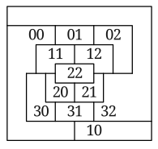</a>


<a id="ex-7-2-2-2-16"></a>

**16.** [21] [答案](./answers/7-2-2-2.md#ans-7-2-2-2-16) McGregor 图有大小为 4 的团吗?

<a id="ex-7-2-2-2-17"></a>

**17.** [26] [答案](./answers/7-2-2-2.md#ans-7-2-2-2-17) 令 $f(n)$ 和 $g(n)$ 分别为如下的 $r$ 的最小值和最大值: $n$ 阶 McGregor 图能用 4 色着色, 并且一种颜色恰好出现 $r$ 次. 用 SAT 求解器尽量多求出一些 $f(n)$ 与 $g(n)$ 的值.

<a id="ex-7-2-2-2-18"></a>

▶ **18.** [28] [答案](./answers/7-2-2-2.md#ans-7-2-2-2-18) 考察[习题 17](#ex-7-2-2-2-17) 中得到的着色, 给出<em>任意</em> $n$ 阶 McGregor 图的一种显式 4 着色方法, 使其中一种颜色至多使用 $\tfrac56 n$ 次. <em>提示:</em> 构造方法依赖于 $n\bmod6$ 的值.

<a id="ex-7-2-2-2-19"></a>

▶ **19.** [29] [答案](./answers/7-2-2-2.md#ans-7-2-2-2-19) 接着[习题 17](#ex-7-2-2-2-17), 令 $h(n)$ 为可以同时被赋予两种颜色的区域数的最大值 (不使用子句 (17)). 研究 $h(n)$.

<a id="ex-7-2-2-2-20"></a>

**20.** [40] [答案](./answers/7-2-2-2.md#ans-7-2-2-2-20) McGregor 的地图 ([图 76](#fig-7-2-2-2-76)) 到底有多少种 4 着色法?

<a id="ex-7-2-2-2-21"></a>

**21.** [22] [答案](./answers/7-2-2-2.md#ans-7-2-2-2-21) 用 SAT 求解器在[图 76](#fig-7-2-2-2-76) 中寻找一个最小的<em>核</em>.

<a id="ex-7-2-2-2-22"></a>

**22.** [20] [答案](./answers/7-2-2-2.md#ans-7-2-2-2-22) 用尽可能少的颜色为图 $\overline{C_5\boxtimes C_5}$ 着色. (两个顶点可取相同颜色, 当且仅当它们在 $5\times5$ 环面上相距一步王步.)

<a id="pdf-339"></a><a id="p-319"></a>

<a id="ex-7-2-2-2-23"></a>

**23.** [20] [答案](./answers/7-2-2-2.md#ans-7-2-2-2-23) 在 $n=7$, $r=4$ 的情形下, 比较 (18)、(19) 的子句与 (20)、(21) 的子句.

<a id="ex-7-2-2-2-24"></a>

▶ **24.** [M34] [答案](./answers/7-2-2-2.md#ans-7-2-2-2-24) 在上一题中, 由 (20)、(21) 得到的子句可以简化, 因为其中两个含有纯字面值 $b^2_1$, 可以除去.

(a) 证明在 (20)、(21) 中, 当 $r>n/2$ 时, 字面值 $b^2_1$ <em>总是</em>纯的.

(b) 证明在 $r<n/2$ 的某些情形下, $b^2_1$ 也可能是纯的.

(c) 当 $r$ 取最大值 $n-1$ 时, (20)、(21) 有<em>许多</em>纯字面值 $b_j^k$. 而且, 除去它们还会使其他字面值变纯. 在这种情形下, 消去全部纯字面值之后还剩多少个子句?

(d) 证明有 $n\ge2$ 个叶子的完全二叉树由分别有 $n'$ 和 $n''=n-n'$ 个叶子的两棵完全二叉树组成, 且 $n'$ 或 $n''$ 有一个是 2 的幂.

(e) 令 $a(n,r)$、$c(n,r)$ 分别为从 (20)、(21) 中除去所有纯辅助字面值之后, 所余辅助变量 $b_j^k$ 的个数和子句的总数. $a(2^k,2^{k-1})$ 与 $c(2^k,2^{k-1})$ 是多少?

(f) 证明当 $n''\le r\le n'$ 时, $a(n,r)=a(n,n'')=a(n,n')$, 且此公共值为 $\max_{1\le r<n}a(n,r)$. 还有 $a(n,r)=a(n,n-r)$; 若 $r\le n/2$, 则 $c(n,r)\ge c(n,n-r)$.

<a id="ex-7-2-2-2-25"></a>

**25.** [21] [答案](./answers/7-2-2-2.md#ans-7-2-2-2-25) 证明当 $r=2$ 时, (18)–(19) 与 (20)–(21) 同样有效.

<a id="ex-7-2-2-2-26"></a>

**26.** [22] [答案](./answers/7-2-2-2.md#ans-7-2-2-2-26) 证明 Sinz 的子句 (18) 和 (19) 强制基数约束 $x_1+\cdots+x_n\le r$. <em>提示:</em> 证明当 $x_1+\cdots+x_{j+k-1}\ge k$ 时, 它们蕴涵 $s_j^k=1$.

<a id="ex-7-2-2-2-27"></a>

**27.** [20] [答案](./answers/7-2-2-2.md#ans-7-2-2-2-27) 类似地, 证明 Bailleux 和 Boufkhad 的 (20) 和 (21) 的正确性. <em>提示:</em> 只要结点 $k$ 下面的叶子中有 $j$ 个或更多的 1, 它们就蕴涵 $b_j^k=1$.

<a id="ex-7-2-2-2-28"></a>

▶ **28.** [20] [答案](./answers/7-2-2-2.md#ans-7-2-2-2-28) 要保证 $x_1+\cdots+x_n\ge1$ 时, (18) 和 (19) 给出哪些子句? (这个特例能把任意子句转换成 3SAT 子句.)

<a id="ex-7-2-2-2-29"></a>

▶ **29.** [20] [答案](./answers/7-2-2-2.md#ans-7-2-2-2-29) 假定要施加的不是单个约束 $x_1+\cdots+x_n\le r$, 而是一系列约束 $x_1+\cdots+x_i\le r_i$, $1\le i\le n$. 可以用额外的子句与辅助变量巧妙地做到吗?

<a id="ex-7-2-2-2-30"></a>

▶ **30.** [22] [答案](./answers/7-2-2-2.md#ans-7-2-2-2-30) 若按 (18)、(19) 的方式用辅助变量 $s_j^k$ 来保证 $x_1+\cdots+x_n\le r$, 同时用 $s'{}^k_j$ 保证 $\bar x_1+\cdots+\bar x_n\le n-r$, 证明可以通过令 $s'{}^j_k=\overline{s_j^k}$ 将二者统一, 其中 $1\le j\le n-r$, $1\le k\le r$. (20) 和 (21) 也能类似地统一吗?

<a id="ex-7-2-2-2-31"></a>

▶ **31.** [28] [答案](./answers/7-2-2-2.md#ans-7-2-2-2-31) 令 $F_t(r)$ 为存在如下位向量 $x_1\ldots x_n$ 的最小 $n$: $x_1+\cdots+x_n=r$, 且没有 $t$ 个等距的 1. 例如 $F_3(12)=30$, 因为有唯一解 101100011010000000010110001101. 讨论怎样借助 SAT 求解器高效地计算 $F_t(r)$.

<a id="ex-7-2-2-2-32"></a>

**32.** [15] [答案](./answers/7-2-2-2.md#ans-7-2-2-2-32) 图的<em>列表着色</em>是指每个顶点 $v$ 的颜色都属于给定集合 $L(v)$ 的着色. 将列表着色表述为一个 SAT 问题.

<a id="ex-7-2-2-2-33"></a>

**33.** [21] [答案](./answers/7-2-2-2.md#ans-7-2-2-2-33) 图的<em>双重着色</em>给每个顶点赋两种不同的颜色, 使相邻顶点没有共同的颜色. 类似地, $q$ 重着色给每个顶点赋 $q$ 种不同的颜色. 为圈图 $C_5,C_7,C_9,\ldots$ 找出双重和三重着色, 所用颜色尽可能少.

<a id="ex-7-2-2-2-34"></a>

**34.** [HM26] [答案](./answers/7-2-2-2.md#ans-7-2-2-2-34) 图 $G$ 的<em>分数色数</em> $\chi^*(G)$ 定义为比值 $p/q$ 的最小值, 其中 $G$ 有一个使用 $p$ 种颜色的 $q$ 重着色.

(a) 证明 $\chi^*(G)\le\chi(G)$, 并说明对 McGregor 图等号成立.

(b) 设 $S_1,\ldots,S_N$ 为 $G$ 的顶点的所有独立集. 证明
$$
\chi^*(G)=\min_{\lambda_1,\ldots,\lambda_N\ge0}
\left\{\lambda_1+\cdots+\lambda_N\ \mid\ \sum_{j=1}^N\lambda_j[v\in S_j]=1\ \text{对所有顶点 }v\right\}.
$$
(这是一个分数恰当覆盖问题.)

<a id="pdf-340"></a><a id="p-320"></a>

(c) 圈图 $C_n$ 的分数色数 $\chi^*(C_n)$ 是多少?

(d) 考虑以下为 $G$ 着色的贪心算法: 置 $k\gets0$ 和 $G_0\gets G$; 当 $G_k$ 非空时, 置 $k\gets k+1$, $G_k\gets G_{k-1}\setminus C_k$, 其中 $C_k$ 是 $G_{k-1}$ 的一个最大独立集. 证明 $k\le H_{\alpha(G)}\chi^*(G)$, 其中 $\alpha(G)$ 是 $G$ 的最大独立集的大小; 从而 $\chi(G)/\chi^*(G)\le H_{\alpha(G)}=O(\log n)$. <em>提示:</em> 若 $v\in C_i$, 令 $t_v=1/|C_i|$, 并证明对每个独立集 $S$ 都有 $\sum_{v\in S}t_v\le H_{|S|}$.

<a id="ex-7-2-2-2-35"></a>

**35.** [22] [答案](./answers/7-2-2-2.md#ans-7-2-2-2-35) 当 $G$ 为以下的图时, 求 $\chi^*(G)$: (a) 美国本土各州的图 (见 7.2.2.1–(113)); (b) [习题 22](#ex-7-2-2-2-22) 的图.

<a id="ex-7-2-2-2-36"></a>

▶ **36.** [22] [答案](./answers/7-2-2-2.md#ans-7-2-2-2-36) 图的<em>无线电着色</em>, 又称 $L(2,1)$ 标号, 给顶点赋以整数颜色, 使 $u\mathbin{—}v$ 时 $u$ 与 $v$ 的颜色至少相差 2, 而 $u$ 与 $v$ 有公共邻点时, 颜色至少相差 1. (这个概念由 Fred Roberts 于 1988 年引入, 动机是给无线电发射机分配频道, 避免 “较近” 的发射机产生干扰以及 “很近” 的发射机产生强干扰.) 用仅仅 16 个连续的颜色为 McGregor 图 ([图 76](#fig-7-2-2-2-76)) 找出一个无线电着色.

<a id="ex-7-2-2-2-37"></a>

**37.** [20] [答案](./answers/7-2-2-2.md#ans-7-2-2-2-37) 为美国本土各州的图 7.2.2.1–(113) 找一个最优的无线电着色.

<a id="ex-7-2-2-2-38"></a>

**38.** [M25] [答案](./answers/7-2-2-2.md#ans-7-2-2-2-38) 以下对象的无线电着色需要多少个连续的颜色? (a) $n\times n$ 方格图 $P_n\mathbin{\square}P_n$. (b) 顶点 $\{(x,y,z)\mid x,y,z\ge0,\ x+y+z=n\}$, 它们形成一个每边有 $n+1$ 个顶点的三角格.

<a id="ex-7-2-2-2-39"></a>

**39.** [M46] [答案](./answers/7-2-2-2.md#ans-7-2-2-2-39) 对于某个 $n>6$, 找出 $n$ 维立方体的一个最优无线电着色.

<a id="ex-7-2-2-2-40"></a>

**40.** [01] [答案](./answers/7-2-2-2.md#ans-7-2-2-2-40) 每当 $z$ 为素数时, 因子分解问题 (22) 都不可满足吗?

<a id="ex-7-2-2-2-41"></a>

**41.** [M21] [答案](./answers/7-2-2-2.md#ans-7-2-2-2-41) 当 $2\le m\le n$ 时, 确定用 Dadda 的方案将 $m$ 位数与 $n$ 位数相乘所需的布尔运算 $\land,\lor,\oplus$ 的次数.

<a id="ex-7-2-2-2-42"></a>

**42.** [21] [答案](./answers/7-2-2-2.md#ans-7-2-2-2-42) 也可以为三元运算设计类似于 (24) 的 Tseytin 编码, 而无须引入所编码的函数的变量以外的辅助变量. 直接编码全加器的基本运算 $x\gets t\oplus u\oplus v$ 和 $y\gets\langle tuv\rangle$ 来说明这个原理, 不要把它们分解成 $\oplus,\land,\lor$.

<a id="ex-7-2-2-2-43"></a>

▶ **43.** [21] [答案](./answers/7-2-2-2.md#ans-7-2-2-2-43) 对于哪些整数 $n\ge2$, 存在奇回文二进制数 $x=(x_n\ldots x_1)_2=(x_1\ldots x_n)_2$ 和 $y=(y_n\ldots y_1)_2=(y_1\ldots y_n)_2$, 使其乘积 $xy=(z_{2n}\ldots z_1)_2=(z_1\ldots z_{2n})_2$ 也是回文数?

<a id="ex-7-2-2-2-44"></a>

▶ **44.** [30] [答案](./answers/7-2-2-2.md#ans-7-2-2-2-44) (<em>最多的 1.</em>) 在 $x,y$ 取遍所有 32 位二进制数时, 找出 $\nu x+\nu y+\nu(xy)$ 的最大可能值, 即这类乘法中 1 位的最大总数.

<a id="ex-7-2-2-2-45"></a>

**45.** [20] [答案](./answers/7-2-2-2.md#ans-7-2-2-2-45) 指定子句, 约束 $(z_t\ldots z_1)_2$ 为一个完全平方数.

<a id="ex-7-2-2-2-46"></a>

**46.** [30] [答案](./answers/7-2-2-2.md#ans-7-2-2-2-46) 找出小于 $2^{100}$ 的最大二进制回文完全平方数.

<a id="ex-7-2-2-2-47"></a>

▶ **47.** [20] [答案](./answers/7-2-2-2.md#ans-7-2-2-2-47) 假设像[图 77](#fig-7-2-2-2-77) 这样的电路有 $m$ 个输出、$n$ 个输入, 有 $g$ 个将两个信号变成一个信号的门, 以及 $h$ 个将一个信号变为两个的门. 用两种方法表示导线总数, 找出 $g$ 和 $h$ 之间的关系.

<a id="ex-7-2-2-2-48"></a>

**48.** [20] [答案](./answers/7-2-2-2.md#ans-7-2-2-2-48) 图中的小电路有三个输入、三个异或门、一个扇出门、八条导线和一个输出. 八个测试模式 $pqr$ 各能检测出哪些单固定故障?


<a href="../../assets/volume4b/figures/satqa-q48.svg">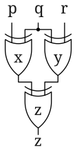</a>


<a id="ex-7-2-2-2-49"></a>

**49.** [24] [答案](./answers/7-2-2-2.md#ans-7-2-2-2-49) 编写一个程序, 精确地确定[图 77](#fig-7-2-2-2-77) 的电路的 100 种单固定故障中, 哪些可由 32 个可能的输入模式中的每一个检测出来. 再找出能够发现全部此种故障 (除非它不能检测) 的所有最小测试模式集.

<a id="pdf-341"></a><a id="p-321"></a>

<a id="ex-7-2-2-2-50"></a>

**50.** [24] [答案](./answers/7-2-2-2.md#ans-7-2-2-2-50) 用 Larrabee 的方法表示固定故障: 描述用于刻画[图 77](#fig-7-2-2-2-77) 中故障 “$x_2^1$ 固定为 1” 的测试模式的子句. (这条导线从 $x_2$ 分出, 馈入 $x_2^3$ 和 $x_2^4$, 然后通往 $b_2$ 和 $b_3$; 见[表 1](#tab-7-2-2-2-1).)

<a id="ex-7-2-2-2-51"></a>

**51.** [40] [答案](./answers/7-2-2-2.md#ans-7-2-2-2-51) 研究 SAT 求解器在以下问题上的行为: 找出少量测试模式, 覆盖电路 $\operatorname{prod}(32,32)$ 的所有可检测单固定故障. 能不能 “自动” 找出这个大电路的一组完备模式 (不依靠数论)?

<a id="ex-7-2-2-2-52"></a>

**52.** [15] [答案](./answers/7-2-2-2.md#ans-7-2-2-2-52) 当考虑[表 2](#tab-7-2-2-2-2) 左边的<em>第二</em>个实例 $f(1,0,1,0,\ldots,1)=1$ 时, 与 (29)、(30) 相应的子句是什么?

<a id="ex-7-2-2-2-53"></a>

▶ **53.** [M20] [答案](./answers/7-2-2-2.md#ans-7-2-2-2-53) [表 2](#tab-7-2-2-2-2) 中的数显然并非随机. 你看得出原因吗?

<a id="ex-7-2-2-2-54"></a>

▶ **54.** [23] [答案](./answers/7-2-2-2.md#ans-7-2-2-2-54) 用上一题的规则扩充[表 2](#tab-7-2-2-2-2). 对 $M=3,4,5$, 分别要有多少行, $f(x)$ 才不能用 $M$ 项析取范式来表示?

<a id="ex-7-2-2-2-55"></a>

**55.** [21] [答案](./answers/7-2-2-2.md#ans-7-2-2-2-55) 找一个类似于 (27)、与[表 2](#tab-7-2-2-2-2) 相符且每个变量都取补的等式. (因而所得函数是单调递减的.)

<a id="ex-7-2-2-2-56"></a>

▶ **56.** [22] [答案](./answers/7-2-2-2.md#ans-7-2-2-2-56) 式 (27) 给出了一个与[表 2](#tab-7-2-2-2-2) 相符的函数, 它只依赖 20 个变量中的 8 个. 用 SAT 求解器证明, 实际上我们能找到一个只依赖<em>五个</em> $x_j$ 的合适函数 $f$.

<a id="ex-7-2-2-2-57"></a>

▶ **57.** [29] [答案](./answers/7-2-2-2.md#ans-7-2-2-2-57) 将上一题与 7.1.2 节的方法结合起来, 给出一个与[表 2](#tab-7-2-2-2-2) 相符的函数 $f$, 它只要六次布尔运算就能求值 (!).

<a id="ex-7-2-2-2-58"></a>

▶ **58.** [20] [答案](./answers/7-2-2-2.md#ans-7-2-2-2-58) 讨论在 (29)、(30) 和 (31) 中加入子句 $\bar p_{i,j}\lor\bar q_{i,j}$ 的做法.

<a id="ex-7-2-2-2-59"></a>

**59.** [M20] [答案](./answers/7-2-2-2.md#ans-7-2-2-2-59) 精确计算 (32) 中的 $\hat f(x)$ 与 (27) 中的 $f(x)$ 不同的概率.

<a id="ex-7-2-2-2-60"></a>

**60.** [24] [答案](./answers/7-2-2-2.md#ans-7-2-2-2-60) 对从大小为 32 和 64 的训练集学习 (27) 中 $f(x)$ 的问题作实验. 用 SAT 求解器找一个猜测的函数 $\hat f(x)$; 然后用 BDD 方法求出, 对随机的 $x$, 这个 $\hat f(x)$ 与 $f(x)$ 不同的概率.

<a id="ex-7-2-2-2-61"></a>

**61.** [20] [答案](./answers/7-2-2-2.md#ans-7-2-2-2-61) 说明如何检验一组从训练集经由 (29)–(31) 生成的子句是否只有 (27) 中的函数 $f(x)$ 才能满足.

<a id="ex-7-2-2-2-62"></a>

**62.** [23] [答案](./answers/7-2-2-2.md#ans-7-2-2-2-62) 试用 $N$ 位的训练样本 $x^{(0)},x^{(1)},x^{(2)},\ldots$ 来学习一个隐秘的、小型 DNF 函数, 其中 $x^{(0)}$ 是随机的, 但对于 $k>0$, $x^{(k)}\oplus x^{(k-1)}$ 的每一位以概率 $p$ 为 1. (因此若 $p$ 很小, 相继的数据点就往往彼此接近.) 在实践中, 这样的训练集是否比 $p=1/2$ 时得到的纯随机样本更有效?

<a id="ex-7-2-2-2-63"></a>

▶ **63.** [20] [答案](./answers/7-2-2-2.md#ans-7-2-2-2-63) 给定一个按 5.3.4 节习题所定义的 $n$ 网络 $\alpha=[i_1:j_1][i_2:j_2]\ldots[i_r:j_r]$, 说明如何用 SAT 求解器检验 $\alpha$ 是否为排序网络. <em>提示:</em> 用定理 5.3.4Z.

<a id="ex-7-2-2-2-64"></a>

**64.** [26] [答案](./answers/7-2-2-2.md#ans-7-2-2-2-64) $n$ 个元素的排序网络的确切最短时间 $\widehat T(n)$ 是个著名的未解决问题; $\widehat T(9)=7$ 这个事实, 当初是在 1987 年让一段高度优化的程序在 Cray 2 超级计算机上运行了许多个小时才确立的.

证明现在使用 SAT 求解器, 不到一秒钟就能证明这个结果 (!).

<a id="ex-7-2-2-2-65"></a>

▶ **65.** [28] [答案](./answers/7-2-2-2.md#ans-7-2-2-2-65) 描述将生命游戏的转移函数 (35) 编码为子句的方法.

(a) 只用变量 $x'_{ij}$ 与 $x_{ij}$.

(b) 像 Bailleux 和 Boufkhad 的编码 (20)–(21) 那样使用辅助变量, 按正文所述在相邻细胞之间共享中间结果.

<a id="ex-7-2-2-2-66"></a>

**66.** [24] [答案](./answers/7-2-2-2.md#ans-7-2-2-2-66) 用 SAT 求解器找出与[图 78](#fig-7-2-2-2-78) 相对应的较短过程: (a) $X_1=\mathrm{LIFE}$; (b) $X_2=\mathrm{LIFE}$. 两种情形中, $X_0$ 的活细胞都应尽可能少.

<a id="pdf-342"></a><a id="p-322"></a>

<a id="ex-7-2-2-2-67"></a>

**67.** [24] [答案](./answers/7-2-2-2.md#ans-7-2-2-2-67) 找出一条棋盘上的活动路径 $X_0\to X_1\to\cdots\to X_{21}$, 每个 $X_t$ 中至多有五个活细胞. ((37) 中的滑翔机在 $X_{20}$ 之后离开棋盘.) 若要达到 $X_{22}$ 呢?

<a id="ex-7-2-2-2-68"></a>

**68.** [39] [答案](./answers/7-2-2-2.md#ans-7-2-2-2-68) 找出在棋盘上每代活细胞数均为 6 至 10 的最长活动生命游戏路径.

<a id="ex-7-2-2-2-69"></a>

**69.** [23] [答案](./answers/7-2-2-2.md#ans-7-2-2-2-69) 找出能在 $4\times4$ 棋盘中生存的全部 (a) 静物和 (b) 周期大于 1 的振荡器.

<a id="ex-7-2-2-2-70"></a>

**70.** [21] [答案](./answers/7-2-2-2.md#ans-7-2-2-2-70) 振荡器的活细胞分为<em>转子</em> (会改变的那些) 与<em>定子</em> (始终活着的那些).

(a) 证明转子不能只含一个细胞.

(b) 找出转子如图所示的最小振荡器.

<a href="../../assets/volume4b/figures/satqa-q70b.svg"></a>


(c) 类似地, 找出转子分别具有以下形式的最小的 3 周期振荡器.

<a href="../../assets/volume4b/figures/satqa-q70c.svg"></a>


<a id="ex-7-2-2-2-71"></a>

▶ **71.** [22] [答案](./answers/7-2-2-2.md#ans-7-2-2-2-71) 在方形网格上寻找生命游戏的转移序列时, 一个不对称的解将以八种不同的形式出现, 因为网格有八个不同的对称. 类似地, 不对称的周期解会以 $8r$ 种不同的形式出现, 其中 $r$ 为周期长度.

说明怎样添加子句, 使本质上等价的解只出现一次: 只有 “规范形” 才能满足条件.

<a id="ex-7-2-2-2-72"></a>

**72.** [28] [答案](./answers/7-2-2-2.md#ans-7-2-2-2-72) 3 周期振荡器特别引人入胜, 因为生命游戏似乎在本质上是二进制的.

(a) 这样的振荡器中, 哪些最小 (以包围框计)?

(b) 找出大小为 $9\times n$ 和 $10\times n$, 其中 $n$ 为奇数, 且有 “四重对称性” 的 3 周期振荡器: 它们在左右反射、上下反射, 或二者同时反射之后均不变. (这种图案不但赏心悦目, 也容易找得多, 因为所需考虑的变量只有大约四分之一.)

(c) 在大小为 $15\times15$、$15\times16$ 和 $16\times16$ 的网格上, 哪些具有四重对称性的 3 周期振荡器的活细胞最多?

(d) 图中的 3 周期振荡器有另一种四重对称性, 旋转 $90^\circ$ 后它保持不变. (Robert Wainwright 于 1972 年发现了它; 因其定子有四条蛇, 他称之为 “蛇舞”.) 在大小为 $15\times15$ 和 $16\times16$ 的网格上, 哪些有 $90^\circ$ 对称性的 3 周期振荡器的活细胞最多?

<a href="../../assets/volume4b/figures/satqa-q72d.svg"></a>


<a id="ex-7-2-2-2-73"></a>

▶ **73.** [21] [答案](./answers/7-2-2-2.md#ans-7-2-2-2-73) (<em>活动触发器.</em>) 2 周期的振荡器称为<em>触发器</em>, 而活动触发器的生命游戏图案特别吸引人: 每个细胞要么空白 (在每个时刻 $t$ 都是死的), 要么属 A 型 ($t$ 为偶数时活), 要么属 B 型 ($t$ 为奇数时活). 每个非空细胞 (i) 都恰有三个异型邻居, 而且 (ii) 同型邻居数既不等于二也不等于三.

(a) 活动触发器的空白细胞也满足一个特殊条件. 是什么?

(b) 在 $8\times8$ 网格上找到一个活动触发器, 顶部如图.

<a href="../../assets/volume4b/figures/satqa-q73b.svg"></a>


(c) 对若干不同的 $m,n$, 找出 $m\times n$ 环面上的活动触发器图案. (将它无限重复, 就能以一个无限的活动触发器铺满平面.) <em>提示:</em> 有一个解完全没有空白细胞; 另一个解的空白格如同棋盘的方格.

<a id="ex-7-2-2-2-74"></a>

**74.** [M28] [答案](./answers/7-2-2-2.md#ans-7-2-2-2-74) 接着上一题, 证明有限活动触发器的每个非空细胞都至多只有一个同型邻居. (这个事实大大加快了对有限活动触发器的查找.) 两个 A 型细胞能否沿对角线相邻?

<a id="ex-7-2-2-2-75"></a>

**75.** [M22] [答案](./answers/7-2-2-2.md#ans-7-2-2-2-75) (Stephen Silver, 2000.) 证明一个周期 $p\ge3$ 的有限活动振荡器必有某个细胞在一个周期内存活不止一次.

<a id="pdf-343"></a><a id="p-323"></a>

<a id="ex-7-2-2-2-76"></a>

**76.** [41] [答案](./answers/7-2-2-2.md#ans-7-2-2-2-76) 构造一个周期为 3 的活动生命游戏振荡器.

<a id="ex-7-2-2-2-77"></a>

**77.** [20] [答案](./answers/7-2-2-2.md#ans-7-2-2-2-77) 在 (38) 中 $X_0$ 之前的 “步骤 $X_{-1}$” 的滑翔机形态, 应当由下图左式取代右式. 对静物 $X_5$ 施加什么条件才能保证确实会达到状态 $X_0$? (我们不希望消化过早开始.)

<a href="../../assets/volume4b/figures/satqa-q77.svg"></a>


<a id="ex-7-2-2-2-78"></a>

**78.** [21] [答案](./answers/7-2-2-2.md#ans-7-2-2-2-78) 对某个 $n$, 在 $7\times n$ 的网格上 (取代 $8\times8$) 找出 (38) 中四步吞噬者问题的一个解.

<a id="ex-7-2-2-2-79"></a>

**79.** [23] [答案](./answers/7-2-2-2.md#ans-7-2-2-2-79) 如果滑翔机以相反的相位遇到 (39) 中的吞噬者, 会怎样? 即取下图左式来取代右式.

<a href="../../assets/volume4b/figures/satqa-q79.svg"></a>


<a id="ex-7-2-2-2-80"></a>

**80.** [21] [答案](./answers/7-2-2-2.md#ans-7-2-2-2-80) 为解决上一题的问题, 找到一个关于对角线反射对称的吞噬者, 使它可同时吃掉所示的两种图案. (所需网格必须大于 $8\times8$, 而且还要等上更久才能消化.)

<a href="../../assets/volume4b/figures/satqa-q80.svg"></a>


<a id="ex-7-2-2-2-81"></a>

**81.** [21] [答案](./answers/7-2-2-2.md#ans-7-2-2-2-81) Conway 发现了一艘非凡的 “宇宙飞船”, 其中 $X_4$ 是 $X_0$ 向上移两格所得的图案:

<a href="../../assets/volume4b/figures/satqa-q81.svg"></a>

是否存在一个左右对称的静物会吃掉这样的宇宙飞船?

<a id="ex-7-2-2-2-82"></a>

▶ **82.** [22] [答案](./answers/7-2-2-2.md#ans-7-2-2-2-82) (<em>光速.</em>) 设想无限平面上的生命游戏, 时刻 0 时除左下象限以外的所有细胞都死了. 更确切地说, 假设 $X_t=(x_{tij})$ 对所有 $t\ge0$ 及所有整数 $-\infty<i,j<+\infty$ 都有定义, 且只要 $i>0$ 或 $j>0$, 就有 $x_{0ij}=0$.

(a) 证明只要 $0\le t<\max(i,j)$, 就有 $x_{tij}=0$.

(b) 此外, 若 $0\le-i\le j$ 且 $0\le t<i+2j$, 则 $x_{tij}=0$.

(c) 而且若 $i\ge0$ 且 $j\ge0$, 则当 $0\le t<2i+2j$ 时有 $x_{tij}=0$. <em>提示:</em> 若每当 $i\ge-j$ 时 $x_{tij}=0$, 证明每当 $i>-j$ 时有 $x_{t+2,i,j}=0$.

<a id="ex-7-2-2-2-83"></a>

**83.** [21] [答案](./answers/7-2-2-2.md#ans-7-2-2-2-83) 根据上一题, 若平面上的初始生命都限制在左下象限, 细胞 $(i,j)$ 最早能够变活的时间, 至少为
$$
f(i,j)=i[i\ge0]+j[j\ge0]+(i+j)[i+j\ge0].
$$
例如, 当 $|i|\le5$ 且 $|j|\le5$ 时, $f(i,j)$ 的值如下所示.

<table id="sat-light-arrival"><thead><tr><th>行 $j$ / 列 $i$</th><th>−5</th><th>−4</th><th>−3</th><th>−2</th><th>−1</th><th>0</th><th>1</th><th>2</th><th>3</th><th>4</th><th>5</th></tr></thead><tbody>
<tr><td>5</td><td>5</td><td>6</td><td>7</td><td>8</td><td>9</td><td>10</td><td>12</td><td>14</td><td>16</td><td>18</td><td>20</td></tr>
<tr><td>4</td><td>4</td><td>4</td><td>5</td><td>6</td><td>7</td><td>8</td><td>10</td><td>12</td><td>14</td><td>16</td><td>18</td></tr>
<tr><td>3</td><td>3</td><td>3</td><td>3</td><td>4</td><td>5</td><td>6</td><td>8</td><td>10</td><td>12</td><td>14</td><td>16</td></tr>
<tr><td>2</td><td>2</td><td>2</td><td>2</td><td>2</td><td>3</td><td>4</td><td>6</td><td>8</td><td>10</td><td>12</td><td>14</td></tr>
<tr><td>1</td><td>1</td><td>1</td><td>1</td><td>1</td><td>1</td><td>2</td><td>4</td><td>6</td><td>8</td><td>10</td><td>12</td></tr>
<tr><td>0</td><td>0</td><td>0</td><td>0</td><td>0</td><td>0</td><td>0</td><td>2</td><td>4</td><td>6</td><td>8</td><td>10</td></tr>
<tr><td>−1</td><td>0</td><td>0</td><td>0</td><td>0</td><td>0</td><td>0</td><td>1</td><td>3</td><td>5</td><td>7</td><td>9</td></tr>
<tr><td>−2</td><td>0</td><td>0</td><td>0</td><td>0</td><td>0</td><td>0</td><td>1</td><td>2</td><td>4</td><td>6</td><td>8</td></tr>
<tr><td>−3</td><td>0</td><td>0</td><td>0</td><td>0</td><td>0</td><td>0</td><td>1</td><td>2</td><td>3</td><td>5</td><td>7</td></tr>
<tr><td>−4</td><td>0</td><td>0</td><td>0</td><td>0</td><td>0</td><td>0</td><td>1</td><td>2</td><td>3</td><td>4</td><td>6</td></tr>
<tr><td>−5</td><td>0</td><td>0</td><td>0</td><td>0</td><td>0</td><td>0</td><td>1</td><td>2</td><td>3</td><td>4</td><td>5</td></tr>
</tbody></table>


令 $f^*(i,j)$ 为在这样的某个初始状态下, 细胞 $(i,j)$ 能够变活的实际最短时间. 给定 $i_0,j_0$, 设计一组子句, 使 SAT 求解器可以检验 $f^*(i_0,j_0)=f(i_0,j_0)$ 是否成立. (这些子句提供了有趣的基准测试.)

<a id="ex-7-2-2-2-84"></a>

**84.** [33] [答案](./answers/7-2-2-2.md#ans-7-2-2-2-84) 证明对于 $j>0$ 的下列情形, $f^*(i,j)=f(i,j)$: (a) $i=j$, $i=j+1$, $i=j-1$. (b) $i=0$, $i=-1$. (c) $i=1-j$. (d) $i=j-2$. (e) $i=-2$.

<a id="ex-7-2-2-2-85"></a>

▶ **85.** [39] [答案](./answers/7-2-2-2.md#ans-7-2-2-2-85) 一个<em>伊甸园</em>是没有前驱的生命游戏状态.

(a) 如果这里画出的 92 个细胞的图案出现在位图 $X$ 内任何位置, 验证 $X$ 是一个伊甸园. (灰色格可死可活.)

<a href="../../assets/volume4b/figures/satqa-q85.svg">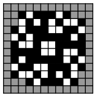</a>


(b) 这个 “孤儿” 图案是在 SAT 求解器帮助下找到的, 是目前已知最小的此类图案. 你能想象它是怎样被发现的吗?

<a id="ex-7-2-2-2-86"></a>

**86.** [M23] [答案](./answers/7-2-2-2.md#ans-7-2-2-2-86) 一个随机的 $10\times10$ 位图平均有多少个生命游戏前驱?

<a id="ex-7-2-2-2-87"></a>

**87.** [21] [答案](./answers/7-2-2-2.md#ans-7-2-2-2-87) 说明为什么子句 (42) 表示 Alice 与 Bob 的程序 (40), 并给出将其他这一类程序转换为等价子句集的一般方法.

<a id="pdf-344"></a><a id="p-324"></a>

<a id="ex-7-2-2-2-88"></a>

**88.** [18] [答案](./answers/7-2-2-2.md#ans-7-2-2-2-88) 对于 $0\le t<6$, 满足 (41) 和 (42), 以及排除多重状态的 $20\times6$ 个附加二元子句, 再加上这两个 “尴尬” 的单位子句 $(\mathrm{A3}_6)\land(\mathrm{B3}_6)$.

<a id="ex-7-2-2-2-89"></a>

**89.** [21] [答案](./answers/7-2-2-2.md#ans-7-2-2-2-89) 这是 1966 年曾被推荐过的一个互斥协议. 它正确吗?

```text
A0. 也许转到 A1.                     B0. 也许转到 B1.
A1. 置 a ← 1, 转到 A2.               B1. 置 b ← 1, 转到 B2.
A2. 若 l 则转到 A3, 否则转到 A5.     B2. 若 l 则转到 B5, 否则转到 B3.
A3. 若 b 则转到 A3, 否则转到 A4.     B3. 若 a 则转到 B3, 否则转到 B4.
A4. 置 l ← 0, 转到 A2.               B4. 置 l ← 1, 转到 B2.
A5. 临界, 转到 A6.                   B5. 临界, 转到 B6.
A6. 置 a ← 0, 转到 A0.               B6. 置 b ← 0, 转到 B0.
```


<a id="ex-7-2-2-2-90"></a>

**90.** [20] [答案](./answers/7-2-2-2.md#ans-7-2-2-2-90) 通过满足 (47) 和 (48), 证明 (43)、(45)、(46) 都允许饥饿.

<a id="ex-7-2-2-2-91"></a>

**91.** [M21] [答案](./answers/7-2-2-2.md#ans-7-2-2-2-91) 形式地说, 如果有 (i) 从初始状态 $X_0$ 出发的无限转移序列 $X_0\to X_1\to\cdots$, 以及 (ii) 无限的布尔 “推动” 序列 $\mathord{@}_0,\mathord{@}_1,\ldots$, 它变动无穷多次, 并且使 (iii) Alice 处在 “也许” 或 “临界” 状态的次数有限, 就说 Alice “饥饿”. 证明, 这件事能发生当且仅当存在正文中讨论的饥饿圈 (47).

<a id="ex-7-2-2-2-92"></a>

**92.** [20] [答案](./answers/7-2-2-2.md#ans-7-2-2-2-92) 建议用 $O(r^2)$ 个子句来判定互斥协议是否允许经过<em>互异</em>状态的路径 $X_0\to X_1\to\cdots\to X_r$.

<a id="ex-7-2-2-2-93"></a>

**93.** [20] [答案](./answers/7-2-2-2.md#ans-7-2-2-2-93) 哪些子句对应于 (51) 中的项 $\neg\Phi(X')$?

<a id="ex-7-2-2-2-94"></a>

▶ **94.** [21] [答案](./answers/7-2-2-2.md#ans-7-2-2-2-94) 假设已知当 $0\le r\le k$ 时 $(X_0\to X_1\to\cdots\to X_r)\land\neg\Phi(X_r)$ 不可满足. 应用哪些子句保证 $\Phi$ 是不变式? ($k=1$ 的情形就是 (51).)

<a id="ex-7-2-2-2-95"></a>

**95.** [20] [答案](./answers/7-2-2-2.md#ans-7-2-2-2-95) 用类似于 (50) 的不变式证明 (45) 和 (46) 保证互斥.

<a id="ex-7-2-2-2-96"></a>

**96.** [22] [答案](./answers/7-2-2-2.md#ans-7-2-2-2-96) 当 $r=2$ 时找出 (52) 的所有解. 此外, 若把涉及 $\Phi$ 的子句删去, 通过找出一个 $r$ 比 2 大得多、具有互异状态 $X_0,X_1,\ldots,X_r$ 的解, 说明不变式的帮助极大.

<a id="ex-7-2-2-2-97"></a>

**97.** [20] [答案](./answers/7-2-2-2.md#ans-7-2-2-2-97) 在 Peterson 的协议 (49) 中, 状态 A6 与 B6 能同时出现吗?

<a id="ex-7-2-2-2-98"></a>

▶ **98.** [M23] [答案](./answers/7-2-2-2.md#ans-7-2-2-2-98) 本题讨论如何证明饥饿圈 (47) 不存在.

(a) 如果一圈状态中有一方从未被推动, 就称它为 “纯的”; 如果没有状态重复, 就称它为 “简单的”. 证明最短的非纯圈 (如果有的话) 要么是简单圈, 要么由共用一个状态的两个简单纯圈组成.

(b) 如果协议 (49) 中某个圈使 Alice 饥饿, 就知道她在圈中从不处在状态 A0 或 A5. 证明她也不可能处在 A1、A2 或 A6.

(c) 构造子句来检验是否存在状态 $X_0\to X_1\to\cdots\to X_r$, 其中 $X_0$ 任意, 使得对某个 $k\le r$, $(X_0X_1\ldots X_{k-1})$ 为饥饿圈.

(d) 所以不必费太大的工夫, 就能断定 (49) 没有饥饿.

<a id="ex-7-2-2-2-99"></a>

**99.** [25] [答案](./answers/7-2-2-2.md#ans-7-2-2-2-99) Th. Dekker 在 1965 年设计了第一个正确的互斥协议:

```text
A0. 也许转到 A1.                     B0. 也许转到 B1.
A1. 置 a ← 1, 转到 A2.               B1. 置 b ← 1, 转到 B2.
A2. 若 b 则转到 A3, 否则转到 A6.     B2. 若 a 则转到 B3, 否则转到 B6.
A3. 若 l 则转到 A4, 否则转到 A2.     B3. 若 l 则转到 B2, 否则转到 B4.
A4. 置 a ← 0, 转到 A5.               B4. 置 b ← 0, 转到 B5.
A5. 若 l 则转到 A5, 否则转到 A1.     B5. 若 l 则转到 B1, 否则转到 B5.
A6. 临界, 转到 A7.                   B6. 临界, 转到 B7.
A7. 置 l ← 1, 转到 A8.               B7. 置 l ← 0, 转到 B8.
A8. 置 a ← 0, 转到 A0.               B8. 置 b ← 0, 转到 B0.
```

用有界模型检验验证它的正确性.

<a id="pdf-345"></a><a id="p-325"></a>

<a id="ex-7-2-2-2-100"></a>

**100.** [22] [答案](./answers/7-2-2-2.md#ans-7-2-2-2-100) 证明以下协议可能使一方饥饿, 而不能使另一方饥饿:

```text
A0. 也许转到 A1.                    B0. 也许转到 B1.
A1. 置 a ← 1, 转到 A2.              B1. 置 b ← 1, 转到 B2.
A2. 若 b 则转到 A2, 否则转到 A3.    B2. 若 a 则转到 B3, 否则转到 B5.
A3. 临界, 转到 A4.                  B3. 置 b ← 0, 转到 B4.
A4. 置 a ← 0, 转到 A0.              B4. 若 a 则转到 B4, 否则转到 B1.
                                    B5. 临界, 转到 B6.
                                    B6. 置 b ← 0, 转到 B0.
```


<a id="ex-7-2-2-2-101"></a>

▶ **101.** [31] [答案](./answers/7-2-2-2.md#ans-7-2-2-2-101) 协议 (49) 有个潜在缺陷: Alice 和 Bob 可能同时试图设置 $l$ 的值. 设计一个互斥协议, 使两人各自控制两个对方可以看到的二进制信号. <em>提示:</em> 可以将上一题的方法包在另一个协议里面.

<a id="ex-7-2-2-2-102"></a>

**102.** [22] [答案](./answers/7-2-2-2.md#ans-7-2-2-2-102) 若 Alice 设置某个变量的同时, Bob 正试图读取它, 我们或许应当考虑一个更为严格的模型, 其中他不确定地看到 0 或 1. (若在她移到下一步之前, 他看了 $k$ 次, 就可能看到 $2^k$ 种不同的位序列.) 说明怎样修改[习题 87](#ex-7-2-2-2-87) 的子句来处理这种变量 “闪烁” 的模型.

<a id="ex-7-2-2-2-103"></a>

**103.** [18] [答案](./answers/7-2-2-2.md#ans-7-2-2-2-103) (用<em>手算</em>做这道题, 很有趣!) 找出层析和如下的 $7\times21$ 图像:

$$
\begin{aligned}
(r_1,\ldots,r_{7})&=(1,0,13,6,12,7,19),\\
(c_1,\ldots,c_{21})&=(4,3,3,4,1,6,1,3,3,3,5,1,1,5,1,5,1,5,1,1,1),\\
(a_1,\ldots,a_{27})&=(0,0,1,2,2,3,2,3,3,2,3,3,4,3,2,3,3,3,4,3,2,2,1,1,1,1,1),\\
(b_1,\ldots,b_{27})&=(0,0,0,0,0,1,3,3,4,3,2,2,2,3,3,4,2,3,3,3,3,3,4,3,2,1,1).
\end{aligned}
$$


<a id="ex-7-2-2-2-104"></a>

**104.** [M21] [答案](./answers/7-2-2-2.md#ans-7-2-2-2-104) 对哪些 $m,n$, 数字层析问题可以满足 $a_d=b_d=1$, $0<d<m+n$? (等价地, 何时能在 $m\times n$ 棋盘上放置 $m+n-1$ 个互不攻击的象?)

<a id="ex-7-2-2-2-105"></a>

▶ **105.** [M28] [答案](./answers/7-2-2-2.md#ans-7-2-2-2-105) 若元素取自 $\{-1,0,+1\}$ 的矩阵的行和、列和与对角线和全为 0, 就称它是<em>层析平衡的</em>. 显然, 两个二进制图像 $X=(x_{ij})$ 与 $X'=(x'_{ij})$ 具有相同的行和、列和、对角线和, 当且仅当 $X-X'$ 层析平衡.

(a) 假设 $Y$ 是层析平衡的, 有 $m$ 行、$n$ 列, 且 $+1$ 出现 $t$ 次. 有多少对 $m\times n$ 二进制矩阵 $X$ 和 $X'$ 满足 $X-X'=Y$?

(b) 将条件 “$Y$ 层析平衡” 表示为子句, 分别用两位编码 $\{10,00,01\}$ 表示值 $\{-1,0,+1\}$.

(c) 对 $m,n\le8$, 计算层析平衡矩阵的数目 $T(m,n)$.

(d) 这样的矩阵中, 有多少个恰好出现四个 $+1$?

(e) 一个 $2n\times2n$ 层析平衡矩阵至多有多少个 $+1$?

(f) 是真是假: 知道 $+1$ 的位置就能确定 $-1$ 的位置.

<a id="ex-7-2-2-2-106"></a>

**106.** [M20] [答案](./answers/7-2-2-2.md#ans-7-2-2-2-106) 对于一个 $25\times30$ 的数字层析问题, 假定各个和互不相干地取其可能值, 给出输入数据集 $\{r_i,c_j,a_d,b_d\}$ 的可能数目的一个宽松上界. 这个界与 $2^{750}$ 相比如何?

<a id="ex-7-2-2-2-107"></a>

▶ **107.** [22] [答案](./answers/7-2-2-2.md#ans-7-2-2-2-107) 莫桑比克伊尼扬巴内的通加文化的编篮人, 创作了称为 “gipatsi 图案” 的悦目周期性花样, 例如:

<a href="../../assets/volume4b/figures/satqa-q107.svg"></a>

(注意, 普通的像素网格旋转了 $45^\circ$.) 形式地说, 一个周期为 $p$、宽度为 $n$ 的 gipatsi 图案是一个 $p\times n$ 二进制矩阵 $(x_{i,j})$, 其中 <a id="pdf-346"></a><a id="p-326"></a> $x_{i,1}=x_{i,n}=1$, $1\le i\le p$. 在实际图案中, 矩阵的第 $i$ 行要向右移动 $i-1$ 个位置. 在上例中 $p=6$, $n=13$, 矩阵的第一行为 1111101111101. 如常, 这样的图案有行和 $r_i=\sum_{j=1}^n x_{i,j}$, $1\le i\le p$, 列和 $c_j=\sum_{i=1}^p x_{i,j}$, $1\le j\le n$. 与 (53) 类似, 它还有
$$
a_d=\sum_{i+j\equiv d\pmod p}x_{i,j},\quad 1\le d\le p;\qquad
b_d=\sum_{2i+j\equiv d\pmod{2p}}x_{i,j},\quad1\le d\le2p.
$$

(a) 例中图案的层析参数 $r_i,c_j,a_d,b_d$ 是什么?

(b) 有其他 gipatsi 图案也具有相同的参数吗?

<a id="ex-7-2-2-2-108"></a>

**108.** [23] [答案](./answers/7-2-2-2.md#ans-7-2-2-2-108) 上一题的列和 $c_j$ 有些人为, 因为它们只计算一条无限直线上一小段的黑像素数. 不过, 若将网格旋转另一个角度, 就能得到无穷周期图案, 使[图 79](#fig-7-2-2-2-79) 的四个方向中的每条直线都只遇到有限个像素.

将下图的每个灰色像素改为白色或黑色, 设计一种周期为 6 的图案, 使每组平行线上的层析投影总是相等:

<a href="../../assets/volume4b/figures/satqa-q108.svg">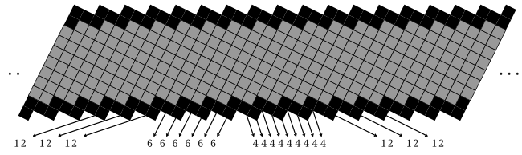</a>


<a id="ex-7-2-2-2-109"></a>

▶ **109.** [20] [答案](./answers/7-2-2-2.md#ans-7-2-2-2-109) 说明如何通过反复使用 SAT 求解器, 找出可满足性问题按字典序最小的解 $x_1\ldots x_n$. (见[图 80](#fig-7-2-2-2-80)(a).)

<a id="ex-7-2-2-2-110"></a>

**110.** [19] [答案](./answers/7-2-2-2.md#ans-7-2-2-2-110) $\operatorname{waerden}(3,10;96)$ 按字典序的 (首个, 末个) 解是什么?

<a id="ex-7-2-2-2-111"></a>

**111.** [40] [答案](./answers/7-2-2-2.md#ans-7-2-2-2-111) [图 80](#fig-7-2-2-2-80) 中 “柴郡猫” 问题按字典序的首、末两个解, 是根据从上到下、从左到右排列的像素求得的. 试验其他的像素次序——例如试试从下到上、从右到左.

<a id="ex-7-2-2-2-112"></a>

**112.** [46] [答案](./answers/7-2-2-2.md#ans-7-2-2-2-112) [图 79](#fig-7-2-2-2-79) 的层析问题到底有多少个解?

<a id="ex-7-2-2-2-113"></a>

▶ **113.** [30] [答案](./answers/7-2-2-2.md#ans-7-2-2-2-113) 证明数字层析问题是 NP 完全的, 即使边缘和 $r,c,a,b$ 均为二进制数也是如此: 证明一个高效的算法, 若能判定是否存在 $n\times n$ 像素图像 $(x_{ij})$ 具有给定的 0–1 值 $r_i=\sum_j x_{ij}$, $c_j=\sum_i x_{ij}$, $a_d=\sum_{i+j=d+1}x_{ij}$, $b_d=\sum_{i-j=d-n}x_{ij}$, 就可用来求解习题 212(a) 的二进制张量列联问题.

<a id="ex-7-2-2-2-114"></a>

**114.** [27] [答案](./answers/7-2-2-2.md#ans-7-2-2-2-114) 给定矩形网格的每个格子 $(i,j)$, 其中要么有一枚地雷 ($x_{i,j}=1$), 要么是安全的 ($x_{i,j}=0$). 在<em>扫雷</em>游戏中, 你要探查你希望安全的位置, 以识别所有隐藏的地雷: 若决定探查 $x_{i,j}=1$ 的格子, 地雷便爆炸, 你也就丧命 (至少在游戏里如此). 但若 $x_{i,j}=0$, 就会获知邻格中有雷的格数 $n_{i,j}$, $0\le n_{i,j}\le8$, 而且活着再探一次. 仔细研究这些数值线索, 往往能继续作完全安全的探查, 最终触及每一个无雷格.

例如, 假定隐藏的地雷恰好构成[图 79](#fig-7-2-2-2-79) 的柴郡猫的 $25\times30$ 图案, 而你一开始探查右上角. 该格原来是安全的, 且你获知 $n_{1,30}=0$; 所以探查 $(1,30)$ 的全部三个邻格都是安全的. 照此进行, 很快就会到达下图 $(\alpha)$; 它给出 $1\le i\le9$, $21\le j\le30$ 的各格 $(i,j)$ 的信息; 尚未探查的格子 <a id="pdf-347"></a><a id="p-327"></a> 显示为灰色, 其余格子显示 $n_{i,j}$ 的值. 从这些数据很容易推出 $x_{1,24}=x_{2,24}=x_{3,25}=x_{4,25}=\cdots=x_{9,26}=1$; 你永远都不想探查这些地方, 所以可以在这样的格子上标 X. 由于 $n_{3,24}=n_{5,25}=4$, 就得到状态 $(\beta)$. 继续向下至第 17 行, 然后向左、向上, 可不费力地得到状态 $(\gamma)$. (注意这个过程与数字层析类似, 因为你正试图依据部分和的信息重建一个二进制阵列.)

<a href="../../assets/volume4b/figures/satqa-q114.svg">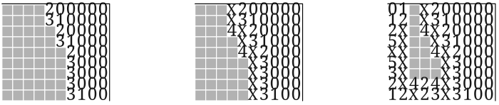</a>


(a) 现在为 $(\gamma)$ 中仍为灰色的全部十三个格子找出安全的探查步骤.

(b) 如果事先知道 (i) $x_{1,1}=0$; (ii) $x_{1,30}=0$; (iii) $x_{25,1}=0$; (iv) $x_{25,30}=0$; (v) 四角都安全, 则在不作任何不安全猜测的条件下, 究竟能揭开多少柴郡猫? <em>提示:</em> SAT 求解器会有帮助.

<a id="ex-7-2-2-2-115"></a>

**115.** [25] [答案](./answers/7-2-2-2.md#ans-7-2-2-2-115) 用实验估计, 在一个随机放置 10 枚雷的 $9\times9$ 扫雷游戏中, 首次猜测之后全靠安全探查便能获胜的概率.

<a id="ex-7-2-2-2-116"></a>

**116.** [22] [答案](./answers/7-2-2-2.md#ans-7-2-2-2-116) 找出 $X$ 与 $X'$ 在层析意义下相等的生命游戏触发器实例.

<a id="ex-7-2-2-2-117"></a>

**117.** [23] [答案](./answers/7-2-2-2.md#ans-7-2-2-2-117) 给定序列 $x=x_1\ldots x_n$, 令 $\nu^{(2)}x=x_1x_2+x_2x_3+\cdots+x_{n-1}x_n$. (串行相关系数 3.3.2–(23) 中也有类似的和.)

(a) 证明当 $x$ 是二进制序列时, $x$ 中 1 的游程数可用 $\nu x$ 和 $\nu^{(2)}x$ 表示.

(b) 修改 Bailleux 与 Boufkhad 的基数约束 (20)–(21), 说明如何把条件 $\nu^{(2)}x\le r$ 编码为一组子句.

(c) 类似地, 将条件 $\nu^{(2)}x\ge r$ 编码.

<a id="ex-7-2-2-2-118"></a>

**118.** [20] [答案](./answers/7-2-2-2.md#ans-7-2-2-2-118) <em>榻榻米铺砌</em>是没有三块骨牌共用一个角的多米诺骨牌覆盖:

<a href="../../assets/volume4b/figures/satqa-q118.svg"></a>

(注意, 下图左边的摆法不允许, 右边的摆法则可以.) 说明怎样用 SAT 求解器找到覆盖一组给定像素的榻榻米铺砌, 除非这样的铺砌不存在.

<a href="../../assets/volume4b/figures/satqa-q118detail.svg"></a>


<a id="ex-7-2-2-2-119"></a>

**119.** [18] [答案](./answers/7-2-2-2.md#ans-7-2-2-2-119) 设 $F=\operatorname{waerden}(3,3;9)$ 为 (9) 的 32 个子句. 对哪个字面值 $l$, 约化后的公式 $F\mid l$ 最小? 给出所得子句.

<a id="ex-7-2-2-2-120"></a>

**120.** [M20] [答案](./answers/7-2-2-2.md#ans-7-2-2-2-120) 是真是假: 若 $\overline L=\{\bar l\mid l\in L\}$, 则 $F\mid L=\{C\setminus\overline L\mid C\in F\ \text{且}\ C\cap L=\emptyset\}$.

<a id="ex-7-2-2-2-121"></a>

**121.** [21] [答案](./answers/7-2-2-2.md#ans-7-2-2-2-121) 展开算法 A 的步骤 A3、A4、A7、A8 中较高层的描述, 详细说明数据结构中链域的改变.

<a id="ex-7-2-2-2-122"></a>

▶ **122.** [21] [答案](./answers/7-2-2-2.md#ans-7-2-2-2-122) 修改算法 A, 使它找出使子句满足的<em>全部</em>赋值.

<a id="ex-7-2-2-2-123"></a>

**123.** [17] [答案](./answers/7-2-2-2.md#ans-7-2-2-2-123) 例如, 在算法 B 或算法 D 刚开始处理 (7) 的七个子句 $R'$ 时, 其内部数据结构 L、START、LINK 的内容是什么?

<a id="pdf-348"></a><a id="p-328"></a>

<a id="ex-7-2-2-2-124"></a>

▶ **124.** [21] [答案](./answers/7-2-2-2.md#ans-7-2-2-2-124) 详细说明步骤 B3 中简述的低层链域操作.

<a id="ex-7-2-2-2-125"></a>

▶ **125.** [20] [答案](./answers/7-2-2-2.md#ans-7-2-2-2-125) 修改算法 B, 使它找出使子句满足的<em>全部</em>赋值.

<a id="ex-7-2-2-2-126"></a>

**126.** [20] [答案](./answers/7-2-2-2.md#ans-7-2-2-2-126) 将 (59) 中的计算再推进一步.

<a id="ex-7-2-2-2-127"></a>

**127.** [17] [答案](./answers/7-2-2-2.md#ans-7-2-2-2-127) (59) 中略算的过程在发生回溯的紧前、紧后, 分别对应于什么走法代码 $m_1\ldots m_d$?

<a id="ex-7-2-2-2-128"></a>

**128.** [19] [答案](./answers/7-2-2-2.md#ans-7-2-2-2-128) 用类似于 (59) 的格式, 描述算法 D 证明 Rivest 的子句 (6) 不可满足的整个计算过程. (见[图 82](#fig-7-2-2-2-82).)

<a id="ex-7-2-2-2-129"></a>

**129.** [20] [答案](./answers/7-2-2-2.md#ans-7-2-2-2-129) 在算法 D 中, 设计一个子程序, 给定字面值 $l$, 按 $l$ 是否正在某个其他字面值全为假的子句中受监视, 分别返回 1 或 0.

<a id="ex-7-2-2-2-130"></a>

**130.** [22] [答案](./answers/7-2-2-2.md#ans-7-2-2-2-130) 步骤 D6 中 “清空 $\bar x_k$ 的监视表” 需要哪些低层表处理操作?

<a id="ex-7-2-2-2-131"></a>

▶ **131.** [30] [答案](./answers/7-2-2-2.md#ans-7-2-2-2-131) 算法 D 离开步骤 D3 而未找到任何单位子句时, 已经检查过每个自由变量的监视表. 因此, 只须付出很少的额外开销, 它原本就能算出这些监视表的长度; 然后可以用这些长度的信息, 在 D4 中对选择哪个变量来分支作出更有根据的决定. 试验各种这样的启发式分支方法.

<a id="ex-7-2-2-2-132"></a>

▶ **132.** [22] [答案](./answers/7-2-2-2.md#ans-7-2-2-2-132) 定理 7.1.1K 告诉我们每个 2SAT 问题都能在线性时间内解决. 是否有一系列 2SAT 子句, 使算法 D 用去指数时间?

<a id="ex-7-2-2-2-133"></a>

▶ **133.** [25] [答案](./answers/7-2-2-2.md#ans-7-2-2-2-133) [图 82](#fig-7-2-2-2-82) 那样的回溯树的大小, 可以极大地依赖于每个结点所作的分支变量选择.

(a) 对 $\operatorname{waerden}(3,3;9)$, 找出一棵结点数尽可能少的回溯树.

(b) 这个问题的<em>最大</em>回溯树是什么?

<a id="ex-7-2-2-2-134"></a>

**134.** [22] [答案](./answers/7-2-2-2.md#ans-7-2-2-2-134) 算法 L 使用的 BIMP 表是大小动态变化的顺序表. 一个很可取的实现办法是, 开始时令每个表的容量为例如 4; 当某个表需要变大时, 就把它的容量加倍.

将伙伴系统 (算法 2.5R) 用于这种情形. (回溯时缩小的表无须释放内存, 因为它们以后很可能还要增大.)

<a id="ex-7-2-2-2-135"></a>

▶ **135.** [16] [答案](./answers/7-2-2-2.md#ans-7-2-2-2-135) $\mathtt{BIMP}(l)$ 中的字面值 $l'$ 是给定可满足性问题的 “蕴涵图” 中有 $l\longrightarrow l'$ 的那些字面值. 给定 $l$, 如何容易地找出使 $l''\longrightarrow l$ 的所有字面值 $l''$?

<a id="ex-7-2-2-2-136"></a>

**136.** [15] [答案](./answers/7-2-2-2.md#ans-7-2-2-2-136) 对 (9) 中 $\operatorname{waerden}(3,3;9)$ 的子句, 假定我们处在决策层 $d=0$, 在将 $x_5$ 置零的前后, $\mathtt{TIMP}(\bar3)$ 中分别有哪些数对?

<a id="ex-7-2-2-2-137"></a>

**137.** [24] [答案](./answers/7-2-2-2.md#ans-7-2-2-2-137) 详细说明 (a) 从自由表以及所有 TIMP 表中的全部数对中删除变量 $X$ (算法 L 的步骤 L7), 和 (b) 稍后再将其恢复 (步骤 L12) 的过程. 数据结构究竟怎样改变?

<a id="ex-7-2-2-2-138"></a>

▶ **138.** [20] [答案](./answers/7-2-2-2.md#ans-7-2-2-2-138) 讨论在算法 L 的步骤 L9 中, 若恰好既有 $\bar v\in\mathtt{BIMP}(\bar u)$ 又有 $\bar u\in\mathtt{BIMP}(\bar v)$, 会发生什么.

<a id="ex-7-2-2-2-139"></a>

**139.** [25] [答案](./answers/7-2-2-2.md#ans-7-2-2-2-139) (<em>补偿归结式.</em>) 若 $w\in\mathtt{BIMP}(v)$, 二元子句 $u\lor v$ 蕴涵二元子句 $u\lor w$, 因为可以将 $u\lor v$ 与 $\bar v\lor w$ 归结. 因此, 步骤 L9 可以进一步利用每个新的二元子句, 对所有这样的 $w$, 将 $w$ 与 $v$ 一同附加到 $\mathtt{BIMP}(\bar u)$.

<a id="pdf-349"></a><a id="p-329"></a>

<a id="ex-7-2-2-2-140"></a>

**140.** [21] [答案](./answers/7-2-2-2.md#ans-7-2-2-2-140) 显然, 算法 L 中的 FORCE、BRANCH、BACKF 和 BACKI 阵列各自至多含 $n$ 项. ISTACK 的最大可能大小有没有一个相当小的上界?

<a id="ex-7-2-2-2-141"></a>

**141.** [18] [答案](./answers/7-2-2-2.md#ans-7-2-2-2-141) 算法 L 有可能如此频繁地增加 ISTAMP, 使它超出 $\mathtt{IST}(l)$ 域所能表示的范围. 遇到这种情形, 怎样使 (63) 的机制不出错?

<a id="ex-7-2-2-2-142"></a>

**142.** [24] [答案](./answers/7-2-2-2.md#ans-7-2-2-2-142) 算法 A、B、D 可以通过展示 (58)、(60) 那样的走法代码序列 $m_1\ldots m_d$ 来显示当前进度; 算法 L 却没有这样的代码. 证明若有需要, 在 L2 中也能打印一个类似的序列 $m_1\ldots m_F$. 使用算法 D 的代码, 不过还要扩充: 若 $R_{j-1}$ 是一个真 (或假) 字面值, 并且其取值是算法 X 发现被强制的, 或者它在输入中就是单位子句而被强制, 则用 $m_j=6$ (或 7) 来表示.

<a id="ex-7-2-2-2-143"></a>

▶ **143.** [30] [答案](./answers/7-2-2-2.md#ans-7-2-2-2-143) 修改算法 L, 使它能用于任意大小的非空子句. 若子句大小大于 2, 就称它为<em>大</em>子句. 不用 TIMP 表, 而是用 ‘KINX’ 和 ‘CINX’ 表表示每个大子句: 每个字面值 $l$ 有一张大子句号的顺序表 $\mathtt{KINX}(l)$; 每个大子句 $c$ 有一张字面值的顺序表 $\mathtt{CINX}(c)$; $c$ 在 $\mathtt{KINX}(l)$ 中当且仅当 $l$ 在 $\mathtt{CINX}(c)$ 中. $\mathtt{KSIZE}(l)$ 表示当前含 $l$ 的活动子句数; $\mathtt{CSIZE}(c)$ 表示 $c$ 中当前的活动字面值数.

<a id="ex-7-2-2-2-144"></a>

**144.** [15] [答案](./answers/7-2-2-2.md#ans-7-2-2-2-144) 是真是假: 若 $l$ 不在任何子句中出现, 则 (65) 中 $h'(l)=0.1$.

<a id="ex-7-2-2-2-145"></a>

**145.** [23] [答案](./answers/7-2-2-2.md#ans-7-2-2-2-145) 对 $\operatorname{waerden}(3,3;9)$ 的 18 个字面值 $l$, 从各取 $h(l)=1$ 开始, 对 (9) 的 32 个三元子句用 (65) 求出逐次精化的估值 $h'(l),h''(l),\ldots$. 然后如[习题 136](#ex-7-2-2-2-136), 假定已把 $x_5$ 置假, 所得二元子句 $13,19,28,34,37,46,67,79$ 也已纳入 BIMP 表; 对深度 $d=1$ 时余下的 16 个字面值作同一计算.

<a id="ex-7-2-2-2-146"></a>

**146.** [25] [答案](./answers/7-2-2-2.md#ans-7-2-2-2-146) 当算法 L 像[习题 143](#ex-7-2-2-2-143) 那样已推广到非三元子句时, 为 (64) 和 (65) 提出一种替代办法. (力求简单.)

<a id="ex-7-2-2-2-147"></a>

**147.** [05] [答案](./answers/7-2-2-2.md#ans-7-2-2-2-147) 对 $d=0,1,10,20,30$, 使用默认的 $C_0$ 与 $C_1$, 求 (66) 中的 $C_{\max}$.

<a id="ex-7-2-2-2-148"></a>

**148.** [21] [答案](./answers/7-2-2-2.md#ans-7-2-2-2-148) 式 (66) 用一个依赖于当前深度 $d$、却不依赖于自由变量总数的公式, 限制了候选者的最大数目. 无论问题有多少变量, 都使用相同的截断值. 这为什么是一种合理的策略?

<a id="ex-7-2-2-2-149"></a>

▶ **149.** [26] [答案](./answers/7-2-2-2.md#ans-7-2-2-2-149) 设计一个数据结构, 用来方便地判别给定变量 $x$ 是否为算法 L 中的 “参与者”.

<a id="ex-7-2-2-2-150"></a>

**150.** [24] [答案](./answers/7-2-2-2.md#ans-7-2-2-2-150) 接着正文中对 $\operatorname{waerden}(3,3;9)$ 作前瞻的例子: 在深度 $d=1$ 时, 字面值 $\bar4$ 已成为初真之后, 当 $l\gets7$, $T\gets22$ (见 (70)) 时会发生什么? (假定不作双重前瞻.)

<a id="ex-7-2-2-2-151"></a>

▶ **151.** [26] [答案](./answers/7-2-2-2.md#ans-7-2-2-2-151) 依赖有向图 (68) 有 16 条弧, 而子森林 (69) 仅保留了其中 8 条. 证明, 可以不用 (70), 而是以某种方式列出字面值 $l$ 并赋予它们偏移量 $o(l)$, 使 $u$ 在表中出现在 $v$ 之前且 $o(u)>o(v)$, 当且仅当 (68) 中有 $v\longrightarrow u$. 这样就能利用真值等级保留全部 16 个依赖关系.

<a id="ex-7-2-2-2-152"></a>

**152.** [22] [答案](./answers/7-2-2-2.md#ans-7-2-2-2-152) 给出一个 3SAT 实例, 使得在 X3 中没有找到自由的 “参与者”, 但所有子句都已满足. 另请描述一种高效地验证是否满足的方法.

<a id="ex-7-2-2-2-153"></a>

**153.** [17] [答案](./answers/7-2-2-2.md#ans-7-2-2-2-153) 若 $C>C_{\max}$, 在 X3 中剔除不需要的候选者有什么好办法?

<a id="ex-7-2-2-2-154"></a>

**154.** [20] [答案](./answers/7-2-2-2.md#ans-7-2-2-2-154) 假设作前瞻时只有四个候选变量 $\{a,b,c,d\}$, 它们由三个二元子句 $(a\lor\bar b)\land(a\lor\bar c)\land(c\lor\bar d)$ 相联系. 仿照 (69)、(70), 找一个便于前瞻的子森林和一串真值等级.

<a id="pdf-350"></a><a id="p-330"></a>

<a id="ex-7-2-2-2-155"></a>

**155.** [32] [答案](./answers/7-2-2-2.md#ans-7-2-2-2-155) 概述在步骤 X4 中构造前瞻森林的一种高效方法.

<a id="ex-7-2-2-2-156"></a>

**156.** [05] [答案](./answers/7-2-2-2.md#ans-7-2-2-2-156) 为什么纯字面值是自足集的一个特例?

<a id="ex-7-2-2-2-157"></a>

**157.** [10] [答案](./answers/7-2-2-2.md#ans-7-2-2-2-157) 举出一个不是纯字面值的自足集.

<a id="ex-7-2-2-2-158"></a>

**158.** [15] [答案](./answers/7-2-2-2.md#ans-7-2-2-2-158) 若 $l$ 为纯字面值, 算法 X 会发现它吗?

<a id="ex-7-2-2-2-159"></a>

**159.** [M17] [答案](./answers/7-2-2-2.md#ans-7-2-2-2-159) 是真是假: (a) $A$ 是 $F$ 的自足集, 当且仅当 $F\mid A\subseteq F$. (b) 若 $A$ 是 $F$ 的自足集且 $A'\subseteq A$, 则 $A\setminus A'$ 是 $F\mid A'$ 的自足集.

<a id="ex-7-2-2-2-160"></a>

**160.** [18] [答案](./answers/7-2-2-2.md#ans-7-2-2-2-160) (<em>黑白原理.</em>) 考虑任一给字面值着白、黑、灰三色的规则, 使 $l$ 为白色当且仅当 $\bar l$ 为黑色. (例如可以规定, 若 $l$ 所出现的子句数少于 $\bar l$, 则 $l$ 为白色.)

(a) 假定 $F$ 中含白色字面值的每个子句也含黑色字面值. 证明 $F$ 可满足当且仅当其中全灰的子句可满足.

(b) 解释为什么这个比喻是描述自足集概念的另一种方式.

<a id="ex-7-2-2-2-161"></a>

▶ **161.** [21] [答案](./answers/7-2-2-2.md#ans-7-2-2-2-161) (<em>黑蓝原理.</em>) 现在考虑将字面值着为白、黑、橙、蓝、灰五色之一, 其中 $l$ 为白色当且仅当 $\bar l$ 为黑色, $l$ 为橙色当且仅当 $\bar l$ 为蓝色. (因此 $l$ 为灰色当且仅当 $\bar l$ 为灰色.) 再假定 $F$ 的每个含白色字面值的子句也含有黑色或蓝色字面值 (或两者皆有). 令 $A=\{a_1,\ldots,a_p\}$ 为黑色字面值的集合, $L=\{l_1,\ldots,l_q\}$ 为蓝色字面值的集合. 对 $1\le j\le p$, 向 $F$ 添加 $p$ 个子句 $(\bar l_1\lor\cdots\lor\bar l_q\lor a_j)$, 令所得的子句集为 $F'$.

(a) 证明 $F$ 可满足当且仅当 $F'$ 可满足.

(b) 对 $p=1$ 的情形重新陈述并简化这个结果.

(c) 对 $q=1$ 的情形重新陈述并简化这个结果.

(d) 对 $p=q=1$ 的情形重新陈述并简化这个结果. (在这个特例中, $(\bar l\lor a)$ 称为<em>阻塞二元子句</em>.)

<a id="ex-7-2-2-2-162"></a>

**162.** [21] [答案](./answers/7-2-2-2.md#ans-7-2-2-2-162) 对给定的 $k$SAT 问题 $F$, 设计一种高效的方法来找出所有 (a) 阻塞二元子句 $(\bar l\lor a)$ 和 (b) 大小为 2 的自足集 $A=\{a,a'\}$.

<a id="ex-7-2-2-2-163"></a>

▶ **163.** [M25] [答案](./answers/7-2-2-2.md#ans-7-2-2-2-163) 证明, 以下递归过程 $R(F)$ 至多执行 $O(\phi^n)$ 次 R1、R2 或 R3, 就能解决任何 $n$ 个变量的 3SAT 问题 $F$:

**R1.** [检查简单情形.] 若 $F=\emptyset$, 返回真. 若 $\emptyset\in F$, 返回假. 否则令 $\{l_1,\ldots,l_s\}\in F$ 为大小最小的子句, 其大小为 $s$.

**R2.** [检查自足集.] 若 $s=1$ 或 $\{l_s\}$ 为自足集, 置 $F\gets F\mid l_s$ 并返回 R1. 否则若 $\{\bar l_s,l_{s-1}\}$ 为自足集, 置 $F\gets F\mid\bar l_s,l_{s-1}$ 并返回 R1.

**R3.** [递归.] 若 $R(F\mid l_s)$ 为真, 返回真. 否则置 $F\gets F\mid\bar l_s$, $s\gets s-1$, 返回 R2.　■

<a id="ex-7-2-2-2-164"></a>

**164.** [M30] [答案](./answers/7-2-2-2.md#ans-7-2-2-2-164) 接着[习题 163](#ex-7-2-2-2-163), 当 $F$ 为 $k$SAT 时给出运行时间的界.

<a id="ex-7-2-2-2-165"></a>

▶ **165.** [26] [答案](./answers/7-2-2-2.md#ans-7-2-2-2-165) 设计一个算法, 为给定的 $F$ 找出最大的正自足集 $A$, 即只含正字面值的自足集. <em>提示:</em> 先练习找出以下子句的最大正自足集: $\{12\bar3,12\bar5,\bar1\bar3\bar4,13\bar6,1\bar45,156,\bar235,2\bar46,345,\bar356\}$.

<a id="ex-7-2-2-2-166"></a>

**166.** [30] [答案](./answers/7-2-2-2.md#ans-7-2-2-2-166) 说明 X9 中操作的理由. <em>提示:</em> 证明在执行 (72) 之后, 若 $w=0$, 就可以构造一个自足集.

<a id="ex-7-2-2-2-167"></a>

▶ **167.** [21] [答案](./answers/7-2-2-2.md#ans-7-2-2-2-167) 说明 X11 以及 X6 中 X12 的类似用法为什么正确.

<a id="ex-7-2-2-2-168"></a>

**168.** [26] [答案](./answers/7-2-2-2.md#ans-7-2-2-2-168) 建议在步骤 L3 中选择分支字面值 $l$ 的方法, 利用算法 X 在 L2 中编制的启发式分数 $H(l)$. <em>提示:</em> 经验表明, $H(l)$ 与 $H(\bar l)$ 都大是件好事.

<a id="pdf-351"></a><a id="p-331"></a>

<a id="ex-7-2-2-2-169"></a>

▶ **169.** [HM30] [答案](./answers/7-2-2-2.md#ans-7-2-2-2-169) (T. Ahmed, O. Kullmann.) 在某些问题中, 步骤 L3 的分支变量按使量 $\tau(H(l),H(\bar l))$ 最小的准则选取, 得到了极好的结果. 这里 $\tau(a,b)$ 是 $\tau^{-a}+\tau^{-b}=1$ 的正解. (例如 $\tau(1,2)=\phi\approx1.62$, $\tau(\sqrt2,\sqrt2)=2^{1/\sqrt2}\approx1.63$, 所以我们宁取 $(1,2)$ 而不取 $(\sqrt2,\sqrt2)$.) 给定正数对的表 $(a_1,b_1),\ldots,(a_s,b_s)$, 有什么高效的方法可在不计算对数的条件下确定使 $\tau(a_j,b_j)$ 最小的某个指标 $j$?

<a id="ex-7-2-2-2-170"></a>

**170.** [25] [答案](./answers/7-2-2-2.md#ans-7-2-2-2-170) (Marijn Heule, 2013.) 证明算法 L 在线性时间内解决 2SAT.

<a id="ex-7-2-2-2-171"></a>

**171.** [20] [答案](./answers/7-2-2-2.md#ans-7-2-2-2-171) 算法 Y 中的 DFAIL 有什么用途?

<a id="ex-7-2-2-2-172"></a>

**172.** [21] [答案](./answers/7-2-2-2.md#ans-7-2-2-2-172) 说明为什么步骤 Y2 的 DT 公式中出现了 ‘$+\mathtt{LO}[j]$’.

<a id="ex-7-2-2-2-173"></a>

**173.** [40] [答案](./answers/7-2-2-2.md#ans-7-2-2-2-173) 用算法 L 的一个实现对 $\operatorname{rand}(3,2062,500,314)$ 等随机 3SAT 问题作实验. 考察下列改动的影响: (i) 禁用双重前瞻; (ii) 禁用 “折回”, 将 X7 中 $j=S$ 和 Y4 中 $\hat j=S$ 时的动作分别改为仅转至 X6 和 Y3; (iii) 将所有候选字面值的 PARENT 置空, 禁用前瞻森林; (iv) 在步骤 L9 中禁用补偿归结式; (v) 在 (72) 中禁用 “意外收获”; (vi) 在 L3 中从自由候选字面值中<em>随机</em>取 $l$ 分支, 取代[习题 168](#ex-7-2-2-2-168) 中按 $H$ 分数选取的办法; 或者 (vii) 像 “算法 $\mathrm L^0$” 那样完全禁用前瞻.

<a id="ex-7-2-2-2-174"></a>

**174.** [15] [答案](./answers/7-2-2-2.md#ans-7-2-2-2-174) 实现上一题的 (i) 有什么简单办法?

<a id="ex-7-2-2-2-175"></a>

**175.** [32] [答案](./answers/7-2-2-2.md#ans-7-2-2-2-175) 如[习题 143](#ex-7-2-2-2-143) 那样把算法 L 扩展到非三元子句时, 算法 X 和 Y 也应当怎样改动? (在预选中不必使用 (64)、(65) 来计算启发式量, 可改用[答案 146](./answers/7-2-2-2.md#ans-7-2-2-2-146) 中简单得多的公式. 在 (67) 中不必用 $h(u)h(v)$ 来估计将约化成二元子句的一个三元子句的权, 可设大小为 $s\ge2$ 的模拟约化子句的权为 $K_s\approx\gamma^{s-2}$, 其中 $\gamma$ 为常数, 通常取 0.2.)

<a id="ex-7-2-2-2-176"></a>

**176.** [M25] [答案](./answers/7-2-2-2.md#ans-7-2-2-2-176) “花形斯纳克图” $J_q$ 是一个三次图, 有 $4q$ 个顶点 $t_j,u_j,v_j,w_j$ 和 $6q$ 条边 $t_j\mathbin{—}t_{j+1}$、$t_j\mathbin{—}u_j$、$u_j\mathbin{—}v_j$、$u_j\mathbin{—}w_j$、$v_j\mathbin{—}w_{j+1}$、$w_j\mathbin{—}v_{j+1}$, $1\le j\le q$, 下标按模 $q$ 处理. 例如, 下图给出 $J_5$ 及其线图 $L(J_5)$:

<a href="../../assets/volume4b/figures/satqa-q176.svg">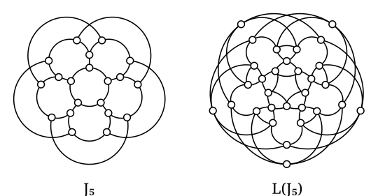</a>


(a) 给 $J_q$ 的边加上标号 $a_j,b_j,c_j,d_j,e_j,f_j$, $1\le j\le q$. (于是 $a_j$ 表示 $t_j\mathbin{—}t_{j+1}$, $b_j$ 表示 $t_j\mathbin{—}u_j$, 等等.) $L(J_q)$ 的边是什么?

(b) 证明若 $q$ 为偶数, 则 $\chi(J_q)=2$, $\chi(L(J_q))=3$.

(c) 证明若 $q$ 为奇数, 则 $\chi(J_q)=3$, $\chi(L(J_q))=4$. <em>注:</em> 令 $\operatorname{fsnark}(q)$ 表示 (15)、(16) 中对应于 $L(J_q)$ 的 3 着色的子句, 外加 $(b_{1,1})\land(c_{1,2})\land(d_{1,3})$, 以将 $(b_1,c_1,d_1)$ 的颜色置为 $(1,2,3)$. 这些子句是 SAT 求解器的极好基准测试.

<a id="ex-7-2-2-2-177"></a>

**177.** [HM26] [答案](./answers/7-2-2-2.md#ans-7-2-2-2-177) 令 $I_q$ 为花形斯纳克图的线图 $L(J_q)$ 的独立集数目. 对 $1\le q\le8$ 计算 $I_q$, 并确定其渐近增长率.

<a id="ex-7-2-2-2-178"></a>

▶ **178.** [M23] [答案](./answers/7-2-2-2.md#ans-7-2-2-2-178) 若将[习题 176](#ex-7-2-2-2-176) 中 $q$ 为奇数时的不可满足子句 $\operatorname{fsnark}(q)$ 交给算法 B, 它的速度取决于变量的次序.

<a id="pdf-352"></a><a id="p-332"></a>

证明, 当变量按以下次序考察时, 运行时间为 $\Theta(2^q)$:
$$
a_{1,1}a_{1,2}a_{1,3}b_{1,1}b_{1,2}b_{1,3}c_{1,1}c_{1,2}c_{1,3}d_{1,1}d_{1,2}d_{1,3}e_{1,1}e_{1,2}e_{1,3}f_{1,1}f_{1,2}f_{1,3}a_{2,1}a_{2,2}a_{2,3}\ldots;
$$
而采用如下顺序时, 用时却要多得多:
$$
a_{1,1}b_{1,1}c_{1,1}d_{1,1}e_{1,1}f_{1,1}a_{2,1}b_{2,1}c_{2,1}d_{2,1}e_{2,1}f_{2,1}\ldots a_{q,1}b_{q,1}c_{q,1}d_{q,1}e_{q,1}f_{q,1}a_{1,2}b_{1,2}c_{1,2}\ldots.
$$

<a id="ex-7-2-2-2-179"></a>

**179.** [25] [答案](./answers/7-2-2-2.md#ans-7-2-2-2-179) 证明, 用八个四元子立方填满 5 维立方体的 32 个格子, 恰有 4380 种方法. 例如, 用 7.1.1–(29) 的记法, 一种方法是用子立方 $000{*}{*},001{*}{*},\ldots,111{*}{*}$; 更有意思的一种方法是用
$$
0{*}0{*}0,\quad1{*}0{*}0,\quad{*}{*}001,\quad{*}{*}110,\quad{*}010{*},\quad{*}110{*},\quad0{*}{*}11,\quad1{*}{*}11.
$$
从这个事实, 关于[图 83](#fig-7-2-2-2-83) 中 $q_8$ 的值可以知道什么?

<a id="ex-7-2-2-2-180"></a>

▶ **180.** [25] [答案](./answers/7-2-2-2.md#ans-7-2-2-2-180) 说明怎样利用 BDD 计算[图 83](#fig-7-2-2-2-83) 所依据的数 $Q_m$. $\max_{0\le m\le80}Q_m$ 是多少?

<a id="ex-7-2-2-2-181"></a>

▶ **181.** [25] [答案](./answers/7-2-2-2.md#ans-7-2-2-2-181) 推广上一题的想法, 使之也能用来确定[图 84](#fig-7-2-2-2-84) 的概率分布 $T_m$.

<a id="ex-7-2-2-2-182"></a>

**182.** [M16] [答案](./answers/7-2-2-2.md#ans-7-2-2-2-182) [图 84](#fig-7-2-2-2-84) 中, 对哪些 $m$ 值, $T_m$ 是常数?

<a id="ex-7-2-2-2-183"></a>

**183.** [M30] [答案](./answers/7-2-2-2.md#ans-7-2-2-2-183) 讨论[图 85](#fig-7-2-2-2-85) 与[图 86](#fig-7-2-2-2-86) 之间的关系.

<a id="ex-7-2-2-2-184"></a>

**184.** [M20] [答案](./answers/7-2-2-2.md#ans-7-2-2-2-184) 为什么 (77) 刻画了 $\hat q_m$ 与 $q_m$ 之间的关系?

<a id="ex-7-2-2-2-185"></a>

**185.** [M20] [答案](./answers/7-2-2-2.md#ans-7-2-2-2-185) 用 (77) 证明在直觉上很显然的事实 $\hat q_m\ge q_m$.

<a id="ex-7-2-2-2-186"></a>

**186.** [M21] [答案](./answers/7-2-2-2.md#ans-7-2-2-2-186) 用 (77) 将 $\sum_m\hat q_m$ 和 $\sum_m(2m+1)\hat q_m$ 化为 (78) 和 (79).

<a id="ex-7-2-2-2-187"></a>

**187.** [M20] [答案](./answers/7-2-2-2.md#ans-7-2-2-2-187) 分析 $k=n$ 情形下的随机可满足性: $S_{n,n}$ 和 $\widehat S_{n,n}$ 是什么?

<a id="ex-7-2-2-2-188"></a>

▶ **188.** [HM25] [答案](./answers/7-2-2-2.md#ans-7-2-2-2-188) 分析随机 1SAT, 即 $k=1$ 的情形: $S_{1,n}$ 和 $\widehat S_{1,n}$ 是什么?

<a id="ex-7-2-2-2-189"></a>

**189.** [27] [答案](./answers/7-2-2-2.md#ans-7-2-2-2-189) 对 50 个变量的随机 3SAT 问题应用 BDD 方法. 随着 $m$ 增大, 对 $m$ 个不同子句作与运算之后, BDD 的大小近似为多少?

<a id="ex-7-2-2-2-190"></a>

**190.** [M20] [答案](./answers/7-2-2-2.md#ans-7-2-2-2-190) 给出一个不能用 3CNF 表示的四变量布尔函数. (不允许辅助变量: 只能出现 $x_1,x_2,x_3,x_4$.)

<a id="ex-7-2-2-2-191"></a>

**191.** [M25] [答案](./answers/7-2-2-2.md#ans-7-2-2-2-191) 有多少个四变量布尔函数<em>可以</em>用 3CNF 表示?

<a id="ex-7-2-2-2-192"></a>

▶ **192.** [HM21] [答案](./answers/7-2-2-2.md#ans-7-2-2-2-192) 当有 $N$ 个等可能的子句时, 可满足性的另一种建模方法是研究 $S(p)$, 即每个子句独立地以概率 $p$ 出现时可满足的概率.

(a) 用 $Q_m=\binom Nm q_m$ 表示 $S(p)$.

(b) 给每个子句指定一个在 $[0\,..\,1)$ 上均匀分布的随机数; 然后在时刻 $t$ ($0\le t\le N$), 考虑被指定了小于 $t/N$ 的数的所有子句. (所以当 $N$ 大时, 将选中约 $t$ 个子句.) 证明 $\overline S_{k,n}=\int_0^N S(t/N)\,dt$, 即所选子句保持可满足的时间的期望, 与 (76) 的可满足性阈值 $S_{k,n}$ 极为相似.

<a id="ex-7-2-2-2-193"></a>

**193.** [HM48] 确定随机 3SAT 的可满足性阈值 (81). 是否有 $\liminf_{n\to\infty} S_{3,n}/n=\limsup_{n\to\infty} S_{3,n}/n$? 如是, 此极限约为 $4.2667$ 吗?

<a id="ex-7-2-2-2-194"></a>

**194.** [HM49] [答案](./answers/7-2-2-2.md#ans-7-2-2-2-194) 若 $\alpha<\liminf_{n\to\infty}S_{3,n}/n$, 是否存在多项式时间算法, 能以至少 $\delta$ 的概率满足 $\lfloor\alpha n\rfloor$ 个随机 3SAT 子句, 其中 $\delta>0$?

<a id="ex-7-2-2-2-195"></a>

**195.** [HM21] [答案](./answers/7-2-2-2.md#ans-7-2-2-2-195) (J. Franco 和 M. Paull, 1983.) 用一阶矩原理 MPR–(21) 证明 $\lfloor(2^k\ln2)n\rfloor$ 个随机 $k$SAT 子句几乎总是不可满足. <em>提示:</em> 令 $X=\sum_x[x\text{ 满足所有子句}]$, 其中求和遍及全部 $2^n$ 个二进制向量 $x=x_1\ldots x_n$.

<a id="pdf-353"></a><a id="p-333"></a>

<a id="ex-7-2-2-2-196"></a>

▶ **196.** [HM25] [答案](./answers/7-2-2-2.md#ans-7-2-2-2-196) (D. B. Wilson.) 若可满足性问题中的一个子句含有至少一个不出现在任何其他子句中的变量, 就称它是 “容易的”. 证明含有 $m=\lfloor\alpha n\rfloor$ 个随机子句的 $k$SAT 问题, 以 $1-O(n^{-2\epsilon})$ 的概率含有 $(1-(1-e^{-k\alpha})^k)m+O(n^{1/2+\epsilon})$ 个容易的子句. (例如, 在阈值附近的一个随机 3SAT 问题的 $4.27n$ 个子句中, 约有 $0.000035n$ 个是容易的.)

<a id="ex-7-2-2-2-197"></a>

**197.** [HM21] [答案](./answers/7-2-2-2.md#ans-7-2-2-2-197) 证明若 $a,b,A,B>0$, 则当 $n\to\infty$ 时, 商
$$
q(a,b,A,B,n)=\binom{(a+b)n}{an}\binom{(A+B)n}{An}\bigg/\binom{(a+b+A+B)n}{(a+A)n}
$$
为 $O(n^{-1/2})$.

<a id="ex-7-2-2-2-198"></a>

▶ **198.** [HM30] [答案](./answers/7-2-2-2.md#ans-7-2-2-2-198) 利用[习题 196](#ex-7-2-2-2-196) 和 197 证明[图 89](#fig-7-2-2-2-89) 中的相变并非极其突然: 若 $S_3(m,n)>\frac23$ 且 $S_3(m',n)<\frac13$, 证明 $m'=m+\Omega(\sqrt n)$.

<a id="ex-7-2-2-2-199"></a>

**199.** [M21] [答案](./answers/7-2-2-2.md#ans-7-2-2-2-199) 令 $p(t,m,N)$ 为下述事件的概率: 在由 $N$ 个字母组成的字母表上随机选取一个长为 $m$ 的字, 指定的 $t$ 个字母各至少出现一次.

(a) 证明 $p(t,m,N)\le m^{\underline t}/N^t$.

(b) 导出精确公式 $p(t,m,N)=\sum_k\binom tk(-1)^k(N-k)^m/N^m$.

(c) 再证明 $p(t,m,N)/t!=\left\{\begin{smallmatrix}t\\t\end{smallmatrix}\right\}\binom mt/N^t-\left\{\begin{smallmatrix}t+1\\t\end{smallmatrix}\right\}\binom m{t+1}/N^{t+1}+\left\{\begin{smallmatrix}t+2\\t\end{smallmatrix}\right\}\binom m{t+2}/N^{t+2}-\cdots$.

<a id="ex-7-2-2-2-200"></a>

▶ **200.** [M21] [答案](./answers/7-2-2-2.md#ans-7-2-2-2-200) 补全正文中 $c<1$ 时 (84) 的证明:

(a) 证明每个不可满足的 2SAT 公式都含有某个圈套的全部子句.

(b) 反过来, 一个圈套的子句是否总是不可满足?

(c) 验证不等式 (89). <em>提示:</em> 见习题 199.

<a id="ex-7-2-2-2-201"></a>

**201.** [HM29] [答案](./answers/7-2-2-2.md#ans-7-2-2-2-201) 链 $(l_1,\ldots,l_{2t-1})$ 所指定的 $t$ 蛇的子句可写成 $(\bar l_i\lor l_{i+1})$, $0\le i<2t$, 其中 $l_0=\bar l_t$, 下标按模 $2t$ 处理.

(a) 描述给两个 $l$ 定值, 使 $(\bar x_1\lor x_2)$ 成为这 $2t$ 个子句之一的所有方法.

(b) 类似地, 给三个 $l$ 定值, 以得到 $(\bar x_1\lor x_2)$ 和 $(\bar x_2\lor x_3)$.

(c) 再给三个 $l$ 定值, 以同时得到 $(\bar x_0\lor x_1)$ 和 $(\bar x_{t-1}\lor x_t)$; 这里 $\bar x_0\equiv x_t$ 且 $t>2$.

(d) 怎样给 $t$ 个 $l$ 定值, 得到全部子句 $(\bar x_i\lor x_{i+1})$, $0\le i<t$?

(e) 一般地, 令 $N(q,r)$ 为选取 $r$ 个标准子句 $(\bar x_i\lor x_{i+1})$, 使它们恰好涉及 $\{x_1,\ldots,x_{2t-1}\}$ 中的 $q$ 个变量, 并给 $\{l_1,\ldots,l_{2t-1}\}$ 中的 $q$ 个字面值定值以得到这 $r$ 个子句的方法数. 求 $N(2,1)$.

(f) 类似地, 求 $N(3,2)$、$N(t,t)$ 和 $N(2t-1,2t)$.

(g) 证明 (95) 中的概率 $p_r$ 至多是 $\sum_q N(q,r)/(2^qn^{\underline q})$.

(h) 由此证明上界 (96) 有效.

<a id="ex-7-2-2-2-202"></a>

**202.** [HM21] [答案](./answers/7-2-2-2.md#ans-7-2-2-2-202) 本题分析正文中 $c>1$ 时定理 C 的证明.

(a) 解释式 (93) 的右端.

(b) 为什么由 (95)、(96) 以及给定的 $t,m$ 的取法能推出 (97)?

<a id="ex-7-2-2-2-203"></a>

▶ **203.** [HM33] [答案](./answers/7-2-2-2.md#ans-7-2-2-2-203) (K. Xu 和 W. Li, 2000.) 从图着色的 $n$ 个子句 (15) 出发, 也可以包括 $n\binom d2$ 个排斥子句 (17), 考虑用随机产生的二元子句代替 (16). 共有 $mq$ 个随机二元子句, 分为 $m$ 个独立的集合, 每集 $q$ 个子句. 每个集合的选法是先选两个不同的顶点 $u,v$, 再选 $q$ 个不同的二元子句 $(\bar u_i\lor\bar v_j)$, $1\le i,j\le d$. (因此随机子句的可能序列恰有 $\bigl(\binom n2\binom{d^2}{q}\bigr)^m$ 个, 各个序列等可能.) 这种产生子句的方法称为 “模型 RB”; 它推广了随机 2SAT, 后者即 $d=2$, $q=1$ 的情形.

设 $d=n^\alpha$, $q=pd^2$, 其中要求 $\tfrac12<\alpha<1$, $0\le p\le\tfrac12$. 又令 $m=rn\ln d$. 对这个范围内的参数, 我们将证明可满足性有一个尖锐的阈值: 当 $n\to\infty$ 时, 若 $r\ln(1-p)+1<0$, 这些子句相当必然不可满足; 若 $r\ln(1-p)+1>0$, 则几乎必然可满足.

<a id="pdf-354"></a><a id="p-334"></a>

令 $X(j_1,\ldots,j_n)=[\text{对每个第 }i\text{ 个变量 }v\text{ 置 }v_{j_i}=1\text{ 时, 所有子句均满足}]$; 这里 $1\le j_1,\ldots,j_n\le d$. 又令 $X=\sum_{1\le j_1,\ldots,j_n\le d}X(j_1,\ldots,j_n)$. 则 $X=0$ 当且仅当子句不可满足.

(a) 用一阶矩原理证明, 当 $r\ln(1-p)+1<0$ 时, 相当必然有 $X=0$.

(b) 已知颜色 $\{j_1,\ldots,j_n\}$ 中恰有 $s$ 个等于 1, 求 $p_s=\Pr(X(j_1,\ldots,j_n)=1\mid X(1,\ldots,1)=1)$ 的公式.

(c) 利用 (b) 和条件期望不等式 MPR–(24) 证明, 若
$$
\sum_{s=0}^n\binom ns\left(\frac1d\right)^s\left(1-\frac1d\right)^{n-s}
\left(1+\frac{p}{1-p}\frac{s^2}{n^2}\right)^m\longrightarrow1
\qquad(n\to\infty),
$$
则几乎必然有 $X>0$.

(d) 令 $t_s$ 表示该和式中对应于 $s$ 的项. 证明 $\sum_{s=0}^{3n/d}t_s\approx1$.

(e) 设 $r\ln(1-p)+1=\epsilon>0$, 其中 $\epsilon$ 很小. 证明当 $s$ 从 0 增至 $n$ 时, 各项 $t_s$ 先增、后减、再增、再减. <em>提示:</em> 考察比值 $x_s=t_{s+1}/t_s$.

(f) 最后证明当 $3n/d\le s\le n$ 时, $t_s$ 指数地小.

<a id="ex-7-2-2-2-204"></a>

▶ **204.** [28] [答案](./answers/7-2-2-2.md#ans-7-2-2-2-204) [图 89](#fig-7-2-2-2-89) 似乎暗示只要子句数少于 $2n$, $n$ 个变量的 3SAT 问题就总是容易的. 然而我们将证明, $n$ 个变量的<em>任何</em> $m$ 个三元子句的集合, 都能机械地转换成另一组三元子句, 使用 $N=O(m)$ 个变量, 每个变量至多出现四次. 转换后问题的解数与原问题相同; 因此它丝毫不见得简单, 尽管它 (至多有 $4N$ 个字面值) 至多只有 $\tfrac43N$ 个子句.

(a) 先用 $3m$ 个新变量上的 $m$ 个新子句 $(X_1\lor X_2\lor X_3),\ldots,(X_{3m-2}\lor X_{3m-1}\lor X_{3m})$ 取代原来的 $m$ 个子句, 再说明怎样加入 $3m$ 个二元子句, 使所得 $4m$ 个子句的解数恰与原来相同.

(b) 构造一组只有一个解的三元子句, 使每个变量至多出现四次.

(c) 利用 (a)、(b) 证明上面所说的关于 $N$ 个变量的结果.

<a id="ex-7-2-2-2-205"></a>

**205.** [26] [答案](./answers/7-2-2-2.md#ans-7-2-2-2-205) 若 $F,F'$ 为子句集, 令 $F\sqcup F'$ 表示如此得到的任一子句集: 在 $F\cup F'$ 中, 将 $F$ 的一个或多个子句 $C$ 换成 $x\lor C$, 将 $F'$ 的一个或多个子句 $C'$ 换成 $\bar x\lor C'$, 其中 $x$ 为新变量. 若 $F,F'$ 均不可满足, 则 $F\sqcup F'$ 也不可满足. 例如, 若 $F=\{\epsilon\}$, $F'=\{1,\bar1\}$, 则 $F\sqcup F'$ 或为 $\{2,1\bar2,\bar1\bar2\}$, 或为 $\{2,1,\bar1\bar2\}$, 或为 $\{2,1\bar2,\bar1\}$.

(a) 在 15 个变量上构造 16 个不可满足的三元子句, 每个变量至多出现四次.

(b) 构造一个不可满足的 4SAT 问题, 使每个变量至多出现五次.

<a id="ex-7-2-2-2-206"></a>

**206.** [M22] [答案](./answers/7-2-2-2.md#ans-7-2-2-2-206) 若子句集不可满足, 但删去任一子句就变得可满足, 则称它是<em>极小不可满足</em>的. 证明, 若 $F,F'$ 没有公共变量, 则 $F\sqcup F'$ 极小不可满足当且仅当 $F$ 和 $F'$ 均极小不可满足.

<a id="ex-7-2-2-2-207"></a>

**207.** [25] [答案](./answers/7-2-2-2.md#ans-7-2-2-2-207) (6) 的八个不可满足子句中, 字面值 $\{1,\bar1,2,\bar2,3,\bar3,4,\bar4\}$ 各恰好出现三次. 构造一个含 15 个变量的不可满足 3SAT 问题, 使其中 30 个字面值各恰好出现<em>两次</em>. <em>提示:</em> 考虑 $\{\bar12,\bar23,\bar31,123,\bar1\bar2\bar3\}$.

<a id="ex-7-2-2-2-208"></a>

**208.** [25] [答案](./answers/7-2-2-2.md#ans-7-2-2-2-208) 利用[习题 204](#ex-7-2-2-2-204)(a) 和 207 说明, 任何 3SAT 问题都可以变换成一组等价的三元子句, 其中每个字面值恰好出现两次.

<a id="ex-7-2-2-2-209"></a>

**209.** [25] [答案](./answers/7-2-2-2.md#ans-7-2-2-2-209) (C. A. Tovey.) 证明每个变量至多出现 $k$ 次的 $k$SAT 公式都是可满足的. (因此, 当 $k=3$ 和 $k=4$ 时, 习题 204–208 中的出现次数限数不能再降低.) <em>提示:</em> 使用二部图匹配理论.

<a id="pdf-355"></a><a id="p-335"></a>

<a id="ex-7-2-2-2-210"></a>

**210.** [M36] [答案](./answers/7-2-2-2.md#ans-7-2-2-2-210) 不过, 当 $k$ 较大时, 上一题的结果还可改进. 用局部引理证明, 每个变量至多出现 13 次的 7SAT 问题都是可满足的.

<a id="ex-7-2-2-2-211"></a>

**211.** [30] [答案](./answers/7-2-2-2.md#ans-7-2-2-2-211) (R. W. Irving 和 M. Jerrum, 1994.) 利用[习题 208](#ex-7-2-2-2-208) 将 3SAT 归约为形如 $K_N\mathbin{\square}K_3$ 的网格图上的列表着色问题. (由此可见后一问题是 NP 完全的; 它又称为<em>拉丁矩形构造</em>.)

<a id="ex-7-2-2-2-212"></a>

**212.** [32] [答案](./answers/7-2-2-2.md#ans-7-2-2-2-212) 接着上一题, 我们要将网格图上的列表着色归约为另一个有趣的问题, 称为<em>部分拉丁方构造</em>. 给定三个 $n\times n$ 二元矩阵 $(r_{ik}),(c_{jk}),(p_{ij})$, 要构造 $n\times n$ 的阵列 $(X_{ij})$: 当 $p_{ij}=0$ 时 $X_{ij}$ 为空格, 否则对某个满足 $r_{ik}=c_{jk}=1$ 的 $k$ 有 $X_{ij}=k$; 此外每行、每列的非空项都必须互异.

(a) 证明本问题关于三个坐标是对称的: 它等价于构造二元 $n\times n\times n$ 张量 $(x_{ijk})$, 使得 $x_{*jk}=c_{jk}$, $x_{i*k}=r_{ik}$, $x_{ij*}=p_{ij}$, $1\le i,j,k\le n$, 其中 ‘$*$’ 表示将这一指标从 1 到 $n$ 求和. (所以它也称为二元 $n\times n\times n$ <em>列联问题</em>, 给定 $n^2$ 个行和、$n^2$ 个列和与 $n^2$ 个垛和.)

(b) 存在解的必要条件是 $c_{*k}=r_{*k}$, $c_{j*}=p_{*j}$, $r_{i*}=p_{i*}$. 举一小例说明此条件不充分.

(c) 若 $M<N$, 将 $K_M\mathbin{\square}K_N$ 的列表着色问题归约为 $K_N\mathbin{\square}K_N$ 的列表着色问题.

(d) 最后, 说明怎样将 $K_N\mathbin{\square}K_N$ 的列表着色归约为构造 $n\times n$ 部分拉丁方的问题, 其中 $n=N+\sum_{I,J}|L(I,J)|$. <em>提示:</em> 让 $i,j,k$ 在一个含 $n$ 个元素的<em>集合</em>上取值, 代替整数 $1\le i,j,k\le n$. 对大多数 $i,j$ 置 $p_{ij}=0$, 又对所有 $i,k$ 令 $r_{ik}=c_{ik}$.

<a id="ex-7-2-2-2-213"></a>

▶ **213.** [M20] [答案](./answers/7-2-2-2.md#ans-7-2-2-2-213) 第 5 章对排序算法的分析经验似乎表明, 如果假定在 $m$ 个独立子句的每一个中, 对每个 $1\le j\le n$, 字面值 $x_j,\bar x_j$ 分别以概率 $p,q$ 出现 (相互独立是指各 $j$ 之间, 其中 $p+q\le1$), 则随机可满足性问题也许可以很好地建模. 当 $p,q$ 为常数而 $n\to\infty$ 时, 为什么这种模型<em>没有</em>意思? <em>提示:</em> 给定二进向量 $b_1\ldots b_n$, $x_1\ldots x_n=b_1\ldots b_n$ 满足所有子句的概率是多少?

<a id="ex-7-2-2-2-214"></a>

**214.** [HM38] [答案](./answers/7-2-2-2.md#ans-7-2-2-2-214) 尽管上一题的随机模型不能教我们怎样解决 SAT 问题, 它确实引出了一些有趣的数学. 令 $0<p<1$, 考虑递归式
$$
T_0=0;\qquad T_n=n+2\sum_{k=0}^{n-1}\binom nk p^k(1-p)^{n-k}T_k,\qquad n>0.
$$

(a) 求 $T(z)=\sum_{n=0}^\infty T_n z^n/n!$ 满足的函数关系.

(b) 推出 $T(z)=ze^z\sum_{m=0}^\infty(2p)^m\prod_{k=0}^{m-1}(1-e^{-p^k(1-p)z})$.

(c) 因此, 若 $p\ne1/2$, 就可利用梅林变换 (如同导出 5.2.2–(50) 时所做的那样) 证明 $T_n=C_pn^\alpha(1+\delta(n)+O(1/n))+n/(1-2p)$, 其中 $\alpha=1/\lg(1/p)$, $C_p$ 为常数, $\delta$ 是满足 $\delta(n)=\delta(pn)$ 的微小 “摆动”.

<a id="ex-7-2-2-2-215"></a>

▶ **215.** [HM28] [答案](./answers/7-2-2-2.md#ans-7-2-2-2-215) 若用简单的回溯过程求一个随机 3SAT 问题的全部解, 其查找树的期望轮廓是什么? 设有 $n$ 个变量上的 $m$ 个独立子句. (对于每个同所有子句都不矛盾的部分解 $x_1\ldots x_l$, 第 $l$ 层上有一个结点.) 对 $m=200$, $n=50$ 计算这些值; 对固定的 $\alpha$, 当 $n\to\infty$ 时, 也估计 $m=\alpha n$ 时树的总大小.

<a id="ex-7-2-2-2-216"></a>

**216.** [HM38] [答案](./answers/7-2-2-2.md#ans-7-2-2-2-216) (P. W. Purdom, Jr., 和 C. A. Brown.) 将上一题推广到一种较精巧的回溯, 单位子句所强制的所有选择, <a id="pdf-356"></a><a id="p-336"></a> 都在作双向分支之前先行处理. (不过这里不利用 “纯字面值规则”, 因为它不能找出全部解.) 证明当 $m=200$, $n=50$ 时, 树的期望大小大为减小. (得出一个上界就够了.)

<a id="ex-7-2-2-2-217"></a>

**217.** [20] [答案](./answers/7-2-2-2.md#ans-7-2-2-2-217) 是真是假: 若 $A,B$ 是能同时满足的任意子句, 且 $l$ 为任一字面值, 则子句 $C=(A\cup B)\setminus\{l,\bar l\}$ 也可满足. (这里把 $A,B,C$ 看作字面值的<em>集合</em>, 而不是字面值的析取.)

<a id="ex-7-2-2-2-218"></a>

**218.** [20] [答案](./answers/7-2-2-2.md#ans-7-2-2-2-218) 用三元运算符 $u\,?\,v:w$ 表示公式 $(x\lor A)\land(\bar x\lor B)$.

<a id="ex-7-2-2-2-219"></a>

▶ **219.** [M20] [答案](./answers/7-2-2-2.md#ans-7-2-2-2-219) 为归结运算 $C=C'\mathbin{\diamond}C''$ 给出一个一般定义, 使它 (i) 当 $C'=x\lor A'$ 且 $C''=\bar x\lor A''$ 时与正文的定义相符; (ii) 适用于<em>任意</em>子句 $C'$ 与 $C''$; (iii) 具有性质 $C'\land C''$ 蕴涵 $C'\mathbin{\diamond}C''$.

<a id="ex-7-2-2-2-220"></a>

**220.** [M24] [答案](./answers/7-2-2-2.md#ans-7-2-2-2-220) 若 $C'=\wp$ 或者 $C'\ne\wp$ 且 $C$ 的每个字面值都出现在 $C'$ 中, 就说子句 $C$ <em>包摄</em>子句 $C'$, 记作 $C\subseteq C'$.

(a) 是真是假: $C\subseteq C'$ 且 $C'\subseteq C''$ 蕴涵 $C\subseteq C''$.

(b) 是真是假: $(C\lor\alpha)\mathbin{\diamond}(C'\lor\alpha')\subseteq(C\mathbin{\diamond}C')\lor\alpha\lor\alpha'$, 其中 $\diamond$ 如习题 219.

(c) 是真是假: $C'\subseteq C''$ 蕴涵 $C\mathbin{\diamond}C'\subseteq C\mathbin{\diamond}C''$.

(d) 记号 $C_1,\ldots,C_m\vdash C$ 表示存在归结链 $C_1,\ldots,C_{m+r}$, 使得对某个 $r\ge0$ 有 $C_{m+r}\subseteq C$. 证明, 即使 $C$ 不能从 $\{C_1,\ldots,C_m\}$ 经逐次归结 (104) 得到, 也可能有 $C_1,\ldots,C_m\vdash C$.

(e) 证明若 $C_1\subseteq C'_1,\ldots,C_m\subseteq C'_m$, 且 $C'_1,\ldots,C'_m\vdash C$, 则 $C_1,\ldots,C_m\vdash C$.

(f) 进而证明 $C_1,\ldots,C_m\vdash C$ 蕴涵 $C_1\lor\alpha_1,\ldots,C_m\lor\alpha_m\vdash C\lor\alpha_1\lor\cdots\lor\alpha_m$.

<a id="ex-7-2-2-2-221"></a>

**221.** [16] [答案](./answers/7-2-2-2.md#ans-7-2-2-2-221) 画出将算法 A 用于不可满足的子句 $\{12,2,\bar2\}$ 时隐式遍历的查找树, 类似于[图 81](#fig-7-2-2-2-81). 解释为什么它<em>不</em>对应于一个类似于[图 91](#fig-7-2-2-2-91) 的归结反驳.

<a id="ex-7-2-2-2-222"></a>

**222.** [M30] [答案](./answers/7-2-2-2.md#ans-7-2-2-2-222) (Oliver Kullmann, 2000.) 证明, 对于可满足性问题 $F$ 中的每个子句 $C$, 存在满足 $C$ 的自足集当且仅当在 $F$ 的任何归结反驳中 $C$ 都不能用作源顶点的标号.

<a id="ex-7-2-2-2-223"></a>

**223.** [HM40] [答案](./answers/7-2-2-2.md#ans-7-2-2-2-223) 步骤 X9 推出一个不能用归结导出的二元子句 (见[习题 166](#ex-7-2-2-2-166)). 证明尽管如此, 算法 L 在不可满足的输入上的运行时间决不会小于最短的树形反驳的长度.

<a id="ex-7-2-2-2-224"></a>

**224.** [M20] [答案](./answers/7-2-2-2.md#ans-7-2-2-2-224) 给定反驳公理 $F\mid\bar x$ 的一棵归结树, 说明怎样构造同样大小的一棵归结树, 它或者反驳公理 $F$, 或者从 $F$ 导出子句 $\{x\}$, 而不在变量 $x$ 上作归结.

<a id="ex-7-2-2-2-225"></a>

▶ **225.** [M31] [答案](./answers/7-2-2-2.md#ans-7-2-2-2-225) (G. S. Tseytin, 1966.) 若 $T$ 是反驳公理集 $F$ 的任一归结树, 说明怎样将它变为反驳 $F$ 的<em>正则</em>归结树 $T_r$, 且 $T_r$ 不大于 $T$.

<a id="ex-7-2-2-2-226"></a>

**226.** [M20] [答案](./answers/7-2-2-2.md#ans-7-2-2-2-226) 若 $\alpha$ 是反驳树的一个结点, 令 $C(\alpha)$ 表示它的标号, $\lVert\alpha\rVert$ 表示其子树的叶子数. 证明在一棵有 $N$ 个叶子的反驳树上, 当拖延者在证明者与拖延者的博弈中已得 $s$ 分时, 证明者总能找到一个结点, 使 $\lVert\alpha\rVert\le N/2^s$, 且当前的赋值使 $C(\alpha)$ 为假.

<a id="ex-7-2-2-2-227"></a>

**227.** [M27] [答案](./answers/7-2-2-2.md#ans-7-2-2-2-227) 给定扩充二叉树, 习题 7.2.1.6–124 说明了怎样用 Horton–Strahler 数给每个结点加上标号. 例如, [图 91](#fig-7-2-2-2-91) 中深度 2 的结点的标号为 1, 因为它们的子结点的标号为 1 和 0; 根的标号为 3.

证明, 对于一组不可满足的子句 $F$, 在证明者与拖延者的博弈中拖延者所能保证的最高得分, 等于 $F$ 的树形反驳中根的 Horton–Strahler 标号的最小可能值.

<a id="pdf-357"></a><a id="p-337"></a>

<a id="ex-7-2-2-2-228"></a>

▶ **228.** [M21] [答案](./answers/7-2-2-2.md#ans-7-2-2-2-228) Stålmarck 对 (99)–(101) 的反驳其实没有用到全部公理就得到了 $\epsilon$! 证明这些子句中只须用约三分之一便足以导致不可满足.

<a id="ex-7-2-2-2-229"></a>

▶ **229.** [M21] [答案](./answers/7-2-2-2.md#ans-7-2-2-2-229) 接着[习题 228](#ex-7-2-2-2-228), 再证明子句集 (99)、(100′)、(101) 不可满足, 其中 (100′) 表示只对 $i\le k$ 且 $j<k$ 的情形取 (100).

<a id="ex-7-2-2-2-230"></a>

**230.** [M22] [答案](./answers/7-2-2-2.md#ans-7-2-2-2-230) 证明在上一题中那些 $i\ne j$ 的子句构成一个<em>极小</em>不可满足集: 删去任一个, 剩下的子句便可满足.

<a id="ex-7-2-2-2-231"></a>

**231.** [M30] [答案](./answers/7-2-2-2.md#ans-7-2-2-2-231) (Sam Buss.) 用长为 $O(m^3)$ 的归结链反驳[习题 229](#ex-7-2-2-2-229) 的子句. <em>提示:</em> 对 $1\le i\le j\le m$, 导出子句 $G_{ij}=(x_{ij}\lor x_{i(j+1)}\lor\cdots\lor x_{im})$.

<a id="ex-7-2-2-2-232"></a>

▶ **232.** [M28] [答案](./answers/7-2-2-2.md#ans-7-2-2-2-232) 证明[习题 176](#ex-7-2-2-2-176) 的子句 $\operatorname{fsnark}(q)$ 可以在 $O(q^6)$ 步内用树形归结反驳.

<a id="ex-7-2-2-2-233"></a>

**233.** [16] [答案](./answers/7-2-2-2.md#ans-7-2-2-2-233) 给出 $9\le i\le22$ 的 $j(i)$ 和 $k(i)$, 从而解释为什么 (105) 满足 (104).

<a id="ex-7-2-2-2-234"></a>

**234.** [20] [答案](./answers/7-2-2-2.md#ans-7-2-2-2-234) 证明对于试图反驳鸽巢子句 (106)、(107) 的任何证明者, 拖延者都至少能得到 $m$ 分.

<a id="ex-7-2-2-2-235"></a>

▶ **235.** [30] [答案](./answers/7-2-2-2.md#ans-7-2-2-2-235) 用长为 $m(m+3)2^{m-2}$ 的链反驳这些鸽巢子句.

<a id="ex-7-2-2-2-236"></a>

**236.** [48] [答案](./answers/7-2-2-2.md#ans-7-2-2-2-236) 上一题的链是否已经最短?

<a id="ex-7-2-2-2-237"></a>

▶ **237.** [28] [答案](./answers/7-2-2-2.md#ans-7-2-2-2-237) 证明若用<em>扩展归结</em>的技巧附加新的子句, 则只须多项式步数便可反驳鸽巢子句 (106)、(107).

<a id="ex-7-2-2-2-238"></a>

**238.** [HM21] [答案](./answers/7-2-2-2.md#ans-7-2-2-2-238) 完成引理 B 的证明. <em>提示:</em> 当 $W=b$ 时使 $r\le\rho^{-b}$.

<a id="ex-7-2-2-2-239"></a>

▶ **239.** [M21] [答案](./answers/7-2-2-2.md#ans-7-2-2-2-239) 在 $n$ 个变量上的什么子句 $\alpha_0$ 能使 $\lVert\alpha_0\vdash\epsilon\rVert$ 尽可能大?

<a id="ex-7-2-2-2-240"></a>

▶ **240.** [HM23] [答案](./answers/7-2-2-2.md#ans-7-2-2-2-240) 对 $1\le i\le5$, $0\le j\le m$, 均匀随机地选取整数 $f_{ij}\in\{1,\ldots,m\}$, 并令 $G_0$ 为有边 $a_j\mathbin{—}b_k$ 当且仅当 $k\in\{f_{1j},\ldots,f_{5j}\}$ 的二部图. 证明 $\Pr(G_0\text{ 满足强扩张条件 (108)})\ge1/2$.

<a id="ex-7-2-2-2-241"></a>

**241.** [20] [答案](./answers/7-2-2-2.md#ans-7-2-2-2-241) 证明在定理 B 的受限鸽巢约束 $G_0$ 下, 任意至多 $m/3000$ 只鸽子组成的集合都可以匹配到各不相同的巢.

<a id="ex-7-2-2-2-242"></a>

**242.** [M20] [答案](./answers/7-2-2-2.md#ans-7-2-2-2-242) 鸽巢公理 (106)、(107) 等价于试图用 $m$ 种颜色给完全图 $K_{m+1}$ 着色时出现的子句 (15)、(16).

假定再纳入对应于 (17) 的公理, 即
$$
(\bar x_{jk}\lor\bar x_{jk'}),\qquad 0\le j\le m,\quad1\le k<k'\le m.
$$
定理 B 是否仍然成立, 或者这些附加的公理会减小反驳宽度?

<a id="ex-7-2-2-2-243"></a>

**243.** [HM31] [答案](./answers/7-2-2-2.md#ans-7-2-2-2-243) (E. Ben-Sasson 和 A. Wigderson.) 令 $F$ 为 $n$ 个变量上 $\lfloor\alpha n\rfloor$ 个随机 3SAT 子句组成的集合, 其中 $\alpha>1/e$ 是给定常数. 对这些变量上的任一子句 $C$, 定义 $\mu(C)=\min\{|F'|\mid F'\subseteq F\text{ 且 }F'\vdash C\}$. 又令 $V(F')$ 表示给定子句族 $F'$ 中出现的变量.

(a) 证明当 $F'\subseteq F$ 且 $|F'|\le n/(2\alpha e^2)$ 时, 几乎必然有 $|V(F')|\ge|F'|$.

(b) 因此, 几乎必然或有 $F$ 可满足, 或有 $\mu(\epsilon)>n/(2\alpha e^2)$.

(c) 令 $n'=n/(1000000\alpha^4)$, 并假定 $n'\ge2$. 证明当 $F'\subseteq F$ 且 $n'/2\le|F'|<n'$ 时, 相当必然有 $2|V(F')|-3|F'|\ge n'/4$.

(d) 从而, 几乎必然或有 $F$ 可满足, 或有 $w(F\vdash\epsilon)\ge n'/4$.

<a id="ex-7-2-2-2-244"></a>

**244.** [M20] [答案](./answers/7-2-2-2.md#ans-7-2-2-2-244) 若 $A$ 为变量集, 令 $[A]^0$ 或 $[A]^1$ 分别表示由 $A$ 形成且负字面值数为偶数或奇数的所有子句的集合; 每个子句都应当涉及所有变量. (例如 $[\{1,2,3\}]^1=\{12\bar3,1\bar23,\bar123,\bar1\bar2\bar3\}$.) 若 $A,B$ 不交, 用 $[A]^0,[A]^1,[B]^0,[B]^1$ 表示 $[A\cup B]^0$.

<a id="pdf-358"></a><a id="p-338"></a>

<a id="ex-7-2-2-2-245"></a>

▶ **245.** [M27] [答案](./answers/7-2-2-2.md#ans-7-2-2-2-245) 令 $G$ 为连通图, 它的每个顶点 $v\in V$ 已标上 0 或 1, 且所有标号之和为奇数. 我们将在变量集 $e_{uv}$ 上构造子句, $G$ 中的每条边 $u\mathbin{—}v$ 对应一个变量. 对每个 $v\in V$, 公理为 $\alpha(v)=[E(v)]^{l(v)\oplus1}$ (见[习题 244](#ex-7-2-2-2-244)), 其中 $E(v)=\{e_{uv}\mid u\mathbin{—}v\}$, $l(v)$ 是 $v$ 的标号.

例如, 下图的顶点 1 画成黑点, 表示 $l(1)=1$; 其余的顶点画成白点, 标号为 $l(2)=\cdots=l(6)=0$. 这个图及其公理如下:

<a href="../../assets/volume4b/figures/satqa-q245.svg">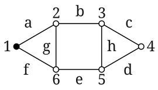</a>


$$
\begin{aligned}
\alpha(1)&=\{af,\bar{a}\bar{f}\},\qquad &\alpha(4)&=\{c\bar{d},\bar{c}d\},\\
\alpha(2)&=\{ab\bar{g},a\bar{b}g,\bar{a}bg,\bar{a}\bar{b}\bar{g}\},\qquad &\alpha(5)&=\{de\bar{h},d\bar{e}h,\bar{d}eh,\bar{d}\bar{e}\bar{h}\},\\
\alpha(3)&=\{bc\bar{h},b\bar{c}h,\bar{b}ch,\bar{b}\bar{c}\bar{h}\},\qquad &\alpha(6)&=\{ef\bar{g},e\bar{f}g,\bar{e}fg,\bar{e}\bar{f}\bar{g}\}.\end{aligned}
$$

注意, 若 $v$ 在 $G$ 中有 $d>0$ 个邻点, 则集合 $\alpha(v)$ 由 $2^{d-1}$ 个大小为 $d$ 的子句组成. 而且, $\alpha(v)$ 的公理全都满足, 当且仅当
$$
\bigoplus_{e_{uv}\in E(v)}e_{uv}=l(v).
$$
将这个等式对所有顶点 $v$ 按模 2 求和, 左端为 0, 因为每条边 $e_{uv}$ 都恰好出现两次 (一次在 $E(u)$ 中, 一次在 $E(v)$ 中). 可是右端为 1. 因此子句 $\alpha(G)=\bigcup_v\alpha(v)$ 不可满足.

(a) 在这个例子中, 公理 $\alpha(G)\mid b$ 和 $\alpha(G)\mid\bar b$ 分别为 $\alpha(G')$ 和 $\alpha(G'')$, 其中 $G'$ 和 $G''$ 如下图所示. 解释一般情况下会发生什么.

<a href="../../assets/volume4b/figures/satqa-q245ab.svg">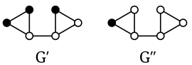</a>


(b) 对涉及变量 $e_{uv}$ 的每个子句 $C$, 令 $\mu(C)=\min\{|V'|\mid V'\subseteq V\text{ 且 }\bigcup_{v\in V'}\alpha(v)\vdash C\}$. 证明对每条公理 $C\in\alpha(G)$ 均有 $\mu(C)=1$. $\mu(\epsilon)$ 是多少?

(c) 若 $V'\subseteq V$, 令 $\partial V'=\{e_{uv}\mid u\in V'\text{ 且 }v\notin V'\}$. 证明, 若 $\bigcup_{v\in V'}\alpha(v)\vdash C$ 且 $|V'|=\mu(C)$, 则 $\partial V'$ 的每个变量都出现在 $C$ 中.

(d) 有 $m$ 个顶点 $V$ 的非二部三次 Ramanujan 图 $G$, 在每个顶点上关联着三条边 $v\mathbin{—}v\rho$, $v\mathbin{—}v\sigma$, $v\mathbin{—}v\tau$, 其中 $\rho,\sigma,\tau$ 是具有下列性质的置换: (i) $\rho=\rho^{-}$ 且 $\tau=\sigma^{-}$; (ii) $G$ 连通; (iii) 若 $V'$ 是任意 $s$ 个顶点组成的子集, 且 $V'$ 与 $V\setminus V'$ 之间有 $t$ 条边, 则 $s/(s+t)\le(s/m+8)/9$. 证明 $w(\alpha(G)\vdash\epsilon)>m/78$.

<a id="ex-7-2-2-2-246"></a>

▶ **246.** [M28] [答案](./answers/7-2-2-2.md#ans-7-2-2-2-246) (G. S. Tseytin.) 给定有 $m$ 条边、$n$ 个顶点的标号图 $G$, 以及上一题所说的 $N$ 个不可满足子句 $\alpha(G)$, 说明怎样用 $O(mn+N)$ 步<em>扩展归结</em>反驳这些子句.

<a id="ex-7-2-2-2-247"></a>

**247.** [18] [答案](./answers/7-2-2-2.md#ans-7-2-2-2-247) 对 (112) 的六个子句中的五个应用变量消去法, 略去 ‘$1\bar2$’.

<a id="ex-7-2-2-2-248"></a>

**248.** [M20] [答案](./answers/7-2-2-2.md#ans-7-2-2-2-248) 形式上说, SAT 就是对量化公式
$$
\exists x_1\ldots\exists x_{n-1}\exists x_n\;F(x_1,\ldots,x_{n-1},x_n)
$$
求值的问题, 其中布尔函数 $F$ 以 CNF 的形式给出, 即表示成子句的合取. 说明怎样将 $F$ 的 CNF 变换成约化后的问题
$$
\exists x_1\ldots\exists x_{n-1}\;F'(x_1,\ldots,x_{n-1}),\qquad F'(x_1,\ldots,x_{n-1})=F(x_1,\ldots,x_{n-1},0)\lor F(x_1,\ldots,x_{n-1},1)
$$
中 $F'$ 的 CNF.

<a id="ex-7-2-2-2-249"></a>

**249.** [18] [答案](./answers/7-2-2-2.md#ans-7-2-2-2-249) 对 (112) 应用算法 I, 使用 Cook 的方法 IA.

<a id="ex-7-2-2-2-250"></a>

**250.** [25] [答案](./answers/7-2-2-2.md#ans-7-2-2-2-250) 由于 (7) 中的子句 $R'$ 可满足, 算法 I 也许不必到达步骤 I4 就能发现一个解. 不过, 试在步骤 I2、I3、I4 中作出选择, 使算法尽可能迟地发现解.

<a id="pdf-359"></a><a id="p-339"></a>

<a id="ex-7-2-2-2-251"></a>

▶ **251.** [30] [答案](./answers/7-2-2-2.md#ans-7-2-2-2-251) 证明, 若在步骤 I2、I3、I4 中能恰当地预见后果而作出选择, 算法 I 只须作 $O(m^3)$ 次归结, 就能证明否定极大元的子句 (99)–(101) 不可满足.

<a id="ex-7-2-2-2-252"></a>

**252.** [M26] [答案](./answers/7-2-2-2.md#ans-7-2-2-2-252) 反复执行变量消去和包摄, 能否在多项式时间内证明 (99)–(101) 不可满足?

<a id="ex-7-2-2-2-253"></a>

▶ **253.** [18] [答案](./answers/7-2-2-2.md#ans-7-2-2-2-253) 在 (114) 之后若紧接着以 ‘5’ 作决策, 接下去学得的两个子句是什么?

<a id="ex-7-2-2-2-254"></a>

**254.** [16] [答案](./answers/7-2-2-2.md#ans-7-2-2-2-254) 给定二元子句 $\{12,\bar13,2\bar3,\bar2\bar4,\bar34\}$, 若 CDCL 求解器首先决定 1 为真, 它学得的第一个子句是什么?

<a id="ex-7-2-2-2-255"></a>

▶ **255.** [20] [答案](./answers/7-2-2-2.md#ans-7-2-2-2-255) 构造一个由三元子句组成的可满足性问题, 使 CDCL 求解器在第 1、2、3 层分别从决策字面值 ‘1’、‘2’、‘3’ 出发, 在第 3 层发生冲突后学得子句 ‘45’.

<a id="ex-7-2-2-2-256"></a>

**256.** [20] [答案](./answers/7-2-2-2.md#ans-7-2-2-2-256) [表 3](#tab-7-2-2-2-3) 中的子句 ‘\*\*’ 本来怎样就很容易学到?

<a id="ex-7-2-2-2-257"></a>

▶ **257.** [30] [答案](./answers/7-2-2-2.md#ans-7-2-2-2-257) (Niklas Sörensson.) 对于给定的子句 $c$ 和当前轨迹, 若 $l$ 在轨迹中, 并且 (i) $l$ 在第 0 层定值, 或者 (ii) $l$ 不是决策字面值, 且 $l$ 的理由中的每个假字面值都在 $c$ 中或是 (递归地) 冗余的, 就说字面值 $\bar l$ 是<em>冗余的</em>. (这个定义比将 (115) 约简成 (116) 所用的特例更强, 因为 $\bar l$ 本身无须属于 $c$.) 例如, 若 $c=(\bar l'\lor\bar b_1\lor\bar b_2\lor\bar b_3\lor\bar b_4)$, $b_4$ 的理由是 $(b_4\lor\bar b_1\lor\bar a_1)$, $a_1$ 的理由是 $(a_1\lor\bar b_2\lor\bar a_2)$, $a_2$ 的理由是 $(a_2\lor\bar b_1\lor\bar b_3)$, 则 $\bar b_4$ 是冗余的, 因为 $\bar a_2$ 和 $\bar a_1$ 是冗余的.

(a) 假设 $c=(\bar l'\lor\bar b_1\lor\cdots\lor\bar b_r)$ 为新学得的子句. 证明若 $\bar b_j\in c$ 是冗余的, 则在轨迹中, 另有一个 $\bar b_i\in c$ 在与 $\bar b_j$ 相同的层上变为假.

(b) 设计一个高效的算法, 找出给定的新学得子句 $c=(\bar l'\lor\bar b_1\lor\cdots\lor\bar b_r)$ 中所有的冗余字面值 $\bar b_i$. <em>提示:</em> 使用戳记.

<a id="ex-7-2-2-2-258"></a>

**258.** [21] [答案](./answers/7-2-2-2.md#ans-7-2-2-2-258) 算法 C 的轨迹中的非决策字面值 $l$ 总有理由 $R_l=(l_0\lor l_1\lor\cdots\lor l_{k-1})$, 其中 $l_0=l$, $\bar l_1,\ldots,\bar l_{k-1}$ 在轨迹中先于 $l$. 而且, 算法是在查看 $l_1$ 的监视表时发现这个子句的. <em>提示:</em> 考虑[表 3](#tab-7-2-2-2-3) 及其后续. 是真是假: $\bar l_2,\ldots,\bar l_{k-1}$ 在轨迹中先于 $\bar l_1$.

<a id="ex-7-2-2-2-259"></a>

**259.** [M20] [答案](./answers/7-2-2-2.md#ans-7-2-2-2-259) 当 $\rho$ 接近 0 或 1 时, 是否可能 $\mathtt{ACT}(j)$ 大于 $\mathtt{ACT}(k)$, 而并非对<em>所有</em>的 $\rho$ 都如此?

<a id="ex-7-2-2-2-260"></a>

**260.** [18] [答案](./answers/7-2-2-2.md#ans-7-2-2-2-260) 详细描述步骤 C1 如何设置 MEM、监视表和轨迹.

<a id="ex-7-2-2-2-261"></a>

**261.** [21] [答案](./answers/7-2-2-2.md#ans-7-2-2-2-261) 算法 C 的主循环是步骤 C3 和 C4 的单元传播过程. 描述在这些步骤中要作的链域调整等低层操作的细节.

<a id="ex-7-2-2-2-262"></a>

**262.** [20] [答案](./answers/7-2-2-2.md#ans-7-2-2-2-262) 支持步骤 C6–C8 中堆的改变的低层操作是什么?

<a id="ex-7-2-2-2-263"></a>

**263.** [21] [答案](./answers/7-2-2-2.md#ans-7-2-2-2-263) 写出步骤 C7 构造新子句以及步骤 C9 将它存入算法 C 的数据结构的全部繁琐细节.

<a id="ex-7-2-2-2-264"></a>

**264.** [24] [答案](./answers/7-2-2-2.md#ans-7-2-2-2-264) 提出一种办法, 使算法 C 能显示类似于算法 A、B、D、L 的 “走法代码” 来报告进度. (见习题 142.)

<a id="ex-7-2-2-2-265"></a>

**265.** [21] [答案](./answers/7-2-2-2.md#ans-7-2-2-2-265) 描述几种在算法 C 的执行中子句 $c$ 的受监视字面值 $l_0$ 或 $l_1$ 或二者确实变为假的情形.

<a id="ex-7-2-2-2-266"></a>

**266.** [20] [答案](./answers/7-2-2-2.md#ans-7-2-2-2-266) 为避免陷入一成不变的选择, CDCL 求解器常常以小概率 $p$ (例如 $p=0.02$) 随机作决策, 以代替一味选择活跃度最大的变量. 这种策略将如何改变步骤 C6?

<a id="ex-7-2-2-2-267"></a>

▶ **267.** [25] [答案](./answers/7-2-2-2.md#ans-7-2-2-2-267) SAT 实例常常含有大量二元子句. 算法 L 的单元传播循环 (62) 能高效地处理它们, 而算法 C 的步骤 C3 中相应的循环却不能. (监视字面值的技术对长 <a id="pdf-360"></a><a id="p-340"></a> 子句很有效, 对短子句则相形笨重.) 如果二元子句占很大比重, 采用哪些附加的数据结构可以加快算法 C 的内循环?

<a id="ex-7-2-2-2-268"></a>

**268.** [21] [答案](./answers/7-2-2-2.md#ans-7-2-2-2-268) 当算法 C 在轨迹的第 0 层使一个字面值为假时, 就可以从所有子句中删除它. 若 “急切地” 这样更新, 也许会耗费很长的时间; 但有一种惰性办法: 如果在步骤 C3 中寻找新的受监视字面值时碰巧遇到一个永久为假的字面值, 就可以把它删去 (见[习题 261](#ex-7-2-2-2-261)).

说明怎样适配 MEM 的数据结构约定, 使这种删除能够<em>就地</em>完成, 无须将子句从一个位置复制到另一个位置.

<a id="ex-7-2-2-2-269"></a>

**269.** [23] [答案](./answers/7-2-2-2.md#ans-7-2-2-2-269) 假定算法 C 在选择了决策字面值 $u_1,u_2,\ldots,u_d$ 之后, 在轨迹的第 $d$ 层遇到冲突. 若给定的子句可满足, 则 “平凡子句” $(\bar l'\lor\bar u_1\lor\cdots\lor\bar u_{d'})$ 必为真, 其中 $l'$ 与 $d'$ 在步骤 C7 中定义.

(a) 证明若从步骤 C7 中得到的子句 $(\bar l'\lor\bar b_1\lor\cdots\lor\bar b_r)$ 出发, 以某种方式将它与零个或多个已知子句归结, 总可以达到一个包摄该平凡子句的子句.

(b) 有时, 如 (115), 在步骤 C9 中即将学得的子句比平凡子句长得多. 构造一个 $d=3$, $d'=1$, $r=10$ 的例子, 并且 $b_1,\ldots,b_r$ 中没有一个在[习题 257](#ex-7-2-2-2-257) 的意义下是冗余的.

(c) 据此提出改进算法 C 的方法.

<a id="ex-7-2-2-2-270"></a>

**270.** [25] [答案](./answers/7-2-2-2.md#ans-7-2-2-2-270) (<em>即时包摄.</em>) 在步骤 C7 中, 刚刚与理由 $R_l$ 归结之后产生的中间子句, 偶尔恰好等于较短的子句 $R_l\setminus l$. 遇到这种情形, 就有机会从原子句中删去 $l$ 来<em>加强</em>它, 使它在以后可能更有用.

(a) 构造一个例子, 使处理一次冲突时能以这种方式包摄两个子句. 这两个被包摄的子句都应含有两个在轨迹当前层赋值的字面值, 以及一个较低层的字面值.

(b) 证明通过修改[答案 263](./answers/7-2-2-2.md#ans-7-2-2-2-263) 的步骤, 很容易识别出这些机会并高效地加强相应子句.

<a id="ex-7-2-2-2-271"></a>

▶ **271.** [25] [答案](./answers/7-2-2-2.md#ans-7-2-2-2-271) 在学得子句的序列 $C_1,C_2,\ldots$ 中, 常常出现 $C_i$ 包摄紧前的 $C_{i-1}$ 的情形. 既然 $C_{i-1}$ 正好位于 MEM 的末端, 这时不妨把它<em>丢弃</em>, 把 $C_i$ 存到它的位置, 除非轨迹中的某个字面值仍以 $C_{i-1}$ 为理由. (例如算法 C 通常从 $\operatorname{waerden}(3,10;97)$ 学得的 52,000 个子句中, 有 8600 多个可以这样丢弃. 这种丢弃与[习题 270](#ex-7-2-2-2-270) 的即时包摄不同, 因为被包摄的 $C_{i-1}$ 只含一个来自其原冲突层的字面值; 此外, 学得的子句除非是平凡的, 通常都已由[习题 257](#ex-7-2-2-2-257) 的过程作了相当大的简化.)

设计一种高效的方法, 判断何时可以把 $C_{i-1}$ 安全地丢弃.

<a id="ex-7-2-2-2-272"></a>

**272.** [30] [答案](./answers/7-2-2-2.md#ans-7-2-2-2-272) 对下述想法作实验: $\operatorname{waerden}(j,k;n)$ 的子句在反射下具有对称性, 即若对 $1\le k\le n$ 用 $x_k^R=x_{n+1-k}$ 代替 $x_k$, 整体保持不变. 因此, 算法 C 每当学得一个子句 $C=(\bar l'\lor\bar b_1\lor\cdots\lor\bar b_r)$, 也有权学得反射后的子句 $C^R=(\bar l'{}^R\lor\bar b_1^R\lor\cdots\lor\bar b_r^R)$.

<a id="ex-7-2-2-2-273"></a>

**273.** [27] [答案](./answers/7-2-2-2.md#ans-7-2-2-2-273) 从 $\operatorname{waerden}(j,k;n)$ 学得的子句 $C$, 当 $n'>n$ 时, 对 $\operatorname{waerden}(j,k;n')$ 也成立; 在 $C$ 的每个字面值上加 $i$ 所得的子句 $C+i$, $1\le i\le n'-n$, 也都成立. 例如从 $\operatorname{waerden}(3,3;7)$ 可以推出 ‘35’, 因此可以把 35、46、57 加入 $\operatorname{waerden}(3,3;9)$.

(a) 利用这个想法加快范德瓦尔登数的计算.

<a id="pdf-361"></a><a id="p-341"></a>

(b) 说明怎样把它也用于有界模型检验.

<a id="ex-7-2-2-2-274"></a>

**274.** [35] [答案](./answers/7-2-2-2.md#ans-7-2-2-2-274) 算法 C 一旦发现有子句强制字面值 $l$ 为真, 就给 $l$ 设定 “理由”. 实践中以后常会遇到强制 $l$ 的其他子句; 算法 C 却略过它们, 即使其中某个可能是 “更好的理由”. (例如, 另一个强制子句可能短得多.) 试作一种修改, 使算法 C 尝试改进非决策字面值的理由.

<a id="ex-7-2-2-2-275"></a>

▶ **275.** [22] [答案](./answers/7-2-2-2.md#ans-7-2-2-2-275) 将[习题 109](#ex-7-2-2-2-109) 的想法纳入算法 C, 使它能求可满足性问题的字典序最小解.

<a id="ex-7-2-2-2-276"></a>

**276.** [M15] [答案](./answers/7-2-2-2.md#ans-7-2-2-2-276) 是真是假: 若 $F$ 为子句族, $L$ 为严格互异的字面值集, 则 $F\land L\vdash_1\epsilon$ 当且仅当 $(F\mid L)\vdash_1\epsilon$.

<a id="ex-7-2-2-2-277"></a>

**277.** [M18] [答案](./answers/7-2-2-2.md#ans-7-2-2-2-277) 若 $(C_1,\ldots,C_t)$ 是 $F$ 的不可满足性证书, 且 $F$ 的所有子句的长度都 $\ge2$, 证明有某个 $C_i$ 为单位子句.

<a id="ex-7-2-2-2-278"></a>

**278.** [22] [答案](./answers/7-2-2-2.md#ans-7-2-2-2-278) 为 $\operatorname{waerden}(3,3;9)$ 找出一个六步的不可满足性证书.

<a id="ex-7-2-2-2-279"></a>

**279.** [M20] [答案](./answers/7-2-2-2.md#ans-7-2-2-2-279) 是真是假: 每个不可满足的 2SAT 问题都有形如 ‘$(l,\epsilon)$’ 的证书.

<a id="ex-7-2-2-2-280"></a>

▶ **280.** [M26] [答案](./answers/7-2-2-2.md#ans-7-2-2-2-280) 问题 $\operatorname{cook}(j,k)$ 由 $\{1,\ldots,n\}$ 上全部 $\binom nj$ 个正 $j$ 元子句和全部 $\binom nk$ 个负 $k$ 元子句组成, 其中 $n=j+k-1$. 例如 $\operatorname{cook}(2,3)$ 为
$$
\{12,13,14,23,24,34,\bar1\bar2\bar3,\bar1\bar2\bar4,\bar1\bar3\bar4,\bar2\bar3\bar4\}.
$$

(a) 为什么这些子句显然不可满足?

(b) 给出 $\operatorname{cook}(j,k)$ 的一个全正证书, 长为 $\binom{n-1}{j-1}$.

(c) 进一步证明, 当 $M_{\mathrm p}=M_{\mathrm f}=\infty$ (既不清除也不冲刷) 时, 算法 C 证明 $\operatorname{cook}(j,k)$ 不可满足总会学得<em>恰好</em> $\binom{n-1}{j-1}$ 个子句.

<a id="ex-7-2-2-2-281"></a>

**281.** [21] [答案](./answers/7-2-2-2.md#ans-7-2-2-2-281) 构造一个反驳 (99)、(100)、(101) 的不可满足性证书.

<a id="ex-7-2-2-2-282"></a>

▶ **282.** [M33] [答案](./answers/7-2-2-2.md#ans-7-2-2-2-282) 对于[习题 176](#ex-7-2-2-2-176) 中奇数 $q\ge3$ 的子句 $\operatorname{fsnark}(q)$, 构造由 $O(q)$ 个长度均 $\le4$ 的子句组成的不可满足性证书. <em>提示:</em> 对 $1\le j\le q$, $1\le p\le3$, 将子句 $(\bar a_{j,p}\lor\bar e_{j,p})$、$(\bar a_{j,p}\lor\bar f_{j,p})$、$(\bar e_{j,p}\lor\bar f_{j,p})$、$(a_{j,p}\lor e_{j,p}\lor f_{j,p})$ 包括在内.

<a id="ex-7-2-2-2-283"></a>

**283.** [HM46] [答案](./answers/7-2-2-2.md#ans-7-2-2-2-283) 对花形斯纳克图问题, 算法 C 的运行时间是否为线性? 更精确地, 令 $p_q(M)$ 表示算法至多访问 MEM $M$ 次便反驳 $\operatorname{fsnark}(q)$ 的概率. 是否存在一个常数 $N$, 使得对所有 $q$ 都有 $p_q(Nq)>\tfrac12$?

<a id="ex-7-2-2-2-284"></a>

**284.** [23] [答案](./answers/7-2-2-2.md#ans-7-2-2-2-284) 给定 $F$ 和 $(C_1,\ldots,C_t)$, 证书检验程序通过验证如下事实来检验条件 (119): 用 $\overline C_i$ 的单位字面值扩充 $F$ 及子句 $C_1,\ldots,C_{i-1}$ 后, 它们会强制产生冲突. 在此过程中, 它可以给 $F\cup\{C_1,\ldots,C_{i-1}\}$ 中经强制而化为单位子句的每个子句作标记; 于是 $C_i$ 的真就不依赖于任何无标记子句的真.

实际上, $F$ 的许多子句始终没有标记, 因此即使略去它们, $F$ 仍然不可满足. 此外, 在验证各个后继 $\{C_{i+1},\ldots,C_t\}$ 时, 也有许多 $C_i$ 没有被标记; 这样的 $C_i$ 无须验证, 它们所依赖的子句也无须作标记.

因此, 逆序检验证书可以省力: 先标记末项 $C_t$, 它是 $\epsilon$, 总须验证. 然后依次对 $i=t,t-1,\ldots$, 只在 $C_i$ 已标记时才检验它.

所有这些单元传播都可以不记录强制某字面值 $l$ 的 “理由” $R_l$. 可是实际中许多被强制的字面值对于所产生的冲突毫无作用, 我们不想标记任何并未真正参与的子句.

说明怎样如算法 C 那样使用理由, 使得验证器只标记实际参与某个已标记子句 $C_i$ 的证明的子句.

<a id="pdf-362"></a><a id="p-342"></a>

<a id="ex-7-2-2-2-285"></a>

**285.** [19] [答案](./answers/7-2-2-2.md#ans-7-2-2-2-285) 正文使用[图 93](#fig-7-2-2-2-93) 的数据指出, $\alpha=\tfrac{15}{16}$ 时式 (124) 给出 $j=95$, $s_j=3081$, $m_j=59$. 当 (a) $\alpha=\tfrac9{16}$, (b) $\alpha=\tfrac12$, (c) $\alpha=\tfrac7{16}$ 时, $j,s_j,m_j$ 分别是多少? 又计算证明有用的 “黑” 子句数 $b_j$ (满足 $0<\mathtt{RANGE}(c)<j$ 者), 比较各个 $\alpha$ 的效果.

<a id="ex-7-2-2-2-286"></a>

**286.** [M24] [答案](./answers/7-2-2-2.md#ans-7-2-2-2-286) [图 93](#fig-7-2-2-2-93) 中保留哪些特征标是<em>最优</em>的? 即在约束 $\sum a_{pq}x_{pq}\le3114$, $x_{pq}\in\{0,1\}$, 且对 $1\le p\le p'\le7$, $0\le q\le q'\le8$ 有 $x_{pq}\ge x_{p'q'}$ 时, 使 $\sum b_{pq}x_{pq}$ 最大. 这里 $a_{pq},b_{pq}$ 为特征标 $(p,q)$ 的灰色、黑色子句在正文矩阵中所占的面积. [这是 “带偏序的背包问题” 的特例.]

<a id="ex-7-2-2-2-287"></a>

**287.** [25] [答案](./answers/7-2-2-2.md#ans-7-2-2-2-287) 应对算法 C 作哪些修改, 才能让它作一遍 “完整运行”, 稍后再从这一轮中发生的全部冲突学习?

<a id="ex-7-2-2-2-288"></a>

**288.** [28] [答案](./answers/7-2-2-2.md#ans-7-2-2-2-288) 详细说明在一轮清除中怎样计算 RANGE 分数, 然后压缩学得子句的数据库.

<a id="ex-7-2-2-2-289"></a>

**289.** [M20] [答案](./answers/7-2-2-2.md#ans-7-2-2-2-289) 假设第 $k$ 轮清除开始时存储器内有 $y_k$ 个子句, 此时已学得 $k\Delta+\binom k2\delta$ 个子句; 本轮清除其中的一半. 求 $y_k$ 关于 $k$ 的闭合公式.

<a id="ex-7-2-2-2-290"></a>

**290.** [17] [答案](./answers/7-2-2-2.md#ans-7-2-2-2-290) 说明怎样找到用于冲刷字面值的那个活跃度最大的未赋值变量 $x_k$. <em>提示:</em> 它在 HEAP 阵列中.

<a id="ex-7-2-2-2-291"></a>

**291.** [20] [答案](./answers/7-2-2-2.md#ans-7-2-2-2-291) 正文提出了把[表 3](#tab-7-2-2-2-3) 冲刷回第 15 层的假想情形, 为什么随后不久出现在轨迹上的会是 49, 而非 $\overline{49}$?

<a id="ex-7-2-2-2-292"></a>

**292.** [M21] [答案](./answers/7-2-2-2.md#ans-7-2-2-2-292) 反复执行 (127) 后, AGILITY 能变得多大?

<a id="ex-7-2-2-2-293"></a>

**293.** [21] [答案](./answers/7-2-2-2.md#ans-7-2-2-2-293) 详细说明在决定是否冲刷时, 将 $M_{\mathrm f}$ 更新为 $M+\Delta_{\mathrm f}$ 的步骤. 还要计算[表 4](#tab-7-2-2-2-4) 中指定的灵活度阈值. <em>提示:</em> 见 (131).

<a id="ex-7-2-2-2-294"></a>

**294.** [HM21] [答案](./answers/7-2-2-2.md#ans-7-2-2-2-294) 对每个二进向量 $\alpha=x_1x_2x_3x_4$, 求生成函数 $g_\alpha(z)=\sum_{j=0}^\infty p_{\alpha,j}z^j$, 其中 $p_{\alpha,j}$ 为在步骤 P1 给定初值 $\alpha$ 时, 算法 P 恰好翻转 $j$ 次便解出 (7) 的七个子句的概率. 据此求找到一个解所需步数的均值和方差.

<a id="ex-7-2-2-2-295"></a>

**295.** [M23] [答案](./answers/7-2-2-2.md#ans-7-2-2-2-295) 算法 P 找到解的速度常常远高于推论 W 的预测. 但请证明, 对某些 3SAT 子句, 确实需要 $\Omega((4/3)^n)$ 次试验.

<a id="ex-7-2-2-2-296"></a>

**296.** [HM20] [答案](./answers/7-2-2-2.md#ans-7-2-2-2-296) 通过 (近似地) 使 (129) 中的量 $f(p,q)$ 达到最大, 完成定理 U 的证明. <em>提示:</em> 考察 $f(p+1,q)/f(p,q)$.

<a id="ex-7-2-2-2-297"></a>

▶ **297.** [HM26] [答案](./answers/7-2-2-2.md#ans-7-2-2-2-297) (Emo Welzl.) 在定理 U 的证明中, 当 $Y_0=q$ 时, 令 $G_q(z)=\sum_p C_{p,p+q-1}(z/3)^{p+q}(2z/3)^p$ 为停止时间 $t=2p+q$ 的生成函数.

(a) 利用 7.2.1.6 节的公式, 求 $G_q(z)$ 的闭合形式.

(b) 解释为什么 $G_q(1)$ 小于 1.

(c) 求 $G'_q(1)/G_q(1)$ 并解释它的意义.

(d) 用马尔可夫不等式给出对某个 $t\le N$ 有 $Y_t=0$ 的概率界.

(e) 证明由这一分析可以推出推论 W.

<a id="ex-7-2-2-2-298"></a>

**298.** [HM22] [答案](./answers/7-2-2-2.md#ans-7-2-2-2-298) 将定理 U 和推论 W 推广到每个子句至多含 $k$ 个字面值的情形, $k\ge3$.

<a id="ex-7-2-2-2-299"></a>

**299.** [HM23] [答案](./answers/7-2-2-2.md#ans-7-2-2-2-299) 接着上一题, 研究 $k=2$ 的情形.

<a id="ex-7-2-2-2-300"></a>

▶ **300.** [25] [答案](./answers/7-2-2-2.md#ans-7-2-2-2-300) 修改算法 P, 使它可以用逐位运算实现, 从而同时进行例如 64 次独立试验.

<a id="ex-7-2-2-2-301"></a>

▶ **301.** [25] [答案](./answers/7-2-2-2.md#ans-7-2-2-2-301) 讨论怎样在 MMIX 上高效地实现[习题 300](#ex-7-2-2-2-300) 的算法.

<a id="pdf-363"></a><a id="p-343"></a>

<a id="ex-7-2-2-2-302"></a>

**302.** [26] [答案](./answers/7-2-2-2.md#ans-7-2-2-2-302) 给出计算机应当怎样执行步骤 W4 与 W5 的低层细节, 补充正文中对这两个步骤的高层描述.

<a id="ex-7-2-2-2-303"></a>

**303.** [HM20] [答案](./answers/7-2-2-2.md#ans-7-2-2-2-303) 将算法 P 换成算法 W, 解习题 294.

<a id="ex-7-2-2-2-304"></a>

**304.** [HM34] [答案](./answers/7-2-2-2.md#ans-7-2-2-2-304) 考虑由所有 $j\ne k$ 的 $n(n-1)$ 个子句 $(\bar x_j\lor x_k)$ 组成的 2SAT 问题. 求算法 P 与 W 所作翻转次数的生成函数. <em>提示:</em> 习题 1.2.6–68 与 MPR–105 有助于求出精确公式.

<a id="ex-7-2-2-2-305"></a>

▶ **305.** [HM29] [答案](./answers/7-2-2-2.md#ans-7-2-2-2-305) 在上一题中再加一个子句 $(\bar x_1\lor\bar x_2)$, 求 $n=4$ 时所得的生成函数. 当算法 W 的 $p=0$ 时会发生什么?

<a id="ex-7-2-2-2-306"></a>

▶ **306.** [HM32] [答案](./answers/7-2-2-2.md#ans-7-2-2-2-306) (Luby, Sinclair 和 Zuckerman, 1993.) 考虑一个或成功或失败的 “拉斯维加斯算法”: 它以概率 $p_t$ 在第 $t$ 步成功, 以概率 $p_\infty<1$ 失败. 令 $q_t=p_1+p_2+\cdots+p_t$, $E_t=p_1+2p_2+\cdots+tp_t$; 若 $p_\infty>0$, 又令 $E_\infty=\infty$, 否则令 $E_\infty=\sum_t tp_t$. (后一和式也可能为 $\infty$.)

(a) 假定每逢头 $N$ 步没有成功, 我们就中止算法并重新启动. 证明若 $q_N>0$, 这种策略平均用 $l(N)<\infty$ 步便可成功. $l(N)$ 是多少?

(b) 当 $p_m=m/n$, $p_\infty=(n-m)/n$, 其余 $p_t=0$, 其中 $1\le m\le n$ 时, 计算 $l(N)$.

(c) 若为均匀分布, $p_t=1/n$, $1\le t\le n$, 则 $l(N)$ 是多少?

(d) 求使 $l(N)=l(1)$ 对所有 $N\ge1$ 成立的一切概率分布.

(e) 求使 $l(N)=l(n)$ 对所有 $N\ge n$ 成立的一切概率分布.

(f) 求使 $q_{n+1}=1$ 且 $l(n)<l(n+1)$ 的一切概率分布.

(g) 求使 $q_3=1$ 且 $l(1)<l(3)<l(2)$ 的一切概率分布.

(h) 令 $l=\inf_{N\ge1}l(N)$, 并令 $N^*$ 为使 $l(N^*)=l$ 的最小正整数, 若不存在这样的整数则取 $\infty$. 证明 $N^*=\infty$ 蕴涵 $l=E_\infty<\infty$.

(i) 对给定 $n\ge0$ 的概率分布 $p_t=[t>n]/((t-n)(t+1-n))$, 求 $N^*$.

(j) 给出一个简单的概率分布的例子, 使 $N^*=\infty$.

(k) 令 $L=\min_{t\ge1}t/q_t$. 证明 $l\le L\le2l-1$.

<a id="ex-7-2-2-2-307"></a>

**307.** [HM28] [答案](./answers/7-2-2-2.md#ans-7-2-2-2-307) 接着[习题 306](#ex-7-2-2-2-306), 考虑由无穷正整数序列 $(N_1,N_2,\ldots)$ 定义的更一般的策略: “置 $j\gets0$; 然后, 只要尚未成功, 就置 $j\gets j+1$, 并以截止参数 $N_j$ 运行算法.”

(a) 说明怎样计算 $\mathrm E\,X$, 其中 $X$ 是这一策略直到成功为止所用的步数.

(b) 令 $T_j=N_1+\cdots+N_j$. 证明, 对所有 $j$ 都有 $q_{N_j}>0$ 时, $\mathrm E\,X=\sum_{j=1}^\infty\Pr(T_{j-1}<X\le T_j)l(N_j)$.

(c) 因此固定不变的策略 $(N^*,N^*,\ldots)$ 最优: $\mathrm E\,X\ge l(N^*)=l$.

(d) 给定 $n$, [习题 306](#ex-7-2-2-2-306)(b) 定义了 $n$ 种简单的概率分布 $p^{(m)}$, 它们都有 $l(N^*)=n$, 但 $N^*=m$ 在各分布中不同. 证明对这些 $p^{(m)}$ 中至少一个, 任何序列 $(N_1,N_2,\ldots)$ 都必有 $\mathrm E\,X>\tfrac14nH_n-\tfrac12n=\tfrac14lH_l-\tfrac12l$. <em>提示:</em> 取最小的 $r$, 使对每个 $m$ 来说, $r$ 次试验已足够的概率 $\ge\tfrac12$; 证明 $\{N_1,\ldots,N_r\}$ 中 $\ge m$ 的数至少有 $n/(2m)$ 个.

<a id="ex-7-2-2-2-308"></a>

**308.** [M29] [答案](./answers/7-2-2-2.md#ans-7-2-2-2-308) 本题研究 “迟缓倍增” 序列 (130).

(a) 给定 $a\ge0$, 使 $S_n=2^a$ 的最小 $n$ 是多少?

(b) 证明 $\{n\mid S_n=1\}=\{2k+1-\nu k\mid k\ge0\}$; 从而生成函数 $\sum_n z^n[S_n=1]$ 是无穷乘积 $z(1+z)(1+z^3)(1+z^7)(1+z^{15})\cdots$.

(c) 对 $\{n\mid S_n=2^a\}$ 和 $\sum_n z^n[S_n=2^a]$ 求类似的表达式.

(d) 令 $\Sigma(a,b,k)=\sum_{n=1}^{r(a,b,k)}S_n$, 其中 $S_{r(a,b,k)}$ 为 $\langle S_n\rangle$ 中第 $2^bk$ 次出现的 $2^a$. 例如 $\Sigma(1,0,3)=S_1+\cdots+S_{10}=16$. 求 $\Sigma(a,b,1)$ 的闭合形式.

(e) 证明对所有 $k\ge1$ 有 $\Sigma(a,b,k+1)-\Sigma(a,b,k)\le(a+b+2k-1)2^{a+b}$.

<a id="pdf-364"></a><a id="p-344"></a>

(f) 如[习题 306](#ex-7-2-2-2-306)(k) 给定一个概率分布, 令 $a=\lceil\lg t\rceil$, $b=\lceil\lg(1/q_t)\rceil$, 其中 $t/q_t=L$; 因此 $L\le2^{a+b}<4L$. 证明, 若[习题 307](#ex-7-2-2-2-307) 的策略采用 $N_j=S_j$, 则
$$
\mathrm E\,X\le\Sigma(a,b,1)+\sum_{k\ge1}Q^k(\Sigma(a,b,k+1)-\Sigma(a,b,k)),\qquad Q=(1-q_{2^a})^{2^b}.
$$

(g) 因此, 对每种概率分布, $\langle S_n\rangle$ 都给出 $\mathrm E\,X<13l\lg l+49l$.

<a id="ex-7-2-2-2-309"></a>

**309.** [20] [答案](./answers/7-2-2-2.md#ans-7-2-2-2-309) [习题 293](#ex-7-2-2-2-293) 说明了怎样在算法 C 中使用迟缓倍增序列. 算法 C 是拉斯维加斯算法吗?

<a id="ex-7-2-2-2-310"></a>

**310.** [M25] [答案](./answers/7-2-2-2.md#ans-7-2-2-2-310) 说明怎样计算 “迟缓斐波那契序列”
$$
1,1,2,1,2,3,1,1,2,3,5,1,1,2,1,2,3,5,8,1,1,2,1,2,3,1,1,2,3,5,8,13,1,\ldots,
$$
它与 (130) 颇为相似, 如[习题 308](#ex-7-2-2-2-308) 中那样有用, 但其元素是斐波那契数而非 2 的幂.

<a id="ex-7-2-2-2-311"></a>

**311.** [21] [答案](./answers/7-2-2-2.md#ans-7-2-2-2-311) 当 $n=l=100$ 时, 用[习题 307](#ex-7-2-2-2-307) 的方法以及[习题 308](#ex-7-2-2-2-308) 的序列 $\langle S_n\rangle$、[习题 310](#ex-7-2-2-2-310) 的序列 $\langle S'_n\rangle$, 对[习题 306](#ex-7-2-2-2-306)(b) 的 100 种概率分布计算 $\mathrm E\,X$ 的近似值. 再考虑更容易生成的 “尺规倍增” 序列 $\langle R_n\rangle$, 其中 $R_n=n\mathbin{\&}(-n)=2^{\rho n}$. 哪个序列最好?

<a id="ex-7-2-2-2-312"></a>

**312.** [HM24] [答案](./answers/7-2-2-2.md#ans-7-2-2-2-312) 将迟缓倍增法用于[习题 306](#ex-7-2-2-2-306)(b) 定义的概率分布时, 令 $T(m,n)=\mathrm E\,X$. 用[习题 308](#ex-7-2-2-2-308)(c) 的生成函数表示 $T(m,n)$.

<a id="ex-7-2-2-2-313"></a>

▶ **313.** [22] [答案](./answers/7-2-2-2.md#ans-7-2-2-2-313) 若 $C_j$ 中有一个零代价字面值, 算法 W 就总是翻转它, 不考虑参数 $p$. 证明这样的翻转总能减少未满足子句数 $r$; 但它可能<em>增大</em> $x$ 与最近的解之间的距离.

<a id="ex-7-2-2-2-314"></a>

▶ **314.** [36] [答案](./answers/7-2-2-2.md#ans-7-2-2-2-314) (H. H. Hoos, 1998.) 若给定的子句可满足, 且 $p>0$, 是否可能有一个初始 $x$, 使算法 W 总是永远循环下去?

<a id="ex-7-2-2-2-315"></a>

**315.** [M18] [答案](./answers/7-2-2-2.md#ans-7-2-2-2-315) 当 $d=1$ 时, 定理 J 中的 $p$ 可取什么值?

<a id="ex-7-2-2-2-316"></a>

**316.** [HM20] [答案](./answers/7-2-2-2.md#ans-7-2-2-2-316) 定理 J 能由定理 L 推出吗?

<a id="ex-7-2-2-2-317"></a>

▶ **317.** [M26] [答案](./answers/7-2-2-2.md#ans-7-2-2-2-317) 假设满足 (133) 的条件, 且对 $1\le i\le m$ 有 $p_i=p=(d-1)^{d-1}/d^d$, $G$ 的每个顶点的度至多为 $d>1$, 令 $\alpha(G)=\Pr(\overline A_1\cap\cdots\cap\overline A_m)$. 对 $m$ 归纳证明 $\alpha(G)>0$, 而当 $v$ 的度 $<d$ 时, $\alpha(G)>\frac{d-1}d\alpha(G\setminus v)$.

<a id="ex-7-2-2-2-318"></a>

**318.** [HM33] [答案](./answers/7-2-2-2.md#ans-7-2-2-2-318) (J. B. Shearer.) 证明定理 J 是此类结果中最好的: 若 $p>(d-1)^{d-1}/d^d$ 且 $d>1$, 则有最大度为 $d$ 的图 $G$ 使 $(p,\ldots,p)\notin\mathcal R(G)$. <em>提示:</em> 考虑完全 $t$ 叉树, 其中 $t=d-1$.

<a id="ex-7-2-2-2-319"></a>

**319.** [HM20] [答案](./answers/7-2-2-2.md#ans-7-2-2-2-319) 证明 $pde<1$ 蕴涵 $p\le(d-1)^{d-1}/d^d$.

<a id="ex-7-2-2-2-320"></a>

**320.** [M24] [答案](./answers/7-2-2-2.md#ans-7-2-2-2-320) 给定偏斜依赖图 $G$, <em>发生阈值</em> $\rho(G)$ 是这样一个最小的 $p$: 当每个事件以概率 $p$ 发生时, 有时不可能避开所有事件. 例如, 路径 $P_3$ 的莫比乌斯多项式是 $1-p_1-p_2-p_3+p_1p_3$; 因此发生阈值为 $\phi^{-2}$, 即满足 $1-3p+p^2\le0$ 的最小 $p$.

(a) 证明 $P_m$ 的发生阈值为 $1/(4\cos^2\frac{\pi}{m+2})$.

(b) 圈图 $C_m$ 的发生阈值是多少?

<a id="ex-7-2-2-2-321"></a>

**321.** [M24] [答案](./answers/7-2-2-2.md#ans-7-2-2-2-321) 假定四个随机事件 $A,B,C,D$ 各以概率 $p$ 发生, 其中 $\{A,C\}$ 和 $\{B,D\}$ 各自独立. 根据[习题 320](#ex-7-2-2-2-320)(b) 中 $m=4$ 的情形, 只要 $p\ge(2-\sqrt2)/2\approx0.293$, 就存在一个 $(A,B,C,D)$ 的联合分布, 使得总有至少一个事件发生. 当 $p=3/10$ 时, 给出一个这样的分布.

<a id="pdf-365"></a><a id="p-345"></a>

<a id="ex-7-2-2-2-322"></a>

▶ **322.** [HM35] [答案](./answers/7-2-2-2.md#ans-7-2-2-2-322) (K. Kolipaka 和 M. Szegedy, 2011.) 出人意料的是, 上一题在算法 M 的设定下<em>不能</em>解决! 设有独立随机变量 $(W,X,Y,Z)$, 使 $A$ 依赖于 $W$ 和 $X$, $B$ 依赖于 $X$ 和 $Y$, $C$ 依赖于 $Y$ 和 $Z$, $D$ 依赖于 $Z$ 和 $W$. 这里对所有整数 $j$, $W$ 以概率 $w_j$ 等于 $j$; $X,Y,Z$ 类似. 本题将证明即使 $p$ 大到 0.333, 约束 $\bar A\cap\bar B\cap\bar C\cap\bar D$ 仍总是可满足的.

(a) 以一种方便的方式表示概率 $\Pr(\bar A\cap\bar B\cap\bar C\cap\bar D)$.

(b) 设存在 $W,X,Y,Z$ 的一种分布, 使 $\Pr(A)=\Pr(B)=\Pr(C)=\Pr(D)=p$ 且 $\Pr(\bar A\cap\bar B\cap\bar C\cap\bar D)=0$. 证明存在十个数使
$$
\begin{gathered}
0\le a,b,c,d,a',b',c',d'\le1,\qquad 0<\mu,\nu<1,\\
\mu a+(1-\mu)a'\le p,\qquad\mu b+(1-\mu)b'\le p,\\
\nu c+(1-\nu)c'\le p,\qquad\nu d+(1-\nu)d'\le p,\\
a+d\ge1\ \text{或}\ b+c\ge1,\qquad a+d'\ge1\ \text{或}\ b+c'\ge1,\\
a'+d\ge1\ \text{或}\ b'+c\ge1,\qquad a'+d'\ge1\ \text{或}\ b'+c'\ge1.
\end{gathered}
$$

(c) 当 $p=1/3$ 时, 求出上述约束的全部解.

(d) 将这些解转化为满足 $\Pr(\bar A\cap\bar B\cap\bar C\cap\bar D)=0$ 的分布.

<a id="ex-7-2-2-2-323"></a>

**323.** [10] [答案](./answers/7-2-2-2.md#ans-7-2-2-2-323) 在表 (135) 中, 紧挨在 $ccb$ 之前的是哪个迹?

<a id="ex-7-2-2-2-324"></a>

▶ **324.** [22] [答案](./answers/7-2-2-2.md#ans-7-2-2-2-324) 给定图 $G$ 的迹 $\alpha=x_1x_2\ldots x_n$, 说明怎样用算法 7.2.1.2V 找出等价于 $\alpha$ 的全部串 $\beta$. 有多少个串给出 (136)?

<a id="ex-7-2-2-2-325"></a>

▶ **325.** [20] [答案](./answers/7-2-2-2.md#ans-7-2-2-2-325) 图 $G$ 的<em>无环定向</em>是给每条边指定方向, 使所得有向图不含有向圈. 证明, $G$ 中作为顶点<em>排列</em>的迹的数目 (每个顶点在迹中恰出现一次), 等于 $G$ 的无环定向数.

<a id="ex-7-2-2-2-326"></a>

**326.** [20] [答案](./answers/7-2-2-2.md#ans-7-2-2-2-326) 是真是假: 若 $\alpha,\beta$ 是满足 $\alpha=\beta$ 的迹, 则 $\alpha^R=\beta^R$. (见 (137).)

<a id="ex-7-2-2-2-327"></a>

▶ **327.** [22] [答案](./answers/7-2-2-2.md#ans-7-2-2-2-327) 在某个全集 $U$ 中用地盘集 $T(a)$ 定义相斥关系时, 设计一个将两个迹 $\alpha,\beta$ 相乘的算法. 假设 $U$ 很小 (例如 $|U|\le64$), 从而可以用逐位运算表示地盘.

<a id="ex-7-2-2-2-328"></a>

**328.** [20] [答案](./answers/7-2-2-2.md#ans-7-2-2-2-328) 接着[习题 327](#ex-7-2-2-2-327), 设计一个计算 $\alpha/\beta$ 的算法. 更准确地说, 若 $\beta$ 是 $\alpha$ 的一个右因子, 即对某个迹 $\gamma$ 有 $\alpha=\gamma\beta$, 算法应求出 $\gamma$; 否则应报告 $\beta$ 不是右因子.

<a id="ex-7-2-2-2-329"></a>

**329.** [21] [答案](./answers/7-2-2-2.md#ans-7-2-2-2-329) 类似地, 设计一个计算 $\alpha\setminus\beta$ 或报告 $\alpha$ 不是 $\beta$ 的左因子的算法.

<a id="ex-7-2-2-2-330"></a>

▶ **330.** [21] [答案](./answers/7-2-2-2.md#ans-7-2-2-2-330) 给定任意图 $G$, 说明怎样给它的顶点 $a$ 定义地盘集 $T(a)$, 使得 $a=b$ 或 $a\mathbin{—}b$ 当且仅当 $T(a)\cap T(b)\ne\emptyset$. (因此总可以用构件的堆叠来表示迹.) 在什么条件下能像正文例 (136) 那样对每个 $a$ 都做到 $|T(a)|=2$?

<a id="ex-7-2-2-2-331"></a>

**331.** [M20] [答案](./answers/7-2-2-2.md#ans-7-2-2-2-331) 若展开 (139) 的右端, <em>任何</em>变量之间都不允许交换, 会发生什么?

<a id="ex-7-2-2-2-332"></a>

**332.** [20] [答案](./answers/7-2-2-2.md#ans-7-2-2-2-332) 用字典序最小的串表示一个迹时, 该串中没有哪个字母的紧后字母比它小且能与它交换. (例如 (135) 中 $c$ 后面决不会紧跟 $a$, 因为将 $ca$ 改为 $ac$ 就会得到一个等价的较小串.)

反过来, 任给一个有序的字母集, 其中某些字母可交换, 考虑所有没有哪个字母后面紧跟着一个更小且能与它交换的字母的串. 每个这样的串都是其所属的迹中字典序最小的串吗?

<a id="pdf-366"></a><a id="p-346"></a>

<a id="ex-7-2-2-2-333"></a>

▶ **333.** [M20] [答案](./answers/7-2-2-2.md#ans-7-2-2-2-333) (Carlitz, Scoville 和 Vaughan, 1976.) 令 $D$ 为 $\{1,\ldots,m\}$ 上的有向图, $A$ 为所有使 $j_i\longrightarrow j_{i+1}$ 在 $D$ 中对 $1\le i<n$ 成立的串 $a_{j_1}\ldots a_{j_n}$ 的集合. 类似地, 令 $B$ 为所有使 $j_i\not\longrightarrow j_{i+1}$ 对 $1\le i<n$ 成立的串 $a_{j_1}\ldots a_{j_n}$ 的集合. 证明
$$
\sum_{\alpha\in A}\alpha=1\bigg/\sum_{\beta\in B}(-1)^{|\beta|}\beta
=\sum_{k\ge0}\left(1-\sum_{\beta\in B}(-1)^{|\beta|}\beta\right)^k
$$
是不可交换变量 $\{a_1,\ldots,a_m\}$ 的恒等式. (例如当 $m=2$, $1\not\longrightarrow1$, $1\longrightarrow2$, $2\longrightarrow1$, $2\not\longrightarrow2$ 时, 有
$$
1+a+b+ab+ba+aba+bab+\cdots=\sum_{k\ge0}(a+b-aa-bb+aaa+bbb-\cdots)^k.
$$
)

<a id="ex-7-2-2-2-334"></a>

▶ **334.** [25] [答案](./answers/7-2-2-2.md#ans-7-2-2-2-334) 设给定以 $\{1,\ldots,m\}$ 为字母表的图, 设计一个生成其全部长为 $n$ 的迹的算法, 每个迹都用字典序最小的串表示.

<a id="ex-7-2-2-2-335"></a>

**335.** [HM26] [答案](./answers/7-2-2-2.md#ans-7-2-2-2-335) 若 $G$ 的顶点可以排列得使 $x<y<z$ 且 $x\not\mathrel{—}y$, $y\not\mathrel{—}z$ 蕴涵 $x\not\mathrel{—}z$, 证明莫比乌斯级数 $M_G$ 可表示为一个行列式. 例如对下图有

<a href="../../assets/volume4b/figures/satqa-q335.svg"></a>


$$
M_G=\det \begin{pmatrix}
1-a&-b&-c&0&0&0\\
-a&1-b&0&-d&0&0\\
-a&-b&1-c&-d&-e&0\\
-a&-b&-c&1-d&0&-f\\
-a&-b&-c&-d&1-e&-f\\
-a&-b&-c&-d&-e&1-f
\end{pmatrix}.
$$


<a id="ex-7-2-2-2-336"></a>

▶ **336.** [M20] [答案](./answers/7-2-2-2.md#ans-7-2-2-2-336) 若顶点互不相同的图 $G$ 与 $H$ 的莫比乌斯级数分别为 $M_G$ 与 $M_H$, 则 (a) $G\oplus H$ 和 (b) $G\mathbin{—}H$ 的莫比乌斯级数是什么?

<a id="ex-7-2-2-2-337"></a>

**337.** [M20] [答案](./answers/7-2-2-2.md#ans-7-2-2-2-337) 假设将 $G$ 的某个顶点 $a$ 替换为顶点团 $\{a_1,\ldots,a_k\}$, 并对 $1\le j\le k$, 将 $a_j$ 连接到 $a$ 的每个邻点, 得到图 $G'$. 描述 $M_{G'}$ 与 $M_G$ 的关系.

<a id="ex-7-2-2-2-338"></a>

**338.** [M21] [答案](./answers/7-2-2-2.md#ans-7-2-2-2-338) 证明对于源受限的迹, Viennot 的一般恒等式 (144) 成立.

<a id="ex-7-2-2-2-339"></a>

▶ **339.** [HM26] [答案](./answers/7-2-2-2.md#ans-7-2-2-2-339) (G. Viennot.) 本题研究将迹分解为金字塔.

(a) 给定一个迹 $\alpha=x_1\ldots x_n$. 每个字母 $x_j$ 都在唯一的一个金字塔 $\beta_j$ 的顶端, 且 $\beta_j$ 为 $\alpha$ 的左因子. 例如, 对 (136) 的迹 $bcebafdc$, 金字塔 $\beta_1,\ldots,\beta_8$ 分别为 $b$, $bc$, $e$, $bcb$, $bcba$, $ef$, $bced$, $bcebdc$. 根据直观, 怎样从 $\alpha$ 的堆叠中找出这些金字塔形的左因子?

(b) <em>带标号的迹</em>是在迹的各字母上赋予不同的数; 例如 $abca$ 可以变为 $a_4b_7c_6a_3$. <em>带标号的金字塔</em>是要求其最顶端的元素的标号最小的特例. 证明, 每个带标号的迹都能唯一地分解为若干带标号的金字塔, 它们的顶端标号递增. (例如 $b_6c_2e_4b_7a_8f_5d_1c_3=b_6c_2e_4d_1\cdot b_7a_8c_3\cdot f_5$.)

(c) 设有 $t_n$ 个长为 $n$ 的迹, 以及 $p_n$ 个金字塔. 于是有 $T_n=n!t_n$ 个带标号的迹和 $P_n=(n-1)!p_n$ 个带标号的金字塔 (因为只有标号的相对次序有意义). 令 $T(z)=\sum_{n\ge0}T_n z^n/n!$, $P(z)=\sum_{n\ge1}P_nz^n/n!$; 证明其中 (b) 的分解恰含 $l$ 个金字塔的长为 $n$ 的带标号的迹的数目是 $n![z^n]P(z)^l/l!$.

(d) 因此 $T(z)=e^{P(z)}$.

(e) 从而 (这才是点睛之笔!) $\ln M_G(z)=-\sum_{n\ge1}p_n z^n/n$.

<a id="pdf-367"></a><a id="p-347"></a>

<a id="ex-7-2-2-2-340"></a>

▶ **340.** [M20] [答案](./answers/7-2-2-2.md#ans-7-2-2-2-340) 若给每个循环置换 $\sigma$ 指定一个权 $w(\sigma)$, 就可赋予每个置换 $\pi$ 一个权 $w(\pi)$, 等于它的各个循环的权的乘积. 例如若 $\pi=\left(\begin{smallmatrix}1&2&3&4&5&6&7\\3&1&4&2&7&6&5\end{smallmatrix}\right)=(1\,3\,4\,2)(5\,7)(6)$, 则 $w(\pi)=w((1\,3\,4\,2))w((5\,7))w((6))$.

集合 $S$ 的<em>置换多项式</em>是对 $S$ 的全部置换 $\pi$ 求 $w(\pi)$ 之和. 给定任一 $n\times n$ 矩阵 $A=(a_{ij})$, 证明可以给各循环定义适当的权, 使 $\{1,\ldots,n\}$ 的置换多项式就是 $A$ 的行列式.

<a id="ex-7-2-2-2-341"></a>

**341.** [M25] [答案](./answers/7-2-2-2.md#ans-7-2-2-2-341) 集合 $S$ 的<em>对合多项式</em>是置换多项式的一个特例: 长为 1 的循环 $(j)$ 的权为 $w_{jj}x$, 长为 2 的循环 $(i\,j)$ 的权为 $-w_{ij}$, 其余 $w(\sigma)=0$. 例如 $\{1,2,3,4\}$ 的对合多项式是
$$
\begin{aligned}
&w_{11}w_{22}w_{33}w_{44}x^4-w_{11}w_{22}w_{34}x^2-w_{11}w_{23}w_{44}x^2-w_{11}w_{24}w_{33}x^2\\
&\quad-w_{12}w_{33}w_{44}x^2-w_{13}w_{22}w_{44}x^2-w_{14}w_{22}w_{33}x^2+w_{12}w_{34}+w_{13}w_{24}+w_{14}w_{23}.
\end{aligned}
$$
证明若对 $1\le i\le j\le n$ 有 $w_{ij}>0$, 则 $\{1,\ldots,n\}$ 的对合多项式有 $n$ 个相异实根. <em>提示:</em> 还要证明, 若 $\{1,\ldots,n-1\}$ 的各根为 $q_1<\cdots<q_{n-1}$, 则 $\{1,\ldots,n\}$ 的各根 $r_k$ 满足 $r_1<q_1<r_2<\cdots<q_{n-1}<r_n$.

<a id="ex-7-2-2-2-342"></a>

**342.** [HM25] [答案](./answers/7-2-2-2.md#ans-7-2-2-2-342) (Cartier 和 Foata, 1969.) 令 $G_n$ 为如下的图: 顶点为 $\{1,\ldots,n\}$ 的各子集上的全部 $\sum_{k=1}^n\binom nk(k-1)!$ 个循环置换, 且当 $\sigma$ 和 $\tau$ 相交时有 $\sigma\mathbin{—}\tau$. 例如 $G_3$ 的顶点是 $(1),(2),(3),(12),(13),(23),(123),(132)$; 它们两两相邻, 只有 $(1)\not\mathrel{—}(2)$、$(1)\not\mathrel{—}(3)$、$(1)\not\mathrel{—}(23)$、$(2)\not\mathrel{—}(3)$、$(2)\not\mathrel{—}(13)$、$(12)\not\mathrel{—}(3)$ 这些例外. 在 $M_{G_n}$ 和 $n\times n$ 矩阵的特征多项式之间找出一个优美的关系.

<a id="ex-7-2-2-2-343"></a>

▶ **343.** [M25] [答案](./answers/7-2-2-2.md#ans-7-2-2-2-343) 若 $G$ 为任意余图, 证明 $(p_1,\ldots,p_m)\in\mathcal R(G)$ 当且仅当 $M_G(p_1,\ldots,p_m)>0$. 举出一个不是余图的例子, 使后一个断言不成立.

<a id="ex-7-2-2-2-344"></a>

**344.** [M33] [答案](./answers/7-2-2-2.md#ans-7-2-2-2-344) 如定理 S 给定图 $G$. 令 $B_1,\ldots,B_m$ 具有习题 MPR–31 的联合概率分布: 若 $I$ 含有两个不同顶点 $\{i,j\}$ 且 $i\mathbin{—}j$, 则 $\pi_I=0$; 否则 $\pi_I=\prod_{i\in I}p_i$.

(a) 若 $(p_1,\ldots,p_m)\in\mathcal R(G)$, 证明该分布是合法的 (见习题 MPR–32).

(b) 证明这个 “极端分布” 也满足条件 (147).

(c) 令 $\beta(G)=\Pr(\bar B_1\cap\cdots\cap\bar B_m)$. 若 $J\subseteq\{1,\ldots,m\}$, 用 $M_G$ 表示 $\beta(G\mid J)$.

(d) 如[习题 317](#ex-7-2-2-2-317) 那样定义 $\alpha(G)$, 其中事件 $A_j$ 满足 (133), 概率 $(p_1,\ldots,p_m)\in\mathcal R(G)$. 证明对所有 $J\subseteq\{1,\ldots,m\}$ 有 $\alpha(G\mid J)\ge\beta(G\mid J)$.

(e) 若 $p_i$ 满足 (134), 证明 $\beta(G\mid J)\ge\prod_{j\in J}(1-\theta_j)$.

<a id="ex-7-2-2-2-345"></a>

**345.** [M30] [答案](./answers/7-2-2-2.md#ans-7-2-2-2-345) 当 $(p_1,\ldots,p_m)\notin\mathcal R(G)$ 时, 构造满足 (147) 的不可避免的事件.

<a id="ex-7-2-2-2-346"></a>

▶ **346.** [HM28] [答案](./answers/7-2-2-2.md#ans-7-2-2-2-346) 将 (142) 写成 $M_G=M_{G\setminus a}(1-aK_{a,G})$, 其中 $K_{a,G}=M_{G\setminus a^*}/M_{G\setminus a}$.

(a) 若 $(p_1,\ldots,p_m)\in\mathcal R(G)$, 证明 $K_{a,G}$ 关于所有参数单调: 将 $p_1,\ldots,p_m$ 中任意几个减小, 都不会使它增大.

(b) 利用这个事实, 设计一个算法, 给定图 $G$ 和概率 $(p_1,\ldots,p_m)$, 计算 $M_G(p_1,\ldots,p_m)$ 并判定是否有 $(p_1,\ldots,p_m)\in\mathcal R(G)$. 用[习题 335](#ex-7-2-2-2-335) 中的图 $G=P_3\mathbin{\square}P_2$ 演示你的算法.

<a id="ex-7-2-2-2-347"></a>

▶ **347.** [M28] [答案](./answers/7-2-2-2.md#ans-7-2-2-2-347) 若对 $k>3$ 不含诱导圈 $C_k$, 就称图为<em>弦图</em>. 等价地 (见 7.4.2 节), 图为弦图当且仅当其边可由地盘集 $T(a)$ 定义, 且这些地盘集在某棵树中诱导连通子图. 例如, 区间图和森林都是弦图.

(a) 若一个图的顶点可以安排为一片森林的结点, 使得
$$
\begin{aligned}
a\mathbin{—}b&\text{ 蕴涵 }a\succ b\text{ 或 }b\succ a;\\
a\succ b\succ c\ \text{且}\ a\mathbin{—}c&\text{ 蕴涵 }a\mathbin{—}b,
\end{aligned}\tag{*}
$$
便称这个图是<em>树序的</em>.

<a id="pdf-368"></a><a id="p-348"></a>

(这里 ‘$a\succ b$’ 表示 $a$ 是 $b$ 在森林中的真先辈.) 证明每个树序图都是弦图.

(b) 反之, 证明每个弦图都可以排成树序.

(c) 证明若将上一题的算法用于树序图, 并且只要 $a\succ b$ 就先于 $b$ 消去 $a$, 算法便会变得很简单.

(d) 因此, 当 $G$ 为弦图时, 定理 L 可以大大加强: <em>当 $G$ 由 $\succ$ 排成树序时, 概率向量 $(p_1,\ldots,p_m)$ 属于 $\mathcal R(G)$ 当且仅当存在数 $0\le\theta_1,\ldots,\theta_m<1$ 满足</em>
$$
p_i=\theta_i\prod_{\substack{i\mathbin{—}j\text{ 在 }G\text{ 中}\\i\succ j}}(1-\theta_j).
$$

<a id="ex-7-2-2-2-348"></a>

**348.** [HM26] [答案](./answers/7-2-2-2.md#ans-7-2-2-2-348) (A. Pringsheim, 1894.) 证明系数 $a_n\ge0$ 且收敛半径为 $\rho$, $0<\rho<\infty$, 的任何幂级数 $f(z)=\sum_{n=0}^\infty a_nz^n$ 都在 $z=\rho$ 处有一个奇点.

<a id="ex-7-2-2-2-349"></a>

▶ **349.** [M24] [答案](./answers/7-2-2-2.md#ans-7-2-2-2-349) <em>精确地</em>分析算法 M 在正文所考虑的两个例子 (见 (150)) 中的表现: 对每个二进向量 $x=x_1\ldots x_7$, 计算生成函数 $g_x(z)=\sum_t p_{x,t}z^t$, 其中 $p_{x,t}$ 是在步骤 M1 产生 $x$ 后恰好执行 $t$ 次 M3 的概率. 假设 M2 总选择最小的可能值 $j$. (因此 (150) 中 “情形 2” 所示的情景决不会发生.) 在 (i) 情形 1、(ii) 情形 2 中, 运行时间的均值与方差各为多少?

<a id="ex-7-2-2-2-350"></a>

▶ **350.** [HM26] [答案](./answers/7-2-2-2.md#ans-7-2-2-2-350) (W. Pegden.) 设将算法 M 用于 $m=n+1$ 个事件
$$
A_j=x_j,\quad 1\le j\le n;\qquad A_m=x_1\lor\cdots\lor x_n.
$$
只要其他某个 $A_j$ 为真, $A_m$ 就为真, 因此可在实现 M2 时始终不取 $j\gets m$. 反之, 也可以规定只要有可能就取 $j\gets m$. 令 $(N_{\rm i},N_{\rm ii},N_{\rm iii},N_{\rm iv},N_{\rm v})$ 分别为算法的参数 $\xi_k$ 取 (i) $1/2$, (ii) $1/(2n)$, (iii) $1/2^n$, (iv) $1/(n+k)$, (v) $1/(n+k)^2$ 时的重抽样次数.

(a) 若 $j$ 从不等于 $m$, 求各 $N$ 的渐近均值及方差.

(b) 若 $j$ 从不小于 $m$, 求各 $N$ 的渐近均值及方差.

(c) 令 $G$ 为顶点集 $\{1,\ldots,n+1\}$ 上具有边 $j\mathbin{—}(n+1)$, $1\le j\le n$, 的图, 并令 $p_j=\Pr(A_j)$. 在 $\xi_k$ 的哪几种取法下, 有 $(p_1,\ldots,p_{n+1})\in\mathcal R(G)$?

<a id="ex-7-2-2-2-351"></a>

▶ **351.** [25] [答案](./answers/7-2-2-2.md#ans-7-2-2-2-351) 局部引理可用于 $n$ 个变量上的 $m$ 个子句的可满足性问题, 只要令 $A_j$ 表示事件 “$C_j$ 不满足”. 在所得的依赖图 $G$ 中, 只要两个子句 $C_i,C_j$ 至少有一个公共变量, 就有 $i\mathbin{—}j$. 例如, 若 $C_i=(x_3\lor\bar x_5\lor x_6)$, 假定每个 $x_k$ 以概率 $\xi_k$ 为真并且与其他 $x$ 独立, 那么只要 $p_i\ge(1-\xi_3)\xi_5(1-\xi_6)$, (133) 就成立.

但若例如 $C_j=(\bar x_2\lor x_3\lor x_7)$, 则即使不规定 $i\mathbin{—}j$, 条件 (133) 仍然成立. 变量 $x_3$ 同时出现在两个子句中, 可是 $C_j$ 得到满足的那些情形绝不会给 $C_i$ 带来坏消息. 对于条件 (133), 只在 $C_i,C_j$ 是 “可归结” 子句, 即有某个变量在一个子句中以正字面值、在另一个子句中以负字面值出现时, 才需要 $i\mathbin{—}j$.

将这个推理推广到算法 M 的一般设定, 这里任意事件 $A_j$ 依赖于变量集 $\Xi_j$: 定义一个使 (133) 成立的偏斜依赖图 $G$, 使我们在 $\Xi_i\cap\Xi_j\ne\emptyset$ 的某些情形下, 仍可有 $i\not\mathrel{—}j$.

<a id="ex-7-2-2-2-352"></a>

**352.** [M21] [答案](./answers/7-2-2-2.md#ans-7-2-2-2-352) 证明当 (134) 成立时, (152) 中有 $E_j\le\theta_j/(1-\theta_j)$.

<a id="ex-7-2-2-2-353"></a>

**353.** [M21] [答案](./answers/7-2-2-2.md#ans-7-2-2-2-353) 考察 (150) 中所示的算法 M 的情形 1 和情形 2.

(a) 有多少个可能的解 $x_1\ldots x_n$? (将 $n=7$ 推广到任意 $n$.)

(b) 定理 S 预测有多少个解?

<a id="pdf-369"></a><a id="p-349"></a>

(c) 证明在情形 2 中, 偏斜依赖图比依赖图小得多. 使用这个较小的图时, 预测有多少个解?

<a id="ex-7-2-2-2-354"></a>

**354.** [HM20] [答案](./answers/7-2-2-2.md#ans-7-2-2-2-354) 证明算法 M 中重抽样步数的期望 $\mathrm E\,N$ 至多为 $-M_G^{*\,\prime}(1)/M_G^*(1)$.

<a id="ex-7-2-2-2-355"></a>

**355.** [HM21] [答案](./answers/7-2-2-2.md#ans-7-2-2-2-355) 在 (152) 中, 证明若 $(p_1,\ldots,p_m)$ 的松弛量为正数 $\delta$, 则 $E_j\le1/\delta$. <em>提示:</em> 考虑将 $p_j$ 换成 $p_j+\delta p_j$.

<a id="ex-7-2-2-2-356"></a>

▶ **356.** [M33] [答案](./answers/7-2-2-2.md#ans-7-2-2-2-356) (<em>团局部引理.</em>) 令 $G$ 为 $\{1,\ldots,m\}$ 上的图, $G\mid U_1,\ldots,G\mid U_t$ 为覆盖其全部边和顶点的团 (孤立顶点可单列成团). 给每个 $U_j$ 的顶点赋予数 $\theta_{ij}\ge0$, 使得 $\Sigma_j=\sum_{i\in U_j}\theta_{ij}<1$. 假定
$$
\Pr(A_i)=p_i\le\theta_{ij}\prod_{\substack{k\ne j\\i\in U_k}}(1+\theta_{ik}-\Sigma_k),\qquad 1\le i\le m,\quad i\in U_j.
$$

(a) 证明 $(p_1,\ldots,p_m)\in\mathcal R(G)$. <em>提示:</em> 令 $\bar A_S=\bigcap_{i\in S}\bar A_i$, 证明只要 $1\le i\le m$, $i\in U_j$ 且 $S\cap U_j=\emptyset$, 便有 $\Pr(A_i\mid\bar A_S)\le\theta_{ij}$.

(b) 而且, (152) 中的 $E_i$ 至多为 $\min_{j:\,i\in U_j}\theta_{ij}/(1-\Sigma_j)$. (见定理 M 和 S.)

(c) 证明对于 $0\le\theta_j<\tfrac12$, 定理 L 可以改进: 若
$$
p_i=\theta_i\left(\prod_{i\mathbin{—}j\,\text{在 }G\text{ 中}}(1-\theta_j)\right)\bigg/\max_{i\mathbin{—}j\,\text{在 }G\text{ 中}}(1-\theta_j),
$$
则 $(p_1,\ldots,p_m)\in\mathcal R(G)$.

<a id="ex-7-2-2-2-357"></a>

▶ **357.** [M20] [答案](./answers/7-2-2-2.md#ans-7-2-2-2-357) 在 (155) 中令 $x=\pi_{\bar v}$, $y=\pi_v$, 并假定变量 $v$ 的场为 $(p,q,r)$. 将 $x,y$ 表为 $p,q,r$ 的函数.

<a id="ex-7-2-2-2-358"></a>

**358.** [M20] [答案](./answers/7-2-2-2.md#ans-7-2-2-2-358) 接着[习题 357](#ex-7-2-2-2-357), 证明 $r=\max(p,q,r)$ 当且仅当 $x,y\ge\tfrac12$.

<a id="ex-7-2-2-2-359"></a>

**359.** [20] [答案](./answers/7-2-2-2.md#ans-7-2-2-2-359) 为避免除以零, 式 (156)、(157) 其实应该写成
$$
\gamma_{l\to C}=
\frac{(1-\pi_{\bar l})(1-\eta_l)\prod_{l\in C'\ne C}(1-\eta_{C'\to l})}
{\pi_{\bar l}+(1-\pi_{\bar l})(1-\eta_l)\prod_{l\in C'\ne C}(1-\eta_{C'\to l})},
\qquad \eta'_{C\to l}=\prod_{C\ni l'\ne l}\gamma_{l'\to C}.
$$
提出高效地实现这些计算的方法.

<a id="ex-7-2-2-2-360"></a>

**360.** [M23] [答案](./answers/7-2-2-2.md#ans-7-2-2-2-360) 对于 (159) 中所示的七子句系统, 给定 $\pi_1=\pi_{\bar2}=\pi_{\bar4}=1$, 求所有不动点. 另假设对所有 $l$ 都有 $\eta_l\eta_{\bar l}=0$.

<a id="ex-7-2-2-2-361"></a>

▶ **361.** [M22] [答案](./answers/7-2-2-2.md#ans-7-2-2-2-361) 描述式 (154)、(156)、(157) 中每个 $\eta_{C\to l}$ 和每个 $\eta_l$ 不是 0 就是 1 的全部不动点 $\eta_{C\to l}=\eta'_{C\to l}$.

<a id="ex-7-2-2-2-362"></a>

**362.** [20] [答案](./answers/7-2-2-2.md#ans-7-2-2-2-362) 详细说明在步骤 S8 中完成算法 S 所需的计算.

<a id="ex-7-2-2-2-363"></a>

▶ **363.** [M30] [答案](./answers/7-2-2-2.md#ans-7-2-2-2-363) (<em>部分赋值的格.</em>) 若可满足性问题中变量的一个部分赋值相容, 且不能用单元传播扩展, 就称它是<em>稳定的</em> (或 “有效的”). 换言之, 它稳定当且仅当没有子句全假, 也没有子句除了至多一个未被赋值的字面值以外全假. 对部分赋值中的变量 $x_k$, 若它出现在一个 $\pm x_k$ 为真而其余字面值全假的子句中, 就称它是<em>受约束的</em> (因而它的值有一个 “理由”).

$n$ 个变量的问题的 $3^n$ 个部分赋值, 既可表为字母表 $\{0,1,*\}$ 上的串 $x=x_1\ldots x_n$, 也可表为严格互异的字面值的集合 $L$. 例如串 $x={*}1{*}01{*}$ 对应于集合 $L=\{2,\bar4,5\}$. 若 $x'$ 与 $x$ 相同, 唯一的例外是 $x_k=*$ 而 $x'_k\in\{0,1\}$, 就写 $x\prec x'$; 等价地, 若 $L'=L\cup k$ 或 $L'=L\cup\bar k$, 便有 $L\prec L'$. 此外, 若存在 $t\ge0$ 和稳定的部分赋值 $x^{(j)}$ 使
$$
x=x^{(0)}\prec x^{(1)}\prec\cdots\prec x^{(t)}=x',
$$
就写 $x\sqsubseteq x'$.

<a id="pdf-370"></a><a id="p-350"></a>

令 $p_1,\ldots,p_n,q_1,\ldots,q_n$ 为概率值, 满足对 $1\le k\le n$ 有 $p_k+q_k=1$. 对部分赋值 $x$, 若它不稳定, 定义权 $W(x)=0$; 否则令
$$
W(x)=\prod\{p_k\mid x_k=*\}\cdot\prod\{q_k\mid x_k\ne*\text{ 且 }x_k\text{ 不受约束}\}.
$$
[E. Maneva、E. Mossel 和 M. J. Wainwright 在 <em>JACM</em> **54** (2007), 17:1–17:41 中研究了部分赋值上的一般消息传递算法, 其中部分赋值按正比于其权的概率分布, $p_1=\cdots=p_n=p$. 他们证明, 调查传播 (算法 S) 对应于 $p\to1$ 时的极限.]

(a) 是真是假: 在算法 C 的步骤 C5 中, 当前轨迹上的字面值所指定的部分赋值是稳定的.

(b) (1) 中子句 $F$ 对应的权 $W(x)$ 有哪些?

(c) 令 $x$ 为一个满足 $x_k=1$ 的稳定部分赋值. 令 $x',x''$ 分别由 $x$ 置 $x'_k\gets0$, $x''_k\gets*$ 而得. 是真是假: $x_k$ 在 $x$ 中不受约束当且仅当 (i) $x'$ 相容; (ii) $x'$ 稳定; (iii) $x''$ 稳定.

(d) 若唯一的子句为 $123=(x_1\lor x_2\lor x_3)$, 求所有满足 $L\sqsubseteq\{1,\bar2,\bar3\}$ 的集合 $L$.

(e) 只有单个子句 $123=(x_1\lor x_2\lor x_3)$ 时, 各权是多少?

(f) 找出子句, 使满足 $L\sqsubseteq\{1,2,3,4,5\}$ 的 $L$ 恰为 $\emptyset,\{4\},\{5\},\{1,4\},\{2,5\},\{4,5\},\{1,4,5\},\{2,4,5\},\{3,4,5\},\{1,3,4,5\},\{2,3,4,5\},\{1,2,3,4,5\}$.

(g) 令 $\mathcal L$ 为 $\{1,\ldots,n\}$ 的一个子集族, 对交运算封闭. 假定对每个 $L\in\mathcal L$, 都有 $L=L^{(0)}\prec L^{(1)}\prec\cdots\prec L^{(t)}=\{1,\ldots,n\}$, 其中各 $L^{(j)}\in\mathcal L$. ((f) 中各集合即组成了这样一个族, 其 $n=5$.) 构造确定霍恩子句, 使 $L\in\mathcal L$ 当且仅当 $L\sqsubseteq\{1,\ldots,n\}$.

(h) 是真是假: 若 $L,L',L''$ 稳定且 $L'\prec L$, $L''\prec L$, 则 $L'\cap L''$ 稳定.

(i) 若 $L'\sqsubseteq L$ 且 $L''\sqsubseteq L$, 证明 $L'\cap L''\sqsubseteq L$.

(j) 证明只要 $x$ 稳定, 就有 $\sum_{x'\sqsubseteq x}W(x')=\prod\{p_k\mid x_k=*\}$.

<a id="ex-7-2-2-2-364"></a>

▶ **364.** [M21] [答案](./answers/7-2-2-2.md#ans-7-2-2-2-364) 若稳定部分赋值中每个已赋值的变量都受约束, 就称它为<em>覆盖赋值</em>. <em>核心赋值</em>是满足 $L\sqsubseteq L'$ 的覆盖赋值 $L$, 其中 $L'$ 是某个完全赋值.

(a) 是真是假: 空的部分赋值 $L=\emptyset$ 总是覆盖赋值.

(b) 求 (1) 中子句 $F$ 的全部覆盖赋值与核心赋值.

(c) 求 (7) 中子句 $R'$ 的全部覆盖赋值与核心赋值.

(d) 证明每个满足赋值 $L'$ 都有唯一的核心.

(e) 满足赋值组成一个图, 若两个满足赋值只在一个字面值的取补上不同, 它们便相邻. 这个图的连通分量称为<em>簇</em>. 证明同一簇的所有元素都有相同的核心.

(f) 若 $L',L''$ 有相同的核心, 它们必定属于同一簇吗?

<a id="ex-7-2-2-2-365"></a>

**365.** [M27] [答案](./answers/7-2-2-2.md#ans-7-2-2-2-365) 证明, 对所有充分大的 $n$, 子句 $\operatorname{waerden}(3,3;n)$ 均有非平凡 (即非空) 的覆盖赋值, 虽然它们不可满足.

<a id="ex-7-2-2-2-366"></a>

▶ **366.** [18] [答案](./answers/7-2-2-2.md#ans-7-2-2-2-366) 对 (7) 中的子句 $R'$ 作预处理. 产生了哪些 erp 规则?

<a id="ex-7-2-2-2-367"></a>

▶ **367.** [20] [答案](./answers/7-2-2-2.md#ans-7-2-2-2-367) 说明归结消元的 erp 规则 (161) 的依据.

<a id="ex-7-2-2-2-368"></a>

**368.** [16] [答案](./answers/7-2-2-2.md#ans-7-2-2-2-368) 证明包摄和下坡归结蕴涵单位条件化: 任何执行变换 2 和 4 的预处理器也将执行变换 1.

<a id="ex-7-2-2-2-369"></a>

▶ **369.** [21] [答案](./answers/7-2-2-2.md#ans-7-2-2-2-369) (N. Eén 和 A. Biere.) 假设 $l$ 只出现在子句 $C_1,\ldots,C_p$ 中, $\bar l$ 只出现在子句 $C'_1,\ldots,C'_q$ 中, 其中 $C_1=(l\lor l_1\lor\cdots\lor l_r)$, $C'_j=(\bar l\lor\bar l_j)$, $1\le j\le r$. 证明可以用 erp 规则 $\bar l\gets(l_1\lor\cdots\lor l_r)$ 消去 $|l|$, 并将这 $p+q$ 个子句换成仅 $(p-2)r+q$ 个其他子句, 即
$$
\{C_1\mathbin{\diamond} C'_j\mid r<j\le q\}\cup
\{C_i\mathbin{\diamond} C'_j\mid1<i\le p,\ 1\le j\le r\}.
$$

<a id="pdf-371"></a><a id="p-351"></a>

($r=1$ 的情形特别重要. 在许多应用中——如故障测试、层析和扩展[图 78](#fig-7-2-2-2-78) 的 “四步生命游戏” 问题——半数以上的变量消去都容许这种简化.)

<a id="ex-7-2-2-2-370"></a>

**370.** [20] [答案](./answers/7-2-2-2.md#ans-7-2-2-2-370) 即使[习题 369](#ex-7-2-2-2-369) 不适用, 归结所得的子句仍可能过于复杂. 例如, 假设变量 $x$ 只出现在子句 $(x\lor a)\land(x\lor\bar a\lor c)\land(\bar x\lor b)\land(\bar x\lor\bar b\lor\bar c)$ 中. 归结将这四个子句换成三个: $(a\lor b)\land(a\lor\bar b\lor\bar c)\land(\bar a\lor b\lor c)$. 证明在这个特例中实际上只须<em>两个</em>子句, 而且都是<em>二元的</em>.

<a id="ex-7-2-2-2-371"></a>

**371.** [24] [答案](./answers/7-2-2-2.md#ans-7-2-2-2-371) 反复用变换 1–4 作预处理, 并运用[习题 369](#ex-7-2-2-2-369), 证明 $\operatorname{waerden}(3,3;9)$ 的 32 个子句 (9) 不可满足.

<a id="ex-7-2-2-2-372"></a>

**372.** [30] [答案](./answers/7-2-2-2.md#ans-7-2-2-2-372) 找一组 “小” 的子句, 使得只用变换 1–4 和[习题 369](#ex-7-2-2-2-369), 不能完全解决它们.

<a id="ex-7-2-2-2-373"></a>

**373.** [25] [答案](./answers/7-2-2-2.md#ans-7-2-2-2-373) [习题 228](#ex-7-2-2-2-228) 的答案定义了 $m^2$ 个变量上的 $2m+\sum_{j=1}^m(j-1)^2\approx m^3/3$ 个子句, 足以反驳 (99)–(101) 中否定极大元的公理. 由定理 R, 算法 L 处理这些子句需要指数时间; 实验表明它们对算法 C 也是个坏消息. 然而, 证明用变换 1–4 作预处理就能很快证明它们不可满足.

<a id="ex-7-2-2-2-374"></a>

▶ **374.** [32] [答案](./answers/7-2-2-2.md#ans-7-2-2-2-374) 设计在 SAT 预处理器中高效表示子句的数据结构. 并设计算法来 (a) 关于变量 $x$ 将子句 $C$ 和 $C'$ 归结; (b) 找出给定子句 $C$ 所包摄的全部子句 $C'$; (c) 给定子句 $C$ 及字面值 $\bar x\in C$, 找出由它们自包摄的全部子句 $C'$.

<a id="ex-7-2-2-2-375"></a>

**375.** [21] [答案](./answers/7-2-2-2.md#ans-7-2-2-2-375) 给定 $|l|$, 怎样运用 (并略微扩展) [习题 374](#ex-7-2-2-2-374) 的数据结构, 高效地检验[习题 369](#ex-7-2-2-2-369) 的特殊情况是否适用?

<a id="ex-7-2-2-2-376"></a>

▶ **376.** [36] [答案](./answers/7-2-2-2.md#ans-7-2-2-2-376) 预处理器找到一个约简当前子句集的变换后, 应当再次尝试, 寻求进一步的简化. (见 (160).) 试利用 (并略微扩展) [习题 374](#ex-7-2-2-2-374) 的数据结构, 提出避免无谓地重复先前工作的方法.

<a id="ex-7-2-2-2-377"></a>

**377.** [22] [答案](./answers/7-2-2-2.md#ans-7-2-2-2-377) (V. Vassilevska Williams.) 若 $G$ 是有 $n$ 个顶点、$m$ 条边的图, 构造一个有 $3n$ 个变量、$6m$ 个子句的 2SAT 问题 $F$, 使得 $G$ 含一个三角形 (3 团) 当且仅当 $F$ 有失败字面值.

<a id="ex-7-2-2-2-378"></a>

**378.** [20] [答案](./answers/7-2-2-2.md#ans-7-2-2-2-378) (<em>阻塞子句消去.</em>) 若每个含 $\bar l$ 的子句也含有 $\bar l_1,\ldots,\bar l_q$ 中的某一个, 就称子句 $C=(l\lor l_1\lor\cdots\lor l_q)$ 被字面值 $l$ 阻塞. [习题 161](#ex-7-2-2-2-161)(b) 证明, 删去 $C$ 不会使不可满足的问题变为可满足. 证明这一变换虽不消去任何变量, 却需要一条 erp 规则. 哪一条适用?

<a id="ex-7-2-2-2-379"></a>

▶ **379.** [20] [答案](./answers/7-2-2-2.md#ans-7-2-2-2-379) (<em>阻塞自包摄.</em>) 考虑子句 $(a\lor b\lor c\lor d)$. 假设凡含 $\bar a$ 而既不含 $\bar b$ 也不含 $\bar c$ 的子句都含 $d$. 证明可以将这个子句缩短为 $(a\lor b\lor c)$ 而不影响可满足性. 是否需要 erp 规则?

<a id="ex-7-2-2-2-380"></a>

**380.** [21] [答案](./answers/7-2-2-2.md#ans-7-2-2-2-380) 有时可以倒过来运用自包摄. 例如, 若对 $3<j\le k$ 每次将 $(l_1\lor\cdots\lor l_j)$ 换为 $(l_1\lor\cdots\lor l_{j-1})$ 都有依据, 就可以把子句 $(l_1\lor l_2\lor l_3)$ 放宽为 $(l_1\lor\cdots\lor l_k)$. 若运气好, 此时 $(l_1\lor\cdots\lor l_k)$ 已经弱到可以消去; 遇到这样的情形, 我们便可消去 $(l_1\lor l_2\lor l_3)$.

(a) 证明若另有子句 $(a\lor b\lor\bar d)$, $(a\lor d\lor e)$, $(b\lor d\lor\bar e)$, 则可以消去 $(a\lor b\lor c)$.

(b) 证明若另有子句 $(a\lor b\lor\bar d)$, $(a\lor\bar c\lor\bar d)$, $(b\lor d\lor\bar e)$, $(b\lor\bar c\lor\bar e)$, 且没有其他子句含 $\bar c$, 也可以消去 $(a\lor b\lor c)$.

<a id="pdf-372"></a><a id="p-352"></a>

(c) 这些消去需要哪些 erp 规则, 如果需要的话?

<a id="ex-7-2-2-2-381"></a>

**381.** [22] [答案](./answers/7-2-2-2.md#ans-7-2-2-2-381) 综合[习题 379](#ex-7-2-2-2-379) 和 380, 证明当其他子句都不含负字面值时, 可以删去以下各子句中的任一个:
$$
(\bar x_1\lor x_2)\land(\bar x_2\lor x_3)\land\cdots\land(\bar x_{n-1}\lor x_n)\land(\bar x_n\lor x_1).
$$
写出 erp 规则.

<a id="ex-7-2-2-2-382"></a>

**382.** [30] [答案](./answers/7-2-2-2.md#ans-7-2-2-2-382) 上面几题的技术在计算上不容易应用. 然而, 证明以依赖有向图为基础的前瞻森林可以用来高效地发现其中的某些简化机会.

<a id="ex-7-2-2-2-383"></a>

▶ **383.** [23] [答案](./answers/7-2-2-2.md#ans-7-2-2-2-383) (<em>求解中预处理.</em>) SAT 求解器可以将当前的子句数据库分为两部分: “硬” 子句 $\Phi$ 和 “软” 子句 $\Psi$. 起初 $\Psi$ 为空, $\Phi$ 是全部输入子句的集合 $F$. 随后允许四种改变:

- **学习.** 可以附加一个新的软子句 $C$, 条件是只要 $\Phi\cup\Psi$ 可满足, $\Phi\cup\Psi\cup C$ 也可满足.
- **遗忘.** 可以丢弃 (清除) 任何软子句.
- **硬化.** 可以将任意软子句重新分类, 称它为硬子句.
- **软化.** 可以将任意硬子句 $C$ 重新分类, 称它为软子句, 条件是只要 $\Phi\setminus C$ 可满足, $\Phi$ 也可满足. 这种情形还须输出必要的 erp 规则, 用来改变变量的设置, 使 $\Phi\setminus C$ 的任意解变为 $\Phi$ 的解.

(a) 证明在任何这样的过程中, 始终有 $F\text{ 可满足}\iff\Phi\text{ 可满足}\iff\Phi\cup\Psi\text{ 可满足}$.

(b) 进而证明, 给定 $\Phi$ 的任意解, 逆序应用 erp 规则即可得到 $F$ 的解.

(c) 以下设想错在哪里? 从一个硬子句 $(x)$ 和零个软子句起步. 用 erp 规则 $x\gets1$ 将 $(x)$ 改列为软子句. 然后附加新的软子句 $(\bar x)$.

(d) 若 $C$ 对 $\Phi$ 是可出证书的 (见[习题 385](#ex-7-2-2-2-385)), 可以安全地学得 $C$ 吗?

(e) 若 $C$ 对 $\Phi\setminus C$ 是可出证书的, 可以安全地遗忘 $C$ 吗?

(f) 在什么情形下, 可以合理地丢弃一个被另一个子句所包摄的子句? 两个子句各自都可能是硬的或软的.

(g) 在什么情况下容许自包摄?

(h) 说明怎样消去涉及某个特定变量 $x$ 的全部子句.

(i) 证明若 $z$ 为新变量, 则在 Tseytin 的扩展归结中可安全地学得三个新的软子句 $(x\lor z),(y\lor z),(\bar x\lor\bar y\lor\bar z)$.

<a id="ex-7-2-2-2-384"></a>

**384.** [25] [答案](./answers/7-2-2-2.md#ans-7-2-2-2-384) 接着上一题, 假定每当 $C'\in\Phi$ 含 $\bar l$ 时, $C\mathbin{\diamond}C'$ 对 $\Phi\setminus C$ 都是可出证书的. 证明此时总可以安全地遗忘含有 $l$ 的子句 $C$. 哪一条 erp 规则适用?

<a id="ex-7-2-2-2-385"></a>

**385.** [22] [答案](./answers/7-2-2-2.md#ans-7-2-2-2-385) 若 $F\land\overline C\vdash_1\epsilon$, 如 (119), 就说子句 $C$ 对子句集 $F$ 是<em>可出证书的</em>. 若 $C$ 非空且对每个 $l\in C$ 有 $F\land\overline{C\setminus l}\vdash_1 l$, 或者 $C$ 为空且 $F\vdash_1\epsilon$, 就称它被 $F$ <em>吸收</em>. (显然 $F$ 的每个子句都被 $F$ 吸收.)

(a) 是真是假: 若 $C$ 被 $F$ 吸收, 则 $C$ 对 $F$ 是可出证书的.

(b) $\{\bar1,\bar12,\bar123\}$ 中哪些由 (7) 的 $R'$ 蕴涵, 哪些对它可出证书, 哪些被它吸收?

(c) 若 $C$ 对 $F$ 可出证书, 而 $F$ 的全部子句都被 $F'$ 吸收, 证明 $C$ 对 $F'$ 可出证书.

(d) 若 $C$ 被 $F$ 吸收且 $F$ 的全部子句都被 $F'$ 吸收, 证明 $C$ 被 $F'$ 吸收.

<a id="pdf-373"></a><a id="p-353"></a>

<a id="ex-7-2-2-2-386"></a>

▶ **386.** [M31] [答案](./answers/7-2-2-2.md#ans-7-2-2-2-386) 令算法 $\mathrm C_0$ 为算法 C 的一个变形, 它 (i) 随机作出所有决策, (ii) 从不遗忘一个学得子句, (iii) 每当学得一个新子句就重新开始. (因此, 步骤 C5 略去 $M_{\mathrm p}$ 和 $M_{\mathrm f}$; C6 在当前未赋值的 $2(n-F)$ 个字面值中均匀随机地选 $l$; C8 在 $F>i_1$ 时一直回跳, 取代原来 $F>i_{d'+1}$ 的条件; 而 C9 存入一个 $d>0$ 的新子句后, 只须置 $d\gets0$ 并返回 C5. 不再使用数据结构 HEAP、HLOC、OVAL、ACT.) 尽管如此, 我们将证明算法 $\mathrm C_0$ 相当有力.

本题下文用 $F$ 表示算法 $\mathrm C_0$ 已知的原始和学得子句的集合; 特别地, $F$ 的单位子句将是轨迹开头的字面值 $L_0,L_1,\ldots,L_{i_1-1}$. 对任意子句 $C$ 和 $l\in C$, 定义
$$
\operatorname{score}(F,C,l)=
\begin{cases}
\infty,&F\land\overline{C\setminus l}\vdash_1 l;\\
|\{l'\mid F\land\overline{C\setminus l}\vdash_1 l'\}|,&\text{其余情形}.
\end{cases}
$$
因此若不产生冲突, $\operatorname{score}(F,C,l)$ 表示将 $\overline{C\setminus l}$ 中所有非强制决策都作完以后, 轨迹上的字面值总数. 若 (i) 每个决策字面值都属于 $\overline C$, 并且 (ii) 只有当 $\overline C$ 的其余元素均已在轨迹上时才以 $\bar l$ 为决策字面值, 就说算法 $\mathrm C_0$ 为 $C,l$ 执行了一个 “有益轮次”.

(a) 设 $C$ 对 $F$ 可出证书, 且对某个 $l\in C$ 有 $\operatorname{score}(F,C,l)<\infty$. 证明, 若 $F'$ 表示 $F$ 加上在对 $C,l$ 有益的一轮中学得的一个子句, 则 $\operatorname{score}(F',C,l)>\operatorname{score}(F,C,l)$.

(b) 进一步证明, 在一个无益的轮次之后, $\operatorname{score}(F',C,l)\ge\operatorname{score}(F,C,l)$.

(c) 因而至多经过 $|C|n$ 个有益轮次, $C$ 就会被已知子句集 $F'$ 吸收.

(d) 若 $|C|=k$, 证明 $\Pr(\text{有益轮次})\ge(k-1)!/(2n)^k\ge1/(4n^k)$.

(e) 从而, 由[习题 385](#ex-7-2-2-2-385)(c), 若有 $n$ 个变量的子句族 $F$ 存在不可满足性证书 $(C_1,\ldots,C_t)$, 则算法 $\mathrm C_0$ 在平均学得 $\mu\le4\sum_{i=1}^t|C_i|n^{1+|C_i|}$ 个子句之后, 将证明 $F$ 不可满足. (而且由习题 MPR–102, 相当必然只须学得至多 $\mu n\ln n$ 个子句.)

<a id="ex-7-2-2-2-387"></a>

▶ **387.** [21] [答案](./answers/7-2-2-2.md#ans-7-2-2-2-387) 若图 $G$ 的每个顶点 $v$ 都对应于图 $G'$ 的不同顶点 $v'$, 且只要 $u\mathbin{—}v$ 在 $G$ 中成立便有 $u'\mathbin{—}v'$ 在 $G'$ 中成立, 就说 $G$ <em>嵌入</em> $G'$. 说明怎样构造子句, 使它们可满足当且仅当 $G$ 能嵌入 $G'$.

<a id="ex-7-2-2-2-388"></a>

**388.** [20] [答案](./answers/7-2-2-2.md#ans-7-2-2-2-388) 证明, 以下判定问题都可以看成图嵌入问题: 给定图 $G$ 是否 (a) 含有一个 $k$ 团, (b) 可用 $k$ 色着色, 或 (c) 含有一个哈密顿圈.

<a id="ex-7-2-2-2-389"></a>

▶ **389.** [22] [答案](./answers/7-2-2-2.md#ans-7-2-2-2-389) 在这个 $4\times4$ 图中, 仅以王步和马步就可以依次走出短语 ‘THE␣ART␣OF␣COMPUTER␣PROGRAMMING’, <em>只有</em>最后从 N 到 G 的一步例外.

<table id="sat-grid389" aria-label="字母棋盘" style="border-collapse:collapse"><tbody>
<tr><td style="border:1px solid currentColor;width:1.8em;height:1.8em;padding:0;text-align:center;vertical-align:middle;font-family:monospace">N</td><td style="border:1px solid currentColor;width:1.8em;height:1.8em;padding:0;text-align:center;vertical-align:middle;font-family:monospace">T</td><td style="border:1px solid currentColor;width:1.8em;height:1.8em;padding:0;text-align:center;vertical-align:middle;font-family:monospace">E</td><td style="border:1px solid currentColor;width:1.8em;height:1.8em;padding:0;text-align:center;vertical-align:middle;font-family:monospace">F</td></tr>
<tr><td style="border:1px solid currentColor;width:1.8em;height:1.8em;padding:0;text-align:center;vertical-align:middle;font-family:monospace">H</td><td style="border:1px solid currentColor;width:1.8em;height:1.8em;padding:0;text-align:center;vertical-align:middle;font-family:monospace">I</td><td style="border:1px solid currentColor;width:1.8em;height:1.8em;padding:0;text-align:center;vertical-align:middle;font-family:monospace">R</td><td style="border:1px solid currentColor;width:1.8em;height:1.8em;padding:0;text-align:center;vertical-align:middle;font-family:monospace">␣</td></tr>
<tr><td style="border:1px solid currentColor;width:1.8em;height:1.8em;padding:0;text-align:center;vertical-align:middle;font-family:monospace">U</td><td style="border:1px solid currentColor;width:1.8em;height:1.8em;padding:0;text-align:center;vertical-align:middle;font-family:monospace">P</td><td style="border:1px solid currentColor;width:1.8em;height:1.8em;padding:0;text-align:center;vertical-align:middle;font-family:monospace">O</td><td style="border:1px solid currentColor;width:1.8em;height:1.8em;padding:0;text-align:center;vertical-align:middle;font-family:monospace">A</td></tr>
<tr><td style="border:1px solid currentColor;width:1.8em;height:1.8em;padding:0;text-align:center;vertical-align:middle;font-family:monospace">M</td><td style="border:1px solid currentColor;width:1.8em;height:1.8em;padding:0;text-align:center;vertical-align:middle;font-family:monospace">M</td><td style="border:1px solid currentColor;width:1.8em;height:1.8em;padding:0;text-align:center;vertical-align:middle;font-family:monospace">C</td><td style="border:1px solid currentColor;width:1.8em;height:1.8em;padding:0;text-align:center;vertical-align:middle;font-family:monospace">G</td></tr>
</tbody></table>

重新排列各字母, 使整句都能这样走出来.

<a id="ex-7-2-2-2-390"></a>

▶ **390.** [23] [答案](./answers/7-2-2-2.md#ans-7-2-2-2-390) 设图 $G$ 具有顶点集 $V$、边集 $E$, $|E|=m$, $|V|=n$, 且 $s,t\in V$.

(a) 给定 $k$, 构造 $O(kn)$ 个子句, 使它们可满足当且仅当存在一条从 $s$ 到 $t$ 的长度不超过 $k$ 的路.

(b) 构造 $O(m)$ 个子句, 使它们可满足当且仅当至少有一条从 $s$ 到 $t$ 的路.

(c) 构造 $O(n^2)$ 个子句, 使它们可满足当且仅当 $G$ 连通.

(d) 给定 $k$, 构造 $O(km)$ 个子句, 使它们<em>不可</em>满足当且仅当存在一条从 $s$ 到 $t$ 的长度不超过 $k$ 的路.

<a id="pdf-374"></a><a id="p-354"></a>

(e) 构造 $O(m)$ 个子句, 使它们<em>不可</em>满足当且仅当至少有一条从 $s$ 到 $t$ 的路.

(f) 构造 $O(m)$ 个子句, 使它们<em>不可</em>满足当且仅当 $G$ 连通. (对稀疏图, 这个构造比 (c) 好得多.)

<a id="ex-7-2-2-2-391"></a>

**391.** [M25] [答案](./answers/7-2-2-2.md#ans-7-2-2-2-391) 两个整变量的值满足 $0\le x,y<d$, 要用 $l$ 位的量 $x_{l-1}\ldots x_0$, $y_{l-1}\ldots y_0$ 表示, 其中 $l=\lceil\lg d\rceil$. 给出对关系 $x\ne y$ 编码的三种不同方法:

(a) 令 $x=(x_{l-1}\ldots x_0)_2$, $y=(y_{l-1}\ldots y_0)_2$. 编码应强制条件 $(x_{l-1}\ldots x_0)_2<d$ 和 $(y_{l-1}\ldots y_0)_2<d$, 并引入含 $l$ 个辅助变量的 $2l+1$ 个附加子句以保证 $x\ne y$.

(b) 同 (a), 但有 $d$ 个附加子句 (而非 $2l+1$ 个), 没有辅助变量.

(c) 所有位模式 $x_{l-1}\ldots x_0$, $y_{l-1}\ldots y_0$ 都有效, 但有些值可以有两种不同的模式. 编码有 $d$ 个子句, 没有辅助变量.

<a id="ex-7-2-2-2-392"></a>

**392.** [22] [答案](./answers/7-2-2-2.md#ans-7-2-2-2-392) 在下图的空格中可以填入字母, 使每个字母的所有出现位置按车步连通:

(i) <a href="../../assets/volume4b/figures/satqa-q392-1.svg"></a>　(ii) <a href="../../assets/volume4b/figures/satqa-q392-2.svg"></a>　(iii) <a href="../../assets/volume4b/figures/satqa-q392-3.svg"></a>　(iv) <a href="../../assets/volume4b/figures/satqa-q392-4.svg"></a>　(v) <a href="../../assets/volume4b/figures/satqa-q392-5.svg"></a>


(a) 演示怎样填. (谜题 (i) 容易, 其余的就不那么容易了.)

(b) 类似地, 解以下谜题——但改用<em>王步</em>连通性.

(vi) <a href="../../assets/volume4b/figures/satqa-q392-6.svg"></a>　(vii) <a href="../../assets/volume4b/figures/satqa-q392-7.svg"></a>　(viii) <a href="../../assets/volume4b/figures/satqa-q392-8.svg"></a>


(c) 构造子句, 使 SAT 求解器可以求解这类谜题的一般情形: 给定图 $G$ 和互不相交的顶点集 $T_1,T_2,\ldots,T_t$, 解应给出互不相交的<em>连通</em>顶点集 $S_1,S_2,\ldots,S_t$, 使 $T_j\subseteq S_j$, $1\le j\le t$.

<a id="ex-7-2-2-2-393"></a>

**393.** [25] [答案](./answers/7-2-2-2.md#ans-7-2-2-2-393) (T. R. Dawson, 1911.) 证明, 在所附的国际象棋图中, 每个白子都能沿一条不与其他路径相交的路径吃掉相应的黑子. SAT 怎样能帮助解决这个问题?

<a href="../../assets/volume4b/figures/satqa-q393.png"></a>


<a id="ex-7-2-2-2-394"></a>

**394.** [25] [答案](./answers/7-2-2-2.md#ans-7-2-2-2-394) 对至多一个的约束 $S_{\le1}(y_1,\ldots,y_p)$, 有一种编码方法是引入 $l=\lceil\lg p\rceil$ 个辅助变量以及下面的 $pl+p-2^l$ 个子句. 它们实质上是在 $y_j$ 变为真时 “广播” $j$ 的值:
$$
(\bar y_j\lor(-1)^{b_t}a_t),\qquad 1\le j\le p,\quad1\le t\le q=\lfloor\lg(2p-j)\rfloor,\quad 2p-j=(1b_1\ldots b_q)_2.
$$
例如 $p=3$ 时的子句为 $(\bar y_1\lor a_1)\land(\bar y_1\lor\bar a_2)\land(\bar y_2\lor a_1)\land(\bar y_2\lor a_2)\land(\bar y_3\lor\bar a_1)$.

将这种编码用于兰福德问题, 当 $p\ge7$ 时以它取代 (13), 作一些实验.

<a id="ex-7-2-2-2-395"></a>

**395.** [20] [答案](./answers/7-2-2-2.md#ans-7-2-2-2-395) 若要对图着色问题使用顺序编码, 应用什么子句取代 (15)、(16)、(17)?

<a id="pdf-375"></a><a id="p-355"></a>

<a id="ex-7-2-2-2-396"></a>

▶ **396.** [23] [答案](./answers/7-2-2-2.md#ans-7-2-2-2-396) (<em>双重团提示.</em>) 若 $x$ 的值为 $\{0,1,\ldots,d-1\}$ 中的一个, 可按两种不同次序用二元变量表示它: 对 $1\le j<d$, 令 $x^j=[x\ge j]$, $\hat x^j=[x\pi\ge j]$, 其中 $\pi$ 为任意给定的置换. 例如若 $d=4$, $(0\pi,1\pi,2\pi,3\pi)=(2,3,0,1)$, 则 0、1、2、3 的表示 $x^1x^2x^3\mathbin{:}\hat x^1\hat x^2\hat x^3$ 分别为 $000{:}110,100{:}111,110{:}000,111{:}100$. 这种双重排序让我们在编码图着色问题时, 除了纳入提示 (162), 还可以在顶点 $\{v_1,\ldots,v_k\}$ 构成 $k$ 团时, 纳入
$$
(\overline{\hat v_1^{d-k+1}}\lor\cdots\lor\overline{\hat v_k^{d-k+1}})
\land(\hat v_1^{k-1}\lor\cdots\lor\hat v_k^{k-1}).
$$
说明怎样为这种编码构造子句. 在 $(0\pi,1\pi,2\pi,3\pi,4\pi,\ldots)=(0,d-1,1,d-2,2,\ldots)$ 为管风琴排列的逆置换时, 用 $n\times n$ 皇后图的着色作实验.

<a id="ex-7-2-2-2-397"></a>

▶ **397.** [22] [答案](./answers/7-2-2-2.md#ans-7-2-2-2-397) (N. Tamura, 2014.) 设整变量 $x_0,x_1,\ldots,x_{p-1}$ 的范围为 $0\le x_i<d$, 用顺序编码的布尔变量 $x_i^j=[x_i\ge j]$ 表示, $0\le i<p$, $1\le j<d$. 证明全异约束 “当 $0\le i<j<p$ 时 $x_i\ne x_j$” 有一种很好的编码: 引入范围为 $0\le y_j<p$ 的辅助整变量 $y_0,y_1,\ldots,y_{d-1}$, 用顺序编码的布尔变量 $y_j^i=[y_j\ge i]$ 表示, $1\le i<p$, $0\le j<d$; 然后构造子句强制条件 $x_i=j\implies y_j=i$. 此外, 还可以给出类似于 (162) 的提示.

<a id="ex-7-2-2-2-398"></a>

**398.** [18] [答案](./answers/7-2-2-2.md#ans-7-2-2-2-398) 接着[习题 397](#ex-7-2-2-2-397), 当 $x_0,\ldots,x_{p-1}$ 采用<em>直接</em>编码时, 怎样适当地强制全异约束?

<a id="ex-7-2-2-2-399"></a>

▶ **399.** [23] [答案](./answers/7-2-2-2.md#ans-7-2-2-2-399) 若变量 $u,v$ 取自 $d$ 个值 $\{1,\ldots,d\}$, 自然可以用序列 $u_1\ldots u_d$, $v_1\ldots v_d$ 对它们作直接编码, 其中 $u_i=[u=i]$, $v_j=[v=j]$, 并用至少一个子句 (15) 和至多一个子句 (17). <em>二元约束</em>告诉我们哪些数对 $(i,j)$ 是合法的; 例如当 $i,j$ 是图中相邻顶点的颜色时, 图着色约束要求 $i\ne j$.

指定这类约束的一种方法是对所有<em>不合法</em>的数对 $(i,j)$ 断言<em>排除子句</em> $(\bar u_i\lor\bar v_j)$, 如 (16) 对图着色所做的那样. 但还有另一种通用方法: 可以改为断言<em>支持子句</em>
$$
\bigwedge_{i=1}^d\left(\bar u_i\lor\bigvee\{v_j\mid(i,j)\text{ 合法}\}\right)
\land\bigwedge_{j=1}^d\left(\bar v_j\lor\bigvee\{u_i\mid(i,j)\text{ 合法}\}\right).
$$
于是, 当 $u,v$ 相邻时, $d$ 色图着色将由 $(\bar u_3\lor v_1\lor v_2\lor v_4\lor\cdots\lor v_d)$ 等子句表示.

(a) 假设 $d^2$ 个数对 $(i,j)$ 中有 $t$ 个合法. 需要多少排除子句? 多少支持子句?

(b) 证明支持子句总是至少同排除子句一样强; 即给定二元变量 $\{u_1,\ldots,u_d,v_1,\ldots,v_d\}$ 的任意部分赋值, 排除子句的全部单元传播推论也都是支持子句的单元传播推论.

(c) 反过来, 在图着色约束的情形下, 排除子句至少同支持子句一样强 (因而二者同样强).

(d) 然而, 举出一个二元约束, 使支持子句严格强于排除子句.

<a id="ex-7-2-2-2-400"></a>

**400.** [25] [答案](./answers/7-2-2-2.md#ans-7-2-2-2-400) 将排除子句与支持子句应用于 $n$ 皇后问题作实验, 用算法 L、C、W 加以比较.

<a id="ex-7-2-2-2-401"></a>

**401.** [16] [答案](./answers/7-2-2-2.md#ans-7-2-2-2-401) 若 $x$ 的一元表示为 $x^1x^2\ldots x^{d-1}$, 则 (a) $y=\lceil x/2\rceil$, (b) $z=\lfloor(x+1)/3\rfloor$ 的一元表示是什么?

<a id="pdf-376"></a><a id="p-356"></a>

<a id="ex-7-2-2-2-402"></a>

**402.** [18] [答案](./answers/7-2-2-2.md#ans-7-2-2-2-402) 若 $x$ 的一元表示为 $x^1x^2\ldots x^{d-1}$, 对进一步的条件 (a) $x$ 为偶数, (b) $x$ 为奇数作编码.

<a id="ex-7-2-2-2-403"></a>

**403.** [20] [答案](./answers/7-2-2-2.md#ans-7-2-2-2-403) 设 $x,y,z$ 用顺序编码, $0\le x,y,z<d$. 什么子句可以强制 (a) $\min(x,y)\le z$? (b) $\max(x,y)\le z$? (c) $\min(x,y)\ge z$? (d) $\max(x,y)\ge z$?

<a id="ex-7-2-2-2-404"></a>

▶ **404.** [21] [答案](./answers/7-2-2-2.md#ans-7-2-2-2-404) 接着[习题 403](#ex-7-2-2-2-403), 对给定常数 $a\ge1$, 用 $d+1-a$ 个长度 $\le4$ 的子句和零个辅助变量编码条件 $|x-y|\ge a$.

<a id="ex-7-2-2-2-405"></a>

▶ **405.** [M23] [答案](./answers/7-2-2-2.md#ans-7-2-2-2-405) 本题的目标是编码约束 $ax+by\le c$, 其中 $a,b,c$ 为整常数, 假设 $x,y$ 用顺序编码且取值范围为 $[0\mathinner{\ldotp\ldotp}d)$.

(a) 证明只须考虑 $a,b,c>0$ 的情形.

(b) 给出特例 $13x-8y\le7$, $d=8$ 的一种合适编码.

(c) 给出特例 $13x-8y\ge1$, $d=8$ 的一种合适编码.

(d) 指明适用于一般 $a,b,c,d$ 的编码.

<a id="ex-7-2-2-2-406"></a>

**406.** [M24] [答案](./answers/7-2-2-2.md#ans-7-2-2-2-406) 当 $a$ 为整常数时, 对 (a) $xy\le a$, (b) $xy\ge a$ 作顺序编码.

<a id="ex-7-2-2-2-407"></a>

▶ **407.** [M22] [答案](./answers/7-2-2-2.md#ans-7-2-2-2-407) 若 $x,y,z$ 用顺序编码, $0\le x,y<d$, $0\le z<2d-1$, 则子句
$$
\bigwedge_{k=1}^{2d-2}\ \bigwedge_{j=\max(0,k+1-d)}^{\min(k,d-1)}(\bar x^j\lor\bar y^{k-j}\lor z^k)
$$
可满足当且仅当 $x+y\le z$; 这是 (20) 的基本思想. 对同一个关系的另一种编码方式是引入两个新顺序编码变量 $u,v$, 再递归地对 $\lfloor x/2\rfloor+\lfloor y/2\rfloor\le u$, $\lceil x/2\rceil+\lceil y/2\rceil\le v$ 构造子句, 此时可用处理小于 $\lceil d/2\rceil$ 和 $\lfloor d/2\rfloor+1$ 的数的方法. 最后令 $z^1=v^1$, $z^{2d-2}=v^d$ ($d$ 为偶数) 或 $u^{d-1}$ ($d$ 为奇数), 并附加子句
$$
(\bar u^j\lor z^{2j})\land(\bar v^{j+1}\lor z^{2j})\land(\bar u^j\lor\bar v^{j+1}\lor z^{2j+1}),\qquad1\le j\le d-2.
$$

(a) 解释这种替代方法为什么成立.

(b) 对哪些 $d$, 这种方法产生的子句较少?

(c) 考虑关系 $x+y\ge z$ 的类似方法.

<a id="ex-7-2-2-2-408"></a>

▶ **408.** [25] [答案](./answers/7-2-2-2.md#ans-7-2-2-2-408) (<em>开放车间调度.</em>) 考虑由 $m$ 台机器和 $n$ 件作业组成的系统, 给定 $m\times n$ 的非负整数权矩阵 $W=(w_{ij})$, 表示作业 $j$ 在机器 $i$ 上所需的连续工作时间.

开放车间调度问题要求在 $t$ 个时间单位内完成所有工作, 既不把两件作业同时派给同一台机器, 也不让两台机器同时处理同一件作业. 要使 $t$ 最小, 它称为该调度的 “总工期”.

例如, 设 $m=n=3$, $W=\left(\begin{smallmatrix}7&0&3\\1&7&2\\2&3&5\end{smallmatrix}\right)$. 一个 “贪心” 算法每次填入按字典序最小的时间位置 $(t,i,j)$, 它满足 $w_{ij}>0$ 且机器 $i$ 与作业 $j$ 在时刻 $t$ 均尚未被安排. 下述调度使总工期达到 12:

<table id="sat-schedule408-1" aria-label="工期 12 的调度"><thead><tr><th>时段起点</th><th>0</th><th>1</th><th>2</th><th>3</th><th>4</th><th>5</th><th>6</th><th>7</th><th>8</th><th>9</th><th>10</th><th>11</th></tr></thead><tbody>
<tr><th>$M_1$</th><td colspan="7" style="text-align:center;border:1px solid currentColor">$J_1$</td><td colspan="3" style="text-align:center;border:1px solid currentColor">$J_3$</td><td colspan="2" style="text-align:center;border:1px solid currentColor">　</td></tr>
<tr><th>$M_2$</th><td colspan="7" style="text-align:center;border:1px solid currentColor">$J_2$</td><td colspan="1" style="text-align:center;border:1px solid currentColor">$J_1$</td><td colspan="2" style="text-align:center;border:1px solid currentColor">　</td><td colspan="2" style="text-align:center;border:1px solid currentColor">$J_3$</td></tr>
<tr><th>$M_3$</th><td colspan="5" style="text-align:center;border:1px solid currentColor">$J_3$</td><td colspan="2" style="text-align:center;border:1px solid currentColor">　</td><td colspan="3" style="text-align:center;border:1px solid currentColor">$J_2$</td><td colspan="2" style="text-align:center;border:1px solid currentColor">$J_1$</td></tr>
</tbody></table>


(a) 对这个 $W$, 12 是最优的总工期吗?

(b) 证明除非 $W$ 全零, 贪心算法所得调度的总工期总小于 $(\max_{i=1}^m\sum_{j=1}^n w_{ij})+(\max_{j=1}^n\sum_{i=1}^m w_{ij})$.

<a id="pdf-377"></a><a id="p-357"></a>

(c) 假设当 $w_{ij}>0$ 时, 机器 $i$ 于时刻 $s_{ij}$ 开始处理作业 $j$. 为使总工期为 $t$, 这些开始时刻应满足什么条件?

(d) 证明对这些变量 $s_{ij}$ 作<em>顺序编码</em>, 所得 SAT 子句能很好地表示任何开放车间调度问题.

(e) 令 $\lfloor W/k\rfloor$ 为将 $W$ 的每个元素 $w_{ij}$ 换成 $\lfloor w_{ij}/k\rfloor$ 所得的矩阵. 证明若 $\lfloor W/k\rfloor$ 和 $t$ 的开放车间调度问题不可满足, $W$ 和 $kt$ 的问题也不可满足.

<a id="ex-7-2-2-2-409"></a>

▶ **409.** [M26] [答案](./answers/7-2-2-2.md#ans-7-2-2-2-409) 接着[习题 408](#ex-7-2-2-2-408), 在下列情形中求最优总工期:

(a) $m=3$, $n=3r+1$; 对 $1\le j\le r$ 有 $w_{1j}=w_{2(r+j)}=w_{3(2r+j)}=a_j$; $w_{1n}=w_{2n}=w_{3n}=\lfloor(a_1+\cdots+a_r)/2\rfloor$; 其余 $w_{ij}=0$. (正整数 $a_j$ 是给定的.)

(b) $m=4$, $n=r+2$; 对 $1\le j\le r$, $w_{1j}=(r+1)a_j$, $w_{2j}=1$; $w_{2(n-1)}=w_{2n}=(r+1)\lfloor(a_1+\cdots+a_r)/2\rfloor$; $w_{3(n-1)}=w_{4n}=w_{2n}+r$; 其余 $w_{ij}=0$.

(c) $m=n$; 对 $1\le j<n$, $w_{jj}=n-2$, $w_{jn}=w_{nj}=1$; 其余 $w_{ij}=0$.

(d) $m=2$; 对 $1\le j\le n$, $w_{1j}=a_j$, $w_{2j}=b_j$, 其中 $a_1+\cdots+a_n=b_1+\cdots+b_n=s$, 且 $a_j+b_j\le s$.

<a id="ex-7-2-2-2-410"></a>

**410.** [24] [答案](./answers/7-2-2-2.md#ans-7-2-2-2-410) 若 $x,y$ 对数编码为三位整数 $x=(x_2x_1x_0)_2$, $y=(y_2y_1y_0)_2$, 给出约束 $13x-8y\le7$ 的子句. (与[习题 405](#ex-7-2-2-2-405)(b) 比较.)

<a id="ex-7-2-2-2-411"></a>

▶ **411.** [25] [答案](./answers/7-2-2-2.md#ans-7-2-2-2-411) 若 $x=(x_m\ldots x_1)_2$, $y=(y_n\ldots y_1)_2$, $z=(z_{m+n}\ldots z_1)_2$ 表示二进制数, 正文说明了怎样用 Napier–Dadda 乘法和少于 $20mn$ 个子句编码关系 $xy=z$. 说明怎样分别用少于 $9mn$ 和 $11mn$ 个子句编码关系 $xy\le z$, $xy\ge z$.

<a id="ex-7-2-2-2-412"></a>

**412.** [40] [答案](./answers/7-2-2-2.md#ans-7-2-2-2-412) 对较大的数的编码作实验, 采用每一位都是顺序编码的 $d$ 进制表示.

<a id="ex-7-2-2-2-413"></a>

**413.** [M22] [答案](./answers/7-2-2-2.md#ans-7-2-2-2-413) 对函数 $(x_1\oplus y_1)\lor\cdots\lor(x_n\oplus y_n)$ 求全部合取范式.

<a id="ex-7-2-2-2-414"></a>

**414.** [M20] [答案](./answers/7-2-2-2.md#ans-7-2-2-2-414) 通过归结消去 (169) 的辅助变量 $a_1,\ldots,a_{n-1}$ 后, 将剩下多少个子句?

<a id="ex-7-2-2-2-415"></a>

▶ **415.** [M27] [答案](./answers/7-2-2-2.md#ans-7-2-2-2-415) 将 (169) 推广到对 $d$ 进制向量的字典序作编码: $(x_1\ldots x_n)_d\le(y_1\ldots y_n)_d$, 其中 $x_k=x_k^1+\cdots+x_k^{d-1}$, $y_k=y_k^1+\cdots+y_k^{d-1}$ 均为顺序编码. 怎样修改这个构造才能编码严格关系 $x_1\ldots x_n<y_1\ldots y_n$?

<a id="ex-7-2-2-2-416"></a>

**416.** [20] [答案](./answers/7-2-2-2.md#ans-7-2-2-2-416) 使用 $2m+2n+1$ 个子句和 $n+1$ 个辅助变量, 编码条件 “若 $x_1\ldots x_n=y_1\ldots y_n$, 则 $u_1\ldots u_m=v_1\ldots v_m$”. <em>提示:</em> 其中 $2n$ 个子句见 (172).

<a id="ex-7-2-2-2-417"></a>

**417.** [21] [答案](./answers/7-2-2-2.md#ans-7-2-2-2-417) 接着[习题 42](#ex-7-2-2-2-42), 三元多路选择运算 ‘$s\gets t\mathrel?u:v$’ 的 Tseytin 编码是什么? 用它说明通过 (173) 翻译分支程序的依据.

<a id="ex-7-2-2-2-418"></a>

**418.** [23] [答案](./answers/7-2-2-2.md#ans-7-2-2-2-418) 利用分支程序构造子句, 使它们可满足当且仅当 $(x_{ij})$ 为 $m\times n$ 的布尔矩阵, 它的行满足隐加权位函数 $h_n$, 列满足补函数 $\bar h_m$. 换言之,
$$
r_i=\sum_{j=1}^n x_{ij},\qquad c_j=\sum_{i=1}^m x_{ij},\qquad x_{i r_i}=1,\quad x_{c_j j}=0,
$$
其中约定 $x_{i0}=x_{0j}=0$.

<a id="ex-7-2-2-2-419"></a>

**419.** [M21] [答案](./answers/7-2-2-2.md#ans-7-2-2-2-419) 若 $m,n\ge3$, (用手算) 求上一题的全部解, 使 (a) $\sum x_{ij}=m+1$ (最小值); (b) $\sum x_{ij}=mn-n-1$ (最大值).

<a id="ex-7-2-2-2-420"></a>

**420.** [18] [答案](./answers/7-2-2-2.md#ans-7-2-2-2-420) 从布尔链 $s\gets x_1\oplus x_2$, $c\gets x_1\land x_2$, $t\gets s\oplus x_3$, $c'\gets s\land x_3$ 机械地 (即 “不加思考地”) 导出 (175), 要求 $c=c'=0$.

<a id="pdf-378"></a><a id="p-358"></a>

<a id="ex-7-2-2-2-421"></a>

**421.** [18] [答案](./answers/7-2-2-2.md#ans-7-2-2-2-421) 从 $I_5$ 出发, 由分支程序 $I_5=(\bar1\,?\,4:3)$, $I_4=(\bar2\,?\,1:2)$, $I_3=(\bar2\,?\,2:0)$, $I_2=(\bar3\,?\,1:0)$ 机械地导出 (176).

<a id="ex-7-2-2-2-422"></a>

**422.** [11] [答案](./answers/7-2-2-2.md#ans-7-2-2-2-422) 若添入子句 $(x_1)$ 或 $(x_2)$, 单元传播能从 (a) (175) 中的 $F$, (b) (176) 中的 $G$ 推出什么?

<a id="ex-7-2-2-2-423"></a>

**423.** [22] [答案](./answers/7-2-2-2.md#ans-7-2-2-2-423) 若表示 $F$ 满足类似于 (180) 的条件, 只是将 $l$ 换成 $\epsilon$, 就可以称它为 “弱强制的”. [习题 422](#ex-7-2-2-2-422) 表明 (175) 和 (176) 都是弱强制的. 是否<em>每个</em>函数的 BDD 都通过 (173) 定义一个弱强制编码?

<a id="ex-7-2-2-2-424"></a>

▶ **424.** [20] [答案](./answers/7-2-2-2.md#ans-7-2-2-2-424) Pi 函数的对偶有素子句 $\{\bar1\bar2\bar3,\bar1\bar3\bar4,2\bar3\bar4,234,12\}$ (见 7.1.1–(30)). 在强制表示中, 能省去其中任何一个吗?

<a id="ex-7-2-2-2-425"></a>

**425.** [18] [答案](./answers/7-2-2-2.md#ans-7-2-2-2-425) 恰有一个正字面值的子句称为确定霍恩子句, 算法 7.1.1C 计算这类子句的 “核”. 若 $F$ 由确定霍恩子句组成, 证明以下三个条件等价: $x$ 在核中, $F\vdash_1 x$, $F\land(\bar x)\vdash_1\epsilon$.

<a id="ex-7-2-2-2-426"></a>

▶ **426.** [M20] [答案](./answers/7-2-2-2.md#ans-7-2-2-2-426) 设子句集 $F$ 如 (170) 那样使用辅助变量 $\{a_1,\ldots,a_m\}$ 表示 $f(x_1,\ldots,x_n)$, 其中 $m>0$. 如 (112) 那样消去变量 $a_m$ 后所得的子句记为 $G$.

(a) 判断真伪: 若 $F$ 是强制的, 则 $G$ 也是强制的.

(b) 判断真伪: 若 $F$ 不是强制的, 则 $G$ 也不是强制的.

<a id="ex-7-2-2-2-427"></a>

**427.** [M30] [答案](./answers/7-2-2-2.md#ans-7-2-2-2-427) 举出一个函数 $f(x_1,\ldots,x_n)$, 使它的不带辅助变量的每组强制子句都有 $\Omega(3^n/n^2)$ 的规模, 而引入辅助变量后, 实际上只需<em>多项式</em>个强制子句就能表示 $f$. <em>提示:</em> 见习题 7.1.1–116.

<a id="ex-7-2-2-2-428"></a>

**428.** [M27] [答案](./answers/7-2-2-2.md#ans-7-2-2-2-428) 顶点为 $\{1,\ldots,n\}$ 的任意图 $G$ 可由 $\binom n2$ 个布尔变量 $X=\{x_{ij}\mid1\le i<j\le n\}$ 刻画, 其中 $x_{ij}=[\,G\text{ 中有边 }i\mathbin{—}j\,]$. 因此可把 $G$ 的性质看作布尔函数 $f(X)$.

(a) 令 $f_{nd}(X)=[\chi(G)\le d]$; 换言之, $f_{nd}$ 为真当且仅当 $G$ 有一个 $d$ 着色. 用表示 “顶点 $j$ 的颜色为 $k$” 的辅助变量 $Z=\{z_{jk}\mid1\le j\le n,\ 1\le k\le d\}$, 构造表示函数 $f_{nd}(X)\lor y$ 的子句 $F_{nd}$.

(b) 令 $G_{nd}$ 为布尔函数 $F_{nd}(X,y,Z)$ 的一个强制表示, 并设 $G_{nd}$ 有 $M$ 个子句、$N$ 个变量. (这 $N$ 个变量应包括 $F_{nd}$ 的 $\binom n2+1+nd$ 个变量, 以及任意多个额外的辅助变量.) 给定 $G_{nd}$ 的子句, 说明怎样为函数 $\bar f_{nd}$ 构造代价为 $O(MN^2)$ 的单调布尔链 (见习题 7.1.2–84).

<em>注:</em> Noga Alon 和 Ravi B. Boppana, <em>Combinatorica</em> **7** (1987), 1–22, 证明了当 $d+1=\lfloor(n/\lg n)^{2/3}/4\rfloor$ 时, 这个函数的每条单调链的长度都是 $\exp\Omega((n/\log n)^{1/3})$. 因此 $M$ 和 $N$ 不可能同时具有多项式规模.

<a id="ex-7-2-2-2-429"></a>

**429.** [22] [答案](./answers/7-2-2-2.md#ans-7-2-2-2-429) 证明 Bailleux 和 Boufkhad 的子句 (20)、(21) 是强制的: 若 $x$ 中任意 $r$ 个已被置为 1, 单元传播就会迫使其余各个 $x$ 都为 0.

<a id="ex-7-2-2-2-430"></a>

**430.** [25] [答案](./answers/7-2-2-2.md#ans-7-2-2-2-430) 类似地, 证明 Sinz 的子句 (18) 和 (19) 是强制的.

<a id="ex-7-2-2-2-431"></a>

▶ **431.** [20] [答案](./answers/7-2-2-2.md#ans-7-2-2-2-431) 对关系 $x_1+\cdots+x_m\le y_1+\cdots+y_n$ 构造高效的强制子句.

<a id="ex-7-2-2-2-432"></a>

**432.** [24] [答案](./answers/7-2-2-2.md#ans-7-2-2-2-432) [习题 404](#ex-7-2-2-2-404) 给出了关系 $|x-y|\ge a$ 的子句. 它们是强制的吗?

<a id="ex-7-2-2-2-433"></a>

▶ **433.** [25] [答案](./answers/7-2-2-2.md#ans-7-2-2-2-433) (169) 中的字典序约束子句是强制的吗?

<a id="ex-7-2-2-2-434"></a>

**434.** [21] [答案](./answers/7-2-2-2.md#ans-7-2-2-2-434) 设 $L_l$ 为正则表达式 $0^*1^l0^*$ 定义的语言; 换言之, 二进制串 $x_1\ldots x_n$ 属于 $L_l$, 当且仅当它由零个或多个 0、恰好 $l$ 个 1、再接零个或多个 0 组成.

(a) 说明为什么以下子句可满足当且仅当 $x_1\ldots x_n\in L_l$: (i) 对 $1\le k\le n$ 取 $(\bar p_k\lor\bar x_k)$, $(\bar p_k\lor p_{k-1})$, $(\bar p_{k-1}\lor x_k\lor p_k)$, 另取 $(p_0)$; (ii) 对 $1\le k\le n$ 取 $(\bar q_k\lor\bar x_k)$, <a id="pdf-379"></a><a id="p-359"></a> $(\bar q_k\lor q_{k+1})$, $(\bar q_{k+1}\lor x_k\lor q_k)$, 另取 $(q_{n+1})$; (iii) 对 $1\le k\le n+1-l$ 取 $(\bar r_k\lor p_{k-1})\land\bigwedge_{0\le d<l}(\bar r_k\lor x_{k+d})\land(\bar r_k\lor q_{k+l})$, 另取 $(r_1\lor\cdots\lor r_{n+1-l})$.

(b) 证明 $l=1$ 时这些子句是强制的, 而 $l=2$ 时则不然.

<a id="ex-7-2-2-2-435"></a>

▶ **435.** [28] [答案](./answers/7-2-2-2.md#ans-7-2-2-2-435) 给定 $l\ge2$, 构造一组刻画[习题 434](#ex-7-2-2-2-434) 的语言 $L_l$ 的强制子句, 使其数目为 $O(n\log l)$.

<a id="ex-7-2-2-2-436"></a>

**436.** [M32] [答案](./answers/7-2-2-2.md#ans-7-2-2-2-436) (<em>非确定有限状态自动机.</em>) 字母表 $A$ 上的正则语言 $L$ 可按以下熟知的方法定义: 取一个有限的 “状态” 集 $Q$, 指定 “输入状态” 集 $I\subseteq Q$ 和 “输出状态” 集 $O\subseteq Q$. 再取一组 “转移规则” $T\subseteq Q\times A\times Q$. 则串 $x_1\ldots x_n$ 属于 $L$, 当且仅当存在状态序列 $q_0,q_1,\ldots,q_n$, 使 $q_0\in I$, 对 $1\le k\le n$ 有 $(q_{k-1},x_k,q_k)\in T$, 且 $q_n\in O$.

给定这样的定义, 其中 $A=\{0,1\}$, 用辅助变量构造一组子句, 使它们可满足当且仅当 $x_1\ldots x_n\in L$. 这些子句应当是强制的, 数目至多为 $O(n|T|)$.

作为例子, 写出[习题 434](#ex-7-2-2-2-434) 的语言 $L_2=0^*1^20^*$ 的子句.

<a id="ex-7-2-2-2-437"></a>

**437.** [M21] [答案](./answers/7-2-2-2.md#ans-7-2-2-2-437) 将[习题 436](#ex-7-2-2-2-436) 推广到 $A$ 有两个以上字母的一般情形.

<a id="ex-7-2-2-2-438"></a>

**438.** [21] [答案](./answers/7-2-2-2.md#ans-7-2-2-2-438) 构造一组强制子句, 使它们可满足当且仅当给定的二进制串 $x_1\ldots x_n$ 恰含 $t$ 个 1 的游程, 长度自左至右为 $(l_1,l_2,\ldots,l_t)$. (等价地, 串 $x_1\ldots x_n$ 应属于正则表达式 $0^*1^{l_1}0^+1^{l_2}0^+\cdots0^+1^{l_t}0^*$ 定义的语言.)

<a id="ex-7-2-2-2-439"></a>

▶ **439.** [30] [答案](./answers/7-2-2-2.md#ans-7-2-2-2-439) 对约束 $x_1+\cdots+x_n=t$ 且没有两个相邻的 1, 求高效的强制子句. (这是上一题在 $l_1=\cdots=l_t=1$ 时的特例, 但可以采用简单得多的构造.)

<a id="ex-7-2-2-2-440"></a>

**440.** [M33] [答案](./answers/7-2-2-2.md#ans-7-2-2-2-440) 将[习题 436](#ex-7-2-2-2-436) 推广到<em>上下文无关语言</em>. 这类语言可用集合 $S\subseteq N$ 和具有以下熟知形式的产生式规则 $U$, $W$ 来定义: $U\subseteq\{P\to a\mid P\in N,\ a\in A\}$, $W\subseteq\{P\to QR\mid P,Q,R\in N\}$, 其中 $N$ 为 “非终结符号” 集. 一个串 $x_1\ldots x_n$, 其中各 $x_j\in A$, 属于这个语言, 当且仅当它可以从某个非终结符号 $P\in S$ 导出.

<a id="ex-7-2-2-2-441"></a>

**441.** [M35] [答案](./answers/7-2-2-2.md#ans-7-2-2-2-441) 证明任一阈函数 $f(x_1,\ldots,x_n)=[w_1x_1+\cdots+w_nx_n\ge t]$ 都有一个强制表示, 其规模是 $\log|w_1|+\cdots+\log|w_n|$ 的多项式.

<a id="ex-7-2-2-2-442"></a>

▶ **442.** [M27] [答案](./answers/7-2-2-2.md#ans-7-2-2-2-442) 单元传播关系 $\vdash_1$ 可以按如下方法推广为 $k$ 阶传播 $\vdash_k$: 设 $F$ 是一个子句族, $l$ 是一个字面值. 若 $(l_1,l_2,\ldots,l_p)$ 为字面值序列, 对 $1\le q\le p$ 记 $L_q^-=\{l_1,\ldots,l_{q-1},\bar l_q\}$. 那么
$$
\begin{aligned}
F\vdash_0 l&\iff\epsilon\in F;\\
F\vdash_{k+1}l&\iff F\mid L_1^-\vdash_k\epsilon,\ F\mid L_2^-\vdash_k\epsilon,\ \ldots,\ F\mid L_p^-\vdash_k\epsilon\\
&\qquad\text{对某些严格相异、且 }l_p=l\text{ 的字面值 }l_1,l_2,\ldots,l_p\text{ 成立};\\
F\vdash_k\epsilon&\iff\text{对某个字面值 }l,\ F\vdash_k l\text{ 且 }F\vdash_k\bar l.
\end{aligned}
$$

(a) 验证按这个定义 $\vdash_1$ 对应于单元传播.

(b) 用 “失败字面值” 的概念通俗地描述 $\vdash_2$.

(c) 证明若 $F\vdash_k\epsilon$ 或 $F\vdash_k\bar l$, 则对一切字面值 $l$ 有 $F\mid l\vdash_k\epsilon$; 并且对一切 $k\ge0$, $F\vdash_k\epsilon$ 蕴涵 $F\vdash_{k+1}\epsilon$.

(d) 判断真伪: $F\vdash_k l$ 蕴涵 $F\vdash_{k+1}l$.

(e) 令 $L_k(F)=\{l\mid F\vdash_k l\}$. (7) 中的 $R'$ 在 $k\ge0$ 时有怎样的 $L_k(R')$?

(f) 给定 $k\ge1$, 说明当 $F$ 有 $n$ 个变量、$m$ 个子句时, 怎样在 $O(n^{2k-1}m)$ 步内算出 $L_k(F)$ 和 $F\mid L_k(F)$.

<a id="pdf-380"></a><a id="p-360"></a>

<a id="ex-7-2-2-2-443"></a>

**443.** [M24] [答案](./answers/7-2-2-2.md#ans-7-2-2-2-443) (<em>难度的层次.</em>) 接着上一题, 若子句族 $F$ 有如下性质, 就称它属于类 $\mathrm{UC}_k$:
$$
F\mid L\vdash\epsilon\ \Longrightarrow\ F\mid L\vdash_k\epsilon,\qquad\text{对严格相异字面值的每个集合 }L.
$$
(“只要一个部分赋值导致不可满足的子句, 这个矛盾就能被 $k$ 阶传播检出.”) 类似地, 若
$$
F\mid L\vdash l\ \Longrightarrow\ F\mid L\vdash_k l,\qquad\text{对严格相异字面值的每个集合 }L\cup\{l\},
$$
就称 $F$ 属于类 $\mathrm{PC}_k$.

(a) 证明 $\mathrm{PC}_0\subset\mathrm{UC}_0\subset\mathrm{PC}_1\subset\mathrm{UC}_1\subset\mathrm{PC}_2\subset\mathrm{UC}_2\subset\cdots$, 其中每个包含关系都是严格的 (每一类都包含在下一类中而又不等于下一类).

(b) 描述属于最小的类 $\mathrm{PC}_0$ 的一切子句族 $F$.

(c) 对其次小的类 $\mathrm{UC}_0$ 给出一些有趣的例子.

(d) 判断真伪: 若 $F$ 有 $n$ 个变量, 则 $F\in\mathrm{PC}_n$.

(e) 判断真伪: 若 $F$ 有 $n$ 个变量, 则 $F\in\mathrm{UC}_{n-1}$.

(f) (7) 的子句 $R'$ 位于这个层次的什么地方?

<a id="ex-7-2-2-2-444"></a>

**444.** [M26] [答案](./answers/7-2-2-2.md#ans-7-2-2-2-444) 下面的<em>单步前瞻单元归结</em>算法称为 SLUR. 视给定的子句集 $F$ 为可满足、不可满足、或超出简单传播的判定能力, 它分别返回 “sat”、“unsat” 或 “maybe”:

**E1.** [传播.] 若 $F\vdash_1\epsilon$, 则终止 (“unsat”). 否则置 $F\gets F\mid\{l\mid F\vdash_1l\}$.

**E2.** [已满足?] 若 $F=\varnothing$, 则终止 (“sat”). 否则任取 $F$ 中的一个字面值作为 $l$.

**E3.** [前瞻并传播.] 若 $F\mid l\not\vdash_1\epsilon$, 则置 $F\gets F\mid l\mid\{l'\mid F\mid l\vdash_1l'\}$ 并返回 E2. 否则若 $F\mid\bar l\not\vdash_1\epsilon$, 则置 $F\gets F\mid\bar l\mid\{l'\mid F\mid\bar l\vdash_1l'\}$ 并返回 E2. 否则终止 (“maybe”).　▮

注意这个算法一旦在 E2 选定 $l$ 或 $\bar l$, 就不再回溯.

(a) 若 $F$ 由霍恩子句 (或经改名即为霍恩子句, 见习题 7.1.1–55) 组成, 则不论 SLUR 在步骤 E2 中怎样选择 $l$, 证明它都不会返回 “maybe”.

(b) 在三个变量上找四个子句 $F$, 使 SLUR 总是返回 “sat”, 尽管即使改名也不能使 $F$ 成为霍恩子句集.

(c) 证明 SLUR 绝不返回 “maybe” 当且仅当 $F\in\mathrm{UC}_1$ (见[习题 443](#ex-7-2-2-2-443)).

(d) 说明怎样使 SLUR 的实现时间相对于子句总长度为线性.

<a id="ex-7-2-2-2-445"></a>

▶ **445.** [22] [答案](./answers/7-2-2-2.md#ans-7-2-2-2-445) 在鸽巢子句 (106)–(107) 中添入 (a) (181), (b) (182), (c) (183), 求出简短的不可满足性证书.

<a id="ex-7-2-2-2-446"></a>

**446.** [M10] [答案](./answers/7-2-2-2.md#ans-7-2-2-2-446) 围长 $\ge6$ 的 $K_{m,n}$ 子图最多有多少条边? (用 $Z(m,n)$ 表示答案.)

<a id="ex-7-2-2-2-447"></a>

▶ **447.** [22] [答案](./answers/7-2-2-2.md#ans-7-2-2-2-447) 求 $K_{8,8}$ 中围长为 8 的子图最多有多少条边.

<a id="ex-7-2-2-2-448"></a>

**448.** [M25] [答案](./answers/7-2-2-2.md#ans-7-2-2-2-448) 当 $m$ 是奇数且 $n=m(m-1)/6$ 时, $Z(m,n)$ 等于多少? <em>提示:</em> 见 6.5–(16).

<a id="ex-7-2-2-2-449"></a>

**449.** [21] [答案](./answers/7-2-2-2.md#ans-7-2-2-2-449) 对 $8\le n\le16$, 给出含有最多个 1 并满足字典序约束 (185)、(186) 的 $n\times n$ 无四角矩阵.

<a id="ex-7-2-2-2-450"></a>

**450.** [25] [答案](./answers/7-2-2-2.md#ans-7-2-2-2-450) 证明具有 34 个关联的 $10\times10$ 无四角点线系统, 本质上只有一个. <em>提示:</em> 先证明每条线必含 3 个或 4 个点; 因此每个点必属于 3 条或 4 条线.

<a id="ex-7-2-2-2-451"></a>

▶ **451.** [28] [答案](./answers/7-2-2-2.md#ans-7-2-2-2-451) 给 $10\times10$ 棋盘的格子涂上三种颜色, 使得没有一个矩形的四角同色. 再证明每个这样的 “无同色矩形” 棋盘, 三色格数的分布都是 $\{34,34,32\}$, 而不可能是 $\{34,33,33\}$. 但要证明, 无论删去棋盘的哪一格, 都能得到三色各有 33 格的无同色矩形着色.

<a id="pdf-381"></a><a id="p-361"></a>

<a id="ex-7-2-2-2-452"></a>

**452.** [34] [答案](./answers/7-2-2-2.md#ans-7-2-2-2-452) 在 $18\times18$ 棋盘上找一种用<em>四种</em>颜色的无同色矩形着色.

<a id="ex-7-2-2-2-453"></a>

**453.** [M23] [答案](./answers/7-2-2-2.md#ans-7-2-2-2-453) 一个 $m\times n$ 矩阵 $X=(x_{ij})$ 称为<em>可分解的</em>, 若存在行下标集 $R\subseteq\{1,\ldots,m\}$ 和列下标集 $C\subseteq\{1,\ldots,n\}$, 使 $0<|R|+|C|<m+n$, 并且只要 ($i\in R$ 且 $j\notin C$) 或 ($i\notin R$ 且 $j\in C$), 就有 $x_{ij}=0$. 若令 $[u_i\mathbin{—}v_j]=[x_{ij}\ne0]$, 则它表示顶点为 $\{u_1,\ldots,u_m\}$ 和 $\{v_1,\ldots,v_n\}$ 的一个二部图.

(a) 证明 $X$ 不可分解当且仅当它的二部图连通.

(b) 矩阵 $X'$ 和 $X''$ 的<em>直和</em> $X'\oplus X''$, 其中 $X'$ 为 $m'\times n'$, $X''$ 为 $m''\times n''$, 是一个 $(m'+m'')\times(n'+n'')$ 的 “分块对角” 矩阵 $X$: 左上角为 $X'$, 右下角为 $X''$, 其他各处全为零 (见 7–(40)). 判断真伪: 若 $X'$ 和 $X''$ 均非负, 且它们的行与列都如 (185)、(186) 那样按字典序排列, 则 $X$ 的行与列也是如此.

(c) 设 $X$ 是任一非负矩阵, 行与列都如 (185)、(186) 那样按字典序不增. 判断真伪: $X$ 可分解, 当且仅当 $X$ 是较小矩阵 $X'$ 和 $X''$ 的直和.

<a id="ex-7-2-2-2-454"></a>

**454.** [15] [答案](./answers/7-2-2-2.md#ans-7-2-2-2-454) 若 $\tau$ 是 $f$ 的解的自同态, 证明对每个循环元素 $x$ (即位于 $\tau$ 的某个圈上的每个元素), 都有 $f(x)=f(x\tau)$.

<a id="ex-7-2-2-2-455"></a>

**455.** [M20] [答案](./answers/7-2-2-2.md#ans-7-2-2-2-455) 设我们知道 (187) 是变量 $\{x_1,x_2,x_3,x_4\}$ 上某些给定子句 $F$ 的自同态. 下列情形中, 能断定 $F$ 可满足当且仅当 $F\land C$ 可满足吗? (a) $C=\bar12\bar4$, 即 $C=(\bar x_1\lor x_2\lor\bar x_4)$; (b) $C=2\bar3\bar4$; (c) $C=123$; (d) $C=1\bar34$.

<a id="ex-7-2-2-2-456"></a>

**456.** [M21] [答案](./answers/7-2-2-2.md#ans-7-2-2-2-456) (187) 是多少个函数 $f(x_1,x_2,x_3,x_4)$ 的自同态?

<a id="ex-7-2-2-2-457"></a>

**457.** [HM19] [答案](./answers/7-2-2-2.md#ans-7-2-2-2-457) 证明每个布尔函数 $f(x_1,x_2,x_3,x_4)$ 都有超过 $51\times10^{15}$ 个自同态, 而 $n$ 变量函数有超过 $2^{2^n(n-1)}$ 个自同态.

<a id="ex-7-2-2-2-458"></a>

**458.** [20] [答案](./answers/7-2-2-2.md#ans-7-2-2-2-458) 通过移去自足集来简化子句, 可看作是利用了一个自同态. 说明原因.

<a id="ex-7-2-2-2-459"></a>

▶ **459.** [20] [答案](./answers/7-2-2-2.md#ans-7-2-2-2-459) 令 $X_{ij}$ 表示 $X$ 的前 $i$ 行、前 $j$ 列构成的子矩阵. 证明各数 $\operatorname{sweep}(X_{ij})$ 满足一个简单的递推式, 从而很容易算出 $\operatorname{sweep}(X)=\operatorname{sweep}(X_{mn})$.

<a id="ex-7-2-2-2-460"></a>

**460.** [21] [答案](./answers/7-2-2-2.md#ans-7-2-2-2-460) 给定 $m,n,k,r$, 构造子句, 使一个 $m\times n$ 二进制矩阵 $X=(x_{ij})$ 满足这些子句当且仅当 $\operatorname{sweep}(X)\le k$ 且 $\sum_{i,j}x_{ij}\ge r$.

<a id="ex-7-2-2-2-461"></a>

**461.** [20] [答案](./answers/7-2-2-2.md#ans-7-2-2-2-461) 哪些附加子句将排除 $\tau_1$ 和 $\tau_2$ 的非不动点?

<a id="ex-7-2-2-2-462"></a>

**462.** [M22] [答案](./answers/7-2-2-2.md#ans-7-2-2-2-462) 说明为什么在 sweep 问题中 $\tau_1,\tau_2,\tau_3$ 保持可满足性.

<a id="ex-7-2-2-2-463"></a>

▶ **463.** [M21] [答案](./answers/7-2-2-2.md#ans-7-2-2-2-463) 证明 $X$ 是 $\tau_1,\tau_2,\tau_3$ 的共同不动点, 当且仅当它的行与列都不减. 因此在 sweep 为 $k$ 的所有二进制矩阵上, $\nu X=\sum_{i,j}x_{ij}$ 的最大值是 $m,n,k$ 的一个简单函数.

<a id="ex-7-2-2-2-464"></a>

▶ **464.** [M25] [答案](./answers/7-2-2-2.md#ans-7-2-2-2-464) 变换 $\tau_1$ 和 $\tau_2$ 不改变正文中作为例子的 $10\times10$ 矩阵. 证明它们不会改变<em>任何</em> sweep 为 3 且 $\nu X=51$ 的 $10\times10$ 矩阵.

<a id="ex-7-2-2-2-465"></a>

**465.** [M21] [答案](./answers/7-2-2-2.md#ans-7-2-2-2-465) 论证正文中完全匹配问题的同时自同态规则: 任一完全匹配必能走到一个被每个 $\tau_{uv}$ 固定的完全匹配.

<a id="ex-7-2-2-2-466"></a>

**466.** [M23] [答案](./answers/7-2-2-2.md#ans-7-2-2-2-466) 证明当 $mn$ 为偶数时, 正文中 $m\times n$ 多米诺骨牌覆盖的奇偶自同态规则 (190) 恰有一个共同不动点.

<a id="ex-7-2-2-2-467"></a>

**467.** [20] [答案](./answers/7-2-2-2.md#ans-7-2-2-2-467) 删去 $7\times8$ 和 $8\times7$ 棋盘的右上角与左下角两格. 哪些多米诺骨牌覆盖在 (190) 那样的所有奇偶自同态下保持不动?

<a id="pdf-382"></a><a id="p-362"></a>

<a id="ex-7-2-2-2-468"></a>

**468.** [20] [答案](./answers/7-2-2-2.md#ans-7-2-2-2-468) 对残缺棋盘问题作实验, 将奇偶自同态改为 (a) 对一切 $i,j$ 使用<em>同一个</em>规则, 或 (b) 各自在水平与竖直之间独立地作一次随机选择.

<a id="ex-7-2-2-2-469"></a>

▶ **469.** [M25] [答案](./answers/7-2-2-2.md#ans-7-2-2-2-469) 求一个不可满足性证书 $(C_1,C_2,\ldots,C_t)$, 证明 $8\times8$ 棋盘删去 $(1,8)$ 和 $(8,1)$ 后, 不能用在所有奇偶自同态下保持不动的骨牌 $h_{ij}$ 与 $v_{ij}$ 恰好覆盖. 对 $1\le k<t$, 每个 $C_k$ 都应是一个正字面值. (因此这个问题的子句属于[习题 443](#ex-7-2-2-2-443) 的层次中相对简单的类 $\mathrm{PC}_2$.)

<a id="ex-7-2-2-2-470"></a>

▶ **470.** [M22] [答案](./answers/7-2-2-2.md#ans-7-2-2-2-470) 另一类自同态, 对<em>每个</em> 4 圈各有一个, 也可用于完全匹配问题: 将<em>顶点</em> (而非边) 以某种方式全排序. 每个 4 圈均可写成 $v_0\mathbin{—}v_1\mathbin{—}v_2\mathbin{—}v_3\mathbin{—}v_0$, 使 $v_0>v_1>v_3$ 且 $v_0>v_2$; 相应的自同态将每一个满足 $v_0v_1=v_2v_3=1$ 的解改为 $v_0v_1\gets v_2v_3\gets0$, $v_1v_2\gets v_3v_0\gets1$. 证明每个完全匹配都能走到所有这些变换的一个共同不动点.

<a id="ex-7-2-2-2-471"></a>

**471.** [16] [答案](./answers/7-2-2-2.md#ans-7-2-2-2-471) 当图为 $K_{2n}$ 时, 找出[习题 470](#ex-7-2-2-2-470) 中各映射的全部共同不动点.

<a id="ex-7-2-2-2-472"></a>

**472.** [M25] [答案](./answers/7-2-2-2.md#ans-7-2-2-2-472) 证明多米诺骨牌覆盖问题中形如 (190) 的奇偶自同态, 可以看成[习题 470](#ex-7-2-2-2-470) 的自同态的实例.

<a id="ex-7-2-2-2-473"></a>

▶ **473.** [M23] [答案](./answers/7-2-2-2.md#ans-7-2-2-2-473) 将[习题 470](#ex-7-2-2-2-470) 推广到[习题 245](#ex-7-2-2-2-245) 中 Tseytin 图奇偶性问题的不可满足子句的自同态.

<a id="ex-7-2-2-2-474"></a>

**474.** [M20] [答案](./answers/7-2-2-2.md#ans-7-2-2-2-474) 一个带符号置换 $\sigma$ 是 $f(x)$ 的一个<em>对称</em>, 当且仅当对所有 $x$ 有 $f(x)=f(x\sigma)$; 它是一个<em>反对称</em>, 当且仅当对所有 $x$ 有 $f(x)=\bar f(x\sigma)$.

(a) $n$ 个元素有多少种带符号置换?

(b) 将 $75\bar1\bar4\bar26\bar3$ 看成 $\{1,\ldots,7,\bar1,\ldots,\bar7\}$ 上的无符号置换, 写成圈形式.

(c) $\bar413\bar2$ 是多少个四变量函数 $f$ 的对称?

(d) $\bar413\bar2$ 是多少个四变量函数 $f$ 的反对称?

(e) 对多少个函数 $f(x_1,\ldots,x_7)$, $75\bar1\bar4\bar26\bar3$ 是一个对称或反对称?

<a id="ex-7-2-2-2-475"></a>

**475.** [M22] [答案](./answers/7-2-2-2.md#ans-7-2-2-2-475) 接着[习题 474](#ex-7-2-2-2-474), 若恒等置换是布尔函数的唯一对称, 就称这个函数<em>不对称</em>; 若它不对称且没有反对称, 则称它<em>完全不对称</em>.

(a) 若 $f$ 完全不对称, 在置换变量、将变量取补和／或将函数取补的运算下, 有多少个函数与 $f$ 等价?

(b) 由 (a) 和 7.1.1–(95), 函数 $(x\lor y)\land(x\oplus z)$ 不是完全不对称的. 它的非平凡对称是什么?

(c) 证明若 $f$ 并非不对称, 它就有素数阶 $p$ 的自同构.

(d) 证明若 $(uvw)(\bar u\bar v\bar w)$ 是 $f$ 的对称, 则 $(uv)(\bar u\bar v)$ 也是.

(e) 若 $f$ 有形如 $(uvwxy)(\bar u\bar v\bar w\bar x\bar y)$ 的对称, 给出类似的断言.

(f) 由此推出: 若 $n\le5$, 布尔函数 $f(x_1,\ldots,x_n)$ 完全不对称, 当且仅当没有非恒等的带符号对合是 $f$ 的对称或反对称.

(g) 然而, 当 $n=6$ 时, 试举出这一断言的反例.

<a id="ex-7-2-2-2-476"></a>

**476.** [M23] [答案](./answers/7-2-2-2.md#ans-7-2-2-2-476) 对 $n\le5$, 求 $n$ 变量布尔函数, 使之 (a) 不对称但不完全不对称; (b) 完全不对称. 此外, 你的函数应当是在所有符合各项条件的函数中最容易求值的 (即有尽可能小的布尔链). <em>提示:</em> 结合[习题 475](#ex-7-2-2-2-475) 和 477.

<a id="ex-7-2-2-2-477"></a>

▶ **477.** [23] [答案](./answers/7-2-2-2.md#ans-7-2-2-2-477) (<em>最优布尔求值.</em>) 构造一组子句, 它们可满足当且仅当存在一个 $r$ 步的正规布尔链, 可以计算 $n$ 个变量上的 $m$ 个给定函数 $g_1$, <a id="pdf-383"></a><a id="p-363"></a> $\ldots,g_m$. (例如, 若 $n=3$ 且 $g_1=\langle x_1x_2x_3\rangle$, $g_2=x_1\oplus x_2\oplus x_3$, 取 $r=4$ 和 5 的这类子句能让 SAT 求解器发现代价最小的 “全加器”; 见 7.1.2–(1) 和 7.1.2–(22).) <em>提示:</em> 表示出真值表的每一位.

<a id="ex-7-2-2-2-478"></a>

▶ **478.** [23] [答案](./answers/7-2-2-2.md#ans-7-2-2-2-478) 对[习题 477](#ex-7-2-2-2-477) 的子句提出一些破除对称性的方法.

<a id="ex-7-2-2-2-479"></a>

▶ **479.** [25] [答案](./answers/7-2-2-2.md#ans-7-2-2-2-479) 用 SAT 技术为下列问题找最优电路:

(a) 已知 $x_1+x_2+x_3+x_4=(z_2z_1z_0)_2$, 计算 $z_2,z_1,z_0$ (见 7.1.2–(27)).

(b) 已知 $x_1+x_2+x_3+x_4+x_5=(z_2z_1z_0)_2$, 计算 $z_2,z_1,z_0$.

(c) 计算 $\{x_1,x_2,x_3\}$ 的全部四个对称函数 $S_0,S_1,S_2,S_3$.

(d) 计算 $\{x_1,x_2,x_3,x_4\}$ 的全部五个对称函数 $S_0,S_1,S_2,S_3,S_4$.

(e) 计算对称函数 $S_3(x_1,x_2,x_3,x_4,x_5,x_6)$.

(f) 计算对称函数 $S_{0,4}(x_1,\ldots,x_6)=[(x_1+\cdots+x_6)\bmod4=0]$.

(g) 计算 $\{x_1,x_2,x_3\}$ 的全部八个最小项 (见 7.1.2–(30)).

<a id="ex-7-2-2-2-480"></a>

**480.** [25] [答案](./answers/7-2-2-2.md#ans-7-2-2-2-480) 设值 0、1、2 分别编码为二位码 $x_lx_r=00,01,1{*}$, 其中 10 和 11 都表示 2. (见式 7.1.3–(120).)

(a) 为模 3 加法 $z_lz_r=(x_lx_r+y_ly_r)\bmod3$ 找一个最优电路.

(b) 找一个计算 $z_lz_r=(x_1+x_2+x_3+y_ly_r)\bmod3$ 的最优电路.

(c) 由此得出, $[x_1+\cdots+x_n\equiv a\pmod3]$ 可用少于 $3n$ 步算出.

<a id="ex-7-2-2-2-481"></a>

▶ **481.** [28] [答案](./answers/7-2-2-2.md#ans-7-2-2-2-481) 有序位对 $xy$ 可由另一有序位对 $\llbracket xy\rrbracket=(x\oplus y)\,y$ 无损地编码, 因为若 $\llbracket xy\rrbracket=uv$, 则 $\llbracket uv\rrbracket=xy$.

(a) 找一个计算 $(\llbracket zz'\rrbracket)_2=x_1+x_2+x_3$ 的最优电路.

(b) 令 $\nu\llbracket uv\rrbracket=(u\oplus v)+v$; 注意 $\nu\llbracket00\rrbracket=0$, $\nu\llbracket01\rrbracket=2$, $\nu\llbracket1{*}\rrbracket=1$. 找一个最优电路, 给定 $x_1\ldots x_5$, 计算 $z_1z_2z_3$, 使 $\nu\llbracket x_1x_2\rrbracket+\nu\llbracket x_3x_4\rrbracket+x_5=2\nu\llbracket z_1z_2\rrbracket+z_3$.

(c) 用这个电路归纳证明 “位叠加和” $(z_{\lfloor\lg n\rfloor}\ldots z_1z_0)_2=x_1+x_2+\cdots+x_n$ 总能用少于 $4.5n$ 个门算出.

<a id="ex-7-2-2-2-482"></a>

▶ **482.** [26] [答案](./answers/7-2-2-2.md#ans-7-2-2-2-482) (<em>Erdős 的偏差图样.</em>) 若对 $1\le k\le t$ 有 $|\sum_{j=1}^k(2y_j-1)|\le2$, 就称二进制序列 $y_1\ldots y_t$ <em>强平衡</em>.

(a) 证明只需对奇数 $k\ge3$ 检验这个平衡条件.

(b) 描述一组高效地刻画强平衡序列的子句.

(c) 构造子句, 使 $x_1x_2\ldots x_n$ 满足它们当且仅当对 $1\le d\le n$, 序列 $x_dx_{2d}\ldots x_{\lfloor n/d\rfloor d}$ 都是强平衡的.

<a id="ex-7-2-2-2-483"></a>

**483.** [21] [答案](./answers/7-2-2-2.md#ans-7-2-2-2-483) 在表 6 的着色问题中, 我们给各图的一个大团赋予固定颜色, 以破除颜色之间的对称性. 但许多图没有大团, 因而需要不同的策略. 给定顶点的一个次序 $v_1v_2\ldots v_n$, 说明怎样用适当的子句编码 “受限增长串” 原理 (见 7.2.1.5 节): $v_j$ 的颜色至多比赋给 $\{v_1,\ldots,v_{j-1}\}$ 的最大颜色大 1. (特别地, $v_1$ 总是颜色 1.)

将这种方案用于习题 7.2.2.1–116 的 Mycielski 图作实验.

<a id="ex-7-2-2-2-484"></a>

**484.** [22] [答案](./answers/7-2-2-2.md#ans-7-2-2-2-484) (<em>图的消减.</em>) 一个顶点为 $(v_1,\ldots,v_n)$ 的图称为 “可消减的”, 若 (i) $n=1$; 或 (ii) 存在 $k$ 使 $v_k\mathbin{—}v_{k+1}$, 且 $(v_1,\ldots,v_{k-1},v_{k+1},\ldots,v_n)$ 上的图可消减; 或 (iii) 存在 $l$ 使 $v_l\mathbin{—}v_{l+3}$, 且 $(v_1,\ldots,v_{l-1},v_{l+3},v_{l+1},v_{l+2},v_{l+4},\ldots,v_n)$ 上的图可消减.

(a) 找一个可消减的四顶点图, 其中 $v_3$ 与 $v_4$ 不相邻.

(b) 构造子句, 使它们可满足当且仅当给定图可消减. <em>提示:</em> 在这个模型检验问题中使用以下三类变量:

<a id="pdf-384"></a><a id="p-364"></a>

$x_{t,i,j}=[\text{时刻 }t\text{ 有 }v_i\mathbin{—}v_j]$, $1\le i<j\le n-t$; $q_{t,k}=[\text{使用第 (ii) 类消减步进入时刻 }t+1]$; $s_{t,l}=[\text{使用第 (iii) 类消减步进入时刻 }t+1]$. 后两类变量的下标分别指定所选的 $k$ 和 $l$.

<a id="ex-7-2-2-2-485"></a>

▶ **485.** [23] [答案](./answers/7-2-2-2.md#ans-7-2-2-2-485) 上一题中的相继转移有时可以交换: 例如 $q_{t,k}$ 和 $q_{t+1,k+1}$ 的效果与 $q_{t,k+2}$ 和 $q_{t+1,k}$ 的效果相同. 说明在这种情形下怎样通过只容许两种可能之一来破除对称性.

<a id="ex-7-2-2-2-486"></a>

**486.** [21] [答案](./answers/7-2-2-2.md#ans-7-2-2-2-486) (<em>延迟绑定纸牌.</em>) 洗一副纸牌, 发出 18 张, 然后用一系列的 “吃牌” 将 18 堆收成一堆. 吃牌时将一堆放在另一堆上面. 一堆只能吃紧挨在它左边的一堆, 或向左跳过另两堆后遇到的那一堆. 此外, 只有当吃牌堆的顶牌与被吃堆的顶牌同花色或同点数时才允许吃牌. 例如, 考虑以下发牌:
$$
\text{J♡　5♡　10♣　8♢　J♣　A♣　K♠　A♡　4♣　8♠　5♠　5♢　2♢　10♠　A♠　6♡　3♡　10♢}
$$
开始时有十一种吃法, 包括 $5♡\times\mathrm J♡$, $\mathrm A♣\times\!\times10♣$, $5♢\times5♠$. 一些吃法接着会使其他吃法成为可能, 例如 $8♠\times\!\times\mathrm K♠\times\!\times8♢$.

若必须尽快从左至右 “贪心地” 吃牌, 这个游戏就相当于经典单人纸牌游戏 “闲年” 的头 18 步, 最终会剩下五堆 [见 <em>Dick’s Games of Patience</em> (1883), 50–52]. 但如果巧妙地等到 18 张牌都已发出再动手, 便能做得好得多.

证明可以从这个局面获胜, 但若第一步是 $\mathrm A♣\times\mathrm J♣$, 则不能获胜.

<a id="ex-7-2-2-2-487"></a>

▶ **487.** [27] [答案](./answers/7-2-2-2.md#ans-7-2-2-2-487) 在棋盘上放八个皇后共有 $\binom{64}{8}=4426165368$ 种方法. 很久以前, W. H. Turton 问过, 哪些放法能使未受攻击的空格最多? [见 W. W. Rouse Ball, <em>Mathematical Recreations and Problems</em>, 第三版 (London: Macmillan, 1896), 109–110.]

对于图的每个顶点子集 $S$, 可如下定义三个<em>边界集</em>:
$$
\begin{aligned}
\partial S&=\{\text{恰有一个端点属于 }S\text{ 的边}\};\\
\partial_{\rm out}S&=\{\text{不属于 }S\text{ 而至少有一个邻点属于 }S\text{ 的顶点}\};\\
\partial_{\rm in}S&=\{\text{属于 }S\text{ 而至少有一个邻点不属于 }S\text{ 的顶点}\}.
\end{aligned}
$$
在皇后图 $Q_8$ (习题 7.1.4–241) 的一切八元素集合 $S$ 上, 求 $\partial S,\partial_{\rm out}S,\partial_{\rm in}S$ 的最小和最大大小. 哪个集合给出 Turton 问题的答案?

<a id="ex-7-2-2-2-488"></a>

▶ **488.** [24] [答案](./answers/7-2-2-2.md#ans-7-2-2-2-488) (<em>和睦相处的皇后军队.</em>) 设计合适的子句集并应用算法 C, 证明九个白皇后和九个黑皇后可以在棋盘上共存, 两军互不攻击, 但每军各十个时就不行. 也考察破除对称性的效果. (这个问题有十六种对称, 因为可以互换颜色, 也可以旋转和／或反射棋盘.) 对 $n\le11$, 在 $n\times n$ 棋盘上共存的皇后军队最大能有多大?

<a id="ex-7-2-2-2-489"></a>

**489.** [M21] [答案](./answers/7-2-2-2.md#ans-7-2-2-2-489) 求 $n$ 个元素上的带符号对合数 $T_n$ 的递推式.

<a id="ex-7-2-2-2-490"></a>

▶ **490.** [15] [答案](./answers/7-2-2-2.md#ans-7-2-2-2-490) 若 $p_1p_2\ldots p_n$ 为任一<em>带符号</em>置换, 定理 E 是否仍成立?

<a id="ex-7-2-2-2-491"></a>

▶ **491.** [22] [答案](./answers/7-2-2-2.md#ans-7-2-2-2-491) (6) 中不可满足的子句 $R$ 有一个自同构, 即带符号置换 $234\bar1$. 怎样利用它来验证不可满足性?

<a id="ex-7-2-2-2-492"></a>

**492.** [M20] [答案](./answers/7-2-2-2.md#ans-7-2-2-2-492) 令 $\tau$ 为变量 $\{x_1,\ldots,x_n\}$ 的一个<em>带符号映射</em>; 例如带符号映射 “$\bar413\bar3$” 表示运算 $(x_1,x_2,x_3,x_4)\mapsto(x_{\bar4},x_1,x_3,x_{\bar3})=(\bar x_4,x_1,x_3,\bar x_3)$. 将带符号映射作用于子句时, 所得字面值中有些可能重合; 也可能有两个互补, 从而产生重言式. 例如当 $\tau=\bar413\bar3$ 时, 有 $(123)\tau=\bar413$, $(13\bar4)\tau=\bar43$, $(1\bar3\bar4)\tau=\wp$.

<a id="pdf-385"></a><a id="p-365"></a>

若每当 $C\in F$ 时 $C\tau$ 都被 $F$ 中某个子句包摄, 则称子句族 $F$ 在带符号映射 $\tau$ 下 “封闭”. 证明在这种情形下 $\tau$ 是 $F$ 的自同态.

<a id="ex-7-2-2-2-493"></a>

**493.** [20] [答案](./answers/7-2-2-2.md#ans-7-2-2-2-493) 问题 $\operatorname{waerden}(3,3;9)$ 有四种对称, 因为可以将所有变量反射和／或取补. 怎样通过添加子句破除这些对称, 加速不可满足性的证明?

<a id="ex-7-2-2-2-494"></a>

**494.** [21] [答案](./answers/7-2-2-2.md#ans-7-2-2-2-494) 证明若 $(uvw)(\bar u\bar v\bar w)$ 是某些子句 $F$ 的对称, 则可以破除对称性, 如同 $(uv)(\bar u\bar v)$, $(uw)(\bar u\bar w)$ 和 $(vw)(\bar v\bar w)$ 也都是对称. 例如若 $i<j<k$ 且 $(ijk)(\bar i\bar j\bar k)$ 是一个对称, 则对全局次序 $p_1\ldots p_n=1\ldots n$, 我们可以断言 $(\bar x_i\lor x_j)\land(\bar x_j\lor x_k)$. 当对称为 (i) $(ij\bar k)(\bar i\bar j k)$, (ii) $(i\bar j k)(\bar i j\bar k)$, (iii) $(i\bar j\bar k)(\bar i j k)$ 时, 相应的二元子句是什么?

<a id="ex-7-2-2-2-495"></a>

**495.** [M22] [答案](./answers/7-2-2-2.md#ans-7-2-2-2-495) 设一个 $m\times n$ 问题的变量 $x_{ij}$ 具有行、列两方面的对称性. 详细说明怎样利用推论 E 论证可以添入断言 (185)、(186) 的子句. (换言之, 对 $\{1,\ldots,m\}$ 的每个置换 $\pi$ 和 $\{1,\ldots,n\}$ 的每个置换 $\rho$, 都假设 $x_{ij}\mapsto x_{(i\pi)(j\rho)}$ 是一个自同构.)

<a id="ex-7-2-2-2-496"></a>

▶ **496.** [M20] [答案](./answers/7-2-2-2.md#ans-7-2-2-2-496) B. C. Dull 推理如下: “鸽巢子句具有行列对称性. 所以可以假设行自上至下依字典序递增, 而列自右至左依字典序递增. 因此很容易看出问题不可满足.” 他是对的吗?

<a id="ex-7-2-2-2-497"></a>

**497.** [22] [答案](./answers/7-2-2-2.md#ans-7-2-2-2-497) 用 BDD 方法确定有多少个 $8\times8$ 二进制矩阵, 其行和列均按字典序不减. 当 $r=24$, $r=25$, $r=64-25=39$, $r=64-24=40$ 时, 其中各有多少个矩阵恰好含 $r$ 个 1?

<a id="ex-7-2-2-2-498"></a>

**498.** [22] [答案](./answers/7-2-2-2.md#ans-7-2-2-2-498) 说明在鸽巢子句中添加破除对称性的子句 (183) 是合理的.

<a id="ex-7-2-2-2-499"></a>

**499.** [21] [答案](./answers/7-2-2-2.md#ans-7-2-2-2-499) 在鸽巢问题中, 将子句 (183) 与强制行列字典序的子句同时纳入是否合理?

<a id="ex-7-2-2-2-500"></a>

**500.** [16] [答案](./answers/7-2-2-2.md#ans-7-2-2-2-500) 早慧的学生 J. H. Quick 决定推广扳手捣乱原理, 声称若 $F_0\cup S\vdash l$, 就可以把原有的子句 $F$ 换为 $F\mid l$. 但他很快就发现了自己的错误. 错在哪里?

<a id="ex-7-2-2-2-501"></a>

**501.** [22] [答案](./answers/7-2-2-2.md#ans-7-2-2-2-501) Martin Gardner 在 <em>Scientific American</em> **235**, 4 (1976 年 10 月), 134–137 中介绍过一个有趣的皇后放置问题: “在 $m\times n$ 棋盘上放 $r$ 个皇后, 使 (i) 没有三个皇后同在一行、一列或一条对角线上; (ii) 任何空格都不能再被占用而不违反规则 (i); (iii) $r$ 尽可能小.” 构造子句, 使它们可满足当且仅当用至多 $r$ 个皇后能满足条件 (i) 和 (ii). (习题 7.1.4–242 曾考虑过类似问题.)

<a id="ex-7-2-2-2-502"></a>

**502.** [16] [答案](./answers/7-2-2-2.md#ans-7-2-2-2-502) (<em>最近字符串.</em>) 给定长为 $n$ 的二进制串 $s_1,\ldots,s_m$ 和阈值参数 $r_1,\ldots,r_m$, 构造子句, 使 $x=x_1\ldots x_n$ 满足它们当且仅当对 $1\le j\le m$, $x$ 与 $s_j$ 相异的位置至多有 $r_j$ 个.

<a id="ex-7-2-2-2-503"></a>

**503.** [M20] [答案](./answers/7-2-2-2.md#ans-7-2-2-2-503) (<em>覆盖字符串.</em>) 给定如[习题 502](#ex-7-2-2-2-502) 中的 $s_j$ 和 $r_j$, 证明<em>每个</em>长为 $n$ 的串都与<em>某个</em> $s_j$ 相差不超过 $r_j$ 位, 当且仅当参数为 $r'_j=n-1-r_j$ 的最近字符串问题无解.

<a id="ex-7-2-2-2-504"></a>

▶ **504.** [M21] [答案](./answers/7-2-2-2.md#ans-7-2-2-2-504) 可按如下方法证明[习题 502](#ex-7-2-2-2-502) 的问题为 NP 完全:

(a) 对 $1\le j\le n$, 令 $w_j$ 为长 $2n$ 的串, 除第 $2j-1$ 和 $2j$ 位为 1 以外全为 0, 并取 $w_{n+j}=\bar w_j$. 描述长为 $2n$, 且与 $w_1,\ldots,w_{2n}$ 中每一个都至多在 $n$ 位上相异的所有二进制串.

(b) 给定由严格相异的字面值 $l_1,l_2,l_3\in\{x_1,\ldots,x_n,\bar x_1,\ldots,\bar x_n\}$ 构成的子句 $(l_1\lor l_2\lor l_3)$, 令 $y$ 为长 $2n$ 的串, 通常为零, 但当某个 $l_i$ 为 $\bar x_k$ 时, <a id="pdf-386"></a><a id="p-366"></a> 将第 $2k-1$ 位取为 1; 当某个 $l_i$ 为 $x_k$ 时, 将第 $2k$ 位取为 1. 满足 (a) 的串与 $y$ 有多少位不同?

(c) 给定有 $m$ 个子句、$n$ 个变量的 3SAT 问题 $F$, 用 (a) 和 (b) 构造长为 $2n$ 的串 $s_1,\ldots,s_{m+2n}$, 使 $F$ 可满足当且仅当 $r_j=n+[j>2n]$ 的最近字符串问题可满足.

(d) 给出 (6)、(7) 中两个简单 3SAT 问题 $R$ 和 $R'$ 所对应的最近字符串问题, 以说明 (c) 的构造.

<a id="ex-7-2-2-2-505"></a>

**505.** [21] [答案](./answers/7-2-2-2.md#ans-7-2-2-2-505) 随机选取步骤 L1 中 VAR 的初始次序, 正如步骤 C1 中随机初始化 HEAP 那样, 对非确定的算法 L 作实验. 例如修改后的算法在表 6 的 D3、K0、W2 上表现如何?

<a id="ex-7-2-2-2-506"></a>

**506.** [22] [答案](./answers/7-2-2-2.md#ans-7-2-2-2-506) 子句族的<em>加权变量相互作用图</em>对每个变量有一个顶点, 顶点 $u$ 和 $v$ 之间的权为 $\sum_c2/(|c|(|c|-1))$, 其中对同时含有 $\pm u$ 和 $\pm v$ 的所有子句 $c$ 求和. 图 95 间接表示出这些权, 较重的边画得较深.

(a) 判断真伪: 所有边权之和等于子句总数.

(b) 说明为什么测试用例 B2 的图恰有 6 条权为 2 的边. 图中其余边的权是多少?

<a id="ex-7-2-2-2-507"></a>

▶ **507.** [21] [答案](./answers/7-2-2-2.md#ans-7-2-2-2-507) (Marijn Heule.) 说明为什么 “意外收获” (见 (72)) 有助于算法 L 处理 D5 这样的 miter 问题.

<a id="ex-7-2-2-2-508"></a>

**508.** [M20] [答案](./answers/7-2-2-2.md#ans-7-2-2-2-508) 据表 7, 算法 C 在学习约 32.3 万个子句后, 证明了问题 T3 不可满足. 它在步骤 C7 中大约多少次进入清除阶段?

<a id="ex-7-2-2-2-509"></a>

**509.** [20] [答案](./answers/7-2-2-2.md#ans-7-2-2-2-509) 在调节算法 C 的参数时, “训练集” 中有一些任务取自表 6 的 100 个测试用例. 这为什么没有导致 “过拟合” 问题 (即所选参数与参加训练的用例关联过密)?

<a id="ex-7-2-2-2-510"></a>

**510.** [18] [答案](./answers/7-2-2-2.md#ans-7-2-2-2-510) 将数据点 A1、A2、……、X8 逐个画入图 98 时, 有时会因重叠而盖住此前所画的点的一部分. 哪些测试用例被 (a) T2, (b) X6, (c) X7 遮住了一部分?

<a id="ex-7-2-2-2-511"></a>

**511.** [22] [答案](./answers/7-2-2-2.md#ans-7-2-2-2-511) 表 6 的问题 P4 是一组奇特的子句, 它使算法 C 在图 97 和 98 中表现得很极端, 也使算法 L 在图 96 中 “超时”.

(a) 正文的预处理算法约用 150 万次内存访问, 就把 400 个变量上的 2509 个子句变成 339 个变量上的 2414 个子句. 用实验证明算法 L 很快就能处理所得的 2414 个子句.

(b) 算法 C 对这些预处理后的子句效率如何?

(c) 在经过和不经过预处理时, WalkSAT 在 P4 上的表现如何?

<a id="ex-7-2-2-2-512"></a>

**512.** [29] [答案](./answers/7-2-2-2.md#ans-7-2-2-2-512) 为算法 C 寻找一组参数, 使它在 $n=500$ 时能迅速找到 Erdős 偏差图样 $x_1x_2\ldots x_n$. (这是表 6 的问题 E0.) 然后在 $n=400,500,600,\ldots,1100,1160,1161$ 时, 用你的参数随机运行九次, 并与用 (194) 随机运行九次的时间作比较.

<a id="ex-7-2-2-2-513"></a>

**513.** [24] [答案](./answers/7-2-2-2.md#ans-7-2-2-2-513) 为算法 L 寻找一组参数, 使它适合于 $\operatorname{rand}(3,m,n,\mathit{seed})$.

<a id="ex-7-2-2-2-514"></a>

**514.** [24] [答案](./answers/7-2-2-2.md#ans-7-2-2-2-514) 正文给出的算法 W 处理表 6 各问题的时间, 是用 $p=.4$, $N=50n$ 随机运行九次所得的中位数, 必要时从头重新开始, 直到找到解为止. 除非算法 W 不适于该任务, 这些参数在多数情形下都很有效. 但用 $p=.6$, $N=2500n$ 处理问题 C9 要快得多 ($943\,\mathrm M\mu$ 对 $9.1\,\mathrm G\mu$).

求使问题 C9 的性能接近最优的 $p$ 和 $N/n$.

<a id="pdf-387"></a><a id="p-367"></a>

<a id="ex-7-2-2-2-515"></a>

▶ **515.** [23] [答案](./answers/7-2-2-2.md#ans-7-2-2-2-515) (<em>困难的数独.</em>) 指定一组 SAT 子句, 使数独出题者可以满足以下各项要求: (i) 若谜题的格 $(i,j)$ 留空, 则格 $(10-i,10-j)$ 也留空, $1\le i,j\le9$. (ii) 每行、每列、每宫至少有一个空格. (这里的 “宫” 指数独的九个特定 $3\times3$ 子阵之一.) (iii) 任一宫内都没有一行或一列全空. (iv) 每个空格至少有两种填法, 与同一行、列、宫中的已知数字都不冲突. (v) 若某一行、列或宫中尚无 $k$, 则至少有两处可以填入 $k$ 而不冲突. (vi) 若解中有一个形如 $\left(\begin{smallmatrix}k&l\\l&k\end{smallmatrix}\right)$ 的 $2\times2$ 子阵, 对应的四格不能全空.

(条件 (i) 是 “经典” 数独题的一个特征. 条件 (iv)、(v) 确保相应的恰当覆盖问题没有强迫走法; 见 7.2.2.1 节. 条件 (vi) 排除了一些常见的非唯一解情形.)

<a id="ex-7-2-2-2-516"></a>

**516.** [M49] [答案](./answers/7-2-2-2.md#ans-7-2-2-2-516) 证明或反驳<em>强指数时间假设</em>: “若 $\tau<2$, 则存在整数 $k$, 使得没有一个随机化算法能用少于 $\tau^n$ 步解决每个 $k$SAT 问题, 其中 $n$ 是变量数.”

<a id="ex-7-2-2-2-517"></a>

**517.** [25] [答案](./answers/7-2-2-2.md#ans-7-2-2-2-517) 给定子句 $C_1,\ldots,C_m$, <em>每句恰一</em>可满足性问题问, 是否存在布尔赋值 $x_1\ldots x_n$, 使每个子句恰由<em>一个</em>字面值满足. 换言之, 要解联立方程 $\Sigma C_j=1$, $1\le j\le m$, 其中 $\Sigma C$ 是子句 $C$ 的字面值之和.

(a) 将 3SAT 归约到这个问题, 证明它是 NP 完全的.

(b) 再证明这个问题本身可以归约到它的特例 “三中恰一可满足性”, 其中每个给定子句都必须是三元的.

<a id="ex-7-2-2-2-518"></a>

**518.** [M32] [答案](./answers/7-2-2-2.md#ans-7-2-2-2-518) 给定一个有 $m$ 个子句和 $n$ 个变量的 3SAT 问题, 我们要构造一个 $(6m+n)\times(6m+n)$ 的整数矩阵 $M$, 使其<em>积和式</em> $\operatorname{per} M$ 为零当且仅当子句不可满足. 例如, 有解的问题 (7) 对应于这里所示的 $46\times46$ 矩阵; 每个阴影方框代表一个对应于某个子句的固定 $6\times6$ 矩阵 $A$.

<a href="../../assets/volume4b/figures/satqa-q518.svg"></a>


每个 $A$ 都有三个 “输入” (第 1、3、5 列) 和三个 “输出” (第 2、4、6 行). 头 $n$ 行和末 $n$ 列对应变量. 在各个 $A$ 之外, 所有元素不是 0 就是 2; 这些 2 按照类似于本节若干算法的数据结构的方案, 将变量与子句相连: 令 $I_{ij}$ 和 $O_{ij}$ 分别表示子句 $i$ 的第 $j$ 个输入和输出, $1\le i\le m$, $1\le j\le3$. 若字面值 $l$ 出现在 $t\ge0$ 个子句 $i_1<\cdots<i_t$ 中, 分别居于第 $j_1,\ldots,j_t$ 个位置, 则对 $0\le k\le t$, 在第 $O_{i_kj_k}$ 行第 $I_{i_{k+1}j_{k+1}}$ 列放置 “2” (其中 $O_{i_0j_0}$ 是第 $|l|$ 行, $I_{i_{t+1}j_{t+1}}$ 是第 $6m+|l|$ 列).

(a) 求一个 $6\times6$ 矩阵 $A=(a_{ij})$, 其元素为 0、1 或 $-1$, 使
$$
\operatorname{per}\begin{pmatrix}
a_{11}&a_{12}&a_{13}&a_{14}&a_{15}&a_{16}\\
a_{21}+2p&a_{22}&a_{23}+2q&a_{24}&a_{25}+2r&a_{26}\\
a_{31}&a_{32}&a_{33}&a_{34}&a_{35}&a_{36}\\
a_{41}+2u&a_{42}&a_{43}+2v&a_{44}&a_{45}+2w&a_{46}\\
a_{51}&a_{52}&a_{53}&a_{54}&a_{55}&a_{56}\\
a_{61}+2x&a_{62}&a_{63}+2y&a_{64}&a_{65}+2z&a_{66}
\end{pmatrix}
=16\left(\operatorname{per}\begin{pmatrix}p+1&q&r\\u&v+1&w\\x&y&z+1\end{pmatrix}-1\right).
$$
<em>提示:</em> 有一个解具有许多对称性.

(b) 在 $M$ 的哪些行与列中 “2” 出现两次? 一次? 一次也不出现?

(c) 由此推出, 当 3SAT 问题恰有 $s$ 个解时, $\operatorname{per} M=2^{4m+n}s$.

<a id="pdf-388"></a><a id="p-368"></a>

<a id="ex-7-2-2-2-519"></a>

**519.** [20] [答案](./answers/7-2-2-2.md#ans-7-2-2-2-519) 在用 $\mathit{factor\_fifo}$ 和 $\mathit{factor\_lifo}$ 竞相分解因数时, 表 7 中没有分出胜负. $\mathit{factor\_rand}(m,n,z,314159)$ 的相应性能如何?

<a id="ex-7-2-2-2-520"></a>

▶ **520.** [24] [答案](./answers/7-2-2-2.md#ans-7-2-2-2-520) 每个 SAT 实例都自然地对应于一个<em>整数规划可行性</em>问题: 如果可能, 找出整数 $x_1,\ldots,x_n$ 满足对 $1\le j\le n$ 的线性不等式 $0\le x_j\le1$, 以及
$$
l_1+l_2+\cdots+l_k\ge1,\qquad\text{对每个子句 }C=(l_1\lor l_2\lor\cdots\lor l_k).
$$
例如, 对应于子句 $(x_1\lor\bar x_3\lor\bar x_4\lor x_7)$ 的不等式是 $x_1+(1-x_3)+(1-x_4)+x_7\ge1$, 即 $x_1-x_3-x_4+x_7\ge-1$.

许多研究者根据高维几何中的 “割平面” 技术, 开发了精巧的 “IP 求解器”, 以求解一般的整数线性不等式组. 因此, 除了尝试 SAT 求解器以外, 我们还可用这样的通用软件求解任一可满足性问题.

针对表 6 的 100 组子句, 研究所能得到的最好的 IP 求解器的性能, 并与表 7 中算法 C 的性能相比较.

<a id="ex-7-2-2-2-521"></a>

**521.** [30] [答案](./answers/7-2-2-2.md#ans-7-2-2-2-521) 对以下想法作实验, 它比正文所述的子句清除方法简单得多: “以概率 $p_k$ 忘掉一个长为 $k$ 的已学习子句”, 其中 $p_1\ge p_2\ge p_3\ge\cdots$ 是一个可调节的概率序列.

<a id="ex-7-2-2-2-522"></a>

▶ **522.** [26] [答案](./answers/7-2-2-2.md#ans-7-2-2-2-522) (<em>无环的投影.</em>) 图中画出了立方体 $P_3\mathbin{\square}P_3\mathbin{\square}P_3$ 内的一条闭路, 以及将它投影到各坐标平面时出现的三个 “影子”. 注意, 下方的影子含一个环, 另两个却没有. 这个立方体是否含有一个圈, 使它的三个影子都完全<em>没有</em>环? 用 SAT 技术找出答案.

<a href="../../assets/volume4b/figures/satqa-q522.svg"></a>


<a id="ex-7-2-2-2-523"></a>

**523.** [30] [答案](./answers/7-2-2-2.md#ans-7-2-2-2-523) 证明对于任意的 $m$ 和 $n$, 图 $P_m\mathbin{\square}P_n\mathbin{\square}P_2$ 中没有一个圈具有三个无环的影子.

<a id="ex-7-2-2-2-524"></a>

▶ **524.** [22] [答案](./answers/7-2-2-2.md#ans-7-2-2-2-524) 找出立方体 $P_3\mathbin{\square}P_3\mathbin{\square}P_3$ 中所有具有无环影子的<em>哈密顿路径</em>.

<a id="ex-7-2-2-2-525"></a>

▶ **525.** [40] [答案](./answers/7-2-2-2.md#ans-7-2-2-2-525) 试找出你能找到的、至多有 100 个变量的最难的 3SAT 问题.

<a id="ex-7-2-2-2-526"></a>

**526.** [M25] [答案](./answers/7-2-2-2.md#ans-7-2-2-2-526) (David S. Johnson, 1974.) 若 $F$ 有 $m$ 个子句, 每个子句的大小都 $\ge k$, 证明存在一个赋值使得至多 $m/2^k$ 个子句未满足.

<a id="pdf-389"></a><a id="p-369"></a>

> 请看, 我再度埋头辛勤劳作,
> 将这副小小的架子重新整饰,
> 修好这里那里破损的地方,
> 又为旧作添上了新的篇章.
>
> ——Samuel Daniel, <em>Certaine small Workes Heretofore Divulged</em> (1607)

[^v4b-185-np]: 目前很少有人相信 $\mathrm P=\mathrm{NP}$ [见 <em>SIGACT News</em> **43**, 第 2 期 (2012 年 6 月), 53–77]. 换言之, 研究过这个问题的人几乎都认为, 可满足性无法在多项式时间内判定. 不过, 本书作者猜想, $N^{O(1)}$ 步的算法的确存在, 只是我们不可能知道它们. 几乎所有多项式时间算法都极其复杂, 超出人类的理解能力, 永远无法为现实世界中的一台实际计算机编成程序. 存在是一回事, 把它具体实现又是另一回事.


[^v4b-187-taut]: 严格说来, TAUT 是 coNP 完全的, 而 SAT 是 NP 完全的; 见第 7.9 节.


[^v4b-291-endomorphism]: 这个词有点拗口. 不过 “自同态” 比 “保持可满足性的变换” 顺口, 而且还可以用来让朋友们刮目相看. 在一些特殊情形下, 也有几位作者使用过 “条件对称性” 这个术语.


[^v4b-302-lookahead]: 实际上算法 L 有<em>两个</em>变体, 因为当存在长度大于等于 4 的子句时, 前瞻必须使用习题 143 的另一套启发式规则. 即使所给子句全为三元子句, 也可以使用习题 143 的规则; 不过经验表明这样做往往会慢两倍以上. 因此, 凡提到算法 L, 都隐含地假定只在必要时才使用习题 143.
