<a id="pdf-050"></a><a id="p-30"></a>
<a id="lead-sec-7-2-2"></a>

> 无处可去, 唯有出门.  
> 无处可来, 唯有回头.
>
> ——本·金, 《人生总计》(约 1893)

> 刘易斯逆密苏里河而上, 循原路折返.
>
> ——刘易斯·R. 弗里曼, 《国家地理杂志》(1928)

> 在法律上碰到一条给堵住的路, 你就退回来, 另试一条.
>
> ——佩里·梅森, 《黑眼金发女郎案》(1944)

<a id="sec-7-2-2"></a>

# 7.2.2 回溯程序设计

现在我们已经知道如何生成元组、排列、组合、分划和树之类的简单组合模式, 可以着手对付那些结构较为微妙、较不规整的奇特模式了. 只要精心组织查找, 至少在原则上, 几乎<em>任何</em>所需模式的实例都能系统地生成. R. J. 沃克在 20 世纪 50 年代把这种方法命名为 “回溯”, 因为它的基本做法是考察一切可能有所收获的选择, 而在一个局面已经探索尽了的时候从容地退出来.

我们要研究的模式大多可以放进一个简单而通用的框架. 我们要求出使某个性质 $P_n(x_1,x_2,\ldots,x_n)$ 成立的所有序列 $x_1x_2\ldots x_n$, 其中每个 $x_k$ 都属于给定的整数取值域 $D_k$. 最基本的回溯方法要求我们为 $1\leq l<n$ 设计中间的 “截断” 性质 $P_l(x_1,\ldots,x_l)$, 使得

$$
P_{l+1}(x_1,\ldots,x_{l+1})\text{ 为真时, }P_l(x_1,\ldots,x_l)\text{ 必为真}.\tag{1}
$$

$$
\text{已知 }P_{l-1}(x_1,\ldots,x_{l-1})\text{ 成立时, 检验 }P_l(x_1,\ldots,x_l)\text{ 相当容易}.\tag{2}
$$

(我们假定 $P_0()$ 恒真. 习题 1 表明, 7.2.1 节研究过的基本模式都很容易用域 $D_k$ 和截断性质 $P_l$ 来表述.) 这样, 就可以按字典序进行如下处理.

**算法 B (基本回溯).** 给定上述域 $D_k$ 和性质 $P_l$, 本算法访问使 $P_n(x_1,x_2,\ldots,x_n)$ 成立的所有序列 $x_1x_2\ldots x_n$.

**B1.** [初始化.] 置 $l\gets1$, 并初始化以后要用的数据结构.

**B2.** [进入第 $l$ 层.] (现在 $P_{l-1}(x_1,\ldots,x_{l-1})$ 成立.) 如果 $l>n$, 就访问 $x_1x_2\ldots x_n$, 并转到 B5. 否则置 $x_l\gets\min D_l$, 即 $D_l$ 的最小元素.

**B3.** [试 $x_l$.] 如果 $P_l(x_1,\ldots,x_l)$ 成立, 就更新数据结构以便检验 $P_{l+1}$, 置 $l\gets l+1$, 并转到 B2.

**B4.** [再试.] 如果 $x_l\ne\max D_l$, 就把 $x_l$ 置为 $D_l$ 中比它大的下一个元素, 并返回 B3.

**B5.** [回溯.] 置 $l\gets l-1$. 如果 $l>0$, 就撤销最近在步骤 B3 中作的修改, 使数据结构复原, 并返回 B4. (否则停止.)　▮

要紧的是, 如果在步骤 B3 中 $P_l(x_1,\ldots,x_l)$ 为假, 我们就无须浪费时间去试添其余的值 $x_{l+1}\ldots x_n$. 因此, 往往能从全部候选解的空间中排除一大片区域. 另一个要点是, 即使解多得很, 所需的存储空间却很少.

<a id="pdf-051"></a><a id="p-31"></a>

举例来说, 考虑经典的 <em>$n$ 皇后问题</em>. 在 $n\times n$ 棋盘上放置 $n$ 个皇后, 使任意两个皇后都不在同一行、同一列或同一条对角线上, 有多少种放法? 可以假定每行恰有一个皇后, 第 $k$ 行的皇后在第 $x_k$ 列, $1\leq k\leq n$. 于是每个域 $D_k$ 都是 $\{1,2,\ldots,n\}$, 而 $P_n(x_1,\ldots,x_n)$ 就是条件

$$
x_j\ne x_k\quad\text{且}\quad |x_k-x_j|\ne k-j,\qquad 1\leq j<k\leq n.\tag{3}
$$

(如果 $x_j=x_k$ 且 $j<k$, 两个皇后就在同一列上. 如果 $|x_k-x_j|=k-j$, 它们就在同一条对角线上.)

这个问题很容易交给算法 B 处理. 性质 $P_l(x_1,\ldots,x_l)$ 可取为 (3), 只把范围缩至 $1\leq j<k\leq l$. 条件 (1) 显然成立. 条件 (2) 也是如此, 因为已知 $P_{l-1}$ 成立时, 为了验证 $P_l$, 只须对 $k=l$ 检验 (3). 注意, 在这个例子中 $P_1(x_1)$ 恒真.

要熟悉回溯, 最好的办法之一是对 $n$ 皇后问题在 $n=4$ 时用手执行一遍算法 B. 我们先置 $x_1\gets1$. 当 $l=2$ 时, $P_2(1,1)$ 和 $P_2(1,2)$ 都为假, 直到试取 $x_2\gets3$ 才能进入 $l=3$. 这时却走不下去了, 因为对于 $1\leq x\leq4$, $P_3(1,3,x)$ 都为假. 回到第 2 层, 再试 $x_2\gets4$, 于是可以置 $x_3\gets2$. 可是到了第 4 层又走不通了. 这一回得一路退到第 1 层, 因为第 3 层和第 2 层的可行选择都已用尽. 好在下一个选择 $x_1\gets2$ 不费多少周折就给出一个解, 即 $x_1x_2x_3x_4=2413$. 在算法终止以前, 还会找到另一个解 $(3142)$.

用一种称为<em>查找树</em>或<em>回溯树</em>的树结构, 可以很直观地看到算法 B 的行为. 例如, 四皇后问题的回溯树恰有 $17$ 个结点,

<a id="eq-7-2-2-4"></a>

<a href="../../assets/volume4b/figures/four-queens.svg">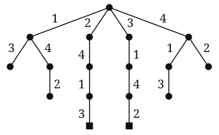</a>　(4)

对应于步骤 B2 的 $17$ 次执行. 这里用 $x_l$ 标记从树的第 $l-1$ 层到第 $l$ 层的一条边. (算法的第 $l$ 层实际上对应于树的第 $l-1$ 层, 因为这次讨论选用从 $1$ 到 $n$ 的下标来表示模式, 而没有用 $0$ 到 $n-1$.) 这棵树的<em>轮廓</em> $(p_0,p_1,\ldots,p_n)$, 也就是各层的结点数, 为 $(1,4,6,4,2)$. 可以看到, 解的个数 $p_n=p_4$ 为 $2$.

图 68 给出了 $n=8$ 时相应的树. 这棵树有 $2057$ 个结点, 其轮廓为 $(1,8,42,140,344,568,550,312,92)$. 可见, 回溯使我们得以提早截断查找, 在 $8^8=16\,777\,216$ 个可能的序列 $x_1\ldots x_8$ 中只考察了 $0.01\%$, 就找到了全部 $92$ 个解. (而在棋盘上放置八个皇后共有 $\binom{64}{8}=4\,426\,165\,368$ 种方法, $8^8$ 只占其中的 $0.38\%$.)

<a id="pdf-052"></a><a id="p-32"></a>
<a id="fig-68"></a>

<a href="../../assets/volume4b/figures/fig-068.svg">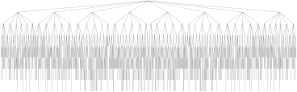</a>

**图 68.** 放置八个互不攻击的皇后所对应的回溯树.

注意, 在这个例子中, 算法 B 的时间大多花在根以下第 5 层附近. 这种行为很典型: 对于 $n=16$ 个皇后, 树有 $1\,141\,190\,303$ 个结点, 其轮廓为 $(1,16,210,2236,19688,141812,838816,3998456,15324708,46358876,108478966,193892860,260303408,253897632,171158018,72002088,14772512)$, 结点集中在第 12 层附近.

**数据结构.** 要考察一棵<em>巨大</em>的可能性之树时, 我们常常采用回溯程序设计. 因此希望在步骤 B3 中尽可能快地检验性质 $P_l$.

对于 $n$ 皇后问题, 算法 B 有一种实现方法完全不用辅助数据结构, 只在这一步作一连串顺序比较: “对于某个 $j<l$, 是否有 $x_l-x_j\in\{j-l,0,l-j\}$?” 假定每次引用 $x_j$ 都必须访问内存, 而 $x_l$ 的试探值放在寄存器中, 那么当 $n=16$ 时, 这种实现大约需要 $1120$ 亿次内存访问, 即每个结点约 $98$ 次.

引入三个简单的数组, 就能有所改进. (3) 中的性质 $P_l$ 归根结底是说, 各个 $x_k$ 互不相同, 各个 $x_k+k$ 也互不相同, 各个 $x_k-k$ 也互不相同. 因此可以采用辅助布尔数组 $a_1\ldots a_n$, $b_1\ldots b_{2n-1}$ 和 $c_1\ldots c_{2n-1}$. 这里 $a_j$ 表示 “某个 $x_k=j$”, $b_j$ 表示 “某个 $x_k+k-1=j$”, $c_j$ 表示 “某个 $x_k-k+n=j$”. 如果对算法 B 作如下改写, 更新和恢复这些数组都很方便.

**B1\*.** [初始化.] 置 $a_1\ldots a_n\gets0\ldots0$, $b_1\ldots b_{2n-1}\gets0\ldots0$, $c_1\ldots c_{2n-1}\gets0\ldots0$, $l\gets1$.

**B2\*.** [进入第 $l$ 层.] (此时 $P_{l-1}(x_1,\ldots,x_{l-1})$ 成立.) 若 $l>n$, 就访问 $x_1x_2\ldots x_n$, 并转到 B5\*. 否则置 $t\gets1$.

**B3\*.** [试 $t$.] 若 $a_t=1$、$b_{t+l-1}=1$ 或 $c_{t-l+n}=1$, 转到 B4\*. 否则置 $a_t\gets1$, $b_{t+l-1}\gets1$, $c_{t-l+n}\gets1$, $x_l\gets t$, $l\gets l+1$, 并转到 B2\*.

**B4\*.** [再试.] 若 $t<n$, 置 $t\gets t+1$, 并返回 B3\*.

**B5\*.** [回溯.] 置 $l\gets l-1$. 若 $l>0$, 置 $t\gets x_l$, $c_{t-l+n}\gets0$, $b_{t+l-1}\gets0$, $a_t\gets0$, 并返回 B4\*. (否则停止.)　▮

注意, 步骤 B5\* 以相反的次序恰好撤销了步骤 B3\* 所作的更新. 按逆序恢复是回溯算法的典型做法,<a id="pdf-053"></a><a id="p-33"></a> 但也有一些灵活性. 例如, 我们原来也可以在 $b_{t+l-1}$ 和 $c_{t-l+n}$ 之前恢复 $a_t$, 因为这些数组是彼此独立的.

借助辅助数组 $a,b,c$, 在步骤 B3\* 的开头很容易检验性质 $P_l$, 但我们在更新和恢复这些数组时也得访问内存. 会不会得不偿失呢? 幸而不会: 对于 $n=16$, 运行时间降至约 $340$ 亿次内存访问, 每个结点约 $30$ 次.

此外, 假定 $n\leq32$, 在寄存器为 64 位的机器上, 可以把位向量 $a,b,c$ 完全存放在寄存器内. 那样一来, 每个结点只需两次内存访问, 一次是存入 $x_l\gets t$, 另一次是日后取出 $t\gets x_l$. 不过这样就需要在寄存器中作相当多的计算.

**沃克的方法.** R. J. 沃克在 20 世纪 50 年代写的程序, 用稍有不同的方式组织回溯. 他在进入第 $l$ 层的每个结点时, 预先算出集合

$$
S_l\gets\bigl\{x\in D_l\mid P_l(x_1,\ldots,x_{l-1},x)\text{ 成立}\bigr\},\tag{5}
$$

并把它存起来, 这样就用不着让 $x_l$ 遍历 $D_l$ 的每个元素了. 这种计算往往可以一次高效地完成. 因为有些截断性质容许合并若干步骤, 逐个处理时就只好对每个 $x\in D_l$ 重复这些步骤. 实质上, 沃克采用的是算法 B 的下述变形.

**算法 W (沃克的回溯).** 给定上面所述的域 $D_k$ 和截断性质 $P_l$, 本算法访问满足 $P_n(x_1,x_2,\ldots,x_n)$ 的所有序列 $x_1x_2\ldots x_n$.

**W1.** [初始化.] 置 $l\gets1$, 并初始化以后要用的数据结构.

**W2.** [进入第 $l$ 层.] (现在 $P_{l-1}(x_1,\ldots,x_{l-1})$ 成立.) 若 $l>n$, 访问 $x_1x_2\ldots x_n$, 并转到 W4. 否则按 (5) 求出集合 $S_l$.

**W3.** [试向前进.] 若 $S_l$ 非空, 置 $x_l\gets\min S_l$, 更新数据结构以便计算 $S_{l+1}$, 置 $l\gets l+1$, 并转到 W2.

**W4.** [回溯.] 置 $l\gets l-1$. 若 $l>0$, 就撤销步骤 W3 所作的修改以恢复数据结构, 置 $S_l\gets S_l\setminus x_l$, 并退回 W3. (否则停止.)　▮

沃克把这个方法用于 $n$ 皇后问题, 其做法是计算 $S_l=U\setminus A_l\setminus B_l\setminus C_l$, 其中 $U=D_l=\{1,\ldots,n\}$, 而

$$
A_l=\{x_j\mid1\leq j<l\},\quad
B_l=\{x_j+j-l\mid1\leq j<l\},\quad C_l=\{x_j-j+l\mid1\leq j<l\}.\tag{6}
$$

他用位向量 $a,b,c$ 表示这些辅助集合. 它们同上面算法 B\* 的位向量类似, 但并不相同. 习题 10 表明, 对 $n$ 位数作按位运算, 就很容易完成步骤 W3 的更新, 而且步骤 W4 完全无须作恢复操作. 当 $n=16$ 时, 相应的运行时间仅为 $91$ 亿次内存访问, 即每个结点 $8$ 次.

令 $Q(n)$ 为 $n$ 皇后问题的解数. 那么有

| $n$ | 0 | 1 | 2 | 3 | 4 | 5 | 6 | 7 | 8 | 9 | 10 | 11 | 12 | 13 | 14 | 15 | 16 |
|---|---:|---:|---:|---:|---:|---:|---:|---:|---:|---:|---:|---:|---:|---:|---:|---:|---:|
| $Q(n)$ | 1 | 1 | 0 | 0 | 2 | 10 | 4 | 40 | 92 | 352 | 724 | 2680 | 14200 | 73712 | 365596 | 2279184 | 14772512 |

各个 $n\leq11$ 的值, 在 19 世纪就有好几个人独立算出来了. 小棋盘的情形比较容易, 但当 T. B. 斯普拉格<a id="pdf-054"></a><a id="p-34"></a> 算完 $Q(11)$ 时, 他说: “这是一桩非常繁重的工作, 几个月来占去了我大部分的闲暇时间. …… 我想, 除非有好几个人通力合作, 要算出更大棋盘的结果只怕是很难的.” [见 <em>Proc. Edinburgh Math. Soc.</em> **17** (1899), 43–68. 斯普拉格是他那个时代首屈一指的精算师.] 虽然如此, H. 奥嫩还是在 1910 年算出了 $Q(12)=14\,200$, 真是令人吃惊的手算功绩. [见 W. Ahrens, <em>Math. Unterhaltungen und Spiele</em> **2**, 第 2 版 (1918), 344.]

1960 年, R. J. 沃克在加利福尼亚大学洛杉矶分校用 SWAC 计算机和习题 10 的方法, 证实了这些来之不易的结果. 沃克还算出了 $Q(13)$, 但以当时可用的机器, 他已经不能再往前走了. 下一步的 $Q(14)$ 是迈克尔·D. 肯尼迪于 1963 年在田纳西大学算出的, 他为此独占了一台 IBM 1620 达 120 个小时. 1974 年, S. R. 邦奇在伊利诺伊大学用 IBM System 360-75 花了大约两小时求出 $Q(15)$. 随后, J. R. 比特纳在同一台计算机上采用改进的方法, 约三个小时便得到了 $Q(16)$.

计算机和算法当然一直在进步, 如今几乎转眼就能算出上述结果. 因此, 处在前沿的是越来越大的 $n$ 值. 2016 年, 托马斯·B. 普罗伊瑟和马蒂亚斯·R. 恩格尔哈特在德累斯顿工业大学算出了惊人的 $Q(27)=234\,907\,967\,154\,122\,528$, 恐怕一时还不会有人超过这一纪录! [见 <em>J. Signal Processing Systems</em> **88** (2017), 185–201. 这项分布式计算在一个由多种 FPGA 器件组成的动态集群上进行了 383 天. 这些器件在高峰时合计提供了 7000 多个专门设计的硬件求解器, 处理了 $2\,024\,110\,796$ 个相互独立的子问题.]

**排列和兰福德配对.** $n$ 皇后问题的每个解 $x_1\ldots x_n$ 都是 $\{1,\ldots,n\}$ 的一个排列, 其他许多问题也是以排列为基础的. 事实上, 我们已经见过算法 7.2.1.2X, 那就是专为某些特殊类型的排列设计的一个巧妙的回溯过程. 这个算法开始挑选 $x_l$ 的值时, 所有可供选择的元素 $\{1,2,\ldots,n\}\setminus\{x_1,\ldots,x_{l-1}\}$ 都可以方便地从一张链表中取得.

回到第 7 章开头讨论过的兰福德配对问题, 可以进一步认识这类数据结构. 可以把这个问题重新表述为, 求出 $\{1,2,\ldots,n\}\cup\{-1,-2,\ldots,-n\}$ 中具有以下性质的所有排列,

$$
x_j=k\quad\Longrightarrow\quad x_{j+k+1}=-k,\qquad 1\leq j\leq2n,\quad 1\leq k\leq n.\tag{7}
$$

例如, 当 $n=4$ 时, 有两个解, 即 $234\bar2 1\bar3\bar1\bar4$ 和 $413\bar1 2\bar4\bar3\bar2$. (照例, 用 $\bar1$ 写 $-1$, 用 $\bar2$ 写 $-2$, 如此等等, 颇为方便.) 注意, 如果 $x=x_1x_2\ldots x_{2n}$ 是一个解, 它的 “对偶” $-x^R=(-x_{2n})\ldots(-x_2)(-x_1)$ 也是解.

下面是由兰福德配对启发而对算法 7.2.1.2X 作的一种改写, 旧记号也略有调整, 以便同算法 B、W 的记号相配. 我们要维护指针 $p_0p_1\ldots p_n$, 使得选取 $x_l$ 时, 如果在 $x_1\ldots x_{l-1}$ 中尚未出现的正整数为 $k_1<k_2<\cdots<k_t$, 那么便有如下链表,

$$
p_0=k_1,\quad p_{k_1}=k_2,\quad\ldots,\quad p_{k_{t-1}}=k_t,\quad p_{k_t}=0.\tag{8}
$$

原来这个条件很容易维持.

<a id="pdf-055"></a><a id="p-35"></a>

**算法 L (兰福德配对).** 本算法按字典序访问 (7) 的所有解 $x_1\ldots x_{2n}$, 采用满足 (8) 的指针 $p_0p_1\ldots p_n$, 并利用辅助数组 $y_1\ldots y_{2n}$ 作回溯.

**L1.** [初始化.] 置 $x_1\ldots x_{2n}\gets0\ldots0$. 对 $0\leq k<n$ 置 $p_k\gets k+1$, 再置 $p_n\gets0$, $l\gets1$.

**L2.** [进入第 $l$ 层.] 置 $k\gets p_0$. 若 $k=0$, 访问 $x_1x_2\ldots x_{2n}$, 并转到 L5. 否则置 $j\gets0$, 然后只要 $x_l<0$ 就置 $l\gets l+1$.

**L3.** [试 $x_l=k$.] (此时有 $k=p_j$.) 若 $l+k+1>2n$, 转到 L5. 否则, 若 $x_{l+k+1}=0$, 就置 $x_l\gets k$, $x_{l+k+1}\gets-k$, $y_l\gets j$, $p_j\gets p_k$, $l\gets l+1$, 并返回 L2.

**L4.** [再试.] (以 $x_1\ldots x_{l-1}k$ 或更小的序列开头的解都已找到.) 置 $j\gets k$, $k\gets p_j$. 若 $k\ne0$, 转到 L3.

**L5.** [回溯.] 置 $l\gets l-1$. 若 $l>0$, 作如下处理: 只要 $x_l<0$, 就置 $l\gets l-1$. 然后置 $k\gets x_l$, $x_l\gets0$, $x_{l+k+1}\gets0$, $j\gets y_l$, $p_j\gets k$, 并返回 L4. 否则算法终止.　▮

仔细研究这些步骤, 就能看出各部分怎样恰到好处地配合起来. 例如, 步骤 L3 只要置 $p_j\gets p_k$, 就从链表 (8) 中删除了 $k$. 这一步还依照 (7) 置 $x_{l+k+1}\gets-k$, 因此以后在步骤 L2 中遇到位置 $l+k+1$ 时, 可以跳过它.

算法 L 的要点, 是步骤 L5 用了一个颇为微妙的做法, 只把 $p_j$ 置为 $k$, 就撤销了删除操作. 指针 $p_k$ 原来指向表中下一个元素的链仍然完好, <em>因为其间的更新都没有改动过 $p_k$.</em> (请想一想.) 这就是我们将在 7.2.2.1 节探讨的 “舞蹈链” 思想的萌芽.

为了画出算法 L 在一次运行中所对应的查找树, 可以像 (4) 那样, 用 $x_l$ 的正值选择来标记边, 而在结点旁标出步骤 L2 中跳过的那些先前已经置定的负值. 例如, $n=4$ 时的树为

<a href="../../assets/volume4b/figures/langford-tree.svg">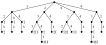</a>　(9)

解出现在树的深度 $n$ 处, 尽管每个解包含 $2n$ 个值 $x_1x_2\ldots x_{2n}$.

算法 L 有时会走上一条错路, 等到比必需的深度还多探查了几层才发觉. 注意, 只有在 $l+k+1\leq2n$ 时才有可能取 $x_l=k$. 因此, 如果 $l$ 达到 $2n-k-1$ 时还没见过 $k$, 就<em>只能</em>选择 $x_l=k$. 例如, (9) 中的分支 $12\bar1$ 无须再往下走, 因为 4 必须出现在 $\{x_1,x_2,x_3\}$ 中. 习题 20 说明怎样把这条截断原则应用于算法 L. 当 $n=17$ 时, 查找树的结点数由 $1.29$ 万亿减为 $3300$ 亿,<a id="pdf-056"></a><a id="p-36"></a> 运行时间则从 $25.0$ 万亿次内存访问减为 $8.1$ 万亿次. (由于增加了截断检验, 每个结点的工作量已从 $19.4$ 次内存访问增至 $24.4$ 次, 不过总的工作量仍然显著减少.)

此外, 如果保证一个解和它的对偶不会都被考察, 就可以 “破除对称性”. 习题 21 用到这个思想, 使查找树缩减至仅 $1600$ 亿个结点, 只花费 $3.94$ 万亿次内存访问, 即每个结点 $24.6$ 次.

**单词矩形.** 下面来看一个查找域 $D_l$ 大得多的问题. 一个 $m\times n$ <em>单词矩形</em>是一个由 $n$ 字母单词构成的数组,[^v4b-36-words] 它的各列是 $m$ 字母单词. 例如,

$$
\begin{matrix}
\mathtt S&\mathtt T&\mathtt A&\mathtt T&\mathtt U&\mathtt S\\
\mathtt L&\mathtt O&\mathtt W&\mathtt E&\mathtt S&\mathtt T\\
\mathtt U&\mathtt T&\mathtt O&\mathtt P&\mathtt I&\mathtt A\\
\mathtt M&\mathtt A&\mathtt K&\mathtt I&\mathtt N&\mathtt G\\
\mathtt S&\mathtt L&\mathtt E&\mathtt D&\mathtt G&\mathtt E
\end{matrix}\tag{10}
$$

是一个 $5\times6$ 的单词矩形, 它的各列都属于 `WORDS(5757)`, 即《斯坦福图库》中的五字母单词集. 为了求出这些模式, 可以假定第 $l$ 列是按常用程度排在第 $x_l$ 位的五字母单词, $1\leq x_l\leq5757$, $1\leq l\leq6$. 因此选取各列共有 $5757^6=36\,406\,369\,848\,837\,732\,146\,649$ 种方法. 在 (10) 中, $x_1\ldots x_6=1446\ 185\ 1021\ 2537\ 66\ 255$. 当然, 这样的选择极少能在行上也构成合适的单词, 但我们希望借回溯之助, 能在合理的时间内找到所有的解.

为了让算法 B 处理这个问题, 可以把 $n$ 字母单词存入一个检索结构 (trie, 见 6.3 节). 对于合法单词的每个 $l$ 字母前缀, 检索结构中有一个大小为 26 的结点, 其中 $0\leq l\leq n$.

例如, 当 $n=6$ 时, 这样的一个检索结构用 $23\,667$ 个结点表示 $15\,727$ 个单词. 前缀 `ST` 对应于结点 260, 其 26 个表项为

$$
(484,0,0,0,1589,0,0,0,2609,0,0,0,0,0,1280,0,0,251,0,0,563,0,0,0,1621,0).\tag{11}
$$

这表示 `STA` 是结点 484, `STE` 是结点 1589, …… , `STY` 是结点 1621, 而没有以 `STB`、`STC`、……、`STX`、`STZ` 开头的六字母单词. 对于长度为 $n-1$ 的前缀, 采用稍有不同的约定. 例如, 结点 580 即 `CORNE` 的表项为

$$
(3879,0,0,3878,0,0,0,0,0,0,0,9602,0,0,0,0,0,171,0,5013,0,0,0,0,0,0),\tag{12}
$$

意思是 `CORNEA`、`CORNED`、`CORNEL`、`CORNER` 和 `CORNET` 在六字母单词表中的名次分别是 3879、3878、9602、171 和 5013.


<a id="pdf-057"></a><a id="p-37"></a>

假定 $x_1$ 和 $x_2$ 像 (10) 中那样, 分别指定五字母列单词 `SLUMS` 和 `TOTAL`. 这时, 检索结构告诉我们, 下一个列单词 $x_3$ 必须具有 $c_1c_2c_3c_4c_5$ 的形式, 其中 $c_1\in\{\mathtt A,\mathtt E,\mathtt I,\mathtt O,\mathtt R,\mathtt U,\mathtt Y\}$, $c_2\notin\{\mathtt E,\mathtt H,\mathtt J,\mathtt K,\mathtt Y,\mathtt Z\}$, $c_3\in\{\mathtt E,\mathtt M,\mathtt O,\mathtt T\}$, $c_4\notin\{\mathtt A,\mathtt B,\mathtt O\}$, $c_5\in\{\mathtt A,\mathtt E,\mathtt I,\mathtt O,\mathtt U,\mathtt Y\}$. (这样的单词有 62 个.)

设 $a_{l1}\ldots a_{lm}$ 为部分解已选定头 $l$ 列时, 各行前缀所对应的检索结构结点. 有了这个辅助数组, 算法 B 就能找出单词矩形问题的全部解, 如习题 24 所述. 按照我们的约定, 合法的 $5\times6$ 单词矩形恰有 $625\,415$ 个, 用习题 24 的方法找出它们全部, 大约需要 19 万亿次内存访问. 事实上, 查找树的轮廓是

$$
(1,\ 5757,\ 2458830,\ 360728099,\ 579940198,\ 29621728,\ 625415),\tag{13}
$$

例如这表明, 对于 $x_1x_2x_3$ 的 $5757^3=190\,804\,533\,093$ 种选择, 只有 $360\,728\,099$ 种能够给出六字母单词的合法前缀.

注意到在 $1\leq l\leq n$ 时, 查找树的每个结点都要在步骤 B3 中检验 $x_l$ 的 5757 种可能性, 稍费一点心思, 就能把习题 24 的运行时间大大缩短. 如果为五字母单词建立一个更精细的数据结构, 使得遍历指定位置上具有指定字母的所有单词很容易, 就能改进算法, 使各层平均需要考察的可能性数目降到

$$
(5757.0,\ 1697.9,\ 844.1,\ 273.5,\ 153.5,\ 100.8).\tag{14}
$$

于是总运行时间降到 1.15 万亿次内存访问. 详见习题 25. 习题 28 讨论的方法还要更快.

**无逗号码.** 下一个例子净是些<em>四个字母</em>的词. 不过别误会, 这里没有粗话, 倒有一个引人入胜的编码理论问题. 我们要找出一个由四字母码字组成的集合, 即使在码字之间不加空格或其他分隔符, 仍然能够译码. 把集合中的串一个接一个地连起来, `likethis`, 就得到一则消息. 取其中任意七个连续字母 $\ldots x_1x_2x_3x_4x_5x_6x_7\ldots$, 四个四字母子串 $x_1x_2x_3x_4$, $x_2x_3x_4x_5$, $x_3x_4x_5x_6$, $x_4x_5x_6x_7$ 中应当恰有一个是码字. 等价地说, 若 $x_1x_2x_3x_4$ 和 $x_5x_6x_7x_8$ 是码字, 那么 $x_2x_3x_4x_5$、$x_3x_4x_5x_6$ 和 $x_4x_5x_6x_7$ 都不是码字. (例如, `iket` 就不是.) 这样的集合称为长度为四的 “无逗号码” 或 “自同步分组码”.

无逗号码由 F. H. C. 克里克、J. S. 格里菲思和 L. E. 奥格尔引入 [<em>Proc. National Acad. Sci.</em> **43** (1957), 416–421], S. W. 戈洛姆、B. 戈登和 L. R. 韦尔奇又作了进一步研究 [<em>Canadian Journal of Mathematics</em> **10** (1958), 202–209]. 他们考虑的是 $m$ 个字母的字母表和 $n$ 字母码字的一般情形. 当 $n=2,3,5,7,9,11,13,15$ 时, 他们对所有 $m$ 都构造出了最优无逗号码. 后来对于 $n=17,19,21,\ldots$ 也找到了适用于所有 $m$ 的最优码 (见习题 37). 这里我们集中讨论四字母的情形 ($n=4$), 一方面因为这个情形远没有解决, 更重要的是, 寻找这类码的过程特别富有启发性. 事实上, 由这番讨论我们将自然地认识到几种对一般回溯程序设计都很重要的技术.

<a id="pdf-058"></a><a id="p-38"></a>

首先, 立刻可以看出, 无逗号码的码字不可能是 “周期的”, 像 `dodo` 或 `gaga` 那样. 把这样的串连写两遍, 它自己就已经在中间出现了. 因此只须考虑像 `item` 那样的<em>非周期</em>串, 共 $m^4-m^2$ 个. 还要注意, 如果选取了 `item`, 就不能再收入它的任何循环移位 `temi`、`emit` 或 `mite`, 因为它们都出现在 `itemitem` 之中. 所以一个无逗号码的码字数至多为 $(m^4-m^2)/4$.

例如, 考虑二元情形 $m=2$, 这时最大数目为 $3$. 能不能从下面每个循环类中各选一个四位的 “字”,

$$
\begin{aligned}
[0001]&=\{0001,0010,0100,1000\},\\
[0011]&=\{0011,0110,1100,1001\},\\
[0111]&=\{0111,1110,1101,1011\},
\end{aligned}\tag{15}
$$

使得所得的码是无逗号的呢? 能. 在这个例子中, 只要从每一类里选出最小的字, 即 $0001,0011,0111$, 就得到一个解. (细心的读者会想起, 我们在 7.2.1.1 节研究过<em>任意</em>非周期串的循环类中最小的字. 当时把这样的字称为<em>素串</em>, 并证明了素串的一些非凡性质.)

可是当 $m=3$, 有 $(81-9)/4=18$ 个循环类时, 这招就行不通了. 选了 $0001$ 和 $0011$ 以后, 我们再也不能选 $1112$. 事实上, 一个同时包含 $0001$ 和 $1112$ 的码, 既不能包含 $0011$, 也不能包含 $0111$.

我们可以系统地在 18 层上回溯, 在 $[0001]$ 中选 $x_1$, 在 $[0011]$ 中选 $x_2$, 等等. 一旦发现 $\{x_1,x_2,\ldots,x_l\}$ 不是无逗号码, 就像算法 B 那样排除 $x_l$. 例如, 若 $x_1=0010$, 并且试取 $x_2=1001$, 这种做法就会回溯, 因为 $x_1$ 出现在 $x_2x_1$ 内部.

但这种朴素策略总要等到作出了坏的选择才发现走不通, 还有很大的改进余地. 假如聪明些, 稍微向前看一看, 我们原本连 $x_2=1001$ 都不必考虑. 事实上, 选了 $x_1=0010$ 之后, 就能自动排除以后<em>所有</em>具有 $\mathord{*}001$ 这种形式的字, 如 $m\geq3$ 时的 $2001$ 和 $m\geq4$ 时的 $3001$.

再如, 假定我们选了 $x_1=0001$ 和 $x_2=0011$, 剪枝的效果还要更好. 这时可以立即排除一切具有 $1{*}{*}{*}$ 或 $\mathord{*}{*}{*}0$ 形式的字, 因为 $x_1 1{*}{*}{*}$ 中包含 $x_2$, 而 $\mathord{*}{*}{*}0x_2$ 中包含 $x_1$. 当 $m\geq3$ 时, 现在就能断定, 类 $[0002],[0021],[0111],[0211],[1112]$ 的代表<em>必须</em>分别为 $0002,0021,0111,0211,2111$. 这几类中其余的三种可能性全被排除干净了!

可见有必要采用一种向前看的机制.

**动态安排选择次序.** 此外, 从这个例子可以看出, 在算法 B 的框架中要满足一般性质 $P_n(x_1,x_2,\ldots,x_n)$ 时, 先选 $x_1$, 再选 $x_2$, 再选 $x_3$, 如此顺次选下去, 并不总是好主意. 也许我们应该先选, 譬如说 $x_5$, 然后再根据为 $x_5$ 选定的具体值去选另一个 $x_j$, 这样查找树会小得多. 某些次序可能比别的次序更容易截断查找, 而树的每个分支都可以自由决定选择变量的次序.

<a id="pdf-059"></a><a id="p-39"></a>

的确, 对于三元四元组的无逗号码问题, 题目本身并没有指出该按什么次序考察那 18 个类, 才容易使查找树变小. 因此, 与其把这些选择称为 $x_1,x_2,\ldots,x_{18}$, 不如用各个类的名字来标识它们, 即 $x_{0001},x_{0002},x_{0011},x_{0012},x_{0021},x_{0022},x_{0102},x_{0111},x_{0112},x_{0121},x_{0122},x_{0211},x_{0212},x_{0221},x_{0222},x_{1112},x_{1122},x_{1222}$. (算法 7.2.1.1F 是生成这些名字的好办法.) 于是, 在查找树的每个结点上, 都可以依据先前的选择而挑一个便于分支的变量. 在第 1 层从 $x_{0001}\gets0001$ 开始以后, 我们也许决定在第 2 层试 $x_{0011}\gets0011$. 那么, 正如刚才所见, $x_{0002}\gets0002$, $x_{0021}\gets0021$, $x_{0111}\gets0111$, $x_{0211}\gets0211$, $x_{1112}\gets2111$ 这五步就都是非走不可的, 应当在第 3 至第 7 层作出这些选择.

而且, 作出这几步强制选择以后, 结果表明它们不会再迫使我们作别的选择. 不过, $x_{0012}$ 将只剩下两个可能值, 而 $x_{0122}$ 还有三个, 因此在第 8 层, 选 $x_{0012}$ 来分支大概更明智. (顺便说一句, 还可以证明, <em>除</em> $m=2$ 以外, <em>不存在</em>满足 $x_{0001}=0001$, $x_{0011}=0011$ 而有 $(m^4-m^2)/4$ 个码字的无逗号码.)

把算法 B 和 W 改成允许动态定序是很容易的. 可以给查找树的每个结点设置一个 “帧”, 记下当前赋值的变量及所选择的值. 这样选定变量并给它一个值, 可以称为回溯过程走的一 “步”.

即使在已经作过回溯之后, 动态定序仍能派上用场. 接着上面的例子, 假定 $x_{0001}=0001$, 而 $x_{0011}=0011$ 的一切情形都已经探索完毕. 我们接下来并非必须去试 $x_{0011}$ 的另一个值. 固然要记住, 在 $x_{0001}$ 改变之前, 不应再把 $0011$ 看作合法的选择, 可是我们完全可以决定在第 2 层改试 $x_{0002}\gets2000$ 之类的情形. 事实上, 有了 $0001$, 很快就能看出 $x_{0002}=2000$ 不可能 (见习题 39). 在第 2 层还有个更有效的选择 $x_{0012}\gets0012$, 因为这个分支会立即迫使我们取 $x_{0002}\gets0002$, $x_{0022}\gets0022$, $x_{0122}\gets0122$, $x_{0222}\gets0222$, $x_{1222}\gets1222$, $x_{0011}\gets1001$.

**再论顺序分配.** 选取要用来分支的变量及其值, 其间的权衡颇为微妙. 我们当然不想为制定一个好计划而花去比这个计划所能节省的还要多的时间.

要从动态定序中得到好处, 就需要高效的数据结构, 不用多少斟酌就能作出好的决定. 另一方面, 每当转入新的一层, 精细的数据结构都得更新, 每当从该层返回, 又得恢复. 算法 L 展示了一种利用链表的高效机制. 不过, 顺序分配的表往往更有吸引力, 因为它们有利于利用高速缓存, 所需的内存访问次数也较少.

假定我们想用一张无序的顺序表表示一个集合. 表从 `HEAD` 所指的存储单元开始, `TAIL` 则指向紧接在表末尾之后的位置. 例如,

<a href="../../assets/volume4b/figures/sequential-list-16.svg"></a>　(16)

<a id="pdf-060"></a><a id="p-40"></a>

就是表示集合 $\{1,3,4,9\}$ 的一种办法. 当前集合中的项数为 $\mathtt{TAIL}-\mathtt{HEAD}$, 因此 $\mathtt{TAIL}=\mathtt{HEAD}$ 当且仅当表为空. 若已知 $x$ 不在表中, 要插入新项 $x$, 只需置

$$
\mathtt{MEM[TAIL]}\gets x,\qquad \mathtt{TAIL}\gets\mathtt{TAIL}+1.\tag{17}
$$

反过来, 如果 $\mathtt{HEAD}\leq\mathtt P<\mathtt{TAIL}$, 就很容易删除 $\mathtt{MEM[P]}$,

$$
\mathtt{TAIL}\gets\mathtt{TAIL}-1,\qquad
\text{若 }\mathtt P\ne\mathtt{TAIL},\ \text{置 }\mathtt{MEM[P]}\gets\mathtt{MEM[TAIL]}.\tag{18}
$$

(在 (17) 中我们已默认, 每次插入新项时都有单元 `MEM[TAIL]` 可用. 否则还得检验内存溢出.)

不知道一项在 `MEM` 中的位置, 就不能把它从表中删除. 因此, 假定一切项 $x$ 都在范围 $0\leq x<M$ 内, 我们往往还希望维持一张 “逆表”. 例如, 当 $M=10$ 时, (16) 就变成下图.

<a href="../../assets/volume4b/figures/sequential-list-19.svg">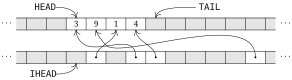</a>　(19)

(带阴影的单元内容未定义.) 采用这种安排, 插入操作 (17) 就变成

$$
\mathtt{MEM[TAIL]}\gets x,\qquad \mathtt{MEM}[\mathtt{IHEAD}+x]\gets\mathtt{TAIL},\qquad
\mathtt{TAIL}\gets\mathtt{TAIL}+1,\tag{20}
$$

而 `TAIL` 永远不会超过 $\mathtt{HEAD}+M$. 类似地, 删除 $x$ 的操作变为

$$
\begin{aligned}
&\mathtt P\gets\mathtt{MEM}[\mathtt{IHEAD}+x],\qquad \mathtt{TAIL}\gets\mathtt{TAIL}-1.\\
&\text{若 }\mathtt P\ne\mathtt{TAIL},\ \text{置 }y\gets\mathtt{MEM[TAIL]},\
\mathtt{MEM[P]}\gets y,\ \mathtt{MEM}[\mathtt{IHEAD}+y]\gets\mathtt P.
\end{aligned}\tag{21}
$$

例如, 从 (19) 删除 9 以后, 我们会得到

<a href="../../assets/volume4b/figures/sequential-list-22.svg">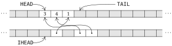</a>　(22)

在较为复杂的情形下, 我们还想检验给定的项 $x$ 是否在表中. 为此, 可以在逆表里保留更多信息. 有一种特别有用的变形: 从 `HEAD` 开始的表含有 $\{\mathtt{HEAD},\mathtt{HEAD}+1,\ldots,\mathtt{HEAD}+M-1\}$ 的一个<em>完整排列</em>, 而从 `IHEAD` 开始的存储单元含有它的逆排列, 尽管只有从 `HEAD` 开始的表的头 $\mathtt{TAIL}-\mathtt{HEAD}$ 个元素被视为 “有效” 的.

例如, 在 $m=3$ 的无逗号码问题中, 可以先把代表 $M=18$ 个循环类 $[0001],[0002],\ldots,[1222]$ 的项放入从 `HEAD` 到 $\mathtt{HEAD}+17$ 的存储单元. 起初它们全都有效, $\mathtt{TAIL}=\mathtt{HEAD}+18$, 且对 $0\leq c<18$ 有 $\mathtt{MEM}[\mathtt{IHEAD}+c]=\mathtt{HEAD}+c$. 随后每当我们决定为类 $c$ 选择一个码字时, 就把 $c$ 从有效表中删除,<a id="pdf-061"></a><a id="p-41"></a> 用的是 (21) 的一种加强形式, 它能维持完整的排列,

$$
\begin{aligned}
&\mathtt P\gets\mathtt{MEM}[\mathtt{IHEAD}+c],\qquad \mathtt{TAIL}\gets\mathtt{TAIL}-1.\\
&\text{若 }\mathtt P\ne\mathtt{TAIL},\ \text{置 }y\gets\mathtt{MEM[TAIL]},\
\mathtt{MEM[TAIL]}\gets c,\ \mathtt{MEM[P]}\gets y,\\
&\qquad\qquad \mathtt{MEM}[\mathtt{IHEAD}+c]\gets\mathtt{TAIL},\
\mathtt{MEM}[\mathtt{IHEAD}+y]\gets\mathtt P.
\end{aligned}\tag{23}
$$

以后回溯到要让 $c$ 再度有效的状态时, 只须置 $\mathtt{TAIL}\gets\mathtt{TAIL}+1$, 因为 $c$ 早已在那里等着了! (这种组织数据的技术称为<em>稀疏集表示</em>, 见 P. Briggs 和 L. Torczon, <em>ACM Letters Prog. Lang. and Syst.</em> **2** (1993), 59–69.)

**无逗号码问题所用的表.** 若 $m=3$, 只涉及 18 个循环类, 求出一切码字数最大的四字母无逗号码还不难. 然而到了 $m=4$ 就已经相当有挑战性, 因为要处理 $(4^4-4^2)/4=60$ 个类. 因此, 在把这个问题安排成适合回溯的形式时, 值得仔细考虑一番.

从上面 $m=3$ 的几个例子可以看出, 我们会反复想知道这样一些问题的答案: “还剩多少个形如 $02{*}{*}$ 的字可以选作码字?” 看来需要设置专供这类查询用的冗余数据结构. 幸好我们将会看到, 采用 (19)–(23) 那样的顺序表, 就有一个很好的办法来提供这些结构.

在下面的算法 C 中, 查找无逗号码的过程中, $m^4$ 个四字母的字各处于三种状态之一. 若 $x$ 已列入当前暂定的码字集合, 它就是<em>绿色</em>的. 若目前不能选它, 或者因为它同已有的绿色字不相容, 或者因为它与这些绿色字并存而本身也为绿色的一切情形都已考察过, 它就是<em>红色</em>的. 其余的字都是<em>蓝色</em>的, 有点悬而未决, 算法可能让它变红, 也可能让它变绿. 最初除了 $m^2$ 个周期字永远是红色以外, 所有的字都是蓝色.

用希腊字母 $\alpha$ 表示四字母的字 $x$ 以 $m$ 为基数时的整数值. 例如, 如果 $m=3$, $x$ 为 $0102$, 那么 $\alpha=(0102)_3=11$. $x$ 的当前状态保存在 $\mathtt{MEM}[\alpha]$ 中, 采用任选的三个内部编码, 即 $2$ (`GREEN`)、$0$ (`RED`) 或 $1$ (`BLUE`).

算法最重要的特点是, <em>每个蓝色字 $x=x_1x_2x_3x_4$ 都可能同时出现在七张不同的表中</em>. 这些表称为 $\mathtt{P1}(x),\mathtt{P2}(x),\mathtt{P3}(x),\mathtt{S1}(x),\mathtt{S2}(x),\mathtt{S3}(x),\mathtt{CL}(x)$, 其中

- $\mathtt{P1}(x),\mathtt{P2}(x),\mathtt{P3}(x)$ 分别为匹配 $x_1{*}{*}{*},x_1x_2{*}{*},x_1x_2x_3{*}$ 的蓝色字,
- $\mathtt{S1}(x),\mathtt{S2}(x),\mathtt{S3}(x)$ 分别为匹配 $\mathord{*}{*}{*}x_4,\mathord{*}{*}x_3x_4,\mathord{*}x_2x_3x_4$ 的蓝色字,
- $\mathtt{CL}(x)$ 收容 $\{x_1x_2x_3x_4,x_2x_3x_4x_1,x_3x_4x_1x_2,x_4x_1x_2x_3\}$ 中的蓝色字.

这七张表在 `MEM` 中的起始地址分别是 $\mathtt{P1OFF}+p_1(\alpha),\mathtt{P2OFF}+p_2(\alpha),\mathtt{P3OFF}+p_3(\alpha),\mathtt{S1OFF}+s_1(\alpha),\mathtt{S2OFF}+s_2(\alpha),\mathtt{S3OFF}+s_3(\alpha),\mathtt{CLOFF}+4\operatorname{cl}(\alpha)$. 这里 $(\mathtt{P1OFF},\mathtt{P2OFF},\mathtt{P3OFF},\mathtt{S1OFF},\mathtt{S2OFF},\mathtt{S3OFF},\mathtt{CLOFF})$ 分别为 $(2m^4,5m^4,8m^4,11m^4,14m^4,17m^4,20m^4)$. 我们定义 $p_1((x_1x_2x_3x_4)_m)=(x_{1}000)_m$, $p_2((x_1x_2x_3x_4)_m)=(x_1x_{2}00)_m$, $p_3((x_1x_2x_3x_4)_m)=(x_1x_2x_{3}0)_m$, 以及 $s_1((x_1x_2x_3x_4)_m)=(x_{4}000)_m$, $s_2((x_1x_2x_3x_4)_m)=(x_3x_{4}00)_m$, $s_3((x_1x_2x_3x_4)_m)=(x_2x_3x_{4}0)_m$. 最后, $\operatorname{cl}((x_1x_2x_3x_4)_m)$ 是分配给各个类的一个内部编号, 其值介于 0 与<a id="pdf-062"></a><a id="p-42"></a> $(m^4-m^2)/4-1$ 之间. 在这七张表中, $x$ 所在的七个 `MEM` 地址分别保存在七张逆表中, 这些逆表在 `MEM` 中的起始地址为 $\mathtt{P1OFF}-m^4+\alpha$, $\mathtt{P2OFF}-m^4+\alpha$, …… , $\mathtt{CLOFF}-m^4+\alpha$. 而表示当前表长的 `TAIL` 指针, 如 (19)–(23) 所示, 分别存于 `MEM` 的 $\mathtt{P1OFF}+m^4+p_1(\alpha)$, $\mathtt{P2OFF}+m^4+p_2(\alpha)$, …… , $\mathtt{S3OFF}+m^4+s_3(\alpha)$, $\mathtt{CLOFF}+m^4+4\operatorname{cl}(\alpha)$ 各处. (呼! 都弄清楚了吗?)

这一整套装置占用 `MEM` 的 $22m^4$ 个单元. 表 1 给出 $m=2$ 时计算刚开始的情形. 幸而实际情况并不像乍看起来那么复杂. 所占的空间也算不上特别大: 毕竟即使 $m=5$, $22m^4$ 也才是 $13\,750$.

<a id="tab-7-2-2-1"></a>

**表 1　算法 C 在进入第 1 层时所用的表 ($m=2$)**

<table>
<thead><tr><th></th><th scope="col"><code>0</code></th><th scope="col"><code>1</code></th><th scope="col"><code>2</code></th><th scope="col"><code>3</code></th><th scope="col"><code>4</code></th><th scope="col"><code>5</code></th><th scope="col"><code>6</code></th><th scope="col"><code>7</code></th><th scope="col"><code>8</code></th><th scope="col"><code>9</code></th><th scope="col"><code>a</code></th><th scope="col"><code>b</code></th><th scope="col"><code>c</code></th><th scope="col"><code>d</code></th><th scope="col"><code>e</code></th><th scope="col"><code>f</code></th><th></th></tr></thead>
<tbody>
<tr><th scope="row"><code>0</code></th><td><code>RED</code></td><td><code>BLUE</code></td><td><code>BLUE</code></td><td><code>BLUE</code></td><td><code>RED</code></td><td><code>RED</code></td><td><code>BLUE</code></td><td><code>BLUE</code></td><td><code>RED</code></td><td><code>BLUE</code></td><td><code>RED</code></td><td><code>BLUE</code></td><td><code>BLUE</code></td><td><code>BLUE</code></td><td><code>BLUE</code></td><td><code>RED</code></td><td></td></tr>
</tbody>
<tbody>
<tr><th scope="row"><code>10</code></th><td></td><td><code>20</code></td><td><code>21</code></td><td><code>22</code></td><td></td><td></td><td><code>23</code></td><td><code>24</code></td><td></td><td><code>29</code></td><td></td><td><code>2c</code></td><td><code>28</code></td><td><code>2b</code></td><td><code>2a</code></td><td></td><th rowspan="3" scope="rowgroup"><code>P1</code></th></tr>
<tr><th scope="row"><code>20</code></th><td><code>0001</code></td><td><code>0010</code></td><td><code>0011</code></td><td><code>0110</code></td><td><code>0111</code></td><td></td><td></td><td></td><td><code>1100</code></td><td><code>1001</code></td><td><code>1110</code></td><td><code>1101</code></td><td><code>1011</code></td><td></td><td></td><td></td></tr>
<tr><th scope="row"><code>30</code></th><td><code>25</code></td><td></td><td></td><td></td><td></td><td></td><td></td><td></td><td><code>2d</code></td><td></td><td></td><td></td><td></td><td></td><td></td><td></td></tr>
</tbody>
<tbody>
<tr><th scope="row"><code>40</code></th><td></td><td><code>50</code></td><td><code>51</code></td><td><code>52</code></td><td></td><td></td><td><code>54</code></td><td><code>55</code></td><td></td><td><code>58</code></td><td></td><td><code>59</code></td><td><code>5c</code></td><td><code>5e</code></td><td><code>5d</code></td><td></td><th rowspan="3" scope="rowgroup"><code>P2</code></th></tr>
<tr><th scope="row"><code>50</code></th><td><code>0001</code></td><td><code>0010</code></td><td><code>0011</code></td><td></td><td><code>0110</code></td><td><code>0111</code></td><td></td><td></td><td><code>1001</code></td><td><code>1011</code></td><td></td><td></td><td><code>1100</code></td><td><code>1110</code></td><td><code>1101</code></td><td></td></tr>
<tr><th scope="row"><code>60</code></th><td><code>53</code></td><td></td><td></td><td></td><td><code>56</code></td><td></td><td></td><td></td><td><code>5a</code></td><td></td><td></td><td></td><td><code>5f</code></td><td></td><td></td><td></td></tr>
</tbody>
<tbody>
<tr><th scope="row"><code>70</code></th><td></td><td><code>80</code></td><td><code>82</code></td><td><code>83</code></td><td></td><td></td><td><code>86</code></td><td><code>87</code></td><td></td><td><code>88</code></td><td></td><td><code>8a</code></td><td><code>8c</code></td><td><code>8d</code></td><td><code>8e</code></td><td></td><th rowspan="3" scope="rowgroup"><code>P3</code></th></tr>
<tr><th scope="row"><code>80</code></th><td><code>0001</code></td><td></td><td><code>0010</code></td><td><code>0011</code></td><td></td><td></td><td><code>0110</code></td><td><code>0111</code></td><td><code>1001</code></td><td></td><td><code>1011</code></td><td></td><td><code>1100</code></td><td><code>1101</code></td><td><code>1110</code></td><td></td></tr>
<tr><th scope="row"><code>90</code></th><td><code>81</code></td><td></td><td><code>84</code></td><td></td><td><code>84</code></td><td></td><td><code>88</code></td><td></td><td><code>89</code></td><td></td><td><code>8b</code></td><td></td><td><code>8e</code></td><td></td><td><code>8f</code></td><td></td></tr>
</tbody>
<tbody>
<tr><th scope="row"><code>a0</code></th><td></td><td><code>b8</code></td><td><code>b0</code></td><td><code>b9</code></td><td></td><td></td><td><code>b1</code></td><td><code>bb</code></td><td></td><td><code>ba</code></td><td></td><td><code>bd</code></td><td><code>b2</code></td><td><code>bc</code></td><td><code>b3</code></td><td></td><th rowspan="3" scope="rowgroup"><code>S1</code></th></tr>
<tr><th scope="row"><code>b0</code></th><td><code>0010</code></td><td><code>0110</code></td><td><code>1100</code></td><td><code>1110</code></td><td></td><td></td><td></td><td></td><td><code>0001</code></td><td><code>0011</code></td><td><code>1001</code></td><td><code>0111</code></td><td><code>1101</code></td><td><code>1011</code></td><td></td><td></td></tr>
<tr><th scope="row"><code>c0</code></th><td><code>b4</code></td><td></td><td></td><td></td><td></td><td></td><td></td><td></td><td><code>be</code></td><td></td><td></td><td></td><td></td><td></td><td></td><td></td></tr>
</tbody>
<tbody>
<tr><th scope="row"><code>d0</code></th><td></td><td><code>e4</code></td><td><code>e8</code></td><td><code>ec</code></td><td></td><td></td><td><code>e9</code></td><td><code>ed</code></td><td></td><td><code>e5</code></td><td></td><td><code>ee</code></td><td><code>e0</code></td><td><code>e6</code></td><td><code>ea</code></td><td></td><th rowspan="3" scope="rowgroup"><code>S2</code></th></tr>
<tr><th scope="row"><code>e0</code></th><td><code>1100</code></td><td></td><td></td><td></td><td><code>0001</code></td><td><code>1001</code></td><td><code>1101</code></td><td></td><td><code>0010</code></td><td><code>0110</code></td><td><code>1110</code></td><td></td><td><code>0011</code></td><td><code>0111</code></td><td><code>1011</code></td><td></td></tr>
<tr><th scope="row"><code>f0</code></th><td><code>e1</code></td><td></td><td></td><td></td><td><code>e7</code></td><td></td><td></td><td></td><td><code>eb</code></td><td></td><td></td><td></td><td><code>ef</code></td><td></td><td></td><td></td></tr>
</tbody>
<tbody>
<tr><th scope="row"><code>100</code></th><td></td><td><code>112</code></td><td><code>114</code></td><td><code>116</code></td><td></td><td></td><td><code>11c</code></td><td><code>11e</code></td><td></td><td><code>113</code></td><td></td><td><code>117</code></td><td><code>118</code></td><td><code>11a</code></td><td><code>11d</code></td><td></td><th rowspan="3" scope="rowgroup"><code>S3</code></th></tr>
<tr><th scope="row"><code>110</code></th><td></td><td></td><td><code>0001</code></td><td><code>1001</code></td><td><code>0010</code></td><td></td><td><code>0011</code></td><td><code>1011</code></td><td><code>1100</code></td><td></td><td><code>1101</code></td><td></td><td><code>0110</code></td><td><code>1110</code></td><td><code>0111</code></td><td></td></tr>
<tr><th scope="row"><code>120</code></th><td><code>110</code></td><td></td><td><code>114</code></td><td></td><td><code>115</code></td><td></td><td><code>118</code></td><td></td><td><code>119</code></td><td></td><td><code>11b</code></td><td></td><td><code>11e</code></td><td></td><td><code>11f</code></td><td></td></tr>
</tbody>
<tbody>
<tr><th scope="row"><code>130</code></th><td></td><td><code>140</code></td><td><code>141</code></td><td><code>144</code></td><td></td><td></td><td><code>145</code></td><td><code>148</code></td><td></td><td><code>147</code></td><td></td><td><code>14b</code></td><td><code>146</code></td><td><code>14a</code></td><td><code>149</code></td><td></td><th rowspan="3" scope="rowgroup"><code>CL</code></th></tr>
<tr><th scope="row"><code>140</code></th><td><code>0001</code></td><td><code>0010</code></td><td></td><td></td><td><code>0011</code></td><td><code>0110</code></td><td><code>1100</code></td><td><code>1001</code></td><td><code>0111</code></td><td><code>1110</code></td><td><code>1101</code></td><td><code>1011</code></td><td></td><td></td><td></td><td></td></tr>
<tr><th scope="row"><code>150</code></th><td><code>142</code></td><td></td><td></td><td></td><td><code>148</code></td><td></td><td></td><td></td><td><code>14c</code></td><td></td><td></td><td></td><td></td><td></td><td></td><td></td></tr>
</tbody>
</table>

表中列出 `MEM` 从 `000` 到 `15f` 各个位置的内容, 采用十六进制记法. (例如, `MEM[4d] = 5e`, 见习题 41.) 空白格是算法用不到的单元.

(顺便说一句, 仔细观察表 1 便可发现, 字 `0100` 和 `1000` 标成了红色. 这是因为不失一般性, 可以假定类 $[0001]$ 由 $0001$ 或 $0010$ 代表. 把全部码字左右反转, 另两种情形也就包括在内了.)

算法 C 在决定下一步向何处分支时, 这些表的用处很大. 不过, 一张表只要有一项已经变绿, 就再也用不着它了. 因此算法把这样的表标为 “关闭”, <em>只</em>更新仍然开着的表, 从而省去大部分维护工作. 在内部表示中, 关闭一张表的办法是把它的 `TAIL` 指针置为 $\mathtt{HEAD}-1$.

例如, 表 2 给出了刚把 $x=0010$ 选作暂定码字之后, `MEM` 中各表的变化. $\mathtt{P1}(x)$ 的元素 $\{0001,0010,0011,0110,0111\}$ 实际上都被隐藏起来了, 因为<a id="pdf-063"></a><a id="p-43"></a> 尾指针 $\mathtt{MEM[30]}=\mathtt{1f}=\mathtt{20}-1$ 把这张表标为了关闭. (事实上, 这些表项还同表 1 中一样, 留在 `MEM` 的位置 `20` 至 `24` 中. 但只要有某个形如 $0{*}{*}{*}$ 的字是绿色, 就无须查看这张表.)

<a id="tab-7-2-2-2"></a>

**表 2　算法 C 在进入第 2 层时所用的表 ($m=2$)**

<table>
<thead><tr><th></th><th scope="col"><code>0</code></th><th scope="col"><code>1</code></th><th scope="col"><code>2</code></th><th scope="col"><code>3</code></th><th scope="col"><code>4</code></th><th scope="col"><code>5</code></th><th scope="col"><code>6</code></th><th scope="col"><code>7</code></th><th scope="col"><code>8</code></th><th scope="col"><code>9</code></th><th scope="col"><code>a</code></th><th scope="col"><code>b</code></th><th scope="col"><code>c</code></th><th scope="col"><code>d</code></th><th scope="col"><code>e</code></th><th scope="col"><code>f</code></th><th></th></tr></thead>
<tbody>
<tr><th scope="row"><code>0</code></th><td><code>RED</code></td><td><code>RED</code></td><td><code>GREEN</code></td><td><code>BLUE</code></td><td><code>RED</code></td><td><code>RED</code></td><td><code>BLUE</code></td><td><code>BLUE</code></td><td><code>RED</code></td><td><code>RED</code></td><td><code>RED</code></td><td><code>BLUE</code></td><td><code>BLUE</code></td><td><code>BLUE</code></td><td><code>BLUE</code></td><td><code>RED</code></td><td></td></tr>
</tbody>
<tbody>
<tr><th scope="row"><code>10</code></th><td></td><td></td><td></td><td></td><td></td><td></td><td></td><td></td><td></td><td></td><td></td><td><code>29</code></td><td><code>28</code></td><td><code>2b</code></td><td><code>2a</code></td><td></td><th rowspan="3" scope="rowgroup"><code>P1</code></th></tr>
<tr><th scope="row"><code>20</code></th><td></td><td></td><td></td><td></td><td></td><td></td><td></td><td></td><td><code>1100</code></td><td><code>1011</code></td><td><code>1110</code></td><td><code>1101</code></td><td></td><td></td><td></td><td></td></tr>
<tr><th scope="row"><code>30</code></th><td><code>1f</code></td><td></td><td></td><td></td><td></td><td></td><td></td><td></td><td><code>2c</code></td><td></td><td></td><td></td><td></td><td></td><td></td><td></td></tr>
</tbody>
<tbody>
<tr><th scope="row"><code>40</code></th><td></td><td></td><td></td><td></td><td></td><td></td><td><code>54</code></td><td><code>55</code></td><td></td><td></td><td></td><td><code>58</code></td><td><code>5c</code></td><td><code>5e</code></td><td><code>5d</code></td><td></td><th rowspan="3" scope="rowgroup"><code>P2</code></th></tr>
<tr><th scope="row"><code>50</code></th><td></td><td></td><td></td><td></td><td><code>0110</code></td><td><code>0111</code></td><td></td><td></td><td><code>1011</code></td><td></td><td></td><td></td><td><code>1100</code></td><td><code>1110</code></td><td><code>1101</code></td><td></td></tr>
<tr><th scope="row"><code>60</code></th><td><code>4f</code></td><td></td><td></td><td></td><td><code>56</code></td><td></td><td></td><td></td><td><code>59</code></td><td></td><td></td><td></td><td><code>5f</code></td><td></td><td></td><td></td></tr>
</tbody>
<tbody>
<tr><th scope="row"><code>70</code></th><td></td><td></td><td></td><td></td><td></td><td></td><td><code>86</code></td><td><code>87</code></td><td></td><td></td><td></td><td><code>8a</code></td><td><code>8c</code></td><td><code>8d</code></td><td><code>8e</code></td><td></td><th rowspan="3" scope="rowgroup"><code>P3</code></th></tr>
<tr><th scope="row"><code>80</code></th><td></td><td></td><td></td><td></td><td></td><td></td><td><code>0110</code></td><td><code>0111</code></td><td></td><td></td><td><code>1011</code></td><td></td><td><code>1100</code></td><td><code>1101</code></td><td><code>1110</code></td><td></td></tr>
<tr><th scope="row"><code>90</code></th><td><code>80</code></td><td></td><td><code>81</code></td><td></td><td><code>84</code></td><td></td><td><code>88</code></td><td></td><td><code>88</code></td><td></td><td><code>8b</code></td><td></td><td><code>8e</code></td><td></td><td><code>8f</code></td><td></td></tr>
</tbody>
<tbody>
<tr><th scope="row"><code>a0</code></th><td></td><td></td><td></td><td><code>b9</code></td><td></td><td></td><td></td><td><code>bb</code></td><td></td><td></td><td></td><td><code>b8</code></td><td></td><td><code>ba</code></td><td></td><td></td><th rowspan="3" scope="rowgroup"><code>S1</code></th></tr>
<tr><th scope="row"><code>b0</code></th><td></td><td></td><td></td><td></td><td></td><td></td><td></td><td></td><td><code>1011</code></td><td><code>0011</code></td><td><code>1101</code></td><td><code>0111</code></td><td></td><td></td><td></td><td></td></tr>
<tr><th scope="row"><code>c0</code></th><td><code>af</code></td><td></td><td></td><td></td><td></td><td></td><td></td><td></td><td><code>bc</code></td><td></td><td></td><td></td><td></td><td></td><td></td><td></td></tr>
</tbody>
<tbody>
<tr><th scope="row"><code>d0</code></th><td></td><td></td><td></td><td><code>ec</code></td><td></td><td></td><td></td><td><code>ed</code></td><td></td><td></td><td></td><td><code>ee</code></td><td><code>e0</code></td><td><code>e4</code></td><td></td><td></td><th rowspan="3" scope="rowgroup"><code>S2</code></th></tr>
<tr><th scope="row"><code>e0</code></th><td><code>1100</code></td><td></td><td></td><td></td><td><code>1101</code></td><td></td><td></td><td></td><td></td><td></td><td></td><td></td><td><code>0011</code></td><td><code>0111</code></td><td><code>1011</code></td><td></td></tr>
<tr><th scope="row"><code>f0</code></th><td><code>e1</code></td><td></td><td></td><td></td><td><code>e5</code></td><td></td><td></td><td></td><td><code>e7</code></td><td></td><td></td><td></td><td><code>ef</code></td><td></td><td></td><td></td></tr>
</tbody>
<tbody>
<tr><th scope="row"><code>100</code></th><td></td><td></td><td></td><td><code>116</code></td><td></td><td></td><td><code>11c</code></td><td><code>11e</code></td><td></td><td></td><td></td><td><code>117</code></td><td><code>118</code></td><td><code>11a</code></td><td><code>11d</code></td><td></td><th rowspan="3" scope="rowgroup"><code>S3</code></th></tr>
<tr><th scope="row"><code>110</code></th><td></td><td></td><td></td><td></td><td></td><td></td><td><code>0011</code></td><td><code>1011</code></td><td><code>1100</code></td><td></td><td><code>1101</code></td><td></td><td><code>0110</code></td><td><code>1110</code></td><td><code>0111</code></td><td></td></tr>
<tr><th scope="row"><code>120</code></th><td><code>110</code></td><td></td><td><code>112</code></td><td></td><td><code>113</code></td><td></td><td><code>118</code></td><td></td><td><code>119</code></td><td></td><td><code>11b</code></td><td></td><td><code>11e</code></td><td></td><td><code>11f</code></td><td></td></tr>
</tbody>
<tbody>
<tr><th scope="row"><code>130</code></th><td></td><td></td><td></td><td><code>144</code></td><td></td><td></td><td><code>145</code></td><td><code>148</code></td><td></td><td></td><td></td><td><code>14b</code></td><td><code>146</code></td><td><code>14a</code></td><td><code>149</code></td><td></td><th rowspan="3" scope="rowgroup"><code>CL</code></th></tr>
<tr><th scope="row"><code>140</code></th><td></td><td></td><td></td><td></td><td><code>0011</code></td><td><code>0110</code></td><td><code>1100</code></td><td></td><td><code>0111</code></td><td><code>1110</code></td><td><code>1101</code></td><td><code>1011</code></td><td></td><td></td><td></td><td></td></tr>
<tr><th scope="row"><code>150</code></th><td><code>13f</code></td><td></td><td></td><td></td><td><code>147</code></td><td></td><td></td><td></td><td><code>14c</code></td><td></td><td></td><td></td><td></td><td></td><td></td><td></td></tr>
</tbody>
</table>

字 `0010` 已变绿, 因而它的七张表都关闭了, `0001` 也变成红色. 算法 C 的逻辑还使 `1001` 变红. 因此, `0001` 和 `1001` 均已从它们原先所在的那些仍然开着的表中删除 (见习题 42).

**执行和撤销操作的通用机制.** 算法 C 的细节差不多就要敲定, 可以着手查找无逗号码了, 可是还有一个大问题. 在查找的每一层, 计算状态都包括刚才规定的所有那些精巧的表, 而它们可不小. 当 $m=4$ 时, 它们占用 `MEM` 中 5000 多个单元, 从一层到下一层可能发生相当大的变化.

每当进入查找树的一个新结点, 我们可以把完整的状态重新复制一份. 不过这个主意不好, 谁愿意在每个结点上作几千次内存访问呢? 好得多的做法是从头到尾只保留一份 `MEM`, 随着查找的进展更新和恢复各张表, 只要能想出一个简便的办法就成.

我们运气不错, 果然有这样一个办法. R. W. 弗洛伊德在经典论文 “Nondeterministic algorithms” [<em>JACM</em> **14** (1967), 636–644] 中首先提出了它. 弗洛伊德原先的思想需要一种专门的编译程序, 为每个程序步骤生成正向和反向两个版本. 但是当所有状态变化都局限于一个 `MEM` 数组时, 这套办法其实可以大大简化. 我们只要把每个形如 $\mathtt{MEM}[a]\gets v$ 的赋值操作<a id="pdf-064"></a><a id="p-44"></a> 换成下面这个稍微麻烦一点的操作.

```text
store(a, v): 置 UNDO[u] ← (a, MEM[a]), MEM[a] ← v, u ← u + 1.    (24)
```

这里的 `UNDO` 是一个顺序栈, 其中存放的是 (地址, 值) 对. 在我们这个应用中, 可以写成 $\mathtt{UNDO}[u]\gets(a\ll16)+\mathtt{MEM}[a]$, 因为存储单元的地址和值都不超过 $16$ 位. 当然, 如果预先不知道赋值次数的上限, 还需检查栈指针 $u$ 是否过大.

以后, 当我们想撤销 $u$ 达到某个值 $u_0$ 以后对 `MEM` 作的全部修改时, 只须这样做.

```text
unstore(u₀): 当 u > u₀ 时, 置 u ← u − 1,
                              (a, v) ← UNDO[u], MEM[a] ← v.     (25)
```

在这个应用中, 出栈操作 $(a,v)\gets\mathtt{UNDO}[u]$ 可用 $a\gets\mathtt{UNDO}[u]\gg16$, $v\gets\mathtt{UNDO}[u]\mathbin{\&}\mathtt{\#ffff}$ 来实现.

这种可逆存储技术常有一个值得采用的改进, 用到的是程序员中间相传已久的 “盖戳” 办法. 如果同一轮对一个存储地址作了多次更新, 它也只往 `UNDO` 栈里放一项.

```text
store(a, v): 如果 STAMP[a] ≠ σ, 就置 STAMP[a] ← σ,
                 UNDO[u] ← (a, MEM[a]), u ← u + 1.
             然后置 MEM[a] ← v.                                 (26)
```

数组 `STAMP` 为 `MEM` 的每个地址各设一项. 初始时各项均为 $0$, 而 $\sigma$ 为 $1$. 每到一个可供回退的位置, 我们要把当前栈指针记作 $u_0$ 以供日后撤销操作之用, 这时就置 $\sigma\gets\sigma+1$, 把当前的戳记推进一号. 这样, (26) 就能一直正确地工作. (对于运行时间很长的程序, 必须当心整数溢出使 $\sigma$ 加到 $0$ 的情形, 见习题 43.)

注意, 把 (24) 与 (25) 配合使用时, 每次赋值连同撤销共需访问内存五次. 把 (26) 与 (25) 配合使用时, 首次给 $\mathtt{MEM}[a]$ 赋值需七次内存访问, 但以后给同一地址赋值每次只需两次. 所以, 如果重复赋值比仅作一次的赋值多, (26) 就占了上风.

**用回溯法查找无逗号码.** 好, 现在我们掌握的基本知识, 已足以写出一个相当不错的回溯程序, 用来生成所有由四字母码字组成的无逗号码.

下面的算法 C 还包含一个关键思想, 即无逗号码回溯查找所特有的一种向前看机制. 我们称它为 “禁配表”. 表中的每一项都是一个后缀与一个前缀组成的对, 无逗号规则禁止两者同时出现. 每个绿色的字 $x_1x_2x_3x_4$, 也就是在当前查找分支上最终将成为码字的每个字, 都给这张表贡献三项, 即

$$
({*}x_1x_2x_3,x_4{*}{*}{*}),\qquad
({*}{*}x_1x_2,x_3x_4{*}{*}),\qquad
({*}{*}{*}x_1,x_2x_3x_4{*}).\tag{27}
$$

<a id="pdf-065"></a><a id="p-45"></a>

如果禁配表中某一项的两侧都有绿色字, 这条路就走死了: 无逗号条件已被破坏, 我们不能继续下去. 如果只有一侧有绿色字, 就可以把另一侧所有的蓝色字改成红色, 一概排除. 如果一项的任一侧对应于一张<em>空</em>表, 就可以从禁配表中删除该项, 因为它永远不会影响结果. (蓝色字会变红或变绿, 已经变红的字总是红色的.)

例如, 考虑从表 1 到表 2 的转变. 当字 $0010$ 变绿时, 禁配表中进入头三项,

$$
({*}001,0{*}{*}{*}),\qquad ({*}{*}00,10{*}{*}),\qquad ({*}{*}{*}0,010{*}).
$$

第一项排除了整张 $\mathord{*}001$ 表, 因为 $0{*}{*}{*}$ 包含绿色字 $0010$. 于是 $1001$ 变红. 同样, 最后一项排除了 $010{*}$ 表, 不过当 $m=2$ 时该表是空的. 禁配表现在只剩一项 $({*}{*}00,10{*}{*})$. 它仍然有效, 因为 $\mathord{*}{*}00$ 表含有蓝色字 $1100$, 而 $10{*}{*}$ 表含有蓝色字 $1011$.

我们把禁配表放在 `MEM` 的末尾, 紧接在各张 `CL` 表之后. 显然其中至多有 $3(m^4-m^2)/4$ 项, 而实际上它通常很小. 这里不需要逆表, 因此采用 (17) 和 (18) 的简便做法, 只是每一项占两个单元, 所以 `TAIL` 每次改变 $\pm2$ 而非 $\pm1$. 在关键时刻要把 `TAIL` 的值存入 `MEM`, 以便撤销对它所作的临时修改.

当 $m=4$ 时, 每个码字由四个<em>四进制</em>数字 $\{0,1,2,3\}$ 组成. 这种情形特别有趣, 因为李·拉克斯达尔早年编写的一个回溯程序发现, 这样的无逗号码不可能把 $[0001],[0002],\ldots,[2333]$ 全部 60 个循环类都用上. [见 B. H. Jiggs, <em>Canadian Journal of Math.</em> **15** (1963), 178–187.] 据报道, 拉克斯达尔的程序还表明, 这些类中至少必须略去三个, 并且找到了好几个含 57 个字的合法集合. 再详细的结果一直没有发表, 因为证明 58 个码字不可能, 所依赖的是吉格斯所称的一个 “相当费时” 的计算.

既然大小 60 已经不可能达到, 我们的算法在某一类中的其他字 $0011,0110,1100$ 全被排除后, 就不能想当然地把 $1001$ 视为强制选择. 还必须考虑整个 $[0011]$ 类都不出现在码中的可能性. 这样一来, 问题又多了一层有趣的曲折, 算法 C 给出了应付它的一种办法.

**算法 C (四字母无逗号码).** 给定字母表大小 $m\leq7$ 和一个目标 $g$, 其中 $L-m(m-1)\leq g\leq L$, $L=(m^4-m^2)/4$. 本算法找出所有由 $g$ 个四字母词组成的集合, 要求它们构成无逗号码, 并且包含 $0001$ 或 $0010$. 算法使用一个 `MEM` 数组, 可以存放 $M=\lfloor23.5m^4\rfloor$ 个 16 位数. 此外还需以下辅助数组: 大小为 $16^3m$ 的 `ALF`, 大小为 $M$ 的 `STAMP`, 大小为 $L+1$ 的 `X`、`C`、`S` 和 `U`, 大小为 $L$ 的 `FREE` 和 `IFREE`, 以及一张足够大的 `UNDO` 表, 它的最大规模不大容易预料.

**C1.** [初始化.] 对 $0\leq a,b,c,d<m$, 置 $\mathtt{ALF}[(abcd)_{16}]\gets(abcd)_m$. 对 $0\leq k<M$, 置 $\mathtt{STAMP}[k]\gets0$, 并置 $\sigma\gets0$. 像表 1 那样把初始的前缀表、后缀表和类表放入 `MEM`. 还要建立一张空禁配表, 办法是<a id="pdf-066"></a><a id="p-46"></a> 置 $\mathtt{MEM[PP]}\gets\mathtt{POISON}$, 其中 $\mathtt{POISON}=22m^4$, $\mathtt{PP}=\mathtt{POISON}-1$. 对 $0\leq k<L$, 置 $\mathtt{FREE}[k]\gets\mathtt{IFREE}[k]\gets k$. 再置 $l\gets1$, $x\gets\mathtt{\#0001}$, $c\gets0$, $s\gets L-g$, $f\gets L$, $u\gets0$, 并转到 C3. (变量 $l$ 是层号, $x$ 是正要试的字, $c$ 是它的类, $s$ 是 “松弛量”, $f$ 是自由类的个数, $u$ 是 `UNDO` 栈的大小.)

**C2.** [进入第 $l$ 层.] 若 $l>L$, 访问解 $x_1\ldots x_L$, 并转到 C6. 否则按习题 44 所述选取一个候选字 $x$ 及其类 $c$.

**C3.** [试候选字.] 置 $\mathtt U[l]\gets u$, $\sigma\gets\sigma+1$. 若 $x<0$, 则在 $s=0$ 或 $l=1$ 时转到 C6, 否则置 $s\gets s-1$. 若 $x\geq0$, 按习题 45 所述更新数据结构, 使 $x$ 变绿, 遇到困难就转到 C5.

**C4.** [走这一步.] 置 $\mathtt X[l]\gets x$, $\mathtt C[l]\gets c$, $\mathtt S[l]\gets s$, $p\gets\mathtt{IFREE}[c]$, $f\gets f-1$. 若 $p\ne f$, 置 $y\gets\mathtt{FREE}[f]$, $\mathtt{FREE}[p]\gets y$, $\mathtt{IFREE}[y]\gets p$, $\mathtt{FREE}[f]\gets c$, $\mathtt{IFREE}[c]\gets f$. (就是 (23) 的操作.) 再置 $l\gets l+1$, 并转到 C2.

**C5.** [再试.] 只要 $u>\mathtt U[l]$, 就置 $u\gets u-1$, $\mathtt{MEM}[\mathtt{UNDO}[u]\gg16]\gets\mathtt{UNDO}[u]\mathbin{\&}\mathtt{\#ffff}$. (这些操作像 (25) 那样恢复了先前的状态.) 再置 $\sigma\gets\sigma+1$, 并把 $x$ 变红 (见习题 45). 转到 C2.

**C6.** [回溯.] 置 $l\gets l-1$. 若 $l=0$, 则终止. 否则置 $x\gets\mathtt X[l]$, $c\gets\mathtt C[l]$, $f\gets f+1$. 若 $x<0$, 重复本步骤 (类 $c$ 已从码中略去). 否则置 $s\gets\mathtt S[l]$, 并返回 C5.　▮

习题 44 和 45 给出的细节颇有启发性, 它们给这个骨架添上了血肉.

当 $m=4$ 时, 算法 C 只需 1300 万、1.77 亿、23.8 亿次内存访问, 就能分别证明 $g=60,59,58$ 时不存在解. 对于 $g=57$, 找出全部 1152 个解约需 228 亿次内存访问, 见习题 47. 对应的查找树分别约有 1.4 万、24 万、370 万、3800 万个结点, 大部分活动发生在第 $30\pm10$ 层. `UNDO` 栈的高度从不超过 2804, 禁配表也从未在同一时刻容纳超过 12 项.

**运行时间的估计.** 回溯程序常常出人意料. 有时, 一道据说很难的问题, 它转眼就给出了答案. 有时, 它却好像永远都在原地打转, 试图遍历一棵天文数字般大的查找树. 当然, 也有些时候, 它给出结果的速度大致符合我们的预期.

幸好, 我们不必蒙在鼓里. 有一种简单的蒙特卡罗算法, 往往能让我们事先判断某个回溯策略是否可行. 这个方法基于随机抽样, 实际上在编写程序<em>以前</em>就可以用手做一遍, 据此决定某条具体的途径是否值得再花时间追下去. 不但如此, 用纸笔进行这项颇有趣味的试验时, 往往还会想到一些截断策略或数据结构, 日后编程时很有用. 例如, 作者在设计上述算法 C 之前, 先坐在安乐椅上作了几次试验, 随机选取可能的无逗号码字. 这一番纸上演习表明, 采用表 1、表 2 那样的一族表, 对进一步选择大有好处.

为了说明这个方法, 让我们再以 $n$ 皇后问题为例, 沿用上面算法 B\* 中的表示. 当 $n=8$ 时, 只要在图 68 的查找树中考察几条随机路径,<a id="pdf-067"></a><a id="p-47"></a> 就能对它的大小作出一个像样的粗略估计. 首先写下 $D_1\gets8$, 因为第 1 行中的皇后有八种放法. (换句话说, 查找树的根结点的度是 8.) 然后用某种随机数源, 譬如 $\pi\bmod1=(.001001000011\ldots)_2$ 的二进制位, 从这些放法中选出一种. 有八种选择, 所以要看三个位. 我们置 $X_1\gets2$, 因为 001 是八种可能取值 $(000,001,\ldots,111)$ 中的第二个.

<a id="fig-69"></a>

<a href="../../assets/volume4b/figures/fig-069.svg">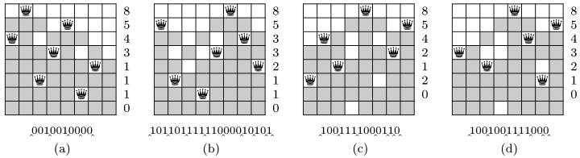</a>

**图 69.** 随机试解八皇后问题的四个例子. 这些试验可以帮助估计图 68 中回溯树的大小. 每幅图右侧标出各层的分支数, 下方标出抽样用的随机位. 若一个格子受到前面各行中一个或多个皇后的攻击, 就涂成灰色.

给定 $X_1=2$, 第 2 行的皇后不能放在第 1、2、3 列, 因此 $X_2$ 尚有五种可能, 写下 $D_2\gets5$. $\pi$ 的接下来三个位使我们置 $X_2\gets5$, 因为在可以选择的列 $(4,5,6,7,8)$ 中, 5 是第二个, 而在 $(000,001,\ldots,100)$ 中, 001 是第二个. 顺便一提, 假如 $\pi$ 接下来给出的是 101、110 或 111, 而非 001, 我们就会用 3.4.1 节的 “拒绝方法”, 移到接下来的三个位, 见习题 49.

这样继续下去, 得到 $D_3\gets4$, $X_3\gets1$, 再得到 $D_4\gets3$, $X_4\gets4$. (这里用 00 这两位选择 $X_3$, 再用后面的 00 选择 $X_4$.) 其余的分支都是强制的: $D_5\gets1$, $X_5\gets7$, $D_6\gets1$, $X_6\gets3$, $D_7\gets1$, $X_7\gets6$. 到第 8 层就走不下去了, 因为这时 $D_8\gets0$.

图 69(a) 描绘了这串随机选择. 我们按照它们的指引, 把皇后依次放入未涂阴影的格子. 图 69 的 (b)、(c)、(d) 用同样的方法, 分别根据 $e\bmod1$、$\phi\bmod1$、$\gamma\bmod1$ 的二进制位作出选择. 生成这些例子, 恰好用了 $\pi$ 的 10 位、$e$ 的 20 位、$\phi$ 的 13 位和 $\gamma$ 的 13 位.

在这段讨论中, 记号 $D_k$ 表示分支数. 先前它曾表示一个取值域. 对数 $D_1,X_1,D_2,\ldots$ 采用大写字母, 是因为这些量是随机变量. 一旦在某一层达到 $D_l=0$, 我们就可以估计总代价了, 其间含有一个不言而喻的假定: 我们走过的路径对树中从根到叶的<em>所有</em>路径具有代表性.

把回溯程序在查找树的各个结点上所花的时间加起来, 就能算出它的代价. 注意, 树中第 $l$ 层的每个结点都可以唯一地用序列 $x_1\ldots x_{l-1}$ 标记, 这个序列确定了从根到该结点的路径. 因此我们的目标是估计所有 $c(x_1\ldots x_{l-1})$ 的和, 其中 $c(x_1\ldots x_{l-1})$ 是结点 $x_1\ldots x_{l-1}$ 的代价.

<a id="pdf-068"></a><a id="p-48"></a>

例如, 四皇后问题用查找树 (4) 表示, 它的代价是下列 17 个单独代价之和,

$$
c()+c(1)+c(13)+c(14)+c(142)+c(2)+c(24)+\cdots+c(413)+c(42).\tag{28}
$$

若 $C(x_1\ldots x_l)$ 表示以 $x_1\ldots x_l$ 为根的子树的总代价, 那么, 当结点 $x_1\ldots x_l$ 上 $x_{l+1}$ 的可能选择为 $\{x_{l+1}^{(1)},\ldots,x_{l+1}^{(d)}\}$ 时,

$$
C(x_1\ldots x_l)=c(x_1\ldots x_l)+C(x_1\ldots x_lx_{l+1}^{(1)})+\cdots+C(x_1\ldots x_lx_{l+1}^{(d)}).\tag{29}
$$

例如, 在 (4) 中有 $C(1)=c(1)+C(13)+C(14)$, $C(13)=c(13)$. 而 $C()=c()+C(1)+C(2)+C(3)+C(4)$ 就是总代价 (28).

采用这些记号以后, 对 $C()$ 作蒙特卡罗估计就极为容易了.

**定理 E.** <em>给定上述 $D_1,X_1,D_2,X_2,\ldots$, 回溯的代价为</em>

$$
C()=\mathrm E\Bigl(c()+D_1\bigl(c(X_1)+D_2\bigl(c(X_1X_2)+D_3\bigl(c(X_1X_2X_3)+\cdots\bigr)\bigr)\bigr)\Bigr).\tag{30}
$$

<em>证明.</em> 设通向结点 $x_1\ldots x_l$ 的各层分支数为 $d_1,\ldots,d_l$, 则到达该结点的概率是 $1/(d_1\ldots d_l)$. 因此, 它对上式期望值的贡献为 $d_1\ldots d_l\,c(x_1\ldots x_l)/(d_1\ldots d_l)=c(x_1\ldots x_l)$.　▮

例如, 树 (4) 中从根到叶有六条路径, 它们出现的概率分别是 $1/8,1/8,1/4,1/4,1/8,1/8$. 第一条路径对期望值的贡献是 $c()+4\bigl(c(1)+2(c(13))\bigr)$ 的 $1/8$, 即 $c()/8+c(1)/2+c(13)$. 第二条贡献 $c()/8+c(1)/2+c(14)+c(142)$, 其余类推.

在定理 E 中将所有的 $c(x_1\ldots x_l)$ 取为 $1$, 这个特例便告诉我们怎样估计树的总规模, 而这个量往往很重要.

**推论 E.** <em>给定 $D_1,D_2,\ldots$, 查找树的结点数为</em>

$$
\mathrm E(1+D_1+D_1D_2+\cdots)=\mathrm E\bigl(1+D_1(1+D_2(1+D_3(1+\cdots)))\bigr).\tag{31}
$$

例如, 利用四幅 $8\times8$ 棋盘右侧的数 $D_j$, 图 69 给出了对图 68 树的大小的四次估计. 图 69(a) 的估计是 $1+8\bigl(1+5(1+4(1+3(1+1(1+1(1+1)))))\bigr)=2129$, 其余三次分别是 2689、1489 和 2609. 它们同真值 2057 相差都不特别远, 不过我们不能指望次次都这样走运.

习题 53 中的详细研究表明, 对八皇后问题, 估计量 (31) 的表现相当不错,

$$
\bigl(\min 489,\quad \mathrm{ave}\ 2057,\quad \max 7409,\quad \mathrm{dev}\ \sqrt{1146640}\approx1071\bigr).\tag{32}
$$

类似的 16 皇后问题, 查找树就不那么均匀了,

$$
(\min 2597105,\quad\mathrm{ave}\ 1141190303,\quad\max 131048318769,\quad\mathrm{dev}\ \approx1234000000).\tag{33}
$$

不过, 这个标准差同均值差不多大, 所以通常仍能猜对数量级. (例如, 十次独立试验预测的结点数分别是 $.632,.866,.237,1.027,4.006,.982,.143,.140,3.402,.510$ 十亿, 它们的平均值为 $1.195$.) 对 $n=64$ 作一千次试验, 结果表明 64 皇后问题的树大概有 $3\times10^{65}$ 个结点.

<a id="pdf-069"></a><a id="p-49"></a>

让我们把这个估计过程精确地表述出来, 使它既便于由机器执行, 也便于用手做.

**算法 E (估计回溯的代价).** 给定算法 B 中的域 $D_k$、性质 $P_l$, 以及上述结点代价 $c(x_1\ldots x_l)$, 本算法计算一个量 $S$, 它的期望值是 (30) 中的总代价 $C()$. 算法使用辅助数组 $y_0y_1\ldots$, 其大小应当至少为 $\max(|D_1|,\ldots,|D_n|)$.

**E1.** [初始化.] 置 $l\gets D\gets1$, $S\gets0$, 并初始化所需的各个数据结构.

**E2.** [进入第 $l$ 层.] (此时 $P_{l-1}(X_1,\ldots,X_{l-1})$ 成立.) 置 $S\gets S+D\cdot c(X_1\ldots X_{l-1})$. 若 $l>n$, 算法终止. 否则置 $d\gets0$, $x\gets\min D_l$, 即 $D_l$ 的最小元素.

**E3.** [检验 $x$.] 若 $P_l(X_1,\ldots,X_{l-1},x)$ 成立, 置 $y_d\gets x$, $d\gets d+1$.

**E4.** [再试.] 若 $x\ne\max D_l$, 将 $x$ 置为 $D_l$ 中下一个较大的元素, 并返回 E3.

**E5.** [选取并试行.] 置 $D\gets D\cdot d$. 若 $d=0$, 则终止. 否则置 $X_l\gets y_I$, 其中 $I$ 是 $\{0,\ldots,d-1\}$ 中均匀选取的随机整数. 更新数据结构以便检验 $P_{l+1}$, 置 $l\gets l+1$, 并返回 E2.　▮

算法 E 虽然很像算法 B, 却从来不回溯.

当然, 当回溯树极不规整时, 不能指望这个算法给出令人满意的估计. $S$ 的<em>期望值</em> $\mathrm E\,S$ 确实是真实的代价, 但是 $S$ <em>很可能取到的值</em>却可能同它相去甚远.

一个表现特别糟的例子是, 性质 $P_l$ 只要求 $x_1>\cdots>x_l$, 而所有的域都是 $\{1,\ldots,n\}$. 这时只有一个解 $x_1\ldots x_n=n\ldots1$, 用回溯来找它实在是再笨不过了!

不过, 这个多少有点可笑的问题却有一棵相当有趣的查找树. 它正是式 7.2.1.3–(21) 的二项树 $T_n$, 第 $l+1$ 层有 $\binom nl$ 个结点, 总共 $2^n$ 个结点. 若把各项代价都取为 1, $S$ 的期望值因而是 $2^n=e^{n\ln2}$. 可是习题 52 证明, $S$ 几乎总是小得多, 甚至小于 $e^{(\ln n)^2\ln\ln n}$. 此外, 对 $T_n$ 执行算法 E, 终止时 $l$ 的平均值只有 $H_n+1$. 例如, 当 $n=100$ 时, 终止时 $l\geq20$ 的概率仅为 $0.0000000027$, 而绝大多数结点却都在第 51 层附近.

对算法 E 还可以作很多改进. 例如, 习题 54 说明步骤 E5 的选择不必是均匀的. 在看过回溯的许多实际例子之后, 我们将在 7.2.2.9 节讨论改进的估计技术.

**\*估计解的个数.** 有时我们知道一个问题的解多得根本不可能全部生成, 但还是想知道大约有多少个. 算法 E 可以给出这个近似数目. 事实上, $D$ 的最终值的期望恰好是解的总数. 因为在 $D>0$ 的情形下, 该算法所构造的每个解 $X_1\ldots X_l$ 都是以概率 $1/D$ 得到的. 注意, 在步骤 E2 中, 即使 $l$ 还不超过 $n$, 也可能另有成功终止的准则.

<a id="pdf-070"></a><a id="p-50"></a>

例如, 假定我们想知道, 棋王从棋盘的一个角走到对角, 途中不重复经过任何格子, 一共有多少条不同的路径. 下图给出这样的一条路径, 它像图 69(a) 一样, 用 $\pi$ 的二进制位指引随机选择. 从左上角出发, 第一步有 3 种走法. 向右走了一步以后, 第二步就有 4 种走法. 如此继续. 我们决不走那种会把通往目的地的路隔断的步. 特别地, 有两步实际上是强制的. (习题 58 说明一种避免致命错误的办法.)

<a href="../../assets/volume4b/figures/king-path.svg">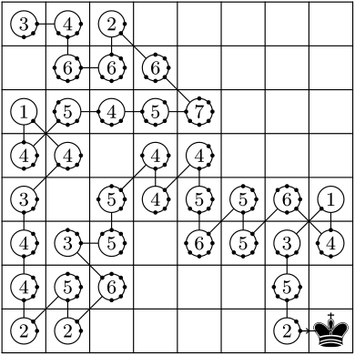</a>

取得这条特定路径的概率恰为 $\frac13\frac14\frac16\frac16\frac12\frac16\frac17\cdots\frac12=1/D$, 其中 $D=3\times4\times6\times6\times2\times6\times7\times\cdots\times2=1^2\cdot2^4\cdot3^4\cdot4^{10}\cdot5^9\cdot6^6\cdot7^1\approx8.7\times10^{20}$. 因此, 至少作个初步估计, 我们有理由猜测这样的路径约有 $10^{21}$ 条.

当然, 这个猜测只靠一次随机抽样, 根基很不牢靠. 不过我们知道, 若作 $N$ 次独立试验, 得到 $N$ 个估计值, 它们的平均值 $M_N=(D^{(1)}+\cdots+D^{(N)})/N$ 将几乎必然趋近正确的数目.

那么, $N$ 要多大, 我们才有些理由相信结果呢? 对随机的棋王路径, 所得的 $D$ 实际上会在很大的范围内变化. 图 70 给出了 $N$ 从 1 变到 10 000 时的一些典型结果. 对于每个 $N$, 都可以按统计学教科书的建议计算样本方差 $V_N=S_N/(N-1)$, 如式 4.2.2–(16) 所示, 于是 $M_N\pm\sqrt{V_N/N}$ 就是教科书式的估计. 图 70 上部的灰色 “误差棒” 围绕着代表 $M_N$ 的黑点. 当 $N$ 达到 3000 左右, 序列 $M_N$ 看起来的确安定下来, 趋近于 $5\times10^{25}$ 附近的一个值. 这个值比最初的猜测高得多, 但支持它的证据也多得多.

另一方面, 图 70 下部给出了绘制上图时所用的 10 000 个 $D$ 值的<em>对数</em>分布. 其中将近一半小于 $10^{20}$, 完全可以忽略. 约有 $75\%$ 小于 $10^{24}$, 但也有几个[^v4b-50-samples] 大于 $10^{28}$. 基于这样混乱的行为所得的结果, 当真可靠吗? 我们实际上要舍弃大部分数据, 而几乎完全相信由少数罕见事件得到的观测值, 这当真有道理吗?

是的, 尽可放心! 习题 MPR–124 给出了一部分理由, 其依据是 S. Chatterjee 和 P. Diaconis 的理论工作. 在该题引用的论文中, 两人定义了一个简单的质量度量,

$$
\widehat\chi_N=\max(D^{(1)},\ldots,D^{(N)})/(NM_N)
=\frac{\max(D^{(1)},\ldots,D^{(N)})}{D^{(1)}+\cdots+D^{(N)}}.\tag{34}
$$


<a id="pdf-071"></a><a id="p-51"></a>

他们指出, 在这类试验中, 通常可以采用一项合理的策略, 即当 $\widehat\chi_N$ 变小时停止抽样. (图 70 中间绘出了这个统计量 $\widehat\chi_N$ 的值.)

<a id="fig-70"></a>

<a href="../../assets/volume4b/figures/fig-070.svg">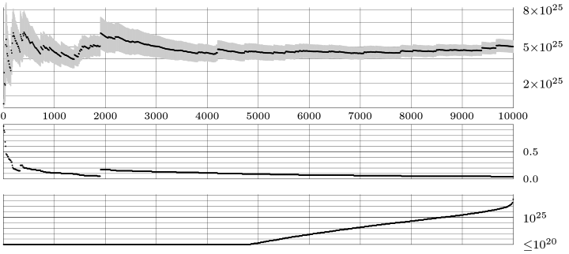</a>

**图 70.** 根据多至 10 000 次随机试验估计棋王路径的条数. 中图给出式 (34) 的相应质量度量. 下图给出各个估计值 $D^{(k)}$ 排序后的<em>对数</em>.

除了数出回溯问题有多少个解, 还可以估计这些解的其他性质. 例如, 随机选取棋王路径的算法终止时, $lD$ 的期望值就是所有这些路径的总<em>长度</em>. 图 70 所依据的数据表明, 这个总数为 $(2.66\pm.14)\times10^{27}$, 因此平均路径长度看起来大约是 53. 样本还表明, 约有 $34\%$ 的路径经过中心, 约有 $46\%$ 触及右上角, 约有 $22\%$ 两个角都触及, 约有 $7\%$ 既经过中心又触及两个角.

对于这个具体问题, 我们其实用不着依赖估计, 因为 7.1.4 节的 ZDD 技术能让我们算出<em>真值</em>. (见习题 59.) 一张棋盘上从一个角到对角的简单棋王路径, 总数恰好是 $50\,819\,542\,770\,311\,581\,606\,906\,543$. 对于全部 $N\geq250$, 除了 $N=1400$ 附近的一小段之外, 这个值几乎总在图 70 的误差棒范围之内. 这些路径的总长度恰好是 $2\,700\,911\,171\,651\,251\,701\,712\,099\,831$, 比我们的估计稍高. 因此, 真正的平均长度约为 $53.15$. 经过中心、触及指定的一个角、触及两个角, 以及这三处都经过的真实概率, 分别约为 $38.96\%,50.32\%,25.32\%,9.86\%$.

从一个角到对角、达到最大长度 63 的棋王路径, 总数是 $2\,811\,002\,302\,704\,446\,996\,926$. 没有额外的启发式方法, 算法 E 这类办法就<em>不能</em>很好地估计这个数.

类似地, 若问任意长度的<em>棋马</em>路径有多少条可以从一个角走到对角, 这个问题便有些超出了 ZDD 技术的能力, 因为所需的 ZDD 结点要多得多. 利用算法 E, 可以估计这种路径约有 $(8.6\pm1.2)\times10^{19}$ 条.

<a id="pdf-072"></a><a id="p-52"></a>

**问题的分解.** 设想某个回溯问题等价于求解两个<em>独立</em>的子问题. 例如, 我们要找出使 $P_n(x_1,x_2,\ldots,x_n)=F(x_1,x_2,\ldots,x_n)$ 成立的所有序列 $x=x_1x_2\ldots x_n$, 其中

$$
F(x_1,x_2,\ldots,x_n)=G(x_1,\ldots,x_k)\wedge H(x_{k+1},\ldots,x_n).\tag{35}
$$

即使采用动态定序, 回溯树的大小也基本上是 $G$ 和 $H$ 两棵树大小的<em>积</em>. 所以照搬 (1) 和 (2) 的一般做法显然很不明智. 先找出 $G$ 的所有解, 再找出 $H$ 的所有解, 这样就好得多, 计算量只需两棵树大小的<em>和</em>. 我们又一次用上了分治, 把复合问题 (35) 分解为互不相干的子问题.

在第 7 章开头讨论拉丁方时, 我们已经见过一个不那么明显的问题分解实例. 请回想 E. T. 帕克是怎样加快 7–(6) 的求解速度的. 他发现了 7–(7), 实质上是把 7–(6) 分解成十个子问题, 而所求的解可以很容易地由子问题的解合成. 这样一来, 速度提高了十二个数量级还多.

一般说来, 问题 $F$ 的每个解 $x$ 往往意味着, 某些较简单的问题 $F_p$ 也存在解 $x^{(p)}=\phi_p(x)$, 这些 $F_p$ 是 $F$ 的 “同态像”. 若我们运气好, 便能把较简单问题的解组合起来, 并 “提升” 为整个问题的解. 因此, 留心寻找这种简化很值得.

再看一个例子. F. A. 绍索发明了一道令人欲罢不能的谜题 [美国专利 646463 (1900 年 4 月 3 日)]. 1967 年, 一位营销天才决定给它改名为 “即刻疯狂” (Instant Insanity), 它一下子就风行开了. 题目是把四个形如下图的立方体

<a href="../../assets/volume4b/figures/insanity-cubes.svg">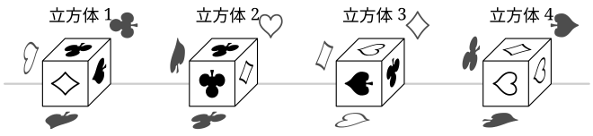</a>　(36)

排成一行. 每个面都用四种花色中的一种作了标记, 要使排成一行后的上、下、前、后四侧都各有四种花色. (36) 的放法不对, 因为朝上的面有两个 $\clubsuit$ (而没有 $\spadesuit$). 不过, 把每个立方体转动 $90^\circ$, 就能得到一个解.

每个立方体有 24 种放法, 因为六个面都可以朝上, 而保持顶面不变, 又有四种转法. 因此放法的总数是 $24^4=331\,776$. 但巧妙地把问题作一番分解, 就能用手很快求出所有解! [见 F. de Carteblanche, <em>Eureka</em> **9** (1947), 9–11.] 思路是, 任何一个解, 如果只看上、下两面, 或者只看前、后两面, 都会给出 $\{\clubsuit,\diamondsuit,\heartsuit,\spadesuit\}$ 各两个. 这个问题要容易得多.

为此, 每个立方体都可以用三对相反面上的标记来刻画. 在 (36) 中, 这些面组分别是

$$
\{\clubsuit\spadesuit,\clubsuit\diamondsuit,\spadesuit\heartsuit\},\quad
\{\clubsuit\clubsuit,\clubsuit\heartsuit,\spadesuit\diamondsuit\},\quad
\{\heartsuit\heartsuit,\spadesuit\diamondsuit,\clubsuit\diamondsuit\},\quad
\{\spadesuit\diamondsuit,\spadesuit\heartsuit,\clubsuit\heartsuit\}.\tag{37}
$$

<a id="pdf-073"></a><a id="p-53"></a>

每个立方体各选一对相反面, 共有 $3^4=81$ 种方法. 其中哪些会给出 $\{\clubsuit,\clubsuit,\diamondsuit,\diamondsuit,\heartsuit,\heartsuit,\spadesuit,\spadesuit\}$ 呢? 列出立方体 $(1,2)$ 的九种可能和立方体 $(3,4)$ 的九种可能, 一两分钟就可以全部找出来. 只有三种,

$$
(\clubsuit\diamondsuit,\clubsuit\heartsuit,\spadesuit\diamondsuit,\spadesuit\heartsuit),\quad
(\spadesuit\heartsuit,\clubsuit\heartsuit,\clubsuit\diamondsuit,\spadesuit\diamondsuit),\quad
(\spadesuit\heartsuit,\spadesuit\diamondsuit,\clubsuit\diamondsuit,\clubsuit\heartsuit).\tag{38}
$$

此外注意, 对调某些面组的两面, 就可以把每个解 “分成两半”, 使两侧各出现 $\{\clubsuit,\diamondsuit,\heartsuit,\spadesuit\}$ 一次. 我们可以把 (38) 改成

$$
(\diamondsuit\clubsuit,\clubsuit\heartsuit,\spadesuit\diamondsuit,\heartsuit\spadesuit),\quad
(\heartsuit\spadesuit,\clubsuit\heartsuit,\diamondsuit\clubsuit,\spadesuit\diamondsuit),\quad
(\heartsuit\spadesuit,\spadesuit\diamondsuit,\diamondsuit\clubsuit,\clubsuit\heartsuit).\tag{39}
$$

相反面子问题的每个这样的解, 都可以看作一个 2 正则图. 比如说, 以 $\diamondsuit\!-\!\clubsuit$, $\clubsuit\!-\!\heartsuit$, $\spadesuit\!-\!\diamondsuit$, $\heartsuit\!-\!\spadesuit$ 为边的多重图, 每个顶点都恰有两个邻点.

“即刻疯狂” 的解将给出<em>两个</em>这样的 2 正则因子, 一个用于上、下两面, 一个用于前、后两面. 此外, 两个因子所用的边要不相交, 因为不能把同一个面组用两次. 所以, 要解 (36), 只能采用 (39) 的第一和第三个因子.

反过来, 一旦得到两个边不相交的 2 正则图, 就一定能够利用它们把立方体按要求摆好, 从而把因子 “提升” 为原问题的解.

习题 67 说明了另一种问题分解. 把每个子问题看成原约束的一种 “松弛”, 颇为方便.

**历史注记.** 回溯程序设计起源于何时, 已难以考证. 许多人一定想到过等价的思想, 但在计算机出现以前, 几乎没有理由把它们写下来. 我们可以相当有把握地说, 17 世纪的雅各布·伯努利成功解出曾难倒许多人的 “Tot tibi sunt dotes” 问题 (见 7.2.1.7 节) 时, 就用到了这些原理, 因为他逐一列出所有解的清单中还留有这种方法的痕迹.

回溯程序通常采用如今叫做深度优先查找的方式, 遍历各种可能性组成的树. 这种探索图的一般过程, 爱德华·卢卡斯把它归功于一位名叫特雷莫的电报工程师 [<em>Récréations Mathématiques</em> **1** (Paris: Gauthier-Villars, 1882), 47–50].

最早提出八皇后问题的是马克斯·贝策尔 [<em>Schachzeitung</em> **3** (1848), 363, **4** (1849), 40] 和弗朗茨·瑙克 [<em>Illustrirte Zeitung</em> **14**, 361 (1850 年 6 月 1 日), 352, **15**, 377 (1850 年 9 月 21 日), 182], 两人可能是独立提出的. C. F. 高斯看到了后者的出版物, 就此给朋友 H. C. 舒马赫写过好几封信. 1850 年 9 月 27 日的信特别有意思, 因为其中解释了怎样用回溯法求得全部解. 他管这个方法叫 “Tatonniren”, 取自一个意思是 “摸索前进” 的法语词. 他还列出了在反射和旋转下各个等价类中字典序最先的解: $15863724,16837425,24683175,25713864,25741863,26174835,26831475,27368514,27581463,35281746,35841726,36258174$.

一百年后, 计算机出现了, 人们开始用它来解决组合问题. 把回溯表述成一项普遍技术的时机已经成熟, 罗伯特·J. 沃克适逢其会 [<em>Proc. Symposia in Applied Math.</em> **10** (1960), 91–94]. 在他的短文中,<a id="pdf-074"></a><a id="p-54"></a> 他以面向机器的形式引入了算法 W, 并提到可以很容易地推广这个过程, 用来找出长度可变的模式 $x_1\ldots x_n$, 其中 $n$ 不必固定.

下一个里程碑是所罗门·W. 戈洛姆和伦纳德·D. 鲍默特的论文 [<em>JACM</em> **12** (1965), 516–524]. 他们仔细地表述了一般问题, 并给出多种多样的例子. 特别地, 他们讨论了怎样查找最大的无逗号码, 并指出, 可以利用回溯逐次找到组合最优化问题越来越好的解. 他们引入了若干向前看的方法, 以及动态定序的一个重要思想, 即挑选剩余选择最少的变量来分支.

把回溯法用于整数规划问题时, 可以采取专门的截断方法 [见 E. Balas, <em>Operations Research</em> **13** (1965), 517–546]. A. M. 杰弗里翁简化并推广了这项工作, 把它称为 “隐式枚举”, 因为许多情形并没有显式地枚举出来 [<em>SIAM Rev.</em> **9** (1967), 178–190].

早期关于回溯程序设计的其他值得一读的论述, 还可见于马克·韦尔斯的书 <em>Elements of Combinatorial Computing</em> (1971) 的第 4 章, J. R. 比特纳和 E. M. 莱因戈尔德的综述, <em>CACM</em> **18** (1975), 651–656, 以及约翰·加施尼格的博士论文 [Report CMU-CS-79-124 (Carnegie Mellon University, 1979), 第 4 章]. 加施尼格引入了 “回标” (backmarking) 和 “回跳” (backjumping) 技术, 我们以后还要讨论.

对回溯代价的蒙特卡罗估计, 最初由小 M. 霍尔和高德纳在 <em>Computers and Computing, AMM</em> **72**, 第 2 期, 第 2 分册, Slaught Memorial Papers 第 10 号 (1965 年 2 月), 21–28 中作了简要说明. 十年后, 高德纳在 <em>Math. Comp.</em> **29** (1975), 121–136 中作了详尽得多的阐述. 这类方法可以看作所谓 “重要性抽样” 的特例, 见 J. M. Hammersley 和 D. C. Handscomb, <em>Monte Carlo Methods</em> (London: Methuen, 1964), 57–59. 对随机的自回避游走, 如上面讨论的棋王路径, 最早作研究的是 M. N. Rosenbluth 和 A. W. Rosenbluth, <em>J. Chemical Physics</em> **23** (1955), 356–359.

回溯应用很适合并行程序设计, 因为查找树的不同部分往往完全相互独立. 因而可以在不同的机器上探索不相交的子树, 只需极少的进程间通信. 早在 1964 年, D. H. 莱默就解释了怎样细分一个问题, 使两台速度不同的计算机同时工作又同时完成. 他所考虑的问题有一棵形状已知的查找树 (见定理 7.2.1.3L). 但即使情况复杂得多, 我们也能利用子树大小的蒙特卡罗估计, 达到基本相似的负载平衡效果. 多年来已经发展出许多使组合查找并行化的思想, 这些技术超出了本书的范围. 关于一种相当通用的方法, R. Finkel 和 U. Manber 的论文是很好的入门读物, 见 <em>ACM Transactions on Programming Languages and Systems</em> **9** (1987), 235–256.

M. Alekhnovich、A. Borodin、J. Buresh-Oppenheim、R. Impagliazzo、A. Magen 和 T. Pitassi 定义了<em>优先分支树</em>. 利用这种一般计算模型, 他们能够严格证明回溯程序的能力界限, 见 <em>Computational Complexity</em> **20** (2011), 679–740.

<a id="pdf-075"></a><a id="p-55"></a>

### 习题

<a id="ex-7-2-2-1"></a>

▶ **1.** [22] [答案](./answers/7-2-2.md#ans-7-2-2-1) 给出适当的取值域 $D_k$ 和满足 (1)、(2) 的截断性质 $P_l(x_1,\ldots,x_l)$, 说明生成下列各类对象的任务怎样都可看成回溯程序设计的特例: (i) $n$ 元组, (ii) 互异元素的排列, (iii) 组合, (iv) 整数分划, (v) 集合分划, (vi) 嵌套括号.

<a id="ex-7-2-2-2"></a>

**2.** [10] [答案](./answers/7-2-2.md#ans-7-2-2-2) 判断真假: 可以适当地选择 $D_1$, 使 $P_1(x_1)$ 恒为真.

<a id="ex-7-2-2-3"></a>

**3.** [20] [答案](./answers/7-2-2.md#ans-7-2-2-3) 设 $T$ 为任意一棵树. 能否定义各 $D_k$ 及截断性质 $P_l(x_1,\ldots,x_l)$, 使 $T$ 正是算法 B 遍历的那棵回溯树?

<a id="ex-7-2-2-4"></a>

**4.** [16] [答案](./answers/7-2-2.md#ans-7-2-2-4) 用一副棋盘和八枚代表皇后的硬币, 照算法 B 的步骤, 大致可以在三小时内用手遍历图 68 的树. 想个巧法省去一半工作.

<a id="ex-7-2-2-5"></a>

▶ **5.** [20] [答案](./answers/7-2-2.md#ans-7-2-2-5) 把算法 B 改写成名为 $\operatorname{try}(l)$ 的<em>递归</em>过程, 使用全局变量 $n$ 和 $x_1,\ldots,x_n$, 由调用 “$\operatorname{try}(1)$” 启动. 你能猜到本书作者为什么决定<em>不用</em>这样一个递归形式来叙述算法吗?

<a id="ex-7-2-2-6"></a>

**6.** [20] [答案](./answers/7-2-2.md#ans-7-2-2-6) 给定 $r$, $1\leq r\leq8$. 在 $8\times8$ 棋盘上摆放七个互不攻击的皇后, 并使第 $r$ 行没有皇后, 共有多少种摆法?

<a id="ex-7-2-2-7"></a>

**7.** [20] [答案](./answers/7-2-2.md#ans-7-2-2-7) (T. B. Sprague, 1890.) 有没有 $n>5$ 使 $n$ 皇后问题有一个 “镶了边框” 的解, 即 $x_1=2$, $x_2=n$, $x_{n-1}=1$, $x_n=n-1$?

<a id="ex-7-2-2-8"></a>

**8.** [20] [答案](./answers/7-2-2.md#ans-7-2-2-8) 八皇后问题能否有两种摆法, 它们的 $x_1x_2x_3x_4x_5x_6$ 相同?

<a id="ex-7-2-2-9"></a>

**9.** [21] [答案](./answers/7-2-2.md#ans-7-2-2-9) 在 $4m$ 皇后的一种摆法中, 能否有 $3m$ 个皇后占据 “白” 格?

<a id="ex-7-2-2-10"></a>

▶ **10.** [22] [答案](./answers/7-2-2.md#ans-7-2-2-10) 依正文的建议, 对 $n$ 比特的数作位运算, 把算法 W 改写为适用于 $n$ 皇后问题的算法.

<a id="ex-7-2-2-11"></a>

**11.** [M25] [答案](./answers/7-2-2.md#ans-7-2-2-11) (W. Ahrens, 1910.) 当 $n=4$ 时, $n$ 皇后问题的两个解都有<em>四分之一转对称性</em>: 旋转 $90^\circ$ 后不变, 镜面反射后则会改变.

(a) $n$ 皇后问题的解能有镜面对称性吗?

(b) 证明若 $n\bmod4\in\{2,3\}$, 就不可能有四分之一转对称性.

(c) 有时一个 $n$ 皇后问题的解中, 四个皇后恰好位于一个倾斜正方形的四角, 如图所示. 证明总能把这个正方形向另一边倾斜, 得到另一个解 (其余 $n-4$ 个皇后不动).

<a href="../../assets/volume4b/figures/backtrack-ex-11.svg">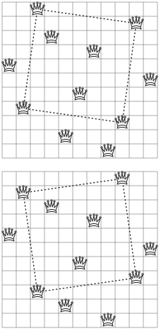</a>

(d) 设 $C_n$ 是具有 $90^\circ$ 旋转对称性的解数. 其中有 $c_n$ 个解满足 $x_k>k$, $1\leq k\leq n/2$. 证明 $C_n=2^{\lfloor n/4\rfloor}c_n$.

<a id="ex-7-2-2-12"></a>

**12.** [M28] [答案](./answers/7-2-2.md#ans-7-2-2-12) (<em>首尾相接的皇后.</em>) 把 (3) 换成更强的条件 “$x_j\ne x_k$, $(x_k-x_j)\bmod n\ne k-j$, $(x_j-x_k)\bmod n\ne k-j$”. (这个 $n\times n$ 的棋盘首尾相接, 成为一个环面.) 证明所得问题有解当且仅当 $n$ 既不是 2 的倍数, 也不是 3 的倍数.

<a id="ex-7-2-2-13"></a>

**13.** [M30] [答案](./answers/7-2-2.md#ans-7-2-2-13) 对于哪些 $n\geq0$, $n$ 皇后问题至少有一个解?

<a id="ex-7-2-2-14"></a>

**14.** [M25] [答案](./answers/7-2-2.md#ans-7-2-2-14) 若习题 12 有 $T(n)$ 个环面上的解, 证明 $Q(mn)\geq Q(m)^nT(n)$.

<a id="ex-7-2-2-15"></a>

**15.** [HM44] [答案](./answers/7-2-2.md#ans-7-2-2-15) (M. Simkin, 2021.) 证明当 $n\to\infty$ 时 $Q(n)\approx\sigma^n n!$, 其中 $\sigma\approx0.389068$.

<a id="ex-7-2-2-16"></a>

**16.** [21] [答案](./answers/7-2-2.md#ans-7-2-2-16) 令 $H(n)$ 为在 $n\times n$ 的蜂房上放置 $n$ 只蜂后而无两只在同一直线上的方法数. (例如图中是 $H(4)=7$ 种方法之一.) 计算较小 $n$ 的 $H(n)$.

<a href="../../assets/volume4b/figures/backtrack-ex-16.svg"></a>

<a id="ex-7-2-2-17"></a>

**17.** [15] [答案](./answers/7-2-2.md#ans-7-2-2-17) 学生 J. H. Quick 注意到, 算法 L 步骤 L2 中的循环可将 “当 $x_l<0$ 时” 改为 “当 $x_l\ne0$ 时”, 因为算法进行到这里, $x_l$ 不可能是<a id="pdf-076"></a><a id="p-56"></a>正数. 因此他决定干脆去掉负号, 在步骤 L3 中令 $x_{l+k+1}\gets k$. 这是个好主意吗?

<a id="ex-7-2-2-18"></a>

**18.** [17] [答案](./answers/7-2-2.md#ans-7-2-2-18) 假定 $n=4$, 算法 L 已到达步骤 L2, 此时 $l=4$ 且 $x_1x_2x_3=241$. 现在 $x_4x_5x_6x_7x_8$, $p_0p_1p_2p_3p_4$ 和 $y_1y_2y_3$ 的值各是什么?

<a id="ex-7-2-2-19"></a>

**19.** [M10] [答案](./answers/7-2-2.md#ans-7-2-2-19) 兰福德问题 (7) 中的取值域 $D_l$ 是什么?

<a id="ex-7-2-2-20"></a>

▶ **20.** [21] [答案](./answers/7-2-2.md#ans-7-2-2-20) 扩充算法 L, 使它在 $k\notin\{x_1,\ldots,x_{l-1}\}$ 且 $l\geq2n-k-1$ 时强制取 $x_l\gets k$.

<a id="ex-7-2-2-21"></a>

▶ **21.** [M25] [答案](./answers/7-2-2.md#ans-7-2-2-21) 若 $x=x_1x_2\ldots x_{2n}$, 令 $x^D=(-x_{2n})\ldots(-x_2)(-x_1)=-x^R$ 为其对偶.

(a) 证明当 $n$ 为奇数且 $x$ 是兰福德问题 (7) 的解时, 对某个 $k\leq\lfloor n/2\rfloor$ 有 $x_k=n$, 当且仅当对某个 $k>\lfloor n/2\rfloor$ 有 $x_k^D=n$.

(b) 当 $n$ 为偶数时, 求一个类似的规则来区别 $x$ 和 $x^D$.

(c) 由此可修改习题 20 的算法, 使每对对偶解 $\{x,x^D\}$ 恰好访问其中一个.

<a id="ex-7-2-2-22"></a>

**22.** [M26] [答案](./answers/7-2-2.md#ans-7-2-2-22) 研究 “松弛的兰福德配对”: 把 (7) 的 “$j+k+1$” 换成 “$j+\lfloor3k/2\rfloor$”.

<a id="ex-7-2-2-23"></a>

**23.** [17] [答案](./answers/7-2-2.md#ans-7-2-2-23) 把一两个字母换一换, 经常就能从一个单词矩形得到另一个. 你能找到与 (10) 几乎一样的 $5\times6$ 单词矩形吗?

<a id="ex-7-2-2-24"></a>

**24.** [20] [答案](./answers/7-2-2.md#ans-7-2-2-24) 改写算法 B, 使它能求出所有 $5\times6$ 单词矩形.

<a id="ex-7-2-2-25"></a>

▶ **25.** [25] [答案](./answers/7-2-2.md#ans-7-2-2-25) 试说明怎样使用正交链表 (如 §2.2.6 图 13), 以便给定 $1\leq k\leq5$, $\mathtt a\leq c\leq\mathtt z$ 后, 能轻易访问所有第 $k$ 个字母为 $c$ 的五字母词. 用这些子表来加快习题 24 的算法.

<a id="ex-7-2-2-26"></a>

**26.** [21] [答案](./answers/7-2-2.md#ans-7-2-2-26) 能否给出几个漂亮的 $5\times7$, $5\times8$, $5\times9$, $5\times10$ 单词矩形?

<a id="ex-7-2-2-27"></a>

**27.** [22] [答案](./answers/7-2-2.md#ans-7-2-2-27) 若让习题 25 的算法改求 $6\times5$ 单词矩形, 而非 $5\times6$ 单词矩形, 代替 (13)、(14) 的轮廓和平均结点代价是什么?

<a id="ex-7-2-2-28"></a>

▶ **28.** [23] [答案](./answers/7-2-2.md#ans-7-2-2-28) 习题 24 和 25 的方法回溯 $n$ 层, 每次填 $m\times n$ 矩形中的一列, 并用检索结构检测各行中不合法的前缀. 设计一种回溯 $mn$ 层的方法, 每层只填<em>一</em>格, 行和列<em>都</em>用检索结构.

<a id="ex-7-2-2-29"></a>

**29.** [20] [答案](./answers/7-2-2.md#ans-7-2-2-29) 有没有 $5\times6$ 的单词矩形, 其中不同的词少于 11 个?

<a id="ex-7-2-2-30"></a>

**30.** [22] [答案](./answers/7-2-2.md#ans-7-2-2-30) <em>对称</em>单词方阵的各列与相应的各行相同, 19 世纪 50 年代在英格兰风行一时. 例如, A. De Morgan 称赞过下面的方阵, 因为它居然还能 “读出意思来”!

```text
LEAVE
ELLEN
ALONE
VENOM
ENEMY
```

用习题 28 的方法求对称 $5\times5$ 单词方阵的总数. 其中有多少个属于 $\mathrm{WORDS}(500)$?

<a id="ex-7-2-2-31"></a>

**31.** [20] [答案](./answers/7-2-2.md#ans-7-2-2-31) (Charles Babbage, 1864.) 有没有在两条对角线上也都拼出合法单词的对称 $5\times5$ 单词方阵?

<a id="ex-7-2-2-32"></a>

**32.** [22] [答案](./answers/7-2-2.md#ans-7-2-2-32) <em>The Official SCRABBLE® Players Dictionary</em> 第 4 版 (Hasbro, 2005) 支持多少个 $2\times2$, $3\times3$, … 的对称单词方阵?

<a id="ex-7-2-2-33"></a>

**33.** [21] [答案](./answers/7-2-2.md#ans-7-2-2-33) 很早以前, 靠手来编单词方阵的谜题爱好者发现, 从下向上进行最容易. 因此他们使用按从词尾向前比较字母的字典序排列的 “逆序词典”. 这个办法也能加快计算机上的试验吗?

<a id="pdf-077"></a><a id="p-57"></a>

<a id="ex-7-2-2-34"></a>

**34.** [15] [答案](./answers/7-2-2.md#ans-7-2-2-34) 从下列单词中选出一个最大的无逗号码子集:

```text
aced babe bade bead beef cafe cede dada dead deaf face fade feed
```

<a id="ex-7-2-2-35"></a>

▶ **35.** [22] [答案](./answers/7-2-2.md#ans-7-2-2-35) 设 $w_1,w_2,\ldots,w_n$ 为 $m$ 字母表上的四字母词. 设计一个算法逐个接受或拒绝 $w_j$, 依据是 $w_j$ 加入 $\{w_1,\ldots,w_{j-1}\}$ 中已经接受的词后是否仍为无逗号码.

<a id="ex-7-2-2-36"></a>

**36.** [M22] [答案](./answers/7-2-2.md#ans-7-2-2-36) $m$ 字母表上的二字母分组码可用一个 $m$ 顶点的有向图 $D$ 表示: 当且仅当 $ab$ 为码字时有弧 $a\to b$.

(a) 证明这个码是无逗号码当且仅当 $D$ 中没有长度为 3 的有向路 (这里允许重复顶点或弧).

(b) 没有长度为 $r$ 的有向路的 $m$ 顶点有向图至多有多少条弧?

<a id="ex-7-2-2-37"></a>

▶ **37.** [M30] [答案](./answers/7-2-2.md#ans-7-2-2-37) (W. L. Eastman, 1965.) 下述优美的构造适用于任意字母表和任意<em>奇数</em>分组长度 $n$, 能给出一个码字数最大的无逗号码. 给定非负整数序列 $x=x_0x_1\ldots x_{n-1}$, 它与自身的其余循环移位 $x_k\ldots x_{n-1}x_0\ldots x_{k-1}$ ($0<k<n$) 均不同. 此过程输出 $x$ 的一个循环移位 $\sigma x$, 而所有这样的 $\sigma x$ 构成无逗号码.

把 $x$ 看成无穷周期序列 $\langle x_n\rangle$, 当 $k\geq n$ 时 $x_k=x_{k-n}$. 这样每个循环移位都有形式 $x_kx_{k+1}\ldots x_{k+n-1}$. 最简单而又非平凡的例子是 $n=3$, 这时 $x=x_0x_1x_2x_0x_1x_2x_0\ldots$, 且 $x_0,x_1,x_2$ 不全相等. 在这种情形中, 算法输出满足 $x_k\geq x_{k+1}<x_{k+2}$ 的 $x_kx_{k+1}x_{k+2}$; 所有这样的三元组显然满足无逗号码条件.

第一个要点是用边界标记 $b_j$ 将 $x$ 划分成 $t$ 个子串, 其中 $0\leq b_0<b_1<\cdots<b_{t-1}<n$, 而对 $j\geq t$, $b_j=b_{j-t}+n$. 于是子串 $y_j$ 为 $x_{b_j}x_{b_j+1}\ldots x_{b_{j+1}-1}$. 子串数 $t$ 始终为奇数. 最初 $t=n$, 对所有 $j$ 都有 $b_j=j$; 最终 $t=1$, 而 $\sigma x=y_0$ 就是所求的输出.

Eastman 的算法要比较相邻子串 $y_{j-1}$ 和 $y_j$. 若两者等长就按字典序比较; 否则规定较长的子串较大.

第二个要点是 “下探段” 的概念, 即形为 $z=z_1\ldots z_k$ 的子串, 满足 $k\geq2$, $z_1\geq\cdots\geq z_{k-1}<z_k$. 容易看出, 若串 $y=y_0y_1\ldots$ 中有无穷多个 $i$ 满足 $y_i<y_{i+1}$, 就能把它唯一地分解成一系列下探段 $y=z^{(0)}z^{(1)}\ldots$. 例如,

```text
3141592653589793238462643383... = 314 15 926 535 89 79 323 846 26 4338 3...
```

而且, 若 $y$ 为周期序列, 它的下探段分解最终也有周期, 不过开头的某些因子不一定出现在周期中. 例如,

```text
123443550123443550123443550... = 12 34 435 501 23 4435 501 23 4435 ...
```

给定由上述边界标记规定的非常数周期序列 $y$, 若周期长度 $t$ 为奇数, 则其周期分解中必含奇数个奇长度的下探段. Eastman 算法的每一轮只保留各奇长度下探段左端的边界点. 随后将 $t$ 改为保留下来的边界点数, 若 $t>1$ 就另起一轮.

(a) 对 $n=19$, $x=3141592653589793238$, 用手演算一遍.

(b) 证明至多进行 $\lfloor\log_3n\rfloor$ 轮.

(c) 在 $n=3^e$ 时给出一个达到这一最坏界的二元串 $x$.

(d) 写出此算法的完整实现. (短得出奇!)

(e) 解释此算法为什么给出无逗号码.

<a id="pdf-078"></a><a id="p-58"></a>

<a id="ex-7-2-2-38"></a>

**38.** [HM28] [答案](./answers/7-2-2.md#ans-7-2-2-38) Eastman 算法一轮就结束的概率是多少? (设 $x$ 为奇数长度 $n>1$ 的随机 $m$ 元串, 与自身的其余循环移位均不相等. 用生成函数表示答案.)

<a id="ex-7-2-2-39"></a>

**39.** [18] [答案](./answers/7-2-2.md#ans-7-2-2-39) 有 $(m^4-m^2)/4$ 个码字的无逗号码为什么不能同时含有 0001 和 2000?

<a id="ex-7-2-2-40"></a>

▶ **40.** [15] [答案](./answers/7-2-2.md#ans-7-2-2-40) 你认为, 为什么本系列 §2.2.2 (题为 “顺序分配”) 没有讨论 (16)–(23) 这样的顺序数据结构?

<a id="ex-7-2-2-41"></a>

**41.** [17] [答案](./answers/7-2-2.md#ans-7-2-2-41) 在表 1 中, (a) $\mathtt{MEM[4d]=5e}$ 和 (b) $\mathtt{MEM[94]=84}$ 的意义是什么?

<a id="ex-7-2-2-42"></a>

**42.** [18] [答案](./answers/7-2-2.md#ans-7-2-2-42) 为什么表 2 中有 (a) $\mathtt{MEM[f8]=e7}$ 和 (b) $\mathtt{MEM[ad]=ba}$?

<a id="ex-7-2-2-43"></a>

**43.** [20] [答案](./answers/7-2-2.md#ans-7-2-2-43) 假定正在使用撤销方案 (26), 而操作 $\sigma\gets\sigma+1$ 刚刚使当前的时间戳 $\sigma$ 回绕到零. 该怎么办?

<a id="ex-7-2-2-44"></a>

▶ **44.** [25] [答案](./answers/7-2-2.md#ans-7-2-2-44) 写出算法 C 步骤 C2 中候选项选择过程的底层实现细节. 每次改变 $\mathtt{MEM}$ 的内容时均使用 (26) 的子程序 $\operatorname{store}(a,v)$, 并采用以下选择策略:

(a) 找出一个蓝字数 $r$ 最少的类 $c$.

(b) 若 $r=0$, 置 $x\gets-1$; 否则置 $x$ 为类 $c$ 中的一个字.

(c) 若 $r>1$, 借助禁配表寻找一个 $x$, 使含 $x$ 的前缀表或后缀表另一侧可能被杀死的蓝字数最大.

<a id="ex-7-2-2-45"></a>

▶ **45.** [28] [答案](./answers/7-2-2.md#ans-7-2-2-45) 接着习题 44, 在 $x\geq0$ 时写出步骤 C3 的细节.

(a) 当一个蓝字 $x$ 变红时, 应该怎样更新 $\mathtt{MEM}$?

(b) 当一个蓝字 $x$ 变绿时, 应该怎样更新 $\mathtt{MEM}$?

(c) 步骤 C3 先如 (b) 那样把 $x$ 变绿. 说明随后应如何更新禁配表以完成这一步.

<a id="ex-7-2-2-46"></a>

**46.** [M35] [答案](./answers/7-2-2.md#ans-7-2-2-46) 对于每个字长 $n$, 能否构造一个二元 ($m=2$) 无逗号码, 从全部 $\bigl(\sum_{d\mid n}\mu(d)2^{n/d}\bigr)/n$ 个循环类中各取一个码字?

<a id="ex-7-2-2-47"></a>

**47.** [HM29] [答案](./answers/7-2-2.md#ans-7-2-2-47) 若允许对字母作排列, 也允许将所有码字同时左右反转, 则 $m$ 字母无逗号码至多与 $2m!$ 个这样的码等价.

分别在 (a) $m=2$ 且有 3 个码字、(b) $m=3$ 且有 18 个码字、(c) $m=4$ 且有 57 个码字的情形, 求出所有互不同构的长为 4 的无逗号码.

<a id="ex-7-2-2-48"></a>

**48.** [M42] [答案](./answers/7-2-2.md#ans-7-2-2-48) 求一个在 $m=5$ 个字母上、长度为 4 且规模最大的无逗号码.

<a id="ex-7-2-2-49"></a>

**49.** [20] [答案](./answers/7-2-2.md#ans-7-2-2-49) 解释图 69 中的各个选择怎样由图上的 “随机” 比特确定. 例如图 69(b) 为什么置 $X_2=1$?

<a id="ex-7-2-2-50"></a>

**50.** [M15] [答案](./answers/7-2-2.md#ans-7-2-2-50) 说明正文蒙特卡罗算法中 $\mathrm E(D_1\ldots D_l)$ 的意义.

<a id="ex-7-2-2-51"></a>

**51.** [M22] [答案](./answers/7-2-2.md#ans-7-2-2-51) 找一个与定理 E 相对应的简单鞅.

<a id="ex-7-2-2-52"></a>

▶ **52.** [HM25] [答案](./answers/7-2-2.md#ans-7-2-2-52) 埃尔莫使用算法 E, 取 $D_k=\{1,\ldots,n\}$, $P_l=[x_1>\cdots>x_l]$, $c=1$.

(a) 艾丽斯独立地抛掷 $n$ 枚硬币, 第 $k$ 枚出现 “正面” 的概率是 $1/k$. 判断真假: 她得到恰好 $l$ 个正面的概率为 $\left[{n\atop l}\right]/n!$.

(b) 用 $Y_1,Y_2,\ldots,Y_l$ 表示出现正面的硬币编号. (因此 $Y_1=1$, 而 $Y_2$ 以概率 $1/2$ 等于 2.) 证明 $\Pr(\text{艾丽斯得到 }Y_1,Y_2,\ldots,Y_l)=\Pr(\text{埃尔莫得到 }X_1=Y_l,X_2=Y_{l-1},\ldots,X_l=Y_1)$.

(c) 证明艾丽斯相当必然至多得到 $(\ln n)(\ln\ln n)$ 个正面.

(d) 因而埃尔莫的 $S$ 相当必然小于 $\exp((\ln n)^2(\ln\ln n))$.

<a id="ex-7-2-2-53"></a>

▶ **53.** [M30] [答案](./answers/7-2-2.md#ans-7-2-2-53) 扩充算法 B, 使它还能算出算法 E 所给蒙特卡罗估计值 $S$ 的最小值、最大值、均值和方差.

<a id="pdf-079"></a><a id="p-59"></a>

<a id="ex-7-2-2-54"></a>

**54.** [M21] [答案](./answers/7-2-2.md#ans-7-2-2-54) 在步骤 E5 中, 除了以 $1/d$ 的概率选择每个 $y_i$ 以外, 还可用一个有偏分布, 其中 $\Pr(I=i\mid X_1,\ldots,X_{l-1})=p_{X_1\ldots X_{l-1}}(y_i)>0$. 应怎样修改估计值 $S$, 才能使它在这个一般方案中的期望仍为 $C()$?

<a id="ex-7-2-2-55"></a>

**55.** [M20] [答案](./answers/7-2-2.md#ans-7-2-2-55) 若所有代价 $c(x_1,\ldots,x_l)$ 都是正的, 证明可以适当地选择习题 54 中的有偏概率, 使估计值 $S$ 总是准确的.

<a id="ex-7-2-2-56"></a>

▶ **56.** [M25] [答案](./answers/7-2-2.md#ans-7-2-2-56) 算法 C 中查找无逗号码的过程并不完全适合算法 E 的框架, 因为除了基本回溯方式外, 它还采用了向前看、动态排序、可撤销存储等改进. 怎样用蒙特卡罗方法可靠地估计它的运行时间?

<a id="ex-7-2-2-57"></a>

**57.** [HM21] [答案](./answers/7-2-2.md#ans-7-2-2-57) 设 $M$ 为回溯树的叶数. 算法 E 在终止前可能沿 $M$ 条不同的路径 $X_1\ldots X_{l-1}$ 之一前进. 若各叶处 $D$ 的终值分别为 $D^{(1)},\ldots,D^{(M)}$, 证明 $\bigl(D^{(1)}\ldots D^{(M)}\bigr)^{1/M}\geq M$.

<a id="ex-7-2-2-58"></a>

▶ **58.** [30] [答案](./answers/7-2-2.md#ans-7-2-2-58) 正文中的国王路径问题, 是在给定图中计数从顶点 $s$ 到顶点 $t$ 的简单路径的一种特例.

我们可以从 $s$ 开始用随机游动生成这些路径, 只要给一切尚未进入路径的顶点 $v$ 维护一张 $\mathtt{DIST}(v)$ 表, 表示从 $v$ 经过未用顶点到 $t$ 的最短距离, 就不会走进死胡同. 有了这张表, 每步只须移到一个 $\mathtt{DIST}(v)<\infty$ 的顶点即可.

设法动态更新 $\mathtt{DIST}$ 表, 免去不必要的工作.

<a id="ex-7-2-2-59"></a>

**59.** [26] [答案](./answers/7-2-2.md#ans-7-2-2-59) 用习题 7.1.4–225 的方法, 可以为棋盘上从一角走到对角的全部简单国王路径构造一个有 3,174,197 个结点的 ZDD. 说明怎样用这个 ZDD 计算 (a) 全体路径的总长度; (b) 接触中心及其他角点中任意给定子集上各点的路径数.

<a id="ex-7-2-2-60"></a>

▶ **60.** [20] [答案](./answers/7-2-2.md#ans-7-2-2-60) 对有偏的随机游动作试验 (见习题 54), 对国王每种不会陷入死胡同、通向新顶点 $v$ 的走法, 赋予权 $1+\mathtt{DIST}(v)^2$, 改变原来各步等可能的选择方式. 这个策略对图 70 的结果有没有改进?

<a id="ex-7-2-2-61"></a>

**61.** [HM26] [答案](./answers/7-2-2.md#ans-7-2-2-61) 令 $P_n$ 为满足 $x_1=1$ 且 $1\leq x_{k+1}\leq2x_k$ ($1\leq k<n$) 的整数序列 $x_1\ldots x_n$ 的数目. (头几个值为 $1,2,6,26,166,1626,\ldots$; A. Cayley 在 <em>Philosophical Magazine</em> (4) **13** (1857), 245–248 中引入了这个序列, 并指出 $P_n$ 计数的是把 $2^n-1$ 写成若干个 2 的幂之和的分划数.)

(a) 证明 $P_n$ 是高度为 $n$ 的二叉树的不同可能轮廓的数目.

(b) 求一个对较大的 $n$ 也能高效计算 $P_n$ 的方法. <em>提示:</em> 考虑较一般的序列 $P_n^{(m)}$, 定义如前, 只是 $x_1=m$.

(c) 用定理 E 的估计过程证明 $P_n\geq2^{\binom n2}/(n-1)!$.

<a id="ex-7-2-2-62"></a>

▶ **62.** [22] [答案](./answers/7-2-2.md#ans-7-2-2-62) 把四个立方体的各面随机涂上四种颜色之一, 估计相应的 “即刻疯狂” 谜题恰有一个解的概率. 若采用 “分解” 的解法, 在求解过程中一般会出现多少个 2 正则图?

<a id="ex-7-2-2-63"></a>

**63.** [20] [答案](./answers/7-2-2.md#ans-7-2-2-63) 找出五个立方体, 使每面各着五种颜色之一, 每种颜色至少出现五次, 且相应的谜题恰有一个解.

<a id="ex-7-2-2-64"></a>

**64.** [24] [答案](./answers/7-2-2.md#ans-7-2-2-64) 按下列展开图组装五个各面标有大写字母的立方体:

<a href="../../assets/volume4b/figures/backtrack-ex-64.png">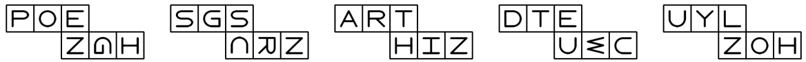</a>

推广 “即刻疯狂” 的原理, 说明怎样将这些立方体排成一列, 显出四个五字母词. (每个词中的字母要同向. 字母 C 与 U、H 与 I、N 与 Z 分别相差 $90^\circ$ 旋转.)

<a id="pdf-080"></a><a id="p-60"></a>

<a id="ex-7-2-2-65"></a>

**65.** [25] [答案](./answers/7-2-2.md#ans-7-2-2-65) 证明, 若有 $n$ 个立方体, 各面涂 $n$ 种颜色之一, 则推广的 “即刻疯狂” 问题是 NP 完全的, 尽管 $n$ 较小时相当容易.

<a id="ex-7-2-2-66"></a>

▶ **66.** [23] [答案](./answers/7-2-2.md#ans-7-2-2-66) (<em>愚人圆盘.</em>) “转动下方左图的四个圆盘, 使每条射线上的四个数之和为 12.” (现在的和是 $4+3+2+4=13$ 等.) 证明这个问题可以很好地分解, 从而很容易手算.

<div style="display:flex;align-items:center;gap:1em">
<div style="width:48%"><a href="../../assets/volume4b/figures/backtrack-ex-66.png">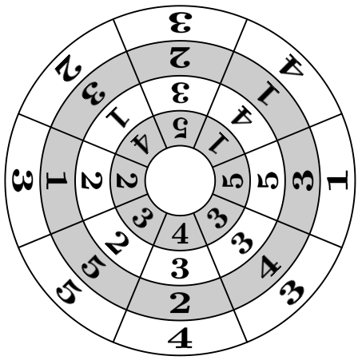</a><p>愚人圆盘</p></div>
<div style="width:48%"><a href="../../assets/volume4b/figures/backtrack-ex-67.png">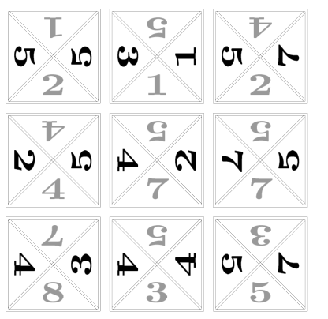</a><p>皇家水族馆十三数谜</p></div>
</div>

<a id="ex-7-2-2-67"></a>

▶ **67.** [26] [答案](./answers/7-2-2.md#ans-7-2-2-67) (<em>皇家水族馆十三数谜.</em>) “重新排列上方右图中的九张卡片, 其中有些可以转动 $180^\circ$, 使灰色数字的六个横和与黑色数字的六个纵和全都等于 13.” (现在的和为 $1+5+4=10,\ldots,7+5+7=19$.) <em>Hoffmann’s Puzzles Old and New</em> (1893) 的作者声称: “求解没有捷径. 必须把卡片一张张互换, 直到条件满足为止.” 证明他说错了: 把这道题 “分解”, 用手解出来.


<a id="ex-7-2-2-68"></a>

▶ **68.** [28] [答案](./answers/7-2-2.md#ans-7-2-2-68) (Johan de Ruiter, 2018 年 3 月 14 日.) 在每个空框内填入一位数字, 使得每个框中的数字恰好等于它所指方向上出现的不同数字的个数.

<a href="../../assets/volume4b/figures/backtrack-ex-68.svg">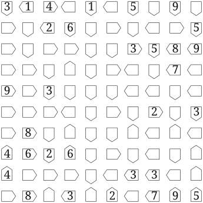</a>

<a id="ex-7-2-2-69"></a>

**69.** [41] [答案](./answers/7-2-2.md#ans-7-2-2-69) 有没有像习题 68 那样的谜题, 但所给线索包含的 $\pi$ 的数字<em>多于</em> 32 位?

<a id="ex-7-2-2-70"></a>

**70.** [HM40] [答案](./answers/7-2-2.md#ans-7-2-2-70) (M. Bousquet-Mélou.) 考虑从 $m\times n$ 方格阵列的左上角走到右下角的自避路径, 每步只许向上、向下或向右. 若像算法 E 那样在每步从一、二或三种走法中随机选择, 则期望值 $\mathrm E\,D_{mn}$ 为这类路径的总数 $m^{n-1}$. 但是方差大得多: 试构造多项式 $P_m(z)$ 和 $Q_m(z)$, 使得对 $m\geq2$ 有 $G_m(z)=\sum_{n=1}^{\infty}(\mathrm E\,D_{mn}^2)z^n=zP_m(z)/Q_m(z)$. 例如, $G_3(z)=(z+z^2)/(1-9z-6z^2)=z+10z^2+96z^3+924z^4+8892z^5+\cdots$. 再证明 $\mathrm E\,D_{mn}^2=\Theta(\rho_m^{2n})$, 其中 $\rho_m=2^{m-1}+O(1)$.

<a id="pdf-081"></a><a id="p-61"></a>

<a id="tab-7-2-2-666"></a>

**表 666. 二十道问题 (见习题 71)**

| 题号 | 问题 | (A) | (B) | (C) | (D) | (E) |
|---:|---|---|---|---|---|---|
| 1 | 答案为 A 的第一题是 | 1 | 2 | 3 | 4 | 5 |
| 2 | 此后与本题答案相同的第一题是 | 4 | 6 | 8 | 10 | 12 |
| 3 | 仅有的两道相邻而答案相同的题是 | 15 与 16 | 16 与 17 | 17 与 18 | 18 与 19 | 19 与 20 |
| 4 | 本题的答案与以下两题相同 | 10 与 13 | 14 与 16 | 7 与 20 | 1 与 15 | 8 与 12 |
| 5 | 第 14 题的答案是 | B | E | C | A | D |
| 6 | 本题的答案是 | A | B | C | D | 以上皆非 |
| 7 | 出现次数最多的一种答案是 | A | B | C | D | E |
| 8 | 略去与其他答案出现次数相同的答案后, 出现次数最少的答案是 | A | B | C | D | E |
| 9 | 在回答正确且答案与本题相同的各题中, 所有题号的和 | 在 $[59\mathinner{.\,.}62]$ 中 | 在 $[52\mathinner{.\,.}55]$ 中 | 在 $[44\mathinner{.\,.}49]$ 中 | 在 $[59\mathinner{.\,.}67]$ 中 | 在 $[44\mathinner{.\,.}53]$ 中 |
| 10 | 第 17 题的答案是 | D | B | A | E | 错误的 |
| 11 | 答案为 D 的题数是 | 2 | 3 | 4 | 5 | 6 |
| 12 | 与本题答案相同的<em>其他</em>题的数目, 等于答案为何者的题数? | B | C | D | E | 以上皆非 |
| 13 | 答案为 E 的题数是 | 5 | 4 | 3 | 2 | 1 |
| 14 | 没有哪一种答案恰好出现这么多次 | 2 | 3 | 4 | 5 | 以上皆非 |
| 15 | 答案为 A 的所有奇数题号组成的集合 | 是 $\{7\}$ | 是 $\{9\}$ | 不是 $\{11\}$ | 是 $\{13\}$ | 是 $\{15\}$ |
| 16 | 第 8 题的答案同哪一题相同? | 3 | 2 | 13 | 18 | 20 |
| 17 | 第 10 题的答案是 | C | D | B | A | 正确的 |
| 18 | 在题号为素数的各题中, 答案为元音字母的题数是 | 素数 | 平方数 | 奇数 | 偶数 | 零 |
| 19 | 答案为 B 的最后一题是 | 14 | 15 | 16 | 17 | 18 |
| 20 | 这份试卷能够得到的最高分是 | 18 | 19 | 20 | 不确定 | 只有答错本题才能得到 |

<a id="ex-7-2-2-71"></a>

▶ **71.** [M29] [答案](./answers/7-2-2.md#ans-7-2-2-71) (Donald R. Woods, 2000.) 找出使表 666 的问卷中答对题数最多的所有答法. 每道题必须用 A 至 E 中的一个字母作答. <em>提示:</em> 先弄清本题的确切含义. 下列两道题、两个字母的 “热身题”, 最好怎样作答?

| 题号 | (A) | (B) |
|---:|---|---|
| 1 | 第 2 题答 B. | 第 1 题答 A. |
| 2 | 第 1 题答对了. | “第 2 题答错了” 和 “第 1 题答 A” 两件事恰好有一件为真. |

<a id="ex-7-2-2-72"></a>

**72.** [HM28] [答案](./answers/7-2-2.md#ans-7-2-2-72) 表 666 中若有两项改动, 习题 71 的答案会出人意料, 而且颇像一个悖论. 证明这一点. 两项改动是: 9(E) 改为 “在 $[39\mathinner{.\,.}43]$ 中”, 15(C) 改为 “是 $\{11\}$”.

<a id="pdf-082"></a><a id="p-62"></a>

<a id="ex-7-2-2-73"></a>

▶ **73.** [30] [答案](./answers/7-2-2.md#ans-7-2-2-73) (<em>没有线索的离合字谜.</em>) 有 29 个五字母词,

$\underset{1}{\rule{.88em}{.32pt}}\,\underset{2}{\rule{.88em}{.32pt}}\,\underset{3}{\rule{.88em}{.32pt}}\,\underset{4}{\rule{.88em}{.32pt}}\,\underset{5}{\rule{.88em}{.32pt}}$, $\underset{6}{\rule{.88em}{.32pt}}\,\underset{7}{\rule{.88em}{.32pt}}\,\underset{8}{\rule{.88em}{.32pt}}\,\underset{9}{\rule{.88em}{.32pt}}\,\underset{10}{\rule{.88em}{.32pt}}$, $\underset{11}{\rule{.88em}{.32pt}}\,\underset{12}{\rule{.88em}{.32pt}}\,\underset{13}{\rule{.88em}{.32pt}}\,\underset{14}{\rule{.88em}{.32pt}}\,\underset{15}{\rule{.88em}{.32pt}}$, $\underset{16}{\rule{.88em}{.32pt}}\,\underset{17}{\rule{.88em}{.32pt}}\,\underset{18}{\rule{.88em}{.32pt}}\,\underset{19}{\rule{.88em}{.32pt}}\,\underset{20}{\rule{.88em}{.32pt}}$, …, $\underset{141}{\rule{.88em}{.32pt}}\,\underset{142}{\rule{.88em}{.32pt}}\,\underset{143}{\rule{.88em}{.32pt}}\,\underset{144}{\rule{.88em}{.32pt}}\,\underset{145}{\rule{.88em}{.32pt}}$,

它们都属于 $\mathrm{WORDS}(1000)$. 把字母打乱, 得到下面这段神秘文字:

$\underset{30}{\rule{.88em}{.32pt}}\,\underset{29}{\rule{.88em}{.32pt}}\,\underset{9}{\rule{.88em}{.32pt}}$　$\underset{140}{\rule{.88em}{.32pt}}\,\underset{12}{\rule{.88em}{.32pt}}\,\underset{13}{\rule{.88em}{.32pt}}\,\underset{145}{\rule{.88em}{.32pt}}\,\underset{90}{\rule{.88em}{.32pt}}\,\underset{45}{\rule{.88em}{.32pt}}\,\underset{99}{\rule{.88em}{.32pt}}$　$\underset{26}{\rule{.88em}{.32pt}}\,\underset{107}{\rule{.88em}{.32pt}}$　$\underset{47}{\rule{.88em}{.32pt}}\,\underset{84}{\rule{.88em}{.32pt}}\,\underset{53}{\rule{.88em}{.32pt}}\,\underset{51}{\rule{.88em}{.32pt}}\,\underset{27}{\rule{.88em}{.32pt}}\,\underset{133}{\rule{.88em}{.32pt}}\,\underset{39}{\rule{.88em}{.32pt}}$　$\underset{137}{\rule{.88em}{.32pt}}\,\underset{139}{\rule{.88em}{.32pt}}$　$\underset{66}{\rule{.88em}{.32pt}}\,\underset{112}{\rule{.88em}{.32pt}}\,\underset{69}{\rule{.88em}{.32pt}}\,\underset{14}{\rule{.88em}{.32pt}}\,\underset{8}{\rule{.88em}{.32pt}}\,\underset{20}{\rule{.88em}{.32pt}}\,\underset{91}{\rule{.88em}{.32pt}}\,\underset{129}{\rule{.88em}{.32pt}}\,\underset{70}{\rule{.88em}{.32pt}}$

$\underset{16}{\rule{.88em}{.32pt}}\,\underset{7}{\rule{.88em}{.32pt}}\,\underset{93}{\rule{.88em}{.32pt}}\,\underset{19}{\rule{.88em}{.32pt}}\,\underset{85}{\rule{.88em}{.32pt}}$　$\underset{101}{\rule{.88em}{.32pt}}\,\underset{76}{\rule{.88em}{.32pt}}\,\underset{78}{\rule{.88em}{.32pt}}\,\underset{44}{\rule{.88em}{.32pt}}\,\underset{10}{\rule{.88em}{.32pt}}\,\underset{106}{\rule{.88em}{.32pt}}\,\underset{60}{\rule{.88em}{.32pt}}$　$\underset{118}{\rule{.88em}{.32pt}}\,\underset{119}{\rule{.88em}{.32pt}}$　$\underset{24}{\rule{.88em}{.32pt}}\,\underset{25}{\rule{.88em}{.32pt}}\,\underset{100}{\rule{.88em}{.32pt}}$　$\underset{1}{\rule{.88em}{.32pt}}\,\underset{5}{\rule{.88em}{.32pt}}\,\underset{64}{\rule{.88em}{.32pt}}\,\underset{11}{\rule{.88em}{.32pt}}\,\underset{71}{\rule{.88em}{.32pt}}$　$\underset{42}{\rule{.88em}{.32pt}}\,\underset{122}{\rule{.88em}{.32pt}}\,\underset{123}{\rule{.88em}{.32pt}}$

$\underset{103}{\rule{.88em}{.32pt}}\,\underset{104}{\rule{.88em}{.32pt}}\,\underset{63}{\rule{.88em}{.32pt}}\,\underset{49}{\rule{.88em}{.32pt}}\,\underset{31}{\rule{.88em}{.32pt}}\,\underset{121}{\rule{.88em}{.32pt}}\,\underset{98}{\rule{.88em}{.32pt}}\,\underset{79}{\rule{.88em}{.32pt}}\,\underset{80}{\rule{.88em}{.32pt}}$　$\underset{46}{\rule{.88em}{.32pt}}\,\underset{48}{\rule{.88em}{.32pt}}$　$\underset{134}{\rule{.88em}{.32pt}}\,\underset{135}{\rule{.88em}{.32pt}}\,\underset{131}{\rule{.88em}{.32pt}}$　$\underset{143}{\rule{.88em}{.32pt}}\,\underset{96}{\rule{.88em}{.32pt}}\,\underset{142}{\rule{.88em}{.32pt}}\,\underset{120}{\rule{.88em}{.32pt}}\,\underset{50}{\rule{.88em}{.32pt}}\,\underset{132}{\rule{.88em}{.32pt}}\,\underset{33}{\rule{.88em}{.32pt}}\,\underset{43}{\rule{.88em}{.32pt}}\,\underset{34}{\rule{.88em}{.32pt}}\,\underset{40}{\rule{.88em}{.32pt}}$．　……

$\underset{111}{\rule{.88em}{.32pt}}\,\underset{97}{\rule{.88em}{.32pt}}\,\underset{113}{\rule{.88em}{.32pt}}\,\underset{105}{\rule{.88em}{.32pt}}\,\underset{38}{\rule{.88em}{.32pt}}\,\underset{102}{\rule{.88em}{.32pt}}\,\underset{62}{\rule{.88em}{.32pt}}\,\underset{65}{\rule{.88em}{.32pt}}\,\underset{114}{\rule{.88em}{.32pt}}$　$\underset{74}{\rule{.88em}{.32pt}}\,\underset{82}{\rule{.88em}{.32pt}}\,\underset{81}{\rule{.88em}{.32pt}}\,\underset{83}{\rule{.88em}{.32pt}}\,\underset{136}{\rule{.88em}{.32pt}}\,\underset{37}{\rule{.88em}{.32pt}}\,\underset{21}{\rule{.88em}{.32pt}}\,\underset{61}{\rule{.88em}{.32pt}}\,\underset{88}{\rule{.88em}{.32pt}}\,\underset{86}{\rule{.88em}{.32pt}}\,\underset{55}{\rule{.88em}{.32pt}}$　($\underset{32}{\rule{.88em}{.32pt}}\,\underset{35}{\rule{.88em}{.32pt}}$　$\underset{117}{\rule{.88em}{.32pt}}\,\underset{116}{\rule{.88em}{.32pt}}\,\underset{23}{\rule{.88em}{.32pt}}\,\underset{52}{\rule{.88em}{.32pt}}$

$\underset{56}{\rule{.88em}{.32pt}}\,\underset{17}{\rule{.88em}{.32pt}}\,\underset{18}{\rule{.88em}{.32pt}}\,\underset{94}{\rule{.88em}{.32pt}}\,\underset{67}{\rule{.88em}{.32pt}}$　$\underset{128}{\rule{.88em}{.32pt}}\,\underset{15}{\rule{.88em}{.32pt}}\,\underset{57}{\rule{.88em}{.32pt}}\,\underset{58}{\rule{.88em}{.32pt}}\,\underset{89}{\rule{.88em}{.32pt}}$　$\underset{87}{\rule{.88em}{.32pt}}\,\underset{109}{\rule{.88em}{.32pt}}$　$\underset{2}{\rule{.88em}{.32pt}}\,\underset{4}{\rule{.88em}{.32pt}}\,\underset{6}{\rule{.88em}{.32pt}}\,\underset{28}{\rule{.88em}{.32pt}}\,\underset{95}{\rule{.88em}{.32pt}}\,\underset{3}{\rule{.88em}{.32pt}}\,\underset{126}{\rule{.88em}{.32pt}}\,\underset{77}{\rule{.88em}{.32pt}}\,\underset{144}{\rule{.88em}{.32pt}}\,\underset{54}{\rule{.88em}{.32pt}}\,\underset{41}{\rule{.88em}{.32pt}}$)　$\underset{68}{\rule{.88em}{.32pt}}\,\underset{115}{\rule{.88em}{.32pt}}$

$\underset{75}{\rule{.88em}{.32pt}}\,\underset{138}{\rule{.88em}{.32pt}}\,\underset{73}{\rule{.88em}{.32pt}}\,\underset{124}{\rule{.88em}{.32pt}}\,\underset{36}{\rule{.88em}{.32pt}}\,\underset{130}{\rule{.88em}{.32pt}}\,\underset{127}{\rule{.88em}{.32pt}}\,\underset{141}{\rule{.88em}{.32pt}}$　$\underset{22}{\rule{.88em}{.32pt}}\,\underset{92}{\rule{.88em}{.32pt}}$　$\underset{72}{\rule{.88em}{.32pt}}\,\underset{59}{\rule{.88em}{.32pt}}$　$\underset{108}{\rule{.88em}{.32pt}}\,\underset{125}{\rule{.88em}{.32pt}}\,\underset{110}{\rule{.88em}{.32pt}}$．

此外, 这些词的首字母 (位置 1、6、11、16、…、141) 指出了引文的出处. 引文中全是常见的英语词, 它说的是什么?

<a id="ex-7-2-2-74"></a>

**74.** [21] [答案](./answers/7-2-2.md#ans-7-2-2-74) 习题 73 中第十五个待猜的词是 $\underset{134}{\rule{.88em}{.32pt}}\,\underset{135}{\rule{.88em}{.32pt}}\,\underset{131}{\rule{.88em}{.32pt}}$. 为什么这一特殊形式能使上题得到部分<em>分解</em>?

<a id="ex-7-2-2-75"></a>

▶ **75.** [30] [答案](./answers/7-2-2.md#ans-7-2-2-75) (<em>连通子集.</em>) 设 $v$ 是图 $G$ 的一个顶点, $H$ 是 $G$ 的一个包含 $v$ 的连通顶点子集. $H$ 的顶点可按一种规范的次序列出: 从 $v_0\gets v$ 开始, 让 $v_1,v_2,\ldots$ 依次为 $v_0$ 在 $H$ 中的邻点, 随后列出 $v_1$ 的尚未列过的邻点, 依此类推. (假定每个顶点的邻点都按某个固定的次序列出.)

例如, 若 $G$ 为 $3\times3$ 方格图 $P_3\mathbin{\square}P_3$, 则其五元连通子集中恰有 21 个包含左上角的顶点 $v$. 它们的规范次序如下:

<a href="../../assets/volume4b/figures/backtrack-ex-75.svg">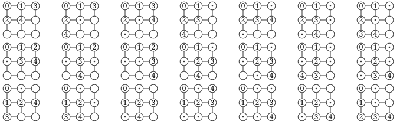</a>

这里在列出邻点时, 顶点按从上到下、同一行从左到右的次序比较. (标为 ⓪、①、②、③、④ 的顶点表示 $v_0,v_1,v_2,v_3,v_4$. 其他顶点不在 $H$ 中.)

设计一个回溯算法, 生成所有包含指定顶点 $v$ 的 $n$ 元连通子集. 给定的图以 SGB 格式表示, 提供第 7 章开头介绍的 $\mathtt{ARCS}$, $\mathtt{TIP}$ 和 $\mathtt{NEXT}$ 域.

<a id="ex-7-2-2-76"></a>

**76.** [23] [答案](./answers/7-2-2.md#ans-7-2-2-76) 用习题 75 的算法生成给定图 $G$ 的<em>所有</em> $n$ 元连通子集. 对于 $1\leq n\leq9$, $P_n\mathbin{\square}P_n$ 中有多少个这样的子集?

<a id="ex-7-2-2-77"></a>

**77.** [M22] [答案](./answers/7-2-2.md#ans-7-2-2-77) 有向图 $G$ 的一个 $v$ <em>可达子集</em>是一个非空顶点集 $H$, 从 $v$ 出发, 至少有一条完全在 $G\mid H$ 中的有向路能到达每个 $u\in H$. (特别地, $v$ 自身必须在 $H$ 中.)

(a) 有向图 $\overrightarrow P_3\mathbin{\square}\overrightarrow P_3$ 与 $P_3\mathbin{\square}P_3$ 一样, 不过各弧均向下或向右. 习题 75 的 21 个连通子集中, 哪些也是这个有向图中从左上角 $v$ 可达的子集?

<a id="pdf-083"></a><a id="p-63"></a>

(b) 判断真假: $H$ 是 $v$ 可达的, 当且仅当 $G\mid H$ 有一棵以 $v$ 为根的对偶有向生成树. (有向树的弧为 $u\to p_u$, 其中 $p_u$ 是非根结点 $u$ 的父结点; <em>对偶</em>有向树的弧反向, 为 $p_u\to u$.)

(c) 判断真假: 若 $G$ 为无向图, 即只要有 $u\to w$ 就有 $w\to u$, 则它的 $v$ 可达子集正好就是包含 $v$ 的连通子集.

(d) 修改习题 75 的算法, 使给定 $n,v,G$ 后, 能生成有向图 $G$ 的所有 $n$ 元 $v$ 可达子集.

<a id="ex-7-2-2-78"></a>

**78.** [22] [答案](./answers/7-2-2.md#ans-7-2-2-78) 把习题 77 的算法推广到每个顶点都带有非负权的图, 生成总权 $w$ 满足 $L\leq w<U$ 的所有连通导出子图.

<a id="ex-7-2-2-79"></a>

▶ **79.** [M30] [答案](./answers/7-2-2.md#ans-7-2-2-79) 作者夫妇有一架管风琴, 含 812 根音管, 每根不是在响, 就是静默. 因此它有可能发出 $2^{812}$ 种不同的声音 (包括静默). 不过, 音管由传统的风琴演奏台控制, 手脚可弹奏的琴键与踏键仅有 $56+56+32=144$ 个, 另有 20 个开关规定琴键与音管间的连接. 因此实际能演奏的声音至多有 $2^{164}$ 种! 本题的目的是, 对较小的 $n$, 求出能使 $n$ 根音管发声的可奏声音的确切数目.

琴键用二元向量 $s=s_0s_1\ldots s_{55}$ 和 $g=g_0g_1\ldots g_{55}$ 表示; 踏键为 $p=p_0p_1\ldots p_{31}$; 演奏台上的控制开关为 $c=c_0c_1\ldots c_{19}$; 音管为 $r_{i,j}$, 其中 $0\leq i<16$, $0\leq j<56$. 以下规则根据演奏者控制的输入向量 $s,g,p,c$ 确定音管的发声状态:

$$
r_{i,j}=\begin{cases}
c_ip_j\vee c_{i+15}p_{j-12},&i\in\{0,1\};\\
c_ip_j,&i=2;\\
(c_i\vee c_{i+1}[j<12])s_j^*,&i=3;\\
c_i[j\geq12]s_j^*,&i\in\{4,8\};\\
c_is_j^*,&i\in\{5,6,7\};\\
(c_i\vee c_{i+1}[j<12])g_j^*,&i=9;\\
c_i[j\geq12]g_j^*,&i=10;\\
c_i g_j^*,&i\in\{11,12\};\\
(c_{13}\vee c_{14})g_j^*,&i=13;\\
c_{14}g_j^*,&i\in\{14,15\}.
\end{cases}
$$

这里若 $j<0$ 或 $j\geq32$ 则 $p_j=0$; $s_j^*=s_j\vee c_{17}g_j\vee c_{18}p_j$; $g_j^*=g_j\vee c_{19}p_j$. [用风琴的术语说, 这组音管有 16 个 “音列”; 音列 $\{0,1,2\}$, $\{3,\ldots,8\}$, $\{9,\ldots,15\}$ 分别构成脚键盘部 (Pedal)、表情部 (Swell) 和主部 (Great). 音列 3、4 共用其最低的 12 根音管, 9、10 也一样. 音列 13、14、15 构成一个 “混合音栓” $c_{14}$. 扩展音栓 $c_{15}$、$c_{16}$ 使音列 0、1 各向高处延伸 12 个半音. 演奏台上的 $c_{17}$、$c_{18}$、$c_{19}$ 为联动开关, 分别使主部的键联动表情部、脚键联动表情部、脚键联动主部; 这就解释了 $s_j^*$ 和 $g_j^*$ 的公式.]

一个<em>可奏声音</em> $S$ 是一个有序对 $(i,j)$ 的集合, 对至少一种输入向量 $s,g,p,c$ 的选择, 有 $r_{i,j}=[(i,j)\in S]$. 目标是确定满足 $\|S\|=n$ 的可奏声音数 $Q_n$.

(a) 虽然有 $16\times56$ 个变量 $r_{i,j}$, 实际音管却只有 812 根, 因为有些音列不全. 哪些 $(i,j)$ 的 $r_{i,j}$ 恒为假?

(b) 判断真假: 若 $s\subseteq s'$, $g\subseteq g'$, $p\subseteq p'$, $c\subseteq c'$, 则 $r\subseteq r'$.

(c) 证明每个可奏声音都可以在 $c_{17}=c_{18}=c_{19}=0$ 时奏出.

(d) 找一个五音管的可奏声音, 使 $s_j,g_j,p_j,c_j$ 中恰有五个量非零.

(e) 对哪些 $i$ 和 $i'$ 可以奏出双音管声音 $\{(i,40),(i',50)\}$?

(f) 手算 $Q_1$, 并说明它为什么小于 812.

(g) 手算 $Q_{811}$.

(h) 用计算机确定 $Q_2,\ldots,Q_{10}$, 将其与 $\binom{812}2,\ldots,\binom{812}{10}$ 比较.

<a id="pdf-084"></a><a id="p-64"></a>

> 我们手里攥着好几条线索, 很有可能其中哪一条就会引我们找到真相. 跟错了也许会浪费时间, 不过迟早总能碰上那条对的.
>
> ——歇洛克·福尔摩斯, 《巴斯克维尔的猎犬》(1901)

> 以下食谱绝非从过时的著作里东剪西贴、拼凑而成的一堆没有骨髓的碎屑, 而是实实在在记下的实践事实……作者为此付出的辛劳, 或许从前写烹饪书的人谁也没有尝试过: 每一道菜, 在记入书中之前, 他不仅自己动手做过, 而且亲口吃过.
>
> ——威廉·基奇纳, <em>Apicius Redivivus; Or, The Cook’s Oracle</em> (1817)

> 正如我们希望您从我们这里有所收获, 我们也从您那里学到了许多, 来自您热心告诉我们的食谱、窍门、心得和传统. 没有您的帮助, 这本书确实写不成.
>
> ——<em>McCall’s Cook Book</em> (1963)

[^v4b-36-words]: 本书例子中出现的五字母单词, 都取自第 7 章开头介绍过的《斯坦福图库》的 5757 个单词. 其他长度的单词取自 <em>The Official SCRABBLE® Players Dictionary</em> 第 4 版 (Hasbro, 2005), 因为这些词已经收入许多流行的计算机游戏. 这些词的名次按 2007 年的英国国家语料库排定. 在这个语料库中, “the” 出现 $5\,405\,633$ 次, 居其次的 “of” 出现的次数约为前者的一半 ($3\,021\,525$). OSPD4 词表中, 长度为 $(2,3,\ldots,12)$ 的单词数分别是 $(101,1004,4002,8887,15727,23958,29718,29130,22314,16161,11412)$, 其中在英国国家语料库至少出现过六次的分别有 $(97,771,2451,4474,6910,8852,9205,8225,6626,4642,3061)$ 个.


[^v4b-50-samples]: 绘制图 70 所用的实际值中有四个大于 $10^{28}$. 最大值约为 $2.1\times10^{28}$, 来自长为 57 的路径. 最小的估计值为 $19\,361\,664$, 来自长为 10 的路径.
