<a id="pdf-691"></a><a id="p-671"></a>

<a id="sec-app-e"></a>

# 附录 E　答案中谜题的解

除另有说明外, 这里的答案均指 §7.2.2.1 的习题.

<a id="app-e-backtrack-69"></a>

<a href="../../assets/volume4b/figures/backtrack-ans-69-solution.svg">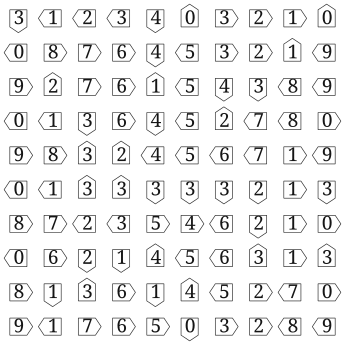</a>

(见[答案 7.2.2–69](./answers/7-2-2.md#ans-7-2-2-69).)

<a id="app-e-dlx-52"></a>

<table class="puzzle-grid" style="display:table;border-collapse:collapse;border-spacing:0;max-width:100%">
<tbody>
<tr><td style="padding:.12em .35em;text-align:center;min-width:1.25em;border:1px solid currentColor;border-top-width:2px;border-left-width:2px">1</td><td style="padding:.12em .35em;text-align:center;min-width:1.25em;border:1px solid currentColor;border-top-width:2px">2</td><td style="padding:.12em .35em;text-align:center;min-width:1.25em;border:1px solid currentColor;border-top-width:2px">8</td><td style="padding:.12em .35em;text-align:center;min-width:1.25em;border:1px solid currentColor;border-top-width:2px;border-left-width:2px">3</td><td style="padding:.12em .35em;text-align:center;min-width:1.25em;border:1px solid currentColor;border-top-width:2px">7</td><td style="padding:.12em .35em;text-align:center;min-width:1.25em;border:1px solid currentColor;border-top-width:2px">9</td><td style="padding:.12em .35em;text-align:center;min-width:1.25em;border:1px solid currentColor;border-top-width:2px;border-left-width:2px">4</td><td style="padding:.12em .35em;text-align:center;min-width:1.25em;border:1px solid currentColor;border-top-width:2px">6</td><td style="padding:.12em .35em;text-align:center;min-width:1.25em;border:1px solid currentColor;border-top-width:2px;border-right-width:2px">5</td></tr>
<tr><td style="padding:.12em .35em;text-align:center;min-width:1.25em;border:1px solid currentColor;border-left-width:2px">4</td><td style="padding:.12em .35em;text-align:center;min-width:1.25em;border:1px solid currentColor">6</td><td style="padding:.12em .35em;text-align:center;min-width:1.25em;border:1px solid currentColor">7</td><td style="padding:.12em .35em;text-align:center;min-width:1.25em;border:1px solid currentColor;border-left-width:2px">1</td><td style="padding:.12em .35em;text-align:center;min-width:1.25em;border:1px solid currentColor">5</td><td style="padding:.12em .35em;text-align:center;min-width:1.25em;border:1px solid currentColor">2</td><td style="padding:.12em .35em;text-align:center;min-width:1.25em;border:1px solid currentColor;border-left-width:2px">9</td><td style="padding:.12em .35em;text-align:center;min-width:1.25em;border:1px solid currentColor">8</td><td style="padding:.12em .35em;text-align:center;min-width:1.25em;border:1px solid currentColor;border-right-width:2px">3</td></tr>
<tr><td style="padding:.12em .35em;text-align:center;min-width:1.25em;border:1px solid currentColor;border-left-width:2px">9</td><td style="padding:.12em .35em;text-align:center;min-width:1.25em;border:1px solid currentColor">3</td><td style="padding:.12em .35em;text-align:center;min-width:1.25em;border:1px solid currentColor">5</td><td style="padding:.12em .35em;text-align:center;min-width:1.25em;border:1px solid currentColor;border-left-width:2px">8</td><td style="padding:.12em .35em;text-align:center;min-width:1.25em;border:1px solid currentColor">6</td><td style="padding:.12em .35em;text-align:center;min-width:1.25em;border:1px solid currentColor">4</td><td style="padding:.12em .35em;text-align:center;min-width:1.25em;border:1px solid currentColor;border-left-width:2px">7</td><td style="padding:.12em .35em;text-align:center;min-width:1.25em;border:1px solid currentColor">2</td><td style="padding:.12em .35em;text-align:center;min-width:1.25em;border:1px solid currentColor;border-right-width:2px">1</td></tr>
<tr><td style="padding:.12em .35em;text-align:center;min-width:1.25em;border:1px solid currentColor;border-top-width:2px;border-left-width:2px">3</td><td style="padding:.12em .35em;text-align:center;min-width:1.25em;border:1px solid currentColor;border-top-width:2px">9</td><td style="padding:.12em .35em;text-align:center;min-width:1.25em;border:1px solid currentColor;border-top-width:2px">4</td><td style="padding:.12em .35em;text-align:center;min-width:1.25em;border:1px solid currentColor;border-top-width:2px;border-left-width:2px">6</td><td style="padding:.12em .35em;text-align:center;min-width:1.25em;border:1px solid currentColor;border-top-width:2px">2</td><td style="padding:.12em .35em;text-align:center;min-width:1.25em;border:1px solid currentColor;border-top-width:2px">8</td><td style="padding:.12em .35em;text-align:center;min-width:1.25em;border:1px solid currentColor;border-top-width:2px;border-left-width:2px">5</td><td style="padding:.12em .35em;text-align:center;min-width:1.25em;border:1px solid currentColor;border-top-width:2px">1</td><td style="padding:.12em .35em;text-align:center;min-width:1.25em;border:1px solid currentColor;border-top-width:2px;border-right-width:2px">7</td></tr>
<tr><td style="padding:.12em .35em;text-align:center;min-width:1.25em;border:1px solid currentColor;border-left-width:2px">8</td><td style="padding:.12em .35em;text-align:center;min-width:1.25em;border:1px solid currentColor">7</td><td style="padding:.12em .35em;text-align:center;min-width:1.25em;border:1px solid currentColor">6</td><td style="padding:.12em .35em;text-align:center;min-width:1.25em;border:1px solid currentColor;border-left-width:2px">5</td><td style="padding:.12em .35em;text-align:center;min-width:1.25em;border:1px solid currentColor">9</td><td style="padding:.12em .35em;text-align:center;min-width:1.25em;border:1px solid currentColor">1</td><td style="padding:.12em .35em;text-align:center;min-width:1.25em;border:1px solid currentColor;border-left-width:2px">2</td><td style="padding:.12em .35em;text-align:center;min-width:1.25em;border:1px solid currentColor">3</td><td style="padding:.12em .35em;text-align:center;min-width:1.25em;border:1px solid currentColor;border-right-width:2px">4</td></tr>
<tr><td style="padding:.12em .35em;text-align:center;min-width:1.25em;border:1px solid currentColor;border-left-width:2px">2</td><td style="padding:.12em .35em;text-align:center;min-width:1.25em;border:1px solid currentColor">5</td><td style="padding:.12em .35em;text-align:center;min-width:1.25em;border:1px solid currentColor">1</td><td style="padding:.12em .35em;text-align:center;min-width:1.25em;border:1px solid currentColor;border-left-width:2px">7</td><td style="padding:.12em .35em;text-align:center;min-width:1.25em;border:1px solid currentColor">4</td><td style="padding:.12em .35em;text-align:center;min-width:1.25em;border:1px solid currentColor">3</td><td style="padding:.12em .35em;text-align:center;min-width:1.25em;border:1px solid currentColor;border-left-width:2px">6</td><td style="padding:.12em .35em;text-align:center;min-width:1.25em;border:1px solid currentColor">9</td><td style="padding:.12em .35em;text-align:center;min-width:1.25em;border:1px solid currentColor;border-right-width:2px">8</td></tr>
<tr><td style="padding:.12em .35em;text-align:center;min-width:1.25em;border:1px solid currentColor;border-top-width:2px;border-left-width:2px">5</td><td style="padding:.12em .35em;text-align:center;min-width:1.25em;border:1px solid currentColor;border-top-width:2px">4</td><td style="padding:.12em .35em;text-align:center;min-width:1.25em;border:1px solid currentColor;border-top-width:2px">3</td><td style="padding:.12em .35em;text-align:center;min-width:1.25em;border:1px solid currentColor;border-top-width:2px;border-left-width:2px">2</td><td style="padding:.12em .35em;text-align:center;min-width:1.25em;border:1px solid currentColor;border-top-width:2px">1</td><td style="padding:.12em .35em;text-align:center;min-width:1.25em;border:1px solid currentColor;border-top-width:2px">6</td><td style="padding:.12em .35em;text-align:center;min-width:1.25em;border:1px solid currentColor;border-top-width:2px;border-left-width:2px">8</td><td style="padding:.12em .35em;text-align:center;min-width:1.25em;border:1px solid currentColor;border-top-width:2px">7</td><td style="padding:.12em .35em;text-align:center;min-width:1.25em;border:1px solid currentColor;border-top-width:2px;border-right-width:2px">9</td></tr>
<tr><td style="padding:.12em .35em;text-align:center;min-width:1.25em;border:1px solid currentColor;border-left-width:2px">6</td><td style="padding:.12em .35em;text-align:center;min-width:1.25em;border:1px solid currentColor">1</td><td style="padding:.12em .35em;text-align:center;min-width:1.25em;border:1px solid currentColor">9</td><td style="padding:.12em .35em;text-align:center;min-width:1.25em;border:1px solid currentColor;border-left-width:2px">4</td><td style="padding:.12em .35em;text-align:center;min-width:1.25em;border:1px solid currentColor">8</td><td style="padding:.12em .35em;text-align:center;min-width:1.25em;border:1px solid currentColor">7</td><td style="padding:.12em .35em;text-align:center;min-width:1.25em;border:1px solid currentColor;border-left-width:2px">3</td><td style="padding:.12em .35em;text-align:center;min-width:1.25em;border:1px solid currentColor">5</td><td style="padding:.12em .35em;text-align:center;min-width:1.25em;border:1px solid currentColor;border-right-width:2px">2</td></tr>
<tr><td style="padding:.12em .35em;text-align:center;min-width:1.25em;border:1px solid currentColor;border-left-width:2px;border-bottom-width:2px">7</td><td style="padding:.12em .35em;text-align:center;min-width:1.25em;border:1px solid currentColor;border-bottom-width:2px">8</td><td style="padding:.12em .35em;text-align:center;min-width:1.25em;border:1px solid currentColor;border-bottom-width:2px">2</td><td style="padding:.12em .35em;text-align:center;min-width:1.25em;border:1px solid currentColor;border-left-width:2px;border-bottom-width:2px">9</td><td style="padding:.12em .35em;text-align:center;min-width:1.25em;border:1px solid currentColor;border-bottom-width:2px">3</td><td style="padding:.12em .35em;text-align:center;min-width:1.25em;border:1px solid currentColor;border-bottom-width:2px">5</td><td style="padding:.12em .35em;text-align:center;min-width:1.25em;border:1px solid currentColor;border-left-width:2px;border-bottom-width:2px">1</td><td style="padding:.12em .35em;text-align:center;min-width:1.25em;border:1px solid currentColor;border-bottom-width:2px">4</td><td style="padding:.12em .35em;text-align:center;min-width:1.25em;border:1px solid currentColor;border-bottom-width:2px;border-right-width:2px">6</td></tr>
</tbody>
</table>

(见[答案 52](./answers/7-2-2-1.md#ans-7-2-2-1-52).)

<a id="app-e-dlx-58"></a>

<table class="puzzle-grid" style="display:table;border-collapse:collapse;border-spacing:0;max-width:100%">
<tbody>
<tr><td style="padding:.12em .35em;text-align:center;min-width:1.25em;border:1px solid currentColor;border-top-width:2px;border-left-width:2px">8</td><td style="padding:.12em .35em;text-align:center;min-width:1.25em;border:1px solid currentColor;border-top-width:2px">1</td><td style="padding:.12em .35em;text-align:center;min-width:1.25em;border:1px solid currentColor;border-top-width:2px">2</td><td style="padding:.12em .35em;text-align:center;min-width:1.25em;border:1px solid currentColor;border-top-width:2px;border-left-width:2px">3</td><td style="padding:.12em .35em;text-align:center;min-width:1.25em;border:1px solid currentColor;border-top-width:2px">4</td><td style="padding:.12em .35em;text-align:center;min-width:1.25em;border:1px solid currentColor;border-top-width:2px">5</td><td style="padding:.12em .35em;text-align:center;min-width:1.25em;border:1px solid currentColor;border-top-width:2px;border-left-width:2px">6</td><td style="padding:.12em .35em;text-align:center;min-width:1.25em;border:1px solid currentColor;border-top-width:2px">9</td><td style="padding:.12em .35em;text-align:center;min-width:1.25em;border:1px solid currentColor;border-top-width:2px;border-right-width:2px">7</td></tr>
<tr><td style="padding:.12em .35em;text-align:center;min-width:1.25em;border:1px solid currentColor;border-left-width:2px">3</td><td style="padding:.12em .35em;text-align:center;min-width:1.25em;border:1px solid currentColor">9</td><td style="padding:.12em .35em;text-align:center;min-width:1.25em;border:1px solid currentColor">6</td><td style="padding:.12em .35em;text-align:center;min-width:1.25em;border:1px solid currentColor;border-left-width:2px">1</td><td style="padding:.12em .35em;text-align:center;min-width:1.25em;border:1px solid currentColor">7</td><td style="padding:.12em .35em;text-align:center;min-width:1.25em;border:1px solid currentColor">2</td><td style="padding:.12em .35em;text-align:center;min-width:1.25em;border:1px solid currentColor;border-left-width:2px">4</td><td style="padding:.12em .35em;text-align:center;min-width:1.25em;border:1px solid currentColor">5</td><td style="padding:.12em .35em;text-align:center;min-width:1.25em;border:1px solid currentColor;border-right-width:2px">8</td></tr>
<tr><td style="padding:.12em .35em;text-align:center;min-width:1.25em;border:1px solid currentColor;border-left-width:2px">5</td><td style="padding:.12em .35em;text-align:center;min-width:1.25em;border:1px solid currentColor">4</td><td style="padding:.12em .35em;text-align:center;min-width:1.25em;border:1px solid currentColor">7</td><td style="padding:.12em .35em;text-align:center;min-width:1.25em;border:1px solid currentColor;border-left-width:2px"></td><td style="padding:.12em .35em;text-align:center;min-width:1.25em;border:1px solid currentColor"></td><td style="padding:.12em .35em;text-align:center;min-width:1.25em;border:1px solid currentColor">6</td><td style="padding:.12em .35em;text-align:center;min-width:1.25em;border:1px solid currentColor;border-left-width:2px">3</td><td style="padding:.12em .35em;text-align:center;min-width:1.25em;border:1px solid currentColor">2</td><td style="padding:.12em .35em;text-align:center;min-width:1.25em;border:1px solid currentColor;border-right-width:2px">1</td></tr>
<tr><td style="padding:.12em .35em;text-align:center;min-width:1.25em;border:1px solid currentColor;border-top-width:2px;border-left-width:2px">7</td><td style="padding:.12em .35em;text-align:center;min-width:1.25em;border:1px solid currentColor;border-top-width:2px">2</td><td style="padding:.12em .35em;text-align:center;min-width:1.25em;border:1px solid currentColor;border-top-width:2px"></td><td style="padding:.12em .35em;text-align:center;min-width:1.25em;border:1px solid currentColor;border-top-width:2px;border-left-width:2px">4</td><td style="padding:.12em .35em;text-align:center;min-width:1.25em;border:1px solid currentColor;border-top-width:2px">5</td><td style="padding:.12em .35em;text-align:center;min-width:1.25em;border:1px solid currentColor;border-top-width:2px"></td><td style="padding:.12em .35em;text-align:center;min-width:1.25em;border:1px solid currentColor;border-top-width:2px;border-left-width:2px">1</td><td style="padding:.12em .35em;text-align:center;min-width:1.25em;border:1px solid currentColor;border-top-width:2px">6</td><td style="padding:.12em .35em;text-align:center;min-width:1.25em;border:1px solid currentColor;border-top-width:2px;border-right-width:2px">3</td></tr>
<tr><td style="padding:.12em .35em;text-align:center;min-width:1.25em;border:1px solid currentColor;border-left-width:2px">6</td><td style="padding:.12em .35em;text-align:center;min-width:1.25em;border:1px solid currentColor">3</td><td style="padding:.12em .35em;text-align:center;min-width:1.25em;border:1px solid currentColor"></td><td style="padding:.12em .35em;text-align:center;min-width:1.25em;border:1px solid currentColor;border-left-width:2px">2</td><td style="padding:.12em .35em;text-align:center;min-width:1.25em;border:1px solid currentColor">1</td><td style="padding:.12em .35em;text-align:center;min-width:1.25em;border:1px solid currentColor">7</td><td style="padding:.12em .35em;text-align:center;min-width:1.25em;border:1px solid currentColor;border-left-width:2px"></td><td style="padding:.12em .35em;text-align:center;min-width:1.25em;border:1px solid currentColor">4</td><td style="padding:.12em .35em;text-align:center;min-width:1.25em;border:1px solid currentColor;border-right-width:2px">5</td></tr>
<tr><td style="padding:.12em .35em;text-align:center;min-width:1.25em;border:1px solid currentColor;border-left-width:2px">4</td><td style="padding:.12em .35em;text-align:center;min-width:1.25em;border:1px solid currentColor">5</td><td style="padding:.12em .35em;text-align:center;min-width:1.25em;border:1px solid currentColor">1</td><td style="padding:.12em .35em;text-align:center;min-width:1.25em;border:1px solid currentColor;border-left-width:2px"></td><td style="padding:.12em .35em;text-align:center;min-width:1.25em;border:1px solid currentColor">6</td><td style="padding:.12em .35em;text-align:center;min-width:1.25em;border:1px solid currentColor">3</td><td style="padding:.12em .35em;text-align:center;min-width:1.25em;border:1px solid currentColor;border-left-width:2px"></td><td style="padding:.12em .35em;text-align:center;min-width:1.25em;border:1px solid currentColor">7</td><td style="padding:.12em .35em;text-align:center;min-width:1.25em;border:1px solid currentColor;border-right-width:2px">2</td></tr>
<tr><td style="padding:.12em .35em;text-align:center;min-width:1.25em;border:1px solid currentColor;border-top-width:2px;border-left-width:2px">1</td><td style="padding:.12em .35em;text-align:center;min-width:1.25em;border:1px solid currentColor;border-top-width:2px">7</td><td style="padding:.12em .35em;text-align:center;min-width:1.25em;border:1px solid currentColor;border-top-width:2px">4</td><td style="padding:.12em .35em;text-align:center;min-width:1.25em;border:1px solid currentColor;border-top-width:2px;border-left-width:2px">5</td><td style="padding:.12em .35em;text-align:center;min-width:1.25em;border:1px solid currentColor;border-top-width:2px"></td><td style="padding:.12em .35em;text-align:center;min-width:1.25em;border:1px solid currentColor;border-top-width:2px"></td><td style="padding:.12em .35em;text-align:center;min-width:1.25em;border:1px solid currentColor;border-top-width:2px;border-left-width:2px">2</td><td style="padding:.12em .35em;text-align:center;min-width:1.25em;border:1px solid currentColor;border-top-width:2px">3</td><td style="padding:.12em .35em;text-align:center;min-width:1.25em;border:1px solid currentColor;border-top-width:2px;border-right-width:2px">6</td></tr>
<tr><td style="padding:.12em .35em;text-align:center;min-width:1.25em;border:1px solid currentColor;border-left-width:2px">9</td><td style="padding:.12em .35em;text-align:center;min-width:1.25em;border:1px solid currentColor">6</td><td style="padding:.12em .35em;text-align:center;min-width:1.25em;border:1px solid currentColor">3</td><td style="padding:.12em .35em;text-align:center;min-width:1.25em;border:1px solid currentColor;border-left-width:2px">7</td><td style="padding:.12em .35em;text-align:center;min-width:1.25em;border:1px solid currentColor">2</td><td style="padding:.12em .35em;text-align:center;min-width:1.25em;border:1px solid currentColor">1</td><td style="padding:.12em .35em;text-align:center;min-width:1.25em;border:1px solid currentColor;border-left-width:2px">5</td><td style="padding:.12em .35em;text-align:center;min-width:1.25em;border:1px solid currentColor">8</td><td style="padding:.12em .35em;text-align:center;min-width:1.25em;border:1px solid currentColor;border-right-width:2px">4</td></tr>
<tr><td style="padding:.12em .35em;text-align:center;min-width:1.25em;border:1px solid currentColor;border-left-width:2px;border-bottom-width:2px">2</td><td style="padding:.12em .35em;text-align:center;min-width:1.25em;border:1px solid currentColor;border-bottom-width:2px">8</td><td style="padding:.12em .35em;text-align:center;min-width:1.25em;border:1px solid currentColor;border-bottom-width:2px">5</td><td style="padding:.12em .35em;text-align:center;min-width:1.25em;border:1px solid currentColor;border-left-width:2px;border-bottom-width:2px">6</td><td style="padding:.12em .35em;text-align:center;min-width:1.25em;border:1px solid currentColor;border-bottom-width:2px">3</td><td style="padding:.12em .35em;text-align:center;min-width:1.25em;border:1px solid currentColor;border-bottom-width:2px">4</td><td style="padding:.12em .35em;text-align:center;min-width:1.25em;border:1px solid currentColor;border-left-width:2px;border-bottom-width:2px">7</td><td style="padding:.12em .35em;text-align:center;min-width:1.25em;border:1px solid currentColor;border-bottom-width:2px">1</td><td style="padding:.12em .35em;text-align:center;min-width:1.25em;border:1px solid currentColor;border-bottom-width:2px;border-right-width:2px">9</td></tr>
</tbody>
</table>

(见[答案 58](./answers/7-2-2-1.md#ans-7-2-2-1-58).)

<a id="app-e-dlx-112"></a>

```text
SEVENTH, FOURTEEN, FIGHTER, REINVENT, VENTURES;
NONE, FORGIVEN, FORGIVES, UNTHRONE;
UNDOERS, FOUNDERS, CONDORS, TRIODES, ROUNDEST,
  SECONDO, CERTIFY, FORTIFY, EXTRUDES.
```

(见[答案 112](./answers/7-2-2-1.md#ans-7-2-2-1-112).)

<a id="app-e-dlx-173"></a>

<a href="../../assets/volume4b/figures/appendix-e-173-knights.png">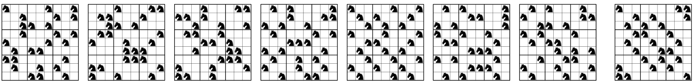</a>

<a href="../../assets/volume4b/figures/appendix-e-173-bishops.png">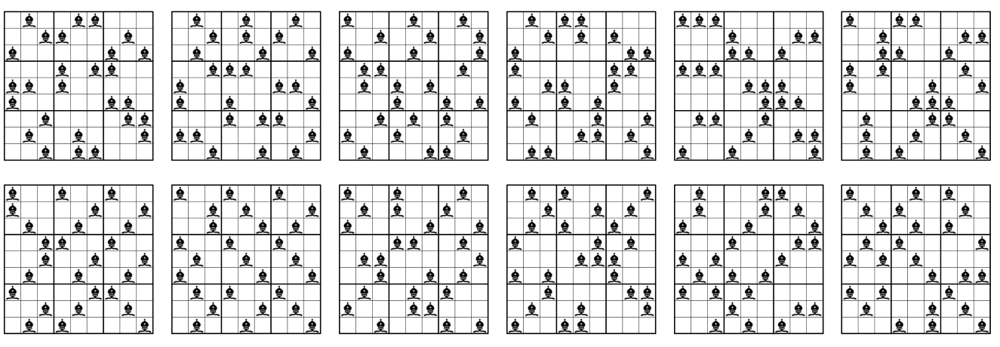</a>

(见[答案 173](./answers/7-2-2-1.md#ans-7-2-2-1-173).)

<a id="app-e-dlx-174"></a>

<a href="../../assets/volume4b/figures/appendix-e-174.png">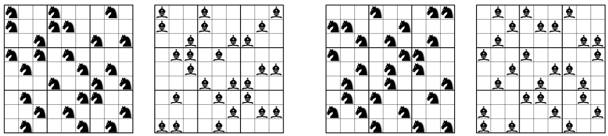</a>

(见[答案 174](./answers/7-2-2-1.md#ans-7-2-2-1-174).)

<a id="app-e-dlx-282"></a>

<a href="../../assets/volume4b/figures/appendix-e-282.svg"></a>

(见[答案 282](./answers/7-2-2-1.md#ans-7-2-2-1-282).)

<a id="app-e-dlx-302"></a>

<table class="puzzle-grid" style="display:table;border-collapse:collapse;border-spacing:0;max-width:100%">
<tbody>
<tr><td style="padding:.12em .35em;text-align:center;min-width:1.25em;border:1px solid currentColor;border-top-width:3px;border-left-width:3px">3</td><td style="padding:.12em .35em;text-align:center;min-width:1.25em;border:1px solid currentColor;border-top-width:3px;border-bottom-width:3px">1</td><td style="padding:.12em .35em;text-align:center;min-width:1.25em;border:1px solid currentColor;border-top-width:3px;border-bottom-width:3px">4</td><td style="padding:.12em .35em;text-align:center;min-width:1.25em;border:1px solid currentColor;border-top-width:3px;border-right-width:3px">2</td><td style="padding:.12em .35em;text-align:center;min-width:1.25em;border:1px solid currentColor;border-top-width:3px;border-left-width:3px;border-right-width:3px">6</td><td style="padding:.12em .35em;text-align:center;min-width:1.25em;border:1px solid currentColor;border-top-width:3px;border-left-width:3px">9</td><td style="padding:.12em .35em;text-align:center;min-width:1.25em;border:1px solid currentColor;border-top-width:3px;border-bottom-width:3px">7</td><td style="padding:.12em .35em;text-align:center;min-width:1.25em;border:1px solid currentColor;border-top-width:3px;border-bottom-width:3px">5</td><td style="padding:.12em .35em;text-align:center;min-width:1.25em;border:1px solid currentColor;border-top-width:3px;border-bottom-width:3px;border-right-width:3px">8</td></tr>
<tr><td style="padding:.12em .35em;text-align:center;min-width:1.25em;border:1px solid currentColor;border-left-width:3px;border-right-width:3px">7</td><td style="padding:.12em .35em;text-align:center;min-width:1.25em;border:1px solid currentColor;border-top-width:3px;border-bottom-width:3px;border-left-width:3px">4</td><td style="padding:.12em .35em;text-align:center;min-width:1.25em;border:1px solid currentColor;border-top-width:3px;border-right-width:3px">1</td><td style="padding:.12em .35em;text-align:center;min-width:1.25em;border:1px solid currentColor;border-bottom-width:3px;border-left-width:3px;border-right-width:3px">5</td><td style="padding:.12em .35em;text-align:center;min-width:1.25em;border:1px solid currentColor;border-left-width:3px;border-right-width:3px">9</td><td style="padding:.12em .35em;text-align:center;min-width:1.25em;border:1px solid currentColor;border-left-width:3px;border-right-width:3px">2</td><td style="padding:.12em .35em;text-align:center;min-width:1.25em;border:1px solid currentColor;border-top-width:3px;border-bottom-width:3px;border-left-width:3px">6</td><td style="padding:.12em .35em;text-align:center;min-width:1.25em;border:1px solid currentColor;border-top-width:3px;border-bottom-width:3px">8</td><td style="padding:.12em .35em;text-align:center;min-width:1.25em;border:1px solid currentColor;border-top-width:3px;border-right-width:3px">3</td></tr>
<tr><td style="padding:.12em .35em;text-align:center;min-width:1.25em;border:1px solid currentColor;border-left-width:3px">6</td><td style="padding:.12em .35em;text-align:center;min-width:1.25em;border:1px solid currentColor;border-top-width:3px;border-bottom-width:3px;border-right-width:3px">9</td><td style="padding:.12em .35em;text-align:center;min-width:1.25em;border:1px solid currentColor;border-left-width:3px">2</td><td style="padding:.12em .35em;text-align:center;min-width:1.25em;border:1px solid currentColor;border-top-width:3px;border-bottom-width:3px">7</td><td style="padding:.12em .35em;text-align:center;min-width:1.25em;border:1px solid currentColor;border-bottom-width:3px;border-right-width:3px">8</td><td style="padding:.12em .35em;text-align:center;min-width:1.25em;border:1px solid currentColor;border-bottom-width:3px;border-left-width:3px">1</td><td style="padding:.12em .35em;text-align:center;min-width:1.25em;border:1px solid currentColor;border-top-width:3px;border-bottom-width:3px">3</td><td style="padding:.12em .35em;text-align:center;min-width:1.25em;border:1px solid currentColor;border-top-width:3px;border-right-width:3px">4</td><td style="padding:.12em .35em;text-align:center;min-width:1.25em;border:1px solid currentColor;border-left-width:3px;border-right-width:3px">5</td></tr>
<tr><td style="padding:.12em .35em;text-align:center;min-width:1.25em;border:1px solid currentColor;border-bottom-width:3px;border-left-width:3px;border-right-width:3px">8</td><td style="padding:.12em .35em;text-align:center;min-width:1.25em;border:1px solid currentColor;border-top-width:3px;border-bottom-width:3px;border-left-width:3px">3</td><td style="padding:.12em .35em;text-align:center;min-width:1.25em;border:1px solid currentColor;border-bottom-width:3px;border-right-width:3px">5</td><td style="padding:.12em .35em;text-align:center;min-width:1.25em;border:1px solid currentColor;border-top-width:3px;border-bottom-width:3px;border-left-width:3px">9</td><td style="padding:.12em .35em;text-align:center;min-width:1.25em;border:1px solid currentColor;border-top-width:3px">2</td><td style="padding:.12em .35em;text-align:center;min-width:1.25em;border:1px solid currentColor;border-top-width:3px;border-bottom-width:3px">7</td><td style="padding:.12em .35em;text-align:center;min-width:1.25em;border:1px solid currentColor;border-top-width:3px;border-bottom-width:3px;border-right-width:3px">4</td><td style="padding:.12em .35em;text-align:center;min-width:1.25em;border:1px solid currentColor;border-bottom-width:3px;border-left-width:3px;border-right-width:3px">6</td><td style="padding:.12em .35em;text-align:center;min-width:1.25em;border:1px solid currentColor;border-left-width:3px;border-right-width:3px">1</td></tr>
<tr><td style="padding:.12em .35em;text-align:center;min-width:1.25em;border:1px solid currentColor;border-top-width:3px;border-left-width:3px">5</td><td style="padding:.12em .35em;text-align:center;min-width:1.25em;border:1px solid currentColor;border-top-width:3px;border-bottom-width:3px">8</td><td style="padding:.12em .35em;text-align:center;min-width:1.25em;border:1px solid currentColor;border-top-width:3px">6</td><td style="padding:.12em .35em;text-align:center;min-width:1.25em;border:1px solid currentColor;border-top-width:3px;border-bottom-width:3px;border-right-width:3px">1</td><td style="padding:.12em .35em;text-align:center;min-width:1.25em;border:1px solid currentColor;border-left-width:3px;border-right-width:3px">3</td><td style="padding:.12em .35em;text-align:center;min-width:1.25em;border:1px solid currentColor;border-top-width:3px;border-bottom-width:3px;border-left-width:3px">4</td><td style="padding:.12em .35em;text-align:center;min-width:1.25em;border:1px solid currentColor;border-top-width:3px;border-bottom-width:3px">2</td><td style="padding:.12em .35em;text-align:center;min-width:1.25em;border:1px solid currentColor;border-top-width:3px;border-bottom-width:3px">7</td><td style="padding:.12em .35em;text-align:center;min-width:1.25em;border:1px solid currentColor;border-bottom-width:3px;border-right-width:3px">9</td></tr>
<tr><td style="padding:.12em .35em;text-align:center;min-width:1.25em;border:1px solid currentColor;border-bottom-width:3px;border-left-width:3px;border-right-width:3px">4</td><td style="padding:.12em .35em;text-align:center;min-width:1.25em;border:1px solid currentColor;border-top-width:3px;border-left-width:3px;border-right-width:3px">6</td><td style="padding:.12em .35em;text-align:center;min-width:1.25em;border:1px solid currentColor;border-left-width:3px;border-right-width:3px">7</td><td style="padding:.12em .35em;text-align:center;min-width:1.25em;border:1px solid currentColor;border-top-width:3px;border-left-width:3px">8</td><td style="padding:.12em .35em;text-align:center;min-width:1.25em;border:1px solid currentColor;border-bottom-width:3px">1</td><td style="padding:.12em .35em;text-align:center;min-width:1.25em;border:1px solid currentColor;border-top-width:3px;border-bottom-width:3px;border-right-width:3px">5</td><td style="padding:.12em .35em;text-align:center;min-width:1.25em;border:1px solid currentColor;border-top-width:3px;border-bottom-width:3px;border-left-width:3px">9</td><td style="padding:.12em .35em;text-align:center;min-width:1.25em;border:1px solid currentColor;border-top-width:3px;border-bottom-width:3px">3</td><td style="padding:.12em .35em;text-align:center;min-width:1.25em;border:1px solid currentColor;border-top-width:3px;border-right-width:3px">2</td></tr>
<tr><td style="padding:.12em .35em;text-align:center;min-width:1.25em;border:1px solid currentColor;border-top-width:3px;border-left-width:3px">1</td><td style="padding:.12em .35em;text-align:center;min-width:1.25em;border:1px solid currentColor;border-bottom-width:3px;border-right-width:3px">5</td><td style="padding:.12em .35em;text-align:center;min-width:1.25em;border:1px solid currentColor;border-left-width:3px;border-right-width:3px">9</td><td style="padding:.12em .35em;text-align:center;min-width:1.25em;border:1px solid currentColor;border-bottom-width:3px;border-left-width:3px;border-right-width:3px">6</td><td style="padding:.12em .35em;text-align:center;min-width:1.25em;border:1px solid currentColor;border-top-width:3px;border-left-width:3px">4</td><td style="padding:.12em .35em;text-align:center;min-width:1.25em;border:1px solid currentColor;border-top-width:3px;border-bottom-width:3px">3</td><td style="padding:.12em .35em;text-align:center;min-width:1.25em;border:1px solid currentColor;border-top-width:3px;border-bottom-width:3px">8</td><td style="padding:.12em .35em;text-align:center;min-width:1.25em;border:1px solid currentColor;border-top-width:3px;border-bottom-width:3px;border-right-width:3px">2</td><td style="padding:.12em .35em;text-align:center;min-width:1.25em;border:1px solid currentColor;border-left-width:3px;border-right-width:3px">7</td></tr>
<tr><td style="padding:.12em .35em;text-align:center;min-width:1.25em;border:1px solid currentColor;border-left-width:3px;border-right-width:3px">9</td><td style="padding:.12em .35em;text-align:center;min-width:1.25em;border:1px solid currentColor;border-top-width:3px;border-bottom-width:3px;border-left-width:3px">2</td><td style="padding:.12em .35em;text-align:center;min-width:1.25em;border:1px solid currentColor;border-bottom-width:3px;border-right-width:3px">3</td><td style="padding:.12em .35em;text-align:center;min-width:1.25em;border:1px solid currentColor;border-top-width:3px;border-left-width:3px;border-right-width:3px">4</td><td style="padding:.12em .35em;text-align:center;min-width:1.25em;border:1px solid currentColor;border-left-width:3px;border-right-width:3px">7</td><td style="padding:.12em .35em;text-align:center;min-width:1.25em;border:1px solid currentColor;border-top-width:3px;border-bottom-width:3px;border-left-width:3px">8</td><td style="padding:.12em .35em;text-align:center;min-width:1.25em;border:1px solid currentColor;border-top-width:3px;border-bottom-width:3px">5</td><td style="padding:.12em .35em;text-align:center;min-width:1.25em;border:1px solid currentColor;border-top-width:3px;border-bottom-width:3px">1</td><td style="padding:.12em .35em;text-align:center;min-width:1.25em;border:1px solid currentColor;border-right-width:3px">6</td></tr>
<tr><td style="padding:.12em .35em;text-align:center;min-width:1.25em;border:1px solid currentColor;border-bottom-width:3px;border-left-width:3px">2</td><td style="padding:.12em .35em;text-align:center;min-width:1.25em;border:1px solid currentColor;border-top-width:3px;border-bottom-width:3px">7</td><td style="padding:.12em .35em;text-align:center;min-width:1.25em;border:1px solid currentColor;border-top-width:3px;border-bottom-width:3px">8</td><td style="padding:.12em .35em;text-align:center;min-width:1.25em;border:1px solid currentColor;border-bottom-width:3px;border-right-width:3px">3</td><td style="padding:.12em .35em;text-align:center;min-width:1.25em;border:1px solid currentColor;border-bottom-width:3px;border-left-width:3px">5</td><td style="padding:.12em .35em;text-align:center;min-width:1.25em;border:1px solid currentColor;border-top-width:3px;border-bottom-width:3px">6</td><td style="padding:.12em .35em;text-align:center;min-width:1.25em;border:1px solid currentColor;border-top-width:3px;border-bottom-width:3px">1</td><td style="padding:.12em .35em;text-align:center;min-width:1.25em;border:1px solid currentColor;border-top-width:3px;border-bottom-width:3px;border-right-width:3px">9</td><td style="padding:.12em .35em;text-align:center;min-width:1.25em;border:1px solid currentColor;border-bottom-width:3px;border-left-width:3px;border-right-width:3px">4</td></tr>
</tbody>
</table>

(见[答案 302(c)](./answers/7-2-2-1.md#ans-7-2-2-1-302).)

| 颜色 | 下层 | 中层 | 上层 |
|---|---|---|---|
| 红 | $\begin{smallmatrix}1&8&8\\1&8&5\\3&3&5\end{smallmatrix}$ | $\begin{smallmatrix}1&7&9\\2&7&9\\4&3&5\end{smallmatrix}$ | $\begin{smallmatrix}2&7&9\\2&6&6\\4&4&6\end{smallmatrix}$ |
| 绿 | $\begin{smallmatrix}5&9&9\\8&6&9\\8&6&6\end{smallmatrix}$ | $\begin{smallmatrix}5&5&7\\8&7&7\\4&4&3\end{smallmatrix}$ | $\begin{smallmatrix}1&1&2\\1&2&2\\4&3&3\end{smallmatrix}$ |

(见[答案 337](./answers/7-2-2-1.md#ans-7-2-2-1-337).)

<a id="pdf-692"></a><a id="p-672"></a>

<a id="app-e-dlx-395"></a>

<a href="../../assets/volume4b/figures/appendix-e-395.png">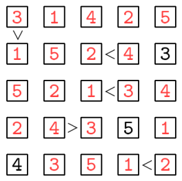</a>

(见[答案 395](./answers/7-2-2-1.md#ans-7-2-2-1-395).)

<a id="app-e-dlx-396"></a>

<a href="../../assets/volume4b/figures/appendix-e-396.png">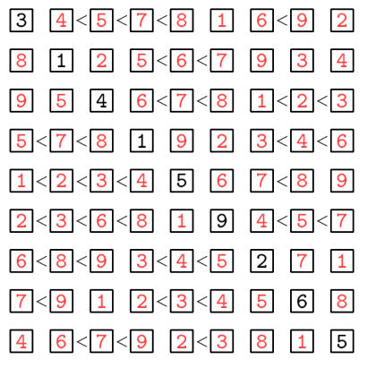</a>

(见[答案 396](./answers/7-2-2-1.md#ans-7-2-2-1-396).)

<a id="app-e-dlx-403"></a>

<a href="../../assets/volume4b/figures/appendix-e-403.png">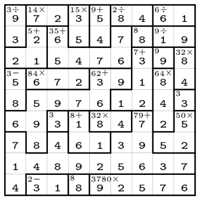</a>

<a href="../../assets/volume4b/figures/appendix-e-403-new.png">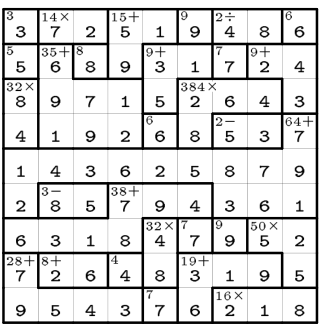</a>

(见[答案 403](./answers/7-2-2-1.md#ans-7-2-2-1-403).)

<a id="app-e-dlx-407"></a>

<table class="puzzle-grid" style="display:table;border-collapse:collapse;border-spacing:0;max-width:100%">
<tbody>
<tr><td style="padding:.12em .35em;text-align:center;min-width:1.25em">23</td><td style="padding:.12em .35em;text-align:center;min-width:1.25em">24</td><td style="padding:.12em .35em;text-align:center;min-width:1.25em">31</td><td style="padding:.12em .35em;text-align:center;min-width:1.25em">32</td><td style="padding:.12em .35em;text-align:center;min-width:1.25em">6</td><td style="padding:.12em .35em;text-align:center;min-width:1.25em">5</td><td style="padding:.12em .35em;text-align:center;min-width:1.25em">14</td><td style="padding:.12em .35em;text-align:center;min-width:1.25em">13</td></tr>
<tr><td style="padding:.12em .35em;text-align:center;min-width:1.25em">22</td><td style="padding:.12em .35em;text-align:center;min-width:1.25em">30</td><td style="padding:.12em .35em;text-align:center;min-width:1.25em">25</td><td style="padding:.12em .35em;text-align:center;min-width:1.25em">17</td><td style="padding:.12em .35em;text-align:center;min-width:1.25em">7</td><td style="padding:.12em .35em;text-align:center;min-width:1.25em">15</td><td style="padding:.12em .35em;text-align:center;min-width:1.25em">4</td><td style="padding:.12em .35em;text-align:center;min-width:1.25em">12</td></tr>
<tr><td style="padding:.12em .35em;text-align:center;min-width:1.25em">21</td><td style="padding:.12em .35em;text-align:center;min-width:1.25em">29</td><td style="padding:.12em .35em;text-align:center;min-width:1.25em">18</td><td style="padding:.12em .35em;text-align:center;min-width:1.25em">26</td><td style="padding:.12em .35em;text-align:center;min-width:1.25em">16</td><td style="padding:.12em .35em;text-align:center;min-width:1.25em">8</td><td style="padding:.12em .35em;text-align:center;min-width:1.25em">3</td><td style="padding:.12em .35em;text-align:center;min-width:1.25em">11</td></tr>
<tr><td style="padding:.12em .35em;text-align:center;min-width:1.25em">20</td><td style="padding:.12em .35em;text-align:center;min-width:1.25em">19</td><td style="padding:.12em .35em;text-align:center;min-width:1.25em">28</td><td style="padding:.12em .35em;text-align:center;min-width:1.25em">27</td><td style="padding:.12em .35em;text-align:center;min-width:1.25em">1</td><td style="padding:.12em .35em;text-align:center;min-width:1.25em">2</td><td style="padding:.12em .35em;text-align:center;min-width:1.25em">9</td><td style="padding:.12em .35em;text-align:center;min-width:1.25em">10</td></tr>
</tbody>
</table>

(见[答案 407](./answers/7-2-2-1.md#ans-7-2-2-1-407).)

<a id="app-e-dlx-408"></a>

<table class="puzzle-grid" style="display:table;border-collapse:collapse;border-spacing:0;max-width:100%">
<tbody>
<tr><td style="padding:.12em .35em;text-align:center;min-width:1.25em">1</td><td style="padding:.12em .35em;text-align:center;min-width:1.25em">2</td><td style="padding:.12em .35em;text-align:center;min-width:1.25em">3</td><td style="padding:.12em .35em;text-align:center;min-width:1.25em">4</td><td style="padding:.12em .35em;text-align:center;min-width:1.25em">5</td><td style="padding:.12em .35em;text-align:center;min-width:1.25em">6</td></tr>
<tr><td style="padding:.12em .35em;text-align:center;min-width:1.25em">28</td><td style="padding:.12em .35em;text-align:center;min-width:1.25em">29</td><td style="padding:.12em .35em;text-align:center;min-width:1.25em">16</td><td style="padding:.12em .35em;text-align:center;min-width:1.25em">17</td><td style="padding:.12em .35em;text-align:center;min-width:1.25em">7</td><td style="padding:.12em .35em;text-align:center;min-width:1.25em">19</td></tr>
<tr><td style="padding:.12em .35em;text-align:center;min-width:1.25em">27</td><td style="padding:.12em .35em;text-align:center;min-width:1.25em">15</td><td style="padding:.12em .35em;text-align:center;min-width:1.25em">30</td><td style="padding:.12em .35em;text-align:center;min-width:1.25em">8</td><td style="padding:.12em .35em;text-align:center;min-width:1.25em">18</td><td style="padding:.12em .35em;text-align:center;min-width:1.25em">20</td></tr>
<tr><td style="padding:.12em .35em;text-align:center;min-width:1.25em">14</td><td style="padding:.12em .35em;text-align:center;min-width:1.25em">26</td><td style="padding:.12em .35em;text-align:center;min-width:1.25em">9</td><td style="padding:.12em .35em;text-align:center;min-width:1.25em">31</td><td style="padding:.12em .35em;text-align:center;min-width:1.25em">21</td><td style="padding:.12em .35em;text-align:center;min-width:1.25em">36</td></tr>
<tr><td style="padding:.12em .35em;text-align:center;min-width:1.25em">13</td><td style="padding:.12em .35em;text-align:center;min-width:1.25em">10</td><td style="padding:.12em .35em;text-align:center;min-width:1.25em">25</td><td style="padding:.12em .35em;text-align:center;min-width:1.25em">22</td><td style="padding:.12em .35em;text-align:center;min-width:1.25em">32</td><td style="padding:.12em .35em;text-align:center;min-width:1.25em">35</td></tr>
<tr><td style="padding:.12em .35em;text-align:center;min-width:1.25em">11</td><td style="padding:.12em .35em;text-align:center;min-width:1.25em">12</td><td style="padding:.12em .35em;text-align:center;min-width:1.25em">23</td><td style="padding:.12em .35em;text-align:center;min-width:1.25em">24</td><td style="padding:.12em .35em;text-align:center;min-width:1.25em">34</td><td style="padding:.12em .35em;text-align:center;min-width:1.25em">33</td></tr>
</tbody>
</table>

<table class="puzzle-grid" style="display:table;border-collapse:collapse;border-spacing:0;max-width:100%">
<tbody>
<tr><td style="padding:.12em .35em;text-align:center;min-width:1.25em">3</td><td style="padding:.12em .35em;text-align:center;min-width:1.25em">2</td><td style="padding:.12em .35em;text-align:center;min-width:1.25em">7</td><td style="padding:.12em .35em;text-align:center;min-width:1.25em">6</td><td style="padding:.12em .35em;text-align:center;min-width:1.25em">11</td><td style="padding:.12em .35em;text-align:center;min-width:1.25em">10</td></tr>
<tr><td style="padding:.12em .35em;text-align:center;min-width:1.25em">1</td><td style="padding:.12em .35em;text-align:center;min-width:1.25em">4</td><td style="padding:.12em .35em;text-align:center;min-width:1.25em">5</td><td style="padding:.12em .35em;text-align:center;min-width:1.25em">8</td><td style="padding:.12em .35em;text-align:center;min-width:1.25em">9</td><td style="padding:.12em .35em;text-align:center;min-width:1.25em">12</td></tr>
<tr><td style="padding:.12em .35em;text-align:center;min-width:1.25em">23</td><td style="padding:.12em .35em;text-align:center;min-width:1.25em">21</td><td style="padding:.12em .35em;text-align:center;min-width:1.25em">20</td><td style="padding:.12em .35em;text-align:center;min-width:1.25em">18</td><td style="padding:.12em .35em;text-align:center;min-width:1.25em">13</td><td style="padding:.12em .35em;text-align:center;min-width:1.25em">15</td></tr>
<tr><td style="padding:.12em .35em;text-align:center;min-width:1.25em">24</td><td style="padding:.12em .35em;text-align:center;min-width:1.25em">22</td><td style="padding:.12em .35em;text-align:center;min-width:1.25em">19</td><td style="padding:.12em .35em;text-align:center;min-width:1.25em">17</td><td style="padding:.12em .35em;text-align:center;min-width:1.25em">16</td><td style="padding:.12em .35em;text-align:center;min-width:1.25em">14</td></tr>
<tr><td style="padding:.12em .35em;text-align:center;min-width:1.25em">27</td><td style="padding:.12em .35em;text-align:center;min-width:1.25em">25</td><td style="padding:.12em .35em;text-align:center;min-width:1.25em">31</td><td style="padding:.12em .35em;text-align:center;min-width:1.25em">30</td><td style="padding:.12em .35em;text-align:center;min-width:1.25em">33</td><td style="padding:.12em .35em;text-align:center;min-width:1.25em">36</td></tr>
<tr><td style="padding:.12em .35em;text-align:center;min-width:1.25em">26</td><td style="padding:.12em .35em;text-align:center;min-width:1.25em">28</td><td style="padding:.12em .35em;text-align:center;min-width:1.25em">29</td><td style="padding:.12em .35em;text-align:center;min-width:1.25em">32</td><td style="padding:.12em .35em;text-align:center;min-width:1.25em">35</td><td style="padding:.12em .35em;text-align:center;min-width:1.25em">34</td></tr>
</tbody>
</table>

(见[答案 408](./answers/7-2-2-1.md#ans-7-2-2-1-408).)

<a id="app-e-dlx-409"></a>

<table class="puzzle-grid" style="display:table;border-collapse:collapse;border-spacing:0;max-width:100%">
<tbody>
<tr><td style="padding:.12em .35em;text-align:center;min-width:1.25em">60</td><td style="padding:.12em .35em;text-align:center;min-width:1.25em">30</td><td style="padding:.12em .35em;text-align:center;min-width:1.25em">31</td><td style="padding:.12em .35em;text-align:center;min-width:1.25em">32</td><td style="padding:.12em .35em;text-align:center;min-width:1.25em">33</td><td style="padding:.12em .35em;text-align:center;min-width:1.25em">34</td><td style="padding:.12em .35em;text-align:center;min-width:1.25em">35</td><td style="padding:.12em .35em;text-align:center;min-width:1.25em">41</td><td style="padding:.12em .35em;text-align:center;min-width:1.25em">40</td><td style="padding:.12em .35em;text-align:center;min-width:1.25em">39</td></tr>
<tr><td style="padding:.12em .35em;text-align:center;min-width:1.25em">59</td><td style="padding:.12em .35em;text-align:center;min-width:1.25em">61</td><td style="padding:.12em .35em;text-align:center;min-width:1.25em">29</td><td style="padding:.12em .35em;text-align:center;min-width:1.25em">26</td><td style="padding:.12em .35em;text-align:center;min-width:1.25em">27</td><td style="padding:.12em .35em;text-align:center;min-width:1.25em">54</td><td style="padding:.12em .35em;text-align:center;min-width:1.25em">53</td><td style="padding:.12em .35em;text-align:center;min-width:1.25em">36</td><td style="padding:.12em .35em;text-align:center;min-width:1.25em">42</td><td style="padding:.12em .35em;text-align:center;min-width:1.25em">38</td></tr>
<tr><td style="padding:.12em .35em;text-align:center;min-width:1.25em">62</td><td style="padding:.12em .35em;text-align:center;min-width:1.25em">58</td><td style="padding:.12em .35em;text-align:center;min-width:1.25em">25</td><td style="padding:.12em .35em;text-align:center;min-width:1.25em">28</td><td style="padding:.12em .35em;text-align:center;min-width:1.25em">55</td><td style="padding:.12em .35em;text-align:center;min-width:1.25em">97</td><td style="padding:.12em .35em;text-align:center;min-width:1.25em">52</td><td style="padding:.12em .35em;text-align:center;min-width:1.25em">93</td><td style="padding:.12em .35em;text-align:center;min-width:1.25em">37</td><td style="padding:.12em .35em;text-align:center;min-width:1.25em">43</td></tr>
<tr><td style="padding:.12em .35em;text-align:center;min-width:1.25em">63</td><td style="padding:.12em .35em;text-align:center;min-width:1.25em">24</td><td style="padding:.12em .35em;text-align:center;min-width:1.25em">57</td><td style="padding:.12em .35em;text-align:center;min-width:1.25em">56</td><td style="padding:.12em .35em;text-align:center;min-width:1.25em">98</td><td style="padding:.12em .35em;text-align:center;min-width:1.25em">96</td><td style="padding:.12em .35em;text-align:center;min-width:1.25em">94</td><td style="padding:.12em .35em;text-align:center;min-width:1.25em">51</td><td style="padding:.12em .35em;text-align:center;min-width:1.25em">92</td><td style="padding:.12em .35em;text-align:center;min-width:1.25em">44</td></tr>
<tr><td style="padding:.12em .35em;text-align:center;min-width:1.25em">23</td><td style="padding:.12em .35em;text-align:center;min-width:1.25em">64</td><td style="padding:.12em .35em;text-align:center;min-width:1.25em">84</td><td style="padding:.12em .35em;text-align:center;min-width:1.25em">85</td><td style="padding:.12em .35em;text-align:center;min-width:1.25em">86</td><td style="padding:.12em .35em;text-align:center;min-width:1.25em">99</td><td style="padding:.12em .35em;text-align:center;min-width:1.25em">95</td><td style="padding:.12em .35em;text-align:center;min-width:1.25em">91</td><td style="padding:.12em .35em;text-align:center;min-width:1.25em">50</td><td style="padding:.12em .35em;text-align:center;min-width:1.25em">45</td></tr>
<tr><td style="padding:.12em .35em;text-align:center;min-width:1.25em">22</td><td style="padding:.12em .35em;text-align:center;min-width:1.25em">21</td><td style="padding:.12em .35em;text-align:center;min-width:1.25em">65</td><td style="padding:.12em .35em;text-align:center;min-width:1.25em">83</td><td style="padding:.12em .35em;text-align:center;min-width:1.25em">100</td><td style="padding:.12em .35em;text-align:center;min-width:1.25em">87</td><td style="padding:.12em .35em;text-align:center;min-width:1.25em">88</td><td style="padding:.12em .35em;text-align:center;min-width:1.25em">90</td><td style="padding:.12em .35em;text-align:center;min-width:1.25em">49</td><td style="padding:.12em .35em;text-align:center;min-width:1.25em">46</td></tr>
<tr><td style="padding:.12em .35em;text-align:center;min-width:1.25em">19</td><td style="padding:.12em .35em;text-align:center;min-width:1.25em">20</td><td style="padding:.12em .35em;text-align:center;min-width:1.25em">66</td><td style="padding:.12em .35em;text-align:center;min-width:1.25em">67</td><td style="padding:.12em .35em;text-align:center;min-width:1.25em">82</td><td style="padding:.12em .35em;text-align:center;min-width:1.25em">81</td><td style="padding:.12em .35em;text-align:center;min-width:1.25em">80</td><td style="padding:.12em .35em;text-align:center;min-width:1.25em">89</td><td style="padding:.12em .35em;text-align:center;min-width:1.25em">48</td><td style="padding:.12em .35em;text-align:center;min-width:1.25em">47</td></tr>
<tr><td style="padding:.12em .35em;text-align:center;min-width:1.25em">18</td><td style="padding:.12em .35em;text-align:center;min-width:1.25em">69</td><td style="padding:.12em .35em;text-align:center;min-width:1.25em">68</td><td style="padding:.12em .35em;text-align:center;min-width:1.25em">74</td><td style="padding:.12em .35em;text-align:center;min-width:1.25em">75</td><td style="padding:.12em .35em;text-align:center;min-width:1.25em">1</td><td style="padding:.12em .35em;text-align:center;min-width:1.25em">79</td><td style="padding:.12em .35em;text-align:center;min-width:1.25em">3</td><td style="padding:.12em .35em;text-align:center;min-width:1.25em">5</td><td style="padding:.12em .35em;text-align:center;min-width:1.25em">6</td></tr>
<tr><td style="padding:.12em .35em;text-align:center;min-width:1.25em">70</td><td style="padding:.12em .35em;text-align:center;min-width:1.25em">17</td><td style="padding:.12em .35em;text-align:center;min-width:1.25em">73</td><td style="padding:.12em .35em;text-align:center;min-width:1.25em">76</td><td style="padding:.12em .35em;text-align:center;min-width:1.25em">14</td><td style="padding:.12em .35em;text-align:center;min-width:1.25em">78</td><td style="padding:.12em .35em;text-align:center;min-width:1.25em">2</td><td style="padding:.12em .35em;text-align:center;min-width:1.25em">4</td><td style="padding:.12em .35em;text-align:center;min-width:1.25em">7</td><td style="padding:.12em .35em;text-align:center;min-width:1.25em">9</td></tr>
<tr><td style="padding:.12em .35em;text-align:center;min-width:1.25em">71</td><td style="padding:.12em .35em;text-align:center;min-width:1.25em">72</td><td style="padding:.12em .35em;text-align:center;min-width:1.25em">16</td><td style="padding:.12em .35em;text-align:center;min-width:1.25em">15</td><td style="padding:.12em .35em;text-align:center;min-width:1.25em">77</td><td style="padding:.12em .35em;text-align:center;min-width:1.25em">13</td><td style="padding:.12em .35em;text-align:center;min-width:1.25em">12</td><td style="padding:.12em .35em;text-align:center;min-width:1.25em">11</td><td style="padding:.12em .35em;text-align:center;min-width:1.25em">10</td><td style="padding:.12em .35em;text-align:center;min-width:1.25em">8</td></tr>
</tbody>
</table>

(见[答案 409](./answers/7-2-2-1.md#ans-7-2-2-1-409).)

<a id="app-e-dlx-411"></a>

<a href="../../assets/volume4b/figures/appendix-e-411.png">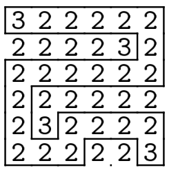</a>

(见[答案 411](./answers/7-2-2-1.md#ans-7-2-2-1-411).)

<a id="app-e-dlx-415"></a>

<a href="../../assets/volume4b/figures/appendix-e-415.png">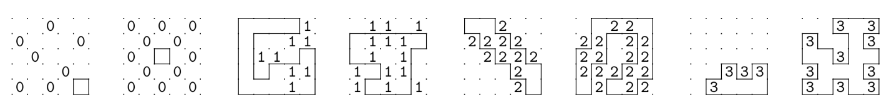</a>

(见[答案 415](./answers/7-2-2-1.md#ans-7-2-2-1-415).)

<a id="app-e-dlx-416"></a>

<a href="../../assets/volume4b/figures/appendix-e-416.png">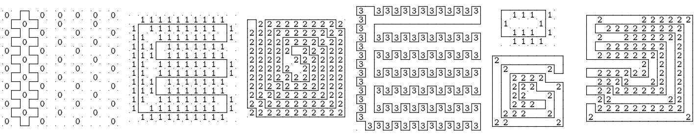</a>

(见[答案 416](./answers/7-2-2-1.md#ans-7-2-2-1-416).)

<a id="app-e-dlx-418"></a>

<a href="../../assets/volume4b/figures/appendix-e-418.png">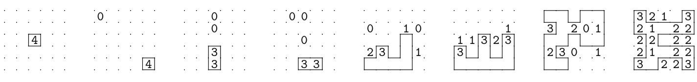</a>

(见[答案 418](./answers/7-2-2-1.md#ans-7-2-2-1-418).)

<a id="pdf-693"></a><a id="p-673"></a>

<a id="app-e-dlx-424"></a>

<a href="../../assets/volume4b/figures/appendix-e-424.svg">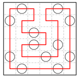</a>

(见[答案 424](./answers/7-2-2-1.md#ans-7-2-2-1-424).)

<a id="app-e-dlx-426"></a>

<a href="../../assets/volume4b/figures/appendix-e-426.svg">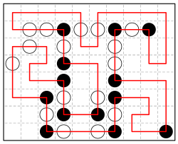</a>

(见[答案 426](./answers/7-2-2-1.md#ans-7-2-2-1-426).)

<a id="app-e-dlx-427"></a>

<a href="../../assets/volume4b/figures/appendix-e-427.svg">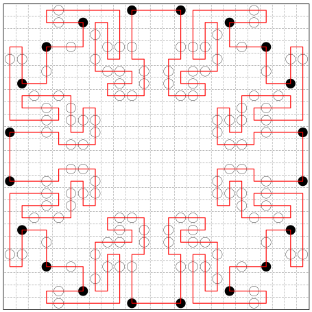</a>

(见[答案 427](./answers/7-2-2-1.md#ans-7-2-2-1-427).)

<a id="app-e-dlx-431"></a>

<a href="../../assets/volume4b/figures/appendix-e-431.png">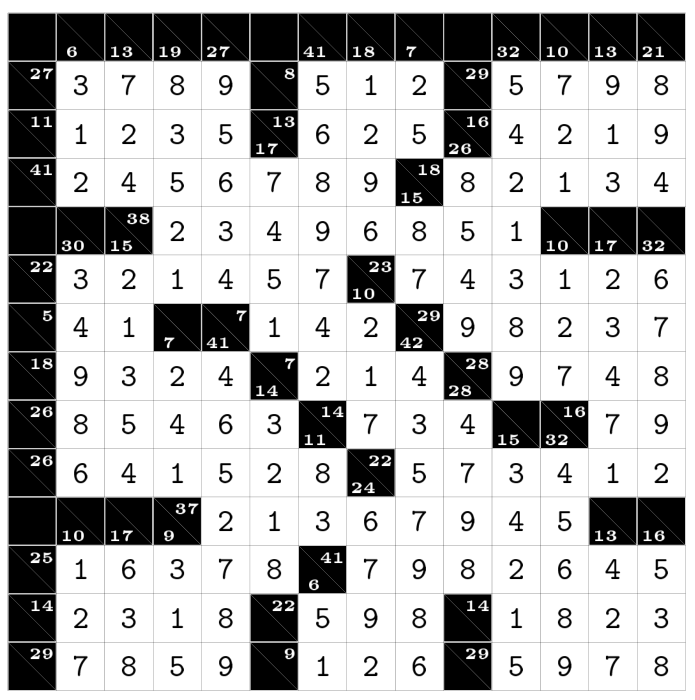</a>

(见[答案 431](./answers/7-2-2-1.md#ans-7-2-2-1-431).)

<a id="app-e-dlx-430"></a>

<a href="../../assets/volume4b/figures/appendix-e-430a.png">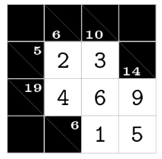</a>

(见[答案 430(a)](./answers/7-2-2-1.md#ans-7-2-2-1-430).)

<a id="app-e-dlx-435"></a>

<a href="../../assets/volume4b/figures/appendix-e-435.png">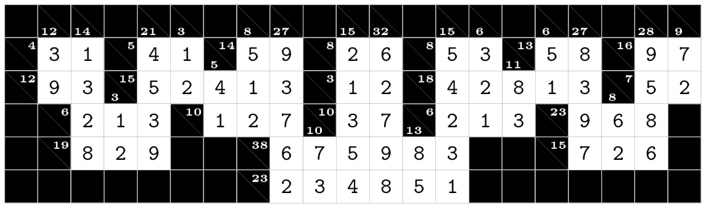</a>

(见[答案 435](./answers/7-2-2-1.md#ans-7-2-2-1-435).)

<a id="app-e-dlx-447"></a>

<a href="../../assets/volume4b/figures/appendix-e-447.png">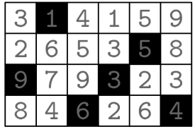</a>

(见[答案 447](./answers/7-2-2-1.md#ans-7-2-2-1-447).)

<a id="app-e-dlx-449-ex"></a>

<a href="../../assets/volume4b/figures/appendix-e-449-ex.png">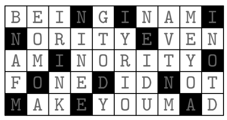</a>

(见[习题 449](./sec-7-2-2-1.md#ex-7-2-2-1-449).)

<a id="app-e-dlx-448"></a>

<a href="../../assets/volume4b/figures/appendix-e-448.png">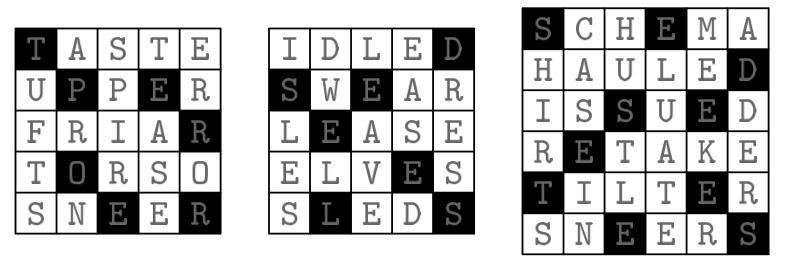</a>

(见[答案 448](./answers/7-2-2-1.md#ans-7-2-2-1-448).)

<a id="app-e-dlx-449"></a>

<a href="../../assets/volume4b/figures/appendix-e-449-new.png">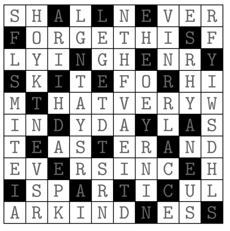</a>

(见[答案 449](./answers/7-2-2-1.md#ans-7-2-2-1-449).)

> 凭良心说, 我们这些聪明人, 可有不少事要交代呢.
>
> ——莎士比亚, 《皆大欢喜》第五幕第一场第 11 行
