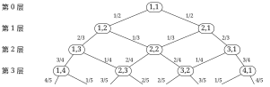
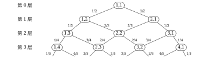

# 再论数学准备

本书有许多地方要用到<em>离散概率</em>. 也就是说, 我们有一个由有限个或可数无穷多个基本事件 $\omega$ 组成的集合 $\Omega$, 每个基本事件都有给定的概率 $\Pr(\omega)$, 其中

$$
0\leq\Pr(\omega)\leq1,\qquad \sum_{\omega\in\Omega}\Pr(\omega)=1.\tag{1}
$$

集合 $\Omega$ 连同函数 $\Pr$ 称为一个 “概率空间”. 例如, $\Omega$ 可以是一副 $52$ 张的扑克牌洗牌后所有排列的集合, 每种排列都有 $\Pr(\omega)=1/52!$.

直观地说, <em>事件</em>是一个依一定概率为真或为假的命题. 比如说, “最上面一张牌是 A” 就是这样一个命题, 其概率为 $1/13$. 从形式上说, 事件 $A$ 是 $\Omega$ 的一个子集, 由使相应命题 $A$ 为真的所有基本事件组成, 而且

$$
\Pr(A)=\sum_{\omega\in A}\Pr(\omega)=\sum_{\omega\in\Omega}\Pr(\omega)[\omega\in A].\tag{2}
$$

<em>随机变量</em>是给每个基本事件指定一个值的函数. 我们通常用大写字母表示随机变量, 用小写字母表示它可能取的值. 因此, 事件 $X=x$ 的概率可以写成 $\Pr(X=x)=\sum_{\omega\in\Omega}\Pr(\omega)[X(\omega)=x]$. 在扑克牌的例子中, 最上面的牌 $T$ 是一个随机变量, 并且 $\Pr(T=\mathtt{Q}\spadesuit)=1/52$. (有时我们也不拘泥于用小写字母表示取值的约定, 就像这里一样.)

如果对于所有的 $(x_1,\ldots,x_k)$ 都有

$$
\Pr(X_1=x_1\text{ 且 }\cdots\text{ 且 }X_k=x_k)
=\Pr(X_1=x_1)\cdots\Pr(X_k=x_k),\tag{3}
$$

那么称随机变量 $X_1,\ldots,X_k$ 是<em>独立的</em>. 例如, 如果 $F$ 和 $S$ 分别表示最上面一张牌 $T$ 的点数和花色, 显然 $F$ 和 $S$ 独立. 特别地, $\Pr(T=\mathtt{Q}\spadesuit)=\Pr(F=\mathtt{Q})\Pr(S=\spadesuit)$. 但是 $T$ 与最下面的牌 $B$ 不独立. 事实上, 对于<em>任意</em>两张牌 $t$ 和 $b$, 都有 $\Pr(T=t\text{ 且 }B=b)\ne1/52^2$.

在由 $n$ 个随机变量组成的系统中, 如果任取 $k$ 个变量都独立, 就称这些变量是 <em>$k$ 重独立的</em>. 例如, 在两两独立 ($2$ 重独立) 的情形下, 可以有 $X$ 与 $Y$ 独立, $Y$ 与 $Z$ 独立, $Z$ 又与 $X$ 独立, 然而这三个变量合在一起却未必独立 (见习题 6). 同样, $k$ 重独立推不出 $(k+1)$ 重独立, 而由 $(k+1)$ 重独立却能推出 $k$ 重独立.

给定事件 $B$, 事件 $A$ 的<em>条件概率</em>为

$$
\Pr(A\mid B)=\frac{\Pr(A\cap B)}{\Pr(B)}
=\frac{\Pr(A\text{ 且 }B)}{\Pr(B)},\tag{4}
$$

这里假定 $\Pr(B)>0$. 否则, 条件概率取为 $\Pr(A)$. 设想把整个空间 $\Omega$ 分成两部分, $\Omega'=B$ 和 $\Omega''=\overline B=\Omega\setminus B$, 其中 $\Pr(\Omega')=\Pr(B)$, $\Pr(\Omega'')=1-\Pr(B)$. 如果 $0<\Pr(B)<1$, 并且依照下列规则重新指定概率,

$$
\Pr'(\omega)=\Pr(\omega\mid\Omega')=\frac{\Pr(\omega)[\omega\in\Omega']}{\Pr(\Omega')},\qquad
\Pr''(\omega)=\Pr(\omega\mid\Omega'')=\frac{\Pr(\omega)[\omega\in\Omega'']}{\Pr(\Omega'')},
$$

我们便得到新的概率空间 $\Omega'$ 和 $\Omega''$, 可以分别考察 $B$ 恒真和 $B$ 恒假的两个世界. 这好比沿着树的两个分支走下去, 每个分支都有自己的逻辑. 条件概率在算法分析中很重要, 因为算法往往会进入不同的状态, 各个状态所涉及的概率也不同. 注意, 我们总有

$$
\Pr(A)=\Pr(A\mid B)\cdot\Pr(B)+\Pr(A\mid\overline B)\cdot\Pr(\overline B).\tag{5}
$$

如果随机变量 $[A_1],\ldots,[A_k]$ 独立, 就称事件 $A_1,\ldots,A_k$ 是<em>独立的</em>. (方括号记法照常适用, 无论把事件看作命题还是看作子集都一样. 如果 $A$ 为真, 就有 $[A]=1$, 否则 $[A]=0$.) 习题 20 证明, 这些事件独立当且仅当

$$
\Pr\biggl(\bigcap_{j\in J}A_j\biggr)=\prod_{j\in J}\Pr(A_j),
\qquad \text{对一切 }J\subseteq\{1,\ldots,k\}.\tag{6}
$$

特别地, 事件 $A$ 和 $B$ 独立当且仅当 $\Pr(A\mid B)=\Pr(A)$.

当随机变量 $X$ 取实数值或复数值时, 我们在 1.2.10 节已经定义了它的<em>期望值</em> $\mathrm E\,X$, 即

$$
\mathrm E\,X=\sum_{\omega\in\Omega}X(\omega)\Pr(\omega)=\sum_x x\Pr(X=x),\tag{7}
$$

只要在对无穷多个非零值求和时这个定义仍然有意义. (和应当绝对收敛.) 有一种简单而又极为重要的情形. 设 $A$ 是任意事件, 二元随机变量 $X=[A]$ 表示该事件的真假, 那么

$$
\mathrm E[A]=\sum_{\omega\in\Omega}[A](\omega)\Pr(\omega)
=\sum_{\omega\in\Omega}[\omega\in A]\Pr(\omega)=\sum_{\omega\in A}\Pr(\omega)=\Pr(A).\tag{8}
$$

我们还曾指出, 和的期望 $\mathrm E(X_1+\cdots+X_k)$ 总是等于期望的和 $(\mathrm E\,X_1)+\cdots+(\mathrm E\,X_k)$, 无论这些随机变量 $X_j$ 是否独立. 此外, 如果这些变量恰好独立, 积的期望 $\mathrm E\,X_1\cdots X_k$ 就是期望的积 $(\mathrm E\,X_1)\cdots(\mathrm E\,X_k)$. 在 3.3.2 节, 我们定义了协方差

$$
\operatorname{covar}(X,Y)=\mathrm E\bigl((X-\mathrm E\,X)(Y-\mathrm E\,Y)\bigr)
=\mathrm E(XY)-(\mathrm E\,X)(\mathrm E\,Y),\tag{9}
$$

它在一定程度上衡量 $X$ 和 $Y$ 彼此依赖的情形. 方差 $\operatorname{var}(X)$ 就是 $\operatorname{covar}(X,X)$. 从 (9) 的中间一项可以看出, 只要随机变量 $X$ 只取实数值, 它的方差便非负.

关于期望值的这些概念, 全部可以推广到<em>条件期望</em>

$$
\mathrm E(X\mid A)=\sum_{\omega\in A}X(\omega)\frac{\Pr(\omega)}{\Pr(A)}
=\sum_x x\frac{\Pr(X=x\text{ 且 }A)}{\Pr(A)},\tag{10}
$$

这里以任意事件 $A$ 为条件, 也就是说, 我们要在 $A$ 为真的概率空间中进行讨论. (如果 $\Pr(A)=0$, 就定义 $\mathrm E(X\mid A)=\mathrm E\,X$.) 类似于 (5), 我们有一个极为重要的公式,

$$
\begin{aligned}
\mathrm E\,X&=\sum_y\mathrm E(X\mid Y=y)\Pr(Y=y)\\
&=\sum_y\sum_x x\Pr(X=x\mid Y=y)\Pr(Y=y).
\end{aligned}\tag{11}
$$

此外, 还有另一种重要的条件期望. 当 $X$ 和 $Y$ 是随机变量时, 用 $\mathrm E(X\mid Y)$ 表示 “给定 $Y$ 时 $X$ 的期望” 往往很方便. 有了这个记号, 式 (11) 可以简写成

$$
\mathrm E\,X=\mathrm E\bigl(\mathrm E(X\mid Y)\bigr).\tag{12}
$$

这实在是个妙不可言的恒等式. 作一番不拘细节的推论, 或者唬唬外行, 用它再好不过了. 不过, 在你弄懂它的含义以前, 它也很容易把你自己弄糊涂.

首先, 如果 $Y$ 是一个布尔变量, $\mathrm E(X\mid Y)$ 也许看起来像是 $\mathrm E(X\mid Y=1)$, 似乎它断定 $Y$ 为真, 正如 (10) 中 $\mathrm E(X\mid A)$ 断定 $A$ 为真一样. 错了! 这样解释就大错特错了. 请当心.

其次, 你可能会把 $\mathrm E(X\mid Y)$ 看作 $Y$ 的函数. 不错, 不过要理解 $\mathrm E(X\mid Y)$, 最好把它看作一个<em>随机变量</em>. 正因为如此, 我们才能在 (12) 中计算它的期望值.

所有随机变量都是基本事件 $\omega$ 的函数. $\mathrm E(X\mid Y)$ 在 $\omega$ 处的值, 就是对满足 $Y(\omega')=Y(\omega)$ 的所有事件 $\omega'$ 取 $X(\omega')$ 的平均值,

$$
\mathrm E(X\mid Y)(\omega)=\sum_{\omega'\in\Omega}X(\omega')\Pr(\omega')
[Y(\omega')=Y(\omega)]\big/\Pr\bigl(Y=Y(\omega)\bigr).\tag{13}
$$

类似地, $\mathrm E(X\mid Y_1,\ldots,Y_r)$ 对使 $Y_j(\omega')=Y_j(\omega)$ ($1\leq j\leq r$) 的事件取平均.

例如, 设 $X_1$ 至 $X_n$ 是二元随机变量, 满足 $\nu(X_1\ldots X_n)=X_1+\cdots+X_n=m$, 其中 $m$ 和 $n$ 是常数, $0\leq m\leq n$. 假定所有 $\binom{n}{m}$ 个这样的位向量 $X_1\ldots X_n$ 都是等可能的. 显然 $\mathrm E\,X_1=m/n$. 但是 $\mathrm E(X_2\mid X_1)$ 是多少呢? 如果 $X_1=0$, 则 $X_2$ 的期望为 $m/(n-1)$, 否则为 $(m-1)/(n-1)$. 因此 $\mathrm E(X_2\mid X_1)=(m-X_1)/(n-1)$. 那么 $\mathrm E(X_k\mid X_1,\ldots,X_{k-1})$ 又是多少呢? 只要熟悉了记号, 答案就很容易看出. 如果 $\nu(X_1\ldots X_{k-1})=r$, 那么 $X_k\ldots X_n$ 就是满足 $\nu(X_k\ldots X_n)=m-r$ 的一个随机位向量, 所以在这种情形下 $X_k$ 的平均值为 $(m-r)/(n+1-k)$. 我们得出

$$
\mathrm E(X_k\mid X_1,\ldots,X_{k-1})=
\frac{m-\nu(X_1\ldots X_{k-1})}{n+1-k},\qquad 1\leq k\leq n.\tag{14}
$$

这些等式两边是同一个随机变量.

**不等式.** 在实际应用中, 我们经常希望证明某些事件是罕见的, 也就是说, 它们发生的概率很小. 反过来, 有时我们的目的却是说明某个事件并不罕见. 幸而数学家已经想出了好几种相当简便的方法, 即使不知道概率的确切值, 也能求出它的上界或下界.

我们在 1.2.10 节已经讨论过这类方法中最重要的一种. 用相当一般的语言, 可以把它的基本思想表述如下. <em>设 $f$ 为任意非负函数, 当 $x\in S$ 时有 $f(x)\geq s>0$. 那么</em>

$$
\Pr(X\in S)\leq\mathrm E\,f(X)/s,\tag{15}
$$

<em>只要 $\Pr(X\in S)$ 和 $\mathrm E\,f(X)$ 都存在.</em> 例如, 取 $f(x)=|x|$, 就有

$$
\Pr(|X|\geq m)\leq\mathrm E\,|X|/m,\tag{16}
$$

其中 $m>0$. 证明简单得出奇, 因为显然有

$$
\mathrm E\,f(X)\geq\Pr(X\in S)\cdot s+\Pr(X\notin S)\cdot0.\tag{17}
$$

式 (15) 常称为<em>马尔可夫不等式</em>, 因为 A. A. 马尔可夫曾在 <em>Izviēstīi͡a Imp. Akad. Nauk</em> (6) **1** (1907), 707–714 中讨论过特例 $f(x)=|x|^a$. 如果取 $f(x)=(x-\mathrm E\,X)^2$, 就得到 19 世纪边奈美和切比雪夫的著名不等式,

$$
\Pr\bigl(|X-\mathrm E\,X|\geq r\bigr)\leq\operatorname{var}(X)/r^2.\tag{18}
$$

情形 $f(x)=e^{ax}$ 也极为有用.

另一条基本估计称为<em>延森不等式</em> [<em>Acta Mathematica</em> **30** (1906), 175–193], 它适用于<em>凸</em>函数 $f$. 到目前为止, 我们见过它的地方, 还只有习题 6.2.2–36 的一道 “提示” (!). 对实直线上的一个区间 $I$, 如果当 $p\geq0$, $q\geq0$, $p+q=1$ 时总有

$$
f(px+qy)\leq pf(x)+qf(y),\qquad \text{对一切 }x,y\in I,\tag{19}
$$

就说实值函数 $f$ 在 $I$ 上是凸的, 而 $-f$ 在 $I$ 上是凹的. 如果 $f$ 有二阶导数 $f''$, 这个条件就等价于对一切 $x\in I$ 均有 $f''(x)\geq0$. 例如, 对任意常数 $a$ 和任意非负整数 $n$, 函数 $e^{ax}$ 和 $x^{2n}$ 都是凸的. 如果只考虑正的 $x$, 那么对于<em>一切</em>整数 $n$, $f(x)=x^n$ 都是凸的 (特别地, 当 $n=-1$ 时, $f(x)=1/x$). 函数 $\ln(1/x)$ 和 $x\ln x$ 在 $x>0$ 时也是凸的. 延森不等式断言, 当 $f$ 在 $I$ 上是凸的, 而随机变量 $X$ 只在 $I$ 中取值时,

$$
f(\mathrm E\,X)\leq\mathrm E\,f(X).\tag{20}
$$

(证明见习题 42.) 例如, 当 $X$ 为正时, 有 $1/\mathrm E\,X\leq\mathrm E(1/X)$, $\ln\mathrm E\,X\geq\mathrm E\ln X$, $(\mathrm E\,X)\ln\mathrm E\,X\leq\mathrm E(X\ln X)$, 其中用到了 $\ln x$ 在 $x>0$ 时是凹的. 注意, 在 $X$ 以概率 $p$ 取值 $x$、以概率 $q=1-p$ 取值 $y$ 的特例中, (20) 恰好归结为凸性的定义 (19).

在这张格外有用的不等式清单上, 接下来是两个经典结果. 它们适用于任意取非负整数值的随机变量 $X$.

$$
\Pr(X>0)\leq\mathrm E\,X.\qquad\text{(“一阶矩原理”)}\tag{21}
$$

$$
\Pr(X>0)\geq(\mathrm E\,X)^2/(\mathrm E\,X^2).\qquad\text{(“二阶矩原理”)}\tag{22}
$$

式 (21) 是显然的. 如果 $p_k$ 是 $X=k$ 的概率, 左边就是 $p_1+p_2+p_3+\cdots$, 而右边等于 $p_1+2p_2+3p_3+\cdots$.

式 (22) 就不那么明显了. 左边是 $p_1+p_2+p_3+\cdots$, 右边是 $(p_1+2p_2+3p_3+\cdots)^2/(p_1+4p_2+9p_3+\cdots)$. 不过, 正如马尔可夫不等式的情形一样, 它也有一个非常简单的证明, 只看我们能不能想到. 如果 $X$ 非负, 且不恒为零, 就有

$$
\begin{aligned}
\mathrm E\,X^2&=\mathrm E(X^2\mid X>0)\Pr(X>0)+\mathrm E(X^2\mid X=0)\Pr(X=0)\\
&=\mathrm E(X^2\mid X>0)\Pr(X>0)\\
&\geq\bigl(\mathrm E(X\mid X>0)\bigr)^2\Pr(X>0)=(\mathrm E\,X)^2/\Pr(X>0).
\end{aligned}\tag{23}
$$

事实上, 从这个证明可以看出, 即便 $X$ 并不限于取整数值, 二阶矩原理仍然成立 (见习题 46). 而且还能加强这个论证, 说明即便 $X$ 可以取任意<em>负</em>值, 只要 $\mathrm E\,X\geq0$, (22) 就成立 (见习题 47). 另见习题 118.

习题 54 把 (21) 和 (22) 用于研究随机图.

在 $X=X_1+\cdots+X_m$ 是<em>二元</em>随机变量 $X_j$ 之和的特殊情形下, 还有一个重要的不等式. S. M. 罗斯在较晚近的著作 [<em>Probability, Statistics, and Optimization</em> (New York: Wiley, 1994), 185–190] 中引入了它, 称之为 “条件期望不等式”,

$$
\Pr(X>0)\geq\sum_{j=1}^{m}\frac{\mathrm E\,X_j}{\mathrm E(X\mid X_j=1)}.\tag{24}
$$

罗斯证明, 这个不等式的右边总是至少等于二阶矩原理给出的界 $(\mathrm E\,X)^2/(\mathrm E\,X^2)$ (见习题 50). 此外, 尽管 (24) 乍看更复杂些, 计算起来却往往更容易.

例如, 取 $f$ 为单调布尔函数, 估计可靠性多项式 $f(p_1,\ldots,p_n)$ 时, 这个方法就很合用. 这里 $p_j$ 表示系统的第 $j$ 个部件 “正常工作” 的概率. 我们在 7.1.4 节曾经指出, 当 $n$ 相当小时, 利用 BDD 方法可以算出可靠性多项式的确切值, 但在 $f$ 变得复杂时, 就不得不取近似值了. 用简单的例子 $f(x_1,\ldots,x_5)=x_1x_2x_3\vee x_2x_3x_4\vee x_4x_5$, 就能说明罗斯的一般方法. 令 $(Y_1,\ldots,Y_5)$ 是相互独立的二元随机变量, $\mathrm E\,Y_j=p_j$. 再令 $X=X_1+X_2+X_3$, 其中 $X_1=Y_1Y_2Y_3$, $X_2=Y_2Y_3Y_4$, $X_3=Y_4Y_5$, 对应于 $f$ 的素蕴涵元. 由于各 $Y$ 独立, 我们有 $\Pr(X>0)=\Pr\bigl(f(Y_1,\ldots,Y_5)=1\bigr)=\mathrm E\,f(Y_1,\ldots,Y_5)=f(p_1,\ldots,p_5)$. 而且很容易算出 (24) 中的界,

$$
\Pr(X>0)\geq\frac{p_1p_2p_3}{1+p_4+p_4p_5}
+\frac{p_2p_3p_4}{p_1+1+p_5}+\frac{p_4p_5}{p_1p_2p_3+p_2p_3+1}.\tag{25}
$$

例如, 如果各 $p_j$ 都是 $0.9$, 这个公式给出约 $0.848$, 而 $(\mathrm E\,X)^2/(\mathrm E\,X^2)\approx0.847$. 真值 $p_1p_2p_3+p_2p_3p_4+p_4p_5-p_1p_2p_3p_4-p_2p_3p_4p_5$ 为 $0.9558$.

人们还发现了许多其他与期望值有关的重要不等式, 其中对本书用途最为重要的是习题 61 讨论的 <em>FKG 不等式</em>. 利用它很容易证明某些事件是相关的, 例子见习题 62.

**鞅.** 分析一个由相互依赖的随机变量组成的序列可能很困难, 但是如果这些变量遵守某些不变的约束, 我们往往就能利用其结构. 特别是, 以一种经典投注策略命名的 “鞅” 性质 (见习题 67), 在适用的时候真是有惊人的用处. 约瑟夫·L. 杜布在其开创性著作 <em>Stochastic Processes</em> (New York: Wiley, 1953) 中着重介绍了鞅, 并系统地发展了有关理论.

实值随机变量序列 $\langle Z_n\rangle=Z_0,Z_1,Z_2,\ldots$ 如果满足条件

$$
\mathrm E(Z_{n+1}\mid Z_0,\ldots,Z_n)=Z_n,\qquad \text{对一切 }n\geq0,\tag{26}
$$

就称为一个<em>鞅</em>. (我们也照常默认, 期望 $\mathrm E\,Z_n$ 都有定义.) 例如, 当 $n=0$ 时, 随机变量 $\mathrm E(Z_1\mid Z_0)$ 必须同随机变量 $Z_0$ 相等 (见习题 63).

图 P 所示为乔治·波利亚著名的 “罐子模型” [F. Eggenberger 和 G. Pólya, <em>Zeitschrift für angewandte Math. und Mech.</em> **3** (1923), 279–289], 它同一个特别有趣的鞅有关. 设想一个罐子里起初有两个球, 一个红球和一个黑球. 从中随机取出一个球, 随后放回, 并添入一个同色的新球, 如此反复. 红球数和黑球数 $(r,b)$ 会沿图中的一条路径变化, 每一步的概率标在相应的分支上.

不难证明, 图 P 第 $n$ 层的 $n+1$ 个结点, 每一个被到达的概率都是 $1/(n+1)$. 而且, 无论从哪一层走向下一层, 取到红球的概率总是 $1/2$. 因此乍看起来, 罐子里的这套过程好像相当平淡而均匀. 其实它充满了意外, 因为一旦红黑两色有了不均势, 这种不均势便倾向于持续下去. 例如, 若第一次取出的是黑球, 也就是说我们从 $(1,1)$ 走到 $(1,2)$, 那么在往后所有的时刻中, 红球数有朝一日能超过黑球数的概率只有 $2\ln2-1\approx.386$ (见习题 88).

分析波利亚过程有个好办法, 那就是利用比例 $r/(r+b)$ 构成一个鞅这一事实. 每次取球, 这个比例或者变为 $(r+1)/(r+b+1)$ (概率为 $r/(r+b)$), 或者变为 $r/(r+b+1)$ (概率为 $b/(r+b)$). 所以新比例的期望是 $(rb+r^2+r)/\bigl((r+b)(r+b+1)\bigr)=r/(r+b)$, 与原来的值相同. 更形式化地说, 置 $X_0=1$, 对于 $n>0$, 令 $X_n$ 为随机变量 “[第 $n$ 次取出的是红球]”. 那么在图 P 的第 $n$ 层有 $X_0+\cdots+X_n$ 个红球和 $\overline X_0+\cdots+\overline X_n+1$ 个黑球. 只要定义

$$
Z_n=(X_0+\cdots+X_n)/(n+2),\tag{27}
$$

序列 $\langle Z_n\rangle$ 就是一个鞅.

在实际应用中, 用辅助随机变量 $X_0,X_1,\ldots$ 来定义鞅 $Z_0,Z_1,\ldots$ 通常最方便, 正如我们刚才所做的那样. 如果 $Z_n$ 是 $(X_0,\ldots,X_n)$ 的函数, 并且满足

$$
\mathrm E(Z_{n+1}\mid X_0,\ldots,X_n)=Z_n,\qquad \text{对一切 }n\geq0,\tag{28}
$$

就称序列 $\langle Z_n\rangle$ 是<em>关于序列 $\langle X_n\rangle$ 的鞅</em>.

**图 P.** 波利亚的罐子模型. 从 $(1,1)$ 沿任意一条向下的路径走到 $(r,b)$ 的概率, 等于路径上各分支所标概率的乘积.

此外, 如果 $Y_n$ 是 $(X_0,\ldots,X_n)$ 的函数, 并且满足一个更简单的条件

$$
\mathrm E(Y_{n+1}\mid X_0,\ldots,X_n)=0,\qquad \text{对一切 }n\geq0,\tag{29}
$$

就称序列 $\langle Y_n\rangle$ <em>关于序列 $\langle X_n\rangle$ 是公平的</em>. 只要

$$
\mathrm E(Y_{n+1}\mid Y_0,\ldots,Y_n)=0,\qquad \text{对一切 }n\geq0,\tag{30}
$$

就称 $\langle Y_n\rangle$ 是<em>公平的</em>. 习题 77 证明, 由 (28) 可推出 (26), 由 (29) 可推出 (30). 因此, 定义鞅和公平序列时, 有一个辅助序列 $\langle X_n\rangle$ 就已经足够, 却并非必不可少.

只要 $\langle Z_n\rangle$ 是一个鞅, 置 $Y_0=Z_0$, 并对 $n>0$ 置 $Y_n=Z_n-Z_{n-1}$, 便得到一个公平序列 $\langle Y_n\rangle$. 这是因为恒等式 $\mathrm E(Y_{n+1}\mid Z_0,\ldots,Z_n)=\mathrm E(Z_{n+1}-Z_n\mid Z_0,\ldots,Z_n)=Z_n-Z_n$ 表明 $\langle Y_n\rangle$ 关于 $\langle Z_n\rangle$ 是公平的. 反过来, 只要 $\langle Y_n\rangle$ 是公平的, 置 $Z_n=Y_0+\cdots+Y_n$, 便得到一个鞅 $\langle Z_n\rangle$. 这是因为恒等式 $\mathrm E(Z_{n+1}\mid Y_0,\ldots,Y_n)=\mathrm E(Z_n+Y_{n+1}\mid Y_0,\ldots,Y_n)=Z_n$ 表明 $\langle Z_n\rangle$ 是关于 $\langle Y_n\rangle$ 的鞅. 换言之, 公平性和鞅性质实质上是等价的. 各个 $Y$ 表示不偏不倚的 “微调”, 使一个 $Z$ 变成下一个 $Z$.

公平序列很容易构造. 例如, 由均值为 $0$ 的<em>独立</em>随机变量构成的每个序列都是公平的. 又如, 如果 $\langle Y_n\rangle$ 关于 $\langle X_n\rangle$ 是公平的, 由 $Y'_n=f_n(X_0,\ldots,X_{n-1})Y_n$ 定义的序列 $\langle Y'_n\rangle$ 也具有这个性质, 即使 $f_n(X_0,\ldots,X_{n-1})$ 是几乎<em>随意</em>选定的函数也无妨! (只须限制 $f_n$ 的大小, 使 $\mathrm E\,Y'_n$ 有定义.) 特别地, 对于所有足够大的 $n$, 我们可以取 $f_n(X_0,\ldots,X_{n-1})=0$, 从而使 $\langle Z_n\rangle$ 最终保持不变.

如果函数序列 $N_n(x_0,\ldots,x_{n-1})$ 中每个函数的值都是 $0$ 或 $1$, 而且由 $N_n(x_0,\ldots,x_{n-1})=0$ 可推出 $N_{n+1}(x_0,\ldots,x_n)=0$, 就称这个序列为一条<em>停止规则</em>. 可以假定 $N_0=1$. 对于随机变量序列 $\langle X_n\rangle$, 停止前经过的步数就是随机变量

$$
N=N_1(X_0)+N_2(X_0,X_1)+N_3(X_0,X_1,X_2)+\cdots.\tag{31}
$$

(直观地说, $N_n(x_0,\ldots,x_{n-1})$ 的意思是 [$X_0=x_0,\ldots,X_{n-1}=x_{n-1}$ 这些值<em>不会</em>使过程停止]. 因此它表达的其实更接近 “继续”, 而非 “停止”.) 对于关于 $\langle X_n\rangle$ 的任意鞅 $Z_n=Y_0+\cdots+Y_n$, 要使它按照这个策略停止, 只须改取 $Z'_n=Y'_0+\cdots+Y'_n$, 其中 $Y'_n=N_n(X_0,\ldots,X_{n-1})Y_n$. 赌徒要 “见好就收”, 用的便是停止规则 $N_{n+1}(X_0,\ldots,X_n)=[Z'_n\leq0]$, 其中 $Z'_n$ 是他当前的净赢额.

注意, 如果停止规则总是在至多 $m$ 步后就停止, 换句话说, 如果函数 $N_m(x_0,\ldots,x_{m-1})$ 恒为零, 那么就有 $Z'_m=Z'_N$, 因为过程一停止, $Z'_n$ 就不再变化. 因此 $\mathrm E\,Z'_N=\mathrm E\,Z'_m=\mathrm E\,Z'_0=\mathrm E\,Z_0$. <em>步数有界时, 任何停止规则都不能改变鞅的期望结果.</em>

有一种叫做 “现在要 A” 的有趣纸牌游戏, 可以说明这个可选停止原理. 拿一副牌, 洗过后牌面朝下放好, 然后一张一张翻开. 就要看见第 $n$ 张牌时, 你须根据已经见过的牌, 说 “停” 或 “发牌”. (如果 $n=52$, 就<em>必须</em>说 “停”.) 当你决定停下时, 如果接下来的一张是 A, 你赢 12 美元, 否则输 1 美元. 玩这个游戏的最佳策略是什么? 要不要一直等到很有把握赢那 12 美元才喊停? 最差的策略又是什么? 习题 82 给出了答案.

**由鞅导出的尾部不等式.** 鞅的本质是期望<em>相等</em>. 然而鞅在算法分析中很重要, 却是因为我们能用它导出<em>不等式</em>, 进而说明某些事件发生的概率很小.

先把式 (26) 改成不等式. 如果序列 $\langle Z_n\rangle$ 满足

$$
\mathrm E(Z_{n+1}\mid Z_0,\ldots,Z_n)\geq Z_n,\qquad \text{对一切 }n\geq0,\tag{32}
$$

就称它为<em>下鞅</em>. 类似地, 将这一定义左侧条件中的 “$\geq$” 换成 “$\leq$”, 就称它为<em>上鞅</em>. (因此, 鞅兼为下鞅和上鞅.) 对 (32) 取期望便知, 对下鞅有 $\mathrm E\,Z_0\leq\mathrm E\,Z_1\leq\mathrm E\,Z_2\leq\cdots$. 同样, 上鞅的期望随 $n$ 的增长而<em>不增</em>. 记住它们区别的一个办法, 是留意这两个名称恰好同你原先想的相反.

下鞅之所以重要, 在很大程度上是因为它相当常见. 的确, 如果 $\langle Z_n\rangle$ 为任意鞅, $f$ 为任意凸函数, 那么 $\langle f(Z_n)\rangle$ 就是下鞅 (见习题 84). 例如, 只要已知 $\langle Z_n\rangle$ 是一个鞅, $\langle|Z_n|\rangle$、$\langle\max(Z_n,c)\rangle$、$\langle Z_n^2\rangle$ 和 $\langle e^{Z_n}\rangle$ 就都是下鞅. 如果 $Z_n$ 还总是正的, 那么 $\langle Z_n^3\rangle$、$\langle1/Z_n\rangle$、$\langle\ln(1/Z_n)\rangle$ 和 $\langle Z_n\ln Z_n\rangle$ 等也都是下鞅.

如果对一个下鞅施行停止规则, 很容易看出我们会得到另一个下鞅. 此外, 如果这条规则保证在 $m$ 步以内停下, 就有 $\mathrm E\,Z_m\geq\mathrm E\,Z_N=\mathrm E\,Z'_N=\mathrm E\,Z'_m$. 因此, <em>步数有界时, 任何停止规则都不能提高下鞅的期望结果.</em>

这个相当简单的观察有许多重要推论. 例如, 习题 86 利用它给出了所谓 “极大不等式” 的一个简单证明.

<em>如果 $\langle Z_n\rangle$ 是非负下鞅, 那么</em>

$$
\Pr\bigl(\max(Z_0,Z_1,\ldots,Z_n)\geq x\bigr)\leq\mathrm E\,Z_n/x,\qquad \text{对一切 }x>0.\tag{33}
$$

这个不等式的特例多得很. 例如, 鞅 $\langle Z_n\rangle$ 满足

$$
\Pr\bigl(\max(|Z_0|,|Z_1|,\ldots,|Z_n|)\geq x\bigr)\leq\mathrm E\,|Z_n|/x,\qquad x>0.\tag{34}
$$

$$
\Pr\bigl(\max(Z_0^2,Z_1^2,\ldots,Z_n^2)\geq x\bigr)\leq\mathrm E\,Z_n^2/x,\qquad x>0.\tag{35}
$$

关系式 (35) 称为<em>柯尔莫哥洛夫不等式</em>, 因为 A. N. 柯尔莫哥洛夫证明了下面的情形: $Z_n=X_1+\cdots+X_n$ 是独立随机变量之和, 且对于 $1\leq k\leq n$ 有 $\mathrm E\,X_k=0$ 和 $\operatorname{var}X_k=\sigma_k^2$ [<em>Math. Annalen</em> **99** (1928), 309–311]. 在这种情形下, $\operatorname{var}Z_n=\sigma_1^2+\cdots+\sigma_n^2=\sigma^2$, 不等式可以写成

$$
\Pr\bigl(|X_1|<t\sigma,\ |X_1+X_2|<t\sigma,\ \ldots,\ |X_1+\cdots+X_n|<t\sigma\bigr)\geq1-1/t^2.\tag{36}
$$

切比雪夫不等式只给出 $\Pr(|X_1+\cdots+X_n|<t\sigma)\geq1-1/t^2$, 这个结果弱了不少.

对于鞅的标准表示 $Z_n=Y_0+Y_1+\cdots+Y_n$, 当各项 $Y_1,\ldots,Y_n$ 有较好的界时, 还有一个重要的不等式可用. 这种情形很常见. 这个不等式称为<em>霍夫丁–阿祖马不等式</em>, 得名于 W. Hoeffding [<em>J. Amer. Statistical Association</em> **58** (1963), 13–30] 和 K. Azuma [<em>Tôhoku Math. Journal</em> (2) **19** (1967), 357–367] 的论文. 它的内容如下. <em>对于任意公平序列 $\langle Y_n\rangle$, 如果给定 $Y_0,Y_1,\ldots,Y_{n-1}$ 时有 $a_n\leq Y_n\leq b_n$, 那么</em>

$$
\Pr(Y_1+\cdots+Y_n\geq x)\leq e^{-2x^2/((b_1-a_1)^2+\cdots+(b_n-a_n)^2)}.\tag{37}
$$

由于 $-b_n\leq-Y_n\leq-a_n$, 同一个界也适用于 $\Pr(Y_1+\cdots+Y_n\leq-x)$. 因此

$$
\Pr(|Y_1+\cdots+Y_n|\geq x)\leq2e^{-2x^2/((b_1-a_1)^2+\cdots+(b_n-a_n)^2)}.\tag{38}
$$

习题 90 把这个结果的证明分解成若干小步. 事实上, 由证明甚至可以看出, $a_n$ 和 $b_n$ 可以是 $\{Y_0,\ldots,Y_{n-1}\}$ 的函数.

**应用.** 霍夫丁–阿祖马不等式在许多算法的分析中都有用, 因为它适用于 “杜布鞅”. 这是一类非常普遍的鞅, J. L. 杜布在其著作 <em>Stochastic Processes</em> (1953) 第 92 页把它作为例 1 来介绍. (实际上, 早在多年以前, 他已经在 <em>Trans. Amer. Math. Soc.</em> **47** (1940), 486 中讨论过这种鞅.) 取<em>任意</em>随机变量序列 $\langle X_n\rangle$, 无论它们是否独立, 再取<em>任意另一个</em>随机变量 $Q$, 都能导出一个杜布鞅. 只须定义

$$
Z_n=\mathrm E(Q\mid X_0,\ldots,X_n).\tag{39}
$$

正如杜布所指出的, 由此得到的序列是一个鞅 (见习题 91). 在我们的应用中, $Q$ 是某个算法中我们想研究的一个方面, 而变量 $X_0,X_1,\ldots$ 反映算法的输入. 例如, 在一个使用随机位的算法中, 各 $X$ 就是这些位.

考虑一个散列算法, 它把 $t$ 个对象随机地放入 $m$ 张表中, 第 $n$ 个对象放进表 $X_n$. 因此对 $1\leq n\leq t$ 有 $1\leq X_n\leq m$. 假定 $m^t$ 种可能性全是等可能的. 令 $Q(x_1,\ldots,x_t)$ 表示 把对象放入表 $x_1,\ldots,x_t$ 后仍然空着的表数, 令 $Z_n=\mathrm E(Q\mid X_1,\ldots,X_n)$ 为相应的杜布鞅. 那么 $Z_0=\mathrm E\,Q$ 是空表的<em>平均</em>数, 而在算法的任何一次具体运行中, $Z_t=Q(X_1,\ldots,X_t)$ 是空表的<em>实际</em>数.

与这个鞅对应的是怎样的公平序列呢? 对于 $1\leq n\leq t$, 随机变量 $Y_n=Z_n-Z_{n-1}$ 为 $f_n(X_1,\ldots,X_n)$, 其中 $f_n(x_1,\ldots,x_n)$ 是

$$
\begin{aligned}
\Delta(x_1,\ldots,x_t)=\sum_{x=1}^{m}\Pr(X_n=x)\bigl(
&Q(x_1,\ldots,x_{n-1},x_n,x_{n+1},\ldots,x_t)\\
-{}&Q(x_1,\ldots,x_{n-1},x,x_{n+1},\ldots,x_t)\bigr)
\end{aligned}\tag{40}
$$

在 $(x_{n+1},\ldots,x_t)$ 的全部 $m^{t-n}$ 种取值上所取的平均值.

在这个应用中, 函数 $Q(x_1,\ldots,x_t)$ 对于一切 $x$ 和 $x'$ 都具有性质

$$
\bigl|Q(x_1,\ldots,x_{n-1},x',x_{n+1},\ldots,x_t)-Q(x_1,\ldots,x_{n-1},x,x_{n+1},\ldots,x_t)\bigr|\leq1,\tag{41}
$$

因为改动一个散列地址, 空表数的改变量总是 $1$、$0$ 或 $-1$. 因此, 任意固定各变量 $(x_1,\ldots,x_{n-1},x_{n+1},\ldots,x_t)$ 的值, 都有

$$
\max_{x_n}\Delta(x_1,\ldots,x_t)\leq\min_{x_n}\Delta(x_1,\ldots,x_t)+1.\tag{42}
$$

于是由霍夫丁–阿祖马不等式 (37) 得出

$$
\Pr(Z_t-Z_0\geq x)=\Pr(Y_1+\cdots+Y_t\geq x)\leq e^{-2x^2/t}.\tag{43}
$$

此外, 这个例子中的 $Z_0$ 为 $m(m-1)^t/m^t$, 因为在 $m^t$ 个可能的散列序列中, 恰有 $(m-1)^t$ 个让任意指定的一张表保持空着. 而随机变量 $Z_t$ 是算法运行后实际的空表数. 因此我们可以在 (43) 中取 $x=\sqrt{t\ln f(t)}$, 从而证明

$$
\Pr\bigl(Z_t\geq(m-1)^t/m^{t-1}+\sqrt{t\ln f(t)}\bigr)\leq1/f(t)^2.\tag{44}
$$

同一上界也适用于 $\Pr\bigl(Z_t\leq(m-1)^t/m^{t-1}-\sqrt{t\ln f(t)}\bigr)$.

注意, 不等式 (41) 在这个分析中起了决定性的作用. 因而我们用来证明 (43) 的策略常称为 “有界差分法”. 一般地, 函数 $Q(x_1,\ldots,x_t)$ 如果对一切 $x$ 和 $x'$ 都满足

$$
\bigl|Q(x_1,\ldots,x_{n-1},x,x_{n+1},\ldots,x_t)-Q(x_1,\ldots,x_{n-1},x',x_{n+1},\ldots,x_t)\bigr|\leq c_n,\tag{45}
$$

就说它在坐标 $n$ 上满足<em>利普希茨条件</em>. (这个名称仿照的是鲁道夫·利普希茨很早以前引入泛函分析的一个著名约束 [<em>Crelle</em> **63** (1864), 296–308], 尽管两种约束仅略有相似之处.) 对于<em>独立</em>随机变量 $X_1,\ldots,X_t$ 的杜布鞅所对应的函数 $Q$, 只要 (45) 成立, 我们就能证明 $\Pr(Y_1+\cdots+Y_t\geq x)\leq\exp\bigl(-2x^2/(c_1^2+\cdots+c_t^2)\bigr)$.

再来仔细分析一个例子, 它出自科林·麦克迪尔米德 [<em>London Math. Soc. Lecture Notes</em> **141** (1989), 148–188, §8(a)]. 我们仍然考虑相互独立的整值随机变量 $X_1,\ldots,X_t$, 对于 $1\leq n\leq t$ 有 $1\leq X_n\leq m$, 不过, 这次允许各个 $X_n$ 具有不同的概率分布. 此外, 我们把 $Q(x_1,\ldots,x_t)$ 定义为装得下大小分别为 $x_1,\ldots,x_t$ 的各物件所需的<em>最少箱数</em>, 每个箱子的容量都是 $m$.

这个装箱问题听起来比刚才解决的散列问题难得多. 的确, 众所周知, 计算 $Q(x_1,\ldots,x_t)$ 是个 NP 完全问题 [见 M. R. Garey 和 D. S. Johnson, <em>SICOMP</em> **4** (1975), 397–411]. 然而, 对于 $1\leq n\leq t$, $Q$ 显然满足 $c_n=1$ 时的条件 (45). 所以, 尽管这个问题看起来很困难, 有界差分法却告诉我们, 不等式 (43) 依然成立!

这个装箱问题同散列问题的唯一区别在于, 这里我们对 $Z_0$ 的值毫无头绪. 除了随机变量具有非常特殊的分布以外, 没有人知道怎样计算 $\mathrm E\,Q(X_1,\ldots,X_t)$. 然而, 无论它的值是多少, 我们确实知道各个实际数值 $Z_t$ 都会紧密地集中在这个平均值附近. 这正是鞅的妙处.

如果各个 $X$ 同分布, 那么 $\beta_t=\mathrm E\,Q(X_1,\ldots,X_t)$ 满足 $\beta_{t+t'}\leq\beta_t+\beta_{t'}$, 因为总可以把 $t$ 件物品和 $t'$ 件物品分开装箱. 所以, 由次可加律 (见习题 2.5–39 的答案), 当 $t\to\infty$ 时 $\beta_t/t$ 趋于一个极限 $\beta$. 不过即便如此, 通过随机试验还是得不到这个极限的好界, 因为我们没有计算函数 $Q$ 的好办法.

> 但愿他能安享马丁格尔的美景和宁静, 无须让责任与负疚像一根绳索那样把他拴在那里!
>
> ——P. D. 詹姆斯, 《掩面》(1962)

**几乎必然、甚至相当必然的命题.** 依赖于整数 $n$ 的概率, 经常在 $n\to\infty$ 时趋于 $0$ 或 $1$. 采用专门术语, 讨论这些现象就会简明些. 比如, 若事件 $A_n$ 满足 $\lim_{n\to\infty}\Pr(A_n)=1$, 用文字方便地说, 就是 “当 $n$ 很大时, $A_n$ 几乎必然发生”. (事实上, 如果当前讨论已默认 $n$ 趋于无穷, 我们通常连 “当 $n$ 很大时” 也省掉.)

例如, 若将一枚均匀硬币抛掷 $n$ 次, 我们会发现, 正面朝上的次数几乎必然多于 $.49n$ 而少于 $.51n$.

此外, 有时我们也想在公式里简洁地表达这个概念, 于是把 “几乎必然” (almost surely) 简写为 “a.s.”. 例如, 刚才关于 $n$ 次抛掷硬币的论断可以写成

$$
.49n<X_1+\cdots+X_n<.51n\quad\text{a.s.},\tag{46}
$$

其中 $X_1,\ldots,X_n$ 是独立二元随机变量, 都有 $\mathrm E\,X_j=1/2$. 一般地, 像 “$A_n$ a.s.” 这样的命题意味着 $\lim_{n\to\infty}\Pr(A_n)=1$, 或者等价地, $\lim_{n\to\infty}\Pr(\overline A_n)=0$. 这里的 “几乎必然” 是渐近意义下的.

如果 $A_n$ 和 $B_n$ 都是几乎必然的, 那么不管两者是否独立, 组合事件 $C_n=A_n\cap B_n$ 也几乎必然. 这是因为 $\Pr(\overline C_n)=\Pr(\overline A_n\cup\overline B_n)\leq\Pr(\overline A_n)+\Pr(\overline B_n)$, 当 $n\to\infty$ 时趋于 $0$.

因此, 为了证明 (46), 只须证明几乎必然有 $X_1+\cdots+X_n>.49n$, 又几乎必然有 $X_1+\cdots+X_n<.51n$, 也就是说, 只须证明 $\Pr(X_1+\cdots+X_n\leq.49n)$ 和 $\Pr(X_1+\cdots+X_n\geq.51n)$ 都趋于 $0$. 由于正面和反面对称, 这两个概率其实相等, 所以只要证明 $p_n=\Pr(X_1+\cdots+X_n\leq.49n)$ 趋于 $0$ 就行了. 这毫不费力, 因为我们从习题 1.2.10–21 已经知道 $p_n\leq e^{-.0001n}$.

实际上, 我们证明的还不止这些. 我们已经证明 $p_n$ <em>超多项式地小</em>, 也就是说,

$$
p_n=O(n^{-K}),\qquad \text{对一切固定的数 }K.\tag{47}
$$

当事件 $\overline A_n$ 的概率超多项式地小时, 我们说 $A_n$ “相当必然” (quite surely) 成立, 简写为 “q.s.”. 换言之, 我们已经证明

$$
.49n<X_1+\cdots+X_n<.51n\quad\text{q.s.}\tag{48}
$$

我们已经看到, 任意两个几乎必然的事件合在一起仍然是几乎必然的, 因此任意有限个这样的事件合在一起也是如此. 这已经不错, 但相当必然的事件还有更好的性质: <em>即使有多项式那么多个相当必然的事件, 它们的交仍然相当必然.</em> 例如, 如果有 $n^4$ 个人, 每人抛 $n$ 枚硬币, 那么可以相当有把握地说, 他们<em>每一个人</em>所得到的正面数都介于 $.49n$ 与 $.51n$ 之间, 无一例外!

(作这种渐近论断时, 我们对一个不太讨人喜欢的事实视而不见. 在这个例子中, 我们得到的失败概率界为 $2n^4e^{-.0001n}$, 只有在 $n$ 大约超过 $700\,000$ 以后, 它才小到可以忽略.)

### 习题

**1.** [M21] [答案](./answers/mpr.md#ans-mpr-1) (<em>非传递骰子.</em>) 设有三枚骰子, 各个面上的点数如下图所示. 分别独立地随机投掷它们.

(a) 证明 $\Pr(A>B)=\Pr(B>C)=\Pr(C>A)=5/9$.

(b) 找出三枚骰子, 使 $\Pr(A>B)$、$\Pr(B>C)$ 和 $\Pr(C>A)$ 全都<em>大于</em> $5/9$.

(c) 如果斐波那契骰子有 $F_m$ 个面, 而不局限于六个面, 证明我们可以使

$$
\Pr(A>B)=\Pr(B>C)=F_{m-1}/F_m,\qquad
\Pr(C>A)=F_{m-1}/F_m\pm1/F_m^2.
$$

**2.** [M32] [答案](./answers/mpr.md#ans-mpr-2) 证明上题的结果是渐近最优的, 意即无论有多少个面, 都有 $\min\bigl(\Pr(A>B),\Pr(B>C),\Pr(C>A)\bigr)<1/\phi$.

**3.** [22] [答案](./answers/mpr.md#ans-mpr-3) (<em>沃比冈湖的骰子.</em>) 接着前两题, 找出三枚骰子, 使 $\Pr\bigl(A>\frac13(A+B+C)\bigr)\geq\Pr\bigl(B>\frac13(A+B+C)\bigr)\geq\Pr\bigl(C>\frac13(A+B+C)\bigr)\geq16/27$. 每枚骰子的各面都应取 ⚀、⚁、⚂、⚃、⚄、⚅ 之一.

**4.** [22] [答案](./answers/mpr.md#ans-mpr-4) (<em>非传递宾果.</em>) 在袖珍宾果游戏 NanoBingo 中, 每位玩家有一张卡片, 其中从集合 $S=\{1,2,3,4,5,6\}$ 取四个数, 排成两行. 报号员以随机次序报出 $S$ 中的元素. 谁的卡片上最先有一横行的两个数都已报到, 谁就喊 “宾果!” 并获胜. (如果同时有多人喊宾果, 他们就分享胜利.) 例如, 考虑下面四张卡片.

$$
A=\begin{array}{|c:c|}\hline1&2\\\hline3&5\\\hline\end{array},\quad
B=\begin{array}{|c:c|}\hline2&3\\\hline4&6\\\hline\end{array},\quad
C=\begin{array}{|c:c|}\hline3&4\\\hline1&5\\\hline\end{array},\quad
D=\begin{array}{|c:c|}\hline1&4\\\hline2&6\\\hline\end{array}.
$$

如果 $A$ 同 $B$ 对阵, 报出的数是 “6, 2, 5, 1”, 那么 $A$ 获胜, 而序列 “1, 3, 2” 会得到平局. 可以证明, $\Pr(A\text{ 胜 }B)=336/720$, $\Pr(B\text{ 胜 }A)=312/720$, $\Pr(A\text{ 与 }B\text{ 平局})=72/720$. 对于 (a) 两人、(b) 三人、(c) 四人持上述不同的卡片参加游戏的情形, 求出一切可能结果的概率.

▶ **5.** [HM22] [答案](./answers/mpr.md#ans-mpr-5) (T. M. 科弗, 1989.) 通常认为, 比赛越长越有利于实力较强的一方, 因为有更多机会让双方显出实力的高下.

不过, 考虑这样一种 $n$ 回合的比赛. 艾丽斯的得分为 $A_1+\cdots+A_n$, 鲍勃的得分为 $B_1+\cdots+B_n$. 其中 $A_1,\ldots,A_n$ 是相互独立、同分布的随机变量, 都反映艾丽斯的实力. 类似地, $B_1,\ldots,B_n$ 各自独立地反映鲍勃的实力 (且与各个 $A$ 独立). 设艾丽斯获胜的概率为 $P_n$.

(a) 证明有可能 $P_1=.99$, 但 $P_{1000}<.0001$.

(b) 令 $m_k=2^{k^3}$, $n_k=2^{k^2+k}$, $q_k=2^{-k^2}/D$, 其中 $D=2^{-0}+2^{-1}+2^{-4}+2^{-9}+\cdots\approx1.56447$. 设随机变量 $A$ 以概率 $(q_0,q_2,q_4,\ldots)$ 分别取值 $(m_0,m_2,m_4,\ldots)$, 否则 $A=0$. 与此独立地, 随机变量 $B$ 以概率 $(q_1,q_3,q_5,\ldots)$ 分别取值 $(m_1,m_3,m_5,\ldots)$, 否则 $B=0$. $\Pr(A>B)$、$\Pr(A<B)$ 和 $\Pr(A=B)$ 各是多少?

(c) 对于 (b) 中的分布, 证明当 $k\to\infty$ 时 $P_{n_k}\to[k\text{ 为偶数}]$.

▶ **6.** [M22] [答案](./answers/mpr.md#ans-mpr-6) 考虑随机布尔 (即二元) 向量 $X_1\ldots X_n$, 其中 $n\geq2$, 分布如下. 若 $x_1+\cdots+x_n=2$, 向量 $x_1\ldots x_n$ 出现的概率为 $1/(n-1)^2$. 若 $x_1+\cdots+x_n=0$, 其概率为 $(n-2)/(2n-2)$, 否则概率为 $0$. 证明各分量两两独立 (即 $i\ne j$ 时 $X_i$ 与 $X_j$ 独立), 但当 $k>2$ 时并非 $k$ 重独立.

再找一个只依赖于 $\nu x=x_1+\cdots+x_n$ 的联合分布, 它在 $k=2$ 和 $k=3$ 时是 $k$ 重独立的, 但在 $k=4$ 时不是.

**7.** [M30] [答案](./answers/mpr.md#ans-mpr-7) (Ernst Schulte-Geers, 2012.) 推广习题 6. 给定 $k\geq1$, 构造一个以 $\nu x$ 为依据的分布, 它是 $k$ 重独立的, 却不是 $(k+1)$ 重独立的.

▶ **8.** [M20] [答案](./answers/mpr.md#ans-mpr-8) 假定布尔向量 $x_1\ldots x_n$ 以概率 $(2+(-1)^{\nu x})/2^{n+1}$ 出现, 其中 $\nu x=x_1+\cdots+x_n$. 对于哪些 $k$, 这个分布是 $k$ 重独立的?

**9.** [M20] [答案](./answers/mpr.md#ans-mpr-9) 找出布尔向量 $x_1\ldots x_n$ 的一个分布, 使得任意两个分量都不独立, 可是一旦知道任意一个 $x_j$ 的值, 其余分量便是 $(n-1)$ 重独立的. <em>提示.</em> 答案简单得也许会让你觉得上了当.

▶ **10.** [M21] [答案](./answers/mpr.md#ans-mpr-10) 设 $Y_1,\ldots,Y_m$ 为集合 $\{0,1,\ldots,p-1\}$ 中独立、均匀分布的随机元素, 其中 $p$ 是素数. 对于 $1\leq j\leq n$, 再令 $X_j=(j^m+Y_1j^{m-1}+\cdots+Y_m)\bmod p$. 对哪些 $k$, 各个 $X$ 是 $k$ 重独立的?

**11.** [M20] [答案](./answers/mpr.md#ans-mpr-11) 如果 $X_1,\ldots,X_{2n}$ 是具有相同离散分布的独立随机变量, 而 $\alpha$ 是任意实数, 证明

$$
\Pr\biggl(\biggl|\frac{X_1+\cdots+X_{2n}}{2n}-\alpha\biggr|
\leq\biggl|\frac{X_1+\cdots+X_n}{n}-\alpha\biggr|\biggr)>\frac12.
$$

**12.** [21] [答案](./answers/mpr.md#ans-mpr-12) 下面四个命题中, 哪些等价于命题 $\Pr(A\mid B)>\Pr(A)$? (i) $\Pr(B\mid A)>\Pr(B)$. (ii) $\Pr(A\mid B)>\Pr(A\mid\overline B)$. (iii) $\Pr(B\mid A)>\Pr(B\mid\overline A)$. (iv) $\Pr(\overline A\mid\overline B)>\Pr(\overline A\mid B)$.

**13.** [15] [答案](./answers/mpr.md#ans-mpr-13) 判断正误: 如果 $\Pr(A\mid B)>\Pr(A)$ 且 $\Pr(B\mid C)>\Pr(B)$, 那么 $\Pr(A\mid C)>\Pr(A)$.

**14.** [10] [答案](./answers/mpr.md#ans-mpr-14) (托马斯·贝叶斯, 1763.) 证明条件概率的 “链式法则”,

$$
\Pr(A_1\cap\cdots\cap A_n)=\Pr(A_1)\Pr(A_2\mid A_1)\cdots\Pr(A_n\mid A_1\cap\cdots\cap A_{n-1}).
$$

**15.** [12] [答案](./answers/mpr.md#ans-mpr-15) 判断正误: $\Pr(A\mid B\cap C)\Pr(B\mid C)=\Pr(A\cap B\mid C)$.

**16.** [M15] [答案](./answers/mpr.md#ans-mpr-16) 在什么条件下有 $\Pr(A\mid B)=\Pr(A\cup C\mid B)$?

▶ **17.** [15] [答案](./answers/mpr.md#ans-mpr-17) 在正文的扑克牌例子中, $T$ 和 $B$ 分别表示最上面和最下面的一张牌. 求条件概率 $\Pr(T\text{ 是 A}\mid B=\mathtt Q\spadesuit)$.

**18.** [20] [答案](./answers/mpr.md#ans-mpr-18) 设 $M$ 和 $m$ 分别是随机变量 $X$ 的最大值和最小值. 证明 $\operatorname{var}X\leq(M-\mathrm E\,X)(\mathrm E\,X-m)$.

▶ **19.** [HM28] [答案](./answers/mpr.md#ans-mpr-19) 设 $X$ 是一个随机非负整数, $\Pr(X=x)=1/2^{x+1}$. 用二进制记法写成 $X=(\ldots X_2X_1X_0)_2$, $X+1=(\ldots Y_2Y_1Y_0)_2$.

(a) $\mathrm E\,X_n$ 是多少? <em>提示.</em> 用二进制表示这个数.

(b) 证明随机变量 $\{X_0,X_1,\ldots,X_{n-1}\}$ 相互独立.

(c) 求 $S=X_0+X_1+X_2+\cdots$ 的均值和方差.

(d) 求 $R=X_0\oplus X_1\oplus X_2\oplus\cdots$ 的均值和方差.

(e) 令 $\pi=(11.p_0p_1p_2\ldots)_2$. 对所有 $n\geq0$ 都有 $X_n=p_n$ 的概率是多少?

(f) $\mathrm E\,Y_n$ 是多少? 证明 $Y_0$ 和 $Y_1$ 不独立.

(g) 求 $T=Y_0+Y_1+Y_2+\cdots$ 的均值和方差.

**20.** [M18] [答案](./answers/mpr.md#ans-mpr-20) 设 $X_1,\ldots,X_k$ 是二元随机变量, 已知对每个 $J\subseteq\{1,\ldots,k\}$ 都有 $\mathrm E\bigl(\prod_{j\in J}X_j\bigr)=\prod_{j\in J}\mathrm E\,X_j$. 证明各个 $X$ 相互独立.

**21.** [M20] [答案](./answers/mpr.md#ans-mpr-21) 找一个尽可能小的例子, 使随机变量 $X$ 和 $Y$ 满足 $\operatorname{covar}(X,Y)=0$, 即 $\mathrm E(XY)=(\mathrm E\,X)(\mathrm E\,Y)$, 但两者并不独立.

▶ **22.** [M20] [答案](./answers/mpr.md#ans-mpr-22) 利用式 (8) 证明 “并集不等式”

$$
\Pr(A_1\cup\cdots\cup A_n)\leq\Pr(A_1)+\cdots+\Pr(A_n).
$$

▶ **23.** [M21] [答案](./answers/mpr.md#ans-mpr-23) 设各 $X_k$ 是独立二元随机变量, $\mathrm E\,X_k=p$. <em>累积二项分布</em> $B_{m,n}(p)$ 就是 $X_1+\cdots+X_n\leq m$ 的概率. 因此很容易看出 $B_{m,n}(p)=\sum_{k=0}^{m}\binom nk p^k(1-p)^{n-k}$.

证明当 $0\leq m\leq n$ 时, $B_{m,n}(p)$ <em>也</em>等于 $\sum_{k=0}^{m}\binom{n-m-1+k}{k}p^k(1-p)^{n-m}$. <em>提示.</em> 考虑按下述规则定义的随机变量 $J_1,J_2,\ldots$ 和 $T$: $X_j=0$ 当且仅当 $j$ 取 $T$ 个值 $\{J_1,J_2,\ldots,J_T\}$ 之一, 其中 $1\leq J_1<J_2<\cdots<J_T\leq n$. $\Pr(T\geq r\text{ 且 }J_r=s)$ 是多少?

▶ **24.** [HM28] [答案](./answers/mpr.md#ans-mpr-24) 累积二项分布还有许多别的性质.

(a) 证明对于 $0\leq m<n$, 有 $B_{m,n}(p)=(n-m)\binom nm\int_p^1 x^m(1-x)^{n-1-m}\,dx$.

(b) 利用这个公式证明当 $0\leq m<n/2$ 时 $B_{m,n}(m/n)>\frac12$. <em>提示.</em> 证明 $\int_0^{m/n}x^m(1-x)^{n-1-m}\,dx<\int_{m/n}^1 x^m(1-x)^{n-1-m}\,dx$.

(c) 再证明当 $n/2\leq m\leq n$ 时, 也有 $B_{m,n}(m/n)>\frac12$. [所以当 $p=m/n$ 且 $m$ 是整数时, $m$ 就是 $X_1+\cdots+X_n$ 的<em>中位数</em>.]

**25.** [M25] [答案](./answers/mpr.md#ans-mpr-25) 设 $X_1,X_2,\ldots$ 是独立二元随机变量, 均值为 $\mathrm E\,X_k=p_k$. 用 $\left(\!\binom nk\!\right)$ 表示 $X_1+\cdots+X_n=k$ 的概率, 于是 $\left(\!\binom nk\!\right)=p_n\left(\!\binom{n-1}{k-1}\!\right)+q_n\left(\!\binom{n-1}k\!\right)=[z^k](q_1+p_1z)\cdots(q_n+p_nz)$, 其中 $q_k=1-p_k$.

(a) 证明如果 $1\leq j\leq n$ 时都有 $p_j\leq(k+1)/(n+1)$, 那么 $\left(\!\binom nk\!\right)\geq\left(\!\binom n{k+1}\!\right)$.

(b) 还要证明, 如果 $1\leq j\leq n$ 时都有 $p_j\leq p\leq k/n$, 那么 $\left(\!\binom nk\!\right)\leq\binom nk p^kq^{n-k}$.

**26.** [M27] [答案](./answers/mpr.md#ans-mpr-26) 接着习题 25, 证明对于 $0<k<n$ 有 $\left(\!\binom nk\!\right)^2\geq\left(\!\binom n{k-1}\!\right)\left(\!\binom n{k+1}\!\right)\bigl(1+\frac1k\bigr)\bigl(1+\frac1{n-k}\bigr)$. <em>提示.</em> 考虑 $r_{n,k}=\left(\!\binom nk\!\right)/\binom nk$.

**27.** [M22] [答案](./answers/mpr.md#ans-mpr-27) 对于广义累积二项分布 $\sum_{k=0}^m\left(\!\binom nk\!\right)$, 找出一个类似于习题 23 中另一公式的表达式.

**28.** [HM28] [答案](./answers/mpr.md#ans-mpr-28) (W. 霍夫丁, 1956.) 在习题 25 中, 令 $X=X_1+\cdots+X_n$, $p_1+\cdots+p_n=np$. 设对于某个函数 $g$, 有 $\mathrm E\,g(X)=\sum_{k=0}^n g(k)\left(\!\binom nk\!\right)$.

(a) 证明如果 $g$ 在 $[0\mathinner{.\,.}n]$ 上是凸的, 那么 $\mathrm E\,g(X)\leq\sum_{k=0}^{n}g(k)\binom nk p^k(1-p)^{n-k}$.

(b) 如果 $g$ 不是凸的, 证明在满足 $p_1+\cdots+p_n=np$ 的所有 $\{p_1,\ldots,p_n\}$ 中, 总能选出这样一组概率使 $\mathrm E\,g(X)$ 达到最大值: 各个 $p_j$ 至多取 $\{0,a,1\}$ 中的三个不同值.

(c) 再证明, 只要 $p_1+\cdots+p_n=np\geq m+1$, 就有 $\sum_{k=0}^{m}\left(\!\binom nk\!\right)\leq B_{m,n}(p)$.

**29.** [HM29] [答案](./answers/mpr.md#ans-mpr-29) (S. M. 塞缪尔斯, 1965.) 接着习题 28, 证明只要 $np\leq m+1$, 就有 $B_{m,n}(p)\geq\bigl((1-p)(m+1)/((1-p)m+1)\bigr)^{n-m}$.

**30.** [HM34] [答案](./answers/mpr.md#ans-mpr-30) 设 $X_1,\ldots,X_n$ 是取非负整数值的独立随机变量, 对每个 $k$ 都有 $\mathrm E\,X_k=1$. 令 $p=\Pr(X_1+\cdots+X_n\leq n)$.

(a) 如果每个 $X_k$ 只取 $0$ 和 $n+1$ 两个值, $p$ 是多少?

(b) 证明在使 $p$ 达到最小值的任意一组分布中, 每个 $X_k$ 都只取两个整数值 $0$ 和 $m_k$, 其中 $1\leq m_k\leq n+1$.

(c) 再证明, 如果每个 $X_k$ 都具有相同的两点分布, 那么 $p>1/e$.

▶ **31.** [M20] [答案](./answers/mpr.md#ans-mpr-31) 设 $A_1,\ldots,A_n$ 是随机事件, 对每个子集 $I\subseteq\{1,\ldots,n\}$, $i\in I$ 的所有 $A_i$ 同时发生的概率 $\Pr(\bigcap_{i\in I}A_i)$ 为 $\pi_I$. 这里 $0\leq\pi_I\leq1$, 且 $\pi_{\varnothing}=1$. 证明对于任意布尔函数 $f$, 事件组合的概率 $\Pr(f([A_1],\ldots,[A_n]))$ 可以用下述方法求得: 展开 $f$ 的多重线性可靠性多项式 $f([A_1],\ldots,[A_n])$, 再用 $\pi_I$ 代替每一项中的 $\prod_{i\in I}[A_i]$. 例如, $x_1\oplus x_2\oplus x_3$ 的可靠性多项式为 $x_1+x_2+x_3-2x_1x_2-2x_1x_3-2x_2x_3+4x_1x_2x_3$, 因而 $\Pr([A_1]\oplus[A_2]\oplus[A_3])=\pi_1+\pi_2+\pi_3-2\pi_{12}-2\pi_{13}-2\pi_{23}+4\pi_{123}$. (这里用 $\pi_{12}$ 简记 $\pi_{\{1,2\}}$, 其余类推.)

**32.** [M21] [答案](./answers/mpr.md#ans-mpr-32) 上题中并非随便指定一组数 $\pi_I$, 都能从某个实际的概率分布得到. 例如, 若 $I\subseteq J$, 必须有 $\pi_I\geq\pi_J$. 这 $2^n$ 个 $\pi_I$ 值合法的充分必要条件是什么?

**33.** [M20] [答案](./answers/mpr.md#ans-mpr-33) 设二元随机变量 $X$ 和 $Y$ 的联合分布由概率生成函数 $G(w,z)=\mathrm E(w^Xz^Y)=pw+qz+rwz$ 给出, 其中 $p,q,r>0$, $p+q+r=1$. 利用正文中的定义计算条件期望 $\mathrm E(X\mid Y)$ 的概率生成函数 $\mathrm E\bigl(z^{\mathrm E(X\mid Y)}\bigr)$.

**34.** [M17] [答案](./answers/mpr.md#ans-mpr-34) 利用定义 (7) 和 (13), 写出 (12) 的一个代数证明.

▶ **35.** [M22] [答案](./answers/mpr.md#ans-mpr-35) 判断正误: (a) $\mathrm E(\mathrm E(X\mid Y)\mid Y)=\mathrm E(X\mid Y)$. (b) $\mathrm E(\mathrm E(X\mid Y)\mid Z)=\mathrm E(X\mid Z)$.

**36.** [M21] [答案](./answers/mpr.md#ans-mpr-36) 化简下列公式. (a) $\mathrm E(f(X)\mid X)$. (b) $\mathrm E\bigl(f(Y)\,\mathrm E(g(X)\mid Y)\bigr)$.

▶ **37.** [M20] [答案](./answers/mpr.md#ans-mpr-37) 设 $X_1\ldots X_n$ 是 $\{1,\ldots,n\}$ 的一个随机排列, 每个排列出现的概率都是 $1/n!$. $\mathrm E(X_k\mid X_1,\ldots,X_{k-1})$ 是多少?

**38.** [M26] [答案](./answers/mpr.md#ans-mpr-38) 设 $X_1\ldots X_n$ 是长为 $n$ 的随机限制增长串, 每个这样的串以概率 $1/\varpi_n$ 出现 (见 7.2.1.5 节). $\mathrm E(X_k\mid X_1,\ldots,X_{k-1})$ 是多少?

▶ **39.** [HM21] [答案](./answers/mpr.md#ans-mpr-39) 一只母鸡下了 $N$ 个蛋, 其中 $\Pr(N=n)=e^{-\mu}\mu^n/n!$, 服从泊松分布. 每个蛋以概率 $p$ 孵出小鸡, 各个蛋是否孵出小鸡相互独立. 令 $K$ 是孵出的小鸡数. 用 $N,K,\mu,p$ 表示 (a) $\mathrm E(K\mid N)$, (b) $\mathrm E\,K$, (c) $\mathrm E(N\mid K)$.

**40.** [M16] [答案](./answers/mpr.md#ans-mpr-40) 设 $X$ 是满足 $X\leq M$ 的随机变量, 而 $m$ 是满足 $m<M$ 的任意数. 证明 $\Pr(X>m)\geq(\mathrm E\,X-m)/(M-m)$.

**41.** [HM21] [答案](./answers/mpr.md#ans-mpr-41) 下列函数中, 哪些在全体实数 $x$ 上是凸的? (a) $|x|^a$, 其中 $a$ 为常数. (b) $\sum_{k\geq n}x^k/k!$, 其中 $n\geq0$ 为整数. (c) $e^{e^{|x|}}$. (d) $f(x)[x\in I]+\infty[x\notin I]$, 其中 $f$ 在区间 $I$ 上是凸的.

**42.** [HM21] [答案](./answers/mpr.md#ans-mpr-42) 证明延森不等式 (20).

▶ **43.** [M18] [答案](./answers/mpr.md#ans-mpr-43) 利用 (12) 和 (20) 来加强 (20): <em>若 $f$ 在 $I$ 上是凸的, 且随机变量 $X$ 在 $I$ 中取值, 则</em> $f(\mathrm E\,X)\leq\mathrm E\bigl(f(\mathrm E(X\mid Y))\bigr)\leq\mathrm E\,f(X)$.

▶ **44.** [M25] [答案](./answers/mpr.md#ans-mpr-44) 若 $f$ 在实直线上是凸的, 且 $\mathrm E\,X=0$, 证明只要 $0\leq a\leq b$, 就有 $\mathrm E\,f(aX)\leq\mathrm E\,f(bX)$.

**45.** [M18] [答案](./answers/mpr.md#ans-mpr-45) 从马尔可夫不等式 (15) 推出一阶矩原理 (21).

**46.** [M15] [答案](./answers/mpr.md#ans-mpr-46) 说明为什么在 (23) 中有 $\mathrm E(X^2\mid X>0)\geq\bigl(\mathrm E(X\mid X>0)\bigr)^2$.

**47.** [M15] [答案](./answers/mpr.md#ans-mpr-47) 若 $X$ 是随机变量且 $Y=\max(0,X)$, 证明 $\mathrm E\,Y\geq\mathrm E\,X$ 且 $\mathrm E\,Y^2\leq\mathrm E\,X^2$.

▶ **48.** [M20] [答案](./answers/mpr.md#ans-mpr-48) 设 $X_1,\ldots,X_n$ 是独立随机变量, 对 $1\leq k\leq n$, 有 $\mathrm E\,X_k=0$ 且 $\mathrm E\,X_k^2=\sigma_k^2$. 切比雪夫不等式告诉我们, $\Pr(|X_1+\cdots+X_n|\geq a)\leq(\sigma_1^2+\cdots+\sigma_n^2)/a^2$. 证明当 $a\geq0$ 时, 二阶矩原理给出一个稍好的单侧估计, 即 $\Pr(X_1+\cdots+X_n\geq a)\leq(\sigma_1^2+\cdots+\sigma_n^2)/(a^2+\sigma_1^2+\cdots+\sigma_n^2)$.

**49.** [M20] [答案](./answers/mpr.md#ans-mpr-49) 如果 $X$ 是非负随机变量, 证明 $\Pr(X=0)\leq(\mathrm E\,X^2)/(\mathrm E\,X)^2-1$.

▶ **50.** [M27] [答案](./answers/mpr.md#ans-mpr-50) 设 $X=X_1+\cdots+X_m$ 是二元随机变量之和, $\mathrm E\,X_j=p_j$. 令 $J$ 独立于各个 $X_j$, 并在 $\{1,\ldots,m\}$ 上均匀分布.

(a) 证明 $\Pr(X>0)=\sum_{j=1}^m\mathrm E(X_j/X\mid X_j>0)\cdot\Pr(X_j>0)$.

(b) 从而证明 (24) 成立. <em>提示.</em> 对 $f(x)=1/x$ 应用延森不等式.

(c) $\Pr(X_J=1)$ 和 $\Pr(J=j\mid X_J=1)$ 各是多少?

(d) 令 $t_j=\mathrm E(X\mid J=j\text{ 且 }X_J=1)$. 证明 $\mathrm E\,X^2=\sum_{j=1}^m p_jt_j$.

(e) 现在由延森不等式推出, (24) 的右边 $\geq(\mathrm E\,X)^2/(\mathrm E\,X^2)$.

▶ **51.** [M21] [答案](./answers/mpr.md#ans-mpr-51) 说明怎样利用条件期望不等式 (24) 也给可靠性多项式的值求一个<em>上</em>界, 并把你的方法用于 (25) 的例子.

**52.** [M21] [答案](./answers/mpr.md#ans-mpr-52) 当 $p_1=\cdots=p_n=p$ 时, 不等式 (24) 为对称函数 $S_{\geq k}(x_1,\ldots,x_n)$ 的可靠性多项式给出怎样的下界?

**53.** [M20] [答案](./answers/mpr.md#ans-mpr-53) 利用 (24) 求<em>非单调</em>布尔函数 $f(x_1,\ldots,x_6)=x_1x_2\bar x_3\vee x_2x_3\bar x_4\vee\cdots\vee x_5x_6\bar x_1\vee x_6x_1\bar x_2$ 的可靠性多项式的一个下界.

▶ **54.** [M22] [答案](./answers/mpr.md#ans-mpr-54) 设顶点集为 $\{1,\ldots,n\}$ 的随机图中, 每条边以概率 $p$ 出现, 各边相互独立. 对于互异的顶点 $u,v,w$, 令二元随机变量 $X_{uvw}$ 为 [$\{u,v,w\}$ 是一个 3 团], 因而 $X_{uvw}=[u\mathbin{-}v][u\mathbin{-}w][v\mathbin{-}w]$, $\mathrm E\,X_{uvw}=p^3$. 再令 $X=\sum_{1\leq u<v<w\leq n}X_{uvw}$ 为 3 团的总数. 利用 (a) 一阶矩原理和 (b) 二阶矩原理, 给图中至少含有一个 3 团的概率求界.

**55.** [23] [答案](./answers/mpr.md#ans-mpr-55) 在 $n=10$ 的情形下, 分别对 (a) $p=1/2$ 和 (b) $p=1/10$, 算出上题上下界的数值, 并同真实概率相比较.

**56.** [HM20] [答案](./answers/mpr.md#ans-mpr-56) 当 $p=\lambda/n$ 且 $n\to\infty$ 时, 求习题 54 的上下界的渐近值.

▶ **57.** [M21] [答案](./answers/mpr.md#ans-mpr-57) 用条件期望不等式 (24) 代替二阶矩原理 (22), 求习题 54(b) 所问概率的一个下界.

**58.** [M22] [答案](./answers/mpr.md#ans-mpr-58) 推广习题 54. 设 $n$ 个顶点的随机图中, 每条边出现的概率为 $p$, 求图中含有一个 $k$ 团的概率的上界和下界.

▶ **59.** [HM30] [答案](./answers/mpr.md#ans-mpr-59) (<em>四函数定理.</em>) 本题要证明一个不等式, 它适用于由非负数构成的四个序列 $\langle a_n\rangle$, $\langle b_n\rangle$, $\langle c_n\rangle$, $\langle d_n\rangle$:

$$
a_jb_k\leq c_{j\mathbin{\vert}k}d_{j\mathbin{\&}k}\quad(0\leq j,k<\infty)
\quad\Longrightarrow\quad
\sum_{j=0}^{\infty}\sum_{k=0}^{\infty}a_jb_k
\leq\sum_{j=0}^{\infty}\sum_{k=0}^{\infty}c_jd_k. \tag{*}
$$

(若和不收敛, 它的值就是 $\infty$.) 初看起来, 这或许只是个新奇的不等式, 只有少数喜爱玄妙公式的人才会对它感兴趣. 不过我们将看到, 它是个基本结果, 有许多很重要的应用.

(a) 先证 $j\geq2$ 时 $a_j=b_j=c_j=d_j=0$ 的特殊情形, 即证明由 $a_0b_0\leq c_0d_0$, $a_0b_1\leq c_1d_0$, $a_1b_0\leq c_1d_0$, $a_1b_1\leq c_1d_1$ 可以推出 $(a_0+a_1)(b_0+b_1)\leq(c_0+c_1)(d_0+d_1)$. 前四个关系能否全取等号, 而最后一个取不到等号? 最后一个能否取等号, 而前四个不能全取等号?

(b) 给定 $n>0$, 利用这个结果证明当所有 $j\geq2^n$ 都有 $a_j=b_j=c_j=d_j=0$ 时, $(*)$ 成立.

(c) 由此推出 $(*)$ 在一般情形下也成立.

▶ **60.** [M21] [答案](./answers/mpr.md#ans-mpr-60) 若 $\mathcal F$ 是集合族, $\alpha$ 是从集合到实数的函数, 记 $\alpha(\mathcal F)=\sum_{S\in\mathcal F}\alpha(S)$. 设 $\mathcal F$ 和 $\mathcal G$ 是有限集合族, 非负集函数 $\alpha$, $\beta$, $\gamma$, $\delta$ 满足下列条件:

$$
\alpha(S)\,\beta(T)\leq\gamma(S\cup T)\,\delta(S\cap T)
\qquad(S\in\mathcal F,\ T\in\mathcal G).
$$

(a) 利用习题 59 证明 $\alpha(\mathcal F)\,\beta(\mathcal G)\leq\gamma(\mathcal F\sqcup\mathcal G)\,\delta(\mathcal F\sqcap\mathcal G)$.

(b) 特别地, 对任意两个集合族 $\mathcal F$, $\mathcal G$ 都有 $|\mathcal F|\,|\mathcal G|\leq|\mathcal F\sqcup\mathcal G|\,|\mathcal F\sqcap\mathcal G|$.

▶ **61.** [M28] [答案](./answers/mpr.md#ans-mpr-61) 考虑一个随机集合, 它取值为 $S$ 的概率记为 $\mu(S)$, 其中

$$
\mu(S)\geq0,\qquad \mu(S)\,\mu(T)\leq\mu(S\cup T)\,\mu(S\cap T)
\qquad(\text{一切集合 }S,T). \tag{**}
$$

又设 $U=\bigcup_{\mu(S)>0}S$ 是有限集.

(a) 证明 <em>FKG 不等式</em> (以 C. M. Fortuin、P. W. Kasteleyn 和 J. Ginibre 命名): 若 $f$ 和 $g$ 为实值集函数, 对一切 $S\subseteq T$ 都有 $f(S)\leq f(T)$ 和 $g(S)\leq g(T)$, 则 $\mathrm E(fg)\geq(\mathrm E\,f)(\mathrm E\,g)$. 这里照例用 $\mathrm E\,f$ 表示 $\sum_S\mu(S)\,f(S)$. 借助 (9) 的记号, 结论也可以写为 “$\operatorname{covar}(f,g)\geq0$”; 我们说这时 $f$ 和 $g$ “正相关”. (用 “非负相关” 这个拗口的词会更准确, 因为 $f$ 和 $g$ 实际上可能相互独立.) <em>提示:</em> 先证 $f$ 和 $g$ 均为非负的特殊情形.

(b) 进一步证明, 若对一切 $S\subseteq T$ 都有 $f(S)\geq f(T)$ 和 $g(S)\geq g(T)$, 则 $\mathrm E(fg)\geq(\mathrm E\,f)(\mathrm E\,g)$; 若对一切 $S\subseteq T$ 都有 $f(S)\leq f(T)$ 和 $g(S)\geq g(T)$, 则 $\mathrm E(fg)\leq(\mathrm E\,f)(\mathrm E\,g)$.

(c) 如果已知 $(**)$ 对充分多对 “相邻” 集合成立, 就不必对所有集合验证它. 给定 $\mu$, 若 $\mu(S)\ne0$, 就说集合 $S$ <em>属于支集</em>. 证明下列三个条件能保证 $(**)$ 对一切 $S$ 和 $T$ 成立: (i) 若 $S$ 和 $T$ 属于支集, 则 $S\cup T$ 和 $S\cap T$ 也属于支集.

(ii) 若 $S$ 和 $T$ 属于支集且 $S\subseteq T$, 则可将 $T\setminus S$ 中的元素编号为 $t_1,\ldots,t_k$, 使得对 $1\leq j\leq k$, 每个中间集合 $S\cup\{t_1,\ldots,t_j\}$ 都属于支集. (iii) 只要 $S=R\cup s$, $T=R\cup t$ 且 $s,t\notin R$, 条件 $(**)$ 就成立.

(d) 给定 $0\leq p_1,\ldots,p_m\leq1$, 集合 $\{1,\ldots,m\}$ 的各子集上的<em>多元伯努利分布</em> $B(p_1,\ldots,p_m)$ 为

$$
\mu(S)=\left(\prod_{j=1}^m p_j^{[j\in S]}\right)
       \left(\prod_{j=1}^m(1-p_j)^{[j\notin S]}\right).
$$

(因此各元素独立地入选, 元素 $j$ 入选的概率为 $p_j$, 如习题 25.) 证明这个分布满足 $(**)$.

(e) 请举出满足 $(**)$ 的其他简单分布.

▶ **62.** [M20] [答案](./answers/mpr.md#ans-mpr-62) 设 $n$ 个顶点的随机图 $G$ 的边集 $E$ 是按照伯努利分布 $B(p_1,\ldots,p_m)$ 从 $m=\binom n2$ 条可能的边中选出的. 令 $f(E)=[G\text{ 连通}]$, $g(E)=[G\text{ 可用四种颜色着色}]$. 证明 $f$ 和 $g$ 负相关.

**63.** [M17] [答案](./answers/mpr.md#ans-mpr-63) 设 $Z_0$ 和 $Z_1$ 为三值随机变量, 对于 $0\leq a,b\leq2$, 有 $\Pr(Z_0=a\text{ 且 }Z_1=b)=p_{ab}$, 其中 $p_{00}+p_{01}+\cdots+p_{22}=1$. 当 $\mathrm E(Z_1\mid Z_0)=Z_0$ 时, 能说出这九个概率 $p_{ab}$ 之间的什么关系?

▶ **64.** [M22] [答案](./answers/mpr.md#ans-mpr-64) (a) 若对一切 $n\geq0$ 都有 $\mathrm E(Z_{n+1}\mid Z_n)=Z_n$, $\langle Z_n\rangle$ 是否为鞅? (b) 若 $\langle Z_n\rangle$ 为鞅, 对一切 $n\geq0$ 是否都有 $\mathrm E(Z_{n+1}\mid Z_n)=Z_n$?

**65.** [M21] [答案](./answers/mpr.md#ans-mpr-65) 设 $\langle Z_n\rangle$ 为任意一个鞅. 证明任意子序列 $\langle Z_{m(n)}\rangle$ 也是鞅, 其中非负整数 $\langle m(n)\rangle$ 满足 $m(0)<m(1)<m(2)<\cdots$.

▶ **66.** [M22] [答案](./answers/mpr.md#ans-mpr-66) 求出所有使每个随机变量 $Z_n$ 只取值 $\pm n$ 的鞅 $Z_0,Z_1,\ldots$.

**67.** [M20] [答案](./answers/mpr.md#ans-mpr-67) 黄金国的公平银行有一台钱币机. 投入 $k$ 美元, 你有恰好 $1/2$ 的概率取回 $2k$ 美元, 否则什么也得不到. 这样, 你或者赢 $k$ 美元, 或者输 $k$ 美元, 期望收益为零. (当然, 所有这些交易都是电子交易.)

(a) 不过, 考虑下面的办法: 投入 1 美元; 如果输了, 再投入 2 美元; 如果又输了, 投入 4 美元; 再输就投入 8 美元, 依此类推. 如果在投入 $2^n$ 美元后第一次获胜, 就收手 (拿走 $2^{n+1}$ 美元). 到头来的期望净收益是多少?

(b) 接着 (a), 你投入机器的总金额的期望是多少?

(c) 若 $Z_n$ 为试过 $n$ 次以后的净收益, 证明 $\langle Z_n\rangle$ 是鞅.

**68.** [HM23] [答案](./answers/mpr.md#ans-mpr-68) 学生 J. H. Quick 到黄金国游览时, 决定每次只赌 1 美元, 一有盈余就收手. (他不急于求成, 也深知习题 67 中那样下大注的危险.)

(a) 与这个较保守的策略相应的鞅 $\langle Z_n\rangle$ 是什么?

(b) 设 $N$ 是 Quick 收手前下注的次数. $N=n$ 的概率是多少?

(c) $N\geq n$ 的概率是多少?

(d) $\mathrm E\,N$ 是多少?

(e) $\min(Z_0,Z_1,\ldots)=-m$ 的概率是多少? (这牵涉到所谓 “赌徒破产” 的可能性.)

(f) 给定 $m\geq0$, 使 $Z_n=-m$ 的下标 $n$ 的个数的期望是多少?

**69.** [M20] [答案](./answers/mpr.md#ans-mpr-69) §1.2.5 讨论过从 $\{1,\ldots,n-1\}$ 的排列得到 $\{1,\ldots,n\}$ 的排列的两种基本方法. “方法 1” 以一切可能的方式把 $n$ 插入原有元素之间或两端; “方法 2” 把从 1 到 $n$ 的某个数 $k$ 放在末位, 并把原来每个 $\geq k$ 的数加 1.

证明无论采用哪一种方法, 都能按某个符合波利亚罐子模型概率假设的规则, 把每个排列对应到图 P 的一个结点.

**70.** [M25] [答案](./answers/mpr.md#ans-mpr-70) 将波利亚的罐子模型推广, 使起初有 $c$ 个<em>颜色各异</em>的球. 有没有一个鞅能把图 P 作相应的推广?

**71.** [M21] [答案](./answers/mpr.md#ans-mpr-71) (G. Pólya.) 给定 $r,r',b,b'$, 其中 $r'\geq r$, $b'\geq b$, 从图 P 的结点 $(r,b)$ 走到结点 $(r',b')$ 的概率是多少?

**72.** [M23] [答案](./answers/mpr.md#ans-mpr-72) 按照正文的记法, 设 $X_n$ 为波利亚罐子中取出红球的示性变量. 当 $0<n_1<n_2<\cdots<n_m$ 时, $\mathrm E(X_{n_1}X_{n_2}\ldots X_{n_m})$ 是多少?

**73.** [M24] [答案](./answers/mpr.md#ans-mpr-73) 图 P 的结点 $(r,n+2-r)$ 处的比例 $Z_n=r/(n+2)$ 并非波利亚罐子上可定义的唯一一个鞅. 例如, $r[n=r-1]$ 是另一个鞅, $r\binom{n+1}{r}/2^n$ 也是.

求这个模型最一般的鞅 $\langle Z_n\rangle$: 给定任意序列 $a_0,a_1,\ldots$, 证明恰有一个合适的函数 $Z_n=f(r,n)$ 满足 $f(1,k)=a_k$.

**74.** [M20] [答案](./answers/mpr.md#ans-mpr-74) (<em>伯纳德·弗里德曼的罐子.</em>) 假设我们每取出一个球就添入一个<em>异色</em>球, 把图 P 添入同色球的做法倒过来. 过程便变为

到达各结点的概率也大不相同了. 这些概率是多少?

**75.** [M25] [答案](./answers/mpr.md#ans-mpr-75) 为伯纳德·弗里德曼的罐子找出一个有趣的鞅.

**76.** [M20] [答案](./answers/mpr.md#ans-mpr-76) 若 $\langle Z_n\rangle$ 和 $\langle Z'_n\rangle$ 都是鞅, $\langle Z_n+Z'_n\rangle$ 是否为鞅?

**77.** [M21] [答案](./answers/mpr.md#ans-mpr-77) 证明或反驳: 如果 $\langle Z_n\rangle$ 是关于 $\langle X_n\rangle$ 的鞅, 那么 $\langle Z_n\rangle$ 也是关于它自身的鞅 (即通常所说的鞅).

**78.** [M20] [答案](./answers/mpr.md#ans-mpr-78) 若随机变量序列 $\langle V_n\rangle$ 满足 $\mathrm E(V_{n+1}\mid V_0,\ldots,V_n)=1$, 就称它 “在乘法意义下公平”. 证明这时 $Z_n=V_0V_1\ldots V_n$ 为鞅. 反过来, 每个鞅都能给出一个在乘法意义下公平的序列吗?

**79.** [M20] [答案](./answers/mpr.md#ans-mpr-79) (<em>棣莫弗的鞅.</em>) 设 $X_1,X_2,\ldots$ 是一系列独立的硬币抛掷, 对每个 $n$ 都有 $\Pr([\text{第 }n\text{ 次抛出正面}])=\Pr(X_n=1)=p$. 证明 $Z_n=(q/p)^{2(X_1+\cdots+X_n)-n}$ 定义一个鞅, 其中 $q=1-p$.

**80.** [M20] [答案](./answers/mpr.md#ans-mpr-80) 对每一个公平序列 $\langle Y_n\rangle$, 下列命题各是真是假? (a) $\mathrm E(Y_3^2Y_5)=0$. (b) $\mathrm E(Y_3Y_5^2)=0$. (c) 若 $n_1<n_2<\cdots<n_m$, 则 $\mathrm E(Y_{n_1}Y_{n_2}\ldots Y_{n_m})=0$.

**81.** [M21] [答案](./answers/mpr.md#ans-mpr-81) 假设对 $n\geq0$ 有 $\mathrm E(X_{n+1}\mid X_0,\ldots,X_n)=X_n+X_{n-1}$, 其中 $X_{-1}=0$. 求系数序列 $a_n$ 和 $b_n$, 使 $Z_n=a_nX_n+b_nX_{n-1}$ 为鞅, 其中 $Z_0=X_0$, $Z_1=2X_0-X_1$. (我们不妨称之为 “斐波那契鞅”.)

▶ **82.** [M20] [答案](./answers/mpr.md#ans-mpr-82) 在 “现在要 A” 的游戏中, 令 $X_n=[\text{第 }n\text{ 张是 A}]$, 并令 $X_0=0$.

(a) 对 $0\leq n\leq51$ 令 $Z_n=(4-X_1-\cdots-X_n)/(52-n)$. 证明 (28) 在 $0\leq n<51$ 的各步成立.

(b) 因此, 无论用什么停止规则, 都有 $\mathrm E\,Z_N=1/13$.

(c) 从而所有策略都同样好 (或同样坏), 平均赢得零美元.

▶ **83.** [HM22] [答案](./answers/mpr.md#ans-mpr-83) 给定独立非负随机变量序列 $\langle X_n\rangle$, 令 $S_n=X_1+\cdots+X_n$. 若 $N_n(x_0,\ldots,x_{n-1})$ 为任意停止规则, $N$ 由 (31) 定义, 证明 $\mathrm E\,S_N=\mathrm E\sum_{k=1}^N\mathrm E\,X_k$. (特别地, 若所有 $n>0$ 都有 $\mathrm E\,X_n=\mathrm E\,X_1$, 就得到 “瓦尔德等式” $\mathrm E\,S_N=(\mathrm E\,N)(\mathrm E\,X_1)$.)

**84.** [HM21] [答案](./answers/mpr.md#ans-mpr-84) 设 $f(x)$ 在 $a\leq x\leq b$ 上为凸函数, 并设 $\langle Z_n\rangle$ 为鞅, 对一切 $n\geq0$ 均有 $a\leq Z_n\leq b$. (允许 $a=-\infty$ 或 $b=+\infty$, 或两者兼有.)

(a) 证明 $\langle f(Z_n)\rangle$ 是下鞅.

(b) 若只假设 $\langle Z_n\rangle$ 是下鞅, 又能得到什么结论?

**85.** [M20] [答案](./answers/mpr.md#ans-mpr-85) 设波利亚的罐子 (图 P) 在第 $n$ 层有 $R_n$ 个红球和 $B_n$ 个黑球. 证明序列 $\langle R_n/B_n\rangle$ 是下鞅.

▶ **86.** [M22] [答案](./answers/mpr.md#ans-mpr-86) 试设计一个适当的停止规则 $N_{n+1}(Z_0,\ldots,Z_n)$ 来证明 (33).

**87.** [M18] [答案](./answers/mpr.md#ans-mpr-87) 波利亚的罐子里有朝一日会出现红球恰好是黑球三倍的情形. 关于这件事发生的可能性, 极大不等式 (33) 告诉了我们什么?

▶ **88.** [HM30] [答案](./answers/mpr.md#ans-mpr-88) 令 $S=\sup Z_n$ 为图 P 中当 $n\to\infty$ 时所有 $Z_n$ 的最小上界.

(a) 证明 $S>1/2$ 的概率为 $\ln2\approx.693$.

(b) 类似地, 证明 $\Pr(S>2/3)=\ln3-\pi/\sqrt{27}\approx.494$.

(c) 推广到一切 $t\geq2$ 的 $\Pr(S>(t-1)/t)$. <em>提示:</em> 见习题 7.2.1.6–36.

**89.** [M17] [答案](./answers/mpr.md#ans-mpr-89) 设随机变量 $(X_1,\ldots,X_n)$ 服从伯努利分布 $B(p_1,\ldots,p_n)$, 又设 $c_1,\ldots,c_n$ 非负. 利用 (37) 证明

$$
\Pr(c_1X_1+\cdots+c_nX_n\geq c_1p_1+\cdots+c_np_n+x)
\leq e^{-2x^2/(c_1^2+\cdots+c_n^2)}.
$$

**90.** [HM25] [答案](./answers/mpr.md#ans-mpr-90) 可以按下列步骤导出霍夫丁–阿祖马不等式 (37).

(a) 先证对一切 $t>0$ 有 $\Pr(Y_1+\cdots+Y_n\geq x)\leq\mathrm E(e^{(Y_1+\cdots+Y_n)t})/e^{tx}$.

(b) 若 $0\leq p\leq1$ 且 $q=1-p$, 证明当 $-p\leq y\leq q$, $t>0$ 时, 有 $e^{yt}\leq e^{f(t)}+ye^{g(t)}$, 其中 $f(t)=-pt+\ln(q+pe^t)$, $g(t)=-pt+\ln(e^t-1)$.

(c) 证明 $f(t)\leq t^2/8$. <em>提示:</em> 使用泰勒公式 1.2.11.3–(5).

(d) 因此, 若 $a\leq Y\leq b$, 就有 $e^{Yt}\leq e^{(b-a)^2t^2/8}+Yh(t)$, 其中 $h(t)$ 是某个函数.

(e) 令 $c=(c_1^2+\cdots+c_n^2)/2$, 其中 $c_k=b_k-a_k$. 证明 $\mathrm E(e^{(Y_1+\cdots+Y_n)t})\leq e^{ct^2/4}$.

(f) 选取最佳的 $t$ 值就得到 (37).

**91.** [M20] [答案](./answers/mpr.md#ans-mpr-91) 证明杜布的通式 (39) 总是定义一个鞅.

▶ **92.** [M20] [答案](./answers/mpr.md#ans-mpr-92) 在波利亚的罐子 (27) 中, 对某个固定的 $m>0$, 取 $Q=X_m$. 设 $\langle Q_n\rangle$ 是与它对应的杜布鞅. 计算 $Q_0,Q_1,Q_2$ 等.

**93.** [M20] [答案](./answers/mpr.md#ans-mpr-93) 用装箱问题中那个更一般的模型来解正文中的散列问题: 对于 $1\leq n\leq t$, $1\leq k\leq m$, 每个变量 $X_n$ 以概率 $p_{nk}$ 等于 $k$. 代替 (44) 的是什么公式?

▶ **94.** [M22] [答案](./answers/mpr.md#ans-mpr-94) 上一题在什么地方用到了变量 $\{X_1,\ldots,X_t\}$ 相互独立的事实?

**95.** [M20] [答案](./answers/mpr.md#ans-mpr-95) 判断真假: “波利亚的罐子相当必然会积起 100 个以上的红球.”

**96.** [HM22] [答案](./answers/mpr.md#ans-mpr-96) 设 $X$ 是抛掷一枚均匀硬币 $n$ 次所得的正面数. 当 $n\to\infty$ 时, 以下关于 $X$ 的每个命题是几乎必然的、相当必然的, 还是两者都不是?

$$
\begin{aligned}
 \text{(i)}\quad |X-n/2|&<\sqrt n\,\ln n;&
 \text{(ii)}\quad |X-n/2|&<\sqrt{n\ln n};\\
 \text{(iii)}\quad |X-n/2|&<\sqrt{n\ln\ln n};&
 \text{(iv)}\quad |X-n/2|&<\sqrt n.
\end{aligned}
$$

▶ **97.** [HM21] [答案](./answers/mpr.md#ans-mpr-97) 设将 $\lfloor n^{1+\delta}\rfloor$ 个对象散列到 $n$ 个箱子里, 其中 $\delta$ 是正常数. 证明相当必然每个箱子里都有 $\tfrac12 n^\delta$ 至 $2n^\delta$ 个对象.

▶ **98.** [M21] [答案](./answers/mpr.md#ans-mpr-98) 许多算法都由下面这种循环控制:

$$
X\gets n;\qquad \text{当 }X>0\text{ 时, 置 }X\gets X-F(X),
$$

其中 $F(X)$ 是 $[1\mathinner{.\,.}X]$ 内的随机整数. 我们假设每次给出的整数 $F(X)$ 都与从前生成的各个值完全独立, 唯一的要求是 $\mathrm E\,F(j)\geq g_j$, 其中 $0<g_1\leq g_2\leq\cdots\leq g_n$.

证明这个循环平均至多执行 $1/g_1+1/g_2+\cdots+1/g_n$ 次赋值 $X\gets X-F(X)$. (“若一步能减少 $g_n$, 那么 $1/g_n$ 步也许就能减少 1.”)

**99.** [HM30] [答案](./answers/mpr.md#ans-mpr-99) 证明即使 $F(X)$ 的取值范围扩展为 $(-\infty\mathinner{.\,.}X]$, 上一题的结果也成立, 其中 $0<g_1\leq\cdots\leq g_n\leq g_{n+1}\leq\cdots$. (这样 $X$ 也可能<em>增大</em>.)

**100.** [HM17] [答案](./answers/mpr.md#ans-mpr-100) 某个随机化算法需要 $T$ 步, 其中对 $1\leq t\leq\infty$ 有 $\Pr(T=t)=p_t$. 证明 (a) $\lim_{m\to\infty}\mathrm E\min(m,T)=\mathrm E\,T$; (b) $\mathrm E\,T<\infty$ 蕴涵 $p_\infty=0$.

**101.** [HM22] [答案](./answers/mpr.md#ans-mpr-101) 设 $X=X_1+\cdots+X_m$ 是相互独立、服从几何分布的随机整数之和, 其中对 $n\geq1$ 有 $\Pr(X_k=n)=p_k(1-p_k)^{n-1}$. 证明对一切 $r\geq1$ 有 $\Pr(X\geq r\mu)\leq r e^{1-r}$, 其中 $\mu=\mathrm E\,X=\sum_{k=1}^m1/p_k$.

**102.** [M20] [答案](./answers/mpr.md#ans-mpr-102) 科拉通过某个随机过程收集优惠券. 已经有 $k-1$ 张时, 她每试一次取得第 $k$ 张的机会至少是 $s_k$ 分之一, 与先前的成败无关. 证明她几乎必然会在试满 $(s_1+\cdots+s_m)\ln n$ 次以前集齐 $m$ 张. 又若 $m=O(n^{1000})$, 则相当必然对于每个 $k\leq m$, 她至多试 $s_k\ln n\ln\ln n$ 次就能取得第 $k$ 张. (这里 “几乎必然” 和 “相当必然” 所指的隐含参数都是 $n$.)

▶ **103.** [M30] [答案](./answers/mpr.md#ans-mpr-103) 本题用到三进制数字 $\{0,1,2\}$ 上的两个函数:

$$
f_0(x)=\max(0,x-1),\qquad f_1(x)=\min(2,x+1).
$$

(a) 设 $X_1,X_2,\ldots,X_n$ 为相互独立且均匀的随机比特. 对每对 $i,j\in\{0,1,2\}$, $\Pr\bigl(f_{X_1}(f_{X_2}(\ldots(f_{X_n}(i))\ldots))=j\bigr)$ 是多少?

(b) 下面的算法对 $i\in\{0,1,2\}$ 计算 $f_{X_1}(f_{X_2}(\ldots(f_{X_n}(i))\ldots))$, 当三个值合并为同一值时停下:

> 置 $a_0a_1a_2\gets012$, $n\gets0$. 当 $a_0\ne a_2$ 时, 置 $n\gets n+1$, $t_0t_1t_2\gets(X_n\mathbin{?}122\mathbin{:}001)$, $a_0a_1a_2\gets a_{t_0}a_{t_1}a_{t_2}$. 输出 $a_0$.

(注意总有 $a_0\leq a_1\leq a_2$.) 该算法输出 $j$ 的概率是多少? 设 $N$ 为 $n$ 的终值, 求 $N$ 的均值和方差.

(c) 把 “$a_{t_0}a_{t_1}a_{t_2}$” 改为 “$t_{a_0}t_{a_1}t_{a_2}$”, 就得到另一个类似的算法, 它计算 $f_{X_n}(\ldots(f_{X_2}(f_{X_1}(i)))\ldots)$. <em>这个</em>算法的输出为 $j$ 的概率是多少?

(d) (b) 和 (c) 的结果怎么会如此不同?

(e) (c) 中的算法实际上并未用到 $a_1$. 因此我们不妨试着巧妙地按相反方向求各函数值, 以加快 (b) 的过程. 考虑下面的子程序 $\operatorname{sub}(T)$:

> 置 $a_0a_2\gets02$, $n\gets0$. 当 $n<T$ 时, 置 $n\gets n+1$, $X_n\gets\text{随机比特}$, $a_0a_2\gets\bigl(X_n\mathbin{?}f_1(a_0)f_1(a_2)\mathbin{:}f_0(a_0)f_0(a_2)\bigr)$. 若 $a_0=a_2$, 则输出 $a_0$, 否则输出 $-1$.

于是, (b) 中的算法看起来似乎等价于

> 置 $T\gets1$, $a\gets-1$; 当 $a<0$ 时, 置 $T\gets2T$, $a\gets\operatorname{sub}(T)$; 输出 $a$.

然而, 证明此法行不通. (随机化算法有时可真微妙!)

(f) 修补 (e) 中的算法, 得到 (b) 的一种正确的替代方法.

**104.** [M21] [答案](./answers/mpr.md#ans-mpr-104) 设每个 $X_k$ 为 1 的概率是 $p$, 解习题 103(b) 和 103(c).

▶ **105.** [M30] [答案](./answers/mpr.md#ans-mpr-105) (<em>环上的随机游动.</em>) 给定整数 $a$ 和 $n$, $0\leq a\leq n$. 设 $X_1,X_2,\ldots$ 为独立随机比特序列, 令 $N$ 为使 $(a+(-1)^{X_1}+(-1)^{X_2}+\cdots+(-1)^{X_N})\bmod n=0$ 的最小非负整数. 求生成函数 $g_a=\sum_{k=0}^{\infty}\Pr(N=k)z^k$. $N$ 的均值和方差是多少?

**106.** [M25] [答案](./answers/mpr.md#ans-mpr-106) 考虑习题 103(b) 的算法, 把三进制数字改为 $d$ 进制数字, 因而 $f_0(x)=\max(0,x-1)$, $f_1(x)=\min(d-1,x+1)$. 在这个较一般的情形中, 求首次出现 $a_0=a_1=\cdots=a_{d-1}$ 所需步数 $N$ 的生成函数、均值和方差.

▶ **107.** [M22] [答案](./answers/mpr.md#ans-mpr-107) (<em>耦合.</em>) 若 $X$ 是概率空间 $\Omega'$ 上的随机变量, $Y$ 是另一概率空间 $\Omega''$ 上的随机变量, 则可将二者重新定义在同一个概率空间 $\Omega$ 上, 从而放在一起研究. 只要对一切 $x$ 和 $y$ 有 $\Pr(X=x)=\Pr'(X=x)$ 和 $\Pr(Y=y)=\Pr''(Y=y)$, 单独关于 $X$ 或 $Y$ 的结论在 $\Omega$ 上就都仍然有效.

显然, 令 $\Omega$ 为所有有序对组成的集合 $\Omega'\times\Omega''=\{\omega'\omega''\mid\omega'\in\Omega',\omega''\in\Omega''\}$, 并对每一对事件定义 $\Pr(\omega'\omega'')=\Pr'(\omega')\,\Pr''(\omega'')$, 总能实现这样的 “耦合”. 然而耦合还可以用许多其他方法做到.

例如, 设 $\Omega'$ 和 $\Omega''$ 各只有两个事件, 分别为 $\{\mathrm Q,\mathrm K\}$ 和 $\{\clubsuit,\spadesuit\}$, 概率为 $\Pr'(\mathrm Q)=p$, $\Pr'(\mathrm K)=1-p$, $\Pr''(\clubsuit)=q$, $\Pr''(\spadesuit)=1-q$. 可以用一个含四个事件的空间 $\Omega=\{\mathrm Q\clubsuit,\mathrm Q\spadesuit,\mathrm K\clubsuit,\mathrm K\spadesuit\}$ 耦合, 令 $\Pr(\mathrm Q\clubsuit)=pq$, $\Pr(\mathrm Q\spadesuit)=p(1-q)$, $\Pr(\mathrm K\clubsuit)=(1-p)q$, $\Pr(\mathrm K\spadesuit)=(1-p)(1-q)$. 但若 $p<q$, 也可以只用三个事件, 取 $\Pr(\mathrm Q\clubsuit)=p$, $\Pr(\mathrm K\clubsuit)=q-p$, $\Pr(\mathrm K\spadesuit)=1-q$. $p>q$ 时可用类似的办法, 这次略去 $\mathrm K\clubsuit$. 若 $p=q$, 只需要 $\mathrm Q\clubsuit$ 和 $\mathrm K\spadesuit$ 两个事件.

(a) 证明若 $\Omega'$ 和 $\Omega''$ 各恰有三个事件, 概率分别为 $\{p_1,p_2,p_3\}$ 和 $\{q_1,q_2,q_3\}$, 总能在一个含五个事件的空间 $\Omega$ 中将它们耦合.

(b) 若 $\{p_1,p_2,p_3\}=\{\tfrac1{12},\tfrac5{12},\tfrac6{12}\}$, $\{q_1,q_2,q_3\}=\{\tfrac2{12},\tfrac3{12},\tfrac7{12}\}$, 四个事件就足够了.

(c) 但是, 有些三事件分布至少要用五个事件才能耦合.

**108.** [HM21] [答案](./answers/mpr.md#ans-mpr-108) 若 $X$ 和 $Y$ 是整值随机变量, 对一切整数 $n$ 有 $\Pr'(X\geq n)\leq\Pr''(Y\geq n)$, 求一种耦合, 使 $X\leq Y$ 恒成立.

**109.** [M27] [答案](./answers/mpr.md#ans-mpr-109) 设 $X$ 和 $Y$ 在有限偏序集 $P$ 中取值, 对所有 $A\subseteq P$ 有

$$
\Pr'(X\succeq a\text{ 对某个 }a\in A)\leq
\Pr''(Y\succeq a\text{ 对某个 }a\in A).
$$

我们要证明存在一种耦合, 使 $X\preceq Y$ 恒成立.

(a) 先考虑简单情形 $P=\{1,2,3\}$, 偏序关系为 $1\prec3$, $2\prec3$. 把需要证明的命题准确写出. (对 $k\in P$ 置 $p_k=\Pr'(X=k)$, $q_k=\Pr''(Y=k)$. 当 $P=\{1,\ldots,n\}$ 时, 一个耦合就是由非负概率组成的 $n\times n$ 矩阵 $(p_{ij})$, 行和为 $\sum_jp_{ij}=p_i$, 列和为 $\sum_ip_{ij}=q_j$.) 与上一题所证的结果作比较.

(b) 证明对所有 $B\subseteq P$ 都有 $\Pr'(X\preceq b\text{ 对某个 }b\in B)\geq\Pr''(Y\preceq b\text{ 对某个 }b\in B)$.

(c) $n$ 对事件的耦合可看成含 $2n+2$ 个顶点 $\{s,x_1,\ldots,x_n,y_1,\ldots,y_n,t\}$ 的网络中的流, 其中从 $s$ 到 $x_i$ 有 $p_i$ 单位流, 从 $x_i$ 到 $y_j$ 有 $p_{ij}$ 单位流, 从 $y_j$ 到 $t$ 有 $q_j$ 单位流. “最大流最小割定理” [见 §7.5.3] 指出, 此流存在当且仅当不存在满足下列两条的子集 $I,J\subseteq\{1,\ldots,n\}$: (i) 从 $s$ 到 $t$ 的每条路径都经过某条弧 $s\to x_i$ ($i\in I$), 或某条弧 $y_j\to t$ ($j\in J$); (ii) $\sum_{i\in I}p_i+\sum_{j\in J}q_j<1$. 用这个定理证明所求的结果.

**110.** [M25] [答案](./answers/mpr.md#ans-mpr-110) 若 $X$ 和 $Y$ 在 $\{1,\ldots,n\}$ 中取值, 对 $1\leq k\leq n$, 令 $p_k=\Pr'(X=k)$, $q_k=\Pr''(Y=k)$, $r_k=\min(p_k,q_k)$. 显然任何耦合中 $X=Y$ 的概率至多是 $r=\sum_{k=1}^n r_k$.

(a) 证明总有一种耦合使 $\Pr(X=Y)=r$.

(b) 能否推广上题的结果, 使 $\Pr(X\preceq Y)=1$ 和 $\Pr(X=Y)=r$ 同时成立?

▶ **111.** [M20] [答案](./answers/mpr.md#ans-mpr-111) 设有一个由 $\{1,\ldots,n\}$ 的 $N$ 个排列组成的族. 如果只要 $1\leq j\leq k\leq n$ 且 $\{a_1,\ldots,a_k\}\subseteq\{1,\ldots,n\}$, 就恰有 $N/k$ 个排列 $\pi$ 满足 $\min(a_1\pi,\ldots,a_k\pi)=a_j\pi$, 就说这个族是<em>最小值独立</em>的.

例如, 由下面十个排列作循环移位得到的族 $F$ 有 $N=60$ 个排列, 可以证明它们是 $\{1,2,3,4,5,6\}$ 的最小值独立排列:

$$
123456,\ 126345,\ 152346,\ 152634,\ 164235,\ 154263,\ 165324,\ 164523,\ 156342,\ 165432.
$$

(a) 就 $k=3$, $a_1=1$, $a_2=3$, $a_3=4$ 的情形, 验证 $F$ 的独立条件.

(b) 设从一个最小值独立的族中随机取一个 $\pi$, 并将 “草图” $S_A=\min_{a\in A}a\pi$ 赋予每个 $A\subseteq\{1,\ldots,n\}$. 证明对任意子集 $A$ 和 $B$ 有 $\Pr(S_A=S_B)=|A\cap B|/|A\cup B|$.

(c) 给定三个子集 $A,B,C$, $\Pr(S_A=S_B=S_C)$ 是多少?

**112.** [M25] [答案](./answers/mpr.md#ans-mpr-112) 按定义, 最小值独立排列族 $F$ 的大小必须是每个 $k\leq n$ 的倍数. 本题将说明怎样构造大小最小的这种族, 即 $N=\operatorname{lcm}(1,2,\ldots,n)$ 的情形.

基本想法是这样的: 若把 $F$ 中各排列大于 $m$ 的元素都换成 $\infty$, 那么 “截断” 的族仍在如下意义下最小值独立: 当 $\min_{a\in A}a\pi=\infty$ 时, 可以认为最小值出现在 $A$ 的某个随机元素上. (这只有当 $\pi$ 把 $A$ 的<em>所有</em>元素都变为 $\infty$ 时才会发生.)

(a) 反过来证明, 一个 $m$ 截断的族可以提升为一个 $(m+1)$ 截断的族, 只要对每个大小为 $n-m$ 的集合 $B$, 在那些 $\infty$ 的位置集为 $B$ 的排列中, 将 $m+1$ 等次数地插入 $B$ 的每个位置.

(b) 用这个原理构造最小规模的族 $F$.

**113.** [M25] [答案](./answers/mpr.md#ans-mpr-113) 虽然最小值独立排列只用求最小值的运算来定义, 最小值独立的族实际上也是最大值独立的; 而且还能说得更强!

(a) 给定互不相交的集合 $\{a_1,\ldots,a_l\}$, $\{b\}$, $\{c_1,\ldots,c_r\}\subseteq\{1,\ldots,n\}$, 令 $E$ 为各 $a_i\pi<k$, $b\pi=k$, 各 $c_j\pi>k$ 的事件. 证明若从一个最小值独立的族中随机选取 $\pi$, 则 $\Pr(E)$ 与从所有排列中等可能地选取 $\pi$ 时相同. (例如, 当 $n>8$ 时, $\Pr(5\pi<7,2\pi=7,1\pi>7,8\pi>7)=6(n-7)(n-8)(n-4)!/n!$.)

(b) 因此, 若 $\{a_1,\ldots,a_k\}\subseteq\{1,\ldots,n\}$, 则对 $1\leq j,r\leq k$, $a_j\pi$ 是 $\{a_1\pi,\ldots,a_k\pi\}$ 中第 $r$ 大元素的概率为 $1/k$.

▶ **114.** [M28] [答案](./answers/mpr.md#ans-mpr-114) (<em>“组合零点定理”.</em>) 设 $f(x_1,\ldots,x_n)$ 是一个多项式, 其中 $x_1^{d_1}\ldots x_n^{d_n}$ 的系数非零, 每一项的次数都 $\leq d_1+\cdots+d_n$. 给定系数域的子集 $S_1,\ldots,S_n$, 对 $1\leq j\leq n$ 有 $|S_j|>d_j$. 从各 $S_j$ 独立、均匀地选取 $X_j\in S_j$. 证明

$$
\Pr(f(X_1,\ldots,X_n)\ne0)\geq
\frac{|S_1|+\cdots+|S_n|-(d_1+\cdots+d_n+n)+1}{|S_1|\ldots|S_n|}.
$$

<em>提示:</em> 见习题 4.6.1–16.

**115.** [M21] [答案](./answers/mpr.md#ans-mpr-115) 证明若 $m=p+2\lfloor r/2\rfloor+1$ 且 $n=q+2\lceil r/2\rceil+1$, 一个 $m\times n$ 的方格阵列不可能被 $p$ 条水平线、$q$ 条竖直线、$r$ 条斜率为 $+1$ 的对角线和 $r$ 条斜率为 $-1$ 的对角线完全覆盖. <em>提示:</em> 把习题 114 应用于适当的多项式 $f(x,y)$.

**116.** [HM25] [答案](./answers/mpr.md#ans-mpr-116) 用习题 114 证明, 若 $p$ 为素数, 一个有 $n$ 个顶点、边数多于 $(p-1)n$ 的多重图 $G$, 总含有一个非空子图, 其中每个顶点的度都是 $p$ 的倍数. (特别地, 若 $G$ 中每个顶点的度都小于 $2p$, 则 $G$ 包含一个 $p$ 正则子图. 从 $v$ 回到自身的环使 $v$ 的度增加 2.) <em>提示:</em> 为 $G$ 的每条边 $e$ 在多项式中引入一个变量 $x_e$.

▶ **117.** [HM25] [答案](./answers/mpr.md#ans-mpr-117) 令 $X$ 服从二项分布 $B_n(p)$, 即 $0\leq k\leq n$ 时 $\Pr(X=k)=\binom nk p^k(1-p)^{n-k}$. 证明 $X\bmod m$ 近似均匀分布:

$$
\left|\Pr(X\bmod m=r)-\frac1m\right|
<\frac2m\sum_{j=1}^{\infty}e^{-8p(1-p)j^2n/m^2},
\qquad 0\leq r<m.
$$

**118.** [M20] [答案](./answers/mpr.md#ans-mpr-118) 利用二阶矩原理证明<em>佩利–齐格蒙德不等式</em>

$$
\Pr(X\geq x)\geq\frac{(\mathrm E\,X-x)^2}{\mathrm E\,X^2},
\qquad 0\leq x\leq\mathrm E\,X.
$$

**119.** [HM24] [答案](./answers/mpr.md#ans-mpr-119) 设 $x$ 是 $[0\mathinner{.\,.}1]$ 中一个固定的值. 独立、均匀地选取 $U\in[0\mathinner{.\,.}x]$, $V\in[x\mathinner{.\,.}1]$, $W\in[0\mathinner{.\,.}1]$. 证明给定 $\min(U,V,W)$ 和 $\max(U,V,W)$ 后, 中位数 $\langle UVW\rangle$ 在两端点之间均匀分布.

**120.** [M20] [答案](./answers/mpr.md#ans-mpr-120) 把相互独立的均匀随机数 $U_1,U_2,\ldots$ 依次插入初始为空的树, 得到随机二叉查找树 $T_n$. 设 $T_{nk}$ 为第 $k$ 层的外部结点数, 定义 $T_n(z)=\sum_{k=0}^{\infty}T_{nk}z^k/(n+1)$. 证明 $Z_n=T_n(z)/g_{n+1}(z)$ 是鞅, 其中 $g_n(z)=(2z+n-2)(2z+n-3)\ldots(2z)/n!$ 是第 $n$ 次插入的代价的生成函数 (习题 6.2.2–6).

▶ **121.** [M26] [答案](./answers/mpr.md#ans-mpr-121) 设随机变量 $X$, $Y$ 的分布为 $\Pr(X=t)=x(t)$, $\Pr(Y=t)=y(t)$. 比值 $\rho(t)=y(t)/x(t)$ 可能为无穷大, 称为 $Y$ 关于 $X$ 的概率密度. 我们用以下公式定义 $Y$ 关于 $X$ 的<em>相对熵</em>, 又称从 $Y$ 到 $X$ 的<em>库尔贝克–莱布勒散度</em>:

$$
D(y\mathbin{\Vert}x)=\mathrm E\bigl(\rho(X)\lg\rho(X)\bigr)
=\mathrm E\lg\rho(Y)=\sum_t y(t)\lg\frac{y(t)}{x(t)},
$$

其中 $0\lg0$ 和 $0\lg(0/0)$ 均理解为 0. 直观地说, 它是用 $X$ 近似 $Y$ 时损失的信息比特数.

(a) 设 $X$ 为一枚均匀的六面骰子, $Y$ 是一枚 “做了手脚” 的骰子, 掷出 ⚀ 和 ⚅ 的概率分别是 $1/5$ 和 $2/15$, 而非 $1/6$. 计算 $D(y\mathbin{\Vert}x)$ 和 $D(x\mathbin{\Vert}y)$.

(b) 证明 $D(y\mathbin{\Vert}x)\geq0$. 它在什么时候等于零?

(c) 若 $p=\Pr(X\in T)$, $q=\Pr(Y\in T)$, 证明 $\mathrm E(\lg\rho(Y)\mid Y\in T)\geq\lg(q/p)$.

(d) 假设对一个 $m$ 元集合 $S$ 中的所有 $t$ 都有 $x(t)=1/m$, 且仅当 $t\in S$ 时才可能有 $y(t)\ne0$. 用熵 $H_Y=\mathrm E\lg(1/y(Y))$ 表示 $D(y\mathbin{\Vert}x)$ (见式 6.2.2–(18)).

(e) 当 $X$ 和 $Y$ 具有任意联合分布时, 令 $Z(u,v)=\Pr(X=u\text{ 且 }Y=v)$; 令 $W(u,v)$ 为假设 $X$ 与 $Y$ 独立时的相应概率. <em>联合熵</em> $H_{X,Y}$ 定义为 $H_Z$, <em>互信息</em> $I_{X,Y}$ 定义为 $D(z\mathbin{\Vert}w)$. 证明 $H_W=H_X+H_Y$, $I_{X,Y}=H_W-H_Z$. (因而 $H_{X,Y}\leq H_X+H_Y$, 而 $I_{X,Y}$ 度量了两者之差.)

(f) 令 $H_{X\mid Y}=H_X-I_{X,Y}=H_{X,Y}-H_Y=\sum_ty(t)H_{X\mid t}$ 为已知 $Y$ 后 $X$ 的平均不确定性, 单位是比特. 证明 $H_{X\mid(Y,Z)}\leq H_{X\mid Y}$.

**122.** [HM24] [答案](./answers/mpr.md#ans-mpr-122) 接着习题 121, 在下列情形中计算 $D(y\mathbin{\Vert}x)$ 和 $D(x\mathbin{\Vert}y)$.

(a) $x(t)=1/2^{t+1}$, $y(t)=3^t/4^{t+1}$, 其中 $t=0,1,2,\ldots$.

(b) $x(t)=e^{-np}(np)^t/t!$, $y(t)=\binom nt p^t(1-p)^{n-t}$, 其中 $t\geq0$, $0<p<1$. (给出固定 $p$, $n\to\infty$ 时绝对误差为 $O(1/n)$ 的渐近答案.)

▶ **123.** [M20] [答案](./answers/mpr.md#ans-mpr-123) 设 $X$ 和 $Y$ 同习题 121. 随机变量 $Z=A\mathbin{?}Y\mathbin{:}X$ 的分布要么是 $x(t)$, 要么是 $y(t)$, 但我们不知道 $A$ 为真还是为假. 若认为假设 $Z=Y$ 成立的<em>先验</em>概率为 $\Pr(A)=p_k$, 就应取 $z_k(t)=\Pr_k(Z=t)=(1-p_k)x(t)+p_k y(t)$. 观察到 $Z$ 的一个新值, 比如说 $Z=Z_k$, 便以<em>后验</em>概率 $p_{k+1}=\Pr(A\mid Z_k)$ 相信这个假设. 证明按 $Y$ 的分布取平均, “信息增益” $\lg\bigl(p_{k+1}/(1-p_{k+1})\bigr)-\lg\bigl(p_k/(1-p_k)\bigr)$ 的期望等于 $D(y\mathbin{\Vert}x)$.

**124.** [HM22] [答案](./answers/mpr.md#ans-mpr-124) (<em>重要性抽样.</em>) 在习题 121 的情形中, 对任意函数 $f$ 都有 $\mathrm E\,f(Y)=\mathrm E\bigl(\rho(X)f(X)\bigr)$. 因此 $\rho(t)$ 度量了 $X$ 取值 $t$ 相对于 $Y$ 取值 $t$ 时的 “重要性”. 我们常常容易按近似分布 $x(t)$ 生成随机数, 却很难按确切分布 $y(t)$ 生成. 这时可以用 $E_n(f)=\bigl(\rho(X_1)f(X_1)+\cdots+\rho(X_n)f(X_n)\bigr)/n$ 估计平均值 $E(f)=\mathrm E\,f(Y)$, 其中 $X_j$ 相互独立, 每个都服从分布 $x(t)$.

令 $n=c^4 2^{D(y\mathbin{\Vert}x)}$. 证明若 $c>1$, 则估计值 $E_n$ 相当准确:

$$
\mathrm E\,|E_n(f)-E(f)|\leq\|f\|\left(1/c+2\sqrt{\Delta_c}\right),
\qquad \Delta_c=\Pr\bigl(\rho(Y)>c^2 2^{D(y\mathbin{\Vert}x)}\bigr).
$$

(这里 $\|f\|=(\mathrm E\,f(Y)^2)^{1/2}$.) 另一方面, 若 $c<1$, 估计就很差:

$$
\Pr(E_n(1)\geq a)\leq c^2+(1-\Delta_c)/a,\qquad 0

▶ **125.** [M28] [答案](./answers/mpr.md#ans-mpr-125) 设 $\langle a_n\rangle=a_0,a_1,a_2,\ldots$ 是一个非负数序列, 中间不夹零 (不存在 $i<j<k$, 使 $a_i>0$, $a_j=0$, $a_k>0$). 若对所有 $n\geq1$ 有 $a_n^2\leq a_{n-1}a_{n+1}$, 就说它是<em>对数凸</em>的; 若对所有 $n\geq1$ 有 $a_n^2\geq a_{n-1}a_{n+1}$, 就说它是<em>对数凹</em>的.

(a) 哪些序列既是对数凸的, 又是对数凹的?

(b) 若 $\langle a_n\rangle$ 是对数凸的或对数凹的, 则其 “左移” $\langle a_{n+1}\rangle=a_1,a_2,a_3,\ldots$ 也有同一性质. 给定 $c$, “右移” $\langle a_{n-1}\rangle=c,a_0,a_1,\ldots$ 的情形如何?

(c) 证明若序列为对数凹, 则 $1\leq m\leq n$ 时有 $a_ma_n\geq a_{m-1}a_{n+1}$.

(d) 若 $\langle a_n\rangle$ 和 $\langle b_n\rangle$ 是对数凸的, 证明 $\langle a_n+b_n\rangle$ 也是对数凸的.

(e) 若 $\langle a_n\rangle$ 和 $\langle b_n\rangle$ 是对数凸的, 证明 $\bigl\langle\sum_k\binom nk a_kb_{n-k}\bigr\rangle$ 也是对数凸的.

(f) 若 $\langle a_n\rangle$ 和 $\langle b_n\rangle$ 是对数凹的, $\bigl\langle\sum_k a_kb_{n-k}\bigr\rangle$ 也是对数凹的吗?

(g) 若 $\langle a_n\rangle$ 和 $\langle b_n\rangle$ 是对数凹的, $\bigl\langle\sum_k\binom nk a_kb_{n-k}\bigr\rangle$ 也是对数凹的吗?

**126.** [HM22] [答案](./answers/mpr.md#ans-mpr-126) 设 $X_1,\ldots,X_n$ 为独立的二元随机变量, 其中对每个 $k$ 都有 $\mathrm E\,X_k=m/n$, $m$ 为 $0\leq m\leq n$ 的整数. 证明 $\Pr(X_1+\cdots+X_n=m)=\Omega(n^{-1/2})$.

**127.** [HM30] [答案](./answers/mpr.md#ans-mpr-127) 若二元向量 $x=x_1\ldots x_n$ 满足 $\nu x\leq\theta n$, 就称它为<em>稀疏</em>向量, 其中阈值参数 $\theta$ 满足 $0<\theta<\tfrac12$. 令 $S(n,\theta)$ 为稀疏向量数.

(a) 证明 $S(n,\theta)\leq2^{H(\theta)n}$, 其中 $H$ 表示熵.

(b) 另一方面, $S(n,\theta)$ 也是 $\Omega(2^{H(\theta)n}/\sqrt n)$.

(c) 设 $X'$ 和 $X''$ 为独立、均匀分布的稀疏向量, $x$ 为任意二元向量, 它们的长度皆为 $n$. 证明 $x\oplus X'\oplus X''$ 相当必然不是稀疏向量. [<em>提示:</em> $X'$ 和 $X''$ 相当必然各有近于 $\theta n$ 个 1. 此外, 可用习题 126 来把 $x\oplus X'\oplus X''$ 的各比特当作独立比特处理.]

▶ **128.** [HM26] [答案](./answers/mpr.md#ans-mpr-128) 设有 $n$ 个独立的处理器竞争访问一个共享数据库. 它们彼此完全不能通信, 因而约定采用下述协议: 在称为一 “轮” 的每个单位时间内, 各处理器独立生成均匀随机数 $U$, 并在 $U<1/n$ 时向数据库发出请求 (尝试访问). 恰有一个处理器请求访问, 它便成功; 否则这一轮<em>谁也</em>进不去.

(a) 在给定的一轮中, 某个处理器能请求成功的概率是多少?

(b) 一个特定的处理器平均要等多少轮才会成功? (给出精确到 $O(1/n)$ 的渐近答案.)

(c) 设 $\epsilon$ 为任意正常数. 证明在开头的 $(1+\epsilon)en\ln n$ 轮中, 各处理器几乎必然都会至少成功一次. <em>提示:</em> 见习题 3.3.2–10.

(d) 还要证明, 只有 $(1-\epsilon)en\ln n$ 轮时, 几乎必然至少有一个处理器尚未成功.

**129.** [HM28] [答案](./answers/mpr.md#ans-mpr-129) (<em>一般有理函数求和.</em>) 设 $r(x)=p(x)/q(x)$, 其中 $p$ 和 $q$ 为多项式, $\deg(q)\geq\deg(p)+2$, $q$ 没有整数根. 证明

$$
\sum_{k=-\infty}^{\infty}\frac{p(k)}{q(k)}
=-\pi\sum_{j=1}^t\operatorname*{Res}_{z=z_j}\bigl(r(z)\cot\pi z\bigr),
$$

其中 $z_1,\ldots,z_t$ 是 $q$ 的各个不同的根. <em>提示:</em> 证明 $(2\pi i)^{-1}\oint r(z)\cot\pi z\,dz=O(1/M)$, 其中积分沿满足 $\max(|\Re z|,|\Im z|)=M+\tfrac12$ 的正方形边界进行.

用此法求下列各和的 “闭式”:

$$
\sum_{k=-\infty}^{\infty}\frac1{(2k-1)^2},\quad
\sum_{k=-\infty}^{\infty}\frac1{k^2+1},\quad
\sum_{k=-\infty}^{\infty}\frac1{k^2+k+1},\quad
\sum_{k=-\infty}^{\infty}\frac1{(k^2+k+1)(2k-1)}.
$$

**130.** [HM30] [答案](./answers/mpr.md#ans-mpr-130) 现代计算机应用中出现的许多概率分布有 “重尾”, 与集中在均值附近的钟形曲线很不相同. 最简单、最有用的例子是<em>柯西分布</em>, 虽然它也颇有些出人意料的性质. 其定义为

$$
\Pr(X\leq x)=\frac1\pi\int_{-\infty}^x\frac{dt}{1+t^2}.
$$

(a) 若 $X$ 为柯西随机数, $\mathrm E\,X$ 和 $\mathrm E\,X^2$ 各是多少?

(b) $\Pr(|X|\leq1)$, $\Pr(|X|\leq\sqrt3)$ 和 $\Pr(|X|\leq2+\sqrt3)$ 各是多少?

(c) 若 $U$ 为均匀随机数, 证明 $\tan\bigl(\pi(U-1/2)\bigr)$ 是柯西随机数.

(d) 提出生成柯西随机数的其他方法.

(e) 令 $Z=pX+qY$, 其中 $X$ 和 $Y$ 是相互独立的柯西随机数, $p+q=1$, $p,q>0$. 证明 $Z$ 服从柯西分布.

(f) 令 $X=(X_1,\ldots,X_n)$ 为由 $n$ 个独立柯西随机数组成的向量, $c=(c_1,\ldots,c_n)$ 为任意实向量. 点积 $c\cdot X=c_1X_1+\cdots+c_nX_n$ 的分布是什么?

(g) 若 $X$ 为柯西随机数, 它的 “特征函数” $\mathrm E\,e^{itX}$ 是什么?

**131.** [HM30] [答案](./answers/mpr.md#ans-mpr-131) 为方便起见, 把柯西随机数的一个整值类似物称作 “iCauchy 分布”. 它满足 $\Pr(X=n)=c/(1+n^2)$, $-\infty<n<\infty$.

(a) 常数 $c$ 取何值时, 这才是一个概率分布?

(b) 当 $X,Y,Z$ 是相互独立的 iCauchy 随机数时, 比较 $X+Y$ 和 $2Z$ 的分布.

▶ **132.** [HM26] [答案](./answers/mpr.md#ans-mpr-132) 从装有 $N$ 个球的罐子中取出 $n$ 个球, 罐中有 $K$ 个绿球.

(a) 恰取出 $k$ 个绿球的概率 $p_k$ 为多少?

(b) 求均值、众数和方差. (概率分布中的<em>众数</em>是一个局部极大点 $k$, 即 $p_{k-1}\leq p_k\geq p_{k+1}$ 且 $p_k>0$.)

(c) 令 $X_j=[\text{第 }j\text{ 个球是绿球}]$, 则 $p_k=\Pr(X_1+\cdots+X_n=k)$. 利用杜布鞅给出尾概率 $\Pr(X_1+\cdots+X_n\geq nK/N+x)$ 的一个指数小上界.

**133.** [M25] [答案](./answers/mpr.md#ans-mpr-133) 若二元矩阵的某 $t$ 行中出现了全部 $2^t$ 种可能的列, 就说这 $t$ 行<em>被打散</em>了.

(a) 证明任一有 $m$ 行且不同列数超过 $f(m,t)=\binom m0+\binom m1+\cdots+\binom m{t-1}$ 的二元矩阵中, 都有 $t$ 行被打散.

(b) 构造一个有 $m$ 行、$f(m,t)$ 个不同列的矩阵, 使其中没有 $t$ 行被打散.

**134.** [HM28] [答案](./answers/mpr.md#ans-mpr-134) (V. N. Vapnik 和 A. Ya. Chervonenkis, 1971.) 我们可能同时关心许多以复杂方式相互依赖的事件 $\mathcal A=\{A_1,\ldots,A_n\}$, 并常常想通过观察一个充分大的样本来求得它们的概率 $p_j=\Pr(A_j)$. 若 $\mathcal X=(X_1,\ldots,X_m)$ 是从概率空间 $\Omega$ 有放回地抽取的样本, 则抽中这一列的概率为 $\Pr(X_1)\ldots\Pr(X_m)$.

考虑随机 $m\times n$ 二元矩阵, 其元素为 $X_{ij}=[X_i\in A_j]=[\text{基本事件 }X_i\text{ 是 }A_j\text{ 的一个实例}]$. 根据样本 $\mathcal X$ 得到的经验概率 $\widehat P_j(\mathcal X)$ 为 $M_j(\mathcal X)/m$, 其中 $M_j(\mathcal X)=X_{1j}+\cdots+X_{mj}$, $1\leq j\leq n$.

令 $E_j(\mathcal X)=|\widehat P_j(\mathcal X)-p_j|$ 为经验概率与实际概率之间的差值. 我们希望<em>一致抽样误差</em> $E(\mathcal X)=\max_{1\leq j\leq n}E_j(\mathcal X)$ 很小.

(a) 对一切 $\epsilon>0$ 和 $1\leq j\leq n$, 证明 $\Pr(E_j(\mathcal X)>\epsilon)\leq1/(4\epsilon^2m)$.

(b) 给定相互独立的 $m$ 元样本 $\mathcal X$ 和 $\mathcal X'$, 令 $\widehat E_j(\mathcal X,\mathcal X')=|\widehat P_j(\mathcal X)-\widehat P_j(\mathcal X')|$. 证明 $\Pr(\widehat E_j(\mathcal X,\mathcal X')>\epsilon)\leq2e^{-\epsilon^2m/2}$. <em>提示:</em> 见习题 132.

(c) 令 $\Delta_m(\mathcal A)$ 为大小为 $m$ 的样本 $\mathcal X$ 所能给出的全部 $m\times n$ 二元矩阵中, 不同列数的最大值. 若 $m\geq2/\epsilon^2$, 用 (a) 和 (b) 证明 $\Pr(E(\mathcal X)>\epsilon)\leq4\Delta_{2m}(\mathcal A)e^{-\epsilon^2m/8}$.

[注: 若 $\Omega$ 中至多有 $d$ 个基本事件能被 $\mathcal A$ 中的事件打散, 就把这个最大的 $d$ 称为 $\mathcal A$ 的 Vapnik–Chervonenkis 维数. 习题 133 表明, $\Delta_m(\mathcal A)$ 至多按 $d$ 次多项式增长.]

**135.** [HM30] [答案](./answers/mpr.md#ans-mpr-135) (<em>巴克斯特排列.</em>) 设 $P=p_1\ldots p_n$ 是 $\{1,\ldots,n\}$ 的一个排列, 它的逆排列为 $P^-=q_1\ldots q_n$. 若不存在 $0<k,l<n$ 使得 $q_k<l$, $p_l>k$, $p_{l+1}<k$, $q_{k+1}>l$ 同时成立, 或者 $q_{k+1}<l$, $p_l<k$, $p_{l+1}>k$, $q_k>l$ 同时成立, 则称之为巴克斯特排列.

怎样才能有效地计算 $n$ 元巴克斯特排列的数目 $b_n$?

**136.** [HM20] [答案](./answers/mpr.md#ans-mpr-136) 设 $f(x)=[x>0]x\ln x$, 这是熵公式所依据的基本凸函数. 证明或反驳: 若 $0\leq x\leq y\leq1$, 则 $|f(y)-f(x)|\leq|f(y-x)|$.

**137.** [HM31] [答案](./answers/mpr.md#ans-mpr-137) 实值随机变量 $X$ 的<em>中位数</em>是一个满足 $\Pr(X\leq m)\geq\tfrac12$ 和 $\Pr(X\geq m)\geq\tfrac12$ 的值 $m$. 例如, 若 $X$ 是一个二元随机变量, $\mathrm E\,X=p$, 则 1 是中位数当且仅当 $p\geq\tfrac12$, 0 是中位数当且仅当 $p\leq\tfrac12$, 而 0 和 1 之间的值是中位数当且仅当 $p=\tfrac12$. 令 $\operatorname{med}X$ 为 $X$ 的所有中位数的集合.

(a) 证明 $\operatorname{med}X$ 总是一个闭区间 $[\underline m\mathinner{.\,.}\overline m]$, 其中 $\underline m\leq\overline m$ 为实数.

(b) 若 $\underline m<\overline m$, 则 $\Pr(X\leq\underline m)=\Pr(X\geq\overline m)=\tfrac12$. (在离散情形中, 除了两个端点 $\underline m$ 和 $\overline m$ 以外, $X$ 实际上永远不会取到 $\operatorname{med}X$ 中的任何值.)

(c) 判断真假: 若 $\Pr(X\in[x\mathinner{.\,.}y])\geq\tfrac12$, 则 $[x\mathinner{.\,.}y]\supseteq\operatorname{med}X$.

(d) 假定对一切 $c$ 都存在 $\mathrm E\,|X-c|$. 证明 $\mathrm E\,|X-m|=\min_c\mathrm E\,|X-c|$ 当且仅当 $m\in\operatorname{med}X$.

(e) 判断真假: 若 $\mu=\mathrm E\,X$, $\sigma^2=\operatorname{var}X$ 且 $m\in\operatorname{med}X$, 则 $|\mu-m|\leq\sigma$.

(f) 证明延森不等式的一个类似结果: 若 $f$ 在所有实数上均为凸函数, 则 $f(\operatorname{med}X)\leq\operatorname{med}f(X)$. 当 $\operatorname{med}X$ 或 $\operatorname{med}f(X)$ 不唯一时, 要对这个公式作适当的解释.

▶ **138.** [M21] [答案](./answers/mpr.md#ans-mpr-138) (<em>全方差公式.</em>) 那个常称为全期望公式的 “真正绝妙的恒等式” (12), 还有一个更绝妙的对应式:

$$
\operatorname{var}(X)=\operatorname{var}\bigl(\mathrm E(X\mid Y)\bigr)
+\mathrm E\bigl(\operatorname{var}(X\mid Y)\bigr).
$$

“就任一其他随机变量 $Y$ 而论, 随机变量 $X$ 的总方差等于它的均值的方差加上它的方差的均值.” 证明之.

▶ **139.** [HM33] [答案](./answers/mpr.md#ans-mpr-139) (Frank Spitzer, 1956.) 随机游动由 $S_0=0$, $S_n=S_{n-1}+X_n$ ($n>0$) 定义, 其中整值随机变量 $X_1,X_2,\ldots$ 相互独立且同分布. 令 $S_n^+=\max(S_n,0)$, $S_n^-=\max(-S_n,0)$, $R_n=\max(S_0,S_1,\ldots,S_n)$, $R_n^+=R_n-S_n$, 再定义生成函数

$$
r_n(w,z)=\sum_{j,k}\Pr(R_n=j,R_n^+=k)w^jz^k,\quad
s_n^+(z)=\sum_k\Pr(S_n^+=k)z^k,\quad s_n^-(z)=\sum_k\Pr(S_n^-=k)z^k.
$$

证明这三个基本量满足下面这个非凡的公式:

$$
\sum_{n=0}^{\infty}r_n(w,z)t^n
=\exp\left(\sum_{n=1}^{\infty}\bigl(s_n^+(w)+s_n^-(z)-1\bigr)\frac{t^n}{n}\right).
$$

▶ **140.** [HM34] [答案](./answers/mpr.md#ans-mpr-140) (<em>平滑分析.</em>) 分析算法的传统方法, 或者研究最坏情形, 或者研究 “平均” 情形. D. A. Spielman 和 S.-H. Teng 在 <em>JACM</em> **51** (2004), 385–463 中提出了一种很好的折中办法: 由对手安排一个具体实例的数据, 再用某个随机过程<em>扰动</em>这些数据. 然后分析算法应用于扰动后的数据时的期望运行时间, 并在所有实例上取最大值.

本题的目的是对算法 1.2.10M 作平滑分析; 这是 TAOCP 中分析的第一个算法. 给定由不同的数组成的序列 $X=x_1\ldots x_n$, 令 $\lambda(X)$ 为从左到右的极大元数, 即满足对所有 $1\leq j<k$ 均有 $x_k>x_j$ 的下标 $k$ 的个数. 若 $X$ 为随机排列, 我们已在 §1.2.10 证明 $\mathrm E\,\lambda(X)=H_n\approx\ln n$, $\operatorname{var}\lambda(X)=H_n-H_n^{(2)}$. 另一方面, $\lambda(X)$ 可以大到 $n$.

假设任意序列 $\overline X=\bar x_1\ldots\bar x_n$ 经扰动得到 $X=x_1\ldots x_n$, 有几个自然的模型可以使结果在 $\ln n$ 和 $n$ 之间平滑过渡.

(a) 给定 $\{1,\ldots,n\}$ 的排列 $\overline X$, 以概率 $p$ 独立地对各 $\bar x_k$ 作标记, 再将所有带标记的元素均匀随机地排列, 得到 $X$. 当 $\overline X=1\,2\,\ldots\,n$ (这是 $\lambda(\overline X)=n$ 的唯一情形) 且 $0<p<1$ 固定时, $\mathrm E\,\lambda(X)$ 是多少?

(b) 接着 (a), 考察 $\overline X=(n-m+1)\ldots n\,1\ldots(n-m)$, $p=\tfrac12$ 时的 $\mathrm E\,\lambda(X)$.

(c) 接着 (a) 和 (b), 证明对一切 $\overline X$ 均有 $\mathrm E\,\lambda(X)=O\bigl(\sqrt{(n\log n)/p}\bigr)$.

(d) 模型 (a) 中的一次对换就能使 $\lambda(X)$ 从 $n$ 降到 1! 因此下面的模型好一些: 设 $0\leq\bar x_k\leq1$, $1\leq k\leq n$, 置 $x_k\gets\bar x_k+\delta_k$, 其中 $\delta_k$ 在 $[-\epsilon\mathinner{.\,.}\epsilon]$ 上均匀随机取值. 证明当 $\bar x_1\leq\cdots\leq\bar x_n$ 时, $\mathrm E\,\lambda(X)$ 最大.

(e) 接着 (d), 证明在这个模型下有 $\mathrm E\,\lambda(X)=O(\sqrt{n/\epsilon}+\log n)$.

**141.** [M20] [答案](./answers/mpr.md#ans-mpr-141) (<em>算术平均与几何平均不等式.</em>) 当 $x_k,p_k>0$ 时, 证明

$$
\frac{p_1x_1+p_2x_2+\cdots+p_nx_n}{p_1+p_2+\cdots+p_n}
\geq\bigl(x_1^{p_1}x_2^{p_2}\ldots x_n^{p_n}\bigr)^{1/(p_1+p_2+\cdots+p_n)}.
$$

(当 $p_k$ 为整数时, 两边是多重集合 $\{p_1\cdot x_1,p_2\cdot x_2,\ldots,p_n\cdot x_n\}$ 的两种平均数.)

▶ **142.** [M30] [答案](./answers/mpr.md#ans-mpr-142) (L. J. Rogers, 1887.) 令 $M_r=\mathrm E\,|X|^r$ 为随机变量 $X$ 的第 $r$ 阶绝对 “矩”. (特别地, 若 $r<0$ 且 $\Pr(X=0)>0$, 则 $M_r=\infty$.)

(a) 设 $q\leq r\leq s\leq t$ 且 $q+t=r+s$. 在比内恒等式 (习题 1.2.3–30) 中, 令 $(a_j,b_j,x_j,y_j)$ 取值 $(p_j,p_jx_j^{s-q},x_j^q,x_j^r)$, 其中 $p_1,p_2,\ldots$ 是和为 1 的概率. 得到关于 $M_q,M_r,M_s,M_t$ 的什么不等式?

(b) 由习题 141 推出, 当 $q<r<s$ 且 $M_r<\infty$ 时有 $M_q^{s-r}M_r^{q-s}M_s^{r-q}\geq1$. <em>提示:</em> 把 $p_j$ 和 $x_j$ 分别换成 $p_jx_j^r$ 和 $x_j^{s-r}$ 会怎样?

(c) 设 $p>1$. 利用 $M_{1/p}\leq M_1^{1/p}$ 来证明<em>赫尔德不等式</em>:

$$
\sum_{k=1}^n a_kb_k\leq
\left(\sum_{k=1}^n a_k^p\right)^{1/p}\left(\sum_{k=1}^n b_k^q\right)^{1/q},
\qquad 1/p+1/q=1,\quad a_k,b_k\geq0.
$$

(d) 因此 $|\mathrm E\,XY|\leq(\mathrm E\,|X|^p)^{1/p}(\mathrm E\,|Y|^q)^{1/q}$.

**143.** [M22] [答案](./answers/mpr.md#ans-mpr-143) 设 $p>1$, 用赫尔德不等式证明<em>闵可夫斯基不等式</em>:

$$
(\mathrm E\,|X+Y|^p)^{1/p}\leq(\mathrm E\,|X|^p)^{1/p}+(\mathrm E\,|Y|^p)^{1/p}.
$$

**144.** [HM26] [答案](./answers/mpr.md#ans-mpr-144) 若 $\mathrm E\,X$ 存在且有限, 显然 $\mathrm E(X-\mathrm E\,X)=0$.

(a) 若 $p\geq1$, $\mathrm E\,Y=0$, 且 $X$ 与 $Y$ 相互独立, 则 $\mathrm E\,|X|^p\leq\mathrm E\,|X+Y|^p$.

(b) 随机变量 $X$ 的<em>对称化</em>是 $X^{\rm sym}=X^+-X^-$, 其中 $X^+$ 和 $X^-$ 是相互独立的随机变量, 分布均与 $X$ 相同. 证明若 $p\geq1$ 且 $\mathrm E\,X=0$, 则 $\mathrm E\,|X|^p\leq\mathrm E\,|X^{\rm sym}|^p$.

(c) 设 $X_1,\ldots,X_n$ 是关于 0 对称的独立随机变量, 即对 $1\leq j\leq n$ 和所有 $x$ 有 $\Pr(X_j=x)=\Pr(X_j=-x)$. 证明 $p\geq2$ 时有 $\mathrm E\,|X_1|^p+\cdots+\mathrm E\,|X_n|^p\leq\mathrm E\,|X_1+\cdots+X_n|^p$. <em>提示:</em> $|x|^p+|y|^p\leq\tfrac12(|x+y|^p+|x-y|^p)$.

(d) 现在只假定 $X_1,\ldots,X_n$ 独立且 $\mathrm E\,X_1=\cdots=\mathrm E\,X_n=0$. 证明当 $p\geq2$ 时, $\mathrm E\,|X_1|^p+\cdots+\mathrm E\,|X_n|^p\leq2^p\mathrm E\,|X_1+\cdots+X_n|^p$.

▶ **145.** [M20] [答案](./answers/mpr.md#ans-mpr-145) (<em>辛钦不等式.</em>) 设 $a_1,\ldots,a_n$ 为实数, $X_1,\ldots,X_n$ 为随机符号: 各 $X_k$ 独立地以相同概率取 $+1$ 或 $-1$. 证明对一切整数 $m\geq0$ 有

$$
(a_1^2+\cdots+a_n^2)^m
\leq \mathrm E\bigl((a_1X_1+\cdots+a_nX_n)^{2m}\bigr)
\leq(2m-1)!!\,(a_1^2+\cdots+a_n^2)^m,
$$

其中 $(2m-1)!!=\prod_{k=1}^m(2k-1)$ 是 “半阶乘”.

**146.** [M25] [答案](./answers/mpr.md#ans-mpr-146) (<em>马尔钦凯维奇–齐格蒙德不等式.</em>) 设 $X_1,\ldots,X_n$ 为相互独立的随机变量, 均值都是 0, 分布则不必相同. 那么

$$
\frac1{2^{2m}}\mathrm E\!\left(\left(\sum_{k=1}^nX_k^2\right)^m\right)
\leq\mathrm E\!\left(\left(\sum_{k=1}^nX_k\right)^{2m}\right)
\leq2^{2m}(2m-1)!!\,\mathrm E\!\left(\left(\sum_{k=1}^nX_k^2\right)^m\right).
$$

**147.** [M34] [答案](./answers/mpr.md#ans-mpr-147) (<em>罗森塔尔不等式.</em>) 在习题 146 的假设下,

$$
\frac{B}{2^{2m}}\leq\mathrm E\!\left(\left(\sum_{k=1}^nX_k\right)^{2m}\right)
\leq 2^{m^2+2m}(2m-1)!!\,B,\qquad
B=\max\left(\sum_{k=1}^n\mathrm E\,X_k^{2m},\left(\sum_{k=1}^n\mathrm E\,X_k^2\right)^m\right).
$$

> 面对彼此冲突、模糊不清的种种概率, 每个人都得自己作出判断.
>
> ——查尔斯·达尔文, 致 N. A. von Mengden 的信 (1879 年 6 月 5 日)
