<a id="pdf-001"></a>

# 计算机程序设计艺术　卷 3：排序与查找（第 2 版）

[目录](#contents)　·　[习题答案](#sec-answers)　·　[索引](#sec-index)

<a id="pdf-002"></a>
<a id="pdf-003"></a>
<a id="pdf-004"></a>

<a id="sec-preface"></a>
<a id="sup-en-007"></a>

## 前言

> 烹饪已经成为一种艺术, <br>
> 一门高尚的科学; <br>
> 厨师也成了绅士. <br>
> ——提图斯·李维,*Ab Urbe Condita* XXXIX.vi<br>
> (罗伯特·伯顿,*Anatomy of Melancholy* 1.2.2.2)

本书是卷 1 第 2 章信息结构内容的自然延续, 因为它在其他基本结构思想之上, 又引入了线性有序数据这一概念.

“排序与查找” 这个书名, 听起来也许会让人以为, 本书只适合那些负责编写通用排序例程, 或者从事信息检索应用的系统程序员. 然而, 排序与查找实际上为讨论种种重要的一般性问题提供了理想框架:

- 好的算法是怎样发现的?
- 怎样改进已有的算法和程序?
- 怎样用数学方法分析算法的效率?
- 面对解决同一任务的不同算法, 怎样作出合理的选择?
- 可以在哪些意义上证明某种算法是 “最优” 的?
- 计算理论与实际考虑怎样相互作用?
- 在处理大型数据库时, 怎样有效利用磁带、磁鼓或磁盘等外存?

我确实相信, 程序设计中几乎每一个重要方面, 都能在排序或查找的某个场合中遇到!

本卷包括整个系列的第 5 章和第 6 章. 第 5 章讨论如何把数据排成有序序列; 这是一个很大的课题, 主要分为内部排序和外部排序两部分. 此外还有一些辅助章节, 讨论排列的辅助理论 (5.1 节) 和最优排序技术 (5.3 节). 第 6 章讨论在表或文件中查找指定项目的问题, 分别介绍顺序查找、通过比较键进行查找、利用数字性质进行查找, 以及散列查找等方法, 然后再考虑更为困难的<a id="sup-en-008"></a>辅助键检索问题. 两章之间存在着多得出人意料的相互联系, 许多深刻的类似之处把这些主题紧密联结起来. 除了第 2 章介绍的信息结构, 本卷还讨论另外两种重要的信息结构, 即优先队列 (5.2.3 节) 和用平衡树表示的线性表 (6.2.3 节).

与卷 1 和卷 2 一样, 本书也包括大量在其他出版物中未曾出现的材料. 许多人友好地来信告诉我他们的想法, 或者当面向我介绍; 我希望自己在用自己的语言叙述时, 没有把这些材料歪曲得太严重.

我还没有时间系统地检索专利文献; 事实上, 我对目前这种为算法申请专利的倾向深不以为然 (见 5.4.5 节). 如果有人寄给我一份与本书有关、而目前尚未引用的专利副本, 我会认真地在以后的版本中提到它. 不过, 我想鼓励人们继续遵循数学界几百年来的传统, 把新发现的算法放进公有领域. 谋生的办法有许多种, 比起阻止他人利用自己对计算机科学的贡献, 总有更好的选择.

在退出教学工作之前, 我曾把本书用作学生第二门数据结构课程的教材, 学生层次从本科高年级到研究生, 授课时省去了大部分数学内容. 我也曾以本书的数学部分为基础开设研究生算法分析课程, 着重讨论 5.1 节、5.2.2 节、6.3 节和 6.4 节. 具体计算复杂性的研究生课程, 也可以以 5.3 节和 5.4.4 节为基础, 再结合卷 2 的 4.3.3 节、4.6.3 节和 4.6.4 节.

除了偶尔会讨论卷 1 所介绍的 MIX 计算机之外, 本书大体上是自成体系的. 附录 B 汇总了本书使用的数学记号, 其中有些与传统数学书中的记号略有不同.

<a id="sec-preface-second-edition"></a>

## 第2版前言

这个新版本与卷 1、卷 2 的第 3 版相配. 在那两卷中, 我终于可以把 TeX 和 METAFONT 用于它们原本就是为之设计的出版物, 借此庆祝这两个系统的完成.

改用电子形式, 使我有机会重新审视正文中的每一个词和每一个标点. 我努力保留原来语句中年轻时的热情, 同时也许增添一些更为成熟的判断. 书中增加了几十道新习题; <a id="sup-en-009"></a>几十道原有习题也有了新的或改进后的答案. 各处都有修改, 尤其是在 5.1.4 节 (排列与图表)、5.3 节 (最优排序)、5.4.9 节 (磁盘排序)、6.2.2 节 (熵)、6.4 节 (全域散列) 和 6.5 节 (多维树和 trie) 中.

 然而, 《计算机程序设计艺术》仍然是一部在写作中的著作.

排序与查找方面的研究, 仍在以惊人的速度增长. 因此, 本书的一些部分加上了 “施工中” 的图标, 以此为材料未能反映最新进展而致歉. 例如, 假如我今天为本科生讲授数据结构课程, 我一定会较为详细地讨论 treap 等随机化结构; 但目前我只能引用这一主题的主要论文, 并预告将来会有 6.2.5 节 (见 478 页). 我的资料夹中装满了重要材料, 准备放进卷 3 最终那个辉煌的第 3 版里, 也许还要等 17 年左右. 不过, 我必须先完成卷 4 和卷 5, 而且我不愿让它们的出版受到超过绝对必要程度的耽搁.

过去 35 年来, 有几百人帮助我搜集和完善这些材料, 我对他们深怀感激. 新版准备工作的大部分艰巨任务, 由菲利斯·温克勒 (Phyllis Winkler) 完成——她把第 1 版的文字转成了 TeX 形式; 西尔维奥·利维 (Silvio Levy) 对文字作了大量编辑, 并协助准备了几十幅插图; 杰弗里·奥尔德姆 (Jeffrey Oldham) 则把原来的 250 多幅插图转换成 METAPOST 形式. Addison–Wesley 的制作人员也像往常一样, 给予了极大的帮助.

我已经改正了细心读者在第 1 版中发现的每一个错误, 也改正了一些很遗憾竟无人察觉的错误; 我还努力避免在新增内容中引入新的错误. 不过, 我想书中仍可能留有一些缺陷, 而我希望尽快把它们改正. 因此, 对于每一处技术、排印或历史方面的错误, 我都乐意奖励首先发现它的人 2.56 美元. 第 iv 页所引的网页, 列有目前已经报告给我的全部订正.

——D. E. K.<br>
加利福尼亚州斯坦福<br>
1998 年 2 月

<a id="sup-en-010"></a>

> 作家总有某些共同的特权, <br>
> 我希望, 没有理由怀疑我也享有这些好处; <br>
> 特别是, 在别人读不懂我的地方, <br>
> 就应当认定, 其中藏着某些极有用而又极深奥的东西. <br>
> ——乔纳森·斯威夫特,*Tale of a Tub*, 前言 (1704)

<a id="sec-notes-on-exercises"></a>
<a id="sup-en-011"></a>

## 习题说明

这套书中的习题, 既为自学设计, 也为课堂学习设计. 一个人如果只是阅读某个课题, 却不把所读的信息应用于具体问题, 并借此促使自己思考, 那么即使不是完全不可能, 也很难真正学会它. 而且, 我们总是对自己发现的东西学得最好. 因此, 习题构成了本书的重要部分; 我一直努力让它们尽可能包含丰富的信息, 并选取那些既有趣又富有教益的问题.

在许多书中, 简单习题与极其困难的问题随意混在一起. 这样五花八门地混杂, 往往并不理想, 因为读者希望事先知道一道题大概需要多长时间; 否则, 他们可能干脆把所有题都跳过去. 这种情况的一个经典例子, 是理查德·贝尔曼的 *Dynamic Programming*. 这是一部重要的开创性著作, 在某些章末把一组问题汇集在 “习题与研究问题” 的标题之下, 其中极其简单的问题, 却夹在深奥而尚未解决的问题之间. 据说, 有人曾问贝尔曼博士怎样区分习题和研究问题, 他回答: “如果你能解出来, 它就是习题; 否则, 它就是研究问题.”

在这类书中, 同时收入研究问题和非常简单的习题, 都有充分的理由. 因此, 为了使读者不必陷入判断两者的困境, 每道题都附有一个表示难度的等级数. 这些数的一般含义如下:

<a id="sup-en-012"></a>

| 等级 | 含义 |
|---|---|
| 00 | 极其简单的习题. 如果理解了正文内容, 就能立即回答; 这样的习题几乎总可以 “在脑子里” 完成. |
| 10 | 一个简单的问题, 能使你重新思考刚读过的材料, 但决不困难. 最多应该花一分钟就能做出; 解题时用上纸和笔也许会有帮助. |
| 20 | 一般难度的问题, 检验你对正文材料的基本理解, 不过完整回答它, 也许需要十五或二十分钟. |
| 30 | 中等难度和／或复杂程度的问题; 令人满意地解决它, 可能需要两个多小时; 如果开着电视, 也许还要更久. |
| 40 | 相当困难或冗长的问题, 在课堂上适合作为学期项目. 学生应该能在合理的时间内解出, 但解法并非轻而易举. |
| 50 | 据作者写作时所知, 尚未得到令人满意解答的研究问题, 尽管已有许多人尝试. 如果你找到了这种问题的答案, 就应把它写出来发表; 本书作者也希望尽早得知解法, 当然前提是解法正确. |

在这个 “对数” 尺度上插值, 其他等级数的意义也就清楚了. 例如, 等级 17 表示比一般难度略简单一些的习题. 某个等级 50 的问题, 如果后来被读者解出, 那么在本书的后续版本以及网上发布的勘误中 (见第 iv 页), 可能会把它改为等级 40.

等级数除以 5 的余数, 表示所需细节性工作的多少. 因此, 等级 24 的习题, 做起来可能比等级 25 的习题费时, 但后者需要更多创造性. 所有等级不低于 46 的习题, 都是留待今后研究的未解决问题, 其等级根据迄今未能奏效的不同求解途径的数量来确定.

作者已经认真努力地给出准确的等级数, 但出题的人很难知道, 其他人找到解法究竟会有多大困难; 而且, 每个人对某些类型的问题, 都比对另一些类型的问题更有天赋. 我希望这些等级数是对难度的合理估计, 不过, 应当把它们看作<a id="sup-en-013"></a>一般性指导, 而不是绝对指标.

本书面向数学训练和熟练程度各不相同的读者, 因此, 有些习题只是为数学兴趣较浓的读者准备的. 如果某题涉及的数学概念或数学动机, 超出了那些主要只想把算法编成程序的读者所需的程度, 那么就在等级数之前加上字母 M. 如果某题的解答必定需要微积分知识, 或本书未介绍的其他高等数学知识, 就标上字母 “HM”. 标记 “HM” 并不一定表示题目困难.

有些习题前面带有箭头 “▶”, 表示这些问题特别富有教益, 因而特别推荐. 当然, 并不期望任何读者或学生做完全部习题, 所以要把那些看来最有价值的题单独标出来. (这种区分, 并不是要贬低其他习题!) 每位读者至少应当尝试做完所有等级不高于 10 的题; 箭头则有助于决定, 在等级较高的题中, 应该优先考虑哪些.

大多数习题的解答都列在答案部分. 请明智地使用它们: 在你认真独立尝试解题之前, 不要翻看答案, 除非你实在没有时间做这道题. 在得到自己的解答, 或者认真尝试过之后, 你可能会发现书中的答案既有启发又有帮助. 所给的解答往往相当简短, 其中略述细节时, 是以你已经先认真设法独立解题为前提的. 有时, 解答提供的信息比题目所要求的少; 而更多时候, 提供的信息会更多. 你完全可能有一个比书中所载更好的答案, 也可能发现已刊解答中的错误; 如果如此, 作者很愿意了解详情. 本书后续印次会给出改进后的解答, 并在适当的地方注明解题者的姓名.

除非明确禁止, 解某道习题时一般可以利用前面习题的答案. 难度等级已经考虑到这一点. 因此, 即使习题 $n+1$ 把习题 $n$ 的结果作为一个特例包括在内, 它的等级仍有可能比习题 $n$ 更低.

<a id="sup-en-014"></a>

<table><tbody>
<tr><td colspan="2">标记摘要: </td><td>00</td><td>立即可答</td></tr>
<tr><td colspan="2"></td><td>10</td><td>简单 (一分钟)</td></tr>
<tr><td colspan="2"></td><td>20</td><td>中等 (一刻钟)</td></tr>
<tr><td>▶</td><td>特别推荐</td><td>30</td><td>中等偏难</td></tr>
<tr><td>M</td><td>数学导向</td><td>40</td><td>学期项目</td></tr>
<tr><td>HM</td><td>需要 “高等数学”</td><td>50</td><td>研究问题</td></tr>
</tbody></table>

<a id="sec-intro-exercises"></a>

### 习题

<a id="ex-intro-1"></a>

▶ **1.** [00] 等级 “M20” 是什么意思? [答案](#ans-intro-1)

<a id="ex-intro-2"></a>

**2.** [10] 教科书中的习题, 对读者有什么价值?

<a id="ex-intro-3"></a>

**3.** [HM45] 证明: 当 $n$ 是大于 2 的整数时, 方程 $x^n+y^n=z^n$ 在正整数 $x$、$y$、$z$ 中没有解. [答案](#ans-intro-3)

> 每天锻炼两小时……就足以<br>
> 使一匹骑用马保持适于工作的状态. <br>
> ——M. H. 马洪,*The Handy Horse Book*(1865)

<a id="pdf-005"></a>
<a id="p-viii"></a>
<a id="contents"></a>

## 目录

- [第5章　排序](#sec-5)　[1](#p-1)
  - [*5.1　排列的组合性质](#sec-5-1)　[8](#p-8)
    - [*5.1.1　反序](#sec-5-1-1)　[8](#p-8)
    - [*5.1.2　多重集的排列](#sec-5-1-2)　[16](#p-16)
    - [*5.1.3　游程](#sec-5-1-3)　[26](#p-26)
    - [*5.1.4　图表与对合](#sec-5-1-4)　[36](#p-36)
  - [5.2　内部排序](#sec-5-2)　[56](#p-56)
    - [5.2.1　插入排序](#sec-5-2-1)　[61](#p-61)
    - [5.2.2　交换排序](#sec-5-2-2)　[81](#p-81)
    - [5.2.3　选择排序](#sec-5-2-3)　[107](#p-107)
    - [5.2.4　合并排序](#sec-5-2-4)　[123](#p-123)
    - [5.2.5　分布排序](#sec-5-2-5)　[131](#p-131)
  - [5.3　最优排序](#sec-5-3)　[140](#p-140)
    - [5.3.1　比较次数最少的排序](#sec-5-3-1)　[140](#p-140)
    - [*5.3.2　比较次数最少的合并](#sec-5-3-2)　[153](#p-153)
    - [*5.3.3　比较次数最少的选择](#sec-5-3-3)　[161](#p-161)
    - [*5.3.4　排序网络](#sec-5-3-4)　[171](#p-171)
  - [5.4　外部排序](#sec-5-4)　[194](#p-194)
    - [5.4.1　多路合并和替代选择](#sec-5-4-1)　[197](#p-197)
    - [*5.4.2　多阶段合并](#sec-5-4-2)　[208](#p-208)
    - [*5.4.3　级联合并](#sec-5-4-3)　[226](#p-226)
    - [*5.4.4　反向读取磁带](#sec-5-4-4)　[235](#p-235)
    - [*5.4.5　振荡排序](#sec-5-4-5)　[245](#p-245)
    - [*5.4.6　磁带合并的实践考虑](#sec-5-4-6)　[250](#p-250)
    - [*5.4.7　外部基数排序](#sec-5-4-7)　[269](#p-269)
    - [*5.4.8　双磁带排序](#sec-5-4-8)　[273](#p-273)
    - [*5.4.9　磁盘与磁鼓](#sec-5-4-9)　[279](#p-279)
  - [5.5　小结、历史与文献](#sec-5-5)　[297](#p-297)
- [第6章　查找](#sec-6)　[306](#p-306)
  - [6.1　顺序查找](#sec-6-1)　[308](#p-308)
  - [6.2　通过键的比较进行查找](#sec-6-2)　[318](#p-318)
    - [6.2.1　查找有序表](#sec-6-2-1)　[318](#p-318)
    - [6.2.2　二叉树查找](#sec-6-2-2)　[332](#p-332)
    - [6.2.3　平衡树](#sec-6-2-3)　[358](#p-358)
    - [6.2.4　多路树](#sec-6-2-4)　[376](#p-376)
  - [6.3　数字查找](#sec-6-3)　[385](#p-385)
  - [6.4　散列](#sec-6-4)　[402](#p-402)
  - [6.5　辅助键的查找](#sec-6-5)　[437](#p-437)

<a id="pdf-006"></a>
<a id="p-ix"></a>

- [习题答案](#sec-answers)　[456](#p-456)
- [附录A　数值表](#sec-app-a)　[591](#p-591)
- [附录B　记号索引](#sec-app-b)　[595](#p-595)
- [附录C　算法和定理索引](#sec-app-c)　[599](#p-599)
- [人名索引](#sec-names)　[601](#p-601)
- [索引](#sec-index)　[609](#p-609)

<a id="pdf-007"></a>
<a id="p-1"></a>
<a id="sec-5"></a>

# 第5章　排序

> 没有什么比率先建立事物的新秩序更难把握、更担风险、更成败莫测的了. <br>——尼可罗·马基亚维利, 《君主论》(1513)

> “但你不可能及时查对所有这些驾照号码,” 德雷克反驳说, “我们不需要这样做, 保罗. 我们只需要排成一个列表, 指出重复号码就行了.”

> ——佩瑞·梅森, 《愤怒的哀悼者》中的律师 (1951)

> “树排序” 计算机——应用这一新的 “计算机方法” 来进行自然研究, 可以快速辨识美国、阿拉斯加和加拿大 260 多个不同树种, 甚至包括棕榈、沙漠里的树, 以及其他外来树种. 要进行排序, 只要插入排序指针就行了. <br>——埃德蒙科技公司的产品目录 (1964)

在本章, 我们将研究一个在程序设计中经常遇到的主题: 按升序或降序重新排列项目. 设想一下, 如果一本词典的单词不是按照字母顺序排列的, 那这本词典的使用将会是何等困难! 我们将会看到, 项目在计算机存储器中的存储顺序, 通常会深远地影响到处理这些项目的算法的速度和简单性.

尽管英语词典中把 sorting 一词定义为按照类别对事物进行分类、整理的过程, 但计算机程序员在使用这个词时通常会采用一种更特定的含义: 按照升序或降序对事物进行排列. 这一过程可能应当称为 ordering, 而不是 sorting; 但由于 ordering 一词附加了太多的不同含义, 所以一旦使用这个词, 马上就会导致混淆. 比如下面这个句子: “由于我们的磁带机中仅有两台处于工作状态 (in working order), 所以我受命 (was ordered) 在短期内 (in short order) 订购 (to order) 更多磁带机, 以使 (in order to) 数据排序 (to order the data) 速度提高几个数量级 (orders).” 而数学术语则为 order 一词赋予了更多的含义: the order of a group (群的阶)、the order of a permutation (排列的阶)、the order of a branch point (分支点的级数)、relations of order (次序关系), 等等, 等等. 所以我们认为: order 一词可能会导致紊乱.

有人曾经提出, sequencing 是排序过程的最佳名字. 但这个词经常显得缺乏适当的内涵, 特别是存在相等元素时; 而且它有时会与其他术语相冲突. 的确, sorting 单词本身的使用也有些过度 (“I was sort of out of sorts after sorting that sort of data”, 在对那类数据进行排序后, 我有点不高兴了), 但它在计算领域的交流中牢固地确定了自己的位置. 因此, 我们在使用 sorting 一词时, 将严格采用其 “排序” 含义, 后文不再解释了.

排序的一些最重要应用包括:

(a) 求解 “归属” 问题. 也就是将所有具有相同标识的项目集中在一起. 假定有 10000 个任意顺序的项目, 其中有许多项目的取值相同; 假定我们希望重新排列这些数据, 使所有取值相同的项目都出现在连续位置. 这一分类问题基本上是 sorting 的较早含义 (即 “分类”). 只要采用这个单词的新含义 (即 “排序”) 来处理文件, 使这些取值按升序排列 $v_1\le v_2\le\cdots\le v_{10000}$, 就可以轻松解决这一问题. 这一过程所能实现的效率, 解释了为什么 sorting 一词的最初含义会发生变化 (由 “分类” 变为 “排序”).

<a id="pdf-008"></a>
<a id="p-2"></a>

(b) 匹配两个或更多个文件中的项目. 如果几个文件按相同顺序排列, 一次顺序扫描就可能找出所有匹配项, 无须反复查找. 佩瑞·梅森就是利用这一原理来帮助侦破谋杀案的 (见本章开头的引语). 在处理一个信息列表时, 最快速的处理方法是从头至尾依次遍历该列表, 而不是在其中随机跳转, 除非整个列表小到可以放到一个高速随机存储器中. 通过排序, 有可能对大型文件进行顺序访问, 实际取代直接寻址.

(c) 按键值查找信息. 在第 6 章将会看到, 排序还可以帮助查找, 因此有助于使计算机输出结果更便于人类使用. 事实上, 一份按字母顺序排序的列表, 即使与其相关联的数值信息存在计算错误, 往往也会显得更权威一些.

尽管排序在传统上主要用于商务数据处理, 但它实际上是一种基本工具, 每个程序员都应当牢记在心, 在各种情况下广泛运用. 我们已经在习题 2.3.2-17 中讨论了它在代数式化简中的应用. 后面的习题将展示各种典型应用.

可以展示排序通用性的一个早期大规模软件系统是 “LARC 科学编译器”, 它是由乔尔·埃德温、戴维·弗格森和他们在 “计算机科学公司” 的同事们于 1960 年开发的. 这一优化编译器是针对扩展 FORTRAN 语言开发的, 其中大量使用了排序, 以适当顺序向各种编译算法提供源程序的相关部分. 第一遍扫描是词法扫描, 将 FORTRAN 源代码划分为各个标记, 每个标记表示一个标识符、一个常量或一个运算符, 等等. 每个标记都被赋予几个序列号; 在按照名称和适当的序列号进行排序时, 会将所有使用某一给定标识符的内容都集中在一起. 用户用 “定义项” 来指定一个标识符是代表函数名、参数, 还是数组变量, 由于为定义项指定的序列号较小, 所以它们会在拥有给定标识符的标记中排在前列, 这样既便于检查其使用是否存在冲突, 又可根据 `EQUIVALENCE` 声明来分配存储. 针对每个标识符收集的信息现在被附加到每个标记, 这样就不再需要在高速存储器中维护标识符的 “符号表”. 随后, 根据另一序列号对经过更新的标记进行排序, 这一操作基本上会使源程序恢复最初顺序, 但精心设计的编号机制将算术表达式转换为一种更为方便的 “波兰前缀” 形式. 在后续编译阶段也会用到排序, 以便于循环优化、将错误消息合并到清单中等. 简而言之, 采用这一编译器的设计方式, 在针对辅助磁鼓存储器上的存储文件执行操作时, 几乎都可以顺序完成, 这是因为在这些数据上附加了适当的序列号, 从而可以采用各种便利的排列方式来存储数据.

20 世纪 60 年代的计算机制造商估计: 将所有用户考虑在内时, 他们的计算机有超过 25%的运行时间花费在排序上. 事实上, 在许多安装实例中, 排序任务占用了一半以上的计算时间. 根据这些统计数字, 也许能够得出以下结论之一: (1) 排序有许多重要应用, (2) 许多人在不应当排序的时候进行了排序, (3) 低效排序算法的使用非常普遍. 实际情景可能涉及所有这三种可能性, 但无论是哪种情况, 都可以看出: 排序值得作为实际问题加以认真研究.

即使排序几乎没有什么用处, 也有充足的理由对其进行研究. 已经发现的一些天才算法表明: 排序本身就是一个极有意义、值得探讨的主题. 在这一领域还有许多富有魅力、悬而未决的问题, 当然也有大量已经解决的问题.

从更宽广的角度来看, 我们还会发现, 排序算法提供了一个很有价值的案例研究: 如何从整体上攻克计算机编程问题. 在这一章将会介绍许多重要的数据结构操作原理. 我们将研究各种排序技巧的演进过程, 尝试描述这些思想最初是如何发现的. 通过这一案例研究的外推, 可以学习到大量策略, 用于帮助我们为其他计算机问题设计出优秀算法.

排序技巧还出色地展示了算法分析中涉及的一般思想——这些思想用于判断各种算法的性能特征, 以在相互竞争的方法之间做出明智选择. 在这一章, 偏爱数学的读者将会找到许多具有指导意义的技巧, 用于评估计算机算法的速度、化解复杂的递推关系. 另一方面, 这些材料的组织方式也会使不喜欢数学的读者能够放心地略过这些计算.

<a id="pdf-009"></a>
<a id="p-3"></a>

在继续讨论之前, 应当更清楚地描述一下我们的问题, 并介绍一些术语. 有 $N$ 个需要排序的项目

$$
R_1,R_2,\ldots,R_N,
$$

它们被称为记录, 由 $N$ 条记录组成的整个集合称为文件. 每条记录 $R_j$ 有一个键 $K_j$, 它左右着排序过程. 除了键之外, 通常还存在其他数据, 这一额外的 “附属信息” 对于排序过程没有什么影响, 只是必须将其作为每条记录的组成部分加以携带.

针对这些键指定了一种顺序关系 “$<$”, 使得对于任意键值 $a,b,c$ 满足以下条件:

(i) $a<b$, $a=b$, $b<a$ 中有且仅有一种关系为真. (这一条件称为三分律.)

(ii) 如果 $a<b$, $b<c$, 则 $a<c$. (这一条件是广为人知的传递律.)

性质 (i) 与性质 (ii) 刻画了线性次序的数学概念, 也称为全序. 任何满足这两条性质的关系 “$<$” 都可以使用本章即将介绍的大多数方法进行排序, 不过其中一些排序方法专门设计用来处理具有通常次序的数值键或字母键.

排序的目的是确定下标 $\{1,2,\ldots,N\}$ 的一种排列 $p(1)\,p(2)\,\ldots\,p(N)$, 使这些键值按非递减顺序排列:

$$
K_{p(1)}\le K_{p(2)}\le\cdots\le K_{p(N)}.\tag{1}
$$

如果再进一步要求: 具有相同键值的记录仍然保持原来的相对顺序, 则说这一排序是稳定的. 换句话说, 稳定排序具有以下补充特性:

$$
\text{如果 }K_{p(i)}=K_{p(j)}\quad\text{且}\quad i<j,
\quad\text{则}\quad p(i)<p(j).\tag{2}
$$

在某些情况下, 我们希望重新安排这些记录在存储器中的物理位置, 使它们的键值处于有序状态. 但在另外一些情况下, 只需一个辅助表就足够了, 这个辅助表以某种方式指定排列方式, 从而可以按照键序来访问这些记录.

本章的一些排序方法假定同时存在 $\infty$ 和 $-\infty$ 值, 或存在其中之一, 分别将其定义为大于或小于所有键:

$$
-\infty<K_j<\infty,\qquad\text{对于 }1\le j\le N.\tag{3}
$$

这些极端值偶尔用作虚拟键或标识指示器. 性质 (3) 中排除了相等的情况. 如果出现相等情况, 可以对这些算法进行修改, 使它们仍能正常工作, 但通常会损失一些效率和简洁性.

排序通常可以划分为内部排序和外部排序. 在内部排序中, 记录完全保存在计算机的高速随机存储器中, 而当记录数目超出了存储器能够同时容纳的数量时, 则采用外部排序. 内部排序在数据的结构安排与存取访问上具有更大的灵活性, 而外部排序则向我们展示如何应对相当严格的存取限制.

利用一个相当出色的通用排序算法, 对 $N$ 条记录进行排序所需要的时间大约与 $N\log N$ 成正比, 大约要对数据进行 $\log N$ 次 “扫描”. 在 5.3.1 节将会看到, 如果这些记录的顺序随机, 并且排序过程是通过键值的两两比较来完成的, 这就是最短排序时间. 如果将记录数量加倍, 其他条件不变, 排序时间将略高于原来的两倍. (实际上, 当 $N$ 趋近于无穷大时, 如果键值不同, 更准确的排序时间应当是 $N(\log N)^2$, 这是因为键大小的增长速度至少和 $\log N$ 一样快. 但从实际应用角度来说, $N$ 永远不可能真正趋近于无穷大.)

另一方面, 对于某一连续数值分布来说, 如果已知这些键是随机分布的, 将会看到, 排序过程平均可以在 $O(N)$ 个步骤中完成.

<a id="pdf-010"></a>
<a id="p-4"></a>

## 习题（第一组）

<a id="ex-5-1"></a>

**1.** [M20] 由三分律和传递律证明: 如果假定排序稳定, 则排列 $p(1)\,p(2)\,\ldots\,p(N)$ 是唯一确定的.　[答案](#ans-5-1)

<a id="ex-5-2"></a>

**2.** [21] 假定一个特定文件中的每条记录 $R_j$ 包含两个键, 一个 “主键” $K_j$ 和一个 “次键” $k_j$, 在每一组键上定义了线性次序 $<$. 然后可以按照通常方式在键对 $(K,k)$ 之间定义字典序:　[答案](#ans-5-2)

$$
\text{当 }K_i<K_j\quad\text{或当 }K_i=K_j\quad\text{且}\quad k_i<k_j
\quad\text{时,}\quad (K_i,k_i)<(K_j,k_j).
$$

Alice 取得这样一个文件, 首先按照主键对其排序, 得到 $n$ 组记录, 每组记录中的主键相等,

$$
K_{p(1)}=\cdots=K_{p(i_1)}<K_{p(i_1+1)}=\cdots=K_{p(i_2)}
<\cdots<K_{p(i_{n-1}+1)}=\cdots=K_{p(i_n)},
$$

式中 $i_n=N$. 随后, 她对 $n$ 组中的每一组记录 $R_{p(i_{j-1}+1)},\ldots,R_{p(i_j)}$ 按照次键进行排序.

Bill 取得同一原始文件, 首先按照次键对其排序, 然后按照主键对前面得到的文件进行排序.

Chris 取得同一原始文件, 根据主键和次键 $(K_j,k_j)$ 的字典序对其进行一次排序操作.

每个人得到的结果是否相同?

<a id="ex-5-3"></a>

**3.** [M25] 设 $<$ 是 $K_1,\ldots,K_N$ 的一个关系, 满足三分律, 但不满足传递律. 证明: 即使不满足传递律, 也可能以稳定形式对这些记录进行排序, 使其满足条件 (1) 和条件 (2). 事实上, 至少有三种排列满足这些条件!　[答案](#ans-5-3)

<a id="ex-5-4"></a>

▶ **4.** [21] 词典编纂人员在编纂词典时, 必须把大写和小写字母整合在一起, 所以并没有在词典中实际使用严格的字典序. 他们希望按照如下方式进行排序:　[答案](#ans-5-4)

$$
\mathrm a<\mathrm A<\mathrm{aa}<\mathrm{AA}<\mathrm{AAA}
<\mathrm{Aachen}<\mathrm{aah}<\cdots<\mathrm{zzz}<\mathrm{ZZZ}.
$$

说明如何实现上述字典序.

<a id="ex-5-5"></a>

▶ **5.** [M28] 为所有非负整数设计一种满足以下条件的二进制编码: 如果把 $n$ 编码为字符串 $\rho(n)$, 当且仅当 $\rho(m)$ 根据字典序小于 $\rho(n)$ 时, $m<n$. 此外, 对于任意 $m\ne n$, $\rho(m)$ 都不应当是 $\rho(n)$ 的前缀. 如果可能, 对于所有大的 $n$ 值, $\rho(n)$ 的长度应当不超过 $\lg n+O(\log\log n)$. (如果希望对混有单词与数字的文本进行排序, 或者希望将任何大型字母表映射为二进制字符串, 这种编码都是很有用的.)　[答案](#ans-5-5)

<a id="ex-5-6"></a>

**6.** [15] 阿呆先生是一位 MIX 程序员, 他希望知道存储在单元 `A` 的数值是大于、小于还是等于存储在单元 `B` 的数值. 于是, 他编写了代码 `LDA A; SUB B`, 并测试寄存器 `A` 是正, 是负, 还是零. 他犯了什么严重错误? 应当怎么做?　[答案](#ans-5-6)

<a id="ex-5-7"></a>

**7.** [17] 根据以下规范编写一段 MIX 子例程, 进行键值的多精度对比.　[答案](#ans-5-7)

调用序列:

```mixal
JMP COMPARE
```

进入条件: $\mathrm{rI1}=n$; 对于 $1\le k\le n$, $\mathrm{CONTENTS}(\mathtt A+k)=a_k$ 且 $\mathrm{CONTENTS}(\mathtt B+k)=b_k$; 假定 $n\ge1$.

退出条件:

$$
\begin{aligned}
\mathrm{CI}&=\mathtt{GREATER},&&\text{如果 }(a_n,\ldots,a_1)>(b_n,\ldots,b_1);\\
\mathrm{CI}&=\mathtt{EQUAL},&&\text{如果 }(a_n,\ldots,a_1)=(b_n,\ldots,b_1);\\
\mathrm{CI}&=\mathtt{LESS},&&\text{如果 }(a_n,\ldots,a_1)<(b_n,\ldots,b_1);
\end{aligned}
$$

`rX` 和 `rI1` 可能受到影响.

其中, 关系 $(a_n,\ldots,a_1)<(b_n,\ldots,b_1)$ 表示由左向右的字典序, 也就是说, 存在一个下标 $j$, 对于 $n\ge k>j$, $a_k=b_k$, 而 $a_j<b_j$.

<a id="ex-5-8"></a>

▶ **8.** [30] 单元 `A` 和单元 `B` 分别包含两个数值 $a$ 与 $b$. 证明: 有可能编写一个 MIX 程序, 计算 $\min(a,b)$ 并将其存储在单元 `C`, 但不使用任何跳转操作符. (小心: 由于不能判断是否发生了运算溢出, 所以明智的做法是确保无论 $a$、$b$ 取什么值都不会发生溢出.)　[答案](#ans-5-8)

<a id="ex-5-9"></a>

**9.** [M27] 以非递减顺序存储 $N$ 个介于 0 和 1 之间的独立均匀分布随机变量, 这些数值中第 $r$ 个最小数 $\le x$ 的概率是多少?　[答案](#ans-5-9)

<a id="pdf-011"></a>
<a id="p-5"></a>

## 习题（第二组）

早年间, 计算机没有太多的随机存储器. 以下每个习题都描述了计算机程序员在当时必须解决的一个问题. 假定可供使用的内部存储器容量只有几千个字, 用大约六台磁带机 (这些磁带机对于排序来说足够了) 作为补充, 请给出一种解决这一问题的 “好” 方法. 事实证明, 在这些约束条件下能够出色工作的算法, 在现代计算机上也能高效运行.

<a id="ex-5-10"></a>

**10.** [15] 有一个包含 100 万个数据字的磁带. 如何判断这条磁带上有多少个互不相同的数据字?　[答案](#ans-5-10)

<a id="ex-5-11"></a>

**11.** [18] 你在美国国家税务局工作. 你会从各家单位收到数百万个 “信息” 表, 报告这些单位向别人支付了多少报酬; 还会从人们那里收到数百万个 “税” 表, 报告这些人收到了多少报酬. 如何找出那些没有申报全部收入的人?　[答案](#ans-5-11)

<a id="ex-5-12"></a>

**12.** [M25] (矩阵转置) 有一条磁带, 其中包含 100 万个字, 表示按行存储的 $1000\times1000$ 矩阵的元素: $a_{1,1}\,a_{1,2}\,\ldots\,a_{1,1000}\,a_{2,1}\,\ldots\,a_{2,1000}\,\ldots\,a_{1000,1000}$. 如何创建一条磁带, 在其中按列存储这些元素: $a_{1,1}\,a_{2,1}\,\ldots\,a_{1000,1}\,a_{1,2}\,\ldots\,a_{1000,2}\,\ldots\,a_{1000,1000}$? (争取使数据扫描次数少于 12 次.)　[答案](#ans-5-12)

<a id="ex-5-13"></a>

**13.** [M26] 如何将一个包括 $N$ 个字的大型文件 “打乱” 为一种随机排列方式?　[答案](#ans-5-13)

<a id="ex-5-14"></a>

**14.** [20] 你正在使用两个计算机系统, 它们对于用来确定数字字母顺序的 “排序序列” 采用不同约定. 如何将一个计算机的有序数字字母文件调整为另一计算机使用的顺序?　[答案](#ans-5-14)

<a id="ex-5-15"></a>

**15.** [18] 有一个姓名清单, 其中列出了大量在美国出生的人的名字, 还有他们出生的州名. 如何计算在每个州出生的人数? (假定清单中每个人只出现一次.)　[答案](#ans-5-15)

<a id="ex-5-16"></a>

**16.** [20] 为便于修改大型 FORTRAN 程序, 希望设计一个 “交叉引用” 例程; 这一例程以 FORTRAN 程序为输入, 在输出时添加一个索引, 给出程序中对每个标识符 (即每个名字) 的每次应用. 如何设计这样一个例程?　[答案](#ans-5-16)

<a id="ex-5-17"></a>

▶ **17.** [33] (图书馆卡片排序) 在计算机数据库出现之前, 每个图书馆都维护一个卡片目录, 使用户能够找到自己想要的书籍. 但是随着馆藏的增加, 要将目录卡片排成便于人类使用的顺序, 是一件非常复杂的任务. 下面的 “字母顺序” 清单展示了在《美国图书馆协会排片规则》(芝加哥: 1942) 推荐的许多步骤:　[答案](#ans-5-17)

<a id="table-ex-5-17"></a>

<table style="white-space:nowrap">
<thead><tr><th>卡片文字</th><th>注释</th></tr></thead>
<tbody>
<tr><td>R. Accademia nazionale dei Lincei, Rome</td><td>Ignore foreign royalty (except British)</td></tr>
<tr><td>1812; ein historischer Roman.</td><td>Achtzehnhundertzwölf</td></tr>
<tr><td>Bibliothèque d’histoire révolutionnaire.</td><td>Treat apostrophe as space in French</td></tr>
<tr><td>Bibliothèque des curiosités.</td><td>Ignore accents on letters</td></tr>
<tr><td>Brown, Mrs. J. Crosby</td><td>Ignore designation of rank</td></tr>
<tr><td>Brown, John</td><td>Names with dates follow those without</td></tr>
<tr><td>Brown, John, mathematician</td><td>… and the latter are subarranged</td></tr>
<tr><td>Brown, John, of Boston</td><td>by descriptive words</td></tr>
<tr><td>Brown, John, 1715–1766</td><td>Arrange identical names by birthdate</td></tr>
<tr><td>BROWN, JOHN, 1715–1766</td><td>Works “about” follow works “by”</td></tr>
<tr><td>Brown, John, d. 1811</td><td>Sometimes birthdate must be estimated</td></tr>
<tr><td>Brown, Dr. John, 1810–1882</td><td>Ignore designation of rank</td></tr>
<tr><td>Brown-Williams, Reginald Makepeace</td><td>Treat hyphen as space</td></tr>
<tr><td>Brown America.</td><td>Book titles follow compound names</td></tr>
<tr><td>Brown &amp; Dallison’s Nevada directory.</td><td>&amp; in English becomes “and”</td></tr>
<tr><td>Brownjohn, Alan</td><td></td></tr>
<tr><td>Den’, Vladimir Éduardovich, 1867–</td><td>Ignore apostrophe in names</td></tr>
<tr><td>The den.</td><td>Ignore an initial article</td></tr>
<tr><td>Den lieben langen Tag.</td><td>… provided it’s in nominative case</td></tr>
<tr><td>Dix, Morgan, 1827–1908</td><td>Names precede words</td></tr>
</tbody></table>

<a id="pdf-012"></a>
<a id="p-6"></a>

<table style="white-space:nowrap">
<tbody>
<tr><td>1812 ouverture.</td><td>Dix-huit cent douze</td></tr>
<tr><td>Le XIX<sup>e</sup> siècle français.</td><td>Dix-neuvième</td></tr>
<tr><td>The 1847 issue of U. S. stamps.</td><td>Eighteen forty-seven</td></tr>
<tr><td>1812 overture.</td><td>Eighteen twelve</td></tr>
<tr><td>I am a mathematician.</td><td>(a book by Norbert Wiener)</td></tr>
<tr><td>IBM journal of research and development.</td><td>Initials are like one-letter words</td></tr>
<tr><td>ha-I ha-ehad.</td><td>Ignore initial article</td></tr>
<tr><td>Ia; a love story.</td><td>Ignore punctuation in titles</td></tr>
<tr><td>International Business Machines Corporation</td><td></td></tr>
<tr><td>al-Khuwārizmī, Muḥammad ibn Mūsā,<br><em>fl.</em> 813–846</td><td>Ignore initial “al-” in Arabic names</td></tr>
<tr><td>Labour. A magazine for all workers.</td><td>Respell it “Labor”</td></tr>
<tr><td>Labor research association</td><td></td></tr>
<tr><td>Labour, <em>see</em> Labor</td><td>Cross-reference card</td></tr>
<tr><td>McCall’s cookbook</td><td>Ignore apostrophe in English</td></tr>
<tr><td>McCarthy, John, 1927–</td><td>Mc = Mac</td></tr>
<tr><td>Machine-independent computer<br>programming.</td><td>Treat hyphen as space</td></tr>
<tr><td>MacMahon, Maj. Percy Alexander,<br>1854–1929</td><td>Ignore designation of rank</td></tr>
<tr><td>Mrs. Dalloway.</td><td>“Mrs.” = “Mistress”</td></tr>
<tr><td>Mistress of mistresses.</td><td></td></tr>
<tr><td>Royal society of London</td><td>Don’t ignore British royalty</td></tr>
<tr><td>St. Petersburger Zeitung.</td><td>“St.” = “Saint”, even in German</td></tr>
<tr><td>Saint-Saëns, Camille, 1835–1921</td><td>Treat hyphen as space</td></tr>
<tr><td>Ste-Marie, Gaston P</td><td>Sainte</td></tr>
<tr><td>Seminumerical algorithms.</td><td>(a book by Donald Ervin Knuth)</td></tr>
<tr><td>Uncle Tom’s cabin.</td><td>(a book by Harriet Beecher Stowe)</td></tr>
<tr><td>U. S. bureau of the census.</td><td>“U. S.” = “United States”</td></tr>
<tr><td>Vandermonde, Alexandre Théophile,<br>1735–1796</td><td></td></tr>
<tr><td>Van Valkenburg, Mac Elwyn, 1921–</td><td>Ignore space after prefix in surnames</td></tr>
<tr><td>Von Neumann, John, 1903–1957</td><td></td></tr>
<tr><td>The whole art of legerdemain.</td><td>Ignore initial article</td></tr>
<tr><td>Who’s afraid of Virginia Woolf?</td><td>Ignore apostrophe in English</td></tr>
<tr><td>Wijngaarden, Adriaan van, 1916–</td><td>Surname begins with uppercase letter</td></tr>
</tbody></table>

(这些规则大多有一些特定的例外, 还有其他许多规则, 这里没有列出.)

如果你接到一项任务: 用计算机对大量目录卡进行排序, 最终维护由这些卡片组成的一个超大型文件, 如果你没有机会改变卡片编排的长期策略, 如何安排这些数据, 以方便进行排序和合并操作?

<a id="ex-5-18"></a>

**18.** [M25] (欧内斯特·帕克) 莱昂哈德·欧拉曾经猜测 [*Nova Acta Acad. Sci. Petropolitanæ* **13** (1795), 45–63, §3; 写于 1778 年], 对于正整数 $u,v,w,x,y,z$, 以下方程无解:　[答案](#ans-5-18)

$$
u^6+v^6+w^6+x^6+y^6=z^6.
$$

同时, 他还猜测, 对于所有 $n\ge3$, 以下方程没有正整数解:

$$
x_1^n+\cdots+x_{n-1}^n=x_n^n,
$$

<a id="pdf-013"></a>
<a id="p-7"></a>

但计算机发现了恒等式 $27^5+84^5+110^5+133^5=144^5$, 证明这个更具一般性的猜想是错误的, 见利昂·兰德、托马斯·帕金和约翰·塞尔弗里奇,*Math. Comp.* **21** (1967), 446–459. 诺姆·埃尔基斯后来找到了当 $n=4$ 时的无数个反例 [*Math. Comp.* **51** (1988), 825–835]. 你能否想出一种方法, 通过排序来帮助查找欧拉猜想在 $n=6$ 时的反例?

<a id="ex-5-19"></a>

▶ **19.** [24] 给定一个文件, 其中包含大约 100 万个不同的 30 位二进制字 $x_1,\ldots,x_N$, 有什么好办法可以找出全部互补对 $\{x_i,x_j\}$? (如果一个字中为 0 的位置, 另一个字中为 1, 反之亦然, 则说这两个字是互补的. 因此, 如果将两个字看作二进制数, 当且仅当它们的和为 $(11\ldots1)_2$ 时, 这两个字互补.)　[答案](#ans-5-19)

<a id="ex-5-20"></a>

▶ **20.** [25] 给定一个文件, 其中包含 1000 个 30 位二进制字 $x_1,\ldots,x_{1000}$, 怎样准备一个字对列表, 使其中的所有字对 $(x_i,x_j)$ 都满足 $x_i=x_j$, 最多有两个数位例外?　[答案](#ans-5-20)

<a id="ex-5-21"></a>

**21.** [22] 如何寻找由五个字母组成的变位词 (anagram), 比如 `CARET`, `CARTE`, `CATER`, `CRATE`, `REACT`, `RECTA`, `TRACE`; `CRUEL`, `LUCRE`, `ULCER`; `DOWRY`, `ROWDY`, `WORDY`? [人们可能想知道, 除了下面这一组五字母英语变位词之外, 是否还有其他包括 10 个或更多个五字母英语变位词的集合:　[答案](#ans-5-21)

```text
APERS, ASPER, PARES, PARSE, PEARS, PRASE, PRESA, RAPES, REAPS, SPAER, SPARE, SPEAR,
```

也许还可以向这一集合中添加法语单词 `APRÈS`.]

<a id="ex-5-22"></a>

**22.** [M28] 给定大量有向图的技术说明, 可以用什么方法将同构图划分在一起? (如果有向图的顶点之间存在一一对应关系、有向弧之间存在一一对应关系, 其中顶点与有向弧之间的对应关系保持关联性, 则说这些有向图是同构的.)　[答案](#ans-5-22)

<a id="ex-5-23"></a>

**23.** [30] 在一个包括 4096 人的人群中, 每个人有大约 100 个熟人. 已经准备了一个文件, 其中列出了所有互相熟识的人员对. (这一关系是对称的: 如果 $x$ 熟悉 $y$, 那 $y$ 也熟悉 $x$. 因此, 这个文件包括大约 200000 个项目.) 给定一个 $k$ 值, 如何设计一种算法, 列出这一人群中所有包含 $k$ 个人的小团体? (小团体是指一组互相熟悉的人: 小团体中的每个人都与所有其他人熟悉.) 假定不存在人数达到 25 的小团体, 因此小团体的总数不会过多.　[答案](#ans-5-23)

<a id="ex-5-24"></a>

▶ **24.** [30] 姓名不同的 300 万人, 头脚相挨着躺下来, 可以从纽约排到加利福尼亚. 每个参与者都拿到一个纸片, 在上面写下自己的名字和紧排在他西侧的人名. 在最西端的那个人不知道要做什么, 所以他把自己的纸片扔了. 然后把剩下的 2999999 个纸片放在一个巨大的篮子里, 运到华盛顿特区的国家档案馆. 在那里, 将篮中的纸片完全打乱, 传送到磁带上.　[答案](#ans-5-24)

这时, 一位信息科学家观察到: 磁带上有足够的信息可以按原始顺序重建出人员列表. 一位计算机科学家发现了一种方法, 只需对数据磁带进行不到 1000 次扫描就能完成这一重建过程, 而且仅对磁带文件进行顺序访问, 并使用少量随机存储器. 怎样才可能做到呢?

[换句话说, 对于 $1\le i<N$, 以随机顺序给出数对 $(x_i,x_{i+1})$, 其中 $x_i$ 互不相同. 如何获得序列 $x_1x_2\ldots x_N$? 要求所采取的全部操作仅限于能够在磁带上使用的串行技术. 这个问题就是: 在没有一种简单方法来判断两个给定键的前后顺序时, 如何完成排序. 我们已经在习题 2.2.3–25 中提出了这一问题.]

<a id="ex-5-25"></a>

**25.** [M21] (离散对数) 已知 $p$ 是一个 (相当大的) 素数, $a$ 是一个模 $p$ 的原根. 因此, 对于 $1\le b<p$ 范围内的所有 $b$ 值, 存在唯一的 $n$ 值, 使得 $a^n\bmod p=b$, $1\le n<p$. (这个 $n$ 称为 $b$ 关于 $a$ 对 $p$ 求模的指数.) 说明在给定 $b$ 时, 如何在不超过 $\Omega(n)$ 个步骤中找到 $n$. [提示: 设 $m=\lceil\sqrt p\rceil$, 试针对 $0\le n_1,n_2<m$ 求解 $a^{mn_1}\equiv ba^{-n_2}\pmod p$.]　[答案](#ans-5-25)

<a id="pdf-014"></a>
<a id="p-8"></a>
<a id="sec-5-1"></a>

## *5.1　排列的组合性质

有限集的一个 “排列” 是将其元素列成一行的一种排法. 排列对于研究排序算法特别重要, 这是因为它们代表了未排序输入数据. 一些排列会使排序过程的某一特定步骤被执行特定的次数, 为了研究不同排序方法的效率, 我们希望能够计算此类排列的数目.

当然, 我们在前面几章中已经频繁遇到排列. 例如, 在 1.2.5 节讨论了两种基本的理论方法, 用于构建 $n$ 个对象的 $n!$ 个排列; 在 1.3.3 节分析了一些涉及排列的循环结构及乘法性质的算法. 3.3.2 节研究了它们的 “上运行” 和 “下运行”. 本节的目的是研究排列的其他几个性质, 并考虑允许出现相等元素的一般情景. 在这一研究过程中, 我们将会学习大量有关组合数学的知识.

排列的性质本身就足以值得关注, 集中地系统介绍这些内容, 要比把这些材料分散在本章各个位置更方便一些. 不过, 对于不太喜欢数学的读者, 或者急于钻研排序方法的读者, 建议直接跳到 5.2 节, 因为这一节实际上与排序没有多少直接联系.

<a id="sec-5-1-1"></a>

### *5.1.1　反序

设 $a_1a_2\ldots a_n$ 是集合 $\{1,2,\ldots,n\}$ 的一个排列. 如果 $i<j$ 且 $a_i>a_j$, 则元素对 $(a_i,a_j)$ 称为该排列的一个反序. 例如, 排列 3142 有三个反序: (3,1)、(3,2) 和 (4,2). 每个反序都是一对乱序元素, 所以只有那个没有反序的排列才是有序排列 $12\ldots n$. 我们之所以对反序感兴趣, 主要原因就是它与排序方法的这一联系, 尽管我们已经使用过这一概念来分析动态存储分配算法 (见习题 2.2.2–9).

反序的概念是由加布里埃尔·克拉默在 1750 年结合其著名的线性方程组求解规则提出的 [*Intr. à l’Analyse des Lignes Courbes Algébriques* (Geneva: 1750), 657–659, 见托马斯·缪尔,*Theory of Determinants* **1** (1906), 11–14]. 大体上, 克拉默采用以下方式定义一个 $n\times n$ 矩阵的行列式:

$$
\det\begin{pmatrix}
x_{11}&x_{12}&\cdots&x_{1n}\\
\vdots&\vdots&&\vdots\\
x_{n1}&x_{n2}&\cdots&x_{nn}
\end{pmatrix}
=\sum(-1)^{\operatorname{inv}(a_1a_2\ldots a_n)}
x_{1a_1}x_{2a_2}\cdots x_{na_n},
$$

也就是对 $\{1,2,\ldots,n\}$ 的所有排列 $a_1a_2\ldots a_n$ 求和, 其中 $\operatorname{inv}(a_1a_2\ldots a_n)$ 是该排列的反序个数.

设 $b_j$ 表示在 $j$ 的左侧有多少个元素大于 $j$, 从而可以得到排列 $a_1a_2\ldots a_n$ 的反序表 $b_1b_2\ldots b_n$. 换句话说, $b_j$ 是指有多少个反序的第二个元素为 $j$. 例如, 排列

$$
5\,9\,1\,8\,2\,6\,4\,7\,3,\tag{1}
$$

其反序表为

$$
2\,3\,6\,4\,0\,2\,2\,1\,0,\tag{2}
$$

这是因为, 5 和 9 位于 1 的左侧, 5、9、8 位于 2 的左侧, 等等. 这一排列共有 20 个反序. 根据定义, 数值 $b_j$ 总是满足

$$
0\le b_1\le n-1,\quad0\le b_2\le n-2,\quad\ldots,\quad
0\le b_{n-1}\le1,\quad b_n=0.\tag{3}
$$

<a id="pdf-015"></a>
<a id="p-9"></a>

通过简单的观察就可能看出有关反序的一个最重要事实: 反序表唯一地确定了对应的排列. 只需要连续确定元素 $n,n-1,\ldots,1$ 的相对位置 (按照所列顺序), 就可以由任意满足 (3) 式的反序表 $b_1b_2\ldots b_n$ 得到生成这一反序表的唯一排列. 例如, 我们可以通过以下方法构造一个与 (2) 式相对应的排列: 写下数 9; 由于 $b_8=1$, 所以将 8 放在 9 的后面; 与此类似, 由于 $b_7=2$, 所以将 7 放在 8 和 9 的后面; 接下来, 由于 $b_6=2$, 所以将 6 排在已有的头两个数字之后. 到目前所得到的部分结果为

$$
9\,8\,6\,7.
$$

继续进行, 由于 $b_5=0$, 所以将 5 放在最左侧; 将 4 放在四个数之后; 将 3 放在六个数之后 (也就是最右侧), 得

$$
5\,9\,8\,6\,4\,7\,3.
$$

以类似方式插入 2 和 1, 将得到 (1).

因为我们经常可以将一个用排列表述的问题转换为用反序表表述的等价问题, 而后者更容易解决, 所以上述对应特性非常重要. 例如, 考虑最简单的问题: $\{1,2,\ldots,n\}$ 可能有多少种排列? 其答案必然是所有反序表的总数, 而这一数目是很好计算的: $b_1$ 有 $n$ 种选择, $b_2$ 有 $n-1$ 种独立选择, ……, $b_n$ 有 1 种选择, 所以总共有 $n(n-1)\ldots1=n!$ 种选择. 因为诸 $b$ 完全相互独立, 所以反序的数目很容易计算. 另一方面, 诸 $a$ 必须彼此不同.

1.2.10 节分析了从右向左读取一个排列时出现的局部最大值数目. 换句话说, 我们计算了有多少元素大于其所有后续元素. (例如, 在 (1) 中, 从右向左的最大值是 3、7、8、9.) 这一数目就是有多少个 $j$ 使 $b_j$ 取其最大值 $n-j$. 因为 $b_1$ 以 $1/n$ 的概率等于 $n-1$, 而 $b_2$ (独立地) 以 $1/(n-1)$ 的概率等于 $n-2$, 等等. 因此, 通过考虑反序可以很清楚地知道从右向左的最大值的平均个数是

$$
\frac1n+\frac1{n-1}+\cdots+\frac11=H_n.
$$

以类似方法可以很轻松地推导出相应的生成函数.

如果交换一个排列的两个相邻元素, 容易看到反序总数将会增大或减少单位 1. 图 1 给出 $\{1,2,3,4\}$ 的 24 个排列, 用直线将交换一次相邻元素所得到的排列连接在一起. 沿任何一条直线向下移动, 都恰好生成一个新的反序. 因此, 一个排列 $\pi$ 的反序数目是图 1 中从 1234 到 $\pi$ 这一向下路径的长度. 所有此类路径的长度必然相同.

<a id="fig-5-1"></a>

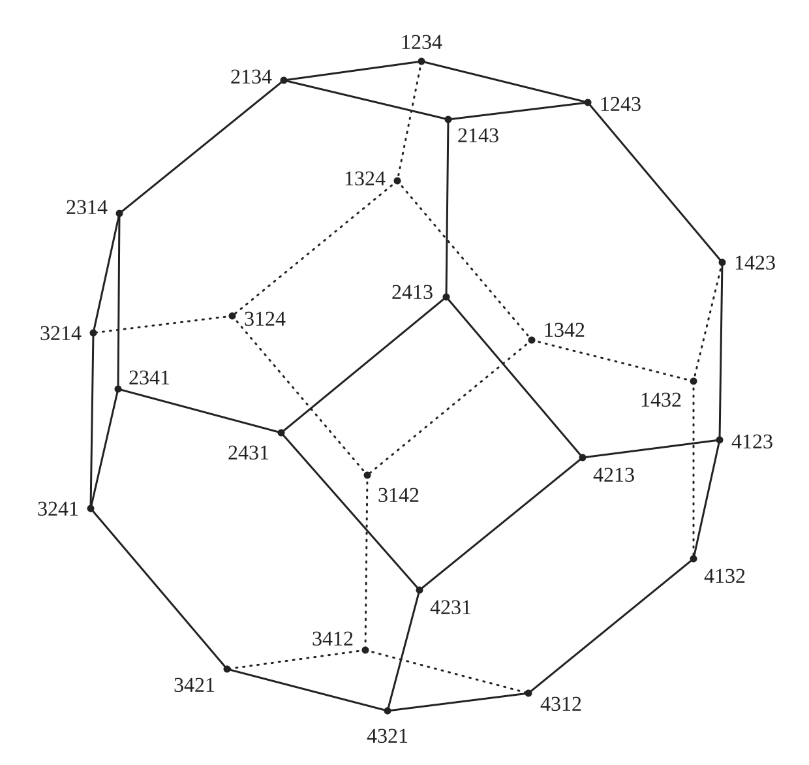

图 1　截八面体, 说明在交换一个排列的相邻元素时的反序变化

<a id="pdf-016"></a>
<a id="p-10"></a>

顺便指出, 图 1 中的图形可以看作一个三维立体 “截八面体”, 它有 8 个正六边形表面和 6 个正方形表面. 这是阿基米德提出的经典均匀多面体之一 (见习题 10).

读者不要把排列的反序与排列的逆相混淆. 回想一下, 我们可以将一个排列写成两行:

$$
\begin{pmatrix}1&2&3&\cdots&n\\a_1&a_2&a_3&\cdots&a_n\end{pmatrix};\tag{4}
$$

这个排列的逆 $a'_1a'_2a'_3\ldots a'_n$ 是通过以下变换所得到的排列: 交换这两行的位置, 然后对各列进行排序, 使新的上面一行满足递增顺序:

$$
\begin{pmatrix}a_1&a_2&a_3&\cdots&a_n\\1&2&3&\cdots&n\end{pmatrix}
=\begin{pmatrix}1&2&3&\cdots&n\\a'_1&a'_2&a'_3&\cdots&a'_n\end{pmatrix}.\tag{5}
$$

例如, 591826473 的逆为 359716842, 这是因为

$$
\begin{pmatrix}5&9&1&8&2&6&4&7&3\\1&2&3&4&5&6&7&8&9\end{pmatrix}
=\begin{pmatrix}1&2&3&4&5&6&7&8&9\\3&5&9&7&1&6&8&4&2\end{pmatrix}.
$$

逆的另一定义方式为: 当且仅当 $a_k=j$ 时, 我们说 $a'_j=k$.

排列的逆是由海因里希·罗思最早定义的 [在 *Sammlung combinatorisch-analytischer Abhandlungen* 中定义, 由卡尔·兴登堡编,**2** (Leipzig: 1800), 263–305], 他注意到逆与反序之间的重要联系: 排列的逆与排列本身恰好有同样多的反序数目. 罗思对这一事实的证明可能不是最简单的一个, 但它具有指导意义, 而且非常漂亮. 构造一个 $n\times n$ 的棋盘, 只要 $a_i=j$ 就在第 $i$ 行第 $j$ 列放一个黑点. 然后, 如果一个方格的下方 (同一列内) 和右侧 (同一行内) 都有黑点, 则在该方格放入一个×. 例如, 591826473 的图形为:

<table style="border-collapse:collapse;margin-inline:auto"><tbody>
<tr style="background:transparent"><td style="width:1.5em;height:1.5em;padding:0;text-align:center;border:1px solid var(--vp-c-text-2)">×</td><td style="width:1.5em;height:1.5em;padding:0;text-align:center;border:1px solid var(--vp-c-text-2)">×</td><td style="width:1.5em;height:1.5em;padding:0;text-align:center;border:1px solid var(--vp-c-text-2)">×</td><td style="width:1.5em;height:1.5em;padding:0;text-align:center;border:1px solid var(--vp-c-text-2)">×</td><td style="width:1.5em;height:1.5em;padding:0;text-align:center;border:1px solid var(--vp-c-text-2)">●</td><td style="width:1.5em;height:1.5em;padding:0;text-align:center;border:1px solid var(--vp-c-text-2)"></td><td style="width:1.5em;height:1.5em;padding:0;text-align:center;border:1px solid var(--vp-c-text-2)"></td><td style="width:1.5em;height:1.5em;padding:0;text-align:center;border:1px solid var(--vp-c-text-2)"></td><td style="width:1.5em;height:1.5em;padding:0;text-align:center;border:1px solid var(--vp-c-text-2)"></td></tr>
<tr style="background:transparent"><td style="width:1.5em;height:1.5em;padding:0;text-align:center;border:1px solid var(--vp-c-text-2)">×</td><td style="width:1.5em;height:1.5em;padding:0;text-align:center;border:1px solid var(--vp-c-text-2)">×</td><td style="width:1.5em;height:1.5em;padding:0;text-align:center;border:1px solid var(--vp-c-text-2)">×</td><td style="width:1.5em;height:1.5em;padding:0;text-align:center;border:1px solid var(--vp-c-text-2)">×</td><td style="width:1.5em;height:1.5em;padding:0;text-align:center;border:1px solid var(--vp-c-text-2)"></td><td style="width:1.5em;height:1.5em;padding:0;text-align:center;border:1px solid var(--vp-c-text-2)">×</td><td style="width:1.5em;height:1.5em;padding:0;text-align:center;border:1px solid var(--vp-c-text-2)">×</td><td style="width:1.5em;height:1.5em;padding:0;text-align:center;border:1px solid var(--vp-c-text-2)">×</td><td style="width:1.5em;height:1.5em;padding:0;text-align:center;border:1px solid var(--vp-c-text-2)">●</td></tr>
<tr style="background:transparent"><td style="width:1.5em;height:1.5em;padding:0;text-align:center;border:1px solid var(--vp-c-text-2)">●</td><td style="width:1.5em;height:1.5em;padding:0;text-align:center;border:1px solid var(--vp-c-text-2)"></td><td style="width:1.5em;height:1.5em;padding:0;text-align:center;border:1px solid var(--vp-c-text-2)"></td><td style="width:1.5em;height:1.5em;padding:0;text-align:center;border:1px solid var(--vp-c-text-2)"></td><td style="width:1.5em;height:1.5em;padding:0;text-align:center;border:1px solid var(--vp-c-text-2)"></td><td style="width:1.5em;height:1.5em;padding:0;text-align:center;border:1px solid var(--vp-c-text-2)"></td><td style="width:1.5em;height:1.5em;padding:0;text-align:center;border:1px solid var(--vp-c-text-2)"></td><td style="width:1.5em;height:1.5em;padding:0;text-align:center;border:1px solid var(--vp-c-text-2)"></td><td style="width:1.5em;height:1.5em;padding:0;text-align:center;border:1px solid var(--vp-c-text-2)"></td></tr>
<tr style="background:transparent"><td style="width:1.5em;height:1.5em;padding:0;text-align:center;border:1px solid var(--vp-c-text-2)"></td><td style="width:1.5em;height:1.5em;padding:0;text-align:center;border:1px solid var(--vp-c-text-2)">×</td><td style="width:1.5em;height:1.5em;padding:0;text-align:center;border:1px solid var(--vp-c-text-2)">×</td><td style="width:1.5em;height:1.5em;padding:0;text-align:center;border:1px solid var(--vp-c-text-2)">×</td><td style="width:1.5em;height:1.5em;padding:0;text-align:center;border:1px solid var(--vp-c-text-2)"></td><td style="width:1.5em;height:1.5em;padding:0;text-align:center;border:1px solid var(--vp-c-text-2)">×</td><td style="width:1.5em;height:1.5em;padding:0;text-align:center;border:1px solid var(--vp-c-text-2)">×</td><td style="width:1.5em;height:1.5em;padding:0;text-align:center;border:1px solid var(--vp-c-text-2)">●</td><td style="width:1.5em;height:1.5em;padding:0;text-align:center;border:1px solid var(--vp-c-text-2)"></td></tr>
<tr style="background:transparent"><td style="width:1.5em;height:1.5em;padding:0;text-align:center;border:1px solid var(--vp-c-text-2)"></td><td style="width:1.5em;height:1.5em;padding:0;text-align:center;border:1px solid var(--vp-c-text-2)">●</td><td style="width:1.5em;height:1.5em;padding:0;text-align:center;border:1px solid var(--vp-c-text-2)"></td><td style="width:1.5em;height:1.5em;padding:0;text-align:center;border:1px solid var(--vp-c-text-2)"></td><td style="width:1.5em;height:1.5em;padding:0;text-align:center;border:1px solid var(--vp-c-text-2)"></td><td style="width:1.5em;height:1.5em;padding:0;text-align:center;border:1px solid var(--vp-c-text-2)"></td><td style="width:1.5em;height:1.5em;padding:0;text-align:center;border:1px solid var(--vp-c-text-2)"></td><td style="width:1.5em;height:1.5em;padding:0;text-align:center;border:1px solid var(--vp-c-text-2)"></td><td style="width:1.5em;height:1.5em;padding:0;text-align:center;border:1px solid var(--vp-c-text-2)"></td></tr>
<tr style="background:transparent"><td style="width:1.5em;height:1.5em;padding:0;text-align:center;border:1px solid var(--vp-c-text-2)"></td><td style="width:1.5em;height:1.5em;padding:0;text-align:center;border:1px solid var(--vp-c-text-2)"></td><td style="width:1.5em;height:1.5em;padding:0;text-align:center;border:1px solid var(--vp-c-text-2)">×</td><td style="width:1.5em;height:1.5em;padding:0;text-align:center;border:1px solid var(--vp-c-text-2)">×</td><td style="width:1.5em;height:1.5em;padding:0;text-align:center;border:1px solid var(--vp-c-text-2)"></td><td style="width:1.5em;height:1.5em;padding:0;text-align:center;border:1px solid var(--vp-c-text-2)">●</td><td style="width:1.5em;height:1.5em;padding:0;text-align:center;border:1px solid var(--vp-c-text-2)"></td><td style="width:1.5em;height:1.5em;padding:0;text-align:center;border:1px solid var(--vp-c-text-2)"></td><td style="width:1.5em;height:1.5em;padding:0;text-align:center;border:1px solid var(--vp-c-text-2)"></td></tr>
<tr style="background:transparent"><td style="width:1.5em;height:1.5em;padding:0;text-align:center;border:1px solid var(--vp-c-text-2)"></td><td style="width:1.5em;height:1.5em;padding:0;text-align:center;border:1px solid var(--vp-c-text-2)"></td><td style="width:1.5em;height:1.5em;padding:0;text-align:center;border:1px solid var(--vp-c-text-2)">×</td><td style="width:1.5em;height:1.5em;padding:0;text-align:center;border:1px solid var(--vp-c-text-2)">●</td><td style="width:1.5em;height:1.5em;padding:0;text-align:center;border:1px solid var(--vp-c-text-2)"></td><td style="width:1.5em;height:1.5em;padding:0;text-align:center;border:1px solid var(--vp-c-text-2)"></td><td style="width:1.5em;height:1.5em;padding:0;text-align:center;border:1px solid var(--vp-c-text-2)"></td><td style="width:1.5em;height:1.5em;padding:0;text-align:center;border:1px solid var(--vp-c-text-2)"></td><td style="width:1.5em;height:1.5em;padding:0;text-align:center;border:1px solid var(--vp-c-text-2)"></td></tr>
<tr style="background:transparent"><td style="width:1.5em;height:1.5em;padding:0;text-align:center;border:1px solid var(--vp-c-text-2)"></td><td style="width:1.5em;height:1.5em;padding:0;text-align:center;border:1px solid var(--vp-c-text-2)"></td><td style="width:1.5em;height:1.5em;padding:0;text-align:center;border:1px solid var(--vp-c-text-2)">×</td><td style="width:1.5em;height:1.5em;padding:0;text-align:center;border:1px solid var(--vp-c-text-2)"></td><td style="width:1.5em;height:1.5em;padding:0;text-align:center;border:1px solid var(--vp-c-text-2)"></td><td style="width:1.5em;height:1.5em;padding:0;text-align:center;border:1px solid var(--vp-c-text-2)"></td><td style="width:1.5em;height:1.5em;padding:0;text-align:center;border:1px solid var(--vp-c-text-2)">●</td><td style="width:1.5em;height:1.5em;padding:0;text-align:center;border:1px solid var(--vp-c-text-2)"></td><td style="width:1.5em;height:1.5em;padding:0;text-align:center;border:1px solid var(--vp-c-text-2)"></td></tr>
<tr style="background:transparent"><td style="width:1.5em;height:1.5em;padding:0;text-align:center;border:1px solid var(--vp-c-text-2)"></td><td style="width:1.5em;height:1.5em;padding:0;text-align:center;border:1px solid var(--vp-c-text-2)"></td><td style="width:1.5em;height:1.5em;padding:0;text-align:center;border:1px solid var(--vp-c-text-2)">●</td><td style="width:1.5em;height:1.5em;padding:0;text-align:center;border:1px solid var(--vp-c-text-2)"></td><td style="width:1.5em;height:1.5em;padding:0;text-align:center;border:1px solid var(--vp-c-text-2)"></td><td style="width:1.5em;height:1.5em;padding:0;text-align:center;border:1px solid var(--vp-c-text-2)"></td><td style="width:1.5em;height:1.5em;padding:0;text-align:center;border:1px solid var(--vp-c-text-2)"></td><td style="width:1.5em;height:1.5em;padding:0;text-align:center;border:1px solid var(--vp-c-text-2)"></td><td style="width:1.5em;height:1.5em;padding:0;text-align:center;border:1px solid var(--vp-c-text-2)"></td></tr>
</tbody></table>

容易看到, $b_j$ 就是 $j$ 列中的×数, 所以×的个数就是反序的数目. 现在, 如果对这个图形进行转置——交换行与列, 就可以得到原排列的逆的对应图. 因此, 在这两种情况下, ×的个数 (反序的数目) 相同. 罗思利用这一事实证明了: 当矩阵转置时, 其行列式不变.

在几种排序算法的分析中, 需要知道有多少种 “$n$ 元素排列” 恰好有 $k$ 个反序. 我们用 $I_n(k)$ 来表示这一数目. 表 1 列出了这个函数的前几个值.

考虑反序表 $b_1b_2\ldots b_n$, 易得 $I_n(0)=1$、$I_n(1)=n-1$, 还有一个对称性质:

$$
I_n\left(\binom n2-k\right)=I_n(k).\tag{6}
$$

此外, 由于每个 $b$ 值的选择都与其他 $b$ 值相独立, 所以不难看出, 生成函数

$$
G_n(z)=I_n(0)+I_n(1)z+I_n(2)z^2+\cdots\tag{7}
$$

<a id="pdf-017"></a>
<a id="p-11"></a>

<a id="table-5-1-1-1"></a>

表 1　具有 $k$ 个反序的排列

<table>
<thead><tr><th>$n$</th><th>$I_n(0)$</th><th>$I_n(1)$</th><th>$I_n(2)$</th><th>$I_n(3)$</th><th>$I_n(4)$</th><th>$I_n(5)$</th><th>$I_n(6)$</th><th>$I_n(7)$</th><th>$I_n(8)$</th><th>$I_n(9)$</th><th>$I_n(10)$</th><th>$I_n(11)$</th></tr></thead>
<tbody>
<tr><td>1</td><td style="border-right:1px solid">1</td><td style="border-bottom:1px solid">0</td><td>0</td><td>0</td><td>0</td><td>0</td><td>0</td><td>0</td><td>0</td><td>0</td><td>0</td><td>0</td></tr>
<tr><td>2</td><td>1</td><td style="border-right:1px solid">1</td><td style="border-bottom:1px solid">0</td><td>0</td><td>0</td><td>0</td><td>0</td><td>0</td><td>0</td><td>0</td><td>0</td><td>0</td><td>0</td></tr>
<tr><td>3</td><td>1</td><td>2</td><td style="border-right:1px solid">2</td><td style="border-bottom:1px solid">1</td><td>0</td><td>0</td><td>0</td><td>0</td><td>0</td><td>0</td><td>0</td><td>0</td><td>0</td></tr>
<tr><td>4</td><td>1</td><td>3</td><td>5</td><td style="border-right:1px solid">6</td><td style="border-bottom:1px solid">5</td><td>3</td><td>1</td><td>0</td><td>0</td><td>0</td><td>0</td><td>0</td></tr>
<tr><td>5</td><td>1</td><td>4</td><td>9</td><td>15</td><td style="border-right:1px solid">20</td><td style="border-bottom:1px solid">22</td><td>20</td><td>15</td><td>9</td><td>4</td><td>1</td><td>0</td></tr>
<tr><td>6</td><td>1</td><td>5</td><td>14</td><td>29</td><td>49</td><td style="border-right:1px solid">71</td><td style="border-bottom:1px solid">90</td><td>101</td><td>101</td><td>90</td><td>71</td><td>49</td></tr>
</tbody></table>

满足 $G_n(z)=(1+z+\cdots+z^{n-1})G_{n-1}(z)$, 因此它拥有邦雅曼·罗德里格斯注意到的较简单形式 [*J. de Math.* **4** (1839), 236–240]:

$$
(1+z+\cdots+z^{n-1})\cdots(1+z)(1)
=(1-z^n)\cdots(1-z^2)(1-z)/(1-z)^n.\tag{8}
$$

根据这一生成函数, 可以很轻松地扩展表 1, 还可以验证: 表中锯齿线下方的数满足

$$
I_n(k)=I_n(k-1)+I_{n-1}(k),\qquad k<n.\tag{9}
$$

(这一关系对于锯齿线上方的数不成立.) 一种更复杂的论证表明 (见习题 14): 事实上, 有以下公式

$$
\begin{aligned}
I_n(2)&=\binom n2-1, &&n\ge2;\\
I_n(3)&=\binom{n+1}3-\binom n1, &&n\ge3;\\
I_n(4)&=\binom{n+2}4-\binom{n+1}2, &&n\ge4;\\
I_n(5)&=\binom{n+3}5-\binom{n+2}3+1, &&n\ge5;
\end{aligned}
$$

一般来说, $I_n(k)$ 的公式包括大约 $1.6\sqrt{k}$ 项:

$$
\begin{aligned}
I_n(k)={}&\binom{n+k-2}k-\binom{n+k-3}{k-2}
+\binom{n+k-6}{k-5}+\binom{n+k-8}{k-7}-\cdots\\
&+(-1)^j\left(\binom{n+k-u_j-1}{k-u_j}
+\binom{n+k-u_j-j-1}{k-u_j-j}\right)+\cdots,
\qquad n\ge k,
\end{aligned}\tag{10}
$$

其中 $u_j=(3j^2-j)/2$, 是所谓的 “五角数”.

如果将 $G_n(z)$ 除以 $n!$, 可以得到给出 $n$ 元素随机排列的反序个数的概率分布的生成函数 $g_n(z)$. 它是乘积

$$
g_n(z)=h_1(z)h_2(z)\cdots h_n(z),\tag{11}
$$

式中 $h_k(z)=(1+z+\cdots+z^{k-1})/k$ 是一个小于 $k$ 的随机非负整数的一致分布的生成函数. 可以得到

$$
\begin{aligned}
\operatorname{mean}(g_n)
&=\operatorname{mean}(h_1)+\operatorname{mean}(h_2)+\cdots+\operatorname{mean}(h_n)\\
&=0+\frac12+\cdots+\frac{n-1}2=\frac{n(n-1)}4;
\end{aligned}\tag{12}
$$

$$
\begin{aligned}
\operatorname{var}(g_n)
&=\operatorname{var}(h_1)+\operatorname{var}(h_2)+\cdots+\operatorname{var}(h_n)\\
&=0+\frac14+\cdots+\frac{n^2-1}{12}=\frac{n(2n+5)(n-1)}{72}.
\end{aligned}\tag{13}
$$

<a id="pdf-018"></a>
<a id="p-12"></a>

所以反序的平均数相当大, 大约为 $\frac14n^2$. 标准差也相当大, 大约为 $\frac16n^{3/2}$.

珀西·麦克马洪发现了有关反序分布的一个重要事实 [*Amer. J. Math.* **35** (1913), 281–322]. 将排列 $a_1a_2\ldots a_n$ 的指数定义为所有满足 $a_j>a_{j+1}$、$1\le j<n$ 的下标 $j$ 之和. 例如, 591826473 的指数为 $2+4+6+8=20$. 在本例中, 这一指数碰巧与反序的数目相同. 如果列出 $\{1,2,3,4\}$ 的 24 个排列, 即:

<table><thead><tr><th>排列</th><th>指数</th><th>反序数目</th><th>排列</th><th>指数</th><th>反序数目</th></tr></thead><tbody>
<tr><td><code>1 2 3 4</code></td><td>0</td><td>0</td><td><code>3|1 2 4</code></td><td>1</td><td>2</td></tr>
<tr><td><code>1 2 4|3</code></td><td>3</td><td>1</td><td><code>3|1 4|2</code></td><td>4</td><td>3</td></tr>
<tr><td><code>1 3|2 4</code></td><td>2</td><td>1</td><td><code>3|2|1 4</code></td><td>3</td><td>3</td></tr>
<tr><td><code>1 3 4|2</code></td><td>3</td><td>2</td><td><code>3|2 4|1</code></td><td>4</td><td>4</td></tr>
<tr><td><code>1 4|2 3</code></td><td>2</td><td>2</td><td><code>3 4|1 2</code></td><td>2</td><td>4</td></tr>
<tr><td><code>1 4|3|2</code></td><td>5</td><td>3</td><td><code>3 4|2|1</code></td><td>5</td><td>5</td></tr>
<tr><td><code>2|1 3 4</code></td><td>1</td><td>1</td><td><code>4|1 2 3</code></td><td>1</td><td>3</td></tr>
<tr><td><code>2|1 4|3</code></td><td>4</td><td>2</td><td><code>4|1 3|2</code></td><td>4</td><td>4</td></tr>
<tr><td><code>2 3|1 4</code></td><td>2</td><td>2</td><td><code>4|2|1 3</code></td><td>3</td><td>4</td></tr>
<tr><td><code>2 3 4|1</code></td><td>3</td><td>3</td><td><code>4|2 3|1</code></td><td>4</td><td>5</td></tr>
<tr><td><code>2 4|1 3</code></td><td>2</td><td>3</td><td><code>4|3|1 2</code></td><td>3</td><td>5</td></tr>
<tr><td><code>2 4|3|1</code></td><td>5</td><td>4</td><td><code>4|3|2|1</code></td><td>6</td><td>6</td></tr>
</tbody></table>

我们看到, 拥有指数 $k$ 的排列数目与拥有 $k$ 个反序的排列数目相同.

初看起来, 这一事实似乎是显而易见的, 但进一步仔细研究后会发现它非常难以理解. 麦克马洪给出了一种巧妙的间接证明: 设 $\operatorname{ind}(a_1a_2\ldots a_n)$ 表示排列 $a_1a_2\ldots a_n$ 的指数, 并设

$$
H_n(z)=\sum z^{\operatorname{ind}(a_1a_2\ldots a_n)}\tag{14}
$$

为相应的生成函数. (14) 的右侧是针对 $\{1,2,\ldots,n\}$ 的所有排列求和. 我们希望证明 $H_n(z)=G_n(z)$. 为此, 我们将定义一种一一对应关系, 一端是由非负整数组成的 $n$ 元组 $(q_1,q_2,\ldots,q_n)$, 另一端是 $n$ 元组的有序对

$$
\bigl((a_1,a_2,\ldots,a_n),(p_1,p_2,\ldots,p_n)\bigr),
$$

其中 $a_1a_2\ldots a_n$ 为下标 $\{1,2,\ldots,n\}$ 的一个排列, 且 $p_1\ge p_2\ge\cdots\ge p_n\ge0$. 这一对应关系满足条件

$$
q_1+q_2+\cdots+q_n
=\operatorname{ind}(a_1a_2\ldots a_n)+(p_1+p_2+\cdots+p_n).\tag{15}
$$

针对所有非负整数 $n$ 元组 $(q_1,q_2,\ldots,q_n)$ 求和的生成函数 $\sum z^{q_1+q_2+\cdots+q_n}$ 为 $Q_n(z)=1/(1-z)^n$. 针对所有整数 $n$ 元组 $(p_1,p_2,\ldots,p_n)$ (其中 $p_1\ge p_2\ge\cdots\ge p_n\ge0$) 求和的生成函数 $\sum z^{p_1+p_2+\cdots+p_n}$ 为 (如习题 15 所示)

$$
P_n(z)=\frac1{(1-z)(1-z^2)\ldots(1-z^n)}.\tag{16}
$$

依据式 (15), 我们将要建立的一一对应关系将会证明 $Q_n(z)=H_n(z)P_n(z)$, 即

$$
H_n(z)=Q_n(z)/P_n(z).\tag{17}
$$

但根据 (8), $Q_n(z)/P_n(z)$ 为 $G_n(z)$.

<a id="pdf-019"></a>
<a id="p-13"></a>

所期望的对应关系由一种简单的排序过程定义: 任何一个 $n$ 元组 $(q_1,q_2,\ldots,q_n)$ 都可以采用一种稳定方式重新排列为非递增顺序 $q_{a_1}\ge q_{a_2}\ge\cdots\ge q_{a_n}$, 其中 $a_1a_2\ldots a_n$ 是一种排列, 使得 $q_{a_j}=q_{a_{j+1}}$ 隐含着 $a_j<a_{j+1}$. 我们令 $(p_1,p_2,\ldots,p_n)=(q_{a_1},q_{a_2},\ldots,q_{a_n})$, 然后, 对于每个满足 $a_j>a_{j+1}$ 的 $j$ 值 ($1\le j<n$), 从每个 $p_1,\ldots,p_j$ 中减去 1. 由于只要 $a_j>a_{j+1}$, $p_j$ 就严格大于 $p_{j+1}$, 所以仍然有 $p_1\ge p_2\ge\cdots\ge p_n$. 因为 $p$ 的总减少量为 $\operatorname{ind}(a_1a_2\ldots a_n)$, 所以最终得到的元组对 $\bigl((a_1,a_2,\ldots,a_n),(p_1,p_2,\ldots,p_n)\bigr)$ 满足 (15). 例如, 如果 $n=9$ 且 $(q_1,\ldots,q_9)=(3,1,4,1,5,9,2,6,5)$, 则可以求得 $a_1\ldots a_9=685931724$, $(p_1,\ldots,p_9)=(5,2,2,2,2,2,1,1,1)$.

反之, 如果给定 $a_1a_2\ldots a_n$ 和 $(p_1,p_2,\ldots,p_n)$, 可以很轻松地回推出 $(q_1,q_2,\ldots,q_n)$ (见习题 17). 这样就建立了所需要的对应关系, 而且也证明了麦克马洪的指数定理.

在麦克马洪初次发表指数定理大约 65 年之后, 多米尼克·福阿塔和马塞尔-保罗·舒岑贝热发现了麦克马洪定理一个不同寻常的扩展: 对于 $n$ 元素排列, 反序数为 $k$、指数为 $l$ 的排列数目与反序数为 $l$、指数为 $k$ 的排列数目相同. 事实上, 福阿塔和舒岑贝热在第一类排列和第二类排列之间发现了一种简单的一一对应关系 (见习题 25).

## 习题

<a id="ex-5-1-1-1"></a>

**1.** [10] 排列 271845936 的反序表是怎样的? 反序表为 50121200 的排列是怎样的?　[答案](#ans-5-1-1-1)

<a id="ex-5-1-1-2"></a>

**2.** [M20] 在经典的约瑟夫问题中 (习题 1.3.2–22), $n$ 个人最初排成一个圆圈, 处死第 $m$ 个人后把圆圈闭合, 然后重复清除每个排在第 $m$ 位的人, 直到所有人都死亡为止. 所得到的行刑顺序是 $\{1,2,\ldots,n\}$ 的一个排列. 例如, 当 $n=8$、$m=4$ 时, 行刑顺序为 54613872 (编号为 1 的人是第 5 个被清除的, 以此类推). 与这一排列相对应的反序表为 36310010.　[答案](#ans-5-1-1-2)

对于共有 $n$ 人、每 $m$ 个人处死 1 人的一般约瑟夫问题, 给出反序表中各元素 $b_1b_2\ldots b_n$ 的简单递推关系.

<a id="ex-5-1-1-3"></a>

**3.** [18] 如果排列 $a_1a_2\ldots a_n$ 对应于反序表 $b_1b_2\ldots b_n$, 求反序表 $(n-1-b_1)(n-2-b_2)\ldots(0-b_n)$ 对应的排列 $\bar a_1\bar a_2\ldots\bar a_n$.　[答案](#ans-5-1-1-3)

<a id="ex-5-1-1-4"></a>

▶ **4.** [20] 设计一种适于计算机实现的算法, 构造一个排列 $a_1a_2\ldots a_n$, 与满足 (3) 的给定反序表 $b_1b_2\ldots b_n$ 相对应. [提示: 考虑链接存储技术.]　[答案](#ans-5-1-1-4)

<a id="ex-5-1-1-5"></a>

**5.** [35] 习题 4 的算法在典型计算机上的执行时间大约与 $n+b_1+\cdots+b_n$ 成正比, 平均为 $\Theta(n^2)$. 是否存在一种算法, 在最差情况下的运行时间也远优于 $n^2$ 级别?　[答案](#ans-5-1-1-5)

<a id="ex-5-1-1-6"></a>

▶ **6.** [26] 设计一种算法, 用来计算与 $\{1,2,\ldots,n\}$ 的给定排列 $a_1a_2\ldots a_n$ 相对应的反序表 $b_1b_2\ldots b_n$, 此算法在典型计算机上的运行时间基本上与 $n\log n$ 成正比.　[答案](#ans-5-1-1-6)

<a id="ex-5-1-1-7"></a>

**7.** [20] 除了正文中定义的特定反序表 $b_1b_2\ldots b_n$ 之外, 还可以定义其他几种与 $\{1,2,\ldots,n\}$ 的给定排列 $a_1a_2\ldots a_n$ 相对应的反序表. 在本题中将考虑会在应用中遇到的三种其他类型的反序表.　[答案](#ans-5-1-1-7)

设 $c_j$ 表示有多少个反序的第一分量为 $j$, 也就是有多少个元素位于 $j$ 的右侧并小于 $j$. [对应于 (1), 可以得到反序表 000142157, 显然 $0\le c_j<j$.] 设 $B_j=b_{a_j}$、$C_j=c_{a_j}$.

证明: 对于 $1\le j\le n$, 有 $0\le B_j<j$、$0\le C_j\le n-j$. 进一步证明: 在给定 $c_1c_2\ldots c_n$ 或 $B_1B_2\ldots B_n$ 或 $C_1C_2\ldots C_n$ 时, 可以唯一确定排列 $a_1a_2\ldots a_n$.

<a id="ex-5-1-1-8"></a>

**8.** [M24] 继续使用习题 7 的符号, 设 $a'_1a'_2\ldots a'_n$ 表示排列 $a_1a_2\ldots a_n$ 的逆, 相应的反序表为 $b'_1b'_2\ldots b'_n$、$c'_1c'_2\ldots c'_n$、$B'_1B'_2\ldots B'_n$ 和 $C'_1C'_2\ldots C'_n$. 尽你所能, 找出数值 $a_j$、$b_j$、$c_j$、$B_j$、$C_j$、$a'_j$、$b'_j$、$c'_j$、$B'_j$、$C'_j$ 之间的所有重要关系.　[答案](#ans-5-1-1-8)

<a id="ex-5-1-1-9"></a>

▶ **9.** [M21] 继续使用习题 7 的符号, 证明: 当且仅当 $b_j=C_j$($1\le j\le n$) 时, 排列 $a_1a_2\ldots a_n$ 是一个对合, 即它是自己的逆.　[答案](#ans-5-1-1-9)

<a id="pdf-020"></a>
<a id="p-14"></a>

<a id="ex-5-1-1-10"></a>

**10.** [HM20] 把图 1 看作一个三维多面体. 如果它的所有边的长度都是 1, 则截八面体的直径 (顶点 1234 和顶点 4321 之间的距离) 是多少?　[答案](#ans-5-1-1-10)

<a id="ex-5-1-1-11"></a>

**11.** [M25] 如果 $\pi=a_1a_2\ldots a_n$ 是 $\{1,2,\ldots,n\}$ 的一个排列, 设　[答案](#ans-5-1-1-11)

$$
E(\pi)=\{(a_i,a_j)\mid i<j,\ a_i>a_j\}
$$

是它的 “反序” 集, 并设

$$
\bar E(\pi)=\{(a_i,a_j)\mid i>j,\ a_i>a_j\}
$$

是 “非反序” 集.

(a) 证明 $E(\pi)$ 和 $\bar E(\pi)$ 是传递的. ($S$ 是由有序对组成的集合, 如果只要 $(a,b)$ 和 $(b,c)$ 都属于 $S$, 则 $(a,c)$ 也属于 $S$, 就说 $S$ 是传递的.)

(b) 反之, 设 $E$ 是 $T=\{(x,y)\mid1\le y<x\le n\}$ 的任意传递子集, 其补集 $\bar E=T\setminus E$ 也是传递的. 证明: 存在一个排列 $\pi$, 使得 $E(\pi)=E$.

<a id="ex-5-1-1-12"></a>

**12.** [M28] 继续使用上题的符号, 证明: 如果 $\pi_1$ 和 $\pi_2$ 是排列, 而且如果 $E$ 是包含 $E(\pi_1)\cup E(\pi_2)$ 的最小传递集, 则 $\bar E$ 是传递的. [因此, 如果我们在 $E(\pi_1)\subseteq E(\pi_2)$ 时说 $\pi_1$ 位于 $\pi_2$“之上”, 则定义了排列的一个格. 在两个给定排列 “之上” 存在唯一的 “最低” 排列. 图 1 是 $n=4$ 时的格.]　[答案](#ans-5-1-1-12)

<a id="ex-5-1-1-13"></a>

**13.** [M23] 众所周知, 行列式展开后有一半的项为正号, 一半的项为负号. 换句话说, 当 $n\ge2$ 时, 拥有偶数个反序的排列与拥有奇数个反序的排列的数目相同. 证明: 一般情况下, 只要 $n\ge m$, 无论整数 $t$ 的取值如何, 恰有 $n!/m$ 个排列, 其反序个数与 $t$ 关于模 $m$ 同余.　[答案](#ans-5-1-1-13)

<a id="ex-5-1-1-14"></a>

**14.** [M24] (法比亚·富兰克林) 把 $n$ 分为 $k$ 个不同部分的分划就是把 $n$ 表示为 $n=p_1+p_2+\cdots+p_k$, 其中 $p_1>p_2>\cdots>p_k>0$. 例如, 把 7 分为不同部分的分划是: $7$、$6+1$、$5+2$、$4+3$、$4+2+1$. 设 $f_k(n)$ 是把 $n$ 分为 $k$ 个不同部分的分划数. 证明: 如果 $n$ 可以表示为 $(3j^2\pm j)/2$($j$ 是一个非负整数) 的形式, 则 $\sum_k(-1)^kf_k(n)=(-1)^j$, 否则 $\sum_k(-1)^kf_k(n)=0$. 例如, 当 $n=7$ 时, 这个和值为 $-1+3-1=1$, 而 $7=(3\cdot2^2+2)/2$. [提示: 把一个分划表示为一个点阵, 在第 $i$ 行放置 $p_i$ 个点, 其中 $1\le i\le k$. 求出使得 $p_{j+1}<p_j-1$ 的最小 $j$, 并把前 $j$ 行中最右边的点圈在一起. 如果 $j<p_k$, 通常可以把这 $j$ 个点移走、倾斜 $45^\circ$, 并放置为一个新的第 $(k+1)$ 行. 如果 $j\ge p_k$, 通常可以把第 $k$ 行的点移走、倾斜 $45^\circ$, 并放置到被圈在一起的点的右面 (见图 2). 在大多数情况下, 这一过程把拥有奇数行的分划与拥有偶数行的分划配成对, 所以在上面的求和公式中只需考虑未配对的分划.]　[答案](#ans-5-1-1-14)

<a id="fig-5-2"></a>

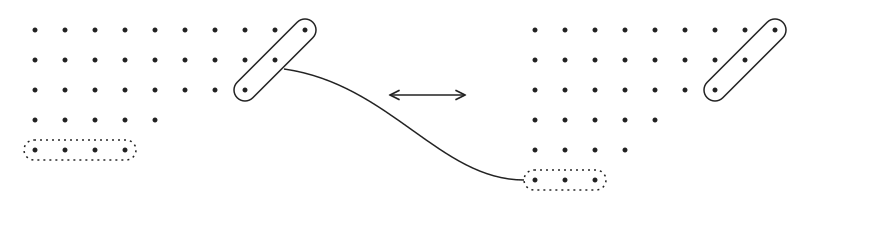

图 2　具有不同部分的分划之间的富兰克林对应

注记: 作为推论, 我们得到了欧拉公式

$$
\begin{aligned}
(1-z)(1-z^2)(1-z^3)\cdots
&=1-z-z^2+z^5+z^7-z^{12}-z^{15}+\cdots\\
&=\sum_{-\infty<j<\infty}(-1)^jz^{(3j^2+j)/2}.
\end{aligned}
$$

普通分划 (各部分不必不同) 的生成函数为 $\sum p(n)z^n=1/\bigl((1-z)(1-z^2)(1-z^3)\cdots\bigr)$, 因此, 我们得到关于分划数的一个不显然的递推关系

$$
p(n)=p(n-1)+p(n-2)-p(n-5)-p(n-7)+p(n-12)+p(n-15)-\cdots.
$$

<a id="ex-5-1-1-15"></a>

<a id="pdf-021"></a>
<a id="p-15"></a>

**15.** [M23] 证明 (16) 是分为至多 $n$ 个部分的分划的生成函数. 即: 证明 $1/\bigl((1-z)(1-z^2)\ldots(1-z^n)\bigr)$ 中 $z^m$ 的系数是将 $m$ 写为 $p_1+p_2+\cdots+p_n$($p_1\ge p_2\ge\cdots\ge p_n\ge0$) 的方式个数. [提示: 像习题 14 中一样绘制点阵, 证明在使 $p_1\ge p_2\ge\cdots\ge p_n\ge0$ 成立的 $n$ 元组 $(p_1,p_2,\ldots,p_n)$ 与使 $n\ge P_1\ge P_2\ge P_3\ge\cdots\ge0$ 成立的序列 $(P_1,P_2,P_3,\ldots)$ 之间存在一一对应关系, 其中 $p_1+p_2+\cdots+p_n=P_1+P_2+P_3+\cdots$. 换句话说, 分为至多 $n$ 个部分的分划对应于各部分不超过 $n$ 的分划.]　[答案](#ans-5-1-1-15)

<a id="ex-5-1-1-16"></a>

**16.** [M25] (莱昂哈德·欧拉) 用分划解释下列恒等式的两端, 以证明它们:　[答案](#ans-5-1-1-16)

$$
\begin{aligned}
\prod_{k\ge0}\frac1{1-q^kz}
&=\frac1{(1-z)(1-qz)(1-q^2z)\cdots}\\
&=1+\frac z{1-q}+\frac{z^2}{(1-q)(1-q^2)}+\cdots
=\sum_{n\ge0}z^n\bigg/\prod_{k=1}^n(1-q^k).
\end{aligned}
$$

$$
\begin{aligned}
\prod_{k\ge0}(1+q^kz)
&=(1+z)(1+qz)(1+q^2z)\cdots\\
&=1+\frac z{1-q}+\frac{z^2q}{(1-q)(1-q^2)}+\cdots
=\sum_{n\ge0}z^nq^{n(n-1)/2}\bigg/\prod_{k=1}^n(1-q^k).
\end{aligned}
$$

<a id="ex-5-1-1-17"></a>

**17.** [20] 在本节末尾定义的麦克马洪对应关系中, 使 $(p_1,p_2,p_3,p_4)=(0,0,0,0)$ 成立的 24 个四元组 $(q_1,q_2,q_3,q_4)$ 是什么?　[答案](#ans-5-1-1-17)

<a id="ex-5-1-1-18"></a>

**18.** [M30] (托马斯·希巴德,*CACM* **6** (1963), 210) 设 $n>0$, 并假定已经随机生成了由 $2^n$ 个 $n$ 位二进制整数 $X_0,\ldots,X_{2^n-1}$ 组成的一个序列, 其中每个数的每一个二进制位独立地以概率 $p$ 等于 1. 考虑序列 $X_0\oplus0,X_1\oplus1,\ldots,X_{2^n-1}\oplus(2^n-1)$, 其中 $\oplus$ 是对二进制表示法的 “异或” 运算. 因此, 如果 $p=0$, 则序列为 $0,1,\ldots,2^n-1$; 如果 $p=1$, 则序列为 $2^n-1,\ldots,1,0$; 而当 $p=\frac12$ 时, 序列中的每个元素是介于 0 与 $2^n-1$ 之间的随机整数. 对于一般的 $p$ 值, 这是一种非常有用的随机整数序列生成方法, 该序列的反序数目是有偏的. 当然, 每个 $n$ 位二进制整数有相同的分布, 所以就此意义来说, 该序列中的元素分布从整体上来说是一致的. 请给出这样一个序列的平均反序数目, 表示为概率 $p$ 的函数.　[答案](#ans-5-1-1-18)

<a id="ex-5-1-1-19"></a>

**19.** [M28] (库尔特·迈尔) 如果 $m$ 与 $n$ 互素, 我们知道序列 $(m\bmod n)(2m\bmod n)\cdots((n-1)m\bmod n)$ 是 $\{1,2,\ldots,n-1\}$ 的一个排列. 证明: 这一排列的反序数目可以表示为戴德金和的形式 (见 3.3.3 节).　[答案](#ans-5-1-1-19)

<a id="ex-5-1-1-20"></a>

**20.** [M43] 卡尔·雅可比给出的著名恒等式 [*Fundamenta Nova Theoriæ Functionum Ellipticarum* (1829), §64]　[答案](#ans-5-1-1-20)

$$
\begin{aligned}
\prod_{k\ge1}(1-u^kv^{k-1})(1-u^{k-1}v^k)(1-u^kv^k)
&=(1-u)(1-v)(1-uv)(1-u^2v)(1-uv^2)(1-u^2v^2)\ldots\\
&=1-(u+v)+(u^3v+uv^3)-(u^6v^3+u^3v^6)+\cdots\\
&=\sum_{-\infty<j<+\infty}(-1)^ju^{\binom j2}v^{\binom{j+1}2}
\end{aligned}
$$

是许多与椭圆函数有关的重要关系式的基础. 例如, 如果置 $u=z$、$v=z^2$, 可以得到习题 14 的欧拉公式. 如果置 $z=\sqrt{u/v}$、$q=\sqrt{uv}$, 可以得到

$$
\prod_{k\ge1}(1-q^{2k-1}z)(1-q^{2k-1}z^{-1})(1-q^{2k})
=\sum_{-\infty<n<\infty}(-1)^nz^nq^{n^2}.
$$

是否存在雅可比恒等式的一种组合证明, 类似于习题 14 中特例的富兰克林证明? (因此, 我们希望考虑 “复数分划”

$$
m+ni=(p_1+q_1i)+(p_2+q_2i)+\cdots+(p_k+q_ki),
$$

式中 $p_j+q_ji$ 是互不相同的非零复数, $p_j$ 和 $q_j$ 为满足 $|p_j-q_j|\le1$ 的非负整数. 雅可比恒等式指出: $k$ 为偶数的表达式数目与 $k$ 为奇数的表达式数目相同, $m$ 和 $n$ 为连续三角数的情形除外.) 复数分划还有其他哪些重要性质?

<a id="ex-5-1-1-21"></a>

▶ **21.** [M25] (加里·诺特) 证明: 采用习题 7 的符号表示, 就习题 2.2.1–5 或 2.3.1–6 的意义而言, 当且仅当 $C_j\le C_{j+1}+1$($1\le j<n$) 时, 可以用一个栈来获得排列 $a_1\ldots a_n$.　[答案](#ans-5-1-1-21)

<a id="pdf-022"></a>
<a id="p-16"></a>

<a id="ex-5-1-1-22"></a>

**22.** [M26] 给定 $\{1,2,\ldots,n\}$ 的一个排列 $a_1a_2\ldots a_n$, 令 $h_j$ 表示有多少个下标 $i<j$ 使得 $a_i\in\{a_j+1,a_j+2,\ldots,a_{j+1}\}$ 成立. (如果 $a_{j+1}<a_j$, 则这个集合的元素将从 $n$“绕回” 到 1. 当 $j=n$ 时, 我们使用集合 $\{a_n+1,a_n+2,\ldots,n\}$.) 例如, 排列 591826473 将得到 $h_1\ldots h_9=001214246$.　[答案](#ans-5-1-1-22)

(a) 证明: $a_1a_2\ldots a_n$ 可以由数 $h_1h_2\ldots h_n$ 重构得到.

(b) 证明: $h_1+h_2+\cdots+h_n$ 是 $a_1a_2\ldots a_n$ 的指数.

<a id="ex-5-1-1-23"></a>

▶ **23.** [M27] (俄罗斯轮盘赌) 有 $n$ 个被判有罪的人对概率论的喜欢程度超过数论. 他们围坐成一圈, 修改约瑟夫方法 (见习题 2) 如下: 第一个囚犯拿起一把枪, 瞄准自己的头部, 他被打死并离开圆圈的概率为 $p$. 然后, 第二个人拿起枪, 以相同方式继续. 以固定概率 $p>0$ 循环继续, 直到所有人都死去为止.　[答案](#ans-5-1-1-23)

如果第 $k$ 个人是第 $j$ 个死去的, 则置 $a_j=k$. 证明: 死亡顺序 $a_1a_2\ldots a_n$ 的发生概率仅取决于 $n$、$p$ 和对偶排列 $(n+1-a_n)\ldots(n+1-a_2)(n+1-a_1)$ 的指数. 哪一种死亡顺序的可能性最小?

<a id="ex-5-1-1-24"></a>

**24.** [M26] 给定整数 $t(1)t(2)\ldots t(n)$, 其中 $t(j)\ge j$, 排列 $a_1a_2\ldots a_n$ 的广义指数是使 $a_j>t(a_{j+1})$ 成立的所有下标 $j$ 之和, 再加上使 $i<j$ 且 $t(a_j)\ge a_i>a_j$ 成立的反序的总数. 因此, 当对于所有 $j$ 有 $t(j)=j$ 时, 广义指数和指数是一样的. 但当对于所有 $j$ 都有 $t(j)\ge n$ 时, 广义指数就是反序的数目. 证明: 广义指数等于 $k$ 的排列数目等于有 $k$ 个反序的排列数目. [提示: 证明, 如果我们取得 $\{1,\ldots,n-1\}$ 的任意排列 $a_1\ldots a_{n-1}$, 并在所有可能位置插入数 $n$, 则广义指数将以 $\{0,1,\ldots,n-1\}$ 的某一顺序增加.]　[答案](#ans-5-1-1-24)

<a id="ex-5-1-1-25"></a>

▶ **25.** [M30] (福阿塔和舒岑贝热) 如果 $\alpha=a_1\ldots a_n$ 是一个排列, 设 $\operatorname{ind}(\alpha)$ 是它的指数, 并设 $\operatorname{inv}(\alpha)$ 表示它的反序数目.　[答案](#ans-5-1-1-25)

(a) 定义一种一一对应关系, 把 $\{1,\ldots,n\}$ 的每个排列 $\alpha$ 与一个具有以下两个属性的排列 $f(\alpha)$ 对应起来: (i) $\operatorname{ind}(f(\alpha))=\operatorname{inv}(\alpha)$; (ii) 对于 $1\le j<n$, 数 $j$ 在 $f(\alpha)$ 中出现在 $j+1$ 的左侧, 当且仅当它在 $\alpha$ 中出现在 $j+1$ 的左侧. 当 $\alpha=198263745$ 时, 你构造的对应关系会向 $f(\alpha)$ 指派哪种排列? 当 $\alpha$ 为哪种排列时, $f(\alpha)=198263745$? [提示: 如果 $n>1$, 记 $\alpha=x_1\alpha_1x_2\alpha_2\ldots x_k\alpha_ka_n$, 其中, 如果 $a_1<a_n$ 则 $x_1,\ldots,x_k$ 为所有小于 $a_n$ 的元素, 否则 $x_1,\ldots,x_k$ 为所有大于 $a_n$ 的元素; 其他元素出现在 (可能是空的) 串 $\alpha_1,\ldots,\alpha_k$ 中. 把 $h(\alpha)=\alpha_1x_1\alpha_2x_2\ldots\alpha_kx_k$ 的反序数目与 $\operatorname{inv}(\alpha)$ 对比. 在这一构造中数 $a_n$ 不出现在 $h(\alpha)$ 中.]

(b) 用 $f$ 来定义另外一个具有以下两条性质的一一对应关系 $g$: (i) $\operatorname{ind}(g(\alpha))=\operatorname{inv}(\alpha)$; (ii) $\operatorname{inv}(g(\alpha))=\operatorname{ind}(\alpha)$. [提示: 考虑逆排列.]

<a id="ex-5-1-1-26"></a>

**26.** [M25] 一个随机排列的反序个数和它的指数之间有什么样的统计相关系数? (见式 3.3.2–(24).)　[答案](#ans-5-1-1-26)

<a id="ex-5-1-1-27"></a>

**27.** [M37] 证明: 除了 (15) 之外, 在 $\operatorname{inv}(a_1a_2\ldots a_n)$ 和 $n$ 元组 $(q_1,q_2,\ldots,q_n)$ 之间存在一种简单关系. 利用这一事实来推广 (17) 的推导, 获得双变量生成函数的一个代数性质　[答案](#ans-5-1-1-27)

$$
H_n(w,z)=\sum w^{\operatorname{inv}(a_1a_2\ldots a_n)}z^{\operatorname{ind}(a_1a_2\ldots a_n)},
$$

式中的和值是对所有 $n!$ 个排列 $a_1a_2\ldots a_n$ 求和.

<a id="ex-5-1-1-28"></a>

▶ **28.** [25] 如果 $a_1a_2\ldots a_n$ 是 $\{1,2,\ldots,n\}$ 的一个排列, 它的总位移定义为 $\sum_{j=1}^n|a_j-j|$. 根据反序数目求出总位移的上限与下限.　[答案](#ans-5-1-1-28)

<a id="ex-5-1-1-29"></a>

**29.** [28] 如果 $\pi=a_1a_2\ldots a_n$ 和 $\pi'=a'_1a'_2\ldots a'_n$ 是 $\{1,2,\ldots,n\}$ 的排列, 乘积 $\pi\pi'$ 为 $a'_{a_1}a'_{a_2}\ldots a'_{a_n}$. 设 $\operatorname{inv}(\pi)$ 表示反序的数目, 与习题 25 中一样. 证明: $\operatorname{inv}(\pi\pi')\le\operatorname{inv}(\pi)+\operatorname{inv}(\pi')$, 当且仅当 $\pi\pi'$ 按习题 12 的意义 “低于” $\pi'$ 时等号成立.　[答案](#ans-5-1-1-29)

<a id="sec-5-1-2"></a>

### *5.1.2　多重集的排列

到目前为止, 我们已经讨论了元素集合的排列, 这只是多重集排列概念的一种特例. (多重集与集合类似, 只是其中可以存在重复的相同元素. 在习题 4.6.3–19 中已经讨论过多重集的一些基本性质.)

例如, 考虑多重集

$$
M=\{a,a,a,b,b,c,d,d,d,d\},\tag{1}
$$

<a id="pdf-023"></a>
<a id="p-17"></a>

它包含了 3 个 $a$、2 个 $b$、1 个 $c$ 和 4 个 $d$. 我们还可以采用另外一种方式表明元素的多重性, 即

$$
M=\{3\cdot a,2\cdot b,c,4\cdot d\}.\tag{2}
$$

$M$ 的排列[^p17-1] 就是将它的元素排成一行的一种排法, 例如

$$
c\,a\,b\,d\,d\,a\,b\,d\,a\,d.
$$

从另一个角度看, 可以把它称为包含 3 个 $a$、2 个 $b$、1 个 $c$ 和 4 个 $d$ 的字符串.

$M$ 有多少种可能的排列? 如果给 $M$ 的元素添加下标, 表示为 $a_1,a_2,a_3,b_1,b_2,c_1,d_1,d_2,d_3,d_4$, 将其看作各不相同, 则可以得到 $10!=3628800$ 种排列. 但在去掉下标后, 这些排列中有许多实际上是相同的. 事实上, $M$ 的每个排列将恰好出现 $3!\,2!\,1!\,4!=288$ 次, 因为我们可以从 $M$ 的任意排列入手, 以 $3!$ 种不同方式为 $a$ 添加下标, 以 $2!$ 种不同方式 (独立地) 为 $b$ 添加下标, 以 1 种方式为 $c$ 添加下标, 以 $4!$ 种不同方式为 $d$ 添加下标. 因此 $M$ 的真正排列数为

$$
\frac{10!}{3!\,2!\,1!\,4!}=12600.
$$

一般来说, 由同一论证过程可以看出, 任意多重集的排列数是多项式系数

$$
\binom{n}{n_1,n_2,\ldots}=\frac{n!}{n_1!\,n_2!\cdots},\tag{3}
$$

式中 $n_1$ 是一类元素的个数, $n_2$ 是另一类元素的个数, 以此类推. $n=n_1+n_2+\cdots$ 是元素的总个数.

在 1500 多年以前, 人们就已经知道了一个集合的排列数. 希伯来著作《创世之书》(*Book of Creation*, 约公元 400 年) 是犹太哲学神秘主义的最早文学作品, 它给出了前七个阶乘的正确值, 随后说道: “继续下去就会得到口不能说、耳不能听的数.”[*Sefer Yetzirah*, 第 4 章末尾. 见所罗门·甘,*Studies in Hebrew Astronomy and Mathematics* (New York: Ktav, 1970), 494–496; 阿里耶·卡普兰,*Sefer Yetzirah* (York Beach, Maine: Samuel Weiser, 1993).] 这是历史上最早已知的排列枚举之一. 另一例出现在印度经典著作 *Anuyogadvārasūtra*(约公元 500 年) 第 97 条规则中, 用公式

$$
6\times5\times4\times3\times2\times1-2
$$

表示六元素排列数目, 扣除了升序和降序两种情形. [见古鲁戈文德·查克拉瓦蒂,*Bull. Calcutta Math. Soc.* **24** (1932), 79–88.*Anuyogadvārasūtra* 是耆那教的教规之一, 耆那教是在印度兴盛起来的一个宗教派别.]

多重集排列的相关公式似乎最早出现在阿查里雅·巴斯卡拉的 *Līlāvatī*(约公元 1150 年)270–271 节. 巴斯卡拉相当简要地阐述了其规则, 仅用两个简单示例 $\{2,2,1,1\}$ 和 $\{4,8,5,5,5\}$ 进行说明. 尽管很少有人怀疑巴斯卡拉是否知道自己所陈述的内容, 但其著作的英文译本并非全都正确地表述了这一规则. 他曾给出有趣的公式

$$
\frac{(4+8+5+5+5)\times120\times11111}{5\times6}
$$

用以计算 20 个数字之和 $48555+45855+\cdots$.

<a id="pdf-024"></a>
<a id="p-18"></a>

马兰·梅森在其精心撰写的有关旋律原理的论文 [*Harmonie Universelle* **2**, 另一题目为 *Traitez de la Voix et des Chants* (1636), 129–130] 中, 不加证明地在命题 10 中给出了有重复元素时如何计算排列数目的正确规则. 在此之前, 显然在欧洲是没人知道这一计算规则的. 梅森感兴趣的是能够用一组给定音符编制出多少种曲调. 例如, 他观察到安托万·博埃塞的一段主旋律

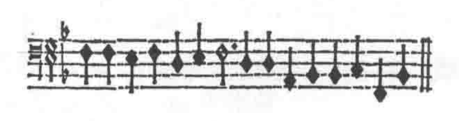

可以用恰好 $15!/(4!\,3!\,3!\,2!)=756756000$ 种方法进行重新排列.

一般规则 (3) 还出现在让·普雷斯提特的论文 [*Élémens des Mathématiques* (Paris: 1675), 351–352] 中, 它是西方世界对组合数学的最早讲解之一. 普雷斯提特正确地给出了一般多重集的规则, 但仅使用简单实例 $\{a,a,b,b,c,c\}$ 进行说明. 几年之后, 约翰·沃利斯更清晰, 也更为详尽地讨论了这一规则 [*Discourse of Combinations* (Oxford: 1685) 第 2 章 (与他的 *Treatise of Algebra* 一起出版)].

1965 年, 福阿塔介绍了一种名为 “插入积” 的巧妙思想, 从而有可能将许多有关普通排列的著名结果扩展到多重集排列的一般情形. [见 *Publ. Inst. Statistique*, 巴黎大学,**14** (1965), 81–241, 也见于 *Lecture Notes in Math.* **85** (Springer, 1969).] 假定一个多重集的元素可以采取某种方式进行线性排序, 考虑一种两行表示法, 例如:

$$
\begin{pmatrix}a&a&a&b&b&c&d&d&d&d\\c&a&b&d&d&a&b&d&a&d\end{pmatrix},\tag{4}
$$

其中, 上行包含了 $M$ 中按非降序排列的元素, 下行是排列本身. 两个多重集排列 $\alpha$ 与 $\beta$ 的插入积 $\alpha\mathbin{\top}\beta$ 可以通过以下步骤获得: (a) 用两行表示法表示 $\alpha$ 与 $\beta$, (b) 将这些由两行表示的内容并放在一起, (c) 对各列进行排序, 使上行成为非降序. 这个排序必须是 “稳定的”, 也就是说, 当上行对应元素相等时下行元素的左右顺序应得到保持. 例如, $c\,a\,d\,a\,b\mathbin{\top}b\,d\,d\,a\,d=c\,a\,b\,d\,d\,a\,b\,d\,a\,d$, 这是因为

$$
\begin{pmatrix}a&a&b&c&d\\c&a&d&a&b\end{pmatrix}
\mathbin{\top}\begin{pmatrix}a&b&d&d&d\\b&d&d&a&d\end{pmatrix}
=\begin{pmatrix}a&a&a&b&b&c&d&d&d&d\\c&a&b&d&d&a&b&d&a&d\end{pmatrix}.\tag{5}
$$

容易看出, 插入积是可结合的:

$$
(\alpha\mathbin{\top}\beta)\mathbin{\top}\gamma
=\alpha\mathbin{\top}(\beta\mathbin{\top}\gamma);\tag{6}
$$

它还满足两种消去律:

$$
\begin{aligned}
\pi\mathbin{\top}\alpha=\pi\mathbin{\top}\beta&\quad\text{蕴涵}\quad\alpha=\beta,\\
\alpha\mathbin{\top}\pi=\beta\mathbin{\top}\pi&\quad\text{蕴涵}\quad\alpha=\beta.
\end{aligned}\tag{7}
$$

存在一个单位元:

$$
\alpha\mathbin{\top}\epsilon=\epsilon\mathbin{\top}\alpha=\alpha,\tag{8}
$$

式中 $\epsilon$ 是空排列, 也就是空集的 “排法”. 一般情况下交换律不成立 (见习题 2), 但我们有

$$
\text{如果 }\alpha\text{ 和 }\beta\text{ 没有公共元素, 则 }
\alpha\mathbin{\top}\beta=\beta\mathbin{\top}\alpha.\tag{9}
$$

<a id="pdf-025"></a>
<a id="p-19"></a>

采用类似方式, 我们可以把排列的轮换概念扩展到有重复元素的情形. 设

$$
(x_1\quad x_2\quad\ldots\quad x_n)\tag{10}
$$

表示一种排列, 它是以稳定形式根据上行元素对

$$
\begin{pmatrix}x_1&x_2&\cdots&x_n\\x_2&x_3&\cdots&x_1\end{pmatrix}\tag{11}
$$

的各列进行排序所得到的两行形式. 例如, 我们有

$$
(d\,b\,d\,d\,a\,c\,a\,a\,b\,d)
=\begin{pmatrix}d&b&d&d&a&c&a&a&b&d\\b&d&d&a&c&a&a&b&d&d\end{pmatrix}
=\begin{pmatrix}a&a&a&b&b&c&d&d&d&d\\c&a&b&d&d&a&b&d&a&d\end{pmatrix},
$$

所以排列 (4) 实际上是一种轮换. 我们可以用语言来描述这一轮换, 比如说 “$d$ 变为 $b$, $b$ 变为 $d$, $d$ 变为 $d$, $d$ 变为……, 再变回 $d$”. 注意, 这些一般轮换并不具备普通轮换的所有性质, $(x_1x_2\ldots x_n)$ 并不总与 $(x_2\ldots x_nx_1)$ 相同.

我们在 1.3.3 节中观察到, 一个集合的每个排列都可以唯一地表示为不相交轮换的乘积 (考虑到顺序), 其中排列的 “乘积” 是由一种合成规则定义的. 容易看出, 不相交轮换的乘积与它们的插入积完全相同. 这意味着我们也许能够推广前面的结果, (以某种意义) 将一个多重集的任意排列唯一地表示为轮换的插入积. 事实上, 至少有两种很自然的方法可以做到这一点, 每一种方法都有其重要应用.

式 (5) 给出一种把 $c\,a\,b\,d\,d\,a\,b\,d\,a\,d$ 分解为更短排列的插入积的方法. 让我们考虑一个一般性问题: 找出一个给定排列 $\pi$ 的所有分解形式 $\pi=\alpha\mathbin{\top}\beta$. 在研究分解问题时, 考虑一个特定的排列会有所帮助, 比如

$$
\pi=\begin{pmatrix}
a&a&b&b&b&b&b&c&c&c&d&d&d&d&d\\
d&b&c&b&c&a&c&d&a&d&d&b&b&b&d
\end{pmatrix}.\tag{12}
$$

如果可以将这个排列 $\pi$ 写为 $\alpha\mathbin{\top}\beta$ 的形式, 其中 $\alpha$ 一定包含字母 $a$ (至少一次), 然后在 $\alpha$ 的两行表示法中, 上行最左边的 $a$ 必须出现在字母 $d$ 的上面, 所以 $\alpha$ 也必须至少包含一个字母 $d$. 现在观察 $\alpha$ 上行最左边的 $d$, 同样看到它也必须出现在字母 $d$ 的上方, 所以 $\alpha$ 必须包含至少两个 $d$. 观察第二个 $d$, 我们看到 $\alpha$ 也包含至少一个 $b$. 从而可以导出部分结果

$$
\alpha=\left(
\begin{matrix}a\\d\end{matrix}\;\cdots\;
\begin{matrix}b\\\vphantom{d}\end{matrix}\;\cdots\;
\begin{matrix}d&d\\d&b\end{matrix}\;\cdots
\right),\tag{13}
$$

唯一的假定是, $\alpha$ 是 $\pi$ 的一个左因子, $\alpha$ 中包含字母 $a$. 以同样方式继续处理, 我们发现式 (13) 上行中的 $b$ 必须出现在字母 $c$ 的上方, 以此类推. 最后, 这一过程将再次到达字母 $a$, 如果我们愿意, 可以将这个 $a$ 与第一个 $a$ 等同起来. 前面刚刚进行的论证实质上证明了: 式 (12) 的任何一个包含字母 $a$ 的左因子 $\alpha$ 都可以表示为 $(d\,d\,b\,c\,d\,b\,b\,c\,a)\mathbin{\top}\alpha'$ 的形式, 其中 $\alpha'$ 为某一排列. (将字母 $a$ 写在轮换的最后而非最开头比较方便. 由于仅有一个 $a$, 所以这种写法是允许的.) 类似地, 如果假定 $\alpha$ 包含字母 $b$, 可以推得对于某一 $\alpha''$ 有 $\alpha=(c\,d\,d\,b)\mathbin{\top}\alpha''$.

一般来说, 这一论证表明, 如果有任意分解 $\alpha\mathbin{\top}\beta=\pi$, 其中 $\alpha$ 包含一个给定字母 $y$, 则恰有轮换

$$
(x_1\ldots x_ny),\qquad n\ge0,\qquad x_1,\ldots,x_n\ne y,\tag{14}
$$

它是 $\alpha$ 的左因子. 在给定 $\pi$ 和 $y$ 时, 这一轮换很容易确定, 它是 $\pi$ 的含有字母 $y$ 最短左因子. 这一发现的推论之一就是下面的定理:

<a id="thm-5-1-2-A"></a>

**定理 A.** 设多重集 $M$ 的元素按关系 “$<$” 线性有序. $M$ 的每个排列 $\pi$ 可以唯一地表示为插入积

$$
\pi=(x_{11}\ldots x_{1n_1}y_1)\mathbin{\top}
(x_{21}\ldots x_{2n_2}y_2)\mathbin{\top}\cdots\mathbin{\top}
(x_{t1}\ldots x_{tn_t}y_t),\qquad t\ge0,\tag{15}
$$

并满足以下两个条件:

$$
y_1\le y_2\le\cdots\le y_t\quad\text{且}\quad
\text{对于 }1\le i\le t,\ 1\le j\le n_i\text{ 有 }y_i<x_{ij}.\tag{16}
$$

(换句话说, 每个轮换的最后一个元素都小于所有其他元素, 最后元素的序列为非降序的.)

<a id="pdf-026"></a>
<a id="p-20"></a>

证明. 如果 $\pi=\epsilon$, 令 $t=0$ 即可得到这一分解. 否则设 $y_1$ 是排列中的最小元素, 并像前面的示例中一样, 确定 $\pi$ 含 $y_1$ 的最短左因子 $(x_{11}\ldots x_{1n_1}y_1)$. 现在, $\pi=(x_{11}\ldots x_{1n_1}y_1)\mathbin{\top}\rho$, 其中 $\rho$ 为某一排列. 通过对长度进行归纳, 可以写出

$$
\rho=(x_{21}\ldots x_{2n_2}y_2)\mathbin{\top}\cdots\mathbin{\top}
(x_{t1}\ldots x_{tn_t}y_t),\qquad t\ge1,
$$

它满足条件 (16). 这就证明了这种分解的存在性.

反过来, 要证明 (15) 是满足条件 (16) 的唯一表示. 显然, 当且仅当 $\pi$ 为空排列 $\epsilon$ 时 $t=0$. 当 $t>0$ 时, 条件 (16) 表明 $y_1$ 是排列中的最小元素, $(x_{11}\ldots x_{1n_1}y_1)$ 是含 $y_1$ 的最短左因子. 因此 $(x_{11}\ldots x_{1n_1}y_1)$ 是唯一确定的. 由消去律 (7) 和归纳法可知, 这个表示是唯一的.　▮

例如, 如果 $a<b<c<d$, 则排列 (12) 满足给定条件的 “标准” 分解是

$$
(d\,d\,b\,c\,d\,b\,b\,c\,a)\mathbin{\top}(b\,a)\mathbin{\top}(c\,d\,b)\mathbin{\top}(d).\tag{17}
$$

值得注意的是, 实际上我们可以去掉这个表达式中的括号和 $\mathbin{\top}$, 而不会导致任何歧义! 每个轮换恰在剩下的最小元素首次出现后结束. 所以这个构造把排列

$$
\pi'=d\,d\,b\,c\,d\,b\,b\,c\,a\,b\,a\,c\,d\,b\,d
$$

与原排列

$$
\pi=d\,b\,c\,b\,c\,a\,c\,d\,a\,d\,d\,b\,b\,b\,d
$$

联系在一起. 只要 $\pi$ 的两行表示法中有一列的形式为 $\begin{smallmatrix}y\\x\end{smallmatrix}$ (其中 $x<y$), 相关联的排列 $\pi'$ 就有一个对应的相邻元素对 $\cdots yx\cdots$. 因此, 我们的示例排列 $\pi$ 有三个 $\begin{smallmatrix}d\\b\end{smallmatrix}$ 形式的列, $\pi'$ 中出现三次 $db$ 对. 一般来说, 这一构造给出了以下重要定理:

<a id="thm-5-1-2-B"></a>

**定理 B.** 设 $M$ 是一个多重集. 在 $M$ 的排列之间存在一种一一对应关系, 使得当 $\pi$ 对应于 $\pi'$ 时, 以下条件成立:

(a) $\pi'$ 最左边的元素等于 $\pi$ 最左边的元素;

(b) 对于满足 $x<y$ 的所有排列元素对 $(x,y)$, $\pi$ 的两行表示法中 $\begin{smallmatrix}y\\x\end{smallmatrix}$ 列出现的次数, 等于 $\pi'$ 中 $yx$ 对出现的次数.　▮

当 $M$ 是一个集合时, 这基本上等同于我们在 1.3.3 节接近结尾时讨论的 “不寻常对应”, 只是进行了一些不重要的修改. 定理 B 中的更一般结果对于枚举特殊类型的排列十分有用, 这是因为求解一个基于两行约束条件的问题, 经常要比求解一个基于相邻对约束条件的等价问题容易.

麦克马洪在他的非凡著作 [*Combinatory Analysis* **1**(剑桥大学出版社, 1915 年), 168–186] 中考虑了这种类型的问题. 他在一种特殊情况下给出了定理 B 的构造性证明, 这一特例就是 $M$ 仅包含两种不同类型的元素 (比如说 $a$ 和 $b$). 他为这一特例提供的构造本质上与这里给出的构造方式相同, 只是他的表述方式有很大不同. 对于有三种不同元素 $a,b,c$ 的情形, 麦克马洪给出了定理 B 的一种复杂的非构造性证明. 福阿塔最早给出一般情形的构造性证明 [*Comptes Rendus Acad. Sci.* **258** (Paris, 1964), 1672–1675].

作为定理 B 的一个重要例子, 我们来求出在由字母 $a,b,c$ 组成的字符串中, 有多少个字符串恰好含有

$$
\begin{aligned}
A&\quad\text{个字母 }a; &k&\quad\text{个相邻字母对 }ca;\\
B&\quad\text{个字母 }b; &l&\quad\text{个相邻字母对 }cb;\\
C&\quad\text{个字母 }c; &m&\quad\text{个相邻字母对 }ba.
\end{aligned}\tag{18}
$$

<a id="pdf-027"></a>
<a id="p-21"></a>

定理告诉我们, 这一数目与以下形式的两行阵列的数目相同:

$$
\underbrace{
 \underbrace{
  \biggl(
  \underbrace{\overbrace{\begin{matrix}a&\cdots&a\\\sqcup&\cdots&\sqcup\end{matrix}}^{A}}_{A-k-m\text{ 个 }a}
  \quad
  \underbrace{\overbrace{\begin{matrix}b&\cdots&b\\\sqcup&\cdots&\sqcup\end{matrix}}^{B}}_{m\text{ 个 }a}
 }_{B-l\text{ 个 }b}
 \quad
 \underbrace{
  \underbrace{\overbrace{\begin{matrix}c&\cdots&c\\\sqcup&\cdots&\sqcup\end{matrix}}^{C}}_{k\text{ 个 }a}
  \biggr)
 }_{l\text{ 个 }b}
}_{C\text{ 个 }c}.\tag{19}
$$

这些 $a$ 在第二行的放置方式有

$$
\binom A{A-k-m}\binom Bm\binom Ck
$$

种, 然后在第二行剩余位置中这些 $b$ 可以进行放置的方式有

$$
\binom{B+k}{B-l}\binom{C-k}l
$$

种, 仍然为空的位置必须用 $c$ 填充. 因此所求的数目为

$$
\binom A{A-k-m}\binom Bm\binom Ck\binom{B+k}{B-l}\binom{C-k}l.\tag{20}
$$

让我们回到求出一个给定排列所有分解方式的问题. 是否存在这样一种 “素” 排列, 除了它自己和 $\epsilon$ 之外, 没有其他插入积因子? 定理 A 之前的讨论可以让我们快速得出结论: 当且仅当一个排列是没有重复元素的轮换时, 它是一个素排列. 因为, 如果它是这样一种轮换, 我们的论证证明了除了 $\epsilon$ 和轮换本身之外没有左因子. 如果一个排列包含有重复元素 $y$, 它就拥有一个非平凡的轮换左因子, $y$ 在其中仅出现一次.

一个非素的排列可以分解为越来越小的片段, 直到它已表示为素排列的乘积为止. 此外我们还可以证明: 如果忽略因子的交换顺序, 这种分解是唯一的.

<a id="thm-5-1-2-C"></a>

**定理 C.** 一个多重集的每个排列都可以写为乘积形式, 即

$$
\sigma_1\mathbin{\top}\sigma_2\mathbin{\top}\cdots\mathbin{\top}\sigma_t,
\qquad t\ge0,\tag{21}
$$

其中每个 $\sigma_j$ 都是一个没有重复元素的轮换. 在如下意义下这一表示是唯一的, 同一排列的任何两个此类表示可以通过逐次交换相邻的不相交轮换对互相转换.

术语 “不相交轮换” 是指没有公共元素的轮换. 作为该定理的一个例子, 我们可验证排列

$$
\begin{pmatrix}a&a&b&b&c&c&d\\b&a&a&c&d&b&c\end{pmatrix}
$$

恰有五种素排列分解方式, 即

$$
\begin{aligned}
(a\,b)\mathbin{\top}(a)\mathbin{\top}(c\,d)\mathbin{\top}(b\,c)
&=(a\,b)\mathbin{\top}(c\,d)\mathbin{\top}(a)\mathbin{\top}(b\,c)\\
&=(a\,b)\mathbin{\top}(c\,d)\mathbin{\top}(b\,c)\mathbin{\top}(a)\\
&=(c\,d)\mathbin{\top}(a\,b)\mathbin{\top}(b\,c)\mathbin{\top}(a)\\
&=(c\,d)\mathbin{\top}(a\,b)\mathbin{\top}(a)\mathbin{\top}(b\,c).
\end{aligned}\tag{22}
$$

<a id="pdf-028"></a>
<a id="p-22"></a>

证明. 我们必须证明前面所说的唯一性成立. 对排列的长度应用归纳法, 只需证明: 如果 $\rho$ 和 $\sigma$ 是没有重复元素的不相同轮换, 且如果

$$
\rho\mathbin{\top}\alpha=\sigma\mathbin{\top}\beta,
$$

则 $\rho$ 和 $\sigma$ 是不相交的, 且对于某一排列 $\theta$, 有

$$
\alpha=\sigma\mathbin{\top}\theta,\qquad\beta=\rho\mathbin{\top}\theta.
$$

如果 $y$ 是轮换 $\rho$ 的任意元素, 那么 $\sigma\mathbin{\top}\beta$ 的任何一个包含元素 $y$ 的左因子都必然包含 $\rho$ 为其左因子. 所以如果 $\rho$ 和 $\sigma$ 有公共元素, 则 $\sigma$ 是 $\rho$ 的倍数. 因此 $\sigma=\rho$ (因为它们是素排列), 这与我们的假设矛盾. 故包含 $y$ 且与 $\sigma$ 没有公共元素的轮换必然是 $\beta$ 的左因子. 利用消去律 (7) 即可完成证明.　▮

作为定理 C 的一个例子, 我们考虑由 $A$ 个 $a$、$B$ 个 $b$ 和 $C$ 个 $c$ 组成的多重集 $M=\{A\cdot a,B\cdot b,C\cdot c\}$ 的排列. 设 $N(A,B,C,m)$ 是 $M$ 的排列中符合以下条件的排列数目: 其两行表示中没有 $\begin{smallmatrix}a\\a\end{smallmatrix}$、$\begin{smallmatrix}b\\b\end{smallmatrix}$、$\begin{smallmatrix}c\\c\end{smallmatrix}$ 形式的列, 而恰有 $m$ 个 $\begin{smallmatrix}a\\b\end{smallmatrix}$ 形式的列. 由此得出, 恰有 $A-m$ 个 $\begin{smallmatrix}a\\c\end{smallmatrix}$ 形式的列、$B-m$ 个 $\begin{smallmatrix}c\\b\end{smallmatrix}$ 形式的列、$C-B+m$ 个 $\begin{smallmatrix}c\\a\end{smallmatrix}$ 形式的列、$C-A+m$ 个 $\begin{smallmatrix}b\\c\end{smallmatrix}$ 形式的列、$A+B-C-m$ 个 $\begin{smallmatrix}b\\a\end{smallmatrix}$ 形式的列. 因此

$$
N(A,B,C,m)=\binom Am\binom B{C-A+m}\binom C{B-m}.\tag{23}
$$

定理 C 告诉我们, 可以用另一种方法来计算这些排列的个数: 由于排除了 $\begin{smallmatrix}a\\a\end{smallmatrix}$、$\begin{smallmatrix}b\\b\end{smallmatrix}$、$\begin{smallmatrix}c\\c\end{smallmatrix}$ 形式的列, 所以排列中可能存在的素因子只有

$$
(a\,b),\quad(a\,c),\quad(b\,c),\quad(a\,b\,c),\quad(a\,c\,b).\tag{24}
$$

这些轮换中的每一对都至少有一个公共字符, 所以分解为素因子的方式是完全唯一的. 如果轮换 $(a\,b\,c)$ 在分解中出现 $k$ 次, 前面的假设意味着 $(a\,b)$ 出现 $m-k$ 次, $(b\,c)$ 出现 $C-A+m-k$ 次, $(a\,c)$ 出现 $C-B+m-k$ 次, $(a\,c\,b)$ 出现 $A+B-C-2m+k$ 次. 因此, $N(A,B,C,m)$ 是这些轮换的排列数目 (多项式系数) 对 $k$ 求和:

$$
\begin{aligned}
N(A,B,C,m)
&=\sum_k\frac{(C+m-k)!}{(m-k)!(C-A+m-k)!(C-B+m-k)!k!(A+B-C-2m+k)!}\\
&=\sum_k\binom mk\binom Am\binom{A-m}{C-B+m-k}\binom{C+m-k}A.
\end{aligned}\tag{25}
$$

将此式与式 (23) 对比, 发现以下恒等式必然成立:

$$
\sum_k\binom mk\binom{A-m}{C-B+m-k}\binom{C+m-k}A
=\binom B{C-A+m}\binom C{B-m}.\tag{26}
$$

这就是我们在习题 1.2.6–31 中遇到的恒等式, 即

$$
\sum_j\binom{M-R+S}j\binom{N+R-S}{N-j}\binom{R+j}{M+N}
=\binom RM\binom SN,\tag{27}
$$

其中 $M=A+B-C-m$、$N=C-B+m$、$R=B$、$S=C$、$j=C-B+m-k$.

<a id="pdf-029"></a>
<a id="p-23"></a>

类似地, 我们可以计算 $\{A\cdot a,B\cdot b,C\cdot c,D\cdot d\}$ 的排列数目, 使得其中各种类型的列的数目为如下指定值 (式中 $A+C=B+D$)

$$
\begin{array}{c|cccccccc}
\text{列的类型:}&\begin{smallmatrix}a\\d\end{smallmatrix}&\begin{smallmatrix}a\\b\end{smallmatrix}&\begin{smallmatrix}b\\a\end{smallmatrix}&\begin{smallmatrix}b\\c\end{smallmatrix}&\begin{smallmatrix}c\\b\end{smallmatrix}&\begin{smallmatrix}c\\d\end{smallmatrix}&\begin{smallmatrix}d\\a\end{smallmatrix}&\begin{smallmatrix}d\\c\end{smallmatrix}\\
\text{频率:}&r&A-r&q&B-q&B-A+r&D-r&A-q&D-A+q
\end{array}\tag{28}
$$

于是对于某一 $s$ 此类排列的素因子分解中可能出现的轮换为 (见习题 12)

$$
\begin{array}{c|cccccc}
\text{轮换:}&(a\,b)&(b\,c)&(c\,d)&(d\,a)&(a\,b\,c\,d)&(d\,c\,b\,a)\\
\text{频率:}&A-r-s&B-q-s&D-r-s&A-q-s&s&q-A+r+s
\end{array}\tag{29}
$$

在这种情况下, 轮换 $(a\,b)$ 和 $(c\,d)$ 可相互交换, $(b\,c)$ 和 $(d\,a)$ 可相互交换, 所以必须计算不同素因子分解的数目. 可以证明 (见习题 10): 总是存在唯一的因子分解, 使得 $(c\,d)$ 之后不会紧跟着 $(a\,b)$, 且 $(d\,a)$ 之后也不会紧跟着 $(b\,c)$. 因此, 利用习题 13 的结论, 我们有

$$
\begin{aligned}
&\sum_{s,t}\binom Bt\binom{A-q-s}{A-r-s-t}\binom{B+D-r-s-t}{B-q-s}\\
&\qquad\times\frac{D!}{(D-r-s)!(A-q-s)!s!(q-A+r+s)!}\\
&\qquad=\binom Ar\binom{B+D-A}{D-r}\binom Bq\binom D{A-q}.
\end{aligned}
$$

从两端去掉因子 $\binom D{A-q}$ 并略微化简阶乘, 将会得到一个颇显复杂的五参数恒等式

$$
\begin{aligned}
&\sum_{s,t}\binom Bt\binom{A-r-t}s\binom{B+D-r-s-t}{D+q-r-t}\binom{D-A+q}{D-r-s}\binom{A-q}{r+t-q}\\
&\qquad=\binom Ar\binom{B+D-A}{D-r}\binom Bq.
\end{aligned}\tag{30}
$$

可利用式 (27) 对 $s$ 求和, 对 $t$ 求和也容易计算. 在完成所有这些工作之后, 我们未能有幸发现任何一个还不知道如何推导的恒等式. 但至少学习了如何用两种不同方式来计算特定类型排列的个数, 这些计数技巧对后面的问题来说是很好的训练.

### 习题

<a id="ex-5-1-2-1"></a>

**1.** [M05] 判断正误: 设 $M_1$ 和 $M_2$ 是多重集. 如果 $\alpha$ 是 $M_1$ 的一个排列, $\beta$ 是 $M_2$ 的一个排列, 则 $\alpha\mathbin{\top}\beta$ 是 $M_1\cup M_2$ 的一个排列.　[答案](#ans-5-1-2-1)

<a id="ex-5-1-2-2"></a>

**2.** [10] 式 (5) 计算了 $c\,a\,d\,a\,b$ 和 $b\,d\,d\,a\,d$ 的插入积. 交换这两个因子, 试求插入积 $b\,d\,d\,a\,d\mathbin{\top}c\,a\,d\,a\,b$.　[答案](#ans-5-1-2-2)

<a id="ex-5-1-2-3"></a>

**3.** [M13] 式 (9) 的逆成立否? 换句话说, 如果 $\alpha$ 和 $\beta$ 在插入积中可交换, 它们是否必须没有公共元素?　[答案](#ans-5-1-2-3)

<a id="ex-5-1-2-4"></a>

**4.** [M11] 如果 $a<b<c<d$, 根据定理 A, 排列 (12) 的标准分解是式 (17). 试求 $d<c<b<a$ 时相应的标准分解.　[答案](#ans-5-1-2-4)

<a id="ex-5-1-2-5"></a>

**5.** [M23] 定理 B 的条件 (b) 要求 $x<y$, 如果把这个条件减弱为 $x\le y$, 会发生什么?　[答案](#ans-5-1-2-5)

<a id="ex-5-1-2-6"></a>

**6.** [M15] 有多少个这样的字符串: 恰好包含 $m$ 个 $a$、$n$ 个 $b$, 不包含其他字母, 而且恰有 $k$ 个 $a$ 前面是 $b$ 与其直接相邻.　[答案](#ans-5-1-2-6)

<a id="ex-5-1-2-7"></a>

**7.** [M21] 由字母 $a,b,c$ 组成, 满足条件 (18) 且以字母 $a$ 开头的字符串有多少个? 以字母 $b$ 开头的呢? 以字母 $c$ 开头的呢?　[答案](#ans-5-1-2-7)

<a id="ex-5-1-2-8"></a>

**8.** ▶ [20] 试求把 (12) 分解为两个因子 $\alpha\mathbin{\top}\beta$ 的所有方式.　[答案](#ans-5-1-2-8)

<a id="ex-5-1-2-9"></a>

**9.** [33] 编写计算机程序, 把一个给定多重集排列分解为定理 A 和定理 C 中提到的形式.

<a id="pdf-030"></a>
<a id="p-24"></a>

<a id="ex-5-1-2-10"></a>

**10.** ▶ [M30] 判断正误: 尽管根据定理 C, 素因子分解并非真正唯一, 但可以通过以下方式确保唯一性: “素排列集合存在线性顺序 $\preceq$, 使每个多重集的每个排列都有满足以下条件的唯一素因子分解 $\sigma_1\mathbin{\top}\sigma_2\mathbin{\top}\cdots\mathbin{\top}\sigma_n$: 对于 $1\le i<n$, 当 $\sigma_i$ 与 $\sigma_{i+1}$ 可交换时, $\sigma_i\preceq\sigma_{i+1}$.”　[答案](#ans-5-1-2-10)

<a id="ex-5-1-2-11"></a>

**11.** ▶ [M26] 设 $\sigma_1,\sigma_2,\ldots,\sigma_t$ 是没有重复元素的轮换. 定义 $t$ 个对象 $\{x_1,\ldots,x_t\}$ 上的偏序 $\prec$: 如果 $i<j$ 且 $\sigma_i$ 与 $\sigma_j$ 至少有一个公共字符, 则说 $x_i\prec x_j$. 证明定理 C 与 “拓扑排序”(2.2.3 节) 的概念之间存在以下联系: $\sigma_1\mathbin{\top}\sigma_2\mathbin{\top}\cdots\mathbin{\top}\sigma_t$ 的不同素因子分解数目就是对给定偏序进行拓扑排序的方式数. (例如, 与 (22) 对应, 可以找出五种方式对 $x_1\prec x_2,x_3\prec x_4,x_1\prec x_4$ 进行拓扑排序.) 反之, 给定 $t$ 个元素的任意偏序, 存在一个由所述方式定义的轮换集合 $\{\sigma_1,\sigma_2,\ldots,\sigma_t\}$.　[答案](#ans-5-1-2-11)

<a id="ex-5-1-2-12"></a>

**12.** [M16] 证明: (29) 是 (28) 中假设的推论.　[答案](#ans-5-1-2-12)

<a id="ex-5-1-2-13"></a>

**13.** [M21] 证明: 多重集　[答案](#ans-5-1-2-13)

$$
\{A\cdot a,B\cdot b,C\cdot c,D\cdot d,E\cdot e,F\cdot f\}
$$

的排列中, 不包含相邻字母对 $ca$ 和 $db$ 的排列的数目是

$$
\sum_t\binom D{A-t}\binom{A+B+E+F}t\binom{A+B+C+E+F-t}B\binom{C+D+E+F}{C,D,E,F}.
$$

<a id="ex-5-1-2-14"></a>

**14.** [M30] 根据本节其他定义的提示, 有一种方法可以确定一般排列 $\pi$ 的逆排列 $\pi^-$: 交换 $\pi$ 的两行表示中的上下行, 然后对各列进行稳定排序, 将顶行变为非降序. 例如, 如果 $a<b<c<d$, 则这一定义意味着 $c\,a\,b\,d\,d\,a\,b\,d\,a\,d$ 的逆排列是 $a\,c\,d\,a\,d\,a\,b\,b\,d\,d$.　[答案](#ans-5-1-2-14)

探讨这个求逆操作的性质. 例如, 它与插入积之间是否有任何简单关系? 能否计算满足 $\pi=\pi^-$ 的排列数目?

<a id="ex-5-1-2-15"></a>

**15.** ▶ [M25] 设 $a_1\ldots a_n$ 是多重集　[答案](#ans-5-1-2-15)

$$
\{n_1\cdot x_1,n_2\cdot x_2,\ldots,n_m\cdot x_m\}
$$

的一个排列, 其中 $x_1<x_2<\cdots<x_m$, $n_1+n_2+\cdots+n_m=n$. 证明: 排列 $a_1\ldots a_n$ 是一个轮换的充分必要条件是: 拥有顶点 $\{x_1,x_2,\ldots,x_m\}$ 和由 $x_j$ 至 $a_{n_1+\cdots+n_j}$ 的弧的有向图恰有一条有向回路. 在后一种情况下, 把排列表示为轮换形式的方式数就是该有向回路的长度. 例如, 对应于

$$
\begin{pmatrix}a&a&a&b&b&c&c&c&d&d\\d&c&b&a&c&a&a&b&d&c\end{pmatrix}
$$

的有向图是

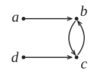

把这个排列表示为轮换的两种方式是 $(b\,a\,d\,d\,c\,a\,c\,a\,b\,c)$ 和 $(c\,a\,d\,d\,c\,a\,c\,b\,a\,b)$.

<a id="ex-5-1-2-16"></a>

**16.** [M35] 在上一节, 我们在对集合进行排列的特殊情况下给出了排列的反序的生成函数, 即公式 5.1.1–(8). 证明: 在一般情况下, 如果对多重集进行排列, $\{n_1\cdot x_1,n_2\cdot x_2,\ldots\}$ 的反序的生成函数是 “$z$-多项式系数”　[答案](#ans-5-1-2-16)

$$
\binom n{n_1,n_2,\ldots}_z=\frac{n!_z}{n_1!_z\,n_2!_z\cdots},
\qquad\text{其中 }m!_z=\prod_{k=1}^m(1+z+\cdots+z^{k-1}).
$$

[同式 (3) 以及式 1.2.6–(40) 中的 “$z$ 项式系数” 定义比较.]

<a id="ex-5-1-2-17"></a>

**17.** [M24] 利用习题 16 建立的生成函数, 计算给定多重集的随机排列的反序数目的均值和标准差.　[答案](#ans-5-1-2-17)

<a id="ex-5-1-2-18"></a>

**18.** [M30] (麦克马洪) 上一节定义了排列 $a_1a_2\ldots a_n$ 的指数. 我们证明了: 对于一个给定集合, 具有给定指数 $k$ 的排列的数目与具有 $k$ 个反序的排列的数目相同. 对于给定多重集的排列, 同样的结果是否成立?　[答案](#ans-5-1-2-18)

<a id="ex-5-1-2-19"></a>

**19.** [HM28] 定义排列 $\pi$ 的莫比乌斯函数 $\mu(\pi)$ 如下: 如果 $\pi$ 包含重复元素, 则函数值为 0, 否则, 如果 $\pi$ 是 $k$ 个素因子的乘积, 则函数值为 $(-1)^k$. (与习题 4.5.2–10 中的普通莫比乌斯函数定义比较.)　[答案](#ans-5-1-2-19)

(a) 证明: 如果 $\pi\ne\epsilon$, 对 $\pi$ 的所有左因子 $\lambda$ (即存在某个 $\rho$ 使得 $\pi=\lambda\mathbin{\top}\rho$) 求和, 可得

$$
\sum\mu(\lambda)=0.
$$

<a id="pdf-031"></a>
<a id="p-25"></a>

(b) 给定 $x_1<x_2<\cdots<x_m$ 和 $\pi=x_{i_1}x_{i_2}\ldots x_{i_n}$, 其中 $1\le i_k\le m$($1\le k\le n$), 证明:

$$
\mu(\pi)=(-1)^n\epsilon(i_1i_2\ldots i_n),
\qquad\text{其中 }\epsilon(i_1i_2\ldots i_n)=\operatorname{sign}\prod_{1\le j<k\le n}(i_k-i_j).
$$

<a id="ex-5-1-2-20"></a>

**20.** ▶ [HM33] (福阿塔) 设 $(a_{ij})$ 是任意实数矩阵. 采用习题 19(b) 的记号, 定义 $\nu(\pi)=a_{i_1j_1}\ldots a_{i_nj_n}$, 其中 $\pi$ 的两行表示法是　[答案](#ans-5-1-2-20)

$$
\begin{pmatrix}x_{i_1}&x_{i_2}&\cdots&x_{i_n}\\x_{j_1}&x_{j_2}&\cdots&x_{j_n}\end{pmatrix}.
$$

这个函数对于计算多重集排列的生成函数非常有用, 因为对多重集

$$
\{n_1\cdot x_1,\ldots,n_m\cdot x_m\}
$$

的所有排列 $\pi$ 求和的 $\sum\nu(\pi)$, 就是满足特定约束条件的排列数的生成函数. 例如, 如果当 $i=j$ 时取 $a_{ij}=z$, 当 $i\ne j$ 时取 $a_{ij}=1$, 则 $\sum\nu(\pi)$ 是 “不动点” (即顶行元素与底行元素相等的列) 个数的生成函数. 为了同时研究所有多重集的 $\sum\nu(\pi)$, 考虑函数

$$
G=\sum\pi\nu(\pi),
$$

它对所有 $\pi$ 求和, $\pi$ 是包含元素 $x_1,\ldots,x_m$ 的多重集排列, $\pi$ 组成的集合记为 $\{x_1,\ldots,x_m\}^*$. 我们来研究 $G$ 中 $x_1^{n_1}\ldots x_m^{n_m}$ 的系数.

在 $G$ 的这个公式中, 我们把 $\pi$ 看作是诸 $x$ 的乘积. 例如, 当 $m=2$ 时我们有

$$
\begin{aligned}
G={}&1+x_1\nu(x_1)+x_2\nu(x_2)+x_1x_1\nu(x_1x_1)+x_1x_2\nu(x_1x_2)+x_2x_1\nu(x_2x_1)+x_2x_2\nu(x_2x_2)+\cdots\\
={}&1+x_1a_{11}+x_2a_{22}+x_1^2a_{11}^2+x_1x_2a_{11}a_{22}+x_1x_2a_{21}a_{12}+x_2^2a_{22}^2+\cdots.
\end{aligned}
$$

于是, $G$ 中 $x_1^{n_1}\ldots x_m^{n_m}$ 的系数就是对 $\{n_1\cdot x_1,\ldots,n_m\cdot x_m\}$ 的所有排列 $\pi$ 求和的 $\sum\nu(\pi)$. 不难看出, 这个系数也是表达式

$$
(a_{11}x_1+\cdots+a_{1m}x_m)^{n_1}(a_{21}x_1+\cdots+a_{2m}x_m)^{n_2}\cdots(a_{m1}x_1+\cdots+a_{mm}x_m)^{n_m}
$$

中 $x_1^{n_1}\ldots x_m^{n_m}$ 的系数.

这个习题的目的是证明麦克马洪在他的 [*Combinatory Analysis* **1** (1915)] 第 3 节介绍的 “主要定理”, 即公式

$$
G=1/D,\qquad\text{其中 }D=\det\begin{pmatrix}
1-a_{11}x_1&-a_{12}x_2&\cdots&-a_{1m}x_m\\
-a_{21}x_1&1-a_{22}x_2&&-a_{2m}x_m\\
\vdots&&&\vdots\\
-a_{m1}x_1&-a_{m2}x_2&\cdots&1-a_{mm}x_m
\end{pmatrix}.
$$

例如, 如果对于所有 $i$ 和 $j$ 有 $a_{ij}=1$, 则这个公式给出

$$
G=1/(1-(x_1+x_2+\cdots+x_m)),
$$

正如预期, $x_1^{n_1}\ldots x_m^{n_m}$ 的系数将等于 $(n_1+\cdots+n_m)!/n_1!\cdots n_m!$. 为了证明 “主要定理”, 需要证明

(a) $\nu(\pi\mathbin{\top}\rho)=\nu(\pi)\nu(\rho)$;

(b) $D=\sum\pi\mu(\pi)\nu(\pi)$, 采用习题 19 的记号, 对 $\{x_1,\ldots,x_m\}^*$ 中的所有排列 $\pi$ 求和;

(c) 从而得出 $D\cdot G=1$.

<a id="ex-5-1-2-21"></a>

**21.** [M21] 给定 $n_1,\ldots,n_m$, 且 $d\ge0$, 对于 $1\le j<n=n_1+\cdots+n_m$, 多重集 $\{n_1\cdot1,\ldots,n_m\cdot m\}$ 的排列 $a_1a_2\ldots a_n$ 中有多少满足 $a_{j+1}\ge a_j-d$?　[答案](#ans-5-1-2-21)


<a id="pdf-032"></a>
<a id="p-26"></a>

<a id="ex-5-1-2-22"></a>

**22.** [M30] 设 $P(x_1^{n_1}\ldots x_m^{n_m})$ 表示多重集 $\{n_1\cdot x_1,\ldots,n_m\cdot x_m\}$ 的所有排列组成的集合, 并设 $P_0(x_0^{n_0}x_1^{n_1}\ldots x_m^{n_m})$ 是 $P(x_0^{n_0}x_1^{n_1}\ldots x_m^{n_m})$ 的子集, 其中前 $n_0$ 个元素 $\ne x_0$.　[答案](#ans-5-1-2-22)

(a) 给定一个数 $t$($1\le t<m$), 对某个 $p\ge0$, 分别从 $P_0(0^p1^{n_1}\ldots t^{n_t})$ 和 $P_0(0^p(t+1)^{n_{t+1}}\ldots m^{n_m})$ 中取出一个排列, 组成有序排列对, 求 $P(1^{n_1}\ldots m^{n_m})$ 与由所有此类排列对组成的集合之间的一一对应关系. [提示: 对于每个 $\pi=a_1\ldots a_n\in P(1^{n_1}\ldots m^{n_m})$, 设 $l(\pi)$ 是通过以下方式获得的排列: 用 0 替换 $t+1,\ldots,m$, 并删除最后 $n_{t+1}+\cdots+n_m$ 个位置中的所有 0; 类似地, 设 $r(\pi)$ 是通过以下方式获得的排列: 用 0 替换 $1,\ldots,t$, 并删除前 $n_1+\cdots+n_t$ 个位置中的所有 0.]


(b) $P_0(0^{n_0}1^{n_1}\ldots m^{n_m})$ 中的一些排列, 其两行表示拥有 $p_j$ 个 $\begin{smallmatrix}0\\j\end{smallmatrix}$ 列和 $q_j$ 个 $\begin{smallmatrix}j\\0\end{smallmatrix}$ 列, 证明: 这种排列的个数是

$$
\frac{|P(x_1^{p_1}\ldots x_m^{p_m}y_1^{n_1-p_1}\ldots y_m^{n_m-p_m})|\,|P(x_1^{q_1}\ldots x_m^{q_m}y_1^{n_1-q_1}\ldots y_m^{n_m-q_m})|}{|P_0(0^{n_0}1^{n_1}\ldots m^{n_m})|}.
$$

(c) 设 $w_1,\ldots,w_m,z_1,\ldots,z_m$ 是单位圆上的复数. 把一个排列 $\pi\in P(1^{n_1}\ldots m^{n_m})$ 的权 $w(\pi)$ 定义为它的两行形式中各列的权的乘积, 其中, 如果 $j$ 和 $k$ 都 $\le t$ 或都 $>t$, 则 $\begin{smallmatrix}j\\k\end{smallmatrix}$ 列的权为 $w_j/w_k$, 否则为 $z_j/z_k$. 证明: 对所有 $\pi\in P(1^{n_1}\ldots m^{n_m})$, $w(\pi)$ 的和是

$$
\sum_{p\ge0}\frac{p!^2(n_{\le t}-p)!(n_{>t}-p)!}{n_1!\cdots n_m!}
\left|\sum\binom{n_1}{p_1}\cdots\binom{n_m}{p_m}\left(\frac{w_1}{z_1}\right)^{p_1}\cdots\left(\frac{w_m}{z_m}\right)^{p_m}\right|^2,
$$

式中, $n_{\le t}$ 是 $n_1+\cdots+n_t$, $n_{>t}$ 是 $n_{t+1}+\cdots+n_m$, 内层求和针对所有满足 $p_{\le t}=p_{>t}=p$ 的 $(p_1,\ldots,p_m)$ 进行.

<a id="ex-5-1-2-23"></a>

**23.** [M23] 我们可以把一段 DNA 看作一个单词, 各个字母选自共有四个字母的字母表. 现在复制一段 DNA, 完全分解为单字母基, 然后随机重新组合它们. 如果把得到的 DNA 段与原 DNA 段并排比较, 计算具有不同字母的位置个数, 证明: 这个数值取偶数的概率大于取奇数的概率. [提示: 应用上题的结果.]　[答案](#ans-5-1-2-23)

<a id="ex-5-1-2-24"></a>

**24.** [27] 考虑在两个无序字母对之间可能成立的任意关系 $R$. 如果 $\{w,x\}R\{y,z\}$, 我们说 $\{w,x\}$ 保持 $\{y,z\}$, 否则说 $\{w,x\}$ 移动 $\{y,z\}$.　[答案](#ans-5-1-2-24)

关于 $R$ 转置 $\begin{smallmatrix}w&x\\y&z\end{smallmatrix}$ 是指: 如果 $w\ne x$ 且 $y\ne z$, 按照 $\{w,x\}$ 保持还是移动 $\{y,z\}$, 用 $\begin{smallmatrix}x&w\\y&z\end{smallmatrix}$ 或者 $\begin{smallmatrix}x&w\\z&y\end{smallmatrix}$ 代替 $\begin{smallmatrix}w&x\\y&z\end{smallmatrix}$; 如果 $w=x$ 或 $y=z$, 则此转置操作总是给出 $\begin{smallmatrix}x&w\\z&y\end{smallmatrix}$.

关于 $R$ 对两行阵列 $\begin{pmatrix}x_1&\cdots&x_n\\y_1&\cdots&y_n\end{pmatrix}$ 的排序操作是指: 重复找出使得 $x_j>x_{j+1}$ 的最大 $j$, 并转置第 $j$、$j+1$ 列, 直到最终实现 $x_1\le\cdots\le x_n$. (不要求 $y_1\ldots y_n$ 是 $x_1\ldots x_n$ 的排列.)

(a) 给定 $\begin{pmatrix}x_1&\cdots&x_n\\y_1&\cdots&y_n\end{pmatrix}$, 证明对于每个 $x\in\{x_1,\ldots,x_n\}$, 存在唯一的 $y\in\{y_1,\ldots,y_n\}$, 使得对于某一 $x'_2,y'_2,\ldots,x'_n,y'_n$,

$$
\operatorname{排序}\begin{pmatrix}x_1&\cdots&x_n\\y_1&\cdots&y_n\end{pmatrix}
=\operatorname{排序}\begin{pmatrix}x&x'_2&\cdots&x'_n\\y&y'_2&\cdots&y'_n\end{pmatrix}.
$$

(b) 设 $\begin{pmatrix}w_1&\cdots&w_k\\y_1&\cdots&y_k\end{pmatrix}\mathbin{\circledR}\begin{pmatrix}x_1&\cdots&x_l\\z_1&\cdots&z_l\end{pmatrix}$ 表示关于 $R$ 对 $\begin{pmatrix}w_1&\cdots&w_k&x_1&\cdots&x_l\\y_1&\cdots&y_k&z_1&\cdots&z_l\end{pmatrix}$ 排序的结果. 例如, 如果 $R$ 总是为真, 则 $\circledR$ 排序 $\{w_1,\ldots,w_k,x_1,\ldots,x_l\}$ 就是简单地并列放置 $y_1\ldots y_k$ 和 $z_1\ldots z_l$; 如果 $R$ 总为假, 则 $\circledR$ 就是插入积. 如果我们重新定义轮换表示法, 令 (11) 表示 $(x_2\ldots x_nx_1)$ 而不是 $(x_1x_2\ldots x_n)$, 证明一个多重集 $M$ 的每个排列 $\pi$ 都具有满足条件 (16) 的形如

$$
\pi=(x_{11}\ldots x_{1n_1}y_1)\mathbin{\circledR}
\bigl((x_{21}\ldots x_{2n_2}y_2)\mathbin{\circledR}
(\cdots\mathbin{\circledR}(x_{t1}\ldots x_{tn_t}y_t)\cdots)\bigr)
$$

的唯一表示, 这是对定理 A 的推广. 例如, 假定 $\{w,x\}R\{y,z\}$ 意味着 $w,x,y,z$ 互不相同, 则类似于式 (17), 式 (12) 的因子分解是

$$
(d\,d\,b\,c\,a)\mathbin{\circledR}\bigl((c\,b\,b\,a)\mathbin{\circledR}\bigl((c\,d\,b)\mathbin{\circledR}\bigl((d\,b)\mathbin{\circledR}(d)\bigr)\bigr)\bigr).
$$

(操作 $\circledR$ 并不一定总是遵守结合律, 广义因子分解中的括号应当从右向左嵌套.)

<a id="sec-5-1-3"></a>

### *5.1.3　游程

第 3 章中分析了排列中递增游程的长度, 作为一种判断序列随机性的方式. 如果在一个排列 $a_1a_2\ldots a_n$ 的两端各放置一条竖线, 并在所有满足 $a_j>a_{j+1}$ 的 $a_j$ 和 $a_{j+1}$ 之间放置一条竖线, 一对竖线之间的片段就称为游程. 例如, 排列

$$
\mid3\;5\;7\mid1\;6\;8\;9\mid4\mid2\mid
$$

有四个游程. 3.3.2G 节推导的理论确定了在 $\{1,2,\ldots,n\}$ 的一个随机排列中平均有多少个游程的长度为 $k$, 并计算了长度为 $j$ 和 $k$ 的游程的数量协方差. 游程在排序算法的研究中非常重要, 因为它们表示了数据的有序片断, 所以我们现在再次来研究有关游程的主题.

<a id="pdf-033"></a>
<a id="p-27"></a>

我们使用记号

$$
\left\langle{n\atop k}\right\rangle\tag{1}
$$

表示 $\{1,2,\ldots,n\}$ 的排列中有多少个排列恰有 $k$ 个 “递减” $a_j>a_{j+1}$, 从而恰有 $k+1$ 个递增游程. 数 $\left\langle{n\atop k}\right\rangle$ 会在很多场合出现, 通常称为欧拉数 (Eulerian numbers), 因为欧拉在一篇技术论文 [*Comment. Acad. Sci. Imp. Petrop.* **8** (1736), 147–158, §13] 中引入了这些数, 十九年后又在其名著 [*Institutiones Calculi Differentialis* (St. Petersburg: 1755), 485–487] 中进行了讨论. 不要把它们与习题 5.1.4–23 中讨论的欧拉数 (Euler numbers)$E_n$ 相混淆. $\left\langle{n\atop k}\right\rangle$ 中的尖括号让我们想起 “递减” 定义中的 $>$ 符号. 当然, $\left\langle{n\atop k}\right\rangle$ 也是恰有 $k$ 个 “递增” $a_j<a_{j+1}$ 的排列数目.

我们可以使用 $\{1,\ldots,n-1\}$ 的任意给定排列, 在所有可能位置上插入元素 $n$, 以构成 $n$ 个新排列. 如果原排列有 $k$ 个递减, 那么这些新排列中恰有 $k+1$ 个排列有 $k$ 个递减, 剩下的 $n-1-k$ 个排列有 $k+1$ 个递减. 这是因为除非将元素 $n$ 放在了一个现有游程的末尾, 否则就会增大递减的数量. 例如, 由 $3\,1\,2\,4\,5$ 形成的六个排列是

$$
\begin{array}{ccc}
6\,3\,1\,2\,4\,5,&3\,6\,1\,2\,4\,5,&3\,1\,6\,2\,4\,5,\\
3\,1\,2\,6\,4\,5,&3\,1\,2\,4\,6\,5,&3\,1\,2\,4\,5\,6.
\end{array}
$$

这些排列中, 第二个和最后一个排列各有一个递减, 所有其他排列都是有二个递减. 因此我们有递推关系

$$
\left\langle{n\atop k}\right\rangle
=(k+1)\left\langle{n-1\atop k}\right\rangle
+(n-k)\left\langle{n-1\atop k-1}\right\rangle,
\qquad n\text{ 为正整数,}k\text{ 为整数.}\tag{2}
$$

我们约定[^p27-1]

$$
\left\langle{0\atop k}\right\rangle=\delta_{k0},\tag{3}
$$

表示空排列没有 “递减”. 读者可能发现, 将公式 (2) 与公式 1.2.6–(46) 中斯特林数的递推关系进行对比是很有意义的. 表 1 列出了 $n$ 值较小时的欧拉数.

<a id="table-5-1-3-1"></a>

表 1　欧拉数

| $n$ | $\left\langle{n\atop0}\right\rangle$ | $\left\langle{n\atop1}\right\rangle$ | $\left\langle{n\atop2}\right\rangle$ | $\left\langle{n\atop3}\right\rangle$ | $\left\langle{n\atop4}\right\rangle$ | $\left\langle{n\atop5}\right\rangle$ | $\left\langle{n\atop6}\right\rangle$ | $\left\langle{n\atop7}\right\rangle$ | $\left\langle{n\atop8}\right\rangle$ |
|---:|---:|---:|---:|---:|---:|---:|---:|---:|---:|
| 0 | 1 | 0 | 0 | 0 | 0 | 0 | 0 | 0 | 0 |
| 1 | 1 | 0 | 0 | 0 | 0 | 0 | 0 | 0 | 0 |
| 2 | 1 | 1 | 0 | 0 | 0 | 0 | 0 | 0 | 0 |
| 3 | 1 | 4 | 1 | 0 | 0 | 0 | 0 | 0 | 0 |
| 4 | 1 | 11 | 11 | 1 | 0 | 0 | 0 | 0 | 0 |
| 5 | 1 | 26 | 66 | 26 | 1 | 0 | 0 | 0 | 0 |
| 6 | 1 | 57 | 302 | 302 | 57 | 1 | 0 | 0 | 0 |
| 7 | 1 | 120 | 1191 | 2416 | 1191 | 120 | 1 | 0 | 0 |
| 8 | 1 | 247 | 4293 | 15619 | 15619 | 4293 | 247 | 1 | 0 |
| 9 | 1 | 502 | 14608 | 88234 | 156190 | 88234 | 14608 | 502 | 1 |

在表 1 中可以观察到几种模式. 根据定义, 我们有

$$
\left\langle{n\atop0}\right\rangle+\left\langle{n\atop1}\right\rangle+\cdots+\left\langle{n\atop n}\right\rangle=n!;\tag{4}
$$

$$
\left\langle{n\atop0}\right\rangle=1;\tag{5}
$$

<a id="pdf-034"></a>
<a id="p-28"></a>

$$
\left\langle{n\atop n-1}\right\rangle=1,\qquad
\left\langle{n\atop n}\right\rangle=0,\qquad n\ge1.\tag{6}
$$

根据式 (7) 所述的一般对称规则, 式 (6) 可以从式 (5) 推得.

$$
\left\langle{n\atop k}\right\rangle=\left\langle{n\atop n-1-k}\right\rangle,
\qquad n\ge1.\tag{7}
$$

此对称规则源于如下事实: 每个拥有 $k$ 个递减的非空排列 $a_1a_2\ldots a_n$ 都有 $n-1-k$ 个递增.

欧拉数的另一个重要性质是

$$
\sum_k\left\langle{n\atop k}\right\rangle\binom{m+k}n=m^n,\qquad n\ge0,\tag{8}
$$

它由中国数学家李善兰发现并在 1867 年发表. [见让-克洛代·马茨洛夫,*A History of Chinese Mathematics* (Berlin: Springer, 1997), 346–348; $n\le5$ 的特例已经由日本的松永良弼所知晓, 他卒于 1744 年.] 李善兰恒等式是由排序的性质推导得出的: 考虑 $m^n$ 个满足 $1\le a_i\le m$ 的序列 $a_1a_2\ldots a_n$. 我们能够以一种稳定形式将任意此种序列排列为非降序, 得到

$$
a_{i_1}\le a_{i_2}\le\cdots\le a_{i_n},\tag{9}
$$

式中 $i_1i_2\ldots i_n$ 是 $\{1,2,\ldots,n\}$ 的满足以下条件的唯一确定的排列: 当 $a_{i_j}=a_{i_{j+1}}$ 时可推得 $i_j<i_{j+1}$. 换句话说, 可以由 $i_j>i_{j+1}$ 推得 $a_{i_j}<a_{i_{j+1}}$. 如果排列 $i_1i_2\ldots i_n$ 有 $k$ 个游程, 我们将证明相应序列 $a_1a_2\ldots a_n$ 的数量为 $\binom{m+n-k}n$. 如果用 $n-k$ 代替 $k$ 并利用式 (7), 就可以证明式 (8), 这是因为 $\left\langle{n\atop k}\right\rangle$ 个排列有 $n-k$ 个游程.

例如, 如果 $n=9$ 且 $i_1i_2\ldots i_n=3\,5\,7\,1\,6\,8\,9\,4\,2$, 我们希望计算有多少序列 $a_1a_2\ldots a_n$ 使得

$$
1\le a_3\le a_5\le a_7<a_1\le a_6\le a_8\le a_9<a_4<a_2\le m.\tag{10}
$$

这是使下式成立的序列 $b_1b_2\ldots b_9$ 的数量

$$
1\le b_1<b_2<b_3<b_4<b_5<b_6<b_7<b_8<b_9\le m+5,
$$

这是因为, 我们可以设 $b_1=a_3$, $b_2=a_5+1$, $b_3=a_7+2$, $b_4=a_1+2$, $b_5=a_6+3$, 等等. 选择 $b$ 的方式数就是从 $m+5$ 件物体中选出 9 件的方式数, 即 $\binom{m+5}9$. 类似证明对于一般的 $n$ 和 $k$, 以及对于任何拥有 $k$ 个游程的排列 $i_1i_2\ldots i_n$ 都有效.

由于式 (8) 的两端都是 $m$ 的多项式, 所以我们可以用任意实数 $x$ 代替 $m$, 从而得到一种重要的表示方法, 即用连续二项式系数表示幂:

$$
x^n=\left\langle{n\atop0}\right\rangle\binom xn
+\left\langle{n\atop1}\right\rangle\binom{x+1}n+\cdots
+\left\langle{n\atop n-1}\right\rangle\binom{x+n-1}n,
\qquad n\ge1.\tag{11}
$$

例如,

$$
x^3=\binom x3+4\binom{x+1}3+\binom{x+2}3.
$$

这是欧拉数的一个重要性质, 这一性质使它们在离散数学的研究中非常有用.

在式 (11) 中令 $x=1$, 就再次证明了 $\left\langle{n\atop n-1}\right\rangle=1$, 这是因为除最后一项外所有二项式系数都消失了. 令 $x=2$ 将得到

$$
\left\langle{n\atop n-2}\right\rangle=\left\langle{n\atop1}\right\rangle=2^n-n-1,
\qquad n\ge1.\tag{12}
$$

<a id="pdf-035"></a>
<a id="p-29"></a>

令 $x=3,4,\ldots$ 可知关系 (11) 完全确定了数 $\left\langle{n\atop k}\right\rangle$, 并得到一个最初由欧拉给出的公式:

$$
\begin{aligned}
\left\langle{n\atop k}\right\rangle
&=(k+1)^n-k^n\binom{n+1}1+(k-1)^n\binom{n+1}2-\cdots+(-1)^k1^n\binom{n+1}k\\
&=\sum_{j=0}^k(-1)^j\binom{n+1}j(k+1-j)^n,
\qquad n\ge0,\ k\ge0.
\end{aligned}\tag{13}
$$

现在研究游程的生成函数. 如果令

$$
g_n(z)=\sum_k\left\langle{n\atop k-1}\right\rangle\frac{z^k}{n!},\tag{14}
$$

$z^k$ 的系数就是 $\{1,2,\ldots,n\}$ 的一个随机排列恰有 $k$ 个游程的概率. 由于 $k$ 个游程和 $n+1-k$ 个游程的出现概率正好相同, 所以游程的平均数必然为 $\tfrac12(n+1)$, 因此 $g'_n(1)=\tfrac12(n+1)$. 习题 2(b) 表明存在一个简单公式, 可以求出 $g_n(z)$ 在点 $z=1$ 的各阶导数:

$$
g_n^{(m)}(1)=\left\{{n+1\atop n+1-m}\right\}\bigg/\binom nm,
\qquad n\ge m.\tag{15}
$$

特别地, 对于 $n\ge2$, 方差 $g''_n(1)+g'_n(1)-g'_n(1)^2$ 等于 $(n+1)/12$, 相当稳定地分布在均值周围. (我们在式 3.3.2–(18) 曾经看到过同一个量, 当时它被称为 $\operatorname{covar}(R'_1,R'_1)$.) 由于 $g_n(z)$ 是一个多项式, 我们可以用式 (15) 推导出泰勒级数展开式

$$
g_n(z)=\frac1{n!}\sum_{k=0}^n(z-1)^{n-k}k!\left\{{n+1\atop k+1}\right\}
=\frac1{n!}\sum_{k=0}^nz^{k+1}(1-z)^{n-k}k!\left\{{n+1\atop k+1}\right\}.\tag{16}
$$

此公式的第二式由第一式得出, 因为根据对称规则 (7), 有

$$
g_n(z)=z^{n+1}g_n(1/z),\qquad n\ge1.\tag{17}
$$

当 $n\ge1$ 时, 斯特林数递归式

$$
\left\{{n+1\atop k+1}\right\}=(k+1)\left\{{n\atop k+1}\right\}+\left\{{n\atop k}\right\}
$$

给出两种相对简单的表示法

$$
g_n(z)=\frac1{n!}\sum_{k=0}^nz(z-1)^{n-k}k!\left\{{n\atop k}\right\}
=\frac1{n!}\sum_{k=0}^nz^k(1-z)^{n-k}k!\left\{{n\atop k}\right\}.\tag{18}
$$

因此, 超级生成函数

$$
g(z,x)=\sum_{n\ge0}\frac{g_n(z)x^n}z
=\sum_{k,n\ge0}\left\langle{n\atop k}\right\rangle\frac{z^kx^n}{n!}\tag{19}
$$

等于

$$
\sum_{k,n\ge0}\frac{((z-1)x)^n}{(z-1)^k}\left\{{n\atop k}\right\}\frac{k!}{n!}
=\sum_{k\ge0}\left(\frac{e^{(z-1)x}-1}{z-1}\right)^k
=\frac{1-z}{e^{(z-1)x}-z},\tag{20}
$$

这是欧拉讨论过的另外一个关系式.

欧拉数的其他性质可在伦纳德·卡利茨的一篇综述论文中找到 [*Math. Magazine* **32** (1959), 247–260]. 也见约翰·赖尔登,*Introduction to Combinatorial Analysis* (New York: Wiley, 1958), 38–39, 214–219, 234–237; 福阿塔和舒岑贝热,*Lecture Notes in Math.* **138** (Berlin: Springer, 1970).

<a id="pdf-036"></a>
<a id="p-30"></a>

现在考虑游程的长度. 一个游程平均多长? 我们已经在 3.3.2 节研究了具有给定长度的游程的期望数, 平均游程长度大约为 2, 与长度为 $n$ 的随机排列中存在大约 $\tfrac12(n+1)$ 个游程的事实相吻合. 为了应用于排序算法, 换一种角度考虑非常有用. 考虑排列中从左向右第 $k$ 个游程的长度, 其中 $k=1,2,\ldots$.

例如, 一个随机排列 $a_1a_2\ldots a_n$ 的第一个游程 (最左边的游程) 有多长? 它的长度总是 $\ge1$, 长度 $\ge2$ 的概率为二分之一 (当 $a_1<a_2$ 时), 长度 $\ge3$ 的概率为六分之一 (当 $a_1<a_2<a_3$ 时). 一般来说, 其长度 $\ge m$ 的概率为 $q_m=1/m!$($1\le m\le n$). 因此其长度恰好等于 $m$ 的概率为

$$
\begin{aligned}
p_m&=q_m-q_{m+1}=1/m!-1/(m+1)!,\qquad1\le m<n;\\
p_n&=1/n!.
\end{aligned}\tag{21}
$$

因此第一个游程的平均长度等于

$$
\begin{aligned}
p_1+2p_2+\cdots+np_n
&=(q_1-q_2)+2(q_2-q_3)+\cdots+(n-1)(q_{n-1}-q_n)+nq_n\\
&=q_1+q_2+\cdots+q_n=\frac1{1!}+\frac1{2!}+\cdots+\frac1{n!}.
\end{aligned}\tag{22}
$$

如果令 $n\to\infty$, 则极限为 $e-1=1.71828\ldots$. 当 $n$ 有限时, 这个值为 $e-1-\delta_n$, 其中 $\delta_n$ 非常小, 为

$$
\delta_n=\frac1{(n+1)!}\left(1+\frac1{n+2}+\frac1{(n+2)(n+3)}+\cdots\right)
\le\frac{e-1}{(n+1)!}.
$$

出于实用目的, 比较方便的做法是研究由不同数组成的随机无穷序列

$$
a_1,a_2,a_3,\ldots,
$$

中的游程. 这里所说的 “随机” 是指该序列前 $n$ 个元素的 $n!$ 种相对顺序都以等概率出现. 随机无穷序列中第一个游程的平均长度为 $e-1$.

对第一个游程的分析稍微深入一下, 就能确定一个随机序列中第 $k$ 个游程的平均长度. 设 $q_{km}$ 是前 $k$ 个游程总长度 $\ge m$ 的概率, 可以通过以下方式计算 $q_{km}$ 值: 先计算 $\{1,2,\ldots,m\}$ 有多少个排列的游程数 $\le k$ 个, 再将符合这一条件的排列数目乘以 $1/m!$, 即

$$
q_{km}=\left(\left\langle{m\atop0}\right\rangle+\cdots+\left\langle{m\atop k-1}\right\rangle\right)\bigg/m!.\tag{23}
$$

前 $k$ 个游程的总长度为 $m$ 的概率为 $q_{km}-q_{k(m+1)}$. 因此, 如果 $L_k$ 表示第 $k$ 个游程的平均长度, 可求得

$$
\begin{aligned}
L_1+\cdots+L_k&=\text{前 }k\text{ 个游程的平均总长度}\\
&=(q_{k1}-q_{k2})+2(q_{k2}-q_{k3})+3(q_{k3}-q_{k4})+\cdots\\
&=q_{k1}+q_{k2}+q_{k3}+\cdots.
\end{aligned}
$$

减去 $L_1+\cdots+L_{k-1}$, 并使用式 (23) 中的 $q_{km}$ 值, 即得所求公式

$$
L_k=\frac1{1!}\left\langle{1\atop k-1}\right\rangle
+\frac1{2!}\left\langle{2\atop k-1}\right\rangle
+\frac1{3!}\left\langle{3\atop k-1}\right\rangle+\cdots
=\sum_{m\ge1}\left\langle{m\atop k-1}\right\rangle\frac1{m!}.\tag{24}
$$

由于除 $k=1$ 外 $\left\langle{0\atop k-1}\right\rangle=0$, 所以 $L_k$ 就是生成函数 $g(z,1)-1$ (见式 (19)) 中 $z^{k-1}$ 的系数, 所以我们有

$$
L(z)=\sum_{k\ge0}L_kz^k=\frac{z(1-z)}{e^{z-1}-z}-z.\tag{25}
$$

<a id="pdf-037"></a>
<a id="p-31"></a>

由欧拉公式 (13), 可以将 $L_k$ 表示为 $e$ 的多项式:

$$
\begin{aligned}
L_k&=\sum_{m\ge0}\sum_{j=0}^k(-1)^{k-j}\binom{m+1}{k-j}\frac{j^m}{m!}\\
&=\sum_{j=0}^k(-1)^{k-j}\sum_{m\ge0}\binom m{k-j}\frac{j^m}{m!}
+\sum_{j=0}^{k-1}(-1)^{k-j}\sum_{m\ge0}\binom m{k-j-1}\frac{j^m}{m!}\\
&=\sum_{j=0}^k\frac{(-1)^{k-j}j^{k-j}}{(k-j)!}\sum_{n\ge0}\frac{j^n}{n!}
+\sum_{j=0}^{k-1}\frac{(-1)^{k-j}j^{k-j-1}}{(k-j-1)!}\sum_{n\ge0}\frac{j^n}{n!}\\
&=k\sum_{j=0}^k\frac{(-1)^{k-j}j^{k-j-1}}{(k-j)!}e^j.
\end{aligned}\tag{26}
$$

$L_k$ 的这一公式最早由贝蒂·加斯纳得到 [见 *CACM* **10** (1967), 89–93]. 特别地, 有

$$
\begin{aligned}
L_1&=e-1&&\approx1.71828\ldots;\\
L_2&=e^2-2e&&\approx1.95249\ldots;\\
L_3&=e^3-3e^2+\tfrac32e&&\approx1.99579\ldots.
\end{aligned}
$$

平均来说, 预期第二个游程要长于第一个, 第三个还要更长一些. 乍看起来这似乎很奇怪, 但稍加思考就会明白: 第二个游程的第一个元素趋于更小一些 (它导致第一个游程的结束), 因此第二个游程变长的可能性更大一些. 第三个游程的第一个元素甚至趋于比第二个游程的第一个元素更小一些.

数 $L_k$ 在替代-选择排序理论 (5.4.1 节) 中非常重要, 所以详细研究它们的值是有意义的. 表 2 给出了 $L_k$ 的前 18 个值, 精确到小数点后 15 位. 有了上一段的讨论我们可能会猜测 $L_{k+1}>L_k$, 但事实上这些值是来回振荡的. 注意, $L_k$ 迅速地趋于极限值 2. 看看超越数 $e$ 的这些首一多项式如此迅速地收敛到有理数 2 非常有意思! 从数值分析的角度看, 多项式 (26) 也有些意思, 它提供了一个很好的例子, 表明近似相等的数相减时会损失有效数字. 使用 19 位浮点算术, 加斯纳得出错误的结论 $L_{12}>2$. 小约翰·伦奇已经注意到, 用 42 位浮点算术计算 $L_{28}$ 仅能正确地给出 29 位有效数字.

<a id="table-5-1-3-2"></a>

表 2　第 $k$ 个游程的平均长度

| $k$ | $L_k$ |
|---:|---:|
| 1 | $1.71828\,18284\,59045+$ |
| 2 | $1.95249\,24420\,12560-$ |
| 3 | $1.99579\,13690\,84285-$ |
| 4 | $2.00003\,88504\,76806-$ |
| 5 | $2.00005\,75785\,89716+$ |
| 6 | $2.00000\,50727\,55710-$ |
| 7 | $1.99999\,96401\,44022+$ |
| 8 | $1.99999\,98889\,04744+$ |
| 9 | $1.99999\,99948\,43434-$ |
| 10 | $2.00000\,00012\,05997+$ |
| 11 | $2.00000\,00001\,93672+$ |
| 12 | $1.99999\,99999\,99909+$ |
| 13 | $1.99999\,99999\,97022-$ |
| 14 | $1.99999\,99999\,99719+$ |
| 15 | $2.00000\,00000\,00019+$ |
| 16 | $2.00000\,00000\,00006+$ |
| 17 | $2.00000\,00000\,00000+$ |
| 18 | $2.00000\,00000\,00000-$ |

$L_k$ 的渐近特性可用复变理论的简单原理来确定. 式 (25) 的分母为零的必要条件是 $e^{z-1}=z$, 亦即 (记 $z=x+iy$)

$$
e^{x-1}\cos y=x\qquad\text{且}\qquad e^{x-1}\sin y=y.\tag{27}
$$

<a id="pdf-038"></a>
<a id="p-32"></a>

图 3 给出了这两个方程的叠印图, 我们注意到它们在点 $z=z_0,z_1,\bar z_1,z_2,\bar z_2,\ldots$ 处相交, 这里 $z_0=1$,

$$
z_1=(3.08884\,30156\,13044-)+(7.46148\,92856\,54255-)i,\tag{28}
$$

当 $k$ 很大时, 虚部 $\Im(z_{k+1})$ 大体等于 $\Im(z_k)+2\pi$. 由于

$$
\lim_{z\to z_k}\left(\frac{1-z}{e^{z-1}-z}\right)(z-z_k)=-1,\qquad k>0,
$$

并且由于 $k=0$ 时该极限等于 $-2$, 所以函数

$$
R_m(z)=L(z)+\frac{2z}{z-z_0}+\frac z{z-z_1}+\frac z{z-\bar z_1}
+\frac z{z-z_2}+\frac z{z-\bar z_2}+\cdots+\frac z{z-z_m}+\frac z{z-\bar z_m}
$$

在 $|z|<|z_{m+1}|$ 的复平面内没有奇点. 因此 $|z|<|z_{m+1}|$ 时 $R_m(z)$ 有一个绝对收敛的幂级数展开式 $\sum_k\rho_kz^k$. 由此可得 $k\to\infty$ 时 $\rho_kM^k\to0$, 这里 $M=|z_{m+1}|-\epsilon$. $L(z)$ 的系数是

$$
\frac{2z}{1-z}+\frac{z/z_1}{1-z/z_1}+\frac{z/\bar z_1}{1-z/\bar z_1}
+\cdots+\frac{z/z_m}{1-z/z_m}+\frac{z/\bar z_m}{1-z/\bar z_m}+R_m(z)
$$

的系数, 如果我们设

$$
z_k=r_ke^{i\theta_k},\tag{29}
$$

可得

$$
L_n=2+2r_1^{-n}\cos n\theta_1+2r_2^{-n}\cos n\theta_2+\cdots+2r_m^{-n}\cos n\theta_m+O(r_{m+1}^{-n}).\tag{30}
$$

这就给出了 $L_n$ 的渐近特性. 我们有

$$
\begin{aligned}
r_1&=8.07556\,64528\,89526-,&\theta_1&=1.17830\,39784\,74668+;\\
r_2&=14.35456\,68997\,62106-,&\theta_2&=1.31268\,53883\,87636+;\\
r_3&=20.62073\,15381\,80628-,&\theta_3&=1.37427\,90757\,91688-;\\
r_4&=26.88795\,29424\,54546-,&\theta_4&=1.41049\,72786\,51865-.
\end{aligned}\tag{31}
$$

所以对 $L_n-2$ 的主要影响因素是 $r_1$ 和 $\theta_1$, 而且式 (30) 的收敛速度很快. 深入分析 [威廉·韦斯顿·胡克,*CACM* **12** (1969), 411–413] 证明, $m\to\infty$ 时, 对于某一常数 $c$, $R_m(z)\to cz$. 因此当 $n>1$ 时级数 $2\sum_{k\ge0}r_k^{-n}\cos n\theta_k$ 实际上收敛于 $L_n$. (也见习题 28.)

更仔细地研究概率, 可以确定第 $k$ 个游程的长度及前 $k$ 个游程的总长度的完整概率分布 (见习题 9、10、11). 和 $L_1+\cdots+L_k$ 渐近地趋于 $2k-\tfrac13+O(8^{-k})$.

本节最后, 我们考虑在允许排列中出现相等元素时的游程性质. 19 世纪著名的美国天文学家西蒙·纽科姆非常乐于玩一种与这一问题有关的单人纸牌游戏. 他分发一副纸牌, 只要牌的面值按非降序排列, 就放成一堆. 每当下一张要分发的牌面值低于上一张牌, 就开始新的一堆. 他希望知道在以这种方式分发整副牌后, 某一给定堆数的出现概率.

因此西蒙·纽科姆的问题就是求多重集随机排列中游程的概率分布. 尽管我们已经知道如何求解所有纸牌面值不同的特例, 但一般性的回答是相当复杂的 (见习题 12). 这里我们仅推导这个游戏中出现的平均堆数.

首先假定有 $m$ 种不同类型的牌, 每种类型恰好出现 $p$ 次. 例如一副普通的桥牌, 如果不考虑花色, 有 $m=13$ 和 $p=4$. 麦克马洪发现了一种适用于这一情景的值得注意的对称性: 拥有 $k+1$ 个游程的排列数目与拥有 $mp-p-k+1$ 个游程的排列数目相同 [*Combinatory Analysis* **1** (Cambridge, 1915), 212–213]. $p=1$ 时这一关系就是公式 (7), 但 $p>1$ 时它就十分令人惊奇了.

<a id="pdf-039"></a>
<a id="p-33"></a>

<a id="fig-5-3"></a>

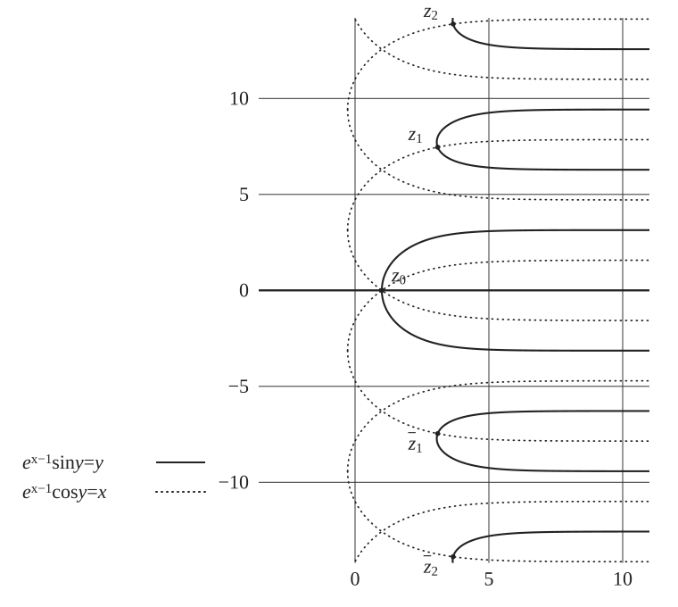

图 3　$e^{z-1}=z$ 的根

我们可以通过以下方式来证明这种对称性: 在排列之间建立一一对应, 使得每个拥有 $k+1$ 个游程的排列与另一拥有 $mp-p-k+1$ 个游程的排列相对应. 希望读者在继续阅读之前, 能够尝试找出这一对应关系.

并不存在一种显而易见的、极为简单的对应关系. 麦克马洪的证明基于生成函数, 而不是基于组合构造, 但福阿塔的对应关系 (定理 5.1.2B) 提供了一种非常有用的简化, 它告诉我们, 以下两种排列之间存在一一对应: 一种是具有 $k+1$ 个游程的多重集排列, 另一种是其两行表示法中恰好包含 $k$ 个列 $\begin{smallmatrix}y\\x\end{smallmatrix}$($x<y$) 的排列.

给定多重集 $\{p\cdot1,p\cdot2,\ldots,p\cdot m\}$, 考虑一个排列, 其两行表示为

$$
\begin{pmatrix}
1&\cdots&1&2&\cdots&2&\cdots&m&\cdots&m\\
x_{11}&\cdots&x_{1p}&x_{21}&\cdots&x_{2p}&\cdots&x_{m1}&\cdots&x_{mp}
\end{pmatrix}.\tag{32}
$$

把这个排列与以下排列相关联,

$$
\begin{pmatrix}
1&\cdots&1&2&\cdots&2&\cdots&m&\cdots&m\\
x'_{11}&\cdots&x'_{1p}&x'_{m1}&\cdots&x'_{mp}&\cdots&x'_{21}&\cdots&x'_{2p}
\end{pmatrix},\tag{33}
$$

式中 $x'=m+1-x$. 如果式 (32) 包含 $k$ 个 $\begin{smallmatrix}y\\x\end{smallmatrix}$ 形式的列 ($x<y$), 则式 (33) 包含 $(m-1)p-k$ 个这样的列. 我们只需要考虑 $y>1$ 的情形, $x<y$ 等价于 $x'\ge m+2-y$. 现在式 (32) 对应的排列拥有 $k+1$ 个游程, 而式 (33) 对应的排列拥有 $mp-p-k+1$ 个游程, 而且把式 (32) 变为式 (33) 的转换是可逆的——它也可以把式 (33) 变回式 (32). 因此, 麦克马洪的对称性条件已经建立. 习题 14 给出了这个构造的一个示例.

根据对称性, 一个随机排列中的平均游程数必然为 $\tfrac12((k+1)+(mp-p-k+1))=1+\tfrac12p(m-1)$. 例如在纽科姆的单人纸牌游戏中, 如果使用标准纸牌, 所得到的平均堆数将为 25 (所以这个纸牌游戏看起来不是那么令人兴奋).

<a id="pdf-040"></a>
<a id="p-34"></a>

给定任意多重集 $\{n_1\cdot x_1,n_2\cdot x_2,\ldots,n_m\cdot x_m\}$ (其中各个 $x$ 互不相同), 实际上可以通过一个相当简单的论证判断一般情况下的平均游程数. 设 $n=n_1+n_2+\cdots+n_m$, 并设想已经写下了这个多重集的所有排列 $a_1a_2\ldots a_n$. 我们将计算, 对于每个固定的 $i$ 值 ($1\le i<n$), $a_i$ 大于 $a_{i+1}$ 的概率有多大. $a_i>a_{i+1}$ 的次数就是 $a_i\ne a_{i+1}$ 次数的一半. 不难看出, $a_i=a_{i+1}=x_j$ 恰好出现 $Nn_j(n_j-1)/n(n-1)$ 次, 其中 $N$ 为排列的总数. 因此 $a_i=a_{i+1}$ 恰好出现

$$
\frac N{n(n-1)}\bigl(n_1(n_1-1)+\cdots+n_m(n_m-1)\bigr)
=\frac N{n(n-1)}(n_1^2+\cdots+n_m^2-n)
$$

次, 而 $a_i>a_{i+1}$ 恰好出现

$$
\frac N{2n(n-1)}\bigl(n^2-(n_1^2+\cdots+n_m^2)\bigr)
$$

次. 对 $i$ 求和, 再加上 $N$ (因为每个排列都有一个游程以 $a_n$ 结束), 则得到所有 $N$ 个排列的游程总数:

$$
N\left(\frac n2-\frac1{2n}(n_1^2+\cdots+n_m^2)+1\right).\tag{34}
$$

除以 $N$ 即得所求的平均游程数.

游程在 “顺序统计” 研究中非常重要, 有大量文献讨论这一主题, 包括未在这里讨论的几种其他类型的游程. 更多相关信息见弗洛伦丝·戴维和戴维·巴顿合著的书 [*Combinatorial Chance* (London: Griffin, 1962)] 第 10 章, 以及戴维·巴顿和科林·马洛斯合写的综述论文 [*Annals of Math. Statistics* **36** (1965), 236–260].

### 习题

<a id="ex-5-1-3-1"></a>

**1.** [M26] 推导欧拉公式 (13).　[答案](#ans-5-1-3-1)

<a id="ex-5-1-3-2"></a>

**2.** ▶ [M22] (a) 推广文中用于证明式 (8) 的思想, 考虑恰好包含 $q$ 个不同元素的序列 $a_1a_2\ldots a_n$, 以证明　[答案](#ans-5-1-3-2)

$$
\sum_k\left\langle{n\atop k}\right\rangle\binom k{n-q}
=\left\{{n\atop q}\right\}q!,\qquad\text{整数 }q\ge0.
$$

(b) 利用这个恒等式证明

$$
\sum_k\left\langle{n\atop k}\right\rangle\binom{k+1}m
=\left\{{n+1\atop n+1-m}\right\}(n-m)!,\qquad n\ge m.
$$

<a id="ex-5-1-3-3"></a>

**3.** [HM25] 计算和值 $\sum_k\left\langle{n\atop k}\right\rangle(-1)^k$.　[答案](#ans-5-1-3-3)

<a id="ex-5-1-3-4"></a>

**4.** [M21] $\sum_k(-1)^k\left\{{n\atop k}\right\}k!\binom{n-k}m$ 的值等于多少?　[答案](#ans-5-1-3-4)

<a id="ex-5-1-3-5"></a>

**5.** [M20] 当 $p$ 是素数时, 计算 $\left\langle{p\atop k}\right\rangle\bmod p$ 的值.　[答案](#ans-5-1-3-5)

<a id="ex-5-1-3-6"></a>

**6.** ▶ [M21] 阿呆先生注意到, 根据式 (4) 和 (13), 有　[答案](#ans-5-1-3-6)

$$
n!=\sum_{k\ge0}\left\langle{n\atop k}\right\rangle
=\sum_{k\ge0}\sum_{j\ge0}(-1)^{k-j}\binom{n+1}{k-j}(j+1)^n.
$$

首先对 $k$ 求和, 他发现对于所有 $j\ge0$ 有 $\sum_{k\ge0}(-1)^{k-j}\binom{n+1}{k-j}=0$. 因此, 对于所有 $n\ge0$ 有 $n!=0$. 他犯了什么错误?

<a id="ex-5-1-3-7"></a>

**7.** [HM40] 由式 (14) 给出的游程概率分布是否渐近于正态分布? (见习题 1.2.10–13.)　[答案](#ans-5-1-3-7)

<a id="ex-5-1-3-8"></a>

**8.** [M24] (麦克马洪) 证明: 一个足够长的排列, 它的第一个游程的长度为 $l_1$, 第二个游程的长度为 $l_2,\ldots$, 第 $k$ 个游程的长度 $\ge l_k$ 的概率, 是　[答案](#ans-5-1-3-8)

$$
\det\begin{pmatrix}
1/l_1!&1/(l_1+l_2)!&1/(l_1+l_2+l_3)!&\cdots&1/(l_1+l_2+l_3+\cdots+l_k)!\\
1&1/l_2!&1/(l_2+l_3)!&\cdots&1/(l_2+l_3+\cdots+l_k)!\\
0&1&1/l_3!&\cdots&1/(l_3+\cdots+l_k)!\\
\vdots&&&&\vdots\\
0&0&\cdots&1&1/l_k!
\end{pmatrix}.
$$

<a id="ex-5-1-3-9"></a>

**9.** [M30] 设 $h_k(z)=\sum p_{km}z^m$, 其中 $p_{km}$ 是一个随机 (无限) 序列中前 $k$ 个游程总长度为 $m$ 的概率. 求 $h_1(z)$、$h_2(z)$ 以及超级生成函数 $h(z,x)=\sum_kh_k(z)x^k$ 的 “简单” 表达式.　[答案](#ans-5-1-3-9)

<a id="pdf-041"></a>
<a id="p-35"></a>

<a id="ex-5-1-3-10"></a>

**10.** [HM30] 当 $k$ 很大时, 求上题中分布 $h_k(z)$ 的均值与方差的渐近特性.　[答案](#ans-5-1-3-10)

<a id="ex-5-1-3-11"></a>

**11.** [M40] 设 $H_k(z)=\sum P_{km}z^m$, 其中 $P_{km}$ 是一个随机 (无限) 序列中第 $k$ 个游程的长度为 $m$ 的概率. 用我们熟悉的函数表示 $H_1(z)$、$H_2(z)$ 以及超级生成函数 $H(z,x)=\sum_kH_k(z)x^k$.　[答案](#ans-5-1-3-11)

<a id="ex-5-1-3-12"></a>

**12.** [M33] (麦克马洪) 证明: $\{n_1\cdot1,n_2\cdot2,\ldots,n_m\cdot m\}$ 的排列中, 恰好拥有 $k$ 个游程的排列数是　[答案](#ans-5-1-3-12)

$$
\sum_{j=0}^k(-1)^j\binom{n+1}j\binom{n_1-1+k-j}{n_1}\binom{n_2-1+k-j}{n_2}\cdots\binom{n_m-1+k-j}{n_m},
$$

式中 $n=n_1+n_2+\cdots+n_m$, 从而把式 (13) 推广到多重集的排列.

<a id="ex-5-1-3-13"></a>

**13.** [05] 如果纽科姆用一副标准桥牌玩单人纸牌游戏, 忽略面值, 但认为梅花＜方块＜红心＜黑桃, 平均堆数是多少?　[答案](#ans-5-1-3-13)

<a id="ex-5-1-3-14"></a>

**14.** [M18] 排列 $3\,1\,1\,1\,2\,3\,1\,4\,2\,3\,3\,4\,2\,2\,4\,4$ 有五个游程. 按照正文中关于麦克马洪对称条件的构造, 找出具有九个游程的相应排列.　[答案](#ans-5-1-3-14)

<a id="ex-5-1-3-15"></a>

**15.** ▶ [M21] (交替游程)19 世纪关于组合分析的经典文献并没有像我们这里一样, 讨论排列中的游程主题, 但有几篇论文讨论了交替递增和递减的 “游程”. 因此, 认为 $5\,3\,2\,4\,7\,6\,1\,8$ 有 4 个游程: $5\,3\,2$, $2\,4\,7$, $7\,6\,1$, $1\,8$. (按照 $a_1<a_2$ 还是 $a_1>a_2$, 第一个游程是递增或递减的, 于是 $a_1a_2\ldots a_n$ 和 $a_n\ldots a_2a_1$ 以及 $(n+1-a_1)(n+1-a_2)\ldots(n+1-a_n)$ 都具有相同数目的交替游程.) 排列 $n$ 个元素时, 这类游程的最大数目是 $n-1$.　[答案](#ans-5-1-3-15)

计算集合 $\{1,2,\ldots,n\}$ 的一个随机排列的平均交替游程数. [提示: 考虑式 (34) 的证明.]

<a id="ex-5-1-3-16"></a>

**16.** [M30] 继续上一题, 设 $\mathopen{\mathrlap{\Big\langle}\Big\rangle}\genfrac{}{}{0pt}{}{n}{k}\mathclose{\mathrlap{\Big\langle}\Big\rangle}$ 是 $\{1,2,\ldots,n\}$ 的排列中恰有 $k$ 个交替游程的排列数目. 请给出一个递推关系, 借助它可以计算 $\mathopen{\mathrlap{\Big\langle}\Big\rangle}\genfrac{}{}{0pt}{}{n}{k}\mathclose{\mathrlap{\Big\langle}\Big\rangle}$ 表. 试求生成函数 $G_n(z)=\sum_k\mathopen{\mathrlap{\Big\langle}\Big\rangle}\genfrac{}{}{0pt}{}{n}{k}\mathclose{\mathrlap{\Big\langle}\Big\rangle}z^k/n!$ 的相应递推关系. 利用后一递推关系找出一个简单公式, 用于表示 $\{1,2,\ldots,n\}$ 的一个随机排列中交替游程数的方差.　[答案](#ans-5-1-3-16)

<a id="ex-5-1-3-17"></a>

**17.** [M25] 在所有 $2^n$ 个序列 $a_1a_2\ldots a_n$ (其中每个 $a_j$ 或者为 0 或者为 1) 中, 有多少个序列恰有 $k$ 个游程 (即发生 $k-1$ 次 $a_j>a_{j+1}$)?　[答案](#ans-5-1-3-17)

<a id="ex-5-1-3-18"></a>

**18.** [M28] 在所有 $n!$ 个序列 $b_1b_2\ldots b_n$ (其中每个 $b_j$ 是 $0\le b_j\le n-j$ 范围内的整数) 中, (a) 有多少个序列恰有 $k$ 个递降 (即发生 $k$ 次 $b_j>b_{j+1}$)? (b) 有多少个序列恰有 $k$ 个不同元素?　[答案](#ans-5-1-3-18)

<a id="ex-5-1-3-19"></a>

**19.** ▶ [M26] (欧文·卡普兰斯基和赖尔登, 1946)(a) 在 $n\times n$ 的棋盘上放置 $n$ 个非攻击性的车 (即, 任何两个车既不在同一行内, 也不在同一列中), 使得恰有 $k$ 个车位于主对角线下方, 共有多少种摆放方式? (b) 在 $n\times n$ 的棋盘主对角线下方放置 $k$ 个非攻击性的车, 共有多少种摆放方式?　[答案](#ans-5-1-3-19)

例如, 在标准国际象棋棋盘上摆放八个非攻击性的车, 其中三个车位于主对角线下方的未遮盖部分, 共有 15619 种方式, 图 4 左图显示了其中的一种, 这也是把三个非攻击性的车放在三角形棋盘上的 1050 种方式之一, 如图 4 右图所示.

<a id="fig-5-4"></a>

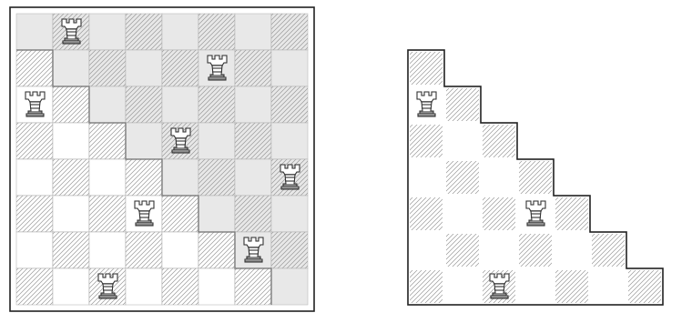

图 4　国际象棋棋盘上非攻击性的车, 主对角线下方有 $k=3$ 个车

<a id="pdf-042"></a>
<a id="p-36"></a>

<a id="ex-5-1-3-20"></a>

**20.** ▶ [M21] 为了以非降序读取一个排列的元素, 如果需要从左向右扫描 $k$ 次, 就说这个排列需要 $k$ 次读取. 例如, 排列 $4\,9\,1\,8\,2\,5\,3\,6\,7$ 需要 4 次读取: 第一次读取得到 1, 2, 3; 第二次得到 4, 5, 6, 7; 然后是 8; 最后是 9. 找出游程个数与读取次数之间的联系.　[答案](#ans-5-1-3-20)

<a id="ex-5-1-3-21"></a>

**21.** [M22] 如果 $\{1,2,\ldots,n\}$ 的排列 $a_1a_2\ldots a_n$ 有 $k$ 个游程, 在习题 20 的意义下需要 $j$ 次读取, 我们可以对 $a_n\ldots a_2a_1$ 说点什么?　[答案](#ans-5-1-3-21)

<a id="ex-5-1-3-22"></a>

**22.** [M26] (伦纳德·卡利茨、戴维·罗塞尔和理查德·斯科维尔) 证明: 如果 $rs<n$, 则 $\{1,2,\ldots,n\}$ 的排列中不存在具有 $n+1-r$ 个游程且需要 $s$ 次读取的排列. 但是, 如果 $n\ge n+1-r\ge s\ge1$ 且 $rs\ge n$, 则存在这样的排列.　[答案](#ans-5-1-3-22)

<a id="ex-5-1-3-23"></a>

**23.** [HM42] (瓦尔特·魏斯布卢姆) 在排列 $a_1a_2\ldots a_n$ 中, 当一个片段不再单调时, 在该处放置一条竖线, 可以获得这个排列的 “长游程”. 长游程或者为递增, 或者为递减, 取决于它的前两个元素的顺序, 所以每个长游程的长度 $\ge2$ (最后一个可能例外). 例如, $7\,5\mid6\,2\mid3\,8\,9\mid1\,4$ 有四个长游程. 试求一个无限排列的前两个长游程的平均长度, 并证明长游程长度的极限是　[答案](#ans-5-1-3-23)

$$
(1+\cot\tfrac12)/(3-\cot\tfrac12)\approx2.4202.
$$

<a id="ex-5-1-3-24"></a>

**24.** [M30] 在习题 5.1.1–18 生成的序列中, 游程的平均数 (表示为 $p$ 的函数) 是多少?　[答案](#ans-5-1-3-24)

<a id="ex-5-1-3-25"></a>

**25.** [M25] 设 $U_1,\ldots,U_n$ 是 $[0\mathinner{.\,.}1)$ 中独立均匀分布的随机数. $\lfloor U_1+\cdots+U_n\rfloor=k$ 的概率是多少?　[答案](#ans-5-1-3-25)

<a id="ex-5-1-3-26"></a>

**26.** [M20] 设 $\vartheta$ 表示运算 $z\frac d{dz}$, 它把生成函数中 $z^n$ 的系数乘以 $n$. 证明: 重复向 $1/(1-z)$ 应用 $m$ 次 $\vartheta$ 运算的结果可以用欧拉数表示.　[答案](#ans-5-1-3-26)

<a id="ex-5-1-3-27"></a>

**27.** ▶ [M21] 递增森林是一种定向森林, 它的结点标以 $\{1,2,\ldots,n\}$, 父结点的标识小于其子结点. 证明: 具有 $k+1$ 片叶子的 $n$ 结点递增森林共有 $\left\langle{n\atop k}\right\rangle$ 个.　[答案](#ans-5-1-3-27)

<a id="ex-5-1-3-28"></a>

**28.** [HM35] 求图 3 中的数 $z_m$ 在 $m\to\infty$ 时的渐近值, 并证明　[答案](#ans-5-1-3-28)

$$
\sum_{m=1}^\infty(z_m^{-1}+\bar z_m^{-1})=e-\frac52.
$$

<a id="ex-5-1-3-29"></a>

**29.** ▶ [M30] 如果 $1<j<n$ 且 $a_{j-1}<a_j>a_{j+1}$, 则说排列 $a_1\ldots a_n$ 在 $a_j$ 处有一个 “峰值”. 设 $s_{nk}$ 表示恰有 $k$ 个峰值的排列数目, 并设 $t_{nk}$ 表示有 $k$ 个峰值和 $k$ 个递减的排列数目. 证明:　[答案](#ans-5-1-3-29)

(a) $s_{nk}=\tfrac12\mathopen{\mathrlap{\Big\langle}\Big\rangle}\genfrac{}{}{0pt}{}{n}{2k}\mathclose{\mathrlap{\Big\langle}\Big\rangle}+\mathopen{\mathrlap{\Big\langle}\Big\rangle}\genfrac{}{}{0pt}{}{n}{2k+1}\mathclose{\mathrlap{\Big\langle}\Big\rangle}+\tfrac12\mathopen{\mathrlap{\Big\langle}\Big\rangle}\genfrac{}{}{0pt}{}{n}{2k+2}\mathclose{\mathrlap{\Big\langle}\Big\rangle}$ (见习题 16);

(b) $s_{nk}=2^{n-1-2k}t_{nk}$;

(c) $\sum_k\left\langle{n\atop k}\right\rangle x^k=\sum_kt_{nk}x^k(1+x)^{n-1-2k}$.

<a id="sec-5-1-4"></a>

### *5.1.4　图表与对合

为全面研究排列的组合性质, 我们将讨论一些重要的关系, 这些关系将排列与一些被称为 “图表” 的整数阵列联系在一起. $(n_1,n_2,\ldots,n_m)$ 型扬氏图表是 $n_1+n_2+\cdots+n_m$ 个不同整数排列成由若干行组成的阵列 (其中 $n_1\ge n_2\ge\cdots\ge n_m>0$), 第 $i$ 行有 $n_i$ 个元素, 这些行保持左对齐, 每一行的项由左向右保持递增顺序, 每一列的项自上而下保持递增顺序. 例如

<div style="display:flex;align-items:center;justify-content:center;gap:1.5em">
<table style="border-collapse:collapse;margin:1em 0"><tbody>
<tr style="border:0;background:transparent"><td>1</td><td>2</td><td>5</td><td>9</td><td>10</td><td>15</td></tr>
<tr style="border:0;background:transparent"><td>3</td><td>6</td><td>7</td><td>13</td></tr>
<tr style="border:0;background:transparent"><td>4</td><td>8</td><td>12</td><td>14</td></tr>
<tr style="border:0;background:transparent"><td>11</td></tr>
</tbody></table>
<span>(1)</span>
</div>

是一个 $(6,4,4,1)$ 型扬氏图表. 这种排列方式是艾尔弗雷德·扬为研究排列的矩阵表示而引入的 [见 *Proc. London Math. Soc.* (2) **28** (1928), 255–292; 布鲁斯·伊莱·萨根,*The Symmetric Group* (Pacific Grove, Calif.: Wadsworth & Brooks/Cole, 1991)]. 简便起见, 我们把 “扬氏图表” 简称为 “图表”.

<a id="pdf-043"></a>
<a id="p-37"></a>

对合是指一种排列, 其逆排列与原排列相同. 例如, $\{1,2,3,4\}$ 共有 10 种对合:

$$
\begin{array}{ccccc}
\begin{pmatrix}1&2&3&4\\1&2&3&4\end{pmatrix}&
\begin{pmatrix}1&2&3&4\\2&1&3&4\end{pmatrix}&
\begin{pmatrix}1&2&3&4\\3&2&1&4\end{pmatrix}&
\begin{pmatrix}1&2&3&4\\4&2&3&1\end{pmatrix}&
\begin{pmatrix}1&2&3&4\\1&3&2&4\end{pmatrix}\\[1em]
\begin{pmatrix}1&2&3&4\\1&4&3&2\end{pmatrix}&
\begin{pmatrix}1&2&3&4\\1&2&4&3\end{pmatrix}&
\begin{pmatrix}1&2&3&4\\2&1&4&3\end{pmatrix}&
\begin{pmatrix}1&2&3&4\\3&4&1&2\end{pmatrix}&
\begin{pmatrix}1&2&3&4\\4&3&2&1\end{pmatrix}
\end{array}\tag{2}
$$

“对合” 一词源于经典几何问题. 这里讨论的是一般意义上的对合, 最早是由海因里希·罗思在引入逆的概念时进行研究的 (见 5.1.1 节).

我们同时讨论图表和对合可能显得有些奇怪, 但这两种看起来不相关的概念之间存在一种特别联系: $\{1,2,\ldots,n\}$ 的对合数目与由元素 $\{1,2,\ldots,n\}$ 构成的图表数目相同. 例如, 由 $\{1,2,3,4\}$ 恰好可以构成 10 个图表,

<div class="source-tableau-group" style="overflow-x:auto;max-width:100%">
<div style="display:grid;grid-template-columns:repeat(5,max-content);align-items:start;gap:1em 1.8em;width:max-content;margin:0 auto">
<table style="border-collapse:collapse;margin:.5em 0"><tbody>
<tr style="border:0;background:transparent"><td style="padding:.2em .45em">1</td><td style="padding:.2em .45em">2</td><td style="padding:.2em .45em">3</td><td style="padding:.2em .45em">4</td></tr>
</tbody></table>
<table style="border-collapse:collapse;margin:.5em 0"><tbody>
<tr style="border:0;background:transparent"><td style="padding:.2em .45em">1</td><td style="padding:.2em .45em">3</td><td style="padding:.2em .45em">4</td></tr>
<tr style="border:0;background:transparent"><td style="padding:.2em .45em">2</td></tr>
</tbody></table>
<table style="border-collapse:collapse;margin:.5em 0"><tbody>
<tr style="border:0;background:transparent"><td style="padding:.2em .45em">1</td><td style="padding:.2em .45em">4</td></tr>
<tr style="border:0;background:transparent"><td style="padding:.2em .45em">2</td></tr>
<tr style="border:0;background:transparent"><td style="padding:.2em .45em">3</td></tr>
</tbody></table>
<table style="border-collapse:collapse;margin:.5em 0"><tbody>
<tr style="border:0;background:transparent"><td style="padding:.2em .45em">1</td><td style="padding:.2em .45em">3</td></tr>
<tr style="border:0;background:transparent"><td style="padding:.2em .45em">2</td></tr>
<tr style="border:0;background:transparent"><td style="padding:.2em .45em">4</td></tr>
</tbody></table>
<table style="border-collapse:collapse;margin:.5em 0"><tbody>
<tr style="border:0;background:transparent"><td style="padding:.2em .45em">1</td><td style="padding:.2em .45em">2</td><td style="padding:.2em .45em">4</td></tr>
<tr style="border:0;background:transparent"><td style="padding:.2em .45em">3</td></tr>
</tbody></table>
<table style="border-collapse:collapse;margin:.5em 0"><tbody>
<tr style="border:0;background:transparent"><td style="padding:.2em .45em">1</td><td style="padding:.2em .45em">2</td></tr>
<tr style="border:0;background:transparent"><td style="padding:.2em .45em">3</td></tr>
<tr style="border:0;background:transparent"><td style="padding:.2em .45em">4</td></tr>
</tbody></table>
<table style="border-collapse:collapse;margin:.5em 0"><tbody>
<tr style="border:0;background:transparent"><td style="padding:.2em .45em">1</td><td style="padding:.2em .45em">2</td><td style="padding:.2em .45em">3</td></tr>
<tr style="border:0;background:transparent"><td style="padding:.2em .45em">4</td></tr>
</tbody></table>
<table style="border-collapse:collapse;margin:.5em 0"><tbody>
<tr style="border:0;background:transparent"><td style="padding:.2em .45em">1</td><td style="padding:.2em .45em">3</td></tr>
<tr style="border:0;background:transparent"><td style="padding:.2em .45em">2</td><td style="padding:.2em .45em">4</td></tr>
</tbody></table>
<table style="border-collapse:collapse;margin:.5em 0"><tbody>
<tr style="border:0;background:transparent"><td style="padding:.2em .45em">1</td><td style="padding:.2em .45em">2</td></tr>
<tr style="border:0;background:transparent"><td style="padding:.2em .45em">3</td><td style="padding:.2em .45em">4</td></tr>
</tbody></table>
<table style="border-collapse:collapse;margin:.5em 0"><tbody>
<tr style="border:0;background:transparent"><td style="padding:.2em .45em">1</td></tr>
<tr style="border:0;background:transparent"><td style="padding:.2em .45em">2</td></tr>
<tr style="border:0;background:transparent"><td style="padding:.2em .45em">3</td></tr>
<tr style="border:0;background:transparent"><td style="padding:.2em .45em">4</td></tr>
</tbody></table>
</div>
<p style="text-align:right">(3)</p>
</div>

分别与 (2) 中的 10 个对合对应.

对合与图表之间的这种联系一点都不明显, 也许没有非常简单的方式来证明它. 我们将要讨论的证明涉及一种非常有趣的图表构造算法, 它有一些令人惊奇的其他性质. 该算法以一种向图表中插入新元素的特殊过程为基础.

例如, 假定我们希望把元素 8 插入图表

<div style="display:flex;align-items:center;justify-content:center;gap:1.5em">
<table style="border-collapse:collapse;margin:.5em 0"><tbody>
<tr style="border:0;background:transparent"><td style="padding:.2em .45em">1</td><td style="padding:.2em .45em">3</td><td style="padding:.2em .45em">5</td><td style="padding:.2em .45em">9</td><td style="padding:.2em .45em">12</td><td style="padding:.2em .45em">16</td></tr>
<tr style="border:0;background:transparent"><td style="padding:.2em .45em">2</td><td style="padding:.2em .45em">6</td><td style="padding:.2em .45em">10</td><td style="padding:.2em .45em">15</td></tr>
<tr style="border:0;background:transparent"><td style="padding:.2em .45em">4</td><td style="padding:.2em .45em">13</td><td style="padding:.2em .45em">14</td></tr>
<tr style="border:0;background:transparent"><td style="padding:.2em .45em">11</td></tr>
<tr style="border:0;background:transparent"><td style="padding:.2em .45em">17</td></tr>
</tbody></table>
<span>(4)</span>
</div>

使用的方法是: 首先把 8 放在第 1 行先前由 9 占据的位置, 因为 9 是该行中大于 8 的最小元素. 元素 9 被 “撞” 到第 2 行, 代替了元素 10. 随后 10 把第 3 行的 13“撞” 到第 4 行. 由于第 4 行没有大于 13 的元素, 所以把 13 放在第 4 行的最右端, 结束整个过程. 至此图表 (4) 转换为

<div style="display:flex;align-items:center;justify-content:center;gap:1.5em">
<table style="border-collapse:collapse;margin:.5em 0"><tbody>
<tr style="border:0;background:transparent"><td style="padding:.2em .45em">1</td><td style="padding:.2em .45em">3</td><td style="padding:.2em .45em">5</td><td style="padding:.2em .45em">8</td><td style="padding:.2em .45em">12</td><td style="padding:.2em .45em">16</td></tr>
<tr style="border:0;background:transparent"><td style="padding:.2em .45em">2</td><td style="padding:.2em .45em">6</td><td style="padding:.2em .45em">9</td><td style="padding:.2em .45em">15</td></tr>
<tr style="border:0;background:transparent"><td style="padding:.2em .45em">4</td><td style="padding:.2em .45em">10</td><td style="padding:.2em .45em">14</td></tr>
<tr style="border:0;background:transparent"><td style="padding:.2em .45em">11</td><td style="padding:.2em .45em">13</td></tr>
<tr style="border:0;background:transparent"><td style="padding:.2em .45em">17</td></tr>
</tbody></table>
<span>(5)</span>
</div>

算法 I 准确描述了这一过程, 并证明该过程一直保持了图表的特性.

<a id="alg-5-1-4-I"></a>

**算法 I (向图表插入).** 设 $P=(P_{ij})$ 是一个由正整数组成的图表, 并设 $x$ 是一个不在 $P$ 中的正整数. 算法将 $P$ 转换为另一个图表, 它除了包含 $P$ 原来的元素外还包含 $x$. 新图表的形状与原图表相同, 只是在第 $s$ 行第 $t$ 列添加了一个新位置, 这里 $s$ 和 $t$ 是由算法确定的量.

<a id="pdf-044"></a>
<a id="p-38"></a>

(算法中带圆括号的注释是为了证明算法的正确性, 因为很容易通过归纳法验证这些注释是正确的, 而且在整个过程中阵列 $P$ 保持为一个图表. 为方便起见, 对图表进行了扩充, 顶上和左边为 0, 右边和下方为 $\infty$, 也就是为所有的 $i,j\ge0$ 定义了 $P_{ij}$. 如果我们定义

$$
\text{当且仅当 }a<b\quad\text{或}\quad a=b=0\quad\text{或}\quad a=b=\infty\quad\text{时,}\quad a\lesssim b,\tag{6}
$$

则该图表的不等式性质可以表示为以下便利形式

$$
\begin{aligned}
&\text{当且仅当 }i=0\quad\text{或}\quad j=0\quad\text{时,}\quad P_{ij}=0;\\
&\text{对所有 }i,j\ge0,\quad P_{ij}\lesssim P_{i(j+1)}\quad\text{且}\quad P_{ij}\lesssim P_{(i+1)j}.
\end{aligned}\tag{7}
$$

$x\notin P$ 意味着: 或者 $x=\infty$, 或者对于所有 $i,j\ge0$, $x\ne P_{ij}$.)

**I1.** [输入 $x$.] 置 $i\leftarrow1$, $x_1\leftarrow x$, 置 $j$ 为使 $P_{1j}=\infty$ 的最小值.

**I2.** [求 $x_{i+1}$.] (这时 $P_{(i-1)j}<x_i<P_{ij}$ 且 $x_i\notin P$.) 如果 $x_i<P_{i(j-1)}$, $j$ 减 1, 重复这一步骤. 否则置 $x_{i+1}\leftarrow P_{ij}$, $r_i\leftarrow j$.

**I3.** [用 $x_i$ 替换.] (现在 $P_{i(j-1)}<x_i<x_{i+1}=P_{ij}\lesssim P_{i(j+1)}$, $P_{(i-1)j}<x_i<x_{i+1}=P_{ij}\lesssim P_{(i+1)j}$ 且 $r_i=j$.) 置 $P_{ij}\leftarrow x_i$.

**I4.** [$x_{i+1}=\infty$ 吗?] (现在 $P_{i(j-1)}<P_{ij}=x_i<x_{i+1}\lesssim P_{i(j+1)}$, $P_{(i-1)j}<P_{ij}=x_i<x_{i+1}\lesssim P_{(i+1)j}$, $r_i=j$ 且 $x_{i+1}\notin P$.) 如果 $x_{i+1}\ne\infty$, $i$ 增 1, 返回 I2.

**I5.** [确定 $s,t$.] 置 $s\leftarrow i$, $t\leftarrow j$, 结束算法. (此时条件

$$
P_{st}\ne\infty\quad\text{且}\quad P_{(s+1)t}=P_{s(t+1)}=\infty\tag{8}
$$

得以满足.)　▮

算法 I 定义了一个 “碰撞序列”

$$
x=x_1<x_2<\cdots<x_s<x_{s+1}=\infty,\tag{9}
$$

还有一个由列下标组成的辅助序列

$$
r_1\ge r_2\ge\cdots\ge r_s=t,\tag{10}
$$

对于 $1\le i\le s$, 元素 $P_{ir_i}$ 已经由 $x_{i+1}$ 改为 $x_i$. 例如, 把元素 8 插入图表 (4) 时, 该碰撞序列为 8, 9, 10, 13, $\infty$, 辅助序列为 4, 3, 2, 2. 我们也能对算法进行调整, 以大幅减少对临时存储的使用: 只需记住 $j,x_i$ 和 $x_{i+1}$ 的当前值. 但我们引入了序列 (9) 和序列 (10), 为的是能够证明这个算法的一些有趣特性.

我们将用到算法 I 的一个关键事实, 它可以反向运行: 给定在步骤 I5 中确定的 $s$ 和 $t$ 值, 可以再次将 $P$ 变回原来的形式, 确定并删除所插入的元素 $x$. 例如, 考虑图表 (5), 并假定我们获知元素 13 位于曾经为空白的位置. 则 13 必然是被 10 从第 3 行撞下来的, 这是因为 10 是该行中小于 13 的最大元素. 同样, 10 必然是被 9 从第 2 行撞下来的, 9 必然是被 8 从第 1 行撞下来的. 因此, 我们可以从图表 (5) 倒回到图表 (4). 以下算法详细描述了这一过程.

<a id="alg-5-1-4-D"></a>

**算法 D (从图表删除).** 给定图表 $P$ 和满足条件 (8) 的正整数 $s,t$, 算法将 $P$ 转换为另一图表, 其形状基本相同, 但第 $s$ 行第 $t$ 列是 $\infty$. 把算法所确定的元素 $x$ 从 $P$ 中删除.

(和算法 I 中一样, 圆括号内的断言是为了便于证明在整个过程中 $P$ 保持为图表.)

**D1.** [输入 $s,t$.] 置 $j\leftarrow t$, $i\leftarrow s$, $x_{s+1}\leftarrow\infty$.

<a id="pdf-045"></a>
<a id="p-39"></a>

**D2.** [求 $x_i$.] (此时 $P_{ij}<x_{i+1}\lesssim P_{(i+1)j}$ 且 $x_{i+1}\notin P$.) 如果 $P_{i(j+1)}<x_{i+1}$, $j$ 增 1, 重复此步骤. 否则置 $x_i\leftarrow P_{ij}$, $r_i\leftarrow j$.

**D3.** [用 $x_{i+1}$ 替换.] (现在 $P_{i(j-1)}<P_{ij}=x_i<x_{i+1}\lesssim P_{i(j+1)}$, $P_{(i-1)j}<P_{ij}=x_i<x_{i+1}\lesssim P_{(i+1)j}$ 且 $r_i=j$.) 置 $P_{ij}\leftarrow x_{i+1}$.

**D4.** [$i=1$ 吗?] (现在 $P_{i(j-1)}<x_i<x_{i+1}=P_{ij}\lesssim P_{i(j+1)}$, $P_{(i-1)j}<x_i<x_{i+1}=P_{ij}\lesssim P_{(i+1)j}$ 且 $r_i=j$.) 如果 $i>1$, $i$ 减 1, 返回 D2.

**D5.** [确定 $x$.] 置 $x\leftarrow x_1$, 算法结束. (现在 $0<x<\infty$.)　▮

算法 I 和算法 D 中圆括号内的断言不仅可用于证明这些算法保持了图表结构, 它们还可用于验证算法 I 和算法 D 恰为互逆. 给定图表 $P$ 和正整数 $x\notin P$, 执行算法 I, 它将插入 $x$, 并确定满足条件 (8) 的正整数 $s,t$. 对此结果应用算法 D 将重新算出 $x$ 并恢复 $P$. 反之, 给定图表 $P$ 和满足条件 (8) 的正整数 $s,t$, 执行算法 D, 它将修改 $P$, 删除正整数 $x$. 对此结果应用算法 I 将重新算出 $s,t$ 并恢复 $P$. 其原因在于, 步骤 I3 与 D4 中圆括号里的断言是相同的, 步骤 I4 和 D3 中的断言也相同, 这些断言唯一确定了 $j$ 的值. 因此在每种情况下辅助序列 (9)、(10) 都是相同的.

现在已经准备就绪, 可以证明图表的一个基本性质.

<a id="thm-5-1-4-A"></a>

**定理 A.** 在以下两者之间存在一一对应, 一方是由 $\{1,2,\ldots,n\}$ 的所有排列组成的集合, 一方是 $\{1,2,\ldots,n\}$ 构成的有序图表对 $(P,Q)$ 的集合, 其中 $P$ 和 $Q$ 的形状相同.

(在下面的证明中给出了这一定理的一个示例.)

证明. 证明一个稍微更一般的结果会方便些. 给定任意两行阵列

$$
\begin{pmatrix}q_1&q_2&\cdots&q_n\\p_1&p_2&\cdots&p_n\end{pmatrix},
\qquad\begin{gathered}q_1<q_2<\cdots<q_n,\\p_1,p_2,\ldots,p_n\text{ 各不相同,}\end{gathered}\tag{11}
$$

我们将构造两个相应的图表 $P$ 和 $Q$, 其中 $P$ 的元素为 $\{p_1,\ldots,p_n\}$, $Q$ 的元素为 $\{q_1,\ldots,q_n\}$, $P$ 和 $Q$ 的形状相同.

设 $P$ 和 $Q$ 初始为空. 接下来, 对 $i=1,2,\ldots,n$ (按照这一顺序) 进行以下操作: 用算法 I 将 $p_i$ 插入图表 $P$, 然后令 $Q_{st}\leftarrow q_i$, 这里 $s$ 和 $t$ 是 $P$ 中的新填充位置.

例如, 给定排列 $\begin{pmatrix}1&3&5&6&8\\7&2&9&5&3\end{pmatrix}$, 我们得到

<div class="source-tableau-group" style="overflow-x:auto;max-width:100%">
<div style="display:grid;grid-template-columns:repeat(3,max-content);align-items:start;gap:.7em 2.2em;width:max-content;margin:0 auto">
<span></span><i>P</i><i>Q</i>
<span>插入 7: </span>
<table style="border-collapse:collapse;margin:.5em 0"><tbody>
<tr style="border:0;background:transparent"><td style="padding:.2em .45em">7</td></tr>
</tbody></table>
<table style="border-collapse:collapse;margin:.5em 0"><tbody>
<tr style="border:0;background:transparent"><td style="padding:.2em .45em">1</td></tr>
</tbody></table>
<span>插入 2: </span>
<table style="border-collapse:collapse;margin:.5em 0"><tbody>
<tr style="border:0;background:transparent"><td style="padding:.2em .45em">2</td></tr>
<tr style="border:0;background:transparent"><td style="padding:.2em .45em">7</td></tr>
</tbody></table>
<table style="border-collapse:collapse;margin:.5em 0"><tbody>
<tr style="border:0;background:transparent"><td style="padding:.2em .45em">1</td></tr>
<tr style="border:0;background:transparent"><td style="padding:.2em .45em">3</td></tr>
</tbody></table>
<span>插入 9: </span>
<table style="border-collapse:collapse;margin:.5em 0"><tbody>
<tr style="border:0;background:transparent"><td style="padding:.2em .45em">2</td><td style="padding:.2em .45em">9</td></tr>
<tr style="border:0;background:transparent"><td style="padding:.2em .45em">7</td></tr>
</tbody></table>
<table style="border-collapse:collapse;margin:.5em 0"><tbody>
<tr style="border:0;background:transparent"><td style="padding:.2em .45em">1</td><td style="padding:.2em .45em">5</td></tr>
<tr style="border:0;background:transparent"><td style="padding:.2em .45em">3</td></tr>
</tbody></table>
<span>插入 5: </span>
<table style="border-collapse:collapse;margin:.5em 0"><tbody>
<tr style="border:0;background:transparent"><td style="padding:.2em .45em">2</td><td style="padding:.2em .45em">5</td></tr>
<tr style="border:0;background:transparent"><td style="padding:.2em .45em">7</td><td style="padding:.2em .45em">9</td></tr>
</tbody></table>
<table style="border-collapse:collapse;margin:.5em 0"><tbody>
<tr style="border:0;background:transparent"><td style="padding:.2em .45em">1</td><td style="padding:.2em .45em">5</td></tr>
<tr style="border:0;background:transparent"><td style="padding:.2em .45em">3</td><td style="padding:.2em .45em">6</td></tr>
</tbody></table>
<span>插入 3: </span>
<table style="border-collapse:collapse;margin:.5em 0"><tbody>
<tr style="border:0;background:transparent"><td style="padding:.2em .45em">2</td><td style="padding:.2em .45em">3</td></tr>
<tr style="border:0;background:transparent"><td style="padding:.2em .45em">5</td><td style="padding:.2em .45em">9</td></tr>
<tr style="border:0;background:transparent"><td style="padding:.2em .45em">7</td></tr>
</tbody></table>
<table style="border-collapse:collapse;margin:.5em 0"><tbody>
<tr style="border:0;background:transparent"><td style="padding:.2em .45em">1</td><td style="padding:.2em .45em">5</td></tr>
<tr style="border:0;background:transparent"><td style="padding:.2em .45em">3</td><td style="padding:.2em .45em">6</td></tr>
<tr style="border:0;background:transparent"><td style="padding:.2em .45em">8</td></tr>
</tbody></table>
</div><p style="text-align:right">(12)</p>
</div>

<a id="pdf-046"></a>
<a id="p-40"></a>

因此 $\begin{pmatrix}1&3&5&6&8\\7&2&9&5&3\end{pmatrix}$ 对应的图表 $(P,Q)$ 是

<div class="source-tableau-group" style="overflow-x:auto;max-width:100%">
<div style="display:flex;align-items:center;justify-content:center;gap:1.4em;width:max-content;margin:0 auto">
<i>P =</i><table style="border-collapse:collapse;margin:.5em 0"><tbody>
<tr style="border:0;background:transparent"><td style="padding:.2em .45em">2</td><td style="padding:.2em .45em">3</td></tr>
<tr style="border:0;background:transparent"><td style="padding:.2em .45em">5</td><td style="padding:.2em .45em">9</td></tr>
<tr style="border:0;background:transparent"><td style="padding:.2em .45em">7</td></tr>
</tbody></table><span>, </span><i>Q =</i><table style="border-collapse:collapse;margin:.5em 0"><tbody>
<tr style="border:0;background:transparent"><td style="padding:.2em .45em">1</td><td style="padding:.2em .45em">5</td></tr>
<tr style="border:0;background:transparent"><td style="padding:.2em .45em">3</td><td style="padding:.2em .45em">6</td></tr>
<tr style="border:0;background:transparent"><td style="padding:.2em .45em">8</td></tr>
</tbody></table><span>. (13)</span>
</div>
</div>

由这个构造可以清楚地看出 $P$ 和 $Q$ 的形状总是相同. 此外, 由于我们总是在 $Q$ 的外围按增序添加元素, 所以 $Q$ 是一个图表.

反过来, 给定两个形状相同的图表 $P$ 和 $Q$, 以下方法能找出相应的两行阵列 (11). 设 $Q$ 的元素是

$$
q_1<q_2<\cdots<q_n.
$$

对 $i=n,\ldots,2,1$ (按这一顺序) 设 $p_i$ 表示在对 $P$ 应用算法 D 时删除的元素 $x$, 在此过程中使用了使 $Q_{st}=q_i$ 的 $s$ 和 $t$ 值.

例如, 这个构造从图表 (13) 开始, 逐次执行 (12) 的逆运算直到 $P$ 为空, 这就得到 $\begin{pmatrix}1&3&5&6&8\\7&2&9&5&3\end{pmatrix}$.

由于算法 I 和算法 D 互逆, 所以我们描述的两种构造也互逆, 从而建立了一一对应.　▮

在定理 A 的证明过程中定义的对应关系有许多不寻常的性质, 现在着手推导其中的一些. 建议读者在继续阅读之前完成习题 1 中的示例, 以熟悉这个构造.

把一个元素从第 1 行撞到第 2 行之后, 它就不再影响第 1 行. 接下来, 使用碰撞序列构造第 $2,3,\ldots$ 行, 其构造方式与使用原排列构造第 $1,2,\ldots$ 行完全一致. 这些事实提示我们可以采用另外一种方式来观察定理 A 的构造: 仅关注 $P$ 和 $Q$ 的第一行. 例如, 根据 (12), 排列 $\begin{pmatrix}1&3&5&6&8\\7&2&9&5&3\end{pmatrix}$ 导致在第 1 行执行以下操作:

$$
\begin{array}{rll}
1:&\text{插入 }7,\text{ 令 }Q_{11}\leftarrow1.\\
3:&\text{插入 }2,\text{ 撞下 }7.\\
5:&\text{插入 }9,\text{ 令 }Q_{12}\leftarrow5.\\
6:&\text{插入 }5,\text{ 撞下 }9.\\
8:&\text{插入 }3,\text{ 撞下 }5.
\end{array}\tag{14}
$$

因此 $P$ 的第一行是 $2\,3$, $Q$ 的第一行是 $1\,5$. 此外, $P$ 和 $Q$ 的其余各行是对应于 “被撞下” 的两行阵列

$$
\begin{pmatrix}3&6&8\\7&9&5\end{pmatrix}\tag{15}
$$

的图表.

为了研究第 1 行的构造特性, 可以考察进入该行某一给定列的元素. 如果从一个空图表 $P$ 开始, 在逐次对 $p_1,p_2,\ldots,p_i$ 应用算法 I 之后有 $p_i=P_{1t}$, 则说 $(q_i,p_i)$ 相对于两行阵列

$$
\begin{pmatrix}q_1&q_2&\cdots&q_n\\p_1&p_2&\cdots&p_n\end{pmatrix},
\qquad\begin{gathered}q_1<q_2<\cdots<q_n,\\p_1,p_2,\ldots,p_n\text{ 各不相同}\end{gathered}\tag{16}
$$

属于第 $t$ 类. (请记住, 算法 I 总是把给定元素插入第 1 行.)

<a id="pdf-047"></a>
<a id="p-41"></a>

容易看出, 当且仅当 $p_i$ 有 $i-1$ 个反序, 即 $p_i=\min\{p_1,p_2,\ldots,p_i\}$ 是一个 “从左向右的最小值” 时, $(q_i,p_i)$ 属于第 1 类. 如果我们划去 (16) 中属于第 1 类的列, 则得到另一个两行阵列

$$
\begin{pmatrix}q'_1&q'_2&\cdots&q'_m\\p'_1&p'_2&\cdots&p'_m\end{pmatrix},\tag{17}
$$

使得 $(q,p)$ 相对于 (17) 属于第 $t$ 类, 当且仅当它相对于 (16) 属于第 $t+1$ 类. 从 (16) 到 (17) 的操作表示删除第 1 行的最左侧位置. 这为我们提供了一种确定类别的系统方法. 例如, 在 $\begin{pmatrix}1&3&5&6&8\\7&2&9&5&3\end{pmatrix}$ 中, 属于从左向右的最小值的元素是 7 和 2, 所以第 1 类是 $\{(1,7),(3,2)\}$. 在剩下的阵列 $\begin{pmatrix}5&6&8\\9&5&3\end{pmatrix}$ 中, 所有元素都是从左向右的最小值, 所以第 2 类是 $\{(5,9),(6,5),(8,3)\}$. 在 “被撞下” 的阵列 (15) 中, 第 1 类是 $\{(3,7),(8,5)\}$, 第 2 类是 $\{(6,9)\}$.

对任何固定的 $t$ 值, 第 $t$ 类的元素可以标记为

$$
(q_{i_1},p_{i_1}),\ldots,(q_{i_k},p_{i_k})
$$

其中

$$
\begin{aligned}
q_{i_1}<q_{i_2}<\cdots<q_{i_k},\\
p_{i_1}>p_{i_2}>\cdots>p_{i_k},
\end{aligned}\tag{18}
$$

因为在执行插入算法期间, 图表位置 $P_{1t}$ 取值是递减序列 $p_{i_1},\ldots,p_{i_k}$. 在构造结束时, 有

$$
P_{1t}=p_{i_k},\qquad Q_{1t}=q_{i_1}.\tag{19}
$$

“被撞下” 的两行阵列确定了 $P$ 和 $Q$ 的第 $2,3,\ldots$ 行, 该阵列包含

$$
\begin{pmatrix}q_{i_2}&q_{i_3}&\cdots&q_{i_k}\\p_{i_1}&p_{i_2}&\cdots&p_{i_{k-1}}\end{pmatrix},\tag{20}
$$

还有以类似方式从其他各类获得的其他列.

利用这些观察结果, 可以得出一种手算 $P$ 和 $Q$ 的简单方法 (见习题 3). 它们还提供了一种方法, 用于证明一个相当出乎意料的结果:

<a id="thm-5-1-4-B"></a>

**定理 B.** 如果排列

$$
\begin{pmatrix}1&2&\cdots&n\\a_1&a_2&\cdots&a_n\end{pmatrix}
$$

对应于定理 A 的构造中的图表 $(P,Q)$, 则其逆排列对应于 $(Q,P)$.

这个事实十分惊人, 一方面因为 $P$ 和 $Q$ 在定理 A 中是采用这样一些完全不同的方法形成的, 另一方面还因为一个排列的逆是通过稍显变换莫测地重排两行阵列中的各列而获得的.

证明. 假定有一个两行阵列 (16), 它的各列基本上是独立的, 可以进行重新排列. 交换这些行, 并对各列进行排序, 使得新的上行呈现增序, 从而得到 “逆” 阵列

$$
\begin{aligned}
\begin{pmatrix}q_1&q_2&\cdots&q_n\\p_1&p_2&\cdots&p_n\end{pmatrix}^-
&=\begin{pmatrix}p_1&p_2&\cdots&p_n\\q_1&q_2&\cdots&q_n\end{pmatrix}\\
&=\begin{pmatrix}p'_1&p'_2&\cdots&p'_n\\q'_1&q'_2&\cdots&q'_n\end{pmatrix},
\quad\begin{gathered}p'_1<p'_2<\cdots<p'_n;\\q'_1,q'_2,\ldots,q'_n\text{ 各不相同.}\end{gathered}
\end{aligned}\tag{21}
$$

我们将证明这个操作对应于定理 A 的构造中交换 $P$ 和 $Q$.

习题 2 调整了前面关于如何确定类的说明, 使 $(q_i,p_i)$ 的类不再依赖于 “$q_1,q_2,\ldots,q_n$ 呈增序” 这一事实. 由于得到的条件在 $q$ 和 $p$ 中是对称的, 所以操作 (21) 不会破坏类结构, 如果 $(q,p)$ 相对于 (16) 属于第 $t$ 类, 则 $(p,q)$ 相对于 (21) 属于第 $t$ 类. 如果我们模拟 (18), 将后一第 $t$ 类的元素排成

$$
\begin{aligned}
p_{i_k}<\cdots<p_{i_2}<p_{i_1},\\
q_{i_k}>\cdots>q_{i_2}>q_{i_1},
\end{aligned}\tag{22}
$$

那么, 和 (19) 中一样, 有

$$
P_{1t}=q_{i_1},\qquad Q_{1t}=p_{i_k}.\tag{23}
$$

<a id="pdf-048"></a>
<a id="p-42"></a>

以下各列

$$
\begin{pmatrix}p_{i_{k-1}}&\cdots&p_{i_2}&p_{i_1}\\q_{i_k}&\cdots&q_{i_3}&q_{i_2}\end{pmatrix}\tag{24}
$$

和 (20) 中一样进入 “被撞下” 的阵列. 因此 $P$ 和 $Q$ 的第一行进行了交换. 此外, (21) 的 “被撞下” 的两行阵列是 (16) 的 “被撞下” 的两行阵列的逆. 对图表的行数应用归纳法即可完成证明.　▮

<a id="cor-5-1-4-B"></a>

**推论 B.** 由 $\{1,2,\ldots,n\}$ 所能生成的图表数就是 $\{1,2,\ldots,n\}$ 上的对合数.

证明. 如果 $\pi$ 是对应于 $(P,Q)$ 的对合, 则 $\pi=\pi^-$ 对应于 $(Q,P)$, 因此 $P=Q$. 反之, 如果 $\pi$ 是对应于 $(P,P)$ 的任意排列, 则 $\pi^-$ 也对应于 $(P,P)$, 因此 $\pi=\pi^-$. 所以, 在对合 $\pi$ 和图表 $P$ 之间存在一一对应.　▮

显然, 一个图表左上角的元素总是最小的. 这提示了一种对数集进行排序的方法: 首先可以反复应用算法 I, 将这些数放到图表中, 这就把最小元素放到角上, 然后删除这一最小元素, 重排剩余元素, 使它们构成另一个图表; 然后删除新的最小元素; 以此类推.

接下来, 考虑一下从图表

<div style="display:flex;align-items:center;justify-content:center;gap:1.5em">
<table style="border-collapse:collapse;margin:.5em 0"><tbody>
<tr style="border:0;background:transparent"><td style="padding:.2em .45em">1</td><td style="padding:.2em .45em">3</td><td style="padding:.2em .45em">5</td><td style="padding:.2em .45em">7</td><td style="padding:.2em .45em">11</td><td style="padding:.2em .45em">15</td></tr>
<tr style="border:0;background:transparent"><td style="padding:.2em .45em">2</td><td style="padding:.2em .45em">6</td><td style="padding:.2em .45em">8</td><td style="padding:.2em .45em">14</td></tr>
<tr style="border:0;background:transparent"><td style="padding:.2em .45em">4</td><td style="padding:.2em .45em">9</td><td style="padding:.2em .45em">13</td></tr>
<tr style="border:0;background:transparent"><td style="padding:.2em .45em">10</td><td style="padding:.2em .45em">12</td></tr>
<tr style="border:0;background:transparent"><td style="padding:.2em .45em">16</td></tr>
</tbody></table>
<span>(25)</span>
</div>

中删除角落的元素会发生什么情况. 如果 1 被删除, 2 必然接管其位置. 然后可以把 4 移到 2 原来所在的位置, 但不能把 10 移到 4 的位置, 而是移动 9, 然后把 12 移到 9 的位置. 这就得到如下一般步骤.

<a id="alg-5-1-4-S"></a>

**算法 S (删除角落元素).** 给定图表 $P$, 算法删除 $P$ 左上角元素, 并移动其他元素, 以保持图表性质. 这里沿用算法 I 和 D 的记号约定.

**S1.** [初始化.] 置 $r\leftarrow1$, $s\leftarrow1$.

**S2.** [完成?] 如果 $P_{rs}=\infty$, 算法结束.

**S3.** [比较.] 如果 $P_{(r+1)s}\lesssim P_{r(s+1)}$, 转到 S5. (检查刚空出来的位置正下方和正右方的元素, 移动其中较小者.)

**S4.** [左移.] 置 $P_{rs}\leftarrow P_{r(s+1)}$, $s\leftarrow s+1$, 返回 S3.

**S5.** [上移.] 置 $P_{rs}\leftarrow P_{(r+1)s}$, $r\leftarrow r+1$, 返回 S2.　▮

容易证明, 算法 S 删除 $P$ 左上角元素之后, $P$ 仍然是一个图表 (见习题 10). 如果我们重复算法 S 直到 $P$ 为空, 就能够以增序读出其元素. 遗憾的是, 这一过程作为排序算法的效率比不上后面将要看到的其他方法. 它的最短运行时间与 $n^{1.5}$ 成正比, 使用树结构代替图表结构的类似算法, 执行时间为 $n\log n$ 量级.

尽管算法 S 没有给出一种非常高效的排序算法, 但它的确拥有一些非常有趣的性质.

<a id="thm-5-1-4-C"></a>

**定理 C (马塞尔-保罗·舒岑贝热).** 如果 $P$ 是由排列 $a_1a_2\ldots a_n$ 根据定理 A 构造而成的图表, 且

$$
a_i=\min\{a_1,a_2,\ldots,a_n\},
$$

则算法 S 将图表 $P$ 转换为对应于 $a_1\ldots a_{i-1}a_{i+1}\ldots a_n$ 的图表.

证明. 见习题 13.　▮

<a id="pdf-049"></a>
<a id="p-43"></a>

应用算法 S 于一个图表之后, 把被删除的元素放到刚空出来的位置 $P_{rs}$, 但用斜体表示它并不是图表的真正组成部分. 例如应用这一过程于图表 (25), 得到

<div style="display:flex;align-items:center;justify-content:center;gap:1em">
<table style="border-collapse:collapse;margin:.5em 0"><tbody>
<tr style="border:0;background:transparent"><td style="padding:.2em .45em">2</td><td style="padding:.2em .45em">3</td><td style="padding:.2em .45em">5</td><td style="padding:.2em .45em">7</td><td style="padding:.2em .45em">11</td><td style="padding:.2em .45em">15</td></tr>
<tr style="border:0;background:transparent"><td style="padding:.2em .45em">4</td><td style="padding:.2em .45em">6</td><td style="padding:.2em .45em">8</td><td style="padding:.2em .45em">14</td></tr>
<tr style="border:0;background:transparent"><td style="padding:.2em .45em">9</td><td style="padding:.2em .45em">12</td><td style="padding:.2em .45em">13</td></tr>
<tr style="border:0;background:transparent"><td style="padding:.2em .45em">10</td><td style="padding:.2em .45em"><i>1</i></td></tr>
<tr style="border:0;background:transparent"><td style="padding:.2em .45em">16</td></tr>
</tbody></table><span>, </span>
</div>

再应用两次, 得到

<div style="display:flex;align-items:center;justify-content:center;gap:1em">
<table style="border-collapse:collapse;margin:.5em 0"><tbody>
<tr style="border:0;background:transparent"><td style="padding:.2em .45em">4</td><td style="padding:.2em .45em">5</td><td style="padding:.2em .45em">7</td><td style="padding:.2em .45em">11</td><td style="padding:.2em .45em">15</td><td style="padding:.2em .45em"><i>2</i></td></tr>
<tr style="border:0;background:transparent"><td style="padding:.2em .45em">6</td><td style="padding:.2em .45em">8</td><td style="padding:.2em .45em">13</td><td style="padding:.2em .45em">14</td></tr>
<tr style="border:0;background:transparent"><td style="padding:.2em .45em">9</td><td style="padding:.2em .45em">12</td><td style="padding:.2em .45em"><i>3</i></td></tr>
<tr style="border:0;background:transparent"><td style="padding:.2em .45em">10</td><td style="padding:.2em .45em"><i>1</i></td></tr>
<tr style="border:0;background:transparent"><td style="padding:.2em .45em">16</td></tr>
</tbody></table><span>. </span>
</div>

继续进行, 直到删除所有元素, 给出

<div style="display:flex;align-items:center;justify-content:center;gap:1.5em">
<table style="border-collapse:collapse;margin:.5em 0"><tbody>
<tr style="border:0;background:transparent"><td style="padding:.2em .45em"><i>16</i></td><td style="padding:.2em .45em"><i>14</i></td><td style="padding:.2em .45em"><i>13</i></td><td style="padding:.2em .45em"><i>12</i></td><td style="padding:.2em .45em"><i>10</i></td><td style="padding:.2em .45em"><i>2</i></td></tr>
<tr style="border:0;background:transparent"><td style="padding:.2em .45em"><i>15</i></td><td style="padding:.2em .45em"><i>9</i></td><td style="padding:.2em .45em"><i>6</i></td><td style="padding:.2em .45em"><i>4</i></td></tr>
<tr style="border:0;background:transparent"><td style="padding:.2em .45em"><i>11</i></td><td style="padding:.2em .45em"><i>5</i></td><td style="padding:.2em .45em"><i>3</i></td></tr>
<tr style="border:0;background:transparent"><td style="padding:.2em .45em"><i>8</i></td><td style="padding:.2em .45em"><i>1</i></td></tr>
<tr style="border:0;background:transparent"><td style="padding:.2em .45em"><i>7</i></td></tr>
</tbody></table>
<span>(26)</span>
</div>

其形状与原图表 (25) 完全相同. 这个结构可称为对偶图表, 因为它与图表类似, 只是使用了 “对偶顺序” (颠倒了 $<$ 和 $>$ 的角色). 我们用符号 $P^S$ 表示由 $P$ 形成的对偶图表.

由 $P^S$ 可以唯一确定 $P$. 事实上, 由于 $P^S$ 是一个对偶图表, 所以利用完全相同的算法 (不过要颠倒顺序并交换斜体与常规字体的角色), 就可以由 $P^S$ 获得原始图表 $P$. 例如, 对 (26) 应用该算法的两个步骤将得出

<div style="display:flex;align-items:center;justify-content:center;gap:1em">
<table style="border-collapse:collapse;margin:.5em 0"><tbody>
<tr style="border:0;background:transparent"><td style="padding:.2em .45em"><i>14</i></td><td style="padding:.2em .45em"><i>13</i></td><td style="padding:.2em .45em"><i>12</i></td><td style="padding:.2em .45em"><i>10</i></td><td style="padding:.2em .45em"><i>2</i></td><td style="padding:.2em .45em">15</td></tr>
<tr style="border:0;background:transparent"><td style="padding:.2em .45em"><i>11</i></td><td style="padding:.2em .45em"><i>9</i></td><td style="padding:.2em .45em"><i>6</i></td><td style="padding:.2em .45em"><i>4</i></td></tr>
<tr style="border:0;background:transparent"><td style="padding:.2em .45em"><i>8</i></td><td style="padding:.2em .45em"><i>5</i></td><td style="padding:.2em .45em"><i>3</i></td></tr>
<tr style="border:0;background:transparent"><td style="padding:.2em .45em"><i>7</i></td><td style="padding:.2em .45em"><i>1</i></td></tr>
<tr style="border:0;background:transparent"><td style="padding:.2em .45em">16</td></tr>
</tbody></table><span>, </span>
</div>

最终将再次得到 (25)! 这个重要事实是下面定理的推论之一.

<a id="thm-5-1-4-D"></a>

**定理 D (克雷奇·申斯特德, 舒岑贝热).** 设

$$
\begin{pmatrix}q_1&q_2&\cdots&q_n\\p_1&p_2&\cdots&p_n\end{pmatrix}\tag{27}
$$

是对应于图表 $(P,Q)$ 的两行阵列.

(a) 对 $q$ 而不对 $p$ 应用对偶 (颠倒) 顺序, 两行阵列

$$
\begin{pmatrix}q_n&\cdots&q_2&q_1\\p_n&\cdots&p_2&p_1\end{pmatrix}\tag{28}
$$

对应于 $(P^T,(Q^S)^T)$.

和通常一样, $T$ 表示行与列的转置操作. $P^T$ 是图表, 而 $(Q^S)^T$ 是对偶图表, 这是因为 $q$ 的顺序是颠倒的.

<a id="pdf-050"></a>
<a id="p-44"></a>

(b) 对 $p$ 而不对 $q$ 应用对偶顺序, 两行阵列 (27) 对应于 $((P^S)^T,Q^T)$.

(c) 对 $p$ 和 $q$ 同时应用对偶顺序, 两行阵列 (28) 对应于 $(P^S,Q^S)$.

证明. 该定理不存在已知的简单证明. 习题 5 证明了, 对于某个对偶图表 $X$ 情形 (a) 对应于 $(P^T,X)$. 因此, 根据定理 B, 对于某个对偶图表 $Y$ 情形 (b) 对应于 $(Y,Q^T)$, $Y$ 有 $P^T$ 的形状.

设 $p_i=\min\{p_1,\ldots,p_n\}$, 由于 $p_i$ 是对偶顺序下 “最大的” 元素, 它出现在 $Y$ 的外围, 在定理 A 的构造过程中它不会撞下任何元素. 因此, 使用对偶顺序逐次插入 $p_1,\ldots,p_{i-1},p_{i+1},\ldots,p_n$ 将得到 $Y-\{p_i\}$ (即去除了 $p_i$ 的 $Y$). 根据定理 C, 如果使用正常顺序逐次插入 $p_1,\ldots,p_{i-1},p_{i+1},\ldots,p_n$ 将得到图表 $d(P)$, 也就是对 $P$ 应用算法 S 的结果. 对 $n$ 运用归纳法可得 $Y-\{p_i\}=(d(P)^S)^T$. 根据操作 $S$ 的定义我们有

$$
(P^S)^T-\{p_i\}=(d(P)^S)^T,\tag{29}
$$

由于 $Y$ 与 $(P^S)^T$ 有相同的形状, 必然有 $Y=(P^S)^T$.

这就证明了 (b), 接着应用定理 B 就能得到 (a). 依次应用 (a) 和 (b) 可以证明情形 (c) 对应于 $(((P^T)^S)^T,((Q^S)^T)^T)$, 这就是 $(P^S,Q^S)$, 因为根据操作 $S$ 的行列对称性可知 $(P^S)^T=(P^T)^S$.　▮

特别是, 该定理证实了图表插入算法的两个令人惊讶的事实: 如果往一个空图表中逐次插入互不相同的元素 $p_1,\ldots,p_n$ 得到图表 $P$, 则以相反顺序插入 $p_n,\ldots,p_1$ 将得到转置图表 $P^T$. 如果不仅以 $p_n,\ldots,p_1$ 顺序插入各个 $p$, 而且在插入过程中交换 $<$ 和 $>$ 以及 0 和 $\infty$ 的作用, 就会得到对偶图表 $P^S$. 建议读者用一些简单例子尝试这些过程. 这些巧合现象超乎寻常的特性可能会让我们怀疑是不是有某种魔力在背后发挥作用! 目前还无法对这些现象进行简单的解释. 尽管习题 2 的类别描述的确提供了非常重要的线索, 但似乎还是没有什么显而易见的方法能够证明情形 (c) 对应于与 $P$ 和 $Q$ 有相同形状的图表.

定理 A 的对应关系由吉尔伯特·鲁宾逊给出 [*American J. Math.* **60** (1938), 745–760, §5], 其形式与这里有所不同, 多少有些含糊, 当时是为了求解群论中一个相当有难度的问题. 鲁宾逊未加证明地给出了定理 B. 许多年后, 克雷奇·申斯特德独立地重新发现了这个对应关系, 他像我们在算法 I 中一样使用 “碰撞” 来描述这一关系. 申斯特德还证明了定理 D(a) 的 $P$ 部分 [见 *Canadian J. Math.* **13** (1961), 179–191]. 舒岑贝热 [*Math. Scand.* **12** (1963), 117–128] 证明了定理 C 和定理 D(a) 的 $Q$ 部分, 再由其得到 (b) 和 (c). 还可能将这一对应关系扩展到多重集的排列. 申斯特德考虑了 $p_1,\ldots,p_n$ 不必互不相同的情形, 高德纳 [*Pacific J. Math.* **34** (1970), 709–727] 研究了 “终极” 推广——$p$ 和 $q$ 都可以包含重复元素的情形.

现在转向一个相关问题: 在由 $\{1,2,\ldots,n\}$ 生成的图表中, 有多少具有给定形状 $(n_1,n_2,\ldots,n_m)$? 其中 $n_1+n_2+\cdots+n_m=n$. 如果用 $f(n_1,n_2,\ldots,n_m)$ 表示这个数, 并且允许参数 $n_j$ 为任意整数, 则函数 $f$ 必定满足以下关系

$$
\text{除非 }n_1\ge n_2\ge\cdots\ge n_m\ge0,\quad\text{否则 }f(n_1,n_2,\ldots,n_m)=0;\tag{30}
$$

$$
f(n_1,n_2,\ldots,n_m,0)=f(n_1,n_2,\ldots,n_m);\tag{31}
$$

如果 $n_1\ge n_2\ge\cdots\ge n_m\ge1$,

$$
\begin{aligned}
f(n_1,n_2,\ldots,n_m)
&=f(n_1-1,n_2,\ldots,n_m)+f(n_1,n_2-1,\ldots,n_m)\\
&\qquad+\cdots+f(n_1,n_2,\ldots,n_m-1).
\end{aligned}\tag{32}
$$

<a id="pdf-051"></a>
<a id="p-45"></a>

递推式 (32) 源自事实: 删除一个图表中最大元素后总会得到另一个图表. 例如, 形状为 $(6,4,4,1)$ 的图表数目是 $f(5,4,4,1)+f(6,3,4,1)+f(6,4,3,1)+f(6,4,4,0)=f(5,4,4,1)+f(6,4,3,1)+f(6,4,4)$, 因为每个由 $\{1,2,\ldots,15\}$ 生成的形状为 $(6,4,4,1)$ 的图表都是在形状为 $(5,4,4,1)$、$(6,4,3,1)$ 或 $(6,4,4)$ 的图表中的适当位置插入元素 15 得到的. 如下图所示:

<div class="source-tableau-group" style="overflow-x:auto;max-width:100%"><div style="display:flex;align-items:flex-start;gap:.7em;width:max-content;margin:0 auto"><table style="border-collapse:collapse;margin:.5em 0"><tbody><tr style="border:0;background:transparent"><td data-shape-cell="true" style="padding:0;width:1.25em;min-width:1.25em;height:1.25em;border:1px solid currentColor">&nbsp;</td><td data-shape-cell="true" style="padding:0;width:1.25em;min-width:1.25em;height:1.25em;border:1px solid currentColor">&nbsp;</td><td data-shape-cell="true" style="padding:0;width:1.25em;min-width:1.25em;height:1.25em;border:1px solid currentColor">&nbsp;</td><td data-shape-cell="true" style="padding:0;width:1.25em;min-width:1.25em;height:1.25em;border:1px solid currentColor">&nbsp;</td><td data-shape-cell="true" style="padding:0;width:1.25em;min-width:1.25em;height:1.25em;border:1px solid currentColor">&nbsp;</td><td data-shape-cell="true" style="padding:0;width:1.25em;min-width:1.25em;height:1.25em;border:1px solid currentColor">&nbsp;</td></tr><tr style="border:0;background:transparent"><td data-shape-cell="true" style="padding:0;width:1.25em;min-width:1.25em;height:1.25em;border:1px solid currentColor">&nbsp;</td><td data-shape-cell="true" style="padding:0;width:1.25em;min-width:1.25em;height:1.25em;border:1px solid currentColor">&nbsp;</td><td data-shape-cell="true" style="padding:0;width:1.25em;min-width:1.25em;height:1.25em;border:1px solid currentColor">&nbsp;</td><td data-shape-cell="true" style="padding:0;width:1.25em;min-width:1.25em;height:1.25em;border:1px solid currentColor">&nbsp;</td></tr><tr style="border:0;background:transparent"><td data-shape-cell="true" style="padding:0;width:1.25em;min-width:1.25em;height:1.25em;border:1px solid currentColor">&nbsp;</td><td data-shape-cell="true" style="padding:0;width:1.25em;min-width:1.25em;height:1.25em;border:1px solid currentColor">&nbsp;</td><td data-shape-cell="true" style="padding:0;width:1.25em;min-width:1.25em;height:1.25em;border:1px solid currentColor">&nbsp;</td><td data-shape-cell="true" style="padding:0;width:1.25em;min-width:1.25em;height:1.25em;border:1px solid currentColor">&nbsp;</td></tr><tr style="border:0;background:transparent"><td data-shape-cell="true" style="padding:0;width:1.25em;min-width:1.25em;height:1.25em;border:1px solid currentColor">&nbsp;</td></tr></tbody></table><span style="font-size:1.3em;align-self:center">=</span><table style="border-collapse:collapse;margin:.5em 0"><tbody><tr style="border:0;background:transparent"><td data-shape-cell="true" style="padding:0;width:1.25em;min-width:1.25em;height:1.25em;border:1px solid currentColor">&nbsp;</td><td data-shape-cell="true" style="padding:0;width:1.25em;min-width:1.25em;height:1.25em;border:1px solid currentColor">&nbsp;</td><td data-shape-cell="true" style="padding:0;width:1.25em;min-width:1.25em;height:1.25em;border:1px solid currentColor">&nbsp;</td><td data-shape-cell="true" style="padding:0;width:1.25em;min-width:1.25em;height:1.25em;border:1px solid currentColor">&nbsp;</td><td data-shape-cell="true" style="padding:0;width:1.25em;min-width:1.25em;height:1.25em;border:1px solid currentColor">&nbsp;</td><td data-candidate="15" style="padding:0 .2em;border:0">15</td></tr><tr style="border:0;background:transparent"><td data-shape-cell="true" style="padding:0;width:1.25em;min-width:1.25em;height:1.25em;border:1px solid currentColor">&nbsp;</td><td data-shape-cell="true" style="padding:0;width:1.25em;min-width:1.25em;height:1.25em;border:1px solid currentColor">&nbsp;</td><td data-shape-cell="true" style="padding:0;width:1.25em;min-width:1.25em;height:1.25em;border:1px solid currentColor">&nbsp;</td><td data-shape-cell="true" style="padding:0;width:1.25em;min-width:1.25em;height:1.25em;border:1px solid currentColor">&nbsp;</td></tr><tr style="border:0;background:transparent"><td data-shape-cell="true" style="padding:0;width:1.25em;min-width:1.25em;height:1.25em;border:1px solid currentColor">&nbsp;</td><td data-shape-cell="true" style="padding:0;width:1.25em;min-width:1.25em;height:1.25em;border:1px solid currentColor">&nbsp;</td><td data-shape-cell="true" style="padding:0;width:1.25em;min-width:1.25em;height:1.25em;border:1px solid currentColor">&nbsp;</td><td data-shape-cell="true" style="padding:0;width:1.25em;min-width:1.25em;height:1.25em;border:1px solid currentColor">&nbsp;</td></tr><tr style="border:0;background:transparent"><td data-shape-cell="true" style="padding:0;width:1.25em;min-width:1.25em;height:1.25em;border:1px solid currentColor">&nbsp;</td></tr></tbody></table><span style="font-size:1.3em;align-self:center">+</span><table style="border-collapse:collapse;margin:.5em 0"><tbody><tr style="border:0;background:transparent"><td data-shape-cell="true" style="padding:0;width:1.25em;min-width:1.25em;height:1.25em;border:1px solid currentColor">&nbsp;</td><td data-shape-cell="true" style="padding:0;width:1.25em;min-width:1.25em;height:1.25em;border:1px solid currentColor">&nbsp;</td><td data-shape-cell="true" style="padding:0;width:1.25em;min-width:1.25em;height:1.25em;border:1px solid currentColor">&nbsp;</td><td data-shape-cell="true" style="padding:0;width:1.25em;min-width:1.25em;height:1.25em;border:1px solid currentColor">&nbsp;</td><td data-shape-cell="true" style="padding:0;width:1.25em;min-width:1.25em;height:1.25em;border:1px solid currentColor">&nbsp;</td><td data-shape-cell="true" style="padding:0;width:1.25em;min-width:1.25em;height:1.25em;border:1px solid currentColor">&nbsp;</td></tr><tr style="border:0;background:transparent"><td data-shape-cell="true" style="padding:0;width:1.25em;min-width:1.25em;height:1.25em;border:1px solid currentColor">&nbsp;</td><td data-shape-cell="true" style="padding:0;width:1.25em;min-width:1.25em;height:1.25em;border:1px solid currentColor">&nbsp;</td><td data-shape-cell="true" style="padding:0;width:1.25em;min-width:1.25em;height:1.25em;border:1px solid currentColor">&nbsp;</td><td data-shape-cell="true" style="padding:0;width:1.25em;min-width:1.25em;height:1.25em;border:1px solid currentColor">&nbsp;</td></tr><tr style="border:0;background:transparent"><td data-shape-cell="true" style="padding:0;width:1.25em;min-width:1.25em;height:1.25em;border:1px solid currentColor">&nbsp;</td><td data-shape-cell="true" style="padding:0;width:1.25em;min-width:1.25em;height:1.25em;border:1px solid currentColor">&nbsp;</td><td data-shape-cell="true" style="padding:0;width:1.25em;min-width:1.25em;height:1.25em;border:1px solid currentColor">&nbsp;</td><td data-candidate="15" style="padding:0 .2em;border:0">15</td></tr><tr style="border:0;background:transparent"><td data-shape-cell="true" style="padding:0;width:1.25em;min-width:1.25em;height:1.25em;border:1px solid currentColor">&nbsp;</td></tr></tbody></table><span style="font-size:1.3em;align-self:center">+</span><table style="border-collapse:collapse;margin:.5em 0"><tbody><tr style="border:0;background:transparent"><td data-shape-cell="true" style="padding:0;width:1.25em;min-width:1.25em;height:1.25em;border:1px solid currentColor">&nbsp;</td><td data-shape-cell="true" style="padding:0;width:1.25em;min-width:1.25em;height:1.25em;border:1px solid currentColor">&nbsp;</td><td data-shape-cell="true" style="padding:0;width:1.25em;min-width:1.25em;height:1.25em;border:1px solid currentColor">&nbsp;</td><td data-shape-cell="true" style="padding:0;width:1.25em;min-width:1.25em;height:1.25em;border:1px solid currentColor">&nbsp;</td><td data-shape-cell="true" style="padding:0;width:1.25em;min-width:1.25em;height:1.25em;border:1px solid currentColor">&nbsp;</td><td data-shape-cell="true" style="padding:0;width:1.25em;min-width:1.25em;height:1.25em;border:1px solid currentColor">&nbsp;</td></tr><tr style="border:0;background:transparent"><td data-shape-cell="true" style="padding:0;width:1.25em;min-width:1.25em;height:1.25em;border:1px solid currentColor">&nbsp;</td><td data-shape-cell="true" style="padding:0;width:1.25em;min-width:1.25em;height:1.25em;border:1px solid currentColor">&nbsp;</td><td data-shape-cell="true" style="padding:0;width:1.25em;min-width:1.25em;height:1.25em;border:1px solid currentColor">&nbsp;</td><td data-shape-cell="true" style="padding:0;width:1.25em;min-width:1.25em;height:1.25em;border:1px solid currentColor">&nbsp;</td></tr><tr style="border:0;background:transparent"><td data-shape-cell="true" style="padding:0;width:1.25em;min-width:1.25em;height:1.25em;border:1px solid currentColor">&nbsp;</td><td data-shape-cell="true" style="padding:0;width:1.25em;min-width:1.25em;height:1.25em;border:1px solid currentColor">&nbsp;</td><td data-shape-cell="true" style="padding:0;width:1.25em;min-width:1.25em;height:1.25em;border:1px solid currentColor">&nbsp;</td><td data-shape-cell="true" style="padding:0;width:1.25em;min-width:1.25em;height:1.25em;border:1px solid currentColor">&nbsp;</td></tr><tr style="border:0;background:transparent"><td data-candidate="15" style="padding:0 .2em;border:0">15</td></tr></tbody></table></div><p style="text-align:right">(33)</p></div>

如果给出相对宽松的条件

$$
n_1+m-1\ge n_2+m-2\ge\cdots\ge n_m,
$$

满足这些关系的函数 $f(n_1,n_2,\ldots,n_m)$ 有一种相当简单的形式

$$
f(n_1,n_2,\ldots,n_m)=\frac{\Delta(n_1+m-1,n_2+m-2,\ldots,n_m)\,n!}{(n_1+m-1)!(n_2+m-2)!\cdots n_m!},\tag{34}
$$

式中 $\Delta$ 表示 “判别式的平方根” 函数

$$
\Delta(x_1,x_2,\ldots,x_m)=\det\begin{pmatrix}
x_1^{m-1}&x_2^{m-1}&\cdots&x_m^{m-1}\\
\vdots&\vdots&&\vdots\\
x_1^2&x_2^2&\cdots&x_m^2\\
x_1&x_2&\cdots&x_m\\
1&1&\cdots&1
\end{pmatrix}
=\prod_{1\le i<j\le m}(x_i-x_j).\tag{35}
$$

格奥尔格·弗罗贝纽斯结合群论中的一个等价问题推导出式 (34), 利用了相当深奥的群论论证 [*Sitzungsberichte preuß. Akad. der Wissenschaften* (1900), 516–534, §3]. 麦克马洪独立给出了一个组合证明 [*Philosophical Trans.* **A209** (1909), 153–175]. 关系式 (30) 和 (31) 容易证明, 而在习题 17 的恒等式中令 $y=-1$ 可得式 (32), 因此可用归纳法建立式 (34).

定理 A 结合这一图表数目公式给出了一个非常重要的恒等式. 对所有形状求和, 得到

$$
\begin{aligned}
n!&=\sum_{\substack{k_1\ge k_2\ge\cdots\ge k_n\ge0\\k_1+k_2+\cdots+k_n=n}}f(k_1,k_2,\ldots,k_n)^2\\
&=n!^2\sum_{\substack{k_1\ge k_2\ge\cdots\ge k_n\ge0\\k_1+k_2+\cdots+k_n=n}}
\frac{\Delta(k_1+n-1,k_2+n-2,\ldots,k_n)^2}{(k_1+n-1)!^2(k_2+n-2)!^2\cdots k_n!^2}\\
&=n!^2\sum_{\substack{q_1>q_2>\cdots>q_n\ge0\\q_1+q_2+\cdots+q_n=(n+1)n/2}}
\frac{\Delta(q_1,q_2,\ldots,q_n)^2}{q_1!^2q_2!^2\cdots q_n!^2},
\end{aligned}
$$

因此

$$
\sum_{\substack{q_1+q_2+\cdots+q_n=(n+1)n/2\\q_1,q_2,\ldots,q_n\ge0}}
\frac{\Delta(q_1,q_2,\ldots,q_n)^2}{q_1!^2q_2!^2\cdots q_n!^2}=1.\tag{36}
$$

由于被加数是 $q$ 的对称函数, 当 $q_i=q_j$ 时它为 0, 所以在最后的和式中删除了不等式 $q_1>q_2>\cdots>q_n$. 习题 24 给出了一个类似的恒等式.

基于 “钩子” 的思想, 还可以用一种有趣得多的方式来表达这个图表数目公式. 对应于图表中某一单元格的钩子定义为这个单元格本身加上它下方和右侧所有单元格.

<a id="pdf-052"></a>
<a id="p-46"></a>

<a id="fig-5-5"></a>

<div style="display:flex;justify-content:center"><table aria-label="图5钩子和钩子的长度" style="border-collapse:collapse;background:#fff;color:#222"><tbody><tr style="border:0;background:#fff"><td data-hook-cell="1-1" style="padding:.15em .4em;border:1px solid #333;background:#fff;color:#222">12</td><td data-hook-cell="1-2" style="padding:.15em .4em;border:1px solid #333;background:#fff;color:#222">11</td><td data-hook-cell="1-3" style="padding:.15em .4em;border:1px solid #333;background:#fff;color:#222">8</td><td data-hook-cell="1-4" style="padding:.15em .4em;border:1px solid #333;background:#fff;color:#222">7</td><td data-hook-cell="1-5" style="padding:.15em .4em;border:1px solid #333;background:#fff;color:#222">5</td><td data-hook-cell="1-6" style="padding:.15em .4em;border:1px solid #333;background:#fff;color:#222">4</td><td data-hook-cell="1-7" style="padding:.15em .4em;border:1px solid #333;background:#fff;color:#222">1</td></tr><tr style="border:0;background:#fff"><td data-hook-cell="2-1" style="padding:.15em .4em;border:1px solid #333;background:#fff;color:#222">10</td><td data-hook-cell="2-2" style="padding:.15em .4em;border:1px solid #333;background:#fff;color:#222">9</td><td data-hook-cell="2-3" data-hook-highlight="true" style="padding:.15em .4em;border:1px solid #333;background:#c4c4c4;color:#222">6</td><td data-hook-cell="2-4" data-hook-highlight="true" style="padding:.15em .4em;border:1px solid #333;background:#c4c4c4;color:#222">5</td><td data-hook-cell="2-5" data-hook-highlight="true" style="padding:.15em .4em;border:1px solid #333;background:#c4c4c4;color:#222">3</td><td data-hook-cell="2-6" data-hook-highlight="true" style="padding:.15em .4em;border:1px solid #333;background:#c4c4c4;color:#222">2</td><td data-hook-marker="true" style="border:0;color:#222;background:#fff;padding:.15em .4em">●</td></tr><tr style="border:0;background:#fff"><td data-hook-cell="3-1" style="padding:.15em .4em;border:1px solid #333;background:#fff;color:#222">9</td><td data-hook-cell="3-2" style="padding:.15em .4em;border:1px solid #333;background:#fff;color:#222">8</td><td data-hook-cell="3-3" data-hook-highlight="true" style="padding:.15em .4em;border:1px solid #333;background:#c4c4c4;color:#222">5</td><td data-hook-cell="3-4" style="padding:.15em .4em;border:1px solid #333;background:#fff;color:#222">4</td><td data-hook-cell="3-5" style="padding:.15em .4em;border:1px solid #333;background:#fff;color:#222">2</td><td data-hook-cell="3-6" style="padding:.15em .4em;border:1px solid #333;background:#fff;color:#222">1</td><td data-hook-marker="true" style="border:0;color:#222;background:#fff;padding:.15em .4em">●</td></tr><tr style="border:0;background:#fff"><td data-hook-cell="4-1" style="padding:.15em .4em;border:1px solid #333;background:#fff;color:#222">6</td><td data-hook-cell="4-2" style="padding:.15em .4em;border:1px solid #333;background:#fff;color:#222">5</td><td data-hook-cell="4-3" data-hook-highlight="true" style="padding:.15em .4em;border:1px solid #333;background:#c4c4c4;color:#222">2</td><td data-hook-cell="4-4" style="padding:.15em .4em;border:1px solid #333;background:#fff;color:#222">1</td><td data-hook-marker="true" style="border:0;color:#222;background:#fff;padding:.15em .4em">●</td></tr><tr style="border:0;background:#fff"><td data-hook-cell="5-1" style="padding:.15em .4em;border:1px solid #333;background:#fff;color:#222">3</td><td data-hook-cell="5-2" style="padding:.15em .4em;border:1px solid #333;background:#fff;color:#222">2</td><td data-hook-marker="true" style="border:0;color:#222;background:#fff;padding:.15em .4em">●</td></tr><tr style="border:0;background:#fff"><td data-hook-cell="6-1" style="padding:.15em .4em;border:1px solid #333;background:#fff;color:#222">2</td><td data-hook-cell="6-2" style="padding:.15em .4em;border:1px solid #333;background:#fff;color:#222">1</td><td data-hook-marker="true" style="border:0;color:#222;background:#fff;padding:.15em .4em">●</td></tr></tbody></table></div>

图 5　钩子和钩子的长度

例如, 图 5 中的阴影区域对应于第 2 行第 3 列的单元格 $(2,3)$ 的钩子, 它包含六个单元格. 图 5 中的每个单元格都已填写了其钩子的长度.

如果图表的形状为 $(n_1,n_2,\ldots,n_m)$, 则最长钩子的长度是 $n_1+m-1$. 对钩子长度作进一步研究表明: 第 1 行包含 $n_1+m-1,n_1+m-2,\ldots,1$ 中除 $(n_1+m-1)-(n_m)$、$(n_1+m-1)-(n_{m-1}+1),\ldots,(n_1+m-1)-(n_2+m-2)$ 外的所有长度. 例如, 图 5 中第 1 行的钩子长度是 $12,11,10,\ldots,1$ 中除 $10,9,6,3,2$ 外的所有长度, 这些例外对应于五个不存在的钩子, 分别是从不存在的单元格 $(6,3),(5,3),(4,5),(3,7),(2,7)$ 经第 1 行到单元格 $(1,7)$ 的钩子. 类似地, 第 $j$ 行包含 $n_j+m-j,\ldots,1$ 中除 $(n_j+m-j)-(n_m),\ldots,(n_j+m-j)-(n_{j+1}+m-j-1)$ 外的所有长度. 由此得出所有钩子长度的乘积等于

$$
\frac{(n_1+m-1)!(n_2+m-2)!\cdots n_m!}{\Delta(n_1+m-1,n_2+m-2,\ldots,n_m)}.
$$

这恰好符合式 (34), 所以我们已经推导出由詹姆斯·弗雷姆、鲁宾逊和罗伯特·思罗尔给出的广受赞誉的结果 [*Canadian J. Math.* **6** (1954), 316–318]:

<a id="thm-5-1-4-H"></a>

**定理 H.** 由 $\{1,2,\ldots,n\}$ 生成的具有指定形状的图表数目是 $n!$ 除以钩子长度的乘积.　▮

这是一个很简单的规则, 所以其证明也应当非常简单. 一种启发式的论证过程是: 图表中的每个元素都是其钩子中的最小元素. 如果我们在图表形状的阵列中随机填入正整数, 单元格 $(i,j)$ 包含相应钩子中最小元素的概率等于钩子长度的倒数. 对所有 $i$ 和 $j$ 求这些概率值的乘积即得到定理 H. 遗憾的是, 这一论证是错误的, 因为这些概率远不是独立的. 尽管研究人员早就发现了定理 H 的几种启发性的间接证明 (习题 35、36 和 38), 但直到 1992 年才找到正确地使用钩子组合性质的直接证明 (见习题 39).

定理 H 与第 2 章研究的树的枚举有重要联系. 注意到有 $n$ 个结点的二叉树与可以用栈获得的排列相对应, 而且这种排列对应于 $n$ 个 S 和 $n$ 个 X 构成的序列 $a_1a_2\ldots a_{2n}$, 其中自左向右阅读时 S 的个数决不少于 X 的个数 (见习题 2.2.1–3 和 2.3.1–6). 这种序列很自然地对应于形状为 $(n,n)$ 的图表: 在第 1 行放入使 $a_i=\mathrm S$ 的下标 $i$, 在第 2 行放入使 $a_i=\mathrm X$ 的下标 $i$. 例如, 序列

$$
\mathrm{S\ S\ S\ X\ X\ S\ S\ X\ X\ S\ X\ X}
$$

对应于图表

<div style="display:flex;align-items:center;justify-content:center;gap:1.5em">
<table style="border-collapse:collapse;margin:.5em 0"><tbody>
<tr style="border:0;background:transparent"><td style="padding:.2em .45em">1</td><td style="padding:.2em .45em">2</td><td style="padding:.2em .45em">3</td><td style="padding:.2em .45em">6</td><td style="padding:.2em .45em">7</td><td style="padding:.2em .45em">10</td></tr>
<tr style="border:0;background:transparent"><td style="padding:.2em .45em">4</td><td style="padding:.2em .45em">5</td><td style="padding:.2em .45em">8</td><td style="padding:.2em .45em">9</td><td style="padding:.2em .45em">11</td><td style="padding:.2em .45em">12</td></tr>
</tbody></table>
<span>(37)</span>
</div>

<a id="pdf-053"></a>
<a id="p-47"></a>

当且仅当自左向右阅读 X 的个数决不超过 S 的个数, 图表列约束条件成立. 根据定理 H, $(n,n)$ 形状的图表个数是

$$
\frac{(2n)!}{(n+1)!n!},
$$

这就是二叉树的数目, 与式 2.3.4.4–(14) 一致. 另外, 如果使用 $(n,m)$ 形状的图表 ($n\ge m$), 这一论证解决了习题 2.2.1–4 答案中考虑的更一般 “抽签问题”. 所以定理 H 包含了一些相当复杂的枚举问题作为特例.

由元素 $\{1,2,\ldots,2n\}$ 生成的形如 $(n,n)$ 的任意图表 $A$ 都对应于两个同形状图表 $(P,Q)$, 其对应方式由麦克马洪提出 [*Combinatory Analysis* **1** (1915), 130–131]: $P$ 由元素 $\{1,\ldots,n\}$ 组成, 依照其在 $A$ 中出现的位置; $Q$ 由以下方式形成: 取剩余元素, 将其结构旋转 $180^\circ$, 然后用 $n,n-1,\ldots,1$ 分别代替 $n+1,n+2,\ldots,2n$. 例如, 图表 (37) 分解为

<div class="source-tableau-group" style="overflow-x:auto;max-width:100%"><div style="display:flex;align-items:flex-start;gap:1.4em;width:max-content;margin:0 auto"><table style="border-collapse:collapse;margin:.5em 0"><tbody>
<tr style="border:0;background:transparent"><td style="padding:.2em .45em">1</td><td style="padding:.2em .45em">2</td><td style="padding:.2em .45em">3</td><td style="padding:.2em .45em">6</td></tr>
<tr style="border:0;background:transparent"><td style="padding:.2em .45em">4</td><td style="padding:.2em .45em">5</td></tr>
</tbody></table><span>和</span><table style="border-collapse:collapse;margin:.5em 0"><tbody><tr style="border:0;background:transparent"><td style="border:0;padding:.2em .45em">&nbsp;</td><td style="border:0;padding:.2em .45em">&nbsp;</td><td style="border:0;padding:.2em .45em">&nbsp;</td><td style="border:0;padding:.2em .45em">&nbsp;</td><td style="padding:.2em .45em">7</td><td style="padding:.2em .45em">10</td></tr><tr style="border:0;background:transparent"><td style="border:0;padding:.2em .45em">&nbsp;</td><td style="border:0;padding:.2em .45em">&nbsp;</td><td style="padding:.2em .45em">8</td><td style="padding:.2em .45em">9</td><td style="padding:.2em .45em">11</td><td style="padding:.2em .45em">12</td></tr></tbody></table><span>; </span></div></div>

旋转后者并进行元素替代, 得

<div class="source-tableau-group" style="overflow-x:auto;max-width:100%"><div style="display:flex;align-items:center;gap:1em;width:max-content;margin:0 auto"><i>P =</i><table style="border-collapse:collapse;margin:.5em 0"><tbody>
<tr style="border:0;background:transparent"><td style="padding:.2em .45em">1</td><td style="padding:.2em .45em">2</td><td style="padding:.2em .45em">3</td><td style="padding:.2em .45em">6</td></tr>
<tr style="border:0;background:transparent"><td style="padding:.2em .45em">4</td><td style="padding:.2em .45em">5</td></tr>
</tbody></table><span>, </span><i>Q =</i><table style="border-collapse:collapse;margin:.5em 0"><tbody>
<tr style="border:0;background:transparent"><td style="padding:.2em .45em">1</td><td style="padding:.2em .45em">2</td><td style="padding:.2em .45em">4</td><td style="padding:.2em .45em">5</td></tr>
<tr style="border:0;background:transparent"><td style="padding:.2em .45em">3</td><td style="padding:.2em .45em">6</td></tr>
</tbody></table><span>. (38)</span></div></div>

反之, 任何一对至多两行的同形状图表 (每个图表包含 $n$ 个单元格) 都以这种方式对应于 $(n,n)$ 形状的图表. 由习题 7 可知, 不包含递减子序列 $a_i>a_j>a_k$($i<j<k$) 的 $\{1,2,\ldots,n\}$ 的排列 $a_1a_2\ldots a_n$ 数目等于 $n$ 结点二叉树个数. 多伦·罗特姆发现了此类排列与二叉树之间存在一种有趣的一一对应, 比这里使用的经算法 I 的迂回方法更直接 [*Inf. Proc. Letters* **4** (1975), 58–61]. 类似地, 在二叉树和没有 $a_i>a_k>a_j$($i<j<k$) 情形的排列之间有一种相当直接的对应关系 (见习题 2.2.1–5).

填充 $(6,4,4,1)$ 形状图表的方式数目, 显然等于把标号 $\{1,2,\ldots,15\}$ 放到有向图

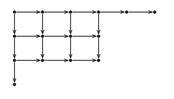

<p style="text-align:right">(39)</p>

的顶点上的摆放方式数目, 其中有向路径 $u\to v$ 的起始顶点 $u$ 的标号必须小于结束顶点 $v$ 的标号. 换句话说, 就是在 2.2.3 节意义下对偏序 (39) 进行拓扑排序的方式数.

一般来说, 我们可以对不包含有向回路的任何有向图提同一问题. 如果有一个简单公式把定理 H 推广到任意有向图情形那就太好了. 但并非所有的图都像对应于图表的图那样具备这些让人开心的性质. 本节末尾的习题讨论了一些其他类型的有向图, 可以很轻松地解决标号问题. 还有其他一些习题, 说明某些有向图不存在对应于定理 H 的简单公式. 例如, 加标号的方式数并不总是 $n!$ 的因子.

为了完成我们的研究, 现在计算由 $n$ 个不同元素构成的图表总数, 用 $t_n$ 表示这个数. 根据推论 B, $t_n$ 是 $\{1,2,\ldots,n\}$ 的对合数. 当且仅当一个排列的轮换形式仅由一元轮换 (不动点) 和二元轮换 (对换) 组成时, 这个排列是它自己的逆. 由于在 $t_n$ 个对合中, $t_{n-1}$ 个有一元轮换 $(n)$, $t_{n-2}$ 个有二元轮换 $(j\,n)$ (对固定的 $j<n$), 所以我们有

$$
t_n=t_{n-1}+(n-1)t_{n-2},\tag{40}
$$

这是罗思在 1800 年为较小的 $n$ 值制作 $t_n$ 表时设计的公式. $n\ge0$ 时这些值是 1, 1, 2, 4, 10, 26, 76, 232, 764, 2620, 9496, …….

<a id="pdf-054"></a>
<a id="p-48"></a>

用另一种方式计数, 假定有 $k$ 个二元轮换和 $(n-2k)$ 个一元轮换. 共有 $\binom n{2k}$ 种方法来选择不动点, 多项式系数 $(2k)!/(2!)^k$ 表示可以有多少种方式把其他元素排成 $k$ 个可区分的转置, 除以 $k!$ 表示不再区分这些转置, 从而得到

$$
t_n=\sum_{k=0}^{\lfloor n/2\rfloor}t_n(k),\qquad
t_n(k)=\frac{n!}{(n-2k)!2^kk!}.\tag{41}
$$

可惜这个和值没有简单的 “闭合式” (除非我们认为埃尔米特多项式 $i^n2^{-n/2}H_n(-i/\sqrt2)$ 是简单的), 所以我们求助于两种间接方法, 以期更好地理解 $t_n$:

(a) 可以求出生成函数

$$
\sum_nt_nz^n/n!=e^{z+z^2/2},\tag{42}
$$

见习题 25.

(b) 可以确定 $t_n$ 的渐近特性. 这是很有指导意义的问题, 因为它涉及一些在其他方面非常有用的一般性技术, 所以我们以分析 $t_n$ 的渐近特性来结束这一节.

分析式 (41) 渐近特性的第一步是确定它对和值的主要贡献. 由于

$$
\frac{t_n(k+1)}{t_n(k)}=\frac{(n-2k)(n-2k-1)}{2(k+1)},\tag{43}
$$

可以看到, 这些项会从 $k=0$ 开始逐渐增加, 直到 $t_n(k+1)\approx t_n(k)$ 为止, 此时 $k$ 大约为 $\tfrac12(n-\sqrt n)$. 然后当 $k$ 超过 $\tfrac12n$ 时它们逐渐下降到 0. 主要贡献显然来自于 $k=\tfrac12(n-\sqrt n)$ 附近. 通常喜欢把主要贡献安排在值为 0 处, 所以记

$$
k=\tfrac12(n-\sqrt n)+x,\tag{44}
$$

接下来把 $t_n(k)$ 看作 $x$ 的函数.

消除 $t_n(k)$ 中阶乘的有用方法是使用斯特林近似公式——式 1.2.11.2–(18). 为此, (稍后将会看到) 比较方便的做法是将 $x$ 限制在

$$
-n^{\epsilon+1/4}\le x\le n^{\epsilon+1/4}\tag{45}
$$

的范围内. 式中 $\epsilon=0.001$, 也就是说可以包含一个误差项. 通过有些费力的计算 (我在 20 世纪 60 年代是用手工计算的, 现在在计算机代数的帮助下可以很轻松地完成), 可以得出公式

$$
\begin{aligned}
t_n(k)=\exp\bigl(&\tfrac12n\ln n-\tfrac12n+\sqrt n-\tfrac14\ln n-2x^2/\sqrt n-\tfrac14-\tfrac12\ln\pi\\
&-\tfrac43x^3/n+2x/\sqrt n+\tfrac13/\sqrt n-\tfrac43x^4/(n\sqrt n)+O(n^{5\epsilon-3/4})\bigr).
\end{aligned}\tag{46}
$$

式 (45) 对 $x$ 的限制是合理的, 因为可以令 $x=\pm n^{\epsilon+1/4}$ 得到所有被舍弃项的上限, 即

$$
e^{-2n^{2\epsilon}}\exp\left(\tfrac12n\ln n-\tfrac12n+\sqrt n-\tfrac14\ln n-\tfrac14-\tfrac12\ln\pi+O(n^{3\epsilon-1/4})\right),\tag{47}
$$

如果将此式乘以 $n$, 则得到所有被舍弃项和值的上限. 当 $x$ 限制在范围 (45) 时这一上限的数量级要低于所要计算各项的数量级, 因为因子 $\exp(-2n^{2\epsilon})$ 远小于 $n$ 的任意多项式.

显然可以从这个和值中消去因子

$$
\exp\left(\tfrac12n\ln n-\tfrac12n+\sqrt n-\tfrac14\ln n-\tfrac14-\tfrac12\ln\pi+\tfrac13/\sqrt n\right),\tag{48}
$$

剩下要做的是在 $x=\alpha,\alpha+1,\ldots,\beta-2,\beta-1$ 范围内 (其中 $-\alpha$ 和 $\beta$ 近似等于 $n^{\epsilon+1/4}$, 不一定是整数) 对

<a id="pdf-055"></a>
<a id="p-49"></a>

$$
\begin{aligned}
&\exp\left(-2x^2/\sqrt n-\tfrac43x^3/n+2x/\sqrt n-\tfrac43x^4/(n\sqrt n)+O(n^{5\epsilon-3/4})\right)\\
&\quad={}\exp\left(\frac{-2x^2}{\sqrt n}\right)
\left(1-\frac43\frac{x^3}n+\frac89\frac{x^6}{n^2}\right)
\left(1+2\frac x{\sqrt n}+2\frac{x^2}n\right)\\
&\quad\times\left(1-\frac43\frac{x^4}{n\sqrt n}\right)
\left(1+O(n^{9\epsilon-3/4})\right)
\end{aligned}\tag{49}
$$


求和. 通过求和区间变换, 欧拉求和公式——式 1.2.11.2–(10)——可以写为

$$
\begin{aligned}
\sum_{\alpha\le x<\beta}f(x)
&=\int_\alpha^\beta f(x)\,dx-\left.\frac12f(x)\right|_\alpha^\beta\\
&\quad+\left.\frac12B_2\frac{f'(x)}{1!}\right|_\alpha^\beta+\cdots
+\left.\frac1{m+1}B_{m+1}\frac{f^{(m)}(x)}{m!}\right|_\alpha^\beta+R_{m+1},
\end{aligned}\tag{50}
$$

这里 $|R_m|\le(4/(2\pi)^m)\int_\alpha^\beta|f^{(m)}(x)|\,dx$. 如果设 $f(x)=x^t\exp(-2x^2/\sqrt n)$, 其中 $t$ 为一个固定的非负整数, 则欧拉求和公式将给出 $n\to\infty$ 时 $\sum f(x)$ 的渐近级数, 这是因为

$$
f^{(m)}(x)=n^{(t-m)/4}g^{(m)}(n^{-1/4}x),\qquad g(y)=y^te^{-2y^2},\tag{51}
$$

$g(y)$ 是与 $n$ 无关的良态函数. 导函数 $g^{(m)}(y)$ 是 $y$ 的多项式乘以 $e^{-2y^2}$, 因此 $R_m=O(n^{(t+1-m)/4})\int_{-\infty}^{+\infty}|g^{(m)}(y)|\,dy=O(n^{(t+1-m)/4})$. 此外, 如果用 $-\infty$ 和 $+\infty$ 分别代替式 (50) 右边的 $\alpha$ 和 $\beta$, 则每一项的误差最多为 $O(\exp(-2n^{2\epsilon}))$. 因此

$$
\sum_{\alpha\le x<\beta}f(x)=\int_{-\infty}^\infty f(x)\,dx+O(n^{-m}),\qquad\text{对所有 }m\ge0.\tag{52}
$$

给定 $f(x)$ 这一特定选择, 只有这个积分真正有意义! 积分求值没什么难度 (见习题 26), 所以可以乘出式 (49) 并求和, 得到 $\sqrt{\pi/2}(n^{1/4}-\tfrac1{24}n^{-1/4}+O(n^{-1/2}))$. 因此

$$
t_n=\frac1{\sqrt2}n^{n/2}e^{-n/2+\sqrt n-1/4}\left(1+\frac7{24}n^{-1/2}+O(n^{-3/4})\right).\tag{53}
$$

实际上, 式中 O 项应当在指数中有一个额外的 $9\epsilon$, 但从我们的处理方式中可以清楚地看出, 如果提高中间计算的精度, 这个 $9\epsilon$ 将会消失. 原则上可以扩展我们的方法获得对任意 $k$ 的 $O(n^{-k})$ 而不是 $O(n^{-3/4})$. $t_n$ 的这一渐近级数最初是由莫泽和怀曼确定的 (他们使用了不同方法)[*Canadian J. Math.* **7** (1955), 159–168].

我们用来推导式 (53) 的方法是一种极为有用的渐近分析技术, 它是由皮埃尔-西蒙·拉普拉斯引入的 [*Mémoires Acad. Sci.* (Paris, 1782), 1–88]. 《具体数学》9.4 节以 “交换尾部法” 为名讨论了这个方法. 交换尾部法的其他例子和扩展, 见 5.2.2 节结论部分.

### 习题

<a id="ex-5-1-4-1"></a>

**1.** [16] 在定理 A 的构造中, 什么图表 $(P,Q)$ 对应于两行阵列　[答案](#ans-5-1-4-1)

$$
\begin{pmatrix}1&2&3&4&5&6&7&8&9\\6&4&9&5&7&1&2&8&3\end{pmatrix}?
$$

什么两行阵列对应于图表

<div class="source-tableau-group" style="overflow-x:auto;max-width:100%"><div style="display:flex;align-items:center;gap:1em;width:max-content;margin:0 auto"><i>P =</i><table style="border-collapse:collapse;margin:.5em 0"><tbody>
<tr style="border:0;background:transparent"><td style="padding:.2em .45em">1</td><td style="padding:.2em .45em">4</td><td style="padding:.2em .45em">7</td></tr>
<tr style="border:0;background:transparent"><td style="padding:.2em .45em">2</td><td style="padding:.2em .45em">8</td></tr>
<tr style="border:0;background:transparent"><td style="padding:.2em .45em">5</td><td style="padding:.2em .45em">9</td></tr>
</tbody></table><span>, </span><i>Q =</i><table style="border-collapse:collapse;margin:.5em 0"><tbody>
<tr style="border:0;background:transparent"><td style="padding:.2em .45em">1</td><td style="padding:.2em .45em">3</td><td style="padding:.2em .45em">7</td></tr>
<tr style="border:0;background:transparent"><td style="padding:.2em .45em">4</td><td style="padding:.2em .45em">5</td></tr>
<tr style="border:0;background:transparent"><td style="padding:.2em .45em">8</td><td style="padding:.2em .45em">9</td></tr>
</tbody></table><span>? </span></div></div>

<a id="pdf-056"></a>
<a id="p-50"></a>

<a id="ex-5-1-4-2"></a>

**2.** [M21] 已知下标 $i_1,\ldots,i_t$ 满足　[答案](#ans-5-1-4-2)

$$
p_{i_1}<p_{i_2}<\cdots<p_{i_t}=p,\qquad q_{i_1}<q_{i_2}<\cdots<q_{i_t}=q.
$$

试证明: 当且仅当 $t$ 取满足上述条件的最大值时, $(q,p)$ 属于第 $t$ 类 (其含义如 (16) 所述).

<a id="ex-5-1-4-3"></a>

**3.** ▶ [M24] 证明: 在定理 A 的证明中定义的对应关系, 也可以通过构造表格　[答案](#ans-5-1-4-3)

$$
\begin{array}{rccccc}
\text{第0行}&1&3&5&6&8\\
\text{第1行}&7&2&9&5&3\\
\text{第2行}&\infty&7&\infty&9&5\\
\text{第3行}&&\infty&&\infty&7\\
\text{第4行}&&&&&\infty
\end{array}
$$

得出. 第 0、1 行是给定的两行阵列. 对于 $k\ge1$, 第 $k+1$ 行可根据第 $k$ 行通过以下步骤形成:

(a) 令 $p\leftarrow\infty$.

(b) 设第 $j$ 列是符合以下条件的最左边的列: 该列的第 $k$ 行包含一个 $<p$ 的整数, 但第 $k+1$ 行为空. 如果不存在这种列且 $p=\infty$, 则第 $k+1$ 行已完成; 如果不存在这种列且 $p<\infty$, 则返回步骤 (a).

(c) 把 $p$ 插入第 $k+1$ 行第 $j$ 列, 令 $p$ 等于第 $k$ 行第 $j$ 列的值, 返回步骤 (b).

用这种方式构造出表格之后, $P$ 的第 $k$ 行就是由表格中在第 $k$ 行但不在第 $k+1$ 行的整数组成; $Q$ 的第 $k$ 行由表格中第 0 行的这样一些整数组成, 它们所在列的第 $k+1$ 行是 $\infty$.

<a id="ex-5-1-4-4"></a>

**4.** ▶ [M30] 设 $a_1\ldots a_{j-1}a_j\ldots a_n$ 是不同元素的排列, 并假定 $1<j\le n$. 交换 $a_{j-1}$ 与 $a_j$ 将得到排列 $a_1\ldots a_{j-2}a_ja_{j-1}a_{j+1}\ldots a_n$. 如果　[答案](#ans-5-1-4-4)

(i) $j\ge3$ 且 $a_{j-2}$ 的值位于 $a_{j-1}$ 与 $a_j$ 之间, 或者

(ii) $j<n$ 且 $a_{j+1}$ 的值位于 $a_{j-1}$ 与 $a_j$ 之间,

则称交换是 “可接受的”. 例如, 对排列 $1\,5\,4\,6\,8\,3\,7$ 能执行的可接受交换恰有三个. 由于 $1<4<5$, 可以交换 1 和 5; 由于 $3<6<8$ (或由于 $3<7<8$), 可以交换 8 和 3; 但不能交换 5 和 4 或 3 和 7.

(a) 把元素 $a_1,a_2,\ldots,a_n$ 依次插入一个初始为空的图表构造图表 $P$, 证明: 可接受交换不会改变图表 $P$.

(b) 反之, 证明: 通过一次或多次可接受交换, 可以相互转换任何两个拥有相同图表 $P$ 的排列. [提示: 设 $P$ 的形状是 $(n_1,n_2,\ldots,n_m)$, 证明: 通过一系列可接受交换, 任何对应于 $P$ 的排列都可以转换为 “规范排列” $P_{m1}\ldots P_{mn_m}\ldots P_{21}\ldots P_{2n_2}P_{11}\ldots P_{1n_1}$.]

<a id="ex-5-1-4-5"></a>

**5.** ▶ [M22] 设 $P$ 是对应于排列 $a_1a_2\ldots a_n$ 的图表. 利用习题 4 证明: $P^T$ 是对应于 $a_n\ldots a_2a_1$ 的图表.　[答案](#ans-5-1-4-5)

<a id="ex-5-1-4-6"></a>

**6.** [M26] (舒岑贝热) 设 $\pi$ 是拥有 $k$ 个不动点的对合. 证明: 在推论 B 的证明中, 对应于 $\pi$ 的图表恰有 $k$ 个奇数长度的列.　[答案](#ans-5-1-4-6)

<a id="ex-5-1-4-7"></a>

**7.** [M20] (克雷奇·申斯特德) 设 $P$ 是对应于排列 $a_1a_2\ldots a_n$ 的图表. 证明: $P$ 的列数是递增序列 $a_{i_1}<a_{i_2}<\cdots<a_{i_c}$ 的最大长度 $c$, 其中 $i_1<i_2<\cdots<i_c$; $P$ 的行数是递减序列 $a_{j_1}>a_{j_2}>\cdots>a_{j_r}$ 的最大长度 $r$, 其中 $j_1<j_2<\cdots<j_r$.　[答案](#ans-5-1-4-7)

<a id="ex-5-1-4-8"></a>

**8.** [M18] (保罗·爱尔特希, 乔治·塞凯赖什) 证明: 任何一个元素个数超过 $n^2$ 的排列都有长度大于 $n$ 的单调子序列; 但存在元素个数为 $n^2$ 的排列, 它没有长度大于 $n$ 的单调子序列. [提示: 见习题 7.]　[答案](#ans-5-1-4-8)

<a id="ex-5-1-4-9"></a>

**9.** [M24] 继续习题 8, 在 $\{1,2,\ldots,n^2\}$ 的排列中, 究竟有多少个排列没有长度大于 $n$ 的单调子序列? 给出一个 “简单” 公式.　[答案](#ans-5-1-4-9)

<a id="ex-5-1-4-10"></a>

**10.** [M20] 证明: 如果算法 S 开始时 $P$ 是图表, 则算法终止时它仍然是图表.　[答案](#ans-5-1-4-10)

<a id="ex-5-1-4-11"></a>

**11.** [20] 仅给定算法 S 终止时的 $r$ 值和 $s$ 值, 是否有可能把 $P$ 恢复到原始状态?　[答案](#ans-5-1-4-11)

<a id="ex-5-1-4-12"></a>

**12.** [M24] 对于形状为 $(n_1,n_2,\ldots,n_m)$ 的图表 $P$, 如果重复使用算法 S 删去它的所有元素, 步骤 S3 要执行多少次? 对于 $n_1+n_2+\cdots+n_m=n$ 的所有形状, 这个量的最小值是多少?　[答案](#ans-5-1-4-12)

<a id="ex-5-1-4-13"></a>

**13.** [M28] 证明定理 C.　[答案](#ans-5-1-4-13)

<a id="ex-5-1-4-14"></a>

**14.** [M43] 给出定理 D 情形 (c) 的一个更直接证明.

<a id="pdf-057"></a>
<a id="p-51"></a>

<a id="ex-5-1-4-15"></a>

**15.** [M20] 多重集 $\{l\cdot a,m\cdot b,n\cdot c\}$ 的排列中有多少个具有以下性质: 在从左向右读取该排列时, $c$ 的个数绝对不会超过 $b$ 的个数, $b$ 的个数绝对不会超过 $a$ 的个数? (例如, $a\,a\,b\,c\,a\,b\,b\,c\,a\,c\,a$ 就是这样一个排列.)　[答案](#ans-5-1-4-15)

<a id="ex-5-1-4-16"></a>

**16.** [M08] 有多少种方式对 (39) 表示的偏序进行拓扑排序?　[答案](#ans-5-1-4-16)

<a id="ex-5-1-4-17"></a>

**17.** [HM25] 设　[答案](#ans-5-1-4-17)

$$
g(x_1,x_2,\ldots,x_n;y)=x_1\Delta(x_1+y,x_2,\ldots,x_n)
+x_2\Delta(x_1,x_2+y,\ldots,x_n)+\cdots+x_n\Delta(x_1,x_2,\ldots,x_n+y),
$$

证明:

$$
g(x_1,x_2,\ldots,x_n;y)=\left(x_1+x_2+\cdots+x_n+\binom n2y\right)\Delta(x_1,x_2,\ldots,x_n).
$$

[提示: 多项式 $g$ 是齐次的 (所有项都有相同的总次数), 它关于 $x$ 是反对称的 (交换 $x_i$ 和 $x_j$ 将改变 $g$ 的符号).]

<a id="ex-5-1-4-18"></a>

**18.** [HM30] 推广习题 17, 计算和式　[答案](#ans-5-1-4-18)

$$
x_1^m\Delta(x_1+y,x_2,\ldots,x_n)+x_2^m\Delta(x_1,x_2+y,\ldots,x_n)+\cdots+x_n^m\Delta(x_1,x_2,\ldots,x_n+y),
$$

其中 $m\ge0$.

<a id="ex-5-1-4-19"></a>

**19.** [M40] 有一种阵列, 它与图表类似, 但移除了第 1 行左侧的两个单元格. 例如　[答案](#ans-5-1-4-19)

<div class="source-tableau-group" style="overflow-x:auto;max-width:100%"><table aria-label="习题19首行左侧移除两格的阵列" style="border-collapse:collapse;margin:.8em auto"><tbody><tr style="border:0;background:transparent"><td style="border:0;padding:0;width:1.2em;min-width:1.2em">&nbsp;</td><td style="border:0;padding:0;width:1.2em;min-width:1.2em">&nbsp;</td><td data-removed-shape-cell="true" style="border:1px solid currentColor;padding:0;width:1.2em;min-width:1.2em;height:1.2em">&nbsp;</td><td data-removed-shape-cell="true" style="border:1px solid currentColor;padding:0;width:1.2em;min-width:1.2em;height:1.2em">&nbsp;</td><td data-removed-shape-cell="true" style="border:1px solid currentColor;padding:0;width:1.2em;min-width:1.2em;height:1.2em">&nbsp;</td><td data-removed-shape-cell="true" style="border:1px solid currentColor;padding:0;width:1.2em;min-width:1.2em;height:1.2em">&nbsp;</td><td data-removed-shape-cell="true" style="border:1px solid currentColor;padding:0;width:1.2em;min-width:1.2em;height:1.2em">&nbsp;</td><td style="border:0;white-space:nowrap;padding:0 0 0 1.5em"><i>n</i><sub>1</sub>−2 个单元格</td></tr><tr style="border:0;background:transparent"><td data-removed-shape-cell="true" style="border:1px solid currentColor;padding:0;width:1.2em;min-width:1.2em;height:1.2em">&nbsp;</td><td data-removed-shape-cell="true" style="border:1px solid currentColor;padding:0;width:1.2em;min-width:1.2em;height:1.2em">&nbsp;</td><td data-removed-shape-cell="true" style="border:1px solid currentColor;padding:0;width:1.2em;min-width:1.2em;height:1.2em">&nbsp;</td><td data-removed-shape-cell="true" style="border:1px solid currentColor;padding:0;width:1.2em;min-width:1.2em;height:1.2em">&nbsp;</td><td data-removed-shape-cell="true" style="border:1px solid currentColor;padding:0;width:1.2em;min-width:1.2em;height:1.2em">&nbsp;</td><td style="border:0;padding:0;width:1.2em;min-width:1.2em">&nbsp;</td><td style="border:0;padding:0;width:1.2em;min-width:1.2em">&nbsp;</td><td style="border:0;white-space:nowrap;padding:0 0 0 1.5em"><i>n</i><sub>2</sub> 个单元格</td></tr><tr style="border:0;background:transparent"><td data-removed-shape-cell="true" style="border:1px solid currentColor;padding:0;width:1.2em;min-width:1.2em;height:1.2em">&nbsp;</td><td data-removed-shape-cell="true" style="border:1px solid currentColor;padding:0;width:1.2em;min-width:1.2em;height:1.2em">&nbsp;</td><td data-removed-shape-cell="true" style="border:1px solid currentColor;padding:0;width:1.2em;min-width:1.2em;height:1.2em">&nbsp;</td><td style="border:0;padding:0;width:1.2em;min-width:1.2em">&nbsp;</td><td style="border:0;padding:0;width:1.2em;min-width:1.2em">&nbsp;</td><td style="border:0;padding:0;width:1.2em;min-width:1.2em">&nbsp;</td><td style="border:0;padding:0;width:1.2em;min-width:1.2em">&nbsp;</td><td style="border:0;white-space:nowrap;padding:0 0 0 1.5em"><i>n</i><sub>3</sub> 个单元格</td></tr><tr style="border:0;background:transparent"><td data-removed-shape-cell="true" style="border:1px solid currentColor;padding:0;width:1.2em;min-width:1.2em;height:1.2em">&nbsp;</td><td data-removed-shape-cell="true" style="border:1px solid currentColor;padding:0;width:1.2em;min-width:1.2em;height:1.2em">&nbsp;</td><td data-removed-shape-cell="true" style="border:1px solid currentColor;padding:0;width:1.2em;min-width:1.2em;height:1.2em">&nbsp;</td><td style="border:0;padding:0;width:1.2em;min-width:1.2em">&nbsp;</td><td style="border:0;padding:0;width:1.2em;min-width:1.2em">&nbsp;</td><td style="border:0;padding:0;width:1.2em;min-width:1.2em">&nbsp;</td><td style="border:0;padding:0;width:1.2em;min-width:1.2em">&nbsp;</td><td style="border:0;white-space:nowrap;padding:0 0 0 1.5em">⋮</td></tr><tr style="border:0;background:transparent"><td data-removed-shape-cell="true" style="border:1px solid currentColor;padding:0;width:1.2em;min-width:1.2em;height:1.2em">&nbsp;</td><td style="border:0;padding:0;width:1.2em;min-width:1.2em">&nbsp;</td><td style="border:0;padding:0;width:1.2em;min-width:1.2em">&nbsp;</td><td style="border:0;padding:0;width:1.2em;min-width:1.2em">&nbsp;</td><td style="border:0;padding:0;width:1.2em;min-width:1.2em">&nbsp;</td><td style="border:0;padding:0;width:1.2em;min-width:1.2em">&nbsp;</td><td style="border:0;padding:0;width:1.2em;min-width:1.2em">&nbsp;</td><td style="border:0;white-space:nowrap;padding:0 0 0 1.5em"></td></tr></tbody></table></div>

就是这样一种形状. (和普通图表一样, 它的行与列的元素按递增顺序排列.) 给出一个公式, 计算有多少种方式填充这种阵列.

换句话说, 形状为 $(n_1,n_2,\ldots,n_m)$、由元素 $\{1,2,\ldots,n_1+\cdots+n_m\}$ 填充的图表中, 第一行拥有元素 1 和 2 的图表有多少个?

<a id="ex-5-1-4-20"></a>

**20.** ▶ [M24] 用元素 $\{1,2,\ldots,n\}$ 标记一个给定树的结点, 使每个结点的标号都小于它的子孙结点的标号. 证明: 符合这一要求的标记方式数等于 $n!$ 除以所有子树大小 (即每个子树的结点数) 的乘积. 例如, 树　[答案](#ans-5-1-4-20)

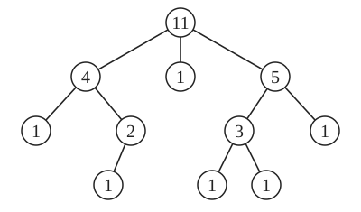

的标记方式数是 $11!/(11\cdot4\cdot1\cdot5\cdot1\cdot2\cdot3\cdot1\cdot1\cdot1\cdot1)=10\cdot9\cdot8\cdot7\cdot6$. (与定理 H 比较.)

<a id="ex-5-1-4-21"></a>

**21.** [HM31] (思罗尔) 设 $n_1>n_2>\cdots>n_m$ 确定一个 “移位图表” 的形状, 其中第 $i+1$ 行相对于第 $i$ 行右移一个位置. 例如, 形状为 $(7,5,4,1)$ 的移位图表具有以下形式　[答案](#ans-5-1-4-21)

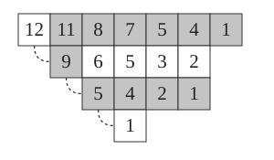

<a id="pdf-058"></a>
<a id="p-52"></a>

用整数 $1,2,\ldots,n=n_1+n_2+\cdots+n_m$ 填充形状为 $(n_1,n_2,\ldots,n_m)$ 的移位图表, 使得行与列均为增序. 证明: 填充方式数等于 $n!$ 除以 “广义钩子长度” 的乘积. 在上图中用阴影标出了一个长度为 11 的广义钩子, 它对应于第 1 行第 2 列的单元格. (阵列中左侧 “倒楼梯” 部分的钩子为旋转 $90^\circ$ 的 U 形, 而不是 L 形.) 因此, 共有

$$
17!/(12\cdot11\cdot8\cdot7\cdot5\cdot4\cdot1\cdot9\cdot6\cdot5\cdot3\cdot2\cdot5\cdot4\cdot2\cdot1\cdot1)
$$

种方式按行列增序来填充这个形状.

<a id="ex-5-1-4-22"></a>

**22.** [M39] 用集合 $\{1,2,\ldots,N\}$ 的元素填充形状为 $(n_1,n_2,\ldots,n_m)$ 的阵列, 允许重复, 使各行非递减, 各列严格递增, 共有多少种填充方式? 例如, 简单 $m$ 行形状 $(1,1,\ldots,1)$ 有 $\binom Nm$ 种填充方式; 仅有 1 行的形状 $(m)$ 有 $\binom{m+N-1}m$ 种填充方式; 小方块形状 $(2,2)$ 有 $\tfrac13\binom{N+1}2\binom N2$ 种填充方式.　[答案](#ans-5-1-4-22)

<a id="ex-5-1-4-23"></a>

**23.** ▶ [HM30] (安托万·安德烈) 把数 $\{1,2,\ldots,n\}$ 放入由 $n$ 个单元格组成的阵列　[答案](#ans-5-1-4-23)

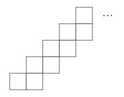

中, 使得行与列均为增序, 其方式数 $E_n$ 是多少? 试求生成函数 $g(z)=\sum E_nz^n/n!$.

<a id="ex-5-1-4-24"></a>

**24.** [M28] 证明:

$$
\begin{aligned}
&\sum_{\substack{q_1+\cdots+q_n=t\\0\le q_1,\ldots,q_n\le m}}
\binom m{q_1}\cdots\binom m{q_n}\Delta(q_1,\ldots,q_n)^2\\
&\quad=n!\binom{nm-(n^2-n)}{t-\tfrac12(n^2-n)}
\binom m{n-1}\binom m{n-2}\cdots\binom m0\Delta(n-1,\ldots,0)^2.
\end{aligned}
$$

[提示: 证明 $\Delta(k_1+n-1,\ldots,k_n)=\Delta(m-k_n+n-1,\ldots,m-k_1)$; 用类似于 (38) 的方式分解一个 $n\times(m-n+1)$ 的图表; 如同推导 (36) 那样处理这个和式.]

<a id="ex-5-1-4-25"></a>

**25.** [M20] 为什么 (42) 是对合的生成函数?　[答案](#ans-5-1-4-25)

<a id="ex-5-1-4-26"></a>

**26.** [HM21] 当 $t$ 为非负整数时, 计算 $\int_{-\infty}^\infty x^t\exp(-2x^2/\sqrt n)\,dx$.　[答案](#ans-5-1-4-26)

<a id="ex-5-1-4-27"></a>

**27.** [M24] 设 $Q$ 是 $\{1,2,\ldots,n\}$ 上的一个扬氏图表, 元素 $i$ 位于第 $r_i$ 行第 $c_i$ 列. 当 $r_i<r_j$ 时, 我们说 $i$ 位于 $j$ “上方”.　[答案](#ans-5-1-4-27)

(a) 证明: 对于 $1\le i<n$, $i$ 位于 $i+1$ 上方, 当且仅当 $c_i\ge c_{i+1}$.

(b) 给定 $Q$ 使得 $(P,Q)$ 对应于排列

$$
\begin{pmatrix}1&2&\cdots&n\\a_1&a_2&\cdots&a_n\end{pmatrix},
$$

证明: $i$ 位于 $i+1$ 上方, 当且仅当 $a_i>a_{i+1}$. (因此, 仅需知道 $Q$, 我们就能确定排列中游程的数目. 这个结果属于舒岑贝热.)

(c) 证明: 对于 $1\le i<n$, $i$ 在 $Q$ 中位于 $i+1$ 上方, 当且仅当 $i+1$ 在 $Q^S$ 中位于 $i$ 上方.

<a id="ex-5-1-4-28"></a>

**28.** [M43] 证明: $\{1,2,\ldots,n\}$ 的一个随机排列的最长递增子序列的平均长度渐近于 $2\sqrt n$. (这是定理 A 的对应关系中第 1 行的平均长度.)　[答案](#ans-5-1-4-28)

<a id="ex-5-1-4-29"></a>

**29.** [HM25] 证明: 一个 $n$ 元素随机排列拥有长度 $\ge l$ 的递增子序列的概率 $\le\binom nl/l!$. 当 $l=e\sqrt n+O(1)$ 时, 这个概率为 $O(1/\sqrt n)$; 当 $l=3\sqrt n$ 时, 这个概率为 $O(\exp(-c\sqrt n))$, 其中 $c=6\ln3-6$.　[答案](#ans-5-1-4-29)

<a id="ex-5-1-4-30"></a>

**30.** [M41] (舒岑贝热) 证明: 由 $P$ 变为 $P^S$ 的操作是一种特例, 其一般性操作适用于任何有限偏序集合 (而不仅限于图表): 用整数 $\{1,2,\ldots,n\}$ 标记偏序集合的元素, 使偏序与标号保持一致. 给出一种类似于 (26) 的对偶标号方法: 依次删除标号 1, 2, ……, 用类似于算法 S 的方式移动其他标号, 然后把 1, 2, ……放到空出的位置中. 证明: 以相反的数值顺序对此对偶标号重复这个操作, 将会得到原始标号. 研究这个操作的其他性质.　[答案](#ans-5-1-4-30)

<a id="pdf-059"></a>
<a id="p-53"></a>

<a id="ex-5-1-4-31"></a>

**31.** [HM30] 在 $n\times n$ 的棋盘上放置 $n$ 个互相没有攻击性的车, 设 $x_n$ 表示关于两条对角线的反射都保持不变的摆放方式数目. 于是我们有 $x_4=6$. (对合仅要求关于一条对角线对称. 习题 5.1.3–19 考虑了一个相关问题.) 试求 $x_n$ 的渐近特性.　[答案](#ans-5-1-4-31)

<a id="ex-5-1-4-32"></a>

**32.** [HM21] 证明: 当 $X$ 是均值为 1、方差为 1 的正态偏差时, 对合数目 $t_n$ 是 $X^n$ 的期望值.　[答案](#ans-5-1-4-32)

<a id="ex-5-1-4-33"></a>

**33.** [M25] (奥斯卡·米切尔, 1881) 判断正误: 当 $a_1,a_2,\ldots,a_m$ 是整数时,　[答案](#ans-5-1-4-33)

$$
\Delta(a_1,a_2,\ldots,a_m)/\Delta(1,2,\ldots,m)
$$

是整数.

<a id="ex-5-1-4-34"></a>

**34.** [25] (中山正, 1940) 证明: 如果一个图表形状包含长度为 $ab$ 的钩子, 那么它也包含长度为 $a$ 的钩子.　[答案](#ans-5-1-4-34)

<a id="ex-5-1-4-35"></a>

**35.** ▶ [30] (亚伯拉罕·希尔曼, 理查德·格拉斯尔, 1976) 假定一个图表形状的第 $i$ 行有 $n_i$ 个单元格, 第 $j$ 列有 $n'_j$ 个单元格, 它的元素 $p_{ij}$ (非负整数) 满足 $\sum p_{ij}=m$, 如果　[答案](#ans-5-1-4-35)

$$
p_{i1}\ge\cdots\ge p_{in_i},\qquad
p_{1j}\ge\cdots\ge p_{n'_j j},\qquad1\le i\le n'_1,\ 1\le j\le n_1,
$$

就说它是 $m$ 的平面分划. 如果代之以

$$
p_{i1}\le\cdots\le p_{in_i},\qquad
p_{1j}\le\cdots\le p_{n'_j j},\qquad1\le i\le n'_1,\ 1\le j\le n_1,
$$

则称为逆平面分划. 以下算法对给定形状的逆平面分划进行操作, 构造具有相同形状的另一个阵列 (元素是 $q_{ij}$):

<a id="alg-5-1-4-G"></a>

**G1.** [初始化.] 对于 $1\le j\le n_i$ 和 $1\le i\le n'_1$, 置 $q_{ij}\leftarrow0$. 然后置 $j\leftarrow1$.

**G2.** [找非零单元格.] 如果 $p_{n'_j j}>0$, 置 $i\leftarrow n'_j$, $k\leftarrow j$, 转到 G3. 否则, 如果 $j<n_1$, $j$ 增 1, 并重复本步骤. 否则终止算法 ($p$ 阵列现在为零).

**G3.** [减小 $p$.]$p_{ik}$ 减 1.

**G4.** [上移或右移.] 如果 $i>1$ 且 $p_{(i-1)k}>p_{ik}$, $i$ 减 1, 返回 G3. 否则, 如果 $k<n_i$, $k$ 增 1, 返回 G3.

**G5.** [增大 $q$.]$q_{ij}$ 增 1, 返回 G2.　▮

设计一个从 $q$ 值重新计算 $p$ 值的算法, 从而证明这个构造定义了 $m$ 的逆平面分划与方程

$$
m=\sum h_{ij}q_{ij}
$$

的解之间的一一对应, 方程中的 $h_{ij}$ 是这个形状的钩子长度.

<a id="ex-5-1-4-36"></a>

**36.** [HM27] (理查德·斯坦利, 1971)(a) 证明: 在一个给定形状中, $m$ 的逆平面分划数目是 $[z^m]1/\prod(1-z^{h_{ij}})$, 其中 $h_{ij}$ 是这个形状的钩子长度. (b) 由这个结果推导定理 H. [提示: 当 $m\to\infty$ 时, 分划数目的渐近值是多少?]　[答案](#ans-5-1-4-36)

<a id="ex-5-1-4-37"></a>

**37.** [M20] (麦克马洪, 1912) 试求所有平面分划的生成函数. ($z^m$ 的系数应该是图表形状不受限制时的 $m$ 的平面分划总数.)　[答案](#ans-5-1-4-37)

<a id="ex-5-1-4-38"></a>

**38.** ▶ [M30] (柯蒂斯·格林, 艾伯特·奈恩黑斯, 赫伯特·维尔夫, 1979) 我们可以在任意给定的图表形状的单元格集合 $T$ 上构造一个有向无圈图: 从每个单元格向它的钩子中的其他单元格连接一个有向弧. 于是单元格 $(i,j)$ 的 “出次数” 是 $d_{ij}=h_{ij}-1$, 其中 $h_{ij}$ 是钩子长度. 假设我们选择一个随机起始单元格 $(i,j)$, 然后再随机选择有向弧, 重复此过程, 直到遇上没有出口的角落单元格, 从而在这个有向图中生成一条随机路径. 每个随机选择的概率相同.　[答案](#ans-5-1-4-38)

(a) 设 $(a,b)$ 是 $T$ 的一个角落单元格, 设 $I=\{i_0,\ldots,i_k\}$ 和 $J=\{j_0,\ldots,j_l\}$ 是满足 $i_0<\cdots<i_k=a$ 和 $j_0<\cdots<j_l=b$ 的行列集合. 这个有向图包含 $\binom{k+l}k$ 条行列集合分别为 $I$ 和 $J$ 的路径. 设 $P(I,J)$ 是随机路径属于这些路径的概率. 证明: $P(I,J)=1/(n d_{i_0b}\cdots d_{i_{k-1}b}d_{aj_0}\cdots d_{aj_{l-1}})$, 其中 $n=|T|$.

(b) 设 $f(T)=n!/\prod h_{ij}$. 证明: 随机路径终止于角落单元格 $(a,b)$ 的概率是 $f(T\setminus\{(a,b)\})/f(T)$.

<a id="pdf-060"></a>
<a id="p-54"></a>

(c) 证明: (b) 的结果证明了定理 H, 也为我们提供了一种方法, 用于生成形状 $T$ 的随机图表, 而且所有 $f(T)$ 个图表的概率相同.

<a id="ex-5-1-4-39"></a>

**39.** [M38] (伊戈尔·帕克, 亚历山大·斯托亚诺夫斯基, 1992) 设 $P$ 是形状为 $(n_1,\ldots,n_m)$ 的阵列, 已经填充了整数 $\{1,\ldots,n\}$ 的某个排列, 其中 $n=n_1+\cdots+n_m$. 下列过程把 $P$ 转换为图表, 它类似于 5.2.3 节的 “上选” 算法. 这个过程还定义了相同形状的阵列 $Q$, 可用于提供定理 H 的组合证明.　[答案](#ans-5-1-4-39)

<a id="alg-5-1-4-P"></a>

**P1.** [对 $(i,j)$ 循环.] 按字典序的逆序对阵列中的所有单元格 $(i,j)$ 执行 P2 和 P3 (即, 自下而上, 在每一行中从右向左), 然后停止.

**P2.** [在 $(i,j)$ 处固定 $P$.] 置 $K\leftarrow P_{ij}$, 并执行算法 $\mathrm S'$ (见下文).

**P3.** [调整 $Q$.] 对于 $j\le k<s$, 置 $Q_{ik}\leftarrow Q_{i(k+1)}+1$, 然后置 $Q_{is}\leftarrow i-r$.　▮

这里的算法 $\mathrm S'$ 与舒岑贝热的算法 S 相同, 只是对步骤 S1、S2 和 S4 作了如下调整:

<a id="alg-5-1-4-S-prime"></a>

**S1′.** [初始化.] 置 $r\leftarrow i$, $s\leftarrow j$.

**S2′.** [完成?] 如果 $K\lesssim P_{(r+1)s}$ 和 $K\lesssim P_{r(s+1)}$, 置 $P_{rs}\leftarrow K$, 终止算法.

**S4′.** [左移.] 置 $P_{rs}\leftarrow P_{r(s+1)}$, $s\leftarrow s+1$, 返回 S2′.

(算法 S 实质上是 $i=1,j=1,K=\infty$ 的特例.)

例如, 算法 P 采用以下方式整理一个形状为 $(3,3,2)$ 的特定阵列, 我们观察步骤 P2 开始时阵列 $P$ 和 $Q$ 的内容, 其中 $P_{ij}$ 以粗体标出:

<div class="source-tableau-group" style="overflow-x:auto;max-width:100%"><div style="display:grid;grid-template-columns:max-content repeat(8,max-content);align-items:start;gap:.5em .4em;width:max-content;margin:0 auto"><i>P =</i><table data-stage-grid="P" data-stage="1" style="border-collapse:collapse;margin:.4em 0"><tbody><tr style="border:0;background:transparent"><td style="padding:.15em .3em">7</td><td style="padding:.15em .3em">8</td><td style="padding:.15em .3em">5</td></tr><tr style="border:0;background:transparent"><td style="padding:.15em .3em">1</td><td style="padding:.15em .3em">6</td><td style="padding:.15em .3em">4</td></tr><tr style="border:0;background:transparent"><td style="padding:.15em .3em">3</td><td data-current-cell="true" style="padding:.15em .3em"><strong>2</strong></td></tr></tbody></table><table data-stage-grid="P" data-stage="2" style="border-collapse:collapse;margin:.4em 0"><tbody><tr style="border:0;background:transparent"><td style="padding:.15em .3em">7</td><td style="padding:.15em .3em">8</td><td style="padding:.15em .3em">5</td></tr><tr style="border:0;background:transparent"><td style="padding:.15em .3em">1</td><td style="padding:.15em .3em">6</td><td style="padding:.15em .3em">4</td></tr><tr style="border:0;background:transparent"><td data-current-cell="true" style="padding:.15em .3em"><strong>3</strong></td><td style="padding:.15em .3em">2</td></tr></tbody></table><table data-stage-grid="P" data-stage="3" style="border-collapse:collapse;margin:.4em 0"><tbody><tr style="border:0;background:transparent"><td style="padding:.15em .3em">7</td><td style="padding:.15em .3em">8</td><td style="padding:.15em .3em">5</td></tr><tr style="border:0;background:transparent"><td style="padding:.15em .3em">1</td><td style="padding:.15em .3em">6</td><td data-current-cell="true" style="padding:.15em .3em"><strong>4</strong></td></tr><tr style="border:0;background:transparent"><td style="padding:.15em .3em">2</td><td style="padding:.15em .3em">3</td></tr></tbody></table><table data-stage-grid="P" data-stage="4" style="border-collapse:collapse;margin:.4em 0"><tbody><tr style="border:0;background:transparent"><td style="padding:.15em .3em">7</td><td style="padding:.15em .3em">8</td><td style="padding:.15em .3em">5</td></tr><tr style="border:0;background:transparent"><td style="padding:.15em .3em">1</td><td data-current-cell="true" style="padding:.15em .3em"><strong>6</strong></td><td style="padding:.15em .3em">4</td></tr><tr style="border:0;background:transparent"><td style="padding:.15em .3em">2</td><td style="padding:.15em .3em">3</td></tr></tbody></table><table data-stage-grid="P" data-stage="5" style="border-collapse:collapse;margin:.4em 0"><tbody><tr style="border:0;background:transparent"><td style="padding:.15em .3em">7</td><td style="padding:.15em .3em">8</td><td style="padding:.15em .3em">5</td></tr><tr style="border:0;background:transparent"><td data-current-cell="true" style="padding:.15em .3em"><strong>1</strong></td><td style="padding:.15em .3em">3</td><td style="padding:.15em .3em">4</td></tr><tr style="border:0;background:transparent"><td style="padding:.15em .3em">2</td><td style="padding:.15em .3em">6</td></tr></tbody></table><table data-stage-grid="P" data-stage="6" style="border-collapse:collapse;margin:.4em 0"><tbody><tr style="border:0;background:transparent"><td style="padding:.15em .3em">7</td><td style="padding:.15em .3em">8</td><td data-current-cell="true" style="padding:.15em .3em"><strong>5</strong></td></tr><tr style="border:0;background:transparent"><td style="padding:.15em .3em">1</td><td style="padding:.15em .3em">3</td><td style="padding:.15em .3em">4</td></tr><tr style="border:0;background:transparent"><td style="padding:.15em .3em">2</td><td style="padding:.15em .3em">6</td></tr></tbody></table><table data-stage-grid="P" data-stage="7" style="border-collapse:collapse;margin:.4em 0"><tbody><tr style="border:0;background:transparent"><td style="padding:.15em .3em">7</td><td data-current-cell="true" style="padding:.15em .3em"><strong>8</strong></td><td style="padding:.15em .3em">4</td></tr><tr style="border:0;background:transparent"><td style="padding:.15em .3em">1</td><td style="padding:.15em .3em">3</td><td style="padding:.15em .3em">5</td></tr><tr style="border:0;background:transparent"><td style="padding:.15em .3em">2</td><td style="padding:.15em .3em">6</td></tr></tbody></table><table data-stage-grid="P" data-stage="8" style="border-collapse:collapse;margin:.4em 0"><tbody><tr style="border:0;background:transparent"><td data-current-cell="true" style="padding:.15em .3em"><strong>7</strong></td><td style="padding:.15em .3em">3</td><td style="padding:.15em .3em">4</td></tr><tr style="border:0;background:transparent"><td style="padding:.15em .3em">1</td><td style="padding:.15em .3em">5</td><td style="padding:.15em .3em">8</td></tr><tr style="border:0;background:transparent"><td style="padding:.15em .3em">2</td><td style="padding:.15em .3em">6</td></tr></tbody></table><i>Q =</i><table data-stage-grid="Q" data-stage="1" style="border-collapse:collapse;margin:.4em 0"><tbody><tr style="border:0;background:transparent"><td data-stage-empty="true" style="padding:.15em .3em">&nbsp;</td><td data-stage-empty="true" style="padding:.15em .3em">&nbsp;</td><td data-stage-empty="true" style="padding:.15em .3em">&nbsp;</td></tr><tr style="border:0;background:transparent"><td data-stage-empty="true" style="padding:.15em .3em">&nbsp;</td><td data-stage-empty="true" style="padding:.15em .3em">&nbsp;</td><td data-stage-empty="true" style="padding:.15em .3em">&nbsp;</td></tr><tr style="border:0;background:transparent"><td data-stage-empty="true" style="padding:.15em .3em">&nbsp;</td><td data-stage-empty="true" style="padding:.15em .3em">&nbsp;</td></tr></tbody></table><table data-stage-grid="Q" data-stage="2" style="border-collapse:collapse;margin:.4em 0"><tbody><tr style="border:0;background:transparent"><td data-stage-empty="true" style="padding:.15em .3em">&nbsp;</td><td data-stage-empty="true" style="padding:.15em .3em">&nbsp;</td><td data-stage-empty="true" style="padding:.15em .3em">&nbsp;</td></tr><tr style="border:0;background:transparent"><td data-stage-empty="true" style="padding:.15em .3em">&nbsp;</td><td data-stage-empty="true" style="padding:.15em .3em">&nbsp;</td><td data-stage-empty="true" style="padding:.15em .3em">&nbsp;</td></tr><tr style="border:0;background:transparent"><td data-stage-empty="true" style="padding:.15em .3em">&nbsp;</td><td style="padding:.15em .3em">0</td></tr></tbody></table><table data-stage-grid="Q" data-stage="3" style="border-collapse:collapse;margin:.4em 0"><tbody><tr style="border:0;background:transparent"><td data-stage-empty="true" style="padding:.15em .3em">&nbsp;</td><td data-stage-empty="true" style="padding:.15em .3em">&nbsp;</td><td data-stage-empty="true" style="padding:.15em .3em">&nbsp;</td></tr><tr style="border:0;background:transparent"><td data-stage-empty="true" style="padding:.15em .3em">&nbsp;</td><td data-stage-empty="true" style="padding:.15em .3em">&nbsp;</td><td data-stage-empty="true" style="padding:.15em .3em">&nbsp;</td></tr><tr style="border:0;background:transparent"><td style="padding:.15em .3em">1</td><td style="padding:.15em .3em">0</td></tr></tbody></table><table data-stage-grid="Q" data-stage="4" style="border-collapse:collapse;margin:.4em 0"><tbody><tr style="border:0;background:transparent"><td data-stage-empty="true" style="padding:.15em .3em">&nbsp;</td><td data-stage-empty="true" style="padding:.15em .3em">&nbsp;</td><td data-stage-empty="true" style="padding:.15em .3em">&nbsp;</td></tr><tr style="border:0;background:transparent"><td data-stage-empty="true" style="padding:.15em .3em">&nbsp;</td><td data-stage-empty="true" style="padding:.15em .3em">&nbsp;</td><td style="padding:.15em .3em">0</td></tr><tr style="border:0;background:transparent"><td style="padding:.15em .3em">1</td><td style="padding:.15em .3em">0</td></tr></tbody></table><table data-stage-grid="Q" data-stage="5" style="border-collapse:collapse;margin:.4em 0"><tbody><tr style="border:0;background:transparent"><td data-stage-empty="true" style="padding:.15em .3em">&nbsp;</td><td data-stage-empty="true" style="padding:.15em .3em">&nbsp;</td><td data-stage-empty="true" style="padding:.15em .3em">&nbsp;</td></tr><tr style="border:0;background:transparent"><td data-stage-empty="true" style="padding:.15em .3em">&nbsp;</td><td style="padding:.15em .3em">−1</td><td style="padding:.15em .3em">0</td></tr><tr style="border:0;background:transparent"><td style="padding:.15em .3em">1</td><td style="padding:.15em .3em">0</td></tr></tbody></table><table data-stage-grid="Q" data-stage="6" style="border-collapse:collapse;margin:.4em 0"><tbody><tr style="border:0;background:transparent"><td data-stage-empty="true" style="padding:.15em .3em">&nbsp;</td><td data-stage-empty="true" style="padding:.15em .3em">&nbsp;</td><td data-stage-empty="true" style="padding:.15em .3em">&nbsp;</td></tr><tr style="border:0;background:transparent"><td style="padding:.15em .3em">0</td><td style="padding:.15em .3em">−1</td><td style="padding:.15em .3em">0</td></tr><tr style="border:0;background:transparent"><td style="padding:.15em .3em">1</td><td style="padding:.15em .3em">0</td></tr></tbody></table><table data-stage-grid="Q" data-stage="7" style="border-collapse:collapse;margin:.4em 0"><tbody><tr style="border:0;background:transparent"><td data-stage-empty="true" style="padding:.15em .3em">&nbsp;</td><td data-stage-empty="true" style="padding:.15em .3em">&nbsp;</td><td style="padding:.15em .3em">−1</td></tr><tr style="border:0;background:transparent"><td style="padding:.15em .3em">0</td><td style="padding:.15em .3em">−1</td><td style="padding:.15em .3em">0</td></tr><tr style="border:0;background:transparent"><td style="padding:.15em .3em">1</td><td style="padding:.15em .3em">0</td></tr></tbody></table><table data-stage-grid="Q" data-stage="8" style="border-collapse:collapse;margin:.4em 0"><tbody><tr style="border:0;background:transparent"><td data-stage-empty="true" style="padding:.15em .3em">&nbsp;</td><td style="padding:.15em .3em">0</td><td style="padding:.15em .3em">−1</td></tr><tr style="border:0;background:transparent"><td style="padding:.15em .3em">0</td><td style="padding:.15em .3em">−1</td><td style="padding:.15em .3em">0</td></tr><tr style="border:0;background:transparent"><td style="padding:.15em .3em">1</td><td style="padding:.15em .3em">0</td></tr></tbody></table></div></div>

最终结果是

<div class="source-tableau-group" style="overflow-x:auto;max-width:100%"><div style="display:flex;align-items:center;gap:1em;width:max-content;margin:0 auto"><i>P =</i><table style="border-collapse:collapse;margin:.5em 0"><tbody>
<tr style="border:0;background:transparent"><td style="padding:.2em .45em">1</td><td style="padding:.2em .45em">3</td><td style="padding:.2em .45em">4</td></tr>
<tr style="border:0;background:transparent"><td style="padding:.2em .45em">2</td><td style="padding:.2em .45em">5</td><td style="padding:.2em .45em">8</td></tr>
<tr style="border:0;background:transparent"><td style="padding:.2em .45em">6</td><td style="padding:.2em .45em">7</td></tr>
</tbody></table><span>, </span><i>Q =</i><table style="border-collapse:collapse;margin:.5em 0"><tbody>
<tr style="border:0;background:transparent"><td style="padding:.2em .45em">1</td><td style="padding:.2em .45em">−2</td><td style="padding:.2em .45em">−1</td></tr>
<tr style="border:0;background:transparent"><td style="padding:.2em .45em">0</td><td style="padding:.2em .45em">−1</td><td style="padding:.2em .45em">0</td></tr>
<tr style="border:0;background:transparent"><td style="padding:.2em .45em">1</td><td style="padding:.2em .45em">0</td></tr>
</tbody></table><span>. </span></div></div>

(a) 如果 $P$ 仅仅是 $1\times n$ 阵列, 算法 P 对它排序, 变为

<div style="display:flex;justify-content:center"><table style="border-collapse:collapse;margin:.5em 0"><tbody>
<tr style="border:0;background:transparent"><td style="padding:.2em .45em">1</td><td style="padding:.2em .45em">⋯</td><td style="padding:.2em .45em"><i>n</i></td></tr>
</tbody></table></div>

试说明这种情况下阵列 $Q$ 将包含什么.

(b) 如果 $P$ 的形状是 $n\times1$ 而不是 $1\times n$, 试回答相同问题.

(c) 证明: 一般情况下, 有

$$
-b_{ij}\le Q_{ij}\le r_{ij},
$$

式中, $b_{ij}$ 是 $(i,j)$ 之下的单元格数目, $r_{ij}$ 是其右侧的单元格数目. 因此, $Q_{ij}$ 可能取值的数目恰为 $h_{ij}$, 也就是第 $(i,j)$ 个钩子的大小.

(d) 如果能证明算法 P 在填充原始形状的 $n!$ 种方式与输出阵列对 $(P,Q)$ 之间建立了一一对应 (其中, $P$ 是图表, $Q$ 的元素满足 (c) 的条件), 则可以构造性地证明定理 H. 因此, 我们希望找到算法 P 的逆算法. 对于什么样的初始排列, 算法 P 会生成 $2\times2$ 的阵列

<div style="display:flex;justify-content:center;align-items:center;gap:1em"><i>Q =</i><table style="border-collapse:collapse;margin:.5em 0"><tbody>
<tr style="border:0;background:transparent"><td style="padding:.2em .45em">0</td><td style="padding:.2em .45em">−1</td></tr>
<tr style="border:0;background:transparent"><td style="padding:.2em .45em">0</td><td style="padding:.2em .45em">0</td></tr>
</tbody></table><span>? </span></div>

(e) 算法 P 会把什么样的初始排列转换为阵列对

<div class="source-tableau-group" style="overflow-x:auto;max-width:100%"><div style="display:flex;align-items:center;gap:1em;width:max-content;margin:0 auto"><i>P =</i><table style="border-collapse:collapse;margin:.5em 0"><tbody>
<tr style="border:0;background:transparent"><td style="padding:.2em .45em">1</td><td style="padding:.2em .45em">3</td><td style="padding:.2em .45em">5</td><td style="padding:.2em .45em">7</td><td style="padding:.2em .45em">11</td><td style="padding:.2em .45em">15</td></tr>
<tr style="border:0;background:transparent"><td style="padding:.2em .45em">2</td><td style="padding:.2em .45em">6</td><td style="padding:.2em .45em">8</td><td style="padding:.2em .45em">14</td></tr>
<tr style="border:0;background:transparent"><td style="padding:.2em .45em">4</td><td style="padding:.2em .45em">9</td><td style="padding:.2em .45em">13</td></tr>
<tr style="border:0;background:transparent"><td style="padding:.2em .45em">10</td><td style="padding:.2em .45em">12</td></tr>
<tr style="border:0;background:transparent"><td style="padding:.2em .45em">16</td></tr>
</tbody></table><span>, </span><i>Q =</i><table style="border-collapse:collapse;margin:.5em 0"><tbody>
<tr style="border:0;background:transparent"><td style="padding:.2em .45em">−2</td><td style="padding:.2em .45em">−3</td><td style="padding:.2em .45em">−1</td><td style="padding:.2em .45em">−1</td><td style="padding:.2em .45em">1</td><td style="padding:.2em .45em">0</td></tr>
<tr style="border:0;background:transparent"><td style="padding:.2em .45em">3</td><td style="padding:.2em .45em">−2</td><td style="padding:.2em .45em">−1</td><td style="padding:.2em .45em">0</td></tr>
<tr style="border:0;background:transparent"><td style="padding:.2em .45em">0</td><td style="padding:.2em .45em">−1</td><td style="padding:.2em .45em">0</td></tr>
<tr style="border:0;background:transparent"><td style="padding:.2em .45em">−1</td><td style="padding:.2em .45em">0</td></tr>
<tr style="border:0;background:transparent"><td style="padding:.2em .45em">0</td></tr>
</tbody></table><span>? </span></div></div>

<a id="pdf-061"></a>
<a id="p-55"></a>

(f) 给定任意阵列对 $(P,Q)$, 其中 $P$ 是图表, $Q$ 满足 (c) 的条件, 试设计算法 P 的逆算法. [提示: 构造一颗定向树, 顶点是单元格 $(i,j)$, 包含有向弧:

$$
\begin{aligned}
\text{如果 }P_{i(j-1)}>P_{(i-1)j},&\quad(i,j)\to(i,j-1);\\
\text{如果 }P_{i(j-1)}<P_{(i-1)j},&\quad(i,j)\to(i-1,j).
\end{aligned}
$$

针对 (e) 的数据, 可以得到下面的树:

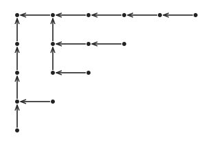

这颗树的路径展示了对算法 P 求逆的关键.]

<a id="ex-5-1-4-40"></a>

**40.** [HM43] 我们依次放置数 $1,2,\ldots,n$, 以相等的可能性放置每一个新数, 从而构造一个随机的扬氏图表. 例如, 这个过程将以　[答案](#ans-5-1-4-40)

$$
\frac11\cdot\frac12\cdot\frac12\cdot\frac13\cdot\frac13\cdot\frac13\cdot\frac14\cdot\frac13\cdot\frac13\cdot\frac14\cdot\frac14\cdot\frac15\cdot\frac14\cdot\frac15\cdot\frac14
$$

的概率得到图表 (1).

证明: 将以很高的概率使得结果形状 $(n_1,n_2,\ldots,n_m)$ 满足 $m\approx\sqrt{6n}$ 和 $\sqrt k+\sqrt{n_{k+1}}\approx\sqrt m$($0\le k\le m$).

<a id="ex-5-1-4-41"></a>

**41.** [25] (图书馆中的无序) 粗心的读者在把图书放回书架时经常会搞错位置. 有一种方式可以衡量一个图书馆的无序程度: 把一本书从一个位置取出, 再插入另一位置, 至少需要进行多少次这种操作, 才能使所有书籍恢复正确顺序.　[答案](#ans-5-1-4-41)

设 $\pi=a_1a_2\ldots a_n$ 是 $\{1,2,\ldots,n\}$ 的一个排列. 对于某个 $i$ 和 $j$, 一次 “删除-插入操作” 把 $\pi$ 变为

$$
a_1\ldots a_{i-1}a_{i+1}\ldots a_ja_ia_{j+1}\ldots a_n
\quad\text{或}\quad
a_1\ldots a_ja_ia_{j+1}\ldots a_{i-1}a_{i+1}\ldots a_n.
$$

设 $\operatorname{dis}(\pi)$ 是使 $\pi$ 恢复有序所需 “删除-插入” 操作的最少次数, 能否用 $\pi$ 的简单特性表达 $\operatorname{dis}(\pi)$?

<a id="ex-5-1-4-42"></a>

**42.** ▶ [30] (基因组中的无序) 半边莲的 DNA 中有一段基因序列 $g_7^Rg_1g_2g_4g_5g_3g_6^R$, 其中 $g_7^R$ 表示 $g_7$ 的左右镜像. 烟草植物中也有同样的基因, 但顺序是 $g_1g_2g_3g_4g_5g_6g_7$. 证明: 为把 $g_1g_2g_3g_4g_5g_6g_7$ 变成 $g_7^Rg_1g_2g_4g_5g_3g_6^R$, 需要对子串进行五次 “翻转” 操作. (当 $\alpha,\beta,\gamma$ 是基因串时, 一次翻转操作把 $\alpha\beta\gamma$ 变成 $\alpha\beta^R\gamma$.)　[答案](#ans-5-1-4-42)

<a id="ex-5-1-4-43"></a>

**43.** [35] 继续上一题, 证明: 为使 $g_1g_2\ldots g_n$ 的任意重排恢复有序, 至多需要 $n+1$ 次翻转. 对于所有 $n>3$, 试构造需要 $n+1$ 次翻转的示例.　[答案](#ans-5-1-4-43)

<a id="ex-5-1-4-44"></a>

**44.** [M37] 证明: 如果所有 $2^n n!$ 个基因组重排是等可能的, 则对 $n$ 个基因的一个随机排列进行排序所需的平均翻转次数大于 $n-H_n$.　[答案](#ans-5-1-4-44)

<a id="pdf-062"></a>
<a id="p-56"></a>

<a id="sec-5-2"></a>

## 5.2　内部排序

现在让我们做一项试验, 开始讨论好的 “排序技能”. 你会如何解决下面的程序设计问题?

> “存储单元 R+1, R+2, R+3, R+4, R+5 中包含五个数. 请编写一段计算机程序, 根据需要将这些数字调整为递增顺序.”

(如果你已经熟悉某些排序方法, 请尽量暂时忘掉它们. 设想你是第一次解决这个问题, 没有任何预先知识告诉你如何处理.)

在继续阅读下面的内容之前, 要求读者为这个问题提供一种解决方案.

⋯⋯⋯⋯⋯⋯⋯⋯⋯⋯⋯⋯⋯⋯⋯⋯⋯⋯⋯⋯

在解决这个具有挑战性的问题时所花费的时间将会在后面继续阅读本章时得到回报. 你的解决方案可能属于以下某种类型之一.

A. **插入排序.** 每次只考虑一项, 把每个新项插入先前已排序项的适当位置. (许多桥牌玩家就是这样对手中的纸牌进行排序的, 他们每次只拿起一张纸牌.)

B. **交换排序.** 如果发现有两项的顺序颠倒, 则交换它们. 重复这个过程直到不再需要交换为止.

C. **选择排序.** 首先找出最小 (或最大) 项, 然后把它与其余项分开, 接下来选择下一个最小 (或最大) 项, 以此类推.

D. **枚举排序.** 把每项与其他项逐一对比, 一项的最终位置取决于它超过了多少个键.

E. **专用排序.** 它能很好地对问题中所述的五个元素进行排序, 但无法推广到对更多项目进行排序.

F. **懒散态度.** 忽略上面的建议, 决定根本不去解决这一问题. 对不起, 你现在阅读的内容已经太多了, 而且已经错过时机了.

G. **一种新的超级排序技术.** 相对于已知方法有明显改进. 如果有这种技术, 请立即通知我.

如果提出的问题涉及 (比如说)1000 项, 而不是只有 5 项, 你可能已经发现了一些将在后面谈到的更精巧技术. 无论如何, 在解决一个新问题时, 明智的做法通常是先找出一个比较明显的解决方案, 然后尝试进行改进. 前面提到的 A、B、C 引出了几类重要的排序技术, 它们就是这些简单思想的深化.

人们已经发明了许多不同的排序算法, 本书将讨论其中的大约 25 种. 这些算法数目听起来有些吓人, 但实际上只是目前已有算法的一小部分. 我们的讨论将会忽略许多现在已经过时的技术, 或者只是简单提及. 为什么会有这么多排序方法呢? 对于计算机程序设计来说, 这是下面这个问题的特例: “为什么会有这么多 $x$ 方法?” 其中 $x$ 可以是任何要面对的问题. 对这个问题的回答是: 每种方法都有自己的优缺点, 它在某种数据与硬件配置下的性能会优于其他方法. 遗憾的是, 并不存在已知的 “最佳” 排序方式. 目前许多最佳方法, 取决于出于什么目的在什么计算机上对什么内容进行排序. 用拉迪亚德·基普林的话说: “有 69 种部落安置方式, 每一种都是正确的.”

一个好主意是了解每种排序方法的特性, 以便为特定应用做出明智的选择. 幸运的是, 学习这些算法并不是什么不可实现的任务, 因为它们彼此之间有一些有趣的关联.

<a id="pdf-063"></a>
<a id="p-57"></a>

在本章开头, 我们定义了一些用于研究排序的术语和记号: 要对记录

$$
R_1,R_2,\ldots,R_N\tag{1}
$$

进行排序, 使它们的键 $K_1,K_2,\ldots,K_N$ 变为非递减顺序, 基本方法就是要找出一种排列 $p(1)\,p(2)\ldots p(N)$ 使得

$$
K_{p(1)}\le K_{p(2)}\le\cdots\le K_{p(N)}.\tag{2}
$$

本节讨论内部排序, 此时待排序的记录数目很小, 足以在一台计算机中的高速存储器中完成整个排序过程.

在某些情况下, 我们希望重新调整记录在存储器中的物理位置, 使它们的键变为有序状态, 而在其他一些情况下, 只需要提供一份辅助排序表, 用于指定排列方式就足够了. 如果每条记录和／或键占据了计算机存储器的很多空间, 较好的做法通常是制作一份新的指向这些记录的链接地址表, 然后处理这些链接地址, 而不是移动庞大的记录. 这种方法称为地址表排序 (见图 6). 如果键很短, 但记录的附属信息很长, 可以把这些键与链接地址放在一起, 以提高速度, 这种方法称为键排序. 另一种排序机制利用了每条记录中所包含的辅助链接字段, 可以采用某种方式来处理这些链接, 使得在最终结果中这些记录链接在一起, 构成一个整齐的线性列表, 每个链接都指向下一条记录. 这种方法称为列表排序 (见图 7).

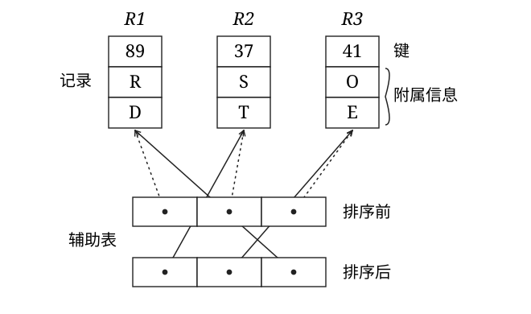

图 6　地址表排序

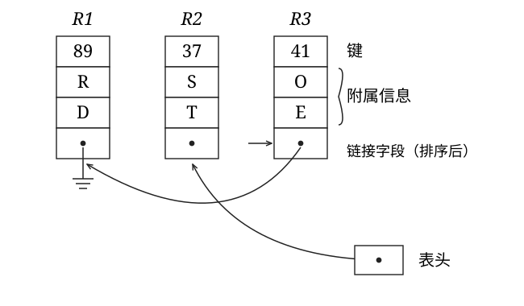

图 7　列表排序

在使用地址表或列表方法进行排序后, 可以根据需要将记录重新排列为递增顺序. 习题 10 和 12 讨论了一些完成这个任务的有趣方法, 只要求有足够保存一条记录的额外存储空间即可. 或者, 我们也可以直接把这些记录都移到一个能够容纳所有记录的新区域. 后一方法的速度通常是前者的两倍, 但需要的存储空间也接近前者的两倍. 由于链接字段通常足以应对所有后续处理, 所以在许多应用中完全不需要移动记录.

我们将深入研究的所有排序方法都采用如下四种方式进行介绍:

(a) 算法的生活语言描述,

(b) 流程图,

(c) MIX 程序,

(d) 排序方法示例, 应用于某个由 16 个数组成的集合.

为方便起见, MIX 程序通常假定键为数值类型, 而且可以放入一个字中, 有时甚至会将键限制为一个字的一部分. 次序关系 $<$ 就是普通的算术次序. 记录仅包含键本身, 不含附属信息. 这些假定使程序更简短更易于理解. 读者会发现, 利用地址表排序或列表排序很容易把这些程序中的任何一个推广到一般情形. 对每种排序算法运行时间的分析将用 MIX 程序给出.

**计数排序.** 作为研究内部排序方法的一个简单例子, 考虑本节开头提出的 “计数” 思想. 这种简单方法的思想基础是: 最终有序序列的第 $j$ 个键正好大于 $j-1$ 个其他键. 换种说法, 如果我们知道一个特定键恰好大于其他 27 个键, 而且任何两个键都不相等, 则排序后相应记录应当放在第 28 号位置. 这个思想是比较每一对键, 计算有多少个键小于每个特定的键.

<a id="pdf-064"></a>
<a id="p-58"></a>

有一种显而易见的方法可以完成此类比较:

$$
\text{对 }1\le i\le N\ \bigl(\text{对 }1\le j\le N\ \bigl(\text{比较 }K_j\text{ 和 }K_i\bigr)\bigr),
$$

但容易看出这些比较中有超过一半是多余的, 因为把一个键与自己进行比较是不必要的, 也不需要在比较 $K_a$ 与 $K_b$ 后再比较 $K_b$ 与 $K_a$. 我们只需要

$$
\text{对 }1<i\le N\ \bigl(\text{对 }1\le j<i\ \bigl(\text{比较 }K_j\text{ 和 }K_i\bigr)\bigr).
$$

因此有以下算法.

<a id="alg-5-2-C"></a>

**算法 C (比较计数).** 算法根据键 $K_1,\ldots,K_N$ 对 $R_1,\ldots,R_N$ 进行排序: 维护一个辅助表 `COUNT[1]`, …, `COUNT[N]`, 计算有多少键小于一个给定键. 算法结束时, $\mathrm{COUNT}[j]+1$ 指明记录 $R_j$ 的最终位置.

**C1.** [COUNT 清零.] 把 `COUNT[1]` 至 `COUNT[N]` 置为 0.

**C2.** [对 $i$ 循环.] 对 $i=N,N-1,\ldots,2$ 执行 C3, 然后结束算法.

**C3.** [对 $j$ 循环.] 对 $j=i-1,i-2,\ldots,1$ 执行 C4.

**C4.** [比较 $K_i:K_j$.] 如果 $K_i<K_j$, `COUNT[j]` 加 1, 否则 `COUNT[i]` 加 1.　▮

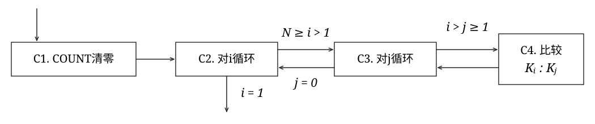

图 8　算法 C: 比较计数

注意算法 C 不涉及记录移动. 由于 COUNT 表指明记录的最终位置, 它类似于地址表排序. 但又多少有些不同, 因为 `COUNT[j]` 告诉我们往哪里移动 $R_j$, 而不是指出应当将哪条记录移动到 $R_j$ 的位置. (因此 COUNT 表指明排列 $p(1)\ldots p(N)$ 的逆, 见 5.1.1 节.)

表 1 描述了比较计数算法的典型特性, 这是算法应用于我在 1963 年 3 月 19 日随机选择的 16 个数的情形. 这 16 个数还将用于说明后面要讨论的几乎所有其他算法.

表 1　计数排序 (算法 C)

<table data-counting-source-table="true"><tbody>
<tr><th>键</th><th>503</th><th>087</th><th>512</th><th>061</th><th>908</th><th>170</th><th>897</th><th>275</th><th>653</th><th>426</th><th>154</th><th>509</th><th>612</th><th>677</th><th>765</th><th>703</th></tr>
<tr><td>COUNT (初始)</td><td>0</td><td>0</td><td>0</td><td>0</td><td>0</td><td>0</td><td>0</td><td>0</td><td>0</td><td>0</td><td>0</td><td>0</td><td>0</td><td>0</td><td>0</td><td>0</td></tr>
<tr><td>COUNT($i=N$)</td><td>0</td><td>0</td><td>0</td><td>0</td><td>1</td><td>0</td><td>1</td><td>0</td><td>0</td><td>0</td><td>0</td><td>0</td><td>0</td><td>0</td><td>1</td><td>12</td></tr>
<tr><td>COUNT($i=N-1$)</td><td>0</td><td>0</td><td>0</td><td>0</td><td>2</td><td>0</td><td>2</td><td>0</td><td>0</td><td>0</td><td>0</td><td>0</td><td>0</td><td>0</td><td>13</td><td>12</td></tr>
<tr><td>COUNT($i=N-2$)</td><td>0</td><td>0</td><td>0</td><td>0</td><td>3</td><td>0</td><td>3</td><td>0</td><td>0</td><td>0</td><td>0</td><td>0</td><td>0</td><td>11</td><td>13</td><td>12</td></tr>
<tr><td>COUNT($i=N-3$)</td><td>0</td><td>0</td><td>0</td><td>0</td><td>4</td><td>0</td><td>4</td><td>0</td><td>1</td><td>0</td><td>0</td><td>0</td><td>9</td><td>11</td><td>13</td><td>12</td></tr>
<tr><td>COUNT($i=N-4$)</td><td>0</td><td>0</td><td>1</td><td>0</td><td>5</td><td>0</td><td>5</td><td>0</td><td>2</td><td>0</td><td>0</td><td>7</td><td>9</td><td>11</td><td>13</td><td>12</td></tr>
<tr><td>COUNT($i=N-5$)</td><td>1</td><td>0</td><td>2</td><td>0</td><td>6</td><td>1</td><td>6</td><td>1</td><td>3</td><td>1</td><td>2</td><td>7</td><td>9</td><td>11</td><td>13</td><td>12</td></tr>
<tr><td colspan="17" style="text-align:center">⋯⋯⋯⋯⋯⋯⋯⋯⋯⋯⋯⋯⋯⋯⋯⋯</td></tr>
<tr><td>COUNT($i=2$)</td><td>6</td><td>1</td><td>8</td><td>0</td><td>15</td><td>3</td><td>14</td><td>4</td><td>10</td><td>5</td><td>2</td><td>7</td><td>9</td><td>11</td><td>13</td><td>12</td></tr>
</tbody></table>

<a id="pdf-065"></a>
<a id="p-59"></a>

在这个算法之前的讨论中, 我们轻率地假定没有任何两个键相等. 这有潜在的危险, 因为如果相等的键对应于相等的 COUNT, 最后重新排列记录时将会非常复杂. 幸运的是, 无论存在多少个相等的键算法 C 都会给出正确结果 (见习题 2).

<a id="prog-5-2-C"></a>

**程序 C (比较计数).** 算法 C 的 MIX 实现. 假定对于 $1\le j\le N$, $R_j$ 存储在单元 `INPUT+j`, `COUNT[j]` 存储在单元 `COUNT+j`. $\mathrm{rI1}\equiv i$; $\mathrm{rI2}\equiv j$; $\mathrm{rA}\equiv K_i\equiv R_i$; $\mathrm{rX}\equiv\mathrm{COUNT}[i]$.

```mixal
01 START ENT1 N          1     C1. COUNT清零。
02       STZ  COUNT,1    N     COUNT[i] ← 0.
03       DEC1 1          N
04       J1P  *-2        N     N ≥ i > 0.
05       ENT1 N          1     C2. 对i循环。
06       JMP  1F         1
07 2H    LDA  INPUT,1    N-1
08       LDX  COUNT,1    N-1
09 3H    CMPA INPUT,2    A     C4. 比较 Ki : Kj.
10       JGE  4F         A     如果 Ki ≥ Kj 则转移。
11       LD3  COUNT,2    B     COUNT[j]
12       INC3 1          B     +1
13       ST3  COUNT,2    B     → COUNT[j].
14       JMP  5F         B
15 4H    INCX 1          A-B   COUNT[i] ← COUNT[i] + 1.
16 5H    DEC2 1          A     C3. 对j循环。
17       J2P  3B         A
18       STX  COUNT,1    N-1
19       DEC1 1          N-1
20 1H    ENT2 -1,1       N     N ≥ i > j > 0.
21       J2P  2B         N     ▮
```

这个程序的运行时间是 $13N+6A+5B-4$ 单位, 其中 $N$ 是记录个数, $A$ 是从 $N$ 个对象的集合中选出两个对象的选择方式数 $\binom N2=(N^2-N)/2$, $B$ 是满足 $j<i$ 和 $K_j>K_i$ 的下标对数. 因此 $B$ 是排列 $K_1\ldots K_N$ 的反序数, 5.1.1 节对这个量有详尽分析, 对随机顺序的不相等键, 根据式 5.1.1–(12) 和 5.1.1–(13), 我们有

$$
B=\bigl(\text{最小 }0,\ \text{平均 }(N^2-N)/4,\ \text{最大 }(N^2-N)/2,\ \text{标准差 }\sqrt{N(N-1)(N+2.5)}/6\bigr).
$$

因此程序 C 需要的时间单位介于 $3N^2+10N-4$ 与 $5.5N^2+7.5N-4$ 之间, 平均运行时间取两个端点的中间值. 例如表 1 的数据 ($N=16,A=120,B=41$) 程序 C 将用 $1129u$ 对其排序. 习题 5 给出程序 C 的一个改进版, 其时间特性稍有不同.

运行时间的主要决定因子 $N^2$ 表明: $N$ 很大时算法 C 不是高效排序方法. 记录数加倍会使运行时间上升为原来的四倍. 由于这个方法需要比较所有不同键对 $(K_i,K_j)$, 所以没有什么明显的方法可以消除对 $N^2$ 的依赖, 尽管在本章后面将看到, 利用其他技术可以将最糟情况下的排序运行时间缩短到 $N\log N$ 量级. 我们对算法 C 的主要兴趣在于它的简单性而不在于它的速度. 算法 C 是一个风格示例, 我们将采用这种风格来描述更复杂 (以及更高效) 的算法.

还有一种从效率角度看非常重要的计数排序方法. 它主要适用于以下情形: 存在很多相等的键, 所有的键都落入范围 $u\le K_j\le v$, 其中 $(v-u)$ 很小. 这些假设看起来限制性很强, 但事实上我们将看到这种思想的大量应用. 例如, 如果把这个方法应用于键的头几位数字而不是整个键, 可以先对文件进行部分排序, 接着完成全部排序就是相对简单的任务.

<a id="pdf-066"></a>
<a id="p-60"></a>

为了理解涉及的基本原理, 假定所有键都在 1 至 100 范围内. 对文件第一次扫描时, 可以数一下有多少个 1, 2, …, 100. 第二次扫描就可以把这些记录移到输出区域的适当位置. 以下算法详尽描述了这个过程.

<a id="alg-5-2-D"></a>

**算法 D (分布计数).** 假定所有的键都是 $u\le K_j\le v$ 范围内的整数 ($1\le j\le N$), 算法利用辅助表 `COUNT[u]`, …, `COUNT[v]` 对记录 $R_1,\ldots,R_N$ 排序. 算法结束时这些记录以期望顺序移到输出区域 $S_1,\ldots,S_N$.

**D1.** [COUNT 清零.] 把 `COUNT[u]` 至 `COUNT[v]` 置为 0.

**D2.** [对 $j$ 循环.] 对 $1\le j\le N$ 执行 D3, 然后转到 D4.

**D3.** [$\mathrm{COUNT}[K_j]$ 递增.]$\mathrm{COUNT}[K_j]$ 的值增 1.

**D4.** [累加.] (此时 $\mathrm{COUNT}[i]$ 是等于 $i$ 的键的个数.) 对 $i=u+1,u+2,\ldots,v$, 置 $\mathrm{COUNT}[i]\leftarrow\mathrm{COUNT}[i]+\mathrm{COUNT}[i-1]$.

**D5.** [对 $j$ 循环.] (此时 $\mathrm{COUNT}[i]$ 是小于或等于 $i$ 的键的个数, 特别是 $\mathrm{COUNT}[v]=N$.) 对 $j=N,N-1,\ldots,1$ 执行 D6, 然后结束算法.

**D6.** [输出 $R_j$.] 置 $i\leftarrow\mathrm{COUNT}[K_j]$, $S_i\leftarrow R_j$, $\mathrm{COUNT}[K_j]\leftarrow i-1$.　▮

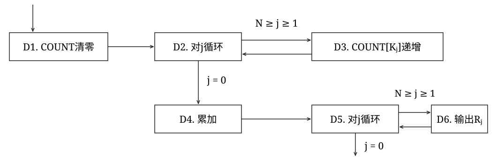

图 9　算法 D: 分布计数

习题 6 给出算法的一个示例, 习题 9 中有一个 MIX 程序. $v-u$ 很小时这个排序程序非常快.

算法 C 中的比较计数排序最早由爱德华·弗兰德提出 [*JACM* **3** (1956), 152], 尽管没有宣称这是他自己的发明. 算法 D 中的分布排序由哈罗德·苏厄德在 1954 年最早开发, 和将在后面讨论的基数排序技术 (见 5.2.5 节) 一起使用. 华莱士·弗伊尔齐格也曾以 Mathsort 为名发表过这个算法 [*CACM* **3** (1960), 601].

### 习题

<a id="ex-5-2-1"></a>

**1.** [15] 在算法 C 中, 如果步骤 C2 中 $i$ 的变化范围是由 2 增大到 $N$, 而不是由 $N$ 降低到 2, 算法是否仍能正常工作? 如果步骤 C3 中 $j$ 的变化范围是由 1 增大到 $i-1$, 又会如何呢?　[答案](#ans-5-2-1)

<a id="ex-5-2-2"></a>

**2.** [21] 证明: 存在相等键时算法 C 仍能正常工作. 如果 $K_j=K_i$ 且 $j<i$, 完成排序后 $R_j$ 是在 $R_i$ 的前面还是后面?　[答案](#ans-5-2-2)

<a id="ex-5-2-3"></a>

**3.** ▶ [21] 在算法 C 中, 如果步骤 C4 中的测试由 $K_i<K_j$ 变为 $K_i\le K_j$, 算法是否仍能正常工作?　[答案](#ans-5-2-3)

<a id="ex-5-2-4"></a>

**4.** [16] 编写一段 MIX 程序, “完成” 由程序 C 启动的排序. 你的程序应当以增序把键传送到单元 `OUTPUT+1` 至 `OUTPUT+N`. 你的程序需要多少时间?　[答案](#ans-5-2-4)

<a id="pdf-067"></a>
<a id="p-61"></a>

<a id="ex-5-2-5"></a>

**5.** [22] 以下修改是否改进程序 C?　[答案](#ans-5-2-5)

```text
新增行 08a: INCX 0,2
修改行 10:  JGE  5F
修改行 14:  DECX 1
删除行 15.
```

<a id="ex-5-2-6"></a>

**6.** [18] 手算模拟算法 D, 给出对 16 条记录 `5T, 0C, 5U, 0O, 9·, 1N, 8S, 2R, 6A, 4A, 1G, 5L, 6T, 6I, 7O, 7N` 排序的中间结果. 这里的数字是键, 字母是这些记录携带的信息.　[答案](#ans-5-2-6)

<a id="ex-5-2-7"></a>

**7.** [13] 算法 D 是稳定排序算法吗?　[答案](#ans-5-2-7)

<a id="ex-5-2-8"></a>

**8.** [15] 在算法 D 中, 如果步骤 D5 中 $j$ 的变化范围是由 1 增大到 $N$, 而不是由 $N$ 降低到 1, 算法是否仍能正常工作?　[答案](#ans-5-2-8)

<a id="ex-5-2-9"></a>

**9.** [23] 类似于程序 C 与习题 4, 为算法 D 编写一段 MIX 程序. 你的程序的执行时间是多少? 将其表示为 $N$ 和 $(v-u)$ 的函数.　[答案](#ans-5-2-9)

<a id="ex-5-2-10"></a>

**10.** [25] 给定 $R_1,\ldots,R_N$ 的取值以及 $\{1,\ldots,N\}$ 的排列 $p(1)\ldots p(N)$, 设计一种高效算法, 用 $N$ 个量 $(R_{p(1)},\ldots,R_{p(N)})$ 分别替代 $(R_1,\ldots,R_N)$. 尝试避免使用过多的存储空间. (如果在地址表排序之后希望在存储器中重排记录, 而又没有足够的空间来存储 $2N$ 条记录, 就会出现这个问题.)　[答案](#ans-5-2-10)

<a id="ex-5-2-11"></a>

**11.** [M27] 为习题 10 的算法编写 MIX 程序, 并分析它的效率.　[答案](#ans-5-2-11)

<a id="ex-5-2-12"></a>

**12.** ▶ [25] 设计一种高效算法, 用于在完成列表排序 (图 7) 之后, 把记录 $R_1,\ldots,R_N$ 按照排好的顺序重新排列. 尝试避免使用过多的存储空间.　[答案](#ans-5-2-12)

<a id="ex-5-2-13"></a>

**13.** ▶ [27] 算法 D 需要空间来存储 $2N$ 条记录 $R_1,\ldots,R_N$ 和 $S_1,\ldots,S_N$. 证明: 如果使用一种新的紧凑过程代替步骤 D5 和 D6, 有可能仅需要存储 $N$ 条记录 $R_1,\ldots,R_N$ 的空间. (因此, 问题就变为设计一种算法, 根据步骤 D4 之后的 `COUNT[u]`, …, `COUNT[v]` 取值重新排列 $R_1,\ldots,R_N$, 而不需要额外的存储空间. 实质上这是习题 10 中所考虑问题的推广.)　[答案](#ans-5-2-13)

<a id="sec-5-2-1"></a>

### 5.2.1　插入排序

有一类重要的排序技术, 是以 5.2 节开头处提到的 “桥牌玩家” 的方法为基础的. 在研究记录 $R_j$ 之前, 假定以前的记录 $R_1,\ldots,R_{j-1}$ 已经完成排序, 然后把 $R_j$ 插入前面已排好序记录的适当位置. 这个基本主题有若干重要的变化形式.

**直接插入.** 最简单的插入排序也是最显而易见的. 假定 $1<j\le N$, 并且已经重新排列了记录 $R_1,\ldots,R_{j-1}$, 使得

$$
K_1\le K_2\le\cdots\le K_{j-1}.
$$

(请记住, 在本章中 $K_j$ 始终表示 $R_j$ 的键.) 我们把新键 $K_j$ 依次与 $K_{j-1},K_{j-2},\ldots$ 进行比较, 直到发现应当把 $R_j$ 插入到记录 $R_i$ 和 $R_{i+1}$ 之间为止. 然后把记录 $R_{i+1},\ldots,R_{j-1}$ 上移一个位置, 并把新记录放到位置 $i+1$ 处. 比较方便的做法是组合比较与移动操作, 像下面算法中那样把它们交织在一起. 由于 $R_j$ “被安放到适当层次”, 这种排序方法通常称为筛选或沉降技术.

<a id="alg-5-2-1-S"></a>

**算法 S (直接插入排序).** 重新排列记录 $R_1,\ldots,R_N$ 到适当位置, 排序完成后它们的键将处于有序状态: $K_1\le\cdots\le K_N$.

**S1.** [对 $j$ 循环.] 对 $j=2,3,\ldots,N$ 执行 S2 到 S5, 然后结束算法.

**S2.** [设定 $i,K,R$.] 置 $i\leftarrow j-1$, $K\leftarrow K_j$, $R\leftarrow R_j$. (以下步骤按 $i$ 的递减值比较 $K$ 与 $K_i$ 试着把 $R$ 插入正确位置.)

**S3.** [比较 $K:K_i$.] 如果 $K\ge K_i$ 转到 S5. (已经找到记录 $R$ 的期望位置.)

<a id="pdf-068"></a>
<a id="p-62"></a>

**S4.[移动 $R_i$, 减小 $i$.]** 置 $R_{i+1}\leftarrow R_i$, 然后 $i\leftarrow i-1$. 如果 $i>0$ 返回 S3. (如果 $i=0$, 则 $K$ 是目前找到的最小键, 所以记录 $R$ 属于位置 1.)

**S5.[$R$ 放入 $R_{i+1}$.]** 置 $R_{i+1}\leftarrow R$.　▮

<a id="fig-5-10"></a>

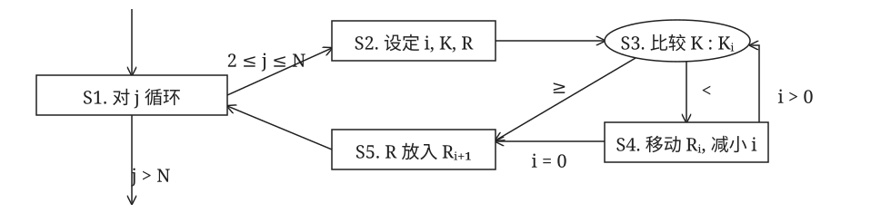

图 10　算法 S: 直接插入

表 1 展示算法 S 如何对我们的 16 个示例数据进行排序. 这种方法在计算机上实现起来极为容易. 事实上, 下面的 MIX 程序是本书最短的质量也还不错的排序例程.

<a id="table-5-2-1-1"></a>

表 1　直接插入示例

```text
503:087
^
087 503:512
    ^
087 503 512:061
        ^
061 087 503 512:908
            ^
061 087 503 512 908:170
                ^
061 087 170 503 512 908:897
                    ^
 .   .   .   .   .   .   .   .   .   .   .   .   .   .   .   .
061 087 154 170 275 426 503 509 512 612 653 677 765 897 908:703
                                                        ^
061 087 154 170 275 426 503 509 512 612 653 677 703 765 897 908
```

<a id="prog-5-2-1-S"></a>

**程序 S (直接插入排序).** 待排序的记录存储在单元 `INPUT+1` 至 `INPUT+N`, 按一个全字长的键在同一区域内就地排序. $\mathrm{rI1}\equiv j-N$; $\mathrm{rI2}\equiv i$; $\mathrm{rA}\equiv R\equiv K$; 假定 $N\ge2$.

```mixal
01  START ENT1 2-N          1             S1. 对 j 循环. j ← 2.
02  2H    LDA  INPUT+N,1    N-1           S2. 设定 i, K, R.
03        ENT2 N-1,1        N-1           i ← j-1.
04  3H    CMPA INPUT,2      B+N-1-A       S3. 比较 K : K_i.
05        JGE  5F           B+N-1-A       如果 K ≥ K_i 转到步骤S5.
06  4H    LDX  INPUT,2      B             S4. 移动 R_i, 减小 i.
07        STX  INPUT+1,2    B             R_(i+1) ← R_i.
08        DEC2 1            B             i ← i-1.
09        J2P  3B           B             如果 i > 0 转到步骤S3.
10  5H    STA  INPUT+1,2    N-1           S5. R 放入 R_(i+1).
11        INC1 1            N-1
12        J1NP 2B           N-1           2 ≤ j ≤ N.                ▮
```

这个程序的运行时间是 $9B+10N-3A-9$ 单位, 其中 $N$ 是待排序记录的数目, $A$ 是步骤 S4 中 $i$ 减少到 0 所需要的递减次数, $B$ 是移动次数. 显然 $A$ 是 $K_j<\min(K_1,\ldots,K_{j-1})$ 的次数 ($1<j\le N$), 它比从左向右的最小值的数目小 1, 所以 $A$ 是一个在 1.2.10 节仔细分析过的量.

<a id="pdf-069"></a>
<a id="p-63"></a>

略加思考就能看出 $B$ 也是一个熟悉的量: 对固定的 $j$ 值, 移动次数就是 $K_j$ 的反序数, 所以 $B$ 是排列 $K_1K_2\ldots K_N$ 的反序总数. 因此, 根据式 1.2.10–(16)、5.1.1–(12) 和 5.1.1–(13), 我们有

$$
A=\bigl(\text{最小 }0,\ \text{平均 }H_N-1,\ \text{最大 }N-1,\ \text{标准差 }\sqrt{H_N-H_N^{(2)}}\bigr),
$$

$$
B=\bigl(\text{最小 }0,\ \text{平均 }(N^2-N)/4,\ \text{最大 }(N^2-N)/2,\ \text{标准差 }\sqrt{N(N-1)(N+2.5)}/6\bigr).
$$

假定输入键互不相同、顺序随机, 则程序 S 的平均运行时间是 $(2.25N^2+7.75N-3H_N-6)u$. 习题 33 说明了如何对此稍作改进.

表 1 中有 16 项示例数据, 从左向右的最小值有两次变动, 即 087 和 061. 我们已经在上一节中看到有 41 个反序. 因此 $N=16,A=2,B=41$, 总排序时间是 $514u$.

**二叉插入和两路插入.** 在直接插入排序中处理第 $j$ 条记录时, 平均来说要将它的键值与大约 $j/2$ 个前面已排序键的键值进行对比, 因此所执行的比较总数大约是 $(1+2+\cdots+N)/2\approx N^2/4$, 只要 $N$ 达到中等大小, 这个数目就会变得非常大. 6.2.1 节将研究的 “二分查找” 技术只需要大约 $\lg j$ 次精心选择的比较, 就能找到在哪里插入第 $j$ 项. 例如在插入第 64 条记录时, 可以先把 $K_{64}$ 与 $K_{32}$ 比较, 如果小于就把它与 $K_{16}$ 比较, 但如果大于则与 $K_{48}$ 比较, 以此类推. 这样只需要六次比较就找到了插入 $R_{64}$ 的合适位置. 插入所有 $N$ 项需要的比较总数大约是 $N\lg N$, 相对于 $\frac14N^2$ 是一个显著改进. 在 6.2.1 节将看到, 相应程序不比直接插入程序复杂太多. 这个方法称为二叉插入, 约翰·莫奇利早在 1946 年第一次发表有关计算机排序的讨论时就提到了它.

二叉插入的困境在于它仅解决了一半问题. 找到记录 $R_j$ 的插入位置后仍然需要移动大约 $\frac12j$ 个先前已排好序的记录, 以便为 $R_j$ 腾出空间, 所以实质上总运行时间仍与 $N^2$ 成正比. 某些早期的计算机 (比如 IBM 705) 有一条内置 “滚进” 指令用来高速完成这些移动操作, 现代计算机利用附加的专用硬件甚至可以更快地完成移动操作. 但随着 $N$ 的增大, 对 $N^2$ 的依赖性最终会占据主导地位. 例如, 哈里·纳格勒所做的一项分析表明 [*CACM* **3** (1960), 618–620]: 如果每条记录的长度为 80 个字符, 在 IBM 705 上对超过 $N=128$ 条记录进行排序时不推荐使用二叉插入, 类似分析也适用于其他计算机.

当然, 一个聪明的程序员可以想出各种方法减少所需移动的数量. 表 2 给出了早在 20 世纪 50 年代就提出的第一个此类技巧. 表 2 中待排序的第一项放在输出区域的中心, 然后选择最便捷的方式向右或向左移动后续项以腾出空间. 这比普通二叉插入节省大约一半运行时间, 代价是程序稍微复杂一些. 有可能仅用存放 $N+1$ 条记录的空间完成这种排序 (见习题 6). 但我们不会再把注意力放在这种 “两路” 插入方法上, 因为已经开发出更值得关注的技术.

<a id="table-5-2-1-2"></a>

表 2　两路插入

```text
                503
               ^
            087 503
                   ^
            087 503 512
           ^
        061 087 503 512
                       ^
        061 087 503 512 908
               ^
    061 087 170 503 512 908
                       ^
    061 087 170 503 512 897 908
               ^
061 087 170 275 503 512 897 908
```

<a id="pdf-070"></a>
<a id="p-64"></a>

**谢尔方法.** 如果一个排序算法一次只把项移动一个位置, 它的平均运行时间最好情况下也只是与 $N^2$ 成正比, 这是因为在排序过程中每条记录必须平均移动大约 $\frac13N$ 个位置 (见习题 7). 因此, 如果希望对直接插入做出实质性改进, 需要某种机制, 可以让记录大步跳跃而不只是小步移动.

1959 年, 唐纳德·谢尔提出了一种方法, 即广为人知的谢尔排序 [*CACM* **2**, 7 (July 1959), 30–32]. 表 3 描述了该方法的一般思想: 首先把 16 条记录分成 8 组, 每组两个, 即 $(R_1,R_9),(R_2,R_{10}),\ldots,(R_8,R_{16})$. 分别对每组记录排序从而进入表 3 的第二行, 这称为 “第一遍扫描”. 注意, 154 已经与 512 交换了位置, 908 和 897 都跳到了右边. 现在把这些记录分成 4 组, 每组四个, 即 $(R_1,R_5,R_9,R_{13}),\ldots,(R_4,R_8,R_{12},R_{16})$, 再次对每组分别排序, 这 “第二遍扫描” 使我们进入第三行. 第三遍扫描对各有 8 条记录的两个组分别排序, 随后第四遍扫描对所有 16 条记录排序, 完成整个任务. 每个中间排序过程或涉及相对较短的文件, 或涉及顺序状态较佳的文件, 因此每个排序操作可以使用直接插入法. 此种方式使得这些记录快速聚集到它们的最终目标.

<a id="table-5-2-1-3"></a>

表 3　增量为 8, 4, 2, 1 的谢尔排序

<table data-shell-table="3" style="border-collapse:collapse;table-layout:fixed;width:1080px;font-family:monospace"><tbody>
<tr data-shell-state="0" style="border:0;background:transparent"><td style="width:120px;min-width:120px;border:0"></td><td style="width:60px;min-width:60px;padding:0;border:0;text-align:center">503</td><td style="width:60px;min-width:60px;padding:0;border:0;text-align:center">087</td><td style="width:60px;min-width:60px;padding:0;border:0;text-align:center">512</td><td style="width:60px;min-width:60px;padding:0;border:0;text-align:center">061</td><td style="width:60px;min-width:60px;padding:0;border:0;text-align:center">908</td><td style="width:60px;min-width:60px;padding:0;border:0;text-align:center">170</td><td style="width:60px;min-width:60px;padding:0;border:0;text-align:center">897</td><td style="width:60px;min-width:60px;padding:0;border:0;text-align:center">275</td><td style="width:60px;min-width:60px;padding:0;border:0;text-align:center">653</td><td style="width:60px;min-width:60px;padding:0;border:0;text-align:center">426</td><td style="width:60px;min-width:60px;padding:0;border:0;text-align:center">154</td><td style="width:60px;min-width:60px;padding:0;border:0;text-align:center">509</td><td style="width:60px;min-width:60px;padding:0;border:0;text-align:center">612</td><td style="width:60px;min-width:60px;padding:0;border:0;text-align:center">677</td><td style="width:60px;min-width:60px;padding:0;border:0;text-align:center">765</td><td style="width:60px;min-width:60px;padding:0;border:0;text-align:center">703</td></tr>
<tr style="border:0;background:transparent"><td style="padding:0;border:0;text-align:right">8-排序: </td><td colspan="16" style="padding:0;border:0"><svg xmlns="http://www.w3.org/2000/svg" width="960" height="57" viewBox="0 0 960 57" role="img" aria-label="连接相隔8位置的记录，表示同一排序子文件"><path data-group-pair="1-9" d="M30,4 Q270.0,100 510,4" fill="none" stroke="#222" stroke-width="1.2"/><path data-group-pair="2-10" d="M90,4 Q330.0,100 570,4" fill="none" stroke="#222" stroke-width="1.2"/><path data-group-pair="3-11" d="M150,4 Q390.0,100 630,4" fill="none" stroke="#222" stroke-width="1.2"/><path data-group-pair="4-12" d="M210,4 Q450.0,100 690,4" fill="none" stroke="#222" stroke-width="1.2"/><path data-group-pair="5-13" d="M270,4 Q510.0,100 750,4" fill="none" stroke="#222" stroke-width="1.2"/><path data-group-pair="6-14" d="M330,4 Q570.0,100 810,4" fill="none" stroke="#222" stroke-width="1.2"/><path data-group-pair="7-15" d="M390,4 Q630.0,100 870,4" fill="none" stroke="#222" stroke-width="1.2"/><path data-group-pair="8-16" d="M450,4 Q690.0,100 930,4" fill="none" stroke="#222" stroke-width="1.2"/></svg></td></tr>
<tr data-shell-state="1" style="border:0;background:transparent"><td style="width:120px;min-width:120px;border:0"></td><td style="width:60px;min-width:60px;padding:0;border:0;text-align:center">503</td><td style="width:60px;min-width:60px;padding:0;border:0;text-align:center">087</td><td style="width:60px;min-width:60px;padding:0;border:0;text-align:center">154</td><td style="width:60px;min-width:60px;padding:0;border:0;text-align:center">061</td><td style="width:60px;min-width:60px;padding:0;border:0;text-align:center">612</td><td style="width:60px;min-width:60px;padding:0;border:0;text-align:center">170</td><td style="width:60px;min-width:60px;padding:0;border:0;text-align:center">765</td><td style="width:60px;min-width:60px;padding:0;border:0;text-align:center">275</td><td style="width:60px;min-width:60px;padding:0;border:0;text-align:center">653</td><td style="width:60px;min-width:60px;padding:0;border:0;text-align:center">426</td><td style="width:60px;min-width:60px;padding:0;border:0;text-align:center">512</td><td style="width:60px;min-width:60px;padding:0;border:0;text-align:center">509</td><td style="width:60px;min-width:60px;padding:0;border:0;text-align:center">908</td><td style="width:60px;min-width:60px;padding:0;border:0;text-align:center">677</td><td style="width:60px;min-width:60px;padding:0;border:0;text-align:center">897</td><td style="width:60px;min-width:60px;padding:0;border:0;text-align:center">703</td></tr>
<tr style="border:0;background:transparent"><td style="padding:0;border:0;text-align:right">4-排序: </td><td colspan="16" style="padding:0;border:0"><svg xmlns="http://www.w3.org/2000/svg" width="960" height="57" viewBox="0 0 960 57" role="img" aria-label="连接相隔4位置的记录，表示同一排序子文件"><path data-group-pair="1-5" d="M30,4 Q150.0,100 270,4" fill="none" stroke="#222" stroke-width="1.2"/><path data-group-pair="2-6" d="M90,4 Q210.0,100 330,4" fill="none" stroke="#222" stroke-width="1.2"/><path data-group-pair="3-7" d="M150,4 Q270.0,100 390,4" fill="none" stroke="#222" stroke-width="1.2"/><path data-group-pair="4-8" d="M210,4 Q330.0,100 450,4" fill="none" stroke="#222" stroke-width="1.2"/><path data-group-pair="5-9" d="M270,4 Q390.0,100 510,4" fill="none" stroke="#222" stroke-width="1.2"/><path data-group-pair="6-10" d="M330,4 Q450.0,100 570,4" fill="none" stroke="#222" stroke-width="1.2"/><path data-group-pair="7-11" d="M390,4 Q510.0,100 630,4" fill="none" stroke="#222" stroke-width="1.2"/><path data-group-pair="8-12" d="M450,4 Q570.0,100 690,4" fill="none" stroke="#222" stroke-width="1.2"/><path data-group-pair="9-13" d="M510,4 Q630.0,100 750,4" fill="none" stroke="#222" stroke-width="1.2"/><path data-group-pair="10-14" d="M570,4 Q690.0,100 810,4" fill="none" stroke="#222" stroke-width="1.2"/><path data-group-pair="11-15" d="M630,4 Q750.0,100 870,4" fill="none" stroke="#222" stroke-width="1.2"/><path data-group-pair="12-16" d="M690,4 Q810.0,100 930,4" fill="none" stroke="#222" stroke-width="1.2"/></svg></td></tr>
<tr data-shell-state="2" style="border:0;background:transparent"><td style="width:120px;min-width:120px;border:0"></td><td style="width:60px;min-width:60px;padding:0;border:0;text-align:center">503</td><td style="width:60px;min-width:60px;padding:0;border:0;text-align:center">087</td><td style="width:60px;min-width:60px;padding:0;border:0;text-align:center">154</td><td style="width:60px;min-width:60px;padding:0;border:0;text-align:center">061</td><td style="width:60px;min-width:60px;padding:0;border:0;text-align:center">612</td><td style="width:60px;min-width:60px;padding:0;border:0;text-align:center">170</td><td style="width:60px;min-width:60px;padding:0;border:0;text-align:center">512</td><td style="width:60px;min-width:60px;padding:0;border:0;text-align:center">275</td><td style="width:60px;min-width:60px;padding:0;border:0;text-align:center">653</td><td style="width:60px;min-width:60px;padding:0;border:0;text-align:center">426</td><td style="width:60px;min-width:60px;padding:0;border:0;text-align:center">765</td><td style="width:60px;min-width:60px;padding:0;border:0;text-align:center">509</td><td style="width:60px;min-width:60px;padding:0;border:0;text-align:center">908</td><td style="width:60px;min-width:60px;padding:0;border:0;text-align:center">677</td><td style="width:60px;min-width:60px;padding:0;border:0;text-align:center">897</td><td style="width:60px;min-width:60px;padding:0;border:0;text-align:center">703</td></tr>
<tr style="border:0;background:transparent"><td style="padding:0;border:0;text-align:right">2-排序: </td><td colspan="16" style="padding:0;border:0"><svg xmlns="http://www.w3.org/2000/svg" width="960" height="57" viewBox="0 0 960 57" role="img" aria-label="连接相隔2位置的记录，表示同一排序子文件"><path data-group-pair="1-3" d="M30,4 Q90.0,100 150,4" fill="none" stroke="#222" stroke-width="1.2"/><path data-group-pair="2-4" d="M90,4 Q150.0,100 210,4" fill="none" stroke="#222" stroke-width="1.2"/><path data-group-pair="3-5" d="M150,4 Q210.0,100 270,4" fill="none" stroke="#222" stroke-width="1.2"/><path data-group-pair="4-6" d="M210,4 Q270.0,100 330,4" fill="none" stroke="#222" stroke-width="1.2"/><path data-group-pair="5-7" d="M270,4 Q330.0,100 390,4" fill="none" stroke="#222" stroke-width="1.2"/><path data-group-pair="6-8" d="M330,4 Q390.0,100 450,4" fill="none" stroke="#222" stroke-width="1.2"/><path data-group-pair="7-9" d="M390,4 Q450.0,100 510,4" fill="none" stroke="#222" stroke-width="1.2"/><path data-group-pair="8-10" d="M450,4 Q510.0,100 570,4" fill="none" stroke="#222" stroke-width="1.2"/><path data-group-pair="9-11" d="M510,4 Q570.0,100 630,4" fill="none" stroke="#222" stroke-width="1.2"/><path data-group-pair="10-12" d="M570,4 Q630.0,100 690,4" fill="none" stroke="#222" stroke-width="1.2"/><path data-group-pair="11-13" d="M630,4 Q690.0,100 750,4" fill="none" stroke="#222" stroke-width="1.2"/><path data-group-pair="12-14" d="M690,4 Q750.0,100 810,4" fill="none" stroke="#222" stroke-width="1.2"/><path data-group-pair="13-15" d="M750,4 Q810.0,100 870,4" fill="none" stroke="#222" stroke-width="1.2"/><path data-group-pair="14-16" d="M810,4 Q870.0,100 930,4" fill="none" stroke="#222" stroke-width="1.2"/></svg></td></tr>
<tr data-shell-state="3" style="border:0;background:transparent"><td style="width:120px;min-width:120px;border:0"></td><td style="width:60px;min-width:60px;padding:0;border:0;text-align:center">154</td><td style="width:60px;min-width:60px;padding:0;border:0;text-align:center">061</td><td style="width:60px;min-width:60px;padding:0;border:0;text-align:center">503</td><td style="width:60px;min-width:60px;padding:0;border:0;text-align:center">087</td><td style="width:60px;min-width:60px;padding:0;border:0;text-align:center">512</td><td style="width:60px;min-width:60px;padding:0;border:0;text-align:center">170</td><td style="width:60px;min-width:60px;padding:0;border:0;text-align:center">612</td><td style="width:60px;min-width:60px;padding:0;border:0;text-align:center">275</td><td style="width:60px;min-width:60px;padding:0;border:0;text-align:center">653</td><td style="width:60px;min-width:60px;padding:0;border:0;text-align:center">426</td><td style="width:60px;min-width:60px;padding:0;border:0;text-align:center">765</td><td style="width:60px;min-width:60px;padding:0;border:0;text-align:center">509</td><td style="width:60px;min-width:60px;padding:0;border:0;text-align:center">897</td><td style="width:60px;min-width:60px;padding:0;border:0;text-align:center">677</td><td style="width:60px;min-width:60px;padding:0;border:0;text-align:center">908</td><td style="width:60px;min-width:60px;padding:0;border:0;text-align:center">703</td></tr>
<tr style="border:0;background:transparent"><td style="padding:0;border:0;text-align:right">1-排序: </td><td colspan="16" style="padding:0;border:0"><svg xmlns="http://www.w3.org/2000/svg" width="960" height="57" viewBox="0 0 960 57" role="img" aria-label="连接相隔1位置的记录，表示同一排序子文件"><path data-group-pair="1-2" d="M30,4 Q60.0,100 90,4" fill="none" stroke="#222" stroke-width="1.2"/><path data-group-pair="2-3" d="M90,4 Q120.0,100 150,4" fill="none" stroke="#222" stroke-width="1.2"/><path data-group-pair="3-4" d="M150,4 Q180.0,100 210,4" fill="none" stroke="#222" stroke-width="1.2"/><path data-group-pair="4-5" d="M210,4 Q240.0,100 270,4" fill="none" stroke="#222" stroke-width="1.2"/><path data-group-pair="5-6" d="M270,4 Q300.0,100 330,4" fill="none" stroke="#222" stroke-width="1.2"/><path data-group-pair="6-7" d="M330,4 Q360.0,100 390,4" fill="none" stroke="#222" stroke-width="1.2"/><path data-group-pair="7-8" d="M390,4 Q420.0,100 450,4" fill="none" stroke="#222" stroke-width="1.2"/><path data-group-pair="8-9" d="M450,4 Q480.0,100 510,4" fill="none" stroke="#222" stroke-width="1.2"/><path data-group-pair="9-10" d="M510,4 Q540.0,100 570,4" fill="none" stroke="#222" stroke-width="1.2"/><path data-group-pair="10-11" d="M570,4 Q600.0,100 630,4" fill="none" stroke="#222" stroke-width="1.2"/><path data-group-pair="11-12" d="M630,4 Q660.0,100 690,4" fill="none" stroke="#222" stroke-width="1.2"/><path data-group-pair="12-13" d="M690,4 Q720.0,100 750,4" fill="none" stroke="#222" stroke-width="1.2"/><path data-group-pair="13-14" d="M750,4 Q780.0,100 810,4" fill="none" stroke="#222" stroke-width="1.2"/><path data-group-pair="14-15" d="M810,4 Q840.0,100 870,4" fill="none" stroke="#222" stroke-width="1.2"/><path data-group-pair="15-16" d="M870,4 Q900.0,100 930,4" fill="none" stroke="#222" stroke-width="1.2"/></svg></td></tr>
<tr data-shell-state="4" style="border:0;background:transparent"><td style="width:120px;min-width:120px;border:0"></td><td style="width:60px;min-width:60px;padding:0;border:0;text-align:center">061</td><td style="width:60px;min-width:60px;padding:0;border:0;text-align:center">087</td><td style="width:60px;min-width:60px;padding:0;border:0;text-align:center">154</td><td style="width:60px;min-width:60px;padding:0;border:0;text-align:center">170</td><td style="width:60px;min-width:60px;padding:0;border:0;text-align:center">275</td><td style="width:60px;min-width:60px;padding:0;border:0;text-align:center">426</td><td style="width:60px;min-width:60px;padding:0;border:0;text-align:center">503</td><td style="width:60px;min-width:60px;padding:0;border:0;text-align:center">509</td><td style="width:60px;min-width:60px;padding:0;border:0;text-align:center">512</td><td style="width:60px;min-width:60px;padding:0;border:0;text-align:center">612</td><td style="width:60px;min-width:60px;padding:0;border:0;text-align:center">653</td><td style="width:60px;min-width:60px;padding:0;border:0;text-align:center">677</td><td style="width:60px;min-width:60px;padding:0;border:0;text-align:center">703</td><td style="width:60px;min-width:60px;padding:0;border:0;text-align:center">765</td><td style="width:60px;min-width:60px;padding:0;border:0;text-align:center">897</td><td style="width:60px;min-width:60px;padding:0;border:0;text-align:center">908</td></tr>
</tbody></table>

谢尔排序也称为 “渐小增量排序”, 这是因为每遍扫描都是由一个增量 $h$ 确定的, 我们对间隔 $h$ 单位的记录排序. 增量序列 8, 4, 2, 1 不是神圣不可改变的, 我们可以使用任意序列 $h_{t-1},h_{t-2},\ldots,h_0$, 只要最后的增量 $h_0$ 等于 1 即可. 例如表 4 描述了以增量 7, 5, 3, 1 对相同数据排序. 有些序列要比其他序列好很多, 后面将讨论增量的选择.

<a id="table-5-2-1-4"></a>

表 4　增量为 7, 5, 3, 1 的谢尔排序

<table data-shell-table="4" style="border-collapse:collapse;table-layout:fixed;width:1080px;font-family:monospace"><tbody>
<tr data-shell-state="0" style="border:0;background:transparent"><td style="width:120px;min-width:120px;border:0"></td><td style="width:60px;min-width:60px;padding:0;border:0;text-align:center">503</td><td style="width:60px;min-width:60px;padding:0;border:0;text-align:center">087</td><td style="width:60px;min-width:60px;padding:0;border:0;text-align:center">512</td><td style="width:60px;min-width:60px;padding:0;border:0;text-align:center">061</td><td style="width:60px;min-width:60px;padding:0;border:0;text-align:center">908</td><td style="width:60px;min-width:60px;padding:0;border:0;text-align:center">170</td><td style="width:60px;min-width:60px;padding:0;border:0;text-align:center">897</td><td style="width:60px;min-width:60px;padding:0;border:0;text-align:center">275</td><td style="width:60px;min-width:60px;padding:0;border:0;text-align:center">653</td><td style="width:60px;min-width:60px;padding:0;border:0;text-align:center">426</td><td style="width:60px;min-width:60px;padding:0;border:0;text-align:center">154</td><td style="width:60px;min-width:60px;padding:0;border:0;text-align:center">509</td><td style="width:60px;min-width:60px;padding:0;border:0;text-align:center">612</td><td style="width:60px;min-width:60px;padding:0;border:0;text-align:center">677</td><td style="width:60px;min-width:60px;padding:0;border:0;text-align:center">765</td><td style="width:60px;min-width:60px;padding:0;border:0;text-align:center">703</td></tr>
<tr style="border:0;background:transparent"><td style="padding:0;border:0;text-align:right">7-排序: </td><td colspan="16" style="padding:0;border:0"><svg xmlns="http://www.w3.org/2000/svg" width="960" height="57" viewBox="0 0 960 57" role="img" aria-label="连接相隔7位置的记录，表示同一排序子文件"><path data-group-pair="1-8" d="M30,4 Q240.0,100 450,4" fill="none" stroke="#222" stroke-width="1.2"/><path data-group-pair="2-9" d="M90,4 Q300.0,100 510,4" fill="none" stroke="#222" stroke-width="1.2"/><path data-group-pair="3-10" d="M150,4 Q360.0,100 570,4" fill="none" stroke="#222" stroke-width="1.2"/><path data-group-pair="4-11" d="M210,4 Q420.0,100 630,4" fill="none" stroke="#222" stroke-width="1.2"/><path data-group-pair="5-12" d="M270,4 Q480.0,100 690,4" fill="none" stroke="#222" stroke-width="1.2"/><path data-group-pair="6-13" d="M330,4 Q540.0,100 750,4" fill="none" stroke="#222" stroke-width="1.2"/><path data-group-pair="7-14" d="M390,4 Q600.0,100 810,4" fill="none" stroke="#222" stroke-width="1.2"/><path data-group-pair="8-15" d="M450,4 Q660.0,100 870,4" fill="none" stroke="#222" stroke-width="1.2"/><path data-group-pair="9-16" d="M510,4 Q720.0,100 930,4" fill="none" stroke="#222" stroke-width="1.2"/></svg></td></tr>
<tr data-shell-state="1" style="border:0;background:transparent"><td style="width:120px;min-width:120px;border:0"></td><td style="width:60px;min-width:60px;padding:0;border:0;text-align:center">275</td><td style="width:60px;min-width:60px;padding:0;border:0;text-align:center">087</td><td style="width:60px;min-width:60px;padding:0;border:0;text-align:center">426</td><td style="width:60px;min-width:60px;padding:0;border:0;text-align:center">061</td><td style="width:60px;min-width:60px;padding:0;border:0;text-align:center">509</td><td style="width:60px;min-width:60px;padding:0;border:0;text-align:center">170</td><td style="width:60px;min-width:60px;padding:0;border:0;text-align:center">677</td><td style="width:60px;min-width:60px;padding:0;border:0;text-align:center">503</td><td style="width:60px;min-width:60px;padding:0;border:0;text-align:center">653</td><td style="width:60px;min-width:60px;padding:0;border:0;text-align:center">512</td><td style="width:60px;min-width:60px;padding:0;border:0;text-align:center">154</td><td style="width:60px;min-width:60px;padding:0;border:0;text-align:center">908</td><td style="width:60px;min-width:60px;padding:0;border:0;text-align:center">612</td><td style="width:60px;min-width:60px;padding:0;border:0;text-align:center">897</td><td style="width:60px;min-width:60px;padding:0;border:0;text-align:center">765</td><td style="width:60px;min-width:60px;padding:0;border:0;text-align:center">703</td></tr>
<tr style="border:0;background:transparent"><td style="padding:0;border:0;text-align:right">5-排序: </td><td colspan="16" style="padding:0;border:0"><svg xmlns="http://www.w3.org/2000/svg" width="960" height="57" viewBox="0 0 960 57" role="img" aria-label="连接相隔5位置的记录，表示同一排序子文件"><path data-group-pair="1-6" d="M30,4 Q180.0,100 330,4" fill="none" stroke="#222" stroke-width="1.2"/><path data-group-pair="2-7" d="M90,4 Q240.0,100 390,4" fill="none" stroke="#222" stroke-width="1.2"/><path data-group-pair="3-8" d="M150,4 Q300.0,100 450,4" fill="none" stroke="#222" stroke-width="1.2"/><path data-group-pair="4-9" d="M210,4 Q360.0,100 510,4" fill="none" stroke="#222" stroke-width="1.2"/><path data-group-pair="5-10" d="M270,4 Q420.0,100 570,4" fill="none" stroke="#222" stroke-width="1.2"/><path data-group-pair="6-11" d="M330,4 Q480.0,100 630,4" fill="none" stroke="#222" stroke-width="1.2"/><path data-group-pair="7-12" d="M390,4 Q540.0,100 690,4" fill="none" stroke="#222" stroke-width="1.2"/><path data-group-pair="8-13" d="M450,4 Q600.0,100 750,4" fill="none" stroke="#222" stroke-width="1.2"/><path data-group-pair="9-14" d="M510,4 Q660.0,100 810,4" fill="none" stroke="#222" stroke-width="1.2"/><path data-group-pair="10-15" d="M570,4 Q720.0,100 870,4" fill="none" stroke="#222" stroke-width="1.2"/><path data-group-pair="11-16" d="M630,4 Q780.0,100 930,4" fill="none" stroke="#222" stroke-width="1.2"/></svg></td></tr>
<tr data-shell-state="2" style="border:0;background:transparent"><td style="width:120px;min-width:120px;border:0"></td><td style="width:60px;min-width:60px;padding:0;border:0;text-align:center">154</td><td style="width:60px;min-width:60px;padding:0;border:0;text-align:center">087</td><td style="width:60px;min-width:60px;padding:0;border:0;text-align:center">426</td><td style="width:60px;min-width:60px;padding:0;border:0;text-align:center">061</td><td style="width:60px;min-width:60px;padding:0;border:0;text-align:center">509</td><td style="width:60px;min-width:60px;padding:0;border:0;text-align:center">170</td><td style="width:60px;min-width:60px;padding:0;border:0;text-align:center">677</td><td style="width:60px;min-width:60px;padding:0;border:0;text-align:center">503</td><td style="width:60px;min-width:60px;padding:0;border:0;text-align:center">653</td><td style="width:60px;min-width:60px;padding:0;border:0;text-align:center">512</td><td style="width:60px;min-width:60px;padding:0;border:0;text-align:center">275</td><td style="width:60px;min-width:60px;padding:0;border:0;text-align:center">908</td><td style="width:60px;min-width:60px;padding:0;border:0;text-align:center">612</td><td style="width:60px;min-width:60px;padding:0;border:0;text-align:center">897</td><td style="width:60px;min-width:60px;padding:0;border:0;text-align:center">765</td><td style="width:60px;min-width:60px;padding:0;border:0;text-align:center">703</td></tr>
<tr style="border:0;background:transparent"><td style="padding:0;border:0;text-align:right">3-排序: </td><td colspan="16" style="padding:0;border:0"><svg xmlns="http://www.w3.org/2000/svg" width="960" height="57" viewBox="0 0 960 57" role="img" aria-label="连接相隔3位置的记录，表示同一排序子文件"><path data-group-pair="1-4" d="M30,4 Q120.0,100 210,4" fill="none" stroke="#222" stroke-width="1.2"/><path data-group-pair="2-5" d="M90,4 Q180.0,100 270,4" fill="none" stroke="#222" stroke-width="1.2"/><path data-group-pair="3-6" d="M150,4 Q240.0,100 330,4" fill="none" stroke="#222" stroke-width="1.2"/><path data-group-pair="4-7" d="M210,4 Q300.0,100 390,4" fill="none" stroke="#222" stroke-width="1.2"/><path data-group-pair="5-8" d="M270,4 Q360.0,100 450,4" fill="none" stroke="#222" stroke-width="1.2"/><path data-group-pair="6-9" d="M330,4 Q420.0,100 510,4" fill="none" stroke="#222" stroke-width="1.2"/><path data-group-pair="7-10" d="M390,4 Q480.0,100 570,4" fill="none" stroke="#222" stroke-width="1.2"/><path data-group-pair="8-11" d="M450,4 Q540.0,100 630,4" fill="none" stroke="#222" stroke-width="1.2"/><path data-group-pair="9-12" d="M510,4 Q600.0,100 690,4" fill="none" stroke="#222" stroke-width="1.2"/><path data-group-pair="10-13" d="M570,4 Q660.0,100 750,4" fill="none" stroke="#222" stroke-width="1.2"/><path data-group-pair="11-14" d="M630,4 Q720.0,100 810,4" fill="none" stroke="#222" stroke-width="1.2"/><path data-group-pair="12-15" d="M690,4 Q780.0,100 870,4" fill="none" stroke="#222" stroke-width="1.2"/><path data-group-pair="13-16" d="M750,4 Q840.0,100 930,4" fill="none" stroke="#222" stroke-width="1.2"/></svg></td></tr>
<tr data-shell-state="3" style="border:0;background:transparent"><td style="width:120px;min-width:120px;border:0"></td><td style="width:60px;min-width:60px;padding:0;border:0;text-align:center">061</td><td style="width:60px;min-width:60px;padding:0;border:0;text-align:center">087</td><td style="width:60px;min-width:60px;padding:0;border:0;text-align:center">170</td><td style="width:60px;min-width:60px;padding:0;border:0;text-align:center">154</td><td style="width:60px;min-width:60px;padding:0;border:0;text-align:center">275</td><td style="width:60px;min-width:60px;padding:0;border:0;text-align:center">426</td><td style="width:60px;min-width:60px;padding:0;border:0;text-align:center">512</td><td style="width:60px;min-width:60px;padding:0;border:0;text-align:center">503</td><td style="width:60px;min-width:60px;padding:0;border:0;text-align:center">653</td><td style="width:60px;min-width:60px;padding:0;border:0;text-align:center">612</td><td style="width:60px;min-width:60px;padding:0;border:0;text-align:center">509</td><td style="width:60px;min-width:60px;padding:0;border:0;text-align:center">765</td><td style="width:60px;min-width:60px;padding:0;border:0;text-align:center">677</td><td style="width:60px;min-width:60px;padding:0;border:0;text-align:center">897</td><td style="width:60px;min-width:60px;padding:0;border:0;text-align:center">908</td><td style="width:60px;min-width:60px;padding:0;border:0;text-align:center">703</td></tr>
<tr style="border:0;background:transparent"><td style="padding:0;border:0;text-align:right">1-排序: </td><td colspan="16" style="padding:0;border:0"><svg xmlns="http://www.w3.org/2000/svg" width="960" height="57" viewBox="0 0 960 57" role="img" aria-label="连接相隔1位置的记录，表示同一排序子文件"><path data-group-pair="1-2" d="M30,4 Q60.0,100 90,4" fill="none" stroke="#222" stroke-width="1.2"/><path data-group-pair="2-3" d="M90,4 Q120.0,100 150,4" fill="none" stroke="#222" stroke-width="1.2"/><path data-group-pair="3-4" d="M150,4 Q180.0,100 210,4" fill="none" stroke="#222" stroke-width="1.2"/><path data-group-pair="4-5" d="M210,4 Q240.0,100 270,4" fill="none" stroke="#222" stroke-width="1.2"/><path data-group-pair="5-6" d="M270,4 Q300.0,100 330,4" fill="none" stroke="#222" stroke-width="1.2"/><path data-group-pair="6-7" d="M330,4 Q360.0,100 390,4" fill="none" stroke="#222" stroke-width="1.2"/><path data-group-pair="7-8" d="M390,4 Q420.0,100 450,4" fill="none" stroke="#222" stroke-width="1.2"/><path data-group-pair="8-9" d="M450,4 Q480.0,100 510,4" fill="none" stroke="#222" stroke-width="1.2"/><path data-group-pair="9-10" d="M510,4 Q540.0,100 570,4" fill="none" stroke="#222" stroke-width="1.2"/><path data-group-pair="10-11" d="M570,4 Q600.0,100 630,4" fill="none" stroke="#222" stroke-width="1.2"/><path data-group-pair="11-12" d="M630,4 Q660.0,100 690,4" fill="none" stroke="#222" stroke-width="1.2"/><path data-group-pair="12-13" d="M690,4 Q720.0,100 750,4" fill="none" stroke="#222" stroke-width="1.2"/><path data-group-pair="13-14" d="M750,4 Q780.0,100 810,4" fill="none" stroke="#222" stroke-width="1.2"/><path data-group-pair="14-15" d="M810,4 Q840.0,100 870,4" fill="none" stroke="#222" stroke-width="1.2"/><path data-group-pair="15-16" d="M870,4 Q900.0,100 930,4" fill="none" stroke="#222" stroke-width="1.2"/></svg></td></tr>
<tr data-shell-state="4" style="border:0;background:transparent"><td style="width:120px;min-width:120px;border:0"></td><td style="width:60px;min-width:60px;padding:0;border:0;text-align:center">061</td><td style="width:60px;min-width:60px;padding:0;border:0;text-align:center">087</td><td style="width:60px;min-width:60px;padding:0;border:0;text-align:center">154</td><td style="width:60px;min-width:60px;padding:0;border:0;text-align:center">170</td><td style="width:60px;min-width:60px;padding:0;border:0;text-align:center">275</td><td style="width:60px;min-width:60px;padding:0;border:0;text-align:center">426</td><td style="width:60px;min-width:60px;padding:0;border:0;text-align:center">503</td><td style="width:60px;min-width:60px;padding:0;border:0;text-align:center">509</td><td style="width:60px;min-width:60px;padding:0;border:0;text-align:center">512</td><td style="width:60px;min-width:60px;padding:0;border:0;text-align:center">612</td><td style="width:60px;min-width:60px;padding:0;border:0;text-align:center">653</td><td style="width:60px;min-width:60px;padding:0;border:0;text-align:center">677</td><td style="width:60px;min-width:60px;padding:0;border:0;text-align:center">703</td><td style="width:60px;min-width:60px;padding:0;border:0;text-align:center">765</td><td style="width:60px;min-width:60px;padding:0;border:0;text-align:center">897</td><td style="width:60px;min-width:60px;padding:0;border:0;text-align:center">908</td></tr>
</tbody></table>

<a id="alg-5-2-1-D"></a>

**算法 D (谢尔排序).** 重新排列记录 $R_1,\ldots,R_N$ 到适当位置, 排序完成后它们的键将处于有序状态: $K_1\le\cdots\le K_N$. 辅助增量序列 $h_{t-1},h_{t-2},\ldots,h_0$ 用于控制排序过程, 其中 $h_0\equiv1$. 适当选择的增量序列能显著缩短排序时间. $t=1$ 时本算法退化为算法 S.

<a id="pdf-071"></a>
<a id="p-65"></a>

**D1.** [对 $s$ 循环.] 对 $s=t-1,t-2,\ldots,0$ 执行 D2, 然后结束算法.

**D2.** [对 $j$ 循环.] 置 $h\leftarrow h_s$, 对 $h<j\le N$ 执行 D3 至 D6. (我们将使用直接插入法对间隔 $h$ 个位置的元素进行排序, 使得对 $1\le i\le N-h$ 有 $K_i\le K_{i+h}$. 步骤 D3 至 D6 与算法 S 的步骤 S2 至 S5 实质上相同.)

**D3.** [设定 $i,K,R$.] 置 $i\leftarrow j-h$, $K\leftarrow K_j$, $R\leftarrow R_j$.

**D4.** [比较 $K:K_i$.] 如果 $K\ge K_i$ 转到 D6.

**D5.** [移动 $R_i$, 减小 $i$.] 置 $R_{i+h}\leftarrow R_i$, 然后 $i\leftarrow i-h$. 如果 $i>0$ 返回 D4.

**D6.** [$R$ 放入 $R_{i+h}$.] 置 $R_{i+h}\leftarrow R$.　▮

相应的 MIX 程序不比直接插入程序长很多. 代码第 08–19 行是程序 S 的直接翻译, 融入具有更一般构架的算法 D.

<a id="prog-5-2-1-D"></a>

**程序 D (谢尔排序).** 假定增量序列存储在辅助表中, $h_s$ 位于 `H+s` 处, 所有的增量都小于 $N$. 寄存器分配: $\mathrm{rI1}\equiv j-N$; $\mathrm{rI2}\equiv i$; $\mathrm{rA}\equiv R\equiv K$; $\mathrm{rI3}\equiv s$; $\mathrm{rI4}\equiv h$. 注意, 为高效执行内层循环, 程序会修改自身.

```mixal
01 START ENT3 T-1          1          D1. 对s循环。 s ← t-1.
02 1H    LD4  H,3          T          D2. 对j循环。 h ← hs.
03       ENT1 INPUT,4      T          修改主循环中
04       ST1  5F(0:2)      T          三条指令的地址。
05       ST1  6F(0:2)      T
06       ENN1 -N,4         T          rI1 ← N-h.
07       ST1  3F(0:2)      T
08       ENT1 1-N,4        T          j ← h+1.
09 2H    LDA  INPUT+N,1    NT-S       D3. 设定i, K, R。
10 3H    ENT2 N-H,1        NT-S       i ← j-h.               [被修改的指令]
11 4H    CMPA INPUT,2      B+NT-S-A   D4. 比较 K : Ki.
12       JGE  6F           B+NT-S-A   如果 K ≥ Ki 转到步骤D6。
13       LDX  INPUT,2      B          D5. 移动 Ri，减小i。
14 5H    STX  INPUT+H,2    B          R(i+h) ← Ri.            [被修改的指令]
15       DEC2 0,4          B          i ← i-h.
16       J2P  4B           B          如果 i > 0 转到步骤D4。
17 6H    STA  INPUT+H,2    NT-S       D6. R放入 R(i+h)。      [被修改的指令]
18 7H    INC1 1            NT-S       j ← j+1.
19       J1NP 2B           NT-S       如果 j ≤ N 转到步骤D3。
20       DEC3 1            T
21       J3NN 1B           T          t > s ≥ 0.　▮
```

**\*谢尔排序的分析.** 为了选择用于算法 D 的较佳增量序列 $h_{t-1},\ldots,h_0$, 需要把运行时间作为随这些增量变化的函数加以分析. 这会引出某些尚未完全解决的富有魅力的数学问题, 还没人能够确定很大的 $N$ 值的最佳增量序列. 但人们已经知道有关谢尔排序特性的大量有趣事实, 我们将在这里作一概述. 细节在后面的习题中给出. [不太喜欢数学的读者可以跳过下面几页, 从式 (12) 后面关于列表插入的讨论处继续阅读.]

<a id="pdf-072"></a>
<a id="p-66"></a>

程序 D 的频率计数表明有五个因素决定执行时间: 文件大小 $N$; 扫描遍数 (即增量的数目)$T=t$; 增量的和

$$
S=h_0+\cdots+h_{t-1};
$$

比较次数 $B+NT-S-A$; 移动次数 $B$. 如同程序 S 中的分析, $A$ 本质上是中间排序操作中遇到的从左向右的最小值的数目, $B$ 是子文件中的反序数. 运行时间的决定因素是 $B$, 所以我们把主要注意力放在它的身上. 为进行分析, 假定这些键互不相同, 开始时处于随机顺序.

我们把步骤 D2 中的操作称为 “$h$-排序”, 所以谢尔排序包括 $h_{t-1}$-排序, 然后是 $h_{t-2}$-排序, ……, 最后是 $h_0$-排序. 如果在一个文件中对 $1\le i\le N-h$ 有 $K_i\le K_{i+h}$, 则称这个文件是 “$h$ 有序” 的.

首先考虑直接插入的最简单推广, 只有两个增量 $h_1=2$ 和 $h_0=1$. 这种情况下, 开始第二遍扫描时键序列 $K_1K_2\ldots K_N$ 已经是 “2 有序” 的. 容易看出, $\{1,2,\ldots,n\}$ 的排列 $a_1a_2\ldots a_n$ 中满足 $a_i\le a_{i+2}$($1\le i\le n-2$) 的排列数目是

$$
\binom n{\lfloor n/2\rfloor}.
$$

这是因为, 任选 $\lfloor n/2\rfloor$ 个元素放在偶数编号的位置 $a_2a_4\ldots$, 剩下 $\lceil n/2\rceil$ 个元素占据奇数编号的位置, 每个这种选择都恰好有一个 “2 有序” 排列. 对一个随机文件 2-排序后, 每种 “2 有序” 排列的概率都是相同的. 所有此类排列中的平均反序数目是多少呢?

设 $A_n$ 表示 $\{1,2,\ldots,n\}$ 的所有 “2 有序” 排列的反序总数. 显然 $A_1=0,A_2=1,A_3=2$. 考虑以下六种情况

$$
1\,3\,2\,4\qquad1\,2\,3\,4\qquad1\,2\,4\,3\qquad2\,1\,3\,4\qquad2\,1\,4\,3\qquad3\,1\,4\,2
$$

得出 $A_4=1+0+1+1+2+3=8$. 对 $A_n$ 进行一般性研究的方法是考虑图 11 所示的 “栅格框图” (图中 $n=15$). $\{1,2,\ldots,n\}$ 的一个 “2 有序” 排列可以用图中从左上角的点 $(0,0)$ 到右下角的点 $(\lceil n/2\rceil,\lfloor n/2\rfloor)$ 的一条路径表示: 根据 $k$ 出现在排列中的奇数位置还是偶数位置第 $k$ 步相应地向下或向右移动. 这个规则建立了一种一一对应关系, 一端是 “2 有序” 排列, 另一端是从栅格框图的一个角落到另一角落的 $n$ 步路径. 例如, 图 11 中粗线所示的路径对应于排列

$$
2\ 1\ 3\ 4\ 6\ 5\ 7\ 10\ 8\ 11\ 9\ 12\ 14\ 13\ 15.\tag{1}
$$

此外, 可以在路径的竖直线段附加 “权值”, 如图 11 所示, 从 $(i,j)$ 到 $(i+1,j)$ 的线段附有权值 $|i-j|$. 稍做研究就会知道: 每条路径的权值总和等于相应排列的反序数目, 这个总和也等于图中给定路径与黑点所示阶梯路径之间的阴影方块数 (见习题 12). 例如, 排列 (1) 有 $1+0+1+0+1+2+1+0=6$ 个反序.

当 $a\le a'$ 和 $b\le b'$ 时, 从 $(a,b)$ 到 $(a',b')$ 的相关路径条数就是把 $a'-a$ 条竖直线段与 $b'-b$ 条水平线段组合在一起的组合方式数, 即

$$
\binom{a'-a+b'-b}{a'-a}.
$$

一些排列的对应路径会穿过从 $(i,j)$ 到 $(i+1,j)$ 的竖直线段, 由上式可知此类排列数目是

$$
\binom{i+j}i\binom{n-i-j-1}{\lfloor n/2\rfloor-j},
$$

乘以相应的权值并对所有线段求和, 得

$$
A_{2n}=\sum_{\substack{0\le i\le n\\0\le j\le n}}|i-j|\binom{i+j}i\binom{2n-i-j-1}{n-j};
$$

$$
A_{2n+1}=\sum_{\substack{0\le i\le n\\0\le j\le n}}|i-j|\binom{i+j}i\binom{2n-i-j}{n-j}.\tag{2}
$$

<a id="pdf-073"></a>
<a id="p-67"></a>

<a id="fig-5-11"></a>

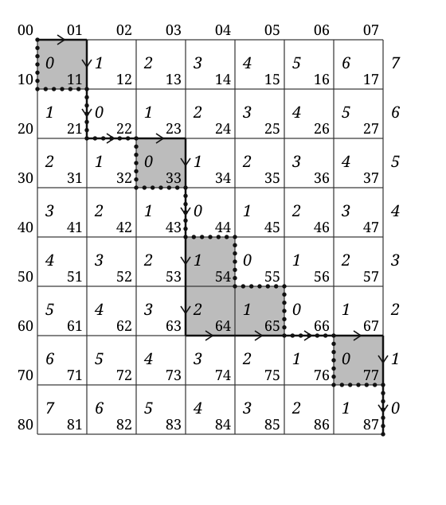

图 11　“2 有序” 排列与栅格路径间的对应关系. 斜体数字是权值, 用于计算 “2 有序” 排列的反序数目

求和公式中的绝对值符号使得计算多少需要一些技巧, 但习题 14 说明 $A_n$ 的形式出人意料地简单: $\lfloor n/2\rfloor2^{n-2}$. 因此一个随机 “2 有序” 排列的平均反序数目是

$$
\lfloor n/2\rfloor2^{n-2}\bigg/\binom n{\lfloor n/2\rfloor},
$$

根据斯特林近似式, 这渐近于 $\sqrt{\pi/128}\,n^{3/2}\approx0.16n^{3/2}$. 容易看出, 反序的最大数目是

$$
\binom{\lfloor n/2\rfloor+1}2\approx\frac18n^2.
$$

更详细地研究一下反序的分布是有益的, 像习题 15 中那样考察生成函数

$$
\begin{aligned}
h_1(z)&=1,\\
h_2(z)&=1+z,\\
h_3(z)&=1+2z,\\
h_4(z)&=1+3z+z^2+z^3,\qquad\ldots,
\end{aligned}\tag{3}
$$

将会发现标准差也与 $n^{3/2}$ 成正比, 所以该分布关于均值不是非常稳定.

现在考虑算法 D 的一般性两遍扫描 (增量序列是 $h,1$):

**定理 H.** $\{1,2,\ldots,n\}$ 的一个 “$h$ 有序” 排列的平均反序数目是

$$
f(n,h)=\frac{2^{2q-1}q!\,q!}{(2q+1)!}\left(\binom h2q(q+1)+\binom r2(q+1)-\frac12\binom{h-r}2q\right),\tag{4}
$$

式中 $q=\lfloor n/h\rfloor$, $r=n\bmod h$.

这个定理是道格拉斯·亨特提出的 [学士论文 (普林斯顿大学, 1967 年 4 月)]. 注意 $h\ge n$ 时该公式正确给出 $f(n,h)=\frac12\binom n2$.

<a id="pdf-074"></a>
<a id="p-68"></a>

**证明.** 一个 “$h$ 有序” 排列包含 $r$ 个长度为 $q+1$ 的有序子序列, $h-r$ 个长度为 $q$ 的有序子序列. 每个反序都来自一对不同的子序列, 随机 “$h$ 有序” 排列中的一对给定的不同的子序列确定一个随机 “2 有序” 排列. 因此平均反序数目就是每对不同子序列之间的平均反序数目之和, 即

$$
\binom r2\frac{A_{2q+2}}{\binom{2q+2}{q+1}}+r(h-r)\frac{A_{2q+1}}{\binom{2q+1}{q+1}}+\binom{h-r}2\frac{A_{2q}}{\binom{2q}q}=f(n,h).
$$

▮


**推论 H.** 如果增量序列 $h_{t-1},\ldots,h_1,h_0$ 满足条件

$$
h_{s+1}\bmod h_s=0\qquad(t-1>s\ge0),\tag{5}
$$

则算法 D 中移动操作的平均次数是

$$
\sum_{t>s\ge0}\left(r_s f(q_s+1,h_{s+1}/h_s)+(h_s-r_s)f(q_s,h_{s+1}/h_s)\right),\tag{6}
$$

式中 $r_s=N\bmod h_s$, $q_s=\lfloor N/h_s\rfloor$, $h_t=Nh_{t-1}$, $f$ 由式 (4) 确定.

**证明.** $h_s$-排序过程包括对 $r_s$ 个长度为 $q_s+1$ 的 “$(h_{s+1}/h_s)$ 有序” 子文件进行直接插入排序, 对 $h_s-r_s$ 个长度为 $q_s$ 的此类子文件进行直接插入排序. 整除性条件意味着在每个 “$(h_{s+1}/h_s)$ 有序” 排列都是等概率的意义下, 这些子文件都是随机 “$(h_{s+1}/h_s)$ 有序” 排列, 因为我们假定原输入是不同元素的随机排列.　▮

增量序列是 $h,1$ 的两遍扫描谢尔排序总是满足这个推论的条件 (5). 如果 $q=\lfloor N/h\rfloor$, $r=N\bmod h$, 则程序 D 中量 $B$ 的平均值是

$$
rf(q+1,N)+(h-r)f(q,N)+f(N,h)=\frac r2\binom{q+1}2+\frac{h-r}2\binom q2+f(N,h).
$$

对于第一次近似, 函数 $f(n,h)$ 等于 $(\sqrt\pi/8)n^{3/2}h^{1/2}$. 例如 $n=64$ 时可以把它与图 12 中的光滑曲线对比. 因此两遍扫描程序 D 的运行时间与下式近似成正比

$$
2N^2/h+\sqrt{\pi N^3h}.
$$

从而 $h$ 的最佳选择近似为 $\sqrt[3]{16N/\pi}\approx1.72\sqrt[3]N$, 选择这样的 $h$ 值可以得到与 $N^{5/3}$ 成正比的平均运行时间.

<a id="fig-5-12"></a>

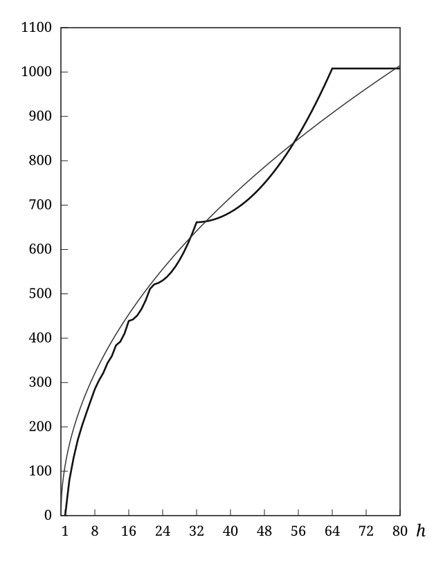

图 12　$n$ 元素 “$h$ 有序” 文件的平均反序数目 $f(n,h)$, $n=64$

<a id="pdf-075"></a>
<a id="p-69"></a>

两个增量的谢尔排序对直接插入法作出重大改进, 由 $O(N^2)$ 变为 $O(N^{1.667})$. 显然, 使用更多增量还可以做得更好. 习题 18 讨论了当 $t$ 固定和 $h$ 受整除性条件限制时 $h_{t-1},\ldots,h_0$ 的最佳选择, 对较大的 $N$ 运行时间缩短为 $O(N^{1.5+\epsilon/2})$, 其中 $\epsilon=1/(2^t-1)$. 由于最后一遍扫描总是要对和值贡献

$$
f(N,h_1)\approx(\sqrt\pi/8)N^{3/2}h_1^{1/2}
$$

个反序, 所以利用上述公式无法突破 $N^{1.5}$ 这个屏障.

但直觉告诉我们, 当增量 $h_{t-1},\ldots,h_0$ 不满足整除性条件 (5) 时可以做得更好. 例如, 8-排序之后进行 4-排序再进行 2-排序不允许交换偶数位置和奇数位置的键, 因此平均起来最后的 1-排序扫描不可避免地要面对 $\Theta(N^{3/2})$ 个反序. 与之相对, 7-排序之后进行 5-排序再进行 3-排序, 这样的混杂使得最后的 1-排序扫描遇到的反序数目不会超过 $2N$ 个! (见习题 26.) 事实上, 这里出现了一个令人惊讶的现象:

**定理 K.** 一个 “$k$ 有序” 文件经过 $h$-排序后仍然是 “$k$ 有序” 的.

因此, 一个文件先经过 7-排序, 然后是 5-排序, 将同时满足 “7 有序” 和 “5 有序”. 如果对它进行 3-排序, 结果将是 “7, 5, 3 有序” 的. 第 64 页的表 4 提供了这个重要性质的示例.

**证明.** 习题 20 表明定理 K 是以下事实的推论.

**引理 L.** 设 $m,n,r$ 是非负整数, $(x_1,\ldots,x_{m+r})$ 和 $(y_1,\ldots,y_{n+r})$ 是满足以下条件的任意数列

$$
y_1\le x_{m+1},\qquad y_2\le x_{m+2},\qquad\ldots,\qquad y_r\le x_{m+r}.\tag{7}
$$

如果诸 $x$ 和诸 $y$ 被独立地排序, 使得 $x_1\le\cdots\le x_{m+r}$ 和 $y_1\le\cdots\le y_{n+r}$, 则关系 (7) 仍然成立.

**证明.** 已知除 $m$ 个之外的所有 $x$ 都控制 (即大于或等于) 某个 $y$, 其中不同的 $x$ 控制不同的 $y$. 设 $1\le j\le r$, 由于排序后的 $x_{m+j}$ 控制 $m+j$ 个 $x$, 它至少控制 $j$ 个 $y$, 因此它控制最小的 $j$ 个 $y$, 所以在排序之后 $x_{m+j}\ge y_j$.　▮

定理 K 表明使用互素增量序列进行排序是可取的, 但它并不直接给出算法 D 中移动次数的确切估计. 此外, $\{1,2,\ldots,n\}$ 的排列中同时为 “$h$ 有序” 和 “$k$ 有序” 的排列个数并不总是 $n!$ 的因数, 所以可以看到定理 K 没有揭示全部信息. 在 $k$-排序和 $h$-排序之后, 得到某些 “$k$ 有序” 和 “$h$ 有序” 文件的可能性要高于其他一些文件. 对 $t>3$ 时一般增量序列 $h_{t-1},\ldots,h_0$ 的算法 D 的平均情况分析至今仍困扰着人们, 甚至没有一种显而易见的方法能够求出给定 $N$ 和 $(h_{t-1},\ldots,h_0)$ 时的最差情况. 然而当增量序列取特定形式时, 我们可以推导出几个有关近似最长运行时间的事实.

**定理 P.** 当 $h_s=2^{s+1}-1$($0\le s<t=\lfloor\lg N\rfloor$) 时, 算法 D 的运行时间是 $O(N^{3/2})$.

**证明.** 只需对第 $s$ 遍扫描中的移动次数 $B_s$ 给出上限, 使得 $B_{t-1}+\cdots+B_0=O(N^{3/2})$ 就可以了. 前 $t/2$ 遍扫描 ($t>s\ge t/2$) 可以使用明显的上限 $B_s=O(h_s(N/h_s)^2)$, 后续扫描可以使用习题 23 的结果 $B_s=O(Nh_{s+2}h_{s+1}/h_s)$. 因此 $B_{t-1}+\cdots+B_0=O\bigl(N(2+2^2+\cdots+2^{t/2}+2^{t/2}+\cdots+2)\bigr)=O(N^{3/2})$.　▮

这个定理是阿布拉姆·帕佩尔诺夫和格里戈里·斯塔谢维奇给出的 [*Problemy Peredachi Informatsii* **1**, 3 (1965), 81–98]. 它给出算法 D 最差运行时间的上限, 而不仅仅是平均运行时间的界限. 这个结果很不平凡, 因为诸 $h$ 满足整除性约束条件 (5) 时最差运行时间是 $N^2$ 量级, 而习题 24 证明指数 $3/2$ 不可能再降低.

<a id="pdf-076"></a>
<a id="p-70"></a>

1969 年, 沃恩·普拉特发现定理 P 的一项重要改进: 如果所选增量序列是小于 $N$ 的形如 $2^p3^q$ 的所有数的集合, 则算法 D 的运行时间是 $N(\log N)^2$ 量级. 这种情况下算法还可以做几种重要简化, 见习题 30 和 31. 然而, 即使有这些简化, 普拉特的方法仍然需要相当大的开销, 因为它需要对数据进行相当多遍扫描. 因此实际排序中, 他的增量序列不比定理 P 快多少, 除非 $N$ 大到天文数字. 对现实世界的 $N$ 值来说, 最佳增量序列似乎满足 $h_s\approx\rho^s$, 其中比值 $\rho\approx h_{s+1}/h_s$ 大体上与 $s$ 无关, 但可能依赖于 $N$.

我们已经看到, 选择增量序列时使每个增量都是所有先前增量的因子不是明智的做法. 但也不应得出结论: 最佳增量与其所有先前增量互素. 实际上, 在进行 $g$-排序时, 对一个 “$gh$ 有序” 且 “$gk$ 有序” 的文件 ($h\perp k$), 它的每个元素至多有 $\frac12(h-1)(k-1)$ 个反序. (见习题 21.) 利用这个事实, $N\to\infty$ 时普拉特序列 $\{2^p3^q\}$ 获胜, 但在实际应用中增长速度太过缓慢.

珍妮特·因切尔皮和罗伯特·塞奇威克找到了兼顾理论和实践的方法 [*J. Comp. Syst. Sci.* **31** (1985), 210–224; 也见 *Lecture Notes in Comp. Sci.* **1136** (1996), 1–11], 他们构造的增量序列满足 $h_s\approx\rho^s$ 且每个增量是前面两个增量的最大公因数. 给定任意 $\rho>1$, 首先定义一个基本序列 $a_1,a_2,\ldots$, 其中 $a_k$ 是 $\ge\rho^k$ 且满足 $a_j\perp a_k$($1\le j<k$) 的最小整数. 例如, $\rho=2.5$ 时基本序列是

$$
a_1,a_2,a_3,\ldots=3,7,16,41,101,247,613,1529,3821,9539,\ldots.
$$

现在定义增量序列如下: 令 $h_0\equiv1$, 以及

$$
\text{对 }\binom r2<s\le\binom{r+1}2\quad\text{令 }h_s=h_{s-r}a_r.\tag{8}
$$

因此增量序列是

$$
1;\ a_1;\ a_2,a_1a_2;\ a_1a_3,a_2a_3,a_1a_2a_3;\ \ldots.
$$

例如, $\rho=2.5$ 时我们有

$$
1,3,7,21,48,112,336,861,1968,4592,13776,33936,86961,198768,\ldots.
$$

关键是可以把递推式 (8) 反过来用,

$$
\text{对 }\binom{r-1}2\le s<\binom r2\quad\text{令 }h_s=h_{r+s}/a_r=h_{\binom r2}/a_{\binom r2-s}.\tag{9}
$$

因此, 根据上一段的论证, 在进行 $h_0$-排序, $h_1$-排序, …时, 每个元素的反序数目最多是

$$
b(a_2,a_1);\ b(a_3,a_2),b(a_3,a_1);\ b(a_4,a_3),b(a_4,a_2),b(a_4,a_1);\ \ldots\tag{10}
$$

式中 $b(h,k)=\frac12(h-1)(k-1)$. 如果 $\rho^{t-1}\le N<\rho^t$, 移动的总数 $B$ 至多为这个序列前 $t$ 个元素之和的 $N$ 倍. 因此可以证明 (见习题 41) 最差运行时间远优于 $N^{1.5}$ 量级:

**定理 I.** 当增量 $h_s$ 由式 (8) 定义时, 算法 D 的运行时间是 $O(Ne^{c\sqrt{\ln N}})$. 这里 $c=\sqrt{8\ln\rho}$, $O$ 中隐含的常数依赖于 $\rho$.　▮

$N\to\infty$ 时, 这个渐近上限不是特别重要, 因为普拉特序列的性能更好. 定理 I 的重点在于: 给定任何 $\rho>1$, 具有实际增长率 $h_s\approx\rho^s$ 的增量序列, 可以保证对任意小的 $\epsilon>0$ 运行时间是 $O(N^{1+\epsilon})$.

<a id="pdf-077"></a>
<a id="p-71"></a>

现在我们考察程序 D 的总运行时间 $(9B+10NT+13T-10S-3A+1)u$, 仔细地考虑一下 $N$ 的实际大小. 表 5 给出 $N=8$ 时各种增量序列的平均运行时间. 对这个较小的 $N$ 值簿记操作所占的成本比例最大, $t=1$ 时获得最佳结果. 因此 $N=8$ 时简单的直接插入方法效果最好. ($N=8$ 时程序 S 的平均运行时间仅为 $191.85u$.) 奇怪的是, $h_1=6$ 时出现最好的两遍扫描算法, 因为这里大的 $S$ 值比小的 $B$ 值重要. 与此类似, 增量序列 3, 2, 1 将平均移动数目降至最低, 但它们没有给出最佳的三遍扫描序列. 在这里记录那些使移动数目最大化的 “最差” 排列很有意义, 因为此类排列的一般构造仍然是未知的:

$$
h_2=5,\quad h_1=3,\quad h_0=1:\qquad8\,5\,2\,6\,3\,7\,4\,1\qquad\text{(19次移动)}
$$

$$
h_2=3,\quad h_1=2,\quad h_0=1:\qquad8\,3\,5\,7\,2\,4\,6\,1\qquad\text{(17次移动)}
$$

<a id="table-5-2-1-5"></a>

表 5　当 $N=8$ 时对算法 D 的分析

<table data-shell-analysis-table="5"><thead><tr><th style="white-space:nowrap">增量序列</th><th style="white-space:nowrap">$A_{\mathrm{ave}}$</th><th style="white-space:nowrap">$B_{\mathrm{ave}}$</th><th style="white-space:nowrap">$S$</th><th style="white-space:nowrap">$T$</th><th style="white-space:nowrap">MIX 时间</th></tr></thead><tbody>
<tr><td style="white-space:pre">1</td><td style="white-space:pre">1.718</td><td style="white-space:pre">14.000</td><td style="white-space:pre">1</td><td style="white-space:pre">1</td><td style="white-space:pre">$204.85u$</td></tr>
<tr><td style="white-space:pre">2 1</td><td style="white-space:pre">2.667</td><td style="white-space:pre">9.657</td><td style="white-space:pre">3</td><td style="white-space:pre">2</td><td style="white-space:pre">$235.91u$</td></tr>
<tr><td style="white-space:pre">3 1</td><td style="white-space:pre">2.917</td><td style="white-space:pre">9.100</td><td style="white-space:pre">4</td><td style="white-space:pre">2</td><td style="white-space:pre">$220.15u$</td></tr>
<tr><td style="white-space:pre">4 1</td><td style="white-space:pre">3.083</td><td style="white-space:pre">10.000</td><td style="white-space:pre">5</td><td style="white-space:pre">2</td><td style="white-space:pre">$217.75u$</td></tr>
<tr><td style="white-space:pre">5 1</td><td style="white-space:pre">2.601</td><td style="white-space:pre">10.000</td><td style="white-space:pre">6</td><td style="white-space:pre">2</td><td style="white-space:pre">$209.20u$</td></tr>
<tr><td style="white-space:pre">6 1</td><td style="white-space:pre">2.135</td><td style="white-space:pre">10.667</td><td style="white-space:pre">7</td><td style="white-space:pre">2</td><td style="white-space:pre">$206.60u$</td></tr>
<tr><td style="white-space:pre">7 1</td><td style="white-space:pre">1.718</td><td style="white-space:pre">12.000</td><td style="white-space:pre">8</td><td style="white-space:pre">2</td><td style="white-space:pre">$209.85u$</td></tr>
<tr><td style="white-space:pre">4 2 1</td><td style="white-space:pre">3.500</td><td style="white-space:pre">8.324</td><td style="white-space:pre">7</td><td style="white-space:pre">3</td><td style="white-space:pre">$274.41u$</td></tr>
<tr><td style="white-space:pre">5 3 1</td><td style="white-space:pre">3.301</td><td style="white-space:pre">8.167</td><td style="white-space:pre">9</td><td style="white-space:pre">3</td><td style="white-space:pre">$253.60u$</td></tr>
<tr><td style="white-space:pre">3 2 1</td><td style="white-space:pre">3.320</td><td style="white-space:pre">7.829</td><td style="white-space:pre">6</td><td style="white-space:pre">3</td><td style="white-space:pre">$280.50u$</td></tr>
</tbody></table>

当 $N$ 变得更大时, 将会看到一种稍为不同的情形. 表 6 给出了 $N=1000$ 时各种不同增量序列的近似移动次数. 前面几项满足整除性约束条件 (5), 可以使用式 (6) 和习题 19. 我们用实验方法获得其他情形的近似平均值. 生成了各包括 1000 个元素的一万个随机文件, 然后使用各增量序列对它们排序. 从左向右的最小值数目 $A$ 的标准差大约是 15, 移动次数 $B$ 的标准差大约是 300.

这些数据中有些模式很明显, 但算法 D 的特性仍然非常模糊. 谢尔最初建议使用增量序列 $\lfloor N/2\rfloor,\lfloor N/4\rfloor,\lfloor N/8\rfloor,\ldots$, 但当 $N$ 的二进制表示中包含一长串零时这个序列不能令人满意. 拉扎勒斯和弗兰克建议使用大体相同的序列, 但在必要时加 1 以使所有增量都是奇数 [*CACM* **3** (1960), 20–22]. 希巴德建议使用 $2^k-1$ 形式的增量序列, 帕佩尔诺夫和斯塔谢维奇建议使用 $2^k+1$ 形式的增量序列 [*CACM* **6** (1963), 206–213]. 表 6 中研究的其他自然序列涉及数 $(2^k-(-1)^k)/3$ 和 $(3^k-1)/2$, 斐波那契数, $\rho=2.5$ 和 $\rho=2$ 时的因切尔皮–塞奇威克序列 (8). 还给出类似普拉特序列 $\{5^p11^q\}$ 和 $\{7^p13^q\}$, 因为它们保持渐近特性 $O(N(\log N)^2)$ 的同时对较小的 $N$ 值开销成本较低. 表 6 中的最后几个示例来自塞奇威克基于稍微不同的探索设计的另一序列 [*J. Algorithms* **7** (1986), 159–173]:

$$
h_s=\begin{cases}
9\cdot2^s-9\cdot2^{s/2}+1,&\text{如果 }s\text{ 是偶数};\\
8\cdot2^s-6\cdot2^{(s+1)/2}+1,&\text{如果 }s\text{ 是奇数}.
\end{cases}\tag{11}
$$

这些增量 $(h_0,h_1,h_2,\ldots)=(1,5,19,41,109,209,505,\ldots)$ 由两个序列组合而成, 这两个序列与塞奇威克曾证明具有最差运行时间界 $O(N^{4/3})$ 的增量相似.

在形如 $2^k+1$ 的增量序列及 $\rho=2$ 的因切尔皮–塞奇威克序列中观测到移动次数最小, 大约是 6750. 但重要的是要意识到: 尽管移动次数在渐近运行时间中占主导地位, 但它并不是唯一考虑因素. 因为程序 D 耗费 $9B+10(NT-S)+\cdots$ 单位的时间, 我们看到减少一遍扫描大致相当于减少 $\frac{10}9N$ 次移动. 当 $N=1000$ 时, 如果能够节省一遍扫描, 那就允许增加 1111 次移动. (但是, 如果 $h_{t-1}$ 接近 $N$, 因为 $NT-S=(N-h_{t-1})+\cdots+(N-h_0)$, 第一遍扫描非常快.)

<a id="pdf-078"></a>
<a id="p-72"></a>

<a id="table-5-2-1-6"></a>

表 6　$N=1000$ 时算法 D 的近似特性

<table data-shell-analysis-table="6"><thead><tr><th>增量序列</th><th>$A_{\mathrm{ave}}$</th><th>$B_{\mathrm{ave}}$</th><th>$T$</th></tr></thead><tbody>
<tr><td style="white-space:pre;text-align:right">1</td><td>6</td><td>249750</td><td>1</td></tr>
<tr><td style="white-space:pre;text-align:right">17 1</td><td>65</td><td>41667</td><td>2</td></tr>
<tr><td style="white-space:pre;text-align:right">60 6 1</td><td>158</td><td>26361</td><td>3</td></tr>
<tr><td style="white-space:pre;text-align:right">140 20 4 1</td><td>262</td><td>21913</td><td>4</td></tr>
<tr><td style="white-space:pre;text-align:right">256 64 16 4 1</td><td>362</td><td>20459</td><td>5</td></tr>
<tr><td style="white-space:pre;text-align:right">576 192 48 16 4 1</td><td>419</td><td>20088</td><td>6</td></tr>
<tr><td style="white-space:pre;text-align:right">729 243 81 27 9 3 1</td><td>378</td><td>18533</td><td>7</td></tr>
<tr><td style="white-space:pre;text-align:right">512 256 128 64 32 16 8 4 2 1</td><td>493</td><td>16435</td><td>10</td></tr>
<tr><td style="white-space:pre;text-align:right">500 250 125 62 31 15 7 3 1</td><td>516</td><td>7655</td><td>9</td></tr>
<tr><td style="white-space:pre;text-align:right">501 251 125 63 31 15 7 3 1</td><td>558</td><td>7370</td><td>9</td></tr>
<tr><td style="white-space:pre;text-align:right">511 255 127 63 31 15 7 3 1</td><td>559</td><td>7200</td><td>9</td></tr>
<tr><td style="white-space:pre;text-align:right">255 127 63 31 15 7 3 1</td><td>436</td><td>7445</td><td>8</td></tr>
<tr><td style="white-space:pre;text-align:right">127 63 31 15 7 3 1</td><td>299</td><td>8170</td><td>7</td></tr>
<tr><td style="white-space:pre;text-align:right">63 31 15 7 3 1</td><td>190</td><td>9860</td><td>6</td></tr>
<tr><td style="white-space:pre;text-align:right">31 15 7 3 1</td><td>114</td><td>13615</td><td>5</td></tr>
<tr><td style="white-space:pre;text-align:right">513 257 129 65 33 17 9 5 3 1</td><td>561</td><td>6745</td><td>10</td></tr>
<tr><td style="white-space:pre;text-align:right">257 129 65 33 17 9 5 3 1</td><td>440</td><td>6995</td><td>9</td></tr>
<tr><td style="white-space:pre;text-align:right">129 65 33 17 9 5 3 1</td><td>304</td><td>7700</td><td>8</td></tr>
<tr><td style="white-space:pre;text-align:right">65 33 17 9 5 3 1</td><td>197</td><td>9300</td><td>7</td></tr>
<tr><td style="white-space:pre;text-align:right">33 17 9 5 3 1</td><td>122</td><td>12695</td><td>6</td></tr>
<tr><td style="white-space:pre;text-align:right">683 341 171 85 43 21 11 5 3 1</td><td>511</td><td>7365</td><td>10</td></tr>
<tr><td style="white-space:pre;text-align:right">341 171 85 43 21 11 5 3 1</td><td>490</td><td>7490</td><td>9</td></tr>
<tr><td style="white-space:pre;text-align:right">255 63 15 7 3 1</td><td>373</td><td>8620</td><td>6</td></tr>
<tr><td style="white-space:pre;text-align:right">257 65 17 5 3 1</td><td>375</td><td>8990</td><td>6</td></tr>
<tr><td style="white-space:pre;text-align:right">341 85 21 5 3 1</td><td>410</td><td>9345</td><td>6</td></tr>
<tr><td style="white-space:pre;text-align:right">377 233 144 89 55 34 21 13 8 5 3 2 1</td><td>518</td><td>7400</td><td>13</td></tr>
<tr><td style="white-space:pre;text-align:right">233 144 89 55 34 21 13 8 5 3 2 1</td><td>432</td><td>7610</td><td>12</td></tr>
<tr><td style="white-space:pre;text-align:right">377 144 55 21 8 3 1</td><td>456</td><td>8795</td><td>7</td></tr>
<tr><td style="white-space:pre;text-align:right">365 122 41 14 5 2 1</td><td>440</td><td>8085</td><td>7</td></tr>
<tr><td style="white-space:pre;text-align:right">364 121 40 13 4 1</td><td>437</td><td>8900</td><td>6</td></tr>
<tr><td style="white-space:pre;text-align:right">121 40 13 4 1</td><td>268</td><td>9790</td><td>5</td></tr>
<tr><td style="white-space:pre;text-align:right">336 112 48 21 7 3 1</td><td>432</td><td>7840</td><td>7</td></tr>
<tr><td style="white-space:pre;text-align:right">306 170 90 45 18 10 5 2 1</td><td>465</td><td>6755</td><td>9</td></tr>
<tr><td style="white-space:pre;text-align:right">169 91 49 13 7 1</td><td>349</td><td>8698</td><td>6</td></tr>
<tr><td style="white-space:pre;text-align:right">275 125 121 55 25 11 5 1</td><td>446</td><td>6788</td><td>8</td></tr>
<tr><td style="white-space:pre;text-align:right">190 84 37 16 7 3 1</td><td>359</td><td>7201</td><td>7</td></tr>
<tr><td style="white-space:pre;text-align:right">929 505 209 109 41 19 5 1</td><td>512</td><td>7725</td><td>8</td></tr>
<tr><td style="white-space:pre;text-align:right">505 209 109 41 19 5 1</td><td>519</td><td>7790</td><td>7</td></tr>
<tr><td style="white-space:pre;text-align:right">209 109 41 19 5 1</td><td>382</td><td>8165</td><td>6</td></tr>
</tbody></table>

<a id="pdf-079"></a>
<a id="p-73"></a>

马克·韦斯的实验测试强烈提示 [*Comp. J.* **34** (1991), 88–91]: 对增量序列 $2^k-1,\ldots,15,7,3,1$, 算法 D 执行的平均移动次数大约与 $N^{5/4}$ 成正比. 更准确地说, 韦斯发现使用这些增量时, 对 $100\le N\le12000000$, $B_{\mathrm{ave}}\approx1.55N^{5/4}-4.48N+O(N^{3/4})$, 实验的标准差大约是 $.065N^{5/4}$. 另一方面, 马尔钦·丘拉随后的测试表明塞奇威克序列 (11) 显然有 $B_{\mathrm{ave}}=O(N(\log N)^2)$ 或更好. 当 $N\le10^6$ 时序列 (11) 的标准差小得令人惊讶, 但当 $N$ 超过 $10^7$ 时它不可思议地激增.

表 7 是三次随机实验得到的每遍扫描移动次数的典型统计分析, 使用了形如 $2^k-1$, $2^k+1$ 和式 (11) 的增量序列. 每种情况使用相同的输入文件. 三种情况的移动总数 $\sum_s B_s$ 分别是 346152, 329532, 248788, 序列 (11) 显然最为出众.

<a id="table-5-2-1-7"></a>

表 7　每遍扫描的移动次数: 对 $N=20000$ 的实验

| $h_s$ | $B_s$ | $h_s$ | $B_s$ | $h_s$ | $B_s$ |
|---|---|---|---|---|---|
| 4095 | 19458 | 4097 | 19459 | 3905 | 20714 |
| 2047 | 15201 | 2049 | 14852 | 2161 | 13428 |
| 1023 | 16363 | 1025 | 15966 | 929 | 18206 |
| 511 | 18867 | 513 | 18434 | 505 | 16444 |
| 255 | 23232 | 257 | 22746 | 209 | 21405 |
| 127 | 28034 | 129 | 27595 | 109 | 19605 |
| 63 | 33606 | 65 | 34528 | 41 | 26604 |
| 31 | 40350 | 33 | 45497 | 19 | 23441 |
| 15 | 66037 | 17 | 48717 | 5 | 38941 |
| 7 | 43915 | 9 | 38560 | 1 | 50000 |
| 3 | 24191 | 5 | 20271 | | |
| 1 | 16898 | 3 | 9448 | | |
| | | 1 | 13459 | | |

尽管人们对算法 D 的理解越来越深刻, 但经过三十多年的研究仍然无法找出任何依据, 可以非常肯定地表明哪种增量序列使该算法效果最佳. 如果 $N$ 小于 1000, 下面这条简单规则

$$
\text{令 }h_0=1,\quad h_{s+1}=3h_s+1,\quad\text{当 }h_{t+1}>N\text{ 时止于 }h_{t-1}\tag{12}
$$

似乎与任何其他增量序列一样好. 对于更大的 $N$ 值可以推荐塞奇威克序列 (11). 德田尚之使用公式 $h_s=\left\lfloor\frac45\left(\left(\frac94\right)^{s+1}-1\right)\right\rfloor$ 得到更好的结果, 甚至可能达到 $N\log N$ 量级, 见 *Information Processing 92* **1** (1992), 449–457.

**列表插入.** 现在我们放下谢尔排序, 开始考虑直接插入的其他改进类型. 改进一个给定算法最重要的一般方法之一就是仔细查看它的数据结构, 重新组织数据结构以避免一些不必要操作, 通常可以取得实质性的提升. 2.4 节对这种一般性思想进行深入讨论, 研究了一种相对复杂的算法. 现在考虑如何把它应用于像直接插入这样非常简单的算法. 哪种数据结构最适合算法 S 呢? 直接插入包含两个基本操作:

(i) 扫描一个有序文件, 找出小于或等于一个给定键的最大键;

(ii) 在有序文件的指定部分插入一条新记录.

这个文件显然是线性列表, 算法 S 利用顺序分配 (2.2.2 节) 来处理这个列表, 为了完成每个插入操作需要移动大约一半的记录. 另一方面, 我们知道链接分配 (2.2.3 节) 非常适合插入操作, 因为只需要改变很少几个链接. 而对于另一操作——顺序扫描——链接分配和顺序分配一样轻松. 我们总是以相同方向扫描列表, 所以只需要单向链接. 因此可以得出结论: 适于直接插入的数据结构是单向线性链表. 可以很方便地修改算法 S, 以便按递增顺序扫描该列表:

<a id="pdf-080"></a>
<a id="p-74"></a>

<a id="alg-5-2-1-L"></a>

**算法 L (列表插入).** 假定记录 $R_1,\ldots,R_N$ 包含键 $K_1,\ldots,K_N$ 和能够存储数值 0 至 $N$ 的链接字段 $L_1,\ldots,L_N$. 文件开头的虚拟记录 $R_0$ 中包含链接字段 $L_0$. 算法对链接字段进行设定, 使各记录以升序链接在一起. 如果 $p(1)\ldots p(N)$ 是满足 $K_{p(1)}\le\cdots\le K_{p(N)}$ 稳定排列, 本算法得出

$$
L_0=p(1);\qquad L_{p(i)}=p(i+1)\quad(1\le i<N);\qquad L_{p(N)}=0.\tag{13}
$$

**L1.** [对 $j$ 循环.] 置 $L_0\leftarrow N$, $L_N\leftarrow0$. (链接字段 $L_0$ 是列表的 “头”, 0 是空链接, 因此这个列表本质上是循环的.) 对 $j=N-1,N-2,\ldots,1$ 执行 L2 至 L5, 然后终止算法.

**L2.** [设定 $p,q,K$.] 置 $p\leftarrow L_0$, $q\leftarrow0$, $K\leftarrow K_j$. (在以下步骤中, 把 $K$ 与它前面按增序排列的键比较, 以将 $R_j$ 插到链表中的适当位置. 变量 $p$ 和 $q$ 是列表当前位置指针, 且 $p=L_q$, 所以 $q$ 比 $p$ 滞后一步.)

**L3.** [比较 $K:K_p$.] 如果 $K\le K_p$ 则转至 L5. (已经在列表的 $R_q$ 和 $R_p$ 之间为记录 $R_j$ 找到期望位置.)

**L4.** [移动 $p,q$.] 置 $q\leftarrow p$, $p\leftarrow L_q$. 如果 $p>0$ 则返回步 L3. (如果 $p=0$ 则 $K$ 是到目前为止找到的最大键, 因此记录 $R_j$ 属于列表末端, 位于 $R_q$ 和 $R_0$ 之间.)

**L5.** [插入列表.] 置 $L_q\leftarrow j$, $L_j\leftarrow p$.　▮

这个算法之所以重要, 不仅因为它是一种简单的排序方法, 还因为它经常作为其他列表处理算法的组成部分. 表 8 给出了对我们的 16 个数排序时前几步的情形, 习题 32 给出最后的链接设置.

<a id="table-5-2-1-8"></a>

表 8　列表插入举例

<table data-list-insertion-table="8"><thead><tr><th>$j$: </th><th>0</th><th>1</th><th>2</th><th>3</th><th>4</th><th>5</th><th>6</th><th>7</th><th>8</th><th>9</th><th>10</th><th>11</th><th>12</th><th>13</th><th>14</th><th>15</th><th>16</th></tr></thead><tbody>
<tr><td>$K_j$: </td><td>—</td><td>503</td><td>087</td><td>512</td><td>061</td><td>908</td><td>170</td><td>897</td><td>275</td><td>653</td><td>426</td><td>154</td><td>509</td><td>612</td><td>677</td><td>765</td><td>703</td></tr>
<tr data-source-link-state="16"><td>$L_j$: </td><td>16</td><td>—</td><td>—</td><td>—</td><td>—</td><td>—</td><td>—</td><td>—</td><td>—</td><td>—</td><td>—</td><td>—</td><td>—</td><td>—</td><td>—</td><td>—</td><td>0</td></tr>
<tr data-source-link-state="15"><td>$L_j$: </td><td>16</td><td>—</td><td>—</td><td>—</td><td>—</td><td>—</td><td>—</td><td>—</td><td>—</td><td>—</td><td>—</td><td>—</td><td>—</td><td>—</td><td>—</td><td>0</td><td>15</td></tr>
<tr data-source-link-state="14"><td>$L_j$: </td><td>14</td><td>—</td><td>—</td><td>—</td><td>—</td><td>—</td><td>—</td><td>—</td><td>—</td><td>—</td><td>—</td><td>—</td><td>—</td><td>—</td><td>16</td><td>0</td><td>15</td></tr>
<tr><td colspan="18" style="text-align:center">⋯⋯⋯⋯⋯⋯⋯⋯⋯⋯⋯⋯⋯⋯⋯⋯</td></tr></tbody></table>

<a id="prog-5-2-1-L"></a>

**程序 L (列表插入).** 假定 $K_j$ 存储在 `INPUT+j (0:3)`, $L_j$ 存储在 `INPUT+j (4:5)`. $\mathrm{rI1}\equiv j$; $\mathrm{rI2}\equiv p$; $\mathrm{rI3}\equiv q$; $\mathrm{rA}(0{:}3)\equiv K$.

<a id="pdf-081"></a>
<a id="p-75"></a>

```mixal
01 KEY   EQU  0:3
02 LINK  EQU  4:5
03 START ENT1 N                 1          L1. 对j循环。 j ← N.
04       ST1  INPUT(LINK)       1          L0 ← N.
05       STZ  INPUT+N(LINK)     1          LN ← 0.
06       JMP  6F                1          转去减少j。
07 2H    LD2  INPUT(LINK)       N-1        L2. 设定p, q, K。 p ← L0.
08       ENT3 0                 N-1        q ← 0.
09       LDA  INPUT,1           N-1        K ← Kj.
10 3H    CMPA INPUT,2(KEY)      B+N-1-A    L3. 比较 K : Kp.
11       JLE  5F                B+N-1-A    如果 K ≤ Kp 则转至步骤L5。
12 4H    ENT3 0,2               B          L4. 移动p, q。 q ← p.
13       LD2  INPUT,3(LINK)     B          p ← Lq.
14       J2P  3B                B          如果 p > 0 则返回步骤L3。
15 5H    ST1  INPUT,3(LINK)     N-1        L5. 插入列表。 Lq ← j.
16       ST2  INPUT,1(LINK)     N-1        Lj ← p.
17 6H    DEC1 1                 N
18       J1P  2B                N          N > j ≥ 1.　▮
```


这个程序的运行时间是 $7B+14N-3A-6$ 单位, 其中 $N$ 是文件长度, $A+1$ 是从右向左的最大值的个数, $B$ 是原来排列中反序的个数. (见程序 S 的分析. 注意程序 L 没有重新排列存储器中的这些记录, 可以像习题 5.2–12 中那样完成这个操作, 成本是另外增加大约 $20N$ 单位的时间.) 程序 S 需要 $(9B+10N-3A-9)u$, 由于 $B$ 约为 $\frac14N^2$, 所以可以看出链接字段使用的额外存储空间已经节省了约 22%的执行时间. 通过精心的程序设计还可以再节省 22%的时间 (见习题 33), 但运行时间仍然与 $N^2$ 成正比.

总结一下目前已经做过的工作: 我们首先从算法 S 入手, 这是一种简单自然的排序算法, 大约进行 $\frac14N^2$ 次比较和 $\frac14N^2$ 次移动. 通过考虑二叉插入在一个方向上进行改进, 大约需要 $N\lg N$ 次比较和 $\frac14N^2$ 次移动. 用 “两路插入” 稍微改变数据结构, 移动次数减少到大约 $\frac18N^2$. 当 $N$ 处于实际应用范围内, 谢尔排序把比较与移动次数削减到大约 $N^{7/6}$, $N\to\infty$ 时这个数值可以降低到 $N(\log N)^2$ 量级. 改进算法 S 的另一途径是使用链接数据结构的列表插入方法, 大约需要 $\frac14N^2$ 次比较、0 次移动和 $2N$ 次链接修改.

是否有可能把这些方法的最佳特性结合在一起, 像二叉插入那样把比较次数减少到 $N\log N$ 量级, 又像列表插入那样减少移动次数呢? 答案是肯定的, 方法是采用树状结构排列. 最早是戴维·惠勒大约在 1957 年探讨了这种可能性, 他建议使用两路插入法, 直到有必要移动某些数据为止. 然后, 不去移动数据而是插入一个指向另一存储区域的指针, 对将要插入这个新存储区域的所有项目递归应用同一技术. 惠勒的原始方法 [见亚历山大·道格拉斯,*Comp. J.* **2** (1959), 5] 是顺序存储与链接存储的复杂组合, 结点大小也各不相同. 对于我们的 16 个示例数将构造出图 13 的树. 大约在 1958 年, 康韦·伯纳斯–李使用二叉树设计了一种与此类似但还要简单的树插入方案 [见 *Comp. J.* **3** (1960), 174, 184]. 二叉树方法和它的各种改进对于查找和排序都十分重要, 我们将在 6.2.2 节详细讨论它们.

<a id="fig-5-13"></a>

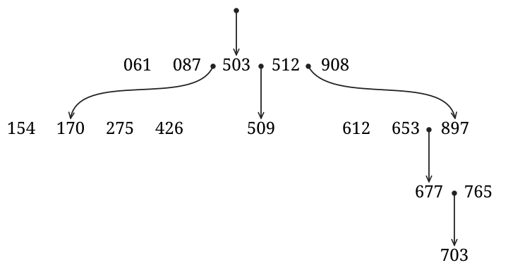

图 13　惠勒树插入方案示例

改进直接插入的另一种方法是考虑一次插入多项. 例如, 假设有一个包含 1000 项的文件, 其中 998 项已经排好序, 算法 S 还需要对文件进行两次扫描 (先插入 $R_{999}$, 然后插入 $R_{1000}$). 如果先比较 $K_{999}$ 与 $K_{1000}$, 看看哪个更大, 然后只查看一次文件就能插入这两项, 则显然可以节省时间. 这种组合操作包含大约 $\frac23N$ 次比较和移动 (见习题 3.4.2–5), 而不用进行各需要大约 $\frac12N$ 次比较和移动的两遍扫描.

换句话说, 把长时间查找操作 “分批” 处理通常是个好主意, 这样可以同时完成多个操作. 如果从这个思想引出它的自然结论, 就会再次发现合并排序方法. 这个方法非常重要, 5.2.4 节专门讨论它.

<a id="pdf-082"></a>
<a id="p-76"></a>

**地址计算排序.** 显然, 到目前为止我们已经穷尽所有可能方式对简单的直接插入方法进行改进. 但再让我们来看一看! 假定以随机顺序给你几十本图书, 希望按照作者姓名的次序摆放到书架上. 在摆放每本书时, 会很自然地尝试估计它的最终位置, 以减少必须进行的比较与移动数目. 如果开始时的书架空间比绝对必需空间略多一些, 那整个过程的效率也会更高一些. 这个方法最早是艾萨克和理查德·辛格尔顿针对计算机排序提出的 [*JACM* **3** (1956), 169–174], 后来由塔特和克朗马尔加以发展 [*Proc. ACM National Conference* **21** (1966), 331–337].

地址计算排序通常需要增加一些存储空间, 数量与 $N$ 成正比, 目的可能是为了留出足够空间以避免进行大量不必要的移动, 也可能是为了维护辅助表以帮助应对键值分布的不规则性. (见 “分布计数” 排序, 算法 5.2D, 它采用了地址计算形式.) 如果像在列表插入方法中那样, 将这一额外存储空间用于链接字段, 也许可以使这些空间发挥最大效能. 这个方式还可以避免将输入和输出放在不同存储区域, 所有操作都可以在同一存储区域中完成.

这些考虑提示我们对列表插入进行推广, 可以保存若干列表, 而不仅仅限于一个列表. 这些列表分别用于保存特定范围的键值. 我们做一个重要假定, 所有键值都是相当均匀地分布, 而不是毫无规则地 “聚成一团”: 可以将这些键的所有可能取值分为 $M$ 个部分, 假定一个给定键属于给定部分的概率为 $1/M$. 因此我们为 $M$ 个列表头提供额外的存储空间, 并像简单列表插入中那样维护每个列表.

这里不需要给出算法的太多细节, 这个方法简单地以把所有列表头置为 $\Lambda$ 开始. 每个新项目进入时, 首先判断它的键属于 $M$ 个部分中的哪一个, 然后像算法 L 那样把它插入相应列表中.

为了阐明这个方法, 假定前面示例中使用的 16 个键划分为 $M=4$ 个范围: 0–249, 250–499, 500–749, 750–999. 相继插入键 $K_1,K_2,\ldots,K_{16}$, 我们得到以下结构:

| | 4 项后 | 8 项后 | 12 项后 | 最终状态 |
|---|---|---|---|---|
| 列表 1 | 061,087 | 061,087,170 | 061,087,154,170 | 061,087,154,170 |
| 列表 2 | | 275 | 275,426 | 275,426 |
| 列表 3 | 503,512 | 503,512 | 503,509,512,653 | 503,509,512,612,653,677,703 |
| 列表 4 | | 897,908 | 897,908 | 765,897,908 |

(下面的程序 M 实际上是按逆序 $K_{16},\ldots,K_2,K_1$ 插入这些键的, 但最终结果相同.) 因为使用了链接存储, 所以不同长度的列表不会导致存储分配问题. 如果愿意的话, 最后可以把所有列表合并为一个列表 (见习题 35).

<a id="prog-5-2-1-M"></a>

**程序 M (多列表插入).** 本程序所做的假定与程序 L 相同, 只是这里的键值必须是非负的, 因此

$$
0\le K_j<(\mathtt{BYTESIZE})^3.
$$

程序把每个键值乘以一个合适的常数, 从而将该范围划分为 $M$ 个相等部分. 列表头位于单元 `HEAD+1` 至 `HEAD+M` 处.

<a id="pdf-083"></a>
<a id="p-77"></a>

```mixal
01 KEY   EQU  1:3
02 LINK  EQU  4:5
03 START ENT2 M                    1
04       STZ  HEAD,2               M          HEAD[p] ← Λ.
05       DEC2 1                    M
06       J2P  *-2                  M          M ≥ p ≥ 1.
07       ENT1 N                    1          j ← N.
08 2H    LDA  INPUT,1(KEY)          N
09       MUL  =M(1:3)=              N          rA ← floor(M·Kj/BYTESIZE³).
10       STA  *+1(1:2)             N
11       ENT4 0                    N          rI4 ← rA.
12       ENT3 HEAD+1-INPUT,4        N          q ← LOC(HEAD[rA]).
13       LDA  INPUT,1               N          K ← Kj.
14       JMP  4F                    N          转去设置p。
15 3H    CMPA INPUT,2(KEY)          B+N-A
16       JLE  5F                    B+N-A      如果 K ≤ Kp 则转去插入。
17       ENT3 0,2                  B          q ← p.
18 4H    LD2  INPUT,3(LINK)         B+N        p ← LINK(q).
19       J2P  3B                    B+N        如果不是列表的末端则跳转。
20 5H    ST1  INPUT,3(LINK)         N          LINK(q) ← LOC(Rj).
21       ST2  INPUT,1(LINK)         N          LINK(LOC(Rj)) ← p.
22 6H    DEC1 1                    N
23       J1P  2B                    N          N ≥ j ≥ 1.　▮
```


这个程序是针对一般的 $M$ 编写的, 但如果将 $M$ 固定为某个便利取值会更好些. 例如可以选择 $M=\mathtt{BYTESIZE}$, 这样只需要一条 `MOVE` 指令就可以清空所有列表头, 第 08–11 行的乘法序列也可以用一条指令 `LD4 INPUT,1(1:1)` 代替. 程序 L 与程序 M 之间最值得注意的差异在于: 程序 M 必须考虑空列表的情形, 此时不需要进行比较.

用 $M$ 个列表可以节省多少时间呢? 程序 M 的总运行时间是 $7B+31N-3A+4M+2$ 单位, 其中 $M$ 是列表数目, $N$ 是待排序的记录数目, $A$ 和 $B$ 分别表示从右向左的最大值个数和每个列表所属键的反序数目. (与本节其他时间分析不同的是, 非空排列的最右元素也计入 $A$.) 我们已经研究了 $M=1$ 时的 $A$ 和 $B$, 它们的平均值分别是 $H_N$ 和 $\frac12\binom N2$. 根据我们对键值分布的假定, 一个给定列表在排序结束时恰好包含 $n$ 项的概率为 “二项” 概率

$$
\binom Nn\left(\frac1M\right)^n\left(1-\frac1M\right)^{N-n}.\tag{14}
$$

因此一般情况下 $A$ 和 $B$ 的平均值分别是

$$
A_{\mathrm{ave}}=M\sum_n\binom Nn\left(\frac1M\right)^n\left(1-\frac1M\right)^{N-n}H_n;\tag{15}
$$

$$
B_{\mathrm{ave}}=M\sum_n\binom Nn\left(\frac1M\right)^n\left(1-\frac1M\right)^{N-n}\binom n2/2.\tag{16}
$$

利用式 1.2.6–(20) 的一个特例

$$
\binom Nn\binom n2=\binom N2\binom{N-2}{n-2}
$$

可以轻松计算出式 (16) 中的和:

$$
B_{\mathrm{ave}}=\frac1{2M}\binom N2.\tag{17}
$$

<a id="pdf-084"></a>
<a id="p-78"></a>

习题 37 推导了 $B$ 的标准差. 但式 (15) 中的和更难计算. 根据定理 1.2.7A, 我们有

$$
\sum_n\binom Nn(M-1)^{-n}H_n=\left(1-\frac1M\right)^{-N}(H_N-\ln M)+\epsilon,
$$

$$
0<\epsilon=\sum_{n>N}\frac1n\left(1-\frac1M\right)^{n-N}<\frac{M-1}{N+1};
$$

因此

$$
A_{\mathrm{ave}}=M(H_N-\ln M)+\delta,\qquad0<\delta<\frac{M^2}{N+1}\left(1-\frac1M\right)^{N+1}.\tag{18}
$$

(当 $M\approx N$ 时这个公式没有什么实用价值. 习题 40 给出了当 $M=N/\alpha$ 时对 $A_{\mathrm{ave}}$ 渐近特性的详尽分析.)

结合式 (17) 和 (18) 得出, 当 $N\to\infty$ 时对固定的 $M$ 值程序 M 的总运行时间:

$$
\begin{aligned}
\text{最短}\quad&31N+M+2,\\
\text{平均}\quad&1.75N^2/M+31N-3MH_N+3M\ln M+4M-3\delta-1.75N/M+2,\\
\text{最长}\quad&3.50N^2+24.5N+4M+2.
\end{aligned}\tag{19}
$$

注意, 当 $M$ 不太大时, 平均速度加快到 $M$ 倍. $M=10$ 时的速度约为 $M=1$ 时的 10 倍. 但是最长时间要比平均时间大得多. 这重申了前面关于键值均匀分布的假定, 因为最差情形出现在所有记录挤入同一列表时.

如果令 $M=N$, 程序 M 的平均运行时间近似于 $34.36N$ 单位. $M=\frac12N$ 时它要稍大些, 近似于 $34.52N$. $M=\frac1{10}N$ 时它近似于 $48.04N$. 习题 35 的补充程序把所有 $M$ 个列表链接为单个列表, 它的额外成本分别使这些时间增至 $44.99N$、$41.95N$ 和 $52.74N$. (注意这些 MIX 时间单位中有 $10N$ 个完全花费在乘法指令上!) 仅需假定键值较好地散布在其取值范围内, 我们就可以获得 $N$ 量级的排序方法.

5.2.5 节讨论对多列表插入的改进.

### 习题

<a id="ex-5-2-1-1"></a>

**1.** [10] 算法 S 是稳定排序算法吗?　[答案](#ans-5-2-1-1)

<a id="ex-5-2-1-2"></a>

**2.** [11] 如果把算法 S 步骤 S3 中的关系 $K\ge K_i$ 用 $K>K_i$ 代替, 算法是否仍能正确排序?　[答案](#ans-5-2-1-2)

<a id="ex-5-2-1-3"></a>

**3.** ▶ [30] 程序 S 是不是最短的 MIX 排序程序? 或者说, 是否还有更短的 MIX 程序可以实现同样效果?　[答案](#ans-5-2-1-3)

<a id="ex-5-2-1-4"></a>

**4.** ▶ [M20] 试求程序 S 的最短与最长运行时间, 表示为 $N$ 的函数.　[答案](#ans-5-2-1-4)

<a id="ex-5-2-1-5"></a>

**5.** ▶ [M27] 试求程序 S 总运行时间的生成函数 $g_N(z)=\sum_{k\ge0}p_{Nk}z^k$, 其中 $p_{Nk}$ 是以 $\{1,2,\ldots,N\}$ 的一个随机排列为输入时程序 S 恰好需要 $k$ 个单位时间的概率. 在给定 $N$ 的情况下, 试计算运行时间的标准差.　[答案](#ans-5-2-1-5)

<a id="ex-5-2-1-6"></a>

**6.** [23] 表 2 所示的两路插入方法似乎意味着: 除了包含 $N$ 条记录的输入区之外, 还有一个能够容纳 $2N+1$ 条记录的输出区. 证明: 只要有足够的空间可以存储 $N$ 条记录 (包括输入与输出在内), 就可以完成两路插入方法.　[答案](#ans-5-2-1-6)

<a id="ex-5-2-1-7"></a>

**7.** [M20] 如果 $a_1a_2\ldots a_n$ 是 $\{1,2,\ldots,n\}$ 的一个随机排列, 则 $|a_1-1|+|a_2-2|+\cdots+|a_n-n|$ 的平均值是多少? (这个值就是一条记录在排序过程中所走过的平均净距离的 $n$ 倍.)　[答案](#ans-5-2-1-7)

<a id="ex-5-2-1-8"></a>

**8.** [10] 算法 D 是稳定排序算法吗?　[答案](#ans-5-2-1-8)

<a id="ex-5-2-1-9"></a>

**9.** [20] 对应于表 3 和表 4, 量 $A$ 和量 $B$ 是多少? 程序 D 的总运行时间是多少? 讨论这种情况下谢尔排序相对于直接插入的优点.　[答案](#ans-5-2-1-9)

<a id="pdf-085"></a>
<a id="p-79"></a>

<a id="ex-5-2-1-10"></a>

**10.** ▶ [22] 在算法 D 中, 如果步骤 D3 开始时 $K_j\ge K_{j-h}$, 则算法指定了大量没有完成任何任务的操作. 说明如何修改程序 D, 以避免这些冗余计算, 并讨论这种修改的优点.　[答案](#ans-5-2-1-10)

<a id="ex-5-2-1-11"></a>

**11.** [M10] 在类似于图 11 的栅格中, 哪条路径对应于排列 $1\,2\,5\,3\,7\,4\,8\,6\,9\,11\,10\,12$?　[答案](#ans-5-2-1-11)

<a id="ex-5-2-1-12"></a>

**12.** [M20] 证明: 栅格路径与阶梯路径之间的面积 (如图 11 所示) 等于相应 “2 有序” 排列的反序个数.　[答案](#ans-5-2-1-12)

<a id="ex-5-2-1-13"></a>

**13.** ▶ [M16] 说明如何为栅格的水平线段 (而不是竖直线段) 设置权值, 使得栅格路径上的水平权值之和等于相应 “2 有序” 排列的反序个数.　[答案](#ans-5-2-1-13)

<a id="ex-5-2-1-14"></a>

**14.** [M28] (a) 证明: 在由式 (2) 定义的和中, 有 $A_{2n+1}=2A_{2n}$. (b) 如果令 $r=s,t=-2$, 则习题 1.2.6–26 中的一般恒等式可简化为　[答案](#ans-5-2-1-14)

$$
\sum_k\binom{2k+s}kz^k=\frac1{\sqrt{1-4z}}\left(\frac{1-\sqrt{1-4z}}{2z}\right)^s.
$$

考虑和式 $\sum_nA_{2n}z^n$, 证明

$$
A_{2n}=n\cdot4^{n-1}.
$$

<a id="ex-5-2-1-15"></a>

**15.** ▶ [HM33] 设 $g_n(z),\hat g_n(z),h_n(z),\hat h_n(z)$ 是对从 $(0,0)$ 到 $(n,n)$、长度为 $2n$ 的所有栅格路径求和的 $\sum z^{\text{路径的总权值}}$, 其中权值定义如图 11 所示. 路径上的顶点存在一些特定约束: 对于 $h_n(z)$ 没有限制, 但对于 $g_n(z)$, 该路径必须避开所有满足 $i>j$ 的顶点 $(i,j)$; $\hat h_n(z)$ 和 $\hat g_n(z)$ 的定义类似, 只是还排除了所有满足 $0<i<n$ 的顶点 $(i,i)$. 于是　[答案](#ans-5-2-1-15)

$$
g_0(z)=1,\quad g_1(z)=z,\quad g_2(z)=z^3+z^2;\qquad\hat g_1(z)=z,\quad\hat g_2(z)=z^3;
$$

$$
h_0(z)=1,\quad h_1(z)=z+1,\quad h_2(z)=z^3+z^2+3z+1;\qquad\hat h_1(z)=z+1,\quad\hat h_2(z)=z^3+z.
$$

试求定义这些函数的递推关系, 并利用这些关系证明

$$
h_n''(1)+h_n'(1)=\frac{7n^3+4n^2+4n}{30}\binom{2n}n.
$$

(因此可以轻松找到一个精确公式, 计算 $\{1,2,\ldots,2n\}$ 的随机 “2 有序” 排列的反序个数的方差, 它渐近于 $(\frac7{30}-\frac\pi{16})n^3$.)

<a id="ex-5-2-1-16"></a>

**16.** [M24] 试求 $\{1,2,\ldots,n\}$ 的 “$h$ 有序” 排列的最大反序个数的公式. 当增量满足整除性条件 (5) 时, 算法 D 中的最大移动次数是多少?　[答案](#ans-5-2-1-16)

<a id="ex-5-2-1-17"></a>

**17.** [M21] 证明: 如果对 $t>s\ge0$ 有 $N=2^t$ 和 $h_s=2^s$, 那么存在 $\{1,2,\ldots,N\}$ 的唯一排列, 使得算法 D 所执行的移动次数最多. 找出一种简单的方式来描述这个排列.　[答案](#ans-5-2-1-17)

<a id="ex-5-2-1-18"></a>

**18.** [HM24] 对于很大的 $N$ 值, 和式 (6) 可估计为　[答案](#ans-5-2-1-18)

$$
\frac14\frac{N^2}{h_{t-1}}+\frac{\sqrt\pi}8\left(\frac{N^{3/2}h_{t-1}^{1/2}}{h_{t-2}}+\cdots+\frac{N^{3/2}h_1^{1/2}}{h_0}\right).
$$

当 $N$ 和 $t$ 固定且 $h_0=1$ 时, $h_{t-1},\ldots,h_0$ 取何实数值使上述表达式有最小值?

<a id="ex-5-2-1-19"></a>

**19.** ▶ [M25] 当增量满足整除性条件 (5) 时, 算法 D 的时间分析中量 $A$ 的平均值是多少?　[答案](#ans-5-2-1-19)

<a id="ex-5-2-1-20"></a>

**20.** [M22] 证明定理 K 可由引理 L 推得.　[答案](#ans-5-2-1-20)

<a id="ex-5-2-1-21"></a>

**21.** [M25] 设 $h$ 和 $k$ 是互素的正整数, 如果一个整数等于 $xh+yk$, 其中 $x$ 和 $y$ 为非负整数, 则说这个整数是可生成的. 证明: $n$ 是可生成的当且仅当 $hk-h-k-n$ 不是可生成的. (由于 0 是最小的可生成整数, 所以最大的不可生成整数必然是 $hk-h-k$. 由此可以推得, 在任何一个同时满足 “$h$ 有序” 和 “$k$ 有序” 的文件中, 只要 $j-i\ge(h-1)(k-1)$, 就有 $K_i\le K_j$.)　[答案](#ans-5-2-1-21)


<a id="pdf-086"></a>
<a id="p-80"></a>

<a id="ex-5-2-1-22"></a>

**22.** [M30] 证明: 所有 $\ge2^s(2^s-1)$ 的整数均可表示为　[答案](#ans-5-2-1-22)

$$
a_0(2^s-1)+a_1(2^{s+1}-1)+a_2(2^{s+2}-1)+\cdots
$$

的形式, 其中各 $a_j$ 是非负整数. 但 $2^s(2^s-1)-1$ 不能这样表示. 此外, 恰有 $2^{s-1}(2^s+s-3)$ 个正整数不能表示为这种形式.

求类似公式, 把这些表示中的量 $2^k-1$ 用 $2^k+1$ 代替.


<a id="ex-5-2-1-23"></a>

**23.** ▶ [M22] 证明: 如果 $h_{s+2}$ 和 $h_{s+1}$ 互素, 那么, 当算法 D 使用增量 $h_s$ 时所发生的移动次数为 $O(Nh_{s+2}h_{s+1}/h_s)$. 提示: 见习题 21.　[答案](#ans-5-2-1-23)

<a id="ex-5-2-1-24"></a>

**24.** [M42] 证明: 从指数 $3/2$ 无法降低这个角度来说, 定理 P 是最佳的.　[答案](#ans-5-2-1-24)

<a id="ex-5-2-1-25"></a>

**25.** ▶ [M22] $\{1,2,\ldots,N\}$ 有多少排列同时满足 “3 有序” 和 “2 有序”? 这类排列的最大反序个数是多少? 所有这类排列的总反序个数是多少?　[答案](#ans-5-2-1-25)

<a id="ex-5-2-1-26"></a>

**26.** [M35] 一个有 $N$ 个元素的文件, 如果它是 “3 有序”、“5 有序” 和 “7 有序” 的, 那么这个文件能否有 $N$ 个以上的反序? 估计当 $N$ 很大时的最大反序个数.　[答案](#ans-5-2-1-26)

<a id="ex-5-2-1-27"></a>

**27.** [M41] (比约恩·普能)(a) 证明: 存在一个常数 $c$, 使得当算法 D 的增量序列 $h_s$ 中有 $m$ 个增量小于 $N/2$ 时, 最差情况下的运行时间为 $\Omega(N^{1+c/\sqrt m})$. (b) 因此, 对于所有增量序列来说, 最差情况下的运行时间为 $\Omega(N(\log N/\log\log N)^2)$.　[答案](#ans-5-2-1-27)

<a id="ex-5-2-1-28"></a>

**28.** [15] 从程序 D 的角度看, 考虑平均总运行时间, 表 6 中的哪个增量序列是最佳的?　[答案](#ans-5-2-1-28)

<a id="ex-5-2-1-29"></a>

**29.** [40] 对于 $N=1000$ 以及 $t$ 的各种取值, 试求 $h_{t-1},\ldots,h_1,h_0$ 的经验值, 尽可能使平均移动次数 $B_{\mathrm{ave}}$ 降至最低.　[答案](#ans-5-2-1-29)

<a id="ex-5-2-1-30"></a>

**30.** [M23] (普拉特) 如果谢尔排序的增量集合是 $\{2^p3^q\mid2^p3^q<N\}$, 证明: 扫描遍数近似于 $\frac12(\log_2N)(\log_3N)$, 每遍扫描的移动次数最多是 $N/2$. 事实上, 如果对任意扫描有 $K_{j-h}>K_j$, 那么我们总是有 $K_{j-3h},K_{j-2h}\le K_j<K_{j-h}\le K_{j+h},K_{j+2h}$, 所以可以简单地交换 $K_{j-h}$ 和 $K_j$, 然后把 $j$ 增大 $2h$, 这将节省算法 D 的两次比较. 提示: 见习题 25.　[答案](#ans-5-2-1-30)

<a id="ex-5-2-1-31"></a>

**31.** ▶ [25] 为习题 30 中的普拉特排序算法编写 MIX 程序. 用类似于算法 D 中的量 $A,B,S,T,N$ 表示它的运行时间.　[答案](#ans-5-2-1-31)

<a id="ex-5-2-1-32"></a>

**32.** [10] 如果表 8 中的列表插入排序执行到最终完成, $L_0L_1\ldots L_{16}$ 的最终内容是什么?　[答案](#ans-5-2-1-32)

<a id="ex-5-2-1-33"></a>

**33.** ▶ [25] 找出对程序 L 的一种改进方法, 使它的运行时间受 $5B$ 而非 $7B$ 主导, 其中 $B$ 是反序数目. 讨论对程序 S 的相应改进.　[答案](#ans-5-2-1-33)

<a id="ex-5-2-1-34"></a>

**34.** [M10] 验证式 (14).　[答案](#ans-5-2-1-34)

<a id="ex-5-2-1-35"></a>

**35.** [21] 编写 MIX 程序, 在程序 M 完成之后, 把所有列表合并为一个列表. 这个程序对 LINK 字段的设置应当与程序 L 的设置完全相同.　[答案](#ans-5-2-1-35)

<a id="ex-5-2-1-36"></a>

**36.** [18] 假定 MIX 的字节大小是 100, 表 8 中的 16 个示例键实际是 503000, 087000, 512000, …, 703000. 当 $M=4$ 时, 确定程序 L 和程序 M 针对这组数据的运行时间.　[答案](#ans-5-2-1-36)

<a id="ex-5-2-1-37"></a>

**37.** [M25] 设 $g_n(z)$ 是 $n$ 对象随机排列中反序的概率生成函数, 见式 5.1.1–(11). 设 $g_{NM}(z)$ 表示程序 M 中量 $B$ 的相应生成函数. 证明　[答案](#ans-5-2-1-37)

$$
\sum_{N\ge0}g_{NM}(z)\frac{M^Nw^N}{N!}=\left(\sum_{n\ge0}g_n(z)\frac{w^n}{n!}\right)^M,
$$

并使用这个公式推导 $B$ 的方差.

<a id="ex-5-2-1-38"></a>

**38.** [HM23] (理查德·卡普) 设 $F(x)$ 是一个概率分布的分布函数, $F(0)=0,F(1)=1$. 已知键值 $K_1,K_2,\ldots,K_N$ 是从这个分布中独立随机选择的, 且 $M=cN$, 其中 $c$ 是常数, $N\to\infty$, 证明: 当 $F$ 足够平滑时, 程序 M 的平均运行时间为 $O(N)$. (当 $\lfloor MK\rfloor=j-1$ 时, 键 $K$ 被插入到列表 $j$ 中, 这种情形发生的概率是 $F(j/M)-F((j-1)/M)$. 正文中仅讨论了 $F(x)=x,0\le x\le1$ 的情形.)　[答案](#ans-5-2-1-38)

<a id="ex-5-2-1-39"></a>

**39.** [HM16] 如果一个程序的运行大约需要 $A/M+B$ 个时间单位, 使用 $C+M$ 个存储单元, 如何选择 $M$ 可以使 “时间×空间” 值降至最低?　[答案](#ans-5-2-1-39)

<a id="pdf-087"></a>
<a id="p-81"></a>

<a id="ex-5-2-1-40"></a>

**40.** ▶ [HM24] 已知 $M=N/\alpha$($\alpha$ 为固定值), 当 $N\to\infty$ 时, 试求多列表插入中平均有多少个从右向左的最大值, 也就是式 (15), 给出渐近值即可. 用指数积分函数 $E_1(z)=\int_z^\infty e^{-t}\,dt/t$ 表达你的答案, 展开到绝对误差 $O(N^{-1})$ 范围内.　[答案](#ans-5-2-1-40)

<a id="ex-5-2-1-41"></a>

**41.** [HM26] (a) 证明式 (10) 的前 $\binom k2$ 个元素之和为 $O(\rho^{2k})$. (b) 现在证明定理 I.　[答案](#ans-5-2-1-41)

<a id="ex-5-2-1-42"></a>

**42.** [HM43] 如果有 $t=3$ 个增量 $h,g,1$, 假定 $h\perp g$, 分析谢尔排序的平均特性. 第一遍扫描, 也就是 $h$-排序期间, 显然进行了总共 $\frac14N^2/h+O(N)$ 次移动.　[答案](#ans-5-2-1-42)

(a) 证明: 第二遍扫描, 也就是 $g$-排序期间, 进行了 $\frac{\sqrt\pi}8(\sqrt h-1/\sqrt h)N^{3/2}/g+O(hN)$ 次移动.

(b) 证明: 第三遍扫描, 也就是 1-排序期间, 进行了 $\psi(h,g)N+O(g^3h^2)$ 次移动, 式中

$$
\psi(h,g)=\frac12\sum_{d=1}^{g-1}\sum_j\binom{h-1}j\left(\frac dg\right)^j\left(1-\frac dg\right)^{h-1-j}\left|j-\left\lfloor\frac{hd}g\right\rfloor\right|.
$$

<a id="ex-5-2-1-43"></a>

**43.** ▶ [25] 习题 33 使用一个标识, 使得不必在算法 S 的步骤 S4 中判断 $i>0$, 从而加快算法的速度. 这个技巧不适用于算法 D. 尽管如此, 试证明: 存在一种简单的方式, 可以避免算法 D 的步骤 D5 中的测试 $i>0$, 从而加快谢尔排序的内层循环.　[答案](#ans-5-2-1-43)

<a id="ex-5-2-1-44"></a>

**44.** [M25] 假定 $\pi=a_1\ldots a_n$ 和 $\pi'=a'_1\ldots a'_n$ 是 $\{1,\ldots,n\}$ 的排列, 对于 $1\le i\le j\le n$, 如果 $\{a_1,\ldots,a_j\}$ 的第 $i$ 大元素小于等于 $\{a'_1,\ldots,a'_j\}$ 的第 $i$ 大元素, 就说 $\pi\le\pi'$. (换句话说, 对于所有的 $j$ 值, 在插入前 $j$ 个元素之后, 如果 $\pi$ 的直接插入顺序中各分量都小于等于 $\pi'$ 的直接插入顺序中对应分量, 则说 $\pi\le\pi'$.)　[答案](#ans-5-2-1-44)

(a) 如果在习题 5.1.1–12 的意义下 $\pi$ 位于 $\pi'$ 之上, 是否有 $\pi\le\pi'$?

(b) 如果 $\pi\le\pi'$, 是否有 $\pi^R\ge\pi^{\prime R}$?

(c) 如果 $\pi\le\pi'$, 是否有 $\pi$ 位于 $\pi'$ 之上?

<a id="sec-5-2-2"></a>

### 5.2.2　交换排序

现在开始讨论 5.2 节开头提到的第二类排序算法: “交换” 或 “换位” 方法, 这些方法系统地交换次序颠倒的元素对, 直到不存在此类元素对为止.

直接插入过程——算法 5.2.1S——可以看作一种交换方法: 我们取得每个新记录 $R_j$, 把它与它左侧的邻居进行交换, 直到把它插入适当位置为止. 把排序方法划分为诸如 “插入”“交换”“选择” 等类别时, 界限并非总是非常清晰的. 这一节讨论四种以交换为主要特征的排序方法: 交换选择 (“冒泡排序”)、合并交换 (巴彻的并行排序)、分割交换 (霍尔的 “快速排序”) 和基数交换.

**冒泡排序.** 最显而易见的交换排序方法可能就是: 比较 $K_1$ 和 $K_2$, 如果键的次序颠倒则交换 $R_1$ 和 $R_2$, 然后对记录 $R_2$ 和 $R_3$、$R_3$ 和 $R_4$ 等进行同样操作. 这一系列操作过程中键值较大的记录将向右移动, 事实上, 拥有最大键值的记录将上移变成 $R_N$. 重复这一过程, 会把适当的记录放到 $R_{N-1},R_{N-2}$ 等位置, 所有记录最终都将依序排列.

图 14 显示了这种排序方法对十六个键 503, 087, 512, …, 703 等执行的操作. 以垂直方式把这些数表示为纵列 ($R_N$ 在顶部、$R_1$ 在底部) 要比水平表示更方便. 这种方法中大元素 “向上冒泡” 到达它们的正确位置, 所以称为 “冒泡排序”. 而在 “沉降排序” (也就是直接插入) 中, 元素是向下沉降到适当位置. 冒泡排序还有一些缺乏想象力的名字, 比如 “交换选择” 或 “扩散” 等.

每次对纵列进行扫描之后, 不难看出最后交换的记录和它上方所有记录都必然处于它们的最终位置, 所以在后续扫描中不需要再查看这些记录. 图 14 中的水平线从这个角度展示排序过程, 例如, 注意到第四次扫描后我们知道又有五个元素已经就位. 最后一次扫描时根本不需要执行交换. 利用这些观察结果就可以具体描述算法了.

<a id="pdf-088"></a>
<a id="p-82"></a>

<a id="fig-5-14"></a>

<div class="source-tableau-group" style="overflow-x:auto;max-width:100%"><div style="width:1100px">

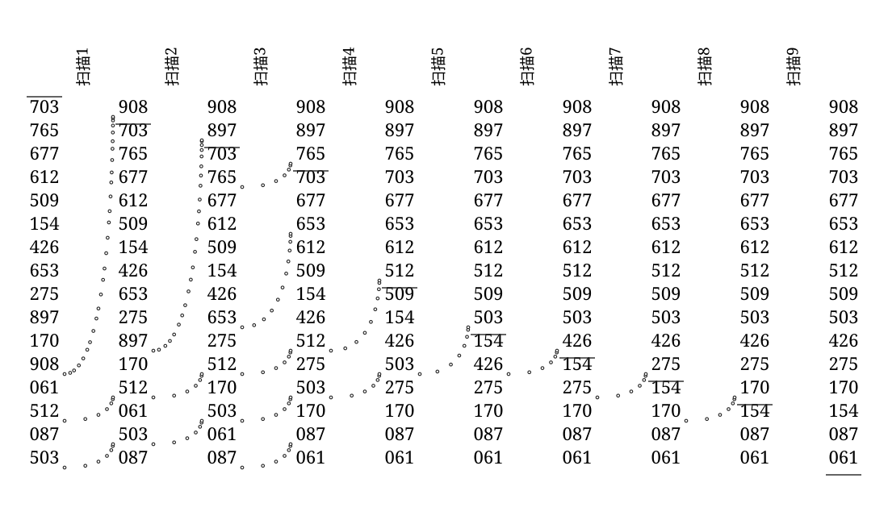

</div></div>

图 14　执行过程中的冒泡排序

<a id="alg-5-2-2-B"></a>

**算法 B (冒泡排序).** 重新排列记录 $R_1,\ldots,R_N$ 到适当位置, 排序完成后它们的键将处于有序状态: $K_1\le\cdots\le K_N$.

**B1.** [初始化 BOUND.] 置 $\mathrm{BOUND}\leftarrow N$. (在完成排序前, 不能确定某些记录是否已经处于其最终位置, BOUND 是这些记录的最高下标. 把它设定为 $N$, 表示目前还不知道任何信息.)

**B2.** [对 $j$ 循环.] 置 $t\leftarrow0$. 对 $j=1,2,\ldots,\mathrm{BOUND}-1$ 执行 B3, 然后转到 B4. (如果 $\mathrm{BOUND}=1$, 则意味着直接转到步骤 B4.)

**B3.** [比较／交换 $R_j:R_{j+1}$.] 如果 $K_j>K_{j+1}$, 交换 $R_j\leftrightarrow R_{j+1}$ 并置 $t\leftarrow j$.

**B4.** [是否有交换发生?] 如果 $t=0$, 算法终止. 否则, 置 $\mathrm{BOUND}\leftarrow t$, 返回 B2.　▮

<a id="fig-5-15"></a>

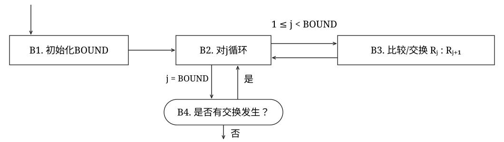

图 15　冒泡排序的流程图

<a id="prog-5-2-2-B"></a>

**程序 B (冒泡排序).** 如同本章前面的 MIX 程序, 假定待排序的项目位于单元 $\mathtt{INPUT}+1$ 至 $\mathtt{INPUT}+N$. $\mathrm{rI1}\equiv t$; $\mathrm{rI2}\equiv j$.

<a id="pdf-089"></a>
<a id="p-83"></a>

```mixal
01 START ENT1 N                 1       B1. 初始化BOUND。 t ← N.
02 1H    ST1  BOUND(1:2)        A       BOUND ← t.
03       ENT2 1                 A       B2. 对j循环。 j ← 1.
04       ENT1 0                 A       t ← 0.
05       JMP  BOUND             A       如果 j ≥ BOUND 则退出。
06 3H    LDA  INPUT,2           C       B3. 比较/交换 Rj : R(j+1).
07       CMPA INPUT+1,2         C
08       JLE  2F                C       如果 Kj ≤ K(j+1) 则不交换。
09       LDX  INPUT+1,2         B       R(j+1)
10       STX  INPUT,2           B       → Rj.
11       STA  INPUT+1,2         B       (旧的Rj) → R(j+1).
12       ENT1 0,2               B       t ← j.
13 2H    INC2 1                 C       j ← j+1.
14 BOUND ENTX -*,2              A+C     rX ← j-BOUND.             [被修改的指令]
15       JXN  3B                A+C     对1 ≤ j < BOUND执行步骤B3。
16 4H    J1P  1B                A       B4. 是否有交换发生？如果t > 0则转到步骤B2。 ▮
```


**冒泡排序的分析.** 分析算法 B 的运行时间很有指导意义. 运行时间涉及三个量: 扫描次数 $A$、交换次数 $B$、比较次数 $C$. 如果输入的键互不相同且顺序随机, 则可以假定它们是 $\{1,2,\ldots,n\}$ 的一个随机排列. 利用反序表 (5.1.1 节) 的思想可以很轻松地表示冒泡排序中每遍扫描的效果.

**定理 I.** 设 $a_1a_2\ldots a_n$ 是 $\{1,2,\ldots,n\}$ 的一个排列, 并设 $b_1b_2\ldots b_n$ 是相应的反序表. 如果冒泡排序算法 B 的一遍扫描把 $a_1a_2\ldots a_n$ 变成排列 $a'_1a'_2\ldots a'_n$, 则把 $b_1b_2\ldots b_n$ 的每个非零项减 1 即可得到相应的反序表 $b'_1b'_2\ldots b'_n$.

**证明.** 如果 $a_i$ 前面有更大的元素, 则它会和前面元素中的最大者交换, 所以 $b_{a_i}$ 减 1. 但如果 $a_i$ 前面没有更大元素, 它就永远不会和更大的元素交换, 所以 $b_{a_i}$ 保持为 0.　▮

因此, 研究每遍扫描之间的反序表序列, 就可以看出在冒泡排序期间发生了什么. 例如, 对应于图 14 的各个反序表依次是

$$
\begin{array}{rrrrrrrrrrrrrrrrr}
&3&1&8&3&4&5&0&4&0&3&2&2&3&2&1&0\\
\text{扫描1}&2&0&7&2&3&4&0&3&0&2&1&1&2&1&0&0\\
\text{扫描2}&1&0&6&1&2&3&0&2&0&1&0&0&1&0&0&0\\
\text{扫描3}&0&0&5&0&1&2&0&1&0&0&0&0&0&0&0&0
\end{array}\tag{1}
$$

以此类推. 如果 $b_1b_2\ldots b_n$ 是输入排列的反序表, 则必然有

$$
A=1+\max(b_1,b_2,\ldots,b_n),\tag{2}
$$

$$
B=b_1+b_2+\cdots+b_n,\tag{3}
$$

$$
C=c_1+c_2+\cdots+c_A,\tag{4}
$$

式中 $c_j$ 是第 $j$ 遍扫描开始时的 $\mathrm{BOUND}-1$ 值. 用反序表表示, 我们有

$$
c_j=\max\{b_i+i\mid b_i\ge j-1\}-j\tag{5}
$$

(见习题 5). 在例 (1) 中, 有 $A=9$、$B=41$、$C=15+14+13+12+7+5+4+3+2=75$. 图 14 的总 MIX 排序时间是 $960u$.

我们非常了解 $B$ (随机排列中的反序总数) 的分布. 所以只剩下 $A$ 和 $C$ 有待分析.

<a id="pdf-090"></a>
<a id="p-84"></a>

当 $1\le k\le n$ 时, 所有分量均小于 $k$ 的反序表的数目是 $k^{n-k}k!$, $A\le k$ 的概率等于该数目乘以 $1/n!$. 因此, 恰好需要 $k$ 遍扫描的概率是

$$
A_k=\frac1{n!}\bigl(k^{n-k}k!-(k-1)^{n-k+1}(k-1)!\bigr).\tag{6}
$$

现在可以计算均值 $\sum kA_k$. 对各部分求和, 得

$$
A_{\mathrm{ave}}=n+1-\sum_{k=0}^{n}\frac{k^{n-k}k!}{n!}=n+1-P(n),\tag{7}
$$

其中 $P(n)$ 是这样一个函数, 在式 1.2.11.3–(24) 中已经求出其渐近值是 $\sqrt{\pi n/2}-\frac23+O(1/\sqrt n)$. 弗兰德未加证明地给出式 (7)[*JACM* **3** (1956), 150]. 霍华德·德穆思给出了证明 [博士论文 (斯坦福大学, 1956 年 10 月), 64–68]. 关于 $A$ 的标准差, 见习题 7.

比较总数 $C$ 更难处理些, 我们将仅考虑 $C_{\mathrm{ave}}$. 对于固定的 $n$ 值, 设 $f_j(k)$ 表示符合以下条件的反序表 $b_1\ldots b_n$ 的数目: 当 $1\le i\le n$ 时, 或者有 $b_i<j-1$, 或者有 $b_i+i-j\le k$. 因此

$$
f_j(k)=(j+k)!(j-1)^{n-j-k}\qquad(0\le k\le n-j).\tag{8}
$$

(见习题 8.) 式 (5) 中 $c_j$ 的平均值是 $\bigl(\sum k(f_j(k)-f_j(k-1))\bigr)/n!$. 对各部分求和, 再对 $j$ 求和, 得到

$$
C_{\mathrm{ave}}=\binom{n+1}{2}-\frac1{n!}\sum_{\substack{1\le j\le n\\0\le k\le n-j}}f_j(k)
=\binom{n+1}{2}-\frac1{n!}\sum_{0\le r<s\le n}s!r^{n-s}.\tag{9}
$$

在这里不容易确定渐近值, 所以本节结束时再回来讨论.

总结一下我们对冒泡排序的分析, 先后推导的公式可以写成如下形式:

$$
A=\bigl(\text{最小 }1,\;\text{平均 }N-\sqrt{\pi N/2}+O(1),\;\text{最大 }N\bigr);\tag{10}
$$

$$
B=\bigl(\text{最小 }0,\;\text{平均 }\tfrac14(N^2-N),\;\text{最大 }\tfrac12(N^2-N)\bigr);\tag{11}
$$

$$
C=\bigl(\text{最小 }N-1,\;\text{平均 }\tfrac12\bigl(N^2-N\ln N-(\gamma+\ln2-1)N\bigr)+O(\sqrt N),\;\text{最大 }\tfrac12(N^2-N)\bigr).\tag{12}
$$

在每种情况下, 都是输入内容已经有序时取得最小值, 输入内容为逆序时取得最大值. 所以 MIX 运行时间是 $8A+7B+8C+1=\bigl(\text{最小 }8N+1,\;\text{平均 }5.75N^2+O(N\log N),\;\text{最大 }7.5N^2+0.5N+1\bigr)$.

**冒泡排序的改进.** 冒泡排序的分析花费了很大力气. 尽管计算过程中使用的技巧很有指导意义, 但结果却令人失望: 冒泡排序实际上并不是很好. 与直接插入 (算法 5.2.1S) 相比, 冒泡排序需要更复杂的程序, 而且运行时间超过直接插入的两倍!

很容易找到冒泡排序的某些不足. 例如在图 14 中, 第 4 遍扫描中的第一次比较是多余的, 第 5 遍扫描中的前两次比较, 以及第 6、7 遍扫描中的前三次比较也是如此. 还注意到, 各元素在每遍扫描中至多向左移动一步. 因此, 如果最小项开始时碰巧在最右边, 那就必须进行最大数量的比较. 由此引出了 “调酒师排序”, 以相反方向交替进行扫描 (见图 16). 这个方法可以略微减少平均比较次数. 肯尼思·艾弗森在这方面进行了有趣的考察 [*A Programming Language* (Wiley, 1962), 218–219]: 对于某个下标 $j$, 如果 $R_j$ 和 $R_{j+1}$ 在方向相反的两遍连续扫描中不需要交换, 则 $R_j$ 和 $R_{j+1}$ 必然位于它们的最终位置, 不再需要对它们进行任何后续比较. 例如, 从左向右扫描 $4\,3\,2\,1\,8\,6\,9\,7\,5$ 得到 $3\,2\,1\,4\,6\,8\,7\,5\,9$, $R_4$ 和 $R_5$ 之间没有出现交换. 从右向左扫描后一排列时, $R_4$ 仍然小于 (新的)$R_5$, 所以可以立即得出结论: $R_4$ 和 $R_5$ 不再需要参与任何后续比较.

<a id="pdf-091"></a>
<a id="p-85"></a>

<a id="fig-5-16"></a>

<div class="source-tableau-group" style="overflow-x:auto;max-width:100%"><div style="width:880px">

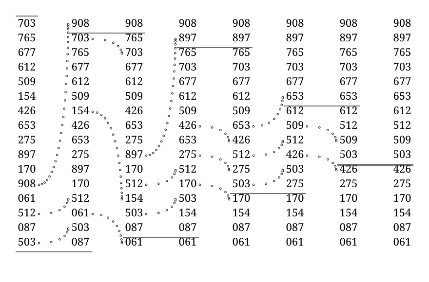

</div></div>

图 16　调酒师排序 [shic]

但这些改进都没能导出优于直接插入的算法. 我们已经知道, 直接插入排序不适合很大的 $N$ 值. 另一种思想是消除大多数交换. 由于大多数元素在交换期间只左移一步, 换一种角度来看待这个数组, 移动下标的起点一样可以达到相同效果! 但得到的算法并不比稍后将要研究的直接选择算法 5.2.3S 更好.

简而言之, 冒泡排序算法看起来没有什么值得推荐的, 除了拥有一个迷人的名字, 而且会引出某些重要的理论问题.

**巴彻尔并行方法.** 如果我们希望拥有一种运行时间快于 $N^2$ 量级的交换算法, 那就需要选择一些不相邻的键对 $(K_i,K_j)$ 进行比较. 否则需要的交换次数就会和原排列拥有的反序个数一样多, 而平均反序个数是 $\tfrac14(N^2-N)$. 肯尼思·巴彻尔在 1964 年发现了一种天才方法 [*Proc. AFIPS Spring Joint Computer Conference* **32** (1968), 307–314], 用于比较序列编程, 寻找可能的交换. 他的方法并非那么显而易见. 事实上, 由于比较次数较少, 所以需要相当复杂的证明来证实它的有效性. 我们将讨论两种证明, 这一节给出一种, 5.3.4 节给出另一种.

巴彻尔的排序方案类似于谢尔排序, 但比较方式很新颖, 不再需要交换的传播. 例如, 比较表 1 和表 5.2.1–3, 巴彻尔方法实现了 8-排序、4-排序、2-排序和 1-排序的效果, 但这些比较都不重叠. 由于巴彻尔算法实质上是合并排好序的子序列对, 所以也称为 “合并交换排序”.

<a id="pdf-092"></a>
<a id="p-86"></a>

<a id="alg-5-2-2-M"></a>

**算法 M (合并交换).** 重新排列记录 $R_1,\ldots,R_N$ 到适当位置, 排序完成后它们的键将处于有序状态: $K_1\le\cdots\le K_N$. 假定 $N\ge2$.

**M1.** [初始化 $p$.] 置 $p\leftarrow2^{t-1}$, 其中 $t=\lceil\lg N\rceil$ 是满足 $2^t\ge N$ 的最小整数. (将对 $p=2^{t-1},2^{t-2},\ldots,1$ 执行 M2 至 M5.)

**M2.** [初始化 $q,r,d$.] 置 $q\leftarrow2^{t-1}$, $r\leftarrow0$, $d\leftarrow p$.

**M3.** [对 $i$ 循环.] 对于所有满足 $0\le i<N-d$ 和 $i\mathbin{\&}p=r$ 的 $i$ 值, 执行 M4. 然后转到 M5. (这里 $i\mathbin{\&}p$ 指的是 $i$ 和 $p$ 的二进制表示的 “逐位逻辑与”: 对每个二进制位, 如果 $i$ 和 $p$ 该位的值均为 1 则结果中该位是 1, 其他情形结果中该位是 0. 例如 $13\mathbin{\&}21=(1101)_2\mathbin{\&}(10101)_2=(00101)_2=5$. 这时, $d$ 是 $p$ 的奇数倍, $p$ 是 2 的幂, 使得 $i\mathbin{\&}p\ne(i+d)\mathbin{\&}p$. 由此得出, 可以按任意顺序对所有相关 $i$ 值执行 M4, 甚至可以同时执行.)

**M4.** [比较／交换 $R_{i+1}:R_{i+d+1}$.] 如果 $K_{i+1}>K_{i+d+1}$ 则交换记录 $R_{i+1}\leftrightarrow R_{i+d+1}$.

**M5.** [对 $q$ 循环.] 如果 $q\ne p$, 置 $d\leftarrow q-p$, $q\leftarrow q/2$, $r\leftarrow p$, 然后返回 M3.

**M6.** [对 $p$ 循环.] (这时, 排列 $K_1K_2\ldots K_N$ 是 “$p$ 有序” 的.) 置 $p\leftarrow\lfloor p/2\rfloor$. 如果 $p>0$ 则返回 M2.　▮


<a id="table-5-2-2-1"></a>

表 1　合并交换排序 (巴彻尔方法)

<table data-merge-exchange-table="1" style="border-collapse:collapse;table-layout:fixed;width:1160px;font-family:monospace"><thead><tr><th style="width:50px;min-width:50px;padding:0;border:0;text-align:center">$p$</th><th style="width:50px;min-width:50px;padding:0;border:0;text-align:center">$q$</th><th style="width:50px;min-width:50px;padding:0;border:0;text-align:center">$r$</th><th style="width:50px;min-width:50px;padding:0;border:0;text-align:center">$d$</th><th style="width:60px;min-width:60px;padding:0;border:0"></th><th style="width:60px;min-width:60px;padding:0;border:0"></th><th style="width:60px;min-width:60px;padding:0;border:0"></th><th style="width:60px;min-width:60px;padding:0;border:0"></th><th style="width:60px;min-width:60px;padding:0;border:0"></th><th style="width:60px;min-width:60px;padding:0;border:0"></th><th style="width:60px;min-width:60px;padding:0;border:0"></th><th style="width:60px;min-width:60px;padding:0;border:0"></th><th style="width:60px;min-width:60px;padding:0;border:0"></th><th style="width:60px;min-width:60px;padding:0;border:0"></th><th style="width:60px;min-width:60px;padding:0;border:0"></th><th style="width:60px;min-width:60px;padding:0;border:0"></th><th style="width:60px;min-width:60px;padding:0;border:0"></th><th style="width:60px;min-width:60px;padding:0;border:0"></th><th style="width:60px;min-width:60px;padding:0;border:0"></th><th style="width:60px;min-width:60px;padding:0;border:0"></th></tr></thead><tbody>
<tr data-merge-state="0" style="border:0;background:transparent"><td style="width:50px;min-width:50px;border:0"></td><td style="width:50px;min-width:50px;border:0"></td><td style="width:50px;min-width:50px;border:0"></td><td style="width:50px;min-width:50px;border:0"></td><td style="width:60px;min-width:60px;padding:0;border:0;text-align:center">503</td><td style="width:60px;min-width:60px;padding:0;border:0;text-align:center">087</td><td style="width:60px;min-width:60px;padding:0;border:0;text-align:center">512</td><td style="width:60px;min-width:60px;padding:0;border:0;text-align:center">061</td><td style="width:60px;min-width:60px;padding:0;border:0;text-align:center">908</td><td style="width:60px;min-width:60px;padding:0;border:0;text-align:center">170</td><td style="width:60px;min-width:60px;padding:0;border:0;text-align:center">897</td><td style="width:60px;min-width:60px;padding:0;border:0;text-align:center">275</td><td style="width:60px;min-width:60px;padding:0;border:0;text-align:center">653</td><td style="width:60px;min-width:60px;padding:0;border:0;text-align:center">426</td><td style="width:60px;min-width:60px;padding:0;border:0;text-align:center">154</td><td style="width:60px;min-width:60px;padding:0;border:0;text-align:center">509</td><td style="width:60px;min-width:60px;padding:0;border:0;text-align:center">612</td><td style="width:60px;min-width:60px;padding:0;border:0;text-align:center">677</td><td style="width:60px;min-width:60px;padding:0;border:0;text-align:center">765</td><td style="width:60px;min-width:60px;padding:0;border:0;text-align:center">703</td></tr>
<tr style="border:0;background:transparent"><td style="border:0;padding:0;text-align:center">8</td><td style="border:0;padding:0;text-align:center">8</td><td style="border:0;padding:0;text-align:center">0</td><td style="border:0;padding:0;text-align:center">8</td><td colspan="16" style="border:0;padding:0"><svg xmlns="http://www.w3.org/2000/svg" width="960" height="57" viewBox="0 0 960 57" role="img" aria-label="本行独立比较位置对"><path data-comparison="1-9" d="M30,4 Q270.0,100 510,4" stroke="#222" stroke-width="1.2" fill="none"/><path data-comparison="2-10" d="M90,4 Q330.0,100 570,4" stroke="#222" stroke-width="1.2" fill="none"/><path data-comparison="3-11" d="M150,4 Q390.0,100 630,4" stroke="#222" stroke-width="1.2" fill="none"/><path data-comparison="4-12" d="M210,4 Q450.0,100 690,4" stroke="#222" stroke-width="1.2" fill="none"/><path data-comparison="5-13" d="M270,4 Q510.0,100 750,4" stroke="#222" stroke-width="1.2" fill="none"/><path data-comparison="6-14" d="M330,4 Q570.0,100 810,4" stroke="#222" stroke-width="1.2" fill="none"/><path data-comparison="7-15" d="M390,4 Q630.0,100 870,4" stroke="#222" stroke-width="1.2" fill="none"/><path data-comparison="8-16" d="M450,4 Q690.0,100 930,4" stroke="#222" stroke-width="1.2" fill="none"/></svg></td></tr>
<tr data-merge-state="1" style="border:0;background:transparent"><td style="width:50px;min-width:50px;border:0"></td><td style="width:50px;min-width:50px;border:0"></td><td style="width:50px;min-width:50px;border:0"></td><td style="width:50px;min-width:50px;border:0"></td><td style="width:60px;min-width:60px;padding:0;border:0;text-align:center">503</td><td style="width:60px;min-width:60px;padding:0;border:0;text-align:center">087</td><td style="width:60px;min-width:60px;padding:0;border:0;text-align:center">154</td><td style="width:60px;min-width:60px;padding:0;border:0;text-align:center">061</td><td style="width:60px;min-width:60px;padding:0;border:0;text-align:center">612</td><td style="width:60px;min-width:60px;padding:0;border:0;text-align:center">170</td><td style="width:60px;min-width:60px;padding:0;border:0;text-align:center">765</td><td style="width:60px;min-width:60px;padding:0;border:0;text-align:center">275</td><td style="width:60px;min-width:60px;padding:0;border:0;text-align:center">653</td><td style="width:60px;min-width:60px;padding:0;border:0;text-align:center">426</td><td style="width:60px;min-width:60px;padding:0;border:0;text-align:center">512</td><td style="width:60px;min-width:60px;padding:0;border:0;text-align:center">509</td><td style="width:60px;min-width:60px;padding:0;border:0;text-align:center">908</td><td style="width:60px;min-width:60px;padding:0;border:0;text-align:center">677</td><td style="width:60px;min-width:60px;padding:0;border:0;text-align:center">897</td><td style="width:60px;min-width:60px;padding:0;border:0;text-align:center">703</td></tr>
<tr style="border:0;background:transparent"><td style="border:0;padding:0;text-align:center">4</td><td style="border:0;padding:0;text-align:center">8</td><td style="border:0;padding:0;text-align:center">0</td><td style="border:0;padding:0;text-align:center">4</td><td colspan="16" style="border:0;padding:0"><svg xmlns="http://www.w3.org/2000/svg" width="960" height="57" viewBox="0 0 960 57" role="img" aria-label="本行独立比较位置对"><path data-comparison="1-5" d="M30,4 Q150.0,100 270,4" stroke="#222" stroke-width="1.2" fill="none"/><path data-comparison="2-6" d="M90,4 Q210.0,100 330,4" stroke="#222" stroke-width="1.2" fill="none"/><path data-comparison="3-7" d="M150,4 Q270.0,100 390,4" stroke="#222" stroke-width="1.2" fill="none"/><path data-comparison="4-8" d="M210,4 Q330.0,100 450,4" stroke="#222" stroke-width="1.2" fill="none"/><path data-comparison="9-13" d="M510,4 Q630.0,100 750,4" stroke="#222" stroke-width="1.2" fill="none"/><path data-comparison="10-14" d="M570,4 Q690.0,100 810,4" stroke="#222" stroke-width="1.2" fill="none"/><path data-comparison="11-15" d="M630,4 Q750.0,100 870,4" stroke="#222" stroke-width="1.2" fill="none"/><path data-comparison="12-16" d="M690,4 Q810.0,100 930,4" stroke="#222" stroke-width="1.2" fill="none"/></svg></td></tr>
<tr data-merge-state="2" style="border:0;background:transparent"><td style="width:50px;min-width:50px;border:0"></td><td style="width:50px;min-width:50px;border:0"></td><td style="width:50px;min-width:50px;border:0"></td><td style="width:50px;min-width:50px;border:0"></td><td style="width:60px;min-width:60px;padding:0;border:0;text-align:center">503</td><td style="width:60px;min-width:60px;padding:0;border:0;text-align:center">087</td><td style="width:60px;min-width:60px;padding:0;border:0;text-align:center">154</td><td style="width:60px;min-width:60px;padding:0;border:0;text-align:center">061</td><td style="width:60px;min-width:60px;padding:0;border:0;text-align:center">612</td><td style="width:60px;min-width:60px;padding:0;border:0;text-align:center">170</td><td style="width:60px;min-width:60px;padding:0;border:0;text-align:center">765</td><td style="width:60px;min-width:60px;padding:0;border:0;text-align:center">275</td><td style="width:60px;min-width:60px;padding:0;border:0;text-align:center">653</td><td style="width:60px;min-width:60px;padding:0;border:0;text-align:center">426</td><td style="width:60px;min-width:60px;padding:0;border:0;text-align:center">512</td><td style="width:60px;min-width:60px;padding:0;border:0;text-align:center">509</td><td style="width:60px;min-width:60px;padding:0;border:0;text-align:center">908</td><td style="width:60px;min-width:60px;padding:0;border:0;text-align:center">677</td><td style="width:60px;min-width:60px;padding:0;border:0;text-align:center">897</td><td style="width:60px;min-width:60px;padding:0;border:0;text-align:center">703</td></tr>
<tr style="border:0;background:transparent"><td style="border:0;padding:0;text-align:center">4</td><td style="border:0;padding:0;text-align:center">4</td><td style="border:0;padding:0;text-align:center">4</td><td style="border:0;padding:0;text-align:center">4</td><td colspan="16" style="border:0;padding:0"><svg xmlns="http://www.w3.org/2000/svg" width="960" height="57" viewBox="0 0 960 57" role="img" aria-label="本行独立比较位置对"><path data-comparison="5-9" d="M270,4 Q390.0,100 510,4" stroke="#222" stroke-width="1.2" fill="none"/><path data-comparison="6-10" d="M330,4 Q450.0,100 570,4" stroke="#222" stroke-width="1.2" fill="none"/><path data-comparison="7-11" d="M390,4 Q510.0,100 630,4" stroke="#222" stroke-width="1.2" fill="none"/><path data-comparison="8-12" d="M450,4 Q570.0,100 690,4" stroke="#222" stroke-width="1.2" fill="none"/></svg></td></tr>
<tr data-merge-state="3" style="border:0;background:transparent"><td style="width:50px;min-width:50px;border:0"></td><td style="width:50px;min-width:50px;border:0"></td><td style="width:50px;min-width:50px;border:0"></td><td style="width:50px;min-width:50px;border:0"></td><td style="width:60px;min-width:60px;padding:0;border:0;text-align:center">503</td><td style="width:60px;min-width:60px;padding:0;border:0;text-align:center">087</td><td style="width:60px;min-width:60px;padding:0;border:0;text-align:center">154</td><td style="width:60px;min-width:60px;padding:0;border:0;text-align:center">061</td><td style="width:60px;min-width:60px;padding:0;border:0;text-align:center">612</td><td style="width:60px;min-width:60px;padding:0;border:0;text-align:center">170</td><td style="width:60px;min-width:60px;padding:0;border:0;text-align:center">512</td><td style="width:60px;min-width:60px;padding:0;border:0;text-align:center">275</td><td style="width:60px;min-width:60px;padding:0;border:0;text-align:center">653</td><td style="width:60px;min-width:60px;padding:0;border:0;text-align:center">426</td><td style="width:60px;min-width:60px;padding:0;border:0;text-align:center">765</td><td style="width:60px;min-width:60px;padding:0;border:0;text-align:center">509</td><td style="width:60px;min-width:60px;padding:0;border:0;text-align:center">908</td><td style="width:60px;min-width:60px;padding:0;border:0;text-align:center">677</td><td style="width:60px;min-width:60px;padding:0;border:0;text-align:center">897</td><td style="width:60px;min-width:60px;padding:0;border:0;text-align:center">703</td></tr>
<tr style="border:0;background:transparent"><td style="border:0;padding:0;text-align:center">2</td><td style="border:0;padding:0;text-align:center">8</td><td style="border:0;padding:0;text-align:center">0</td><td style="border:0;padding:0;text-align:center">2</td><td colspan="16" style="border:0;padding:0"><svg xmlns="http://www.w3.org/2000/svg" width="960" height="57" viewBox="0 0 960 57" role="img" aria-label="本行独立比较位置对"><path data-comparison="1-3" d="M30,4 Q90.0,100 150,4" stroke="#222" stroke-width="1.2" fill="none"/><path data-comparison="2-4" d="M90,4 Q150.0,100 210,4" stroke="#222" stroke-width="1.2" fill="none"/><path data-comparison="5-7" d="M270,4 Q330.0,100 390,4" stroke="#222" stroke-width="1.2" fill="none"/><path data-comparison="6-8" d="M330,4 Q390.0,100 450,4" stroke="#222" stroke-width="1.2" fill="none"/><path data-comparison="9-11" d="M510,4 Q570.0,100 630,4" stroke="#222" stroke-width="1.2" fill="none"/><path data-comparison="10-12" d="M570,4 Q630.0,100 690,4" stroke="#222" stroke-width="1.2" fill="none"/><path data-comparison="13-15" d="M750,4 Q810.0,100 870,4" stroke="#222" stroke-width="1.2" fill="none"/><path data-comparison="14-16" d="M810,4 Q870.0,100 930,4" stroke="#222" stroke-width="1.2" fill="none"/></svg></td></tr>
<tr data-merge-state="4" style="border:0;background:transparent"><td style="width:50px;min-width:50px;border:0"></td><td style="width:50px;min-width:50px;border:0"></td><td style="width:50px;min-width:50px;border:0"></td><td style="width:50px;min-width:50px;border:0"></td><td style="width:60px;min-width:60px;padding:0;border:0;text-align:center">154</td><td style="width:60px;min-width:60px;padding:0;border:0;text-align:center">061</td><td style="width:60px;min-width:60px;padding:0;border:0;text-align:center">503</td><td style="width:60px;min-width:60px;padding:0;border:0;text-align:center">087</td><td style="width:60px;min-width:60px;padding:0;border:0;text-align:center">512</td><td style="width:60px;min-width:60px;padding:0;border:0;text-align:center">170</td><td style="width:60px;min-width:60px;padding:0;border:0;text-align:center">612</td><td style="width:60px;min-width:60px;padding:0;border:0;text-align:center">275</td><td style="width:60px;min-width:60px;padding:0;border:0;text-align:center">653</td><td style="width:60px;min-width:60px;padding:0;border:0;text-align:center">426</td><td style="width:60px;min-width:60px;padding:0;border:0;text-align:center">765</td><td style="width:60px;min-width:60px;padding:0;border:0;text-align:center">509</td><td style="width:60px;min-width:60px;padding:0;border:0;text-align:center">897</td><td style="width:60px;min-width:60px;padding:0;border:0;text-align:center">677</td><td style="width:60px;min-width:60px;padding:0;border:0;text-align:center">908</td><td style="width:60px;min-width:60px;padding:0;border:0;text-align:center">703</td></tr>
<tr style="border:0;background:transparent"><td style="border:0;padding:0;text-align:center">2</td><td style="border:0;padding:0;text-align:center">4</td><td style="border:0;padding:0;text-align:center">2</td><td style="border:0;padding:0;text-align:center">6</td><td colspan="16" style="border:0;padding:0"><svg xmlns="http://www.w3.org/2000/svg" width="960" height="57" viewBox="0 0 960 57" role="img" aria-label="本行独立比较位置对"><path data-comparison="3-9" d="M150,4 Q330.0,100 510,4" stroke="#222" stroke-width="1.2" fill="none"/><path data-comparison="4-10" d="M210,4 Q390.0,100 570,4" stroke="#222" stroke-width="1.2" fill="none"/><path data-comparison="7-13" d="M390,4 Q570.0,100 750,4" stroke="#222" stroke-width="1.2" fill="none"/><path data-comparison="8-14" d="M450,4 Q630.0,100 810,4" stroke="#222" stroke-width="1.2" fill="none"/></svg></td></tr>
<tr data-merge-state="5" style="border:0;background:transparent"><td style="width:50px;min-width:50px;border:0"></td><td style="width:50px;min-width:50px;border:0"></td><td style="width:50px;min-width:50px;border:0"></td><td style="width:50px;min-width:50px;border:0"></td><td style="width:60px;min-width:60px;padding:0;border:0;text-align:center">154</td><td style="width:60px;min-width:60px;padding:0;border:0;text-align:center">061</td><td style="width:60px;min-width:60px;padding:0;border:0;text-align:center">503</td><td style="width:60px;min-width:60px;padding:0;border:0;text-align:center">087</td><td style="width:60px;min-width:60px;padding:0;border:0;text-align:center">512</td><td style="width:60px;min-width:60px;padding:0;border:0;text-align:center">170</td><td style="width:60px;min-width:60px;padding:0;border:0;text-align:center">612</td><td style="width:60px;min-width:60px;padding:0;border:0;text-align:center">275</td><td style="width:60px;min-width:60px;padding:0;border:0;text-align:center">653</td><td style="width:60px;min-width:60px;padding:0;border:0;text-align:center">426</td><td style="width:60px;min-width:60px;padding:0;border:0;text-align:center">765</td><td style="width:60px;min-width:60px;padding:0;border:0;text-align:center">509</td><td style="width:60px;min-width:60px;padding:0;border:0;text-align:center">897</td><td style="width:60px;min-width:60px;padding:0;border:0;text-align:center">677</td><td style="width:60px;min-width:60px;padding:0;border:0;text-align:center">908</td><td style="width:60px;min-width:60px;padding:0;border:0;text-align:center">703</td></tr>
<tr style="border:0;background:transparent"><td style="border:0;padding:0;text-align:center">2</td><td style="border:0;padding:0;text-align:center">2</td><td style="border:0;padding:0;text-align:center">2</td><td style="border:0;padding:0;text-align:center">2</td><td colspan="16" style="border:0;padding:0"><svg xmlns="http://www.w3.org/2000/svg" width="960" height="57" viewBox="0 0 960 57" role="img" aria-label="本行独立比较位置对"><path data-comparison="3-5" d="M150,4 Q210.0,100 270,4" stroke="#222" stroke-width="1.2" fill="none"/><path data-comparison="4-6" d="M210,4 Q270.0,100 330,4" stroke="#222" stroke-width="1.2" fill="none"/><path data-comparison="7-9" d="M390,4 Q450.0,100 510,4" stroke="#222" stroke-width="1.2" fill="none"/><path data-comparison="8-10" d="M450,4 Q510.0,100 570,4" stroke="#222" stroke-width="1.2" fill="none"/><path data-comparison="11-13" d="M630,4 Q690.0,100 750,4" stroke="#222" stroke-width="1.2" fill="none"/><path data-comparison="12-14" d="M690,4 Q750.0,100 810,4" stroke="#222" stroke-width="1.2" fill="none"/></svg></td></tr>
<tr data-merge-state="6" style="border:0;background:transparent"><td style="width:50px;min-width:50px;border:0"></td><td style="width:50px;min-width:50px;border:0"></td><td style="width:50px;min-width:50px;border:0"></td><td style="width:50px;min-width:50px;border:0"></td><td style="width:60px;min-width:60px;padding:0;border:0;text-align:center">154</td><td style="width:60px;min-width:60px;padding:0;border:0;text-align:center">061</td><td style="width:60px;min-width:60px;padding:0;border:0;text-align:center">503</td><td style="width:60px;min-width:60px;padding:0;border:0;text-align:center">087</td><td style="width:60px;min-width:60px;padding:0;border:0;text-align:center">512</td><td style="width:60px;min-width:60px;padding:0;border:0;text-align:center">170</td><td style="width:60px;min-width:60px;padding:0;border:0;text-align:center">612</td><td style="width:60px;min-width:60px;padding:0;border:0;text-align:center">275</td><td style="width:60px;min-width:60px;padding:0;border:0;text-align:center">653</td><td style="width:60px;min-width:60px;padding:0;border:0;text-align:center">426</td><td style="width:60px;min-width:60px;padding:0;border:0;text-align:center">765</td><td style="width:60px;min-width:60px;padding:0;border:0;text-align:center">509</td><td style="width:60px;min-width:60px;padding:0;border:0;text-align:center">897</td><td style="width:60px;min-width:60px;padding:0;border:0;text-align:center">677</td><td style="width:60px;min-width:60px;padding:0;border:0;text-align:center">908</td><td style="width:60px;min-width:60px;padding:0;border:0;text-align:center">703</td></tr>
<tr style="border:0;background:transparent"><td style="border:0;padding:0;text-align:center">1</td><td style="border:0;padding:0;text-align:center">8</td><td style="border:0;padding:0;text-align:center">0</td><td style="border:0;padding:0;text-align:center">1</td><td colspan="16" style="border:0;padding:0"><svg xmlns="http://www.w3.org/2000/svg" width="960" height="57" viewBox="0 0 960 57" role="img" aria-label="本行独立比较位置对"><path data-comparison="1-2" d="M30,4 Q60.0,100 90,4" stroke="#222" stroke-width="1.2" fill="none"/><path data-comparison="3-4" d="M150,4 Q180.0,100 210,4" stroke="#222" stroke-width="1.2" fill="none"/><path data-comparison="5-6" d="M270,4 Q300.0,100 330,4" stroke="#222" stroke-width="1.2" fill="none"/><path data-comparison="7-8" d="M390,4 Q420.0,100 450,4" stroke="#222" stroke-width="1.2" fill="none"/><path data-comparison="9-10" d="M510,4 Q540.0,100 570,4" stroke="#222" stroke-width="1.2" fill="none"/><path data-comparison="11-12" d="M630,4 Q660.0,100 690,4" stroke="#222" stroke-width="1.2" fill="none"/><path data-comparison="13-14" d="M750,4 Q780.0,100 810,4" stroke="#222" stroke-width="1.2" fill="none"/><path data-comparison="15-16" d="M870,4 Q900.0,100 930,4" stroke="#222" stroke-width="1.2" fill="none"/></svg></td></tr>
<tr data-merge-state="7" style="border:0;background:transparent"><td style="width:50px;min-width:50px;border:0"></td><td style="width:50px;min-width:50px;border:0"></td><td style="width:50px;min-width:50px;border:0"></td><td style="width:50px;min-width:50px;border:0"></td><td style="width:60px;min-width:60px;padding:0;border:0;text-align:center">061</td><td style="width:60px;min-width:60px;padding:0;border:0;text-align:center">154</td><td style="width:60px;min-width:60px;padding:0;border:0;text-align:center">087</td><td style="width:60px;min-width:60px;padding:0;border:0;text-align:center">503</td><td style="width:60px;min-width:60px;padding:0;border:0;text-align:center">170</td><td style="width:60px;min-width:60px;padding:0;border:0;text-align:center">512</td><td style="width:60px;min-width:60px;padding:0;border:0;text-align:center">275</td><td style="width:60px;min-width:60px;padding:0;border:0;text-align:center">612</td><td style="width:60px;min-width:60px;padding:0;border:0;text-align:center">426</td><td style="width:60px;min-width:60px;padding:0;border:0;text-align:center">653</td><td style="width:60px;min-width:60px;padding:0;border:0;text-align:center">509</td><td style="width:60px;min-width:60px;padding:0;border:0;text-align:center">765</td><td style="width:60px;min-width:60px;padding:0;border:0;text-align:center">677</td><td style="width:60px;min-width:60px;padding:0;border:0;text-align:center">897</td><td style="width:60px;min-width:60px;padding:0;border:0;text-align:center">703</td><td style="width:60px;min-width:60px;padding:0;border:0;text-align:center">908</td></tr>
<tr style="border:0;background:transparent"><td style="border:0;padding:0;text-align:center">1</td><td style="border:0;padding:0;text-align:center">4</td><td style="border:0;padding:0;text-align:center">1</td><td style="border:0;padding:0;text-align:center">7</td><td colspan="16" style="border:0;padding:0"><svg xmlns="http://www.w3.org/2000/svg" width="960" height="57" viewBox="0 0 960 57" role="img" aria-label="本行独立比较位置对"><path data-comparison="2-9" d="M90,4 Q300.0,100 510,4" stroke="#222" stroke-width="1.2" fill="none"/><path data-comparison="4-11" d="M210,4 Q420.0,100 630,4" stroke="#222" stroke-width="1.2" fill="none"/><path data-comparison="6-13" d="M330,4 Q540.0,100 750,4" stroke="#222" stroke-width="1.2" fill="none"/><path data-comparison="8-15" d="M450,4 Q660.0,100 870,4" stroke="#222" stroke-width="1.2" fill="none"/></svg></td></tr>
<tr data-merge-state="8" style="border:0;background:transparent"><td style="width:50px;min-width:50px;border:0"></td><td style="width:50px;min-width:50px;border:0"></td><td style="width:50px;min-width:50px;border:0"></td><td style="width:50px;min-width:50px;border:0"></td><td style="width:60px;min-width:60px;padding:0;border:0;text-align:center">061</td><td style="width:60px;min-width:60px;padding:0;border:0;text-align:center">154</td><td style="width:60px;min-width:60px;padding:0;border:0;text-align:center">087</td><td style="width:60px;min-width:60px;padding:0;border:0;text-align:center">503</td><td style="width:60px;min-width:60px;padding:0;border:0;text-align:center">170</td><td style="width:60px;min-width:60px;padding:0;border:0;text-align:center">512</td><td style="width:60px;min-width:60px;padding:0;border:0;text-align:center">275</td><td style="width:60px;min-width:60px;padding:0;border:0;text-align:center">612</td><td style="width:60px;min-width:60px;padding:0;border:0;text-align:center">426</td><td style="width:60px;min-width:60px;padding:0;border:0;text-align:center">653</td><td style="width:60px;min-width:60px;padding:0;border:0;text-align:center">509</td><td style="width:60px;min-width:60px;padding:0;border:0;text-align:center">765</td><td style="width:60px;min-width:60px;padding:0;border:0;text-align:center">677</td><td style="width:60px;min-width:60px;padding:0;border:0;text-align:center">897</td><td style="width:60px;min-width:60px;padding:0;border:0;text-align:center">703</td><td style="width:60px;min-width:60px;padding:0;border:0;text-align:center">908</td></tr>
<tr style="border:0;background:transparent"><td style="border:0;padding:0;text-align:center">1</td><td style="border:0;padding:0;text-align:center">2</td><td style="border:0;padding:0;text-align:center">1</td><td style="border:0;padding:0;text-align:center">3</td><td colspan="16" style="border:0;padding:0"><svg xmlns="http://www.w3.org/2000/svg" width="960" height="57" viewBox="0 0 960 57" role="img" aria-label="本行独立比较位置对"><path data-comparison="2-5" d="M90,4 Q180.0,100 270,4" stroke="#222" stroke-width="1.2" fill="none"/><path data-comparison="4-7" d="M210,4 Q300.0,100 390,4" stroke="#222" stroke-width="1.2" fill="none"/><path data-comparison="6-9" d="M330,4 Q420.0,100 510,4" stroke="#222" stroke-width="1.2" fill="none"/><path data-comparison="8-11" d="M450,4 Q540.0,100 630,4" stroke="#222" stroke-width="1.2" fill="none"/><path data-comparison="10-13" d="M570,4 Q660.0,100 750,4" stroke="#222" stroke-width="1.2" fill="none"/><path data-comparison="12-15" d="M690,4 Q780.0,100 870,4" stroke="#222" stroke-width="1.2" fill="none"/></svg></td></tr>
<tr data-merge-state="9" style="border:0;background:transparent"><td style="width:50px;min-width:50px;border:0"></td><td style="width:50px;min-width:50px;border:0"></td><td style="width:50px;min-width:50px;border:0"></td><td style="width:50px;min-width:50px;border:0"></td><td style="width:60px;min-width:60px;padding:0;border:0;text-align:center">061</td><td style="width:60px;min-width:60px;padding:0;border:0;text-align:center">154</td><td style="width:60px;min-width:60px;padding:0;border:0;text-align:center">087</td><td style="width:60px;min-width:60px;padding:0;border:0;text-align:center">275</td><td style="width:60px;min-width:60px;padding:0;border:0;text-align:center">170</td><td style="width:60px;min-width:60px;padding:0;border:0;text-align:center">426</td><td style="width:60px;min-width:60px;padding:0;border:0;text-align:center">503</td><td style="width:60px;min-width:60px;padding:0;border:0;text-align:center">509</td><td style="width:60px;min-width:60px;padding:0;border:0;text-align:center">512</td><td style="width:60px;min-width:60px;padding:0;border:0;text-align:center">653</td><td style="width:60px;min-width:60px;padding:0;border:0;text-align:center">612</td><td style="width:60px;min-width:60px;padding:0;border:0;text-align:center">703</td><td style="width:60px;min-width:60px;padding:0;border:0;text-align:center">677</td><td style="width:60px;min-width:60px;padding:0;border:0;text-align:center">897</td><td style="width:60px;min-width:60px;padding:0;border:0;text-align:center">765</td><td style="width:60px;min-width:60px;padding:0;border:0;text-align:center">908</td></tr>
<tr style="border:0;background:transparent"><td style="border:0;padding:0;text-align:center">1</td><td style="border:0;padding:0;text-align:center">1</td><td style="border:0;padding:0;text-align:center">1</td><td style="border:0;padding:0;text-align:center">1</td><td colspan="16" style="border:0;padding:0"><svg xmlns="http://www.w3.org/2000/svg" width="960" height="57" viewBox="0 0 960 57" role="img" aria-label="本行独立比较位置对"><path data-comparison="2-3" d="M90,4 Q120.0,100 150,4" stroke="#222" stroke-width="1.2" fill="none"/><path data-comparison="4-5" d="M210,4 Q240.0,100 270,4" stroke="#222" stroke-width="1.2" fill="none"/><path data-comparison="6-7" d="M330,4 Q360.0,100 390,4" stroke="#222" stroke-width="1.2" fill="none"/><path data-comparison="8-9" d="M450,4 Q480.0,100 510,4" stroke="#222" stroke-width="1.2" fill="none"/><path data-comparison="10-11" d="M570,4 Q600.0,100 630,4" stroke="#222" stroke-width="1.2" fill="none"/><path data-comparison="12-13" d="M690,4 Q720.0,100 750,4" stroke="#222" stroke-width="1.2" fill="none"/><path data-comparison="14-15" d="M810,4 Q840.0,100 870,4" stroke="#222" stroke-width="1.2" fill="none"/></svg></td></tr>
<tr data-merge-state="10" style="border:0;background:transparent"><td style="width:50px;min-width:50px;border:0"></td><td style="width:50px;min-width:50px;border:0"></td><td style="width:50px;min-width:50px;border:0"></td><td style="width:50px;min-width:50px;border:0"></td><td style="width:60px;min-width:60px;padding:0;border:0;text-align:center">061</td><td style="width:60px;min-width:60px;padding:0;border:0;text-align:center">087</td><td style="width:60px;min-width:60px;padding:0;border:0;text-align:center">154</td><td style="width:60px;min-width:60px;padding:0;border:0;text-align:center">170</td><td style="width:60px;min-width:60px;padding:0;border:0;text-align:center">275</td><td style="width:60px;min-width:60px;padding:0;border:0;text-align:center">426</td><td style="width:60px;min-width:60px;padding:0;border:0;text-align:center">503</td><td style="width:60px;min-width:60px;padding:0;border:0;text-align:center">509</td><td style="width:60px;min-width:60px;padding:0;border:0;text-align:center">512</td><td style="width:60px;min-width:60px;padding:0;border:0;text-align:center">612</td><td style="width:60px;min-width:60px;padding:0;border:0;text-align:center">653</td><td style="width:60px;min-width:60px;padding:0;border:0;text-align:center">677</td><td style="width:60px;min-width:60px;padding:0;border:0;text-align:center">703</td><td style="width:60px;min-width:60px;padding:0;border:0;text-align:center">765</td><td style="width:60px;min-width:60px;padding:0;border:0;text-align:center">897</td><td style="width:60px;min-width:60px;padding:0;border:0;text-align:center">908</td></tr>
</tbody></table>

<a id="fig-5-17"></a>

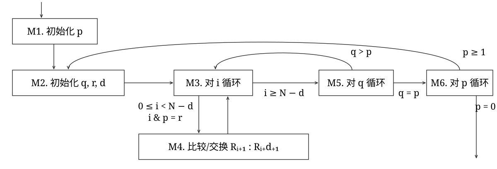

图 17　算法 M

<a id="pdf-093"></a>
<a id="p-87"></a>

表 1 展示了 $N=16$ 时的巴彻尔方法. 注意, 算法本质上是先对 $R_1,R_3,R_5,\ldots$ 和 $R_2,R_4,R_6,\ldots$ 独立进行排序, 然后对 $p=1$ 执行步骤 M2 至 M5, 把两个排好序的序列合并在一起, 从而完成对 $N$ 个元素的排序.

为了证明算法 M 描述的奇妙的比较／交换序列实际上能对所有可能的输入文件 $R_1R_2\ldots R_N$ 排序, 只需要证明: $p=1$ 时步骤 M2 到 M5 将合并所有 “2 有序” 文件 $R_1R_2\ldots R_N$. 为此, 可以使用 5.2.1 节的栅格路径方法 (见第 67 页图 11). $\{1,2,\ldots,N\}$ 的每个 “2 有序” 排列唯一地对应于栅格图中从 $(0,0)$ 到 $(\lceil N/2\rceil,\lfloor N/2\rfloor)$ 的一条路径. 图 18(a) 给出 $N=16$ 的一个示例, 对应于排列 $1\;3\;2\;4\;10\;5\;11\;6\;13\;7\;14\;8\;15\;9\;16\;12$. 当我们对 $p=1,q=2^{t-1},r=0,d=1$ 执行步骤 M3, 就是执行比较 (可能还有交换)$R_1:R_2,R_3:R_4$ 等等. 这个操作对应于栅格路径的一种简单变换, 也就是在必要时沿对角线 “折叠” 该路径, 使它永远不会高于对角线. (见图 18(b) 和习题 10 中的证明.) 在步骤 M3 的后续迭代中, 有 $p=r=1,d=2^{t-1}-1,2^{t-2}-1,\ldots,1$, 它们的效果是比较／交换 $R_2:R_{2+d},R_4:R_{4+d}$ 等等. 同样存在一种简单的栅格解释: 沿一条比对角线低 $\tfrac12(d+1)$ 单位的直线 “折叠” 该路径, 见图 18(c) 和 (d). 最终, 我们得到图 18(e) 的路径, 它对应完全有序的排列. 这就完成了巴彻尔算法有效性的 “几何证明”, 我们可以称之为折叠排序!

<a id="fig-5-18"></a>

<div class="source-tableau-group" style="overflow-x:auto;max-width:100%"><div style="width:1100px">

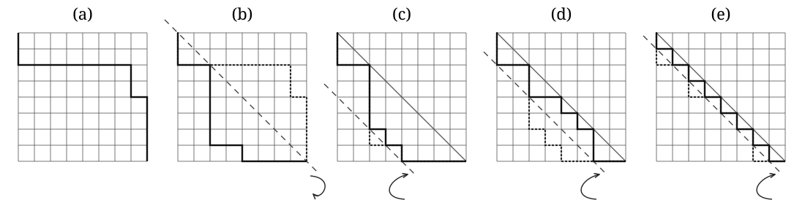

</div></div>

图 18　巴彻尔方法的几何解释, $N=16$

习题 12 给出算法 M 的 MIX 程序. 遗憾的是, 为控制比较序列需要大量簿记工作, 所以这个程序的效率要低于前面已经看到的其他方法. 但它有一个重要特性可以弥补不足: 在允许并行计算的计算机或网络上, 步骤 M3 的迭代所确定的所有比较／交换可以同时完成. 利用这种并行操作, 排序可以在 $\tfrac12\lceil\lg N\rceil(\lceil\lg N\rceil+1)$ 步内完成, 这个速度大体上与任何已知的一般方法相当. 例如, 巴彻尔方法仅需 55 个并行步骤即可完成对 1024 个元素的排序. 和这个方法最接近的竞争者是普拉特方法 (见习题 5.2.1–30), 它可能需要 40 步或 73 步, 具体取决于计数方式. 如果允许重叠比较, 只是不允许重叠交换, 普拉特方法只需要 40 个比较／交换循环就能完成对 1024 个元素的排序. 5.3.4 节有更多论述.

**快速排序.** 巴彻尔方法的比较序列是预先确定的, 每次都比较相同的键对, 即使已经通过先前的比较知道文件的一些相关信息. 冒泡排序也大体如此, 只不过算法 B 非常有限地利用了先前知识来减少它在文件右端的工作. 现在我们转到一种大不相同的策略, 它使用每次比较的结果来确定接下来要比较哪些键. 这种策略不适用于并行计算, 但在串行工作的计算机上能取得显著效果.

以下方法的基本思想是取得一条记录 (比如说 $R_1$), 把它移到在有序文件中它应当占据的最终位置 (比如说位置 $s$). 在确定这个最终位置的同时, 也重新安排其他记录, 使得位置 $s$ 的左侧没有键值更大的记录, 右侧没有键值更小的记录. 这样就对原文件进行了划分, 原来的排序方式简化为两个较简单的问题, 也就是分别对 $R_1\ldots R_{s-1}$ 和 $R_{s+1}\ldots R_N$ 进行独立排序. 可以把同一技术再应用于每个子文件, 直到完成任务为止.

<a id="pdf-094"></a>
<a id="p-88"></a>

有几种方法可以把文件划分为左和右子文件. 塞奇威克提出的以下方案似乎是最佳的, 分析算法时会更清楚地看出原因. 维护两个指针 $i$ 和 $j$, 开始时 $i=2,j=N$. 经过划分后, 如果 $R_i$ 最终属于左侧子文件部分 (可以通过比较 $K_i$ 和 $K_1$ 来判断), 则 $i$ 增 1, 继续此操作, 直到遇到一个属于右侧子文件的记录 $R_i$ 为止. 类似地, $j$ 减 1 直到遇到一个属于左侧子文件的记录 $R_j$ 为止. 如果 $i<j$, 则交换 $R_i$ 和 $R_j$, 然后继续以相同方式处理后续记录, “蜡炬两头烧”, 直到 $i\ge j$ 为止. 最后交换 $R_j$ 与 $R_1$ 而结束划分过程. 例如, 看看对于 16 个示例数构成的文件会发生些什么:

<table style="border-collapse:collapse;table-layout:fixed;width:1110px;font-family:monospace"><thead><tr><th style="width:150px;min-width:150px;padding:0;border:0;text-align:center"></th><th style="width:60px;min-width:60px;padding:0;border:0;text-align:center"></th><th style="width:60px;min-width:60px;padding:0;border:0;text-align:center">i ↓</th><th style="width:60px;min-width:60px;padding:0;border:0;text-align:center"></th><th style="width:60px;min-width:60px;padding:0;border:0;text-align:center"></th><th style="width:60px;min-width:60px;padding:0;border:0;text-align:center"></th><th style="width:60px;min-width:60px;padding:0;border:0;text-align:center"></th><th style="width:60px;min-width:60px;padding:0;border:0;text-align:center"></th><th style="width:60px;min-width:60px;padding:0;border:0;text-align:center"></th><th style="width:60px;min-width:60px;padding:0;border:0;text-align:center"></th><th style="width:60px;min-width:60px;padding:0;border:0;text-align:center"></th><th style="width:60px;min-width:60px;padding:0;border:0;text-align:center"></th><th style="width:60px;min-width:60px;padding:0;border:0;text-align:center"></th><th style="width:60px;min-width:60px;padding:0;border:0;text-align:center"></th><th style="width:60px;min-width:60px;padding:0;border:0;text-align:center"></th><th style="width:60px;min-width:60px;padding:0;border:0;text-align:center"></th><th style="width:60px;min-width:60px;padding:0;border:0;text-align:center">j ↓</th></tr></thead><tbody>
<tr><td style="width:150px;min-width:150px;padding:3px 0;border:0;text-align:center;white-space:nowrap">初始文件: </td><td style="width:60px;min-width:60px;padding:3px 0;border:0;text-align:center;white-space:nowrap">[503</td><td style="width:60px;min-width:60px;padding:3px 0;border:0;text-align:center;white-space:nowrap"><strong>087</strong></td><td style="width:60px;min-width:60px;padding:3px 0;border:0;text-align:center;white-space:nowrap">512</td><td style="width:60px;min-width:60px;padding:3px 0;border:0;text-align:center;white-space:nowrap">061</td><td style="width:60px;min-width:60px;padding:3px 0;border:0;text-align:center;white-space:nowrap">908</td><td style="width:60px;min-width:60px;padding:3px 0;border:0;text-align:center;white-space:nowrap">170</td><td style="width:60px;min-width:60px;padding:3px 0;border:0;text-align:center;white-space:nowrap">897</td><td style="width:60px;min-width:60px;padding:3px 0;border:0;text-align:center;white-space:nowrap">275</td><td style="width:60px;min-width:60px;padding:3px 0;border:0;text-align:center;white-space:nowrap">653</td><td style="width:60px;min-width:60px;padding:3px 0;border:0;text-align:center;white-space:nowrap">426</td><td style="width:60px;min-width:60px;padding:3px 0;border:0;text-align:center;white-space:nowrap">154</td><td style="width:60px;min-width:60px;padding:3px 0;border:0;text-align:center;white-space:nowrap">509</td><td style="width:60px;min-width:60px;padding:3px 0;border:0;text-align:center;white-space:nowrap">612</td><td style="width:60px;min-width:60px;padding:3px 0;border:0;text-align:center;white-space:nowrap">677</td><td style="width:60px;min-width:60px;padding:3px 0;border:0;text-align:center;white-space:nowrap">765</td><td style="width:60px;min-width:60px;padding:3px 0;border:0;text-align:center;white-space:nowrap"><strong>703</strong>]</td></tr>
<tr><td style="width:150px;min-width:150px;padding:3px 0;border:0;text-align:center;white-space:nowrap">第 1 次交换: </td><td style="width:60px;min-width:60px;padding:3px 0;border:0;text-align:center;white-space:nowrap">503</td><td style="width:60px;min-width:60px;padding:3px 0;border:0;text-align:center;white-space:nowrap">087</td><td style="width:60px;min-width:60px;padding:3px 0;border:0;text-align:center;white-space:nowrap"><strong>512</strong></td><td style="width:60px;min-width:60px;padding:3px 0;border:0;text-align:center;white-space:nowrap">061</td><td style="width:60px;min-width:60px;padding:3px 0;border:0;text-align:center;white-space:nowrap">908</td><td style="width:60px;min-width:60px;padding:3px 0;border:0;text-align:center;white-space:nowrap">170</td><td style="width:60px;min-width:60px;padding:3px 0;border:0;text-align:center;white-space:nowrap">897</td><td style="width:60px;min-width:60px;padding:3px 0;border:0;text-align:center;white-space:nowrap">275</td><td style="width:60px;min-width:60px;padding:3px 0;border:0;text-align:center;white-space:nowrap">653</td><td style="width:60px;min-width:60px;padding:3px 0;border:0;text-align:center;white-space:nowrap">426</td><td style="width:60px;min-width:60px;padding:3px 0;border:0;text-align:center;white-space:nowrap"><strong>154</strong></td><td style="width:60px;min-width:60px;padding:3px 0;border:0;text-align:center;white-space:nowrap">509</td><td style="width:60px;min-width:60px;padding:3px 0;border:0;text-align:center;white-space:nowrap">612</td><td style="width:60px;min-width:60px;padding:3px 0;border:0;text-align:center;white-space:nowrap">677</td><td style="width:60px;min-width:60px;padding:3px 0;border:0;text-align:center;white-space:nowrap">765</td><td style="width:60px;min-width:60px;padding:3px 0;border:0;text-align:center;white-space:nowrap">703</td></tr>
<tr><td style="width:150px;min-width:150px;padding:3px 0;border:0;text-align:center;white-space:nowrap">第 2 次交换: </td><td style="width:60px;min-width:60px;padding:3px 0;border:0;text-align:center;white-space:nowrap">503</td><td style="width:60px;min-width:60px;padding:3px 0;border:0;text-align:center;white-space:nowrap">087</td><td style="width:60px;min-width:60px;padding:3px 0;border:0;text-align:center;white-space:nowrap">154</td><td style="width:60px;min-width:60px;padding:3px 0;border:0;text-align:center;white-space:nowrap">061</td><td style="width:60px;min-width:60px;padding:3px 0;border:0;text-align:center;white-space:nowrap"><strong>908</strong></td><td style="width:60px;min-width:60px;padding:3px 0;border:0;text-align:center;white-space:nowrap">170</td><td style="width:60px;min-width:60px;padding:3px 0;border:0;text-align:center;white-space:nowrap">897</td><td style="width:60px;min-width:60px;padding:3px 0;border:0;text-align:center;white-space:nowrap">275</td><td style="width:60px;min-width:60px;padding:3px 0;border:0;text-align:center;white-space:nowrap">653</td><td style="width:60px;min-width:60px;padding:3px 0;border:0;text-align:center;white-space:nowrap"><strong>426</strong></td><td style="width:60px;min-width:60px;padding:3px 0;border:0;text-align:center;white-space:nowrap">512</td><td style="width:60px;min-width:60px;padding:3px 0;border:0;text-align:center;white-space:nowrap">509</td><td style="width:60px;min-width:60px;padding:3px 0;border:0;text-align:center;white-space:nowrap">612</td><td style="width:60px;min-width:60px;padding:3px 0;border:0;text-align:center;white-space:nowrap">677</td><td style="width:60px;min-width:60px;padding:3px 0;border:0;text-align:center;white-space:nowrap">765</td><td style="width:60px;min-width:60px;padding:3px 0;border:0;text-align:center;white-space:nowrap">703</td></tr>
<tr><td style="width:150px;min-width:150px;padding:3px 0;border:0;text-align:center;white-space:nowrap">第 3 次交换: </td><td style="width:60px;min-width:60px;padding:3px 0;border:0;text-align:center;white-space:nowrap">503</td><td style="width:60px;min-width:60px;padding:3px 0;border:0;text-align:center;white-space:nowrap">087</td><td style="width:60px;min-width:60px;padding:3px 0;border:0;text-align:center;white-space:nowrap">154</td><td style="width:60px;min-width:60px;padding:3px 0;border:0;text-align:center;white-space:nowrap">061</td><td style="width:60px;min-width:60px;padding:3px 0;border:0;text-align:center;white-space:nowrap">426</td><td style="width:60px;min-width:60px;padding:3px 0;border:0;text-align:center;white-space:nowrap">170</td><td style="width:60px;min-width:60px;padding:3px 0;border:0;text-align:center;white-space:nowrap"><strong>897</strong></td><td style="width:60px;min-width:60px;padding:3px 0;border:0;text-align:center;white-space:nowrap"><strong>275</strong></td><td style="width:60px;min-width:60px;padding:3px 0;border:0;text-align:center;white-space:nowrap">653</td><td style="width:60px;min-width:60px;padding:3px 0;border:0;text-align:center;white-space:nowrap">908</td><td style="width:60px;min-width:60px;padding:3px 0;border:0;text-align:center;white-space:nowrap">512</td><td style="width:60px;min-width:60px;padding:3px 0;border:0;text-align:center;white-space:nowrap">509</td><td style="width:60px;min-width:60px;padding:3px 0;border:0;text-align:center;white-space:nowrap">612</td><td style="width:60px;min-width:60px;padding:3px 0;border:0;text-align:center;white-space:nowrap">677</td><td style="width:60px;min-width:60px;padding:3px 0;border:0;text-align:center;white-space:nowrap">765</td><td style="width:60px;min-width:60px;padding:3px 0;border:0;text-align:center;white-space:nowrap">703</td></tr>
<tr><td style="width:150px;min-width:150px;padding:3px 0;border:0;text-align:center;white-space:nowrap">指针交叉: </td><td style="width:60px;min-width:60px;padding:3px 0;border:0;text-align:center;white-space:nowrap">503</td><td style="width:60px;min-width:60px;padding:3px 0;border:0;text-align:center;white-space:nowrap">087</td><td style="width:60px;min-width:60px;padding:3px 0;border:0;text-align:center;white-space:nowrap">154</td><td style="width:60px;min-width:60px;padding:3px 0;border:0;text-align:center;white-space:nowrap">061</td><td style="width:60px;min-width:60px;padding:3px 0;border:0;text-align:center;white-space:nowrap">426</td><td style="width:60px;min-width:60px;padding:3px 0;border:0;text-align:center;white-space:nowrap">170</td><td style="width:60px;min-width:60px;padding:3px 0;border:0;text-align:center;white-space:nowrap"><strong>275</strong></td><td style="width:60px;min-width:60px;padding:3px 0;border:0;text-align:center;white-space:nowrap"><strong>897</strong></td><td style="width:60px;min-width:60px;padding:3px 0;border:0;text-align:center;white-space:nowrap">653</td><td style="width:60px;min-width:60px;padding:3px 0;border:0;text-align:center;white-space:nowrap">908</td><td style="width:60px;min-width:60px;padding:3px 0;border:0;text-align:center;white-space:nowrap">512</td><td style="width:60px;min-width:60px;padding:3px 0;border:0;text-align:center;white-space:nowrap">509</td><td style="width:60px;min-width:60px;padding:3px 0;border:0;text-align:center;white-space:nowrap">612</td><td style="width:60px;min-width:60px;padding:3px 0;border:0;text-align:center;white-space:nowrap">677</td><td style="width:60px;min-width:60px;padding:3px 0;border:0;text-align:center;white-space:nowrap">765</td><td style="width:60px;min-width:60px;padding:3px 0;border:0;text-align:center;white-space:nowrap">703</td></tr>
<tr><td style="width:150px;min-width:150px;padding:3px 0;border:0;text-align:center;white-space:nowrap">划分后的文件: </td><td style="width:60px;min-width:60px;padding:3px 0;border:0;text-align:center;white-space:nowrap">[275</td><td style="width:60px;min-width:60px;padding:3px 0;border:0;text-align:center;white-space:nowrap">087</td><td style="width:60px;min-width:60px;padding:3px 0;border:0;text-align:center;white-space:nowrap">154</td><td style="width:60px;min-width:60px;padding:3px 0;border:0;text-align:center;white-space:nowrap">061</td><td style="width:60px;min-width:60px;padding:3px 0;border:0;text-align:center;white-space:nowrap">426</td><td style="width:60px;min-width:60px;padding:3px 0;border:0;text-align:center;white-space:nowrap">170]</td><td style="width:60px;min-width:60px;padding:3px 0;border:0;text-align:center;white-space:nowrap"><strong>503</strong></td><td style="width:60px;min-width:60px;padding:3px 0;border:0;text-align:center;white-space:nowrap">[<strong>897</strong></td><td style="width:60px;min-width:60px;padding:3px 0;border:0;text-align:center;white-space:nowrap">653</td><td style="width:60px;min-width:60px;padding:3px 0;border:0;text-align:center;white-space:nowrap">908</td><td style="width:60px;min-width:60px;padding:3px 0;border:0;text-align:center;white-space:nowrap">512</td><td style="width:60px;min-width:60px;padding:3px 0;border:0;text-align:center;white-space:nowrap">509</td><td style="width:60px;min-width:60px;padding:3px 0;border:0;text-align:center;white-space:nowrap">612</td><td style="width:60px;min-width:60px;padding:3px 0;border:0;text-align:center;white-space:nowrap">677</td><td style="width:60px;min-width:60px;padding:3px 0;border:0;text-align:center;white-space:nowrap">765</td><td style="width:60px;min-width:60px;padding:3px 0;border:0;text-align:center;white-space:nowrap">703]</td></tr>
<tr><td style="width:150px;min-width:150px;padding:3px 0;border:0;text-align:center;white-space:nowrap"></td><td style="width:60px;min-width:60px;padding:3px 0;border:0;text-align:center;white-space:nowrap"></td><td style="width:60px;min-width:60px;padding:3px 0;border:0;text-align:center;white-space:nowrap"></td><td style="width:60px;min-width:60px;padding:3px 0;border:0;text-align:center;white-space:nowrap"></td><td style="width:60px;min-width:60px;padding:3px 0;border:0;text-align:center;white-space:nowrap"></td><td style="width:60px;min-width:60px;padding:3px 0;border:0;text-align:center;white-space:nowrap"></td><td style="width:60px;min-width:60px;padding:3px 0;border:0;text-align:center;white-space:nowrap"></td><td style="width:60px;min-width:60px;padding:3px 0;border:0;text-align:center;white-space:nowrap">j ↑</td><td style="width:60px;min-width:60px;padding:3px 0;border:0;text-align:center;white-space:nowrap">i ↑</td><td style="width:60px;min-width:60px;padding:3px 0;border:0;text-align:center;white-space:nowrap"></td><td style="width:60px;min-width:60px;padding:3px 0;border:0;text-align:center;white-space:nowrap"></td><td style="width:60px;min-width:60px;padding:3px 0;border:0;text-align:center;white-space:nowrap"></td><td style="width:60px;min-width:60px;padding:3px 0;border:0;text-align:center;white-space:nowrap"></td><td style="width:60px;min-width:60px;padding:3px 0;border:0;text-align:center;white-space:nowrap"></td><td style="width:60px;min-width:60px;padding:3px 0;border:0;text-align:center;white-space:nowrap"></td><td style="width:60px;min-width:60px;padding:3px 0;border:0;text-align:center;white-space:nowrap"></td><td style="width:60px;min-width:60px;padding:3px 0;border:0;text-align:center;white-space:nowrap"></td></tr></tbody></table>

(为了指示 $i$ 和 $j$ 的位置, 以粗体标出了键 $K_i$ 和 $K_j$.)

表 2 展示了如何用这个方法分 11 个阶段把我们的示例文件完全排好序. 方括号表示有待排序的子文件, 双方括号表示当前关注的子文件. 在计算机内部, 当前子文件用边界值 $(l,r)$ 表示, 其他子文件则用附加对 $(l_k,r_k)$ 的栈表示. 每次划分一个文件, 就把较长的子文件压入栈, 对较短的子文件展开工作, 直到最终得到很短的文件为止. 这个策略保证了栈中的项目永远不会超过 $\lg N$ 个 (见习题 20).

<a id="table-5-2-2-2"></a>

表 2　快速排序

<table style="border-collapse:collapse;table-layout:fixed;width:1160px;font-family:monospace"><thead><tr><th style="width:60px;min-width:60px;padding:0;border:0;text-align:center"></th><th style="width:60px;min-width:60px;padding:0;border:0;text-align:center"></th><th style="width:60px;min-width:60px;padding:0;border:0;text-align:center"></th><th style="width:60px;min-width:60px;padding:0;border:0;text-align:center"></th><th style="width:60px;min-width:60px;padding:0;border:0;text-align:center"></th><th style="width:60px;min-width:60px;padding:0;border:0;text-align:center"></th><th style="width:60px;min-width:60px;padding:0;border:0;text-align:center"></th><th style="width:60px;min-width:60px;padding:0;border:0;text-align:center"></th><th style="width:60px;min-width:60px;padding:0;border:0;text-align:center"></th><th style="width:60px;min-width:60px;padding:0;border:0;text-align:center"></th><th style="width:60px;min-width:60px;padding:0;border:0;text-align:center"></th><th style="width:60px;min-width:60px;padding:0;border:0;text-align:center"></th><th style="width:60px;min-width:60px;padding:0;border:0;text-align:center"></th><th style="width:60px;min-width:60px;padding:0;border:0;text-align:center"></th><th style="width:60px;min-width:60px;padding:0;border:0;text-align:center"></th><th style="width:60px;min-width:60px;padding:0;border:0;text-align:center"></th><th style="width:100px;min-width:100px;padding:0;border:0;text-align:center">$(l,r)$</th><th style="width:100px;min-width:100px;padding:0;border:0;text-align:center">栈</th></tr></thead><tbody>
<tr><td style="width:60px;min-width:60px;padding:3px 0;border:0;text-align:center;white-space:nowrap">⟦503</td><td style="width:60px;min-width:60px;padding:3px 0;border:0;text-align:center;white-space:nowrap">087</td><td style="width:60px;min-width:60px;padding:3px 0;border:0;text-align:center;white-space:nowrap">512</td><td style="width:60px;min-width:60px;padding:3px 0;border:0;text-align:center;white-space:nowrap">061</td><td style="width:60px;min-width:60px;padding:3px 0;border:0;text-align:center;white-space:nowrap">908</td><td style="width:60px;min-width:60px;padding:3px 0;border:0;text-align:center;white-space:nowrap">170</td><td style="width:60px;min-width:60px;padding:3px 0;border:0;text-align:center;white-space:nowrap">897</td><td style="width:60px;min-width:60px;padding:3px 0;border:0;text-align:center;white-space:nowrap">275</td><td style="width:60px;min-width:60px;padding:3px 0;border:0;text-align:center;white-space:nowrap">653</td><td style="width:60px;min-width:60px;padding:3px 0;border:0;text-align:center;white-space:nowrap">426</td><td style="width:60px;min-width:60px;padding:3px 0;border:0;text-align:center;white-space:nowrap">154</td><td style="width:60px;min-width:60px;padding:3px 0;border:0;text-align:center;white-space:nowrap">509</td><td style="width:60px;min-width:60px;padding:3px 0;border:0;text-align:center;white-space:nowrap">612</td><td style="width:60px;min-width:60px;padding:3px 0;border:0;text-align:center;white-space:nowrap">677</td><td style="width:60px;min-width:60px;padding:3px 0;border:0;text-align:center;white-space:nowrap">765</td><td style="width:60px;min-width:60px;padding:3px 0;border:0;text-align:center;white-space:nowrap">703⟧</td><td style="width:100px;min-width:100px;padding:3px 0;border:0;text-align:center;white-space:nowrap">(1, 16)</td><td style="width:100px;min-width:100px;padding:3px 0;border:0;text-align:center;white-space:nowrap">—</td></tr>
<tr><td style="width:60px;min-width:60px;padding:3px 0;border:0;text-align:center;white-space:nowrap">⟦275</td><td style="width:60px;min-width:60px;padding:3px 0;border:0;text-align:center;white-space:nowrap">087</td><td style="width:60px;min-width:60px;padding:3px 0;border:0;text-align:center;white-space:nowrap">154</td><td style="width:60px;min-width:60px;padding:3px 0;border:0;text-align:center;white-space:nowrap">061</td><td style="width:60px;min-width:60px;padding:3px 0;border:0;text-align:center;white-space:nowrap">426</td><td style="width:60px;min-width:60px;padding:3px 0;border:0;text-align:center;white-space:nowrap">170⟧</td><td style="width:60px;min-width:60px;padding:3px 0;border:0;text-align:center;white-space:nowrap">503</td><td style="width:60px;min-width:60px;padding:3px 0;border:0;text-align:center;white-space:nowrap">[897</td><td style="width:60px;min-width:60px;padding:3px 0;border:0;text-align:center;white-space:nowrap">653</td><td style="width:60px;min-width:60px;padding:3px 0;border:0;text-align:center;white-space:nowrap">908</td><td style="width:60px;min-width:60px;padding:3px 0;border:0;text-align:center;white-space:nowrap">512</td><td style="width:60px;min-width:60px;padding:3px 0;border:0;text-align:center;white-space:nowrap">509</td><td style="width:60px;min-width:60px;padding:3px 0;border:0;text-align:center;white-space:nowrap">612</td><td style="width:60px;min-width:60px;padding:3px 0;border:0;text-align:center;white-space:nowrap">677</td><td style="width:60px;min-width:60px;padding:3px 0;border:0;text-align:center;white-space:nowrap">765</td><td style="width:60px;min-width:60px;padding:3px 0;border:0;text-align:center;white-space:nowrap">703]</td><td style="width:100px;min-width:100px;padding:3px 0;border:0;text-align:center;white-space:nowrap">(1, 6)</td><td style="width:100px;min-width:100px;padding:3px 0;border:0;text-align:center;white-space:nowrap">(8, 16)</td></tr>
<tr><td style="width:60px;min-width:60px;padding:3px 0;border:0;text-align:center;white-space:nowrap">⟦170</td><td style="width:60px;min-width:60px;padding:3px 0;border:0;text-align:center;white-space:nowrap">087</td><td style="width:60px;min-width:60px;padding:3px 0;border:0;text-align:center;white-space:nowrap">154</td><td style="width:60px;min-width:60px;padding:3px 0;border:0;text-align:center;white-space:nowrap">061⟧</td><td style="width:60px;min-width:60px;padding:3px 0;border:0;text-align:center;white-space:nowrap">275</td><td style="width:60px;min-width:60px;padding:3px 0;border:0;text-align:center;white-space:nowrap">426</td><td style="width:60px;min-width:60px;padding:3px 0;border:0;text-align:center;white-space:nowrap">503</td><td style="width:60px;min-width:60px;padding:3px 0;border:0;text-align:center;white-space:nowrap">[897</td><td style="width:60px;min-width:60px;padding:3px 0;border:0;text-align:center;white-space:nowrap">653</td><td style="width:60px;min-width:60px;padding:3px 0;border:0;text-align:center;white-space:nowrap">908</td><td style="width:60px;min-width:60px;padding:3px 0;border:0;text-align:center;white-space:nowrap">512</td><td style="width:60px;min-width:60px;padding:3px 0;border:0;text-align:center;white-space:nowrap">509</td><td style="width:60px;min-width:60px;padding:3px 0;border:0;text-align:center;white-space:nowrap">612</td><td style="width:60px;min-width:60px;padding:3px 0;border:0;text-align:center;white-space:nowrap">677</td><td style="width:60px;min-width:60px;padding:3px 0;border:0;text-align:center;white-space:nowrap">765</td><td style="width:60px;min-width:60px;padding:3px 0;border:0;text-align:center;white-space:nowrap">703]</td><td style="width:100px;min-width:100px;padding:3px 0;border:0;text-align:center;white-space:nowrap">(1, 4)</td><td style="width:100px;min-width:100px;padding:3px 0;border:0;text-align:center;white-space:nowrap">(8, 16)</td></tr>
<tr><td style="width:60px;min-width:60px;padding:3px 0;border:0;text-align:center;white-space:nowrap">⟦061</td><td style="width:60px;min-width:60px;padding:3px 0;border:0;text-align:center;white-space:nowrap">087</td><td style="width:60px;min-width:60px;padding:3px 0;border:0;text-align:center;white-space:nowrap">154⟧</td><td style="width:60px;min-width:60px;padding:3px 0;border:0;text-align:center;white-space:nowrap">170</td><td style="width:60px;min-width:60px;padding:3px 0;border:0;text-align:center;white-space:nowrap">275</td><td style="width:60px;min-width:60px;padding:3px 0;border:0;text-align:center;white-space:nowrap">426</td><td style="width:60px;min-width:60px;padding:3px 0;border:0;text-align:center;white-space:nowrap">503</td><td style="width:60px;min-width:60px;padding:3px 0;border:0;text-align:center;white-space:nowrap">[897</td><td style="width:60px;min-width:60px;padding:3px 0;border:0;text-align:center;white-space:nowrap">653</td><td style="width:60px;min-width:60px;padding:3px 0;border:0;text-align:center;white-space:nowrap">908</td><td style="width:60px;min-width:60px;padding:3px 0;border:0;text-align:center;white-space:nowrap">512</td><td style="width:60px;min-width:60px;padding:3px 0;border:0;text-align:center;white-space:nowrap">509</td><td style="width:60px;min-width:60px;padding:3px 0;border:0;text-align:center;white-space:nowrap">612</td><td style="width:60px;min-width:60px;padding:3px 0;border:0;text-align:center;white-space:nowrap">677</td><td style="width:60px;min-width:60px;padding:3px 0;border:0;text-align:center;white-space:nowrap">765</td><td style="width:60px;min-width:60px;padding:3px 0;border:0;text-align:center;white-space:nowrap">703]</td><td style="width:100px;min-width:100px;padding:3px 0;border:0;text-align:center;white-space:nowrap">(1, 3)</td><td style="width:100px;min-width:100px;padding:3px 0;border:0;text-align:center;white-space:nowrap">(8, 16)</td></tr>
<tr><td style="width:60px;min-width:60px;padding:3px 0;border:0;text-align:center;white-space:nowrap">061</td><td style="width:60px;min-width:60px;padding:3px 0;border:0;text-align:center;white-space:nowrap">⟦087</td><td style="width:60px;min-width:60px;padding:3px 0;border:0;text-align:center;white-space:nowrap">154⟧</td><td style="width:60px;min-width:60px;padding:3px 0;border:0;text-align:center;white-space:nowrap">170</td><td style="width:60px;min-width:60px;padding:3px 0;border:0;text-align:center;white-space:nowrap">275</td><td style="width:60px;min-width:60px;padding:3px 0;border:0;text-align:center;white-space:nowrap">426</td><td style="width:60px;min-width:60px;padding:3px 0;border:0;text-align:center;white-space:nowrap">503</td><td style="width:60px;min-width:60px;padding:3px 0;border:0;text-align:center;white-space:nowrap">[897</td><td style="width:60px;min-width:60px;padding:3px 0;border:0;text-align:center;white-space:nowrap">653</td><td style="width:60px;min-width:60px;padding:3px 0;border:0;text-align:center;white-space:nowrap">908</td><td style="width:60px;min-width:60px;padding:3px 0;border:0;text-align:center;white-space:nowrap">512</td><td style="width:60px;min-width:60px;padding:3px 0;border:0;text-align:center;white-space:nowrap">509</td><td style="width:60px;min-width:60px;padding:3px 0;border:0;text-align:center;white-space:nowrap">612</td><td style="width:60px;min-width:60px;padding:3px 0;border:0;text-align:center;white-space:nowrap">677</td><td style="width:60px;min-width:60px;padding:3px 0;border:0;text-align:center;white-space:nowrap">765</td><td style="width:60px;min-width:60px;padding:3px 0;border:0;text-align:center;white-space:nowrap">703]</td><td style="width:100px;min-width:100px;padding:3px 0;border:0;text-align:center;white-space:nowrap">(2, 3)</td><td style="width:100px;min-width:100px;padding:3px 0;border:0;text-align:center;white-space:nowrap">(8, 16)</td></tr>
<tr><td style="width:60px;min-width:60px;padding:3px 0;border:0;text-align:center;white-space:nowrap">061</td><td style="width:60px;min-width:60px;padding:3px 0;border:0;text-align:center;white-space:nowrap">087</td><td style="width:60px;min-width:60px;padding:3px 0;border:0;text-align:center;white-space:nowrap">154</td><td style="width:60px;min-width:60px;padding:3px 0;border:0;text-align:center;white-space:nowrap">170</td><td style="width:60px;min-width:60px;padding:3px 0;border:0;text-align:center;white-space:nowrap">275</td><td style="width:60px;min-width:60px;padding:3px 0;border:0;text-align:center;white-space:nowrap">426</td><td style="width:60px;min-width:60px;padding:3px 0;border:0;text-align:center;white-space:nowrap">503</td><td style="width:60px;min-width:60px;padding:3px 0;border:0;text-align:center;white-space:nowrap">⟦897</td><td style="width:60px;min-width:60px;padding:3px 0;border:0;text-align:center;white-space:nowrap">653</td><td style="width:60px;min-width:60px;padding:3px 0;border:0;text-align:center;white-space:nowrap">908</td><td style="width:60px;min-width:60px;padding:3px 0;border:0;text-align:center;white-space:nowrap">512</td><td style="width:60px;min-width:60px;padding:3px 0;border:0;text-align:center;white-space:nowrap">509</td><td style="width:60px;min-width:60px;padding:3px 0;border:0;text-align:center;white-space:nowrap">612</td><td style="width:60px;min-width:60px;padding:3px 0;border:0;text-align:center;white-space:nowrap">677</td><td style="width:60px;min-width:60px;padding:3px 0;border:0;text-align:center;white-space:nowrap">765</td><td style="width:60px;min-width:60px;padding:3px 0;border:0;text-align:center;white-space:nowrap">703⟧</td><td style="width:100px;min-width:100px;padding:3px 0;border:0;text-align:center;white-space:nowrap">(8, 16)</td><td style="width:100px;min-width:100px;padding:3px 0;border:0;text-align:center;white-space:nowrap">—</td></tr>
<tr><td style="width:60px;min-width:60px;padding:3px 0;border:0;text-align:center;white-space:nowrap">061</td><td style="width:60px;min-width:60px;padding:3px 0;border:0;text-align:center;white-space:nowrap">087</td><td style="width:60px;min-width:60px;padding:3px 0;border:0;text-align:center;white-space:nowrap">154</td><td style="width:60px;min-width:60px;padding:3px 0;border:0;text-align:center;white-space:nowrap">170</td><td style="width:60px;min-width:60px;padding:3px 0;border:0;text-align:center;white-space:nowrap">275</td><td style="width:60px;min-width:60px;padding:3px 0;border:0;text-align:center;white-space:nowrap">426</td><td style="width:60px;min-width:60px;padding:3px 0;border:0;text-align:center;white-space:nowrap">503</td><td style="width:60px;min-width:60px;padding:3px 0;border:0;text-align:center;white-space:nowrap">⟦765</td><td style="width:60px;min-width:60px;padding:3px 0;border:0;text-align:center;white-space:nowrap">653</td><td style="width:60px;min-width:60px;padding:3px 0;border:0;text-align:center;white-space:nowrap">703</td><td style="width:60px;min-width:60px;padding:3px 0;border:0;text-align:center;white-space:nowrap">512</td><td style="width:60px;min-width:60px;padding:3px 0;border:0;text-align:center;white-space:nowrap">509</td><td style="width:60px;min-width:60px;padding:3px 0;border:0;text-align:center;white-space:nowrap">612</td><td style="width:60px;min-width:60px;padding:3px 0;border:0;text-align:center;white-space:nowrap">677⟧</td><td style="width:60px;min-width:60px;padding:3px 0;border:0;text-align:center;white-space:nowrap">897</td><td style="width:60px;min-width:60px;padding:3px 0;border:0;text-align:center;white-space:nowrap">908</td><td style="width:100px;min-width:100px;padding:3px 0;border:0;text-align:center;white-space:nowrap">(8, 14)</td><td style="width:100px;min-width:100px;padding:3px 0;border:0;text-align:center;white-space:nowrap">—</td></tr>
<tr><td style="width:60px;min-width:60px;padding:3px 0;border:0;text-align:center;white-space:nowrap">061</td><td style="width:60px;min-width:60px;padding:3px 0;border:0;text-align:center;white-space:nowrap">087</td><td style="width:60px;min-width:60px;padding:3px 0;border:0;text-align:center;white-space:nowrap">154</td><td style="width:60px;min-width:60px;padding:3px 0;border:0;text-align:center;white-space:nowrap">170</td><td style="width:60px;min-width:60px;padding:3px 0;border:0;text-align:center;white-space:nowrap">275</td><td style="width:60px;min-width:60px;padding:3px 0;border:0;text-align:center;white-space:nowrap">426</td><td style="width:60px;min-width:60px;padding:3px 0;border:0;text-align:center;white-space:nowrap">503</td><td style="width:60px;min-width:60px;padding:3px 0;border:0;text-align:center;white-space:nowrap">⟦677</td><td style="width:60px;min-width:60px;padding:3px 0;border:0;text-align:center;white-space:nowrap">653</td><td style="width:60px;min-width:60px;padding:3px 0;border:0;text-align:center;white-space:nowrap">703</td><td style="width:60px;min-width:60px;padding:3px 0;border:0;text-align:center;white-space:nowrap">512</td><td style="width:60px;min-width:60px;padding:3px 0;border:0;text-align:center;white-space:nowrap">509</td><td style="width:60px;min-width:60px;padding:3px 0;border:0;text-align:center;white-space:nowrap">612⟧</td><td style="width:60px;min-width:60px;padding:3px 0;border:0;text-align:center;white-space:nowrap">765</td><td style="width:60px;min-width:60px;padding:3px 0;border:0;text-align:center;white-space:nowrap">897</td><td style="width:60px;min-width:60px;padding:3px 0;border:0;text-align:center;white-space:nowrap">908</td><td style="width:100px;min-width:100px;padding:3px 0;border:0;text-align:center;white-space:nowrap">(8, 13)</td><td style="width:100px;min-width:100px;padding:3px 0;border:0;text-align:center;white-space:nowrap">—</td></tr>
<tr><td style="width:60px;min-width:60px;padding:3px 0;border:0;text-align:center;white-space:nowrap">061</td><td style="width:60px;min-width:60px;padding:3px 0;border:0;text-align:center;white-space:nowrap">087</td><td style="width:60px;min-width:60px;padding:3px 0;border:0;text-align:center;white-space:nowrap">154</td><td style="width:60px;min-width:60px;padding:3px 0;border:0;text-align:center;white-space:nowrap">170</td><td style="width:60px;min-width:60px;padding:3px 0;border:0;text-align:center;white-space:nowrap">275</td><td style="width:60px;min-width:60px;padding:3px 0;border:0;text-align:center;white-space:nowrap">426</td><td style="width:60px;min-width:60px;padding:3px 0;border:0;text-align:center;white-space:nowrap">503</td><td style="width:60px;min-width:60px;padding:3px 0;border:0;text-align:center;white-space:nowrap">⟦509</td><td style="width:60px;min-width:60px;padding:3px 0;border:0;text-align:center;white-space:nowrap">653</td><td style="width:60px;min-width:60px;padding:3px 0;border:0;text-align:center;white-space:nowrap">612</td><td style="width:60px;min-width:60px;padding:3px 0;border:0;text-align:center;white-space:nowrap">512⟧</td><td style="width:60px;min-width:60px;padding:3px 0;border:0;text-align:center;white-space:nowrap">677</td><td style="width:60px;min-width:60px;padding:3px 0;border:0;text-align:center;white-space:nowrap">703</td><td style="width:60px;min-width:60px;padding:3px 0;border:0;text-align:center;white-space:nowrap">765</td><td style="width:60px;min-width:60px;padding:3px 0;border:0;text-align:center;white-space:nowrap">897</td><td style="width:60px;min-width:60px;padding:3px 0;border:0;text-align:center;white-space:nowrap">908</td><td style="width:100px;min-width:100px;padding:3px 0;border:0;text-align:center;white-space:nowrap">(8, 11)</td><td style="width:100px;min-width:100px;padding:3px 0;border:0;text-align:center;white-space:nowrap">—</td></tr>
<tr><td style="width:60px;min-width:60px;padding:3px 0;border:0;text-align:center;white-space:nowrap">061</td><td style="width:60px;min-width:60px;padding:3px 0;border:0;text-align:center;white-space:nowrap">087</td><td style="width:60px;min-width:60px;padding:3px 0;border:0;text-align:center;white-space:nowrap">154</td><td style="width:60px;min-width:60px;padding:3px 0;border:0;text-align:center;white-space:nowrap">170</td><td style="width:60px;min-width:60px;padding:3px 0;border:0;text-align:center;white-space:nowrap">275</td><td style="width:60px;min-width:60px;padding:3px 0;border:0;text-align:center;white-space:nowrap">426</td><td style="width:60px;min-width:60px;padding:3px 0;border:0;text-align:center;white-space:nowrap">503</td><td style="width:60px;min-width:60px;padding:3px 0;border:0;text-align:center;white-space:nowrap">509</td><td style="width:60px;min-width:60px;padding:3px 0;border:0;text-align:center;white-space:nowrap">⟦653</td><td style="width:60px;min-width:60px;padding:3px 0;border:0;text-align:center;white-space:nowrap">612</td><td style="width:60px;min-width:60px;padding:3px 0;border:0;text-align:center;white-space:nowrap">512⟧</td><td style="width:60px;min-width:60px;padding:3px 0;border:0;text-align:center;white-space:nowrap">677</td><td style="width:60px;min-width:60px;padding:3px 0;border:0;text-align:center;white-space:nowrap">703</td><td style="width:60px;min-width:60px;padding:3px 0;border:0;text-align:center;white-space:nowrap">765</td><td style="width:60px;min-width:60px;padding:3px 0;border:0;text-align:center;white-space:nowrap">897</td><td style="width:60px;min-width:60px;padding:3px 0;border:0;text-align:center;white-space:nowrap">908</td><td style="width:100px;min-width:100px;padding:3px 0;border:0;text-align:center;white-space:nowrap">(9, 11)</td><td style="width:100px;min-width:100px;padding:3px 0;border:0;text-align:center;white-space:nowrap">—</td></tr>
<tr><td style="width:60px;min-width:60px;padding:3px 0;border:0;text-align:center;white-space:nowrap">061</td><td style="width:60px;min-width:60px;padding:3px 0;border:0;text-align:center;white-space:nowrap">087</td><td style="width:60px;min-width:60px;padding:3px 0;border:0;text-align:center;white-space:nowrap">154</td><td style="width:60px;min-width:60px;padding:3px 0;border:0;text-align:center;white-space:nowrap">170</td><td style="width:60px;min-width:60px;padding:3px 0;border:0;text-align:center;white-space:nowrap">275</td><td style="width:60px;min-width:60px;padding:3px 0;border:0;text-align:center;white-space:nowrap">426</td><td style="width:60px;min-width:60px;padding:3px 0;border:0;text-align:center;white-space:nowrap">503</td><td style="width:60px;min-width:60px;padding:3px 0;border:0;text-align:center;white-space:nowrap">509</td><td style="width:60px;min-width:60px;padding:3px 0;border:0;text-align:center;white-space:nowrap">⟦512</td><td style="width:60px;min-width:60px;padding:3px 0;border:0;text-align:center;white-space:nowrap">612⟧</td><td style="width:60px;min-width:60px;padding:3px 0;border:0;text-align:center;white-space:nowrap">653</td><td style="width:60px;min-width:60px;padding:3px 0;border:0;text-align:center;white-space:nowrap">677</td><td style="width:60px;min-width:60px;padding:3px 0;border:0;text-align:center;white-space:nowrap">703</td><td style="width:60px;min-width:60px;padding:3px 0;border:0;text-align:center;white-space:nowrap">765</td><td style="width:60px;min-width:60px;padding:3px 0;border:0;text-align:center;white-space:nowrap">897</td><td style="width:60px;min-width:60px;padding:3px 0;border:0;text-align:center;white-space:nowrap">908</td><td style="width:100px;min-width:100px;padding:3px 0;border:0;text-align:center;white-space:nowrap">(9, 10)</td><td style="width:100px;min-width:100px;padding:3px 0;border:0;text-align:center;white-space:nowrap">—</td></tr>
<tr><td style="width:60px;min-width:60px;padding:3px 0;border:0;text-align:center;white-space:nowrap">061</td><td style="width:60px;min-width:60px;padding:3px 0;border:0;text-align:center;white-space:nowrap">087</td><td style="width:60px;min-width:60px;padding:3px 0;border:0;text-align:center;white-space:nowrap">154</td><td style="width:60px;min-width:60px;padding:3px 0;border:0;text-align:center;white-space:nowrap">170</td><td style="width:60px;min-width:60px;padding:3px 0;border:0;text-align:center;white-space:nowrap">275</td><td style="width:60px;min-width:60px;padding:3px 0;border:0;text-align:center;white-space:nowrap">426</td><td style="width:60px;min-width:60px;padding:3px 0;border:0;text-align:center;white-space:nowrap">503</td><td style="width:60px;min-width:60px;padding:3px 0;border:0;text-align:center;white-space:nowrap">509</td><td style="width:60px;min-width:60px;padding:3px 0;border:0;text-align:center;white-space:nowrap">512</td><td style="width:60px;min-width:60px;padding:3px 0;border:0;text-align:center;white-space:nowrap">612</td><td style="width:60px;min-width:60px;padding:3px 0;border:0;text-align:center;white-space:nowrap">653</td><td style="width:60px;min-width:60px;padding:3px 0;border:0;text-align:center;white-space:nowrap">677</td><td style="width:60px;min-width:60px;padding:3px 0;border:0;text-align:center;white-space:nowrap">703</td><td style="width:60px;min-width:60px;padding:3px 0;border:0;text-align:center;white-space:nowrap">765</td><td style="width:60px;min-width:60px;padding:3px 0;border:0;text-align:center;white-space:nowrap">897</td><td style="width:60px;min-width:60px;padding:3px 0;border:0;text-align:center;white-space:nowrap">908</td><td style="width:100px;min-width:100px;padding:3px 0;border:0;text-align:center;white-space:nowrap">—</td><td style="width:100px;min-width:100px;padding:3px 0;border:0;text-align:center;white-space:nowrap">—</td></tr>
</tbody></table>

<a id="pdf-095"></a>
<a id="p-89"></a>

刚刚介绍的排序过程可以称为划分交换排序, 查尔斯·霍尔在他的重要论文 [*Comp. J.* **5** (1962), 10–15] 中提出这种排序方法, 他的方法是所有已发表的排序方法中最为广泛使用的一种. 霍尔把自己的方法称为 “快速排序”, 这个名称并没有言过其实, 因为这个方法的内层循环在大多数计算机上都是极快的. 一个给定阶段的所有比较都是针对同一个键执行的, 因此可以把这个键放入寄存器. 在比较之间只需要改变一个下标. 数据移动的次数也非常合理. 例如, 表 2 中的排序过程只做了 17 次交换.


控制 $i,j$ 和栈所需的簿记并不难, 但它使快速排序划分过程最适合于很大的 $N$ 值. 因此, 在子文件变短之后以下算法采用了另外的策略.


<a id="pdf-096"></a>
<a id="p-90"></a>

<a id="alg-5-2-2-Q"></a>

**算法 Q (快速排序).** 重新排列记录 $R_1,\ldots,R_N$ 到适当位置, 排序完成后它们的键将处于有序状态: $K_1\le\cdots\le K_N$. 需要一个至多包含 $\lfloor\lg N\rfloor$ 项的辅助栈作为临时存储. 算法遵循上文描述的快速排序划分过程, 为了提高效率稍有修改:

(a) 假定存在虚拟键 $K_0=-\infty$ 和 $K_{N+1}=+\infty$, 使得

$$
K_0\le K_i\le K_{N+1}\qquad(1\le i\le N).\tag{13}
$$

(允许相等.)

(b) 元素个数不超过 $M$ 的子文件直到这个过程最终结束之前仍然保持未排序状态, 然后利用一次直接插入扫描来处理最后的排序. 这里 $M$ 是一个 $\ge1$ 的参数, 应当根据下文的描述加以选择. (如果直接对每个小的子文件应用直接插入, 除非引用的局部性非常明显, 否则必然会引起一些开销, 塞奇威克提出的这一思想可以节省某些此类开销.)

(c) 键值相等的记录也会进行交换, 尽管这样做并非绝对必要. (辛格尔顿提出的这一思想保持了内层循环的高速运行, 而且在存在相等元素时, 还有助于将子文件划分为近乎相等的两部分. 见习题 18.)

**Q1.** [初始化.] 如果 $N\le M$, 转到 Q9. 否则清空栈, 置 $l\leftarrow1,r\leftarrow N$.

**Q2.** [开始新阶段.] (现在希望排序子文件 $R_l\ldots R_r$. 从算法的本质可知 $r\ge l+M$, 对 $l\le i\le r$ 有 $K_{l-1}\le K_i\le K_{r+1}$.) 置 $i\leftarrow l,j\leftarrow r+1$, $K\leftarrow K_l$. (下文将讨论 $K$ 的其他一些选择, 它们可能更好.)

**Q3.** [比较 $K_i:K$.] (这时文件已被重排, 使得

$$
\text{对 }l-1\le k\le i\text{ 有 }K_k\le K,\qquad\text{对 }j\le k\le r+1\text{ 有 }K\le K_k;\tag{14}
$$

且 $l\le i<j$.)$i$ 增 1. 如果 $K_i<K$, 则重复该步骤. (由于 $K_j\ge K$, 此迭代必定在 $i\le j$ 时终止.)

**Q4.** [比较 $K:K_j$.]$j$ 减 1. 如果 $K<K_j$, 则重复该步骤. (由于 $K\ge K_{i-1}$, 此迭代必定在 $j\ge i-1$ 时终止.)

**Q5.** [测试 $i:j$.] (这时, 除 $k=i$ 和 $k=j$ 外式 (14) 成立. 而且 $K_i\ge K\ge K_j$, $r\ge j\ge i-1\ge l$.) 如果 $j\le i$, 则交换 $R_l\leftrightarrow R_j$, 转到 Q7.

**Q6.** [交换.] 交换 $R_i\leftrightarrow R_j$, 返回 Q3.

**Q7.** [压入栈.] (现在子文件 $R_l\ldots R_j\ldots R_r$ 已被划分, 使得对 $l-1\le k\le j$ 有 $K_k\le K_j$, 对 $j\le k\le r+1$ 有 $K_j\le K_k$.) 如果 $r-j\ge j-l>M$, 则把 $(j+1,r)$ 压入栈, 置 $r\leftarrow j-1$, 转到 Q2. 如果 $j-l>r-j>M$, 则把 $(l,j-1)$ 压入栈, 置 $l\leftarrow j+1$, 转到 Q2. (栈中的每一项 $(a,b)$ 都要求在未来某一时刻对子文件 $R_a\ldots R_b$ 进行排序.) 否则, 如果 $r-j>M\ge j-l$, 置 $l\leftarrow j+1$, 转到 Q2. 或者, 如果 $j-l>M\ge r-j$, 置 $r\leftarrow j-1$, 转到 Q2.

**Q8.** [弹出栈.] 如果栈不空, 则删除栈顶的项 $(l',r')$, 置 $l\leftarrow l',r\leftarrow r'$, 返回 Q2.

**Q9.** [直接插入排序.] 对 $j=2,3,\ldots,N$, 如果 $K_{j-1}>K_j$, 则执行以下操作: 置 $K\leftarrow K_j$, $R\leftarrow R_j,i\leftarrow j-1$. 然后置 $R_{i+1}\leftarrow R_i,i\leftarrow i-1$, 重复一次或多次, 直到 $K_i\le K$. 置 $R_{i+1}\leftarrow R$. (这就是根据习题 5.2.1–10 和答案 5.2.1–33 的提示修改过的算法 5.2.1S. 如果 $M=1$, 可以省略步骤 Q9. 警告: 最终的直接插入可能掩盖了步骤 Q1–Q8 中的失误, 不要仅仅因为一种实现给出了正确答案就信任它!)　▮


<a id="fig-5-19"></a>

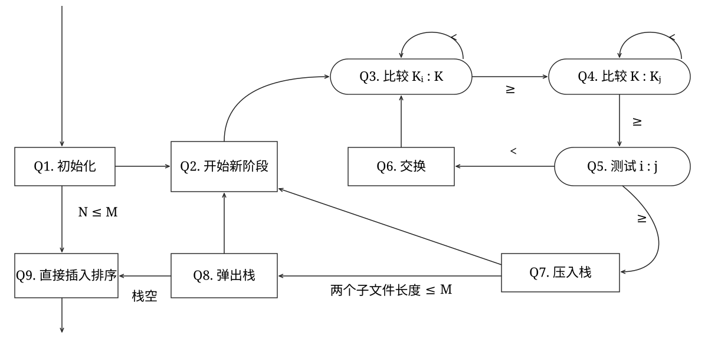

图 19　划分交换排序 (快速排序)

相应的 MIX 程序相当长, 但不是太复杂. 事实上, 大部分代码用于执行步骤 Q7, 它们以一种非常直截了当的方式围绕这些变量兜圈子.

<a id="prog-5-2-2-Q"></a>

**程序 Q (快速排序).** 待排序的记录存储在单元 $\mathtt{INPUT}+1$ 至 $\mathtt{INPUT}+N$. 假定单元 $\mathtt{INPUT}$ 和 $\mathtt{INPUT}+N+1$ 分别包含 MIX 的最小和最大可能值. 栈位于单元 $\mathtt{STACK}+1,\mathtt{STACK}+2,\ldots$. 栈所需单元的确切数目, 见习题 20. $\mathrm{rI2}\equiv l,\mathrm{rI3}\equiv r,\mathrm{rI4}\equiv i,\mathrm{rI5}\equiv j,\mathrm{rI6}\equiv\text{栈的大小},\mathrm{rA}\equiv K\equiv R$. 假定 $N>M$.

<a id="pdf-097"></a>
<a id="p-91"></a>
<a id="pdf-098"></a>
<a id="p-92"></a>

```mixal
   A     EQU  2:3                        栈元素的第一分量。
   B     EQU  4:5                        栈元素的第二分量。
01 START ENT6 0                 1       Q1. 初始化。清空栈。
02       ENT2 1                 1       l ← 1.
03       ENT3 N                 1       r ← N.
04 2H    ENT5 1,3               A       Q2. 开始新阶段。 j ← r+1.
05       LDA  INPUT,2           A       K ← Kl.
06       ENT4 1,2               A       i ← l+1.
07       JMP  0F                A       转到步骤Q3，省略“i ← i+1”。
08 6H    LDX  INPUT,4           B       Q6. 交换。
09       ENT1 INPUT,4           B
10       MOVE INPUT,5           B
11       STX  INPUT,5           B       Ri ↔ Rj.
12 3H    INC4 1                 C'-A    Q3. 比较 Ki : K。 i ← i+1.
13 0H    CMPA INPUT,4           C'
14       JG   3B                C'      如果 K > Ki，则重复。
15 4H    DEC5 1                 C-C'    Q4. 比较 K : Kj。 j ← j-1.
16       CMPA INPUT,5           C-C'
17       JL   4B                C-C'    如果 K < Kj，则重复。
18 5H    ENTX 0,5               B+A     Q5. 测试 i : j。
19       DECX 0,4               B+A
20       JXP  6B                B+A     如果 j > i，转到步骤Q6。
21       LDX  INPUT,5           A
22       STX  INPUT,2           A       Rl ← Rj.
23       STA  INPUT,5           A       Rj ← R.
24 7H    ENT4 0,3               A       Q7. 压入栈。
25       DEC4 M,5               A       rI4 ← r-j-M.
26       ENT1 0,5               A
27       DEC1 M,2               A       rI1 ← j-l-M.
28       ENTA 0,4               A
29       DECA 0,1               A
30       JANN 1F                A       如果 r-j ≥ j-l，则跳转。
31       J1NP 8F                A'      如果 M ≥ j-l > r-j，转到步骤Q8。
32       J4NP 3F                S'+A''  如果 j-l > M ≥ r-j，则跳转。
33       INC6 1                 S'      (现在 j-l > r-j > M.)
34       ST2  STACK,6(A)        S'
35       ENTA -1,5              S'
36       STA  STACK,6(B)        S'      (l,j-1) ⇒ 栈。
37 4H    ENT2 1,5               S'+A''' l ← j+1.
38       JMP  2B                S'+A''' 转到步骤Q2。
39 1H    J4NP 8F                A-A'    如果 M ≥ r-j ≥ j-l，转到步骤Q8。
40       J1NP 4B                S-S'+A''' 如果 r-j > M ≥ j-l，则跳转。
41       INC6 1                 S-S'    (现在 r-j ≥ j-l > M.)
42       ST3  STACK,6(B)        S-S'
43       ENTA 1,5               S-S'
44       STA  STACK,6(A)        S-S'    (j+1,r) ⇒ 栈。
45 3H    ENT3 -1,5              S-S'+A'' r ← j-1.
46       JMP  2B                S-S'+A'' 转到步骤Q2。
47 8H    LD2  STACK,6(A)        S+1     Q8. 弹出栈。
48       LD3  STACK,6(B)        S+1
49       DEC6 1                 S+1     (l,r) ⇐ 栈。
50       J6NN 2B                S+1     如果栈不空则转到步骤Q2。
51 9H    ENT5 2-N               1       Q9. 直接插入排序。 j ← 2.
52 2H    LDA  INPUT+N,5         N-1     K ← Kj, R ← Rj.
53       CMPA INPUT+N-1,5       N-1     (在这个循环中，rI5 ≡ j-N.)
54       JGE  6F                N-1     如果 K ≥ K(j-1)，则跳转。
55 3H    ENT4 N-1,5             D       i ← j-1.
56 4H    LDX  INPUT,4           E
57       STX  INPUT+1,4         E       R(i+1) ← Ri.
58       DEC4 1                 E       i ← i-1.
59       CMPA INPUT,4           E
60       JL   4B                E       如果 K < Ki，则重复。
61 5H    STA  INPUT+1,4         D       R(i+1) ← R.
62 6H    INC5 1                 N-1
63       J5NP 2B                N-1     2 ≤ j ≤ N. ▮
```


**快速排序的分析.** 利用基希霍夫守恒定律 (1.3.3 节), 以及 “压入栈中的所有内容最终都会从栈中清出” 这一事实, 不难推导出程序 Q 的运行时间. 基希霍夫定律应用于步骤 Q2 可以给出

$$
A=1+(S'+A''')+(S-S'+A'')+S=2S+1+A''+A''',\tag{15}
$$

因此总运行时间是

$$
24A+11B+4C+3D+8E+7N+9S\text{ 单位},
$$

式中

$$
\begin{aligned}
A&=\text{划分阶段数};\\
B&=\text{步骤Q6中的交换次数};\\
C&=\text{划分时进行的比较次数};\\
D&=\text{直接插入 (步骤Q9)期间 }K_{j-1}>K_j\text{ 的次数};\\
E&=\text{被直接插入法删除的反序个数};\\
S&=\text{入栈的次数}.
\end{aligned}\tag{16}
$$

通过分析这六个量, 就能够明智地选择参数 $M$, 它指定了直接插入与划分之间的 “阈值”. 因为这个算法相当复杂, 所以上述分析十分有益, 解开这种复杂性可以很好地说明一些重要技术. 但是, 建议不太喜欢数学的读者跳到式 (25).

和本章的其他大多数分析一样, 假定待排序的键互不相同. 习题 18 表明, 存在相等的键不会严重影响算法 Q 的效率, 事实上, 似乎还会有所助益. 由于该方法仅依赖于这些键的相对顺序, 我们还可以假定它们就是按一定顺序排列的 $\{1,2,\ldots,N\}$.

可以通过考虑最早划分阶段的特性着手解决这个问题, 正是这个阶段将我们首次带到 Q7. 一旦完成这个划分过程, 如果原文件顺序随机, 则子文件 $R_1\ldots R_{j-1}$ 和 $R_{j+1}\ldots R_N$ 的顺序也都是随机的, 因为这些子文件中元素的相对顺序对划分算法没有影响. 因此可以对 $N$ 用归纳法确定随后划分的贡献. (这个观察非常重要, 事实表明某些违反这个性质的替代算法速度非常慢, 见 *Computing Surveys* **6** (1974), 287–289.)

设第一个键 $K_1$ 的值是 $s$, 并假定前 $s$ 个键 $\{K_1,\ldots,K_s\}$ 中恰有 $t$ 个取值大于 $s$. (别忘了, 待排序的这些键是整数 $\{1,2,\ldots,N\}$.) 如果 $s=1$, 容易看到在第一划分阶段发生了什么: 步骤 Q3 执行一次, 步骤 Q4 执行 $N$ 次, 然后步骤 Q5 把我们带到 Q7. 这种情况下第一阶段的贡献是 $A=1,B=0,C=N+1$. 当 $s>1$ 时一个类似但稍微复杂的论证 (见习题 21) 表明: 一般来说, 第一阶段对总运行时间的贡献是

$$
A=1,\quad B=t,\quad C=N+1\qquad(1\le s\le N).\tag{17}
$$

对此还要加上后续阶段的贡献, 这些阶段分别对拥有 $s-1$ 和 $N-s$ 个元素的子文件排序.

如果假定原文件顺序随机, 现在就有可能写出一些公式, 确定 $A,B,\ldots,S$ 的概率分布生成函数 (见习题 22). 但为简单起见, 将仅考虑这些量作为 $N$ 的函数的平均值 $A_N,B_N,\ldots,S_N$. 例如, 考虑划分过程中出现的平均比较次数 $C_N$. 当 $N\le M$ 时, $C_N=0$. 否则, 由于任意给定的 $s$ 值以 $1/N$ 的概率出现, 我们有

$$
C_N=\frac1N\sum_{s=1}^{N}(N+1+C_{s-1}+C_{N-s})=N+1+\frac2N\sum_{0\le k<N}C_k\qquad(N>M).\tag{18}
$$

对于其他量 $A_N,B_N,D_N,E_N,S_N$ 也有类似的公式 (见习题 23).

<a id="pdf-099"></a>
<a id="p-93"></a>

有一种简单方法求解如下递推关系

$$
x_n=f_n+\frac2n\sum_{0\le k<n}x_k\qquad(n\ge m).\tag{19}
$$

第一步是消去求和符号, 由于

$$
\begin{aligned}
(n+1)x_{n+1}&=(n+1)f_{n+1}+2\sum_{0\le k\le n}x_k,\\
nx_n&=nf_n+2\sum_{0\le k<n}x_k,
\end{aligned}
$$

两者相减, 得到

$$
(n+1)x_{n+1}-nx_n=g_n+2x_n,\qquad\text{其中 }g_n=(n+1)f_{n+1}-nf_n.
$$

现在递推关系有了简单得多的形式

$$
(n+1)x_{n+1}=(n+2)x_n+g_n\qquad(n\ge m).\tag{20}
$$

任何具有一般形式

$$
a_nx_{n+1}=b_nx_n+g_n\tag{21}
$$

的递推关系都可以化简为一个和式, 在两边乘以 “求和因子”$a_0a_1\ldots a_{n-1}/b_0b_1\ldots b_n$ 即可. 我们得到

$$
y_{n+1}=y_n+c_n,\quad\text{其中 }y_n=\frac{a_0\ldots a_{n-1}}{b_0\ldots b_{n-1}}x_n,\quad c_n=\frac{a_0\ldots a_{n-1}}{b_0b_1\ldots b_n}g_n.\tag{22}
$$

式 (20) 的求和因子很简单, 就是 $n!/(n+2)!=1/((n+1)(n+2))$, 因此可以求得式 (19) 的结果是以下简单关系

$$
\frac{x_{n+1}}{n+2}=\frac{x_n}{n+1}+\frac{(n+1)f_{n+1}-nf_n}{(n+1)(n+2)}\qquad(n\ge m).\tag{23}
$$

例如, 如果令 $f_n=1/n$, 对于所有 $n\ge m$, 得到意外的结果 $x_n/(n+1)=x_m/(m+1)$. 如果令 $f_n=n+1$, 对于所有 $n\ge m$, 得到

$$
\begin{aligned}
x_n/(n+1)&=2/(n+1)+2/n+\cdots+2/(m+2)+x_m/(m+1)\\
&=2(H_{n+1}-H_{m+1})+x_m/(m+1).
\end{aligned}
$$

令 $m=M+1$, 并对 $n\le M$ 令 $x_n=0$, 可得式 (18) 的解是

$$
C_N=(N+1)(2H_{N+1}-2H_{M+2}+1)\approx2(N+1)\ln\left(\frac{N+1}{M+2}\right)\qquad(N>M).\tag{24}
$$

习题 6.2.2–8 证明: 当 $M=1$ 时 $C_N$ 的标准差近似于 $\sqrt{(21-2\pi^2)/3}\,N$, 与式 (24) 相比这相当小.

用类似方式可以求出其他量 (见习题 23). 当 $N>M$ 时我们有

$$
\begin{aligned}
A_N&=2(N+1)/(M+2)-1;\\
B_N&=\tfrac16(N+1)\bigl(2H_{N+1}-2H_{M+2}+1-6/(M+2)\bigr)+\tfrac12;\\
D_N&=(N+1)\bigl(1-2H_{M+1}/(M+2)\bigr);\\
E_N&=\tfrac16(N+1)M(M-1)/(M+2);\\
S_N&=(N+1)/(2M+3)-1\qquad(N>2M+1).
\end{aligned}\tag{25}
$$

<a id="pdf-100"></a>
<a id="p-94"></a>

上面的讨论表明, 利用以前仅应用于较简单情形的那些技术, 有可能准确分析较复杂程序的平均运行时间.

式 (24) 和 (25) 可用于确定特定计算机上的最佳 $M$ 值. 在 MIX 中, 当 $N>2M+1$ 时程序 Q 平均需要 $(35/3)(N+1)H_{N+1}+\tfrac16(N+1)f(M)-34.5$ 单位的时间, 其中

$$
f(M)=8M-70H_{M+2}+71-36\frac{H_{M+1}}{M+2}+\frac{270}{M+2}+\frac{54}{2M+3}.\tag{26}
$$

我们希望选择 $M$ 使得 $f(M)$ 最小, 用计算机进行简单计算后发现 $M=9$ 是最佳的. 对于大的 $N$ 值, 当 $M=9$ 时程序 Q 的平均运行时间近似为 $11.667(N+1)\ln N-1.74N-18.74$ 单位.

考虑到程序 Q 需要的存储空间非常有限, 所以它的运行速度平均来说是很快的. 它之所以有这样的速度, 主要是因为在步骤 Q3 和 Q4 中的内层循环极短——每个循环仅有三条 MIX 指令 (见第 12～14 行和第 15～17 行). 步骤 Q6 中的交换次数大约仅为步骤 Q3 和 Q4 中比较次数的 $1/6$. 由于未在内层循环中比较 $i$ 和 $j$, 我们节省了大量时间.

那算法 Q 的最差情况如何? 是否有些输入未能高效处理? 这个问题的答案让人十分困窘: 如果原始文件已经有序, $K_1<K_2<\cdots<K_N$, 那么每个 “划分” 操作几乎无用, 因为它仅使子文件的大小减少一个元素! 因此这种情形 (本来应当是所有情形中最容易排序的) 使快速排序与 “快速” 全然无关, 排序时间与 $N^2$ 成正比, 而不是与 $N\lg N$ 成正比 (见习题 25). 和我们已经看到的其他排序方法不同, 程序 Q 喜欢无序文件.

霍尔在他的开创性论文中建议选择更佳的控制划分过程的测试键 $K$ 来改善这种状况. 有两种方法, 其一是: 在步骤 Q2 的最后部分选择一个介于 $l$ 和 $r$ 之间的随机整数 $q$, 把这个步骤中的指令 $K\leftarrow K_l$ 改为

$$
K\leftarrow K_q,\qquad R\leftarrow R_q,\qquad R_q\leftarrow R_l,\qquad R_l\leftarrow R.\tag{27}
$$

(最后的赋值 $R_l\leftarrow R$ 是必要的, 否则当 $K$ 是被划分子文件的最小键时步骤 Q4 将在 $j=l-1$ 处停止.) 根据式 (25), 平均来说仅需计算 $2(N+1)/(M+2)-1$ 次这样的随机整数, 所以增加的运行时间不是很多, 而随机选择能有效防止最差情况的发生. 即使 $q$ 的选择仅略具随机性, 也可以保证安全. 习题 42 证明: 使用真正随机的 $q$, 多于 $20N\ln N$ 次比较的概率肯定小于 $10^{-8}$.

霍尔的第二个建议是查看文件的一个小型样本, 选取该样本的中值. 辛格尔顿采用了这一方法 [*CACM* **12** (1969), 185–187], 他提议令 $K_q$ 是三个值

$$
K_l,\qquad K_{\lfloor(l+r)/2\rfloor},\qquad K_r\tag{28}
$$

的中值. 辛格尔顿的过程把比较次数从 $2N\ln N$ 缩减到大约 $\tfrac{12}7N\ln N$ (见习题 29). 可以证明, 这种情况下 $B_N$ 的渐近值是 $C_N/5$ 而不是 $C_N/6$, 所以这种中值方法略微增加了花费在数据传输上的时间. 总运行时间因此减少约 8%. (详细分析见习题 56.) 最差情况仍然是 $N^2$ 量级, 但这种缓慢行为很少会发生.

威廉·弗雷泽和阿奇·麦凯勒提议使用一个大得多的样本 [*JACM* **17** (1970), 496–507], 包含 $2^k-1$ 条记录, 其中 $k$ 的选择使得 $2^k\approx N/\ln N$. 可以使用普通的快速排序方法对这个样本排序, 然后对原文件进行 $k$ 次扫描, 把这些样本插入剩余记录中 (以样本中的元素为界把原文件划分成 $2^k$ 个子文件). 最后, 对这些子文件排序. 对实用范围的 $N$ 值, 这样一个 “样本排序” 过程所需的平均比较次数大约与辛格尔顿中值方法相同, 但当 $N\to\infty$ 时它下降到渐近值 $N\lg N$.

<a id="pdf-101"></a>
<a id="p-95"></a>

组合快速排序与其他方案, 可以绝对保证最差情况排序时间为 $O(N\log N)$ 量级, 而平均运行时间则可以很快. 例如, 戴维·马瑟建议为快速排序栈中的每一项添加 “划分深度” 分量 [*Software Practice & Exper.* **27** (1997), 983–993]. 如果发现任意子文件被划分多于 (比如说)$2\lg N$ 次, 就可以放弃算法 Q, 而切换到算法 5.2.3H. 内层循环时间保持不变, 所以平均总运行时间几乎和以前一样.


塞奇威克分析了快速排序的许多优化变体 [*Acta Informatica* **7** (1977), 327–356, 以及 *CACM* **21** (1978), 847–857, **22** (1979), 368]. 乔恩·本特利和马尔科姆·麦基尔罗伊基于 15 年以上经验对快速排序进行调优, 给出了适用于 UNIX®软件库的版本 [*Software Practice & Exper.* **23** (1993), 1249–1265].

**基数交换.** 现在讨论与前面已经看到的排序方案有很大不同的另一种方法, 它利用键的二进制表示, 所以仅适用于二进制计算机. 这种方法不是比较两个键, 而是查看这些键的各个二进制数位, 看它们是 0 还是 1. 在其他方面, 它具有交换排序的特性, 事实上它非常类似快速排序. 由于依赖于基 2 表示法, 我们称它 “基数交换排序”. 这个算法大体描述如下.

(i) 根据最高二进制位对序列排序, 使所有以 0 为前导的键出现在所有以 1 为前导的键之前. 这个排序过程找出有前导 1 的最左键 $K_i$, 以及有前导 0 的最右键 $K_j$, 然后交换 $R_i$ 和 $R_j$, 重复这个过程直到 $i>j$.

(ii) 设 $F_0$ 是前导位为 0 的各元素, $F_1$ 表示其余元素. 对 $F_0$ 应用基数交换排序方法 (现在从左侧的第二数位而不是最高位开始), 直到 $F_0$ 完全有序为止, 然后对 $F_1$ 同样操作.

例如, 表 3 说明如何对我们的 16 个随机数应用基数交换排序方法, 这些数已转换为八进制表示法. 表中的第 1 阶段给出初始输入, 按第 1 位进行交换后进入第 2 阶段. 第 2 阶段按第 2 位对第一组排序, 第 3 阶段按第 3 位操作. (读者应当通过心算把这些八进制表示法转换为 10 位二进制数. 例如, $0232$ 代表 $(0\;010\;011\;010)_2$.) 按第 4 位排序后到达第 5 阶段时, 我们发现剩下的每一组仅有一个元素, 所以不再需要查看文件的这一部分. 记号 ${}^4[0232\;0252]$ 的含义是: 子文件 $0232\;0252$ 正等待按左起第 4 位排序. 本例中按第 4 位排序没有进展, 要等到第 5 位才能区分这些项目.

表 3 所示的完整排序过程共有 22 个阶段, 略高于表 2 中快速排序的相应数目. 类似地, 位查看次数达到相当高的 82 次. 但我们将会看到, 假定键值均匀分布, 当 $N$ 很大时位查看次数实际上小于快速排序中的比较次数. 表 3 中的交换总数为 17, 这是十分合理的. 注意, 尽管是对 10 位二进制数排序, 但这里位查看从来不需要超过第 7 位.

和在快速排序中一样, 可以用栈来跟踪处于等待状态的子文件 “界线信息”. 这种情况下, 栈的大小绝对不会超过待排序键的二进制位数, 方便的做法是简单地从左向右排序, 而不是先对最小的子文件排序. 下面的算法中, 栈中的项 $(r,b)$ 表示等待按第 $b$ 位排序的子文件的右边界是 $r$, 左边界不必记录在栈中——它可以根据排序过程的 “从左向右” 特性推断出.


<a id="alg-5-2-2-R"></a>

**算法 R (基数交换排序).** 重新排列记录 $R_1,\ldots,R_N$ 到适当位置, 排序完成后它们的键将处于有序状态: $K_1\le\cdots\le K_N$. 假定每个键都是 $m$ 位二进制非负整数 $(a_1a_2\ldots a_m)_2$, 第 $i$ 个最高有效位 $a_i$ 称为键的 “第 $i$ 位”. 需要一个最多容纳 $m-1$ 项的辅助栈做临时存储. 算法基本上遵循前面正文描述的基数交换划分过程. 有可能对它的效率做某些改进, 如后面正文及习题所述.

**R1.** [初始化.] 清空栈, 置 $l\leftarrow1,r\leftarrow N,b\leftarrow1$.

**R2.** [开始新阶段.] (现在希望按第 $b$ 位对子文件 $R_l\ldots R_r$ 排序. 根据算法的本质, 有 $l\le r$.) 如果 $l=r$, 转到 R10 (因为仅包含一个字的文件已经完成排序). 否则, 置 $i\leftarrow l,j\leftarrow r$.

**R3.** [查看 $K_i$ 中的 1.] 查看 $K_i$ 的第 $b$ 位. 如果是 1, 转到 R6.

**R4.** [增大 $i$.]$i$ 增 1. 如果 $i\le j$, 返回 R3. 否则转到 R8.

**R5.** [查看 $K_{j+1}$ 中的 0.] 查看 $K_{j+1}$ 的第 $b$ 位. 如果是 0, 转到 R7.

**R6.** [减小 $j$.]$j$ 减 1. 如果 $i\le j$, 返回 R5. 否则转到 R8.

**R7.** [交换 $R_i,R_{j+1}$.] 交换记录 $R_i\leftrightarrow R_{j+1}$, 然后转到步骤 R4.

**R8.** [检测特殊情况.] (这时已经完成了一个划分阶段. $i=j+1$, 键 $K_l,\ldots,K_j$ 的第 $b$ 位是 0, 键 $K_i,\ldots,K_r$ 的第 $b$ 位是 1.)$b$ 增 1. 如果 $b>m$, 这里 $m$ 是键的二进制位数, 转到 R10. (这种情况下子文件 $R_l\ldots R_r$ 已经排序完毕. 如果文件中不可能出现相等键, 则不必进行这一检测.) 否则, 如果 $j<l$ 或 $j=r$, 返回 R2 (查看的所有二进制位分别是 1 或 0). 否则, 如果 $j=l$, $l$ 增 1, 转到 R2 (仅有一个二进制位是 0).

**R9.** [压入栈.] 在栈顶插入项 $(r,b)$, 然后置 $r\leftarrow j$, 转到 R2.

**R10.** [弹出栈.] 如果栈为空, 则排序完成. 否则, 置 $l\leftarrow r+1$, 移除栈顶的项 $(r',b')$, 置 $r\leftarrow r',b\leftarrow b'$, 返回 R2.　▮

<a id="pdf-102"></a>
<a id="p-96"></a>

<a id="table-5-2-2-3"></a>

表 3　基数交换排序

<table data-radix-table="3" style="border-collapse:collapse;table-layout:fixed;width:1740px;font-family:serif"><thead><tr><th style="width:70px;min-width:70px;padding:0;border:0;text-align:center">阶段</th><th style="width:80px;min-width:80px;padding:0;border:0;text-align:center"></th><th style="width:80px;min-width:80px;padding:0;border:0;text-align:center"></th><th style="width:80px;min-width:80px;padding:0;border:0;text-align:center"></th><th style="width:80px;min-width:80px;padding:0;border:0;text-align:center"></th><th style="width:80px;min-width:80px;padding:0;border:0;text-align:center"></th><th style="width:80px;min-width:80px;padding:0;border:0;text-align:center"></th><th style="width:80px;min-width:80px;padding:0;border:0;text-align:center"></th><th style="width:80px;min-width:80px;padding:0;border:0;text-align:center"></th><th style="width:80px;min-width:80px;padding:0;border:0;text-align:center"></th><th style="width:80px;min-width:80px;padding:0;border:0;text-align:center"></th><th style="width:80px;min-width:80px;padding:0;border:0;text-align:center"></th><th style="width:80px;min-width:80px;padding:0;border:0;text-align:center"></th><th style="width:80px;min-width:80px;padding:0;border:0;text-align:center"></th><th style="width:80px;min-width:80px;padding:0;border:0;text-align:center"></th><th style="width:80px;min-width:80px;padding:0;border:0;text-align:center"></th><th style="width:80px;min-width:80px;padding:0;border:0;text-align:center"></th><th style="width:50px;min-width:50px;padding:0;border:0;text-align:center">$l$</th><th style="width:50px;min-width:50px;padding:0;border:0;text-align:center">$r$</th><th style="width:50px;min-width:50px;padding:0;border:0;text-align:center">$b$</th><th style="width:240px;min-width:240px;padding:0;border:0;text-align:center">栈</th></tr></thead><tbody>
<tr data-radix-state="1" style="border:0;background:transparent"><td style="width:70px;min-width:70px;padding:4px 0;border:0;white-space:nowrap;text-align:center">1</td><td style="width:80px;min-width:80px;padding:4px 0;border:0;white-space:nowrap;text-align:center"><sup>1</sup>⟦<i data-radix-key="1-1">0767</i></td><td style="width:80px;min-width:80px;padding:4px 0;border:0;white-space:nowrap;text-align:center"><i data-radix-key="1-2">0127</i></td><td style="width:80px;min-width:80px;padding:4px 0;border:0;white-space:nowrap;text-align:center"><i data-radix-key="1-3">1000</i></td><td style="width:80px;min-width:80px;padding:4px 0;border:0;white-space:nowrap;text-align:center"><i data-radix-key="1-4">0075</i></td><td style="width:80px;min-width:80px;padding:4px 0;border:0;white-space:nowrap;text-align:center"><i data-radix-key="1-5">1614</i></td><td style="width:80px;min-width:80px;padding:4px 0;border:0;white-space:nowrap;text-align:center"><i data-radix-key="1-6">0252</i></td><td style="width:80px;min-width:80px;padding:4px 0;border:0;white-space:nowrap;text-align:center"><i data-radix-key="1-7">1601</i></td><td style="width:80px;min-width:80px;padding:4px 0;border:0;white-space:nowrap;text-align:center"><i data-radix-key="1-8">0423</i></td><td style="width:80px;min-width:80px;padding:4px 0;border:0;white-space:nowrap;text-align:center"><i data-radix-key="1-9">1215</i></td><td style="width:80px;min-width:80px;padding:4px 0;border:0;white-space:nowrap;text-align:center"><i data-radix-key="1-10">0652</i></td><td style="width:80px;min-width:80px;padding:4px 0;border:0;white-space:nowrap;text-align:center"><i data-radix-key="1-11">0232</i></td><td style="width:80px;min-width:80px;padding:4px 0;border:0;white-space:nowrap;text-align:center"><i data-radix-key="1-12">0775</i></td><td style="width:80px;min-width:80px;padding:4px 0;border:0;white-space:nowrap;text-align:center"><i data-radix-key="1-13">1144</i></td><td style="width:80px;min-width:80px;padding:4px 0;border:0;white-space:nowrap;text-align:center"><i data-radix-key="1-14">1245</i></td><td style="width:80px;min-width:80px;padding:4px 0;border:0;white-space:nowrap;text-align:center"><i data-radix-key="1-15">1375</i></td><td style="width:80px;min-width:80px;padding:4px 0;border:0;white-space:nowrap;text-align:center"><i data-radix-key="1-16">1277</i>⟧</td><td style="width:50px;min-width:50px;padding:4px 0;border:0;white-space:nowrap;text-align:center">1</td><td style="width:50px;min-width:50px;padding:4px 0;border:0;white-space:nowrap;text-align:center">16</td><td style="width:50px;min-width:50px;padding:4px 0;border:0;white-space:nowrap;text-align:center">1</td><td style="width:240px;min-width:240px;padding:4px 0;border:0;white-space:nowrap;text-align:center">—</td></tr>
<tr data-radix-state="2" style="border:0;background:transparent"><td style="width:70px;min-width:70px;padding:4px 0;border:0;white-space:nowrap;text-align:center">2</td><td style="width:80px;min-width:80px;padding:4px 0;border:0;white-space:nowrap;text-align:center"><sup>2</sup>⟦<i data-radix-key="2-1">0767</i></td><td style="width:80px;min-width:80px;padding:4px 0;border:0;white-space:nowrap;text-align:center"><i data-radix-key="2-2">0127</i></td><td style="width:80px;min-width:80px;padding:4px 0;border:0;white-space:nowrap;text-align:center"><i data-radix-key="2-3">0775</i></td><td style="width:80px;min-width:80px;padding:4px 0;border:0;white-space:nowrap;text-align:center"><i data-radix-key="2-4">0075</i></td><td style="width:80px;min-width:80px;padding:4px 0;border:0;white-space:nowrap;text-align:center"><i data-radix-key="2-5">0232</i></td><td style="width:80px;min-width:80px;padding:4px 0;border:0;white-space:nowrap;text-align:center"><i data-radix-key="2-6">0252</i></td><td style="width:80px;min-width:80px;padding:4px 0;border:0;white-space:nowrap;text-align:center"><i data-radix-key="2-7">0652</i></td><td style="width:80px;min-width:80px;padding:4px 0;border:0;white-space:nowrap;text-align:center"><i data-radix-key="2-8">0423</i>⟧</td><td style="width:80px;min-width:80px;padding:4px 0;border:0;white-space:nowrap;text-align:center"><sup>2</sup>[<i data-radix-key="2-9">1215</i></td><td style="width:80px;min-width:80px;padding:4px 0;border:0;white-space:nowrap;text-align:center"><i data-radix-key="2-10">1601</i></td><td style="width:80px;min-width:80px;padding:4px 0;border:0;white-space:nowrap;text-align:center"><i data-radix-key="2-11">1614</i></td><td style="width:80px;min-width:80px;padding:4px 0;border:0;white-space:nowrap;text-align:center"><i data-radix-key="2-12">1000</i></td><td style="width:80px;min-width:80px;padding:4px 0;border:0;white-space:nowrap;text-align:center"><i data-radix-key="2-13">1144</i></td><td style="width:80px;min-width:80px;padding:4px 0;border:0;white-space:nowrap;text-align:center"><i data-radix-key="2-14">1245</i></td><td style="width:80px;min-width:80px;padding:4px 0;border:0;white-space:nowrap;text-align:center"><i data-radix-key="2-15">1375</i></td><td style="width:80px;min-width:80px;padding:4px 0;border:0;white-space:nowrap;text-align:center"><i data-radix-key="2-16">1277</i>]</td><td style="width:50px;min-width:50px;padding:4px 0;border:0;white-space:nowrap;text-align:center">1</td><td style="width:50px;min-width:50px;padding:4px 0;border:0;white-space:nowrap;text-align:center">8</td><td style="width:50px;min-width:50px;padding:4px 0;border:0;white-space:nowrap;text-align:center">2</td><td style="width:240px;min-width:240px;padding:4px 0;border:0;white-space:nowrap;text-align:center">(16,2)</td></tr>
<tr data-radix-state="3" style="border:0;background:transparent"><td style="width:70px;min-width:70px;padding:4px 0;border:0;white-space:nowrap;text-align:center">3</td><td style="width:80px;min-width:80px;padding:4px 0;border:0;white-space:nowrap;text-align:center"><sup>3</sup>⟦<i data-radix-key="3-1">0252</i></td><td style="width:80px;min-width:80px;padding:4px 0;border:0;white-space:nowrap;text-align:center"><i data-radix-key="3-2">0127</i></td><td style="width:80px;min-width:80px;padding:4px 0;border:0;white-space:nowrap;text-align:center"><i data-radix-key="3-3">0232</i></td><td style="width:80px;min-width:80px;padding:4px 0;border:0;white-space:nowrap;text-align:center"><i data-radix-key="3-4">0075</i>⟧</td><td style="width:80px;min-width:80px;padding:4px 0;border:0;white-space:nowrap;text-align:center"><sup>3</sup>[<i data-radix-key="3-5">0775</i></td><td style="width:80px;min-width:80px;padding:4px 0;border:0;white-space:nowrap;text-align:center"><i data-radix-key="3-6">0767</i></td><td style="width:80px;min-width:80px;padding:4px 0;border:0;white-space:nowrap;text-align:center"><i data-radix-key="3-7">0652</i></td><td style="width:80px;min-width:80px;padding:4px 0;border:0;white-space:nowrap;text-align:center"><i data-radix-key="3-8">0423</i>]</td><td style="width:80px;min-width:80px;padding:4px 0;border:0;white-space:nowrap;text-align:center"><sup>2</sup>[<i data-radix-key="3-9">1215</i></td><td style="width:80px;min-width:80px;padding:4px 0;border:0;white-space:nowrap;text-align:center"><i data-radix-key="3-10">1601</i></td><td style="width:80px;min-width:80px;padding:4px 0;border:0;white-space:nowrap;text-align:center"><i data-radix-key="3-11">1614</i></td><td style="width:80px;min-width:80px;padding:4px 0;border:0;white-space:nowrap;text-align:center"><i data-radix-key="3-12">1000</i></td><td style="width:80px;min-width:80px;padding:4px 0;border:0;white-space:nowrap;text-align:center"><i data-radix-key="3-13">1144</i></td><td style="width:80px;min-width:80px;padding:4px 0;border:0;white-space:nowrap;text-align:center"><i data-radix-key="3-14">1245</i></td><td style="width:80px;min-width:80px;padding:4px 0;border:0;white-space:nowrap;text-align:center"><i data-radix-key="3-15">1375</i></td><td style="width:80px;min-width:80px;padding:4px 0;border:0;white-space:nowrap;text-align:center"><i data-radix-key="3-16">1277</i>]</td><td style="width:50px;min-width:50px;padding:4px 0;border:0;white-space:nowrap;text-align:center">1</td><td style="width:50px;min-width:50px;padding:4px 0;border:0;white-space:nowrap;text-align:center">4</td><td style="width:50px;min-width:50px;padding:4px 0;border:0;white-space:nowrap;text-align:center">3</td><td style="width:240px;min-width:240px;padding:4px 0;border:0;white-space:nowrap;text-align:center">(8,3)(16,2)</td></tr>
<tr data-radix-state="4" style="border:0;background:transparent"><td style="width:70px;min-width:70px;padding:4px 0;border:0;white-space:nowrap;text-align:center">4</td><td style="width:80px;min-width:80px;padding:4px 0;border:0;white-space:nowrap;text-align:center"><sup>4</sup>⟦<i data-radix-key="4-1">0075</i></td><td style="width:80px;min-width:80px;padding:4px 0;border:0;white-space:nowrap;text-align:center"><i data-radix-key="4-2">0127</i>⟧</td><td style="width:80px;min-width:80px;padding:4px 0;border:0;white-space:nowrap;text-align:center"><sup>4</sup>[<i data-radix-key="4-3">0232</i></td><td style="width:80px;min-width:80px;padding:4px 0;border:0;white-space:nowrap;text-align:center"><i data-radix-key="4-4">0252</i>]</td><td style="width:80px;min-width:80px;padding:4px 0;border:0;white-space:nowrap;text-align:center"><sup>3</sup>[<i data-radix-key="4-5">0775</i></td><td style="width:80px;min-width:80px;padding:4px 0;border:0;white-space:nowrap;text-align:center"><i data-radix-key="4-6">0767</i></td><td style="width:80px;min-width:80px;padding:4px 0;border:0;white-space:nowrap;text-align:center"><i data-radix-key="4-7">0652</i></td><td style="width:80px;min-width:80px;padding:4px 0;border:0;white-space:nowrap;text-align:center"><i data-radix-key="4-8">0423</i>]</td><td style="width:80px;min-width:80px;padding:4px 0;border:0;white-space:nowrap;text-align:center"><sup>2</sup>[<i data-radix-key="4-9">1215</i></td><td style="width:80px;min-width:80px;padding:4px 0;border:0;white-space:nowrap;text-align:center"><i data-radix-key="4-10">1601</i></td><td style="width:80px;min-width:80px;padding:4px 0;border:0;white-space:nowrap;text-align:center"><i data-radix-key="4-11">1614</i></td><td style="width:80px;min-width:80px;padding:4px 0;border:0;white-space:nowrap;text-align:center"><i data-radix-key="4-12">1000</i></td><td style="width:80px;min-width:80px;padding:4px 0;border:0;white-space:nowrap;text-align:center"><i data-radix-key="4-13">1144</i></td><td style="width:80px;min-width:80px;padding:4px 0;border:0;white-space:nowrap;text-align:center"><i data-radix-key="4-14">1245</i></td><td style="width:80px;min-width:80px;padding:4px 0;border:0;white-space:nowrap;text-align:center"><i data-radix-key="4-15">1375</i></td><td style="width:80px;min-width:80px;padding:4px 0;border:0;white-space:nowrap;text-align:center"><i data-radix-key="4-16">1277</i>]</td><td style="width:50px;min-width:50px;padding:4px 0;border:0;white-space:nowrap;text-align:center">1</td><td style="width:50px;min-width:50px;padding:4px 0;border:0;white-space:nowrap;text-align:center">2</td><td style="width:50px;min-width:50px;padding:4px 0;border:0;white-space:nowrap;text-align:center">4</td><td style="width:240px;min-width:240px;padding:4px 0;border:0;white-space:nowrap;text-align:center">(4,4)(8,3)(16,2)</td></tr>
<tr data-radix-state="5" style="border:0;background:transparent"><td style="width:70px;min-width:70px;padding:4px 0;border:0;white-space:nowrap;text-align:center">5</td><td style="width:80px;min-width:80px;padding:4px 0;border:0;white-space:nowrap;text-align:center"><i data-radix-key="5-1">0075</i></td><td style="width:80px;min-width:80px;padding:4px 0;border:0;white-space:nowrap;text-align:center"><i data-radix-key="5-2">0127</i></td><td style="width:80px;min-width:80px;padding:4px 0;border:0;white-space:nowrap;text-align:center"><sup>4</sup>⟦<i data-radix-key="5-3">0232</i></td><td style="width:80px;min-width:80px;padding:4px 0;border:0;white-space:nowrap;text-align:center"><i data-radix-key="5-4">0252</i>⟧</td><td style="width:80px;min-width:80px;padding:4px 0;border:0;white-space:nowrap;text-align:center"><sup>3</sup>[<i data-radix-key="5-5">0775</i></td><td style="width:80px;min-width:80px;padding:4px 0;border:0;white-space:nowrap;text-align:center"><i data-radix-key="5-6">0767</i></td><td style="width:80px;min-width:80px;padding:4px 0;border:0;white-space:nowrap;text-align:center"><i data-radix-key="5-7">0652</i></td><td style="width:80px;min-width:80px;padding:4px 0;border:0;white-space:nowrap;text-align:center"><i data-radix-key="5-8">0423</i>]</td><td style="width:80px;min-width:80px;padding:4px 0;border:0;white-space:nowrap;text-align:center"><sup>2</sup>[<i data-radix-key="5-9">1215</i></td><td style="width:80px;min-width:80px;padding:4px 0;border:0;white-space:nowrap;text-align:center"><i data-radix-key="5-10">1601</i></td><td style="width:80px;min-width:80px;padding:4px 0;border:0;white-space:nowrap;text-align:center"><i data-radix-key="5-11">1614</i></td><td style="width:80px;min-width:80px;padding:4px 0;border:0;white-space:nowrap;text-align:center"><i data-radix-key="5-12">1000</i></td><td style="width:80px;min-width:80px;padding:4px 0;border:0;white-space:nowrap;text-align:center"><i data-radix-key="5-13">1144</i></td><td style="width:80px;min-width:80px;padding:4px 0;border:0;white-space:nowrap;text-align:center"><i data-radix-key="5-14">1245</i></td><td style="width:80px;min-width:80px;padding:4px 0;border:0;white-space:nowrap;text-align:center"><i data-radix-key="5-15">1375</i></td><td style="width:80px;min-width:80px;padding:4px 0;border:0;white-space:nowrap;text-align:center"><i data-radix-key="5-16">1277</i>]</td><td style="width:50px;min-width:50px;padding:4px 0;border:0;white-space:nowrap;text-align:center">3</td><td style="width:50px;min-width:50px;padding:4px 0;border:0;white-space:nowrap;text-align:center">4</td><td style="width:50px;min-width:50px;padding:4px 0;border:0;white-space:nowrap;text-align:center">4</td><td style="width:240px;min-width:240px;padding:4px 0;border:0;white-space:nowrap;text-align:center">(8,3)(16,2)</td></tr>
<tr data-radix-state="6" style="border:0;background:transparent"><td style="width:70px;min-width:70px;padding:4px 0;border:0;white-space:nowrap;text-align:center">6</td><td style="width:80px;min-width:80px;padding:4px 0;border:0;white-space:nowrap;text-align:center"><i data-radix-key="6-1">0075</i></td><td style="width:80px;min-width:80px;padding:4px 0;border:0;white-space:nowrap;text-align:center"><i data-radix-key="6-2">0127</i></td><td style="width:80px;min-width:80px;padding:4px 0;border:0;white-space:nowrap;text-align:center"><sup>5</sup>⟦<i data-radix-key="6-3">0232</i></td><td style="width:80px;min-width:80px;padding:4px 0;border:0;white-space:nowrap;text-align:center"><i data-radix-key="6-4">0252</i>⟧</td><td style="width:80px;min-width:80px;padding:4px 0;border:0;white-space:nowrap;text-align:center"><sup>3</sup>[<i data-radix-key="6-5">0775</i></td><td style="width:80px;min-width:80px;padding:4px 0;border:0;white-space:nowrap;text-align:center"><i data-radix-key="6-6">0767</i></td><td style="width:80px;min-width:80px;padding:4px 0;border:0;white-space:nowrap;text-align:center"><i data-radix-key="6-7">0652</i></td><td style="width:80px;min-width:80px;padding:4px 0;border:0;white-space:nowrap;text-align:center"><i data-radix-key="6-8">0423</i>]</td><td style="width:80px;min-width:80px;padding:4px 0;border:0;white-space:nowrap;text-align:center"><sup>2</sup>[<i data-radix-key="6-9">1215</i></td><td style="width:80px;min-width:80px;padding:4px 0;border:0;white-space:nowrap;text-align:center"><i data-radix-key="6-10">1601</i></td><td style="width:80px;min-width:80px;padding:4px 0;border:0;white-space:nowrap;text-align:center"><i data-radix-key="6-11">1614</i></td><td style="width:80px;min-width:80px;padding:4px 0;border:0;white-space:nowrap;text-align:center"><i data-radix-key="6-12">1000</i></td><td style="width:80px;min-width:80px;padding:4px 0;border:0;white-space:nowrap;text-align:center"><i data-radix-key="6-13">1144</i></td><td style="width:80px;min-width:80px;padding:4px 0;border:0;white-space:nowrap;text-align:center"><i data-radix-key="6-14">1245</i></td><td style="width:80px;min-width:80px;padding:4px 0;border:0;white-space:nowrap;text-align:center"><i data-radix-key="6-15">1375</i></td><td style="width:80px;min-width:80px;padding:4px 0;border:0;white-space:nowrap;text-align:center"><i data-radix-key="6-16">1277</i>]</td><td style="width:50px;min-width:50px;padding:4px 0;border:0;white-space:nowrap;text-align:center">3</td><td style="width:50px;min-width:50px;padding:4px 0;border:0;white-space:nowrap;text-align:center">4</td><td style="width:50px;min-width:50px;padding:4px 0;border:0;white-space:nowrap;text-align:center">5</td><td style="width:240px;min-width:240px;padding:4px 0;border:0;white-space:nowrap;text-align:center">(8,3)(16,2)</td></tr>
<tr data-radix-state="7" style="border:0;background:transparent"><td style="width:70px;min-width:70px;padding:4px 0;border:0;white-space:nowrap;text-align:center">7</td><td style="width:80px;min-width:80px;padding:4px 0;border:0;white-space:nowrap;text-align:center"><i data-radix-key="7-1">0075</i></td><td style="width:80px;min-width:80px;padding:4px 0;border:0;white-space:nowrap;text-align:center"><i data-radix-key="7-2">0127</i></td><td style="width:80px;min-width:80px;padding:4px 0;border:0;white-space:nowrap;text-align:center"><i data-radix-key="7-3">0232</i></td><td style="width:80px;min-width:80px;padding:4px 0;border:0;white-space:nowrap;text-align:center"><i data-radix-key="7-4">0252</i></td><td style="width:80px;min-width:80px;padding:4px 0;border:0;white-space:nowrap;text-align:center"><sup>3</sup>⟦<i data-radix-key="7-5">0775</i></td><td style="width:80px;min-width:80px;padding:4px 0;border:0;white-space:nowrap;text-align:center"><i data-radix-key="7-6">0767</i></td><td style="width:80px;min-width:80px;padding:4px 0;border:0;white-space:nowrap;text-align:center"><i data-radix-key="7-7">0652</i></td><td style="width:80px;min-width:80px;padding:4px 0;border:0;white-space:nowrap;text-align:center"><i data-radix-key="7-8">0423</i>⟧</td><td style="width:80px;min-width:80px;padding:4px 0;border:0;white-space:nowrap;text-align:center"><sup>2</sup>[<i data-radix-key="7-9">1215</i></td><td style="width:80px;min-width:80px;padding:4px 0;border:0;white-space:nowrap;text-align:center"><i data-radix-key="7-10">1601</i></td><td style="width:80px;min-width:80px;padding:4px 0;border:0;white-space:nowrap;text-align:center"><i data-radix-key="7-11">1614</i></td><td style="width:80px;min-width:80px;padding:4px 0;border:0;white-space:nowrap;text-align:center"><i data-radix-key="7-12">1000</i></td><td style="width:80px;min-width:80px;padding:4px 0;border:0;white-space:nowrap;text-align:center"><i data-radix-key="7-13">1144</i></td><td style="width:80px;min-width:80px;padding:4px 0;border:0;white-space:nowrap;text-align:center"><i data-radix-key="7-14">1245</i></td><td style="width:80px;min-width:80px;padding:4px 0;border:0;white-space:nowrap;text-align:center"><i data-radix-key="7-15">1375</i></td><td style="width:80px;min-width:80px;padding:4px 0;border:0;white-space:nowrap;text-align:center"><i data-radix-key="7-16">1277</i>]</td><td style="width:50px;min-width:50px;padding:4px 0;border:0;white-space:nowrap;text-align:center">5</td><td style="width:50px;min-width:50px;padding:4px 0;border:0;white-space:nowrap;text-align:center">8</td><td style="width:50px;min-width:50px;padding:4px 0;border:0;white-space:nowrap;text-align:center">3</td><td style="width:240px;min-width:240px;padding:4px 0;border:0;white-space:nowrap;text-align:center">(16,2)</td></tr>
<tr data-radix-state="8" style="border:0;background:transparent"><td style="width:70px;min-width:70px;padding:4px 0;border:0;white-space:nowrap;text-align:center">8</td><td style="width:80px;min-width:80px;padding:4px 0;border:0;white-space:nowrap;text-align:center"><i data-radix-key="8-1">0075</i></td><td style="width:80px;min-width:80px;padding:4px 0;border:0;white-space:nowrap;text-align:center"><i data-radix-key="8-2">0127</i></td><td style="width:80px;min-width:80px;padding:4px 0;border:0;white-space:nowrap;text-align:center"><i data-radix-key="8-3">0232</i></td><td style="width:80px;min-width:80px;padding:4px 0;border:0;white-space:nowrap;text-align:center"><i data-radix-key="8-4">0252</i></td><td style="width:80px;min-width:80px;padding:4px 0;border:0;white-space:nowrap;text-align:center"><i data-radix-key="8-5">0423</i></td><td style="width:80px;min-width:80px;padding:4px 0;border:0;white-space:nowrap;text-align:center"><sup>4</sup>⟦<i data-radix-key="8-6">0767</i></td><td style="width:80px;min-width:80px;padding:4px 0;border:0;white-space:nowrap;text-align:center"><i data-radix-key="8-7">0652</i></td><td style="width:80px;min-width:80px;padding:4px 0;border:0;white-space:nowrap;text-align:center"><i data-radix-key="8-8">0775</i>⟧</td><td style="width:80px;min-width:80px;padding:4px 0;border:0;white-space:nowrap;text-align:center"><sup>2</sup>[<i data-radix-key="8-9">1215</i></td><td style="width:80px;min-width:80px;padding:4px 0;border:0;white-space:nowrap;text-align:center"><i data-radix-key="8-10">1601</i></td><td style="width:80px;min-width:80px;padding:4px 0;border:0;white-space:nowrap;text-align:center"><i data-radix-key="8-11">1614</i></td><td style="width:80px;min-width:80px;padding:4px 0;border:0;white-space:nowrap;text-align:center"><i data-radix-key="8-12">1000</i></td><td style="width:80px;min-width:80px;padding:4px 0;border:0;white-space:nowrap;text-align:center"><i data-radix-key="8-13">1144</i></td><td style="width:80px;min-width:80px;padding:4px 0;border:0;white-space:nowrap;text-align:center"><i data-radix-key="8-14">1245</i></td><td style="width:80px;min-width:80px;padding:4px 0;border:0;white-space:nowrap;text-align:center"><i data-radix-key="8-15">1375</i></td><td style="width:80px;min-width:80px;padding:4px 0;border:0;white-space:nowrap;text-align:center"><i data-radix-key="8-16">1277</i>]</td><td style="width:50px;min-width:50px;padding:4px 0;border:0;white-space:nowrap;text-align:center">6</td><td style="width:50px;min-width:50px;padding:4px 0;border:0;white-space:nowrap;text-align:center">8</td><td style="width:50px;min-width:50px;padding:4px 0;border:0;white-space:nowrap;text-align:center">4</td><td style="width:240px;min-width:240px;padding:4px 0;border:0;white-space:nowrap;text-align:center">(16,2)</td></tr>
<tr data-radix-state="9" style="border:0;background:transparent"><td style="width:70px;min-width:70px;padding:4px 0;border:0;white-space:nowrap;text-align:center">9</td><td style="width:80px;min-width:80px;padding:4px 0;border:0;white-space:nowrap;text-align:center"><i data-radix-key="9-1">0075</i></td><td style="width:80px;min-width:80px;padding:4px 0;border:0;white-space:nowrap;text-align:center"><i data-radix-key="9-2">0127</i></td><td style="width:80px;min-width:80px;padding:4px 0;border:0;white-space:nowrap;text-align:center"><i data-radix-key="9-3">0232</i></td><td style="width:80px;min-width:80px;padding:4px 0;border:0;white-space:nowrap;text-align:center"><i data-radix-key="9-4">0252</i></td><td style="width:80px;min-width:80px;padding:4px 0;border:0;white-space:nowrap;text-align:center"><i data-radix-key="9-5">0423</i></td><td style="width:80px;min-width:80px;padding:4px 0;border:0;white-space:nowrap;text-align:center"><i data-radix-key="9-6">0652</i></td><td style="width:80px;min-width:80px;padding:4px 0;border:0;white-space:nowrap;text-align:center"><sup>5</sup>⟦<i data-radix-key="9-7">0767</i></td><td style="width:80px;min-width:80px;padding:4px 0;border:0;white-space:nowrap;text-align:center"><i data-radix-key="9-8">0775</i>⟧</td><td style="width:80px;min-width:80px;padding:4px 0;border:0;white-space:nowrap;text-align:center"><sup>2</sup>[<i data-radix-key="9-9">1215</i></td><td style="width:80px;min-width:80px;padding:4px 0;border:0;white-space:nowrap;text-align:center"><i data-radix-key="9-10">1601</i></td><td style="width:80px;min-width:80px;padding:4px 0;border:0;white-space:nowrap;text-align:center"><i data-radix-key="9-11">1614</i></td><td style="width:80px;min-width:80px;padding:4px 0;border:0;white-space:nowrap;text-align:center"><i data-radix-key="9-12">1000</i></td><td style="width:80px;min-width:80px;padding:4px 0;border:0;white-space:nowrap;text-align:center"><i data-radix-key="9-13">1144</i></td><td style="width:80px;min-width:80px;padding:4px 0;border:0;white-space:nowrap;text-align:center"><i data-radix-key="9-14">1245</i></td><td style="width:80px;min-width:80px;padding:4px 0;border:0;white-space:nowrap;text-align:center"><i data-radix-key="9-15">1375</i></td><td style="width:80px;min-width:80px;padding:4px 0;border:0;white-space:nowrap;text-align:center"><i data-radix-key="9-16">1277</i>]</td><td style="width:50px;min-width:50px;padding:4px 0;border:0;white-space:nowrap;text-align:center">7</td><td style="width:50px;min-width:50px;padding:4px 0;border:0;white-space:nowrap;text-align:center">8</td><td style="width:50px;min-width:50px;padding:4px 0;border:0;white-space:nowrap;text-align:center">5</td><td style="width:240px;min-width:240px;padding:4px 0;border:0;white-space:nowrap;text-align:center">(16,2)</td></tr>
<tr data-radix-state="10" style="border:0;background:transparent"><td style="width:70px;min-width:70px;padding:4px 0;border:0;white-space:nowrap;text-align:center">10</td><td style="width:80px;min-width:80px;padding:4px 0;border:0;white-space:nowrap;text-align:center"><i data-radix-key="10-1">0075</i></td><td style="width:80px;min-width:80px;padding:4px 0;border:0;white-space:nowrap;text-align:center"><i data-radix-key="10-2">0127</i></td><td style="width:80px;min-width:80px;padding:4px 0;border:0;white-space:nowrap;text-align:center"><i data-radix-key="10-3">0232</i></td><td style="width:80px;min-width:80px;padding:4px 0;border:0;white-space:nowrap;text-align:center"><i data-radix-key="10-4">0252</i></td><td style="width:80px;min-width:80px;padding:4px 0;border:0;white-space:nowrap;text-align:center"><i data-radix-key="10-5">0423</i></td><td style="width:80px;min-width:80px;padding:4px 0;border:0;white-space:nowrap;text-align:center"><i data-radix-key="10-6">0652</i></td><td style="width:80px;min-width:80px;padding:4px 0;border:0;white-space:nowrap;text-align:center"><sup>6</sup>⟦<i data-radix-key="10-7">0767</i></td><td style="width:80px;min-width:80px;padding:4px 0;border:0;white-space:nowrap;text-align:center"><i data-radix-key="10-8">0775</i>⟧</td><td style="width:80px;min-width:80px;padding:4px 0;border:0;white-space:nowrap;text-align:center"><sup>2</sup>[<i data-radix-key="10-9">1215</i></td><td style="width:80px;min-width:80px;padding:4px 0;border:0;white-space:nowrap;text-align:center"><i data-radix-key="10-10">1601</i></td><td style="width:80px;min-width:80px;padding:4px 0;border:0;white-space:nowrap;text-align:center"><i data-radix-key="10-11">1614</i></td><td style="width:80px;min-width:80px;padding:4px 0;border:0;white-space:nowrap;text-align:center"><i data-radix-key="10-12">1000</i></td><td style="width:80px;min-width:80px;padding:4px 0;border:0;white-space:nowrap;text-align:center"><i data-radix-key="10-13">1144</i></td><td style="width:80px;min-width:80px;padding:4px 0;border:0;white-space:nowrap;text-align:center"><i data-radix-key="10-14">1245</i></td><td style="width:80px;min-width:80px;padding:4px 0;border:0;white-space:nowrap;text-align:center"><i data-radix-key="10-15">1375</i></td><td style="width:80px;min-width:80px;padding:4px 0;border:0;white-space:nowrap;text-align:center"><i data-radix-key="10-16">1277</i>]</td><td style="width:50px;min-width:50px;padding:4px 0;border:0;white-space:nowrap;text-align:center">7</td><td style="width:50px;min-width:50px;padding:4px 0;border:0;white-space:nowrap;text-align:center">8</td><td style="width:50px;min-width:50px;padding:4px 0;border:0;white-space:nowrap;text-align:center">6</td><td style="width:240px;min-width:240px;padding:4px 0;border:0;white-space:nowrap;text-align:center">(16,2)</td></tr>
<tr data-radix-state="11" style="border:0;background:transparent"><td style="width:70px;min-width:70px;padding:4px 0;border:0;white-space:nowrap;text-align:center">11</td><td style="width:80px;min-width:80px;padding:4px 0;border:0;white-space:nowrap;text-align:center"><i data-radix-key="11-1">0075</i></td><td style="width:80px;min-width:80px;padding:4px 0;border:0;white-space:nowrap;text-align:center"><i data-radix-key="11-2">0127</i></td><td style="width:80px;min-width:80px;padding:4px 0;border:0;white-space:nowrap;text-align:center"><i data-radix-key="11-3">0232</i></td><td style="width:80px;min-width:80px;padding:4px 0;border:0;white-space:nowrap;text-align:center"><i data-radix-key="11-4">0252</i></td><td style="width:80px;min-width:80px;padding:4px 0;border:0;white-space:nowrap;text-align:center"><i data-radix-key="11-5">0423</i></td><td style="width:80px;min-width:80px;padding:4px 0;border:0;white-space:nowrap;text-align:center"><i data-radix-key="11-6">0652</i></td><td style="width:80px;min-width:80px;padding:4px 0;border:0;white-space:nowrap;text-align:center"><sup>7</sup>⟦<i data-radix-key="11-7">0767</i></td><td style="width:80px;min-width:80px;padding:4px 0;border:0;white-space:nowrap;text-align:center"><i data-radix-key="11-8">0775</i>⟧</td><td style="width:80px;min-width:80px;padding:4px 0;border:0;white-space:nowrap;text-align:center"><sup>2</sup>[<i data-radix-key="11-9">1215</i></td><td style="width:80px;min-width:80px;padding:4px 0;border:0;white-space:nowrap;text-align:center"><i data-radix-key="11-10">1601</i></td><td style="width:80px;min-width:80px;padding:4px 0;border:0;white-space:nowrap;text-align:center"><i data-radix-key="11-11">1614</i></td><td style="width:80px;min-width:80px;padding:4px 0;border:0;white-space:nowrap;text-align:center"><i data-radix-key="11-12">1000</i></td><td style="width:80px;min-width:80px;padding:4px 0;border:0;white-space:nowrap;text-align:center"><i data-radix-key="11-13">1144</i></td><td style="width:80px;min-width:80px;padding:4px 0;border:0;white-space:nowrap;text-align:center"><i data-radix-key="11-14">1245</i></td><td style="width:80px;min-width:80px;padding:4px 0;border:0;white-space:nowrap;text-align:center"><i data-radix-key="11-15">1375</i></td><td style="width:80px;min-width:80px;padding:4px 0;border:0;white-space:nowrap;text-align:center"><i data-radix-key="11-16">1277</i>]</td><td style="width:50px;min-width:50px;padding:4px 0;border:0;white-space:nowrap;text-align:center">7</td><td style="width:50px;min-width:50px;padding:4px 0;border:0;white-space:nowrap;text-align:center">8</td><td style="width:50px;min-width:50px;padding:4px 0;border:0;white-space:nowrap;text-align:center">7</td><td style="width:240px;min-width:240px;padding:4px 0;border:0;white-space:nowrap;text-align:center">(16,2)</td></tr>
<tr data-radix-state="12" style="border:0;background:transparent"><td style="width:70px;min-width:70px;padding:4px 0;border:0;white-space:nowrap;text-align:center">12</td><td style="width:80px;min-width:80px;padding:4px 0;border:0;white-space:nowrap;text-align:center"><i data-radix-key="12-1">0075</i></td><td style="width:80px;min-width:80px;padding:4px 0;border:0;white-space:nowrap;text-align:center"><i data-radix-key="12-2">0127</i></td><td style="width:80px;min-width:80px;padding:4px 0;border:0;white-space:nowrap;text-align:center"><i data-radix-key="12-3">0232</i></td><td style="width:80px;min-width:80px;padding:4px 0;border:0;white-space:nowrap;text-align:center"><i data-radix-key="12-4">0252</i></td><td style="width:80px;min-width:80px;padding:4px 0;border:0;white-space:nowrap;text-align:center"><i data-radix-key="12-5">0423</i></td><td style="width:80px;min-width:80px;padding:4px 0;border:0;white-space:nowrap;text-align:center"><i data-radix-key="12-6">0652</i></td><td style="width:80px;min-width:80px;padding:4px 0;border:0;white-space:nowrap;text-align:center"><i data-radix-key="12-7">0767</i></td><td style="width:80px;min-width:80px;padding:4px 0;border:0;white-space:nowrap;text-align:center"><i data-radix-key="12-8">0775</i></td><td style="width:80px;min-width:80px;padding:4px 0;border:0;white-space:nowrap;text-align:center"><sup>2</sup>⟦<i data-radix-key="12-9">1215</i></td><td style="width:80px;min-width:80px;padding:4px 0;border:0;white-space:nowrap;text-align:center"><i data-radix-key="12-10">1601</i></td><td style="width:80px;min-width:80px;padding:4px 0;border:0;white-space:nowrap;text-align:center"><i data-radix-key="12-11">1614</i></td><td style="width:80px;min-width:80px;padding:4px 0;border:0;white-space:nowrap;text-align:center"><i data-radix-key="12-12">1000</i></td><td style="width:80px;min-width:80px;padding:4px 0;border:0;white-space:nowrap;text-align:center"><i data-radix-key="12-13">1144</i></td><td style="width:80px;min-width:80px;padding:4px 0;border:0;white-space:nowrap;text-align:center"><i data-radix-key="12-14">1245</i></td><td style="width:80px;min-width:80px;padding:4px 0;border:0;white-space:nowrap;text-align:center"><i data-radix-key="12-15">1375</i></td><td style="width:80px;min-width:80px;padding:4px 0;border:0;white-space:nowrap;text-align:center"><i data-radix-key="12-16">1277</i>⟧</td><td style="width:50px;min-width:50px;padding:4px 0;border:0;white-space:nowrap;text-align:center">9</td><td style="width:50px;min-width:50px;padding:4px 0;border:0;white-space:nowrap;text-align:center">16</td><td style="width:50px;min-width:50px;padding:4px 0;border:0;white-space:nowrap;text-align:center">2</td><td style="width:240px;min-width:240px;padding:4px 0;border:0;white-space:nowrap;text-align:center">—</td></tr>
<tr data-radix-state="13" style="border:0;background:transparent"><td style="width:70px;min-width:70px;padding:4px 0;border:0;white-space:nowrap;text-align:center">13</td><td style="width:80px;min-width:80px;padding:4px 0;border:0;white-space:nowrap;text-align:center"><i data-radix-key="13-1">0075</i></td><td style="width:80px;min-width:80px;padding:4px 0;border:0;white-space:nowrap;text-align:center"><i data-radix-key="13-2">0127</i></td><td style="width:80px;min-width:80px;padding:4px 0;border:0;white-space:nowrap;text-align:center"><i data-radix-key="13-3">0232</i></td><td style="width:80px;min-width:80px;padding:4px 0;border:0;white-space:nowrap;text-align:center"><i data-radix-key="13-4">0252</i></td><td style="width:80px;min-width:80px;padding:4px 0;border:0;white-space:nowrap;text-align:center"><i data-radix-key="13-5">0423</i></td><td style="width:80px;min-width:80px;padding:4px 0;border:0;white-space:nowrap;text-align:center"><i data-radix-key="13-6">0652</i></td><td style="width:80px;min-width:80px;padding:4px 0;border:0;white-space:nowrap;text-align:center"><i data-radix-key="13-7">0767</i></td><td style="width:80px;min-width:80px;padding:4px 0;border:0;white-space:nowrap;text-align:center"><i data-radix-key="13-8">0775</i></td><td style="width:80px;min-width:80px;padding:4px 0;border:0;white-space:nowrap;text-align:center"><sup>3</sup>⟦<i data-radix-key="13-9">1215</i></td><td style="width:80px;min-width:80px;padding:4px 0;border:0;white-space:nowrap;text-align:center"><i data-radix-key="13-10">1277</i></td><td style="width:80px;min-width:80px;padding:4px 0;border:0;white-space:nowrap;text-align:center"><i data-radix-key="13-11">1375</i></td><td style="width:80px;min-width:80px;padding:4px 0;border:0;white-space:nowrap;text-align:center"><i data-radix-key="13-12">1000</i></td><td style="width:80px;min-width:80px;padding:4px 0;border:0;white-space:nowrap;text-align:center"><i data-radix-key="13-13">1144</i></td><td style="width:80px;min-width:80px;padding:4px 0;border:0;white-space:nowrap;text-align:center"><i data-radix-key="13-14">1245</i>⟧</td><td style="width:80px;min-width:80px;padding:4px 0;border:0;white-space:nowrap;text-align:center"><sup>3</sup>[<i data-radix-key="13-15">1614</i></td><td style="width:80px;min-width:80px;padding:4px 0;border:0;white-space:nowrap;text-align:center"><i data-radix-key="13-16">1601</i>]</td><td style="width:50px;min-width:50px;padding:4px 0;border:0;white-space:nowrap;text-align:center">9</td><td style="width:50px;min-width:50px;padding:4px 0;border:0;white-space:nowrap;text-align:center">14</td><td style="width:50px;min-width:50px;padding:4px 0;border:0;white-space:nowrap;text-align:center">3</td><td style="width:240px;min-width:240px;padding:4px 0;border:0;white-space:nowrap;text-align:center">(16,3)</td></tr>
<tr data-radix-state="14" style="border:0;background:transparent"><td style="width:70px;min-width:70px;padding:4px 0;border:0;white-space:nowrap;text-align:center">14</td><td style="width:80px;min-width:80px;padding:4px 0;border:0;white-space:nowrap;text-align:center"><i data-radix-key="14-1">0075</i></td><td style="width:80px;min-width:80px;padding:4px 0;border:0;white-space:nowrap;text-align:center"><i data-radix-key="14-2">0127</i></td><td style="width:80px;min-width:80px;padding:4px 0;border:0;white-space:nowrap;text-align:center"><i data-radix-key="14-3">0232</i></td><td style="width:80px;min-width:80px;padding:4px 0;border:0;white-space:nowrap;text-align:center"><i data-radix-key="14-4">0252</i></td><td style="width:80px;min-width:80px;padding:4px 0;border:0;white-space:nowrap;text-align:center"><i data-radix-key="14-5">0423</i></td><td style="width:80px;min-width:80px;padding:4px 0;border:0;white-space:nowrap;text-align:center"><i data-radix-key="14-6">0652</i></td><td style="width:80px;min-width:80px;padding:4px 0;border:0;white-space:nowrap;text-align:center"><i data-radix-key="14-7">0767</i></td><td style="width:80px;min-width:80px;padding:4px 0;border:0;white-space:nowrap;text-align:center"><i data-radix-key="14-8">0775</i></td><td style="width:80px;min-width:80px;padding:4px 0;border:0;white-space:nowrap;text-align:center"><sup>4</sup>⟦<i data-radix-key="14-9">1144</i></td><td style="width:80px;min-width:80px;padding:4px 0;border:0;white-space:nowrap;text-align:center"><i data-radix-key="14-10">1000</i>⟧</td><td style="width:80px;min-width:80px;padding:4px 0;border:0;white-space:nowrap;text-align:center"><sup>4</sup>[<i data-radix-key="14-11">1375</i></td><td style="width:80px;min-width:80px;padding:4px 0;border:0;white-space:nowrap;text-align:center"><i data-radix-key="14-12">1277</i></td><td style="width:80px;min-width:80px;padding:4px 0;border:0;white-space:nowrap;text-align:center"><i data-radix-key="14-13">1215</i></td><td style="width:80px;min-width:80px;padding:4px 0;border:0;white-space:nowrap;text-align:center"><i data-radix-key="14-14">1245</i>]</td><td style="width:80px;min-width:80px;padding:4px 0;border:0;white-space:nowrap;text-align:center"><sup>3</sup>[<i data-radix-key="14-15">1614</i></td><td style="width:80px;min-width:80px;padding:4px 0;border:0;white-space:nowrap;text-align:center"><i data-radix-key="14-16">1601</i>]</td><td style="width:50px;min-width:50px;padding:4px 0;border:0;white-space:nowrap;text-align:center">9</td><td style="width:50px;min-width:50px;padding:4px 0;border:0;white-space:nowrap;text-align:center">10</td><td style="width:50px;min-width:50px;padding:4px 0;border:0;white-space:nowrap;text-align:center">4</td><td style="width:240px;min-width:240px;padding:4px 0;border:0;white-space:nowrap;text-align:center">(14,4)(16,3)</td></tr>
<tr data-radix-state="15" style="border:0;background:transparent"><td style="width:70px;min-width:70px;padding:4px 0;border:0;white-space:nowrap;text-align:center">15</td><td style="width:80px;min-width:80px;padding:4px 0;border:0;white-space:nowrap;text-align:center"><i data-radix-key="15-1">0075</i></td><td style="width:80px;min-width:80px;padding:4px 0;border:0;white-space:nowrap;text-align:center"><i data-radix-key="15-2">0127</i></td><td style="width:80px;min-width:80px;padding:4px 0;border:0;white-space:nowrap;text-align:center"><i data-radix-key="15-3">0232</i></td><td style="width:80px;min-width:80px;padding:4px 0;border:0;white-space:nowrap;text-align:center"><i data-radix-key="15-4">0252</i></td><td style="width:80px;min-width:80px;padding:4px 0;border:0;white-space:nowrap;text-align:center"><i data-radix-key="15-5">0423</i></td><td style="width:80px;min-width:80px;padding:4px 0;border:0;white-space:nowrap;text-align:center"><i data-radix-key="15-6">0652</i></td><td style="width:80px;min-width:80px;padding:4px 0;border:0;white-space:nowrap;text-align:center"><i data-radix-key="15-7">0767</i></td><td style="width:80px;min-width:80px;padding:4px 0;border:0;white-space:nowrap;text-align:center"><i data-radix-key="15-8">0775</i></td><td style="width:80px;min-width:80px;padding:4px 0;border:0;white-space:nowrap;text-align:center"><i data-radix-key="15-9">1000</i></td><td style="width:80px;min-width:80px;padding:4px 0;border:0;white-space:nowrap;text-align:center"><i data-radix-key="15-10">1144</i></td><td style="width:80px;min-width:80px;padding:4px 0;border:0;white-space:nowrap;text-align:center"><sup>4</sup>⟦<i data-radix-key="15-11">1375</i></td><td style="width:80px;min-width:80px;padding:4px 0;border:0;white-space:nowrap;text-align:center"><i data-radix-key="15-12">1277</i></td><td style="width:80px;min-width:80px;padding:4px 0;border:0;white-space:nowrap;text-align:center"><i data-radix-key="15-13">1215</i></td><td style="width:80px;min-width:80px;padding:4px 0;border:0;white-space:nowrap;text-align:center"><i data-radix-key="15-14">1245</i>⟧</td><td style="width:80px;min-width:80px;padding:4px 0;border:0;white-space:nowrap;text-align:center"><sup>3</sup>[<i data-radix-key="15-15">1614</i></td><td style="width:80px;min-width:80px;padding:4px 0;border:0;white-space:nowrap;text-align:center"><i data-radix-key="15-16">1601</i>]</td><td style="width:50px;min-width:50px;padding:4px 0;border:0;white-space:nowrap;text-align:center">11</td><td style="width:50px;min-width:50px;padding:4px 0;border:0;white-space:nowrap;text-align:center">14</td><td style="width:50px;min-width:50px;padding:4px 0;border:0;white-space:nowrap;text-align:center">4</td><td style="width:240px;min-width:240px;padding:4px 0;border:0;white-space:nowrap;text-align:center">(16,3)</td></tr>
<tr data-radix-state="16" style="border:0;background:transparent"><td style="width:70px;min-width:70px;padding:4px 0;border:0;white-space:nowrap;text-align:center">16</td><td style="width:80px;min-width:80px;padding:4px 0;border:0;white-space:nowrap;text-align:center"><i data-radix-key="16-1">0075</i></td><td style="width:80px;min-width:80px;padding:4px 0;border:0;white-space:nowrap;text-align:center"><i data-radix-key="16-2">0127</i></td><td style="width:80px;min-width:80px;padding:4px 0;border:0;white-space:nowrap;text-align:center"><i data-radix-key="16-3">0232</i></td><td style="width:80px;min-width:80px;padding:4px 0;border:0;white-space:nowrap;text-align:center"><i data-radix-key="16-4">0252</i></td><td style="width:80px;min-width:80px;padding:4px 0;border:0;white-space:nowrap;text-align:center"><i data-radix-key="16-5">0423</i></td><td style="width:80px;min-width:80px;padding:4px 0;border:0;white-space:nowrap;text-align:center"><i data-radix-key="16-6">0652</i></td><td style="width:80px;min-width:80px;padding:4px 0;border:0;white-space:nowrap;text-align:center"><i data-radix-key="16-7">0767</i></td><td style="width:80px;min-width:80px;padding:4px 0;border:0;white-space:nowrap;text-align:center"><i data-radix-key="16-8">0775</i></td><td style="width:80px;min-width:80px;padding:4px 0;border:0;white-space:nowrap;text-align:center"><i data-radix-key="16-9">1000</i></td><td style="width:80px;min-width:80px;padding:4px 0;border:0;white-space:nowrap;text-align:center"><i data-radix-key="16-10">1144</i></td><td style="width:80px;min-width:80px;padding:4px 0;border:0;white-space:nowrap;text-align:center"><sup>5</sup>⟦<i data-radix-key="16-11">1245</i></td><td style="width:80px;min-width:80px;padding:4px 0;border:0;white-space:nowrap;text-align:center"><i data-radix-key="16-12">1277</i></td><td style="width:80px;min-width:80px;padding:4px 0;border:0;white-space:nowrap;text-align:center"><i data-radix-key="16-13">1215</i>⟧</td><td style="width:80px;min-width:80px;padding:4px 0;border:0;white-space:nowrap;text-align:center"><sup>5</sup>[<i data-radix-key="16-14">1375</i>]</td><td style="width:80px;min-width:80px;padding:4px 0;border:0;white-space:nowrap;text-align:center"><sup>3</sup>[<i data-radix-key="16-15">1614</i></td><td style="width:80px;min-width:80px;padding:4px 0;border:0;white-space:nowrap;text-align:center"><i data-radix-key="16-16">1601</i>]</td><td style="width:50px;min-width:50px;padding:4px 0;border:0;white-space:nowrap;text-align:center">11</td><td style="width:50px;min-width:50px;padding:4px 0;border:0;white-space:nowrap;text-align:center">13</td><td style="width:50px;min-width:50px;padding:4px 0;border:0;white-space:nowrap;text-align:center">5</td><td style="width:240px;min-width:240px;padding:4px 0;border:0;white-space:nowrap;text-align:center">(14,5)(16,3)</td></tr>
<tr data-radix-state="17" style="border:0;background:transparent"><td style="width:70px;min-width:70px;padding:4px 0;border:0;white-space:nowrap;text-align:center">17</td><td style="width:80px;min-width:80px;padding:4px 0;border:0;white-space:nowrap;text-align:center"><i data-radix-key="17-1">0075</i></td><td style="width:80px;min-width:80px;padding:4px 0;border:0;white-space:nowrap;text-align:center"><i data-radix-key="17-2">0127</i></td><td style="width:80px;min-width:80px;padding:4px 0;border:0;white-space:nowrap;text-align:center"><i data-radix-key="17-3">0232</i></td><td style="width:80px;min-width:80px;padding:4px 0;border:0;white-space:nowrap;text-align:center"><i data-radix-key="17-4">0252</i></td><td style="width:80px;min-width:80px;padding:4px 0;border:0;white-space:nowrap;text-align:center"><i data-radix-key="17-5">0423</i></td><td style="width:80px;min-width:80px;padding:4px 0;border:0;white-space:nowrap;text-align:center"><i data-radix-key="17-6">0652</i></td><td style="width:80px;min-width:80px;padding:4px 0;border:0;white-space:nowrap;text-align:center"><i data-radix-key="17-7">0767</i></td><td style="width:80px;min-width:80px;padding:4px 0;border:0;white-space:nowrap;text-align:center"><i data-radix-key="17-8">0775</i></td><td style="width:80px;min-width:80px;padding:4px 0;border:0;white-space:nowrap;text-align:center"><i data-radix-key="17-9">1000</i></td><td style="width:80px;min-width:80px;padding:4px 0;border:0;white-space:nowrap;text-align:center"><i data-radix-key="17-10">1144</i></td><td style="width:80px;min-width:80px;padding:4px 0;border:0;white-space:nowrap;text-align:center"><i data-radix-key="17-11">1215</i></td><td style="width:80px;min-width:80px;padding:4px 0;border:0;white-space:nowrap;text-align:center"><sup>6</sup>⟦<i data-radix-key="17-12">1277</i></td><td style="width:80px;min-width:80px;padding:4px 0;border:0;white-space:nowrap;text-align:center"><i data-radix-key="17-13">1245</i>⟧</td><td style="width:80px;min-width:80px;padding:4px 0;border:0;white-space:nowrap;text-align:center"><sup>5</sup>[<i data-radix-key="17-14">1375</i>]</td><td style="width:80px;min-width:80px;padding:4px 0;border:0;white-space:nowrap;text-align:center"><sup>3</sup>[<i data-radix-key="17-15">1614</i></td><td style="width:80px;min-width:80px;padding:4px 0;border:0;white-space:nowrap;text-align:center"><i data-radix-key="17-16">1601</i>]</td><td style="width:50px;min-width:50px;padding:4px 0;border:0;white-space:nowrap;text-align:center">12</td><td style="width:50px;min-width:50px;padding:4px 0;border:0;white-space:nowrap;text-align:center">13</td><td style="width:50px;min-width:50px;padding:4px 0;border:0;white-space:nowrap;text-align:center">6</td><td style="width:240px;min-width:240px;padding:4px 0;border:0;white-space:nowrap;text-align:center">(14,5)(16,3)</td></tr>
<tr data-radix-state="18" style="border:0;background:transparent"><td style="width:70px;min-width:70px;padding:4px 0;border:0;white-space:nowrap;text-align:center">18</td><td style="width:80px;min-width:80px;padding:4px 0;border:0;white-space:nowrap;text-align:center"><i data-radix-key="18-1">0075</i></td><td style="width:80px;min-width:80px;padding:4px 0;border:0;white-space:nowrap;text-align:center"><i data-radix-key="18-2">0127</i></td><td style="width:80px;min-width:80px;padding:4px 0;border:0;white-space:nowrap;text-align:center"><i data-radix-key="18-3">0232</i></td><td style="width:80px;min-width:80px;padding:4px 0;border:0;white-space:nowrap;text-align:center"><i data-radix-key="18-4">0252</i></td><td style="width:80px;min-width:80px;padding:4px 0;border:0;white-space:nowrap;text-align:center"><i data-radix-key="18-5">0423</i></td><td style="width:80px;min-width:80px;padding:4px 0;border:0;white-space:nowrap;text-align:center"><i data-radix-key="18-6">0652</i></td><td style="width:80px;min-width:80px;padding:4px 0;border:0;white-space:nowrap;text-align:center"><i data-radix-key="18-7">0767</i></td><td style="width:80px;min-width:80px;padding:4px 0;border:0;white-space:nowrap;text-align:center"><i data-radix-key="18-8">0775</i></td><td style="width:80px;min-width:80px;padding:4px 0;border:0;white-space:nowrap;text-align:center"><i data-radix-key="18-9">1000</i></td><td style="width:80px;min-width:80px;padding:4px 0;border:0;white-space:nowrap;text-align:center"><i data-radix-key="18-10">1144</i></td><td style="width:80px;min-width:80px;padding:4px 0;border:0;white-space:nowrap;text-align:center"><i data-radix-key="18-11">1215</i></td><td style="width:80px;min-width:80px;padding:4px 0;border:0;white-space:nowrap;text-align:center"><i data-radix-key="18-12">1245</i></td><td style="width:80px;min-width:80px;padding:4px 0;border:0;white-space:nowrap;text-align:center"><i data-radix-key="18-13">1277</i></td><td style="width:80px;min-width:80px;padding:4px 0;border:0;white-space:nowrap;text-align:center"><i data-radix-key="18-14">1375</i></td><td style="width:80px;min-width:80px;padding:4px 0;border:0;white-space:nowrap;text-align:center"><sup>3</sup>⟦<i data-radix-key="18-15">1614</i></td><td style="width:80px;min-width:80px;padding:4px 0;border:0;white-space:nowrap;text-align:center"><i data-radix-key="18-16">1601</i>⟧</td><td style="width:50px;min-width:50px;padding:4px 0;border:0;white-space:nowrap;text-align:center">15</td><td style="width:50px;min-width:50px;padding:4px 0;border:0;white-space:nowrap;text-align:center">16</td><td style="width:50px;min-width:50px;padding:4px 0;border:0;white-space:nowrap;text-align:center">3</td><td style="width:240px;min-width:240px;padding:4px 0;border:0;white-space:nowrap;text-align:center">—</td></tr>
<tr data-radix-state="19" style="border:0;background:transparent"><td style="width:70px;min-width:70px;padding:4px 0;border:0;white-space:nowrap;text-align:center">19</td><td style="width:80px;min-width:80px;padding:4px 0;border:0;white-space:nowrap;text-align:center"><i data-radix-key="19-1">0075</i></td><td style="width:80px;min-width:80px;padding:4px 0;border:0;white-space:nowrap;text-align:center"><i data-radix-key="19-2">0127</i></td><td style="width:80px;min-width:80px;padding:4px 0;border:0;white-space:nowrap;text-align:center"><i data-radix-key="19-3">0232</i></td><td style="width:80px;min-width:80px;padding:4px 0;border:0;white-space:nowrap;text-align:center"><i data-radix-key="19-4">0252</i></td><td style="width:80px;min-width:80px;padding:4px 0;border:0;white-space:nowrap;text-align:center"><i data-radix-key="19-5">0423</i></td><td style="width:80px;min-width:80px;padding:4px 0;border:0;white-space:nowrap;text-align:center"><i data-radix-key="19-6">0652</i></td><td style="width:80px;min-width:80px;padding:4px 0;border:0;white-space:nowrap;text-align:center"><i data-radix-key="19-7">0767</i></td><td style="width:80px;min-width:80px;padding:4px 0;border:0;white-space:nowrap;text-align:center"><i data-radix-key="19-8">0775</i></td><td style="width:80px;min-width:80px;padding:4px 0;border:0;white-space:nowrap;text-align:center"><i data-radix-key="19-9">1000</i></td><td style="width:80px;min-width:80px;padding:4px 0;border:0;white-space:nowrap;text-align:center"><i data-radix-key="19-10">1144</i></td><td style="width:80px;min-width:80px;padding:4px 0;border:0;white-space:nowrap;text-align:center"><i data-radix-key="19-11">1215</i></td><td style="width:80px;min-width:80px;padding:4px 0;border:0;white-space:nowrap;text-align:center"><i data-radix-key="19-12">1245</i></td><td style="width:80px;min-width:80px;padding:4px 0;border:0;white-space:nowrap;text-align:center"><i data-radix-key="19-13">1277</i></td><td style="width:80px;min-width:80px;padding:4px 0;border:0;white-space:nowrap;text-align:center"><i data-radix-key="19-14">1375</i></td><td style="width:80px;min-width:80px;padding:4px 0;border:0;white-space:nowrap;text-align:center"><sup>4</sup>⟦<i data-radix-key="19-15">1614</i></td><td style="width:80px;min-width:80px;padding:4px 0;border:0;white-space:nowrap;text-align:center"><i data-radix-key="19-16">1601</i>⟧</td><td style="width:50px;min-width:50px;padding:4px 0;border:0;white-space:nowrap;text-align:center">15</td><td style="width:50px;min-width:50px;padding:4px 0;border:0;white-space:nowrap;text-align:center">16</td><td style="width:50px;min-width:50px;padding:4px 0;border:0;white-space:nowrap;text-align:center">4</td><td style="width:240px;min-width:240px;padding:4px 0;border:0;white-space:nowrap;text-align:center">—</td></tr>
<tr data-radix-state="20" style="border:0;background:transparent"><td style="width:70px;min-width:70px;padding:4px 0;border:0;white-space:nowrap;text-align:center">20</td><td style="width:80px;min-width:80px;padding:4px 0;border:0;white-space:nowrap;text-align:center"><i data-radix-key="20-1">0075</i></td><td style="width:80px;min-width:80px;padding:4px 0;border:0;white-space:nowrap;text-align:center"><i data-radix-key="20-2">0127</i></td><td style="width:80px;min-width:80px;padding:4px 0;border:0;white-space:nowrap;text-align:center"><i data-radix-key="20-3">0232</i></td><td style="width:80px;min-width:80px;padding:4px 0;border:0;white-space:nowrap;text-align:center"><i data-radix-key="20-4">0252</i></td><td style="width:80px;min-width:80px;padding:4px 0;border:0;white-space:nowrap;text-align:center"><i data-radix-key="20-5">0423</i></td><td style="width:80px;min-width:80px;padding:4px 0;border:0;white-space:nowrap;text-align:center"><i data-radix-key="20-6">0652</i></td><td style="width:80px;min-width:80px;padding:4px 0;border:0;white-space:nowrap;text-align:center"><i data-radix-key="20-7">0767</i></td><td style="width:80px;min-width:80px;padding:4px 0;border:0;white-space:nowrap;text-align:center"><i data-radix-key="20-8">0775</i></td><td style="width:80px;min-width:80px;padding:4px 0;border:0;white-space:nowrap;text-align:center"><i data-radix-key="20-9">1000</i></td><td style="width:80px;min-width:80px;padding:4px 0;border:0;white-space:nowrap;text-align:center"><i data-radix-key="20-10">1144</i></td><td style="width:80px;min-width:80px;padding:4px 0;border:0;white-space:nowrap;text-align:center"><i data-radix-key="20-11">1215</i></td><td style="width:80px;min-width:80px;padding:4px 0;border:0;white-space:nowrap;text-align:center"><i data-radix-key="20-12">1245</i></td><td style="width:80px;min-width:80px;padding:4px 0;border:0;white-space:nowrap;text-align:center"><i data-radix-key="20-13">1277</i></td><td style="width:80px;min-width:80px;padding:4px 0;border:0;white-space:nowrap;text-align:center"><i data-radix-key="20-14">1375</i></td><td style="width:80px;min-width:80px;padding:4px 0;border:0;white-space:nowrap;text-align:center"><sup>5</sup>⟦<i data-radix-key="20-15">1614</i></td><td style="width:80px;min-width:80px;padding:4px 0;border:0;white-space:nowrap;text-align:center"><i data-radix-key="20-16">1601</i>⟧</td><td style="width:50px;min-width:50px;padding:4px 0;border:0;white-space:nowrap;text-align:center">15</td><td style="width:50px;min-width:50px;padding:4px 0;border:0;white-space:nowrap;text-align:center">16</td><td style="width:50px;min-width:50px;padding:4px 0;border:0;white-space:nowrap;text-align:center">5</td><td style="width:240px;min-width:240px;padding:4px 0;border:0;white-space:nowrap;text-align:center">—</td></tr>
<tr data-radix-state="21" style="border:0;background:transparent"><td style="width:70px;min-width:70px;padding:4px 0;border:0;white-space:nowrap;text-align:center">21</td><td style="width:80px;min-width:80px;padding:4px 0;border:0;white-space:nowrap;text-align:center"><i data-radix-key="21-1">0075</i></td><td style="width:80px;min-width:80px;padding:4px 0;border:0;white-space:nowrap;text-align:center"><i data-radix-key="21-2">0127</i></td><td style="width:80px;min-width:80px;padding:4px 0;border:0;white-space:nowrap;text-align:center"><i data-radix-key="21-3">0232</i></td><td style="width:80px;min-width:80px;padding:4px 0;border:0;white-space:nowrap;text-align:center"><i data-radix-key="21-4">0252</i></td><td style="width:80px;min-width:80px;padding:4px 0;border:0;white-space:nowrap;text-align:center"><i data-radix-key="21-5">0423</i></td><td style="width:80px;min-width:80px;padding:4px 0;border:0;white-space:nowrap;text-align:center"><i data-radix-key="21-6">0652</i></td><td style="width:80px;min-width:80px;padding:4px 0;border:0;white-space:nowrap;text-align:center"><i data-radix-key="21-7">0767</i></td><td style="width:80px;min-width:80px;padding:4px 0;border:0;white-space:nowrap;text-align:center"><i data-radix-key="21-8">0775</i></td><td style="width:80px;min-width:80px;padding:4px 0;border:0;white-space:nowrap;text-align:center"><i data-radix-key="21-9">1000</i></td><td style="width:80px;min-width:80px;padding:4px 0;border:0;white-space:nowrap;text-align:center"><i data-radix-key="21-10">1144</i></td><td style="width:80px;min-width:80px;padding:4px 0;border:0;white-space:nowrap;text-align:center"><i data-radix-key="21-11">1215</i></td><td style="width:80px;min-width:80px;padding:4px 0;border:0;white-space:nowrap;text-align:center"><i data-radix-key="21-12">1245</i></td><td style="width:80px;min-width:80px;padding:4px 0;border:0;white-space:nowrap;text-align:center"><i data-radix-key="21-13">1277</i></td><td style="width:80px;min-width:80px;padding:4px 0;border:0;white-space:nowrap;text-align:center"><i data-radix-key="21-14">1375</i></td><td style="width:80px;min-width:80px;padding:4px 0;border:0;white-space:nowrap;text-align:center"><sup>6</sup>⟦<i data-radix-key="21-15">1614</i></td><td style="width:80px;min-width:80px;padding:4px 0;border:0;white-space:nowrap;text-align:center"><i data-radix-key="21-16">1601</i>⟧</td><td style="width:50px;min-width:50px;padding:4px 0;border:0;white-space:nowrap;text-align:center">15</td><td style="width:50px;min-width:50px;padding:4px 0;border:0;white-space:nowrap;text-align:center">16</td><td style="width:50px;min-width:50px;padding:4px 0;border:0;white-space:nowrap;text-align:center">6</td><td style="width:240px;min-width:240px;padding:4px 0;border:0;white-space:nowrap;text-align:center">—</td></tr>
<tr data-radix-state="22" style="border:0;background:transparent"><td style="width:70px;min-width:70px;padding:4px 0;border:0;white-space:nowrap;text-align:center">22</td><td style="width:80px;min-width:80px;padding:4px 0;border:0;white-space:nowrap;text-align:center"><i data-radix-key="22-1">0075</i></td><td style="width:80px;min-width:80px;padding:4px 0;border:0;white-space:nowrap;text-align:center"><i data-radix-key="22-2">0127</i></td><td style="width:80px;min-width:80px;padding:4px 0;border:0;white-space:nowrap;text-align:center"><i data-radix-key="22-3">0232</i></td><td style="width:80px;min-width:80px;padding:4px 0;border:0;white-space:nowrap;text-align:center"><i data-radix-key="22-4">0252</i></td><td style="width:80px;min-width:80px;padding:4px 0;border:0;white-space:nowrap;text-align:center"><i data-radix-key="22-5">0423</i></td><td style="width:80px;min-width:80px;padding:4px 0;border:0;white-space:nowrap;text-align:center"><i data-radix-key="22-6">0652</i></td><td style="width:80px;min-width:80px;padding:4px 0;border:0;white-space:nowrap;text-align:center"><i data-radix-key="22-7">0767</i></td><td style="width:80px;min-width:80px;padding:4px 0;border:0;white-space:nowrap;text-align:center"><i data-radix-key="22-8">0775</i></td><td style="width:80px;min-width:80px;padding:4px 0;border:0;white-space:nowrap;text-align:center"><i data-radix-key="22-9">1000</i></td><td style="width:80px;min-width:80px;padding:4px 0;border:0;white-space:nowrap;text-align:center"><i data-radix-key="22-10">1144</i></td><td style="width:80px;min-width:80px;padding:4px 0;border:0;white-space:nowrap;text-align:center"><i data-radix-key="22-11">1215</i></td><td style="width:80px;min-width:80px;padding:4px 0;border:0;white-space:nowrap;text-align:center"><i data-radix-key="22-12">1245</i></td><td style="width:80px;min-width:80px;padding:4px 0;border:0;white-space:nowrap;text-align:center"><i data-radix-key="22-13">1277</i></td><td style="width:80px;min-width:80px;padding:4px 0;border:0;white-space:nowrap;text-align:center"><i data-radix-key="22-14">1375</i></td><td style="width:80px;min-width:80px;padding:4px 0;border:0;white-space:nowrap;text-align:center"><sup>7</sup>⟦<i data-radix-key="22-15">1614</i></td><td style="width:80px;min-width:80px;padding:4px 0;border:0;white-space:nowrap;text-align:center"><i data-radix-key="22-16">1601</i>⟧</td><td style="width:50px;min-width:50px;padding:4px 0;border:0;white-space:nowrap;text-align:center">15</td><td style="width:50px;min-width:50px;padding:4px 0;border:0;white-space:nowrap;text-align:center">16</td><td style="width:50px;min-width:50px;padding:4px 0;border:0;white-space:nowrap;text-align:center">7</td><td style="width:240px;min-width:240px;padding:4px 0;border:0;white-space:nowrap;text-align:center">—</td></tr>
<tr data-radix-state="23" style="border:0;background:transparent"><td style="width:70px;min-width:70px;padding:4px 0;border:0;white-space:nowrap;text-align:center">23</td><td style="width:80px;min-width:80px;padding:4px 0;border:0;white-space:nowrap;text-align:center"><i data-radix-key="23-1">0075</i></td><td style="width:80px;min-width:80px;padding:4px 0;border:0;white-space:nowrap;text-align:center"><i data-radix-key="23-2">0127</i></td><td style="width:80px;min-width:80px;padding:4px 0;border:0;white-space:nowrap;text-align:center"><i data-radix-key="23-3">0232</i></td><td style="width:80px;min-width:80px;padding:4px 0;border:0;white-space:nowrap;text-align:center"><i data-radix-key="23-4">0252</i></td><td style="width:80px;min-width:80px;padding:4px 0;border:0;white-space:nowrap;text-align:center"><i data-radix-key="23-5">0423</i></td><td style="width:80px;min-width:80px;padding:4px 0;border:0;white-space:nowrap;text-align:center"><i data-radix-key="23-6">0652</i></td><td style="width:80px;min-width:80px;padding:4px 0;border:0;white-space:nowrap;text-align:center"><i data-radix-key="23-7">0767</i></td><td style="width:80px;min-width:80px;padding:4px 0;border:0;white-space:nowrap;text-align:center"><i data-radix-key="23-8">0775</i></td><td style="width:80px;min-width:80px;padding:4px 0;border:0;white-space:nowrap;text-align:center"><i data-radix-key="23-9">1000</i></td><td style="width:80px;min-width:80px;padding:4px 0;border:0;white-space:nowrap;text-align:center"><i data-radix-key="23-10">1144</i></td><td style="width:80px;min-width:80px;padding:4px 0;border:0;white-space:nowrap;text-align:center"><i data-radix-key="23-11">1215</i></td><td style="width:80px;min-width:80px;padding:4px 0;border:0;white-space:nowrap;text-align:center"><i data-radix-key="23-12">1245</i></td><td style="width:80px;min-width:80px;padding:4px 0;border:0;white-space:nowrap;text-align:center"><i data-radix-key="23-13">1277</i></td><td style="width:80px;min-width:80px;padding:4px 0;border:0;white-space:nowrap;text-align:center"><i data-radix-key="23-14">1375</i></td><td style="width:80px;min-width:80px;padding:4px 0;border:0;white-space:nowrap;text-align:center"><i data-radix-key="23-15">1601</i></td><td style="width:80px;min-width:80px;padding:4px 0;border:0;white-space:nowrap;text-align:center"><i data-radix-key="23-16">1614</i></td><td style="width:50px;min-width:50px;padding:4px 0;border:0;white-space:nowrap;text-align:center">17</td><td style="width:50px;min-width:50px;padding:4px 0;border:0;white-space:nowrap;text-align:center">—</td><td style="width:50px;min-width:50px;padding:4px 0;border:0;white-space:nowrap;text-align:center">—</td><td style="width:240px;min-width:240px;padding:4px 0;border:0;white-space:nowrap;text-align:center">—</td></tr>
</tbody></table>

对于为确定键值最终顺序所需要的每个二进制位, 基数交换方法都恰好查看一次


<a id="pdf-103"></a>
<a id="p-97"></a>

<a id="prog-5-2-2-R"></a>

**程序 R (基数交换排序).** 下面的 MIX 代码使用的约定基本上与程序 Q 相同. 我们有 $\mathrm{rI1}\equiv l-r,\mathrm{rI2}\equiv r,\mathrm{rI3}\equiv i,\mathrm{rI4}\equiv j,\mathrm{rI5}\equiv m-b,\mathrm{rI6}\equiv\text{栈的大小}$, 但对于某些会在下文指出的特定指令, 保持 $\mathrm{rI3}=i-j$ 或 $\mathrm{rI4}=j-i$ 更方便些. 由于基数交换的二进制特性, 这个程序使用了 4.5.2 节定义的操作 SRB(AX 二进制右移)、JAE(A 为偶数时跳转)、JAO(A 为奇数时跳转). 假定 $N\ge2$.

<a id="pdf-104"></a>
<a id="p-98"></a>

```mixal
01 START ENT6 0                 1       R1. 初始化。清空栈。
02       ENT1 1-N               1       l ← 1.
03       ENT2 N                 1       r ← N.
04       ENT5 M-1               1       b ← 1.
05       JMP  1F                1       转到步骤R2（省略检验 l = r）。
06 9H    INC6 1                 S       R9. 压入栈。                  [rI4 = j-l]
07       ST2  STACK,6(A)        S
08       ST5  STACK,6(B)        S       (r,b) ⇒ 栈。
09       ENN1 0,4               S       rI1 ← l-j.
10       ENT2 -1,3              S       r ← j.
11 1H    ENT3 0,1               A       R2. 开始新阶段。              [rI3 = i-j]
12       ENT4 0,2               A       i ← l, j ← r.                [rI3 = i-j]
13 3H    INC3 0,4               C'      R3. 查看 Ki 中的1。
14       LDA  INPUT,3           C'
15       SRB  0,5               C'      rA的个位 ← Ki的第b位。
16       JAE  4F                C'      如果它是0，转到步骤R4。
17 6H    DEC4 1,3               C''+X   R6. 减小j。 j ← j-1.         [rI4 = j-i]
18       J4N  8F                C''+X   如果 j < i，转到步骤R8。      [rI4 = j-i]
19 5H    INC4 0,3               C''     R5. 查看 K(j+1) 中的0。
20       LDA  INPUT+1,4         C''
21       SRB  0,5               C''     rA的个位 ← K(j+1)的第b位。
22       JAO  6B                C''     如果它是1，转到步骤R6。
23 7H    LDA  INPUT+1,4         B       R7. 交换 Ri, R(j+1)。
24       LDX  INPUT,3           B
25       STX  INPUT+1,4         B
26       STA  INPUT,3           B
27 4H    DEC3 -1,4              C'-X    R4. 增大i。 i ← i+1.         [rI3 = i-j]
28       J3NP 3B                C'-X    如果 i ≤ j，转到步骤R3。     [rI3 = i-j]
29       INC3 0,4               A-X     rI3 ← i.
30 8H    J5Z  0F                A       R8. 检测特殊情况。            [rI4 未知]
31       DEC5 1                 A-G     如果 b = m 转到步骤R10，否则 b ← b+1.
32       ENT4 -1,3              A-G     rI4 ← j.
33       DEC4 0,2               A-G     rI4 ← j-r.
34       J4Z  1B                A-G     如果 j = r，转到步骤R2。
35       DEC4 0,1               A-G-R   rI4 ← j-l.
36       J4N  1B                A-G-R   如果 j < l，转到步骤R2。
37       J4NZ 9B                A-G-L-R 如果 j ≠ l，转到步骤R9。
38       INC1 1                 K       l ← l+1.
39 2H    J1NZ 1B                K+S     如果 l ≠ r，则跳转。
40 0H    ENT1 1,2               S+1     R10. 弹出栈。
41       LD2  STACK,6(A)        S+1
42       DEC1 0,2               S+1
43       LD5  STACK,6(B)        S+1     栈 ⇒ (r,b).
44       DEC6 1                 S+1
45       J6NN 2B                S+1     如果栈不空，转到步骤R2。 ▮
```


基数交换排序程序的运行时间取决于

$$
\begin{aligned}
A&=\text{遇到 }l<r\text{ 的阶段数};\\
B&=\text{交换的次数};\\
C&=C'+C''=\text{位查看的次数};\\
G&=\text{步骤R8中 }b>m\text{ 的次数};\\
K&=\text{步骤R8中 }b\le m,\;j=l\text{ 的次数};\\
L&=\text{步骤R8中 }b\le m,\;j<l\text{ 的次数};\\
R&=\text{步骤R8中 }b\le m,\;j=r\text{ 的次数};\\
S&=\text{入栈的次数};\\
X&=\text{步骤R6中 }j<i\text{ 的次数}.
\end{aligned}\tag{29}
$$

根据基希霍夫定律,

$$
S=A-G-K-L-R,
$$

所以总运行时间是

$$
27A+8B+8C-23G-14K-17L-19R-X+13
$$

单位. 如习题 34 所示, 较复杂的程序可以使位查看循环更快些, 还可以像在算法 Q 中一样, 每当 $r-l$ 足够小时就使用直接插入, 从而提高基数交换的速度. 但我们不会再详细介绍这些改进.

为了分析基数交换的运行时间, 建议使用两类输入数据. 我们可以

(i) 假定 $N=2^m$, 待排序的键是随机顺序的整数 $0,1,2,\ldots,2^m-1$; 或者

(ii) 假定 $m=\infty$ (无限精度), 待排序的键是 $[0\mathinner{\ldotp\ldotp}1)$ 区间独立均匀分布的实数.

情形 (i) 的分析相对容易, 作为习题留给读者完成 (见习题 35). 情形 (ii) 比较难, 也留作习题 (见习题 38).

<a id="pdf-105"></a>
<a id="p-99"></a>

下面给出这些分析的粗略近似:

<table><thead><tr><th>量</th><th>情形 (i)</th><th>情形 (ii)</th><th></th></tr></thead><tbody>
<tr><td>$A$</td><td>$N$</td><td>$\alpha N$</td><td></td></tr>
<tr><td>$B$</td><td>$\tfrac14N\lg N$</td><td>$\tfrac14N\lg N$</td><td></td></tr>
<tr><td>$C$</td><td>$N\lg N$</td><td>$N\lg N$</td><td></td></tr>
<tr><td>$G$</td><td>$\tfrac12N$</td><td>$0$</td><td></td></tr>
<tr><td>$K$</td><td>$0$</td><td>$\tfrac12N$</td><td></td></tr>
<tr><td>$L$</td><td>$0$</td><td>$\tfrac12(\alpha-1)N$</td><td></td></tr>
<tr><td>$R$</td><td>$0$</td><td>$\tfrac12(\alpha-1)N$</td><td></td></tr>
<tr><td>$S$</td><td>$\tfrac12N$</td><td>$\tfrac12N$</td><td></td></tr>
<tr><td>$X$</td><td>$\tfrac12N$</td><td>$\tfrac12N$</td><td>(30)</td></tr>
</tbody></table>

这里 $\alpha=1/\ln2\approx1.4427$. 注意, 对于两种类型的数据, 交换、位查看和栈访问的平均次数基本相同, 只不过情形 (2) 的阶段数多了大约 44%. 我们的 MIX 程序对情形 (2) 的 $N$ 项排序平均需要大约 $14.4N\ln N$ 单位的时间, 采纳习题 34 的建议可以缩减至大约 $11.5N\ln N$. 程序 Q 的相应数字是 $11.7N\ln N$, 使用辛格尔顿 “三项取中” 建议, 可以降至大约 $10.6N\ln N$.

因此, 对均匀分布的数据排序时, 平均而言, 基数交换排序所需时间与快速排序大体相当. 在某些机器上, 它实际上还要比快速排序快一些. 习题 53 表明这个过程在处理非均匀分布时会慢到什么程度. 重要的是要注意到整个分析基于所有键值互不相同这一假定. 存在相等键时, 上文给出的基数交换并不是特别高效. 因为这种情况下, 在 $b$ 变成 $>m$ 之前, 需要经历几个非常耗时的阶段来分开相等键的集合. 习题 40 的解答中给出弥补这个缺陷的一种似乎可行的方法.

基数交换排序和快速排序本质上都以划分思想为基础. 一直交换记录, 直到文件被划分为符合以下条件的两部分为止: 对于某个 $K$ 值, 一个所有键都 $\le K$ 的左侧子文件和一个所有键都 $\ge K$ 的右侧子文件. 快速排序选择文件中的一个实际键作为 $K$ 值, 而基数交换排序本质上是以二进制表示法为基础选择一个假想键 $K$. 从历史上看, 基数交换排序是由保罗·希尔德布兰特、哈罗德·伊斯比兹、霍利·赖辛和朱尔斯·施瓦茨发现的 [*JACM* **6** (1959), 156–163], 大约比快速排序早一年. 其他划分方案也是可能的. 比如, 约翰·麦卡锡建议, 如果已知所有键都位于 $u$ 和 $v$ 之间, 则令 $K\approx\tfrac12(u+v)$. 王义孝建议把式 (28) 中三个键值的均值用作划分阈值, 他证明了对均匀分布的随机数排序所需的比较次数渐近等于 $1.082N\lg N$.

马尔滕·范埃姆登提出另一种划分策略 [*CACM* **13** (1970), 563–567]: 不是事先选择 $K$ 值, 而是在划分期间跟踪 $K'=\max(K_l,\ldots,K_i)$ 和 $K''=\min(K_j,\ldots,K_r)$, “学会” 如何选择好的 $K$ 值. 我们可以一直增大 $i$ 直到遇到一个大于 $K'$ 的键, 然后一直减小 $j$ 直到遇到一个小于 $K''$ 的键, 然后交换和／或调整 $K'$ 和 $K''$. 对这个 “区间交换排序” 的实验测试表明: 它稍慢于快速排序. 它的运行时间分析非常困难, 从来没有找到适当的理论解释, 特别是子文件划分后顺序不再随机, 更加难以分析.

5.2.5 节将讨论基数大于 2 的一般性基数交换.

<a id="pdf-106"></a>
<a id="p-100"></a>

**\*渐近方法.** 交换排序算法的分析引出了一些特别有指导意义的数学问题, 使我们能够学会如何研究函数渐近特性. 例如, 分析冒泡排序时, 在式 (9) 中遇到函数

$$
W_n=\frac1{n!}\sum_{0\le r<s\le n}s!r^{n-s},\tag{31}
$$

它的渐近值是多少呢?


可以像分析对合数公式 5.1.4–(41) 那样继续我们的研究. 读者会发现, 在进一步阅读前复习一下 5.1.4 节末尾的讨论很有帮助.

观察 (31) 可知, $s=n$ 的贡献大于 $s=n-1$, 以此类推. 这提醒我们可以用 $n-s$ 代替 $s$. 事实上, 很快就会发现使用替换 $t=n-s+1,m=n+1$ 最为方便, 于是式 (31) 变成

$$
\frac1mW_{m-1}=\frac1{m!}\sum_{1\le t<m}(m-t)!\sum_{0\le r<m-t}r^{t-1}.\tag{32}
$$

可以从欧拉求和公式得出内层和的一个众所周知的渐近级数, 即

$$
\begin{aligned}
\sum_{0\le r<N}r^{t-1}&=\frac{N^t}t-\frac12(N^{t-1}-\delta_{t1})+\frac{B_2}{2!}(t-1)(N^{t-2}-\delta_{t2})+\cdots\\
&=\frac1t\sum_{j=0}^{k}\binom tjB_j(N^{t-j}-\delta_{tj})+O(N^{t-k})
\end{aligned}\tag{33}
$$

(见习题 1.2.11.2–4). 因此, 问题简化为研究如下形式的和式

$$
\frac1{m!}\sum_{1\le t<m}(m-t)!(m-t)^tt^k,\qquad k\ge-1.\tag{34}
$$

同 5.1.4 节一样, 可以证明, 只要 $t$ 大于 $m^{1/2+\epsilon}$, 这个被加数的值是可以忽略的 $O(\exp(-n^\delta))$. 因此, 可以令 $t=O(m^{1/2+\epsilon})$, 并用斯特林近似代替阶乘:

$$
\frac{(m-t)!(m-t)^t}{m!}=\sqrt{1-\frac tm}\exp\left(\frac{t}{12m^2}-\left(\frac{t^2}{2m}+\frac{t^3}{3m^2}+\frac{t^4}{4m^3}+\frac{t^5}{5m^4}\right)+O(m^{-2+6\epsilon})\right).
$$

因此我们对

$$
r_k(m)=\sum_{1\le t<m}e^{-t^2/2m}t^k,\qquad k\ge-1\tag{35}
$$

的渐近值感兴趣. 因为可以忽略对应于 $t>m^{1/2+\epsilon}$ 的值, 这个和式能扩展到整个范围 $1\le t<\infty$ 而不改变渐近值.

设 $g_k(x)=x^ke^{-x^2}$ 和 $f_k(x)=g_k(x/\sqrt{2m})$. 当 $k\ge0$ 时, 欧拉求和公式告诉我们

$$
\begin{aligned}
\sum_{0\le t<m}f_k(t)&=\int_0^mf_k(x)\,dx+\sum_{j=1}^{p}\frac{B_j}{j!}\bigl(f_k^{(j-1)}(m)-f_k^{(j-1)}(0)\bigr)+R_p,\\
R_p&=\frac{(-1)^{p+1}}{p!}\int_0^mB_p(\{x\})f_k^{(p)}(x)\,dx\\
&=\left(\frac1{\sqrt{2m}}\right)^pO\left(\int_0^\infty\left|g_k^{(p)}(y)\right|\,dy\right)=O(m^{-p/2}).
\end{aligned}\tag{36}
$$

于是, 利用 5.1.4 节末尾用过的本质上相同的思想, 可以得到当 $k\ge0$ 时 $r_k(m)$ 的渐近级数. 但当 $k=-1$ 时这种方法失效了, 因为 $f_{-1}(0)$ 无定义. 我们也不能仅对 1 至 $m$ 求和, 因为当下限为 1 时, 余数中给出的 $m$ 的幂不会越来越小. (这就是问题症结所在, 继续阅读之前, 读者应当暂停一会儿, 体会一下这个问题.)

<a id="pdf-107"></a>
<a id="p-101"></a>

为解决这个困局, 我们定义 $g_{-1}(x)=(e^{-x^2}-1)/x$ 和 $f_{-1}(x)=g_{-1}(x/\sqrt{2m})$, 从而 $f_{-1}(0)=0$, 可以简单地从 $\sum_{0\le t<m}f_{-1}(t)$ 得到 $r_{-1}(m)$. 现在式 (36) 对 $k=-1$ 有效, 剩下的积分是人们熟知的, 根据习题 43, 我们有

$$
\begin{aligned}
\frac2{\sqrt{2m}}\int_0^mf_{-1}(x)\,dx&=2\int_0^m\frac{e^{-x^2/2m}-1}{x}\,dx=\int_0^{m/2}\frac{e^{-y}-1}{y}\,dy\\
&=\int_0^1\frac{e^{-y}-1}{y}\,dy+\int_1^{m/2}\frac{e^{-y}}y\,dy-\ln\frac m2\\
&=-\gamma-\ln m+\ln2+O(e^{-m/2}).
\end{aligned}
$$


现在已经有足够的事实和公式给出答案:

$$
W_n=\tfrac12m\ln m+\tfrac12(\gamma+\ln2)m-\tfrac23\sqrt{2\pi m}+\tfrac{49}{36}+O(n^{-1/2}),\qquad m=n+1,\tag{37}
$$

如习题 44 所示. 这样就完成了对冒泡排序的分析.

为分析基数交换排序, 我们需要知道当 $n\to\infty$ 时有限和

$$
U_n=\sum_{k\ge2}\binom nk(-1)^k\frac1{2^{k-1}-1}\tag{38}
$$

的渐近值. 这个问题比前面遇到的所有其他渐近问题更难些, 幂级数展开、欧拉求和公式等初等方法都不足以解决问题. 尼古拉斯·德布鲁因提出如下推导.

为消除式 (38) 中大因子 $\binom nk(-1)^k$ 的抵消效应, 首先把和式改写为无穷级数

$$
U_n=\sum_{k\ge2}\binom nk(-1)^k\sum_{j\ge1}\left(\frac1{2^{k-1}}\right)^j=\sum_{j\ge1}\bigl(2^j(1-2^{-j})^n-2^j+n\bigr).\tag{39}
$$

如果令 $x=n/2^j$, 则被加数是

$$
2^j(1-2^{-j})^n-2^j+n=\frac nx\left(\left(1-\frac xn\right)^n-1+x\right).
$$

当 $x\le n^\epsilon$ 时, 有

$$
\left(1-\frac xn\right)^n=\exp\left(n\ln\left(1-\frac xn\right)\right)=\exp(-x+x^2O(n^{-1})),\tag{40}
$$

这提示我们可以用

$$
T_n=\sum_{j\ge1}\bigl(2^je^{-n/2^j}-2^j+n\bigr)\tag{41}
$$

逼近式 (39). 现在来证明这个逼近, 记 $U_n-T_n=X_n+Y_n$, 其中

$$
\begin{aligned}
X_n&=\sum_{\substack{j\ge1\\2^j<n^{1-\epsilon}}}\bigl(2^j(1-2^{-j})^n-2^je^{-n/2^j}\bigr)&&[x>n^\epsilon\text{ 的各项}]\\
&=\sum_{\substack{j\ge1\\2^j<n^{1-\epsilon}}}O(ne^{-n/2^j})&&[\text{因为 }0<1-2^{-j}<e^{-2^{-j}}]\\
&=O(n\log n\,e^{-n^\epsilon})&&[\text{因为有 }O(\log n)\text{ 项}]
\end{aligned}
$$

及

<a id="pdf-108"></a>
<a id="p-102"></a>

$$
\begin{aligned}
Y_n&=\sum_{\substack{j\ge1\\2^j\ge n^{1-\epsilon}}}\bigl(2^j(1-2^{-j})^n-2^je^{-n/2^j}\bigr)&&[x\le n^\epsilon\text{ 的各项}]\\
&=\sum_{\substack{j\ge1\\2^j\ge n^{1-\epsilon}}}\left(e^{-n/2^j}\frac n{2^j}O(1)\right)&&[\text{根据式(40)}].
\end{aligned}
$$


下面的讨论将证明后一个和式是 $O(1)$, 因此 $U_n-T_n=O(1)$. (见习题 47.)

到目前为止, 我们使用的方法与前面所用方法没有什么实质不同. 但 $T_n$ 的研究需要一种以复变理论的简单原理为基础的新思想. 如果 $x$ 是任意正数, 我们有

$$
e^{-x}=\frac1{2\pi i}\int_{1/2-i\infty}^{1/2+i\infty}\Gamma(z)x^{-z}\,dz=\frac1{2\pi}\int_{-\infty}^{\infty}\Gamma(\tfrac12+it)x^{-(1/2+it)}\,dt.\tag{42}
$$

为证明这个恒等式, 考虑图 20(a) 给出的积分路径, 其中 $N,N'$ 和 $M$ 都很大. 沿这条周线积分的结果是内部各留数之和, 即

$$
\sum_{0\le k<M}x^{-(-k)}\lim_{z\to-k}(z+k)\Gamma(z)=\sum_{0\le k<M}x^k\frac{(-1)^k}{k!}.
$$

沿顶线的积分是 $O\bigl(\int_{-\infty}^{1/2}|\Gamma(t+iN)|x^{-t}\,dt\bigr)$, 它有众所周知的界限

$$
\Gamma(t+iN)=O\bigl(|t+iN|^{t-1/2}e^{-t-\pi N/2}\bigr),\qquad N\to\infty.
$$

[关于伽马函数的性质, 可见阿瑟·埃尔代伊、威廉·马格努斯、弗里茨·奥伯赫特廷格和弗朗切斯科·特里科米,*Higher Transcendental Functions* **1** (New York: McGraw-Hill, 1953), 第 1 章.] 因此, 顶线积分是完全可以忽略的 $O\bigl(e^{-\pi N/2}\int_{-\infty}^{1/2}(N/xe)^t\,dt\bigr)$. 底线积分同样无关大碍. 对于沿左线的积分, 利用事实

$$
\Gamma(\tfrac12+it-M)=\frac{\Gamma(\tfrac12+it)}{(-M+\tfrac12+it)\cdots(-1+\tfrac12+it)}=\Gamma(\tfrac12+it)O\bigl(1/(M-1)!\bigr),
$$

得出左线积分是 $O\bigl(x^{M-1/2}/(M-1)!\bigr)\int_{-\infty}^{\infty}|\Gamma(\tfrac12+it)|\,dt$. 因此, 当 $M,N,N'\to\infty$ 时, 仅右线积分幸存下来, 这就证明了式 (42). 事实上, 如果用任意正数代替 $\tfrac12$, 式 (42) 仍然有效.

<a id="fig-5-20"></a>

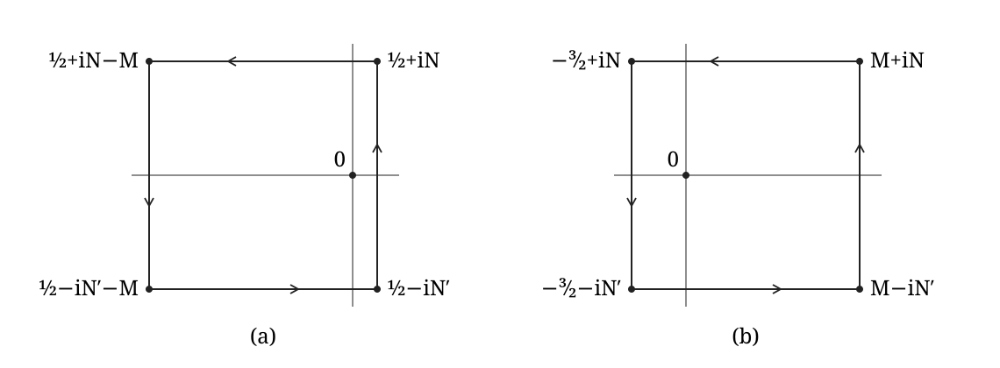

图 20　伽马函数恒等式的积分周线

同样的论证方式可用于推导其他许多涉及伽马函数的有用关系. 可以用 $z$ 的其他函数代替 $x^{-z}$, 或者用其他量代替常数 $\tfrac12$. 例如,

$$
\frac1{2\pi i}\int_{-3/2-i\infty}^{-3/2+i\infty}\Gamma(z)x^{-z}\,dz=e^{-x}-1+x,\tag{43}
$$

这是 $T_n$ 公式 (41) 的关键量:

$$
T_n=n\sum_{j\ge1}\frac1{2\pi i}\int_{-3/2-i\infty}^{-3/2+i\infty}\Gamma(z)(n/2^j)^{-1-z}\,dz.\tag{44}
$$

<a id="pdf-109"></a>
<a id="p-103"></a>

因为有绝对好的收敛性, 求和运算可以放到积分内部. 因为 $|2^w|=2^{\Re(w)}>1$, 所以

$$
\text{当 }\Re(w)>0\text{ 时},\quad\sum_{j\ge1}(n/2^j)^w=n^w\sum_{j\ge1}(1/2^w)^j=n^w/(2^w-1).
$$

从而

$$
T_n=\frac n{2\pi i}\int_{-3/2-i\infty}^{-3/2+i\infty}\frac{\Gamma(z)n^{-1-z}}{2^{-1-z}-1}\,dz,\tag{45}
$$

剩下的就是计算上式右边那个积分.

这次我们沿着向右边延伸的一条路径积分, 如图 20(b) 所示. 如果 $2^{iN}\ne1$, 则顶线积分是 $O\bigl(n^{1/2}e^{-\pi N/2}\int_{-3/2}^{M}|M+iN|^t\,dt\bigr)$. 当 $N$ 和 $N'$ 远大于 $M$ 时, 底线积分同样可以忽略不计. 右线积分是 $O\bigl(n^{-1-M}\int_{-\infty}^{\infty}|\Gamma(M+it)|\,dt\bigr)$. 固定 $M$, 并令 $N,N'\to\infty$, 可以证明: $-T_n/n$ 等于 $O(n^{-1-M})$ 加上区域 $-3/2<\Re(z)<M$ 内的留数之和. 因子 $\Gamma(z)$ 在 $z=-1$ 和 $z=0$ 处有单极点, $n^{-1-z}$ 没有极点, $1/(2^{-1-z}-1)$ 在 $z=-1+2\pi ik/\ln2$ 处有单极点.

$z=-1$ 处的二阶极点最难处理. 利用著名关系式

$$
\Gamma(z+1)=\exp\bigl(-\gamma z+\zeta(2)z^2/2-\zeta(3)z^3/3+\zeta(4)z^4/4-\cdots\bigr)
$$

(其中 $\zeta(s)=1^{-s}+2^{-s}+3^{-s}+\cdots=H_\infty^{(s)}$) 可以推导出: 当 $w=z+1$ 很小时我们有

$$
\Gamma(z)=\frac{\Gamma(w+1)}{w(w-1)}=-w^{-1}+(\gamma-1)+O(w),
$$

$$
n^{-1-z}=1-w\ln n+O(w^2),
$$

$$
1/(2^{-1-z}-1)=-w^{-1}/\ln2-\tfrac12+O(w).
$$

$z=-1$ 处的留数是以上三式乘积中 $w^{-1}$ 的系数, 即 $\tfrac12-(\ln n+\gamma-1)/\ln2$. 加上其他留数, 对于任意大的 $M$ 有

$$
\frac{T_n}n=\frac{\ln n+\gamma-1}{\ln2}-\frac12+\delta(n)+\frac2n+O(n^{-M}),\tag{46}
$$

这里 $\delta(n)$ 是一个相当奇怪的函数,

$$
\delta(n)=\frac2{\ln2}\sum_{k\ge1}\Re\bigl(\Gamma(-1-2\pi ik/\ln2)\exp(2\pi ik\lg n)\bigr).\tag{47}
$$

注意 $\delta(n)=\delta(2n)$. $\delta(n)$ 中每一项的平均值都是 0, 所以 $\delta(n)$ 的平均值是 0. (考虑到 4.2.4 节有关浮点数的结果, 可以假定 $(\lg n)\bmod1$ 是均匀分布的.) 此外, 由于 $|\Gamma(-1+it)|=|\pi/(t(1+t^2)\sinh\pi t)|^{1/2}$, 所以不难证明

$$
|\delta(n)|<0.000000173.\tag{48}
$$

因此, 实际应用中可以放心地忽略 $\delta(n)$ 的 “晃动”. 但在进行理论分析时, 没有它就无法获得 $U_n$ 的有效渐近展开式. $U_n$ 之所以是一个相当难以分析的函数, 原因就在于此.

从 $T_n$ 的定义 (41) 立即得出

$$
\frac{T_{2n}}{2n}=\frac{T_n}n+1-\frac1n+\frac{e^{-n}}n.\tag{49}
$$

因此式 (46) 的误差项 $O(n^{-M})$ 必不可少, 不能用 0 代替. 然而习题 54 给出另一种分析方法, 通过推导一个颇为奇特的收敛级数避开了这些误差项.

<a id="pdf-110"></a>
<a id="p-104"></a>

总之, 对于很有难度的和式 (38), 我们已经推导出它的特性:

$$
U_n=n\lg n+n\left(\frac{\gamma-1}{\ln2}-\frac12+\delta(n)\right)+O(1).\tag{50}
$$

用以得出这个结果的伽马函数方法是通用技术梅林变换的特例, 梅林变换在研究面向基数的递推关系时极为有用. 这种方法的其他示例可以在习题 51–53 和 6.3 节找到. 菲利普·弗拉若莱、格扎维埃·古尔东和菲利普·迪马对梅林变换及其在算法分析中的应用进行了出色的介绍 [*Theoretical Computer Science* **144** (1995), 3–58].

### 习题

<a id="ex-5-2-2-1"></a>

**1.** [M20] 设 $a_1\ldots a_n$ 是 $\{1,\ldots,n\}$ 的排列, 并设 $i$ 和 $j$ 是使得 $i<j$ 和 $a_i>a_j$ 的下标. 设 $a'_1\ldots a'_n$ 是通过交换 $a_i$ 和 $a_j$ 从 $a_1\ldots a_n$ 得到的排列. $a'_1\ldots a'_n$ 是否可能有比 $a_1\ldots a_n$ 更多的反序个数?　[答案](#ans-5-2-2-1)

<a id="ex-5-2-2-2"></a>

**2.** ▶ [M25] (a) 对排列 $3\,7\,6\,9\,8\,1\,4\,5\,2$ 排序至少需要多少次交换? (b) 一般来说, 给定 $\{1,\ldots,n\}$ 的任意排列 $\pi=a_1\ldots a_n$, 设 $\operatorname{xch}(\pi)$ 是把 $\pi$ 排序为递增顺序所需要的最少交换次数. 试用 $\pi$ 的 “更简单” 特性表达 $\operatorname{xch}(\pi)$. (关于测量排列无序程度的另外一种方法, 见习题 5.1.4–41.)　[答案](#ans-5-2-2-2)

<a id="ex-5-2-2-3"></a>

**3.** [10] 冒泡排序算法 B 是稳定排序算法吗?　[答案](#ans-5-2-2-3)

<a id="ex-5-2-2-4"></a>

**4.** [M23] 在算法 B 中, 如果步骤 B4 中的 $t=1$, 实际上可以立即终止算法, 因为后续步骤 B2 没有完成任何有用工作. 在对一个随机排列排序时, 步骤 B4 中出现 $t=1$ 的概率是多少?　[答案](#ans-5-2-2-4)

<a id="ex-5-2-2-5"></a>

**5.** [M25] 设 $b_1b_2\ldots b_n$ 是排列 $a_1a_2\ldots a_n$ 的反序表. 证明: 对于 $0\le r\le\max(b_1,\ldots,b_n)$, 在冒泡排序的 $r$ 遍扫描之后, BOUND 的值是 $\max\{b_i+i\mid b_i\ge r\}-r$.　[答案](#ans-5-2-2-5)

<a id="ex-5-2-2-6"></a>

**6.** [M22] 设 $a_1\ldots a_n$ 是 $\{1,\ldots,n\}$ 的排列, $a'_1\ldots a'_n$ 是 $a_1\ldots a_n$ 的逆排列. 证明: 对 $a_1\ldots a_n$ 进行冒泡排序的扫描遍数是 $1+\max(a'_1-1,a'_2-2,\ldots,a'_n-n)$.　[答案](#ans-5-2-2-6)

<a id="ex-5-2-2-7"></a>

**7.** [M28] 计算冒泡排序中扫描遍数的标准差, 试用 $n$ 和函数 $P(n)$ 表达它. [见式 (6) 和 (7).]　[答案](#ans-5-2-2-7)

<a id="ex-5-2-2-8"></a>

**8.** [M24] 推导式 (8).　[答案](#ans-5-2-2-8)

<a id="ex-5-2-2-9"></a>

**9.** [M48] 分析调酒师排序算法的扫描遍数及比较次数. 注记: 部分相关信息可见习题 5.4.8–9.

<a id="ex-5-2-2-10"></a>

**10.** [M26] 设 $a_1a_2\ldots a_n$ 是 $\{1,2,\ldots,n\}$ 的 “2 有序” 排列.　[答案](#ans-5-2-2-10)

(a) 相应栅格路径中第 $a_i$ 步的端点坐标是多少? (见第 67 页图 11.)

(b) 证明: $a_1:a_2,a_3:a_4,\ldots$ 的比较／交换对应于沿对角线 “折叠” 该路径, 如图 18(b) 所示.

(c) 证明: 当 $d=2m-1$ 时, $a_2:a_{2+d},a_4:a_{4+d},\ldots$ 的比较／交换对应于沿对角线下方 $m$ 个单位的直线 “折叠” 该路径, 如图 18(c)、(d)、(e) 所示.

<a id="ex-5-2-2-11"></a>

**11.** ▶ [M25] $\{1,2,\ldots,16\}$ 的哪种排列会使巴彻尔算法的交换次数最多?　[答案](#ans-5-2-2-11)

<a id="ex-5-2-2-12"></a>

**12.** [24] 假定 MIX 是一台可以执行 AND、SRB 运算的二进制计算机, 请为算法 M 编写 MIX 程序. 所编程序对表 1 中的 16 条记录排序需要多少时间?　[答案](#ans-5-2-2-12)

<a id="ex-5-2-2-13"></a>

**13.** [10] 巴彻尔方法是稳定排序算法吗?　[答案](#ans-5-2-2-13)

<a id="ex-5-2-2-14"></a>

**14.** [M21] 设 $c(N)$ 是利用巴彻尔方法对 $N$ 个元素排序时所进行的键比较次数, 也就是算法 M 中步骤 M4 的执行次数.　[答案](#ans-5-2-2-14)

(a) 证明: 对于 $t\ge1$, 有 $c(2^t)=2c(2^{t-1})+(t-1)2^{t-1}+1$.

(b) 把 $c(2^t)$ 表示为 $t$ 的函数, 试求这个函数的简单表达式. 提示: 考虑序列 $x_t=c(2^t)/2^t$.


<a id="pdf-111"></a>
<a id="p-105"></a>

<a id="ex-5-2-2-15"></a>

**15.** [M38] 本题的目的是分析习题 14 中的函数 $c(N)$, 并给出当 $N=2^{e_1}+2^{e_2}+\cdots+2^{e_r}$ 时 $c(N)$ 的公式, 其中 $e_1>e_2>\cdots>e_r\ge0$.　[答案](#ans-5-2-2-15)

(a) 设 $a(N)=c(N+1)-c(N)$. 证明: $a(2n)=a(n)+\lfloor\lg(2n)\rfloor$, $a(2n+1)=a(n)+1$. 因此

$$
a(N)=\binom{e_1+1}{2}-r(e_1-1)+(e_1+e_2+\cdots+e_r).
$$

(b) 设 $x(n)=a(n)-a(\lfloor n/2\rfloor)$, 所以 $a(n)=x(n)+x(\lfloor n/2\rfloor)+x(\lfloor n/4\rfloor)+\cdots$. 设 $y(n)=x(1)+x(2)+\cdots+x(n)$, $z(2n)=y(2n)-a(n)$, $z(2n+1)=y(2n+1)$. 证明: $c(N+1)=z(N)+2z(\lfloor N/2\rfloor)+4z(\lfloor N/4\rfloor)+\cdots$.

(c) 证明: $y(N)=N+(\lfloor N/2\rfloor+1)(e_1-1)-2^{e_1}+2$.

(d) 现在综合以上所得, 保持 $r$ 固定, 给出用指数 $e_j$ 表示 $c(N)$ 的公式.


<a id="ex-5-2-2-16"></a>

**16.** [HM42] 假定 $N$ 是 2 的幂, 对由 $N$ 个不同元素组成的随机排列应用巴彻尔方法, 试求平均交换次数的渐近值.　[答案](#ans-5-2-2-16)

<a id="ex-5-2-2-17"></a>

**17.** ▶ [20] 算法 Q 在什么地方利用了以下事实: $K_0$ 和 $K_{N+1}$ 拥有式 (13) 中的假定值?　[答案](#ans-5-2-2-17)

<a id="ex-5-2-2-18"></a>

**18.** ▶ [20] 请解释: 当所有输入键都相等时, 算法 Q 的计算过程如何进行. 如果把步骤 Q3 和 Q4 中的 $<$ 改为 $\le$, 将会发生什么情况?　[答案](#ans-5-2-2-18)

<a id="ex-5-2-2-19"></a>

**19.** [15] 如果用 “先进先出” 的队列代替 “后进先出” 的栈, 算法 Q 还能正确运行吗?　[答案](#ans-5-2-2-19)

<a id="ex-5-2-2-20"></a>

**20.** [M20] 算法 Q 的栈中最多可能同时出现多少个元素? 把它表示为 $M$ 和 $N$ 的函数.　[答案](#ans-5-2-2-20)

<a id="ex-5-2-2-21"></a>

**21.** [20] 请解释: 当所有键互不相同时, 为什么算法 Q 的第一个划分阶段会花费式 (17) 所确定的比较和交换次数.　[答案](#ans-5-2-2-21)

<a id="ex-5-2-2-22"></a>

**22.** [M25] 把算法 Q 应用于 $\{1,2,\ldots,N\}$ 的随机排列, 设 $p_{kN}$ 是式 (16) 中量 $A$ 等于 $k$ 的概率, 并设 $A_N(z)=\sum_kp_{kN}z^k$ 是相应的生成函数. 证明: 对于 $N\le M$ 有 $A_N(z)=1$, 对于 $N>M$ 有 $A_N(z)=z\bigl(\sum_{1\le s\le N}A_{s-1}(z)A_{N-s}(z)\bigr)/N$. 其他量的概率分布 $B_N(z),C_N(z),D_N(z),E_N(z),S_N(z)$ 的类似递推关系是什么?　[答案](#ans-5-2-2-22)

<a id="ex-5-2-2-23"></a>

**23.** [M23] 设 $A_N,B_N,D_N,E_N,S_N$ 是对 $\{1,2,\ldots,N\}$ 的随机排列排序时式 (16) 中相应量的平均值. 试求类似于式 (18) 的这些量的递推关系, 并解这些递推关系得出式 (25).　[答案](#ans-5-2-2-23)

<a id="ex-5-2-2-24"></a>

**24.** [M21] 算法 Q 做的比较次数明显高于所需数量, 这是因为在步骤 Q3 中有 $i=j$, 在步骤 Q4 中甚至有 $i>j$. 如果我们能避免在 $i\ge j$ 时的所有比较, 那么平均比较次数 $C_N$ 是多少?　[答案](#ans-5-2-2-24)

<a id="ex-5-2-2-25"></a>

**25.** [M20] 当输入键为排列有序的数 $1\,2\,\ldots\,N$ 时, 用于计算程序 Q 运行时间的量 $A,B,C,D,E,S$ 的确切值是多少? (假定 $N>M$.)　[答案](#ans-5-2-2-25)

<a id="ex-5-2-2-26"></a>

**26.** ▶ [M24] 构造一个输入文件, 使程序 Q 的速度比习题 25 中的速度还要慢. (尝试找出一种真正糟糕的情形.)　[答案](#ans-5-2-2-26)

<a id="ex-5-2-2-27"></a>

**27.** [M28] (塞奇威克) 考虑算法 Q 的最佳情形: 当 $N=23$ 和 $M=3$ 时, 找出 $\{1,2,\ldots,23\}$ 的一个排列, 对它排序需要的时间最短.　[答案](#ans-5-2-2-27)

<a id="ex-5-2-2-28"></a>

**28.** [M26] 针对算法 Q 的辛格尔顿修改版 ($s$ 选取为 $\{K_1,K_{\lfloor(N+1)/2\rfloor},K_N\}$ 的中值, 而不是 $s=K_1$) 所需的平均比较次数, 给出类似于式 (20) 的递推关系. 忽略计算中值 $s$ 所需的比较次数.　[答案](#ans-5-2-2-28)

<a id="ex-5-2-2-29"></a>

**29.** [HM40] 继续习题 28, 给出辛格尔顿 “三项取中” 方法中比较次数的渐近值.　[答案](#ans-5-2-2-29)

<a id="ex-5-2-2-30"></a>

**30.** ▶ [25] (帕特里克·沙克尔顿) 在对多字键排序时, 当文件越来越接近其最终顺序, 大多数排序方法会变得越来越慢, 这是因为相等或近乎相等的键需要察看多个字后才能确定正确的字典序. (见习题 5–5.) 实践中遇到的文件经常包含这种键, 所以这个现象对排序时间有很重要的影响.　[答案](#ans-5-2-2-30)

在一个子文件中, 如果已知所有键的前 $k$ 个字都取常值, 则应当仅查看这些键的第 $k+1$ 个字. 试说明如何扩展算法 Q 以适应这种情形.

<a id="ex-5-2-2-31"></a>

**31.** ▶ [20] (霍尔) 假定我们仅希望得到给定 $n$ 元素集合的第 $m$ 个最小元素, 而不是对整个文件排序. 证明: 快速排序可修改成适合这个目的, 以避免完整排序所需要的大量计算.　[答案](#ans-5-2-2-31)

<a id="ex-5-2-2-32"></a>

**32.** [M40] 利用习题 31 的 “快速查找” 方法, 在 $n$ 个元素中查找第 $m$ 个最小元素平均需要执行 $C_{nm}$ 次键比较, 请给出 $C_{nm}$ 的简单 “闭合式” 表达式. (为简便起见, 令 $M=1$. 也就是说, 假定不为短的子文件使用特殊技巧.) 利用霍尔方法查找 $2m-1$ 个元素的中值需要的平均比较次数 $C_{(2m-1)m}$ 的渐近特性如何?　[答案](#ans-5-2-2-32)

<a id="pdf-112"></a>
<a id="p-106"></a>

<a id="ex-5-2-2-33"></a>

**33.** ▶ [15] 设计一种算法, 重新排列给定表中的所有数, 使所有负数位于所有非负数前面. (这些项不必完全排序, 仅需区分负数和非负数.) 你的算法应使用尽可能少的交换次数.　[答案](#ans-5-2-2-33)

<a id="ex-5-2-2-34"></a>

**34.** [20] 如何加速基数交换排序算法 R 中步骤 R3 至 R6 的位查看循环?　[答案](#ans-5-2-2-34)

<a id="ex-5-2-2-35"></a>

**35.** [M23] 在使用 “情形 (i) 输入” 的基数交换排序中, 分析量 $A,B,C,G,K,L,R,S,X$ 的取值.　[答案](#ans-5-2-2-35)

<a id="ex-5-2-2-36"></a>

**36.** [M27] 给定数列 $\langle a_n\rangle=a_0,a_1,a_2,\ldots$, 它的二项式变换 $\langle\hat a_n\rangle=\hat a_0,\hat a_1,\hat a_2,\ldots$ 定义为　[答案](#ans-5-2-2-36)

$$
\hat a_n=\sum_k\binom nk(-1)^ka_k.
$$

(a) 证明: $\langle\hat{\hat a}_n\rangle=\langle a_n\rangle$.

(b) 求以下数列的二项式变换: $\langle1\rangle$; $\langle n\rangle$; $\langle\binom nm\rangle$($m$ 固定); $\langle a^n\rangle$($a$ 固定); $\langle\binom nm a^n\rangle$($a$ 和 $m$ 固定).

(c) 假定数列 $\langle x_n\rangle$ 满足递推关系

$$
x_0=x_1=a_0=a_1=0;\qquad\text{对 }n\ge2,\quad x_n=a_n+2^{1-n}\sum_{k\ge2}\binom nkx_k.
$$

证明: 这个递推式的解是

$$
x_n=\sum_{k\ge2}\binom nk(-1)^k\frac{2^{k-1}\hat a_k}{2^{k-1}-1}=a_n+\sum_{k\ge2}\binom nk(-1)^k\frac{\hat a_k}{2^{k-1}-1}.
$$

<a id="ex-5-2-2-37"></a>

**37.** [M28] 采用习题 36 的记号, 确定所有满足 $\langle\hat a_n\rangle=\langle a_n\rangle$ 的数列 $\langle a_n\rangle$.　[答案](#ans-5-2-2-37)

<a id="ex-5-2-2-38"></a>

**38.** ▶ [M30] 当基数交换排序应用于 “情形 (ii) 输入” 时, 给出式 (29) 中各量的平均值 $A_N,B_N,C_N,G_N,K_N,L_N,R_N,X_N$, 用 $N$ 和　[答案](#ans-5-2-2-38)

$$
U_n=\sum_{k\ge2}\binom nk\frac{(-1)^k}{2^{k-1}-1},\qquad V_n=\sum_{k\ge2}\binom nk\frac{(-1)^kk}{2^{k-1}-1}=n(U_n-U_{n-1})
$$

表达你的答案. [提示: 见习题 36.]

<a id="ex-5-2-2-39"></a>

**39.** [20] 式 (30) 给出的结果表明: 基数交换排序应用于随机输入时需要大约 $1.44N$ 个划分阶段. 证明: 快速排序需要的阶段数绝不超过 $N$, 并解释为什么基数交换排序通常会超出这个数目.　[答案](#ans-5-2-2-39)

<a id="ex-5-2-2-40"></a>

**40.** [21] 请说明如何修改算法 R, 使得在对包含大量相等键的文件排序时, 它也具有合理的工作效率.　[答案](#ans-5-2-2-40)

<a id="ex-5-2-2-41"></a>

**41.** ▶ [30] 设计一种交换记录 $R_l\ldots R_r$ 的好方法, 把它们划分为三块: (i) 对 $l\le k<i$ 有 $K_k<K$; (ii) 对 $i\le k\le j$ 有 $K_k=K$; (iii) 对 $j<k\le r$ 有 $K_k>K$. 最终的排列图示为　[答案](#ans-5-2-2-41)

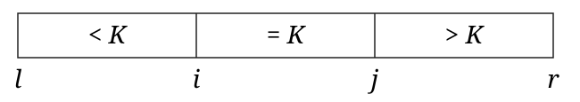

<a id="ex-5-2-2-42"></a>

**42.** [HM32] 对于任意实数 $c>0$, 证明: 算法 Q 对随机数据排序需要超过 $(c+1)(N+1)H_N$ 次比较的概率小于 $e^{-c}$. [当 $c$ (比如说) 是 $N^\epsilon$ 时, 这个上限尤其有意义.]　[答案](#ans-5-2-2-42)

<a id="ex-5-2-2-43"></a>

**43.** [HM21] 证明: $\int_0^1y^{-1}(e^{-y}-1)\,dy+\int_1^\infty y^{-1}e^{-y}\,dy=-\gamma$. [提示: 考虑 $\lim_{a\to0+}y^{a-1}$.]　[答案](#ans-5-2-2-43)

<a id="ex-5-2-2-44"></a>

**44.** [HM24] 如正文建议, 推导式 (37).　[答案](#ans-5-2-2-44)

<a id="ex-5-2-2-45"></a>

**45.** [HM20] 为什么当 $x>0$ 时式 (43) 成立?　[答案](#ans-5-2-2-45)

<a id="ex-5-2-2-46"></a>

**46.** [HM20] 给定正整数 $s$, 且 $0<a<s$, 则 $(1/2\pi i)\int_{a-i\infty}^{a+i\infty}\Gamma(z)n^{s-z}\,dz/(2^{s-z}-1)$ 的值是多少?　[答案](#ans-5-2-2-46)

<a id="ex-5-2-2-47"></a>

**47.** [HM21] 证明: $\sum_{j\ge1}(n/2^j)e^{-n/2^j}$ 是 $n$ 的有界函数.　[答案](#ans-5-2-2-47)

<a id="ex-5-2-2-48"></a>

**48.** [HM24] 利用类似于正文中研究 $U_n$ 的方法, 计算习题 38 中定义的量 $V_n$ 的渐近值, 给出直到 $O(1)$ 的各项.　[答案](#ans-5-2-2-48)

<a id="ex-5-2-2-49"></a>

**49.** [HM24] 展开 $U_n$ 的渐近公式 (50) 直到 $O(n^{-1})$.　[答案](#ans-5-2-2-49)

<a id="pdf-113"></a>
<a id="p-107"></a>

<a id="ex-5-2-2-50"></a>

**50.** [HM24] 当 $m$ 是任何大于 1 的固定值时, 求函数　[答案](#ans-5-2-2-50)

$$
U_{mn}=\sum_{k\ge2}\binom nk(-1)^k\frac1{m^{k-1}-1}
$$

的渐近值. (当 $m$ 是大于 2 的整数时, 这个量出现在一般性基数交换的研究中, 以及 6.3 节的检索树存储器查找算法中.)

<a id="ex-5-2-2-51"></a>

**51.** ▶ [HM28] 证明: 可以利用解决渐近问题的伽马函数方法代替欧拉求和公式, 推导式 (35) 中量 $r_k(m)$ 的渐近展开式. (这为我们提供了一种对所有 $k$ 值研究 $r_k(m)$ 的统一方法, 而不再需要依赖于一些特殊技巧, 比如正文中对 $g_{-1}(x)=(e^{-x^2}-1)/x$ 的引入.)　[答案](#ans-5-2-2-51)

<a id="ex-5-2-2-52"></a>

**52.** [HM35] (德布鲁因) 和式　[答案](#ans-5-2-2-52)

$$
S_n=\sum_{t\ge1}\binom{2n}{n+t}d(t)
$$

的渐近特性是什么? 其中 $d(t)$ 是 $t$ 的因子个数. (于是, $d(1)=1,d(2)=d(3)=2,d(4)=3,d(5)=2$, 等等. 这个问题的出现与树遍历算法的分析有关, 见习题 2.3.1–11.) 试求 $S_n/\binom{2n}n$ 的值, 精确到 $O(n^{-1})$.

<a id="ex-5-2-2-53"></a>

**53.** [HM42] 如果输入数据是 $[0\mathinner{\ldotp\ldotp}1)$ 中的无限精度二进制数, 它们的每个二进制位都独立地以概率 $p$ 等于 1, 试分析基数交换排序算法执行位查看与交换的平均次数. (正文中仅讨论了 $p=\tfrac12$ 的情形, 我们的方法可以推广到任意 $p$ 的情形.) 特别是考虑 $p=1/\phi=.61803\ldots$ 的情形.　[答案](#ans-5-2-2-53)

<a id="ex-5-2-2-54"></a>

**54.** [HM24] (斯蒂芬·赖斯) 证明: $U_n$ 可以写为　[答案](#ans-5-2-2-54)

$$
U_n=(-1)^n\frac{n!}{2\pi i}\oint_C\frac{dz}{z(z-1)\cdots(z-n)}\frac1{2^{z-1}-1},
$$

式中 $C$ 是环绕点 $2,3,\ldots,n$ 的小的闭曲线. 把 $C$ 改为以原点为中心的任意大圆, 推导出收敛级数

$$
U_n=\frac{(H_{n-1}-1)n}{\ln2}-\frac n2+2+\frac2{\ln2}\sum_{m\ge1}\Re\bigl(B(n+1,-1+ibm)\bigr),
$$

式中 $b=2\pi/\ln2$, $B(n+1,-1+ibm)=\Gamma(n+1)\Gamma(-1+ibm)/\Gamma(n+ibm)=n!/\prod_{k=0}^{n}(k-1+ibm)$.

<a id="ex-5-2-2-55"></a>

**55.** ▶ [22] 说明如何修改程序 Q, 使得划分元素是三个键 (28) 的中值, 假定 $M>1$.　[答案](#ans-5-2-2-55)

<a id="ex-5-2-2-56"></a>

**56.** [M43] 如果程序已经修改为如习题 55 那样取三个元素的中值, 试分析算法 Q 运行时间中各个量的平均特性. (见习题 29.)　[答案](#ans-5-2-2-56)

<a id="sec-5-2-3"></a>

### 5.2.3　选择排序

另一类重要的排序技术以重复选择思想为基础. 最简单的选择方法可能就是以下方法:

(i) 找出最小键, 把相应记录放到输出区域, 然后用 $\infty$ (假定它大于任何实际键) 代替这个键.

(ii) 重复步骤 (i). 这次将选出第二小的键, 因为最小键已经被 $\infty$ 代替.

(iii) 继续重复步骤 (i), 直到全部 $N$ 条记录都被选出.

选择排序需要所有输入项目都准备就绪后才能开始排序, 而且是依次逐个生成最终输出. 这与插入排序本质上相反, 后者顺序接收输入, 但在完成排序之前不知道任何最终输出.

步骤 (i) 每选择一条新记录涉及 $N-1$ 次比较, 还需要在存储器中有一个独立的输出区域. 但我们显然能做得更好: 可以把选定记录与当前占据其最终正确位置的记录交换, 它就移到了正确位置. 在将来的选择中不再需要考虑这个位置, 而且不必处理无穷键. 这个思想产生了我们的第一个选择排序算法.

<a id="pdf-114"></a>
<a id="p-108"></a>

<a id="alg-5-2-3-S"></a>

**算法 S (直接选择排序).** 重新排列记录 $R_1,\ldots,R_N$ 到适当位置, 排序完成后它们的键将处于有序状态: $K_1\le\cdots\le K_N$. 排序过程以上述方法为基础, 只是事实证明, 更方便的做法是先选择最大元素, 然后选择第二大元素, 以此类推.

**S1.** [对 $j$ 循环.] 对 $j=N,N-1,\ldots,2$ 执行 S2 和 S3.

**S2.** [找出 $\max(K_1,\ldots,K_j)$.] 扫描键 $K_j,K_{j-1},\ldots,K_1$, 找出一个最大的. 设它是 $K_i$, 其中 $i$ 尽可能地大.

**S3.** [与 $R_j$ 交换.] 交换记录 $R_i\leftrightarrow R_j$. (现在记录 $R_j,\ldots,R_N$ 处于其最终位置了.)　▮

<a id="fig-5-21"></a>

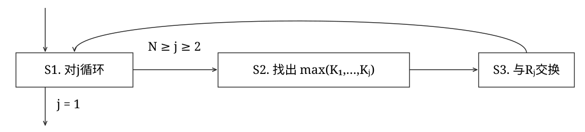

图 21　直接选择排序

表 1 给出算法应用于我们的 16 个示例键的操作过程. 在步骤 S2 中从右向左扫描期间, 作为最大键候选项的元素以粗体标出.

<a id="table-5-2-3-1"></a>

表 1　直接选择排序

<table data-selection-table="1" style="border-collapse:collapse;table-layout:fixed;width:1024px;font-family:serif"><thead><tr><th style="width:64px;min-width:64px;border:0;padding:0"></th><th style="width:64px;min-width:64px;border:0;padding:0"></th><th style="width:64px;min-width:64px;border:0;padding:0"></th><th style="width:64px;min-width:64px;border:0;padding:0"></th><th style="width:64px;min-width:64px;border:0;padding:0"></th><th style="width:64px;min-width:64px;border:0;padding:0"></th><th style="width:64px;min-width:64px;border:0;padding:0"></th><th style="width:64px;min-width:64px;border:0;padding:0"></th><th style="width:64px;min-width:64px;border:0;padding:0"></th><th style="width:64px;min-width:64px;border:0;padding:0"></th><th style="width:64px;min-width:64px;border:0;padding:0"></th><th style="width:64px;min-width:64px;border:0;padding:0"></th><th style="width:64px;min-width:64px;border:0;padding:0"></th><th style="width:64px;min-width:64px;border:0;padding:0"></th><th style="width:64px;min-width:64px;border:0;padding:0"></th><th style="width:64px;min-width:64px;border:0;padding:0"></th></tr></thead><tbody>
<tr data-selection-state="0" style="background:transparent"><td style="width:64px;min-width:64px;padding:4px 0;border:0;text-align:center">503</td><td style="width:64px;min-width:64px;padding:4px 0;border:0;text-align:center">087</td><td style="width:64px;min-width:64px;padding:4px 0;border:0;text-align:center">512</td><td style="width:64px;min-width:64px;padding:4px 0;border:0;text-align:center">061</td><td style="width:64px;min-width:64px;padding:4px 0;border:0;text-align:center"><strong>908</strong></td><td style="width:64px;min-width:64px;padding:4px 0;border:0;text-align:center">170</td><td style="width:64px;min-width:64px;padding:4px 0;border:0;text-align:center"><strong>897</strong></td><td style="width:64px;min-width:64px;padding:4px 0;border:0;text-align:center">275</td><td style="width:64px;min-width:64px;padding:4px 0;border:0;text-align:center">653</td><td style="width:64px;min-width:64px;padding:4px 0;border:0;text-align:center">426</td><td style="width:64px;min-width:64px;padding:4px 0;border:0;text-align:center">154</td><td style="width:64px;min-width:64px;padding:4px 0;border:0;text-align:center">509</td><td style="width:64px;min-width:64px;padding:4px 0;border:0;text-align:center">612</td><td style="width:64px;min-width:64px;padding:4px 0;border:0;text-align:center">677</td><td style="width:64px;min-width:64px;padding:4px 0;border:0;text-align:center"><strong>765</strong></td><td style="width:64px;min-width:64px;padding:4px 0;border:0;text-align:center;border-right:1.5px solid #222"><strong>703</strong></td></tr>
<tr data-selection-state="1" style="background:transparent"><td style="width:64px;min-width:64px;padding:4px 0;border:0;text-align:center">503</td><td style="width:64px;min-width:64px;padding:4px 0;border:0;text-align:center">087</td><td style="width:64px;min-width:64px;padding:4px 0;border:0;text-align:center">512</td><td style="width:64px;min-width:64px;padding:4px 0;border:0;text-align:center">061</td><td style="width:64px;min-width:64px;padding:4px 0;border:0;text-align:center">703</td><td style="width:64px;min-width:64px;padding:4px 0;border:0;text-align:center">170</td><td style="width:64px;min-width:64px;padding:4px 0;border:0;text-align:center"><strong>897</strong></td><td style="width:64px;min-width:64px;padding:4px 0;border:0;text-align:center">275</td><td style="width:64px;min-width:64px;padding:4px 0;border:0;text-align:center">653</td><td style="width:64px;min-width:64px;padding:4px 0;border:0;text-align:center">426</td><td style="width:64px;min-width:64px;padding:4px 0;border:0;text-align:center">154</td><td style="width:64px;min-width:64px;padding:4px 0;border:0;text-align:center">509</td><td style="width:64px;min-width:64px;padding:4px 0;border:0;text-align:center">612</td><td style="width:64px;min-width:64px;padding:4px 0;border:0;text-align:center">677</td><td style="width:64px;min-width:64px;padding:4px 0;border:0;text-align:center;border-right:1.5px solid #222"><strong>765</strong></td><td style="width:64px;min-width:64px;padding:4px 0;border:0;text-align:center">908</td></tr>
<tr data-selection-state="2" style="background:transparent"><td style="width:64px;min-width:64px;padding:4px 0;border:0;text-align:center">503</td><td style="width:64px;min-width:64px;padding:4px 0;border:0;text-align:center">087</td><td style="width:64px;min-width:64px;padding:4px 0;border:0;text-align:center">512</td><td style="width:64px;min-width:64px;padding:4px 0;border:0;text-align:center">061</td><td style="width:64px;min-width:64px;padding:4px 0;border:0;text-align:center">703</td><td style="width:64px;min-width:64px;padding:4px 0;border:0;text-align:center">170</td><td style="width:64px;min-width:64px;padding:4px 0;border:0;text-align:center"><strong>765</strong></td><td style="width:64px;min-width:64px;padding:4px 0;border:0;text-align:center">275</td><td style="width:64px;min-width:64px;padding:4px 0;border:0;text-align:center">653</td><td style="width:64px;min-width:64px;padding:4px 0;border:0;text-align:center">426</td><td style="width:64px;min-width:64px;padding:4px 0;border:0;text-align:center">154</td><td style="width:64px;min-width:64px;padding:4px 0;border:0;text-align:center">509</td><td style="width:64px;min-width:64px;padding:4px 0;border:0;text-align:center">612</td><td style="width:64px;min-width:64px;padding:4px 0;border:0;text-align:center;border-right:1.5px solid #222"><strong>677</strong></td><td style="width:64px;min-width:64px;padding:4px 0;border:0;text-align:center">897</td><td style="width:64px;min-width:64px;padding:4px 0;border:0;text-align:center">908</td></tr>
<tr data-selection-state="3" style="background:transparent"><td style="width:64px;min-width:64px;padding:4px 0;border:0;text-align:center">503</td><td style="width:64px;min-width:64px;padding:4px 0;border:0;text-align:center">087</td><td style="width:64px;min-width:64px;padding:4px 0;border:0;text-align:center">512</td><td style="width:64px;min-width:64px;padding:4px 0;border:0;text-align:center">061</td><td style="width:64px;min-width:64px;padding:4px 0;border:0;text-align:center"><strong>703</strong></td><td style="width:64px;min-width:64px;padding:4px 0;border:0;text-align:center">170</td><td style="width:64px;min-width:64px;padding:4px 0;border:0;text-align:center"><strong>677</strong></td><td style="width:64px;min-width:64px;padding:4px 0;border:0;text-align:center">275</td><td style="width:64px;min-width:64px;padding:4px 0;border:0;text-align:center"><strong>653</strong></td><td style="width:64px;min-width:64px;padding:4px 0;border:0;text-align:center">426</td><td style="width:64px;min-width:64px;padding:4px 0;border:0;text-align:center">154</td><td style="width:64px;min-width:64px;padding:4px 0;border:0;text-align:center">509</td><td style="width:64px;min-width:64px;padding:4px 0;border:0;text-align:center;border-right:1.5px solid #222"><strong>612</strong></td><td style="width:64px;min-width:64px;padding:4px 0;border:0;text-align:center">765</td><td style="width:64px;min-width:64px;padding:4px 0;border:0;text-align:center">897</td><td style="width:64px;min-width:64px;padding:4px 0;border:0;text-align:center">908</td></tr>
<tr data-selection-state="4" style="background:transparent"><td style="width:64px;min-width:64px;padding:4px 0;border:0;text-align:center">503</td><td style="width:64px;min-width:64px;padding:4px 0;border:0;text-align:center">087</td><td style="width:64px;min-width:64px;padding:4px 0;border:0;text-align:center">512</td><td style="width:64px;min-width:64px;padding:4px 0;border:0;text-align:center">061</td><td style="width:64px;min-width:64px;padding:4px 0;border:0;text-align:center">612</td><td style="width:64px;min-width:64px;padding:4px 0;border:0;text-align:center">170</td><td style="width:64px;min-width:64px;padding:4px 0;border:0;text-align:center"><strong>677</strong></td><td style="width:64px;min-width:64px;padding:4px 0;border:0;text-align:center">275</td><td style="width:64px;min-width:64px;padding:4px 0;border:0;text-align:center"><strong>653</strong></td><td style="width:64px;min-width:64px;padding:4px 0;border:0;text-align:center">426</td><td style="width:64px;min-width:64px;padding:4px 0;border:0;text-align:center">154</td><td style="width:64px;min-width:64px;padding:4px 0;border:0;text-align:center;border-right:1.5px solid #222"><strong>509</strong></td><td style="width:64px;min-width:64px;padding:4px 0;border:0;text-align:center">703</td><td style="width:64px;min-width:64px;padding:4px 0;border:0;text-align:center">765</td><td style="width:64px;min-width:64px;padding:4px 0;border:0;text-align:center">897</td><td style="width:64px;min-width:64px;padding:4px 0;border:0;text-align:center">908</td></tr>
<tr data-selection-state="5" style="background:transparent"><td style="width:64px;min-width:64px;padding:4px 0;border:0;text-align:center">503</td><td style="width:64px;min-width:64px;padding:4px 0;border:0;text-align:center">087</td><td style="width:64px;min-width:64px;padding:4px 0;border:0;text-align:center">512</td><td style="width:64px;min-width:64px;padding:4px 0;border:0;text-align:center">061</td><td style="width:64px;min-width:64px;padding:4px 0;border:0;text-align:center">612</td><td style="width:64px;min-width:64px;padding:4px 0;border:0;text-align:center">170</td><td style="width:64px;min-width:64px;padding:4px 0;border:0;text-align:center">509</td><td style="width:64px;min-width:64px;padding:4px 0;border:0;text-align:center">275</td><td style="width:64px;min-width:64px;padding:4px 0;border:0;text-align:center"><strong>653</strong></td><td style="width:64px;min-width:64px;padding:4px 0;border:0;text-align:center"><strong>426</strong></td><td style="width:64px;min-width:64px;padding:4px 0;border:0;text-align:center;border-right:1.5px solid #222"><strong>154</strong></td><td style="width:64px;min-width:64px;padding:4px 0;border:0;text-align:center">677</td><td style="width:64px;min-width:64px;padding:4px 0;border:0;text-align:center">703</td><td style="width:64px;min-width:64px;padding:4px 0;border:0;text-align:center">765</td><td style="width:64px;min-width:64px;padding:4px 0;border:0;text-align:center">897</td><td style="width:64px;min-width:64px;padding:4px 0;border:0;text-align:center">908</td></tr>
<tr style="background:transparent"><td colspan="16" style="border:0;padding:7px 0">…</td></tr>
<tr data-selection-state="6" style="background:transparent"><td style="width:64px;min-width:64px;padding:4px 0;border:0;text-align:center;border-right:1.5px solid #222">061</td><td style="width:64px;min-width:64px;padding:4px 0;border:0;text-align:center">087</td><td style="width:64px;min-width:64px;padding:4px 0;border:0;text-align:center">154</td><td style="width:64px;min-width:64px;padding:4px 0;border:0;text-align:center">170</td><td style="width:64px;min-width:64px;padding:4px 0;border:0;text-align:center">275</td><td style="width:64px;min-width:64px;padding:4px 0;border:0;text-align:center">426</td><td style="width:64px;min-width:64px;padding:4px 0;border:0;text-align:center">503</td><td style="width:64px;min-width:64px;padding:4px 0;border:0;text-align:center">509</td><td style="width:64px;min-width:64px;padding:4px 0;border:0;text-align:center">512</td><td style="width:64px;min-width:64px;padding:4px 0;border:0;text-align:center">612</td><td style="width:64px;min-width:64px;padding:4px 0;border:0;text-align:center">653</td><td style="width:64px;min-width:64px;padding:4px 0;border:0;text-align:center">677</td><td style="width:64px;min-width:64px;padding:4px 0;border:0;text-align:center">703</td><td style="width:64px;min-width:64px;padding:4px 0;border:0;text-align:center">765</td><td style="width:64px;min-width:64px;padding:4px 0;border:0;text-align:center">897</td><td style="width:64px;min-width:64px;padding:4px 0;border:0;text-align:center">908</td></tr>
</tbody></table>

相应的 MIX 程序非常简单.

<a id="prog-5-2-3-S"></a>

**程序 S (直接选择排序).** 和本章前面的程序一样, 按全字长键对单元 $\mathtt{INPUT}+1$ 至 $\mathtt{INPUT}+N$ 的记录排序. $\mathrm{rA}\equiv\text{当前最大值},\mathrm{rI1}\equiv j-1,\mathrm{rI2}\equiv k$ (当前扫描位置), $\mathrm{rI3}\equiv i$. 假定 $N\ge2$.

<a id="pdf-115"></a>
<a id="p-109"></a>

```mixal
01 START ENT1 N-1               1       S1. 对j循环。 j ← N.
02 2H    ENT2 0,1               N-1     S2. 找出max(K1,...,Kj)。 k ← j-1.
03       ENT3 1,1               N-1     i ← j.
04       LDA  INPUT,3           N-1     rA ← Ki.
05 8H    CMPA INPUT,2           A
06       JGE  *+3               A       如果 Ki ≥ Kk，则跳转。
07       ENT3 0,2               B       否则，令 i ← k,
08       LDA  INPUT,3           B       rA ← Ki.
09       DEC2 1                 A       k ← k-1.
10       J2P  8B                A       如果 k > 0，则重复。
11       LDX  INPUT+1,1         N-1     S3. 与Rj交换。
12       STX  INPUT,3           N-1     Ri ← Rj.
13       STA  INPUT+1,1         N-1     Rj ← rA.
14       DEC1 1                 N-1
15       J1P  2B                N-1     N ≥ j ≥ 2. ▮
```


程序运行时间取决于项数 $N$、比较次数 $A$、“从右向左的最大值” 的改变次数 $B$. 容易看出, 无论输入键取值如何, 有

$$
A=\binom N2=\tfrac12N(N-1),\tag{1}
$$

因此只有 $B$ 是变量. 尽管直接选择法很简单, 但精确分析量 $B$ 也不容易. 习题 3 至习题 6 表明

$$
B=\bigl(\text{最小 }0,\;\text{平均 }(N+1)H_N-2N,\;\text{最大 }\lfloor N^2/4\rfloor\bigr),\tag{2}
$$

这种情况下最大值尤其有意义. $B$ 的标准差是 $N^{3/4}$ 量级, 见习题 7.

于是程序 S 的平均运行时间是 $2.5N^2+3(N+1)H_N+3.5N-11$ 单位, 仅稍慢于直接插入 (程序 5.2.1S). 比较算法 S 和冒泡排序 (算法 5.2.2B) 是有意义的, 因为冒泡排序可以看作是有时会一次选出多个元素的选择算法. 也是因为这个原因, 冒泡排序所做的比较通常少于直接选择, 而且看起来可能更好些. 但事实上程序 5.2.2B 比程序 S 慢两倍多! 冒泡排序的缺陷在于它进行如此之多的交换, 而直接选择仅涉及非常少的数据移动.

**直接选择的改进.** 算法 S 所用的选择方法是否有任何改进的可能? 例如, 是否有实质上更快的方法用于步骤 S2 中查找最大值? 后一问题的答案是否定的!

**引理 M.** 任何基于比较元素对在 $n$ 个元素中寻找最大值的算法至少要做 $n-1$ 次比较.

**证明.** 如果比较少于 $n-1$ 次, 则至少存在两个元素, 还从未发现它们小于任何其他元素. 因此我们不知道这两个元素哪个更大, 也就无法确定最大元素.　▮

因此任何找出最大元素的选择过程必须执行至少 $n-1$ 次比较. 我们可能怀疑: 所有基于 $n$ 次重复选择的排序方法注定需要 $\Omega(n^2)$ 次操作. 幸运的是引理 M 只适用于第一个选择步骤, 后续选择可以利用前面已获得的信息. 例如习题 8 和习题 9 表明: 算法 S 稍加修改就能把平均比较次数减半.

考虑表 1 中的 16 个数. 一种节省重复选择时间的方法是把它们看作四个四元组. 先确定每组最大元素, 也就是以下各键

$$
512,\;908,\;653,\;765,
$$

这四个元素的最大值 908 就是整个文件的最大值. 为了获得第二大元素, 只需查看 512、653、765, 还有 908 所在组的其他三个元素. $\{170,897,275\}$ 的最大值是 897, 而

$$
512,\;897,\;653,\;765
$$

的最大值是 897. 与此类似, 为了获得第三大元素, 先确定 $\{170,275\}$ 的最大值, 然后找

$$
512,\;275,\;653,\;765
$$

的最大值. 第一次选择之后的每次选择至多需要 5 次附加比较. 一般来说, 如果 $N$ 是完全平方数, 则可以把文件分为 $\sqrt N$ 个 $\sqrt N$ 元组. 第一次选择之后, 每次选择至多在先前选出过元素的组中做 $\sqrt N-2$ 次比较, 加上 “各组最大值” 之间的 $\sqrt N-1$ 次比较. 这个思想称为二次选择, 总执行时间是 $O(N\sqrt N)$, 比 $N^2$ 量级好得多.

<a id="pdf-116"></a>
<a id="p-110"></a>

弗兰德最早提出二次选择, 他指出同一思想可以推广到三次、四次以及更高次选择 [*JACM* **3** (1956), 152–154]. 例如, 三次选择把文件分为 $\sqrt[3]N$ 个大组, 每个大组包含 $\sqrt[3]N$ 个小组, 每个小组包含 $\sqrt[3]N$ 条记录, 执行时间与 $N\sqrt[3]N$ 成正比. 如果把这个思想引向它的最终结论, 则得到弗兰德所说的基于二叉树结构的 “$n$ 次选择”. 这个方法的执行时间与 $N\log N$ 成正比, 它称为树选择.


**树选择.** 通过和典型的 “淘汰赛” 相类比, 可以很轻松地理解树选择排序的原理. 例如, 考虑图 22 所示的乒乓球比赛的结果. 在底层, Kim 击败 Sandy, Chris 击败 Lou, 在下一轮, Chris 击败 Kim, 以此类推.

<a id="fig-5-22"></a>

<div class="source-tableau-group" style="overflow-x:auto;max-width:100%"><div style="width:1100px">

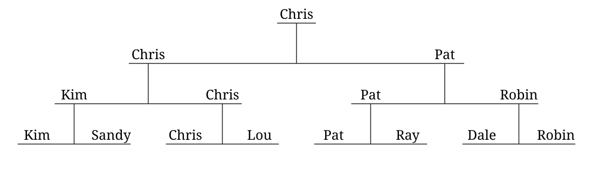

</div></div>

图 22　一场乒乓球锦标赛

图 22 显示 Chris 是八位参赛者中的冠军, 为确定这一事实需要 $8-1=7$ 次比赛／比较. Pat 不一定是亚军. 任何一位被 Chris 击败的选手, 包括第一轮就被击败的 Lou, 都可能是亚军. 可以让 Lou 与 Kim 比赛, 再让这场比赛的胜者与 Pat 比赛, 即可确定亚军. 我们已经记录了先前比赛中获得的结构, 所以只需两场附加比赛就能找出亚军.

一般来说, 我们可以在树的根部 “输出” 选手, 然后重新进行比赛, 就好像这位选手生病而不能很好地发挥竞技水平一样. 于是原来的亚军选手将升到根部, 并在树的上方各级重新计算胜者, 这时只需要改变一条路径. 由此得出, 为选出亚军只需少于 $\lceil\lg N\rceil$ 次附加比较. 同样的过程可以找出第三名、第四名等. 因此, 如前所述, 这种选择排序的总时间大致与 $N\log N$ 成正比.

图 23 给出对我们的 16 个示例数执行树选择排序的过程. 注意, 为了知道在哪里插入下一个 $-\infty$, 我们需要知道根部的键来自哪里. 因此, 树的每个分支结点实际上应包含一个指针或索引, 指出相应键的位置, 而不是键本身. 由此得出, 我们需要存储空间能够容纳 $N$ 条输入记录、$N-1$ 个指针和 $N$ 条输出记录或指向这些记录的指针. (当然, 如果输出结果存储到磁带或磁盘上, 那就不需要在高速存储器中保留输出记录.)

读者看到这里, 应当停下来去做一做习题 10. 因为深入理解树选择的基本原理, 有助于领会我们后面将要讨论的重要改进.

实质上由艾弗森提出的一种修改树选择的方法 [*A Programming Language* (Wiley, 1962), 223–227], 通过 “前瞻” 消除了对指针的需求: 当树的底层中比赛获胜者向上移动时, 在底层它原先位置的值立即以 $-\infty$ 代替. 每当一位获胜者从一个分支上移到另一个分支时, 它空出位置的值可代以最终应上移至该位置的键值 (也就是下面两个键的较大者). 不断重复这个操作就能把图 23(a) 转换为图 24.

以这种方式建立树结构之后, 就可以用 “自上而下” 方法代替图 23 中的 “自下而上” 方法继续排序: 输出根结点, 然后上移它的最大后代, 然后上移后者的最大后代, 以此类推. 这个过程开始变得不太像乒乓球锦标赛, 而更像团体选拔方式.

读者应当能够看出, 这种自上而下方法有一个优势: 可以避免 $-\infty$ 和 $-\infty$ 之间不必要的比较. (自下而上方法会发现后期排序阶段中 $-\infty$ 无处不在, 而在自上而下方法的任一阶段, 只要存储了 $-\infty$ 就会停止修改树结构.)

<a id="pdf-117"></a>
<a id="p-111"></a>

<a id="fig-5-23"></a>

<div class="source-tableau-group" style="overflow-x:auto;max-width:100%"><div style="width:1200px">

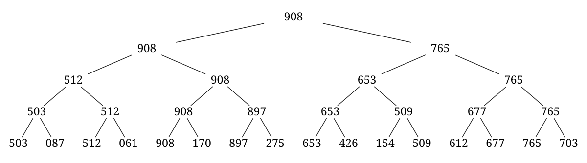

</div></div>

(a) 初始结构

<div class="source-tableau-group" style="overflow-x:auto;max-width:100%"><div style="width:1200px">

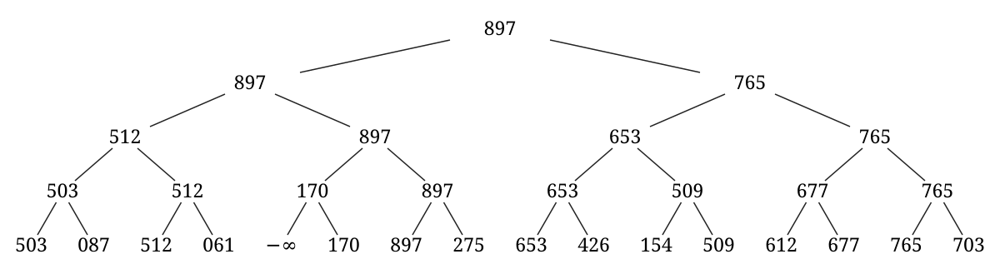

</div></div>

(b) 908 被 $-\infty$ 代替, 第二大的元素移至根部

<div class="source-tableau-group" style="overflow-x:auto;max-width:100%"><div style="width:1200px">

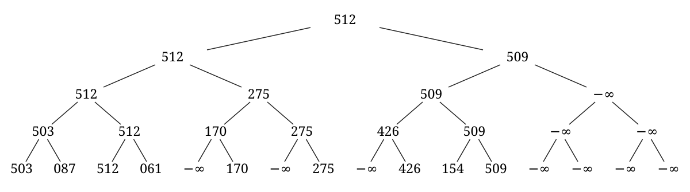

</div></div>

(c) 输出 908、897、765、703、677、653、612 之后的结构

图 23　树选择排序示例

<a id="fig-5-24"></a>

<div class="source-tableau-group" style="overflow-x:auto;max-width:100%"><div style="width:1200px">

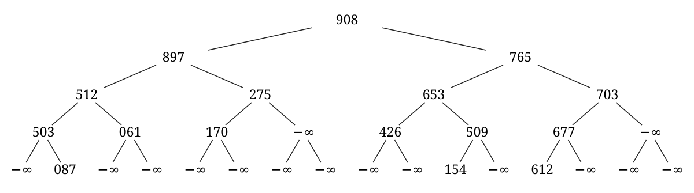

</div></div>

图 24　应用于排序的彼得原理. 在这个层次结构中每个键都会上升到它最终落败的层级上

<a id="pdf-118"></a>
<a id="p-112"></a>

图 23 和图 24 是具有 16 个终端结点的完全二叉树 (见 2.3.4.5 节), 可以很方便地像图 25 那样以连续单元表示这种树. 注意, 结点 $k$ 的父结点是 $\lfloor k/2\rfloor$, 子结点是 $2k$ 和 $2k+1$. 这给出自上而下方法的另一个优点, 因为从结点 $k$ 自上而下到达结点 $2k$ 和 $2k+1$, 比起从结点 $k$ 自下而上到达结点 $k\oplus1$ 和 $\lfloor k/2\rfloor$ 往往要容易得多. (这里 $k\oplus1$ 表示 $k+1$ 或 $k-1$, 取决于 $k$ 是偶数还是奇数.)

<a id="fig-5-25"></a>

<div class="source-tableau-group" style="overflow-x:auto;max-width:100%"><div style="width:1200px">

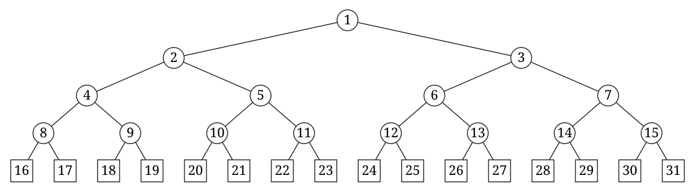

</div></div>

图 25　完全二叉树的顺序存储分配

到目前为止, 我们给出的树选择示例都或多或少地假定 $N$ 是 2 的幂. 但实际上我们可以应对任意 $N$ 值, 因为很容易对任何 $N$ 值构造具有 $N$ 个终端结点的完全二叉树.

现在提出一个关键问题: 在使用自上而下方法时, 能否根本就不用 $-\infty$? 如果图 24 的重要信息都存储在这个完全二叉树的单元 1 至单元 16 中, 而没有包含 $-\infty$ 的无用 “空穴”, 那不是会好一些呢? 稍加思索就会明白, 确实有可能实现这个目标, 不仅可以消除 $-\infty$, 还可以避免对辅助输出区域的需求. 这个思路把我们引向一种重要的排序算法, 也就是其发现者约翰·威廉斯命名的 “堆排序”[*CACM* **7** (1964), 347–348].

**堆排序.** 一个由键 $K_1,K_2,\ldots,K_N$ 组成的文件称为一个堆, 如果

$$
\text{对 }1\le\lfloor j/2\rfloor<j\le N\text{ 有 }K_{\lfloor j/2\rfloor}\ge K_j.\tag{3}
$$

于是 $K_1\ge K_2,K_1\ge K_3,K_2\ge K_4$, 等等. 这恰是在图 24 具有的属性, 而且意味着最大键出现在 “堆的顶端”,

$$
K_1=\max(K_1,K_2,\ldots,K_N).\tag{4}
$$

如果能够设法把任意的输入文件转换为堆, 就可以使用前述自上而下选择过程对元素排序.

弗洛伊德提出了建立堆的高效方法 [*CACM* **7** (1964), 701]. 假定我们已经能够重排文件使得

$$
\text{对 }l<\lfloor j/2\rfloor<j\le N\text{ 有 }K_{\lfloor j/2\rfloor}\ge K_j,\tag{5}
$$

其中 $l$ 是某个 $\ge1$ 的数. (在原始文件中这个条件对于 $l=\lfloor N/2\rfloor$ 显然成立, 因为不存在满足条件 $\lfloor N/2\rfloor<\lfloor j/2\rfloor<j\le N$ 的下标 $j$.) 不难看出应该怎样变换这个文件, 使得式 (5) 中的不等式能够扩展到 $l=\lfloor j/2\rfloor$ 的情形, 从而根结点是 $l$ 的整个子树都符合要求. 随后 $l$ 逐次减 1, 直到最终达到条件 (3). 威廉斯和弗洛伊德的这些思想引出了下面值得仔细研究的优秀算法:


<a id="alg-5-2-3-H"></a>
<a id="pdf-119"></a>
<a id="p-113"></a>

**算法 H (堆排序).** 重新排列记录 $R_1,\ldots,R_N$ 到适当位置, 排序完成后它们的键将处于有序状态: $K_1\le\cdots\le K_N$. 首先重新排列输入文件构成一个堆, 然后重复移动堆的顶结点, 把它传送到正确的最终位置. 假定 $N\ge2$.

**H1.[初始化.]** 置 $l\leftarrow\lfloor N/2\rfloor+1,\ r\leftarrow N$.

**H2.[减小 $l$ 或 $r$.]** 如果 $l>1$, 则置 $l\leftarrow l-1,\ R\leftarrow R_l,\ K\leftarrow K_l$. (如果 $l>1$, 则处于把输入文件变换为堆的过程. 另一方面, 如果 $l=1$, 则键 $K_1K_2\ldots K_r$ 已经构成一个堆.) 否则置 $R\leftarrow R_r,\ K\leftarrow K_r,\ R_r\leftarrow R_1,\ r\leftarrow r-1$, 如果这使得 $r=1$, 则置 $R_1\leftarrow R$, 并终止算法.

**H3.[准备上选.]** 置 $j\leftarrow l$. (这时

$$
\text{对 }l<\lfloor k/2\rfloor<k\le r\text{ 有 }K_{\lfloor k/2\rfloor}\ge K_k,\tag{6}
$$

满足 $r<k\le N$ 的记录 $R_k$ 位于其最终位置. H3–H8 称为上选算法, 它们的效果等价于: 置 $R_l\leftarrow R$, 然后重新排列 $R_l,\ldots,R_r$ 使得条件 (6) 对于 $l=\lfloor k/2\rfloor$ 也成立.)

**H4.[向下进行.]** 置 $i\leftarrow j,\ j\leftarrow2j$. (在以下步骤中, 有 $i=\lfloor j/2\rfloor$.) 如果 $j<r$, 转到 H5. 如果 $j=r$, 转到 H6. 如果 $j>r$, 转到 H8.

**H5.[找较大子结点.]** 如果 $K_j<K_{j+1}$, 则置 $j\leftarrow j+1$.

**H6.[大于 $K$?]** 如果 $K\ge K_j$, 转到 H8.

**H7.[上移.]** 置 $R_i\leftarrow R_j$, 返回 H4.

**H8.[存储 $R$.]** 置 $R_i\leftarrow R$. (这是始于 H3 的上选算法的最后一步.) 返回 H2. ■


<a id="fig-5-26"></a>

<div class="source-tableau-group" style="overflow-x:auto;max-width:100%"><div style="width:1100px">

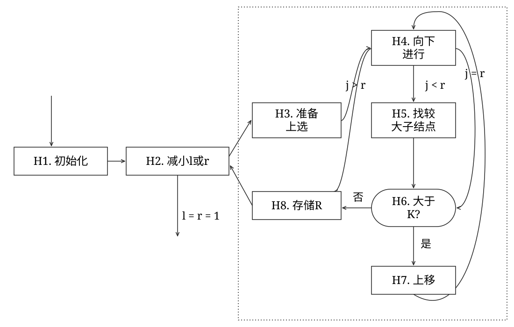

</div></div>

图 26　堆排序 (虚线内是上选算法)

由于 $l$ 和 $r$ 的移动特点, 堆排序有时称为算法. 上三角代表建堆阶段, 此时 $r=N$, $l$ 减小至 1. 下三角代表选择阶段, 此时 $l=1$, $r$ 减小至 1. 表 2 给出对我们的 16 个示例数的堆排序过程. (表中各行是步骤 H2 开始时的状态, 方括号标出 $l$ 和 $r$ 的位置.)

<a id="prog-5-2-3-H"></a>

**程序 H (堆排序).** 用算法 H 对单元 INPUT+1 至 INPUT+N 的记录排序, 寄存器赋值如下: $\mathrm{rI1}\equiv l-1,\ \mathrm{rI2}\equiv r-1,\ \mathrm{rI3}\equiv i,\ \mathrm{rI4}\equiv j,\ \mathrm{rI5}\equiv r-j,\ \mathrm{rA}\equiv K\equiv R,\ \mathrm{rX}\equiv R_j$.

<a id="pdf-120"></a>
<a id="p-114"></a>
<a id="pdf-121"></a>
<a id="p-115"></a>

```mixal
01 START ENT1 N/2            1          H1. 初始化. l ← ⌊N/2⌋+1.
02       ENT2 N-1            1          r ← N.
03 1H    DEC1 1              ⌊N/2⌋     l ← l-1.
04       LDA  INPUT+1,1      ⌊N/2⌋     R ← Rl, K ← Kl.
05 3H    ENT4 1,1            P          H3. 准备上选. j ← l.
06       ENT5 0,2            P
07       DEC5 0,1            P          rI5 ← r-j.
08       JMP  4F             P          转到H4.
09 5H    LDX  INPUT,4        B+A-D      H5. 找较大子结点.
10       CMPX INPUT+1,4      B+A-D
11       JGE  6F             B+A-D      如果Kj ≥ Kj+1，则跳转.
12       INC4 1              C          否则，令j ← j+1.
13       DEC5 1              C
14 9H    LDX  INPUT,4        C+D        rX ← Rj.
15 6H    CMPA INPUT,4        B+A        H6. 大于K?
16       JGE  8F             B+A        如果K ≥ Kj，则转到H8.
17 7H    STX  INPUT,3        B          H7. 上移. Ri ← Rj.
18 4H    ENT3 0,4            B+P        H4. 向下进行. i ← j.
19       DEC5 0,4            B+P        rI5 ← rI5-j.
20       INC4 0,4            B+P        j ← j+j.
21       J5P  5B             B+P        如果j < r，则转到H5.
22       J5Z  9B             P-A+D      如果j = r，则转到H6.
23 8H    STA  INPUT,3        P          H8. 存储R. Ri ← R.
24 2H    J1P  1B             P          H2. 减小l或r.
25       LDA  INPUT+1,2      N-1        如果l=1，则令R ← Rr, K ← Kr.
26       LDX  INPUT+1        N-1
27       STX  INPUT+1,2      N-1        Rr ← R1.
28       DEC2 1              N-1        r ← r-1.
29       J2P  3B             N-1        如果r > 1，则转到H3.
30       STA  INPUT+1        1          R1 ← R.
```


<a id="tab-5-2-3-2"></a>

表 2　堆排序示例

<table data-heap-table="2" style="border-collapse:collapse;table-layout:fixed;width:1176px;font-family:serif"><thead><tr><th style="width:68px;min-width:68px;border:0;border-bottom:1px solid #222;padding:4px 0">$K_{1}$</th><th style="width:68px;min-width:68px;border:0;border-bottom:1px solid #222;padding:4px 0">$K_{2}$</th><th style="width:68px;min-width:68px;border:0;border-bottom:1px solid #222;padding:4px 0">$K_{3}$</th><th style="width:68px;min-width:68px;border:0;border-bottom:1px solid #222;padding:4px 0">$K_{4}$</th><th style="width:68px;min-width:68px;border:0;border-bottom:1px solid #222;padding:4px 0">$K_{5}$</th><th style="width:68px;min-width:68px;border:0;border-bottom:1px solid #222;padding:4px 0">$K_{6}$</th><th style="width:68px;min-width:68px;border:0;border-bottom:1px solid #222;padding:4px 0">$K_{7}$</th><th style="width:68px;min-width:68px;border:0;border-bottom:1px solid #222;padding:4px 0">$K_{8}$</th><th style="width:68px;min-width:68px;border:0;border-bottom:1px solid #222;padding:4px 0">$K_{9}$</th><th style="width:68px;min-width:68px;border:0;border-bottom:1px solid #222;padding:4px 0">$K_{10}$</th><th style="width:68px;min-width:68px;border:0;border-bottom:1px solid #222;padding:4px 0">$K_{11}$</th><th style="width:68px;min-width:68px;border:0;border-bottom:1px solid #222;padding:4px 0">$K_{12}$</th><th style="width:68px;min-width:68px;border:0;border-bottom:1px solid #222;padding:4px 0">$K_{13}$</th><th style="width:68px;min-width:68px;border:0;border-bottom:1px solid #222;padding:4px 0">$K_{14}$</th><th style="width:68px;min-width:68px;border:0;border-bottom:1px solid #222;padding:4px 0">$K_{15}$</th><th style="width:68px;min-width:68px;border:0;border-bottom:1px solid #222;padding:4px 0">$K_{16}$</th><th style="width:44px;min-width:44px;border:0;border-bottom:1px solid #222;padding:4px 0">$l$</th><th style="width:44px;min-width:44px;border:0;border-bottom:1px solid #222;padding:4px 0">$r$</th></tr></thead><tbody>
<tr data-heap-state="0" style="background:transparent"><td data-heap-key="1" style="width:68px;min-width:68px;border:0;padding:4px 0;text-align:center">503</td><td data-heap-key="2" style="width:68px;min-width:68px;border:0;padding:4px 0;text-align:center">087</td><td data-heap-key="3" style="width:68px;min-width:68px;border:0;padding:4px 0;text-align:center">512</td><td data-heap-key="4" style="width:68px;min-width:68px;border:0;padding:4px 0;text-align:center">061</td><td data-heap-key="5" style="width:68px;min-width:68px;border:0;padding:4px 0;text-align:center">908</td><td data-heap-key="6" style="width:68px;min-width:68px;border:0;padding:4px 0;text-align:center">170</td><td data-heap-key="7" style="width:68px;min-width:68px;border:0;padding:4px 0;text-align:center">897</td><td data-heap-key="8" style="width:68px;min-width:68px;border:0;padding:4px 0;text-align:center">275</td><td data-heap-key="9" style="width:68px;min-width:68px;border:0;padding:4px 0;text-align:center">[653</td><td data-heap-key="10" style="width:68px;min-width:68px;border:0;padding:4px 0;text-align:center">426</td><td data-heap-key="11" style="width:68px;min-width:68px;border:0;padding:4px 0;text-align:center">154</td><td data-heap-key="12" style="width:68px;min-width:68px;border:0;padding:4px 0;text-align:center">509</td><td data-heap-key="13" style="width:68px;min-width:68px;border:0;padding:4px 0;text-align:center">612</td><td data-heap-key="14" style="width:68px;min-width:68px;border:0;padding:4px 0;text-align:center">677</td><td data-heap-key="15" style="width:68px;min-width:68px;border:0;padding:4px 0;text-align:center">765</td><td data-heap-key="16" style="width:68px;min-width:68px;border:0;padding:4px 0;text-align:center">703]</td><td style="width:44px;min-width:44px;border:0;padding:4px 0;text-align:center">9</td><td style="width:44px;min-width:44px;border:0;padding:4px 0;text-align:center">16</td></tr>
<tr data-heap-state="1" style="background:transparent"><td data-heap-key="1" style="width:68px;min-width:68px;border:0;padding:4px 0;text-align:center">503</td><td data-heap-key="2" style="width:68px;min-width:68px;border:0;padding:4px 0;text-align:center">087</td><td data-heap-key="3" style="width:68px;min-width:68px;border:0;padding:4px 0;text-align:center">512</td><td data-heap-key="4" style="width:68px;min-width:68px;border:0;padding:4px 0;text-align:center">061</td><td data-heap-key="5" style="width:68px;min-width:68px;border:0;padding:4px 0;text-align:center">908</td><td data-heap-key="6" style="width:68px;min-width:68px;border:0;padding:4px 0;text-align:center">170</td><td data-heap-key="7" style="width:68px;min-width:68px;border:0;padding:4px 0;text-align:center">897</td><td data-heap-key="8" style="width:68px;min-width:68px;border:0;padding:4px 0;text-align:center">[703</td><td data-heap-key="9" style="width:68px;min-width:68px;border:0;padding:4px 0;text-align:center">653</td><td data-heap-key="10" style="width:68px;min-width:68px;border:0;padding:4px 0;text-align:center">426</td><td data-heap-key="11" style="width:68px;min-width:68px;border:0;padding:4px 0;text-align:center">154</td><td data-heap-key="12" style="width:68px;min-width:68px;border:0;padding:4px 0;text-align:center">509</td><td data-heap-key="13" style="width:68px;min-width:68px;border:0;padding:4px 0;text-align:center">612</td><td data-heap-key="14" style="width:68px;min-width:68px;border:0;padding:4px 0;text-align:center">677</td><td data-heap-key="15" style="width:68px;min-width:68px;border:0;padding:4px 0;text-align:center">765</td><td data-heap-key="16" style="width:68px;min-width:68px;border:0;padding:4px 0;text-align:center">275]</td><td style="width:44px;min-width:44px;border:0;padding:4px 0;text-align:center">8</td><td style="width:44px;min-width:44px;border:0;padding:4px 0;text-align:center">16</td></tr>
<tr data-heap-state="2" style="background:transparent"><td data-heap-key="1" style="width:68px;min-width:68px;border:0;padding:4px 0;text-align:center">503</td><td data-heap-key="2" style="width:68px;min-width:68px;border:0;padding:4px 0;text-align:center">087</td><td data-heap-key="3" style="width:68px;min-width:68px;border:0;padding:4px 0;text-align:center">512</td><td data-heap-key="4" style="width:68px;min-width:68px;border:0;padding:4px 0;text-align:center">061</td><td data-heap-key="5" style="width:68px;min-width:68px;border:0;padding:4px 0;text-align:center">908</td><td data-heap-key="6" style="width:68px;min-width:68px;border:0;padding:4px 0;text-align:center">170</td><td data-heap-key="7" style="width:68px;min-width:68px;border:0;padding:4px 0;text-align:center">[897</td><td data-heap-key="8" style="width:68px;min-width:68px;border:0;padding:4px 0;text-align:center">703</td><td data-heap-key="9" style="width:68px;min-width:68px;border:0;padding:4px 0;text-align:center">653</td><td data-heap-key="10" style="width:68px;min-width:68px;border:0;padding:4px 0;text-align:center">426</td><td data-heap-key="11" style="width:68px;min-width:68px;border:0;padding:4px 0;text-align:center">154</td><td data-heap-key="12" style="width:68px;min-width:68px;border:0;padding:4px 0;text-align:center">509</td><td data-heap-key="13" style="width:68px;min-width:68px;border:0;padding:4px 0;text-align:center">612</td><td data-heap-key="14" style="width:68px;min-width:68px;border:0;padding:4px 0;text-align:center">677</td><td data-heap-key="15" style="width:68px;min-width:68px;border:0;padding:4px 0;text-align:center">765</td><td data-heap-key="16" style="width:68px;min-width:68px;border:0;padding:4px 0;text-align:center">275]</td><td style="width:44px;min-width:44px;border:0;padding:4px 0;text-align:center">7</td><td style="width:44px;min-width:44px;border:0;padding:4px 0;text-align:center">16</td></tr>
<tr data-heap-state="3" style="background:transparent"><td data-heap-key="1" style="width:68px;min-width:68px;border:0;padding:4px 0;text-align:center">503</td><td data-heap-key="2" style="width:68px;min-width:68px;border:0;padding:4px 0;text-align:center">087</td><td data-heap-key="3" style="width:68px;min-width:68px;border:0;padding:4px 0;text-align:center">512</td><td data-heap-key="4" style="width:68px;min-width:68px;border:0;padding:4px 0;text-align:center">061</td><td data-heap-key="5" style="width:68px;min-width:68px;border:0;padding:4px 0;text-align:center">908</td><td data-heap-key="6" style="width:68px;min-width:68px;border:0;padding:4px 0;text-align:center">[612</td><td data-heap-key="7" style="width:68px;min-width:68px;border:0;padding:4px 0;text-align:center">897</td><td data-heap-key="8" style="width:68px;min-width:68px;border:0;padding:4px 0;text-align:center">703</td><td data-heap-key="9" style="width:68px;min-width:68px;border:0;padding:4px 0;text-align:center">653</td><td data-heap-key="10" style="width:68px;min-width:68px;border:0;padding:4px 0;text-align:center">426</td><td data-heap-key="11" style="width:68px;min-width:68px;border:0;padding:4px 0;text-align:center">154</td><td data-heap-key="12" style="width:68px;min-width:68px;border:0;padding:4px 0;text-align:center">509</td><td data-heap-key="13" style="width:68px;min-width:68px;border:0;padding:4px 0;text-align:center">170</td><td data-heap-key="14" style="width:68px;min-width:68px;border:0;padding:4px 0;text-align:center">677</td><td data-heap-key="15" style="width:68px;min-width:68px;border:0;padding:4px 0;text-align:center">765</td><td data-heap-key="16" style="width:68px;min-width:68px;border:0;padding:4px 0;text-align:center">275]</td><td style="width:44px;min-width:44px;border:0;padding:4px 0;text-align:center">6</td><td style="width:44px;min-width:44px;border:0;padding:4px 0;text-align:center">16</td></tr>
<tr data-heap-state="4" style="background:transparent"><td data-heap-key="1" style="width:68px;min-width:68px;border:0;padding:4px 0;text-align:center">503</td><td data-heap-key="2" style="width:68px;min-width:68px;border:0;padding:4px 0;text-align:center">087</td><td data-heap-key="3" style="width:68px;min-width:68px;border:0;padding:4px 0;text-align:center">512</td><td data-heap-key="4" style="width:68px;min-width:68px;border:0;padding:4px 0;text-align:center">061</td><td data-heap-key="5" style="width:68px;min-width:68px;border:0;padding:4px 0;text-align:center">[908</td><td data-heap-key="6" style="width:68px;min-width:68px;border:0;padding:4px 0;text-align:center">612</td><td data-heap-key="7" style="width:68px;min-width:68px;border:0;padding:4px 0;text-align:center">897</td><td data-heap-key="8" style="width:68px;min-width:68px;border:0;padding:4px 0;text-align:center">703</td><td data-heap-key="9" style="width:68px;min-width:68px;border:0;padding:4px 0;text-align:center">653</td><td data-heap-key="10" style="width:68px;min-width:68px;border:0;padding:4px 0;text-align:center">426</td><td data-heap-key="11" style="width:68px;min-width:68px;border:0;padding:4px 0;text-align:center">154</td><td data-heap-key="12" style="width:68px;min-width:68px;border:0;padding:4px 0;text-align:center">509</td><td data-heap-key="13" style="width:68px;min-width:68px;border:0;padding:4px 0;text-align:center">170</td><td data-heap-key="14" style="width:68px;min-width:68px;border:0;padding:4px 0;text-align:center">677</td><td data-heap-key="15" style="width:68px;min-width:68px;border:0;padding:4px 0;text-align:center">765</td><td data-heap-key="16" style="width:68px;min-width:68px;border:0;padding:4px 0;text-align:center">275]</td><td style="width:44px;min-width:44px;border:0;padding:4px 0;text-align:center">5</td><td style="width:44px;min-width:44px;border:0;padding:4px 0;text-align:center">16</td></tr>
<tr data-heap-state="5" style="background:transparent"><td data-heap-key="1" style="width:68px;min-width:68px;border:0;padding:4px 0;text-align:center">503</td><td data-heap-key="2" style="width:68px;min-width:68px;border:0;padding:4px 0;text-align:center">087</td><td data-heap-key="3" style="width:68px;min-width:68px;border:0;padding:4px 0;text-align:center">512</td><td data-heap-key="4" style="width:68px;min-width:68px;border:0;padding:4px 0;text-align:center">[703</td><td data-heap-key="5" style="width:68px;min-width:68px;border:0;padding:4px 0;text-align:center">908</td><td data-heap-key="6" style="width:68px;min-width:68px;border:0;padding:4px 0;text-align:center">612</td><td data-heap-key="7" style="width:68px;min-width:68px;border:0;padding:4px 0;text-align:center">897</td><td data-heap-key="8" style="width:68px;min-width:68px;border:0;padding:4px 0;text-align:center">275</td><td data-heap-key="9" style="width:68px;min-width:68px;border:0;padding:4px 0;text-align:center">653</td><td data-heap-key="10" style="width:68px;min-width:68px;border:0;padding:4px 0;text-align:center">426</td><td data-heap-key="11" style="width:68px;min-width:68px;border:0;padding:4px 0;text-align:center">154</td><td data-heap-key="12" style="width:68px;min-width:68px;border:0;padding:4px 0;text-align:center">509</td><td data-heap-key="13" style="width:68px;min-width:68px;border:0;padding:4px 0;text-align:center">170</td><td data-heap-key="14" style="width:68px;min-width:68px;border:0;padding:4px 0;text-align:center">677</td><td data-heap-key="15" style="width:68px;min-width:68px;border:0;padding:4px 0;text-align:center">765</td><td data-heap-key="16" style="width:68px;min-width:68px;border:0;padding:4px 0;text-align:center">061]</td><td style="width:44px;min-width:44px;border:0;padding:4px 0;text-align:center">4</td><td style="width:44px;min-width:44px;border:0;padding:4px 0;text-align:center">16</td></tr>
<tr data-heap-state="6" style="background:transparent"><td data-heap-key="1" style="width:68px;min-width:68px;border:0;padding:4px 0;text-align:center">503</td><td data-heap-key="2" style="width:68px;min-width:68px;border:0;padding:4px 0;text-align:center">087</td><td data-heap-key="3" style="width:68px;min-width:68px;border:0;padding:4px 0;text-align:center">[897</td><td data-heap-key="4" style="width:68px;min-width:68px;border:0;padding:4px 0;text-align:center">703</td><td data-heap-key="5" style="width:68px;min-width:68px;border:0;padding:4px 0;text-align:center">908</td><td data-heap-key="6" style="width:68px;min-width:68px;border:0;padding:4px 0;text-align:center">612</td><td data-heap-key="7" style="width:68px;min-width:68px;border:0;padding:4px 0;text-align:center">765</td><td data-heap-key="8" style="width:68px;min-width:68px;border:0;padding:4px 0;text-align:center">275</td><td data-heap-key="9" style="width:68px;min-width:68px;border:0;padding:4px 0;text-align:center">653</td><td data-heap-key="10" style="width:68px;min-width:68px;border:0;padding:4px 0;text-align:center">426</td><td data-heap-key="11" style="width:68px;min-width:68px;border:0;padding:4px 0;text-align:center">154</td><td data-heap-key="12" style="width:68px;min-width:68px;border:0;padding:4px 0;text-align:center">509</td><td data-heap-key="13" style="width:68px;min-width:68px;border:0;padding:4px 0;text-align:center">170</td><td data-heap-key="14" style="width:68px;min-width:68px;border:0;padding:4px 0;text-align:center">677</td><td data-heap-key="15" style="width:68px;min-width:68px;border:0;padding:4px 0;text-align:center">512</td><td data-heap-key="16" style="width:68px;min-width:68px;border:0;padding:4px 0;text-align:center">061]</td><td style="width:44px;min-width:44px;border:0;padding:4px 0;text-align:center">3</td><td style="width:44px;min-width:44px;border:0;padding:4px 0;text-align:center">16</td></tr>
<tr data-heap-state="7" style="background:transparent"><td data-heap-key="1" style="width:68px;min-width:68px;border:0;padding:4px 0;text-align:center">503</td><td data-heap-key="2" style="width:68px;min-width:68px;border:0;padding:4px 0;text-align:center">[908</td><td data-heap-key="3" style="width:68px;min-width:68px;border:0;padding:4px 0;text-align:center">897</td><td data-heap-key="4" style="width:68px;min-width:68px;border:0;padding:4px 0;text-align:center">703</td><td data-heap-key="5" style="width:68px;min-width:68px;border:0;padding:4px 0;text-align:center">426</td><td data-heap-key="6" style="width:68px;min-width:68px;border:0;padding:4px 0;text-align:center">612</td><td data-heap-key="7" style="width:68px;min-width:68px;border:0;padding:4px 0;text-align:center">765</td><td data-heap-key="8" style="width:68px;min-width:68px;border:0;padding:4px 0;text-align:center">275</td><td data-heap-key="9" style="width:68px;min-width:68px;border:0;padding:4px 0;text-align:center">653</td><td data-heap-key="10" style="width:68px;min-width:68px;border:0;padding:4px 0;text-align:center">087</td><td data-heap-key="11" style="width:68px;min-width:68px;border:0;padding:4px 0;text-align:center">154</td><td data-heap-key="12" style="width:68px;min-width:68px;border:0;padding:4px 0;text-align:center">509</td><td data-heap-key="13" style="width:68px;min-width:68px;border:0;padding:4px 0;text-align:center">170</td><td data-heap-key="14" style="width:68px;min-width:68px;border:0;padding:4px 0;text-align:center">677</td><td data-heap-key="15" style="width:68px;min-width:68px;border:0;padding:4px 0;text-align:center">512</td><td data-heap-key="16" style="width:68px;min-width:68px;border:0;padding:4px 0;text-align:center">061]</td><td style="width:44px;min-width:44px;border:0;padding:4px 0;text-align:center">2</td><td style="width:44px;min-width:44px;border:0;padding:4px 0;text-align:center">16</td></tr>
<tr data-heap-state="8" style="background:transparent"><td data-heap-key="1" style="width:68px;min-width:68px;border:0;padding:4px 0;text-align:center">[908</td><td data-heap-key="2" style="width:68px;min-width:68px;border:0;padding:4px 0;text-align:center">703</td><td data-heap-key="3" style="width:68px;min-width:68px;border:0;padding:4px 0;text-align:center">897</td><td data-heap-key="4" style="width:68px;min-width:68px;border:0;padding:4px 0;text-align:center">653</td><td data-heap-key="5" style="width:68px;min-width:68px;border:0;padding:4px 0;text-align:center">426</td><td data-heap-key="6" style="width:68px;min-width:68px;border:0;padding:4px 0;text-align:center">612</td><td data-heap-key="7" style="width:68px;min-width:68px;border:0;padding:4px 0;text-align:center">765</td><td data-heap-key="8" style="width:68px;min-width:68px;border:0;padding:4px 0;text-align:center">275</td><td data-heap-key="9" style="width:68px;min-width:68px;border:0;padding:4px 0;text-align:center">503</td><td data-heap-key="10" style="width:68px;min-width:68px;border:0;padding:4px 0;text-align:center">087</td><td data-heap-key="11" style="width:68px;min-width:68px;border:0;padding:4px 0;text-align:center">154</td><td data-heap-key="12" style="width:68px;min-width:68px;border:0;padding:4px 0;text-align:center">509</td><td data-heap-key="13" style="width:68px;min-width:68px;border:0;padding:4px 0;text-align:center">170</td><td data-heap-key="14" style="width:68px;min-width:68px;border:0;padding:4px 0;text-align:center">677</td><td data-heap-key="15" style="width:68px;min-width:68px;border:0;padding:4px 0;text-align:center">512</td><td data-heap-key="16" style="width:68px;min-width:68px;border:0;padding:4px 0;text-align:center">061]</td><td style="width:44px;min-width:44px;border:0;padding:4px 0;text-align:center">1</td><td style="width:44px;min-width:44px;border:0;padding:4px 0;text-align:center">16</td></tr>
<tr data-heap-state="9" style="background:transparent"><td data-heap-key="1" style="width:68px;min-width:68px;border:0;padding:4px 0;text-align:center">[897</td><td data-heap-key="2" style="width:68px;min-width:68px;border:0;padding:4px 0;text-align:center">703</td><td data-heap-key="3" style="width:68px;min-width:68px;border:0;padding:4px 0;text-align:center">765</td><td data-heap-key="4" style="width:68px;min-width:68px;border:0;padding:4px 0;text-align:center">653</td><td data-heap-key="5" style="width:68px;min-width:68px;border:0;padding:4px 0;text-align:center">426</td><td data-heap-key="6" style="width:68px;min-width:68px;border:0;padding:4px 0;text-align:center">612</td><td data-heap-key="7" style="width:68px;min-width:68px;border:0;padding:4px 0;text-align:center">677</td><td data-heap-key="8" style="width:68px;min-width:68px;border:0;padding:4px 0;text-align:center">275</td><td data-heap-key="9" style="width:68px;min-width:68px;border:0;padding:4px 0;text-align:center">503</td><td data-heap-key="10" style="width:68px;min-width:68px;border:0;padding:4px 0;text-align:center">087</td><td data-heap-key="11" style="width:68px;min-width:68px;border:0;padding:4px 0;text-align:center">154</td><td data-heap-key="12" style="width:68px;min-width:68px;border:0;padding:4px 0;text-align:center">509</td><td data-heap-key="13" style="width:68px;min-width:68px;border:0;padding:4px 0;text-align:center">170</td><td data-heap-key="14" style="width:68px;min-width:68px;border:0;padding:4px 0;text-align:center">061</td><td data-heap-key="15" style="width:68px;min-width:68px;border:0;padding:4px 0;text-align:center">512]</td><td data-heap-key="16" style="width:68px;min-width:68px;border:0;padding:4px 0;text-align:center">908</td><td style="width:44px;min-width:44px;border:0;padding:4px 0;text-align:center">1</td><td style="width:44px;min-width:44px;border:0;padding:4px 0;text-align:center">15</td></tr>
<tr data-heap-state="10" style="background:transparent"><td data-heap-key="1" style="width:68px;min-width:68px;border:0;padding:4px 0;text-align:center">[765</td><td data-heap-key="2" style="width:68px;min-width:68px;border:0;padding:4px 0;text-align:center">703</td><td data-heap-key="3" style="width:68px;min-width:68px;border:0;padding:4px 0;text-align:center">677</td><td data-heap-key="4" style="width:68px;min-width:68px;border:0;padding:4px 0;text-align:center">653</td><td data-heap-key="5" style="width:68px;min-width:68px;border:0;padding:4px 0;text-align:center">426</td><td data-heap-key="6" style="width:68px;min-width:68px;border:0;padding:4px 0;text-align:center">612</td><td data-heap-key="7" style="width:68px;min-width:68px;border:0;padding:4px 0;text-align:center">512</td><td data-heap-key="8" style="width:68px;min-width:68px;border:0;padding:4px 0;text-align:center">275</td><td data-heap-key="9" style="width:68px;min-width:68px;border:0;padding:4px 0;text-align:center">503</td><td data-heap-key="10" style="width:68px;min-width:68px;border:0;padding:4px 0;text-align:center">087</td><td data-heap-key="11" style="width:68px;min-width:68px;border:0;padding:4px 0;text-align:center">154</td><td data-heap-key="12" style="width:68px;min-width:68px;border:0;padding:4px 0;text-align:center">509</td><td data-heap-key="13" style="width:68px;min-width:68px;border:0;padding:4px 0;text-align:center">170</td><td data-heap-key="14" style="width:68px;min-width:68px;border:0;padding:4px 0;text-align:center">061]</td><td data-heap-key="15" style="width:68px;min-width:68px;border:0;padding:4px 0;text-align:center">897</td><td data-heap-key="16" style="width:68px;min-width:68px;border:0;padding:4px 0;text-align:center">908</td><td style="width:44px;min-width:44px;border:0;padding:4px 0;text-align:center">1</td><td style="width:44px;min-width:44px;border:0;padding:4px 0;text-align:center">14</td></tr>
<tr data-heap-state="11" style="background:transparent"><td data-heap-key="1" style="width:68px;min-width:68px;border:0;padding:4px 0;text-align:center">[703</td><td data-heap-key="2" style="width:68px;min-width:68px;border:0;padding:4px 0;text-align:center">653</td><td data-heap-key="3" style="width:68px;min-width:68px;border:0;padding:4px 0;text-align:center">677</td><td data-heap-key="4" style="width:68px;min-width:68px;border:0;padding:4px 0;text-align:center">503</td><td data-heap-key="5" style="width:68px;min-width:68px;border:0;padding:4px 0;text-align:center">426</td><td data-heap-key="6" style="width:68px;min-width:68px;border:0;padding:4px 0;text-align:center">612</td><td data-heap-key="7" style="width:68px;min-width:68px;border:0;padding:4px 0;text-align:center">512</td><td data-heap-key="8" style="width:68px;min-width:68px;border:0;padding:4px 0;text-align:center">275</td><td data-heap-key="9" style="width:68px;min-width:68px;border:0;padding:4px 0;text-align:center">061</td><td data-heap-key="10" style="width:68px;min-width:68px;border:0;padding:4px 0;text-align:center">087</td><td data-heap-key="11" style="width:68px;min-width:68px;border:0;padding:4px 0;text-align:center">154</td><td data-heap-key="12" style="width:68px;min-width:68px;border:0;padding:4px 0;text-align:center">509</td><td data-heap-key="13" style="width:68px;min-width:68px;border:0;padding:4px 0;text-align:center">170]</td><td data-heap-key="14" style="width:68px;min-width:68px;border:0;padding:4px 0;text-align:center">765</td><td data-heap-key="15" style="width:68px;min-width:68px;border:0;padding:4px 0;text-align:center">897</td><td data-heap-key="16" style="width:68px;min-width:68px;border:0;padding:4px 0;text-align:center">908</td><td style="width:44px;min-width:44px;border:0;padding:4px 0;text-align:center">1</td><td style="width:44px;min-width:44px;border:0;padding:4px 0;text-align:center">13</td></tr>
<tr data-heap-state="12" style="background:transparent"><td data-heap-key="1" style="width:68px;min-width:68px;border:0;padding:4px 0;text-align:center">[677</td><td data-heap-key="2" style="width:68px;min-width:68px;border:0;padding:4px 0;text-align:center">653</td><td data-heap-key="3" style="width:68px;min-width:68px;border:0;padding:4px 0;text-align:center">612</td><td data-heap-key="4" style="width:68px;min-width:68px;border:0;padding:4px 0;text-align:center">503</td><td data-heap-key="5" style="width:68px;min-width:68px;border:0;padding:4px 0;text-align:center">426</td><td data-heap-key="6" style="width:68px;min-width:68px;border:0;padding:4px 0;text-align:center">509</td><td data-heap-key="7" style="width:68px;min-width:68px;border:0;padding:4px 0;text-align:center">512</td><td data-heap-key="8" style="width:68px;min-width:68px;border:0;padding:4px 0;text-align:center">275</td><td data-heap-key="9" style="width:68px;min-width:68px;border:0;padding:4px 0;text-align:center">061</td><td data-heap-key="10" style="width:68px;min-width:68px;border:0;padding:4px 0;text-align:center">087</td><td data-heap-key="11" style="width:68px;min-width:68px;border:0;padding:4px 0;text-align:center">154</td><td data-heap-key="12" style="width:68px;min-width:68px;border:0;padding:4px 0;text-align:center">170]</td><td data-heap-key="13" style="width:68px;min-width:68px;border:0;padding:4px 0;text-align:center">703</td><td data-heap-key="14" style="width:68px;min-width:68px;border:0;padding:4px 0;text-align:center">765</td><td data-heap-key="15" style="width:68px;min-width:68px;border:0;padding:4px 0;text-align:center">897</td><td data-heap-key="16" style="width:68px;min-width:68px;border:0;padding:4px 0;text-align:center">908</td><td style="width:44px;min-width:44px;border:0;padding:4px 0;text-align:center">1</td><td style="width:44px;min-width:44px;border:0;padding:4px 0;text-align:center">12</td></tr>
<tr data-heap-state="13" style="background:transparent"><td data-heap-key="1" style="width:68px;min-width:68px;border:0;padding:4px 0;text-align:center">[653</td><td data-heap-key="2" style="width:68px;min-width:68px;border:0;padding:4px 0;text-align:center">503</td><td data-heap-key="3" style="width:68px;min-width:68px;border:0;padding:4px 0;text-align:center">612</td><td data-heap-key="4" style="width:68px;min-width:68px;border:0;padding:4px 0;text-align:center">275</td><td data-heap-key="5" style="width:68px;min-width:68px;border:0;padding:4px 0;text-align:center">426</td><td data-heap-key="6" style="width:68px;min-width:68px;border:0;padding:4px 0;text-align:center">509</td><td data-heap-key="7" style="width:68px;min-width:68px;border:0;padding:4px 0;text-align:center">512</td><td data-heap-key="8" style="width:68px;min-width:68px;border:0;padding:4px 0;text-align:center">170</td><td data-heap-key="9" style="width:68px;min-width:68px;border:0;padding:4px 0;text-align:center">061</td><td data-heap-key="10" style="width:68px;min-width:68px;border:0;padding:4px 0;text-align:center">087</td><td data-heap-key="11" style="width:68px;min-width:68px;border:0;padding:4px 0;text-align:center">154]</td><td data-heap-key="12" style="width:68px;min-width:68px;border:0;padding:4px 0;text-align:center">677</td><td data-heap-key="13" style="width:68px;min-width:68px;border:0;padding:4px 0;text-align:center">703</td><td data-heap-key="14" style="width:68px;min-width:68px;border:0;padding:4px 0;text-align:center">765</td><td data-heap-key="15" style="width:68px;min-width:68px;border:0;padding:4px 0;text-align:center">897</td><td data-heap-key="16" style="width:68px;min-width:68px;border:0;padding:4px 0;text-align:center">908</td><td style="width:44px;min-width:44px;border:0;padding:4px 0;text-align:center">1</td><td style="width:44px;min-width:44px;border:0;padding:4px 0;text-align:center">11</td></tr>
<tr data-heap-state="14" style="background:transparent"><td data-heap-key="1" style="width:68px;min-width:68px;border:0;padding:4px 0;text-align:center">[612</td><td data-heap-key="2" style="width:68px;min-width:68px;border:0;padding:4px 0;text-align:center">503</td><td data-heap-key="3" style="width:68px;min-width:68px;border:0;padding:4px 0;text-align:center">512</td><td data-heap-key="4" style="width:68px;min-width:68px;border:0;padding:4px 0;text-align:center">275</td><td data-heap-key="5" style="width:68px;min-width:68px;border:0;padding:4px 0;text-align:center">426</td><td data-heap-key="6" style="width:68px;min-width:68px;border:0;padding:4px 0;text-align:center">509</td><td data-heap-key="7" style="width:68px;min-width:68px;border:0;padding:4px 0;text-align:center">154</td><td data-heap-key="8" style="width:68px;min-width:68px;border:0;padding:4px 0;text-align:center">170</td><td data-heap-key="9" style="width:68px;min-width:68px;border:0;padding:4px 0;text-align:center">061</td><td data-heap-key="10" style="width:68px;min-width:68px;border:0;padding:4px 0;text-align:center">087]</td><td data-heap-key="11" style="width:68px;min-width:68px;border:0;padding:4px 0;text-align:center">653</td><td data-heap-key="12" style="width:68px;min-width:68px;border:0;padding:4px 0;text-align:center">677</td><td data-heap-key="13" style="width:68px;min-width:68px;border:0;padding:4px 0;text-align:center">703</td><td data-heap-key="14" style="width:68px;min-width:68px;border:0;padding:4px 0;text-align:center">765</td><td data-heap-key="15" style="width:68px;min-width:68px;border:0;padding:4px 0;text-align:center">897</td><td data-heap-key="16" style="width:68px;min-width:68px;border:0;padding:4px 0;text-align:center">908</td><td style="width:44px;min-width:44px;border:0;padding:4px 0;text-align:center">1</td><td style="width:44px;min-width:44px;border:0;padding:4px 0;text-align:center">10</td></tr>
<tr data-heap-state="15" style="background:transparent"><td data-heap-key="1" style="width:68px;min-width:68px;border:0;padding:4px 0;text-align:center">[512</td><td data-heap-key="2" style="width:68px;min-width:68px;border:0;padding:4px 0;text-align:center">503</td><td data-heap-key="3" style="width:68px;min-width:68px;border:0;padding:4px 0;text-align:center">509</td><td data-heap-key="4" style="width:68px;min-width:68px;border:0;padding:4px 0;text-align:center">275</td><td data-heap-key="5" style="width:68px;min-width:68px;border:0;padding:4px 0;text-align:center">426</td><td data-heap-key="6" style="width:68px;min-width:68px;border:0;padding:4px 0;text-align:center">087</td><td data-heap-key="7" style="width:68px;min-width:68px;border:0;padding:4px 0;text-align:center">154</td><td data-heap-key="8" style="width:68px;min-width:68px;border:0;padding:4px 0;text-align:center">170</td><td data-heap-key="9" style="width:68px;min-width:68px;border:0;padding:4px 0;text-align:center">061]</td><td data-heap-key="10" style="width:68px;min-width:68px;border:0;padding:4px 0;text-align:center">612</td><td data-heap-key="11" style="width:68px;min-width:68px;border:0;padding:4px 0;text-align:center">653</td><td data-heap-key="12" style="width:68px;min-width:68px;border:0;padding:4px 0;text-align:center">677</td><td data-heap-key="13" style="width:68px;min-width:68px;border:0;padding:4px 0;text-align:center">703</td><td data-heap-key="14" style="width:68px;min-width:68px;border:0;padding:4px 0;text-align:center">765</td><td data-heap-key="15" style="width:68px;min-width:68px;border:0;padding:4px 0;text-align:center">897</td><td data-heap-key="16" style="width:68px;min-width:68px;border:0;padding:4px 0;text-align:center">908</td><td style="width:44px;min-width:44px;border:0;padding:4px 0;text-align:center">1</td><td style="width:44px;min-width:44px;border:0;padding:4px 0;text-align:center">9</td></tr>
<tr data-heap-state="16" style="background:transparent"><td data-heap-key="1" style="width:68px;min-width:68px;border:0;padding:4px 0;text-align:center">[509</td><td data-heap-key="2" style="width:68px;min-width:68px;border:0;padding:4px 0;text-align:center">503</td><td data-heap-key="3" style="width:68px;min-width:68px;border:0;padding:4px 0;text-align:center">154</td><td data-heap-key="4" style="width:68px;min-width:68px;border:0;padding:4px 0;text-align:center">275</td><td data-heap-key="5" style="width:68px;min-width:68px;border:0;padding:4px 0;text-align:center">426</td><td data-heap-key="6" style="width:68px;min-width:68px;border:0;padding:4px 0;text-align:center">087</td><td data-heap-key="7" style="width:68px;min-width:68px;border:0;padding:4px 0;text-align:center">061</td><td data-heap-key="8" style="width:68px;min-width:68px;border:0;padding:4px 0;text-align:center">170]</td><td data-heap-key="9" style="width:68px;min-width:68px;border:0;padding:4px 0;text-align:center">512</td><td data-heap-key="10" style="width:68px;min-width:68px;border:0;padding:4px 0;text-align:center">612</td><td data-heap-key="11" style="width:68px;min-width:68px;border:0;padding:4px 0;text-align:center">653</td><td data-heap-key="12" style="width:68px;min-width:68px;border:0;padding:4px 0;text-align:center">677</td><td data-heap-key="13" style="width:68px;min-width:68px;border:0;padding:4px 0;text-align:center">703</td><td data-heap-key="14" style="width:68px;min-width:68px;border:0;padding:4px 0;text-align:center">765</td><td data-heap-key="15" style="width:68px;min-width:68px;border:0;padding:4px 0;text-align:center">897</td><td data-heap-key="16" style="width:68px;min-width:68px;border:0;padding:4px 0;text-align:center">908</td><td style="width:44px;min-width:44px;border:0;padding:4px 0;text-align:center">1</td><td style="width:44px;min-width:44px;border:0;padding:4px 0;text-align:center">8</td></tr>
<tr data-heap-state="17" style="background:transparent"><td data-heap-key="1" style="width:68px;min-width:68px;border:0;padding:4px 0;text-align:center">[503</td><td data-heap-key="2" style="width:68px;min-width:68px;border:0;padding:4px 0;text-align:center">426</td><td data-heap-key="3" style="width:68px;min-width:68px;border:0;padding:4px 0;text-align:center">154</td><td data-heap-key="4" style="width:68px;min-width:68px;border:0;padding:4px 0;text-align:center">275</td><td data-heap-key="5" style="width:68px;min-width:68px;border:0;padding:4px 0;text-align:center">170</td><td data-heap-key="6" style="width:68px;min-width:68px;border:0;padding:4px 0;text-align:center">087</td><td data-heap-key="7" style="width:68px;min-width:68px;border:0;padding:4px 0;text-align:center">061]</td><td data-heap-key="8" style="width:68px;min-width:68px;border:0;padding:4px 0;text-align:center">509</td><td data-heap-key="9" style="width:68px;min-width:68px;border:0;padding:4px 0;text-align:center">512</td><td data-heap-key="10" style="width:68px;min-width:68px;border:0;padding:4px 0;text-align:center">612</td><td data-heap-key="11" style="width:68px;min-width:68px;border:0;padding:4px 0;text-align:center">653</td><td data-heap-key="12" style="width:68px;min-width:68px;border:0;padding:4px 0;text-align:center">677</td><td data-heap-key="13" style="width:68px;min-width:68px;border:0;padding:4px 0;text-align:center">703</td><td data-heap-key="14" style="width:68px;min-width:68px;border:0;padding:4px 0;text-align:center">765</td><td data-heap-key="15" style="width:68px;min-width:68px;border:0;padding:4px 0;text-align:center">897</td><td data-heap-key="16" style="width:68px;min-width:68px;border:0;padding:4px 0;text-align:center">908</td><td style="width:44px;min-width:44px;border:0;padding:4px 0;text-align:center">1</td><td style="width:44px;min-width:44px;border:0;padding:4px 0;text-align:center">7</td></tr>
<tr data-heap-state="18" style="background:transparent"><td data-heap-key="1" style="width:68px;min-width:68px;border:0;padding:4px 0;text-align:center">[426</td><td data-heap-key="2" style="width:68px;min-width:68px;border:0;padding:4px 0;text-align:center">275</td><td data-heap-key="3" style="width:68px;min-width:68px;border:0;padding:4px 0;text-align:center">154</td><td data-heap-key="4" style="width:68px;min-width:68px;border:0;padding:4px 0;text-align:center">061</td><td data-heap-key="5" style="width:68px;min-width:68px;border:0;padding:4px 0;text-align:center">170</td><td data-heap-key="6" style="width:68px;min-width:68px;border:0;padding:4px 0;text-align:center">087]</td><td data-heap-key="7" style="width:68px;min-width:68px;border:0;padding:4px 0;text-align:center">503</td><td data-heap-key="8" style="width:68px;min-width:68px;border:0;padding:4px 0;text-align:center">509</td><td data-heap-key="9" style="width:68px;min-width:68px;border:0;padding:4px 0;text-align:center">512</td><td data-heap-key="10" style="width:68px;min-width:68px;border:0;padding:4px 0;text-align:center">612</td><td data-heap-key="11" style="width:68px;min-width:68px;border:0;padding:4px 0;text-align:center">653</td><td data-heap-key="12" style="width:68px;min-width:68px;border:0;padding:4px 0;text-align:center">677</td><td data-heap-key="13" style="width:68px;min-width:68px;border:0;padding:4px 0;text-align:center">703</td><td data-heap-key="14" style="width:68px;min-width:68px;border:0;padding:4px 0;text-align:center">765</td><td data-heap-key="15" style="width:68px;min-width:68px;border:0;padding:4px 0;text-align:center">897</td><td data-heap-key="16" style="width:68px;min-width:68px;border:0;padding:4px 0;text-align:center">908</td><td style="width:44px;min-width:44px;border:0;padding:4px 0;text-align:center">1</td><td style="width:44px;min-width:44px;border:0;padding:4px 0;text-align:center">6</td></tr>
<tr data-heap-state="19" style="background:transparent"><td data-heap-key="1" style="width:68px;min-width:68px;border:0;padding:4px 0;text-align:center">[275</td><td data-heap-key="2" style="width:68px;min-width:68px;border:0;padding:4px 0;text-align:center">170</td><td data-heap-key="3" style="width:68px;min-width:68px;border:0;padding:4px 0;text-align:center">154</td><td data-heap-key="4" style="width:68px;min-width:68px;border:0;padding:4px 0;text-align:center">061</td><td data-heap-key="5" style="width:68px;min-width:68px;border:0;padding:4px 0;text-align:center">087]</td><td data-heap-key="6" style="width:68px;min-width:68px;border:0;padding:4px 0;text-align:center">426</td><td data-heap-key="7" style="width:68px;min-width:68px;border:0;padding:4px 0;text-align:center">503</td><td data-heap-key="8" style="width:68px;min-width:68px;border:0;padding:4px 0;text-align:center">509</td><td data-heap-key="9" style="width:68px;min-width:68px;border:0;padding:4px 0;text-align:center">512</td><td data-heap-key="10" style="width:68px;min-width:68px;border:0;padding:4px 0;text-align:center">612</td><td data-heap-key="11" style="width:68px;min-width:68px;border:0;padding:4px 0;text-align:center">653</td><td data-heap-key="12" style="width:68px;min-width:68px;border:0;padding:4px 0;text-align:center">677</td><td data-heap-key="13" style="width:68px;min-width:68px;border:0;padding:4px 0;text-align:center">703</td><td data-heap-key="14" style="width:68px;min-width:68px;border:0;padding:4px 0;text-align:center">765</td><td data-heap-key="15" style="width:68px;min-width:68px;border:0;padding:4px 0;text-align:center">897</td><td data-heap-key="16" style="width:68px;min-width:68px;border:0;padding:4px 0;text-align:center">908</td><td style="width:44px;min-width:44px;border:0;padding:4px 0;text-align:center">1</td><td style="width:44px;min-width:44px;border:0;padding:4px 0;text-align:center">5</td></tr>
<tr data-heap-state="20" style="background:transparent"><td data-heap-key="1" style="width:68px;min-width:68px;border:0;padding:4px 0;text-align:center">[170</td><td data-heap-key="2" style="width:68px;min-width:68px;border:0;padding:4px 0;text-align:center">087</td><td data-heap-key="3" style="width:68px;min-width:68px;border:0;padding:4px 0;text-align:center">154</td><td data-heap-key="4" style="width:68px;min-width:68px;border:0;padding:4px 0;text-align:center">061]</td><td data-heap-key="5" style="width:68px;min-width:68px;border:0;padding:4px 0;text-align:center">275</td><td data-heap-key="6" style="width:68px;min-width:68px;border:0;padding:4px 0;text-align:center">426</td><td data-heap-key="7" style="width:68px;min-width:68px;border:0;padding:4px 0;text-align:center">503</td><td data-heap-key="8" style="width:68px;min-width:68px;border:0;padding:4px 0;text-align:center">509</td><td data-heap-key="9" style="width:68px;min-width:68px;border:0;padding:4px 0;text-align:center">512</td><td data-heap-key="10" style="width:68px;min-width:68px;border:0;padding:4px 0;text-align:center">612</td><td data-heap-key="11" style="width:68px;min-width:68px;border:0;padding:4px 0;text-align:center">653</td><td data-heap-key="12" style="width:68px;min-width:68px;border:0;padding:4px 0;text-align:center">677</td><td data-heap-key="13" style="width:68px;min-width:68px;border:0;padding:4px 0;text-align:center">703</td><td data-heap-key="14" style="width:68px;min-width:68px;border:0;padding:4px 0;text-align:center">765</td><td data-heap-key="15" style="width:68px;min-width:68px;border:0;padding:4px 0;text-align:center">897</td><td data-heap-key="16" style="width:68px;min-width:68px;border:0;padding:4px 0;text-align:center">908</td><td style="width:44px;min-width:44px;border:0;padding:4px 0;text-align:center">1</td><td style="width:44px;min-width:44px;border:0;padding:4px 0;text-align:center">4</td></tr>
<tr data-heap-state="21" style="background:transparent"><td data-heap-key="1" style="width:68px;min-width:68px;border:0;padding:4px 0;text-align:center">[154</td><td data-heap-key="2" style="width:68px;min-width:68px;border:0;padding:4px 0;text-align:center">087</td><td data-heap-key="3" style="width:68px;min-width:68px;border:0;padding:4px 0;text-align:center">061]</td><td data-heap-key="4" style="width:68px;min-width:68px;border:0;padding:4px 0;text-align:center">170</td><td data-heap-key="5" style="width:68px;min-width:68px;border:0;padding:4px 0;text-align:center">275</td><td data-heap-key="6" style="width:68px;min-width:68px;border:0;padding:4px 0;text-align:center">426</td><td data-heap-key="7" style="width:68px;min-width:68px;border:0;padding:4px 0;text-align:center">503</td><td data-heap-key="8" style="width:68px;min-width:68px;border:0;padding:4px 0;text-align:center">509</td><td data-heap-key="9" style="width:68px;min-width:68px;border:0;padding:4px 0;text-align:center">512</td><td data-heap-key="10" style="width:68px;min-width:68px;border:0;padding:4px 0;text-align:center">612</td><td data-heap-key="11" style="width:68px;min-width:68px;border:0;padding:4px 0;text-align:center">653</td><td data-heap-key="12" style="width:68px;min-width:68px;border:0;padding:4px 0;text-align:center">677</td><td data-heap-key="13" style="width:68px;min-width:68px;border:0;padding:4px 0;text-align:center">703</td><td data-heap-key="14" style="width:68px;min-width:68px;border:0;padding:4px 0;text-align:center">765</td><td data-heap-key="15" style="width:68px;min-width:68px;border:0;padding:4px 0;text-align:center">897</td><td data-heap-key="16" style="width:68px;min-width:68px;border:0;padding:4px 0;text-align:center">908</td><td style="width:44px;min-width:44px;border:0;padding:4px 0;text-align:center">1</td><td style="width:44px;min-width:44px;border:0;padding:4px 0;text-align:center">3</td></tr>
<tr data-heap-state="22" style="background:transparent"><td data-heap-key="1" style="width:68px;min-width:68px;border:0;padding:4px 0;text-align:center">[087</td><td data-heap-key="2" style="width:68px;min-width:68px;border:0;padding:4px 0;text-align:center">061]</td><td data-heap-key="3" style="width:68px;min-width:68px;border:0;padding:4px 0;text-align:center">154</td><td data-heap-key="4" style="width:68px;min-width:68px;border:0;padding:4px 0;text-align:center">170</td><td data-heap-key="5" style="width:68px;min-width:68px;border:0;padding:4px 0;text-align:center">275</td><td data-heap-key="6" style="width:68px;min-width:68px;border:0;padding:4px 0;text-align:center">426</td><td data-heap-key="7" style="width:68px;min-width:68px;border:0;padding:4px 0;text-align:center">503</td><td data-heap-key="8" style="width:68px;min-width:68px;border:0;padding:4px 0;text-align:center">509</td><td data-heap-key="9" style="width:68px;min-width:68px;border:0;padding:4px 0;text-align:center">512</td><td data-heap-key="10" style="width:68px;min-width:68px;border:0;padding:4px 0;text-align:center">612</td><td data-heap-key="11" style="width:68px;min-width:68px;border:0;padding:4px 0;text-align:center">653</td><td data-heap-key="12" style="width:68px;min-width:68px;border:0;padding:4px 0;text-align:center">677</td><td data-heap-key="13" style="width:68px;min-width:68px;border:0;padding:4px 0;text-align:center">703</td><td data-heap-key="14" style="width:68px;min-width:68px;border:0;padding:4px 0;text-align:center">765</td><td data-heap-key="15" style="width:68px;min-width:68px;border:0;padding:4px 0;text-align:center">897</td><td data-heap-key="16" style="width:68px;min-width:68px;border:0;padding:4px 0;text-align:center">908</td><td style="width:44px;min-width:44px;border:0;padding:4px 0;text-align:center">1</td><td style="width:44px;min-width:44px;border:0;padding:4px 0;text-align:center">2</td></tr>
</tbody></table>


虽然这个程序长度仅约为程序 S 的两倍, 但当 $N$ 很大时它效率高得多. 其运行时间取决于

$P=N+\lfloor N/2\rfloor-2$, 上选扫描次数;

$A$, 使键 $K$ 最终落到堆中一个内部结点的上选扫描次数;

$B$, 上选期间提升的总键数;

$C$, 步骤 H5 中 $j\leftarrow j+1$ 的次数;

$D$, 步骤 H4 中 $j=r$ 的次数.

下面分析这些量. 实际上, 它们围绕平均值

$$
A\approx0.349N,\quad B\approx N\lg N-1.87N,\quad C\approx\tfrac12N\lg N-0.94N,\quad D\approx\lg N\tag{7}
$$

的波动相当小. 例如, 当 $N=1000$ 时, 对随机输入的四次实验分别得出 $A=371,351,341,340$; $B=8055,8072,8094,8108$; $C=4056,4087,4017,4083$; $D=12,14,8,13$. 总运行时间

$$
7A+14B+4C+20N-2D+15\lfloor N/2\rfloor-28
$$

的平均值近似于 $16N\lg N+0.01N$ 单位.

粗略浏览一下表 2, 我们很难相信堆排序非常高效. 较大的键最终存放到右侧之前先左移! 当 $N$ 很小时, 这确实是一种很奇怪的排序方式. 表 2 中 16 个键的排序时间是 $1068u$, 而简单的直接插入方法 (程序 5.2.1S) 仅用 $514u$. 直接选择 (程序 S) 需要 $853u$.

对于较大的 $N$ 值, 程序 H 效率会更高一些. 它可以与谢尔排序 (程序 5.2.1D) 和快速排序 (程序 5.2.2Q) 相比较, 因为这三个程序都是通过比较键进行排序, 而且较少使用或不使用辅助存储. 当 $N=1000$ 时, 在 MIX 上近似的平均运行时间是

堆排序: $160000u$,

谢尔排序: $130000u$,

快速排序: $80000u$.

(MIX 是一台典型的计算机, 但特定的机器当然可能会给出稍有不同的相对数值.) 随着 $N$ 继续增大, 堆排序将超越谢尔排序, 但它的渐近运行时间 $16N\lg N\approx23.08N\ln N$ 永远不可能击败快速排序的 $11.67N\ln N$. 习题 18 改进了堆排序, 大幅减少比较次数以加快处理速度, 但这个改进版仍未赶上快速排序.

另一方面, 快速排序仅在平均情况下是高效的, 它的最差情况是 $N^2$ 量级. 堆排序有一个令人关注的性质: 最差情况比平均情况差不了多少. 我们总是有

$$
A\le1.5N,\quad B\le N\lfloor\lg N\rfloor,\quad C\le N\lfloor\lg N\rfloor,\tag{8}
$$

所以无论输入数据的分布规律如何, 程序 H 花费的时间不会超过 $18N\lfloor\lg N\rfloor+38N$ 单位. 堆排序是我们看到的第一个能够保证 $N\log N$ 量级的排序方法. 后面 5.2.4 节讨论的合并排序也有这个特性, 但它需要更多的存储空间.

<a id="pdf-122"></a>
<a id="p-116"></a>

**最大者先出.** 我们在第 2 章已经看到, 根据所实施的插入和删除操作的特性, 线性列表可以合理地划分为不同类型, 这些插入和删除操作会使线性列表增大或是缩小. 栈具有后进先出特性, 也就是每次删除操作都是取出列表中的最年轻项目——所有当前存在的项目中最近插入的项目. 简单队列具有先进先出特性, 每次删除操作都会取出剩余项目中的最老项目. 对于更复杂的情况, 比如 2.2.5 节的电梯模拟, 我们希望有一个 “最小者先出” 列表, 每次删除操作都会取出拥有最小键的项目. 这样一个列表称为优先队列, 因为每一项的键反映了它快速离开列表的相对能力. 选择排序是优先队列的一个特例, 我们在执行 $N$ 次插入操作之后执行 $N$ 次删除操作.

优先队列有着广泛的应用. 例如, 某些数值迭代方案以重复选择符合某一测试准则而具有最大 (或最小) 值的项目为基础, 选中项目的参数被改变, 然后按基于参数新值的测试值重新插入列表. 操作系统通常利用优先队列进行作业调度, 习题 15、29 和 36 提到优先队列的其他典型应用, 后面各章还会出现许多其他示例.

要怎么实现优先队列呢? 比较明显的方法之一是维护一个有序列表, 包含按各键排好序的项目. 插入新项本质上就是 5.2.1 节研究插入排序时探讨过的问题. 还有另一个甚至更为明显的方法可以用来处理优先队列, 那就是按任意顺序保存元素列表, 每次需要删除时, 通过查找最大 (或最小) 键来选取合适元素. 这两种明显的方法共同的麻烦在于: 当列表中有 $N$ 项时, 插入或删除操作需要 $\Omega(N)$ 步, 所以当 $N$ 很大时它们非常耗时.

威廉斯在关于堆排序的原创论文中指出, 堆非常适合大型优先队列, 因为可以在 $O(\log N)$ 步内插入或删除堆的元素, 而且堆的所有元素紧凑地存放于连续存储单元. 算法 H 的选择阶段是一系列遵循 “最大者先出” 的删除步骤: 为删除最大元素 $K_1$, 我们移除它, 并把 $K_N$ 上选到 $N-1$ 个元素的新堆中. (如果希望像电梯模拟中那样使用 “最小者先出” 算法, 显然可以改变堆的定义, 把式 (3) 中的 $\ge$ 改成 $\le$. 为方便起见, 这里仅考虑 “最大者先出” 的情形.) 一般来说, 如果要删除最大项, 然后插入新元素 $x$, 可以用参数 $l=1,\ r=N,\ K=x$ 执行上选过程. 如果希望在不预先删除元素的情况下插入新元素, 则使用习题 16 的自下而上过程.

**优先队列的链接表示.** 一种表示优先队列的高效方式是 1971 年克拉克·克兰发现的链接二叉树 [Technical Report STAN-CS-72-259 (斯坦福大学计算机科学系, 1972 年)]. 他的方法要求在每条记录中有两个链接字段和一个小的计数字段, 与堆相比它具有以下优势:

(i) 优先队列看作栈时, 插入和删除操作花费的时间是固定的, 与队列大小无关.

(ii) 记录绝不移动, 只有指针变化.

(iii) 只需 $O(\log N)$ 步就能把共有 $N$ 个元素的两个没有交集的优先队列轻松合并为单个优先队列.

克兰的原始方法如图 27 所示, 稍有修改, 它是一种特殊类型的二叉树结构. 每个结点包含一个 KEY 字段、一个 DIST 字段和两个链接字段 LEFT 和 RIGHT. DIST 字段总是置为从该结点到达空链接 $\Lambda$ 的最短路径长度, 换句话说, 它是从该结点到最近空子树的距离. 如果定义 $\operatorname{DIST}(\Lambda)=0$ 和 $\operatorname{KEY}(\Lambda)=-\infty$, 则树中 KEY 和 DIST 字段满足以下性质:

$$
\operatorname{KEY}(\mathrm P)\ge\operatorname{KEY}(\operatorname{LEFT}(\mathrm P)),\quad
\operatorname{KEY}(\mathrm P)\ge\operatorname{KEY}(\operatorname{RIGHT}(\mathrm P));\tag{9}
$$

$$
\operatorname{DIST}(\mathrm P)=1+\min\bigl(\operatorname{DIST}(\operatorname{LEFT}(\mathrm P)),\operatorname{DIST}(\operatorname{RIGHT}(\mathrm P))\bigr);\tag{10}
$$

$$
\operatorname{DIST}(\operatorname{LEFT}(\mathrm P))\ge\operatorname{DIST}(\operatorname{RIGHT}(\mathrm P)).\tag{11}
$$

关系 (9) 类似于堆条件 (3), 它保证树的根结点拥有最大键. 关系 (10) 就是前文所述的 DIST 字段定义. 关系 (11) 是极有意义的创新: 它意味着到达 $\Lambda$ 的最短路径总可以通过向右移动来获得. 具有这种性质的二叉树称为左倾树, 因为它有严重向左倾斜的趋势.

<a id="pdf-123"></a>
<a id="p-117"></a>

<a id="fig-5-27"></a>

<div class="source-tableau-group" style="overflow-x:auto;max-width:100%"><div style="width:1300px">

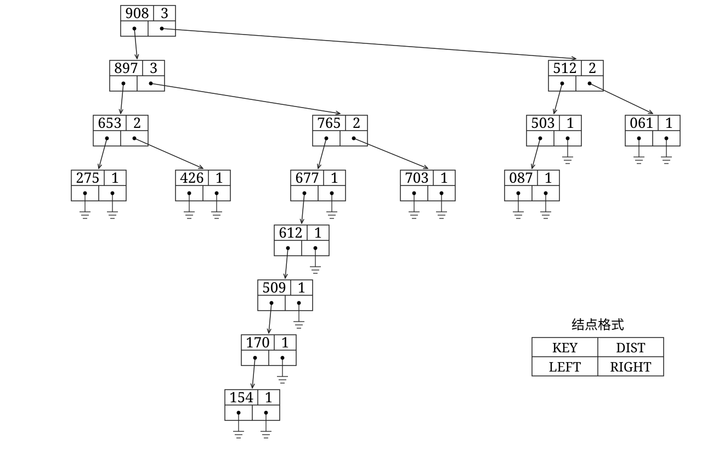

</div></div>

图 27　表示为左倾树的优先队列

从这些定义可以清楚地看出: $\operatorname{DIST}(\mathrm P)=n$ 意味着 P 下面至少有 $2^n$ 个空子树, 否则就会存在从 P 到 $\Lambda$ 的更短路径. 因此, 如果左倾树有 $N$ 个结点, 则从根结点向下往右走的路径最多有 $\lfloor\lg(N+1)\rfloor$ 个结点. 遍历这个路径就能向优先队列插入新结点 (见习题 33), 最差情况下这仅需 $O(\log N)$ 步. 树为线性 (所有 RIGHT 链接都是 $\Lambda$) 时出现最佳情况, 树完全平衡时出现最差情况.

只需简单地合并两个子树就能移除根结点. 合并分别由 P 和 Q 指向的两个不相交左倾树在概念上很简单: 如果 $\operatorname{KEY}(\mathrm P)\ge\operatorname{KEY}(\mathrm Q)$, 则以 P 为根结点, 把 Q 合并到 P 的右子树, 然后更新 DIST(P), 必要时交换 LEFT(P) 和 RIGHT(P). 不难给出这个过程的详尽描述 (见习题 33).

**优先队列技术的比较.** 当结点数 $N$ 很小时, 最好使用一种直截了当的线性列表方法来维护优先队列, 但当 $N$ 很大时, 使用堆或左倾树的 $\log N$ 方法明显得快得多. 6.2.3 节将讨论把线性列表表示为平衡树, 这给出适合于实现优先队列的第三种 $\log N$ 方法. 比较一下这三种技术是适当的.

我们已经看到, 左倾树操作要比堆操作稍快些, 不过堆占用的存储空间较少, 因为它没有链接字段. 平衡树占用的空间大体与左倾树相同, 也许稍少一点. 其操作慢于堆, 程序设计更复杂, 但平衡树结构在某些方面灵活得多. 在使用堆或左倾树时, 我们无法轻松预测对于两个具有相等键的项会发生什么, 不能保证会以 “后进先出” 或 “先进先出” 方式来处理具有相等键的项, 除非把键扩展为包含额外 “插入序号” 字段, 从而不会真正存在相等键. 另一方面, 平衡树可以轻松地对相等键做出一致约定, 还能执行诸如 “把 $x$ 插入 $y$ 的前面 (或后面), 与其直接相邻” 之类的操作. 平衡树是对称的, 可以在任何时候删除最大或最小元素, 而堆和左倾树必然偏向某一边. (不过, 习题 31 说明如何构造对称堆.) 平衡树既可用于查找, 也可用于排序. 我们可以相当快速地从平衡树中移除连续元素块. 但合并两个平衡树通常需要 $\Omega(N)$ 步, 而合并左倾树只需 $O(\log N)$ 步.

<a id="pdf-124"></a>
<a id="p-118"></a>

总结一下: 堆使用的存储空间最少; 左倾树在合并不相交优先队列方面表现出色; 必要时可以付出适当代价以获得平衡树的灵活性.


自从上文讨论的威廉斯和克兰的开创性工作以来, 已经发现许多表示优先队列的新方法. 除了简单列表、堆、左倾树或平衡树之外, 程序员现在有大量选项可供考虑:

- 分层树, 当所有键都位于给定范围 $0\le K<M$ 时, 提供仅需 $O(\log\log M)$ 步的对称优先队列操作 [彼得·范昂德博厄斯、罗伯特·卡斯和埃里克·泽尔斯特拉,*Math. Systems Theory* **10** (1977), 99–127];
- 二项式队列 [让·维耶曼,*CACM* **21** (1978), 309–315; 马克·布朗,*SICOMP* **7** (1978), 298–319];
- 宝塔式 [让·弗朗孔、热拉尔·维耶诺和让·维耶曼,*FOCS* **19** (1978), 1–7];
- 配对堆 [迈克尔·弗雷德曼、塞奇威克、丹尼尔·斯利托和塔扬,*Algorithmica* **1** (1986), 111–129; 约翰·斯塔斯科和魏杰甫,*CACM* **30** (1987), 234–249; 弗雷德曼,*JACM* **46** (1999), 473–501];
- 斜堆 [斯利托和塔扬,*SICOMP* **15** (1986), 52–59];
- 斐波那契堆 [弗雷德曼和塔扬,*JACM* **34** (1987), 596–615] 和更一般的 AF 堆 [迈克尔·弗雷德曼和丹·威拉德,*J. Computer and System Sci.* **48** (1994), 533–551];
- 日历队列 [兰迪·布朗,*CACM* **31** (1988), 1220–1227; 杰勒德·戴维森,*CACM* **32** (1989), 1241–1243];
- 放松堆 [詹姆斯·德里斯科尔、哈罗德·加保、鲁思·施拉伊尔曼和塔扬,*CACM* **31** (1988), 1343–1354];
- 鱼叉 [迈克尔·费希尔和迈克尔·佩特森,*JACM* **41** (1994), 3–30];
- 热队列 [鲍里斯·切尔卡斯基、安德鲁·戈尔德贝格和克雷格·西尔弗斯坦,*SICOMP* **28** (1999), 1326–1346];

等等, 并不是所有这些方法都能经得住时间考验. 实际上左倾树已过时, 除非应用程序有严重倾向 “后进先出” 的特性. 二项式队列和斐波那契堆的具体实现与说明可见高德纳,*The Stanford GraphBase* (New York: ACM Press, 1994), 475–489.

**\*堆排序的分析.** 算法 H 相当复杂, 可能永远都不会有完整的数学分析, 但它有几条性质并没有太大的推导难度. 因此, 我们将较为详细地研究一个堆的构造来结束本节.

图 28 给出一个有 26 个元素的堆的形状, 每个结点标有与它在堆中的下标对应的二进制数. 图中的星号表示特殊结点, 它们位于从 1 到 $N$ 的路径上.

<a id="fig-5-28"></a>

<div class="source-tableau-group" style="overflow-x:auto;max-width:100%"><div style="width:1400px">

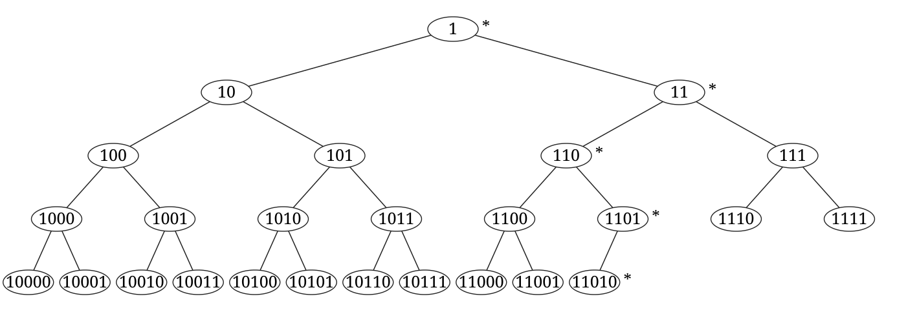

</div></div>

图 28　一个有 $26=(11010)_2$ 个元素的堆看起来是这样的

<a id="pdf-125"></a>
<a id="p-119"></a>

堆最重要的属性之一是它的子树大小的集合. 例如, 图 28 中以 $1,2,\ldots,26$ 为根的子树的大小分别是

$$
26^*,15,10^*,7,7,6^*,3,3,3,3,3,3,2^*,1,1,1,1,1,1,1,1,1,1,1,1,1^*.\tag{12}
$$

星号表示以特殊结点为根的特殊子树. 习题 20 显示, 如果 $N$ 的二进制表示是

$$
N=(b_nb_{n-1}\ldots b_1b_0)_2,\quad n=\lfloor\lg N\rfloor,\tag{13}
$$

则特殊子树的大小总是

$$
(1b_{n-1}\ldots b_1b_0)_2,\ (1b_{n-2}\ldots b_1b_0)_2,\ldots,(1b_1b_0)_2,\ (1b_0)_2,\ (1)_2.\tag{14}
$$

非特殊子树总是完全平衡的, 所以它们的大小总是 $2^k-1$ 形式. 习题 21 说明非特殊子树的大小的结构是

$$
\left\lfloor\frac{N-1}{2}\right\rfloor\text{ 个 }1,\quad
\left\lfloor\frac{N-2}{4}\right\rfloor\text{ 个 }3,\quad
\left\lfloor\frac{N-4}{8}\right\rfloor\text{ 个 }7,\quad\ldots,\quad
\left\lfloor\frac{N-2^{n-1}}{2^n}\right\rfloor\text{ 个 }(2^n-1).\tag{15}
$$

例如, 图 28 包含十二个大小为 1、六个大小为 3、两个大小为 7, 一个大小为 15 的非特殊子树.

设 $s_l$ 表示根为 $l$ 的子树大小, $M_N$ 是所有这些大小的多重集 $\{s_1,s_2,\ldots,s_N\}$. 利用式 (14) 和 (15), 可以很轻松地为任意给定 $N$ 计算 $M_N$. 习题 5.1.4–20 告诉我们, 把整数 $\{1,2,\ldots,N\}$ 排列成一个堆的方式总数是

$$
N!/s_1s_2\ldots s_N=N!\Big/\prod\{s\mid s\in M_N\}.\tag{16}
$$

例如, 按照图 28 的形状排列 26 个字母 $\{A,B,C,\ldots,Z\}$, 使纵列保持字母顺序, 方式总数是

$$
26!/(26\cdot10\cdot6\cdot2\cdot1\cdot1^{12}\cdot3^6\cdot7^2\cdot15^1).
$$

现在分析算法 H 的建堆阶段, 也就是步骤 H2 中第一次出现条件 $l=1$ 之前的阶段. 幸运的是, 由于以下定理, 我们可以把建堆研究简化为对独立上选操作的研究.

<a id="thm-5-2-3-H"></a>

**定理 H.** 如果把算法 H 应用于 $\{1,2,\ldots,N\}$ 的一个随机排列, 建堆阶段可能出现 $N!/\prod\{s\mid s\in M_N\}$ 个堆, 每个堆出现的概率相同. 此外, 在这个阶段执行的 $\lfloor N/2\rfloor$ 个上选操作也是均匀分布的, 也就是说, 在到达步骤 H8 时, $i$ 的 $s_l$ 个可能值中的每一个都具有相同概率.

证明. 可以用数值分析师称为 “后向分析” 的方法来证明定理. 给定以 $l$ 为根的上选操作的一个可能结果 $K_1\ldots K_N$, 可以看出, 文件中恰有 $s_l$ 个预先配置 $K'_1\ldots K'_N$ 将会上选出该结果. 这些预先配置中的 $K'_l$ 值各不相同. 因此, 反向推导, 恰有 $\{1,2,\ldots,N\}$ 的 $s_ls_{l+1}\cdots s_N$ 个输入排列在完成位置 $l$ 处的上选之后, 会得出配置 $K_1\ldots K_N$.

$l=1$ 是典型情况: 设 $K_1\ldots K_N$ 是一个堆, $K'_1\ldots K'_N$ 是一个文件, 当 $l=1,K=K'_1$ 时该文件被上选操作转换为 $K_1\ldots K_N$. 如果 $K=K_i$, 则必定有 $K'_i=K_{\lfloor i/2\rfloor},\ K'_{\lfloor i/2\rfloor}=K_{\lfloor i/4\rfloor}$, 等等, 而对于所有不在 1 至 $i$ 路径上的 $j$ 值有 $K'_j=K_j$. 反过来, 对于每个 $i$, 这个构造产生一个文件 $K'_1\ldots K'_N$, 使得: (a) 上选操作把 $K'_1\ldots K'_N$ 转换为 $K_1\ldots K_N$, (b) 对于 $2\le\lfloor j/2\rfloor<j\le N$, 有 $K_{\lfloor j/2\rfloor}\ge K_j$. 因此, 恰能有 $N$ 个这样的文件 $K'_1\ldots K'_N$, 而且上选操作是均匀的. (习题 22 给出定理证明的一个示例.) ■

<a id="pdf-126"></a>
<a id="p-120"></a>

参照分析程序 H 时给出的量 $A,B,C,D$, 可以看出, 对大小为 $s$ 的子树执行均匀上选操作, 向 $A$ 的平均值贡献了 $\lfloor s/2\rfloor/s$, 向 $B$ 的平均值贡献了

$$
\frac1s(0+1+1+2+\cdots+\lfloor\lg s\rfloor)
=\frac1s\sum_{k=1}^s\lfloor\lg k\rfloor
=\frac1s\bigl((s+1)\lfloor\lg s\rfloor-2^{\lfloor\lg s\rfloor+1}+2\bigr)
$$

(见习题 1.2.4–42). 根据 $s$ 是偶数还是奇数, 它向 $D$ 的平均值贡献了 $2/s$ 或 0. 对 $C$ 的相应贡献有点儿难以确定, 留给读者完成 (见习题 26). 对所有上选操作求和, 可以得出建堆期间 $A$ 的平均值是

$$
A'_N=\sum\{\lfloor s/2\rfloor/s\mid s\in M_N\},\tag{17}
$$

类似公式对 $B,C,D$ 也成立. 因此, 不用费太大力气就能准确计算这些平均值, 下表给出典型结果:

| $N$ | $A'_N$ | $B'_N$ | $C'_N$ | $D'_N$ |
|---:|---:|---:|---:|---:|
| 99 | 19.18 | 68.35 | 42.95 | 0.00 |
| 100 | 19.93 | 69.39 | 42.71 | 1.84 |
| 999 | 196.16 | 734.66 | 464.53 | 0.00 |
| 1000 | 196.94 | 735.80 | 464.16 | 1.92 |
| 9999 | 1966.02 | 7428.18 | 4695.54 | 0.00 |
| 10000 | 1966.82 | 7429.39 | 4695.06 | 1.97 |
| 10001 | 1966.45 | 7430.07 | 4695.84 | 0.00 |
| 10002 | 1967.15 | 7430.97 | 4695.95 | 1.73 |

从渐近意义上说, 可以忽略 $M_N$ 中特殊子树的大小, 例如我们有

$$
A'_N=\frac N2\cdot\frac01+\frac N4\cdot\frac13+\frac N8\cdot\frac37+\cdots+O(\log N)
=\left(1-\frac12\alpha\right)N+O(\log N),\tag{18}
$$

式中

$$
\alpha=\sum_{k\ge1}\frac1{2^k-1}=1.60669\,51524\,15291\,76378\,33015\,23190\,92458\,04806-.\tag{19}
$$

(小伦奇使用习题 27 中的级数变换最早计算出这个高精度值. 爱尔特希证明了 $\alpha$ 是无理数 [*J. Indian Math. Soc.* **12** (1948), 63–66], 彼得·博温证明了许多类似常数的无理性 [*Proc. Camb. Phil. Soc.* **112** (1992), 141–146].) 对于很大的 $N$, 可以使用近似公式

$$
\begin{aligned}
A'_N&\approx0.1967N+(-1)^N0.3;\\
B'_N&\approx0.74403N-1.3\ln N;\\
C'_N&\approx0.47034N-0.8\ln N;\\
D'_N&\approx(1.8\pm0.2)[N\text{ 是偶数}].
\end{aligned}\tag{20}
$$

最小值和最大值也容易确定. 建堆只需 $O(N)$ 步 (见习题 23).

<a id="pdf-127"></a>
<a id="p-121"></a>

这个定理很好地解释了算法 H 的建堆阶段. 但选择阶段就是另一回事了, 它尚有待研究! 对 $N$ 个元素进行堆排序时, 我们用 $A''_N,B''_N,C''_N,D''_N$ 表示 $A,B,C,D$ 在选择阶段的平均值. 对于随机输入, 算法 H 的特性围绕实验得出的平均值

$$
\begin{aligned}
A''_N&\approx0.152N;\\
B''_N&\approx N\lg N-2.61N;\\
C''_N&\approx\tfrac12N\lg N-1.41N;\\
D''_N&\approx\lg N\pm2
\end{aligned}\tag{21}
$$

有较小波动. 尚未找到适当的理论依据来解释 $D''_N$ 的特性以及推测得到的常数 0.152、2.61 和 1.41. 然而, 拉塞尔·谢弗和塞奇威克用巧妙的方式确定了 $B''_N$ 和 $C''_N$ 的前导项, 见习题 30. 谢弗还证明了 $C''_N$ 的最小和最大可能值分别渐近于 $\tfrac14N\lg N$ 和 $\tfrac34N\lg N$.


### 习题

<a id="ex-5-2-3-1"></a>

1. [10] 直接选择方法 (算法 S) 是稳定排序方法吗?　[答案](#ans-5-2-3-1)

<a id="ex-5-2-3-2"></a>

2. [15] 在算法 S 中, 可以先选择最大键, 然后选择第二大键, 以此类推; 也可以先查找最小键, 然后是第二小键, 以此类推. 为什么前者更方便?　[答案](#ans-5-2-3-2)

<a id="ex-5-2-3-3"></a>

3. [M21] (a) 证明: 如果算法 S 的输入是 $\{1,2,\ldots,N\}$ 的随机排列, 则步骤 S2 和 S3 的第一次迭代将生成 $\{1,2,\ldots,N-1\}$ 的一个随机排列, 后面跟着 $N$. (换句话说, 在 $K_1\ldots K_{N-1}$ 中 $\{1,2,\ldots,N-1\}$ 的每个排列以相同的概率出现.)(b) 因此, 如果 $B_N$ 表示程序 S 中量 $B$ 的平均值, 给定随机排列作为输入, 那么我们有 $B_N=H_N-1+B_{N-1}$. [提示: 见式 1.2.10–(16).]　[答案](#ans-5-2-3-3)

<a id="ex-5-2-3-4"></a>

▶ 4. [M25] 当 $i=j$ 时, 算法 S 的步骤 S3 什么也没做. 在执行步骤 S3 前测试一下是否 $i=j$ 是不是一个好主意呢? 对于随机输入, 步骤 S3 中出现 $i=j$ 的平均次数是多少?　[答案](#ans-5-2-3-4)

<a id="ex-5-2-3-5"></a>

5. [20] 当输入是 $N\ldots321$ 时, 在程序 S 的分析中, 量 $B$ 的值是多少?　[答案](#ans-5-2-3-5)

<a id="ex-5-2-3-6"></a>

6. [M29] (a) 设 $a_1a_2\ldots a_N$ 是 $\{1,2,\ldots,N\}$ 的排列, 它有 $C$ 个轮换, $I$ 个反序, 在由程序 S 进行排序时从右向左的最大值会发生 $B$ 次变化. 证明: $2B\le I+N-C$. [提示: 见习题 5.2.2–1.] (b) 证明: $I+N-C\le\lfloor N^2/2\rfloor$. 因此, $B$ 绝不会超过 $\lfloor N^2/4\rfloor$.　[答案](#ans-5-2-3-6)

<a id="ex-5-2-3-7"></a>

7. [M41] 假定输入随机, 试求程序 S 中量 $B$ 的方差, 把它表示为 $N$ 的函数.　[答案](#ans-5-2-3-7)

<a id="ex-5-2-3-8"></a>

▶ 8. [24] 证明: 如果算法 S 的步骤 S2 查找 $\max(K_1,\ldots,K_j)$ 时, 按照从左向右的顺序 $K_1,K_2,\ldots,K_j$ 检查这些键, 而不是像程序 S 那样从右向左进行, 通常有可能减少步骤 S2 的下一次迭代需要的比较次数. 根据这个观察编写一个 MIX 程序.　[答案](#ans-5-2-3-8)

<a id="ex-5-2-3-9"></a>

9. [M25] 对于随机输入, 习题 8 的算法平均执行多少次比较?　[答案](#ans-5-2-3-9)

<a id="ex-5-2-3-10"></a>

10. [12] 在输出了最初 16 项中的 14 项之后, 图 23 中树的结构是什么样的?　[答案](#ans-5-2-3-10)

<a id="ex-5-2-3-11"></a>

11. [10] 在输出了元素 908 之后, 图 24 中树的结构是什么样的?　[答案](#ans-5-2-3-11)

<a id="ex-5-2-3-12"></a>

12. [M20] 使用图 23 的自下而上方法把一个包含 $2^n$ 个元素的文件排好序, 需要进行多少次 $-\infty$ 与 $-\infty$ 的比较?　[答案](#ans-5-2-3-12)

<a id="ex-5-2-3-13"></a>

13. [20] (威廉斯) 算法 H 的步骤 H4 区分 $j<r,\ j=r,\ j>r$ 三种情况. 证明: 如果 $K\ge K_{r+1}$, 则有可能简化步骤 H4, 从而只需要做一个两路分支. 如何修改步骤 H2, 才能确保在整个堆排序过程中都有 $K\ge K_{r+1}$?　[答案](#ans-5-2-3-13)

<a id="ex-5-2-3-14"></a>

14. [10] 证明: 简单队列是优先队列的特例. (试说明: 如何为元素指定键值, 使得 “最大者先出” 的过程等价于 “先进先出”.) 栈也是优先队列的特例吗?　[答案](#ans-5-2-3-14)

<a id="ex-5-2-3-15"></a>

▶ 15. [M22] (布鲁斯·查特斯) 我们希望构造 $\le N$ 的素数表, 试设计一个高速算法, 它利用优先队列避免除法操作. [提示: 以上一个被看作素数候选者的奇数为基准, 选择大于该基准的最小非素奇数, 作为优先队列的最小键. 尽量使队列中的元素数目保持最少.]　[答案](#ans-5-2-3-15)

<a id="ex-5-2-3-16"></a>

16. [20] 设计一个高效算法, 向给定的 $n$ 元素堆插入一个新键, 生成 $n+1$ 元素的堆.　[答案](#ans-5-2-3-16)

<a id="ex-5-2-3-17"></a>

17. [20] 习题 16 的算法可以代替算法 H 中使用的 “把 $l$ 减至 1” 的方法来创建堆. 以相同输入文件开始, 这两种方法是否会生成相同的堆?　[答案](#ans-5-2-3-17)

<a id="ex-5-2-3-18"></a>

▶ 18. [21] (弗洛伊德) 在堆排序的选择阶段, 键 $K$ 往往非常小, 所以算法 H 的步骤 H6 中几乎所有的比较都会得出 $K<K_j$. 说明如何修改算法, 在计算的主循环中不比较 $K$ 与 $K_j$, 从而把平均比较次数减少将近一半.　[答案](#ans-5-2-3-18)

<a id="ex-5-2-3-19"></a>

19. [21] 设计一个算法, 从长度为 $N$ 的堆中删除一个给定元素, 生成长度为 $N-1$ 的堆.　[答案](#ans-5-2-3-19)

<a id="pdf-128"></a>
<a id="p-122"></a>

<a id="ex-5-2-3-20"></a>

20. [M20] 证明: 式 (14) 给出堆的特殊子树大小.　[答案](#ans-5-2-3-20)

<a id="ex-5-2-3-21"></a>

21. [M24] 证明: 式 (15) 给出堆的非特殊子树大小.　[答案](#ans-5-2-3-21)

<a id="ex-5-2-3-22"></a>

▶ 22. [20]$\{1,2,3,4,5\}$ 的哪些排列会在算法 H 的建堆阶段被转换为 $5\,3\,4\,1\,2$?　[答案](#ans-5-2-3-22)

<a id="ex-5-2-3-23"></a>

23. [M28] (a) 证明上选算法的扫描长度 $B$ 绝不会超过 $\lfloor\lg(r/l)\rfloor$. (b) 根据式 (8), 在算法 H 的任何具体应用中, $B$ 都不会超过 $N\lfloor\lg N\rfloor$. 考虑所有可能的输入文件, 求出 $B$ 的最大值, 把它表示为 $N$ 的函数. (你必须证明, 存在一个输入文件, 使得 $B$ 取到这个最大值.)　[答案](#ans-5-2-3-23)

<a id="ex-5-2-3-24"></a>

24. [M24] 推导 $B'_N$ (算法 H 建堆阶段的总扫描长度) 的标准差的准确公式.　[答案](#ans-5-2-3-24)

<a id="ex-5-2-3-25"></a>

25. [M20] 如果 $N=2^{n+1}-1$, 当 $l=1$ 和 $r=N$ 时, 上选扫描过程对 $C$ 的平均贡献值是多少?　[答案](#ans-5-2-3-25)

<a id="ex-5-2-3-26"></a>

26. [M30] 对下列情形求解习题 25: (a) 对 $N=26$, (b) 对一般的 $N$.　[答案](#ans-5-2-3-26)

<a id="ex-5-2-3-27"></a>

27. [M25] (托马斯·克劳森, 1828) 证明:　[答案](#ans-5-2-3-27)

$$
\sum_{n\ge1}\frac{x^n}{1-x^n}=\sum_{n\ge1}\frac{1+x^n}{1-x^n}x^{n^2}.
$$

(令 $x=\tfrac12$ 即得计算式 (19) 的非常快速收敛的级数.)

<a id="ex-5-2-3-28"></a>

28. [35] 探讨三叉堆的思想, 它的基础是完全三叉树而非二叉树. 三叉堆排序是否快于二叉堆?　[答案](#ans-5-2-3-28)

<a id="ex-5-2-3-29"></a>

29. [26] (威廉·布朗) 设计一个算法, 实现多项式或幂级数相乘 $(a_1x^{i_1}+a_2x^{i_2}+\cdots)(b_1x^{j_1}+b_2x^{j_2}+\cdots)$, 其中, 乘积 $c_1x^{i_1+j_1}+\cdots$ 的系数按照输入系数相乘的顺序依次生成. [提示: 使用适当的优先队列.]

<a id="ex-5-2-3-30"></a>

▶ 30. [HM35] (谢弗和塞奇威克) 对于元素 $\{1,2,\ldots,n\}$ 的一些堆, 堆排序的选择阶段恰好执行 $m$ 次提升操作, 我们用 $h_{nm}$ 表示这类堆的个数. 证明: $h_{nm}\le2^m\prod_{k=2}^n\lg k$. 然后利用这个关系式证明: 算法 H 执行的提升操作的平均次数是 $N\lg N+O(N\log\log N)$.　[答案](#ans-5-2-3-30)

<a id="ex-5-2-3-31"></a>

31. [37] (威廉斯) 证明: 如果以适当方式 “背靠背” 组合两个堆, 那就有可能维护一种结构, 在任意时刻都可以在 $O(\log n)$ 步内删除最小元素或最大元素. (这种结构可称为优先双队列.)　[答案](#ans-5-2-3-31)

<a id="ex-5-2-3-32"></a>

32. [M28] 证明: 如果被排序的键互不相同, 则堆排序的提升次数 $B$ 总是不小于 $\tfrac12N\lg N+O(N)$. 提示: 考虑最大的 $\lceil N/2\rceil$ 个键的移动.　[答案](#ans-5-2-3-32)

<a id="ex-5-2-3-33"></a>

33. [21] 设计一个算法, 把两个用左倾树表示的不相交优先队列合并为一个. (特别地, 如果两个给定队列之一只包含单个元素, 你的算法将把它插入另一个队列中.)　[答案](#ans-5-2-3-33)

<a id="ex-5-2-3-34"></a>

34. [M41] 如果忽略 KEY 值, 有多少种可能的 $N$ 结点左倾树? 答案是: $1,1,2,4,8,17,38,87,203,482,1160,\ldots$. 利用类似于习题 2.3.4.4–4 的技巧, 证明: 对于适当的常数 $a$ 和 $b$, 这个数渐近于 $ab^NN^{-3/2}$.　[答案](#ans-5-2-3-34)

<a id="ex-5-2-3-35"></a>

35. [26] 如果向左倾树添加 UP 链接 (见 6.2.3 节关于三重链接树的讨论), 就有可能采用如下方式删除优先队列中的任意结点 P: 合并 LEFT(P) 和 RIGHT(P), 用它代替 P; 然后调整 P 的先辈们的 DIST 字段, 可能需要交换左右子树, 如此操作, 直到到达根结点, 或者到达 DIST 字段不发生变化的结点.　[答案](#ans-5-2-3-35)

证明: 即使这棵树可能包含非常长的向上路径, 假定这棵树有 $N$ 个结点, 以上过程改变的 DIST 字段绝不会超过 $O(\log N)$ 个.

<a id="ex-5-2-3-36"></a>

36. [18] (替换最近最少使用的页) 许多操作系统都使用以下类型的算法: 对一组结点的集合可以实施两种操作: (i)“使用” 结点, (ii) 用新结点替换 “最近最少使用” 的结点. 什么样的数据结构有利于确定 “最近最少使用” 的结点?　[答案](#ans-5-2-3-36)

<a id="ex-5-2-3-37"></a>

37. [HM32] 设 $e_N(k)$ 是 $N$ 元素随机堆中根结点到第 $k$ 大元素的期望树式距离, 设 $e(k)=\lim_{N\to\infty}e_N(k)$. 于是, $e(1)=0,e(2)=1,e(3)=1.5,e(4)=1.875$. 试求 $e(k)$ 的渐近值, 精确到 $O(k^{-1})$.　[答案](#ans-5-2-3-37)

<a id="ex-5-2-3-38"></a>

38. [M21] 在具有 $N$ 个内部结点的堆或完全二叉树中, 求所有子树大小的多重集 $M_N$ 的简单递推关系.　[答案](#ans-5-2-3-38)

<a id="pdf-129"></a>
<a id="p-123"></a>

<a id="sec-5-2-4"></a>

### 5.2.4　合并排序

组合两个或多个有序文件成为单个有序文件的过程称为合并 (或整理). 例如, 我们可以合并 503 703 765 和 087 512 677 两个文件, 得到 087 503 512 677 703 765. 完成这个过程的一种简单方式是比较两个最小项, 输出较小者, 然后重复同一过程. 从

$$
\left\{\begin{array}{lll}503&703&765\\087&512&677\end{array}\right.
$$

开始, 我们得到

$$
087\quad\left\{\begin{array}{lll}503&703&765\\512&677&\end{array}\right.
$$

然后是

$$
087\quad503\quad\left\{\begin{array}{ll}703&765\\512&677\end{array}\right.
$$

和

$$
087\quad503\quad512\quad\left\{\begin{array}{ll}703&765\\677&\end{array}\right.
$$

等等. 当两个文件之一的项目用尽时, 需要小心一些. 以下算法对这个过程进行详尽描述:

<a id="alg-5-2-4-M"></a>

**算法 M (两路合并).** 算法把非空有序文件 $x_1\le x_2\le\cdots\le x_m$ 和 $y_1\le y_2\le\cdots\le y_n$ 合并为单个文件 $z_1\le z_2\le\cdots\le z_{m+n}$.

**M1.[初始化.]** 置 $i\leftarrow1,\ j\leftarrow1,\ k\leftarrow1$.

**M2.[找较小者.]** 如果 $x_i\le y_j$, 转到 M3, 否则转到 M5.

**M3.[输出 $x_i$.]** 置 $z_k\leftarrow x_i,\ k\leftarrow k+1,\ i\leftarrow i+1$. 如果 $i\le m$, 返回 M2.

**M4.[传送 $y_j,\ldots,y_n$.]** 置 $(z_k,\ldots,z_{m+n})\leftarrow(y_j,\ldots,y_n)$, 终止算法.

**M5.[输出 $y_j$.]** 置 $z_k\leftarrow y_j,\ k\leftarrow k+1,\ j\leftarrow j+1$. 如果 $j\le n$, 返回 M2.

**M6.[传送 $x_i,\ldots,x_m$.]** 置 $(z_k,\ldots,z_{m+n})\leftarrow(x_i,\ldots,x_m)$, 终止算法. ■

<a id="fig-5-29"></a>

<div class="source-tableau-group" style="overflow-x:auto;max-width:100%"><div style="width:1000px">

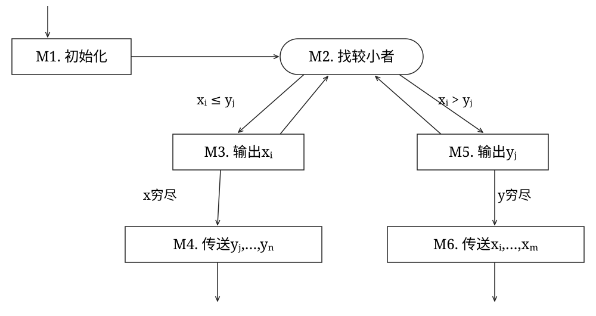

</div></div>

图 29　合并 $x_1\le\cdots\le x_m$ 和 $y_1\le\cdots\le y_n$

在 5.3.2 节将会看到, 当 $m\approx n$ 时, 这个简单过程基本上就是在普通计算机上进行合并的最佳方式. (而当 $m$ 远小于 $n$ 时, 有可能设计出更为高效的合并算法, 尽管它们通常相当复杂.) 我们可以在不损失多少效率的前提下使算法 M 稍简单些: 在输入文件的末尾放置标识元素 $x_{m+1}=y_{n+1}=\infty$, 在输出 $\infty$ 之前终止算法. 算法 M 的分析见习题 2.

<a id="pdf-130"></a>
<a id="p-124"></a>

算法 M 的总工作量基本上与 $m+n$ 成正比, 因此合并显然要比排序简单些. 而且, 排序问题可以简化为合并问题, 因为我们能重复合并越来越长的子文件, 直到一切都处于有序状态. 这可以看作是插入排序思想的扩展: 向有序文件中插入一个新元素, 就是当 $n=1$ 时的合并特例. 如果希望加快插入过程, 不妨考虑一次插入多个元素, 进行 “批处理”, 这自然导致合并排序的一般思想. 从历史的角度来看, 合并排序是最初的计算机排序法之一. 约翰·冯·诺伊曼早在 1945 年就提出了合并排序 (见 5.5 节).

5.4 节讨论外部排序算法时将详细研究合并排序. 本节主要关注高速随机存储器中相对简单的合并排序问题.

表 1 给出一种合并排序, 它类似于在快速排序和基数交换排序用到的扫描过程, 采用 “蜡炬两头烧” 的方式: 从左右两端考察输入数据, 一起向中间靠拢. 现在暂时忽略表的顶行, 先考虑从第 2 行到第 3 行的转换. 左边有递增游程 503 703 765, 从右向左读有游程 087 512 677. 合并这两个序列得到 087 503 512 677 703 765, 把它放在第 3 行左端. 然后把第 2 行的 061 612 908 与 170 509 897 合并, 结果 (061 170 509 612 897 908) 记录在第 3 行右端. 最后, 154 275 426 653 与 653 合并——我们及时发现了重叠, 没有导致任何伤害——结果放在左侧, 紧跟前一个游程. 表中第 2 行是通过同样方式从第 1 行的原始输入数据生成的.

<a id="tab-5-2-4-1"></a>

表 1　自然的两路合并排序

<div class="source-tableau-group" style="overflow-x:auto;max-width:100%"><div style="width:1152px">

<table data-natural-table="1" style="width:1152px;table-layout:fixed;border-collapse:collapse;font-family:serif"><thead><tr><th style="width:72px;min-width:72px;border:0;padding:0"></th><th style="width:72px;min-width:72px;border:0;padding:0"></th><th style="width:72px;min-width:72px;border:0;padding:0"></th><th style="width:72px;min-width:72px;border:0;padding:0"></th><th style="width:72px;min-width:72px;border:0;padding:0"></th><th style="width:72px;min-width:72px;border:0;padding:0"></th><th style="width:72px;min-width:72px;border:0;padding:0"></th><th style="width:72px;min-width:72px;border:0;padding:0"></th><th style="width:72px;min-width:72px;border:0;padding:0"></th><th style="width:72px;min-width:72px;border:0;padding:0"></th><th style="width:72px;min-width:72px;border:0;padding:0"></th><th style="width:72px;min-width:72px;border:0;padding:0"></th><th style="width:72px;min-width:72px;border:0;padding:0"></th><th style="width:72px;min-width:72px;border:0;padding:0"></th><th style="width:72px;min-width:72px;border:0;padding:0"></th><th style="width:72px;min-width:72px;border:0;padding:0"></th></tr></thead><tbody>
<tr style="background:transparent"><td colspan="16" style="padding:0;border:0;line-height:0"><svg xmlns="http://www.w3.org/2000/svg" width="1152" height="28" viewBox="0 0 1152 28"><defs><marker id="a0True" markerWidth="9" markerHeight="9" refX="8" refY="4.5" orient="auto"><path d="M1 1L8 4.5L1 8" fill="none" stroke="#222"/></marker></defs><path data-run="9-11" d="M789 15H579" fill="none" stroke="#222" stroke-width="1.4" marker-end="url(#a0True)"/><path data-run="12-12" d="M861 15H795" fill="none" stroke="#222" stroke-width="1.4" marker-end="url(#a0True)"/><path data-run="13-13" d="M933 15H867" fill="none" stroke="#222" stroke-width="1.4" marker-end="url(#a0True)"/><path data-run="14-14" d="M1005 15H939" fill="none" stroke="#222" stroke-width="1.4" marker-end="url(#a0True)"/><path data-run="15-16" d="M1149 15H1011" fill="none" stroke="#222" stroke-width="1.4" marker-end="url(#a0True)"/></svg></td></tr>
<tr data-natural-state="0" style="background:transparent"><td data-natural-key="1" style="width:72px;min-width:72px;border:0;border-right:1.4px solid #222;padding:4px 0;text-align:center;font-size:22px">503</td><td data-natural-key="2" style="width:72px;min-width:72px;border:0;padding:4px 0;text-align:center;font-size:22px">087</td><td data-natural-key="3" style="width:72px;min-width:72px;border:0;border-right:1.4px solid #222;padding:4px 0;text-align:center;font-size:22px">512</td><td data-natural-key="4" style="width:72px;min-width:72px;border:0;padding:4px 0;text-align:center;font-size:22px">061</td><td data-natural-key="5" style="width:72px;min-width:72px;border:0;border-right:1.4px solid #222;padding:4px 0;text-align:center;font-size:22px">908</td><td data-natural-key="6" style="width:72px;min-width:72px;border:0;padding:4px 0;text-align:center;font-size:22px">170</td><td data-natural-key="7" style="width:72px;min-width:72px;border:0;border-right:1.4px solid #222;padding:4px 0;text-align:center;font-size:22px">897</td><td data-natural-key="8" style="width:72px;min-width:72px;border:0;padding:4px 0;text-align:center;font-size:22px">275</td><td data-natural-key="9" style="width:72px;min-width:72px;border:0;border-left:1.4px solid #222;border-right:1.4px solid #222;padding:4px 0;text-align:center;font-size:22px">653</td><td data-natural-key="10" style="width:72px;min-width:72px;border:0;padding:4px 0;text-align:center;font-size:22px">426</td><td data-natural-key="11" style="width:72px;min-width:72px;border:0;padding:4px 0;text-align:center;font-size:22px">154</td><td data-natural-key="12" style="width:72px;min-width:72px;border:0;border-left:1.4px solid #222;padding:4px 0;text-align:center;font-size:22px">509</td><td data-natural-key="13" style="width:72px;min-width:72px;border:0;border-left:1.4px solid #222;padding:4px 0;text-align:center;font-size:22px">612</td><td data-natural-key="14" style="width:72px;min-width:72px;border:0;border-left:1.4px solid #222;padding:4px 0;text-align:center;font-size:22px">677</td><td data-natural-key="15" style="width:72px;min-width:72px;border:0;border-left:1.4px solid #222;padding:4px 0;text-align:center;font-size:22px">765</td><td data-natural-key="16" style="width:72px;min-width:72px;border:0;padding:4px 0;text-align:center;font-size:22px">703</td></tr>
<tr style="background:transparent"><td colspan="16" style="padding:0;border:0;line-height:0"><svg xmlns="http://www.w3.org/2000/svg" width="1152" height="28" viewBox="0 0 1152 28"><defs><marker id="a0False" markerWidth="9" markerHeight="9" refX="8" refY="4.5" orient="auto"><path d="M1 1L8 4.5L1 8" fill="none" stroke="#222"/></marker></defs><path data-run="1-1" d="M3 15H69" fill="none" stroke="#222" stroke-width="1.4" marker-end="url(#a0False)"/><path data-run="2-3" d="M75 15H213" fill="none" stroke="#222" stroke-width="1.4" marker-end="url(#a0False)"/><path data-run="4-5" d="M219 15H357" fill="none" stroke="#222" stroke-width="1.4" marker-end="url(#a0False)"/><path data-run="6-7" d="M363 15H501" fill="none" stroke="#222" stroke-width="1.4" marker-end="url(#a0False)"/><path data-run="8-9" d="M507 15H645" fill="none" stroke="#222" stroke-width="1.4" marker-end="url(#a0False)"/></svg></td></tr>
<tr style="background:transparent"><td colspan="16" style="padding:0;border:0;line-height:0"><svg xmlns="http://www.w3.org/2000/svg" width="1152" height="28" viewBox="0 0 1152 28"><defs><marker id="a1True" markerWidth="9" markerHeight="9" refX="8" refY="4.5" orient="auto"><path d="M1 1L8 4.5L1 8" fill="none" stroke="#222"/></marker></defs><path data-run="10-10" d="M717 15H651" fill="none" stroke="#222" stroke-width="1.4" marker-end="url(#a1True)"/><path data-run="11-13" d="M933 15H723" fill="none" stroke="#222" stroke-width="1.4" marker-end="url(#a1True)"/><path data-run="14-16" d="M1149 15H939" fill="none" stroke="#222" stroke-width="1.4" marker-end="url(#a1True)"/></svg></td></tr>
<tr data-natural-state="1" style="background:transparent"><td data-natural-key="1" style="width:72px;min-width:72px;border:0;padding:4px 0;text-align:center;font-size:22px">503</td><td data-natural-key="2" style="width:72px;min-width:72px;border:0;padding:4px 0;text-align:center;font-size:22px">703</td><td data-natural-key="3" style="width:72px;min-width:72px;border:0;border-right:1.4px solid #222;padding:4px 0;text-align:center;font-size:22px">765</td><td data-natural-key="4" style="width:72px;min-width:72px;border:0;padding:4px 0;text-align:center;font-size:22px">061</td><td data-natural-key="5" style="width:72px;min-width:72px;border:0;padding:4px 0;text-align:center;font-size:22px">612</td><td data-natural-key="6" style="width:72px;min-width:72px;border:0;border-right:1.4px solid #222;padding:4px 0;text-align:center;font-size:22px">908</td><td data-natural-key="7" style="width:72px;min-width:72px;border:0;padding:4px 0;text-align:center;font-size:22px">154</td><td data-natural-key="8" style="width:72px;min-width:72px;border:0;padding:4px 0;text-align:center;font-size:22px">275</td><td data-natural-key="9" style="width:72px;min-width:72px;border:0;padding:4px 0;text-align:center;font-size:22px">426</td><td data-natural-key="10" style="width:72px;min-width:72px;border:0;border-left:1.4px solid #222;border-right:1.4px solid #222;padding:4px 0;text-align:center;font-size:22px">653</td><td data-natural-key="11" style="width:72px;min-width:72px;border:0;border-left:1.4px solid #222;padding:4px 0;text-align:center;font-size:22px">897</td><td data-natural-key="12" style="width:72px;min-width:72px;border:0;padding:4px 0;text-align:center;font-size:22px">509</td><td data-natural-key="13" style="width:72px;min-width:72px;border:0;padding:4px 0;text-align:center;font-size:22px">170</td><td data-natural-key="14" style="width:72px;min-width:72px;border:0;border-left:1.4px solid #222;padding:4px 0;text-align:center;font-size:22px">677</td><td data-natural-key="15" style="width:72px;min-width:72px;border:0;padding:4px 0;text-align:center;font-size:22px">512</td><td data-natural-key="16" style="width:72px;min-width:72px;border:0;padding:4px 0;text-align:center;font-size:22px">087</td></tr>
<tr style="background:transparent"><td colspan="16" style="padding:0;border:0;line-height:0"><svg xmlns="http://www.w3.org/2000/svg" width="1152" height="28" viewBox="0 0 1152 28"><defs><marker id="a1False" markerWidth="9" markerHeight="9" refX="8" refY="4.5" orient="auto"><path d="M1 1L8 4.5L1 8" fill="none" stroke="#222"/></marker></defs><path data-run="1-3" d="M3 15H213" fill="none" stroke="#222" stroke-width="1.4" marker-end="url(#a1False)"/><path data-run="4-6" d="M219 15H429" fill="none" stroke="#222" stroke-width="1.4" marker-end="url(#a1False)"/><path data-run="7-10" d="M435 15H717" fill="none" stroke="#222" stroke-width="1.4" marker-end="url(#a1False)"/></svg></td></tr>
<tr style="background:transparent"><td colspan="16" style="padding:0;border:0;line-height:0"><svg xmlns="http://www.w3.org/2000/svg" width="1152" height="28" viewBox="0 0 1152 28"><defs><marker id="a2True" markerWidth="9" markerHeight="9" refX="8" refY="4.5" orient="auto"><path d="M1 1L8 4.5L1 8" fill="none" stroke="#222"/></marker></defs><path data-run="10-10" d="M717 15H651" fill="none" stroke="#222" stroke-width="1.4" marker-end="url(#a2True)"/><path data-run="11-16" d="M1149 15H723" fill="none" stroke="#222" stroke-width="1.4" marker-end="url(#a2True)"/></svg></td></tr>
<tr data-natural-state="2" style="background:transparent"><td data-natural-key="1" style="width:72px;min-width:72px;border:0;padding:4px 0;text-align:center;font-size:22px">087</td><td data-natural-key="2" style="width:72px;min-width:72px;border:0;padding:4px 0;text-align:center;font-size:22px">503</td><td data-natural-key="3" style="width:72px;min-width:72px;border:0;padding:4px 0;text-align:center;font-size:22px">512</td><td data-natural-key="4" style="width:72px;min-width:72px;border:0;padding:4px 0;text-align:center;font-size:22px">677</td><td data-natural-key="5" style="width:72px;min-width:72px;border:0;padding:4px 0;text-align:center;font-size:22px">703</td><td data-natural-key="6" style="width:72px;min-width:72px;border:0;border-right:1.4px solid #222;padding:4px 0;text-align:center;font-size:22px">765</td><td data-natural-key="7" style="width:72px;min-width:72px;border:0;padding:4px 0;text-align:center;font-size:22px">154</td><td data-natural-key="8" style="width:72px;min-width:72px;border:0;padding:4px 0;text-align:center;font-size:22px">275</td><td data-natural-key="9" style="width:72px;min-width:72px;border:0;padding:4px 0;text-align:center;font-size:22px">426</td><td data-natural-key="10" style="width:72px;min-width:72px;border:0;border-left:1.4px solid #222;border-right:1.4px solid #222;padding:4px 0;text-align:center;font-size:22px">653</td><td data-natural-key="11" style="width:72px;min-width:72px;border:0;border-left:1.4px solid #222;padding:4px 0;text-align:center;font-size:22px">908</td><td data-natural-key="12" style="width:72px;min-width:72px;border:0;padding:4px 0;text-align:center;font-size:22px">897</td><td data-natural-key="13" style="width:72px;min-width:72px;border:0;padding:4px 0;text-align:center;font-size:22px">612</td><td data-natural-key="14" style="width:72px;min-width:72px;border:0;padding:4px 0;text-align:center;font-size:22px">509</td><td data-natural-key="15" style="width:72px;min-width:72px;border:0;padding:4px 0;text-align:center;font-size:22px">170</td><td data-natural-key="16" style="width:72px;min-width:72px;border:0;padding:4px 0;text-align:center;font-size:22px">061</td></tr>
<tr style="background:transparent"><td colspan="16" style="padding:0;border:0;line-height:0"><svg xmlns="http://www.w3.org/2000/svg" width="1152" height="28" viewBox="0 0 1152 28"><defs><marker id="a2False" markerWidth="9" markerHeight="9" refX="8" refY="4.5" orient="auto"><path d="M1 1L8 4.5L1 8" fill="none" stroke="#222"/></marker></defs><path data-run="1-6" d="M3 15H429" fill="none" stroke="#222" stroke-width="1.4" marker-end="url(#a2False)"/><path data-run="7-10" d="M435 15H717" fill="none" stroke="#222" stroke-width="1.4" marker-end="url(#a2False)"/></svg></td></tr>
<tr style="background:transparent"><td colspan="16" style="padding:0;border:0;line-height:0"><svg xmlns="http://www.w3.org/2000/svg" width="1152" height="28" viewBox="0 0 1152 28"><defs><marker id="a3True" markerWidth="9" markerHeight="9" refX="8" refY="4.5" orient="auto"><path d="M1 1L8 4.5L1 8" fill="none" stroke="#222"/></marker></defs><path data-run="12-16" d="M1149 15H795" fill="none" stroke="#222" stroke-width="1.4" marker-end="url(#a3True)"/></svg></td></tr>
<tr data-natural-state="3" style="background:transparent"><td data-natural-key="1" style="width:72px;min-width:72px;border:0;padding:4px 0;text-align:center;font-size:22px">061</td><td data-natural-key="2" style="width:72px;min-width:72px;border:0;padding:4px 0;text-align:center;font-size:22px">087</td><td data-natural-key="3" style="width:72px;min-width:72px;border:0;padding:4px 0;text-align:center;font-size:22px">170</td><td data-natural-key="4" style="width:72px;min-width:72px;border:0;padding:4px 0;text-align:center;font-size:22px">503</td><td data-natural-key="5" style="width:72px;min-width:72px;border:0;padding:4px 0;text-align:center;font-size:22px">509</td><td data-natural-key="6" style="width:72px;min-width:72px;border:0;padding:4px 0;text-align:center;font-size:22px">512</td><td data-natural-key="7" style="width:72px;min-width:72px;border:0;padding:4px 0;text-align:center;font-size:22px">612</td><td data-natural-key="8" style="width:72px;min-width:72px;border:0;padding:4px 0;text-align:center;font-size:22px">677</td><td data-natural-key="9" style="width:72px;min-width:72px;border:0;padding:4px 0;text-align:center;font-size:22px">703</td><td data-natural-key="10" style="width:72px;min-width:72px;border:0;padding:4px 0;text-align:center;font-size:22px">765</td><td data-natural-key="11" style="width:72px;min-width:72px;border:0;padding:4px 0;text-align:center;font-size:22px">897</td><td data-natural-key="12" style="width:72px;min-width:72px;border:0;border-left:1.4px solid #222;border-right:1.4px solid #222;padding:4px 0;text-align:center;font-size:22px">908</td><td data-natural-key="13" style="width:72px;min-width:72px;border:0;padding:4px 0;text-align:center;font-size:22px">653</td><td data-natural-key="14" style="width:72px;min-width:72px;border:0;padding:4px 0;text-align:center;font-size:22px">426</td><td data-natural-key="15" style="width:72px;min-width:72px;border:0;padding:4px 0;text-align:center;font-size:22px">275</td><td data-natural-key="16" style="width:72px;min-width:72px;border:0;padding:4px 0;text-align:center;font-size:22px">154</td></tr>
<tr style="background:transparent"><td colspan="16" style="padding:0;border:0;line-height:0"><svg xmlns="http://www.w3.org/2000/svg" width="1152" height="28" viewBox="0 0 1152 28"><defs><marker id="a3False" markerWidth="9" markerHeight="9" refX="8" refY="4.5" orient="auto"><path d="M1 1L8 4.5L1 8" fill="none" stroke="#222"/></marker></defs><path data-run="1-12" d="M3 15H861" fill="none" stroke="#222" stroke-width="1.4" marker-end="url(#a3False)"/></svg></td></tr>
<tr style="background:transparent"><td colspan="16" style="padding:0;border:0;line-height:0"><svg xmlns="http://www.w3.org/2000/svg" width="1152" height="28" viewBox="0 0 1152 28"><defs><marker id="a4True" markerWidth="9" markerHeight="9" refX="8" refY="4.5" orient="auto"><path d="M1 1L8 4.5L1 8" fill="none" stroke="#222"/></marker></defs><path data-run="16-16" d="M1149 15H1083" fill="none" stroke="#222" stroke-width="1.4" marker-end="url(#a4True)"/></svg></td></tr>
<tr data-natural-state="4" style="background:transparent"><td data-natural-key="1" style="width:72px;min-width:72px;border:0;padding:4px 0;text-align:center;font-size:22px">061</td><td data-natural-key="2" style="width:72px;min-width:72px;border:0;padding:4px 0;text-align:center;font-size:22px">087</td><td data-natural-key="3" style="width:72px;min-width:72px;border:0;padding:4px 0;text-align:center;font-size:22px">154</td><td data-natural-key="4" style="width:72px;min-width:72px;border:0;padding:4px 0;text-align:center;font-size:22px">170</td><td data-natural-key="5" style="width:72px;min-width:72px;border:0;padding:4px 0;text-align:center;font-size:22px">275</td><td data-natural-key="6" style="width:72px;min-width:72px;border:0;padding:4px 0;text-align:center;font-size:22px">426</td><td data-natural-key="7" style="width:72px;min-width:72px;border:0;padding:4px 0;text-align:center;font-size:22px">503</td><td data-natural-key="8" style="width:72px;min-width:72px;border:0;padding:4px 0;text-align:center;font-size:22px">509</td><td data-natural-key="9" style="width:72px;min-width:72px;border:0;padding:4px 0;text-align:center;font-size:22px">512</td><td data-natural-key="10" style="width:72px;min-width:72px;border:0;padding:4px 0;text-align:center;font-size:22px">612</td><td data-natural-key="11" style="width:72px;min-width:72px;border:0;padding:4px 0;text-align:center;font-size:22px">653</td><td data-natural-key="12" style="width:72px;min-width:72px;border:0;padding:4px 0;text-align:center;font-size:22px">677</td><td data-natural-key="13" style="width:72px;min-width:72px;border:0;padding:4px 0;text-align:center;font-size:22px">703</td><td data-natural-key="14" style="width:72px;min-width:72px;border:0;padding:4px 0;text-align:center;font-size:22px">765</td><td data-natural-key="15" style="width:72px;min-width:72px;border:0;padding:4px 0;text-align:center;font-size:22px">897</td><td data-natural-key="16" style="width:72px;min-width:72px;border:0;border-left:1.4px solid #222;border-right:1.4px solid #222;padding:4px 0;text-align:center;font-size:22px">908</td></tr>
<tr style="background:transparent"><td colspan="16" style="padding:0;border:0;line-height:0"><svg xmlns="http://www.w3.org/2000/svg" width="1152" height="28" viewBox="0 0 1152 28"><defs><marker id="a4False" markerWidth="9" markerHeight="9" refX="8" refY="4.5" orient="auto"><path d="M1 1L8 4.5L1 8" fill="none" stroke="#222"/></marker></defs><path data-run="1-16" d="M3 15H1149" fill="none" stroke="#222" stroke-width="1.4" marker-end="url(#a4False)"/></svg></td></tr>
</tbody></table>

</div></div>

表 1 中的竖线表示游程之间的边界, 它们是所谓的下坡线, 也就是说, 在阅读方向上, 小元素跟在大元素后面. 在文件的中部从两个方向读到同一个键时会引起歧义, 如果能够像下面算法那样稍微小心一点, 就不会导致什么问题. 这个方法利用了输入数据中自然出现的游程, 所以通常称为 “自然” 合并.


<a id="alg-5-2-4-N"></a>
<a id="pdf-131"></a>
<a id="p-125"></a>

**算法 N (自然两路合并排序).** 使用两个存储区域对记录 $R_1,\ldots,R_N$ 排序, 每个区域都能容纳 $N$ 条记录. 为方便起见, 第二个区域的记录称为 $R_{N+1},\ldots,R_{2N}$, 尽管 $R_{N+1}$ 不必真正与 $R_N$ 相邻. $R_{N+1},\ldots,R_{2N}$ 的初始内容无关紧要. 排序完成后这些键将处于有序状态: $K_1\le\cdots\le K_N$.

**N1.[初始化.]** 置 $s\leftarrow0$. (当 $s=0$ 时, 我们把 $(R_1,\ldots,R_N)$ 区域的记录变换到 $(R_{N+1},\ldots,R_{2N})$ 区域; 当 $s=1$ 时, 进行反向操作.)

**N2.[准备扫描.]** 如果 $s=0$, 置 $i\leftarrow1,j\leftarrow N,k\leftarrow N+1,l\leftarrow2N$; 如果 $s=1$, 置 $i\leftarrow N+1,j\leftarrow2N,k\leftarrow1,l\leftarrow N$. (变量 $i,j,k,l$ 指向所读 “源文件” 及所写 “目标文件” 的当前位置.) 置 $d\leftarrow1,f\leftarrow1$. (变量 $d$ 指明输出的当前方向. 如有必要进行后续扫描, 则把 $f$ 置为 0.)

**N3.[比较 $K_i:K_j$.]** 如果 $K_i>K_j$, 转到 N8. 如果 $i=j$, 置 $R_k\leftarrow R_i$, 转到 N13.

**N4.[传送 $R_i$.]**(N4–N7 类似于算法 M 的 M3–M4.) 置 $R_k\leftarrow R_i,\ k\leftarrow k+d$.

**N5.[下坡?]** $i$ 增 1. 如果 $K_{i-1}\le K_i$, 返回 N3.

**N6.[传送 $R_j$.]** 置 $R_k\leftarrow R_j,\ k\leftarrow k+d$.

**N7.[下坡?]** $j$ 减 1. 如果 $K_{j+1}\le K_j$, 返回 N6; 否则转到 N12.

**N8.[传送 $R_j$.]**(N8–N11 对应于 N4–N7.) 置 $R_k\leftarrow R_j,\ k\leftarrow k+d$.

**N9.[下坡?]** $j$ 减 1. 如果 $K_{j+1}\le K_j$, 返回 N3.

**N10.[传送 $R_i$.]** 置 $R_k\leftarrow R_i,\ k\leftarrow k+d$.

**N11.[下坡?]** $i$ 增 1. 如果 $K_{i-1}\le K_i$, 返回 N10.

**N12.[换方向.]** 置 $f\leftarrow0,d\leftarrow-d$, 交换 $k\leftrightarrow l$, 返回 N3.

**N13.[换区域.]** 如果 $f=0$, 置 $s\leftarrow1-s$, 返回 N2. 否则排序完成: 如果 $s=0$, 置 $(R_1,\ldots,R_N)\leftarrow(R_{N+1},\ldots,R_{2N})$. (如果能接受约有一半时间输出位于 $(R_{N+1},\ldots,R_{2N})$, 就不需要最后的复制操作.) ■


<a id="fig-5-30"></a>

<div class="source-tableau-group" style="overflow-x:auto;max-width:100%"><div style="width:1350px">

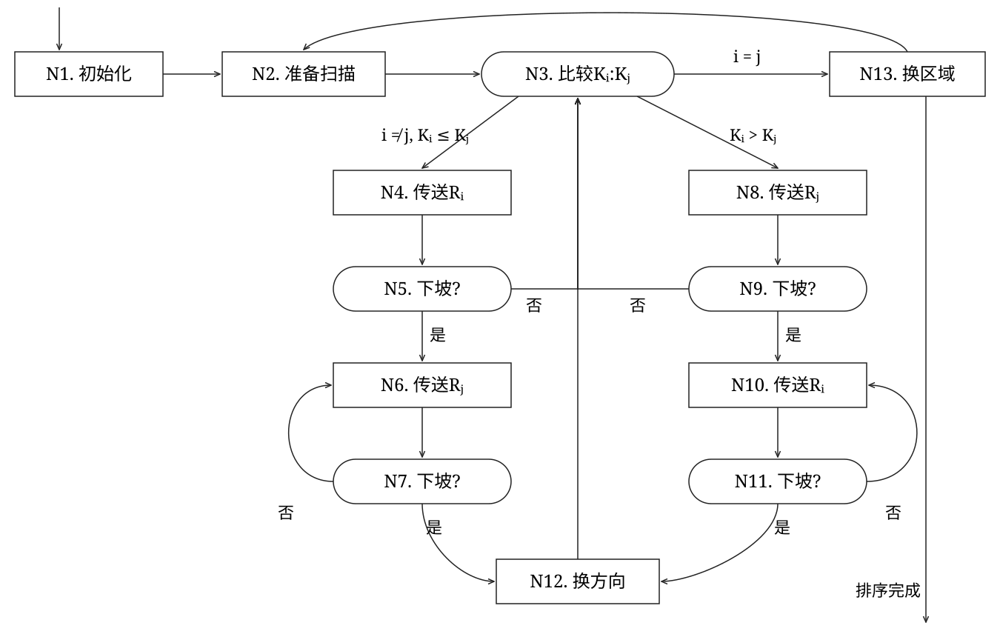

</div></div>

图 30　合并排序

算法包含一个很有技巧的特性, 习题 5 给出了解释.

<a id="pdf-132"></a>
<a id="p-126"></a>

为算法 N 编写 MIX 程序并不困难, 不过, 我们不需要构建整个程序就可以推测其特性的基本事实. 在随机条件下, $K_i>K_{i+1}$ 的概率是 $\tfrac12$, 所以输入数据中的递增游程数大约是 $\tfrac12N$. 根据稍有不同的假设, 5.1.3 节已经推导了有关游程数的详细信息. 每遍扫描减少一半游程数 (像习题 6 那样的罕见情况除外), 所以扫描遍数通常大约是 $\lg\tfrac12N=\lg N-1$. 每遍扫描都需要传送全部 $N$ 条记录, 根据习题 2 可知, 大多数时间花费在步骤 N3、N4、N5、N8、N9. 如果假定出现相等键的概率很低, 可以估算内层循环的时间如下:

<table><thead><tr><th></th><th>步骤</th><th>操作</th><th>时间</th></tr></thead><tbody><tr><td></td><td>N3</td><td><code>CMPA, JG, JE</code></td><td>$3.5u$</td></tr><tr><td rowspan="2">或者</td><td>N4</td><td><code>STA, INC</code></td><td>$3u$</td></tr><tr><td>N5</td><td><code>INC, LDA, CMPA, JGE</code></td><td>$6u$</td></tr><tr><td rowspan="2">或者</td><td>N8</td><td><code>STX, INC</code></td><td>$3u$</td></tr><tr><td>N9</td><td><code>DEC, LDX, CMPX, JGE</code></td><td>$6u$</td></tr></tbody></table>

于是每遍扫描中每条记录大约花费 $12.5u$, 对于平均情形和最差情形, 总运行时间都是渐近于 $12.5N\lg N$. 这稍慢于快速排序的平均时间, 相对于堆排序的优势也不足以构成占用两倍存储空间的正当理由, 因为程序 5.2.3H 的渐近运行时间绝不会超过 $18N\lg N$.


算法 N 中游程之间的边界线完全由 “下坡” 确定. 这可能成为一种优势: 以递增或递减顺序为主的输入文件可以非常快速地得到处理, 但它会拖慢主循环的速度. 我们也可以不去测试 “下坡” 的存在, 而是人为规定游程的长度. 比如说规定: 初始输入数据中所有游程的长度都是 1, 第一遍扫描之后所有游程的长度都是 2 (最后一个游程可能例外), ……, 第 $k$ 遍扫描之后所有游程的长度都是 $2^k$ (最后一个游程可能例外). 这种方法称为直接两路合并, 以与算法 N 中的 “自然” 合并相区分.

直接两路合并非常类似于算法 N, 它们的流程图基本相同, 具体操作内容却有很大不同, 最好还是再次写出整个算法:

<a id="alg-5-2-4-S"></a>

**算法 S (直接两路合并排序).** 和算法 N 一样, 使用两个存储区域对记录 $R_1,\ldots,R_N$ 排序.

**S1.[初始化.]** 置 $s\leftarrow0,p\leftarrow1$. (变量 $s,i,j,k,l,d$ 的意义见算法 N. 这里 $p$ 表示当前扫描中有待合并的递增游程的大小, 变量 $q$ 和 $r$ 跟踪一个游程中未合并的项目数.)

**S2.[准备扫描.]** 如果 $s=0$, 置 $i\leftarrow1,j\leftarrow N,k\leftarrow N,l\leftarrow2N+1$; 如果 $s=1$, 置 $i\leftarrow N+1,j\leftarrow2N,k\leftarrow0,l\leftarrow N+1$. 然后置 $d\leftarrow1,q\leftarrow p,r\leftarrow p$.

**S3.[比较 $K_i:K_j$.]** 如果 $K_i>K_j$, 转到 S8.

**S4.[传送 $R_i$.]** 置 $k\leftarrow k+d,R_k\leftarrow R_i$.

**S5.[游程结束?]** 置 $i\leftarrow i+1,q\leftarrow q-1$. 如果 $q>0$, 返回 S3.

**S6.[传送 $R_j$.]** 置 $k\leftarrow k+d$. 如果 $k=l$, 转到 S13; 否则置 $R_k\leftarrow R_j$.

**S7.[游程结束?]** 置 $j\leftarrow j-1,r\leftarrow r-1$. 如果 $r>0$, 返回 S6; 否则转到 S12.

**S8.[传送 $R_j$.]** 置 $k\leftarrow k+d,R_k\leftarrow R_j$.

**S9.[游程结束?]** 置 $j\leftarrow j-1,r\leftarrow r-1$. 如果 $r>0$, 返回 S3.

**S10.[传送 $R_i$.]** 置 $k\leftarrow k+d$. 如果 $k=l$, 转到 S13; 否则置 $R_k\leftarrow R_i$.

**S11.[游程结束?]** 置 $i\leftarrow i+1,q\leftarrow q-1$. 如果 $q>0$, 返回 S10.

**S12.[换方向.]** 置 $q\leftarrow p,r\leftarrow p,d\leftarrow-d$, 交换 $k\leftrightarrow l$. 如果 $j-i<p$, 返回 S10; 否则返回 S3.

**S13.[换区域.]** 置 $p\leftarrow p+p$. 如果 $p<N$, 置 $s\leftarrow1-s$, 返回 S2. 否则排序完成: 如果 $s=0$, 置 $(R_1,\ldots,R_N)\leftarrow(R_{N+1},\ldots,R_{2N})$. (当且仅当 $\lceil\lg N\rceil$ 是奇数或 $N=1$ 的平凡情形, 才执行最后的复制操作. 这与输入数据的分布无关, 因此有可能提前预测排序输出的位置, 从而避免复制.) ■

<a id="pdf-133"></a>
<a id="p-127"></a>

表 2 给出算法的示例. 令人惊奇的是: $N$ 不是 2 的幂时这个方法也能很好地工作, 被合并游程的长度并不都是 $2^k$, 对这些例外情形还没有明文规定! (见习题 8.) 以前关于 “下坡” 的测试已经被递减 $q$ 或 $r$ 并判断结果是否为 0 所代替, 这就把 MIX 的渐近运行时间缩短为 $11N\lg N$ 单位, 稍快于算法 N 能够达到的速度.

<a id="tab-5-2-4-2"></a>

表 2　直接两路合并排序

<table data-straight-table="2" style="border-collapse:collapse;table-layout:fixed;width:1024px;font-family:serif"><thead><tr><th style="width:64px;min-width:64px;border:0;padding:0"></th><th style="width:64px;min-width:64px;border:0;padding:0"></th><th style="width:64px;min-width:64px;border:0;padding:0"></th><th style="width:64px;min-width:64px;border:0;padding:0"></th><th style="width:64px;min-width:64px;border:0;padding:0"></th><th style="width:64px;min-width:64px;border:0;padding:0"></th><th style="width:64px;min-width:64px;border:0;padding:0"></th><th style="width:64px;min-width:64px;border:0;padding:0"></th><th style="width:64px;min-width:64px;border:0;padding:0"></th><th style="width:64px;min-width:64px;border:0;padding:0"></th><th style="width:64px;min-width:64px;border:0;padding:0"></th><th style="width:64px;min-width:64px;border:0;padding:0"></th><th style="width:64px;min-width:64px;border:0;padding:0"></th><th style="width:64px;min-width:64px;border:0;padding:0"></th><th style="width:64px;min-width:64px;border:0;padding:0"></th><th style="width:64px;min-width:64px;border:0;padding:0"></th></tr></thead><tbody>
<tr data-straight-state="0" style="background:transparent"><td style="width:64px;min-width:64px;border:0;border-right:1px solid #222;padding:8px 0;text-align:center;font-size:21px">503</td><td style="width:64px;min-width:64px;border:0;border-right:1px solid #222;padding:8px 0;text-align:center;font-size:21px">087</td><td style="width:64px;min-width:64px;border:0;border-right:1px solid #222;padding:8px 0;text-align:center;font-size:21px">512</td><td style="width:64px;min-width:64px;border:0;border-right:1px solid #222;padding:8px 0;text-align:center;font-size:21px">061</td><td style="width:64px;min-width:64px;border:0;border-right:1px solid #222;padding:8px 0;text-align:center;font-size:21px">908</td><td style="width:64px;min-width:64px;border:0;border-right:1px solid #222;padding:8px 0;text-align:center;font-size:21px">170</td><td style="width:64px;min-width:64px;border:0;border-right:1px solid #222;padding:8px 0;text-align:center;font-size:21px">897</td><td style="width:64px;min-width:64px;border:0;border-right:5px solid #222;padding:8px 0;text-align:center;font-size:21px">275</td><td style="width:64px;min-width:64px;border:0;border-right:1px solid #222;padding:8px 0;text-align:center;font-size:21px">653</td><td style="width:64px;min-width:64px;border:0;border-right:1px solid #222;padding:8px 0;text-align:center;font-size:21px">426</td><td style="width:64px;min-width:64px;border:0;border-right:1px solid #222;padding:8px 0;text-align:center;font-size:21px">154</td><td style="width:64px;min-width:64px;border:0;border-right:1px solid #222;padding:8px 0;text-align:center;font-size:21px">509</td><td style="width:64px;min-width:64px;border:0;border-right:1px solid #222;padding:8px 0;text-align:center;font-size:21px">612</td><td style="width:64px;min-width:64px;border:0;border-right:1px solid #222;padding:8px 0;text-align:center;font-size:21px">677</td><td style="width:64px;min-width:64px;border:0;border-right:1px solid #222;padding:8px 0;text-align:center;font-size:21px">765</td><td style="width:64px;min-width:64px;border:0;padding:8px 0;text-align:center;font-size:21px">703</td></tr>
<tr data-straight-state="1" style="background:transparent"><td style="width:64px;min-width:64px;border:0;padding:8px 0;text-align:center;font-size:21px">503</td><td style="width:64px;min-width:64px;border:0;border-right:1px solid #222;padding:8px 0;text-align:center;font-size:21px">703</td><td style="width:64px;min-width:64px;border:0;padding:8px 0;text-align:center;font-size:21px">512</td><td style="width:64px;min-width:64px;border:0;border-right:1px solid #222;padding:8px 0;text-align:center;font-size:21px">677</td><td style="width:64px;min-width:64px;border:0;padding:8px 0;text-align:center;font-size:21px">509</td><td style="width:64px;min-width:64px;border:0;border-right:1px solid #222;padding:8px 0;text-align:center;font-size:21px">908</td><td style="width:64px;min-width:64px;border:0;padding:8px 0;text-align:center;font-size:21px">426</td><td style="width:64px;min-width:64px;border:0;border-right:5px solid #222;padding:8px 0;text-align:center;font-size:21px">897</td><td style="width:64px;min-width:64px;border:0;padding:8px 0;text-align:center;font-size:21px">653</td><td style="width:64px;min-width:64px;border:0;border-right:1px solid #222;padding:8px 0;text-align:center;font-size:21px">275</td><td style="width:64px;min-width:64px;border:0;padding:8px 0;text-align:center;font-size:21px">170</td><td style="width:64px;min-width:64px;border:0;border-right:1px solid #222;padding:8px 0;text-align:center;font-size:21px">154</td><td style="width:64px;min-width:64px;border:0;padding:8px 0;text-align:center;font-size:21px">612</td><td style="width:64px;min-width:64px;border:0;border-right:1px solid #222;padding:8px 0;text-align:center;font-size:21px">061</td><td style="width:64px;min-width:64px;border:0;padding:8px 0;text-align:center;font-size:21px">765</td><td style="width:64px;min-width:64px;border:0;padding:8px 0;text-align:center;font-size:21px">087</td></tr>
<tr data-straight-state="2" style="background:transparent"><td style="width:64px;min-width:64px;border:0;padding:8px 0;text-align:center;font-size:21px">087</td><td style="width:64px;min-width:64px;border:0;padding:8px 0;text-align:center;font-size:21px">503</td><td style="width:64px;min-width:64px;border:0;padding:8px 0;text-align:center;font-size:21px">703</td><td style="width:64px;min-width:64px;border:0;border-right:1px solid #222;padding:8px 0;text-align:center;font-size:21px">765</td><td style="width:64px;min-width:64px;border:0;padding:8px 0;text-align:center;font-size:21px">154</td><td style="width:64px;min-width:64px;border:0;padding:8px 0;text-align:center;font-size:21px">170</td><td style="width:64px;min-width:64px;border:0;padding:8px 0;text-align:center;font-size:21px">509</td><td style="width:64px;min-width:64px;border:0;border-right:5px solid #222;padding:8px 0;text-align:center;font-size:21px">908</td><td style="width:64px;min-width:64px;border:0;padding:8px 0;text-align:center;font-size:21px">897</td><td style="width:64px;min-width:64px;border:0;padding:8px 0;text-align:center;font-size:21px">653</td><td style="width:64px;min-width:64px;border:0;padding:8px 0;text-align:center;font-size:21px">426</td><td style="width:64px;min-width:64px;border:0;border-right:1px solid #222;padding:8px 0;text-align:center;font-size:21px">275</td><td style="width:64px;min-width:64px;border:0;padding:8px 0;text-align:center;font-size:21px">677</td><td style="width:64px;min-width:64px;border:0;padding:8px 0;text-align:center;font-size:21px">612</td><td style="width:64px;min-width:64px;border:0;padding:8px 0;text-align:center;font-size:21px">512</td><td style="width:64px;min-width:64px;border:0;padding:8px 0;text-align:center;font-size:21px">061</td></tr>
<tr data-straight-state="3" style="background:transparent"><td style="width:64px;min-width:64px;border:0;padding:8px 0;text-align:center;font-size:21px">061</td><td style="width:64px;min-width:64px;border:0;padding:8px 0;text-align:center;font-size:21px">087</td><td style="width:64px;min-width:64px;border:0;padding:8px 0;text-align:center;font-size:21px">503</td><td style="width:64px;min-width:64px;border:0;padding:8px 0;text-align:center;font-size:21px">512</td><td style="width:64px;min-width:64px;border:0;padding:8px 0;text-align:center;font-size:21px">612</td><td style="width:64px;min-width:64px;border:0;padding:8px 0;text-align:center;font-size:21px">677</td><td style="width:64px;min-width:64px;border:0;padding:8px 0;text-align:center;font-size:21px">703</td><td style="width:64px;min-width:64px;border:0;border-right:5px solid #222;padding:8px 0;text-align:center;font-size:21px">765</td><td style="width:64px;min-width:64px;border:0;padding:8px 0;text-align:center;font-size:21px">908</td><td style="width:64px;min-width:64px;border:0;padding:8px 0;text-align:center;font-size:21px">897</td><td style="width:64px;min-width:64px;border:0;padding:8px 0;text-align:center;font-size:21px">653</td><td style="width:64px;min-width:64px;border:0;padding:8px 0;text-align:center;font-size:21px">509</td><td style="width:64px;min-width:64px;border:0;padding:8px 0;text-align:center;font-size:21px">426</td><td style="width:64px;min-width:64px;border:0;padding:8px 0;text-align:center;font-size:21px">275</td><td style="width:64px;min-width:64px;border:0;padding:8px 0;text-align:center;font-size:21px">170</td><td style="width:64px;min-width:64px;border:0;padding:8px 0;text-align:center;font-size:21px">154</td></tr>
<tr data-straight-state="4" style="background:transparent"><td style="width:64px;min-width:64px;border:0;padding:8px 0;text-align:center;font-size:21px">061</td><td style="width:64px;min-width:64px;border:0;padding:8px 0;text-align:center;font-size:21px">087</td><td style="width:64px;min-width:64px;border:0;padding:8px 0;text-align:center;font-size:21px">154</td><td style="width:64px;min-width:64px;border:0;padding:8px 0;text-align:center;font-size:21px">170</td><td style="width:64px;min-width:64px;border:0;padding:8px 0;text-align:center;font-size:21px">275</td><td style="width:64px;min-width:64px;border:0;padding:8px 0;text-align:center;font-size:21px">426</td><td style="width:64px;min-width:64px;border:0;padding:8px 0;text-align:center;font-size:21px">503</td><td style="width:64px;min-width:64px;border:0;padding:8px 0;text-align:center;font-size:21px">509</td><td style="width:64px;min-width:64px;border:0;padding:8px 0;text-align:center;font-size:21px">512</td><td style="width:64px;min-width:64px;border:0;padding:8px 0;text-align:center;font-size:21px">612</td><td style="width:64px;min-width:64px;border:0;padding:8px 0;text-align:center;font-size:21px">653</td><td style="width:64px;min-width:64px;border:0;padding:8px 0;text-align:center;font-size:21px">677</td><td style="width:64px;min-width:64px;border:0;padding:8px 0;text-align:center;font-size:21px">703</td><td style="width:64px;min-width:64px;border:0;padding:8px 0;text-align:center;font-size:21px">765</td><td style="width:64px;min-width:64px;border:0;padding:8px 0;text-align:center;font-size:21px">897</td><td style="width:64px;min-width:64px;border:0;padding:8px 0;text-align:center;font-size:21px">908</td></tr>
</tbody></table>

在实践中值得把算法 S 与直接插入结合起来. 我们可以用直接插入来排序 16 个项目的各组, 代替算法 S 的前四次扫描, 从而避免短合并造成相对浪费的簿记操作. 如同快速排序中看到的, 这种方法组合不会影响渐近运行时间, 却能提供一定的改进.

现在从数据结构的角度来研究算法 N 和算法 S. 为什么需要 $2N$ 个记录单元而不是 $N$ 个呢? 理由相当简单: 我们要处理四个可变大小的列表 (每遍扫描会有两个源列表和两个目标列表), 对于每一对顺序分配的列表, 使用 2.2.2 节讨论的标准的 “一起生长” 思想. 但有一半的存储空间总是没有用到, 稍加思索就会想到, 实际上应该对这四个列表使用链接分配. 如果向这 $N$ 条记录的每一条都添加一个链接字段, 就可以使用简单的链接操作来完成合并算法所需要的一切, 根本就不需要移动记录! 除非计算机存储器特别擅长顺序读写, 添加 $N$ 个链接字段通常要优于另外添加 $N$ 条记录所需要的空间, 减少记录移动也会节省时间. 因此, 我们也应当考虑下面这样的合并算法:


<a id="alg-5-2-4-L"></a>
<a id="pdf-134"></a>
<a id="p-128"></a>

**算法 L (列表合并排序).** 假定记录 $R_1,\ldots,R_N$ 包含键 $K_1,\ldots,K_N$ 和能够存储数值 $-(N+1)$ 到 $(N+1)$ 的链接字段 $L_1,\ldots,L_N$. 在文件开头与结尾的虚拟记录 $R_0$ 和 $R_{N+1}$ 中, 有两个辅助链接字段 $L_0$ 和 $L_{N+1}$. 本算法是一种 “列表排序”, 它设定链接字段, 把记录按递增顺序链接在一起. 排序完成后, $L_0$ 是拥有最小键的记录的下标, 而 $L_k\ (1\le k\le N)$ 是跟在 $R_k$ 后面的记录的下标, 如果 $R_k$ 是拥有最大键的记录, 则 $L_k=0$. (见式 5.2.1–(13).)

算法中 $R_0$ 和 $R_{N+1}$ 用作两个线性列表的列表头, 它们的子列表将被合并. 负链接表示有序子列表的末端, 零链接表示整个列表的末端. 假定 $N\ge2$.

记号 $|L_s|\leftarrow p$ 表示 “把 $L_s$ 置为 $p$ 或 $-p$, 保留 $L_s$ 原来的符号”. 这个运算非常适合于 MIX, 可惜并不适合大多数计算机. 可以采用直接方式修改算法, 得到一种对于大多数其他机器都同样高效的方法.

**L1.[准备两个列表.]** 置 $L_0\leftarrow1,\ L_{N+1}\leftarrow2,\ L_i\leftarrow-(i+2)\ (1\le i\le N-2),\ L_{N-1}\leftarrow L_N\leftarrow0$. (我们建立了包含 $R_1,R_3,R_5,\ldots$ 和 $R_2,R_4,R_6,\ldots$ 的两个列表, 负链接表示每个有序子列表仅包含一个元素. 利用初始数据中可能存在的顺序, 可以用另外一种方式完成这个步骤, 见习题 12.)

**L2.[开始新扫描.]** 置 $s\leftarrow0,t\leftarrow N+1,p\leftarrow L_s,q\leftarrow L_t$. 如果 $q=0$, 算法终止. (每遍扫描期间 $p$ 和 $q$ 遍历被合并的列表, $s$ 通常指向当前子列表中最近处理的记录, $t$ 指向上一个输出子列表的末端.)

**L3.[比较 $K_p:K_q$.]** 如果 $K_p>K_q$, 转到 L6.

**L4.[推进 $p$.]** 置 $|L_s|\leftarrow p,s\leftarrow p,p\leftarrow L_p$. 如果 $p>0$, 返回 L3.

**L5.[完成子列表.]** 置 $L_s\leftarrow q,s\leftarrow t$. 然后置 $t\leftarrow q,q\leftarrow L_q$, 重复执行一次或多次, 直到 $q\le0$. 最后转到 L8.

**L6.[推进 $q$.]**(L6–L7 对应于 L4–L5.) 置 $|L_s|\leftarrow q,s\leftarrow q,q\leftarrow L_q$. 如果 $q>0$, 返回 L3.

**L7.[完成子列表.]** 置 $L_s\leftarrow p,s\leftarrow t$. 然后置 $t\leftarrow p,p\leftarrow L_p$, 重复执行一次或多次, 直到 $p\le0$.

**L8.[结束扫描?]**(这时两个指针都已经移到各自子列表的末端, 所以有 $p\le0$ 和 $q\le0$.) 置 $p\leftarrow-p,q\leftarrow-q$. 如果 $q=0$, 置 $|L_s|\leftarrow p,|L_t|\leftarrow0$, 并返回 L2. 否则返回 L3. ■


表 3 给出执行算法的一个实例, 表中列出了每次遇到步骤 L2 时的链接设置. 可以用习题 5.2–12 的方法在算法的末尾重排记录 $R_1,\ldots,R_N$, 使它们的键有序. 列表合并与稀疏多项式加法 (见算法 2.2.4A) 之间有着重要的相似性.

<a id="tab-5-2-4-3"></a>

表 3　列表合并排序

<table data-link-table="3" style="border-collapse:collapse;table-layout:fixed;width:1224px;font-family:serif"><thead><tr><th style="width:72px;min-width:72px;border:0;padding:5px 0">$j$</th><th style="width:64px;min-width:64px;border:0;padding:5px 0">0</th><th style="width:64px;min-width:64px;border:0;padding:5px 0">1</th><th style="width:64px;min-width:64px;border:0;padding:5px 0">2</th><th style="width:64px;min-width:64px;border:0;padding:5px 0">3</th><th style="width:64px;min-width:64px;border:0;padding:5px 0">4</th><th style="width:64px;min-width:64px;border:0;padding:5px 0">5</th><th style="width:64px;min-width:64px;border:0;padding:5px 0">6</th><th style="width:64px;min-width:64px;border:0;padding:5px 0">7</th><th style="width:64px;min-width:64px;border:0;padding:5px 0">8</th><th style="width:64px;min-width:64px;border:0;padding:5px 0">9</th><th style="width:64px;min-width:64px;border:0;padding:5px 0">10</th><th style="width:64px;min-width:64px;border:0;padding:5px 0">11</th><th style="width:64px;min-width:64px;border:0;padding:5px 0">12</th><th style="width:64px;min-width:64px;border:0;padding:5px 0">13</th><th style="width:64px;min-width:64px;border:0;padding:5px 0">14</th><th style="width:64px;min-width:64px;border:0;padding:5px 0">15</th><th style="width:64px;min-width:64px;border:0;padding:5px 0">16</th><th style="width:64px;min-width:64px;border:0;padding:5px 0">17</th></tr></thead><tbody>
<tr style="background:transparent"><td style="border:0;border-top:1px solid #222;text-align:center;padding:5px 0">$K_j$</td><td style="border:0;border-top:1px solid #222;text-align:center;padding:5px 0">−</td><td style="border:0;border-top:1px solid #222;text-align:center;padding:5px 0">503</td><td style="border:0;border-top:1px solid #222;text-align:center;padding:5px 0">087</td><td style="border:0;border-top:1px solid #222;text-align:center;padding:5px 0">512</td><td style="border:0;border-top:1px solid #222;text-align:center;padding:5px 0">061</td><td style="border:0;border-top:1px solid #222;text-align:center;padding:5px 0">908</td><td style="border:0;border-top:1px solid #222;text-align:center;padding:5px 0">170</td><td style="border:0;border-top:1px solid #222;text-align:center;padding:5px 0">897</td><td style="border:0;border-top:1px solid #222;text-align:center;padding:5px 0">275</td><td style="border:0;border-top:1px solid #222;text-align:center;padding:5px 0">653</td><td style="border:0;border-top:1px solid #222;text-align:center;padding:5px 0">426</td><td style="border:0;border-top:1px solid #222;text-align:center;padding:5px 0">154</td><td style="border:0;border-top:1px solid #222;text-align:center;padding:5px 0">509</td><td style="border:0;border-top:1px solid #222;text-align:center;padding:5px 0">612</td><td style="border:0;border-top:1px solid #222;text-align:center;padding:5px 0">677</td><td style="border:0;border-top:1px solid #222;text-align:center;padding:5px 0">765</td><td style="border:0;border-top:1px solid #222;text-align:center;padding:5px 0">703</td><td style="border:0;border-top:1px solid #222;text-align:center;padding:5px 0">−</td></tr>
<tr data-link-state="0" style="background:transparent"><td style="border:0;text-align:center;padding:5px 0">$L_j$</td><td data-link-value="1" style="width:64px;min-width:64px;border:0;text-align:center;padding:5px 0;font-size:21px">1</td><td data-link-value="1" style="width:64px;min-width:64px;border:0;text-align:center;padding:5px 0;font-size:21px">−3</td><td data-link-value="1" style="width:64px;min-width:64px;border:0;text-align:center;padding:5px 0;font-size:21px">−4</td><td data-link-value="1" style="width:64px;min-width:64px;border:0;text-align:center;padding:5px 0;font-size:21px">−5</td><td data-link-value="1" style="width:64px;min-width:64px;border:0;text-align:center;padding:5px 0;font-size:21px">−6</td><td data-link-value="1" style="width:64px;min-width:64px;border:0;text-align:center;padding:5px 0;font-size:21px">−7</td><td data-link-value="1" style="width:64px;min-width:64px;border:0;text-align:center;padding:5px 0;font-size:21px">−8</td><td data-link-value="1" style="width:64px;min-width:64px;border:0;text-align:center;padding:5px 0;font-size:21px">−9</td><td data-link-value="1" style="width:64px;min-width:64px;border:0;text-align:center;padding:5px 0;font-size:21px">−10</td><td data-link-value="1" style="width:64px;min-width:64px;border:0;text-align:center;padding:5px 0;font-size:21px">−11</td><td data-link-value="1" style="width:64px;min-width:64px;border:0;text-align:center;padding:5px 0;font-size:21px">−12</td><td data-link-value="1" style="width:64px;min-width:64px;border:0;text-align:center;padding:5px 0;font-size:21px">−13</td><td data-link-value="1" style="width:64px;min-width:64px;border:0;text-align:center;padding:5px 0;font-size:21px">−14</td><td data-link-value="1" style="width:64px;min-width:64px;border:0;text-align:center;padding:5px 0;font-size:21px">−15</td><td data-link-value="1" style="width:64px;min-width:64px;border:0;text-align:center;padding:5px 0;font-size:21px">−16</td><td data-link-value="1" style="width:64px;min-width:64px;border:0;text-align:center;padding:5px 0;font-size:21px">0</td><td data-link-value="1" style="width:64px;min-width:64px;border:0;text-align:center;padding:5px 0;font-size:21px">0</td><td data-link-value="1" style="width:64px;min-width:64px;border:0;text-align:center;padding:5px 0;font-size:21px">2</td></tr>
<tr data-link-state="1" style="background:transparent"><td style="border:0;text-align:center;padding:5px 0">$L_j$</td><td data-link-value="1" style="width:64px;min-width:64px;border:0;text-align:center;padding:5px 0;font-size:21px">2</td><td data-link-value="1" style="width:64px;min-width:64px;border:0;text-align:center;padding:5px 0;font-size:21px">−6</td><td data-link-value="1" style="width:64px;min-width:64px;border:0;text-align:center;padding:5px 0;font-size:21px">1</td><td data-link-value="1" style="width:64px;min-width:64px;border:0;text-align:center;padding:5px 0;font-size:21px">−8</td><td data-link-value="1" style="width:64px;min-width:64px;border:0;text-align:center;padding:5px 0;font-size:21px">3</td><td data-link-value="1" style="width:64px;min-width:64px;border:0;text-align:center;padding:5px 0;font-size:21px">−10</td><td data-link-value="1" style="width:64px;min-width:64px;border:0;text-align:center;padding:5px 0;font-size:21px">5</td><td data-link-value="1" style="width:64px;min-width:64px;border:0;text-align:center;padding:5px 0;font-size:21px">−11</td><td data-link-value="1" style="width:64px;min-width:64px;border:0;text-align:center;padding:5px 0;font-size:21px">7</td><td data-link-value="1" style="width:64px;min-width:64px;border:0;text-align:center;padding:5px 0;font-size:21px">−13</td><td data-link-value="1" style="width:64px;min-width:64px;border:0;text-align:center;padding:5px 0;font-size:21px">9</td><td data-link-value="1" style="width:64px;min-width:64px;border:0;text-align:center;padding:5px 0;font-size:21px">12</td><td data-link-value="1" style="width:64px;min-width:64px;border:0;text-align:center;padding:5px 0;font-size:21px">−16</td><td data-link-value="1" style="width:64px;min-width:64px;border:0;text-align:center;padding:5px 0;font-size:21px">14</td><td data-link-value="1" style="width:64px;min-width:64px;border:0;text-align:center;padding:5px 0;font-size:21px">0</td><td data-link-value="1" style="width:64px;min-width:64px;border:0;text-align:center;padding:5px 0;font-size:21px">0</td><td data-link-value="1" style="width:64px;min-width:64px;border:0;text-align:center;padding:5px 0;font-size:21px">15</td><td data-link-value="1" style="width:64px;min-width:64px;border:0;text-align:center;padding:5px 0;font-size:21px">4</td></tr>
<tr data-link-state="2" style="background:transparent"><td style="border:0;text-align:center;padding:5px 0">$L_j$</td><td data-link-value="1" style="width:64px;min-width:64px;border:0;text-align:center;padding:5px 0;font-size:21px">4</td><td data-link-value="1" style="width:64px;min-width:64px;border:0;text-align:center;padding:5px 0;font-size:21px">3</td><td data-link-value="1" style="width:64px;min-width:64px;border:0;text-align:center;padding:5px 0;font-size:21px">1</td><td data-link-value="1" style="width:64px;min-width:64px;border:0;text-align:center;padding:5px 0;font-size:21px">−11</td><td data-link-value="1" style="width:64px;min-width:64px;border:0;text-align:center;padding:5px 0;font-size:21px">2</td><td data-link-value="1" style="width:64px;min-width:64px;border:0;text-align:center;padding:5px 0;font-size:21px">−13</td><td data-link-value="1" style="width:64px;min-width:64px;border:0;text-align:center;padding:5px 0;font-size:21px">8</td><td data-link-value="1" style="width:64px;min-width:64px;border:0;text-align:center;padding:5px 0;font-size:21px">5</td><td data-link-value="1" style="width:64px;min-width:64px;border:0;text-align:center;padding:5px 0;font-size:21px">7</td><td data-link-value="1" style="width:64px;min-width:64px;border:0;text-align:center;padding:5px 0;font-size:21px">0</td><td data-link-value="1" style="width:64px;min-width:64px;border:0;text-align:center;padding:5px 0;font-size:21px">12</td><td data-link-value="1" style="width:64px;min-width:64px;border:0;text-align:center;padding:5px 0;font-size:21px">10</td><td data-link-value="1" style="width:64px;min-width:64px;border:0;text-align:center;padding:5px 0;font-size:21px">9</td><td data-link-value="1" style="width:64px;min-width:64px;border:0;text-align:center;padding:5px 0;font-size:21px">14</td><td data-link-value="1" style="width:64px;min-width:64px;border:0;text-align:center;padding:5px 0;font-size:21px">16</td><td data-link-value="1" style="width:64px;min-width:64px;border:0;text-align:center;padding:5px 0;font-size:21px">0</td><td data-link-value="1" style="width:64px;min-width:64px;border:0;text-align:center;padding:5px 0;font-size:21px">15</td><td data-link-value="1" style="width:64px;min-width:64px;border:0;text-align:center;padding:5px 0;font-size:21px">6</td></tr>
<tr data-link-state="3" style="background:transparent"><td style="border:0;text-align:center;padding:5px 0">$L_j$</td><td data-link-value="1" style="width:64px;min-width:64px;border:0;text-align:center;padding:5px 0;font-size:21px">4</td><td data-link-value="1" style="width:64px;min-width:64px;border:0;text-align:center;padding:5px 0;font-size:21px">3</td><td data-link-value="1" style="width:64px;min-width:64px;border:0;text-align:center;padding:5px 0;font-size:21px">6</td><td data-link-value="1" style="width:64px;min-width:64px;border:0;text-align:center;padding:5px 0;font-size:21px">7</td><td data-link-value="1" style="width:64px;min-width:64px;border:0;text-align:center;padding:5px 0;font-size:21px">2</td><td data-link-value="1" style="width:64px;min-width:64px;border:0;text-align:center;padding:5px 0;font-size:21px">0</td><td data-link-value="1" style="width:64px;min-width:64px;border:0;text-align:center;padding:5px 0;font-size:21px">8</td><td data-link-value="1" style="width:64px;min-width:64px;border:0;text-align:center;padding:5px 0;font-size:21px">5</td><td data-link-value="1" style="width:64px;min-width:64px;border:0;text-align:center;padding:5px 0;font-size:21px">1</td><td data-link-value="1" style="width:64px;min-width:64px;border:0;text-align:center;padding:5px 0;font-size:21px">14</td><td data-link-value="1" style="width:64px;min-width:64px;border:0;text-align:center;padding:5px 0;font-size:21px">12</td><td data-link-value="1" style="width:64px;min-width:64px;border:0;text-align:center;padding:5px 0;font-size:21px">10</td><td data-link-value="1" style="width:64px;min-width:64px;border:0;text-align:center;padding:5px 0;font-size:21px">13</td><td data-link-value="1" style="width:64px;min-width:64px;border:0;text-align:center;padding:5px 0;font-size:21px">9</td><td data-link-value="1" style="width:64px;min-width:64px;border:0;text-align:center;padding:5px 0;font-size:21px">16</td><td data-link-value="1" style="width:64px;min-width:64px;border:0;text-align:center;padding:5px 0;font-size:21px">0</td><td data-link-value="1" style="width:64px;min-width:64px;border:0;text-align:center;padding:5px 0;font-size:21px">15</td><td data-link-value="1" style="width:64px;min-width:64px;border:0;text-align:center;padding:5px 0;font-size:21px">11</td></tr>
<tr data-link-state="4" style="background:transparent"><td style="border:0;text-align:center;padding:5px 0">$L_j$</td><td data-link-value="1" style="width:64px;min-width:64px;border:0;text-align:center;padding:5px 0;font-size:21px">4</td><td data-link-value="1" style="width:64px;min-width:64px;border:0;text-align:center;padding:5px 0;font-size:21px">12</td><td data-link-value="1" style="width:64px;min-width:64px;border:0;text-align:center;padding:5px 0;font-size:21px">11</td><td data-link-value="1" style="width:64px;min-width:64px;border:0;text-align:center;padding:5px 0;font-size:21px">13</td><td data-link-value="1" style="width:64px;min-width:64px;border:0;text-align:center;padding:5px 0;font-size:21px">2</td><td data-link-value="1" style="width:64px;min-width:64px;border:0;text-align:center;padding:5px 0;font-size:21px">0</td><td data-link-value="1" style="width:64px;min-width:64px;border:0;text-align:center;padding:5px 0;font-size:21px">8</td><td data-link-value="1" style="width:64px;min-width:64px;border:0;text-align:center;padding:5px 0;font-size:21px">5</td><td data-link-value="1" style="width:64px;min-width:64px;border:0;text-align:center;padding:5px 0;font-size:21px">10</td><td data-link-value="1" style="width:64px;min-width:64px;border:0;text-align:center;padding:5px 0;font-size:21px">14</td><td data-link-value="1" style="width:64px;min-width:64px;border:0;text-align:center;padding:5px 0;font-size:21px">1</td><td data-link-value="1" style="width:64px;min-width:64px;border:0;text-align:center;padding:5px 0;font-size:21px">6</td><td data-link-value="1" style="width:64px;min-width:64px;border:0;text-align:center;padding:5px 0;font-size:21px">3</td><td data-link-value="1" style="width:64px;min-width:64px;border:0;text-align:center;padding:5px 0;font-size:21px">9</td><td data-link-value="1" style="width:64px;min-width:64px;border:0;text-align:center;padding:5px 0;font-size:21px">16</td><td data-link-value="1" style="width:64px;min-width:64px;border:0;text-align:center;padding:5px 0;font-size:21px">7</td><td data-link-value="1" style="width:64px;min-width:64px;border:0;text-align:center;padding:5px 0;font-size:21px">15</td><td data-link-value="1" style="width:64px;min-width:64px;border:0;text-align:center;padding:5px 0;font-size:21px">0</td></tr>
</tbody></table>

现在为算法 L 编写 MIX 程序, 从速度与空间的观点来看看, 列表操作是否具备优势:

<a id="prog-5-2-4-L"></a>

**程序 L (列表合并排序).** 为方便起见, 假定记录的长度为一个字, $L_j$ 位于单元 $\mathtt{INPUT}+j$ 的 (0:2) 字段, $K_j$ 位于 (3:5) 字段; $\mathrm{rI1}\equiv p,\ \mathrm{rI2}\equiv q,\ \mathrm{rI3}\equiv s,\ \mathrm{rI4}\equiv t,\ \mathrm{rA}\equiv K_q;\ N\ge2$.

<a id="pdf-135"></a>
<a id="p-129"></a>

```mixal
01 L     EQU  0:2                         字段定义
02 ABSL  EQU  1:2
03 KEY   EQU  3:5
04 START ENT1 N-2               1         L1. 准备两个列表.
05       ENNA 2,1               N-2
06       STA  INPUT,1(L)        N-2       Li ← -(i+2).
07       DEC1 1                 N-2
08       J1P  *-3               N-2       N-2 ≥ i > 0.
09       ENTA 1                 1
10       STA  INPUT(L)          1         L0 ← 1.
11       ENTA 2                 1
12       STA  INPUT+N+1(L)      1         LN+1 ← 2.
13       STZ  INPUT+N-1(L)      1         LN-1 ← 0.
14       STZ  INPUT+N(L)        1         LN ← 0.
15       JMP  L2                1         转到L2.
16 L3Q   LDA  INPUT,2           C″+B′     L3. 比较Kp:Kq.
17 L3P   CMPA INPUT,1(KEY)      C
18       JL   L6                C         如果Kq < Kp，则转到L6.
19 L4    ST1  INPUT,3(ABSL)     C′        L4. 推进p. |Ls| ← p.
20       ENT3 0,1               C′        s ← p.
21       LD1  INPUT,1(L)        C′        p ← Lp.
22       J1P  L3P               C′        如果p > 0，则转到L3.
23 L5    ST2  INPUT,3(L)        B′        L5. 完成子列表. Ls ← q.
24       ENT3 0,4               B′        s ← t.
25       ENT4 0,2               D′        t ← q.
26       LD2  INPUT,2(L)        D′        q ← Lq.
27       J2P  *-2               D′        如果q > 0，则重复.
28       JMP  L8                B′        转到L8.
29 L6    ST2  INPUT,3(ABSL)     C″        L6. 推进q. |Ls| ← q.
30       ENT3 0,2               C″        s ← q.
31       LD2  INPUT,2(L)        C″        q ← Lq.
32       J2P  L3Q               C″        如果q > 0，则转到L3.
33 L7    ST1  INPUT,3(L)        B″        L7. 完成子列表. Ls ← p.
34       ENT3 0,4               B″        s ← t.
35       ENT4 0,1               D″        t ← p.
36       LD1  INPUT,1(L)        D″        p ← Lp.
37       J1P  *-2               D″        如果p > 0，则重复.
38 L8    ENN1 0,1               B         L8. 结束扫描? p ← -p.
39       ENN2 0,2               B         q ← -q.
40       J2NZ L3Q               B         如果q ≠ 0，则转到L3.
41       ST1  INPUT,3(ABSL)     A         |Ls| ← p.
42       STZ  INPUT,4(ABSL)     A         |Lt| ← 0.
43 L2    ENT3 0                 A+1       L2. 开始新扫描. s ← 0.
44       ENT4 N+1               A+1       t ← N+1.
45       LD1  INPUT(L)          A+1       p ← Ls.
46       LD2  INPUT+N+1(L)      A+1       q ← Lt.
47       J2NZ L3Q               A+1       如果q ≠ 0，则转到L3.
```


可以利用前面已经多次看到的技术来推导程序运行时间 (见习题 13 和 14), 平均运行时间近似于 $(10N\lg N+4.92N)u$, 标准差很小, 为 $\sqrt N$ 量级. 习题 15 表明, 运行时间可以缩减至大约 $(8N\lg N)u$, 代价是需要相当长的程序.

在执行内部合并时, 链接存储技术显然要优于顺序分配: 需要的存储空间较少, 程序运行大约快 10%至 20%. 卢瑟·伍德拉姆 [*IBM Systems J.* **8** (1969), 189–203] 和阿瑟·伍德尔 [*Comp. J.* **13** (1970), 110–111] 发表过类似算法.

### 习题

<a id="ex-5-2-4-1"></a>

1. [21] 推广算法 M, 对输入文件 $x_{i1}\le\cdots\le x_{im_i}\ (i=1,2,\ldots,k)$ 执行 $k$ 路合并.　[答案](#ans-5-2-4-1)

<a id="ex-5-2-4-2"></a>

2. [M24] 把 $m$ 个 $x$ 插入 $n$ 个 $y$ 中, 有 $\binom{m+n}{m}$ 种可能方式, 假定每种方式都是等可能的, 试求算法 M 中步骤 M2 执行次数的均值和标准偏差. 这个量的最大值和最小值是多少?　[答案](#ans-5-2-4-2)

<a id="ex-5-2-4-3"></a>

▶ 3. [20] (更新) 给定记录 $R_1,\ldots,R_M$ 和 $R'_1,\ldots,R'_N$, 它们的键都是严格递增的, 也就是说 $K_1<\cdots<K_M$ 和 $K'_1<\cdots<K'_N$. 说明如何修改算法 M 以得到一个合并文件, 合并过程中, 如果第一个文件中记录 $R_i$ 的键也出现在第二个文件中, 则放弃这条记录.　[答案](#ans-5-2-4-3)

<a id="pdf-136"></a>
<a id="p-130"></a>

<a id="ex-5-2-4-4"></a>

4. [21] 正文中提到, 可以把合并排序看作插入排序的推广. 试说明: 合并排序也与图 23 描述的树选择排序有很强的相关性.　[答案](#ans-5-2-4-4)

<a id="ex-5-2-4-5"></a>

▶ 5. [21] 证明: 在算法 N 的步骤 N6 和步骤 N10 中, $i$ 绝不会等于 $j$. (因此, 在这些步骤中不需要判断是否应转到步骤 N13.)　[答案](#ans-5-2-4-5)

<a id="ex-5-2-4-6"></a>

6. [22] 找出 $\{1,2,\ldots,16\}$ 的一个排列 $K_1K_2\ldots K_{16}$, 使得　[答案](#ans-5-2-4-6)

$$
K_2>K_3,\quad K_4>K_5,\quad K_6>K_7,\quad K_8>K_9,\quad K_{10}<K_{11},\quad K_{12}<K_{13},\quad K_{14}<K_{15},
$$

而算法 N 仅用两遍扫描就可以完成对这个文件的排序. (因为有八个或更多个游程, 所以我们预期在第一遍扫描之后至少有四个游程, 在第二遍扫描之后有两个游程, 如此一来, 通常至少要等到三遍扫描之后才能完成排序. 通过仅仅两遍扫描就完成排序, 这是怎样做到的?)

<a id="ex-5-2-4-7"></a>

7. [16] 给出算法 S 需要的扫描遍数的确切公式, 把它表示为 $N$ 的函数.　[答案](#ans-5-2-4-7)

<a id="ex-5-2-4-8"></a>

8. [22] 在算法 S 中, 变量 $q$ 和 $r$ 用于表示当前正在处理的游程中未合并元素的长度, $q$ 和 $r$ 在开始时都等于 $p$, 而游程并非总是这一长度. 这是如何正常工作的呢?　[答案](#ans-5-2-4-8)

<a id="ex-5-2-4-9"></a>

9. [24] 为算法 S 编写 MIX 程序. 用类似于程序 L 中 $A,B',B'',C',\ldots$ 这样的量来指明指令频率.

<a id="ex-5-2-4-10"></a>

10. [25] (戴维·贝尔) 证明: 顺序分配的直接两路合并至多需要 $\tfrac32N$ 个存储单元即可完成, 而不是像算法 S 那样需要 $2N$ 个存储单元.　[答案](#ans-5-2-4-10)

<a id="ex-5-2-4-11"></a>

11. [21] 算法 L 是稳定排序方法吗?　[答案](#ans-5-2-4-11)

<a id="ex-5-2-4-12"></a>

▶ 12. [22] 修订算法 L 的步骤 L1, 利用最初存在的递增游程, 使两路合并是 “自然” 的. (特别地, 如果输入已经有序, 则在执行你的步骤 L1 之后, 步骤 L2 应立即终止算法.)　[答案](#ans-5-2-4-12)

<a id="ex-5-2-4-13"></a>

▶ 13. [M34] 仿照本章其他分析的风格, 试分析程序 L 的平均运行时间: 解释量 $A,B,B',\ldots$ 的含义, 说明如何计算它们的确切平均值. 程序 L 需要多长时间来排序表 3 的 16 个数?　[答案](#ans-5-2-4-13)

<a id="ex-5-2-4-14"></a>

14. [M24] 设 $N$ 的二进制表示是 $2^{e_1}+2^{e_2}+\cdots+2^{e_t}$, 其中 $e_1>e_2>\cdots>e_t\ge0,t\ge1$. 证明: 算法 L 执行的键比较次数至多是 $1-2^{e_t}+\sum_{k=1}^t(e_k+k-1)2^{e_k}$.　[答案](#ans-5-2-4-14)

<a id="ex-5-2-4-15"></a>

15. [20] 算法 L 的手算模拟表明, 它偶尔会做一些冗余运算. 每次从步骤 L4 (或步骤 L6) 返回步骤 L3 时, 我们都有 $L_s=p$ (或 $L_s=q$), 所以步骤 L4 和步骤 L6 中的赋值 $|L_s|\leftarrow p$ 和 $|L_s|\leftarrow q$ 大约有一半时候是不必要的. 如何改进程序 L 以消除这种冗余?　[答案](#ans-5-2-4-15)

<a id="ex-5-2-4-16"></a>

16. [28] 以三路合并为基础设计一个类似于算法 L 的列表合并算法.　[答案](#ans-5-2-4-16)

<a id="ex-5-2-4-17"></a>

17. [20] (约翰·麦卡锡) 设 $N$ 的二进制表示如习题 14 所示, 假定我们有 $N$ 条记录, 分布在 $t$ 个有序子文件中, 这些子文件分别有 $2^{e_1},2^{e_2},\ldots,2^{e_t}$ 条记录. 现在添加新的第 $(N+1)$ 条记录, 执行 $N\leftarrow N+1$, 试说明如何保持这种状态. (所得到的算法可以称为联机合并排序.)　[答案](#ans-5-2-4-17)

<a id="ex-5-2-4-18"></a>

18. [40] (米哈伊尔·克龙罗德) 给定一个包含 $N$ 条记录的文件, 其中仅有两个游程　[答案](#ans-5-2-4-18)

$$
K_1\le\cdots\le K_M\quad\text{和}\quad K_{M+1}\le\cdots\le K_N,
$$

不管 $M$ 和 $N$ 的大小如何, 仅使用固定数量的少量附加存储空间, 是否有可能在随机存储器中用 $O(N)$ 个操作排序这个文件? (本节介绍的所有合并算法都使用了与 $N$ 成正比的额外存储空间.)

<a id="ex-5-2-4-19"></a>

19. [26] 考虑具有 $n$ 个 “栈” 的铁路切换网络, $n=5$ 的情形如图 31 所示. 习题 2.2.1–2 至 2.2.1–5 曾考虑过单栈网络. 我们观察到在单栈情形中, 如果有 $N$ 节火车车厢从右侧进入, 这些车厢的 $N!$ 种排列中, 仅有很少一些排列方式可以出现在左侧.　[答案](#ans-5-2-4-19)

在 $n$ 栈网络中, 假定有 $2^n$ 节车厢从右侧进入. 证明: 通过一系列适当操作, 这些车厢的 $2^n!$ 种可能排列中的每一种都可以在左侧得到. (每个栈实际上远大于图中所示大小, 必要时可以大到能够容纳所有车厢.)

<a id="pdf-137"></a>
<a id="p-131"></a>

<a id="fig-5-31"></a>

<div class="source-tableau-group" style="overflow-x:auto;max-width:100%"><div style="width:1400px">

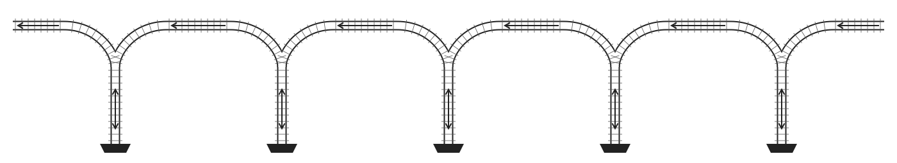

</div></div>

图 31　具有五个 “栈” 的铁路网络
<a id="ex-5-2-4-20"></a>

20. [47] 采用习题 2.2.1–4 的记号, 通过 $n$ 栈铁路网络最多可以生成 $N$ 个元素的 $a_N^n$ 个排列. 因此, 为获得全部 $N!$ 个排列, 需要的栈数至少是 $\log N!/\log a_N\approx\log_4N$. 习题 19 证明了至多需要 $\lceil\lg N\rceil$ 个栈. 当 $N\to\infty$ 时, 所需栈数的真正增长率是多少?　[答案](#ans-5-2-4-20)


<a id="ex-5-2-4-21"></a>

21. [23] (艾伦·史密斯) 如何扩展算法 L, 使得除排序之外, 它还能计算输入排列的反序个数.

<a id="ex-5-2-4-22"></a>

22. [28] (约翰·巴尼特) 设计一种方案来加快对多字键的合并排序. (习题 5.2.2–30 考虑了快速排序的类似问题.)　[答案](#ans-5-2-4-22)

<a id="ex-5-2-4-23"></a>

23. [M30] 习题 13 和 14 分析了合并排序的 “自下而上” 或迭代版本, 排序 $N$ 项的成本 $c(N)$ 满足递推式　[答案](#ans-5-2-4-23)

$$
c(N)=c(2^k)+c(N-2^k)+f(2^k,N-2^k)\quad(2^k<N\le2^{k+1}),
$$

式中 $f(m,n)$ 是合并 $m$ 项和 $n$ 项的成本. 试研究 “自上而下” 或分而治之递推式

$$
c(N)=c(\lceil N/2\rceil)+c(\lfloor N/2\rfloor)+f(\lceil N/2\rceil,\lfloor N/2\rfloor)\quad(N>1),
$$

以递归方式编写合并排序程序时, 会出现这个公式.

<a id="sec-5-2-5"></a>

### 5.2.5　分布排序

我们现在开始讨论一类很重要的排序方法, 从 5.4.7 节将要讨论的观点来看, 这些方法本质上恰好与合并方法相反. 远在电子计算机出现之前的很多年里, 人们就已经使用这些方法对穿孔卡片排序. 计算机程序设计中也能使用这些方法, 它们以键的数位为基础, 所以称为 “桶排序”“基数排序” 或 “数字排序”.

假定要对一副 52 张纸牌排序. 我们可以定义面值顺序

$$
\mathrm A<2<3<4<5<6<7<8<9<10<\mathrm J<\mathrm Q<\mathrm K,
$$

并定义花色顺序

$$
\clubsuit<\diamondsuit<\heartsuit<\spadesuit.
$$

如果 (i) 一张牌的花色低于另一张牌的花色, 或者 (ii) 花色相同, 但面值较小, 则说这张牌排在另一张之前. (这是有序对之间的字典序的特例, 见习题 5–2.) 于是

$$
\mathrm A\clubsuit<2\clubsuit<\cdots<\mathrm K\clubsuit<\mathrm A\diamondsuit<\cdots<\mathrm Q\spadesuit<\mathrm K\spadesuit.
$$

可以用前面已经讨论过的任何方法对纸牌排序. 玩牌的人通常使用一种多少类似于基数交换思想的技巧: 先按花色将纸牌分为四堆, 然后调整每一堆, 直到所有这些牌都有序.

但还有一种更快的方式可以达到目的! 首先把这些牌面朝上分为 13 堆, 每种面值一堆. 然后把这 13 堆牌收集在一起: 四个 A 放在下面, 然后在上面放 2, 接下来是 3, 以此类推, 最后把四个 K 面朝上放在顶部. 把这些牌翻过来面朝下, 再次发牌, 这次按花色分为四堆. (在发牌时, 再次把这些牌翻为面朝上.) 收集这四堆牌, 梅花在下面, 然后是方块、红心和黑桃, 这副牌就完全有序了.

<a id="pdf-138"></a>
<a id="p-132"></a>

同样的思想也适用于数字和字母数据的排序. 为什么它会有效呢? 因为 (在上面的纸牌示例中) 如果两张牌最终出现在不同的堆中, 那它们的花色就不一样, 所以较低花色的纸牌会放在下面. 但是, 如果两张牌花色相同 (最后会进入同一堆中), 由于先前的排序它们已处于正确的顺序. 换句话说, 在第二轮发牌时, 四堆牌的每一堆面值都会是递增顺序. 对这个证明过程加以抽象化, 能够证明任何字典序都可以通过这种方式实现, 详细信息见本章开头习题 5–2 的解答.


前面刚刚介绍的排序方法并非一目了然, 也不清楚是谁首先发现它这么好用. 1923 年, IBM 的制表机器公司 (Tabulating Machines Company) 分部发表了题为 “The Inventory Simplified” 的 19 页小册子, 提出一种有趣的 “数字计划” 方法, 用于他们的电动排序机上求乘积的总和: 例如, 假定我们希望用第 1–10 列穿孔的数乘以第 23–25 列穿孔的数, 然后把大量卡片上的所有这些乘积加起来. 可以先对第 25 列排序, 利用制表机器计算 $a_1,a_2,\ldots,a_9$ 等量, 其中 $a_k$ 是针对所有在第 25 列拥有 $k$ 值的卡片, 对第 1–10 列求得的总和. 然后对第 24 列排序, 计算类似的总和 $b_1,b_2,\ldots,b_9$, 同样对第 23 列计算 $c_1,c_2,\ldots,c_9$. 容易看出所求的乘积总和是

$$
a_1+2a_2+\cdots+9a_9+10b_1+20b_2+\cdots+90b_9+100c_1+200c_2+\cdots+900c_9.
$$

这种穿孔卡片制表方法很自然地引出了 “最低有效位优先” 的基数排序, 所以它可能已为机器操作员所熟悉. 这个排序原理最早发表的参考文献出现在莱斯利·科姆里 [*Transactions of the Office Machinery Users’ Assoc., Ltd.* (1929), 25–37, 特别是第 28 页] 关于穿孔卡片设备的早期讨论中.

为了处理计算机内部的基数排序, 必须决定如何处理这些 “堆”. 假定共有 $M$ 堆. 我们可以留出 $M$ 个存储区域, 把每条记录从输入区域移到适当的 “堆” 区域. 但这个做法不能令人满意, 因为每个区域都必须大到能够容纳 $N$ 个项目, 这需要 $(M+1)N$ 个记录空间. 因此大多数人拒绝考虑计算机内部的基数排序, 但后来情况有所改变, 哈罗德·苏厄德指出 [Master’s thesis, M.I.T. Digital Computer Laboratory Report R-232 (1954), 25–28], 仅需 $2N$ 个记录区域和 $M$ 个计数字段就可以实现同样效果. 简单地提前扫描这些数据, 计算出 $M$ 堆中每一堆的元素数目, 这样就可以准确地告诉我们如何为各堆分配存储. 在 “分布计数排序” 算法 5.2D 中已经应用了这个思想.

于是可采用以下方式执行基数排序: 首先根据键的最低有效位 (在基 $M$ 表示法中) 执行分布排序, 把记录从输入区域移到辅助区域. 然后根据下一个最低有效位执行另一次分布排序, 把记录移回原始输入区域, 以此类推, 直到 (对最高有效位的) 最后一次扫描把所有记录排成期望顺序.

如果有一台十进制计算机, 键拥有 12 个数位, 并且 $N$ 相当大, 则可以选择 $M=1000$ (三个十进制数位看作一个基 1000 数位). 那么, 无论 $N$ 大小如何, 排序将在四遍扫描中完成. 与此类似, 如果有一台二进制计算机, 键拥有 40 个二进制位, 令 $M=1024=2^{10}$, 可以用四遍扫描完成排序. 实际上, 每遍扫描包括三个部分 (计数、分配、移动). 弗兰德建议 [*JACM* **3** (1956), 151], 以另外增加 $M$ 个存储单元为代价, 合并这三部分中的两个: 在第 $k$ 遍扫描移动记录时, 为第 $k+1$ 遍扫描累加计数.

表 1 说明如何对我们的 16 个示例数应用基数排序, 其中 $M=10$. 基数排序对如此小的 $N$ 值通常没有什么用处, 像这样的小示例只是为了说明这种方法足以完成任务, 而不是为了演示效率.

<a id="pdf-139"></a>
<a id="p-133"></a>

然而, 警觉的 “现代” 读者会注意到: 为分配存储而计算数位个数的整体思想, 受到顺序数据表示这样的老式思想的束缚. 我们知道, 链接分配是专门为处理一组可变大小的表格而设计的, 所以很自然地就会为基数排序选择链接数据结构. 由于我们串行遍历每一堆, 所以只需要每一项到它的后继者的单向链接. 此外, 从来都不需要移动记录. 我们只需要调整这些链接, 轻松愉快地处理列表的后续记录. 所需的存储数量是 $(1+\epsilon)N+2\epsilon M$ 条记录, 其中 $\epsilon$ 是一个链接字段占用的空间数量. 这个过程的正式细节十分有意义, 它给出了典型数据结构操作的一个出色示例, 把顺序分配和链接分配结合在一起:


<a id="tab-5-2-5-1"></a>

表 1　基数排序

<table data-distribution-table="1" style="width:1450px;table-layout:fixed;border-collapse:collapse;font-family:serif;border-top:1px solid #222;border-bottom:1px solid #222"><thead><tr><th style="width:330px;min-width:330px;border:0;padding:0"></th><th style="width:70px;min-width:70px;border:0;padding:0"></th><th style="width:70px;min-width:70px;border:0;padding:0"></th><th style="width:70px;min-width:70px;border:0;padding:0"></th><th style="width:70px;min-width:70px;border:0;padding:0"></th><th style="width:70px;min-width:70px;border:0;padding:0"></th><th style="width:70px;min-width:70px;border:0;padding:0"></th><th style="width:70px;min-width:70px;border:0;padding:0"></th><th style="width:70px;min-width:70px;border:0;padding:0"></th><th style="width:70px;min-width:70px;border:0;padding:0"></th><th style="width:70px;min-width:70px;border:0;padding:0"></th><th style="width:70px;min-width:70px;border:0;padding:0"></th><th style="width:70px;min-width:70px;border:0;padding:0"></th><th style="width:70px;min-width:70px;border:0;padding:0"></th><th style="width:70px;min-width:70px;border:0;padding:0"></th><th style="width:70px;min-width:70px;border:0;padding:0"></th><th style="width:70px;min-width:70px;border:0;padding:0"></th></tr></thead><tbody>
<tr data-distribution-row="0" style="background:transparent"><td style="width:330px;min-width:330px;border:0;padding:8px 4px">输入区域内容: </td><td style="width:70px;min-width:70px;border:0;padding:8px 0;text-align:center;font-size:21px" data-value="1">503</td><td style="width:70px;min-width:70px;border:0;padding:8px 0;text-align:center;font-size:21px" data-value="1">087</td><td style="width:70px;min-width:70px;border:0;padding:8px 0;text-align:center;font-size:21px" data-value="1">512</td><td style="width:70px;min-width:70px;border:0;padding:8px 0;text-align:center;font-size:21px" data-value="1">061</td><td style="width:70px;min-width:70px;border:0;padding:8px 0;text-align:center;font-size:21px" data-value="1">908</td><td style="width:70px;min-width:70px;border:0;padding:8px 0;text-align:center;font-size:21px" data-value="1">170</td><td style="width:70px;min-width:70px;border:0;padding:8px 0;text-align:center;font-size:21px" data-value="1">897</td><td style="width:70px;min-width:70px;border:0;padding:8px 0;text-align:center;font-size:21px" data-value="1">275</td><td style="width:70px;min-width:70px;border:0;padding:8px 0;text-align:center;font-size:21px" data-value="1">653</td><td style="width:70px;min-width:70px;border:0;padding:8px 0;text-align:center;font-size:21px" data-value="1">426</td><td style="width:70px;min-width:70px;border:0;padding:8px 0;text-align:center;font-size:21px" data-value="1">154</td><td style="width:70px;min-width:70px;border:0;padding:8px 0;text-align:center;font-size:21px" data-value="1">509</td><td style="width:70px;min-width:70px;border:0;padding:8px 0;text-align:center;font-size:21px" data-value="1">612</td><td style="width:70px;min-width:70px;border:0;padding:8px 0;text-align:center;font-size:21px" data-value="1">677</td><td style="width:70px;min-width:70px;border:0;padding:8px 0;text-align:center;font-size:21px" data-value="1">765</td><td style="width:70px;min-width:70px;border:0;padding:8px 0;text-align:center;font-size:21px" data-value="1">703</td></tr>
<tr data-distribution-row="1" style="background:transparent"><td style="width:330px;min-width:330px;border:0;padding:8px 4px">个位数字分布的计数: </td><td style="width:70px;min-width:70px;border:0;padding:8px 0;text-align:center;font-size:21px" data-empty="1"></td><td style="width:70px;min-width:70px;border:0;padding:8px 0;text-align:center;font-size:21px" data-empty="1"></td><td style="width:70px;min-width:70px;border:0;padding:8px 0;text-align:center;font-size:21px" data-empty="1"></td><td style="width:70px;min-width:70px;border:0;padding:8px 0;text-align:center;font-size:21px" data-empty="1"></td><td style="width:70px;min-width:70px;border:0;padding:8px 0;text-align:center;font-size:21px" data-empty="1"></td><td style="width:70px;min-width:70px;border:0;padding:8px 0;text-align:center;font-size:21px" data-value="1">1</td><td style="width:70px;min-width:70px;border:0;padding:8px 0;text-align:center;font-size:21px" data-value="1">1</td><td style="width:70px;min-width:70px;border:0;padding:8px 0;text-align:center;font-size:21px" data-value="1">2</td><td style="width:70px;min-width:70px;border:0;padding:8px 0;text-align:center;font-size:21px" data-value="1">3</td><td style="width:70px;min-width:70px;border:0;padding:8px 0;text-align:center;font-size:21px" data-value="1">1</td><td style="width:70px;min-width:70px;border:0;padding:8px 0;text-align:center;font-size:21px" data-value="1">2</td><td style="width:70px;min-width:70px;border:0;padding:8px 0;text-align:center;font-size:21px" data-value="1">1</td><td style="width:70px;min-width:70px;border:0;padding:8px 0;text-align:center;font-size:21px" data-value="1">3</td><td style="width:70px;min-width:70px;border:0;padding:8px 0;text-align:center;font-size:21px" data-value="1">1</td><td style="width:70px;min-width:70px;border:0;padding:8px 0;text-align:center;font-size:21px" data-value="1">1</td><td style="width:70px;min-width:70px;border:0;padding:8px 0;text-align:center;font-size:21px" data-empty="1"></td></tr>
<tr data-distribution-row="2" style="background:transparent"><td style="width:330px;min-width:330px;border:0;padding:8px 4px">基于这些计数的存储分配: </td><td style="width:70px;min-width:70px;border:0;padding:8px 0;text-align:center;font-size:21px" data-empty="1"></td><td style="width:70px;min-width:70px;border:0;padding:8px 0;text-align:center;font-size:21px" data-empty="1"></td><td style="width:70px;min-width:70px;border:0;padding:8px 0;text-align:center;font-size:21px" data-empty="1"></td><td style="width:70px;min-width:70px;border:0;padding:8px 0;text-align:center;font-size:21px" data-empty="1"></td><td style="width:70px;min-width:70px;border:0;padding:8px 0;text-align:center;font-size:21px" data-empty="1"></td><td style="width:70px;min-width:70px;border:0;padding:8px 0;text-align:center;font-size:21px" data-value="1">1</td><td style="width:70px;min-width:70px;border:0;padding:8px 0;text-align:center;font-size:21px" data-value="1">2</td><td style="width:70px;min-width:70px;border:0;padding:8px 0;text-align:center;font-size:21px" data-value="1">4</td><td style="width:70px;min-width:70px;border:0;padding:8px 0;text-align:center;font-size:21px" data-value="1">7</td><td style="width:70px;min-width:70px;border:0;padding:8px 0;text-align:center;font-size:21px" data-value="1">8</td><td style="width:70px;min-width:70px;border:0;padding:8px 0;text-align:center;font-size:21px" data-value="1">10</td><td style="width:70px;min-width:70px;border:0;padding:8px 0;text-align:center;font-size:21px" data-value="1">11</td><td style="width:70px;min-width:70px;border:0;padding:8px 0;text-align:center;font-size:21px" data-value="1">14</td><td style="width:70px;min-width:70px;border:0;padding:8px 0;text-align:center;font-size:21px" data-value="1">15</td><td style="width:70px;min-width:70px;border:0;padding:8px 0;text-align:center;font-size:21px" data-value="1">16</td><td style="width:70px;min-width:70px;border:0;padding:8px 0;text-align:center;font-size:21px" data-empty="1"></td></tr>
<tr data-distribution-row="3" style="background:transparent"><td style="width:330px;min-width:330px;border:0;padding:8px 4px">辅助区域内容: </td><td style="width:70px;min-width:70px;border:0;padding:8px 0;text-align:center;font-size:21px" data-value="1">170</td><td style="width:70px;min-width:70px;border:0;padding:8px 0;text-align:center;font-size:21px" data-value="1">061</td><td style="width:70px;min-width:70px;border:0;padding:8px 0;text-align:center;font-size:21px" data-value="1">512</td><td style="width:70px;min-width:70px;border:0;padding:8px 0;text-align:center;font-size:21px" data-value="1">612</td><td style="width:70px;min-width:70px;border:0;padding:8px 0;text-align:center;font-size:21px" data-value="1">503</td><td style="width:70px;min-width:70px;border:0;padding:8px 0;text-align:center;font-size:21px" data-value="1">653</td><td style="width:70px;min-width:70px;border:0;padding:8px 0;text-align:center;font-size:21px" data-value="1">703</td><td style="width:70px;min-width:70px;border:0;padding:8px 0;text-align:center;font-size:21px" data-value="1">154</td><td style="width:70px;min-width:70px;border:0;padding:8px 0;text-align:center;font-size:21px" data-value="1">275</td><td style="width:70px;min-width:70px;border:0;padding:8px 0;text-align:center;font-size:21px" data-value="1">765</td><td style="width:70px;min-width:70px;border:0;padding:8px 0;text-align:center;font-size:21px" data-value="1">426</td><td style="width:70px;min-width:70px;border:0;padding:8px 0;text-align:center;font-size:21px" data-value="1">087</td><td style="width:70px;min-width:70px;border:0;padding:8px 0;text-align:center;font-size:21px" data-value="1">897</td><td style="width:70px;min-width:70px;border:0;padding:8px 0;text-align:center;font-size:21px" data-value="1">677</td><td style="width:70px;min-width:70px;border:0;padding:8px 0;text-align:center;font-size:21px" data-value="1">908</td><td style="width:70px;min-width:70px;border:0;padding:8px 0;text-align:center;font-size:21px" data-value="1">509</td></tr>
<tr data-distribution-row="4" style="background:transparent"><td style="width:330px;min-width:330px;border:0;padding:8px 4px">十位数字分布的计数: </td><td style="width:70px;min-width:70px;border:0;padding:8px 0;text-align:center;font-size:21px" data-empty="1"></td><td style="width:70px;min-width:70px;border:0;padding:8px 0;text-align:center;font-size:21px" data-empty="1"></td><td style="width:70px;min-width:70px;border:0;padding:8px 0;text-align:center;font-size:21px" data-empty="1"></td><td style="width:70px;min-width:70px;border:0;padding:8px 0;text-align:center;font-size:21px" data-empty="1"></td><td style="width:70px;min-width:70px;border:0;padding:8px 0;text-align:center;font-size:21px" data-empty="1"></td><td style="width:70px;min-width:70px;border:0;padding:8px 0;text-align:center;font-size:21px" data-value="1">4</td><td style="width:70px;min-width:70px;border:0;padding:8px 0;text-align:center;font-size:21px" data-value="1">2</td><td style="width:70px;min-width:70px;border:0;padding:8px 0;text-align:center;font-size:21px" data-value="1">1</td><td style="width:70px;min-width:70px;border:0;padding:8px 0;text-align:center;font-size:21px" data-value="1">0</td><td style="width:70px;min-width:70px;border:0;padding:8px 0;text-align:center;font-size:21px" data-value="1">0</td><td style="width:70px;min-width:70px;border:0;padding:8px 0;text-align:center;font-size:21px" data-value="1">2</td><td style="width:70px;min-width:70px;border:0;padding:8px 0;text-align:center;font-size:21px" data-value="1">2</td><td style="width:70px;min-width:70px;border:0;padding:8px 0;text-align:center;font-size:21px" data-value="1">3</td><td style="width:70px;min-width:70px;border:0;padding:8px 0;text-align:center;font-size:21px" data-value="1">1</td><td style="width:70px;min-width:70px;border:0;padding:8px 0;text-align:center;font-size:21px" data-value="1">1</td><td style="width:70px;min-width:70px;border:0;padding:8px 0;text-align:center;font-size:21px" data-empty="1"></td></tr>
<tr data-distribution-row="5" style="background:transparent"><td style="width:330px;min-width:330px;border:0;padding:8px 4px">基于这些计数的存储分配: </td><td style="width:70px;min-width:70px;border:0;padding:8px 0;text-align:center;font-size:21px" data-empty="1"></td><td style="width:70px;min-width:70px;border:0;padding:8px 0;text-align:center;font-size:21px" data-empty="1"></td><td style="width:70px;min-width:70px;border:0;padding:8px 0;text-align:center;font-size:21px" data-empty="1"></td><td style="width:70px;min-width:70px;border:0;padding:8px 0;text-align:center;font-size:21px" data-empty="1"></td><td style="width:70px;min-width:70px;border:0;padding:8px 0;text-align:center;font-size:21px" data-empty="1"></td><td style="width:70px;min-width:70px;border:0;padding:8px 0;text-align:center;font-size:21px" data-value="1">4</td><td style="width:70px;min-width:70px;border:0;padding:8px 0;text-align:center;font-size:21px" data-value="1">6</td><td style="width:70px;min-width:70px;border:0;padding:8px 0;text-align:center;font-size:21px" data-value="1">7</td><td style="width:70px;min-width:70px;border:0;padding:8px 0;text-align:center;font-size:21px" data-value="1">7</td><td style="width:70px;min-width:70px;border:0;padding:8px 0;text-align:center;font-size:21px" data-value="1">7</td><td style="width:70px;min-width:70px;border:0;padding:8px 0;text-align:center;font-size:21px" data-value="1">9</td><td style="width:70px;min-width:70px;border:0;padding:8px 0;text-align:center;font-size:21px" data-value="1">11</td><td style="width:70px;min-width:70px;border:0;padding:8px 0;text-align:center;font-size:21px" data-value="1">14</td><td style="width:70px;min-width:70px;border:0;padding:8px 0;text-align:center;font-size:21px" data-value="1">15</td><td style="width:70px;min-width:70px;border:0;padding:8px 0;text-align:center;font-size:21px" data-value="1">16</td><td style="width:70px;min-width:70px;border:0;padding:8px 0;text-align:center;font-size:21px" data-empty="1"></td></tr>
<tr data-distribution-row="6" style="background:transparent"><td style="width:330px;min-width:330px;border:0;padding:8px 4px">输入区域内容: </td><td style="width:70px;min-width:70px;border:0;padding:8px 0;text-align:center;font-size:21px" data-value="1">503</td><td style="width:70px;min-width:70px;border:0;padding:8px 0;text-align:center;font-size:21px" data-value="1">703</td><td style="width:70px;min-width:70px;border:0;padding:8px 0;text-align:center;font-size:21px" data-value="1">908</td><td style="width:70px;min-width:70px;border:0;padding:8px 0;text-align:center;font-size:21px" data-value="1">509</td><td style="width:70px;min-width:70px;border:0;padding:8px 0;text-align:center;font-size:21px" data-value="1">512</td><td style="width:70px;min-width:70px;border:0;padding:8px 0;text-align:center;font-size:21px" data-value="1">612</td><td style="width:70px;min-width:70px;border:0;padding:8px 0;text-align:center;font-size:21px" data-value="1">426</td><td style="width:70px;min-width:70px;border:0;padding:8px 0;text-align:center;font-size:21px" data-value="1">653</td><td style="width:70px;min-width:70px;border:0;padding:8px 0;text-align:center;font-size:21px" data-value="1">154</td><td style="width:70px;min-width:70px;border:0;padding:8px 0;text-align:center;font-size:21px" data-value="1">061</td><td style="width:70px;min-width:70px;border:0;padding:8px 0;text-align:center;font-size:21px" data-value="1">765</td><td style="width:70px;min-width:70px;border:0;padding:8px 0;text-align:center;font-size:21px" data-value="1">170</td><td style="width:70px;min-width:70px;border:0;padding:8px 0;text-align:center;font-size:21px" data-value="1">275</td><td style="width:70px;min-width:70px;border:0;padding:8px 0;text-align:center;font-size:21px" data-value="1">677</td><td style="width:70px;min-width:70px;border:0;padding:8px 0;text-align:center;font-size:21px" data-value="1">087</td><td style="width:70px;min-width:70px;border:0;padding:8px 0;text-align:center;font-size:21px" data-value="1">897</td></tr>
<tr data-distribution-row="7" style="background:transparent"><td style="width:330px;min-width:330px;border:0;padding:8px 4px">百位数字分布的计数: </td><td style="width:70px;min-width:70px;border:0;padding:8px 0;text-align:center;font-size:21px" data-empty="1"></td><td style="width:70px;min-width:70px;border:0;padding:8px 0;text-align:center;font-size:21px" data-empty="1"></td><td style="width:70px;min-width:70px;border:0;padding:8px 0;text-align:center;font-size:21px" data-empty="1"></td><td style="width:70px;min-width:70px;border:0;padding:8px 0;text-align:center;font-size:21px" data-empty="1"></td><td style="width:70px;min-width:70px;border:0;padding:8px 0;text-align:center;font-size:21px" data-empty="1"></td><td style="width:70px;min-width:70px;border:0;padding:8px 0;text-align:center;font-size:21px" data-value="1">2</td><td style="width:70px;min-width:70px;border:0;padding:8px 0;text-align:center;font-size:21px" data-value="1">2</td><td style="width:70px;min-width:70px;border:0;padding:8px 0;text-align:center;font-size:21px" data-value="1">1</td><td style="width:70px;min-width:70px;border:0;padding:8px 0;text-align:center;font-size:21px" data-value="1">0</td><td style="width:70px;min-width:70px;border:0;padding:8px 0;text-align:center;font-size:21px" data-value="1">1</td><td style="width:70px;min-width:70px;border:0;padding:8px 0;text-align:center;font-size:21px" data-value="1">3</td><td style="width:70px;min-width:70px;border:0;padding:8px 0;text-align:center;font-size:21px" data-value="1">3</td><td style="width:70px;min-width:70px;border:0;padding:8px 0;text-align:center;font-size:21px" data-value="1">2</td><td style="width:70px;min-width:70px;border:0;padding:8px 0;text-align:center;font-size:21px" data-value="1">1</td><td style="width:70px;min-width:70px;border:0;padding:8px 0;text-align:center;font-size:21px" data-value="1">1</td><td style="width:70px;min-width:70px;border:0;padding:8px 0;text-align:center;font-size:21px" data-empty="1"></td></tr>
<tr data-distribution-row="8" style="background:transparent"><td style="width:330px;min-width:330px;border:0;padding:8px 4px">基于这些计数的存储分配: </td><td style="width:70px;min-width:70px;border:0;padding:8px 0;text-align:center;font-size:21px" data-empty="1"></td><td style="width:70px;min-width:70px;border:0;padding:8px 0;text-align:center;font-size:21px" data-empty="1"></td><td style="width:70px;min-width:70px;border:0;padding:8px 0;text-align:center;font-size:21px" data-empty="1"></td><td style="width:70px;min-width:70px;border:0;padding:8px 0;text-align:center;font-size:21px" data-empty="1"></td><td style="width:70px;min-width:70px;border:0;padding:8px 0;text-align:center;font-size:21px" data-empty="1"></td><td style="width:70px;min-width:70px;border:0;padding:8px 0;text-align:center;font-size:21px" data-value="1">2</td><td style="width:70px;min-width:70px;border:0;padding:8px 0;text-align:center;font-size:21px" data-value="1">4</td><td style="width:70px;min-width:70px;border:0;padding:8px 0;text-align:center;font-size:21px" data-value="1">5</td><td style="width:70px;min-width:70px;border:0;padding:8px 0;text-align:center;font-size:21px" data-value="1">5</td><td style="width:70px;min-width:70px;border:0;padding:8px 0;text-align:center;font-size:21px" data-value="1">6</td><td style="width:70px;min-width:70px;border:0;padding:8px 0;text-align:center;font-size:21px" data-value="1">9</td><td style="width:70px;min-width:70px;border:0;padding:8px 0;text-align:center;font-size:21px" data-value="1">12</td><td style="width:70px;min-width:70px;border:0;padding:8px 0;text-align:center;font-size:21px" data-value="1">14</td><td style="width:70px;min-width:70px;border:0;padding:8px 0;text-align:center;font-size:21px" data-value="1">15</td><td style="width:70px;min-width:70px;border:0;padding:8px 0;text-align:center;font-size:21px" data-value="1">16</td><td style="width:70px;min-width:70px;border:0;padding:8px 0;text-align:center;font-size:21px" data-empty="1"></td></tr>
<tr data-distribution-row="9" style="background:transparent"><td style="width:330px;min-width:330px;border:0;padding:8px 4px">辅助区域内容: </td><td style="width:70px;min-width:70px;border:0;padding:8px 0;text-align:center;font-size:21px" data-value="1">061</td><td style="width:70px;min-width:70px;border:0;padding:8px 0;text-align:center;font-size:21px" data-value="1">087</td><td style="width:70px;min-width:70px;border:0;padding:8px 0;text-align:center;font-size:21px" data-value="1">154</td><td style="width:70px;min-width:70px;border:0;padding:8px 0;text-align:center;font-size:21px" data-value="1">170</td><td style="width:70px;min-width:70px;border:0;padding:8px 0;text-align:center;font-size:21px" data-value="1">275</td><td style="width:70px;min-width:70px;border:0;padding:8px 0;text-align:center;font-size:21px" data-value="1">426</td><td style="width:70px;min-width:70px;border:0;padding:8px 0;text-align:center;font-size:21px" data-value="1">503</td><td style="width:70px;min-width:70px;border:0;padding:8px 0;text-align:center;font-size:21px" data-value="1">509</td><td style="width:70px;min-width:70px;border:0;padding:8px 0;text-align:center;font-size:21px" data-value="1">512</td><td style="width:70px;min-width:70px;border:0;padding:8px 0;text-align:center;font-size:21px" data-value="1">612</td><td style="width:70px;min-width:70px;border:0;padding:8px 0;text-align:center;font-size:21px" data-value="1">653</td><td style="width:70px;min-width:70px;border:0;padding:8px 0;text-align:center;font-size:21px" data-value="1">677</td><td style="width:70px;min-width:70px;border:0;padding:8px 0;text-align:center;font-size:21px" data-value="1">703</td><td style="width:70px;min-width:70px;border:0;padding:8px 0;text-align:center;font-size:21px" data-value="1">765</td><td style="width:70px;min-width:70px;border:0;padding:8px 0;text-align:center;font-size:21px" data-value="1">897</td><td style="width:70px;min-width:70px;border:0;padding:8px 0;text-align:center;font-size:21px" data-value="1">908</td></tr>
</tbody></table>


<a id="alg-5-2-5-R"></a>
<a id="pdf-140"></a>
<a id="p-134"></a>

**算法 R (基数列表排序).** 假定记录 $R_1,\ldots,R_N$ 各包含一个 LINK 字段. 假定键是 $p$ 元组:

$$
(a_1,a_2,\ldots,a_p),\qquad0\le a_i<M,\tag{1}
$$

按照字典序定义次序, 也就是

$$
(a_1,a_2,\ldots,a_p)<(b_1,b_2,\ldots,b_p)\tag{2}
$$

当且仅当对某个 $j\ (1\le j\le p)$ 有

$$
\text{对所有 }i<j,\ a_i=b_i,\quad\text{但 }a_j<b_j.\tag{3}
$$

特别地, 键可以看作基 $M$ 的数

$$
a_1M^{p-1}+a_2M^{p-2}\cdots+a_{p-1}M+a_p,\tag{4}
$$

这种情况下, 字典序对应于非负整数的正常序. 键也可以是字母串, 等等.

完全类似于卡片排序机的操作方式, 维持 $M$“堆” 记录以完成排序任务. 这些 “堆” 实际上就是第 2 章所说的队列, 因为我们把它们链接在一起, 用 “先进先出” 方式遍历. 每一堆有两个指针变量 TOP[$i$] 和 BOTM[$i$] ($0\le i<M$), 如同第 2 章那样假定

$$
\operatorname{LINK}(\operatorname{LOC}(\operatorname{BOTM}[i]))\equiv\operatorname{BOTM}[i].\tag{5}
$$

**R1.[对 $k$ 循环.]** 开始时, 置 $\mathrm P\leftarrow\operatorname{LOC}(R_N)$, 这是指向最后一条记录的指针. 然后对 $k=1,2,\ldots,p$ 执行 R2 至 R6. (R2 至 R6 组成一遍 “扫描”.) 然后算法终止, P 指向具有最小键的记录, LINK(P) 指向具有次小键的记录, 接着是 LINK(LINK(P)), 以此类推, 最后一条记录中的 LINK 将是 $\Lambda$.

**R2.[清空各堆.]** 对 $0\le i<M$, 置 $\operatorname{TOP}[i]\leftarrow\operatorname{LOC}(\operatorname{BOTM}[i])$ 和 $\operatorname{BOTM}[i]\leftarrow\Lambda$.

**R3.[提取键的第 $k$ 位.]** 设 P 所引用记录的键 KEY(P) 是 $(a_1,a_2,\ldots,a_p)$. 置 $i\leftarrow a_{p+1-k}$, 也就是这个键的第 $k$ 个最低有效位.

**R4.[调整链接.]** 置 $\operatorname{LINK}(\operatorname{TOP}[i])\leftarrow\mathrm P$, 然后置 $\operatorname{TOP}[i]\leftarrow\mathrm P$.

**R5.[步进至下一条记录.]** 如果 $k=1$ (第一遍扫描) 且 $\mathrm P=\operatorname{LOC}(R_j)$ (对某个 $j\ne1$), 则置 $\mathrm P\leftarrow\operatorname{LOC}(R_{j-1})$ 并返回 R3. 如果 $k>1$ (后续扫描), 则置 $\mathrm P\leftarrow\operatorname{LINK}(\mathrm P)$, 如果 $\mathrm P\ne\Lambda$ 则返回 R3.

**R6.[执行算法 H.]**(现在所有元素已分发到各堆.) 执行以下算法 H, 它把各堆 “钩在一起” 形成一个列表, 为下一遍扫描做准备, 然后置 $\mathrm P\leftarrow\operatorname{BOTM}[0]$, 这是指向已钩连列表的第一个元素的指针. (见习题 3.) ■


<a id="fig-5-32"></a>

<div class="source-tableau-group" style="overflow-x:auto;max-width:100%"><div style="width:1280px">

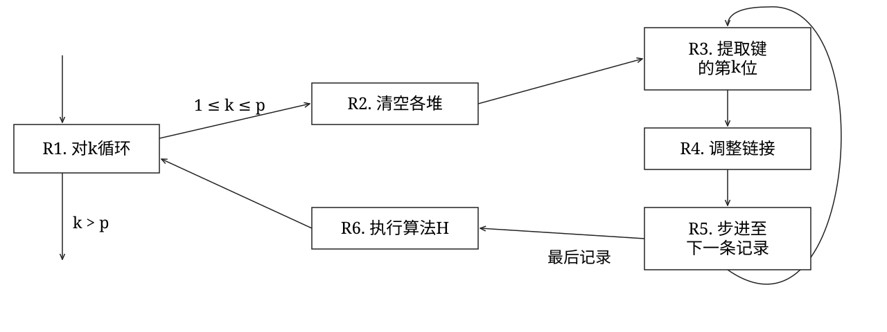

</div></div>

图 32　基数列表排序

<a id="alg-5-2-5-H"></a>

**算法 H (队列的挂钩).** 给定 $M$ 个按照算法 R 的约定链接在一起的队列, 本算法最多调整 $M$ 个链接来生成单一队列, 使得 BOTM[0] 指向第一个元素, 第 0 堆后面是第 1 堆, ……, 第 $M-1$ 堆.

**H1.[初始化.]** 置 $i\leftarrow0$.

**H2.[指向堆顶.]** 置 $\mathrm P\leftarrow\operatorname{TOP}[i]$.

**H3.[下一堆.]** $i$ 增 1. 如果 $i=M$, 置 $\operatorname{LINK}(\mathrm P)\leftarrow\Lambda$, 终止算法.

**H4.[堆为空?]** 如果 $\operatorname{BOTM}[i]=\Lambda$, 返回 H3.

**H5.[链接各堆.]** 置 $\operatorname{LINK}(\mathrm P)\leftarrow\operatorname{BOTM}[i]$. 返回 H2. ■

图 33 显示以 $M=10$ 对我们的 16 个示例数排序时, 每遍扫描之后各堆的内容. 如果能找到处理步骤 R3 和 R5 的各遍扫描变化形式的合适方法, 就能轻松编写算法 R 的 MIX 程序. 以下程序把两条指令重叠在一起, 在没有牺牲任何内层循环速度的情况下完成上述任务. 注意 TOP[$i$] 和 BOTM[$i$] 被打包到同一个字中.

<a id="prog-5-2-5-R"></a>

**程序 R (基数列表排序).** 假定单元 INPUT+1 至 INPUT+N 中给定的记录的键拥有 $p=3$ 个分量 $(a_1,a_2,a_3)$, 分别存储在 (1:1)、(2:2)、(3:3) 字段中. (这要求 $M$ 小于等于 MIX 的字节大小.) 每条记录的 (4:5) 字段是 LINK 字段. 对于 $0\le i<M$, 令 $\operatorname{TOP}[i]\equiv\mathtt{PILES}+i\,(1{:}2)$, $\operatorname{BOTM}[i]\equiv\mathtt{PILES}+i\,(4{:}5)$. 比较方便的做法是, 以单元 INPUT 为链接基点, 使得 $\operatorname{LOC}(\operatorname{BOTM}[i])=\mathtt{PILES}+i-\mathtt{INPUT}$. 为避免出现负链接, 我们希望 PILES 表所在单元高于 INPUT 表. 变址寄存器赋值如下: $\mathrm{rI1}\equiv\mathrm P,\ \mathrm{rI2}\equiv i,\ \mathrm{rI3}\equiv3-k,\ \mathrm{rI4}\equiv\operatorname{TOP}[i]$; 在算法 H 期间, $\mathrm{rI2}\equiv i-M$.

<a id="pdf-141"></a>
<a id="p-135"></a>
<a id="pdf-142"></a>
<a id="p-136"></a>

```mixal
01 LINK  EQU  4:5
02 TOP   EQU  1:2
03 START ENT1 N                  1         R1. 对k循环. P = LOC(RN).
04       ENT3 2                  1         k ← 1.
05 2H    ENT2 M-1                3         R2. 清空各堆.
06       ENTA PILES-INPUT,2       3M        LOC(BOTM[i])
07       STA  PILES,2(TOP)        3M        → TOP[i].
08       STZ  PILES,2(LINK)       3M        BOTM[i] ← Λ.
09       DEC2 1                  3M
10       J2NN *-4                3M        M > i ≥ 0.
11       LDA  R3SW,3             3
12       STA  3F                 3         修改第k遍扫描的指令.
13       LDA  R5SW,3             3
14       STA  5F                 3
15 3H    [LD2 INPUT,1(3:3)]                 R3. 提取键的第k位.
16 4H    LD4  PILES,2(TOP)        3N        R4. 调整链接.
17       ST1  INPUT,4(LINK)       3N        LINK(TOP[i]) ← P.
18       ST1  PILES,2(TOP)        3N        TOP[i] ← P.
19 5H    [DEC1 1]                          R5. 步进至下一条记录.
20       J1NZ 3B                 3N        如果扫描未结束，则转到R3.
21 6H    ENN2 M                  3         R6. 执行算法H.
22       JMP  7F                 3         以i ← 0转到H2.
23 R3SW  LD2  INPUT,1(1:1)        N         当k = 3时R3的指令.
24       LD2  INPUT,1(2:2)        N         当k = 2时R3的指令.
25       LD2  INPUT,1(3:3)        N         当k = 1时R3的指令.
26 R5SW  LD1  INPUT,1(LINK)       N         当k = 3时R5的指令.
27       LD1  INPUT,1(LINK)       N         当k = 2时R5的指令.
28       DEC1 1                  N         当k = 1时R5的指令.
29 9H    LDA  PILES+M,2(LINK)     3M-3      H4. 堆为空?
30       JAZ  8F                 3M-3      如果BOTM[i] = Λ，则转至H3.
31       STA  INPUT,1(LINK)       3M-3-E    H5. 链接各堆.
32 7H    LD1  PILES+M,2(TOP)      3M-E      H2. 指向堆顶.
33 8H    INC2 1                  3M        H3. 下一堆. i ← i+1.
34       J2NZ 9B                 3M        如果i ≠ M，则转至H4.
35       STZ  INPUT,1(LINK)       3         LINK(P) ← Λ.
36       LD1  PILES(LINK)        3         P ← BOTM[0].
37       DEC3 1                  3
38       J3NN 2B                 3         对1 ≤ k ≤ 3循环.
```


<a id="fig-5-33"></a>

<div class="source-tableau-group" style="overflow-x:auto;max-width:100%"><div style="width:1400px">

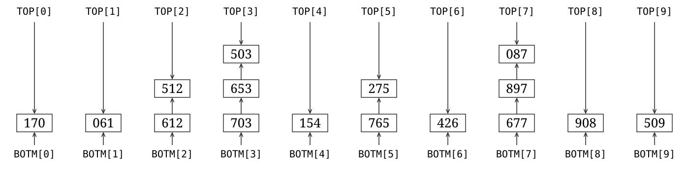

</div></div>

<div class="source-tableau-group" style="overflow-x:auto;max-width:100%"><div style="width:1400px">

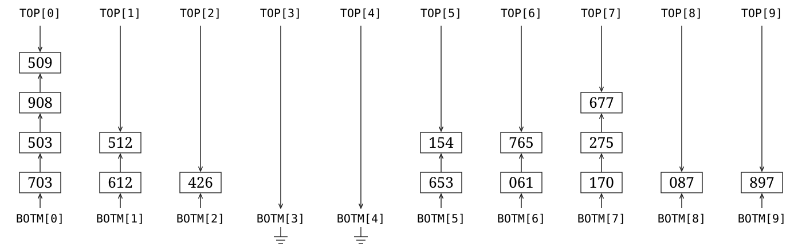

</div></div>

<div class="source-tableau-group" style="overflow-x:auto;max-width:100%"><div style="width:1400px">

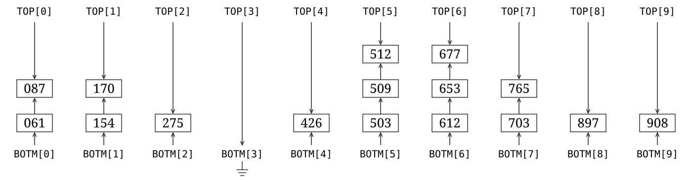

</div></div>

图 33　使用链接分配的基数排序: 每遍扫描之后各堆的内容


程序 R 的运行时间是 $32N+48M+38-4E$, 其中 $N$ 是输入记录的个数, $M$ 是基数 (堆的个数), $E$ 是出现空堆的次数. 可以很轻松地与根据类似假定编写的其他程序 (程序 5.2.1M、5.2.4L) 对比. 这个程序的 $p$ 遍扫描版本将耗费 $(11p-1)N+O(pM)$ 时间单位, 运行时间的关键因素是内层循环, 它包含五次存储访问和一次转移. 在典型计算机上有 $M=b^r$ 和 $p=\lceil t/r\rceil$, 其中 $t$ 是以 $b$ 为基的键的位数. 增大 $r$ 将降低 $p$, 因此可以利用这些公式来确定 $r$ 的最佳值.

运行时间的唯一变量是 $E$, 也就是步骤 H4 中发现空堆的次数. 如果认为由基为 $M$ 的数组成的 $M^N$ 个序列中的每一个出现概率相同, 则从 3.3.2D 节 “纸牌检验” 研究可知, 每遍扫描中出现 $M-r$ 个空堆的概率是

$$
\frac{M(M-1)\cdots(M-r+1)}{M^N}\left\{\begin{matrix}N\\r\end{matrix}\right\},\tag{6}
$$

式中 $\left\{\begin{matrix}N\\r\end{matrix}\right\}$ 是第二类斯特林数. 根据习题 6, 有

$$
E=\left(\text{最小 }\max(M-N,0)p,\quad\text{平均 }M\left(1-\frac1M\right)^Np,\quad\text{最大 }(M-1)p\right).\tag{7}
$$

近年来出现了越来越多的 “流水线” 或 “数值密集运算” 计算机. 这些计算机有多个运算器和 “先行电路”, 使得存储器访问与计算过程能够高度重叠. 但在存在条件转移指令时它们的效率会受到明显影响, 除非这些转移指令总是转向同一路径. 基数排序的内层循环可以很好地适用于这些计算机, 因为它是一种典型的 “数值密集运算” 形式的直接迭代计算. 因此, 如果 $N$ 不是太小, 键也不是太长, 那么在这些计算机上, 基数排序的效率通常要高于任何已知的其他内部排序方法.

当然, 当键非常长时, 基数排序的效率并不是特别高. 例如, 设想要排序是 60 位的十进制数, 使用 $M=10^3$ 的基数排序执行 20 遍扫描, 极少有一对数它们的前 9 位数字会趋于相同, 所以前 17 遍扫描几乎没做什么事. 我们在分析基数交换排序时发现, 从左侧而非右侧查看键, 不需要查看键的许多数位. 因此我们重新考虑一种基数排序思想, 它是从最高有效位 (MSD) 而不是最低有效位 (LSD) 开始查看.

<a id="pdf-143"></a>
<a id="p-137"></a>

我们已经注意到, 最高有效位优先的基数方法是自然出现的. 事实上, 不难看出为什么邮局会使用这种方法来分拣邮件. 一大堆信件被分拣到按不同地理区域划分的邮包中, 每个邮包都包含较少数量的信件, 这些信件再被分拣到越来越精细的地理区域, 而不同邮包之间的分拣是相互独立的. (实际上, 可以先把邮包运送到更接近它们目的地的地方, 然后再进一步分拣, 或者一边运送一边分拣.) 这种 “分而治之” 的原理富有吸引力, 它之所以不太适合穿孔卡片排序, 唯一原因就是它最终会花费太多时间纠缠于非常小的堆. 尽管算法 R 首先考虑最低有效位, 但它的效率相对要高一些, 这是因为堆数绝不会超过 $M$, 而且这些堆只需要钩在一起 $p$ 次. 另一方面, 使用链接存储, 并像算法 5.2.4L 那样以负链接表示各堆之间的界限, 不难设计一种最高有效位优先的基数方法. (见习题 10.) 最高有效位优先方法的主要困难在于空堆数量有迅速增大的趋势, 从而耗费大量时间.


麦克拉伦的方案可能是最佳折中方案 [*JACM* **13** (1966), 404–411], 他建议像算法 R 那样采用最低有效位优先排序, 但仅应用于最高的那些位. 这不能把文件完全排好序, 但通常会使文件非常接近有序状态, 只留下很少几个反序, 因此可以用直接插入来完成最后的排序. 对程序 5.2.1M 的分析也适用于这一情形, 因此, 如果键是均匀分布的, 则在对前 $p$ 个数字排序之后, 文件中平均剩下 $\tfrac14N(N-1)M^{-p}$ 个反序. (见式 5.2.1–(17) 和习题 5.2.1–38.) 麦克拉伦已经算出每排好一项需要访问存储器的平均次数, 以及 $M$ 和 $p$ 的最优选择 (假定 $M$ 为 2 的幂, 键均匀分布, 且 $N/M^p\le0.1$, 使得偏离均匀性的程度在容忍范围内), 见下表:

| $N=$ | $100$ | $1000$ | $10000$ | $100000$ | $1000000$ | $10^7$ | $10^8$ | $10^9$ |
|---|---:|---:|---:|---:|---:|---:|---:|---:|
| 最佳 $M=$ | $32$ | $128$ | $512$ | $1024$ | $8192$ | $2^{15}$ | $2^{17}$ | $2^{19}$ |
| 最佳 $p=$ | $2$ | $2$ | $2$ | $2$ | $2$ | $2$ | $2$ | $2$ |
| $\beta(N)=$ | $19.3$ | $18.5$ | $18.2$ | $18.1$ | $18.0$ | $18.0$ | $18.0$ | $18.0$ |

这里 $\beta(N)$ 表示每排好一项需要访问存储器的平均次数,

$$
\beta(N)=5p+8+\frac{2pM}{N}+\frac{N-1}{2M^p}-\frac{H_N}{N},\tag{8}
$$

当 $N\to\infty$ 时它是有界的, 如果取 $p=2$ 且 $M>\sqrt N$. 因此平均排序时间实际上是 $O(N)$, 而不是 $N\log N$ 量级. 这种方法是多列表插入方法 (程序 5.2.1M) 的改进, 后者本质上是 $p=1$ 的情形. 习题 12 给出麦克拉伦的有趣方法, 用于对部分列表有序文件进行最后重排.

利用算法 5.2D 和习题 5.2–13 的方法, 还有可能避免链接字段. 这样, 除了记录本身所需要的空间之外, 仅需 $O(\sqrt N)$ 个额外存储单元. 如果输入记录均匀分布, 则平均排序时间与 $N$ 成正比.

沃齐米日·多波谢维奇使用最高有效位优先分布排序, 直到出现很短的子文件 [*Inf. Proc. Letters* **7** (1978), 1–6;**8** (1979), 170–172], 同时限制分布过程以保证前 $M/2$ 个堆能接收到 25%到 75%的记录, 从而得到好的结果, 确保对均匀键排序的平均时间是 $O(N)$, 最差时间是 $O(N\log N)$. 他的论文启发其他几位研究人员设计新的地址计算算法, 其中最具指导意义的可能是马尔库·塔米宁提出的以下二级方案 [*J. Algorithms* **6** (1985), 138–144]. 假定所有键都是 $[0..1)$ 区间内的分数. 首先, 键 $K$ 映射到容器 $\lfloor KN/8\rfloor$ 中, 从而 $N$ 条记录分布到 $\lfloor N/8\rfloor$ 个容器中. 然后, 假定容器 $k$ 已经接收到 $N_k$ 条记录, 如果 $N_k\le16$, 则使用直接插入对它排序, 否则采用一种类似麦克拉伦的 “分布加插入” 排序方法把它分到 $M^2$ 个容器中, 其中 $M^2\approx10N_k$. 塔米宁证明了以下值得注意的结果:


<a id="thm-5-2-5-T"></a>
<a id="pdf-144"></a>
<a id="p-138"></a>

**定理 T.** 只要各键是独立随机数, 密度函数 $f(x)$ 有界且对 $0\le x\le1$ 黎曼可积, 则存在一个常数 $T$, 使得前文刚刚介绍的排序方法平均来说最多执行 $TN$ 次运算. (常数 $T$ 不依赖于 $f$.)

证明. 见习题 18. 从直觉上看, 第一次分布到 $N/8$ 个堆时, 会找到 $f$ 近似为常数的区间, 然后第二次分布将使预期的容器大小近似为常数. ■


彼得·麦基尔罗伊、基思·博斯蒂克和马尔科姆·麦基尔罗伊的一篇富有指导意义的文章介绍了基数排序的几种版本, 专门针对大型字符串数组排序进行了很好地调整 [*Computing Systems* **6** (1993), 5–27].

### 习题

<a id="ex-5-2-5-1"></a>

▶ 1. [20] 习题 5.2–13 的算法说明如何仅用 $N$ 个记录区域 (以及 $M$ 个计数字段) 而不是 $2N$ 个记录区域来进行分布排序. 这能否对表 1 的基数排序算法有所改进?　[答案](#ans-5-2-5-1)

<a id="ex-5-2-5-2"></a>

2. [13] 算法 R 是稳定排序方法吗?　[答案](#ans-5-2-5-2)

<a id="ex-5-2-5-3"></a>

3. [15] 即使第 0 堆可能为空, 算法 H 也要使 BOTM[0] 指向 “已钩连” 队列的第一条记录, 请解释为什么要这样做.　[答案](#ans-5-2-5-3)

<a id="ex-5-2-5-4"></a>

▶ 4. [23] 算法 R 把 $M$ 个堆链接在一起形成一个 (先进先出) 队列. 探讨把这些堆链接为栈的思想. (图 33 中的箭头将向下而不是向上, 从而不再需要 BOTM 表.) 证明: 如果以适当顺序 “钩连” 这些堆, 有可能得到一种有效的排序方法. 能否由此得到一种更简单或更快速的算法?　[答案](#ans-5-2-5-4)

<a id="ex-5-2-5-5"></a>

5. [20] 为了能够对八字节键而不是三字节键排序, 应如何修改程序 R? 假定 $K_i$ 的五个最高有效字节存储在单元 $\mathtt{KEY}+i\,(1{:}5)$ 中, 而三个最低有效字节就像目前这样存储在单元 $\mathtt{INPUT}+i\,(1{:}3)$ 中. 做了这些改动之后, 程序的运行时间是多少?　[答案](#ans-5-2-5-5)

<a id="ex-5-2-5-6"></a>

6. [M24] 设 $g_{MN}(z)=\sum p_{MNk}z^k$, 其中 $p_{MNk}$ 是基数排序的一次随机扫描把 $N$ 个元素放入 $M$ 个堆之后恰有 $k$ 个空堆的概率.　[答案](#ans-5-2-5-6)

(a) 证明: $g_{M(N+1)}(z)=g_{MN}(z)+\bigl((1-z)/M\bigr)g'_{MN}(z)$.

(b) 利用上述关系给出这个概率分布的均值和方差的简单表达式, 表示为 $M$ 和 $N$ 的函数.

<a id="ex-5-2-5-7"></a>

7. [20] 试讨论算法 R 与基数交换排序 (算法 5.2.2R) 之间的相似与区别.　[答案](#ans-5-2-5-7)

<a id="ex-5-2-5-8"></a>

▶ 8. [20] 正文中讨论的基数排序算法假定待排序的所有键都是非负数. 如果这些键是用补码或反码表示的数, 应如何修改算法?　[答案](#ans-5-2-5-8)

<a id="ex-5-2-5-9"></a>

9. [20] 继续习题 8, 如果这些键是用有符号的量表示的数, 应如何修改算法?　[答案](#ans-5-2-5-9)

<a id="ex-5-2-5-10"></a>

10. [30] 设计一种高效的使用链接存储的 “最高有效位优先” 的基数排序算法. (随着子文件大小的减小, 明智的做法是降低 $M$, 并对非常短的子文件使用非基数方法.)

<a id="ex-5-2-5-11"></a>

11. [16] 表 1 所示的 16 个输入数初始时有 41 个反序. 当然, 排序完成之后就不会有反序了. 如果省略第一遍扫描, 仅对十位和百位执行基数排序, 文件中会有多少个反序? 如果省略第一遍和第二遍扫描, 文件中会有多少个反序?　[答案](#ans-5-2-5-11)

<a id="ex-5-2-5-12"></a>

12. [24] (麦克拉伦) 假定仅对实际键的前 $p$ 个数位应用了算法 R. 因此, 我们以链接顺序读取这个文件时, 它已经接近有序状态了, 但前 $p$ 个数位相同的键仍然是无序的. 试设计一个算法, 在原位重排这些记录, 使它们的键成为有序状态: $K_1\le K_2\le\cdots\le K_N$. [提示: 习题 5.2–12 的解答中给出文件被完全排序的特例. 因为文件中几乎没有什么反序, 所以有可能在不损失效率的情况下将这种方法与直接插入组合起来.]　[答案](#ans-5-2-5-12)

<a id="ex-5-2-5-13"></a>

13. [40] 请实现本节正文接近结尾处提到的内部排序方法, 编写一个子例程, 用 $O(N)$ 个时间单位对随机数据排序, 仅需 $O(\sqrt N)$ 个额外存储单元.

<a id="pdf-145"></a>
<a id="p-139"></a>

<a id="ex-5-2-5-14"></a>

14. [22] 我们可以用两遍扫描把纸牌序列　[答案](#ans-5-2-5-14)

<div class="source-tableau-group" style="overflow-x:auto;max-width:100%"><div style="width:1100px">

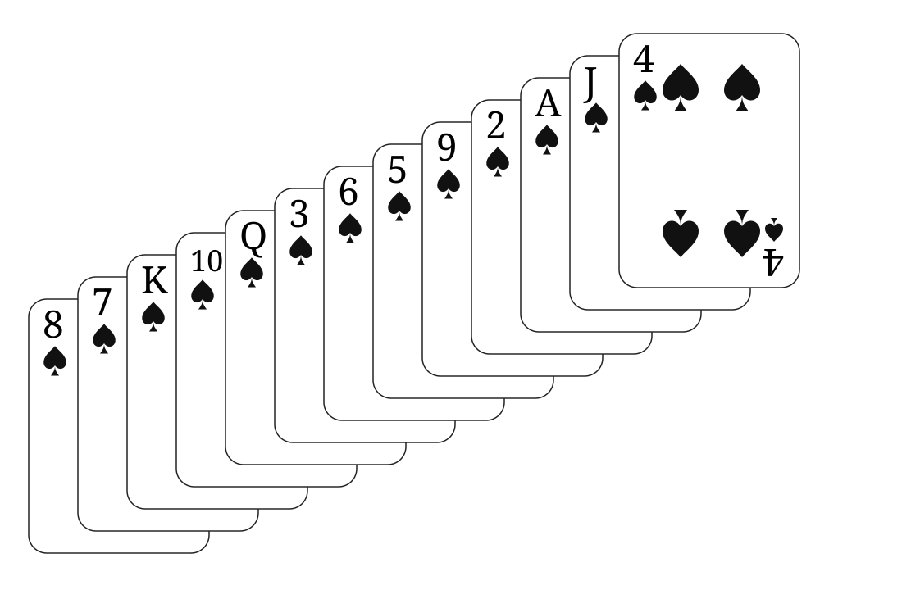

</div></div>

自上而下排列为递增顺序 $\mathrm A\ 2\ldots\mathrm J\ \mathrm Q\ \mathrm K$, 仅需两个堆作为中间存储. 首先把这些牌分发为牌面朝下的两堆, 自下而上分别包含 $\mathrm A\ 2\ 9\ 3\ 10$ 和 $4\ \mathrm J\ 5\ 6\ \mathrm Q\ \mathrm K\ 7\ 8$. 然后把第二堆放在第一堆上面, 翻过来牌面朝上, 再次分发为牌面朝下的两堆: $\mathrm A\ 2\ 3\ 4\ 5\ 6\ 7\ 8$ 和 $9\ 10\ \mathrm J\ \mathrm Q\ \mathrm K$. 合并这两堆, 翻过来牌面朝上, 这就完成了.

证明: 不可能仅用两遍扫描把上述纸牌序列自上而下排列为递减顺序 $\mathrm K\ \mathrm Q\ \mathrm J\ldots2\ \mathrm A$, 即使允许使用多达三个堆作为中间存储也不行. (必须总是从一堆牌的顶部开始发牌, 边发牌边把它们翻为牌面朝下. 自上而下就是图中从右到左.)

<a id="ex-5-2-5-15"></a>

15. [M25] 假定所有纸牌都必须牌面朝上分发而不能牌面朝下分发. 这样, 可以用一遍扫描把递增顺序转换为递减顺序. 考虑习题 14 的问题, 现在需要多少遍扫描?　[答案](#ans-5-2-5-15)

<a id="ex-5-2-5-16"></a>

▶ 16. [25] 设计一个算法, 把字符串 $\alpha_1,\ldots,\alpha_n$ 排为字典序, 字符串的元素都属于一个包含 $m$ 个元素的字母表. 算法的总运行时间应当为 $O(m+n+N)$, 其中 $N=|\alpha_1|+\cdots+|\alpha_n|$ 是所有字符串的总长度.　[答案](#ans-5-2-5-16)

<a id="ex-5-2-5-17"></a>

17. [15] 考察塔米宁提出的两级分布排序 (见定理 T), 一种类似麦克拉伦的方法被用于分布的第二级, 但没有应用于第一级, 这是为什么呢?　[答案](#ans-5-2-5-17)

<a id="ex-5-2-5-18"></a>

18. [HM26] 证明定理 T. 提示: 首先证明, 把麦克拉伦的 “分布加插入” 算法应用于概率密度函数满足 $f(x)\le B\ (0\le x\le1)$ 的独立随机键时, 平均执行 $O(BN)$ 次运算.　[答案](#ans-5-2-5-18)

> 为了对词根和单词进行排序,
> 我们使用了 1100 个菱形盒子;
> 对形态排序时还用到了盘子.
>
> ——乔治·威格拉姆 (1843)

<a id="pdf-146"></a>
<a id="p-140"></a>
<a id="sec-5-3"></a>

## 5.3　最优排序

我们已经分析了大量内部排序方法, 现在应该转向一个更为广泛的问题: 最佳排序方式是什么? 能否对所能实现的最高排序速度给出界限, 无论程序员多么聪明, 都不可能超越这个界限?

当然不存在什么最佳排序方式. 我们必须准确地定义 “最佳” 的含义, 但又不存在定义 “最佳” 的最佳方式. 4.3.3、4.6.3、4.6.4 节讨论了有关算法理论优化的类似问题, 当时我们考虑了高精度乘法和多项式求值. 在每种情况下, 我们都必须清楚地为 “最佳” 算法阐述一种相当简单的定义, 以确定问题结构, 使其得以解决. 在每种情况下, 我们都会遇到一些难度很大、仍未得以完全解决的有趣问题. 对于排序来说, 同样存在这种情况, 在这一领域已经有许多非常重要的发现, 但仍然有大量令人神往的问题有待解决.

在对排序问题的这一固有复杂性进行研究时, 通常会考虑以下问题: 排序 $n$ 个元素, 或者合并 $m$ 个元素与 $n$ 个元素, 或者找出未排序的 $n$ 元素集合的第 $t$ 个最大元素, 在这些情况下如何把键比较次数降至最低? 5.3.1、5.3.2、5.3.3 节概括性地讨论了这些问题, 5.3.4 节讨论的也是类似问题, 但添加了一个重要限制: 事先必须基本固定比较模式. 5.3.4 节的习题以及对外部排序的讨论 (5.4.4、5.4.8、5.4.9 节), 给出了与最优排序相关的若干其他类型的重要理论问题.

> 只要存在 “分析机”, 它就必然引导着未来的科学进程. 只要在它的帮助下寻求任何结果, 就会遇到一个问题——通过什么样的计算过程, 可以在最短时间内, 利用这部机器获得这些结果?
>
> ——查尔斯·巴贝奇 (1864)

<a id="sec-5-3-1"></a>

### 5.3.1　比较次数最少的排序

排序 $n$ 个元素需要的最少键比较次数显然是零, 因为我们已经看到基数方法根本就不做任何比较. 事实上, 有可能编写出根本不包含条件转移指令但也能完成排序的 MIX 程序. (见本章开头的习题 5-8.) 我们也已经看到几种本质上基于键比较的排序方法, 然而它们的运行时间实际上取决于诸如数据移动、簿记操作等其他因素.

显然, 比较次数并不是衡量排序方法有效性的唯一方式. 但是, 详细研究比较次数仍然非常重要, 因为对这个主题的理论研究可以让我们从多个方面深入理解排序过程的本质, 还可以帮助我们提高解决在其他情况下遇到的更一般问题的能力.

为了排除根本就不做任何比较的基数排序方法, 和本章开头的讨论一样, 我们把讨论内容限制在一些特定的排序技术, 这些技术仅依赖于键之间的抽象线性次序关系 $<$. 为简单起见, 我们还把讨论限制在各键互不相同的情形, 所以在进行任何 $K_{i}$ 与 $K_{j}$ 的比较时, 只有两种可能结果: $K _ { i } < K _ { j }$ 或者 $K _ { i } > K _ { j }$. 至于把本理论扩展到允许存在相等键的一般情形, 见习题 3～12. 整数排序 (不限于基于比较的方法) 在最差情况下所需运行时间的上限, 见弗雷德曼和威拉德, J. Computer and Syst.Sci.47(1993), 424-436; 本-阿姆拉姆和贾利勒, J. Comp.Syst. Sci. 54 (1997), 345–370; 托拉普, SODA 9 (1998), 550–555).

通过比较进行排序的问题也可以用其他等价方式来表示. 给定一组 $n$ 个互不相同的砝码和一台天平, 如果天平的每个秤盘仅能容纳一个砝码, 问最少需要多少次称量, 才能按质量大小完全排列出这些砝码的顺序. 或者, 一组 $n$ 个选手参加某项锦标赛, 假定所有选手的实力可以线性排序 (没有平局), 问最少需要多少场比赛才能确定所有参赛者的名次.

<a id="pdf-147"></a>
<a id="p-141"></a>

所有满足上述约束条件的 $n$ 元素排序方法都可以用图 34 所示的扩展二叉树结构来表示. 每个内部结点 (画作圆圈) 包含两个下标 $i:j$, 表示 $K_i$ 与 $K_j$ 的比较. 这个结点的左子树表示当 $K_i<K_j$ 时要做的后续比较, 右子树表示当 $K_i>K_j$ 时要采取的行动. 这棵树的每个外部结点 (画作方框) 包含 $\{1,2,\ldots,n\}$ 的一个排列 $a_1a_2\ldots a_n$, 表示已经确定顺序

$$
K_{a_1}<K_{a_2}<\cdots<K_{a_n}.
$$

(如果查看从根结点到这个外部结点的路径, $n-1$ 个关系 $K_{a_i}<K_{a_{i+1}}$($1\le i<n$) 中的每一个都是这条路径上某个比较 $a_i:a_{i+1}$ 或 $a_{i+1}:a_i$ 的结果.)

<a id="fig-5-34"></a>
<div class="source-tableau-group" style="overflow-x:auto">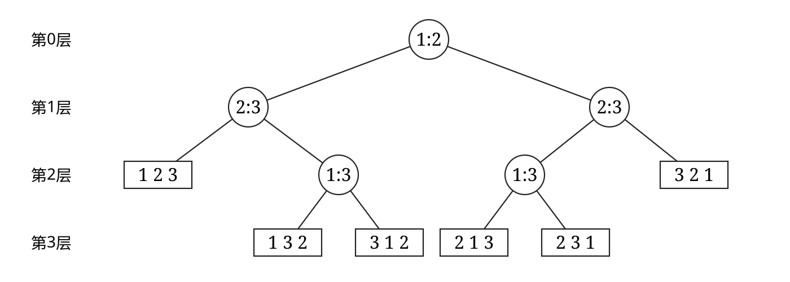</div>

图 34　排序三个元素的比较树

图 34 代表一种排序方法, 它首先比较 $K_1$ 与 $K_2$; 如果 $K_1>K_2$, 则 (通过右子树) 比较 $K_2$ 与 $K_3$; 之后, 如果 $K_2<K_3$, 则比较 $K_1$ 与 $K_3$; 最后, 如果 $K_1>K_3$, 就知道 $K_2<K_3<K_1$. 实际排序算法通常还会在文件中移动键, 但这里我们仅关注比较, 所以忽略所有数据移动. 这棵树中 $K_i$ 与 $K_j$ 间的比较总是指原来的键 $K_i$ 和 $K_j$, 而不是重排记录之后当前占据文件第 $i$ 个和第 $j$ 个位置的键.

有可能做了多余的比较. 例如, 在图 35 中, 因为 $K_1<K_2$ 和 $K_2<K_3$ 已经隐含 $K_1<K_3$, 所以没有理由再比较 $3:1$. 没有哪个排列会对应于图 35 中 $3:1$ 结点的左子树, 所以算法的这一部分绝不会执行! 由于我们关注的是如何把比较次数降至最低, 所以可以假定不会进行冗余比较. 于是, 我们有一种扩展二叉树结构, 它的每个外部结点都对应于一个排列. 输入键的所有排列都是有可能的, 每个排列都定义了从根结点到某个外部结点的唯一路径. 由此可以推出, 在一棵排序 $n$ 个元素且没有冗余比较的比较树中, 恰有 $n!$ 个外部结点.

<a id="fig-5-35"></a>

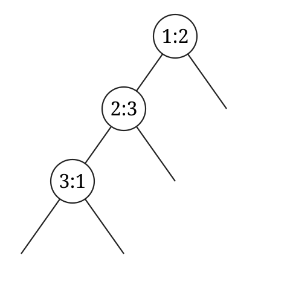

图 35　冗余比较举例

**最好的最差情形.** 第一个自然出现的问题就是寻找能够把最大比较次数降至最低的比较树. (稍后我们将考虑平均比较次数.)

<a id="pdf-148"></a>
<a id="p-142"></a>

设 $S(n)$ 表示足以排序 $n$ 个元素的最少比较次数. 如果一棵比较树中所有内部结点的层级都 $<k$, 则显然这棵树最多有 $2^k$ 个外部结点. 因此, 设 $k=S(n)$, 我们有

$$
n!\le2^{S(n)}.
$$

因为 $S(n)$ 是整数, 可以重写这个公式以获得下限

$$
S(n)\ge\lceil\lg n!\rceil.\tag{1}
$$

斯特林近似公式告诉我们

$$
\lceil\lg n!\rceil=n\lg n-n/\ln2+\tfrac12\lg n+O(1),\tag{2}
$$

因此, 大约需要 $n\lg n$ 次比较.

关系式 (1) 通常称为信息论下限, 因为信息论专家会说在排序期间将获得 $\lg n!$ “比特信息”. 每次比较最多产生 1 比特信息. 像图 34 那样的树也称为 “调查表”, 克劳德·皮卡尔最早对它们的数学性质进行了系统探讨 [*Théorie des Questionnaires* (Paris: Gauthier-Villars, 1965)].

在我们看到过的所有排序方法中, 需要最少比较的三种方法是: 二叉插入 (见 5.2.1 节)、树选择 (见 5.2.3 节) 和直接两路合并 (见算法 5.2.4L). 由习题 1.2.4–42 容易看出, 二叉插入的最大比较次数是

$$
B(n)=\sum_{k=1}^n\lceil\lg k\rceil=n\lceil\lg n\rceil-2^{\lceil\lg n\rceil}+1.\tag{3}
$$

习题 5.2.4–14 给出两路合并的最大比较次数. 在 5.3.3 节我们将看到, 树选择的比较次数上限, 或者与二叉插入相同, 或者与两路合并相同, 取决于这棵树的创建方式. 在所有这三种情况下, 都有渐近值 $n\lg n$. 结合 $S(n)$ 的下限和上限, 可以证明

$$
\lim_{n\to\infty}\frac{S(n)}{n\lg n}=1.\tag{4}
$$

这就得到了 $S(n)$ 的近似公式, 但我们还希望能够获得更为准确的信息. 下表给出当 $n$ 很小时上文讨论的下限和上限的确切值:

| $n=$ | 1 | 2 | 3 | 4 | 5 | 6 | 7 | 8 | 9 | 10 | 11 | 12 | 13 | 14 | 15 | 16 | 17 |
|---|---:|---:|---:|---:|---:|---:|---:|---:|---:|---:|---:|---:|---:|---:|---:|---:|---:|
| $\lceil\lg n!\rceil=$ | 0 | 1 | 3 | 5 | 7 | 10 | 13 | 16 | 19 | 22 | 26 | 29 | 33 | 37 | 41 | 45 | 49 |
| $B(n)=$ | 0 | 1 | 3 | 5 | 8 | 11 | 14 | 17 | 21 | 25 | 29 | 33 | 37 | 41 | 45 | 49 | 54 |
| $L(n)=$ | 0 | 1 | 3 | 5 | 9 | 11 | 14 | 17 | 25 | 27 | 30 | 33 | 38 | 41 | 45 | 49 | 65 |

这里的 $B(n)$ 和 $L(n)$ 分别对应于二叉插入和两路列表合并. 可以证明, 对于所有的 $n$ 有 $B(n)\le L(n)$ (见习题 2).

从上表可以看出 $S(4)=5$, 但 $S(5)$ 可以是 7 或者 8. 这把我们带回到 5.2 节开头阐述的问题: 排序五个元素的最佳方式是什么样的? 能否仅用七次比较完成对五个元素的排序?

<a id="pdf-149"></a>
<a id="p-143"></a>

回答是肯定的, 但要找到一种七步过程并不是特别容易. 在开始时, 首先比较 $K_1:K_2$, 然后是 $K_3:K_4$, 再比较这两对的较大元素. 这生成可以表示为

<a id="eq-5-3-1-5"></a>
<div style="display:flex;align-items:center;justify-content:center;gap:1em">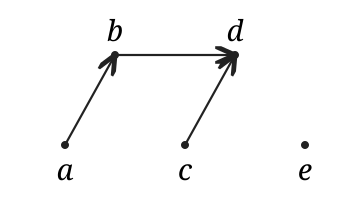<span>(5)</span></div>

的结构, 表明 $a<b<d$ 且 $c<d$. (绘制这样的有向图可以很方便地表示元素之间的已知顺序关系, $x$ 小于 $y$ 当且仅当图中存在从 $x$ 到 $y$ 的路径.) 这时, 为了把第 5 个元素 $K_5=e$ 插入到 $\{a,b,d\}$ 中的适当位置, 它首先与 $b$ 比较, 然后再与 $a$ 或 $d$ 比较, 所以只需要两次比较. 这样会得到如下四种可能结果之一:

<a id="eq-5-3-1-6"></a>
<div class="source-tableau-group" style="overflow-x:auto">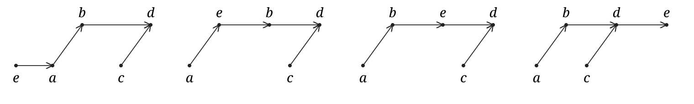</div>

(6)

在每种情况下, 可以再用一两次比较, 把 $c$ 插入到小于 $d$ 的剩下元素当中. 德穆思最早提出这种排序五个元素的方法 [博士论文 (斯坦福大学, 1956 年), 41–43].


**合并插入.** 小莱斯特·福特和塞尔默·约翰逊发现了上述方法的一种令人满意的推广. 由于它既有合并的某些特性, 又有插入的某些特性, 所以称为合并插入. 例如, 考虑排序 21 个元素的问题. 首先比较十对键 $K_1:K_2,K_3:K_4,\ldots,K_{19}:K_{20}$, 然后利用合并插入比较这十对键中的较大元素. 结果得到类似 (5) 的结构

<a id="eq-5-3-1-7"></a>
<div class="source-tableau-group" style="overflow-x:auto">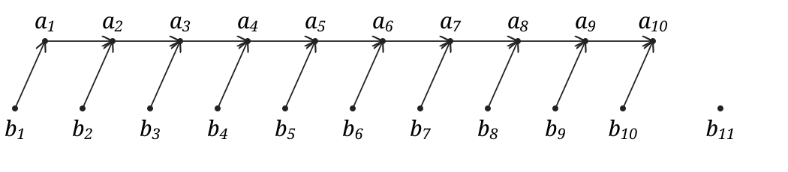</div>

(7)

下一步是在 $\{b_1,a_1,a_2\}$ 中插入 $b_3$, 然后在其他小于 $a_2$ 的元素中插入 $b_2$, 从而得到结构

<a id="eq-5-3-1-8"></a>
<div class="source-tableau-group" style="overflow-x:auto"></div>

(8)

上一行元素称为主链. 可以用三次比较把 $b_5$ 插入到主链中的适当位置 (首先把它与 $c_4$ 比较, 然后是 $c_2$ 或 $c_6$, 等等), 然后再用三个步骤把 $b_4$ 移到主链中, 得到结构

<a id="eq-5-3-1-9"></a>
<div class="source-tableau-group" style="overflow-x:auto"></div>

(9)

下一步非常关键, 知道接下来要做什么吗? 仅用四次比较就把 $b_{11}$ (而不是 $b_7$) 插入到主链中. 然后再把 $b_{10},b_9,b_8,b_7,b_6$ (按照这个顺序) 插入到主链中的适当位置, 每次插入最多使用四次比较.

仔细计算这里所涉及的比较次数将会看到: 排序 21 个元素最多需要 $10+S(10)+2+2+3+3+4+4+4+4+4+4=66$ 步. 由于 $2^{65}<21!<2^{66}$, 所以我们还知道在任何情况下也不可能少于 66 次比较. 因此

$$
S(21)=66.\tag{10}
$$

(二叉插入需要 74 次比较.)

一般来说, $n$ 个元素的合并插入过程如下:

(i) 逐对比较 $\lfloor n/2\rfloor$ 个不相交的元素对. (如果 $n$ 是奇数, 则剩下一个元素.)

(ii) 用合并插入来排序步骤 (i) 中找到的 $\lfloor n/2\rfloor$ 个较大数.

(iii) 像 (7) 那样命名元素 $a_1,a_2,\ldots,a_{\lfloor n/2\rfloor},b_1,b_2,\ldots,b_{\lceil n/2\rceil}$, 其中 $a_1\le a_2\le\cdots\le a_{\lfloor n/2\rfloor}$ 且对于 $1\le i\le\lfloor n/2\rfloor$ 有 $b_i\le a_i$, 称 $b_1$ 和各 $a$ 值为 “主链”. 利用二叉插入, 把剩下的各 $b$ 值按以下顺序 (去掉序列中满足 $j>\lceil n/2\rceil$ 的所有 $b_j$) 插入到主链中:

$$
b_3,b_2;\quad b_5,b_4;\quad b_{11},b_{10},\ldots,b_6;\quad\ldots;\quad b_{t_k},b_{t_k-1},\ldots,b_{t_{k-1}+1};\quad\ldots.\tag{11}
$$

<a id="pdf-150"></a>
<a id="p-144"></a>

我们希望定义序列 $(t_1,t_2,t_3,t_4,\ldots)=(1,3,5,11,\ldots)$, 它在 (11) 中的出现方式满足以下条件: $b_{t_k},b_{t_k-1},\ldots,b_{t_{k-1}+1}$ 中的每一个都可以通过最多 $k$ 次比较插入到主链中. 推广 (7) (8) (9), 我们得到

<div class="source-tableau-group" style="overflow-x:auto"></div>

其中, 达到并包括 $a_{t_k-1}$ 的主链包含 $2t_{k-1}+(t_k-t_{k-1}-1)$ 个元素. 这个数必然小于 $2^k$, 我们的最好方法是把它置为等于 $2^k-1$, 使得

$$
t_{k-1}+t_k=2^k.\tag{12}
$$

由于 $t_1=1$, 为方便起见, 设 $t_0=1$, 利用几何级数求和公式可得

$$
\begin{aligned}
t_k&=2^k-t_{k-1}=2^k-2^{k-1}+t_{k-2}=\cdots=2^k-2^{k-1}+\cdots+(-1)^k2^0\\
&=\bigl(2^{k+1}+(-1)^k\bigr)/3.
\end{aligned}\tag{13}
$$

(奇怪的是, 计算两个整数的最大公因数的算法分析中也遇到这个序列, 见习题 4.5.2–36.)

设 $F(n)$ 是用合并插入方法排序 $n$ 个元素需要的比较次数. 显然

$$
F(n)=\lfloor n/2\rfloor+F(\lfloor n/2\rfloor)+G(\lceil n/2\rceil),\tag{14}
$$

其中 $G$ 表示步骤 (iii) 涉及的工作量. 如果 $t_{k-1}\le m\le t_k$, 对各部分求和可得

$$
G(m)=\sum_{j=1}^{k-1}j(t_j-t_{j-1})+k(m-t_{k-1})=km-(t_0+t_1+\cdots+t_{k-1}).\tag{15}
$$

设

$$
w_k=t_0+t_1+\cdots+t_{k-1}=\lfloor2^{k+1}/3\rfloor,\tag{16}
$$

使得 $(w_0,w_1,w_2,w_3,w_4,\ldots)=(0,1,2,5,10,21,\ldots)$. 习题 13 表明

$$
F(n)-F(n-1)=k\quad\text{当且仅当}\quad w_k<n\le w_{k+1},\tag{17}
$$

后一条件等价于

$$
\frac{2^{k+1}}3<n\le\frac{2^{k+2}}3,
$$

或者 $k+1<\lg3n\le k+2$, 因此

$$
F(n)-F(n-1)=\lceil\lg\tfrac34 n\rceil.\tag{18}
$$

(这个公式来自阿卜杜拉·哈迪安 [博士论文 (明尼苏达大学, 1969 年), 38–42].) 由此可得, $F(n)$ 有相当简单的表达式

$$
F(n)=\sum_{k=1}^n\lceil\lg\tfrac34 k\rceil,\tag{19}
$$

它十分类似于二叉插入的对应公式 (3). 习题 14 给出了这个和式的闭合式.

利用式 (19) 容易构造 $F(n)$ 表, 我们有

<a id="pdf-151"></a>
<a id="p-145"></a>

| $n=$ | 1 | 2 | 3 | 4 | 5 | 6 | 7 | 8 | 9 | 10 | 11 | 12 | 13 | 14 | 15 | 16 | 17 | 18 | 19 | 20 | 21 | 22 | 23 | 24 | 25 | 26 | 27 | 28 | 29 | 30 | 31 | 32 | 33 |
|---|---:|---:|---:|---:|---:|---:|---:|---:|---:|---:|---:|---:|---:|---:|---:|---:|---:|---:|---:|---:|---:|---:|---:|---:|---:|---:|---:|---:|---:|---:|---:|---:|---:|
| $\lceil\lg n!\rceil=$ | 0 | 1 | 3 | 5 | 7 | 10 | 13 | 16 | 19 | 22 | 26 | 29 | 33 | 37 | 41 | 45 | 49 | 53 | 57 | 62 | 66 | 70 | 75 | 80 | 84 | 89 | 94 | 98 | 103 | 108 | 113 | 118 | 123 |
| $F(n)=$ | 0 | 1 | 3 | 5 | 7 | 10 | 13 | 16 | 19 | 22 | 26 | 30 | 34 | 38 | 42 | 46 | 50 | 54 | 58 | 62 | 66 | 71 | 76 | 81 | 86 | 91 | 96 | 101 | 106 | 111 | 116 | 121 | 126 |


注意到对于 $1\le n\le11$ 和 $20\le n\le21$ 有 $F(n)=\lceil\lg n!\rceil$, 所以我们知道对于这些 $n$ 值合并插入是最优的:

$$
S(n)=\lceil\lg n!\rceil=F(n)\quad(n=1,\ldots,11,20,21).\tag{20}
$$

雨果·斯坦豪斯在他的经典著作第二版中提出了求解 $S(n)$ 的问题 [*Mathematical Snapshots*(牛津大学出版社, 1950 年), 38–39]. 他描述了二叉插入方法, 如果先把前 $n-1$ 个元素排好序, 再考虑第 $n$ 个元素, 则二叉插入方法是排序 $n$ 个元素的最佳可能方法. 他还推测, 二叉插入在一般情况下也是最优的. 几年后他报告说 [*Calcutta Math. Soc. Golden Jubilee Commemoration* **2** (1959), 323–327]: 他的两位同事斯坦尼斯瓦夫·特雷布拉和成平 “最近” 否定了他的推测, 他们还确定了 $n\le11$ 时的 $S(n)$. 特雷布拉和成平可能独立地发现了合并插入方法, 而发表这个方法的却是不久后的小福特和约翰逊 [*AMM* **66** (1959), 387–389].

在发现合并插入之后, $S(n)$ 的第一个未知值是 $S(12)$. 表 1 显示 $12!$ 非常接近 $2^{29}$, 所以不太可能存在 12 个元素的 29 步排序过程. 之后, 马克·韦尔斯执行了一次穷尽搜索 (在一台 Maniac II 计算机上运行了大约 60 个小时), 他发现 $S(12)=30$[*Proc. IFIP Congress 65* **2** (1965), 497–498;*Elements of Combinatorial Computing* (Pergamon, 1971), 213–215]. 因此, 合并插入过程对于 $n=12$ 也是最优的.

<a id="tab-5-3-1-1"></a>

表 1　用二进制数表示的阶乘值

<table data-binary-factorials><tbody>
<tr><td>$(1)_2$</td><td>$=1!$</td></tr>
<tr><td>$(10)_2$</td><td>$=2!$</td></tr>
<tr><td>$(110)_2$</td><td>$=3!$</td></tr>
<tr><td>$(11000)_2$</td><td>$=4!$</td></tr>
<tr><td>$(1111000)_2$</td><td>$=5!$</td></tr>
<tr><td>$(1011010000)_2$</td><td>$=6!$</td></tr>
<tr><td>$(1001110110000)_2$</td><td>$=7!$</td></tr>
<tr><td>$(1001110110000000)_2$</td><td>$=8!$</td></tr>
<tr><td>$(1011000100110000000)_2$</td><td>$=9!$</td></tr>
<tr><td>$(1101110101111100000000)_2$</td><td>$=10!$</td></tr>
<tr><td>$(10011000010001010100000000)_2$</td><td>$=11!$</td></tr>
<tr><td>$(11100100011001111110000000000)_2$</td><td>$=12!$</td></tr>
<tr><td>$(101110011001010001100110000000000)_2$</td><td>$=13!$</td></tr>
<tr><td>$(1010001001100001110110010100000000000)_2$</td><td>$=14!$</td></tr>
<tr><td>$(10011000001110111011101110101100000000000)_2$</td><td>$=15!$</td></tr>
<tr><td>$(100110000011101110111011101011000000000000000)_2$</td><td>$=16!$</td></tr>
<tr><td>$(1010000110111111011101110110011011000000000000000)_2$</td><td>$=17!$</td></tr>
<tr><td>$(10110101111101110110011001010011100110000000000000000)_2$</td><td>$=18!$</td></tr>
<tr><td>$(110110000001010111001001100000110100010010000000000000000)_2$</td><td>$=19!$</td></tr>
<tr><td>$(10000111000011011001110111110010000010101101000000000000000000)_2$</td><td>$=20!$</td></tr>
</tbody></table>

<a id="pdf-152"></a>
<a id="p-146"></a>

**\*稍微深入的分析.** 为了更仔细地研究 $S(n)$, 让我们更深入地考察像 (5) 那样的偏序图. 我们可以用有向图来表示进行若干次比较之后获得的信息. 考虑到 $<$ 关系的传递性, 这个有向图中不包含回路, 所以图中所有有向弧都可以绘制成从左向右, 因此去掉图中的箭头很方便. 这样, (5) 就变成了

<a id="eq-5-3-1-21"></a>
<div style="display:flex;align-items:center;justify-content:center;gap:1em"><span>(21)</span></div>


如果 $G$ 是这样一个有向图, 设 $T(G)$ 是与 $G$ 一致的排列的数目, 也就是可以有多少种方式把整数 $\{1,2,\ldots,n\}$ 指定给 $G$ 的顶点, 使得在 $G$ 中每当有 $x\to y$, 顶点 $x$ 上的数总是小于顶点 $y$ 上的数. 例如, 与 (21) 一致的排列之一是 $a=1,b=4,c=2,d=5,e=3$. 我们在 5.1.4 节研究了各种 $G$ 的 $T(G)$, 当时观察到, $T(G)$ 是可以对 $G$ 进行拓扑排序的方式数.

如果 $G$ 是在进行 $k$ 次比较之后获得的 $n$ 元素图, 我们定义 $G$ 的效率为

$$
E(G)=\frac{n!}{2^kT(G)}.\tag{22}
$$

(这个思想来源于黄光明和林牲.) 严格来说, 效率并不只是图 $G$ 的函数, 它还依赖于排序过程中获得 $G$ 的方式. 不过, 我们在叙述时稍微 “粗心” 一点会比较方便. 每增加一次比较 (元素 $i$ 和 $j$ 之间的比较), 可以得到两个图 $G_1$ 和 $G_2$, 一个对应于情形 $K_i<K_j$, 一个对应于情形 $K_i>K_j$. 显然 $T(G)=T(G_1)+T(G_2)$. 如果 $T(G_1)\ge T(G_2)$, 我们有

$$
T(G)\le2T(G_1),
$$

$$
E(G_1)=\frac{n!}{2^{k+1}T(G_1)}=\frac{E(G)T(G)}{2T(G_1)}\le E(G).\tag{23}
$$

因此, 每次比较都会得到至少一个效率相同或更小的图. 不可能通过进行更多的比较来提高效率.

当 $G$ 全然没有弧时, 我们有 $k=0$ 和 $T(G)=n!$, 所以初始效率为 1. 在另一极端, 当 $G$ 表示的是最终排序结果时, 它看起来像一条直线, 而且 $T(G)=1$. 例如, 如果希望找到一个排序过程, 最多用七步完成对五个元素的排序, 就必须获得效率是 $5!/(2^7\times1)=120/128=15/16$ 的线性图 . 由此可以推出, 排序过程中出现的所有图都必然有 $\ge\tfrac{15}{16}$ 的效率. 因为如果出现任何效率更低的图, 它的至少一个子孙也是低效率的, 最终会得到一个效率 $<\tfrac{15}{16}$ 的线性图. 一般来说, 这一论证过程证明是: 对应于 $n$ 元素排序过程的树结点的所有图都必然有 $\ge n!/2^l$ 的效率, 其中 $l$ 是树的层数 (不计外部结点). 这是证明 $S(n)\ge\lceil\lg n!\rceil$ 的另一种方式, 尽管这个论证过程和我们前面所说的过程实际上没有多少不同.

图 (21) 的效率是 1, 这是因为 $T(G)=15$, 并且 $G$ 是通过三次比较获得的. 为了知道下一步要比较哪些顶点, 可以构造比较矩阵

$$
C(G)=\begin{array}{cc}
&\begin{array}{rrrrr}a&\phantom0b&\phantom0c&\phantom0d&\phantom0e\end{array}\\
\begin{array}{r}a\\b\\c\\d\\e\end{array}&\left(\begin{array}{rrrrr}
0&15&10&15&11\\
0&0&5&15&7\\
5&10&0&15&9\\
0&0&0&0&3\\
4&8&6&12&0
\end{array}\right)
\end{array},\tag{24}
$$

其中 $C_{ij}$ 是向 $G$ 中添加弧 $i\to j$ 所得图 $G_1$ 的 $T(G_1)$. 例如, 如果比较 $K_c$ 与 $K_e$, 与 $G$ 一致的 15 个排列将分裂为 $K_e<K_c$ 的 $C_{ec}=6$ 个和 $K_c<K_e$ 的 $C_{ce}=9$ 个. 后一个图的效率是 $15/(2\times9)=\tfrac56<\tfrac{15}{16}$, 所以它不可能给出一个七步排序过程. 为了保持效率 $\ge\tfrac{15}{16}$, 下一次比较必然是 $K_b:K_e$.

<a id="pdf-153"></a>
<a id="p-147"></a>

在考虑图的连通分量时, 效率的概念尤其有用. 例如, 考虑下图


它有两个分量

<div class="source-tableau-group" style="overflow-x:auto"></div>

由于没有连接 $G'$ 和 $G''$ 的弧, 所以它是通过完全在 $G'$ 中进行的一些比较和完全在 $G''$ 中进行的另一些比较形成的. 一般来说, 假定 $G=G'\oplus G''$, 在 $G'$ 和 $G''$ 之间不存在弧, $G'$ 和 $G''$ 分别有 $n'$ 和 $n''$ 个顶点, 容易看出

$$
T(G)=\binom{n'+n''}{n'}T(G')T(G''),\tag{25}
$$

这是因为 $G$ 的每个一致排列都是通过以下方式得到的: 选择 $n'$ 个元素指定给 $G'$, 然后独立找出 $G'$ 和 $G''$ 的一致排列. 如果已经在 $G'$ 中进行了 $k'$ 次比较, 在 $G''$ 中进行了 $k''$ 次比较, 则有基本结果

$$
E(G)=\frac{(n'+n'')!}{2^{k'+k''}T(G)}=\frac{n'!}{2^{k'}T(G')}\frac{n''!}{2^{k''}T(G'')}=E(G')E(G''),\tag{26}
$$

表明图的效率与其分量的效率之间存在一种简单的关联方式. 因此, 我们可以只考虑仅有一个分量的图.

现在假定 $G'$ 和 $G''$ 都是仅包含一个分量的图, 假定我们通过比较 $G'$ 中的顶点 $x$ 和 $G''$ 中的顶点 $y$ 而把这两个图勾连在一起. 我们希望知道它的效率如何. 为此, 需要一个表示为

$$
\left(\begin{matrix}p\\m\end{matrix}\!<\!\begin{matrix}q\\n\end{matrix}\right),\tag{27}
$$

的函数, 定义为与

<a id="eq-5-3-1-28"></a>
<div class="source-tableau-group" style="overflow-x:auto"></div>

(28)

一致的排列数. 于是 $\left(\begin{matrix}p\\m\end{matrix}\!<\!\begin{matrix}q\\n\end{matrix}\right)$ 等于 $\binom{m+n}{m}$ 乘以一个概率值, 即一组 $m$ 个数中第 $p$ 个最小值小于另一组 $n$ 个数中第 $q$ 个最小值的概率 (这两个最小值的选择是相互独立的). 习题 17 表明, 可以用二项式系数以两种方式表达 $\left(\begin{matrix}p\\m\end{matrix}\!<\!\begin{matrix}q\\n\end{matrix}\right)$:

$$
\begin{aligned}
\left(\begin{matrix}p\\m\end{matrix}\!<\!\begin{matrix}q\\n\end{matrix}\right)&=\sum_{0\le k<q}\binom{m-p+n-k}{m-p}\binom{p-1+k}{p-1}\\
&=\sum_{p\le j\le m}\binom{n-q+m-j}{n-q}\binom{q-1+j}{q-1}.
\end{aligned}\tag{29}
$$

(顺便提一下, 从代数领域来看, 绝对不容易看出这些二项式系数乘积的两个和居然会相等.) 我们还有以下公式:

$$
\left(\begin{matrix}p\\m\end{matrix}\!<\!\begin{matrix}q\\n\end{matrix}\right)+\left(\begin{matrix}q\\n\end{matrix}\!<\!\begin{matrix}p\\m\end{matrix}\right)=\binom{m+n}{m};\tag{30}
$$

$$
\left(\begin{matrix}q\\n\end{matrix}\!<\!\begin{matrix}p\\m\end{matrix}\right)=\left(\begin{matrix}m+1-p\\m\end{matrix}\!<\!\begin{matrix}n+1-q\\n\end{matrix}\right);\tag{31}
$$

<a id="pdf-154"></a>
<a id="p-148"></a>

$$
\left(\begin{matrix}p\\m\end{matrix}\!<\!\begin{matrix}q\\n\end{matrix}\right)=\left(\begin{matrix}p\\m-1\end{matrix}\!<\!\begin{matrix}q\\n\end{matrix}\right)+\left(\begin{matrix}p\\m\end{matrix}\!<\!\begin{matrix}q\\n-1\end{matrix}\right)+[p\le m][q=n]\binom{m+n-1}{m}.\tag{32}
$$

为确定起见, 现在考虑两个图

<a id="eq-5-3-1-33"></a>
<div class="source-tableau-group" style="overflow-x:auto"></div>

(33)

通过直接枚举不难证明 $T(G')=42$ 和 $T(G'')=5$. 所以如果 $G$ 是以 $G'$ 和 $G''$ 为分量的 11 个顶点的图, 根据式 (25) 我们有 $T(G)=\binom{11}{4}\cdot42\cdot5=69300$. 如果我们希望知道有多少排列满足 $x_i<y_j$ (对于每个 $i$ 和 $j$), 这个数目列举起来有些让人恐惧. 但这个计算过程可以在一个小时内手工完成, 如下所示. 构造矩阵 $A(G')$ 和 $A(G'')$, 其中 $A_{ik}$ 是 $G'$ (或 $G''$) 中满足 $x_i$ (或 $y_i$) 等于 $k$ 的一致排列数目. 因此, $G$ 中满足 $x_i<y_j$ 的排列数目等于 $A(G')$ 的 $(i,p)$ 元素乘以 $\left(\begin{matrix}p\\7\end{matrix}\!<\!\begin{matrix}q\\4\end{matrix}\right)$ 再乘以 $A(G'')$ 的 $(j,q)$ 元素, 对 $1\le p\le7$ 和 $1\le q\le4$ 求和. 换句话说, 我们希望构造矩阵乘积 $A(G')\cdot L\cdot A(G'')^T$, 其中 $L_{pq}=\left(\begin{matrix}p\\7\end{matrix}\!<\!\begin{matrix}q\\4\end{matrix}\right)$. 这就是

$$
\begin{pmatrix}21&16&5&0&0&0&0\\0&5&10&12&10&5&0\\21&16&5&0&0&0&0\\0&0&12&18&12&0&0\\0&0&0&0&5&16&21\\0&5&10&12&10&5&0\\0&0&0&0&5&16&21\end{pmatrix}\begin{pmatrix}210&294&322&329\\126&238&301&325\\70&175&265&315\\35&115&215&295\\15&65&155&260\\5&29&92&204\\1&8&36&120\end{pmatrix}\begin{pmatrix}2&3&0&0\\2&2&0&1\\1&0&2&2\\0&0&3&2\end{pmatrix}=\begin{pmatrix}48169&42042&66858&64031\\22825&16005&53295&46475\\48169&42042&66858&64031\\22110&14850&54450&47190\\5269&2442&27258&21131\\22825&16005&53295&46475\\5269&2442&27258&21131\end{pmatrix}.
$$

因此, 把 $G'$ 和 $G''$ 勾连在一起的 “最佳” 方式是比较 $x_1$ 和 $y_2$, $x_1<y_2$ 的情形有 42042 种, $x_1>y_2$ 的情形有 $69300-42042=27258$ 种. (根据对称性, 也可以比较 $x_3$ 和 $y_2$、$x_5$ 和 $y_3$ 或 $x_7$ 和 $y_3$, 得出本质上相同的结果.) 对于 $x_1<y_2$, 所得图的效率是

$$
\frac{69300}{84084}E(G')E(G''),
$$

这个结果一点也不好. 因此, 在任何排序方法中, 把 $G'$ 和 $G''$ 勾连在一起可能都是一个坏主意. 这个示例的要点在于, 我们不需要过多的计算就能做出这样一个判断.

这些思想可以用来为韦尔斯对 $S(12)=30$ 的证明提供独立确认. 从包含一个顶点的图出发, 我们可以重复尝试向图 $G$ 之一或向 $G'\oplus G''$ (一对图分量 $G'$ 和 $G''$) 添加比较, 使所得到的两个图的顶点数不超过 12、效率 $\ge12!/2^{29}\approx0.89221$. 只要有可能, 我们就把得到的效率最低的图添加到我们的集合中, 除非这两个图之一与集合中已有的某个图同构. 如果得到的两个图具有相同效率, 则任选其一. 可以认为一个图与其对偶 (通过颠倒顺序得到) 是一样的, 只要我们既考虑向 $G'\oplus G''$ 添加比较, 也考虑向 $G'\oplus\operatorname{对偶}(G'')$ 添加比较. 图 36 显示了通过这种方式获得的一些最小图和它们的效率.

在这个过程结束之前, 计算机恰好生成 1649 个图. 由于未得到图 , 我们可以得出结论 $S(12)>29$. 通过类似实验在不太长的时间内推导出 $S(22)>70$ 完全说得通, 因为 $22!/2^{70}\approx0.952$ 表明需要极高的效率才能在 70 步内完成排序. (在顶点数不超过 12 的 1649 个图中, 只有 91 个具有如此高的效率.)

<a id="pdf-155"></a>
<a id="p-149"></a>

<a id="fig-5-36"></a>
<div class="source-tableau-group" style="overflow-x:auto"></div>

图 36　在对 $S(12)>29$ 的冗长证明的开头几步中获得的一些图和它们的效率

马尔钦·派曹尔斯基扩展了韦尔斯的方法 [见 *Algorithmica* **40** (2004), 133–145;*Information Proc. Letters* **101** (2007), 126–128], 并证明 $S(13)=34,S(14)=38,S(15)=42,S(22)=71$. 因此, 在这些情况下, 合并插入是最优的. 直觉上, 似乎有那么一天可以证明 $S(16)<F(16)$, 这是因为, 如果先用 $S(10)$ 次比较排序十个元素, 然后用二叉插入逐次插入其他六个元素, 与之相比 $F(16)$ 需要的步骤绝不会更少. 必定有一种方式可以改进它! 但目前, 确知 $F(n)$ 不是最佳的最小情形是 $n=47$: 先用 $F(5)+F(42)=178$ 次比较排序 5 个和 42 个元素, 再用尤尔根·蒙廷提出的一种方法 [*Theoretical Comp. Sci.* **14** (1981), 19–37], 以另外 22 次比较合并这些结果, 这个策略击败了 $F(47)=201$. (在这之前, 格伦·马纳彻尔已经证明: 从 $n=189$ 开始, 有无穷多个 $n$ 满足 $S(n)<F(n)$[*JACM* **26** (1979), 441–456].)

**平均比较次数.** 到目前为止, 我们一直在考虑一些所谓的最佳过程, 也就是说它们的最差情况不是太坏. 换句话说, 我们已经寻找过使最大比较次数降到最低的 “最大值最小化” 过程. 现在我们要寻找使平均比较次数降到最低的 “平均值最小化” 过程, 假定输入随机, 也就是每个排列出现的可能性相同.

再次考虑排序过程的树表示, 如图 34 所示. 对所有排列求平均, 这棵树中的平均比较次数是

$$
\frac{2+3+3+3+3+2}{6}=2\tfrac23.
$$

一般来说, 一种排序方法的平均比较次数等于树的外部路径长度除以 $n!$. (回想一下, 外部路径长度是根结点到每个外部结点的距离之和, 见 2.3.4.5 节.) 从 2.3.4.5 节的一些考虑容易看出, 在具有 $N$ 个外部结点的二叉树中, 假定根结点位于第 0 层, 令 $q=\lceil\lg N\rceil$, 如果第 $q-1$ 层有 $2^q-N$ 个外部结点, 第 $q$ 层有 $2N-2^q$ 个外部结点, 则这棵树具有最短外部路径长度. 因此, 最短外部路径长度是

$$
(q-1)(2^q-N)+q(2N-2^q)=(q+1)N-2^q.\tag{34}
$$

我们也可以用另一种有趣的方式描述最短路径长度的特性: 对于具有给定数目外部结点的扩展二叉树, 当且仅当存在一个数 $l$, 使得所有外部结点都出现在第 $l$ 层和第 $l+1$ 层, 则这棵树具有最短外部路径长度. (见习题 20.)

如果令 $q=\lg N+\theta$, 其中 $0\le\theta<1$, 最短外部路径长度的公式变成

$$
N(\lg N+1+\theta-2^\theta).\tag{35}
$$

<a id="pdf-156"></a>
<a id="p-150"></a>

函数 $1+\theta-2^\theta$ 如图 37 所示, 对于 $0<\theta<1$, 它是正值, 但非常小, 绝不会超过

$$
1-(1+\ln\ln2)/\ln2=0.08607\;13320\;55934+.\tag{36}
$$

因此, 式 (35) 除以 $N$ 得到的最少平均比较次数绝不会小于 $\lg N$, 也绝不会大于 $\lg N+0.0861$. (安德鲁·格利森在 1956 年的一份 IBM 内部备忘录中首先给出这个结果.)

<a id="fig-5-37"></a>


图 37　函数 $1+\theta-2^\theta$

现在, 令 $N=n!$, 将得到任意排序方案平均比较次数的下限. 从渐近角度看, 这个下限是

$$
\lg n!+O(1)=n\lg n-n/\ln2+O(\log n).\tag{37}
$$

设 $\overline F(n)$ 是合并插入算法执行的平均比较次数. 我们有

| $n=$ | 1 | 2 | 3 | 4 | 5 | 6 | 7 | 8 |
|---|---:|---:|---:|---:|---:|---:|---:|---:|
| 式 (34) 给出的下限 $=$ | 0 | 2 | 16 | 112 | 832 | 6896 | 62368 | 619904 |
| $n!\,\overline F(n)=$ | 0 | 2 | 16 | 112 | 832 | 6912 | 62784 | 623232 |

于是, 对于 $n\le5$, 合并插入在两种意义下都是最优的, 但对于 $n=6$ 而言, 它的平均比较次数是 $6912/720=9.6$, 而上文给出的下限表明平均比较次数 $6896/720=9.577777\ldots$ 是可能的. 稍加思索就能想明白它为什么会成立: 合并插入可以仅用八次比较就把某些六元素 “幸运” 排列排好顺序, 所以比较树在三个层次而非两个层次上出现外部结点. 这样会使整体路径长度变得更大. 习题 24 表明, 有可能构造在每种情况下都需要九次或十次比较的六元素排序过程. 由此可知, 这个方法的平均性能优于合并插入, 最差性能也不会比合并插入更糟糕.

当 $n=7$ 时, 伊夫·塞萨里证明了没有排序方法能够达到外部路径长度的下限 62368[毕业论文 (巴黎大学, 1968 年), 第 37 页]. (利用习题 22 的结果, 不需要计算机也能证明这个事实.) 另一方面, 他还构造了一些过程, 可以在 $n=9$ 或 10 时实现下限 (34). 一般来说, 使平均比较次数最小化的问题比确定 $S(n)$ 的问题实质上更困难. 对于某些 $n$ 值, 甚至可能存在这样的情况: 所有使平均比较次数最小化的方法在最差情况下都需要超过 $S(n)$ 次比较.

#### 习题

<a id="ex-5-3-1-1"></a>

**1. [20]** 绘制使用以下两种方法排序四个元素的比较树: (a) 二叉插入; (b) 直接两路合并. 这些树的外部路径长度是多少?　[答案](#ans-5-3-1-1)

<a id="ex-5-3-1-2"></a>

**2. [M24]** 证明 $B(n)\le L(n)$, 并找出使等号成立的所有 $n$ 值.　[答案](#ans-5-3-1-2)

<a id="ex-5-3-1-3"></a>

**3. [M22]** (弱序) 如果允许存在相等键, 排序三个元素时有 13 种可能结果:　[答案](#ans-5-3-1-3)

$$
\begin{gathered}
K_1=K_2=K_3,\quad K_1=K_2<K_3,\quad K_1=K_3<K_2,\quad K_2=K_3<K_1,\quad K_1<K_2=K_3,\\
K_2<K_1=K_3,\quad K_3<K_1=K_2,\quad K_1<K_2<K_3,\quad K_1<K_3<K_2,\quad K_2<K_1<K_3,\\
K_2<K_3<K_1,\quad K_3<K_1<K_2,\quad K_3<K_2<K_1.
\end{gathered}
$$

设 $P_n$ 表示在允许存在相等键时排序 $n$ 个元素的可能结果数目, 于是 $(P_0,P_1,P_2,P_3,P_4,P_5,\ldots)=(1,1,3,13,75,541,\ldots)$. 证明: 生成函数 $P(z)=\sum_{n\ge0}P_nz^n/n!$ 等于 $1/(2-e^z)$. 提示: 证明

$$
P_n=\sum_{k>0}\binom nkP_{n-k}\quad(n>0).
$$

<a id="pdf-157"></a>
<a id="p-151"></a>

<a id="ex-5-3-1-4"></a>

**4. [HM27]** (奥利弗·格罗斯) 试确定习题 3 的数 $P_n$ 在 $n\to\infty$ 时的渐近值. [可能的提示: 考虑 $\cot z$ 的部分分式展开.]　[答案](#ans-5-3-1-4)

<a id="ex-5-3-1-5"></a>

**5. [16]** 当键值可以相等时, 每次比较可能有三种 (而不是两种) 结果: $K_i<K_j,K_i=K_j,K_i>K_j$. 这种一般情形的排序算法可以表示为扩展三叉树, 在这种树中, 每个内部结点 $i:j$ 有三棵子树, 左、中、右子树分别对应于比较的三种可能结果.　[答案](#ans-5-3-1-5)

试绘制一棵扩展三叉树, 用来定义允许相等键且 $n=3$ 的排序算法. 这棵树应当有 13 个外部结点, 对应于习题 3 所列的 13 种可能结果.

<a id="ex-5-3-1-6"></a>

**▶ 6. [M22]** 假定每次比较会像习题 5 中那样有三种结果, 设 $S'(n)$ 表示最少需要多少次比较才能排序 $n$ 个元素并确定各键之间的所有相等关系. 可以很轻松地对正文中的 “信息论” 论证过程加以推广, 用于证明 $S'(n)\ge\lceil\log_3P_n\rceil$, 其中 $P_n$ 是习题 3 和习题 4 中研究的函数. 请证明: 事实上, $S'(n)=S(n)$.　[答案](#ans-5-3-1-6)

<a id="ex-5-3-1-7"></a>

**7. [20]** 试绘制习题 5 意义下的扩展三叉树, 用于排序四个元素, 已知所有键都是 0 或 1. (于是, 如果 $K_1<K_2$ 且 $K_3<K_4$, 则可以知道 $K_1=K_3$ 且 $K_2=K_4$!) 请使用最少平均比较次数, 假定 $2^4$ 个可能输入的出现概率相同. 请找出所有存在的相等关系. 例如, 在仅知道 $K_1\le K_2\le K_3\le K_4$ 时, 不要停止排序.　[答案](#ans-5-3-1-7)

<a id="ex-5-3-1-8"></a>

**8. [26]** 像习题 7 中那样绘制扩展三叉树, 用于排序四个元素, 已知所有键都是 $-1,0,+1$ 之一. 请使用最少平均比较次数, 假定 $3^4$ 个可能输入的出现概率相同.　[答案](#ans-5-3-1-8)

<a id="ex-5-3-1-9"></a>

**9. [M20]** 像习题 7 中那样排序 $n$ 个元素, 已知所有键都是 0 或 1, 最差情况下最少比较次数是多少?　[答案](#ans-5-3-1-9)

<a id="ex-5-3-1-10"></a>

**▶ 10. [M25]** 像习题 7 中那样排序 $n$ 个元素, 已知所有键都是 0 或 1, 最少平均比较次数是多少? (表示为 $n$ 的函数.)　[答案](#ans-5-3-1-10)

<a id="ex-5-3-1-11"></a>

**11. [HM27]** 像习题 5 中那样排序 $n$ 个元素, 已知所有键都是集合 $\{1,2,\ldots,m\}$ 中的数, 设 $S_m(n)$ 是最差情况下需要的最少比较次数. [于是, 根据习题 6, $S_n(n)=S(n)$.] 试证明: 对于固定的 $m$, 当 $n\to\infty$ 时, $S_m(n)$ 趋近于 $n\lg m+O(1)$.　[答案](#ans-5-3-1-11)

<a id="ex-5-3-1-12"></a>

**▶ 12. [M25]** (威拉德·布里西尤斯, 约 1954 年) 假定可以出现相等键, 但只需排序元素 $\{K_1,K_2,\ldots,K_n\}$, 找出满足 $K_{a_1}\le K_{a_2}\le\cdots\le K_{a_n}$ 的排列 $a_1a_2\ldots a_n$, 我们不需要知道 $K_{a_i}$ 和 $K_{a_{i+1}}$ 是否相等.　[答案](#ans-5-3-1-12)

有一棵比较树 (这棵树是二叉树, 而不是三叉树), 对于满足 $K_i=K_j$ 的结点 $i:j$, 如果无论选取它下面的哪个分支, 都能在上述意义下完成对键序列的排序, 则称为强排序.

(a) 证明: 没有冗余比较的比较树能够强排序任何键序列, 当且仅当它能够排序任何键值各不相同的键序列.

(b) 证明: 一棵比较树能够强排序任何键序列, 当且仅当它能够强排序任何由 0 和 1 组成的序列.

<a id="ex-5-3-1-13"></a>

**13. [M28]** 证明式 (17).　[答案](#ans-5-3-1-13)

<a id="ex-5-3-1-14"></a>

**14. [M24]** 试求和式 (19) 的闭合式.　[答案](#ans-5-3-1-14)

<a id="ex-5-3-1-15"></a>

**15. [M21]** 确定 $B(n)$ 和 $F(n)$ 的渐近特性, 精确到 $O(\log n)$. [提示: 证明对于这两个函数, $n$ 的系数都包含图 37 所示的函数.]　[答案](#ans-5-3-1-15)

<a id="ex-5-3-1-16"></a>

**16. [HM26]** (黄光明和林牲) 证明: 当 $n\ge22$ 时 $F(n)>\lceil\lg n!\rceil$.

<a id="ex-5-3-1-17"></a>

**17. [M20]** 证明式 (29).　[答案](#ans-5-3-1-17)

<a id="ex-5-3-1-18"></a>

**18. [20]** 某过程的前几步如图 36 所示, 如果它生成效率为 $12!/2^{29}$ 的线性图 , 这是否已经证明 $S(12)=29$?　[答案](#ans-5-3-1-18)

<a id="ex-5-3-1-19"></a>

**19. [40]** 在设计比较树时, 为确定接下来应当比较哪一对元素, 用以下启发式规则试验: 在排序 $\{K_1,\ldots,K_n\}$ 的每个阶段, 对于 $1\le i\le n$, 设 $u_i$ 表示通过前面所做比较而知道的 $\le K_i$ 的键数, $v_i$ 表示已知 $\ge K_i$ 的键数. 重新编号这些键, 使 $u_i/v_i$ 递增, 即 $u_1/v_1\le u_2/v_2\le\cdots\le u_n/v_n$. 现在对于某个使 $|u_iv_{i+1}-u_{i+1}v_i|$ 最小的 $i$ 值, 比较 $K_i:K_{i+1}$. (尽管这个方法所依据的信息要远远少于式 (24) 中的完全比较矩阵, 但它在许多情况下似乎也能给出最优结果.)

<a id="pdf-158"></a>
<a id="p-152"></a>

<a id="ex-5-3-1-20"></a>

**▶ 20. [M26]** 证明: 对于一棵扩展二叉树, 当且仅当存在一个数 $l$, 使其所有外部结点都出现在第 $l$ 层和第 $l+1$ 层 (可能所有外部结点都出现在第 $l$ 层), 该扩展二叉树具有最短外部路径长度.　[答案](#ans-5-3-1-20)

<a id="ex-5-3-1-21"></a>

**21. [M21]** 扩展二叉树的高度是它的外部结点的最大层数. 如果 $x$ 是扩展二叉树的内部结点, 设 $t(x)$ 表示 $x$ 之下的外部结点数, 并设 $l(x)$ 表示 $x$ 左子树的根结点. 如果 $x$ 是外部结点, 设 $t(x)=1$. 证明: 在结点数相同的所有二叉树中, 如果对于所有内部结点 $x$ 都有　[答案](#ans-5-3-1-21)

$$
|t(x)-2t(l(x))|\le2^{\lceil\lg t(x)\rceil}-t(x),
$$

则该扩展二叉树的高度最小.

<a id="ex-5-3-1-22"></a>

**22. [M24]** 继续习题 21, 证明: 在结点数相同的所有二叉树中, 当且仅当对于所有内部结点 $x$ 都有　[答案](#ans-5-3-1-22)

$$
|t(x)-2t(l(x))|\le2^{\lceil\lg t(x)\rceil}-t(x)\quad\text{和}\quad |t(x)-2t(l(x))|\le t(x)-2^{\lfloor\lg t(x)\rfloor},
$$

该二叉树的外部路径长度最短. [例如, 如果 $t(x)=67$, 必然有 $t(l(x))=32,33,34$ 或 35. 如果我们只是希望将树的高度降至最低, 根据上一道习题, 可以有 $3\le t(l(x))\le64$.]

<a id="ex-5-3-1-23"></a>

**23. [10]** 正文中证明了: 任意 $n$ 元素排序方法执行的平均比较次数至少为 $\lceil\lg n!\rceil\approx n\lg n$. 但多列表插入方法 (程序 5.2.1M) 平均只需要 $O(n)$ 个单位时间. 这是如何做到的?　[答案](#ans-5-3-1-23)

<a id="ex-5-3-1-24"></a>

**24. [27]** (皮卡尔) 试给出一棵所有外部结点都出现在第 10 层和第 11 层的六元素排序树.　[答案](#ans-5-3-1-24)

<a id="ex-5-3-1-25"></a>

**25. [11]** 如果存在一种七元素排序过程, 达到式 (34) 所预测的最小平均比较次数, 那么在第 13 层会有多少个外部结点?　[答案](#ans-5-3-1-25)

<a id="ex-5-3-1-26"></a>

**26. [M42]** 试求平均比较次数最低的七元素排序过程.　[答案](#ans-5-3-1-26)

<a id="ex-5-3-1-27"></a>

**▶ 27. [20]** 假定以下各种情形 $K_1<K_2<K_3,K_1<K_3<K_2,K_2<K_1<K_3,K_2<K_3<K_1,K_3<K_1<K_2,K_3<K_2<K_1$ 发生的概率分别是 0.01、0.25、0.01、0.24、0.25、0.24. 试找出排序这三个元素的平均比较次数最小的比较树.　[答案](#ans-5-3-1-27)

<a id="ex-5-3-1-28"></a>

**28. [40]** 编写 MIX 程序, 在最短时间内排序五个单字长键, 然后停机. (关于基本规则, 见 5.2 节开头.)　[答案](#ans-5-3-1-28)

<a id="ex-5-3-1-29"></a>

**29. [M25]** (斯蒂芬·蔡斯) 设 $a_1a_2\ldots a_n$ 是 $\{1,2,\ldots,n\}$ 的排列, 证明: 任何仅依靠比较各个 $a$ 值来判断这个排列的奇偶性 (即它的反序数目的奇偶性) 的算法至少要进行 $n\lg n$ 次比较, 尽管这个算法仅有两种可能的结果.　[答案](#ans-5-3-1-29)

<a id="ex-5-3-1-30"></a>

**30. [M23]** (最优交换排序)5.2.2 节中定义的每种交换排序算法都可以表示为比较交换树, 也就是一种二叉树结构, 内部结点拥有 $i:j$($i<j$) 的形式, 该结点可以解读为以下操作: “如果 $K_i\le K_j$, 则取树的左分支, 继续下一步; 如果 $K_i>K_j$, 则交换记录 $i$ 和记录 $j$, 取树的右分支, 继续下一步.” 当遇到一个外部结点时, $K_1\le K_2\le\cdots\le K_n$ 必然为真. 因此, 比较交换树与比较树的区别在于, 它在规定比较操作的同时还指定了数据移动.　[答案](#ans-5-3-1-30)

设 $S_e(n)$ 表示以比较交换树方式排序 $n$ 个元素在最差情况下需要的最少比较交换次数. 证明: $S_e(n)\le S(n)+n-1$.

<a id="ex-5-3-1-31"></a>

**31. [M38]** 继续习题 30, 证明 $S_e(5)=8$.　[答案](#ans-5-3-1-31)

<a id="ex-5-3-1-32"></a>

**32. [M42]** 继续习题 31, 对大于 5 的较小 $n$ 值研究 $S_e(n)$.

<a id="ex-5-3-1-33"></a>

**33. [M30]** (托马斯·希巴德) 阶为 $x$、分辨率为 $\delta$ 的实数值查找树是一棵扩展二叉树, 其中所有结点都包含一个非负实数值, 使得: (i) 每个外部结点的值都 $\le\delta$, (ii) 每个内部结点的值至多为它的两个子结点的取值之和, (iii) 根结点的值是 $x$. 这样一棵树的加权路径长度定义为: 对所有外部结点, 把结点包含的值乘以结点所在层级, 然后求和.　[答案](#ans-5-3-1-33)

证明: 一棵阶为 $x$、分辨率为 1 的实数值查找树, 在同阶同分辨率的所有这样的树中具有最短加权路径长度的充分必要条件是 (ii) 中的等号成立, 并且对包含于兄弟结点中的所有值对 $x_0$ 和 $x_1$, 都满足以下附加条件: (iv) 不存在整数 $k\ge0$ 使得 $x_0<2^k<x_1$ 或 $x_1<2^k<x_0$, (v) $\lceil x_0\rceil-x_0+\lceil x_1\rceil-x_1<1$. (特别地, 如果 $x$ 是整数, 则条件 (v) 隐含着树中的所有值都是整数, 条件 (iv) 等价于习题 22 的结果.)

另请证明: 相应的最小加权路径长度是 $x\lceil\lg x\rceil+\lceil x\rceil-2^{\lceil\lg x\rceil}$.

<a id="pdf-159"></a>
<a id="p-153"></a>

<a id="ex-5-3-1-34"></a>

**34. [M50]** 对无穷多个 $n$ 确定 $S(n)$ 的精确值.

<a id="ex-5-3-1-35"></a>

**35. [49]** 确定 $S(16)$ 的精确值.

<a id="ex-5-3-1-36"></a>

**36. [M50]** (谢尔盖·基斯利岑, 1968) 证明或证伪: 任何满足 $T(G)>1$ 的有向无回路图 $G$, 都存在两个顶点 $u$ 和 $v$ 满足以下条件: 向 $G$ 中增加弧 $u\leftarrow v$ 和 $u\to v$, 得到有向图 $G_1$ 和 $G_2$, 这两个图都是无回路的, 并且满足 $1\le T(G_1)/T(G_2)\le2$. (因此, 对于某一 $u$ 和 $v$, $T(G_1)/T(G)$ 总是介于 $\tfrac13$ 和 $\tfrac23$ 之间.)　[答案](#ans-5-3-1-36)

<a id="sec-5-3-2"></a>

### \*5.3.2　比较次数最少的合并

现在考虑一个相关问题: 合并一个包含 $m$ 个元素的有序集与一个包含 $n$ 个元素的有序集, 最好的方式是什么? 待合并的元素是

$$
A_1<A_2<\cdots<A_m\quad\text{和}\quad B_1<B_2<\cdots<B_n,\tag{1}
$$

和 5.3.1 节一样, 假定这 $m+n$ 个元素互不相同. 各个 $A$ 在各个 $B$ 中的出现方式有 $\binom{m+n}{m}$ 种, 利用前面讨论排序问题时使用的论证方式, 马上可以知道, 所需比较次数至少是

$$
\left\lceil\lg\binom{m+n}{m}\right\rceil.\tag{2}
$$

如果令 $m=\alpha n$ 并设 $n\to\infty$, 当 $\alpha$ 固定时, 斯特林近似公式告诉我们

$$
\lg\binom{\alpha n+n}{\alpha n}=n\bigl((1+\alpha)\lg(1+\alpha)-\alpha\lg\alpha\bigr)-\tfrac12\lg n+O(1).\tag{3}
$$

常规合并过程——算法 5.2.4M——在最差情况下需要 $m+n-1$ 次比较.

设 $M(m,n)$ 表示类似于 $S(n)$ 的函数, 即总是足以合并 $m$ 个元素与 $n$ 个元素的最少比较次数. 根据我们刚才的观察, 有

$$
\left\lceil\lg\binom{m+n}{m}\right\rceil\le M(m,n)\le m+n-1\quad(\text{对于所有 }m,n\ge1).\tag{4}
$$

式 (3) 表明上下限之间的距离可以有多大. 当 $\alpha=1$ (即 $m=n$) 时, 下限是 $2n-\tfrac12\lg n+O(1)$, 所以上下限两者都有合适的数量级, 但它们的差可以任意大. 当 $\alpha=0.5$ (即 $m=\tfrac12n$) 时, 下限是 $\tfrac32n(\lg3-\tfrac23)+O(\log n)$, 它大约是上限的 $\lg3-\tfrac23\approx0.918$ 倍. 由于标准合并算法主要是为 $m\approx n$ 的文件设计的, 所以当 $\alpha$ 下降时, 上下限之间的距离越来越大.

当 $m=n$ 时, 合并问题有一种相当简单的解决方法. 结果证明, 有问题的是式 (4) 的下限, 而不是上限. 大约在 1968 年, 葛立恒和卡普各自独立发现下面的定理:

<a id="thm-5-3-2-M"></a>

**定理 M.** 对于所有 $m\ge1$ 有 $M(m,m)=2m-1$.

证明. 考虑任意一个合并 $A_1<\cdots<A_m$ 与 $B_1<\cdots<B_m$ 的算法. 当它比较 $A_i:B_j$ 时, 如果 $i<j$ 取分支 $A_i<B_j$, 如果 $i\ge j$ 取分支 $A_i>B_j$. 合并结束时必然有结构

$$
B_1<A_1<B_2<A_2<\cdots<B_m<A_m,\tag{5}
$$

这样才会与所取全部分支一致. 以下 $2m-1$ 个比较

$$
B_1:A_1,\quad A_1:B_2,\quad B_2:A_2,\quad\ldots,\quad B_m:A_m
$$

中的每一个都必须明确进行, 否则至少会有两种结构与已知事实一致. 例如, 如果没有比较 $A_1$ 与 $B_2$, 将无法区分式 (5) 与结构

$$
B_1<B_2<A_1<A_2<\cdots<B_m<A_m.\qquad\blacksquare
$$

<a id="pdf-160"></a>
<a id="p-154"></a>

简单修改这个证明过程, 可以得到伴随公式

$$
M(m,m+1)=2m\quad(m\ge0).\tag{6}
$$

**构造下限.** 定理 M 表明: 信息论下限 (2) 与真实值的差距可以要多大就有多大. 因此, 证明定理 M 时使用的技巧为我们提供了另外一种找出下限的方式. 这种证明技巧经常被看作是制造一个对手, 也就是试图使算法运行缓慢的坏人. 当一个合并算法决定比较 $A_i:B_j$ 时, 这个对手在确定比较结果时, 强制算法沿着更为困难的路径走下去. 如同在定理 M 的证明中那样, 如果我们能构造一个适当的对手, 就可以确保每种有效合并算法都必须进行相当多的比较.

我们将使用受限对手, 在决定某些特定比较的结果时, 它的权力受到限制. 受到受限对手影响的合并算法并不知道这些约束条件, 合并算法仍然需要执行一些必要的比较, 尽管比较结果已被提前确定. 例如, 在证明定理 M 时, 条件 (5) 限制了所有结果, 然而合并算法不能利用这个事实来避免执行任何一次比较.

在下面讨论中使用的约束条件适用于文件的左右两端. 左约束条件用以下符号表示:

$\mathord{.}$ (表示没有左约束),

$\backslash$ (表示所有结果都必须与 $A_1<B_1$ 一致),

$/$ (表示所有结果都必须与 $A_1>B_1$ 一致);

类似地, 右约束条件用以下符号表示:

$\mathord{.}$ (表示没有右约束),

$\backslash$ (表示所有结果都必须与 $A_m<B_n$ 一致),

$/$ (表示所有结果都必须与 $A_m>B_n$ 一致).

共有九种对手, 用 $\lambda M\rho$ 表示, 其中 $\lambda$ 是左约束条件, $\rho$ 是右约束条件. 例如, $\backslash M\backslash$ 对手必然指出 $A_1<B_j$ 且 $A_i<B_n$, $\mathord{.}M\mathord{.}$ 对手不受限制. 对于较小的 $m$ 和 $n$ 值, 有些特定类型的受限对手无法实现. 当 $m=1$ 时, 显然不会有 $\backslash M/$ 这样的对手.

现在我们构造一个用于合并的稍微复杂且非常难以应付的对手. 它并不一定总是给出最优结果, 但给出了涵盖许多有趣情形的下限. 给定 $m,n$、左约束 $\lambda$ 和右约束 $\rho$, 假定我们要求对手指出 $A_i$ 和 $B_j$ 哪个更大一些. 有六种策略可以用来把这个问题简化为 $m+n$ 值较小的情形.


<a id="pdf-161"></a>
<a id="p-155"></a>

<a id="alg-5-3-2-adversary-strategies"></a>

**策略 A$(k,l)$,** 适用于 $i\le k\le m$ 且 $1\le l\le j$. 假定 $A_i<B_j$, 要求后续操作合并 $\{A_1,\ldots,A_k\}$ 与 $\{B_1,\ldots,B_{l-1}\}$, 合并 $\{A_{k+1},\ldots,A_m\}$ 与 $\{B_l,\ldots,B_n\}$. 在后面的比较 $A_p:B_q$ 中, 如果 $p\le k$ 且 $q\ge l$, 则得到 $A_p<B_q$; 如果 $p>k$ 且 $q<l$, 则得到 $A_p>B_q$; 如果 $p\le k$ 且 $q<l$, 则由 $(k,l-1,\lambda,\mathord{.})$ 对手处理; 如果 $p>k$ 且 $q\ge l$, 则由 $(m-k,n+1-l,\mathord{.},\rho)$ 对手处理.

**策略 B$(k,l)$,** 适用于 $i\le k\le m$ 且 $1\le l<j$. 假定 $A_i<B_j$, 要求后续操作合并 $\{A_1,\ldots,A_k\}$ 与 $\{B_1,\ldots,B_l\}$, 合并 $\{A_{k+1},\ldots,A_m\}$ 与 $\{B_l,\ldots,B_n\}$, 约定 $A_k<B_l<A_{k+1}$. (注意, $B_l$ 出现在待合并的两个列表中. 条件 $A_k<B_l<A_{k+1}$ 确保在合并一组元素时, 不会给出有助于合并另一组元素的信息.) 因此, 在后面的比较 $A_p:B_q$ 中, 如果 $p\le k$ 且 $q\ge l$, 则得到 $A_p<B_q$; 如果 $p>k$ 且 $q\le l$, 则得到 $A_p>B_q$; 如果 $p\le k$ 且 $q\le l$, 则由 $(k,l,\lambda,\backslash)$ 对手处理; 如果 $p>k$ 且 $q\ge l$, 则由 $(m-k,n+1-l,/,\rho)$ 对手处理.

**策略 C$(k,l)$,** 适用于 $i<k\le m$ 且 $1\le l\le j$. 假定 $A_i<B_j$, 要求后续操作合并 $\{A_1,\ldots,A_k\}$ 与 $\{B_1,\ldots,B_{l-1}\}$, 合并 $\{A_k,\ldots,A_m\}$ 与 $\{B_l,\ldots,B_n\}$, 约定 $B_{l-1}<A_k<B_l$. (类似于策略 B, 交换 $A$ 和 $B$ 的角色.)

**策略 A'$(k,l)$,** 适用于 $1\le k\le i$ 且 $j\le l\le n$. 假定 $A_i>B_j$, 要求后续操作合并 $\{A_1,\ldots,A_{k-1}\}$ 与 $\{B_1,\ldots,B_l\}$, 合并 $\{A_k,\ldots,A_m\}$ 与 $\{B_{l+1},\ldots,B_n\}$. (类似于策略 A.)

**策略 B'$(k,l)$,** 适用于 $1\le k\le i$ 且 $j<l\le n$. 假定 $A_i>B_j$, 要求后续操作合并 $\{A_1,\ldots,A_{k-1}\}$ 与 $\{B_1,\ldots,B_l\}$, 合并 $\{A_k,\ldots,A_m\}$ 与 $\{B_l,\ldots,B_n\}$, 约定 $A_{k-1}<B_l<A_k$. (类似于策略 B.)

**策略 C'$(k,l)$,** 适用于 $1\le k<i$ 且 $j\le l\le n$. 假定 $A_i>B_j$, 要求后续操作合并 $\{A_1,\ldots,A_k\}$ 与 $\{B_1,\ldots,B_l\}$, 合并 $\{A_k,\ldots,A_m\}$ 与 $\{B_{l+1},\ldots,B_n\}$, 约定 $B_l<A_k<B_{l+1}$. (类似于策略 C.)


由于一些限制, 某些特定情形不能使用上述策略, 这些情形总结如下:

| 策略 | 必须省略该策略的情形 |
|---|---|
| $\mathrm A(k,1),\mathrm B(k,1),\mathrm C(k,1)$ | $\lambda=/$ |
| $\mathrm A'(1,l),\mathrm B'(1,l),\mathrm C'(1,l)$ | $\lambda=\backslash$ |
| $\mathrm A(m,l),\mathrm B(m,l),\mathrm C(m,l)$ | $\rho=/$ |
| $\mathrm A'(k,n),\mathrm B'(k,n),\mathrm C'(k,n)$ | $\rho=\backslash$ |

令 $\lambda M\rho(m,n)$ 表示可以由上述某个对手得到的最大合并下限. 当第一次比较是 $A_i:B_j$ 时, 每种策略在适用情形下给出与这九个函数相关的不等式, 即:

$$
\begin{aligned}
\mathrm A(k,l):\quad&\lambda M\rho(m,n)\ge1+\lambda M\mathord{.}(k,l-1)+\mathord{.}M\rho(m-k,n+1-l);\\
\mathrm B(k,l):\quad&\lambda M\rho(m,n)\ge1+\lambda M\backslash(k,l)+/M\rho(m-k,n+1-l);\\
\mathrm C(k,l):\quad&\lambda M\rho(m,n)\ge1+\lambda M/(k,l-1)+\backslash M\rho(m+1-k,n+1-l);\\
\mathrm A'(k,l):\quad&\lambda M\rho(m,n)\ge1+\lambda M\mathord{.}(k-1,l)+\mathord{.}M\rho(m+1-k,n-l);\\
\mathrm B'(k,l):\quad&\lambda M\rho(m,n)\ge1+\lambda M\backslash(k-1,l)+/M\rho(m+1-k,n+1-l);\\
\mathrm C'(k,l):\quad&\lambda M\rho(m,n)\ge1+\lambda M/(k,l)+\backslash M\rho(m+1-k,n-l).
\end{aligned}
$$

对于固定的 $i$ 和 $j$, 当 $k$ 和 $l$ 处于 $i$ 和 $j$ 所允许的范围内时, 对手将采用一种策略, 使得所有可能的右端给出的下限取最大值. 因此, 我们定义 $\lambda M\rho(m,n)$ 表示在 $1\le i\le m$ 及 $1\le j\le n$ 范围内这些下限取得的最小值. 当 $m$ 或 $n$ 为零时, $\lambda M\rho(m,n)$ 为零.

例如, 考虑 $m=2$ 和 $n=3$ 的情形, 并假定我们的对手不受限. 如果第一次比较是 $A_1:B_1$, 对手可以采用策略 $\mathrm A'(1,1)$, 需要 $\mathord{.}M\mathord{.}(0,1)+\mathord{.}M\mathord{.}(2,2)=3$ 次进一步比较. 如果第一次比较是 $A_1:B_3$, 对手可以采用策略 $\mathrm B(1,2)$, 需要 $\mathord{.}M\backslash(1,2)+/M\mathord{.}(1,2)=4$ 次进一步比较. 不管第一次比较哪一对 $A_i:B_j$, 对手都可以保证至少需要三次进一步比较. 因此, $\mathord{.}M\mathord{.}(2,3)=4$.

以人工来完成这些计算不是那么轻松, 但计算机可以相当快速地给出 $\lambda M\rho$ 函数表. 这些函数值存在一些明显的对称性, 例如

$$
/M\mathord{.}(m,n)=\mathord{.}M\backslash(m,n)=\backslash M\mathord{.}(n,m)=\mathord{.}M/(n,m).\tag{7}
$$

利用这些对称性, 可以把九个函数减少到四个:

$$
\mathord{.}M\mathord{.}(m,n),\quad /M\mathord{.}(m,n),\quad /M\backslash(m,n),\quad /M/(m,n).
$$

表 1 给出对于所有 $m,n\le10$ 的结果值. 合并对手被定义为满足条件

$$
\mathord{.}M\mathord{.}(m,n)\le M(m,n)\quad(\text{对于所有 }m,n\ge0).\tag{8}
$$

<a id="pdf-162"></a>
<a id="p-156"></a>

<a id="tab-5-3-2-1"></a>

表 1　由 “对手” 得到的合并下限

**$\mathord{.}M\mathord{.}(m,n)$**

<table data-adversary-table="0"><thead><tr><th>$m\backslash n$</th><th>1</th><th>2</th><th>3</th><th>4</th><th>5</th><th>6</th><th>7</th><th>8</th><th>9</th><th>10</th></tr></thead><tbody>
<tr><th>1</th><td>1</td><td>2</td><td>2</td><td>3</td><td>3</td><td>3</td><td>3</td><td>4</td><td>4</td><td>4</td></tr>
<tr><th>2</th><td>2</td><td>3</td><td>4</td><td>5</td><td>5</td><td>6</td><td>6</td><td>6</td><td>7</td><td>7</td></tr>
<tr><th>3</th><td>2</td><td>4</td><td>5</td><td>6</td><td>7</td><td>7</td><td>8</td><td>8</td><td>9</td><td>9</td></tr>
<tr><th>4</th><td>3</td><td>5</td><td>6</td><td>7</td><td>8</td><td>9</td><td>10</td><td>10</td><td>11</td><td>11</td></tr>
<tr><th>5</th><td>3</td><td>5</td><td>7</td><td>8</td><td>9</td><td>10</td><td>11</td><td>12</td><td>12</td><td>13</td></tr>
<tr><th>6</th><td>3</td><td>6</td><td>7</td><td>9</td><td>10</td><td>11</td><td>12</td><td>13</td><td>14</td><td>15</td></tr>
<tr><th>7</th><td>3</td><td>6</td><td>8</td><td>10</td><td>11</td><td>12</td><td>13</td><td>14</td><td>15</td><td>16</td></tr>
<tr><th>8</th><td>4</td><td>6</td><td>8</td><td>10</td><td>12</td><td>13</td><td>14</td><td>15</td><td>16</td><td>17</td></tr>
<tr><th>9</th><td>4</td><td>7</td><td>9</td><td>11</td><td>12</td><td>14</td><td>15</td><td>16</td><td>17</td><td>18</td></tr>
<tr><th>10</th><td>4</td><td>7</td><td>9</td><td>11</td><td>13</td><td>15</td><td>16</td><td>17</td><td>18</td><td>19</td></tr>
</tbody></table>

**$/M\mathord{.}(m,n)$**

<table data-adversary-table="1"><thead><tr><th>$m\backslash n$</th><th>1</th><th>2</th><th>3</th><th>4</th><th>5</th><th>6</th><th>7</th><th>8</th><th>9</th><th>10</th></tr></thead><tbody>
<tr><th>1</th><td>1</td><td>2</td><td>2</td><td>3</td><td>3</td><td>3</td><td>3</td><td>4</td><td>4</td><td>4</td></tr>
<tr><th>2</th><td>1</td><td>3</td><td>4</td><td>4</td><td>5</td><td>5</td><td>6</td><td>6</td><td>7</td><td>7</td></tr>
<tr><th>3</th><td>1</td><td>3</td><td>5</td><td>6</td><td>7</td><td>7</td><td>8</td><td>8</td><td>9</td><td>9</td></tr>
<tr><th>4</th><td>1</td><td>4</td><td>5</td><td>7</td><td>8</td><td>9</td><td>9</td><td>10</td><td>10</td><td>11</td></tr>
<tr><th>5</th><td>1</td><td>4</td><td>6</td><td>8</td><td>9</td><td>10</td><td>11</td><td>12</td><td>12</td><td>13</td></tr>
<tr><th>6</th><td>1</td><td>4</td><td>6</td><td>8</td><td>10</td><td>11</td><td>12</td><td>13</td><td>14</td><td>14</td></tr>
<tr><th>7</th><td>1</td><td>4</td><td>7</td><td>9</td><td>10</td><td>12</td><td>13</td><td>14</td><td>15</td><td>16</td></tr>
<tr><th>8</th><td>1</td><td>5</td><td>7</td><td>9</td><td>11</td><td>13</td><td>14</td><td>15</td><td>16</td><td>17</td></tr>
<tr><th>9</th><td>1</td><td>5</td><td>8</td><td>10</td><td>11</td><td>13</td><td>15</td><td>16</td><td>17</td><td>18</td></tr>
<tr><th>10</th><td>1</td><td>5</td><td>8</td><td>10</td><td>12</td><td>14</td><td>15</td><td>17</td><td>18</td><td>19</td></tr>
</tbody></table>

**$/M\backslash(m,n)$**

<table data-adversary-table="2"><thead><tr><th>$m\backslash n$</th><th>1</th><th>2</th><th>3</th><th>4</th><th>5</th><th>6</th><th>7</th><th>8</th><th>9</th><th>10</th></tr></thead><tbody>
<tr><th>1</th><td>$-\infty$</td><td>2</td><td>2</td><td>3</td><td>3</td><td>3</td><td>3</td><td>4</td><td>4</td><td>4</td></tr>
<tr><th>2</th><td>$-\infty$</td><td>2</td><td>4</td><td>4</td><td>5</td><td>5</td><td>6</td><td>6</td><td>7</td><td>7</td></tr>
<tr><th>3</th><td>$-\infty$</td><td>2</td><td>4</td><td>6</td><td>6</td><td>7</td><td>8</td><td>8</td><td>8</td><td>9</td></tr>
<tr><th>4</th><td>$-\infty$</td><td>2</td><td>5</td><td>6</td><td>8</td><td>8</td><td>9</td><td>10</td><td>10</td><td>11</td></tr>
<tr><th>5</th><td>$-\infty$</td><td>2</td><td>5</td><td>7</td><td>8</td><td>10</td><td>10</td><td>11</td><td>12</td><td>13</td></tr>
<tr><th>6</th><td>$-\infty$</td><td>2</td><td>5</td><td>7</td><td>9</td><td>10</td><td>12</td><td>13</td><td>14</td><td>14</td></tr>
<tr><th>7</th><td>$-\infty$</td><td>2</td><td>5</td><td>8</td><td>10</td><td>11</td><td>12</td><td>14</td><td>15</td><td>16</td></tr>
<tr><th>8</th><td>$-\infty$</td><td>2</td><td>6</td><td>8</td><td>10</td><td>12</td><td>13</td><td>15</td><td>16</td><td>17</td></tr>
<tr><th>9</th><td>$-\infty$</td><td>2</td><td>6</td><td>9</td><td>10</td><td>12</td><td>14</td><td>16</td><td>17</td><td>18</td></tr>
<tr><th>10</th><td>$-\infty$</td><td>2</td><td>6</td><td>9</td><td>11</td><td>13</td><td>15</td><td>16</td><td>18</td><td>19</td></tr>
</tbody></table>

**$/M/(m,n)$**

<table data-adversary-table="3"><thead><tr><th>$m\backslash n$</th><th>1</th><th>2</th><th>3</th><th>4</th><th>5</th><th>6</th><th>7</th><th>8</th><th>9</th><th>10</th></tr></thead><tbody>
<tr><th>1</th><td>1</td><td>1</td><td>1</td><td>1</td><td>1</td><td>1</td><td>1</td><td>1</td><td>1</td><td>1</td></tr>
<tr><th>2</th><td>1</td><td>3</td><td>3</td><td>4</td><td>4</td><td>4</td><td>4</td><td>5</td><td>5</td><td>5</td></tr>
<tr><th>3</th><td>1</td><td>3</td><td>5</td><td>5</td><td>6</td><td>6</td><td>7</td><td>7</td><td>8</td><td>8</td></tr>
<tr><th>4</th><td>1</td><td>4</td><td>5</td><td>7</td><td>7</td><td>8</td><td>9</td><td>9</td><td>9</td><td>10</td></tr>
<tr><th>5</th><td>1</td><td>4</td><td>6</td><td>7</td><td>9</td><td>9</td><td>10</td><td>11</td><td>11</td><td>12</td></tr>
<tr><th>6</th><td>1</td><td>4</td><td>6</td><td>8</td><td>9</td><td>11</td><td>11</td><td>12</td><td>13</td><td>14</td></tr>
<tr><th>7</th><td>1</td><td>4</td><td>7</td><td>9</td><td>10</td><td>11</td><td>13</td><td>14</td><td>15</td><td>15</td></tr>
<tr><th>8</th><td>1</td><td>5</td><td>7</td><td>9</td><td>11</td><td>12</td><td>14</td><td>15</td><td>16</td><td>17</td></tr>
<tr><th>9</th><td>1</td><td>5</td><td>8</td><td>9</td><td>11</td><td>13</td><td>15</td><td>16</td><td>17</td><td>18</td></tr>
<tr><th>10</th><td>1</td><td>5</td><td>8</td><td>10</td><td>12</td><td>14</td><td>15</td><td>17</td><td>18</td><td>19</td></tr>
</tbody></table>

定理 M 是这个关系式的特例, 这是因为当 $|m-n|\le1$ 时, 我们的对手将使用这个定理的简单策略.

现在考虑 $M$ 函数满足的一些简单关系式:

$$
M(m,n)=M(n,m);\tag{9}
$$

$$
M(m,n)\le M(m,n+1);\tag{10}
$$

$$
M(k+m,n)\le M(k,n)+M(m,n);\tag{11}
$$

$$
M(m,n)\le\max\bigl(M(m,n-1)+1,M(m-1,n)+1\bigr),\quad m\ge1,n\ge1;\tag{12}
$$

$$
M(m,n)\le\max\bigl(M(m,n-2)+1,M(m-1,n)+2\bigr),\quad m\ge1,n\ge2.\tag{13}
$$

<a id="pdf-163"></a>
<a id="p-157"></a>

如果首先比较 $A_1:B_1$, 由通常的合并过程就能得到关系式 (12). 首先比较 $A_1:B_2$ 可类似推导关系式 (13): 如果 $A_1>B_2$, 将需要 $M(m,n-2)$ 次进一步比较, 但如果 $A_1<B_2$, 则把 $A_1$ 插入到正确位置, 然后合并 $\{A_2,\ldots,A_m\}$ 与 $\{B_1,\ldots,B_n\}$. 推而广之, 通过首先比较 $A_1:B_k$, 并在 $A_1<B_k$ 时使用二叉查找, 我们可以得出, 对于 $m\ge1$ 和 $n\ge k$, 有

$$
M(m,n)\le\max\bigl(M(m,n-k)+1,M(m-1,n)+1+\lceil\lg k\rceil\bigr).\tag{14}
$$


结果是, 对于所有 $m,n\le10$ 有 $M(m,n)=\mathord{.}M\mathord{.}(m,n)$, 所以表 1 实际上给出最优合并值. 利用关系式 (9)～(14), 再加上习题 8、9、10 中针对 $(m,n)=(2,8),(3,6),(5,9)$ 给出的特殊构造, 可以证明上述结论.

另一方面, 对手不会总是给出可能实现的最佳下限. 最简单的示例是 $m=3$ 和 $n=11$, 这时 $\mathord{.}M\mathord{.}(3,11)=9$, 但 $M(3,11)=10$. 为了看出在这种情形下对手的 “错误” 出在哪里, 我们必须研究它做出决策的理由. 深入研究后可以发现, 如果 $(i,j)\ne(2,6)$, 则对手可以找到一种需要 10 次比较的策略; 但当 $(i,j)=(2,6)$ 时, 没有哪种策略能够打败策略 $\mathrm A(2,4)$, 它的下限是 $1+\mathord{.}M\mathord{.}(2,3)+\mathord{.}M\mathord{.}(1,8)=9$. 最终合并 $\{A_1,A_2\}$ 与 $\{B_1,B_2,B_3\}$, 合并 $\{A_3\}$ 与 $\{B_4,\ldots,B_{11}\}$, 是必要而非充分的, 所以在这种情形下没有给出最佳下限.

类似可以证明 $\mathord{.}M\mathord{.}(2,38)=10$ 但 $M(2,38)=11$, 所以对手不足以应对 $m=2$ 的情形. 但它可以出色地应对某些种类的无穷多个值:

<a id="thm-5-3-2-K"></a>

**定理 K.**

$$
\begin{aligned}
M(m,m+2)&=2m+1\quad(m\ge2);\\
M(m,m+3)&=2m+2\quad(m\ge4);\\
M(m,m+4)&=2m+3\quad(m\ge6).
\end{aligned}
$$

证明. 事实上, 我们可以用 $\mathord{.}M\mathord{.}$ 代替 $M$ 来证明这个结论. 当 $m$ 较小时的结果已经由计算机获得, 所以假定 $m$ 是足够大. 我们还假定第一次比较是 $A_i:B_j$, 其中 $i\le\lceil m/2\rceil$. 如果 $j\le i$, 则使用策略 $\mathrm A'(i,i)$, 当 $d\le4$ 时, 对 $d$ 用归纳法, 得到

$$
\mathord{.}M\mathord{.}(m,m+d)\ge1+\mathord{.}M\mathord{.}(i-1,i)+\mathord{.}M\mathord{.}(m+1-i,m+d-i)=2m+d-1.
$$

如果 $j>i$, 则使用策略 $\mathrm A(i,i+1)$, 对 $m$ 用归纳法, 得到

$$
\mathord{.}M\mathord{.}(m,m+d)\ge1+\mathord{.}M\mathord{.}(i,i)+\mathord{.}M\mathord{.}(m-i,m+d-i)=2m+d-1.\qquad\blacksquare
$$

1969 年, 黄光明和林牲给出了定理 K 的前两个公式. 多年后, 保罗·斯托克迈耶和姚储枫证明: 这三个公式显示的模式是普遍成立的; 也就是说, 由上述对手策略推导的下限足以确定值 $M(m,m+d)=2m+d-1$, 其中 $m\ge2d-2$. [*SICOMP* **9** (1980), 85–90.]

**上限.** 现在考虑 $M(m,n)$ 的上限. 好的上限对应于高效合并算法.

当 $m=1$ 时, 合并问题等价于插入问题, $A_1$ 可以放入 $B_1,\ldots,B_n$ 中的 $n+1$ 个位置. 对于这种情形, 容易看出任何一棵拥有 $n+1$ 个外部结点的扩展二叉树都是某个合并方法的树! (见习题 2.) 因此, 我们可以选择一棵最优二叉树, 实现信息论下限

$$
1+\lfloor\lg n\rfloor=M(1,n)=\lceil\lg(n+1)\rceil.\tag{15}
$$

当然, 二叉查找 (6.2.1 节) 是获得这个值的一种简单方式.

$m=2$ 的情形极为重要, 但也困难得多. 葛立恒、黄光明和林牲证明了一般公式

$$
M(2,n)=\left\lceil\lg\frac7{12}(n+1)\right\rceil+\left\lceil\lg\frac{14}{17}(n+1)\right\rceil,\tag{16}
$$

从而完全解决了 $m=2$ 的情形 (见习题 11、12、13).

我们已经看到, 当 $m=n$ 时普通合并过程是最优的, 而当 $m=1$ 时颇为不同的二叉查找过程是最优的. 我们需要的是一种居中方法, 组合普通合并算法与二叉查找, 保留两者的最佳特性. 根据式 (14), 黄光明和林牲 [*SICOMP* **1** (1972), 31–39] 给出了以下算法:

<a id="pdf-164"></a>
<a id="p-158"></a>

<a id="alg-5-3-2-H"></a>

**算法 H (二叉合并).**

H1. [如果未完成, 选定 $t$.] 如果 $m$ 或 $n$ 为零, 则停止. 否则, 如果 $m>n$, 置 $t\leftarrow\lfloor\lg(m/n)\rfloor$, 转到 H4. 否则, 置 $t\leftarrow\lfloor\lg(n/m)\rfloor$.

H2. [比较.] 比较 $A_m:B_{n+1-2^t}$. 如果 $A_m$ 较小, 置 $n\leftarrow n-2^t$, 返回 H1.

H3. [插入.] 利用二叉查找把 $A_m$ 插入 $\{B_{n+1-2^t},\ldots,B_n\}$ 的正确位置 (这另外需要正好 $t$ 次比较). 选取满足 $B_k<A_m$ 的最大 $k$ 值, 置 $m\leftarrow m-1,n\leftarrow k$. 返回 H1.

H4. [比较.] (H4 和 H5 类似于 H2 和 H3, 只是交换了 $m$ 与 $n$、$A$ 与 $B$ 的角色.) 如果 $B_n<A_{m+1-2^t}$, 置 $m\leftarrow m-2^t$, 返回 H1.

H5. [插入.] 把 $B_n$ 插入它在各个 $A$ 中的正确位置. 选取满足 $A_k<B_n$ 的最大 $k$ 值, 置 $m\leftarrow k,n\leftarrow n-1$. 返回 H1. ■

作为算法示例, 表 2 给出合并三个键 $\{087,503,512\}$ 与十三个键 $\{061,154,\ldots,908\}$ 的过程, 这个示例需要八次比较. 每个步骤中被比较的元素以粗体标出.

<a id="tab-5-3-2-2"></a>

表 2　二叉合并示例

<div class="source-tableau-group" style="overflow-x:auto"><div style="position:relative;width:1330px;min-width:1330px"><table data-binary-merge-table style="display:table;width:1330px;min-width:1330px;table-layout:fixed;border-collapse:collapse;margin:0"><colgroup><col style="width:70px"/><col style="width:70px"/><col style="width:70px"/><col style="width:70px"/><col style="width:70px"/><col style="width:70px"/><col style="width:70px"/><col style="width:70px"/><col style="width:70px"/><col style="width:70px"/><col style="width:70px"/><col style="width:70px"/><col style="width:70px"/><col style="width:70px"/><col style="width:70px"/><col style="width:70px"/><col style="width:70px"/><col style="width:70px"/><col style="width:70px"/></colgroup><thead><tr style="height:42px"><th colspan="3" style="height:42px;line-height:42px;padding:0;border:0;text-align:center;font-size:22px;font-weight:normal;white-space:nowrap">$A$</th><th colspan="13" style="height:42px;line-height:42px;padding:0;border:0;text-align:center;font-size:22px;font-weight:normal;white-space:nowrap">$B$</th><th colspan="3" style="height:42px;line-height:42px;padding:0;border:0;text-align:center;font-size:22px;font-weight:normal;white-space:nowrap">输出</th></tr></thead><tbody><tr data-binary-merge-state="0" style="height:42px"><td style="height:42px;line-height:42px;padding:0;border:0;text-align:center;font-size:22px;font-weight:normal;white-space:nowrap" data-region="A">087</td><td style="height:42px;line-height:42px;padding:0;border:0;text-align:center;font-size:22px;font-weight:normal;white-space:nowrap" data-region="A">503</td><td style="height:42px;line-height:42px;padding:0;border:0;text-align:center;font-size:22px;font-weight:normal;white-space:nowrap" data-region="A"><strong>512</strong></td><td style="height:42px;line-height:42px;padding:0;border:0;text-align:center;font-size:22px;font-weight:normal;white-space:nowrap" data-region="B">061</td><td style="height:42px;line-height:42px;padding:0;border:0;text-align:center;font-size:22px;font-weight:normal;white-space:nowrap" data-region="B">154</td><td style="height:42px;line-height:42px;padding:0;border:0;text-align:center;font-size:22px;font-weight:normal;white-space:nowrap" data-region="B">170</td><td style="height:42px;line-height:42px;padding:0;border:0;text-align:center;font-size:22px;font-weight:normal;white-space:nowrap" data-region="B">275</td><td style="height:42px;line-height:42px;padding:0;border:0;text-align:center;font-size:22px;font-weight:normal;white-space:nowrap" data-region="B">426</td><td style="height:42px;line-height:42px;padding:0;border:0;text-align:center;font-size:22px;font-weight:normal;white-space:nowrap" data-region="B">509</td><td style="height:42px;line-height:42px;padding:0;border:0;text-align:center;font-size:22px;font-weight:normal;white-space:nowrap" data-region="B">612</td><td style="height:42px;line-height:42px;padding:0;border:0;text-align:center;font-size:22px;font-weight:normal;white-space:nowrap" data-region="B">653</td><td style="height:42px;line-height:42px;padding:0;border:0;text-align:center;font-size:22px;font-weight:normal;white-space:nowrap" data-region="B">677</td><td style="height:42px;line-height:42px;padding:0;border:0;text-align:center;font-size:22px;font-weight:normal;white-space:nowrap" data-region="B"><strong>703</strong></td><td style="height:42px;line-height:42px;padding:0;border:0;text-align:center;font-size:22px;font-weight:normal;white-space:nowrap" data-region="B">765</td><td style="height:42px;line-height:42px;padding:0;border:0;text-align:center;font-size:22px;font-weight:normal;white-space:nowrap" data-region="B">897</td><td style="height:42px;line-height:42px;padding:0;border:0;text-align:center;font-size:22px;font-weight:normal;white-space:nowrap" data-region="B">908</td><td style="height:42px;line-height:42px;padding:0;border:0;text-align:center;font-size:22px;font-weight:normal;white-space:nowrap" data-region="B"></td><td style="height:42px;line-height:42px;padding:0;border:0;text-align:center;font-size:22px;font-weight:normal;white-space:nowrap" data-region="B"></td><td style="height:42px;line-height:42px;padding:0;border:0;text-align:center;font-size:22px;font-weight:normal;white-space:nowrap" data-region="B"></td></tr><tr data-binary-merge-state="1" style="height:42px"><td style="height:42px;line-height:42px;padding:0;border:0;text-align:center;font-size:22px;font-weight:normal;white-space:nowrap" data-region="A">087</td><td style="height:42px;line-height:42px;padding:0;border:0;text-align:center;font-size:22px;font-weight:normal;white-space:nowrap" data-region="A">503</td><td style="height:42px;line-height:42px;padding:0;border:0;text-align:center;font-size:22px;font-weight:normal;white-space:nowrap" data-region="A"><strong>512</strong></td><td style="height:42px;line-height:42px;padding:0;border:0;text-align:center;font-size:22px;font-weight:normal;white-space:nowrap" data-region="B">061</td><td style="height:42px;line-height:42px;padding:0;border:0;text-align:center;font-size:22px;font-weight:normal;white-space:nowrap" data-region="B">154</td><td style="height:42px;line-height:42px;padding:0;border:0;text-align:center;font-size:22px;font-weight:normal;white-space:nowrap" data-region="B">170</td><td style="height:42px;line-height:42px;padding:0;border:0;text-align:center;font-size:22px;font-weight:normal;white-space:nowrap" data-region="B">275</td><td style="height:42px;line-height:42px;padding:0;border:0;text-align:center;font-size:22px;font-weight:normal;white-space:nowrap" data-region="B">426</td><td style="height:42px;line-height:42px;padding:0;border:0;text-align:center;font-size:22px;font-weight:normal;white-space:nowrap" data-region="B">509</td><td style="height:42px;line-height:42px;padding:0;border:0;text-align:center;font-size:22px;font-weight:normal;white-space:nowrap" data-region="B">612</td><td style="height:42px;line-height:42px;padding:0;border:0;text-align:center;font-size:22px;font-weight:normal;white-space:nowrap" data-region="B"><strong>653</strong></td><td style="height:42px;line-height:42px;padding:0;border:0;text-align:center;font-size:22px;font-weight:normal;white-space:nowrap" data-region="B">677</td><td style="height:42px;line-height:42px;padding:0;border:0;text-align:center;font-size:22px;font-weight:normal;white-space:nowrap" data-region="B"></td><td style="height:42px;line-height:42px;padding:0;border:0;text-align:center;font-size:22px;font-weight:normal;white-space:nowrap" data-region="B"></td><td style="height:42px;line-height:42px;padding:0;border:0;text-align:center;font-size:22px;font-weight:normal;white-space:nowrap" data-region="B"></td><td style="height:42px;line-height:42px;padding:0;border:0;text-align:center;font-size:22px;font-weight:normal;white-space:nowrap" data-region="output">703</td><td style="height:42px;line-height:42px;padding:0;border:0;text-align:center;font-size:22px;font-weight:normal;white-space:nowrap" data-region="output">765</td><td style="height:42px;line-height:42px;padding:0;border:0;text-align:center;font-size:22px;font-weight:normal;white-space:nowrap" data-region="output">897</td><td style="height:42px;line-height:42px;padding:0;border:0;text-align:center;font-size:22px;font-weight:normal;white-space:nowrap" data-region="output">908</td></tr><tr data-binary-merge-state="2" style="height:42px"><td style="height:42px;line-height:42px;padding:0;border:0;text-align:center;font-size:22px;font-weight:normal;white-space:nowrap" data-region="A">087</td><td style="height:42px;line-height:42px;padding:0;border:0;text-align:center;font-size:22px;font-weight:normal;white-space:nowrap" data-region="A">503</td><td style="height:42px;line-height:42px;padding:0;border:0;text-align:center;font-size:22px;font-weight:normal;white-space:nowrap" data-region="A"><strong>512</strong></td><td style="height:42px;line-height:42px;padding:0;border:0;text-align:center;font-size:22px;font-weight:normal;white-space:nowrap" data-region="B">061</td><td style="height:42px;line-height:42px;padding:0;border:0;text-align:center;font-size:22px;font-weight:normal;white-space:nowrap" data-region="B">154</td><td style="height:42px;line-height:42px;padding:0;border:0;text-align:center;font-size:22px;font-weight:normal;white-space:nowrap" data-region="B">170</td><td style="height:42px;line-height:42px;padding:0;border:0;text-align:center;font-size:22px;font-weight:normal;white-space:nowrap" data-region="B">275</td><td style="height:42px;line-height:42px;padding:0;border:0;text-align:center;font-size:22px;font-weight:normal;white-space:nowrap" data-region="B">426</td><td style="height:42px;line-height:42px;padding:0;border:0;text-align:center;font-size:22px;font-weight:normal;white-space:nowrap" data-region="B"><strong>509</strong></td><td style="height:42px;line-height:42px;padding:0;border:0;text-align:center;font-size:22px;font-weight:normal;white-space:nowrap" data-region="B">612</td><td style="height:42px;line-height:42px;padding:0;border:0;text-align:center;font-size:22px;font-weight:normal;white-space:nowrap" data-region="B"></td><td style="height:42px;line-height:42px;padding:0;border:0;text-align:center;font-size:22px;font-weight:normal;white-space:nowrap" data-region="B"></td><td style="height:42px;line-height:42px;padding:0;border:0;text-align:center;font-size:22px;font-weight:normal;white-space:nowrap" data-region="B"></td><td style="height:42px;line-height:42px;padding:0;border:0;text-align:center;font-size:22px;font-weight:normal;white-space:nowrap" data-region="output">653</td><td style="height:42px;line-height:42px;padding:0;border:0;text-align:center;font-size:22px;font-weight:normal;white-space:nowrap" data-region="output">677</td><td style="height:42px;line-height:42px;padding:0;border:0;text-align:center;font-size:22px;font-weight:normal;white-space:nowrap" data-region="output">703</td><td style="height:42px;line-height:42px;padding:0;border:0;text-align:center;font-size:22px;font-weight:normal;white-space:nowrap" data-region="output">765</td><td style="height:42px;line-height:42px;padding:0;border:0;text-align:center;font-size:22px;font-weight:normal;white-space:nowrap" data-region="output">897</td><td style="height:42px;line-height:42px;padding:0;border:0;text-align:center;font-size:22px;font-weight:normal;white-space:nowrap" data-region="output">908</td></tr><tr data-binary-merge-state="3" style="height:42px"><td style="height:42px;line-height:42px;padding:0;border:0;text-align:center;font-size:22px;font-weight:normal;white-space:nowrap" data-region="A">087</td><td style="height:42px;line-height:42px;padding:0;border:0;text-align:center;font-size:22px;font-weight:normal;white-space:nowrap" data-region="A">503</td><td style="height:42px;line-height:42px;padding:0;border:0;text-align:center;font-size:22px;font-weight:normal;white-space:nowrap" data-region="A"><strong>512</strong></td><td style="height:42px;line-height:42px;padding:0;border:0;text-align:center;font-size:22px;font-weight:normal;white-space:nowrap" data-region="B">061</td><td style="height:42px;line-height:42px;padding:0;border:0;text-align:center;font-size:22px;font-weight:normal;white-space:nowrap" data-region="B">154</td><td style="height:42px;line-height:42px;padding:0;border:0;text-align:center;font-size:22px;font-weight:normal;white-space:nowrap" data-region="B">170</td><td style="height:42px;line-height:42px;padding:0;border:0;text-align:center;font-size:22px;font-weight:normal;white-space:nowrap" data-region="B">275</td><td style="height:42px;line-height:42px;padding:0;border:0;text-align:center;font-size:22px;font-weight:normal;white-space:nowrap" data-region="B">426</td><td style="height:42px;line-height:42px;padding:0;border:0;text-align:center;font-size:22px;font-weight:normal;white-space:nowrap" data-region="B">509</td><td style="height:42px;line-height:42px;padding:0;border:0;text-align:center;font-size:22px;font-weight:normal;white-space:nowrap" data-region="B"><strong>612</strong></td><td style="height:42px;line-height:42px;padding:0;border:0;text-align:center;font-size:22px;font-weight:normal;white-space:nowrap" data-region="B"></td><td style="height:42px;line-height:42px;padding:0;border:0;text-align:center;font-size:22px;font-weight:normal;white-space:nowrap" data-region="B"></td><td style="height:42px;line-height:42px;padding:0;border:0;text-align:center;font-size:22px;font-weight:normal;white-space:nowrap" data-region="B"></td><td style="height:42px;line-height:42px;padding:0;border:0;text-align:center;font-size:22px;font-weight:normal;white-space:nowrap" data-region="output">653</td><td style="height:42px;line-height:42px;padding:0;border:0;text-align:center;font-size:22px;font-weight:normal;white-space:nowrap" data-region="output">677</td><td style="height:42px;line-height:42px;padding:0;border:0;text-align:center;font-size:22px;font-weight:normal;white-space:nowrap" data-region="output">703</td><td style="height:42px;line-height:42px;padding:0;border:0;text-align:center;font-size:22px;font-weight:normal;white-space:nowrap" data-region="output">765</td><td style="height:42px;line-height:42px;padding:0;border:0;text-align:center;font-size:22px;font-weight:normal;white-space:nowrap" data-region="output">897</td><td style="height:42px;line-height:42px;padding:0;border:0;text-align:center;font-size:22px;font-weight:normal;white-space:nowrap" data-region="output">908</td></tr><tr data-binary-merge-state="4" style="height:42px"><td style="height:42px;line-height:42px;padding:0;border:0;text-align:center;font-size:22px;font-weight:normal;white-space:nowrap" data-region="A">087</td><td style="height:42px;line-height:42px;padding:0;border:0;text-align:center;font-size:22px;font-weight:normal;white-space:nowrap" data-region="A"><strong>503</strong></td><td style="height:42px;line-height:42px;padding:0;border:0;text-align:center;font-size:22px;font-weight:normal;white-space:nowrap" data-region="A"></td><td style="height:42px;line-height:42px;padding:0;border:0;text-align:center;font-size:22px;font-weight:normal;white-space:nowrap" data-region="B">061</td><td style="height:42px;line-height:42px;padding:0;border:0;text-align:center;font-size:22px;font-weight:normal;white-space:nowrap" data-region="B">154</td><td style="height:42px;line-height:42px;padding:0;border:0;text-align:center;font-size:22px;font-weight:normal;white-space:nowrap" data-region="B">170</td><td style="height:42px;line-height:42px;padding:0;border:0;text-align:center;font-size:22px;font-weight:normal;white-space:nowrap" data-region="B">275</td><td style="height:42px;line-height:42px;padding:0;border:0;text-align:center;font-size:22px;font-weight:normal;white-space:nowrap" data-region="B"><strong>426</strong></td><td style="height:42px;line-height:42px;padding:0;border:0;text-align:center;font-size:22px;font-weight:normal;white-space:nowrap" data-region="B">509</td><td style="height:42px;line-height:42px;padding:0;border:0;text-align:center;font-size:22px;font-weight:normal;white-space:nowrap" data-region="B"></td><td style="height:42px;line-height:42px;padding:0;border:0;text-align:center;font-size:22px;font-weight:normal;white-space:nowrap" data-region="B"></td><td style="height:42px;line-height:42px;padding:0;border:0;text-align:center;font-size:22px;font-weight:normal;white-space:nowrap" data-region="output">512</td><td style="height:42px;line-height:42px;padding:0;border:0;text-align:center;font-size:22px;font-weight:normal;white-space:nowrap" data-region="output">612</td><td style="height:42px;line-height:42px;padding:0;border:0;text-align:center;font-size:22px;font-weight:normal;white-space:nowrap" data-region="output">653</td><td style="height:42px;line-height:42px;padding:0;border:0;text-align:center;font-size:22px;font-weight:normal;white-space:nowrap" data-region="output">677</td><td style="height:42px;line-height:42px;padding:0;border:0;text-align:center;font-size:22px;font-weight:normal;white-space:nowrap" data-region="output">703</td><td style="height:42px;line-height:42px;padding:0;border:0;text-align:center;font-size:22px;font-weight:normal;white-space:nowrap" data-region="output">765</td><td style="height:42px;line-height:42px;padding:0;border:0;text-align:center;font-size:22px;font-weight:normal;white-space:nowrap" data-region="output">897</td><td style="height:42px;line-height:42px;padding:0;border:0;text-align:center;font-size:22px;font-weight:normal;white-space:nowrap" data-region="output">908</td></tr><tr data-binary-merge-state="5" style="height:42px"><td style="height:42px;line-height:42px;padding:0;border:0;text-align:center;font-size:22px;font-weight:normal;white-space:nowrap" data-region="A">087</td><td style="height:42px;line-height:42px;padding:0;border:0;text-align:center;font-size:22px;font-weight:normal;white-space:nowrap" data-region="A"><strong>503</strong></td><td style="height:42px;line-height:42px;padding:0;border:0;text-align:center;font-size:22px;font-weight:normal;white-space:nowrap" data-region="A"></td><td style="height:42px;line-height:42px;padding:0;border:0;text-align:center;font-size:22px;font-weight:normal;white-space:nowrap" data-region="B">061</td><td style="height:42px;line-height:42px;padding:0;border:0;text-align:center;font-size:22px;font-weight:normal;white-space:nowrap" data-region="B">154</td><td style="height:42px;line-height:42px;padding:0;border:0;text-align:center;font-size:22px;font-weight:normal;white-space:nowrap" data-region="B">170</td><td style="height:42px;line-height:42px;padding:0;border:0;text-align:center;font-size:22px;font-weight:normal;white-space:nowrap" data-region="B">275</td><td style="height:42px;line-height:42px;padding:0;border:0;text-align:center;font-size:22px;font-weight:normal;white-space:nowrap" data-region="B">426</td><td style="height:42px;line-height:42px;padding:0;border:0;text-align:center;font-size:22px;font-weight:normal;white-space:nowrap" data-region="B"><strong>509</strong></td><td style="height:42px;line-height:42px;padding:0;border:0;text-align:center;font-size:22px;font-weight:normal;white-space:nowrap" data-region="B"></td><td style="height:42px;line-height:42px;padding:0;border:0;text-align:center;font-size:22px;font-weight:normal;white-space:nowrap" data-region="B"></td><td style="height:42px;line-height:42px;padding:0;border:0;text-align:center;font-size:22px;font-weight:normal;white-space:nowrap" data-region="output">512</td><td style="height:42px;line-height:42px;padding:0;border:0;text-align:center;font-size:22px;font-weight:normal;white-space:nowrap" data-region="output">612</td><td style="height:42px;line-height:42px;padding:0;border:0;text-align:center;font-size:22px;font-weight:normal;white-space:nowrap" data-region="output">653</td><td style="height:42px;line-height:42px;padding:0;border:0;text-align:center;font-size:22px;font-weight:normal;white-space:nowrap" data-region="output">677</td><td style="height:42px;line-height:42px;padding:0;border:0;text-align:center;font-size:22px;font-weight:normal;white-space:nowrap" data-region="output">703</td><td style="height:42px;line-height:42px;padding:0;border:0;text-align:center;font-size:22px;font-weight:normal;white-space:nowrap" data-region="output">765</td><td style="height:42px;line-height:42px;padding:0;border:0;text-align:center;font-size:22px;font-weight:normal;white-space:nowrap" data-region="output">897</td><td style="height:42px;line-height:42px;padding:0;border:0;text-align:center;font-size:22px;font-weight:normal;white-space:nowrap" data-region="output">908</td></tr><tr data-binary-merge-state="6" style="height:42px"><td style="height:42px;line-height:42px;padding:0;border:0;text-align:center;font-size:22px;font-weight:normal;white-space:nowrap" data-region="A"><strong>087</strong></td><td style="height:42px;line-height:42px;padding:0;border:0;text-align:center;font-size:22px;font-weight:normal;white-space:nowrap" data-region="A"></td><td style="height:42px;line-height:42px;padding:0;border:0;text-align:center;font-size:22px;font-weight:normal;white-space:nowrap" data-region="A"></td><td style="height:42px;line-height:42px;padding:0;border:0;text-align:center;font-size:22px;font-weight:normal;white-space:nowrap" data-region="B">061</td><td style="height:42px;line-height:42px;padding:0;border:0;text-align:center;font-size:22px;font-weight:normal;white-space:nowrap" data-region="B"><strong>154</strong></td><td style="height:42px;line-height:42px;padding:0;border:0;text-align:center;font-size:22px;font-weight:normal;white-space:nowrap" data-region="B">170</td><td style="height:42px;line-height:42px;padding:0;border:0;text-align:center;font-size:22px;font-weight:normal;white-space:nowrap" data-region="B">275</td><td style="height:42px;line-height:42px;padding:0;border:0;text-align:center;font-size:22px;font-weight:normal;white-space:nowrap" data-region="B">426</td><td style="height:42px;line-height:42px;padding:0;border:0;text-align:center;font-size:22px;font-weight:normal;white-space:nowrap" data-region="B"></td><td style="height:42px;line-height:42px;padding:0;border:0;text-align:center;font-size:22px;font-weight:normal;white-space:nowrap" data-region="output">503</td><td style="height:42px;line-height:42px;padding:0;border:0;text-align:center;font-size:22px;font-weight:normal;white-space:nowrap" data-region="output">509</td><td style="height:42px;line-height:42px;padding:0;border:0;text-align:center;font-size:22px;font-weight:normal;white-space:nowrap" data-region="output">512</td><td style="height:42px;line-height:42px;padding:0;border:0;text-align:center;font-size:22px;font-weight:normal;white-space:nowrap" data-region="output">612</td><td style="height:42px;line-height:42px;padding:0;border:0;text-align:center;font-size:22px;font-weight:normal;white-space:nowrap" data-region="output">653</td><td style="height:42px;line-height:42px;padding:0;border:0;text-align:center;font-size:22px;font-weight:normal;white-space:nowrap" data-region="output">677</td><td style="height:42px;line-height:42px;padding:0;border:0;text-align:center;font-size:22px;font-weight:normal;white-space:nowrap" data-region="output">703</td><td style="height:42px;line-height:42px;padding:0;border:0;text-align:center;font-size:22px;font-weight:normal;white-space:nowrap" data-region="output">765</td><td style="height:42px;line-height:42px;padding:0;border:0;text-align:center;font-size:22px;font-weight:normal;white-space:nowrap" data-region="output">897</td><td style="height:42px;line-height:42px;padding:0;border:0;text-align:center;font-size:22px;font-weight:normal;white-space:nowrap" data-region="output">908</td></tr><tr data-binary-merge-state="7" style="height:42px"><td style="height:42px;line-height:42px;padding:0;border:0;text-align:center;font-size:22px;font-weight:normal;white-space:nowrap" data-region="A"><strong>087</strong></td><td style="height:42px;line-height:42px;padding:0;border:0;text-align:center;font-size:22px;font-weight:normal;white-space:nowrap" data-region="A"></td><td style="height:42px;line-height:42px;padding:0;border:0;text-align:center;font-size:22px;font-weight:normal;white-space:nowrap" data-region="A"></td><td style="height:42px;line-height:42px;padding:0;border:0;text-align:center;font-size:22px;font-weight:normal;white-space:nowrap" data-region="B"><strong>061</strong></td><td style="height:42px;line-height:42px;padding:0;border:0;text-align:center;font-size:22px;font-weight:normal;white-space:nowrap" data-region="B"></td><td style="height:42px;line-height:42px;padding:0;border:0;text-align:center;font-size:22px;font-weight:normal;white-space:nowrap" data-region="output">154</td><td style="height:42px;line-height:42px;padding:0;border:0;text-align:center;font-size:22px;font-weight:normal;white-space:nowrap" data-region="output">170</td><td style="height:42px;line-height:42px;padding:0;border:0;text-align:center;font-size:22px;font-weight:normal;white-space:nowrap" data-region="output">275</td><td style="height:42px;line-height:42px;padding:0;border:0;text-align:center;font-size:22px;font-weight:normal;white-space:nowrap" data-region="output">426</td><td style="height:42px;line-height:42px;padding:0;border:0;text-align:center;font-size:22px;font-weight:normal;white-space:nowrap" data-region="output">503</td><td style="height:42px;line-height:42px;padding:0;border:0;text-align:center;font-size:22px;font-weight:normal;white-space:nowrap" data-region="output">509</td><td style="height:42px;line-height:42px;padding:0;border:0;text-align:center;font-size:22px;font-weight:normal;white-space:nowrap" data-region="output">512</td><td style="height:42px;line-height:42px;padding:0;border:0;text-align:center;font-size:22px;font-weight:normal;white-space:nowrap" data-region="output">612</td><td style="height:42px;line-height:42px;padding:0;border:0;text-align:center;font-size:22px;font-weight:normal;white-space:nowrap" data-region="output">653</td><td style="height:42px;line-height:42px;padding:0;border:0;text-align:center;font-size:22px;font-weight:normal;white-space:nowrap" data-region="output">677</td><td style="height:42px;line-height:42px;padding:0;border:0;text-align:center;font-size:22px;font-weight:normal;white-space:nowrap" data-region="output">703</td><td style="height:42px;line-height:42px;padding:0;border:0;text-align:center;font-size:22px;font-weight:normal;white-space:nowrap" data-region="output">765</td><td style="height:42px;line-height:42px;padding:0;border:0;text-align:center;font-size:22px;font-weight:normal;white-space:nowrap" data-region="output">897</td><td style="height:42px;line-height:42px;padding:0;border:0;text-align:center;font-size:22px;font-weight:normal;white-space:nowrap" data-region="output">908</td></tr><tr data-binary-merge-state="8" style="height:42px"><td style="height:42px;line-height:42px;padding:0;border:0;text-align:center;font-size:22px;font-weight:normal;white-space:nowrap" data-region="A"></td><td style="height:42px;line-height:42px;padding:0;border:0;text-align:center;font-size:22px;font-weight:normal;white-space:nowrap" data-region="A"></td><td style="height:42px;line-height:42px;padding:0;border:0;text-align:center;font-size:22px;font-weight:normal;white-space:nowrap" data-region="A"></td><td style="height:42px;line-height:42px;padding:0;border:0;text-align:center;font-size:22px;font-weight:normal;white-space:nowrap" data-region="B">061</td><td style="height:42px;line-height:42px;padding:0;border:0;text-align:center;font-size:22px;font-weight:normal;white-space:nowrap" data-region="output">087</td><td style="height:42px;line-height:42px;padding:0;border:0;text-align:center;font-size:22px;font-weight:normal;white-space:nowrap" data-region="output">154</td><td style="height:42px;line-height:42px;padding:0;border:0;text-align:center;font-size:22px;font-weight:normal;white-space:nowrap" data-region="output">170</td><td style="height:42px;line-height:42px;padding:0;border:0;text-align:center;font-size:22px;font-weight:normal;white-space:nowrap" data-region="output">275</td><td style="height:42px;line-height:42px;padding:0;border:0;text-align:center;font-size:22px;font-weight:normal;white-space:nowrap" data-region="output">426</td><td style="height:42px;line-height:42px;padding:0;border:0;text-align:center;font-size:22px;font-weight:normal;white-space:nowrap" data-region="output">503</td><td style="height:42px;line-height:42px;padding:0;border:0;text-align:center;font-size:22px;font-weight:normal;white-space:nowrap" data-region="output">509</td><td style="height:42px;line-height:42px;padding:0;border:0;text-align:center;font-size:22px;font-weight:normal;white-space:nowrap" data-region="output">512</td><td style="height:42px;line-height:42px;padding:0;border:0;text-align:center;font-size:22px;font-weight:normal;white-space:nowrap" data-region="output">612</td><td style="height:42px;line-height:42px;padding:0;border:0;text-align:center;font-size:22px;font-weight:normal;white-space:nowrap" data-region="output">653</td><td style="height:42px;line-height:42px;padding:0;border:0;text-align:center;font-size:22px;font-weight:normal;white-space:nowrap" data-region="output">677</td><td style="height:42px;line-height:42px;padding:0;border:0;text-align:center;font-size:22px;font-weight:normal;white-space:nowrap" data-region="output">703</td><td style="height:42px;line-height:42px;padding:0;border:0;text-align:center;font-size:22px;font-weight:normal;white-space:nowrap" data-region="output">765</td><td style="height:42px;line-height:42px;padding:0;border:0;text-align:center;font-size:22px;font-weight:normal;white-space:nowrap" data-region="output">897</td><td style="height:42px;line-height:42px;padding:0;border:0;text-align:center;font-size:22px;font-weight:normal;white-space:nowrap" data-region="output">908</td></tr></tbody></table><svg xmlns="http://www.w3.org/2000/svg" width="1330" height="420" viewBox="0 0 1330 420" aria-hidden="true" style="position:absolute;left:0;top:0;max-width:none;pointer-events:none"><path d="M0 42H1330M0 420H1330M210 0V420M1120 0V84H945.0V126H805.0V168H805.0V210H700.0V252H700.0V294H595.0V336H315.0V378H280.0V420" fill="none" stroke="#444" stroke-width="1.4"/></svg></div></div>

设 $H(m,n)$ 表示黄光明和林牲的算法中需要的最大比较次数. 在计算 $H(m,n)$ 时, 我们可以假定在步骤 H3 中 $k=n$, 在步骤 H5 中 $k=m$, 因为对 $m$ 用归纳法, 我们将证明对于所有 $n\ge m-1$ 有 $H(m-1,n)\le H(m-1,n+1)$. 于是, 当 $m\le n$ 时, 对于 $2^tm\le n<2^{t+1}m$ 有

$$
H(m,n)=\max\bigl(H(m,n-2^t)+1,H(m-1,n)+t+1\bigr).\tag{17}
$$

用 $2n+\epsilon$ 代替 $n$, 其中 $\epsilon=0$ 或 1, 可以得出: 对于 $2^tm\le n<2^{t+1}m$ 有

$$
H(m,2n+\epsilon)=\max\bigl(H(m,2n+\epsilon-2^{t+1})+1,H(m-1,2n+\epsilon)+t+2\bigr),
$$

对 $n$ 用归纳法, 得到

$$
H(m,2n+\epsilon)=H(m,n)+m,\quad m\le n,\quad\epsilon=0\text{ 或 }1.\tag{18}
$$

也容易看出, 对于 $m\le n<2m$ 有 $H(m,n)=m+n-1$. 因此, 重复应用式 (18) 即可得出一般公式

$$
H(m,n)=m+\lfloor n/2^t\rfloor-1+tm,\quad m\le n,\quad t=\lfloor\lg(n/m)\rfloor.\tag{19}
$$

这意味着, 对于所有 $n\ge m$ 有 $H(m,n)\le H(m,n+1)$, 证实了我们关于步骤 H3 的归纳假设.

令 $m=\alpha n,\theta=\lg(n/m)-t$, 当 $n\to\infty$ 时, 有

$$
H(\alpha n,n)=\alpha n(1+2^\theta-\theta-\lg\alpha)+O(1).\tag{20}
$$

<a id="pdf-165"></a>
<a id="p-159"></a>

根据式 5.3.1–(36), 我们知道 $1.9139<1+2^\theta-\theta\le2$. 因此, 式 (20) 可与信息论下限 (3) 相比较. 黄光明和林牲已经证明 (见习题 17)

$$
H(m,n)<\left\lceil\lg\binom{m+n}{m}\right\rceil+\min(m,n).\tag{21}
$$

黄光明和林牲的二叉合并算法并不总能给出最优结果, 但它有一个很大的好处: 编程相当容易. 当 $m=1$ 时, 它简化为 “非居中二叉查找”, 当 $m\approx n$ 时, 简化为通常合并过程, 所以它出色地在这两种方法之间实现了折中. 而且, 它在许多情况下都是最优的 (见习题 16). 黄光明和戴维·多伊奇 [*JACM* **20** (1973), 148–159]、格伦·马纳彻尔 [*JACM* **26** (1979), 434–440] 和克劳德·克里斯滕 [*FOCS* **19** (1978), 259–266] 都找到了改进算法, 其中克里斯滕的发现尤其值得注意. 克里斯滕的合并过程称为前向测试后向插入, 当 $n/m\to\infty$ 时比算法 H 节省大约 $m/3$ 次比较. 此外, 克里斯滕的过程在 $5m-3\le n\le7m+2[m\text{ 是偶数}]$ 时实现下限 $\mathord{.}M\mathord{.}(m,n)=\lfloor(11m+n-3)/4\rfloor$, 因此, 在这种情形下它是最优的 (值得注意的是, 对手下限也是如此).

式 (18) 提示, $M$ 函数本身可能满足

$$
M(m,n)\le M(m,\lfloor n/2\rfloor)+m,\tag{22}
$$

实际上确实如此 (见习题 19). $M(m,n)$ 的表格提示其他几种可能成立的关系, 例如:

$$
M(m+1,n)\ge1+M(m,n)\ge M(m,n+1)\quad(m\le n);\tag{23}
$$

$$
M(m+1,n+1)\ge2+M(m,n);\tag{24}
$$

但这些不等式还没有得到证明.

#### 习题

<a id="ex-5-3-2-1"></a>

**1. [15]** 试求 $M(m,n)$ 与 5.3.1 节定义的函数 $S$ 之间的重要关系. [提示: 考虑 $S(m+n)$.]　[答案](#ans-5-3-2-1)

<a id="ex-5-3-2-2"></a>

**▶ 2. [22]** 当 $m=1$ 时, 每个没有冗余比较的合并算法都定义了一棵拥有 $\binom{m+n}{m}=n+1$ 个外部结点的扩展二叉树. 证明: 反之, 每棵拥有 $n+1$ 个外部结点的扩展二叉树都对应于某个 $m=1$ 的合并算法.　[答案](#ans-5-3-2-2)

<a id="ex-5-3-2-3"></a>

**3. [M24]** 证明: 对于所有 $n$ 有 $\mathord{.}M\mathord{.}(1,n)=M(1,n)$.　[答案](#ans-5-3-2-3)

<a id="ex-5-3-2-4"></a>

**4. [M42]** 对于所有 $m$ 和 $n$, 是否总是有 $\mathord{.}M\mathord{.}(m,n)\ge\left\lceil\lg\binom{m+n}{m}\right\rceil$?　[答案](#ans-5-3-2-4)

<a id="ex-5-3-2-5"></a>

**5. [M30]** 证明 $\mathord{.}M\mathord{.}(m,n)\le\mathord{.}M\backslash(m,n+1)$.

<a id="ex-5-3-2-6"></a>

**6. [M26]** 定理 K 所述的证明需要用计算机验证许多情形. 怎样能大幅减少此类情形的数量?　[答案](#ans-5-3-2-6)

<a id="ex-5-3-2-7"></a>

**7. [21]** 证明关系式 (11).　[答案](#ans-5-3-2-7)

<a id="ex-5-3-2-8"></a>

**▶ 8. [24]** 找出一种算法, 最多使用六次比较合并两个元素与另外八个元素, 以此证明 $M(2,8)\le6$.　[答案](#ans-5-3-2-8)

<a id="ex-5-3-2-9"></a>

**9. [27]** 证明: 最多七步就可以合并三个元素与六个元素.　[答案](#ans-5-3-2-9)

<a id="ex-5-3-2-10"></a>

**10. [33]** 证明: 最多十二步就可以合并五个元素与九个元素. [提示: 对手经验建议, 先比较 $A_1:B_2$, 如果 $A_1<B_2$ 则比较 $A_5:B_8$.]　[答案](#ans-5-3-2-10)

<a id="ex-5-3-2-11"></a>

**11. [M40]** (黄光明和林牲) 对于 $k\ge0$, 令 $g_{2k}=\lfloor\tfrac{17}{14}2^k\rfloor,g_{2k+1}=\lfloor\tfrac{12}{7}2^k\rfloor$, 于是 $(g_0,g_1,g_2,\ldots)=(1,1,2,3,4,6,9,13,19,27,38,54,77,\ldots)$. 证明: 在最差情况下, 合并两个元素与 $g_t$ 个元素需要超过 $t$ 次比较; 但合并两个元素与 $g_t-1$ 个元素最多只需要 $t$ 步. [提示: 证明, 如果 $n=g_t$ 或 $n=g_t-1$, 想在 $t$ 次比较中合并 $\{A_1,A_2\}$ 与 $\{B_1,B_2,\ldots,B_n\}$, 最佳方式就是首先比较 $A_2:B_{g_{t-1}}$.]　[答案](#ans-5-3-2-11)


<a id="pdf-166"></a>
<a id="p-160"></a>

<a id="ex-5-3-2-12"></a>

**12. [M21]** 互不相同的对象 $\{\alpha,\beta,X_1,\ldots,X_n\}$ 满足关系　[答案](#ans-5-3-2-12)

$$
\alpha<\beta,\quad X_1<X_2<\cdots<X_n,\quad\alpha<X_{i+1},\quad\beta>X_{n-j},
$$

设 $R_n(i,j)$ 表示排序这些对象需要的最少比较次数. [当 $i\ge n$ 或 $j\ge n$ 时, 条件 $\alpha<X_{i+1}$ 或 $\beta>X_{n-j}$ 无意义. 因此 $R_n(n,n)=M(2,n)$.]

显然 $R_n(0,0)=0$. 证明: 对于 $0\le i\le n,0\le j\le n,i+j>0$ 有

$$
\begin{aligned}
R_n(i,j)=1+\min\Bigl(&\min_{1\le k\le i}\max\bigl(R_n(k-1,j),R_{n-k}(i-k,j)\bigr),\\
&\min_{1\le k\le j}\max\bigl(R_n(i,k-1),R_{n-k}(i,j-k)\bigr)\Bigr).
\end{aligned}
$$


<a id="ex-5-3-2-13"></a>

**13. [M42]** (葛立恒) 证明: 习题 12 中递推关系的解可以表示如下. 对于 $0<x<\infty$, 按照规则　[答案](#ans-5-3-2-13)

$$
G(x)=\begin{cases}
1,&\text{如果 }0<x\le\tfrac57;\\
\tfrac12+\tfrac18G(8x-5),&\text{如果 }\tfrac57<x\le\tfrac34;\\
\tfrac12G(2x-1),&\text{如果 }\tfrac34<x\le1;\\
0,&\text{如果 }1<x<\infty
\end{cases}
$$

定义函数 $G(x)$. (见图 38.) 由于 $R_n(i,j)=R_n(j,i)$ 且 $R_n(0,j)=M(1,j)$, 可以假定 $1\le i\le j\le n$. 设 $p=\lfloor\lg i\rfloor,q=\lfloor\lg j\rfloor,r=\lfloor\lg n\rfloor$, 并设 $t=n-2^r+1$. 则

$$
R_n(i,j)=p+q+S_n(i,j)+T_n(i,j),
$$

式中 $S_n$ 和 $T_n$ 是取值为 0 或 1 的函数:

$$
\begin{aligned}
S_n(i,j)=1\quad&\text{当且仅当}\quad q<r\text{ 或 }(i-2^p\ge u\text{ 且 }j-2^r\ge u),\\
T_n(i,j)=1\quad&\text{当且仅当}\quad p<r\text{ 或 }(t>\tfrac67\,2^{r-2}\text{ 且 }i-2^r\ge v),
\end{aligned}
$$

式中 $u=2^pG(t/2^p),v=2^{r-2}G(t/2^{r-2})$.

(这可能是最难化解的递推关系式了!)

<a id="fig-5-38"></a>


图 38　葛立恒的函数 (见习题 13)

<a id="ex-5-3-2-14"></a>

**14. [41]** (黄光明) 对于 $k\ge3$ 设 $h_{3k}=\lfloor\tfrac{43}{28}2^k\rfloor-1,h_{3k+1}=h_{3k}+3\cdot2^{k-3},h_{3k+2}=\lfloor\tfrac{17}{7}2^k-\tfrac67\rfloor$, 且初始值被定义为使得　[答案](#ans-5-3-2-14)

$$
(h_0,h_1,h_2,\ldots)=(1,1,2,2,3,4,5,7,9,11,14,18,23,29,38,48,60,76,\ldots).
$$

证明: 对于所有的 $t$ 有 $M(3,h_t)>t$ 和 $M(3,h_t-1)\le t$, 从而为所有的 $n$ 确定了 $M(3,n)$ 的精确值.

<a id="ex-5-3-2-15"></a>

**15. [12]** 二叉合并算法的步骤 H1 可能需要对 $n\ge m$ 计算表达式 $\lfloor\lg(n/m)\rfloor$. 试说明如何在不执行除法和对数运算的情况下轻松计算这个表达式.　[答案](#ans-5-3-2-15)

<a id="ex-5-3-2-16"></a>

**16. [18]** 当 $1\le m\le n\le10$ 时, 黄光明和林牲的二叉合并算法对什么样的 $m$ 和 $n$ 是最优的?　[答案](#ans-5-3-2-16)

<a id="ex-5-3-2-17"></a>

**17. [M25]** 证明不等式 (21). [提示: 这个不等式是比较宽松的.]　[答案](#ans-5-3-2-17)

<a id="ex-5-3-2-18"></a>

**18. [M40]** 分析二叉合并需要的平均比较次数.

<a id="pdf-167"></a>
<a id="p-161"></a>

<a id="ex-5-3-2-19"></a>

**▶ 19. [23]** 证明 $M$ 函数满足不等式 (22).　[答案](#ans-5-3-2-19)

<a id="ex-5-3-2-20"></a>

**20. [20]** 证明: 如果对于所有 $m\le n$ 都有 $M(m,n+1)\le M(m+1,n)$, 则对于所有 $m\le n$ 都有 $M(m,n+1)\le1+M(m,n)$.　[答案](#ans-5-3-2-20)

<a id="ex-5-3-2-21"></a>

**21. [M47]** 证明或否定不等式 (23) 和 (24).

<a id="ex-5-3-2-22"></a>

**22. [M43]** 试分析合并 $m$ 个元素与 $n$ 个元素需要的最少平均比较次数.　[答案](#ans-5-3-2-22)

<a id="ex-5-3-2-23"></a>

**23. [M31]** (爱德华·莱因戈尔德) 设 $\{A_1,\ldots,A_n\}$ 和 $\{B_1,\ldots,B_n\}$ 是各包含 $n$ 个元素的集合. 考虑一种算法, 试图仅通过比较元素之间是否相等来判断这两个集合是否相同. 于是, 算法会对特定的 $i$ 和 $j$ 值提出 “$A_i=B_j$ 吗?” 这种形式的问题, 然后根据回答进行转移.　[答案](#ans-5-3-2-23)

定义一个适当的对手, 证明任何一个此类算法在最差情况下至少需要进行 $\tfrac12n(n+1)$ 次比较.

<a id="ex-5-3-2-24"></a>

**24. [22]** (尤金·劳勒) 假定 $n\ge m$, 合并 $m$ 个元素与 $n$ 个元素的以下算法最多需要多少次比较? “令 $t\leftarrow\lfloor\lg(n/m)\rfloor$, 并使用算法 5.2.4M 合并 $A_1,A_2,\ldots,A_m$ 与 $B_{2^t},B_{2\cdot2^t},\ldots,B_{q\cdot2^t}$, 其中 $q=\lfloor n/2^t\rfloor$. 然后把各个 $A_j$ 插入到它在 $B_k$ 中的正确位置.”　[答案](#ans-5-3-2-24)

<a id="ex-5-3-2-25"></a>

**▶ 25. [25]** 假定 $(x_{ij})$ 是一个 $m\times n$ 的矩阵, 行、列均为非递减顺序: 对于 $1\le i<m$ 有 $x_{ij}\le x_{(i+1)j}$, 对于 $1\le j<n$ 有 $x_{ij}\le x_{i(j+1)}$. 证明: 如果所有比较都是在 $x$ 与某个矩阵元素之间进行, 为了判定给定值 $x$ 是否存在于该矩阵中, 最少需要 $M(m,n)$ 次比较.　[答案](#ans-5-3-2-25)

<a id="sec-5-3-3"></a>

### \*5.3.3　比较次数最少的选择

在研究从 $n$ 个元素中选出第 $t$ 个最大值的最佳过程时, 会遇到一类与前述问题类似的重要问题.

这个问题的历史可以追溯到查尔斯·道奇森牧师关于草地网球锦标赛的有趣短文 (尽管这是一篇严肃文章), 它发表在 *St. James’s Gazette*(1883 年 8 月 1 日, 第 5–6 页). 道奇森——当然, 他的笔名刘易斯·卡罗尔更为大众所熟知——关注的是网球锦标赛中不公平的奖励方式. 例如, 考虑图 39, 其中给出了 32 位选手之间的一场典型 “淘汰赛”, 这 32 位选手的编号分别是 01、02、……、32. 决赛中 01 号选手战胜 05 号选手, 显然 01 号选手是冠军, 应当得到一等奖. 接下来出现了不公平现象: 通常是 05 号选手获得二等奖, 尽管第二优秀的选手可能另有其人. 即使一位选手的能力低于参与竞赛的一半选手, 他也可能赢得二等奖! 事实上, 正如道奇森观察到的, 当且仅当冠军和第二优秀的选手在锦标赛一开始时就处于不同半区, 第二优秀的选手才能赢得二等奖. 如果有 $2^n$ 位选手, 上述情形的发生概率是 $2^{n-1}/(2^n-1)$, 也就是说二等奖被非第二优秀选手赢取的机会几乎达到一半. 如果规定半决赛的失败者 (图 39 中的 25 号选手和 17 号选手) 竞争三等奖, 第三优秀的选手赢得三等奖的可能性也是极低的.

<a id="fig-5-39"></a>
<div class="source-tableau-group" style="overflow-x:auto"></div>

图 39　32 位选手的淘汰赛

<a id="pdf-168"></a>
<a id="p-162"></a>

于是, 道奇森着手设计了一种能够真正选出第二优秀选手和第三优秀选手的比赛规则, 假定排名具有传递性. (换句话说, 如果选手 $A$ 战胜选手 $B$, 选手 $B$ 战胜选手 $C$, 则假定选手 $A$ 将战胜选手 $C$.) 在他设计的赛程中, 允许失败者继续比赛, 直到确认他们的确弱于其他三位选手. 图 40 给出道奇森方案的一个示例, 它是结合图 39 举行的辅助比赛. 该方案尽量把在之前各轮比赛中具有相等记录的选手配对, 并尽量避免被同一选手击败的两位选手配对. 在这个具体示例中, 第一轮 16 号败给 11 号, 13 号败给 12 号. 当 13 号在第二轮战胜 16 号之后, 我们可以清除 16 号, 现在已经知道他弱于 11、12、13 号. 在第三轮, 不允许 19 号与 21 号比赛, 因为他俩都败给 18 号, 我们无法自动清除 19 号与 21 号比赛的失败者.


<a id="fig-5-40"></a>
<div class="source-tableau-group" style="overflow-x:auto"></div>

图 40　刘易斯·卡罗尔的草地网球锦标赛 (结合图 39 举行)

如果我们能够说刘易斯·卡罗尔的锦标赛方案是最优的, 那当然是好事, 但遗憾的是, 事实并非如此. 卡罗尔在 1883 年 7 月 23 日的日记中写到, 他花费了大约六个小时来排定方案, 他感到: “现在, 我们的 [网球] 赛季已经延误了这么久, 更好的做法是马上开始比赛, 而不是制订出完美计划.” 他设计的过程所执行的比较次数超出了必需数目, 而且没有足够精确的描述, 不足以成为一种算法. 另一方面, 从并行计算的角度来看, 它有一些相当有趣的特性. 卡罗尔方案看起来是一个出色的网球锦标赛计划, 因为他加入了一些戏剧性的效果. 比如, 他规定, 两位决赛选手应当不参加第五轮比赛, 而是参加第六轮和第七轮的附加比赛. 但是锦标赛组织者大概认为这种建议太过理性了, 因此卡罗尔方案显然从未被尝试过. 而是采用一种 “种子选手” 方法, 把可能是最优秀的选手分配到比赛树的不同部分.

在 1929～1930 年的数学研讨会上, 雨果·斯坦豪斯提出一个问题: 假定 $n\ge2$, 在共有 $n$ 位选手的锦标赛中, 至少需要多少场比赛才能决出位列第一和第二的最优秀选手. 约瑟夫·施赖埃尔给出了一种最多需要 $n-2+\lceil\lg n\rceil$ 场比赛的过程 [*Mathesis Polska* **7** (1932), 154–160], 使用的方法基本上与我们所说的树选择排序 (见 5.2.3 节, 图 23) 中的前两个阶段相同, 但避免涉及 $-\infty$ 的冗余比较. 施赖埃尔还声称, $n-2+\lceil\lg n\rceil$ 是最佳结果, 但他的证明是错误的, 耶日·斯卢佩茨基尝试给出的另一证明也是错误的 [*Colloquium Mathematicum* **2** (1951), 286–290]. 32 年之后, 基斯利岑最终给出了一个正确但相当复杂的证明 [*Sibirskiǐ Mat. Zhurnal* **5** (1964), 557–564].

对于 $1\le t\le n$, 设 $V_t(n)$ 表示确定 $n$ 个元素中的第 $t$ 大元素需要的最少比较次数. 设 $W_t(n)$ 表示确定最大、第二大、……、第 $t$ 大等总共 $t$ 个元素需要的最少比较次数. 根据对称性, 有

$$
V_t(n)=V_{n+1-t}(n),\tag{1}
$$

<a id="pdf-169"></a>
<a id="p-163"></a>

而且显然有

$$
V_1(n)=W_1(n),\tag{2}
$$

$$
V_t(n)\le W_t(n),\tag{3}
$$

$$
W_n(n)=W_{n-1}(n)=S(n).\tag{4}
$$


在引理 5.2.3M 中我们已经看到

$$
V_1(n)=n-1.\tag{5}
$$

实际上, 这个事实有一个简单得让人惊讶的证明, 因为在一次锦标赛中, 除冠军之外的每位选手都至少输一场比赛! 延伸这一思想, 并像 5.3.2 节中那样使用一个 “对手”, 没有多大难度就可以证明施赖埃尔－基斯利岑定理:

<a id="thm-5-3-3-S"></a>

**定理 S.** 对于 $n\ge2$ 有 $V_2(n)=W_2(n)=n-2+\lceil\lg n\rceil$.

证明. 假定有 $n$ 位选手参加一场锦标赛, 通过某种给定过程来确定第二优秀的选手, 并设 $a_j$ 表示输掉 $j$ 场或更多场比赛的选手数. 因此, 总共需要举行 $a_1+a_2+a_3+\cdots$ 场比赛. 我们无法在不确定冠军的前提下确定第二优秀的选手 (见习题 2), 前面的论证过程说明 $a_1=n-1$. 为了完成证明, 我们将证明总是存在某个比赛结果序列, 使得 $a_2\ge\lceil\lg n\rceil-1$.

假定在锦标赛结束时, 冠军已经迎战 (并战胜)$p$ 位选手. 这 $p$ 位选手之一是第二优秀的, 那么其他选手必定至少还另外输掉一场比赛, 所以 $a_2\ge p-1$. 因此, 为了完成证明, 我们可以构造一个 “对手”, 在决定比赛结果时, 使冠军必须至少与另外 $\lceil\lg n\rceil$ 位选手比赛.

如果 $A$ 之前未被打败过, 而 $B$ 至少失败了一次, 或者如果两人都未被打败过, 但 $B$ 赢得的比赛场数少于 $A$, “对手” 就认为 $A$ 优于 $B$. 在其他情形下, “对手” 可以做出同某个偏序一致的任何判断.

考虑一届完整锦标赛的比赛结果, 其中的各场比赛结果由上述 “对手” 决定. 当且仅当 $A=B$ 或者 $A$ 强于首先战胜 $B$ 的选手时, 我们说 “$A$ 强于 $B$”. (这一关系仅考虑选手的首次失败, 失败者的后续比赛将被忽略. 根据 “对手” 的规则, 任何一位首先战胜另一位选手的选手, 他之前不能被击败过.) 由此得出, 如果一位选手赢得前 $p$ 场比赛, 根据这 $p$ 场比赛结果, 他最多强于 $2^p$ 位选手. (这在 $p=0$ 时显然成立, 当 $p>0$ 时, 在第 $p$ 场比赛对抗的选手或者先前被击败过, 或者最多强于 $2^{p-1}$ 位选手.) 冠军强于所有其他人, 他必定至少参加 $\lceil\lg n\rceil$ 场比赛. ■

定理 S 在 “最小最大” 意义上完全解决了寻找第二优秀选手的问题. 事实上, 习题 6 表明, 如果事先已经知道元素的任意偏序, 可以给出一个非常简单的公式, 求得寻找第二大元素所需要的最少比较次数.

**如果 $t>2$ 呢?** 在前面引述的论文中, 基斯利岑继续考虑 $t$ 的更大值并证明

$$
W_t(n)\le n-t+\sum_{n+1-t<j\le n}\lceil\lg j\rceil,\quad1\le t\le n.\tag{6}
$$

对于 $t=1$ 和 $t=2$, 我们已经看到这个公式中的等号实际上是成立的. 对于 $t=3$, 可以对它进行少许改进 (见习题 21).

我们将说明在忽略所有涉及 $-\infty$ 的比较时, 树选择的前 $t$ 个阶段最多需要 $n-t+\sum_{n+1-t<j\le n}\lceil\lg j\rceil$ 次比较, 以此证明基斯利岑定理. 有趣的是, 根据式 5.3.1–(3), 当 $t=n$ 时式 (6) 的右侧等于 $B(n)$, 当 $t=n-1$ 时也是如此. 因此, 尽管树选择和二叉插入是两种有着很大差异的方法, 但它们却给出排序问题的相同上限.

<a id="pdf-170"></a>
<a id="p-164"></a>

设 $\alpha$ 是具有 $n$ 个外部结点的扩展二叉树, 设 $\pi$ 是 $\{1,2,\ldots,n\}$ 的排列. 按对称序自左向右把 $\pi$ 的元素放到外部结点中, 并像在树选择中那样根据淘汰赛的规则填充内部结点. 如果对得到的树执行重复选择操作, 就会确定一个序列 $c_{n-1}c_{n-2}\ldots c_1$, 其中 $c_j$ 是指当元素 $j+1$ 已经被 $-\infty$ 代替时, 把元素 $j$ 移到树的根结点需要的比较次数. 例如, 如果 $\alpha$ 是树

<a id="eq-5-3-3-7"></a>
<div style="display:flex;align-items:center;justify-content:center;gap:1em"><span>(7)</span></div>

而且 $\pi=53142$, 将依次得到以下各树. 如果 $\pi$ 换成 31542, 则序列 $c_4c_3c_2c_1$ 将是 2110.

<div class="source-tableau-group" style="overflow-x:auto"></div>

不难看出 $c_1$ 总是零.


设 $\mu(\alpha,\pi)$ 是由 $\alpha$ 和 $\pi$ 决定的多重集 $\{c_{n-1},c_{n-2},\ldots,c_1\}$. 如果

<table style="display:table;width:240px;margin:16px auto;border:0"><tbody><tr><td style="border:0;padding:0;white-space:nowrap">$\alpha=$</td><td style="border:0;padding:0"></td></tr></tbody></table>

而且元素 1 和 2 没有同时出现在 $\alpha'$ 中, 也没有同时出现在 $\alpha''$ 中, 容易看出, 对于适当的排列 $\pi'$ 和 $\pi''$ 有

$$
\mu(\alpha,\pi)=\bigl(\mu(\alpha',\pi')+1\bigr)\uplus\bigl(\mu(\alpha'',\pi'')+1\bigr)\uplus\{0\},\tag{8}
$$

式中 $\mu+1$ 表示对 $\mu$ 的每个元素加 1 得到的多重集. (见习题 7.) 另一方面, 如果元素 1 和 2 同时出现在 $\alpha'$ 中, 我们有

$$
\mu(\alpha,\pi)=\bigl(\mu(\alpha',\pi')+\epsilon\bigr)\uplus\bigl(\mu(\alpha'',\pi'')+1\bigr)\uplus\{0\},
$$

式中 $\mu+\epsilon$ 表示对 $\mu$ 的某些元素加 1、对其他元素加 0 得到的多重集. 当 1 和 2 同时出现于 $\alpha''$ 时, 存在类似公式. 如果多重集 $\mu_1$ 和 $\mu_2$ 包含相同数量的元素, 且对于所有 $k$ 值 $\mu_1$ 的第 $k$ 大元素大于等于 $\mu_2$ 的第 $k$ 大元素, 则说 $\mu_1$ 高于 $\mu_2$. 我们定义 $\mu(\alpha)$ 是 $\mu(\alpha,\pi)$ 对于所有排列 $\pi$ 的最高者, 如果对于所有 $\pi$ 都有 $\mu(\alpha)$ 高于 $\mu(\alpha,\pi)$, 且对于某个 $\pi$ 有 $\mu(\alpha)=\mu(\alpha,\pi)$. 上述公式表明

<a id="eq-5-3-3-9"></a>
<div class="source-tableau-group" style="overflow-x:auto"><table data-selection-equation="9" style="display:table;width:max-content;min-width:0;max-width:none;margin:0;border:0"><tbody><tr><td style="border:0;padding:4px;white-space:nowrap">$\mu(\square)=\emptyset,\quad\mu$</td><td style="border:0;padding:0"></td><td style="border:0;padding:4px;white-space:nowrap">$=\bigl(\mu(\alpha')+1\bigr)\uplus\bigl(\mu(\alpha'')+1\bigr)\uplus\{0\}.$</td><td style="border:0;padding:4px;white-space:nowrap">(9)</td></tr></tbody></table></div>

因此, $\mu(\alpha)$ 是从 $\alpha$ 的根结点到内部结点的所有距离组成的多重集.

<a id="pdf-171"></a>
<a id="p-165"></a>

遵循这一思路的读者现在就会看到, 我们已经为证明基斯利岑定理 (6) 做好了准备. 实际上, $W_t(n)$ 小于等于 $n-1$ 加上 $\mu(\alpha)$ 的 $t-1$ 个最大元素, 其中 $\alpha$ 是树选择排序中使用的任意树. 当

$$
\mu(\alpha)=\{\lfloor\lg1\rfloor,\lfloor\lg2\rfloor,\ldots,\lfloor\lg(n-1)\rfloor\}=\{\lceil\lg2\rceil-1,\lceil\lg3\rceil-1,\ldots,\lceil\lg n\rceil-1\}\tag{10}
$$

时, 可以取 $\alpha$ 为具有 $n$ 个外部结点的完全二叉树 (见 2.3.4.5 节). 考虑这个多重集的 $t-1$ 个最大元素, 就得到式 (6).


基斯利岑定理给出 $W_t(n)$ 的一个好上限. 他注意到 $V_3(5)=6<W_3(5)=7$, 但未能为 $V_t(n)$ 找到优于 $W_t(n)$ 的更佳上限. 哈迪安和米尔顿·索贝尔发现了一种解决方法: 使用替代选择而不是树选择. 他们的公式 [明尼苏达大学, Dept. of Statistics Report **121** (1969)]

$$
V_t(n)\le n-t+(t-1)\lceil\lg(n+2-t)\rceil,\quad n\ge t\tag{11}
$$

类似于基斯利岑在式 (6) 中给出的 $W_t(n)$ 的上限, 只是和式中的每一项都已经被最小项所代替.

利用以下构造可以证明哈迪安和索贝尔定理 (11): 首先, 建立一棵 $n-t+2$ 个项目的淘汰赛二叉树 (这需要 $n-t+1$ 次比较). 最大项大于 $n-t+1$ 个其他项, 所以它不会是第 $t$ 个最大的. 它出现在树的一个外部结点处, 用保留的 $t-2$ 个元素[^p165-1] 之一代替它, 然后在由此得到的 $n-t+2$ 个元素中找出最大元素. 由于只需要重新计算树中的一条路径, 所以最多花费 $\lceil\lg(n+2-t)\rceil$ 次比较. 对保留的每个元素重复这个操作, 共 $t-2$ 次. 最后, 用 $-\infty$ 代替当前最大元素, 在剩下的 $n+1-t$ 个元素中找出最大元素, 这最多需要 $\lceil\lg(n+2-t)\rceil-1$ 次比较, 而且它把原集合中的第 $t$ 大元素移到树的根结点处. 对这些比较次数求和可以得到式 (11).

在关系式 (11) 中, 只要 $n+1-t$ 能够给出更好的值 (例如当 $n=6,t=3$ 时), 我们当然会用 $n+1-t$ 代替右侧的 $t$. 让人好奇的是, 这个公式为 $V_7(13)$ 给出的上限要小于为 $V_6(13)$ 给出的上限. 对 $n\le6$, 式 (11) 中的上限是精确的, 但随着 $n$ 与 $t$ 的变大, 有可能为 $V_t(n)$ 获得好得多的估计值.

例如, 可以利用下面的精彩方法 (由戴维·多伦给出) 来证明 $V_4(8)\le12$. 设元素是 $X_1,\ldots,X_8$. 首先比较 $X_1:X_2$ 和 $X_3:X_4$ 以及两个获胜者, 然后比较 $X_5:X_6$ 和 $X_7:X_8$ 以及两个获胜者. 重新标记元素, 使得 $X_1<X_2<X_4>X_3,X_5<X_6<X_8>X_7$, 然后比较 $X_2<X_6$, 根据对称性假定 $X_2<X_6$, 得到结构


(现在, $X_1$ 和 $X_8$ 已经退出比赛, 我们必须找出 $\{X_2,\ldots,X_7\}$ 的第三大元素.) 比较 $X_2:X_7$ 并放弃较小值. 在最差情况下, 我们有 $X_2<X_7$, 而且必须找出


的第三大元素. 由于式 (11) 中获得 $V_3(5)=6$ 的过程以比较两组不相交的元素对开始, 所以可以用另外 $V_3(5)-2=4$ 次比较找出上述第三大元素.

可以利用这种类型的其他技巧来生成如表 1 所示的结果, 尚未发现通用方法. 1996 年, 威廉·加萨尔兹、韦恩·凯利和威廉·皮克使用计算机查找方法证明, 对于 $V_4(9)=V_6(9)$ 和 $V_5(10)=V_6(10)$ 所列的值是最优的 [*SIGACT News* **27**, 2 (June 1996), 88–96].

<a id="pdf-172"></a>
<a id="p-166"></a>

<a id="tab-5-3-3-1"></a>

表 1　$n$ 较小时的 $V_t(n)$ 值

| $n$ | $V_{1}(n)$ | $V_{2}(n)$ | $V_{3}(n)$ | $V_{4}(n)$ | $V_{5}(n)$ | $V_{6}(n)$ | $V_{7}(n)$ | $V_{8}(n)$ | $V_{9}(n)$ | $V_{10}(n)$ |
|---:|---:|---:|---:|---:|---:|---:|---:|---:|---:|---:|
| 1 | 0 |  |  |  |  |  |  |  |  |  |
| 2 | 1 | 1 |  |  |  |  |  |  |  |  |
| 3 | 2 | 3 | 2 |  |  |  |  |  |  |  |
| 4 | 3 | 4 | 4 | 3 |  |  |  |  |  |  |
| 5 | 4 | 6 | 6 | 6 | 4 |  |  |  |  |  |
| 6 | 5 | 7 | 8 | 8 | 7 | 5 |  |  |  |  |
| 7 | 6 | 8 | 10 | $10^{*}$ | 10 | 8 | 6 |  |  |  |
| 8 | 7 | 9 | 11 | 12 | 12 | 11 | 9 | 7 |  |  |
| 9 | 8 | 11 | 12 | 14 | $14^{*}$ | 14 | 12 | 11 | 8 |  |
| 10 | 9 | 12 | $14^{*}$ | 15 | $16^{**}$ | $16^{**}$ | 15 | $14^{*}$ | 12 | 9 |

\* 习题 10～12 给出了在这些情况下改进式 (11) 的构造.

\*\* 见野下浩平,*Trans. of the IECE of Japan* **E59**, 12 (December 1976), 17–18.

戴维·柯克帕特里克找到了选择问题在 $t$ 很小时相当好的下限 [*JACM* **28** (1981), 150–165]: 对于 $2\le t\le(n+1)/2$ 有

$$
V_t(n)\ge n+t-3+\sum_{j=0}^{t-2}\left\lceil\lg\frac{n-t+2}{t+j}\right\rceil.\tag{12}
$$

在他的博士论文 [多伦多大学, 1974 年] 中, 柯克帕特里克还证明了

$$
V_3(n)\le n+1+\left\lceil\lg\frac{n-1}{4}\right\rceil+\left\lceil\lg\frac{n-1}{5}\right\rceil,\tag{13}
$$

对于所有整数 $n$ 的 $\lg\tfrac53\approx74\%$, 这个上限等于下限 (12), 其他情况下它最多比 (12) 超出 1. 柯克帕特里克的分析使我们很自然地猜测到: 对于所有 $n>4$, 式 (13) 中的等号成立. 但尤塔·奥伊斯特布罗克发现了令人惊讶的反例 $V_3(22)=28$[*Discrete Applied Math.* **41** (1993), 131–137]. 后来柯克帕特里克发现 $V_3(42)=50$, 这可能是仅有的其他反例 [见 *Lecture Notes in Comp. Sci.* **8066** (2013), 61–76]. 对于较大的 $t$ 值, 塞缪尔·本特和约翰·约翰找到改进后的下限 (见习题 27):

$$
V_t(n)\ge n+m-2\lceil\sqrt m\rceil,\quad m=2+\left\lceil\lg\left(\binom nt/(n+1-t)\right)\right\rceil.\tag{14}
$$

这个公式特别证明了

$$
V_{\alpha n}(n)\ge\left(1+\alpha\lg\frac1\alpha+(1-\alpha)\lg\frac1{1-\alpha}\right)n+O(\sqrt n).\tag{15}
$$

**一种线性方法.** 当 $n$ 为奇数且 $t=\lceil n/2\rceil$ 时, 第 $t$ 大元素 (也是第 $t$ 小元素) 称为 “中值”. 根据式 (11), 找出 $n$ 个元素的中值需要大约 $\tfrac12n\lg n$ 次比较. 但是这个速度大约只比排序速度快一倍, 尽管我们要求获取的信息少得多. 若干年来, 许多人一直致力于寻求当 $t$ 和 $n$ 很大时对式 (11) 的改进. 最后在 1971 年, 曼纽尔·布卢姆发现一种仅需要 $O(n\log\log n)$ 步的方法. 布卢姆解决这个问题的方法提出一类新技术, 引出了由罗纳德·里夫斯特和塔扬给出的以下构造 [*J. Comp. and Sys. Sci.* **7** (1973), 448–461]:


<a id="pdf-173"></a>
<a id="p-167"></a>

<a id="thm-5-3-3-L"></a>

**定理 L.** 对于 $n>32,1\le t\le n$, 有 $V_t(n)\le15n-163$.
**证明.** 当 $n$ 很小时, 定理显然成立, 因为对于 $32<n\le2^{10}$ 有 $V_t(n)\le S(n)\le10n\le15n-163$. 通过添加至多 13 个虚构的 $-\infty$ 元素, 我们可以假定 $n=7(2q+1)$, 其中 $q$ 为某个 $\ge73$ 的整数. 现在使用以下方法来选择第 $t$ 大元素:

**步骤 1.** 把这些元素分为 $2q+1$ 组, 每组七个元素, 然后排序每一组. 这最多需要 $13(2q+1)$ 次比较.

**步骤 2.** 求出在步骤 1 中获得的 $2q+1$ 个中值元素的中值, 称为 $x$. 对 $q$ 应用归纳法, 可以证明这最多需要 $V_{q+1}(2q+1)\le30q-148$ 次比较.

**步骤 3.** 除 $x$ 之外的 $n-1$ 个元素现在已经被划分为三个集合 (见图 41):

已知有 $4q+3$ 个元素大于 $x$ (区域 B);

已知有 $4q+3$ 个元素小于 $x$ (区域 C);

$6q$ 个元素与 $x$ 的关系未知 (区域 A 与 D).

另外再进行 $4q$ 次比较, 就可以准确地知道区域 A 与 D 中的哪些元素小于 $x$. (首先比较 $x$ 与每个三元组的中间元素.)

<a id="fig-5-3-3-41"></a>

<div class="source-tableau-group" style="max-width:100%;overflow-x:auto"></div>

图 41　里夫斯特和塔扬的选择算法 ($q=4$)

**步骤 4.** 现在我们已经发现, 对于某个 $r$ 值, 有 $r$ 个元素大于 $x$, $n-1-r$ 个元素小于 $x$. 如果 $t=r+1$, 则 $x$ 就是答案; 如果 $t<r+1$, 则需要找出 $r$ 个大元素中的第 $t$ 大元素; 如果 $t>r+1$, 则需要找出 $n-1-r$ 个小元素中的第 $t-1-r$ 大元素. 关键在于 $r$ 和 $n-1-r$ 都小于等于 $10q+3$ (区域 A 与 D 再加上 B 或 C 的大小). 对 $q$ 应用归纳法, 可以证明这个步骤最多需要 $15(10q+3)-163$ 次比较.

总比较次数至多为

$$
13(2q+1)+30q-148+4q+15(10q+3)-163=15(14q-6)-163.
$$

而开始时至少有 $14q-6$ 个元素, 所以定理得证.　▮

定理 L 表明, 选择过程总是可以在线性时间内完成, 即 $V_t(n)=O(n)$. 当然, 证明过程中使用的方法是相当粗糙的, 它舍弃了步骤 4 中的重要信息. 对这个问题的深入研究已经得到更精确的上限, 例如, 阿诺尔德·舍恩哈格、佩特森和尼古拉斯·皮彭格尔证明了找出中值需要的最大比较次数至多为 $3n+O(n\log n)^{3/4}$[*J. Comp. Sys. Sci.* **13** (1976), 184–199]. 关于下限及最近结果的参考文献, 见习题 23.


<a id="pdf-174"></a>
<a id="p-168"></a>

**平均数.** 我们也可以不要求在最大限度上降低最大比较次数, 而是寻求一种算法, 能够在随机顺序的情况下将平均比较次数降至最低. 和通常一样, 均值最小化问题要远难于最大值最小化问题. 事实上, 即使是 $t=2$ 的情形, 均值最小化问题也没有得到解决. 皮卡尔在他的著作 *Théorie des Questionnaires* (1965) 中提到这个问题, 索贝尔进行了广泛探索 [明尼苏达大学, Dept. of Statistics Reports 113 and 114 (November 1968); *Revue Française d’Automatique, Informatique et Recherche Opérationnelle* **6**, R-3 (December 1972), 23–68].

索贝尔构造了图 42 所示的过程, 平均只需要 $6\tfrac12$ 次比较就能找出六个元素中的第二大元素. 在最差情况下, 它需要 8 次比较, 这个结果劣于 $V_2(6)=7$. 事实上, 丹尼尔·霍伊执行的计算机穷尽查找已经表明, 如果限定至多做 7 次比较, 这个问题的最佳过程平均使用 $6\tfrac{26}{45}$ 次比较. 因此, 任何一种寻找六个元素中第二大元素的算法都不可能同时在最大值最小化与均值最小化的意义上达到最优.

<a id="fig-5-3-3-42"></a>

<div class="source-tableau-group" style="max-width:100%;overflow-x:auto"></div>

图 42　平均使用 $6\tfrac12$ 次比较找出 $\{X_1,X_2,X_3,X_4,X_5,X_6\}$ 中第二大元素的过程. 每个 “对称的” 分支与同级分支相同, 只是名字按某种适当的方式重新排列. 当已知 $X_j$ 为第二大元素而 $X_k$ 为最大元素时, 外部结点标为 “$j\ k$”. 写在每个外部结点下方的数表示通向这个结点的排列数目

设 $\overline V_t(n)$ 表示为了找出 $n$ 个元素中的第 $t$ 大元素需要的最少平均比较次数. 表 2 给出 $n$ 较小时的确切值, 它们是由丹尼尔·霍伊计算得出的.

1970 年, 罗伯特·弗洛伊德发现平均只需要 $\tfrac32n+O(n^{2/3}\log n)$ 次比较就可以找出 $n$ 个元素的中值. 几年后, 他和里夫斯特改进了这个方法, 构造出一种出色的算法证明

$$
\overline V_t(n)\le n+\min(t,n-t)+O(\sqrt{n\log n}).\tag{16}
$$

(见习题 13 与 24.)

基于 $t=2$ 的一种索贝尔构造的推广, 戴维·马图拉用另一方法证明了 [Washington Univ. Tech. Report AMCS-73-9 (1973)]

$$
\overline V_t(n)\le n+t\lceil\lg t\rceil(11+\ln\ln n).\tag{17}
$$

<a id="pdf-175"></a>
<a id="p-169"></a>

<a id="tab-5-3-3-2"></a>

表 2　选择过程需要的最少平均比较次数

| $n$ | $\overline V_{1}(n)$ | $\overline V_{2}(n)$ | $\overline V_{3}(n)$ | $\overline V_{4}(n)$ | $\overline V_{5}(n)$ | $\overline V_{6}(n)$ | $\overline V_{7}(n)$ |
|---:|---:|---:|---:|---:|---:|---:|---:|
| 1 | $0$ | | | | | | |
| 2 | $1$ | $1$ | | | | | |
| 3 | $2$ | $2\tfrac23$ | $2$ | | | | |
| 4 | $3$ | $4$ | $4$ | $3$ | | | |
| 5 | $4$ | $5\tfrac4{15}$ | $5\tfrac{13}{15}$ | $5\tfrac4{15}$ | $4$ | | |
| 6 | $5$ | $6\tfrac12$ | $7\tfrac7{18}$ | $7\tfrac7{18}$ | $6\tfrac12$ | $5$ | |
| 7 | $6$ | $7\tfrac{149}{210}$ | $8\tfrac{509}{630}$ | $9\tfrac{32}{105}$ | $8\tfrac{509}{630}$ | $7\tfrac{149}{210}$ | $6$ |

因此, 对于固定的 $t$ 值, 平均工作量可以减少到 $n+O(\log\log n)$ 次比较. 习题 25 给出 $\overline V_t(n)$ 的一个出色下限.

排序和选择问题其实是更一般问题的两种特例, 这个问题是: 找出同给定偏序一致的 $n$ 个给定元素的排列. 姚期智已经证明: 如果偏序由拥有 $n$ 个顶点和 $k$ 个连通分量的无回路有向图 $G$ 定义, 那么在平均情形下及最差情形下, 求解这些问题需要的最少比较次数总是 $\Theta(\lg(n!/T(G))+n-k)$, 其中 $T(G)$ 是同偏序一致的排列总数 (也就是对 $G$ 进行拓扑排序的方式数)[*SICOMP* **18** (1989), 679–689].

#### 习题

<a id="ex-5-3-3-1"></a>

**1. [15]** 在刘易斯·卡罗尔的锦标赛 (图 39 和 40) 中, 尽管 13 号选手在第三轮获胜, 为什么他还是被淘汰了?　[答案](#ans-5-3-3-1)

<a id="ex-5-3-3-2"></a>

**▶ 2. [M25]** 证明: 在通过一系列比较找到 $n$ 个元素中的第 $t$ 大元素之后, 我们还知道哪 $t-1$ 个元素大于它, 哪 $n-t$ 个元素小于它.　[答案](#ans-5-3-3-2)

<a id="ex-5-3-3-3"></a>

**3. [20]** 证明: 对于 $1\le t<n$ 有 $V_t(n)>V_t(n-1)$, $W_t(n)>W_t(n-1)$.　[答案](#ans-5-3-3-3)

<a id="ex-5-3-3-4"></a>

**▶ 4. [M25]** (弗兰克·富塞内格尔和加保) 证明: $W_t(n)\ge n-t+\lceil\lg n^{\underline{t-1}}\rceil$.　[答案](#ans-5-3-3-4)

<a id="ex-5-3-3-5"></a>

**5. [10]** 证明: $W_3(n)\le V_3(n)+1$.　[答案](#ans-5-3-3-5)

<a id="ex-5-3-3-6"></a>

**▶ 6. [M26]** (弗洛伊德) 给定 $n$ 个互不相同的元素 $\{X_1,\ldots,X_n\}$, 以及某些 $(i,j)$ 对的关系 $X_i<X_j$ 的一个集合, 我们希望找出第二大元素. 如果知道对 $j\ne k$ 有 $X_i<X_j$ 且 $X_i<X_k$, 那么 $X_i$ 就不可能是第二大元素, 所以可以把它删除. 现在, 得到的关系具有形式　[答案](#ans-5-3-3-6)

<div class="source-tableau-group" style="max-width:100%;overflow-x:auto"></div>

即: 可以用多重集 $\{l_1,l_2,\ldots,l_m\}$ 表示的 $m$ 组元素, 第 $j$ 组包含 $l_j+1$ 个元素, 已知其中一个元素大于所有其他元素. 例如, 上述结构可以用多重集 $\{0,1,2,2,3,5\}$ 描述. 当不知道任何关系时, 我们得到一个由 $n$ 个零组成的多重集.

设 $f(l_1,l_2,\ldots,l_m)$ 是找出这样一个偏序集中第二大元素需要的最少比较次数. 证明:

$$
f(l_1,l_2,\ldots,l_m)=m-2+\left\lceil\lg(2^{l_1}+2^{l_2}+\cdots+2^{l_m})\right\rceil.
$$

[提示: 证明, 最佳策略总是比较两个最小组的最大元素, 直到 $m$ 缩减为 1. 对 $l_1+l_2+\cdots+l_m+2m$ 应用归纳法.]

<a id="ex-5-3-3-7"></a>

**7. [M20]** 证明式 (8).　[答案](#ans-5-3-3-7)

<a id="pdf-176"></a>
<a id="p-170"></a>

<a id="ex-5-3-3-8"></a>

**8. [M21]** 基斯利岑的式 (6) 以树选择排序为基础, 使用了具有 $n$ 个外部结点的完全二叉树. 对于任何 $t$ 和 $n$ 值, 以其他某种树为基础的树选择方法能否给出更好的上限?　[答案](#ans-5-3-3-8)

<a id="ex-5-3-3-9"></a>

**▶ 9. [20]** 绘制一棵比较树, 使用哈迪安和索贝尔的替代选择方法 [见式 (11)], 在最多 6 步内找出五个元素的中值.　[答案](#ans-5-3-3-9)

<a id="ex-5-3-3-10"></a>

**10. [35]** 证明: 最多需要 10 步就可以找出七个元素的中值.　[答案](#ans-5-3-3-10)

<a id="ex-5-3-3-11"></a>

**11. [38]** (野下浩平) 证明: 最多需要 14 步就可以找出九个元素的中值, 其中前 7 步与多伦的方法相同.　[答案](#ans-5-3-3-11)

<a id="ex-5-3-3-12"></a>

**12. [21]** (哈迪安和索贝尔) 证明 $V_3(n)\le V_3(n-1)+2$. [提示: 首先丢弃 $\{X_1,X_2,X_3,X_4\}$ 的最小者.]　[答案](#ans-5-3-3-12)

<a id="ex-5-3-3-13"></a>

**▶ 13. [HM28]** (弗洛伊德) 证明: 从使用递归定义的方法找出 $\{X_1,\ldots,X_{n^{2/3}}\}$ 的中值元素开始, 平均使用 $\tfrac32n+O(n^{2/3}\log n)$ 次比较就可以找出 $\{X_1,\ldots,X_n\}$ 的中值.　[答案](#ans-5-3-3-13)

<a id="ex-5-3-3-14"></a>

**▶ 14. [20]** (索贝尔) 设 $U_t(n)$ 表示找出 $n$ 个元素中的 $t$ 个最大元素 (不必知道这 $t$ 个元素的相对顺序) 需要的最少比较次数. 证明 $U_2(5)\le5$.　[答案](#ans-5-3-3-14)

<a id="ex-5-3-3-15"></a>

**15. [22]** (艾拉·波尔) 假定我们希望尽可能减少空间, 而不是缩短时间. 如果每个元素占用一个数据字的空间, 输入时这些元素是一次一个地依次读入到单个寄存器中, 为了计算 $n$ 个元素中的第 $t$ 大元素, 至少需要多少个数据字的存储单元?　[答案](#ans-5-3-3-15)

<a id="ex-5-3-3-16"></a>

**▶ 16. [25]** (波尔) 证明: 最多使用 $\lceil\tfrac32n\rceil-2$ 次比较就可以找出 $n$ 个元素中的最大元素与最小元素, 比较次数不可能再少了. [提示: 算法中的任何阶段都可以表示为四元组 $(a,b,c,d)$, 其中 $a$ 是从未进行过比较的元素个数, $b$ 是获胜过但从未失败过的元素个数, $c$ 是失败过但从未获胜过的元素个数, $d$ 是既曾获胜又曾失败的元素个数. 构造一个对手.]　[答案](#ans-5-3-3-16)

<a id="ex-5-3-3-17"></a>

**17. [20]** (弗洛伊德) 证明: 最多使用 $\lceil\tfrac32n\rceil-k-l+\sum_{n+1-k<j\le n}\lceil\lg j\rceil+\sum_{n+1-l<j\le n}\lceil\lg j\rceil$ 次比较, 就能依次选出 $n$ 个元素中的 $k$ 个最大元素和 $l$ 个最小元素.　[答案](#ans-5-3-3-17)

<a id="ex-5-3-3-18"></a>

**18. [M20]** 如果在证明定理 L 时使用的组大小为 5, 而不是 7, 会获得什么样的定理?　[答案](#ans-5-3-3-18)

<a id="ex-5-3-3-19"></a>

**19. [M42]** 把表 2 扩充到 $n=8$.

<a id="ex-5-3-3-20"></a>

**20. [M47]** 当 $n\to\infty$ 时, $\overline V_2(n)-n$ 的渐近值是多少?

<a id="ex-5-3-3-21"></a>

**21. [32]** (普拉卡什·拉马南和洛朗·亚菲) 证明: 当 $k\ge t\ge2$ 时, $W_t(2^k+2^{k+1-t})\le2^k+2^{k+1-t}+(t-1)(k-1)$. 并证明: 根据习题 4, 有无数多的 $k$ 和 $t$ 可以使等号成立. [提示: 维护两棵淘汰树, 并恰当地合并它们的结果.]　[答案](#ans-5-3-3-21)

<a id="ex-5-3-3-22"></a>

**22. [24]** (柯克帕特里克) 证明: 当 $4\cdot2^k<n-1\le5\cdot2^k$ 时, 可以把 $V_3(n)$ 的上限 (11) 减小 1, 如下所示: (i) 构造四棵大小为 $2^k$ 的淘汰树. (ii) 找出四个最大值中的最小值, 放弃这棵树中的所有 $2^k$ 个元素. (iii) 利用已知信息, 构造一棵大小为 $n-1-2^k$ 的淘汰树. (iv) 像证明式 (11) 那样继续进行.　[答案](#ans-5-3-3-22)

<a id="ex-5-3-3-23"></a>

**23. [M49]** 当 $n\to\infty$ 时, $V_{\lceil n/2\rceil}(n)$ 的渐近值是多少?　[答案](#ans-5-3-3-23)

<a id="ex-5-3-3-24"></a>

**24. [HM40]** 证明: 当 $t\le\lceil n/2\rceil$ 时, $\overline V_t(n)\le n+t+O(\sqrt{n\log n})$. [提示: 证明, 通过这么多次比较, 事实上可以找出第 $\lfloor t-\sqrt{t\ln n}\rfloor$ 大元素和第 $\lceil t+\sqrt{t\ln n}\rceil$ 大元素, 这之后就能轻松确定第 $t$ 大元素.]　[答案](#ans-5-3-3-24)

<a id="ex-5-3-3-25"></a>

**▶ 25. [M35]** (瓦尔特·普奇和芒罗) 证明: 当 $t\le\lceil n/2\rceil$ 时, $\overline V_t(n)\ge n+t-2$.　[答案](#ans-5-3-3-25)

<a id="ex-5-3-3-26"></a>

**26. [M32]** (阿诺尔德·舍恩哈格, 1974)(a) 使用习题 14 的记号, 证明: 当 $n\ge3$ 时, $U_t(n)\ge\min(2+U_t(n-1),2+U_{t-1}(n-1))$. [提示: 只要当前偏序不是完全由  类型的分量组成, 就把 $n$ 减少到 $n-1$, 由此构造一个对手.] (b) 类似地, 构造一个对手, 处理  形式的分量, 由此证明: 当 $n\ge5$ 时, $U_t(n)\ge\min(2+U_t(n-1),3+U_{t-1}(n-1),3+U_t(n-2))$. (c) 因此, 当 $1\le t\le n/2$ 时, $U_t(n)\ge n+t+\min(\lfloor(n-t)/2\rfloor,t)-3$. [用 $V$ 或 $W$ 替代 $U$, (a) 和 (b) 中的不等式也成立, 从而确定了表 1 中若干项的最优值.]　[答案](#ans-5-3-3-26)


<a id="pdf-177"></a>
<a id="p-171"></a>

<a id="ex-5-3-3-27"></a>

**▶ 27. [M34]** 随机化对手是指允许通过掷硬币来做出决策的对手算法.　[答案](#ans-5-3-3-27)

(a) 设 $A$ 是一个随机化对手, $\Pr(l)$ 是 $A$ 到达一棵给定比较树的叶结点 $l$ 的概率. 证明: 如果对于所有的 $l$ 都有 $\Pr(l)\le p$, 则这棵比较树的高度 $\ge\lg(1/p)$.
(b) 给定在稍后确定的整数参数 $q$ 和 $r$, 对于从 $n$ 个元素中选择第 $t$ 大元素的问题, 考虑以下对手:

<a id="alg-5-3-3-randomized-adversary"></a>

**A1.** 选择包含 $t$ 个元素的随机集合 $T$, 所有 $\binom nt$ 种可能性的概率相同. (我们将确定 $t-1$ 个最大元素属于 $T$.) 设 $S=\{1,\ldots,n\}\setminus T$ 是其他元素, 令 $S_0\leftarrow S$, $T_0\leftarrow T$, $S_0$ 和 $T_0$ 表示那些可能成为第 $t$ 大元素的元素.

**A2.** 当 $|T_0|>r$ 时, 所有比较 $x:y$ 的结果判定如下: 如果 $x\in S$ 且 $y\in T$, 就说 $x<y$. 如果 $x\in S$ 且 $y\in S$, 则通过掷硬币来决定, 并从 $S_0$ 中删除较小元素, 如果它在 $S_0$ 中. 如果 $x\in T$ 且 $y\in T$, 则通过掷硬币来决定, 并从 $T_0$ 中删除较大元素, 如果它在 $T_0$ 中.

**A3.** 一旦 $|T_0|=r$, 就把这些元素按以下方法划分为三类 $P,Q,R$: 如果 $|S_0|<q$, 令 $P=S$, $Q=T_0$, $R=T\setminus T_0$. 否则, 对于每个 $y\in T_0$, 令 $C(y)$ 是 $S$ 中已经与 $y$ 比较过的元素, 并选择 $y_0$ 使得 $|C(y_0)|$ 最小. 令 $P=(S\setminus S_0)\cup C(y_0)$, $Q=(S_0\setminus C(y_0))\cup\{y_0\}$, $R=T\setminus\{y_0\}$. 所有未来比较 $x:y$ 的结果判定如下: 规定 $P$ 的元素小于 $Q$ 的元素, $Q$ 的元素小于 $R$ 的元素, 当 $x$ 和 $y$ 属于同一类时, 通过掷硬币来决定比较结果.　▮

证明: 如果 $1\le r\le t$, 且在步骤 A3 开始时 $|C(y_0)|\le q-r$, 则到达每个叶结点的概率 $\le(n+1-t)/(2^{n-q}\binom nt)$. [提示: 证明至少需要掷 $n-q$ 次硬币.]

(c) 继续 (b), 证明: 对于所有整数 $q$ 和 $r$ 有

$$
V_t(n)\ge\min\left(n-1+(r-1)(q+1-r),\ n-q+\lg\left(\binom nt/(n+1-t)\right)\right).
$$

(d) 通过选择 $q$ 和 $r$ 建立式 (14).


<a id="sec-5-3-4"></a>

### *5.3.4　排序网络

本节将研究一种受约束的排序类型, 因为它的应用及基础理论充分而极为重要. 新的约束条件是坚持齐性比较序列; 也就是说, 每次比较 $K_i$ 与 $K_j$ 时, 后续比较对于 $K_i<K_j$ 的情形和 $K_i>K_j$ 的情形是完全相同的, 只是交换了 $i$ 和 $j$.

图 43(a) 给出一棵满足这个齐性条件的比较树. 注意, 每一级的比较次数相同, 所以在 $m$ 次比较之后, 共有 $2^m$ 种结果. 但 $n!$ 不是 2 的幂, 因此, 一些比较必然是多余的, 它们的子树之一在实践中绝不会出现. 换句话说, 树的某些分支必须执行一些超出实际需要的比较, 以确保该树的所有相应分支都能够正确排序.

这样一棵树的每一条自上而下的路径都唯一确定了整棵树, 所以这种排序方案最容易表示为网络, 见图 43(b). 这种网络中的方框表示 “比较器模块”, 它有两个输入 (表示为从上方进入模块的线) 和两个输出 (表示为向下延伸的线), 左侧输出是两个输入的较小者, 右侧输出是较大者. 在网络的底部, $K'_1$ 是 $\{K_1,K_2,K_3,K_4\}$ 的最小者, $K'_2$ 是第二小的, 以此类推. 不难证明, 任何排序网络都对应于上述意义的齐性比较树, 而任何齐性树都对应于一个比较器模块网络.

顺便说一下, 我们可能注意到, 从工程角度看制造比较器模块相当容易. 例如, 假定线中包含二进制数, 每个单位时间有一个二进制位进入每个模块, 最高有效位优先. 每个比较器模块有三种状态, 其行为特性如下:

<table data-comparator-state-table><thead><tr><th colspan="2">时刻 $t$</th><th colspan="2">时刻 $(t+1)$</th></tr><tr><th>状态</th><th>输入</th><th>状态</th><th>输出</th></tr></thead><tbody>
<tr><td>0</td><td>0 0</td><td>0</td><td>0 0</td></tr>
<tr><td>0</td><td>0 1</td><td>1</td><td>0 1</td></tr>
<tr><td>0</td><td>1 0</td><td>2</td><td>0 1</td></tr>
<tr><td>0</td><td>1 1</td><td>0</td><td>1 1</td></tr>
<tr><td>1</td><td>$x\ y$</td><td>1</td><td>$x\ y$</td></tr>
<tr><td>2</td><td>$x\ y$</td><td>2</td><td>$y\ x$</td></tr>
</tbody></table>

<a id="pdf-178"></a>
<a id="p-172"></a>

<a id="fig-5-3-4-43"></a>

<div class="source-tableau-group" style="max-width:100%;overflow-x:auto"></div>

图 43　(a) 齐性比较树　(b) 对应的网络

<a id="pdf-179"></a>
<a id="p-173"></a>

开始时, 所有模块都处于状态 0, 输出 0 0. 一个模块只要它的输入不同就会进入状态 1 或状态 2. 如果在 $K'_1$ 和 $K'_4$ 线上添加一个适当的延迟元件, 在时刻 $t$ 开始传送到图 43(b) 顶端的数将在时刻 $t+3$ 开始按有序状态从底部输出.

为建立排序网络理论, 比较方便的做法是采用如图 44 所示的稍有不同的方式表示它们. 这里, 数从左侧边进入, 两条线之间的竖直连线表示比较器模块. 每个比较器在必要时交换它的输入, 使得在通过比较器之后较大的数下降到较低的线. 在图的右侧, 所有的数自上而下保持有序.

<a id="fig-5-3-4-44"></a>

<div class="source-tableau-group" style="max-width:100%;overflow-x:auto"></div>

图 44　表示图 43 中网络的另一种方式, 对四元素序列 $\langle4,1,3,2\rangle$ 排序

我们以前对最优排序的研究主要集中在如何最大限度减少比较次数, 没有或很少考虑任何底层数据移动或者可能需要的判定结构的复杂度. 这方面排序网络有明显优势, 因为数据可以保存在 $n$ 个位置, 决策结构是 “直线” 式的——不需要记住先前比较的结果, 因为计划是事先定好的. 排序网络的另一个重要好处是我们通常可以重叠几个操作, (在一台适当的机器上) 同时执行它们. 例如, 当允许同时进行非重叠比较时, 图 43 和 44 中的五个步骤可以合并为三个, 因为前两个比较和接下来的两个比较可以合并. 本节稍后我们将充分运用排序网络的这个属性. 因此, 排序网络可能非常有用, 尽管在 $n$ 很大时并不是那么容易构造高效的 $n$ 元素排序网络. 我们可能会发现, 为保持齐性判定结构需要增加许多比较.

在给定一个 $n$ 元素网络时, 有两种简单方式可以构造 $n+1$ 元素的排序网络: 或者使用插入原理, 或者使用选择原理. 图 45(a) 说明在完成前 $n$ 个元素的排序之后, 如何把第 $n+1$ 个元素插入到正确位置. 图 45(b) 说明如何首先选出最大元素, 然后排序其余元素. 重复应用图 45(a) 给出类似于直接插入排序 (算法 5.2.1S) 的网络, 重复应用图 45(b) 将得到类似于冒泡排序 (算法 5.2.2B) 的网络. 图 46 给出相应的六元素网络.

<a id="fig-5-3-4-45"></a>

<div class="source-tableau-group" style="max-width:100%;overflow-x:auto"></div>

图 45　从 $n$ 元素排序器构造 $(n+1)$ 元素排序器: (a) 插入　(b) 选择

注意, 如果我们重叠每个网络以允许同时操作, 这两种方法实际上都会简化为同一个 “三角形” 的有 $2n-3$ 个阶段过程 (图 47).

<a id="fig-5-3-4-46"></a>

<div class="source-tableau-group" style="max-width:100%;overflow-x:auto"></div>

图 46　重复应用图 45 的构造得到的类似于初等内部排序方案的网络: (a) 直接插入排序　(b) 冒泡排序

<a id="fig-5-3-4-47"></a>

<div class="source-tableau-group" style="max-width:100%;overflow-x:auto"></div>

图 47　采用并行方式时, 直接插入＝冒泡排序!

<a id="pdf-180"></a>
<a id="p-174"></a>

容易证明图 43 和 44 中的网络将把任意四元素集合排好序, 因为前四个比较器把最小元素和最大元素移到正确位置, 最后一个比较器把剩下的两个元素排好序. 但是, 一个给定网络能否把所有可能的输入序列都排好序, 并不总是那么容易判断. 例如,

<div class="source-tableau-group" style="max-width:100%;overflow-x:auto"></div>

都是有效的四元素排序网络, 但它们的有效性证明就不是那么轻松了. 对 $n$ 个不同元素的所有 $n!$ 个排列测试每个 $n$ 元素网络当然就足够了, 但事实上, 我们能够通过少得多的测试次数加以证明:


<a id="thm-5-3-4-Z"></a>

**定理 Z(0–1 原理).** 如果一个具有 $n$ 条输入线的网络可以把 0 和 1 组成的所有 $2^n$ 个序列排为非递减顺序, 那么它就能把任意 $n$ 元素序列排为非递减顺序.

**证明.** (这是习题 5.3.1–12 中布里西尤斯定理的特例.) 假定 $f(x)$ 是任意单调函数, 只要 $x\le y$, 即有 $f(x)\le f(y)$. 如果一个给定网络把 $\langle x_1,\ldots,x_n\rangle$ 变换为 $\langle y_1,\ldots,y_n\rangle$, 则容易看出这个网络将把 $\langle f(x_1),\ldots,f(x_n)\rangle$ 变换为 $\langle f(y_1),\ldots,f(y_n)\rangle$. 如果对于某个 $i$ 值有 $y_i>y_{i+1}$, 考虑一个单调函数 $f$, 它把所有 $<y_i$ 的元素转换为 0, 把所有 $\ge y_i$ 的元素转换为 1, 这给出一个该网络未能排序的 0 和 1 组成的序列 $\langle f(x_1),\ldots,f(x_n)\rangle$. 因此, 如果这个网络能把 0 和 1 组成的所有序列都排好序, 则对于 $1\le i<n$ 有 $y_i\le y_{i+1}$.　▮

<a id="pdf-181"></a>
<a id="p-175"></a>

0–1 原理对构造排序网络很有帮助. 作为一个非平凡示例, 我们来推导巴彻尔的 “合并交换” 排序 (算法 5.2.2M) 的推广版本. 其思想是, 如果要排序 $m+n$ 个元素, 可以先分别排序前 $m$ 个元素和后 $n$ 个元素, 再对结果应用 $(m,n)$ 合并网络. 采用如下归纳方法构造 $(m,n)$ 合并网络:

<a id="alg-5-3-4-odd-even-merge"></a>

(a) 如果 $m=0$ 或 $n=0$, 则网络为空. 如果 $m=n=1$, 则网络为单比较器模块.

(b) 如果 $mn>1$, 设待合并序列是 $\langle x_1,\ldots,x_m\rangle$ 和 $\langle y_1,\ldots,y_n\rangle$. 我们首先合并 “奇数序列” $\langle x_1,x_3,\ldots,x_{2\lceil m/2\rceil-1}\rangle$ 和 $\langle y_1,y_3,\ldots,y_{2\lceil n/2\rceil-1}\rangle$, 得到排好序的结果 $\langle v_1,v_2,\ldots,v_{\lceil m/2\rceil+\lceil n/2\rceil}\rangle$. 然后合并 “偶数序列” $\langle x_2,x_4,\ldots,x_{2\lfloor m/2\rfloor}\rangle$ 和 $\langle y_2,y_4,\ldots,y_{2\lfloor n/2\rfloor}\rangle$, 得到排好序的结果 $\langle w_1,w_2,\ldots,w_{\lfloor m/2\rfloor+\lfloor n/2\rfloor}\rangle$. 最后, 把比较交换操作

$$
w_1:v_2,\quad w_2:v_3,\quad w_3:v_4,\quad\ldots,\quad w_{\lfloor m/2\rfloor+\lfloor n/2\rfloor}:v^*\tag{1}
$$

应用于序列

$$
\langle v_1,w_1,v_2,w_2,v_3,w_3,\ldots,v_{\lfloor m/2\rfloor+\lfloor n/2\rfloor},w_{\lfloor m/2\rfloor+\lfloor n/2\rfloor},v^*,v^{**}\rangle,\tag{2}
$$
结果将是有序的! 如果 $m$ 和 $n$ 都是偶数, 则 $v^*=v_{\lfloor m/2\rfloor+\lfloor n/2\rfloor+1}$ 不存在. 另外, 除非 $m$ 和 $n$ 都是奇数, 否则 $v^{**}=v_{\lfloor m/2\rfloor+\lfloor n/2\rfloor+2}$ 不存在. 式 (1) 中的比较器模块总数是 $\lfloor(m+n-1)/2\rfloor$.


巴彻尔的 $(m,n)$ 合并网络称为奇偶合并. 图 48 给出根据这些原理构造的 $(4,7)$ 合并.

<a id="fig-5-3-4-48"></a>

<div class="source-tableau-group" style="max-width:100%;overflow-x:auto"></div>

图 48　$m=4,n=7$ 时的奇偶合并

为了证明这个相当奇怪的合并过程实际可行, 当 $mn>1$ 时, 我们使用 0–1 原理, 在 0 和 1 组成的所有序列上测试. 在完成最初的 $m$ 排序和 $n$ 排序之后, 对于某个 $k$ 和 $l$, 序列 $\langle x_1,\ldots,x_m\rangle$ 将包含 $k$ 个 0 和跟在后面的 $m-k$ 个 1, 序列 $\langle y_1,\ldots,y_n\rangle$ 将是 $l$ 个 0 和跟在后面的 $n-l$ 个 1. 因此, 序列 $\langle v_1,v_2,\ldots\rangle$ 将恰好包含 $\lceil k/2\rceil+\lceil l/2\rceil$ 个 0 和跟在后面的一些 1, $\langle w_1,w_2,\ldots\rangle$ 包含 $\lfloor k/2\rfloor+\lfloor l/2\rfloor$ 个 0 和跟在后面的一些 1. 现在, 关键在于

$$
(\lceil k/2\rceil+\lceil l/2\rceil)-(\lfloor k/2\rfloor+\lfloor l/2\rfloor)=0,1\text{ 或 }2.\tag{3}
$$

如果这个差值是 0 或 1, 则序列 (2) 已经是有序状态. 如果差值是 2, 则式 (1) 中的某一个比较交换会把一切安排妥当. 这就完成了整个证明过程. (注意, 0–1 原理把合并问题从考虑 $\binom{m+n}m$ 种情形简化为仅考虑 $(m+1)(n+1)$ 种, 用两个参数 $k$ 和 $l$ 表示.)

设 $C(m,n)$ 表示在对 $m$ 和 $n$ 进行奇偶合并时使用的比较器模块个数, 不计最初的 $m$ 排序和 $n$ 排序. 我们有

$$
C(m,n)=\begin{cases}
mn,&mn\le1;\\
C(\lceil m/2\rceil,\lceil n/2\rceil)+C(\lfloor m/2\rfloor,\lfloor n/2\rfloor)+\lfloor(m+n-1)/2\rfloor,&mn>1.
\end{cases}\tag{4}
$$

一般来说, 这不是 $m$ 和 $n$ 的特别简单的函数, 但注意到 $C(1,n)=n$, 而且当 $mn\ge1$ 时有

$$
C(m+1,n+1)-C(m,n)=1+C(\lfloor m/2\rfloor+1,\lfloor n/2\rfloor+1)-C(\lfloor m/2\rfloor,\lfloor n/2\rfloor),
$$

可以推导出关系式

$$
C(m+1,n+1)-C(m,n)=\lfloor\lg m\rfloor+2+\lfloor n/2^{\lfloor\lg m\rfloor+1}\rfloor,\quad n\ge m\ge1.\tag{5}
$$

因此

$$
C(m,m+r)=B(m)+m+R_m(r),\quad m\ge0,r\ge0,\tag{6}
$$

式中, $B(m)$ 是式 5.3.1–(3) 的 “二叉插入” 函数 $\sum_{k=1}^m\lceil\lg k\rceil$, $R_m(r)$ 是级数

$$
\left\lfloor\frac{r+0}1\right\rfloor+\left\lfloor\frac{r+1}2\right\rfloor+\left\lfloor\frac{r+2}4\right\rfloor+\left\lfloor\frac{r+3}4\right\rfloor+\left\lfloor\frac{r+4}8\right\rfloor+\cdots+\left\lfloor\frac{r+j}{2^{\lfloor\lg j\rfloor+1}}\right\rfloor+\cdots\tag{7}
$$

的前 $m$ 项之和. 特别地, 当 $r=0$ 时有重要特例

$$
C(m,m)=B(m)+m.\tag{8}
$$

<a id="pdf-182"></a>
<a id="p-176"></a>

此外, 如果 $t=\lceil\lg m\rceil$, 我们有

$$
\begin{aligned}
R_m(r+2^t)&=R_m(r)+1\cdot2^{t-1}+2\cdot2^{t-2}+\cdots+2^{t-1}\cdot2^0+m\\
&=R_m(r)+m+t\cdot2^{t-1}.
\end{aligned}
$$

因此, $C(m,n+2^t)-C(m,n)$ 具有简单形式, 并且

$$
C(m,n)=\left(\frac t2+\frac m{2^t}\right)n+O(1),\quad m\text{ 固定},n\to\infty,t=\lceil\lg m\rceil,\tag{9}
$$

$O(1)$ 项总归是 $n$ 的周期函数, 周期是 $2^t$. 当 $n\to\infty$ 时, 根据式 (8) 和习题 5.3.1–15, 我们有 $C(n,n)=n\lg n+O(n)$.

**比较次数最少的网络.** 设 $\hat S(n)$ 表示 $n$ 元素排序网络需要的最少比较器数目. 显然 $\hat S(n)\ge S(n)$, 其中 $S(n)$ 是不一定为齐性的排序过程中所需要的最少比较次数 (见 5.3.1 节). 我们有 $\hat S(4)=5=S(4)$, 所以当 $n=4$ 时新的约束条件不会导致效率损失. 但当 $n=5$ 时有 $\hat S(5)=9$, 而 $S(5)=7$. 确定 $\hat S(n)$ 的问题似乎要比确定 $S(n)$ 的问题更难, 甚至 $\hat S(n)$ 的渐近特性也不明显.

回顾这个问题的历史是很有意义的, 因为它的每一步发展都是在困难中锻炼出来的. 大约在 1954 年, 菲利普·阿姆斯特朗、雷蒙德·纳尔逊和丹尼尔·奥康纳最早探讨了排序网络 [见美国专利第 3029413 号]. 用他们的专利代理人的话来说: “根据这个技巧, 有可能使用较少量的两线排序开关设计出经济的 $n$ 线排序开关.” 观察到 $\hat S(n+1)\le\hat S(n)+n$ 之后, 他们给出对于 $4\le n\le8$ 的特殊构造, 分别使用了 5、9、12、18 和 19 个比较器. 随后, 纳尔逊和拉杰·博斯合作, 证明对于所有 $n$ 都有 $\hat S(2^n)\le3^n-2^n$, 因此 $\hat S(n)=O(n^{\lg3})=O(n^{1.585})$. 博斯和纳尔逊发表了他们的重要方法, 并推测这是最佳方法 [*JACM* **9** (1962), 282–296]. 托马斯·希巴德发现一个类似但要稍为简单的构造, 它使用的比较次数相同, 从而支持了博斯和纳尔逊的推测 [*JACM* **10** (1963), 142–150].

1964 年, 弗洛伊德和高德纳找到解决这个问题的新方法, 从而得到形如 $\hat S(n)=O(n^{1+c/\sqrt{\log n}})$ 的渐近界限值. 巴彻尔独立发现了上面概述的一般性合并策略. 利用递推关系

$$
c(1)=0,\quad c(n)=c(\lceil n/2\rceil)+c(\lfloor n/2\rfloor)+C(\lceil n/2\rceil,\lfloor n/2\rfloor)\quad(n\ge2)\tag{10}
$$

确定的比较次数, 巴彻尔证明了 (见习题 5.2.2–14)

$$
c(2^t)=(t^2-t+4)2^{t-2}-1,
$$

从而有 $\hat S(n)=O(n(\log n)^2)$. 无论是弗洛伊德和高德纳, 还是巴彻尔, 都是过了一段时间才发表自己的构造 [*Notices of the Amer. Math. Soc.* **14** (1967), 283; *Proc. AFIPS Spring Joint Computer Conf.* **32** (1968), 307–314].

有一些人已经找到减少巴彻尔的合并交换构造使用的比较器数目的方法. 下表给出目前已知的 $\hat S(n)$ 最佳上限:

| $n$ | 1 | 2 | 3 | 4 | 5 | 6 | 7 | 8 | 9 | 10 | 11 | 12 | 13 | 14 | 15 | 16 |
|---:|---:|---:|---:|---:|---:|---:|---:|---:|---:|---:|---:|---:|---:|---:|---:|---:|
| $c(n)=$ | 0 | 1 | 3 | 5 | 9 | 12 | 16 | 19 | 26 | 31 | 37 | 41 | 48 | 53 | 59 | 63 |
| $\hat S(n)\le$ | 0 | 1 | 3 | 5 | 9 | 12 | 16 | 19 | 25 | 29 | 35 | 39 | 45 | 51 | 56 | 60 |

(11)

由于当 $8<n\le16$ 时有 $\hat S(n)<c(n)$, 所以对于所有 $n>8$ 合并交换都不是最优的. 当 $n\le8$ 时, 合并交换使用比较器的数目与博斯和纳尔逊的构造相同. 弗洛伊德和高德纳在 1964～1966 年证明了: 上表所列的 $\hat S(n)$ 值在 $n\le8$ 时是精确的 [见 *A Survey of Combinatorial Theory* (North-Holland, 1973), 163–172]. $n>8$ 时 $\hat S(n)$ 的值仍然是未知的.

<a id="pdf-183"></a>
<a id="p-177"></a>

图 49 给出能够得到表 (11) 中取值的构造. 1964 年, 弗洛伊德找到 $n=9$ 的网络, 它以重要的三路合并方法为基础, 它的有效性可使用习题 27 中描述的一般原理确定. 1969 年, 亚伯拉罕·瓦克斯曼发现 $n=10$ 的网络, 它把输入看作 $\{1,2,\ldots,10\}$ 的排列, 并尝试尽可能减少在给定阶段每条线上出现的取值个数, 同时保持某种对称性.

<a id="fig-5-3-4-49"></a>

<div class="source-tableau-group" style="max-width:100%;overflow-x:auto"></div>

$n=9$, 25 模块, 延迟 9

<div class="source-tableau-group" style="max-width:100%;overflow-x:auto"></div>

$n=10$, 29 模块, 延迟 9

<div class="source-tableau-group" style="max-width:100%;overflow-x:auto"></div>

$n=12$, 39 模块, 延迟 9

<div class="source-tableau-group" style="max-width:100%;overflow-x:auto"></div>

$n=13$, 45 模块, 延迟 10

<div class="source-tableau-group" style="max-width:100%;overflow-x:auto"></div>

$n=16$, 60 模块, 延迟 10

图 49　高效的排序网络

$n=13$ 的网络有着显著不同的发展过程: 于格·朱耶使用计算机程序通过模拟遗传育种的进化过程来构造它 [*Lecture Notes in Comp. Sci.* **929** (1995), 246–260]. 这个网络看不出有什么出奇之处, 但很有效——而且迄今为止它比任何其他根据人类推理设计的构造都更短一些.

1969 年, 杰拉尔德·夏皮罗发现用于 16 个元素的 62 个比较器排序网络, 这相当让人惊讶, 因为当 $n$ 是 2 的幂时, 巴彻尔的方法 (63 次比较) 看起来已经是最好的了. 在听说夏皮罗的构造不久, 米尔顿·格林又让人们的惊讶程度增至三倍: 他找到了图 49 所示的 60 次比较排序器. 格林构造的第一部分相当容易理解, 在执行虚线左边 32 次比较／交换之后, 可以用 $\{a,b,c,d\}$ 的 16 个子集来标记这些线, 使它们满足以下条件: 如果 $s$ 是 $t$ 的子集, 则已知标有 $s$ 的线包含的数小于等于标有 $t$ 的线包含的数. 习题 32 将深入讨论这里的排序状态. 但是, 格林网络后续各级的比较就变得越来越神秘了, 还没有人知道如何推广这个构造, 以便为更大的 $n$ 值获得相应的高效网络.

<a id="pdf-184"></a>
<a id="p-178"></a>

夏皮罗和格林还发现图中所示 $n=12$ 的网络. 当 $n=11,14$ 或 15 时, 通过删除 $n+1$ 元网络的底线以及接触该线的所有比较器, 可以找到好的网络.

戴维·范沃里斯发现的 256 元素排序网络是目前已知的最佳网络, 它给出 $\hat S(256)\le3651$, 而巴彻尔的方法是 3839. [见罗伯特·德赖斯代尔和弗兰克·扬,*SICOMP* **4** (1975), 264–270.] 当 $n\to\infty$ 时, 实际上有 $\hat S(n)=O(n\log n)$. 这个令人惊讶的上限是由奥伊陶伊、科姆洛什和塞迈雷迪证明的 [*Combinatorica* **3** (1983), 1–19]. 他们构造的网络仅仅为了节省 $\log n$ 的一个因子而引入许多比较器, 因此不具备实用意义. 巴彻尔的方法要好得多, 除非 $n$ 超出了地球上所有计算机的总存储器容量! 但是, 奥伊陶伊、科姆洛什和塞迈雷迪的理论的确建立了达到一个常数因子的 $\hat S(n)$ 的真正渐近增长率.

**最短时间的网络.** 在排序网络的物理实现和并行计算机上, 有可能同时执行非重叠的比较交换操作, 因此很自然地就会尝试尽量缩短延迟时间. 稍加思考就会明白, 如果把 “路径” 定义为任何一条由左向右的路线, 它可能在比较器处切换线路, 则排序网络的延迟时间等于与该网络中任意 “路径” 接触的最大比较器数目. 我们可以在每个比较器上放一个序列号, 表示可以执行该比较的最早时间, 它等于输入线前方各比较器上的最大序列号加 1. (见图 50(a), 该图的 (b) 部分给出重新绘制的同一网络, 使每次比较的完成时刻尽可能提前.)

<a id="fig-5-3-4-50"></a>

<div class="source-tableau-group" style="max-width:100%;overflow-x:auto"></div>

图 50　尽可能早地执行每次比较

前文所述的巴彻尔奇偶合并网络花费 $T_B(m,n)$ 单位时间, 其中 $T_B(m,0)=T_B(0,n)=0$, $T_B(1,1)=1$, 且

$$
T_B(m,n)=1+\max\big(T_B(\lfloor m/2\rfloor,\lfloor n/2\rfloor),T_B(\lceil m/2\rceil,\lceil n/2\rceil)\big),\quad mn\ge2.
$$

我们可以利用这些关系通过归纳法证明 $T_B(m,n+1)\ge T_B(m,n)$. 因此, 当 $mn\ge2$ 时有 $T_B(m,n)=1+T_B(\lceil m/2\rceil,\lceil n/2\rceil)$, 由此推出

$$
T_B(m,n)=1+\lceil\lg\max(m,n)\rceil,\quad mn\ge1.\tag{12}
$$

习题 5 表明巴彻尔排序方法的延迟时间为

$$
\binom{1+\lceil\lg n\rceil}{2}.\tag{13}
$$

设 $\hat T(n)$ 表示任意 $n$ 元素排序网络中所能实现的最短延迟时间. 有可能对上述一些网络进行改进, 使它们的延迟时间更短但不使用更多的比较器, 如图 51 所示的 $n=6,n=9,n=11$ 的网络和习题 7 中 $n=10$ 的网络那样. 如果另外增加一两个比较器模块, 如图 51 中值得注意的 $n=10,12,16$ 的网络所示, 则还有可能进一步缩短延迟时间. 这些构造给出 $n$ 较小时的 $\hat T(n)$ 上限:

| $n$ | 1 | 2 | 3 | 4 | 5 | 6 | 7 | 8 | 9 | 10 | 11 | 12 | 13 | 14 | 15 | 16 |
|---:|---:|---:|---:|---:|---:|---:|---:|---:|---:|---:|---:|---:|---:|---:|---:|---:|
| $\hat T(n)\le$ | 0 | 1 | 3 | 3 | 5 | 5 | 6 | 6 | 7 | 7 | 8 | 8 | 9 | 9 | 9 | 9 |

(14)

<a id="pdf-185"></a>
<a id="p-179"></a>

事实上, 我们已经知道这里给出的值都是精确的 (见习题 4 的答案). 图 51 中的网络值得仔细研究, 因为绝不是一眼就能看出它们能够完成排序任务的. 1969 年至 1971 年间, 杰拉尔德·夏皮罗找到 $n=6,12$ 的网络, 戴维·范沃里斯找到 $n=10,16$ 的网络. 2001 年, 洛伦·施维贝特使用基因方法找到 $n=9,11$ 的网络.

<a id="fig-5-3-4-51"></a>

<div class="source-tableau-group" style="max-width:100%;overflow-x:auto"></div>

$n=6$, 12 模块, 延迟 5

<div class="source-tableau-group" style="max-width:100%;overflow-x:auto"></div>

$n=9$, 25 模块, 延迟 7

<div class="source-tableau-group" style="max-width:100%;overflow-x:auto"></div>

$n=10$, 31 模块, 延迟 7

<div class="source-tableau-group" style="max-width:100%;overflow-x:auto"></div>

$n=11$, 35 模块, 延迟 8

<div class="source-tableau-group" style="max-width:100%;overflow-x:auto"></div>

$n=12$, 40 模块, 延迟 8

<div class="source-tableau-group" style="max-width:100%;overflow-x:auto"></div>

$n=16$, 61 模块, 延迟 9

图 51　在并行执行比较时, 已知最快的排序网络

**合并网络.** 一个网络要合并 $m$ 个元素 $x_1\le\cdots\le x_m$ 与 $n$ 个元素 $y_1\le\cdots\le y_n$, 形成有序序列 $z_1\le\cdots\le z_{m+n}$, 用 $\hat M(m,n)$ 表示这个网络需要的最少比较器模块数目. 目前还没有发现优于上述奇偶合并方法的合并网络, 因此式 (6) 中的函数 $C(m,n)$ 代表着 $\hat M(m,n)$ 的最佳上限.

弗洛伊德发现了为这个合并问题寻找下限的重要方法.


<a id="pdf-186"></a>
<a id="p-180"></a>

<a id="thm-5-3-4-F"></a>

**定理 F.** 对于所有 $n\ge1$ 有 $\hat M(2n,2n)\ge2\hat M(n,n)+n$.

**证明.** 考虑具有 $\hat M(2n,2n)$ 个比较器模块的网络, 它能够对满足 $z_1\le z_3\le\cdots\le z_{4n-1}$ 及 $z_2\le z_4\le\cdots\le z_{4n}$ 的所有输入序列 $\langle z_1,\ldots,z_{4n}\rangle$ 排序. 我们可以假定, 对于某个 $i<j$ 每个模块用 $(\min(z_i,z_j),\max(z_i,z_j))$ 代替 $(z_i,z_j)$ (见习题 16). 因此这些比较器可以分为三类:

(a) $i\le2n$ 且 $j\le2n$,

(b) $i>2n$ 且 $j>2n$,

(c) $i\le2n$ 且 $j>2n$.
(a) 类中至少有 $\hat M(n,n)$ 个比较器, 因为在开始合并时, $z_{2n+1},z_{2n+2},\ldots,z_{4n}$ 可能已经处于其最终位置. 与此类似, (b) 类中至少有 $\hat M(n,n)$ 个比较器. 此外, 输入序列 $\langle0,1,0,1,\ldots,0,1\rangle$ 表明 (c) 类至少有 $n$ 个比较器, 因为必须把 $n$ 个 0 从 $\{z_{2n+1},\ldots,z_{4n}\}$ 转移到 $\{z_1,\ldots,z_{2n}\}$.　▮


重复利用定理 F 可以证明 $\hat M(2^m,2^m)\ge\tfrac12(m+2)2^m$, 因此 $\hat M(n,n)\ge\tfrac12n\lg n+O(n)$. 由定理 5.3.2M 知道, 没有网络限制的合并只需要 $M(n,n)=2n-1$ 次比较. 因此我们已经证明: 用网络进行合并本质上比一般合并更难一些.

奇偶合并表明

$$
\hat M(m,n)\le C(m,n)=\tfrac12(m+n)\lg\min(m,n)+O(m+n).
$$

彼得·米尔滕森、佩特森和垂井淳通过确立下限

$$
\hat M(m,n)\ge\tfrac12\big((m+n)\lg(m+1)-m/\ln2\big),\quad1\le m\le n
$$

改进了定理 F[*JACM* **43** (1996), 147–165]. 因此 $\hat M(m,n)=\tfrac12(m+n)\lg\min(m,n)+O(m+n)$.

姚期智和姚储枫证明了精确公式 $\hat M(2,n)=C(2,n)=\lceil\tfrac32n\rceil$[*JACM* **23** (1976), 566–571]. 我们还知道当 $m=n\le5$ 时有 $\hat M(m,n)=C(m,n)$, 见习题 9.

**双调排序.** 如果允许同时进行比较, 我们已经在式 (12) 中看到, 当 $1\le m\le n$ 时奇偶合并使用的延迟时间是 $\lceil\lg(2n)\rceil$ 个单位. 巴彻尔发明了另一种类型的合并网络, 称为双调排序器, 它把延迟时间降至 $\lceil\lg(m+n)\rceil$, 不过它也需要更多的比较器模块. [见美国专利第 3428946 号 (1969).]

我们说 $p$ 元素序列 $\langle z_1,\ldots,z_p\rangle$ 是双调的, 如果对于满足 $1\le k\le p$ 的某个 $k$ 值有 $z_1\ge\cdots\ge z_k\le\cdots\le z_p$. (请与一般 “单调” 序列的定义比较.)$p$ 阶双调排序器是一种比较器网络, 能够把任何长度为 $p$ 的双调序列排序为非递减顺序. 合并 $x_1\le\cdots\le x_m$ 与 $y_1\le\cdots\le y_n$ 的问题是双调排序问题的特例, 因为对序列 $\langle x_m,\ldots,x_1,y_1,\ldots,y_n\rangle$ 应用 $m+n$ 阶双调排序器即可完成合并.

注意, 如果序列 $\langle z_1,\ldots,z_p\rangle$ 是双调的, 则它的所有子序列也都是双调的. 巴彻尔发现奇偶合并网络之后不久, 他就发现可以采用类似方式构造一个 $p$ 阶双调排序器: 首先对双调子序列 $\langle z_1,z_3,z_5,\ldots\rangle$ 和 $\langle z_2,z_4,z_6,\ldots\rangle$ 进行独立排序, 然后比较并交换 $z_1:z_2,z_3:z_4,\ldots$. (证明见习题 10.) 设 $C'(p)$ 是相应的比较器模块数目, 我们有

$$
C'(p)=C'(\lceil p/2\rceil)+C'(\lfloor p/2\rfloor)+\lfloor p/2\rfloor,\quad p\ge2,\tag{15}
$$

延迟时间显然是 $\lceil\lg p\rceil$. 图 52 给出以这种方式构造的七阶双调排序器: 它可以用作 (3,4) 合并网络, 也可以用作 (2,5) 合并网络, 延迟时间为三个单位. $m=2,n=5$ 的奇偶合并节省了一个比较器, 但多了一级延迟.

<a id="fig-5-3-4-52"></a>

<div class="source-tableau-group" style="max-width:100%;overflow-x:auto"></div>

图 52　七阶巴彻尔双调排序器

<a id="pdf-187"></a>
<a id="p-181"></a>

$2^t$ 阶巴彻尔双调排序器特别有意义: 它包括 $t$ 级, 每级有 $2^{t-1}$ 个比较器. 如果把输入线编号为 $z_0,z_1,\ldots,z_{2^t-1}$, 对于第 $l$ 级上的元素 $z_i$ 和 $z_j$, 当且仅当 $i$ 和 $j$ 的二进制表示法仅在第 $l$ 个最高有效位不同时, 才比较这两个元素. 这种简单结构给出并行排序网络, 它与合并交换 (算法 5.2.2M) 一样快, 但实现要容易得多. (见习题 11 和 13.)


任何一种基于同时无交叉比较的并行合并方法, 无论是否为齐性的, 都不可能在少于 $\lceil\lg(m+n)\rceil$ 个阶段中完成排序, 从这个意义上说双调合并是最优的. (见习题 46.) 还有另外一种方法可以实现这个最优时间, 使用的比较数更少, 但控制逻辑稍为复杂一些, 在习题 57 中讨论.

当 $1\le m\le n$ 时, 一个 $(m,n)$ 合并网络的第 $n$ 个最小输出依赖于 $2m+[m<n]$ 个输入 (见习题 29). 如果能够利用拥有 $l$ 级延迟的比较器计算, 则它最多涉及 $2^l$ 个输入, 因此 $2^l\ge2m+[m<n]$, 从而 $l\ge\lceil\lg(2m+[m<n])\rceil$. 巴彻尔已经证明 [Report GER-14122 (Akron, Ohio: Goodyear Aerospace Corporation, 1968)]: 如果允许网络中有 “多重扇出”, 也就是使输出线分叉以同时向多个模块馈送同一个数, 则可以实现这个最短延迟时间. 例如, 图 53 中巴彻尔给出一个 $n=6$ 的网络, 能够仅在两级延迟之后合并一个项目与其他 $n$ 项. 当然, 具有多重扇出的网络不符合我们的约定. 非常容易看出, 任何没有多重扇出的 $(1,n)$ 合并网络的延迟时间至少为 $\lg(n+1)$. (见习题 45.)

<a id="fig-5-3-4-53"></a>

<div class="source-tableau-group" style="max-width:100%;overflow-x:auto"></div>

图 53　合并一个项目与其他 6 项, 利用多重扇出以实现最短延迟时间

**选择网络.** 我们还可以使用网络来解决 5.3.3 节的问题. 设 $\hat U_t(n)$ 表示一个网络需要的最少比较器数目, 这个网络要把 $n$ 个不同输入中的 $t$ 个最大元素移到 $t$ 个指定的输出线上, 允许这些元素以任意顺序出现在输出线上. 设 $\hat V_t(n)$ 表示把 $n$ 个不同输入中的第 $t$ 大元素移到指定输出线时需要的最少比较器数目. 设 $\hat W_t(n)$ 表示把 $n$ 个不同输入中的 $t$ 个最大元素按非递减顺序移到 $t$ 个指定输出线所需要的最少比较器数目. 不难推出 (见习题 17)

$$
\hat U_t(n)\le\hat V_t(n)\le\hat W_t(n).\tag{16}
$$

假定有 $2t$ 个元素 $\langle x_1,\ldots,x_{2t}\rangle$, 我们希望选出最大的 $t$ 个. 弗拉基米尔·阿列克谢耶夫注意到 [*Kibernetika* **5**, 5 (1969), 99–103], 可以通过以下方式来完成这个任务: 首先排序 $\langle x_1,\ldots,x_t\rangle$ 和 $\langle x_{t+1},\ldots,x_{2t}\rangle$, 然后比较并交换

$$
x_1:x_{2t},\quad x_2:x_{2t-1},\quad\ldots,\quad x_t:x_{t+1}.\tag{17}
$$

由于这些数对中的每一对都不可能同时包含最大的 $t$ 个元素中的两个 (为什么?), 所以阿列克谢耶夫的过程必定能够选出最大的 $t$ 个元素.

<a id="pdf-188"></a>
<a id="p-182"></a>

如果我们希望选择 $nt$ 个元素中的 $t$ 个最大元素, 可以应用阿列克谢耶夫的过程 $n-1$ 次, 每次消除 $t$ 个元素. 因此

$$
\hat U_t(nt)\le(n-1)(2\hat S(t)+t).\tag{18}
$$

阿列克谢耶夫还为这个选择问题推导出一个重要的下限:


<a id="pdf-189"></a>
<a id="p-183"></a>

<a id="thm-5-3-4-A"></a>

**定理 A.** $\hat U_t(n)\ge(n-t)\lceil\lg(t+1)\rceil$.

**证明.** 最方便的做法是考虑选择 $t$ 个最小元素这样一个等价问题. 我们把数对 $(l,u)$ 附加到比较器网络的每条线上, 如图 54 所示, 其中的 $l$ 和 $u$ 分别表示当输入为 $\{1,2,\ldots,n\}$ 的排列时可以在该位置出现的最小值和最大值. 设 $l_i$ 和 $l_j$ 表示在比较 $x_i:x_j$ 之前线 $i$ 和线 $j$ 上的下限, 设 $l'_i$ 和 $l'_j$ 表示在进行该比较之后的相应下限. 显然 $l'_i=\min(l_i,l_j)$. 习题 24 证明了一个不太明显的关系

$$
l'_j\le l_i+l_j.\tag{19}
$$

<a id="fig-5-3-4-54"></a>

<div class="source-tableau-group" style="max-width:100%;overflow-x:auto"></div>

图 54　分开最大的四个元素与最小的四个元素 (定理 A 的证明中用到这些线上的数)

现在我们以另外一种方式重新解读该网络操作 (见图 55): 假定所有的输入线都是零, 每个 “比较器” 都把输入的较小者放到上线, 把较大者加一放到下线. 通过该网络得到的数列 $\langle m_1,m_2,\ldots,m_n\rangle$ 具有性质

$$
2^{m_i}\ge l_i,\tag{20}
$$

因为这在开始时成立, 而且根据式 (19), 通过每个比较器后它还继续成立. 此外,

$$
m_1+m_2+\cdots+m_n
$$

的最终值是网络中比较器的总数, 因为每个比较器都对这个和加一.

<a id="fig-5-3-4-55"></a>

<div class="source-tableau-group" style="max-width:100%;overflow-x:auto"></div>

图 55　对图 54 中网络的另一种解读
如果该网络选择最小的 $t$ 个元素, 则 $l_i$ 中有 $n-t$ 个 $\ge t+1$, 因此 $m_i$ 中有 $n-t$ 个必定 $\ge\lceil\lg(t+1)\rceil$.　▮


当 $t=1$ 和 $t=2$ 时定理 A 的下限是精确的 (见习题 19). 表 1 给出当 $t$ 和 $n$ 较小时的 $\hat U_t(n),\hat V_t(n),\hat W_t(n)$ 值. 通过证明当 $n\to\infty$ 时 $\hat U_3(n)=2n+\lg n+O(1)$ 和 $\hat U_t(n)=n\lceil\lg(t+1)\rceil+O(\log n)^{\lfloor\lg t\rfloor}$, 姚期智给出当 $t$ 固定时 $\hat U_t(n)$ 的渐近特性, 最短延迟时间是 $\lg n+\lfloor\lg t\rfloor\lg\lg n+O(\log\log\log n)$[Ph.D. thesis, U. of Illinois (1975)]. 尼古拉斯·皮彭格尔通过非构造方法证明了: 对任意 $\epsilon>0$, 只要 $n$ 足够大 (取决于 $\epsilon$ 值), 就存在满足 $\hat U_{\lceil n/2\rceil}(n)\le(2+\epsilon)n\lg n$ 的选择网络 [*SICOMP* **20** (1991), 878–887].

<a id="tab-5-3-4-1"></a>

表 1　选择网络中需要的比较器数目 $(\hat U_t(n),\hat V_t(n),\hat W_t(n))$

| $n$ | $t=1$ | $t=2$ | $t=3$ | $t=4$ | $t=5$ | $t=6$ |
|---:|---:|---:|---:|---:|---:|---:|
| 1 | (0,0,0) | | | | | |
| 2 | (1,1,1) | (0,1,1) | | | | |
| 3 | (2,2,2) | (2,3,3) | (0,2,3) | | | |
| 4 | (3,3,3) | (4,5,5) | (3,5,5) | (0,3,5) | | |
| 5 | (4,4,4) | (6,7,7) | (6,7,8) | (4,7,9) | (0,4,9) | |
| 6 | (5,5,5) | (8,9,9) | (8,10,10) | (8,10,12) | (5,9,12) | (0,5,12) |

#### 习题（第一组）

<a id="pdf-190"></a>
<a id="p-184"></a>

以下习题中的若干题深入探讨了排序网络理论. 为方便起见我们引入一些记号. 设 $[i:j]$ 表示比较／交换模块, 把拥有 $n$ 个输入和 $r$ 个比较器模块的网络记为 $[i_1:j_1][i_2:j_2]\cdots[i_r:j_r]$, 其中每个 $i$ 和 $j$ 都 $\le n$, 简称为 $n$ 元网络. 如果当 $1\le q\le r$ 时有 $i_q<j_q$, 就说这个网络是标准网络. 例如, 第 173 页图 44 描述了一个标准四元网络, 用比较器序列 $[1:2][3:4][1:3][2:4][2:3]$ 表示.

正文中关于绘制网络图的约定仅用于表示标准网络, 所有比较器 $[i:j]$ 都由从 $i$ 到 $j$ 的线表示, 其中 $i<j$. 在必须绘制非标准网络时, 可以使用从 $i$ 到 $j$ 的箭头, 表示较大数将去向箭头的端点. 例如, 图 56 给出十六元素的非标准网络, 它的比较器是 $[1:2][4:3][5:6][8:7]\cdots$. 习题 11 证明图 56 是排序网络.

<a id="fig-5-3-4-56"></a>

<div class="source-tableau-group" style="max-width:100%;overflow-x:auto"></div>

图 56　基于双调排序的非标准排序网络
如果 $x=\langle x_1,\ldots,x_n\rangle$ 是 $n$ 元向量, $\alpha$ 是 $n$ 元网络, 该网络生成的数值向量 $\langle(x\alpha)_1,\ldots,(x\alpha)_n\rangle$ 记作 $x\alpha$. 为简便起见, 记 $a\vee b=\max(a,b)$, $a\wedge b=\min(a,b)$, $\bar a=1-a$. 于是, 当 $i\ne k\ne j$ 时, $(x[i:j])_i=x_i\wedge x_j$, $(x[i:j])_j=x_i\vee x_j$, $(x[i:j])_k=x_k$. 如果当 $1\le i<n$ 时对于所有 $x$ 都有 $(x\alpha)_i\le(x\alpha)_{i+1}$, 则说 $\alpha$ 是排序网络.

符号 $e^{(i)}$ 表示在位置 $i$ 处为 1 而其他位置为 0 的向量, 于是 $(e^{(i)})_j=\delta_{ij}$. 符号 $D_n$ 表示由 0 和 1 组成的所有 $2^n$ 个 $n$ 元向量的集合, $P_n$ 表示由 $\{1,2,\ldots,n\}$ 的排列组成的所有 $n!$ 个向量的集合. 把向量 $\langle x_1\wedge y_1,\ldots,x_n\wedge y_n\rangle$ 和 $\langle x_1\vee y_1,\ldots,x_n\vee y_n\rangle$ 记作 $x\wedge y$ 和 $x\vee y$. 如果对于所有 $i$ 都有 $x_i\le y_i$, 我们就说 $x\subseteq y$. 因此, $x\subseteq y$、$x\vee y=y$、$x\wedge y=x$ 三者互为充分必要条件. 假定 $x$ 和 $y$ 都属于 $D_n$, 如果对于某个 $i$ 有 $x=(y\vee e^{(i)})\ne y$, 则说 $x$ 覆盖 $y$. 最后, 对于 $D_n$ 中的所有 $x$, 设 $\nu(x)$ 表示 $x$ 中 1 的个数, $\zeta(x)$ 表示 $x$ 中 0 的个数, 于是 $\nu(x)+\zeta(x)=n$.


<a id="ex-5-3-4-1"></a>

**1. [20]** 绘制 $m=3,n=5$ 的奇偶合并网络图.　[答案](#ans-5-3-4-1)

<a id="ex-5-3-4-2"></a>

**2. [22]** 证明: 普拉特的排序算法 (习题 5.2.1–30) 得出一个 $n$ 元素排序网络, 它的延迟级别大约为 $(\log_2n)(\log_3n)$. 对于 $n=12$ 绘制相应网络.　[答案](#ans-5-3-4-2)

<a id="ex-5-3-4-3"></a>

**3. [M20]** (巴彻尔) 试求 $C(m,m-1)$ 和 $C(m,m)$ 之间的一种简单关系.　[答案](#ans-5-3-4-3)

<a id="ex-5-3-4-4"></a>

**▶ 4. [M23]** 证明 $\hat T(6)=5$.　[答案](#ans-5-3-4-4)

<a id="ex-5-3-4-5"></a>

**5. [M16]** 证明: 式 (13) 是与递推关系 (10) 确定的排序网络相关联的延迟时间.　[答案](#ans-5-3-4-5)

<a id="ex-5-3-4-6"></a>

**6. [28]** 设 $T(n)$ 表示通过进行同时不相交比较 (不一定遵守网络约束条件) 排序 $n$ 个不同元素需要的最少阶段数目. 这些比较可以表示为一个结点, 该结点包含元素对集合 $\{i_1:j_1,i_2:j_2,\ldots,i_r:j_r\}$, 其中 $i_1,j_1,i_2,j_2,\ldots,i_r,j_r$ 互不相同, 这个结点下有 $2^r$ 个分支, 分别表示以下情形:　[答案](#ans-5-3-4-6)

$$
\langle K_{i_1}<K_{j_1},K_{i_2}<K_{j_2},\ldots,K_{i_r}<K_{j_r}\rangle,
$$

$$
\langle K_{i_1}>K_{j_1},K_{i_2}<K_{j_2},\ldots,K_{i_r}<K_{j_r}\rangle,\quad\text{等等.}
$$

试证明 $T(5)=T(6)=5$.

<a id="ex-5-3-4-7"></a>

**7. [25]** 证明: 如果用 “较弱” 序列 $[5:6][4:5][6:7]$ 代替图 49 中 $n=10$ 的网络的最后三个比较器, 这个网络仍然能够完成排序.　[答案](#ans-5-3-4-7)

<a id="ex-5-3-4-8"></a>

**8. [M20]** 证明:　[答案](#ans-5-3-4-8)

$$
\hat M(m_1+m_2,n_1+n_2)\ge\hat M(m_1,n_1)+\hat M(m_2,n_2)+\min(m_1,n_2),\quad m_1,m_2,n_1,n_2\ge0.
$$

<a id="ex-5-3-4-9"></a>

**9. [M25]** (弗洛伊德) 证明: $\hat M(3,3)=6$, $\hat M(4,4)=9$, $\hat M(5,5)=13$.　[答案](#ans-5-3-4-9)

<a id="ex-5-3-4-10"></a>

**10. [M22]** 证明: 式 (15) 前的正文中定义的巴彻尔的双调排序器是有效的. [提示: 只需要证明所有由 $k$ 个 1 后面跟着 $l$ 个 0 后面再跟着 $n-k-l$ 个 1 组成的序列都能被排序.]　[答案](#ans-5-3-4-10)

<a id="ex-5-3-4-11"></a>

**11. [M23]** 证明: 巴彻尔的 $2^t$ 阶双调排序器不仅能排序满足 $z_0\ge\cdots\ge z_k\le\cdots\le z_{2^t-1}$ 的序列 $\langle z_0,z_1,\ldots,z_{2^t-1}\rangle$, 也能排序满足 $z_0\le\cdots\le z_k\ge\cdots\ge z_{2^t-1}$ 的任意序列. [因此, 图 56 中的网络能够排序十六个元素, 这是因为每个阶段都包含双调排序器或逆序双调排序器, 后者应用于已经以相反方向排好序的序列.]　[答案](#ans-5-3-4-11)

<a id="ex-5-3-4-12"></a>

**12. [M20]** 证明或证伪: 如果 $x$ 和 $y$ 是相同长度的双调序列, 则 $x\vee y$ 和 $x\wedge y$ 也是.　[答案](#ans-5-3-4-12)


<a id="pdf-191"></a>
<a id="p-185"></a>
<a id="pdf-192"></a>
<a id="p-186"></a>

<a id="ex-5-3-4-13"></a>

**▶ 13. [24]** (哈罗德·斯通) 证明: 可以根据图 57 中 $t=4$ 所述的模式来构造一个用于 $2^t$ 个元素的排序网络. 这个方案的 $t^2$ 个步骤中的每一步都需要把前 $2^{t-1}$ 个元素和后 $2^{t-1}$ 个元素进行 “完全洗牌”, 然后再对 $2^{t-1}$ 对相邻元素执行同时操作. 后面所述的每个操作或者是 0 (没有操作), 或者是＋(标准比较器模块), 或者是－(逆向比较器模块). 排序分 $t$ 个阶段进行, 每一阶段又有 $t$ 个步骤. 最后一个阶段的所有操作都是＋. 现在假定 $s<t$, 在阶段 $s$ 中, 我们先执行 $t-s$ 个步骤, 这些步骤中的所有操作都是 0, 接下来执行 $s$ 个步骤, 对于 $q=1,2,\ldots,s$, 第 $q$ 步的操作由 $2^{q-1}$ 个＋跟着 $2^{q-1}$ 个－交替组成.　[答案](#ans-5-3-4-13)

<a id="fig-5-3-4-57"></a>

<div class="source-tableau-group" style="max-width:100%;overflow-x:auto"></div>

图 57　用 “完全洗牌” 排序十六个元素

[注意: 这个排序方案可以由一种相当简单的设备来执行, 这种设备的电路执行一个 “洗牌并操作” 步骤, 然后将输出线反馈回输入. 图 57 的前三个步骤当然可以去除, 保留它们只是为了使这个模式显得清晰. 斯通指出, 在其他几种算法中也存在这种相同的 “洗牌／操作” 模式, 比如快速傅里叶变换 (见式 4.6.4–(40)).]


<a id="ex-5-3-4-14"></a>

**▶ 14. [M27]** (阿列克谢耶夫) 设 $\alpha=[i_1:j_1]\cdots[i_r:j_r]$ 是 $n$ 元网络. 对于 $1\le s\le r$, 我们定义 $\alpha^s=[i'_1:j'_1]\cdots[i'_{s-1}:j'_{s-1}][i_s:j_s]\cdots[i_r:j_r]$, 其中 $i'_k$ 和 $j'_k$ 从 $i_k$ 和 $j_k$ 得来, 不过把所有的 $i_s$ 变为 $j_s$, 所有的 $j_s$ 变为 $i_s$, 无论它们在哪里出现. 例如, 如果 $\alpha=[1:2][3:4][1:3][2:4][2:3]$, 则 $\alpha^4=[1:4][3:2][1:3][2:4][2:3]$.　[答案](#ans-5-3-4-14)

(a) 证明 $D_n\alpha=D_n(\alpha^s)$.

(b) 证明 $(\alpha^s)^t=(\alpha^t)^s$.

(c) $\alpha$ 的共轭是任何 $(\cdots((\alpha^{s_1})^{s_2})\cdots)^{s_k}$ 形式的网络. 证明: $\alpha$ 最多有 $2^{r-1}$ 个共轭.

(d) 设 $g_\alpha(x)=[x\in D_n\alpha]$, $f_\alpha(x)=(\bar x_{i_1}\vee x_{j_1})\wedge\cdots\wedge(\bar x_{i_r}\vee x_{j_r})$. 证明:

$$
g_\alpha(x)=\bigvee\{f_{\alpha'}(x)\mid\alpha'\text{ 是 }\alpha\text{ 的共轭}\}.
$$

(e) 设 $G_\alpha$ 是具有顶点 $\{1,\ldots,n\}$ 和有向弧 $i_s\longrightarrow j_s$($1\le s\le r$) 的有向图. 证明: $\alpha$ 是排序网络, 当且仅当对于 $\alpha$ 的所有共轭 $\alpha'$, $G_{\alpha'}$ 中都有从 $i$ 到 $i+1$ 的有向路径 (对于所有 $1\le i<n$). [这个条件值得注意, 因为 $G_\alpha$ 并不依赖于 $\alpha$ 中比较器的顺序.]

<a id="ex-5-3-4-15"></a>

**15. [20]** 找出仅有五个比较器模块的四元素非标准排序网络.　[答案](#ans-5-3-4-15)

<a id="ex-5-3-4-16"></a>

**16. [M22]** 证明: 以下算法把任意排序网络 $[i_1:j_1]\cdots[i_r:j_r]$ 转换为相同长度的标准排序网络:　[答案](#ans-5-3-4-16)

<a id="alg-5-3-4-T"></a>

**T1.** 令 $q$ 是使得 $i_q>j_q$ 的最小下标. 如果不存在这样的下标, 则停止.

**T2.** 对于 $q\le s\le r$, 把所有出现在比较器 $[i_s:j_s]$ 中的 $i_q$ 改为 $j_q$, $j_q$ 改为 $i_q$. 返回 T1.　▮

例如, 排序网络 $[4:1][3:2][1:3][2:4][1:2][3:4]$ 首先转换为 $[1:4][3:2][4:3][2:1][4:2][3:1]$, 然后转换为 $[1:4][2:3][4:2][3:1][4:3][2:1]$, 然后是 $[1:4][2:3][2:4][3:1][2:3][4:1]$, 以此类推, 直到获得标准网络 $[1:4][2:3][2:4][1:3][1:2][3:4]$.

<a id="ex-5-3-4-17"></a>

**17. [M25]** 序列 $\langle x_1,\ldots,x_n\rangle$ 由 0 和 1 组成, 设 $D_{tn}$ 表示所有 $\binom nt$ 个恰有 $t$ 个 1 的此类序列组成的集合. 证明: $\hat U_t(n)$ 是对 $D_{tn}$ 的所有元素排序的网络需要的最少比较器数目; $\hat V_t(n)$ 是对 $D_{tn}\cup D_{(t-1)n}$ 排序需要的最少比较器数目; $\hat W_t(n)$ 是对 $\bigcup_{0\le k\le t}D_{kn}$ 排序需要的最少比较器数目.　[答案](#ans-5-3-4-17)

<a id="ex-5-3-4-18"></a>

**▶ 18. [M20]** 证明: 从 $2t-1$ 个元素找出中值的网络至少需要 $(t-1)\lceil\lg(t+1)\rceil+\lceil\lg t\rceil$ 个比较器模块. [提示: 见定理 A 的证明.]　[答案](#ans-5-3-4-18)

<a id="ex-5-3-4-19"></a>

**19. [M22]** 证明: 当 $n\ge2$ 时有 $\hat U_2(n)=2n-4$, $\hat V_2(n)=2n-3$.　[答案](#ans-5-3-4-19)

<a id="ex-5-3-4-20"></a>

**20. [28]** 证明: (a) $\hat V_3(5)=7$; (b) 当 $n\ge6$ 时有 $\hat U_4(n)\le3n-10$.　[答案](#ans-5-3-4-20)

<a id="ex-5-3-4-21"></a>

**21. [21]** 判断正误: 向任意标准排序网络中插入一个新的标准比较器, 将会得到另一个标准排序网络.　[答案](#ans-5-3-4-21)

<a id="ex-5-3-4-22"></a>

**22. [M17]** 设 $\alpha$ 是任意 $n$ 元网络, $x$ 和 $y$ 是 $n$ 元向量. (a) 证明: $x\subseteq y$ 可以推出 $x\alpha\subseteq y\alpha$. (b) 证明: $x\cdot y\le(x\alpha)\cdot(y\alpha)$, 其中 $x\cdot y$ 表示点积 $x_1y_1+\cdots+x_ny_n$.　[答案](#ans-5-3-4-22)

<a id="ex-5-3-4-23"></a>

**23. [M18]** 设 $\alpha$ 是 $n$ 元网络. 证明: 存在排列 $p\in P_n$ 使得 $(p\alpha)_i=j$, 当且仅当 $D_n$ 中存在向量 $x$ 和 $y$ 使得 $x$ 覆盖 $y$, $(x\alpha)_i=1$, $(y\alpha)_i=0$, $\zeta(y)=j$.　[答案](#ans-5-3-4-23)

<a id="ex-5-3-4-24"></a>

**▶ 24. [M21]** (阿列克谢耶夫) 设 $\alpha$ 是 $n$ 元网络, 对于 $1\le k\le n$, 定义　[答案](#ans-5-3-4-24)

$$
l_k=\min\{(p\alpha)_k\mid p\in P_n\},\quad u_k=\max\{(p\alpha)_k\mid p\in P_n\}
$$

表示可出现在输出线 $k$ 上的数值的下限和上限. 对于网络 $\alpha'=\alpha[i:j]$ 类似地定义 $l'_k$ 和 $u'_k$. 证明:

$$
l'_i=l_i\wedge l_j,\quad l'_j\le l_i+l_j,\quad u'_i\ge u_i+u_j-(n+1),\quad u'_j=u_i\vee u_j.
$$

[提示: 给定 $D_n$ 中满足 $(x\alpha)_i=(y\alpha)_j=0$, $\zeta(x)=l_i$, $\zeta(y)=l_j$ 的向量 $x$ 和 $y$, 找出 $D_n$ 中满足 $(z\alpha')_j=0$, $\zeta(z)\le l_i+l_j$ 的向量 $z$.]

<a id="ex-5-3-4-25"></a>

**25. [M30]** 设 $l_k$ 和 $u_k$ 的定义和习题 24 相同. 证明: $l_k$ 和 $u_k$ 之间的所有整数 (含 $l_k$ 和 $u_k$) 都属于集合 $\{(p\alpha)_k\mid p\in P_n\}$.　[答案](#ans-5-3-4-25)

<a id="pdf-193"></a>
<a id="p-187"></a>

<a id="ex-5-3-4-26"></a>

**26. [M24]** (弗洛伊德) 设 $\alpha$ 是 $n$ 元网络. 证明: 可以根据集合 $P_n\alpha=\{p\alpha\mid p\in P_n\}$ 确定集合 $D_n\alpha=\{x\alpha\mid x\in D_n\}$; 反之, 也可以根据 $D_n\alpha$ 确定 $P_n\alpha$.　[答案](#ans-5-3-4-26)

<a id="ex-5-3-4-27"></a>

**▶ 27. [M20]** 设 $x$ 和 $y$ 是向量, 假定 $x\alpha$ 和 $y\alpha$ 是有序的. 证明: $(x\alpha)_i\le(y\alpha)_j$ 当且仅当: 如果从 $y$ 中任意选出 $j$ 个元素, 都可以从 $x$ 中选出 $i$ 个元素, 使得每个选定的 $x$ 的元素不大于某个选定的 $y$ 的元素. 利用这个原理证明: 对任意矩阵先按行排序, 再按列排序, 这些行仍将保持有序.　[答案](#ans-5-3-4-27)

<a id="ex-5-3-4-28"></a>

**▶ 28. [M20]** 下图说明一个事实, 我们可以系统地写出一些公式, 用输入元素表示排序网络中所有线上的内容:　[答案](#ans-5-3-4-28)

<div class="source-tableau-group" style="max-width:100%;overflow-x:auto"><table data-network-formulas="28" style="display:table;width:max-content;max-width:none;white-space:nowrap;margin:0;border:0;background:white;color:#222"><tbody>
<tr style="height:70px;background:white;border:0">
<td style="height:70px;box-sizing:border-box;padding:0 4px;border:0;vertical-align:middle">$a$</td>
<td rowspan="4" style="height:280px;box-sizing:border-box;padding:0;border:0;vertical-align:middle"></td>
<td style="height:70px;box-sizing:border-box;padding:0 4px;border:0;vertical-align:middle">$a\wedge b$</td>
<td rowspan="4" style="height:280px;box-sizing:border-box;padding:0;border:0;vertical-align:middle"></td>
<td style="height:70px;box-sizing:border-box;padding:0 4px;border:0;vertical-align:middle">$(a\wedge b)\wedge(c\wedge d)$</td>
<td rowspan="4" style="height:280px;box-sizing:border-box;padding:0;border:0;vertical-align:middle"></td>
<td style="height:70px;box-sizing:border-box;padding:0 4px;border:0;vertical-align:middle">$(a\wedge b)\wedge(c\wedge d)$</td>
</tr>
<tr style="height:70px;background:white;border:0">
<td style="height:70px;box-sizing:border-box;padding:0 4px;border:0;vertical-align:middle">$b$</td>
<td style="height:70px;box-sizing:border-box;padding:0 4px;border:0;vertical-align:middle">$a\vee b$</td>
<td style="height:70px;box-sizing:border-box;padding:0 4px;border:0;vertical-align:middle">$(a\vee b)\wedge(c\vee d)$</td>
<td style="height:70px;box-sizing:border-box;padding:0 4px;border:0;vertical-align:middle">$((a\vee b)\wedge(c\vee d))\wedge((a\wedge b)\vee(c\wedge d))$</td>
</tr>
<tr style="height:70px;background:white;border:0">
<td style="height:70px;box-sizing:border-box;padding:0 4px;border:0;vertical-align:middle">$c$</td>
<td style="height:70px;box-sizing:border-box;padding:0 4px;border:0;vertical-align:middle">$c\wedge d$</td>
<td style="height:70px;box-sizing:border-box;padding:0 4px;border:0;vertical-align:middle">$(a\wedge b)\vee(c\wedge d)$</td>
<td style="height:70px;box-sizing:border-box;padding:0 4px;border:0;vertical-align:middle">$((a\vee b)\wedge(c\vee d))\vee((a\wedge b)\vee(c\wedge d))$</td>
</tr>
<tr style="height:70px;background:white;border:0">
<td style="height:70px;box-sizing:border-box;padding:0 4px;border:0;vertical-align:middle">$d$</td>
<td style="height:70px;box-sizing:border-box;padding:0 4px;border:0;vertical-align:middle">$c\vee d$</td>
<td style="height:70px;box-sizing:border-box;padding:0 4px;border:0;vertical-align:middle">$(a\vee b)\vee(c\vee d)$</td>
<td style="height:70px;box-sizing:border-box;padding:0 4px;border:0;vertical-align:middle">$(a\vee b)\vee(c\vee d)$</td>
</tr>
</tbody></table></div>

利用交换律 $x\wedge y=y\wedge x$ 和 $x\vee y=y\vee x$, 结合律 $x\wedge(y\wedge z)=(x\wedge y)\wedge z$ 和 $x\vee(y\vee z)=(x\vee y)\vee z$, 分配律 $x\wedge(y\vee z)=(x\wedge y)\vee(x\wedge z)$ 和 $x\vee(y\wedge z)=(x\vee y)\wedge(x\vee z)$, 吸收律 $x\wedge(x\vee y)=x\vee(x\wedge y)=x$, 幂等律 $x\wedge x=x\vee x=x$, 可以把这个网络右端的公式分别化简为 $a\wedge b\wedge c\wedge d$, $(a\wedge b\wedge c)\vee(a\wedge b\wedge d)\vee(a\wedge c\wedge d)\vee(b\wedge c\wedge d)$, $(a\wedge b)\vee(a\wedge c)\vee(a\wedge d)\vee(b\wedge c)\vee(b\wedge d)\vee(c\wedge d)$, $a\vee b\vee c\vee d$.

证明: 一般地, $\{x_1,\ldots,x_n\}$ 的第 $t$ 个最大元素由以下 “初等对称函数” 给出:

$$
\sigma_t(x_1,\ldots,x_n)=\bigvee\{x_{i_1}\wedge x_{i_2}\wedge\cdots\wedge x_{i_t}\mid1\le i_1<i_2<\cdots<i_t\le n\}.
$$

[共有 $\binom nt$ 项通过 $\vee$ 操作结合在一起. 因此, 求最低成本排序网络的问题, 等价于用最少量的 “与／或” 电路计算初等对称函数的问题, 在每一级, 都需要用 $\phi\wedge\psi$ 和 $\phi\vee\psi$ 替换两个量 $\phi$ 和 $\psi$.]

<a id="ex-5-3-4-29"></a>

**29. [M20]** 给定 $x_1\le x_2\le x_3$ 和 $y_1\le y_2\le y_3\le y_4\le y_5$, 合并 $x$ 和 $y$ 得到 $z_1\le z_2\le\cdots\le z_8$. 试求应用运算符 $\wedge$ 和 $\vee$ 以 $x$ 和 $y$ 表示每个 $z$ 值的公式.　[答案](#ans-5-3-4-29)

<a id="ex-5-3-4-30"></a>

**30. [HM24]** 证明: 任何包含 $\wedge$ 和 $\vee$ 及独立变量 $\{x_1,\ldots,x_n\}$ 的公式, 都可以使用习题 28 中的恒等式化简为 “正则” 形式 $\tau_1\vee\tau_2\vee\cdots\vee\tau_k$, 其中 $k\ge1$, 每个 $\tau_i$ 形如 $\bigwedge\{x_j\mid j\in S_i\}$, $S_i$ 是 $\{1,2,\ldots,n\}$ 的子集, 当 $i\ne j$ 时集合 $S_i$ 不包含于 $S_j$. 另请证明: 两个这样的正则形式对于所有 $x_1,\ldots,x_n$ 都相等当且仅当它们恒等 (不计顺序).　[答案](#ans-5-3-4-30)

<a id="ex-5-3-4-31"></a>

**31. [M24]** (理查德·戴德金, 1897) 设 $\delta_n$ 是关于 $x_1,\ldots,x_n$ 的不同正则形式的数目, 其含义如习题 30 所述. 于是 $\delta_1=1$, $\delta_2=4$, $\delta_3=18$. 试求 $\delta_4$.　[答案](#ans-5-3-4-31)

<a id="ex-5-3-4-32"></a>

**32. [M28]** (格林) 设 $G_1=\{00,01,11\}$, $G_{t+1}$ 是所有满足以下条件的串 $\theta\phi\psi\omega$ 的集合: $\theta,\phi,\psi,\omega$ 的长度为 $2^{t-1}$ 且 $\theta\phi,\psi\omega,\theta\psi,\phi\omega$ 都属于 $G_t$. 设 $\alpha$ 是由图 49 中 $n=16$ 的排序器的前四级组成的网络. 证明 $D_{16}\alpha=G_4$, 并证明它恰好有 $\delta_4+2$ 个元素. (见习题 31.)　[答案](#ans-5-3-4-32)

<a id="ex-5-3-4-33"></a>

**▶ 33. [M22]** $\langle x_1,\ldots,x_n\rangle$ 的所有 $\delta_n$ (见习题 31) 个函数并不是都能出现在比较器网络中. 证明: 事实上, 关于 $\langle x_1,\ldots,x_n\rangle$ 的任何比较器网络都不可能输出函数 $(x_1\wedge x_2)\vee(x_2\wedge x_3)\vee(x_3\wedge x_4)$.　[答案](#ans-5-3-4-33)

<a id="ex-5-3-4-34"></a>

**34. [23]** 下图是排序网络吗?　[答案](#ans-5-3-4-34)

<div class="source-tableau-group" style="max-width:100%;overflow-x:auto"></div>

<a id="ex-5-3-4-35"></a>

**35. [20]** 证明: 任何标准排序网络必定包括所有相邻比较器 $[i:i+1]$($1\le i<n$), 每个比较器至少出现一次.　[答案](#ans-5-3-4-35)


<a id="pdf-194"></a>
<a id="p-188"></a>

<a id="ex-5-3-4-36"></a>

**▶ 36. [22]** 图 47 中的网络仅包含相邻比较器 $[i:i+1]$, 这种网络称为 “本原网络”. (a) 证明: $n$ 元素本原排序网络至少有 $\binom n2$ 个比较器. [提示: 考虑排列的反序.] (b)(弗洛伊德, 1964) 设 $\alpha$ 是 $n$ 元素本原网络, $x$ 是向量, 对于某个 $i<j$ 有 $(x\alpha)_i>(x\alpha)_j$. 证明 $(y\alpha)_i>(y\alpha)_j$, 其中 $y$ 是向量 $\langle n,n-1,\ldots,1\rangle$. (c) 作为 (b) 的推论, 一个本原网络是排序网络当且仅当它能够排序单一向量 $\langle n,n-1,\ldots,1\rangle$.　[答案](#ans-5-3-4-36)


<a id="ex-5-3-4-37"></a>

**37. [M22]** 对 $n$ 个数 ($n\ge3$) 进行的奇偶转置排序是一个深度为 $n$ 级、有 $\tfrac12n(n-1)$ 个比较器的网络, 这些比较器排列为图 58 所示的砖状模式. (当 $n$ 是偶数时有两种可能性.) 这种排序只需要交替执行两种操作, 所以特别容易用硬件实现. 证明: 这种网络事实上是有效排序网络. [提示: 见习题 36.]　[答案](#ans-5-3-4-37)

<a id="fig-5-3-4-58"></a>

<div class="source-tableau-group" style="max-width:100%;overflow-x:auto"></div>

图 58　奇偶转置排序

<a id="ex-5-3-4-38"></a>

**▶ 38. [43]** 设 $N=\binom n2$. 试求形状为 $(n-1,n-2,\ldots,1)$ 的扬氏图表与本原排序网络 $[i_1:i_1+1]\cdots[i_N:i_N+1]$ 之间的一一对应关系. [根据定理 5.1.4H, 恰有　[答案](#ans-5-3-4-38)

$$
\frac{N!}{1^{n-1}3^{n-2}5^{n-3}\cdots(2n-3)^1}
$$

个这样的排序网络.] 提示: 习题 36(c) 表明, 没有冗余比较器的本原网络对应于类似 5.1.1 节图 1 的多面体中从 $12\ldots n$ 到 $n\ldots21$ 的路径.

<a id="ex-5-3-4-39"></a>

**39. [25]** 已知某个 $n$ 线本原比较器网络能正确排序单一输入序列 $1010\ldots10$. (见习题 36, 假定 $n$ 是偶数.) 证明: 由这个网络中第 $\lceil n/3\rceil$ 线到第 $\lceil2n/3\rceil$ 线 (包括这两条线在内) 之间的所有比较器组成的 “中间三分之一” 能正确排序所有输入序列.　[答案](#ans-5-3-4-39)

<a id="ex-5-3-4-40"></a>

**40. [HM44]** 随机选择比较器 $[i_1:i_1+1][i_2:i_2+1]\cdots[i_r:i_r+1]$, 等概率地选取 $i_k\in\{1,2,\ldots,n-1\}$. 当网络中包含类似图 47 中的冒泡排序构造作为子网络时, 这个过程停止. 试证明: $r\le4n^2+O(n^{3/2}\log n)$, 发生例外的概率为 $O(n^{-1000})$.　[答案](#ans-5-3-4-40)

<a id="ex-5-3-4-41"></a>

**41. [M47]** 随机选择比较器 $[i_1:j_1][i_2:j_2]\cdots[i_r:j_r]$, 每个非冗余的选择 $1\le i_k<j_k\le n$ 的概率相等, 在获得排序网络时该过程停止. 试估计 $r$ 的期望值, 对于所有 $\epsilon>0$ 它都是 $O(n^{1+\epsilon})$ 的吗?

<a id="ex-5-3-4-42"></a>

**▶ 42. [25]** (戴维·范沃里斯) 证明 $\hat S(n)\ge\hat S(n-1)+\lceil\lg n\rceil$.　[答案](#ans-5-3-4-42)

<a id="ex-5-3-4-43"></a>

**43. [48]** 找出比较器个数少于 $C(m,n)$ 的 $(m,n)$ 合并网络, 或证明不存在这种网络.

<a id="ex-5-3-4-44"></a>

**44. [50]** 对于某个大于 8 的 $n$ 值, 求 $\hat S(n)$ 的精确值.

<a id="ex-5-3-4-45"></a>

**45. [M20]** 证明: 任何没有 “多重扇出” 的 $(1,n)$ 合并网络, 至少有 $\lceil\lg(n+1)\rceil$ 级延迟.　[答案](#ans-5-3-4-45)

<a id="ex-5-3-4-46"></a>

**▶ 46. [30]** (马丁·艾格纳) 证明: 利用类似习题 6 中进行同时不相交比较的算法合并 $m$ 个元素与 $n$ 个元素至少需要 $\lceil\lg(m+n)\rceil$ 个阶段. 因此双调合并网络具有最优延迟.　[答案](#ans-5-3-4-46)

<a id="ex-5-3-4-47"></a>

**47. [47]** 是否有某些 $n$ 值使得习题 6 中的函数 $T(n)$ 严格小于 $\hat T(n)$?


<a id="pdf-195"></a>
<a id="p-189"></a>

<a id="ex-5-3-4-48"></a>

**▶ 48. [26]** 我们可以用另一种方式来解读排序网络, 让每条线承载一个包含 $m$ 个数的多重集, 而不是只承载一个数. 在这种解读下, 操作 $[i:j]$ 分别用 $x_i\mathbin{\mathrlap{\raisebox{0.25ex}{\(\wedge\)}}\raisebox{-0.25ex}{\(\wedge\)}}x_j$ 和 $x_i\mathbin{\mathrlap{\raisebox{0.25ex}{\(\vee\)}}\raisebox{-0.25ex}{\(\vee\)}}x_j$ 代替 $x_i$ 和 $x_j$, 也就是 $2m$ 个数 $x_i\uplus x_j$ 中最小的 $m$ 个和最大的 $m$ 个. (例如: 图　[答案](#ans-5-3-4-48)

<div class="source-tableau-group" style="max-width:100%;overflow-x:auto"></div>

展示了当 $m=2$ 时的这种解读. 每个比较器合并它的输入, 然后输出低的一半与高的一半.)

假定 $a$ 和 $b$ 都是 $m$ 个元素的多重集, 当且仅当 $a\mathbin{\mathrlap{\raisebox{0.25ex}{\(\wedge\)}}\raisebox{-0.25ex}{\(\wedge\)}}b=a$ (与 $a\mathbin{\mathrlap{\raisebox{0.25ex}{\(\vee\)}}\raisebox{-0.25ex}{\(\vee\)}}b=b$ 等价, 也就是 $a$ 的最大元素小于等于 $b$ 的最小元素) 时, 我们说 $a\ll b$. 于是 $a\mathbin{\mathrlap{\raisebox{0.25ex}{\(\wedge\)}}\raisebox{-0.25ex}{\(\wedge\)}}b\ll a\mathbin{\mathrlap{\raisebox{0.25ex}{\(\vee\)}}\raisebox{-0.25ex}{\(\vee\)}}b$.

设 $\alpha$ 是 $n$ 元网络, $x=\langle x_1,\ldots,x_n\rangle$ 是向量, 其中每个 $x_i$ 都是 $m$ 个元素的多重集. 证明: 根据以上解读, 如果 $(x\alpha)_i$ 不 $\ll(x\alpha)_j$, 则 $D_n$ 中存在一个向量 $y$ 使得 $(y\alpha)_i=1$ 及 $(y\alpha)_j=0$. [因此, 在 $n$ 元素排序网络中, 如果把每个比较器用 $\hat M(m,m)$ 模块的合并网络代替, 这个网络就变成 $mn$ 元素排序网络. 图 59 给出根据上述观察结果由四元素排序器构造的八元素排序器.]

<a id="fig-5-3-4-59"></a>

<div class="source-tableau-group" style="max-width:100%;overflow-x:auto"></div>

图 59　根据合并解读, 由四元素排序器构造的八元素排序器


<a id="ex-5-3-4-49"></a>

**49. [M23]** 采用习题 48 的记号, 证明: $(x\mathbin{\mathrlap{\raisebox{0.25ex}{\(\wedge\)}}\raisebox{-0.25ex}{\(\wedge\)}}y)\mathbin{\mathrlap{\raisebox{0.25ex}{\(\wedge\)}}\raisebox{-0.25ex}{\(\wedge\)}}z=x\mathbin{\mathrlap{\raisebox{0.25ex}{\(\wedge\)}}\raisebox{-0.25ex}{\(\wedge\)}}(y\mathbin{\mathrlap{\raisebox{0.25ex}{\(\wedge\)}}\raisebox{-0.25ex}{\(\wedge\)}}z)$ 且 $(x\mathbin{\mathrlap{\raisebox{0.25ex}{\(\vee\)}}\raisebox{-0.25ex}{\(\vee\)}}y)\mathbin{\mathrlap{\raisebox{0.25ex}{\(\vee\)}}\raisebox{-0.25ex}{\(\vee\)}}z=x\mathbin{\mathrlap{\raisebox{0.25ex}{\(\vee\)}}\raisebox{-0.25ex}{\(\vee\)}}(y\mathbin{\mathrlap{\raisebox{0.25ex}{\(\vee\)}}\raisebox{-0.25ex}{\(\vee\)}}z)$. 但是, $(x\mathbin{\mathrlap{\raisebox{0.25ex}{\(\vee\)}}\raisebox{-0.25ex}{\(\vee\)}}y)\mathbin{\mathrlap{\raisebox{0.25ex}{\(\wedge\)}}\raisebox{-0.25ex}{\(\wedge\)}}z$ 并非总是等于 $(x\mathbin{\mathrlap{\raisebox{0.25ex}{\(\wedge\)}}\raisebox{-0.25ex}{\(\wedge\)}}z)\mathbin{\mathrlap{\raisebox{0.25ex}{\(\vee\)}}\raisebox{-0.25ex}{\(\vee\)}}(y\mathbin{\mathrlap{\raisebox{0.25ex}{\(\wedge\)}}\raisebox{-0.25ex}{\(\wedge\)}}z)$, $(x\mathbin{\mathrlap{\raisebox{0.25ex}{\(\wedge\)}}\raisebox{-0.25ex}{\(\wedge\)}}y)\mathbin{\mathrlap{\raisebox{0.25ex}{\(\vee\)}}\raisebox{-0.25ex}{\(\vee\)}}(x\mathbin{\mathrlap{\raisebox{0.25ex}{\(\wedge\)}}\raisebox{-0.25ex}{\(\wedge\)}}z)\mathbin{\mathrlap{\raisebox{0.25ex}{\(\vee\)}}\raisebox{-0.25ex}{\(\vee\)}}(y\mathbin{\mathrlap{\raisebox{0.25ex}{\(\wedge\)}}\raisebox{-0.25ex}{\(\wedge\)}}z)$ 也并非总是等价于 $x\uplus y\uplus z$ 的中间 $m$ 个元素. 找出用 $x,y,z$ 以及 $\mathbin{\mathrlap{\raisebox{0.25ex}{\(\wedge\)}}\raisebox{-0.25ex}{\(\wedge\)}}$ 和 $\mathbin{\mathrlap{\raisebox{0.25ex}{\(\vee\)}}\raisebox{-0.25ex}{\(\vee\)}}$ 运算来表示这些中间元素的正确公式.　[答案](#ans-5-3-4-49)

<a id="ex-5-3-4-50"></a>

**50. [HM46]** 探讨习题 48 中定义的 $\mathbin{\mathrlap{\raisebox{0.25ex}{\(\wedge\)}}\raisebox{-0.25ex}{\(\wedge\)}}$ 和 $\mathbin{\mathrlap{\raisebox{0.25ex}{\(\vee\)}}\raisebox{-0.25ex}{\(\vee\)}}$ 运算的性质. 是否有可能采用一种优美的方式来刻画这个代数中的所有恒等式? 或者从有限个恒等式中推导出所有这些关系式? 在这一点上, 诸如 $x\mathbin{\mathrlap{\raisebox{0.25ex}{\(\wedge\)}}\raisebox{-0.25ex}{\(\wedge\)}}x\mathbin{\mathrlap{\raisebox{0.25ex}{\(\wedge\)}}\raisebox{-0.25ex}{\(\wedge\)}}x=x\mathbin{\mathrlap{\raisebox{0.25ex}{\(\wedge\)}}\raisebox{-0.25ex}{\(\wedge\)}}x$ 或者 $x\mathbin{\mathrlap{\raisebox{0.25ex}{\(\wedge\)}}\raisebox{-0.25ex}{\(\wedge\)}}(x\mathbin{\mathrlap{\raisebox{0.25ex}{\(\vee\)}}\raisebox{-0.25ex}{\(\vee\)}}(x\mathbin{\mathrlap{\raisebox{0.25ex}{\(\wedge\)}}\raisebox{-0.25ex}{\(\wedge\)}}(x\mathbin{\mathrlap{\raisebox{0.25ex}{\(\vee\)}}\raisebox{-0.25ex}{\(\vee\)}}y)))=x\mathbin{\mathrlap{\raisebox{0.25ex}{\(\wedge\)}}\raisebox{-0.25ex}{\(\wedge\)}}(x\mathbin{\mathrlap{\raisebox{0.25ex}{\(\vee\)}}\raisebox{-0.25ex}{\(\vee\)}}y)$ 这些仅对于 $m\le2$ 成立的恒等式没有太大意义, 我们仅考虑对于所有 $m$ 值都成立的恒等式.　[答案](#ans-5-3-4-50)

<a id="ex-5-3-4-51"></a>

**▶ 51. [M25]** (葛立恒) 我们说比较器 $[i:j]$ 在网络 $\alpha_1[i:j]\alpha_2$ 中是冗余的, 如果对于所有向量 $x$ 有 $(x\alpha_1)_i\le(x\alpha_1)_j$, 或者对于所有向量 $x$ 有 $(x\alpha_1)_i\ge(x\alpha_1)_j$. 证明: 如果 $\alpha$ 是具有 $r$ 个非冗余比较器的网络, 则至少存在 $r$ 个不同有序对 $(i,j)$, 其中 $i\ne j$, 使得对于所有向量 $x$ 有 $(x\alpha)_i\le(x\alpha)_j$. (因此, 没有冗余比较器的网络最多包含 $\binom n2$ 个模块.)　[答案](#ans-5-3-4-51)

<a id="fig-5-3-4-60"></a>

<div class="source-tableau-group" style="max-width:100%;overflow-x:auto"></div>

图 60　一族难以验证其排序能力的网络, 图中所示为 $m=3$ 和 $n=5$. (见习题 52.)


<a id="pdf-196"></a>
<a id="p-190"></a>

<a id="ex-5-3-4-52"></a>

**▶ 52. [32]** (迈克尔·拉宾, 1980) 证明: 通过考虑图 60 所绘形式的网络, 要一般性地判断一系列比较器是否定义一个排序网络, 是有其固有难度的. 把输入编号为 $x_0$ 至 $x_N$ 是比较方便的, 其中 $N=2mn+m+2n$, 正整数 $m$ 和 $n$ 是参数. 第一组比较器是 $[j:j+2nk]$($1\le j\le2n$, $1\le k\le m$). 接着是 $[2j-1:2j][0:2j]$($1\le j\le n$), 与其并行的是一个仅使用 $>2n$ 下标的特殊子网络. 然后我们比较 $[0:2mn+2n+j]$($1\le j\le m$). 最后是一个关于 $\langle x_1,\ldots,x_N\rangle$ 的完整排序网络, 后面跟着 $[0:1][1:2]\ldots[N-t-1:N-t]$, 其中 $t=mn+n+1$.　[答案](#ans-5-3-4-52)

(a) 利用特殊子网络的特性, 描述这样一个网络不能完成排序的所有输入 $\langle x_0,x_1,\ldots,x_N\rangle$.

(b) 给定一组诸如 $(y_1\vee y_2\vee\bar y_3)\wedge(\bar y_2\vee y_3\vee\bar y_4)\wedge\cdots$ 之类的条款, 解释如何构造一个特殊子网络, 使得当且仅当无法满足这些条款时, 图 60 可以完成所有输入的排序. [因此, 判断一个比较器序列是否构成一个排序网络的任务是 “协 NP 完全” 的, 其意义如 7.9 节所述.]


<a id="ex-5-3-4-53"></a>

**53. [30]** (周期排序网络) 下面两个 16 元网络展示了当 $n=2^t$ 时 $t$ 级网络的一般递归构造, 其中 $t=4$:　[答案](#ans-5-3-4-53)

<div class="source-tableau-group" style="max-width:100%;overflow-x:auto"></div>

如果我们把输入线编号为 0 至 $2^t-1$, 则情形 (a) 中的第 $l$ 级拥有比较器 $[i:j]$, 其中 $i\bmod2^{t+1-l}<2^{t-l}$ 且 $j=i\oplus(2^{t+1-l}-1)$; 和双调合并中一样, 总共有 $t2^{t-1}$ 个比较器. 在情形 (b) 中, 第一级的比较器为 $[2j:2j+1]$ (其中 $0\le j<2^{t-1}$), 当 $2\le l\le t$ 时第 $l$ 级的比较器为 $[2j+1:2j+2^{t+1-l}]$ (其中 $0\le j<2^{t-1}-2^{t-l}$); 和奇偶合并中一样, 总共有 $(t-1)2^{t-1}+1$ 个比较器.

如果对于某个 $k\ge1$, 输入是 “$2^k$ 有序” (其含义见定理 5.2.1H) 的, 证明: 这两个网络生成的输出都是 “$2^{k-1}$ 有序” 的. 因此, 我们可以让 $2^t$ 个数通过其中任一网络 $t$ 次来完成排序. [当 $t$ 很大时, 这些排序网络的比较次数大体为算法 5.2.2M 中的两倍. 总延迟时间与图 57 相同, 因为重复使用了同一网络, 所以实现也更简单一些.]

<a id="ex-5-3-4-54"></a>

**54. [42]** 假定排序网络由 $m$ 元素排序器模块而非二元素排序器模块构成, 研究此类排序网络的特性. (例如, 杰拉尔德·夏皮罗构造了如下网络:　[答案](#ans-5-3-4-54)

<div class="source-tableau-group" style="max-width:100%;overflow-x:auto"></div>

它使用 14 个四元素排序器排序 16 个元素. 这是所能实现的最佳情形吗? 证明: 当 $m$ 足够大时, 排序 $m^2$ 个元素最多需要 16 级 $m$ 元素排序器.)


<a id="pdf-197"></a>
<a id="p-191"></a>

<a id="ex-5-3-4-55"></a>

**55. [23]** 排列网络是模块序列 $[i_1:j_1]\ldots[i_r:j_r]$, 其中每个模块 $[i:j]$ 由外部控制设定, 决定是把输入原样输出还是交换 $x_i$ 和 $x_j$ (不考虑 $x_i$ 和 $x_j$ 的取值如何). 通过这些模块的设定, 可以在输出线上实现输入内容的每种排列. 显然每个排序网络都是排列网络, 但反之则不成立: 试找出仅有八个模块的五元素排列网络.　[答案](#ans-5-3-4-55)


<a id="ex-5-3-4-56"></a>

**▶ 56. [25]** 假定二进制位向量 $x\in D_n$ 是无序的. 证明: 存在一个标准 $n$ 元素网络 $\alpha_x$, 尽管它能排序 $D_n$ 中的所有其他元素, 却无法排序 $x$.　[答案](#ans-5-3-4-56)

<a id="ex-5-3-4-57"></a>

**57. [M35]** 偶奇合并类似于巴彻尔的奇偶合并, 只是当 $mn>2$ 时, 在进行一组类似于 (1) 的 $\lceil m/2\rceil+\lceil n/2\rceil-1$ 次比较交换操作之前, 它以递归方式合并序列 $\langle x_{m\bmod2+1},\ldots,x_{m-3},x_{m-1}\rangle$ 与 $\langle y_1,y_3,\ldots,y_{2\lceil n/2\rceil-1}\rangle$, 合并 $\langle x_{(m+1)\bmod2+1},\ldots,x_{m-2},x_m\rangle$ 与 $\langle y_2,y_4,\ldots,y_{2\lfloor n/2\rfloor}\rangle$. 试证明: 偶奇合并实现了双调合并的最优延迟时间 $\lceil\lg(m+n)\rceil$, 需要的比较次数不多于双调方法. 事实上, 请证明: 偶奇合并需要的比较次数 $A(m,n)$ 满足 $C(m,n)\le A(m,n)<\tfrac12(m+n)\lg\min(m,n)+m+\tfrac32n$.　[答案](#ans-5-3-4-57)

#### 习题（第二组）

以下习题讨论与排序有关的几种不同类型的最优性问题. 前几题基于冒泡排序的一种重要的 “多头” 推广, 早在 1954 年菲利普·阿姆斯特朗和雷蒙德·纳尔逊就研究过这个问题. [见美国专利第 3029413 号和第 3034102 号.] 设 $1=h_1<h_2<\cdots<h_m=n$ 是递增整数序列, 称为长度 $m$、跨度 $n$ 的 “头序列”, 用它来定义一种特殊类型的排序方法. 记录 $R_1\ldots R_N$ 的排序涉及几遍扫描, 每遍扫描包含 $N+n-1$ 步. 当 $j=1-n,2-n,\ldots,N-1$ 时, 在第 $j$ 步查看记录 $R_{j+h[1]},R_{j+h[2]},\ldots,R_{j+h[m]}$, 必要时对其重新排列, 使它们的键保持有序. (这时我们说 $R_{j+h[1]},\ldots,R_{j+h[m]}$ “处于读写头之下”. 当 $j+h[k]<1$ 或 $>N$ 时无需考虑记录 $R_{j+h[k]}$. 从效果上看, 键 $K_0,K_{-1},K_{-2},\ldots$ 被看作 $-\infty$, 键 $K_{N+1},K_{N+2},\ldots$ 被看作 $+\infty$. 因此, 当 $j\le-h[m-1]$ 或 $j>N-h[2]$ 时, 第 $j$ 步实际上是平凡的.)

例如, 下表给出当 $m=3$, $N=9$, $h_1=1$, $h_2=2$, $h_3=4$ 时多头排序的一遍扫描:

<table data-multihead-table="197" style="white-space:nowrap"><thead><tr><th style="min-width:90px"></th>
<th style="min-width:52px;text-align:center">$K_{-2}$</th>
<th style="min-width:52px;text-align:center">$K_{-1}$</th>
<th style="min-width:52px;text-align:center">$K_{0}$</th>
<th style="min-width:52px;text-align:center">$K_{1}$</th>
<th style="min-width:52px;text-align:center">$K_{2}$</th>
<th style="min-width:52px;text-align:center">$K_{3}$</th>
<th style="min-width:52px;text-align:center">$K_{4}$</th>
<th style="min-width:52px;text-align:center">$K_{5}$</th>
<th style="min-width:52px;text-align:center">$K_{6}$</th>
<th style="min-width:52px;text-align:center">$K_{7}$</th>
<th style="min-width:52px;text-align:center">$K_{8}$</th>
<th style="min-width:52px;text-align:center">$K_{9}$</th>
<th style="min-width:52px;text-align:center">$K_{10}$</th>
<th style="min-width:52px;text-align:center">$K_{11}$</th>
<th style="min-width:52px;text-align:center">$K_{12}$</th>
</tr></thead><tbody>
<tr data-multihead-state="-3" style="height:42px"><td>$j=-3$</td>
<td data-key="-2" style="height:42px;text-align:center"><u>&#160;&#160;</u></td>
<td data-key="-1" style="height:42px;text-align:center"><u>&#160;&#160;</u></td>
<td data-key="0" style="height:42px;text-align:center"></td>
<td data-key="1" style="height:42px;text-align:center"><u>3</u></td>
<td data-key="2" style="height:42px;text-align:center">1</td>
<td data-key="3" style="height:42px;text-align:center">4</td>
<td data-key="4" style="height:42px;text-align:center">5</td>
<td data-key="5" style="height:42px;text-align:center">9</td>
<td data-key="6" style="height:42px;text-align:center">2</td>
<td data-key="7" style="height:42px;text-align:center">6</td>
<td data-key="8" style="height:42px;text-align:center">8</td>
<td data-key="9" style="height:42px;text-align:center">7</td>
<td data-key="10" style="height:42px;text-align:center"></td>
<td data-key="11" style="height:42px;text-align:center"></td>
<td data-key="12" style="height:42px;text-align:center"></td>
</tr>
<tr data-multihead-state="-2" style="height:42px"><td>$j=-2$</td>
<td data-key="-2" style="height:42px;text-align:center"></td>
<td data-key="-1" style="height:42px;text-align:center"><u>&#160;&#160;</u></td>
<td data-key="0" style="height:42px;text-align:center"><u>&#160;&#160;</u></td>
<td data-key="1" style="height:42px;text-align:center">3</td>
<td data-key="2" style="height:42px;text-align:center"><u>1</u></td>
<td data-key="3" style="height:42px;text-align:center">4</td>
<td data-key="4" style="height:42px;text-align:center">5</td>
<td data-key="5" style="height:42px;text-align:center">9</td>
<td data-key="6" style="height:42px;text-align:center">2</td>
<td data-key="7" style="height:42px;text-align:center">6</td>
<td data-key="8" style="height:42px;text-align:center">8</td>
<td data-key="9" style="height:42px;text-align:center">7</td>
<td data-key="10" style="height:42px;text-align:center"></td>
<td data-key="11" style="height:42px;text-align:center"></td>
<td data-key="12" style="height:42px;text-align:center"></td>
</tr>
<tr data-multihead-state="-1" style="height:42px"><td>$j=-1$</td>
<td data-key="-2" style="height:42px;text-align:center"></td>
<td data-key="-1" style="height:42px;text-align:center"></td>
<td data-key="0" style="height:42px;text-align:center"><u>&#160;&#160;</u></td>
<td data-key="1" style="height:42px;text-align:center"><u>3</u></td>
<td data-key="2" style="height:42px;text-align:center">1</td>
<td data-key="3" style="height:42px;text-align:center"><u>4</u></td>
<td data-key="4" style="height:42px;text-align:center">5</td>
<td data-key="5" style="height:42px;text-align:center">9</td>
<td data-key="6" style="height:42px;text-align:center">2</td>
<td data-key="7" style="height:42px;text-align:center">6</td>
<td data-key="8" style="height:42px;text-align:center">8</td>
<td data-key="9" style="height:42px;text-align:center">7</td>
<td data-key="10" style="height:42px;text-align:center"></td>
<td data-key="11" style="height:42px;text-align:center"></td>
<td data-key="12" style="height:42px;text-align:center"></td>
</tr>
<tr data-multihead-state="0" style="height:42px"><td>$j=0$</td>
<td data-key="-2" style="height:42px;text-align:center"></td>
<td data-key="-1" style="height:42px;text-align:center"></td>
<td data-key="0" style="height:42px;text-align:center"></td>
<td data-key="1" style="height:42px;text-align:center"><u>1</u></td>
<td data-key="2" style="height:42px;text-align:center"><u>3</u></td>
<td data-key="3" style="height:42px;text-align:center">4</td>
<td data-key="4" style="height:42px;text-align:center"><u>5</u></td>
<td data-key="5" style="height:42px;text-align:center">9</td>
<td data-key="6" style="height:42px;text-align:center">2</td>
<td data-key="7" style="height:42px;text-align:center">6</td>
<td data-key="8" style="height:42px;text-align:center">8</td>
<td data-key="9" style="height:42px;text-align:center">7</td>
<td data-key="10" style="height:42px;text-align:center"></td>
<td data-key="11" style="height:42px;text-align:center"></td>
<td data-key="12" style="height:42px;text-align:center"></td>
</tr>
<tr data-multihead-state="1" style="height:42px"><td>$j=1$</td>
<td data-key="-2" style="height:42px;text-align:center"></td>
<td data-key="-1" style="height:42px;text-align:center"></td>
<td data-key="0" style="height:42px;text-align:center"></td>
<td data-key="1" style="height:42px;text-align:center">1</td>
<td data-key="2" style="height:42px;text-align:center"><u>3</u></td>
<td data-key="3" style="height:42px;text-align:center"><u>4</u></td>
<td data-key="4" style="height:42px;text-align:center">5</td>
<td data-key="5" style="height:42px;text-align:center"><u>9</u></td>
<td data-key="6" style="height:42px;text-align:center">2</td>
<td data-key="7" style="height:42px;text-align:center">6</td>
<td data-key="8" style="height:42px;text-align:center">8</td>
<td data-key="9" style="height:42px;text-align:center">7</td>
<td data-key="10" style="height:42px;text-align:center"></td>
<td data-key="11" style="height:42px;text-align:center"></td>
<td data-key="12" style="height:42px;text-align:center"></td>
</tr>
<tr data-multihead-state="2" style="height:42px"><td>$j=2$</td>
<td data-key="-2" style="height:42px;text-align:center"></td>
<td data-key="-1" style="height:42px;text-align:center"></td>
<td data-key="0" style="height:42px;text-align:center"></td>
<td data-key="1" style="height:42px;text-align:center">1</td>
<td data-key="2" style="height:42px;text-align:center">3</td>
<td data-key="3" style="height:42px;text-align:center"><u>2</u></td>
<td data-key="4" style="height:42px;text-align:center"><u>4</u></td>
<td data-key="5" style="height:42px;text-align:center">9</td>
<td data-key="6" style="height:42px;text-align:center"><u>5</u></td>
<td data-key="7" style="height:42px;text-align:center">6</td>
<td data-key="8" style="height:42px;text-align:center">8</td>
<td data-key="9" style="height:42px;text-align:center">7</td>
<td data-key="10" style="height:42px;text-align:center"></td>
<td data-key="11" style="height:42px;text-align:center"></td>
<td data-key="12" style="height:42px;text-align:center"></td>
</tr>
<tr data-multihead-state="3" style="height:42px"><td>$j=3$</td>
<td data-key="-2" style="height:42px;text-align:center"></td>
<td data-key="-1" style="height:42px;text-align:center"></td>
<td data-key="0" style="height:42px;text-align:center"></td>
<td data-key="1" style="height:42px;text-align:center">1</td>
<td data-key="2" style="height:42px;text-align:center">3</td>
<td data-key="3" style="height:42px;text-align:center">2</td>
<td data-key="4" style="height:42px;text-align:center"><u>4</u></td>
<td data-key="5" style="height:42px;text-align:center"><u>6</u></td>
<td data-key="6" style="height:42px;text-align:center">5</td>
<td data-key="7" style="height:42px;text-align:center"><u>9</u></td>
<td data-key="8" style="height:42px;text-align:center">8</td>
<td data-key="9" style="height:42px;text-align:center">7</td>
<td data-key="10" style="height:42px;text-align:center"></td>
<td data-key="11" style="height:42px;text-align:center"></td>
<td data-key="12" style="height:42px;text-align:center"></td>
</tr>
<tr data-multihead-state="4" style="height:42px"><td>$j=4$</td>
<td data-key="-2" style="height:42px;text-align:center"></td>
<td data-key="-1" style="height:42px;text-align:center"></td>
<td data-key="0" style="height:42px;text-align:center"></td>
<td data-key="1" style="height:42px;text-align:center">1</td>
<td data-key="2" style="height:42px;text-align:center">3</td>
<td data-key="3" style="height:42px;text-align:center">2</td>
<td data-key="4" style="height:42px;text-align:center">4</td>
<td data-key="5" style="height:42px;text-align:center"><u>5</u></td>
<td data-key="6" style="height:42px;text-align:center"><u>6</u></td>
<td data-key="7" style="height:42px;text-align:center">9</td>
<td data-key="8" style="height:42px;text-align:center"><u>8</u></td>
<td data-key="9" style="height:42px;text-align:center">7</td>
<td data-key="10" style="height:42px;text-align:center"></td>
<td data-key="11" style="height:42px;text-align:center"></td>
<td data-key="12" style="height:42px;text-align:center"></td>
</tr>
<tr data-multihead-state="5" style="height:42px"><td>$j=5$</td>
<td data-key="-2" style="height:42px;text-align:center"></td>
<td data-key="-1" style="height:42px;text-align:center"></td>
<td data-key="0" style="height:42px;text-align:center"></td>
<td data-key="1" style="height:42px;text-align:center">1</td>
<td data-key="2" style="height:42px;text-align:center">3</td>
<td data-key="3" style="height:42px;text-align:center">2</td>
<td data-key="4" style="height:42px;text-align:center">4</td>
<td data-key="5" style="height:42px;text-align:center">5</td>
<td data-key="6" style="height:42px;text-align:center"><u>6</u></td>
<td data-key="7" style="height:42px;text-align:center"><u>7</u></td>
<td data-key="8" style="height:42px;text-align:center">8</td>
<td data-key="9" style="height:42px;text-align:center"><u>9</u></td>
<td data-key="10" style="height:42px;text-align:center"></td>
<td data-key="11" style="height:42px;text-align:center"></td>
<td data-key="12" style="height:42px;text-align:center"></td>
</tr>
<tr data-multihead-state="6" style="height:42px"><td>$j=6$</td>
<td data-key="-2" style="height:42px;text-align:center"></td>
<td data-key="-1" style="height:42px;text-align:center"></td>
<td data-key="0" style="height:42px;text-align:center"></td>
<td data-key="1" style="height:42px;text-align:center">1</td>
<td data-key="2" style="height:42px;text-align:center">3</td>
<td data-key="3" style="height:42px;text-align:center">2</td>
<td data-key="4" style="height:42px;text-align:center">4</td>
<td data-key="5" style="height:42px;text-align:center">5</td>
<td data-key="6" style="height:42px;text-align:center">6</td>
<td data-key="7" style="height:42px;text-align:center"><u>7</u></td>
<td data-key="8" style="height:42px;text-align:center"><u>8</u></td>
<td data-key="9" style="height:42px;text-align:center">9</td>
<td data-key="10" style="height:42px;text-align:center"><u>&#160;&#160;</u></td>
<td data-key="11" style="height:42px;text-align:center"></td>
<td data-key="12" style="height:42px;text-align:center"></td>
</tr>
<tr data-multihead-state="7" style="height:42px"><td>$j=7$</td>
<td data-key="-2" style="height:42px;text-align:center"></td>
<td data-key="-1" style="height:42px;text-align:center"></td>
<td data-key="0" style="height:42px;text-align:center"></td>
<td data-key="1" style="height:42px;text-align:center">1</td>
<td data-key="2" style="height:42px;text-align:center">3</td>
<td data-key="3" style="height:42px;text-align:center">2</td>
<td data-key="4" style="height:42px;text-align:center">4</td>
<td data-key="5" style="height:42px;text-align:center">5</td>
<td data-key="6" style="height:42px;text-align:center">6</td>
<td data-key="7" style="height:42px;text-align:center">7</td>
<td data-key="8" style="height:42px;text-align:center"><u>8</u></td>
<td data-key="9" style="height:42px;text-align:center"><u>9</u></td>
<td data-key="10" style="height:42px;text-align:center"></td>
<td data-key="11" style="height:42px;text-align:center"><u>&#160;&#160;</u></td>
<td data-key="12" style="height:42px;text-align:center"></td>
</tr>
<tr data-multihead-state="8" style="height:42px"><td>$j=8$</td>
<td data-key="-2" style="height:42px;text-align:center"></td>
<td data-key="-1" style="height:42px;text-align:center"></td>
<td data-key="0" style="height:42px;text-align:center"></td>
<td data-key="1" style="height:42px;text-align:center">1</td>
<td data-key="2" style="height:42px;text-align:center">3</td>
<td data-key="3" style="height:42px;text-align:center">2</td>
<td data-key="4" style="height:42px;text-align:center">4</td>
<td data-key="5" style="height:42px;text-align:center">5</td>
<td data-key="6" style="height:42px;text-align:center">6</td>
<td data-key="7" style="height:42px;text-align:center">7</td>
<td data-key="8" style="height:42px;text-align:center">8</td>
<td data-key="9" style="height:42px;text-align:center"><u>9</u></td>
<td data-key="10" style="height:42px;text-align:center"><u>&#160;&#160;</u></td>
<td data-key="11" style="height:42px;text-align:center"></td>
<td data-key="12" style="height:42px;text-align:center"><u>&#160;&#160;</u></td>
</tr>
</tbody></table>

当 $m=2$, $h_1=1$, $h_2=2$ 时, 这个多头方法简化为冒泡排序 (算法 5.2.2B).

<a id="ex-5-3-4-58"></a>

**58. [21]** (雅姆·迪冈德吉) 证明: 如果对于某个 $1\le k<m$ 的 $k$ 有 $h[k+1]=h[k]+1$, 则上面定义的多头排序器最终能在有限次扫描中排序任意输入文件. 但如果当 $1\le k<m$ 时总有 $h[k+1]\ge h[k]+2$, 则某些输入可能永远都无法完成排序.　[答案](#ans-5-3-4-58)

<a id="ex-5-3-4-59"></a>

**▶ 59. [30]** (阿姆斯特朗和纳尔逊) 给定 $h[k+1]\le h[k]+k$($1\le k<m$), 设 $N\ge n-1$, 试证明: 最大的 $n-1$ 个元素总是在第一遍扫描中被移到它们的最终位置. [提示: 使用 0-1 原理. 在排序 0 和 1 组成的序列时, 如果 1 的个数少于 $n$, 证明不可能所有头都读出 1, 除非所有 0 都位于这些头的左侧.]　[答案](#ans-5-3-4-59)

证明: 当这些头满足给定条件时, 最多需要 $\lceil(N-1)/(n-1)\rceil$ 遍扫描就能完成排序. 是否有一个输入文件需要这么多遍扫描?

<a id="ex-5-3-4-60"></a>

**60. [26]** 如果 $n=N$, 证明: 当且仅当对于 $1\le k<m$ 有 $h[k+1]\le2h[k]$, 可以保证第一遍扫描把最小键放到位置 $R_1$.　[答案](#ans-5-3-4-60)


<a id="pdf-198"></a>
<a id="p-192"></a>

<a id="ex-5-3-4-61"></a>

**61. [34]** (约翰·霍普克罗夫特)$N$ 元素 “完美排序器” 是一个 $N=n$ 的多头排序器, 它总是在一遍扫描中完成排序. 习题 59 证明了序列 $\langle h_1,h_2,h_3,h_4,\ldots,h_m\rangle=\langle1,2,4,7,\ldots,1+\binom m2\rangle$ 给出 $N=\binom m2+1$ 元素完美排序器, 它使用 $m=(\sqrt{8N-7}+1)/2$ 个头. 例如, 头序列 $\langle1,2,4,7,11,16,22\rangle$ 给出 22 元素完美排序器.　[答案](#ans-5-3-4-61)

试证明: 头序列 $\langle1,2,4,7,11,16,23\rangle$ 实际上是 23 元素完美排序器.


<a id="ex-5-3-4-62"></a>

**62. [49]** 给定 $m$ 值, 试研究使 $m$ 头完美排序器存在的最大 $N$ 值. 是否有 $N=O(m^2)$?

<a id="ex-5-3-4-63"></a>

**63. [23]** (普拉特) 对于 $1\le k\le m$, 假定每个头 $h_k$ 位于 $2^{k-1}$, 排序由 0 和 1 组成的序列 $z_1z_2\ldots z_{2^{m-1}}$($z_j=0$ 当且仅当 $j$ 是 2 的幂) 需要多少遍扫描?　[答案](#ans-5-3-4-63)

<a id="ex-5-3-4-64"></a>

**64. [24]** (一致排序)5.3.1 节图 34 中的树在第 1 级的两个分支上比较 $2:3$, 在第 2 级的每个分支上比较 $1:3$ (除非不需要这次比较). 一般来说, 考虑所有这类排序算法, 它的比较以上述形式保持一致. 假定 $M=\binom N2$ 对 $\{(a,b)\mid1\le a<b\le N\}$ 已经排列为序列　[答案](#ans-5-3-4-64)

$$
(a_1,b_1),(a_2,b_2),\ldots,(a_M,b_M),
$$

我们可以依次执行 $K_{a_1}:K_{b_1},K_{a_2}:K_{b_2},\ldots$ 中结果尚未确定的比较. $(a,b)$ 的 $M!$ 个排列中的每一个都定义了一种一致排序算法. 海勒姆·博伊斯提出一致排序的概念 [*JACM* **17** (1970), 482–495], 他的工作引出下面几道习题.

借助图论来正式定义一致排序比较方便. 设 $G$ 是顶点 $\{1,2,\ldots,N\}$ 上的有向图, 不存在有向弧. 对于 $i=1,2,\ldots,M$, 我们向 $G$ 中添加有向弧如下:

情形 1. $G$ 中包含从 $a_i$ 到 $b_i$ 的路径. 向 $G$ 中添加有向弧 $a_i\to b_i$.

情形 2. $G$ 中包含从 $b_i$ 到 $a_i$ 的路径. 向 $G$ 中添加有向弧 $b_i\to a_i$.

情形 3. $G$ 中没有从 $a_i$ 到 $b_i$ 或者从 $b_i$ 到 $a_i$ 的路径. 比较 $K_{a_i}:K_{b_i}$, 如果 $K_{a_i}\le K_{b_i}$ 则向 $G$ 中添加有向弧 $a_i\to b_i$, 如果 $K_{a_i}>K_{b_i}$ 则向 $G$ 中添加有向弧 $b_i\to a_i$.

我们主要关心的是一致排序算法执行的键比较次数, 而不是实际避免冗余比较的方法. 因此不需要显式构造图 $G$, 这里用它只不过是为了帮助定义一致排序的概念.

我们也考虑受限一致排序, 在这种排序中, 仅计算上述情形 1、2、3 中长度为 2 的路径. (受限一致排序算法可能会执行一些冗余比较, 但习题 65 表明, 受限情形的分析要更简单一些.)

考虑排成字典序的序列

$$
(1,2)(1,3)(1,4)\ldots(1,N)(2,3)(2,4)\ldots(2,N)\ldots(N-1,N),
$$

试证明这个序列定义的受限一致算法与一致算法相同. 还请证明, 事实上, 如果这些键互不相同, 并根据习题 5.2.2-24 清除了快速排序中的冗余比较, 上述两种算法都等价于快速排序 (算法 5.2.2Q). (忽略快速排序中实际进行的比较的顺序, 仅考虑比较了哪些键对.)

<a id="ex-5-3-4-65"></a>

**65. [M38]** 如习题 64 中那样, 给定键对序列 $(a_1,b_1)\ldots(a_M,b_M)$, 设 $c_i$ 表示有多少个键对 $(j,k)$ 使得 $j<k<i$ 且 $(a_i,b_i),(a_j,b_j),(a_k,b_k)$ 构成三角形.　[答案](#ans-5-3-4-65)

(a) 证明: 受限一致排序算法执行的平均比较次数是 $\sum_{i=1}^M2/(c_i+2)$.

(b) 利用 (a) 和习题 64 的结果, 确定快速排序算法执行的平均非冗余比较次数.

(c) 键对序列

$$
(1,2)(3,4)(5,6)\ldots(1,3)(1,4)(2,3)(2,4)(5,7)\ldots(1,5)(1,6)(1,7)(1,8)(2,5)\ldots
$$

受合并排序的启发, 但不等价于合并排序. 平均来说, 以这个序列为基础的一致方法执行的比较次数是多于还是少于快速排序?

<a id="ex-5-3-4-66"></a>

**66. [M29]** 快速排序在最差情况下执行 $\binom N2$ 次比较. 是否所有受限一致排序算法 (在习题 64 中定义) 在最差情况下都执行 $\binom N2$ 次比较?　[答案](#ans-5-3-4-66)

<a id="ex-5-3-4-67"></a>

**67. [M48]** (海勒姆·博伊斯) 与所有 (受限) 一致排序算法相比, 快速排序执行的平均比较次数是否最少?　[答案](#ans-5-3-4-67)

<a id="pdf-199"></a>
<a id="p-193"></a>

<a id="ex-5-3-4-68"></a>

**68. [25]** 德穆思的博士论文 “电子数据排序”(*Electronic Data Sorting*, 斯坦福大学, 1956 年 10 月) 也许是最早详尽讨论计算复杂性问题的出版资料. 德穆思考虑排序设备的几种抽象模型, 并确定每种模型所能实现的平均执行时间和最长执行时间的上限和下限. 他最简单的模型 “循环不可逆存储器” (图 61) 就是本习题的主题.　[答案](#ans-5-3-4-68)

<a id="fig-5-3-4-61"></a>


图 61　一种排序设备, 冒泡排序策略对它是最优的

考虑一台机器, 在多遍扫描中排序 $R_1R_2\ldots R_N$, 每遍扫描都包含以下 $N+1$ 步:

第 1 步. 令 $R\leftarrow R_1$. ($R$ 是机器内部寄存器.)

第 $i$ 步 ($1<i\le N$). 或者 (i) 令 $R_{i-1}\leftarrow R$, $R\leftarrow R_i$, 或者 (ii) 令 $R_{i-1}\leftarrow R_i$, 保持 $R$ 不变.

第 $N+1$ 步. 令 $R_N\leftarrow R$.

问题是找到一种方式, 每次在方案 (i) 和方案 (ii) 中选择, 使排序需要的扫描遍数最少.

试证明: “冒泡排序” 技术对于这个模型是最优的. 换句话说, 也就是要证明, 如果所采用的策略是: 每当 $R\le R_i$ 时选择方案 (i), 每当 $R>R_i$ 时选择方案 (ii), 就可以实现最少的扫描遍数.

> 织白布的都必羞愧.
>
> ——《以赛亚书》19:9

<a id="pdf-200"></a>
<a id="p-194"></a>

<a id="sec-5-4"></a>

## 5.4　外部排序

当待排序的记录数大于计算机内部高速存储器的容量时会出现一些问题, 现在是研究这类重要问题的时候了. 尽管外部排序和内部排序都是要把给定文件排成非递减顺序, 但两者有着明显区别, 因为外部文件的存储器存取效率受到非常严重的限制. 在规划外部排序的数据结构时, 必须使较慢的外部存储设备 (磁带、磁盘、磁鼓等) 能够快速应对排序算法的需求. 因此, 我们研究过的大多数内部排序技术 (插入、交换、选择) 对外部排序几乎没用, 有必要重新考虑整个问题.

例如, 假定我们要排序包含五百万条记录 $R_1R_2\ldots R_{5000000}$ 的文件, 每条记录 $R_i$ 的长度是 20 个字 (当然, 键 $K_i$ 不一定有这么长). 如果每次只能把这些记录中的一百万条装入计算机的内部存储器, 那应当怎么办呢?

显而易见的解决方案是: 先独立排序五个子文件 $R_1\ldots R_{1000000}$, $R_{1000001}\ldots R_{2000000}$, $\ldots$, $R_{4000001}\ldots R_{5000000}$, 然后合并这些排好序的子文件. 幸运的是, 合并过程仅使用非常简单的数据结构, 也就是可以像栈或队列那样采用顺序方式遍历的线性列表. 因此可以毫无难度地在最便宜的外部存储设备上完成合并.

上述过程 (先内部排序, 再外部合并) 的应用非常广泛, 我们对外部排序的研究将主要集中于这一主题的各种变体.

在有关排序的已出版文献中经常把初始内部排序阶段生成的记录的递增序列称为串. 这个术语的应用相当普遍, 但遗憾的是, 它与计算机科学其他分支中另一种更为普遍的用法相冲突, 在那里 “串” 是指符号的任意序列. 在研究排列时我们已经给文件的已排序片段取了一个非常好的名字, 就是通常所说的递增游程, 或简称游程. 因此, 我们将始终用 “游程” 一词来描述文件的已排序部分. 这种方式可以很好地区分 “游程串” 和 “串中的游程”, 而不致产生混淆. (当然, 这又使得 “程序运行” 和 “程序中的游程” 发生冲突[^v3-5-4-run], 毕竟我们不可能占尽所有好处.)

让我们首先考虑以磁带为辅助存储器时的外部排序过程. 用磁带进行合并的最简单也是最具吸引力的方法可能就是遵循算法 5.2.4N、S、L 所用中心思想的平衡两路合并. 在这个过程中, 我们使用四条 “工作磁带”. 在第一阶段, 把内部排序生成的递增游程交替放到磁带 1 和磁带 2 上, 直到输入穷尽为止. 然后, 把磁带 1 和磁带 2 回卷到开头位置, 我们合并这些磁带上的游程, 获得长度为原游程两倍的新游程, 在生成这些游程的过程中, 把它们交替写到磁带 3 和磁带 4 上. (如果磁带 1 包含的游程比磁带 2 多一个, 则假定在磁带 2 上有一个长度为零的额外 “虚拟” 游程.) 然后回卷所有磁带, 把磁带 3 和磁带 4 上的内容合并为四倍长度的游程, 交替记录在磁带 1 和磁带 2 上. 继续这个过程, 每次使游程长度加倍, 直到仅剩下一个游程 (也就是整个已排好序的文件). 假定在内部排序阶段生成了 $S$ 个游程, 如果 $2^{k-1}<S\le2^k$, 则这个平衡两路合并过程对所有数据恰好执行 $k=\lceil\lg S\rceil$ 遍合并扫描.

例如, 上述使用容量为 1000000 的内部存储器排序 5000000 条记录的情形, 可知 $S=5$. 排序过程的初始分配阶段把五个游程放在磁带上, 如下所示:

$$
\begin{aligned}
\text{磁带1}\quad& R_1\ldots R_{1000000};\ R_{2000001}\ldots R_{3000000};\ R_{4000001}\ldots R_{5000000}.\\
\text{磁带2}\quad& R_{1000001}\ldots R_{2000000};\ R_{3000001}\ldots R_{4000000}.\\
\text{磁带3}\quad&\text{(空)}\\
\text{磁带4}\quad&\text{(空)}
\end{aligned}\tag{1}
$$

<a id="pdf-201"></a>
<a id="p-195"></a>

随后, 第一遍合并扫描读取磁带 1 和磁带 2, 在磁带 3 和磁带 4 上生成更长的游程, 如下所示:

$$
\begin{aligned}
\text{磁带3}\quad& R_1\ldots R_{2000000};\ R_{4000001}\ldots R_{5000000}.\\
\text{磁带4}\quad& R_{2000001}\ldots R_{4000000}.
\end{aligned}\tag{2}
$$

(在磁带 2 的末端隐式添加了一个虚拟游程, 使得磁带 1 的最后一个游程 $R_{4000001}\ldots R_{5000000}$ 只是被复制到磁带 3 上.) 在回卷所有磁带之后, 对数据的下一遍扫描将生成

$$
\begin{aligned}
\text{磁带1}\quad& R_1\ldots R_{4000000}.\\
\text{磁带2}\quad& R_{4000001}\ldots R_{5000000}.
\end{aligned}\tag{3}
$$

(同样, 游程 $R_{4000001}\ldots R_{5000000}$ 只是被复制了一遍. 但如果在开始时有 8000000 条记录, 则这时磁带 2 将包含 $R_{4000001}\ldots R_{8000000}$.) 最后, 再次回卷之后, 在磁带 3 上生成 $R_1\ldots R_{5000000}$, 排序完成.

假定 $T\ge3$, 平衡合并方法可以很轻松地推广到拥有 $T$ 条磁带的情形. 任意选择满足 $1\le P<T$ 的 $P$ 值, $T$ 条磁带分成两组, $P$ 条磁带在左, $T-P$ 条磁带在右. 初始游程尽可能均匀地分配到左边的 $P$ 条磁带上. 然后从左向右执行 $P$ 路合并, 接着从右向左执行 $T-P$ 路合并, 以此类推, 直到完成排序为止. $P$ 的最佳选择通常是 $\lceil T/2\rceil$ (见习题 3 和习题 4).

平衡两路合并是 $T=4$, $P=2$ 时的特殊情形. 我们使用更多磁带重新考虑上面的例子, 取 $T=6$, $P=3$. 初始分配后, 我们有

$$
\begin{aligned}
\text{磁带1}\quad& R_1\ldots R_{1000000};\ R_{3000001}\ldots R_{4000000}.\\
\text{磁带2}\quad& R_{1000001}\ldots R_{2000000};\ R_{4000001}\ldots R_{5000000}.\\
\text{磁带3}\quad& R_{2000001}\ldots R_{3000000}.
\end{aligned}\tag{4}
$$

第一遍合并扫描生成

$$
\begin{aligned}
\text{磁带4}\quad& R_1\ldots R_{3000000}.\\
\text{磁带5}\quad& R_{3000001}\ldots R_{5000000}.\\
\text{磁带6}\quad&\text{(空)}
\end{aligned}\tag{5}
$$

(假定磁带 3 上有一个虚拟游程.) 第二遍合并扫描完成了任务, 把 $R_1\ldots R_{5000000}$ 放到磁带 1 上. 在这个示例中, $T=6$ 实质上与 $T=5$ 相同, 因为仅当 $S\ge7$ 时才会用到第六条磁带.

三路合并需要的计算机处理多于两路合并, 但与磁带的读取、写入及回卷的成本相比, 这点处理时间通常可以忽略. 只考虑磁带移动时间就已经能很好地估计运行时间. (4) 与 (5) 中的示例只需要扫描数据两遍, 而 $T=4$ 时则需要三遍扫描, 所以 $T=6$ 时合并所花费的时间大约仅为 $T=4$ 时的三分之二.

平衡合并非常简单, 但如果更仔细观察, 马上就会发现: 这并不是处理上述特殊情形的最佳方式. 我们不应当从 (1) 到 (2) 并回卷所有磁带, 而是应当在磁带 3 和磁带 4 分别包含 $R_1\ldots R_{2000000}$ 和 $R_{2000001}\ldots R_{4000000}$ 之后停止第一遍合并扫描, 这时磁带 1 已经做好读取记录 $R_{4000001}\ldots R_{5000000}$ 的准备. 然后回卷磁带 2、3、4, 在磁带 2 上执行一次三路合并来完成排序. 这个过程从磁带上读取的记录总数只有 $4000000+5000000=9000000$, 同平衡合并方案的 $5000000+5000000+5000000=15000000$ 形成鲜明的对比. 聪明的计算机能够让我们体会到这种差别.

<a id="pdf-202"></a>
<a id="p-196"></a>

事实上, 当拥有五个游程和四条磁带时, 通过以下分配方式, 我们甚至能做得更好:

$$
\begin{aligned}
\text{磁带1}\quad& R_1\ldots R_{1000000};\ R_{3000001}\ldots R_{4000000}.\\
\text{磁带2}\quad& R_{1000001}\ldots R_{2000000};\ R_{4000001}\ldots R_{5000000}.\\
\text{磁带3}\quad& R_{2000001}\ldots R_{3000000}.\\
\text{磁带4}\quad&\text{(空)}
\end{aligned}
$$

然后对磁带 4 执行一次三路合并[^v3-5-4-first-three-way], 接着回卷磁带 3 和磁带 4, 接着对磁带 3 执行一次三路合并, 从而只需要 $3000000+5000000=8000000$ 次记录读取就能完成排序.

当然, 如果有六条磁带, 可以把初始游程放到磁带 1 至磁带 5 上, 对磁带 6 执行一次五路合并, 就能在一遍扫描中完成排序. 这些考虑表明: 简单的平衡合并并不是最佳的, 寻找经过改进的合并模式是有意义的.

本章后续部分将更深入地研究外部排序. 在 5.4.1 节, 我们考虑生成初始游程的内部排序阶段, 特别关注的是 “替代选择” 技术, 它利用了大多数数据中存在的顺序来生成很长的初始游程, 其长度远远超出了内部存储器的容量. 5.4.1 节还讨论了适于多路合并的数据结构.

最重要的合并模式在 5.4.2 节至 5.4.5 节讨论. 在学习这些模式的特性时, 比较方便的做法是先掌握有关磁带排序的朴素概念, 之后再去面对真正磁带驱动器和真实待排序数据等严峻现实. 例如, 我们可以愉快地假定 (上面就是这样做的): 最初的输入记录在初始分配阶段神奇地出现了. 事实上, 这些输入记录可能正好占用我们的磁带之一, 它们甚至可能充满几条磁带, 因为这些磁带的长度都不是无限的! 在学术上真正理解这种经典合并模式之前, 最好忽视这些现实考虑. 5.4.6 节把这个讨论带回现实, 讨论一些严重影响到模式选择的现实考虑因素. 5.4.6 节利用实践中的各种假定, 比较了 5.4.2 节至 5.4.5 节的基本合并模式.

5.4.7 节和 5.4.8 节讨论其他一些不是基于合并的外部排序方法. 最后, 5.4.9 节讨论在诸如磁盘和磁鼓等大容量存储器上进行排序的重要问题, 以此结束我们对外部排序的研究.

在最初撰写本书时, 磁带还在大量使用, 磁盘驱动器非常昂贵. 但在 20 世纪 80 年代, 磁盘取得了巨大进步, 到了 20 世纪 90 年代晚期, 它们几乎在世界上的大多数计算机系统中完全取代了磁带单元. 因此, 对当前需求来说, 曾经至关重要的磁带排序模式话题已经没有太多实用性了.

不过, 这些模式中有许多是非常漂亮的, 相关算法反映了在计算机科学早期阶段完成的一些最出色研究成果. 这些技术如此优美, 我们不能粗鲁地把它们扔到历史的垃圾堆中. 实际上, 这些方法把理论与实践相结合的方式特别具有指导意义. 因此, 下面将对合并模式进行全面、仔细的讨论, 这可能是它们最终谢幕之前的最后一次隆重出场了.

> 根据我们目前所知道的一切,
> 这些技术可能会再次变得举足轻重.
>
> ——帕维尔·柯蒂斯 (1997)

#### 习题

<a id="ex-5-4-1"></a>

**1. [15]** 正文中建议首先进行内部排序, 然后再进行外部合并. 为什么我们不抛开内部排序阶段, 从一开始就直接把这些记录合并为越来越长的游程呢?　[答案](#ans-5-4-1)

<a id="pdf-203"></a>
<a id="p-197"></a>

<a id="ex-5-4-2"></a>

**2. [10]** 使用三条磁带的平衡方法 ($P=2$) 排序示例记录 $R_1R_2\ldots R_{5000000}$, 类似于 (1) 至 (3) 的磁带内容序列是什么? 把这个结果与四条磁带的合并比较, 在初始游程分配之后, 对所有数据要进行多少遍扫描?　[答案](#ans-5-4-2)

<a id="ex-5-4-3"></a>

**3. [20]** 证明: 当 $P^k(T-P)^{k-1}<S\le P^k(T-P)^k$ 时, 应用于 $S$ 个初始游程的平衡 $(P,T-P)$ 路合并将执行 $2k$ 遍扫描; 当 $P^k(T-P)^k<S\le P^{k+1}(T-P)^k$ 时, 执行 $2k+1$ 遍扫描.　[答案](#ans-5-4-3)

请给出两个简单公式, 分别表示 (a) 当 $T=2P$ 时的精确扫描遍数, 把它表示为 $S$ 的函数; (b) 对于一般的 $P$ 和 $T$, 当 $S\to\infty$ 时的近似扫描遍数.

<a id="ex-5-4-4"></a>

**4. [HM15]** 假定 $1\le P<T$, 问 $P$ 取何值会使得 $P(T-P)$ 取最大值?　[答案](#ans-5-4-4)

<a id="sec-5-4-1"></a>

### 5.4.1　多路合并和替代选择

5.2.4 节研究了基于两路合并的内部排序方法, 也就是把两个有序序列合并为一个有序序列的过程. 这个方法不难扩展为把 $P$ 个输入游程合并为一个输出游程的 $P$ 路合并概念.

给定 $P$ 个递增游程, 也就是键值保持非递减顺序的记录序列. 合并这些记录的明显方法是查看每个游程的第一条记录, 选择键值最小的记录, 输出这条记录, 然后从输入中删除它, 接下来重复这个过程. 在任意给定时刻, 我们只需要查看 $P$ 个键 (每个输入游程各一个), 并选取最小键. 如果有两个或多个最小键, 则任选其中一个.

当 $P$ 不是太大时, 可以很方便地进行这一选择: 只需要进行 $P-1$ 次比较, 找出当前键的最小值即可. 但当 $P$ 为 8 或更大时, 我们可以使用 5.2.3 节所述的选择树来减少工作量. 一旦建立了这种选择树, 每次只需要大约 $\lg P$ 次比较.

例如, 考虑采用两级选择树进行四路合并的情形:

第 1 步.

$$
087\left\{\begin{aligned}
087&\left\{\begin{aligned}&087\ 503\ \infty\\&170\ 908\ \infty\end{aligned}\right.\\
154&\left\{\begin{aligned}&154\ 426\ 653\ \infty\\&612\ \infty\end{aligned}\right.
\end{aligned}\right.
$$

第 2 步.

$$
087\ 154\left\{\begin{aligned}
170&\left\{\begin{aligned}&503\ \infty\\&170\ 908\ \infty\end{aligned}\right.\\
154&\left\{\begin{aligned}&154\ 426\ 653\ \infty\\&612\ \infty\end{aligned}\right.
\end{aligned}\right.
$$

第 3 步.

$$
087\ 154\ 170\left\{\begin{aligned}
170&\left\{\begin{aligned}&503\ \infty\\&170\ 908\ \infty\end{aligned}\right.\\
426&\left\{\begin{aligned}&426\ 653\ \infty\\&612\ \infty\end{aligned}\right.
\end{aligned}\right.
$$

$\vdots$

第 9 步.

$$
087\ 154\ 170\ 426\ 503\ 612\ 653\ 908\ \infty\left\{\begin{aligned}
\infty&\left\{\begin{aligned}&\infty\\&\infty\end{aligned}\right.\\
\infty&\left\{\begin{aligned}&\infty\\&\infty\end{aligned}\right.
\end{aligned}\right.
$$

在这个示例中, 每个游程的末尾都放置一个附加键 $\infty$, 使得合并过程能够优雅地结束. 由于外部排序通常会处理非常长的游程, 所以增加带有 $\infty$ 键的记录不会大幅增加数据的长度或合并过程所涉及的工作量, 这种 “标识” 记录经常用作在文件中界定游程的有用方法.

<a id="pdf-204"></a>
<a id="p-198"></a>

在这个过程中, 第 1 步之后的每一步都用游程中的后续元素代替最小元素, 并改变选择树中的相应路径. 于是, 第 1 步中包含 087 的三个位置在第 2 步中被改变, 第 2 步中包含 154 的三个位置在第 3 步中被改变, 以此类推. 用选择树中的一个键代替另一个键的过程称为替代选择.

我们通过几种方式来研究这种四路合并. 从一个角度来看, 它相当于像协同例程那样并发执行的三个两路合并, 选择树中的每个结点表示并发合并过程中涉及的序列之一. 选择树的运行方式在本质上就是一个采用 “最小者先出” 规则的优先队列.

我们可以像 5.2.3 节中那样使用堆而不是选择树来实现优先队列. (当然, 应反转式 5.2.3-(3) 中的顺序, 让最小元素而非最大元素出现在堆的顶端.) 由于堆的大小不是固定的, 从而可以避免使用 $\infty$ 键: 当堆变空时合并完成. 另一方面, 外部排序应用程序通常要处理较长的记录和键, 所以填入堆中的是指向键的指针而不是键本身. 下面将会看到, 可以采用一种非常方便的形式以指针来表示选择树, 在这种情形下它们可能优于堆.

<a id="pdf-205"></a>
<a id="p-199"></a>

**失败者之树.** 图 62 给出有 12 个外部 (矩形) 结点和 11 个内部 (圆形) 结点的完全二叉树. 把这棵树看作选择最小键的锦标赛, 外部结点填充键, 内部结点填充 “胜利者”. 每个结点上方的以小字号印刷的数, 表示以传统方式为完全二叉树分配的连续存储位置.

<a id="fig-5-4-1-62"></a>

<div class="source-tableau-group" style="max-width:100%;overflow-x:auto"></div>

图 62　使用完全二叉树选择最小键的锦标赛, 结点编号为 1 至 23, 有 $P=12$ 个外部结点

为了确定图 62 中选择树的新状态, 要用这棵树中的另一个键代替最小键 061, 我们必须查看键 512、087 和 154, 不必考虑其他键. 把这棵树看作一场锦标赛, 这三个键是在比赛中被 061 战胜的失败者. 这提示我们, 这棵树的内部结点中真正应该存储的是每次比赛的失败者而不是获胜者. 那样的话, 更新这棵树所需要的信息就已经准备就绪.

图 63 中的树与图 62 相同, 但其中给出了失败者而不是获胜者. 树的顶端追加了一个额外的 0 号结点, 指明锦标赛的冠军. 除冠军之外的每个键都恰好做过一次失败者 (见 5.3.3 节), 所以每个键都恰好在外部结点和内部结点中各出现一次.

<a id="fig-5-4-1-63"></a>

<div class="source-tableau-group" style="max-width:100%;overflow-x:auto"></div>

图 63　与图 62 相同的锦标赛, 但本图给出了失败者而非胜利者. 冠军出现在最顶端

在实践中, 图 63 底部的外部结点表示存储在计算机存储器中相当长的记录, 而内部结点表示指向这些记录的指针. 注意, $P$ 路合并恰好调用 $P$ 个外部结点和 $P$ 个内部结点, 它们位于连续存储单元, 于是很自然地就会想到几种高效的存储分配方法. 不难看出如何使用 “面向失败者” 的树来进行替代选择, 细节稍后讨论.

**替代选择的初始游程.** 如果我们对输入数据自身执行 $P$ 路合并, 则替代选择技术也可以用于外部排序的第一阶段. 在这种情况下, 可以把 $P$ 取得非常大, 使内部存储器基本上被填满. 输出一条记录之后, 它就被输入序列中的下一条记录代替. 如果新记录的键小于刚刚输出记录的键, 那么它不能包含在当前游程中. 否则以通常方式把它放到选择树中, 它将构成当前所生成游程的一部分. 于是每个游程能包含 $P$ 条以上的记录, 尽管在任意时刻选择树中的记录数都不会超过 $P$ 个. 表 1 给出 $P=4$ 时的这个过程, 括号中的数正等待被放入随后的游程中.


<a id="tab-5-4-1-1"></a>

表 1　四路替代选择示例

<table data-replacement-table="205"><thead><tr><th colspan="4">存储器内容</th><th>输出</th></tr></thead><tbody>
<tr data-replacement-state="0" style="height:42px">
<td data-memory="0" style="text-align:center;min-width:85px">503</td>
<td data-memory="1" style="text-align:center;min-width:85px">087</td>
<td data-memory="2" style="text-align:center;min-width:85px">512</td>
<td data-memory="3" style="text-align:center;min-width:85px">061</td>
<td data-output="true" style="text-align:center;min-width:120px">061</td></tr>
<tr data-replacement-state="1" style="height:42px">
<td data-memory="0" style="text-align:center;min-width:85px">503</td>
<td data-memory="1" style="text-align:center;min-width:85px">087</td>
<td data-memory="2" style="text-align:center;min-width:85px">512</td>
<td data-memory="3" style="text-align:center;min-width:85px">908</td>
<td data-output="true" style="text-align:center;min-width:120px">087</td></tr>
<tr data-replacement-state="2" style="height:42px">
<td data-memory="0" style="text-align:center;min-width:85px">503</td>
<td data-memory="1" style="text-align:center;min-width:85px">170</td>
<td data-memory="2" style="text-align:center;min-width:85px">512</td>
<td data-memory="3" style="text-align:center;min-width:85px">908</td>
<td data-output="true" style="text-align:center;min-width:120px">170</td></tr>
<tr data-replacement-state="3" style="height:42px">
<td data-memory="0" style="text-align:center;min-width:85px">503</td>
<td data-memory="1" style="text-align:center;min-width:85px">897</td>
<td data-memory="2" style="text-align:center;min-width:85px">512</td>
<td data-memory="3" style="text-align:center;min-width:85px">908</td>
<td data-output="true" style="text-align:center;min-width:120px">503</td></tr>
<tr data-replacement-state="4" style="height:42px">
<td data-memory="0" style="text-align:center;min-width:85px">(275)</td>
<td data-memory="1" style="text-align:center;min-width:85px">897</td>
<td data-memory="2" style="text-align:center;min-width:85px">512</td>
<td data-memory="3" style="text-align:center;min-width:85px">908</td>
<td data-output="true" style="text-align:center;min-width:120px">512</td></tr>
<tr data-replacement-state="5" style="height:42px">
<td data-memory="0" style="text-align:center;min-width:85px">(275)</td>
<td data-memory="1" style="text-align:center;min-width:85px">897</td>
<td data-memory="2" style="text-align:center;min-width:85px">653</td>
<td data-memory="3" style="text-align:center;min-width:85px">908</td>
<td data-output="true" style="text-align:center;min-width:120px">653</td></tr>
<tr data-replacement-state="6" style="height:42px">
<td data-memory="0" style="text-align:center;min-width:85px">(275)</td>
<td data-memory="1" style="text-align:center;min-width:85px">897</td>
<td data-memory="2" style="text-align:center;min-width:85px">(426)</td>
<td data-memory="3" style="text-align:center;min-width:85px">908</td>
<td data-output="true" style="text-align:center;min-width:120px">897</td></tr>
<tr data-replacement-state="7" style="height:42px">
<td data-memory="0" style="text-align:center;min-width:85px">(275)</td>
<td data-memory="1" style="text-align:center;min-width:85px">(154)</td>
<td data-memory="2" style="text-align:center;min-width:85px">(426)</td>
<td data-memory="3" style="text-align:center;min-width:85px">908</td>
<td data-output="true" style="text-align:center;min-width:120px">908</td></tr>
<tr data-replacement-state="8" style="height:42px">
<td data-memory="0" style="text-align:center;min-width:85px">(275)</td>
<td data-memory="1" style="text-align:center;min-width:85px">(154)</td>
<td data-memory="2" style="text-align:center;min-width:85px">(426)</td>
<td data-memory="3" style="text-align:center;min-width:85px">(509)</td>
<td data-output="true" style="text-align:center;min-width:120px">(游程结束)</td></tr>
<tr data-replacement-state="9" style="height:42px">
<td data-memory="0" style="text-align:center;min-width:85px">275</td>
<td data-memory="1" style="text-align:center;min-width:85px">154</td>
<td data-memory="2" style="text-align:center;min-width:85px">426</td>
<td data-memory="3" style="text-align:center;min-width:85px">509</td>
<td data-output="true" style="text-align:center;min-width:120px">154</td></tr>
<tr data-replacement-state="10" style="height:42px">
<td data-memory="0" style="text-align:center;min-width:85px">275</td>
<td data-memory="1" style="text-align:center;min-width:85px">612</td>
<td data-memory="2" style="text-align:center;min-width:85px">426</td>
<td data-memory="3" style="text-align:center;min-width:85px">509</td>
<td data-output="true" style="text-align:center;min-width:120px">275</td></tr>
<tr><td colspan="5" style="text-align:center">等等</td></tr></tbody></table>

哈罗德·苏厄德最早描述了构造初始游程的这个重要方法 [Master’s Thesis, Digital Computer Laboratory Report R-232 (Mass. Inst. of Technology, 1954), 29–30], 他给出的理由让人相信: 当应用于随机数据时, 这些游程中包含超过 $1.5P$ 条记录. 1950 年左右, 阿诺德·达米结合工程研究协会设计的一种特殊排序设备也提出这个思想, 但他没有发表. 弗兰德创造了 “替代选择” 这个名字 [*JACM* **3** (1956), 154], 他评论道: “我们无法用公式来表示所生成序列的预期长度, 但实验表明 $2P$ 是一个合理的预期.”

<a id="pdf-206"></a>
<a id="p-200"></a>

爱德华·穆尔发现一种巧妙方法, 表明 $2P$ 实际上就是预期的游程长度, 他把这种情形比作圆形道路上的扫雪机 [美国专利第 2983904 号 (1961), 第 3–4 栏]. 考虑图 64 所示情形: 雪片均匀地落在圆形道路上, 一台孤独的扫雪机持续不断地扫雪. 一旦落雪被扫离道路, 它就会从系统中消失. 道路上的各个点用实数 $x$ 编号 ($0\le x<1$), 落在位置 $x$ 处的雪表示键为 $x$ 的输入记录, 扫雪机表示替代选择的输出. 扫雪机的清扫速度与它所遇到的雪的高度成反比, 这个情形是完全平衡的, 即道路上的积雪总量在任意时刻都恰好为 $P$. 每当扫雪机通过位置 0 时, 就会在输出中生成新的游程.


<a id="fig-5-4-1-64"></a>

<div class="source-tableau-group" style="max-width:100%;overflow-x:auto"></div>

图 64　在无尽圆形道路上不停工作的扫雪机

系统运行一段时间之后, 靠直觉就可以清楚地感受到, 它将趋近一种稳定状态: 扫雪机以恒定速度运行 (因为轨道的圆形对称特性). 这意味着扫雪机遇到的雪总是恒定高度, 扫雪机前方的雪的高度线性下降, 如图 65 所示. 由此推出, 在一轮中清除的雪量 (也就是游程长度) 是任一时刻道路上雪量 (即 $P$) 的两倍.

<a id="fig-5-4-1-65"></a>

<div class="source-tableau-group" style="max-width:100%;overflow-x:auto"></div>

图 65　截面图, 当系统处于稳定状态时, 扫雪机前方积雪的高度变化

许多商业应用中的输入数据不是完全随机的, 它们已经存在某种程度的既定顺序. 因此, 替代选择方法生成的游程中所包含的记录数甚至有超过 $2P$ 条的趋势. 我们将会看到, 外部合并排序需要的时间在很大程度上取决于初始分布阶段生成的游程数, 因而替代选择就变得尤其令人期待. 由于存储器大小的限制, 其他类型的内部排序将会生成大约两倍之多的初始游程.

现在我们仔细考虑替代选择生成初始游程的过程. 1958 年, 约翰·沃尔特斯、詹姆斯·佩因特和马丁·扎克给出以下算法, 用于 Philco 2000 的合并排序程序. 它包含一种非常漂亮的方式, 用相当简单和一致的逻辑来初始化选择树、区分属于不同游程的记录、清空最后一个游程. (要正确处理替代选择生成的最后一个游程需要一点技巧, 它已经成为程序员的绊脚石.) 基本思想是把每个键看作一个对 $(S,K)$, 其中 $K$ 是原来的键, $S$ 是这条记录所属游程的编号. 按照字典序 ($S$ 为主键, $K$ 为次键) 排列这些扩展键, 就得到由替代选择生成的输出序列.

<a id="pdf-207"></a>
<a id="p-201"></a>

下面的算法使用包含 $P$ 个结点的数据结构表示选择树. 对于 $0\le j<P$, 假定第 $j$ 个结点 $X[j]$ 包含从 $\operatorname{LOC}(X[j])=L_0+cj$ 开始的 $c$ 个字, 它同时表示图 63 中的第 $j$ 号内部结点和第 $P+j$ 号外部结点. 每个结点中有以下几个字段:
$\mathtt{KEY}=$ 存储在这个外部结点中的键;

$\mathtt{RECORD}=$ 存储在这个外部结点中的记录 (包含 $\mathtt{KEY}$ 作为子字段);

$\mathtt{LOSER}=$ 指向存储在这个内部结点中的 “失败者” 的指针;

$\mathtt{RN}=$ 存储在这个外部结点中的记录的游程号;

$\mathtt{PE}=$ 指向树中这个外部结点上方的内部结点的指针;

$\mathtt{PI}=$ 指向树中这个内部结点上方的内部结点的指针.

例如, 当 $P=12$ 时, 图 63 中的第 5 号内部结点和第 17 号外部结点都用 $X[5]$ 表示, 字段 $\mathtt{KEY}=170$, $\mathtt{LOSER}=L_0+9c$ (第 21 号外部结点的地址), $\mathtt{PE}=L_0+8c$, $\mathtt{PI}=L_0+2c$.

字段 PE 和 PI 包含不变的值, 所以它们不必显式出现在存储器中. 然而, 外部排序的初始阶段有时跟不上输入／输出设备的速度, 也许值得把这些冗余值作为数据存储而不是每次重新计算它们.


<a id="pdf-208"></a>
<a id="p-202"></a>

<a id="alg-5-4-1-R"></a>

**算法 R (替代选择).** 算法逐次从输入文件中读取记录, 并把它们逐次写到输出文件中, 生成 RMAX 个游程, 每个游程的长度都不小于 $P$ (最后一个游程除外). 共有 $P\ge2$ 个结点 $X[0],\ldots,X[P-1]$, 拥有如上所述的字段.

**R1.[初始化.]** 置 $\mathtt{RMAX}\leftarrow0$, $\mathtt{RC}\leftarrow0$, $\mathtt{LASTKEY}\leftarrow\infty$, $\mathtt{Q}\leftarrow\operatorname{LOC}(X[0])$. (RC 是当前游程的编号, LASTKEY 是上次输出记录的键, LASTKEY 的初值应当大于任何可能存在的键. 见习题 8.) 对于 $0\le j<P$, 设定 $X[j]$ 的初始内容如下:

$$
\begin{aligned}
&\mathtt{J}\leftarrow\operatorname{LOC}(X[j]);\quad\mathtt{LOSER}(\mathtt{J})\leftarrow\mathtt{J};\quad\mathtt{RN}(\mathtt{J})\leftarrow0;\\
&\mathtt{PE}(\mathtt{J})\leftarrow\operatorname{LOC}(X[\lfloor(P+j)/2\rfloor]);\quad\mathtt{PI}(\mathtt{J})\leftarrow\operatorname{LOC}(X[\lfloor j/2\rfloor]).
\end{aligned}
$$

(考虑一个永远不会输出的虚拟 0 号游程, 人为设置 LOSER(J) 和 RN(J), 使树得以初始化. 这是一种技巧, 见习题 10.)

**R2.[游程结束?]** 如果 $\mathtt{RN}(\mathtt{Q})=\mathtt{RC}$, 则转到 R3. (否则, $\mathtt{RN}(\mathtt{Q})=\mathtt{RC}+1$, 这时我们刚刚完成第 RC 号游程. 排序过程后续扫描的合并模式所需要的任何特殊操作都将在这里完成.) 如果 RC=RMAX 则停止, 否则置 $\mathtt{RC}\leftarrow\mathtt{RC}+1$.

**R3.[输出树顶.]** (现在 Q 指向 “冠军”, 而且 RN(Q)=RC.) 如果 $\mathtt{RC}\ne0$, 则输出 RECORD(Q), 置 $\mathtt{LASTKEY}\leftarrow\mathtt{KEY}(\mathtt{Q})$.

**R4.[输入新记录.]** 如果输入文件穷尽, 则置 $\mathtt{RN}(\mathtt{Q})\leftarrow\mathtt{RMAX}+1$, 转到 R5. 否则, 置 RECORD(Q) 为输入文件中的下一条记录. 如果 $\mathtt{KEY}(\mathtt{Q})<\mathtt{LASTKEY}$ (于是这条新记录不属于当前游程), 则置 $\mathtt{RMAX}\leftarrow\mathtt{RN}(\mathtt{Q})\leftarrow\mathtt{RC}+1$.

**R5.[准备更新.]** (现在 Q 指向一条新记录.) 置 $\mathtt{T}\leftarrow\mathtt{PE}(\mathtt{Q})$. (T 是一个指针变量, 将向树的顶端移动.)

**R6.[设置新的失败者.]** 置 $\mathtt{L}\leftarrow\mathtt{LOSER}(\mathtt{T})$. 如果 $\mathtt{RN}(\mathtt{L})<\mathtt{RN}(\mathtt{Q})$, 或者 RN(L)=RN(Q) 且 $\mathtt{KEY}(\mathtt{L})<\mathtt{KEY}(\mathtt{Q})$, 则置 $\mathtt{LOSER}(\mathtt{T})\leftarrow\mathtt{Q}$, $\mathtt{Q}\leftarrow\mathtt{L}$. (变量 Q 跟踪当前获胜者.)

**R7.[上移.]** 如果 $\mathtt{T}=\operatorname{LOC}(X[1])$ 则返回 R2, 否则, 置 $\mathtt{T}\leftarrow\mathtt{PI}(\mathtt{T})$, 返回 R6. $\blacksquare$

<a id="fig-5-4-1-66"></a>

<div class="source-tableau-group" style="max-width:100%;overflow-x:auto"></div>

图 66　用替代选择生成初始游程

算法 R 中的输入和输出一次仅涉及一条记录, 在实践中最好读取和写入较大的记录块. 因此, 实际的存储器中存在一些输入与输出缓冲区, 在幕后有效地降低了 $P$ 的大小. 我们将在 5.4.6 节对此进行介绍.

**\*游程的延迟重构.** 罗伯特·丁斯莫尔使用自由度的概念提出一种非常重要的替代选择改进方法 [*CACM* **8** (1965), 48]. 我们已经看到, 磁带上一个游程内的每个记录块都是非递减顺序的, 亦即第一个元素最小, 最后一个元素最大. 在通常的替代选择过程中, 一个游程中每个块的最小元素永远都不会小于这个游程中前一块的最大元素, 这是 “一个自由度”. 丁斯莫尔建议把这一条件放宽到 “$m$ 个自由度”, 其中每个块的最小元素可以小于前一块的最大元素, 只要它不小于同一游程中 $m$ 个不同先前块中的最大元素即可. 和以前一样, 各个块内的记录是有序的, 但相邻块之间不一定是有序的.

假定每个块恰有两条记录, 块序列

$$
\mid08\ 50\mid06\ 90\mid17\ 27\mid42\ 67\mid51\ 89\mid\tag{1}
$$

是具有三个自由度的游程. 如果要作为这个游程的后续块, 它的开头元素不能小于 $\{50,90,27,67,89\}$ 中的第三大元素, 也就是 67. 如果只有两个自由度, 序列 (1) 将不是一个游程, 因为 17 小于 50 和 90.

在下一排序阶段读取具有 $m$ 个自由度的游程时, 可以对它进行 “重建”, 使得对于所有实用目的它都是通常意义上的游程. 我们首先把前 $m$ 块读入 $m$ 个缓冲区, 然后对它们进行 $m$ 路合并, 当一个缓冲区穷尽时, 用第 $m+1$ 块代替它, 以此类推. 以这种方式, 我们可以把这个游程恢复成单一序列, 使得每个新读取块的第一个字都必须大于等于刚穷尽块的最后一个字 (以免它小于前面 $m$ 个不同块的最大元素). 这种重建游程的方法本质上就像是使用一台磁带机对所有输入块进行 $m$ 路合并! 这个重建过程相当于一个协同例程, 调用它可以每次提交游程的一条记录. 我们可以重建来自不同磁带机的具有不同自由度的不同游程, 然后合并得到的游程, 所有这些都是同时进行的, 就好像本节开头介绍的四路合并可以看作是几个同时执行的两路合并.

这一具有独创精神的思想很难进行准确分析, 但泰耶·埃斯佩里得说明了如何通过扩展扫雪机类比获得上述特性的近似公式 [*BIT* **16** (1976), 133–142]. 他的近似公式与实验测试非常吻合. 根据这个公式, 当 $b$ 是块的大小且 $m\ge2$ 时, 游程长度大约是

$$
2P+(m-1.5)\left(\frac{2P+(m-2)b}{2P+(2m-3)b}\right)b.
$$

游程长度的这个增长幅度尚不足以证明所增加的复杂度是合理的. 另一方面, 在第二个排序阶段, 如果有足够的空间可以容纳相当大量的缓冲区, 可能会是有利的.

<a id="pdf-209"></a>
<a id="p-203"></a>

**\*自然选择.** 弗雷泽和黄泽权研究了增大替代选择方法生成的游程长度的另外一种方法 [*CACM* **15** (1972), 910–913]. 他们的思想是像算法 R 那样做, 但当一条新记录的键小于 LASTKEY 时, 不是把它放入树中, 而是输出到一个外部存储库, 并读入另一条新记录. 这个过程持续进行, 直到存储库被一定数量的 ($P'$ 条) 记录充满. 现在从树中输出当前游程的其余元素, 而存储库中的项目作为下一游程的输入元素.


与替代选择法相比, 使用存储库时生成的游程通常会更长一些, 因为它调整了属于下一游程的 “死亡” 记录的行进路径, 没有把它们胡乱堆在树中. 但存储库的输入与输出都需要增加时间. 当 $P'>P$ 时某些记录有可能会被两次放入存储库中, 但当 $P'\le P$ 时肯定不会发生这种情况.

弗雷泽和黄泽权对他们的方法进行了大量实验测试, 注意到当 $P$ 相当大 (比如 $P\ge32$) 且 $P'=P$ 时, 随机数据的平均游程长度近似由 $eP$ 给出, 其中 $e\approx2.718$ 是自然对数的底. 由于这个现象, 以及该方法对简单替代选择进行了渐进改良这一事实, 他们很自然地把这个方法称为自然选择.

<a id="fig-5-4-1-67"></a>

<div class="source-tableau-group" style="max-width:100%;overflow-x:auto"></div>

图 67　输入输出的雪量相等, 扫雪机在时间 $dt$ 内移动 $dx$

再次考虑图 64 中的扫雪机, 并应用初等微积分, 可以证明游程长度的 “自然” 定律. 设 $L$ 是道路的长度, $x(t)$ 是扫雪机在时刻 $t$($0\le t\le T$) 的位置. 假定存储库在时刻 $T$ 是满的, 这时雪暂时停止, 扫雪机返回起点 (清除了道路上剩下的 $P$ 单位的雪). 这个情形与前面相同, 只是 “平衡条件” 发生了变化. 道路上的积雪并非在所有时刻都是 $P$ 单位, 而是在扫雪机前方有 $P$ 单位的雪, 存储库 (扫雪机后方) 达到 $P'=P$ 单位. 扫雪机在 $dt$ 时间内前进 $dx$, 输出 $h(x,t)\,dx$ 条记录, 其中 $h(x,t)$ 是时刻 $t$、位置 $x=x(t)$ 处的积雪高度, 采用适当单位测得. 因此, 对于所有 $x$ 都有 $h(x,t)=h(x,0)+Kt$, 其中 $K$ 是下雪的速度. 由于存储器中的记录数保持恒定, $h(x,t)\,dx$ 也是在扫雪机前方输入的记录数, 即 $K\,dt\,(L-x)$ (见图 67). 于是

$$
\frac{dx}{dt}=\frac{K(L-x)}{h(x,t)}.\tag{2}
$$

幸运的是, 只要 $x=x(t)$ 且 $0\le t\le T$, $h(x,t)$ 就为恒定值, 等于 $KT$, 这是因为雪匀速下降的时间为扫雪机通过位置 $x(t)$ 后的 $T-t$ 个时间单位, 再加上它返回之前的 $t$ 个时间单位. 换句话说, 假定已经达到稳定状态, 扫雪机的每次行程都是相同的, 则扫雪机在行程中遇到的积雪都是同一高度. 因此, 所清扫积雪的总量 (游程长度) 是 $LKT$, 存储器中的积雪数量等于时刻 $T$ 之后清除的数量, 即 $KT(L-x(T))$. 式 (2) 的解中, 满足 $x(0)=0$ 的是

$$
x(t)=L(1-e^{-t/T});\tag{3}
$$

因此, $P=LKTe^{-1}=\text{(游程长度)}/e$, 这就是我们要证明的.

习题 21 至 23 表明, 这个分析可以扩展到 $P'$ 取一般值的情形. 例如, 当 $P'=2P$ 时, 平均游程长度是 $e^\theta(e-\theta)P$, 式中 $\theta=(e-\sqrt{e^2-4})/2$, 这个结果可不是能够随便猜到的! 表 2 展示了游程长度对存储库大小的依赖关系, 参考这个表格, 可以估计自然选择在给定计算机环境中的有用性. 表格中对于存储库大小 $<P$ 的各项使用了习题 27 中讨论的改进技术.

延迟游程重建及自然选择的思想可以结合在一起, 丁子锦和王亚威对此进行了讨论 [*Comp. J.* **20** (1977), 298–301].

<a id="pdf-210"></a>
<a id="p-204"></a>

<a id="tab-5-4-1-2"></a>

表 2　自然选择的游程长度

<table data-natural-run-table="210"><thead><tr>
<th style="text-align:center;min-width:115px">存储库大小</th>
<th style="text-align:center;min-width:115px">游程长度</th>
<th style="text-align:center;min-width:115px">$k+\theta$</th>
<th style="text-align:center;min-width:115px">存储库大小</th>
<th style="text-align:center;min-width:115px">游程长度</th>
<th style="text-align:center;min-width:115px">$k+\theta$</th>
</tr></thead><tbody>
<tr data-natural-row="0" style="height:45px">
<td style="text-align:center">$0.10000P$</td>
<td style="text-align:center">$2.15780P$</td>
<td style="text-align:center">0.32071</td>
<td style="text-align:center">$0.00000P$</td>
<td style="text-align:center">$2.00000P$</td>
<td style="text-align:center">0.00000</td>
</tr>
<tr data-natural-row="1" style="height:45px">
<td style="text-align:center">$0.50000P$</td>
<td style="text-align:center">$2.54658P$</td>
<td style="text-align:center">0.69952</td>
<td style="text-align:center">$0.43428P$</td>
<td style="text-align:center">$2.50000P$</td>
<td style="text-align:center">0.65348</td>
</tr>
<tr data-natural-row="2" style="height:45px">
<td style="text-align:center">$1.00000P$</td>
<td style="text-align:center">$2.71828P$</td>
<td style="text-align:center">1.00000</td>
<td style="text-align:center">$1.30432P$</td>
<td style="text-align:center">$3.00000P$</td>
<td style="text-align:center">1.15881</td>
</tr>
<tr data-natural-row="3" style="height:45px">
<td style="text-align:center">$2.00000P$</td>
<td style="text-align:center">$3.53487P$</td>
<td style="text-align:center">1.43867</td>
<td style="text-align:center">$1.95014P$</td>
<td style="text-align:center">$3.50000P$</td>
<td style="text-align:center">1.42106</td>
</tr>
<tr data-natural-row="4" style="height:45px">
<td style="text-align:center">$3.00000P$</td>
<td style="text-align:center">$4.16220P$</td>
<td style="text-align:center">1.74773</td>
<td style="text-align:center">$2.72294P$</td>
<td style="text-align:center">$4.00000P$</td>
<td style="text-align:center">1.66862</td>
</tr>
<tr data-natural-row="5" style="height:45px">
<td style="text-align:center">$4.00000P$</td>
<td style="text-align:center">$4.69446P$</td>
<td style="text-align:center">2.01212</td>
<td style="text-align:center">$4.63853P$</td>
<td style="text-align:center">$5.00000P$</td>
<td style="text-align:center">2.16714</td>
</tr>
<tr data-natural-row="6" style="height:45px">
<td style="text-align:center">$5.00000P$</td>
<td style="text-align:center">$5.16369P$</td>
<td style="text-align:center">2.24938</td>
<td style="text-align:center">$21.72222P$</td>
<td style="text-align:center">$10.00000P$</td>
<td style="text-align:center">4.66667</td>
</tr>
<tr data-natural-row="7" style="height:45px">
<td style="text-align:center">$10.00000P$</td>
<td style="text-align:center">$7.00877P$</td>
<td style="text-align:center">3.17122</td>
<td style="text-align:center">$5.29143P$</td>
<td style="text-align:center">$5.29143P$</td>
<td style="text-align:center">2.31329</td>
</tr>
</tbody></table>

量 $k+\theta$ 在习题 22 中定义, 或 (当 $k=0$ 时) 在习题 27 中定义.

**\*替代选择的分析.** 现在我们回过头来讨论没有辅助存储库的替代选择. 扫雪机的类比给出一个相当好的指标, 告诉我们在稳定状态限制下替代选择所能实现的平均游程长度, 但利用我们在 5.1.3 节已经研究过的有关排列中游程的相关事实, 有可能获得关于算法 R 的一些更准确的信息. 为此目的, 假定输入文件是由介于 0 和 1 之间的独立随机实数组成的任意长的序列会方便一些. 设

$$
g_P(z_1,z_2,\ldots,z_k)=\sum_{l_1,l_2,\ldots,l_k\ge0}a_P(l_1,l_2,\ldots,l_k)z_1^{l_1}z_2^{l_2}\ldots z_k^{l_k}
$$

是对这样一个文件应用 $P$ 路替代选择所得游程长度的生成函数, 其中, $a_P(l_1,l_2,\ldots,l_k)$ 是第一个游程长度为 $l_1$, 第二个长度为 $l_2$, $\ldots$, 第 $k$ 个长度为 $l_k$ 的概率. 以下 “独立性定理” 是一个基本定理, 因为它可以把这个分析化简为 $P=1$ 的情形:

<a id="thm-5-4-1-K"></a>

**定理 K.** $g_P(z_1,z_2,\ldots,z_k)=g_1(z_1,z_2,\ldots,z_k)^P$.

**证明.** 设输入键为 $K_1,K_2,K_3,\ldots$. 根据它们在树中占据的外部结点位置, 算法 R 把它们划分为 $P$ 个子序列. 包含 $K_n$ 的子序列由 $K_1,\ldots,K_{n-1}$ 的取值确定. 因此这些子序列都是由介于 0 和 1 之间独立随机数组成的独立序列. 进而, 替代选择的输出就是通过对这些子序列进行 $P$ 路合并获得的结果. 一个元素属于一个子序列的第 $j$ 个游程, 当且仅当它属于替代选择生成的第 $j$ 个游程 (因为 LASTKEY 和 KEY(Q) 在步骤 R4 中属于同一个子序列).

换句话说, 我们不妨假定正在向 $P$ 个独立随机输入文件应用算法 R, 而且步骤 R4 从与外部结点 Q 对应的文件中读取下一条记录. 就这一意义来说, 该算法等价于一种 $P$ 路合并, 以 “下降点” 标志游程的末尾.

于是, 输出中拥有长度为 $(l_1,\ldots,l_k)$ 的游程, 当且仅当这些子序列中拥有长度分别为 $(l_{11},\ldots,l_{1k}),\ldots,(l_{P1},\ldots,l_{Pk})$ 的游程, 其中 $l_{ij}$ 是满足 $\sum_{1\le i\le P}l_{ij}=l_j$($1\le j\le k$) 的某些非负整数. 由此得到

$$
a_P(l_1,\ldots,l_k)=\sum_{\substack{l_{11}+\cdots+l_{P1}=l_1\\\vdots\\l_{1k}+\cdots+l_{Pk}=l_k}}a_1(l_{11},\ldots,l_{1k})\ldots a_1(l_{P1},\ldots,l_{Pk}),
$$

这等价于所求的结果. $\blacksquare$

<a id="pdf-211"></a>
<a id="p-205"></a>

我们已经在 5.1.3 节讨论了当 $P=1$ 时第 $k$ 个游程的平均长度 $L_k$, 表 5.1.3-2 列出了这些值. 由定理 K 可知, 对于一般的 $P$ 值而言, 第 $k$ 个游程的平均长度是 $P=1$ 时平均长度的 $P$ 倍 (即 $L_kP$), 方差也是 $P=1$ 时的 $P$ 倍, 所以游程长度的标准差与 $\sqrt P$ 成正比. 大约在 1958 年, 加斯纳最早得出这些结果.


因此, 对于随机数据, 算法 R 生成的第一个游程的长度大约为 $(e-1)P\approx1.718P$ 条记录; 第二个游程的长度大约为 $(e^2-2e)P\approx1.952P$ 条记录; 第三个大约为 $1.996P$; 后续游程的长度将非常接近于 $2P$ 条记录, 直到最后两个游程 (见习题 14). 这些游程长度的大多数标准差近似为 $\sqrt{(4e-10)P}\approx0.934\sqrt P$[*CACM* **6** (1963), 685–688]. 此外, 习题 5.1.3-10 表明, 前 $k$ 个游程的总长度相当接近于 $(2k-\tfrac13)P$, 标准差为 $((\tfrac23k+\tfrac29)P)^{1/2}$. 在习题 5.1.3-9 和 11 中推导了它们的生成函数 $g_1(z,z,\ldots,z)$ 和 $g_1(1,\ldots,1,z)$.

上述分析已经假定输入文件是无限长的, 但定理 K 的证明表明: 在任何一个至少包含 $l_1+\cdots+l_k+P$ 个元素的随机输入序列中, 都可以获得相同的概率 $a_p(l_1,\ldots,l_k)$. 就标准差较小而言, 上述结果也适用于大小为 $N>(2k+1)P$ 的文件.

我们将会看到一些应用, 其中的合并模式希望一些游程为递增的, 而另外一些为递减的. 在递增游程的末尾, 存储器累积的剩余内容中所包含的数, 平均来说会小于随机数据, 因此, 顺序方向的改变会缩短游程的平均长度. 例如, 考虑一台扫雪机, 它在每次到达一条直路的终点时都必须进行一个 U 型转弯, 它会非常快速地通过刚刚扫过的区域. 当反转方向时, 随机数据的游程长度将在 $1.5P$ 和 $2P$ 之间变动 (见习题 24).

#### 习题

<a id="ex-5-4-1-1"></a>

**1. [10]** 在本节开头四路合并的示例中, 第 4 步是什么?　[答案](#ans-5-4-1-1)

<a id="ex-5-4-1-2"></a>

**2. [12]** 在图 63 的树中, 如果键 061 被 612 代替, 这棵树将有哪些改变?　[答案](#ans-5-4-1-2)

<a id="ex-5-4-1-3"></a>

**3. [16]** (穆尔) 四路替代选择应用于以下输入序列时, 会生成什么样的输出:　[答案](#ans-5-4-1-3)

```text
fourscore and seven years ago our fathers brought forth
on this continent a new nation conceived in liberty and
dedicated to the proposition that all men are created equal.
```

(使用通常的字母顺序, 每个单词看作一个键.)

<a id="ex-5-4-1-4"></a>

**4. [16]** 使用容量为 4 的存储库, 把四路自然选择应用于习题 3 中的输入序列.　[答案](#ans-5-4-1-4)

<a id="ex-5-4-1-5"></a>

**5. [00]** 判断正误: 仅当 $P$ 是 2 的幂或者是两个 2 的幂之和时, 使用树的替代选择才有效.　[答案](#ans-5-4-1-5)

<a id="ex-5-4-1-6"></a>

**6. [15]** 算法 R 规定 $P$ 必须 $\ge2$, 对算法进行哪些较小改动可以使它对所有 $P\ge1$ 有效?　[答案](#ans-5-4-1-6)

<a id="ex-5-4-1-7"></a>

**7. [17]** 当根本没有输入时算法 R 做些什么?　[答案](#ans-5-4-1-7)

<a id="ex-5-4-1-8"></a>

**8. [20]** 算法 R 利用了一个必须大于任何可能键的虚拟键 $\infty$. 证明: 如果真有一个键等于 $\infty$, 算法可能会失败, 并解释在不方便实现真正的 $\infty$ 时, 如何修改该算法.　[答案](#ans-5-4-1-8)

<a id="ex-5-4-1-9"></a>

**▶ 9. [23]** 如何修改算法 R, 使某些指定游程 (取决于 RC) 以增序输出, 其他游程以降序输出?　[答案](#ans-5-4-1-9)

<a id="ex-5-4-1-10"></a>

**10. [26]** 在算法 R 的步骤 R1 中, LOSER 指针的初始设置通常不会对应于任何实际锦标赛, 因为外部结点 $P+j$ 可能不位于内部结点 $j$ 下方的子树中. 解释算法 R 为什么仍然有效. [提示: 如果在步骤 R1 中, 把 $\{\mathtt{LOSER}(\operatorname{LOC}(X[0])),\ldots,\mathtt{LOSER}(\operatorname{LOC}(X[P-1]))\}$ 设置为 $\{\operatorname{LOC}(X[0]),\ldots,\operatorname{LOC}(X[P-1])\}$ 的任意一个排列, 算法是否有效?]　[答案](#ans-5-4-1-10)

<a id="ex-5-4-1-11"></a>

**11. [M20]** 判断正误: 假定输入数据随机, 算法 R 的步骤 R4 中 $\mathtt{KEY}(\mathtt{Q})<\mathtt{LASTKEY}$ 的概率近似为 50%.　[答案](#ans-5-4-1-11)

<a id="ex-5-4-1-12"></a>

**12. [M46]** 详细分析算法 R 每一部分的执行次数. 例如, 在步骤 R6 中执行 $\mathtt{LOSER}\leftarrow\mathtt{Q}$ 的频率是多少?

<a id="ex-5-4-1-13"></a>

**13. [13]** 替代选择生成的第二个游程通常长于第一个游程, 这是为什么?　[答案](#ans-5-4-1-13)

<a id="ex-5-4-1-14"></a>

**▶ 14. [HM25]** 利用扫雪机的类比, 估计对一个很长的输入数据序列应用替代选择时生成的最后两个游程的平均长度.　[答案](#ans-5-4-1-14)

<a id="pdf-212"></a>
<a id="p-206"></a>

<a id="ex-5-4-1-15"></a>

**15. [20]** 判断正误: 替代选择生成的最后一个游程中的记录数永远不会超过 $P$ 条. 对你的回答进行讨论.　[答案](#ans-5-4-1-15)

<a id="ex-5-4-1-16"></a>

**16. [M26]** 给出一个 “简单” 的充分必要条件, 使 $P$ 路替代选择可以在一遍扫描中对文件 $R_1R_2\ldots R_N$ 完全排序. 当输入是 $\{1,2,\ldots,N\}$ 的随机排列时, 发生这种情况的概率是多少? (表示为 $P$ 和 $N$ 的函数.)　[答案](#ans-5-4-1-16)

<a id="ex-5-4-1-17"></a>

**17. [20]** 当输入键具有递减顺序 $K_1>K_2>\cdots>K_N$ 时, 算法 R 输出什么样的内容?　[答案](#ans-5-4-1-17)

<a id="ex-5-4-1-18"></a>

**▶ 18. [22]** 如果向算法 R 生成的输出文件再次应用算法 R, 会发生什么?　[答案](#ans-5-4-1-18)

<a id="ex-5-4-1-19"></a>

**19. [HM22]** 利用扫雪机类比, 证明替代选择生成的第一个游程长度近似为 $(e-1)P$ 条记录.　[答案](#ans-5-4-1-19)

<a id="ex-5-4-1-20"></a>

**20. [HM24]** 当 $P=P'$ 时自然选择生成的第一个游程长度近似为多少?　[答案](#ans-5-4-1-20)

<a id="ex-5-4-1-21"></a>

**▶ 21. [HM23]** 试确定当 $P'<P$ 时自然选择生成的游程的近似长度.　[答案](#ans-5-4-1-21)

<a id="ex-5-4-1-22"></a>

**22. [HM40]** 这一习题的目的是确定当 $P'>P$ 时, 自然选择所获得的平均游程长度. 设 $\kappa=k+\theta$ 是 $\ge1$ 的实数, 其中 $k=\lfloor\kappa\rfloor$ 且 $\theta\equiv\kappa\bmod1$, 考虑函数 $F(\kappa)=F_k(\theta)$, 其中 $F_k(\theta)$ 是由生成函数　[答案](#ans-5-4-1-22)

$$
\sum_{k\ge0}F_k(\theta)z^k=e^{-\theta z}/(1-ze^{1-z})
$$

定义的多项式. 于是, $F_0(\theta)=1$, $F_1(\theta)=e-\theta$, $F_2(\theta)=e^2-e-e\theta+\tfrac12\theta^2$, 等等.

假定一台扫雪机在时刻 0 启动, 开始模拟自然选择的过程, 并假定在 $T$ 个时间单位之后, 恰好 $P$ 单位的雪片落在它的后面. 这时, 第二台扫雪机开始同一行程, 在时刻 $t+T$ 占据第一台扫雪机在时刻 $t$ 的位置. 最后, 在时刻 $\kappa T$, 恰有 $P'$ 单位的雪片落在第一台扫雪机的后面, 它立即清扫剩余道路, 然后消失.

利用这个模型表示自然选择的过程, 证明: 当

$$
P'/P=k+1+e^\theta\left(\kappa F(\kappa)-\sum_{j=0}^kF(\kappa-j)\right)
$$

时所获得的游程长度等于 $e^\theta F(\kappa)P$.

<a id="ex-5-4-1-23"></a>

**23. [HM35]** 上题在分析自然选择时假定存储库中的记录总是按照它们写入时的顺序读取 (即 “先进先出” 方式). 如果来自前一游程的存储库内容是以完全随机的顺序读取的, 就好像存储库中的记录已经在游程之间进行了彻底洗牌, 试求这种情况下获得的近似游程长度.　[答案](#ans-5-4-1-23)


<a id="pdf-213"></a>
<a id="p-207"></a>

<a id="ex-5-4-1-24"></a>

**24. [HM39]** 本题的目的是分析在替代选择中偶尔改变游程方向所导致的后果.　[答案](#ans-5-4-1-24)

(a) 设 $g_P(z_1,z_2,\ldots,z_k)$ 是如同定理 K 中定义的生成函数, 但 $k$ 个游程中的每个游程都被指明是增序还是降序. 例如, 我们可以说所有奇数编号的游程都是增序的, 所有偶数编号的游程都是降序的. 证明: 对于这种类型的 $2^k$ 个生成函数中的每一个, 定理 K 都是有效的.

(b) 作为 (a) 的推论, 我们可以假定 $P=1$. 还假定输入是介于 0 和 1 之间的独立随机数的均匀分布序列. 设

$$
a(x,y)=\begin{cases}e^{1-x}-e^{y-x},&x\le y;\\e^{1-x},&x>y.\end{cases}
$$

给定 $f(x)\,dx$ 是某个特定递增游程以 $x$ 开头的概率, 证明: $(\int_0^1a(x,y)f(x)\,dx)\,dy$ 是随后游程以 $y$ 开头的概率. [提示: 对于每个 $n\ge0$, 考虑在给定 $x$ 和 $y$ 时 $x\le X_1\le\cdots\le X_n>y$ 的概率.]

(c) 考虑游程以概率 $p$ 改变方向. 换句话说, 第一个游程之后每个游程的方向为随机选择, 有 $q=(1-p)$ 的机会与前一游程相同, 具有相反方向的机会为 $p$. (于是, 当 $p=0$ 时所有游程的方向相同, 当 $p=1$ 时游程的方向每次都改变, 而当 $p=\tfrac12$ 时这些游程的方向是独立随机的.) 设

$$
f_1(x)=1,\quad f_{n+1}(y)=p\int_0^1a(x,y)f_n(1-x)\,dx+q\int_0^1a(x,y)f_n(x)\,dx.
$$

证明: 第 $n$ 个游程以 $x$ 开头的概率在第 $n-1$ 个游程为增序时的概率为 $f_n(x)\,dx$, 在第 $n-1$ 个游程为降序时的概率为 $f_n(1-x)\,dx$.
(d) 求以下稳态方程的解 $f$:

$$
f(y)=p\int_0^1a(x,y)f(1-x)\,dx+q\int_0^1a(x,y)f(x)\,dx,\quad\int_0^1f(x)\,dx=1.
$$

[提示: 证明 $f''(x)$ 独立于 $x$.]

(e) 证明: (c) 中的序列 $f_n(x)$ 相当快速地收敛于 (d) 中的函数 $f(x)$.

(f) 证明: 以 $x$ 开头的递增游程的平均长度是 $e^{1-x}$.

(g) 最后, 把所有这些结果结合起来, 证明以下定理: 如果替代选择中连续游程的方向以概率 $p$ 独立逆转, 则平均游程长度趋近于 $(6/(3+p))P$.

(高德纳最先推导这个定理的 $p=1$ 的情形 [*CACM* **6** (1963), 685–688]. 1970 年, 艾伦·康海姆最先证明 $p=\tfrac12$ 的情形.)


<a id="ex-5-4-1-25"></a>

**25. [HM40]** 考虑以下过程:

**N1.** 读一条记录到一个单字 “存储库”, 然后读入另一条记录 R, 令它的键为 K.

**N2.** 输出存储库, 令它的键为 LASTKEY, 然后清空存储库.

**N3.** 如果 $\mathtt{K}<\mathtt{LASTKEY}$, 则输出 R 并置 $\mathtt{LASTKEY}\leftarrow\mathtt{K}$, 然后转到 N5.

**N4.** 如果存储库非空, 则返回 N2; 否则把 R 读入存储库.

**N5.** 读入一条新记录 R, 令它的键为 K, 转到 N3. $\blacksquare$

这实际上等价于 $P=1$ 且 $P'=1$ 或 2 (取决于是在存储库充满时清空它, 还是在将要溢出时清空它) 的自然选择, 只是它生成的是递减游程, 而且绝不停止. 对于本题的目的来说, 后者的异常情况是方便且无害的假定.

像习题 24 那样处理, 设 $f_n(x,y)\,dy\,dx$ 是恰在第 $n$ 次执行步骤 N2 之后 LASTKEY 和 K 的值分别为 $x$ 和 $y$ 的概率. 证明: 存在单变量函数 $g_n(x)$, 使得当 $x<y$ 时 $f_n(x,y)=g_n(x)$, 当 $x>y$ 时 $f_n(x,y)=g_n(x)-e^{-y}(g_n(x)-g_n(y))$. 函数 $g_n(x)$ 由以下关系式定义: $g_1(x)=1$,

$$
\begin{aligned}
g_{n+1}(x)={}&\int_0^xe^ug_n(u)\,du+\int_0^xdv\,(v+1)\int_v^1du\,((e^v-1)g_n(u)+g_n(v))\\
&+x\int_x^1dv\int_v^1du\,((e^v-1)g_n(u)+g_n(v)).
\end{aligned}
$$

进而证明: 第 $n$ 个游程的期望长度是

$$
\int_0^1dx\int_0^xdy\,(g_n(x)(e^y-1)+g_n(y))(2-\tfrac12y^2)+\int_0^1dx\,(1-x)g_n(x)e^x.
$$

[注记: 这些方程的稳态解看上去非常复杂. 詹姆斯·麦克纳得出它的数值解, 他证明了游程长度趋近于极限值 $\approx2.61307209$. 定理 K 不适用于自然选择, 所以 $P=1$ 的情形不能延用到其他 $P$ 值.]


<a id="pdf-214"></a>
<a id="p-208"></a>

<a id="ex-5-4-1-26"></a>

**26. [M33]** 把习题 25 中的算法看作 $P'=1$ 时自然选择的定义, 对于任意 $r\ge0$, 求当 $P'=r$ 时第一个游程的期望长度, 如下所示:　[答案](#ans-5-4-1-26)

(a) 证明: 第一个游程的长度为 $n$ 的概率是

$$
(n+r)\genfrac{[}{]}{0pt}{}{n+r}{n}\big/(n+r+1)!.
$$

(b) 根据规则

$$
\left[\genfrac{[}{]}{0pt}{}{0}{m}\right]=\delta_{m0},\quad
\left[\genfrac{[}{]}{0pt}{}{n}{m}\right]=(n+m-1)\left(\left[\genfrac{[}{]}{0pt}{}{n-1}{m}\right]+\left[\genfrac{[}{]}{0pt}{}{n-1}{m-1}\right]\right)\quad(n>0)
$$

定义 “关联斯特林数”$\left[\genfrac{[}{]}{0pt}{}{n}{m}\right]$, 证明:

$$
\genfrac{[}{]}{0pt}{}{n+r}{n}=\sum_{k=0}^r\binom{n+r}{k+r}\left[\genfrac{[}{]}{0pt}{}{r}{k}\right].
$$
(c) 证明: 第一个游程的平均长度是 $c_re-r-1$, 其中

$$
c_r=\sum_{k=0}^r\left[\genfrac{[}{]}{0pt}{}{r}{k}\right]\frac{r+k+1}{(r+k)!}.
$$


<a id="ex-5-4-1-27"></a>

**▶ 27. [HM30]** (沃齐米日·多波谢维奇) 以 $P'<P$ 使用自然选择时, 当存储库变满时不必停止构建游程, 我们可以像替代选择中那样, 把不属于当前游程的记录存储在主优先队列中, 直到仅剩下当前游程的 $P'$ 条记录. 然后把它们发送到输出, 并以存储库的内容代替它们.　[答案](#ans-5-4-1-27)

这比习题 21 中分析过的简单方法好多少?

<a id="ex-5-4-1-28"></a>

**28. [25]** 正文仅考虑了所有待排序记录均为固定大小的情形. 怎样才能较好地对变长记录执行替代选择方法?　[答案](#ans-5-4-1-28)

<a id="ex-5-4-1-29"></a>

**29. [22]** 考虑一棵 $2^k$ 个结点的完全二叉树, 已经对它进行了右穿线操作, 下图给出 $k=3$ 的情形:　[答案](#ans-5-4-1-29)

<div class="source-tableau-group" style="max-width:100%;overflow-x:auto"></div>

(试与 2.3.1-(10) 比较. 顶端结点是列表头, 虚线是引线链接. 本题中我们不关心排序, 而是关心以下情形的完全二叉树结构, 该情形是像图 63 的 “失败者之树” 那样向结点 1 上方添加类似于列表头的结点 0.)

试说明: 如何把一棵大型 “失败者之树” 的 $2^{n+k}$ 个内部结点指定给这 $2^k$ 个宿主结点, 使得 (i) 每个宿主结点恰好拥有这棵大型树的 $2^n$ 个结点; (ii) 这棵大型树的相邻结点或者被指定给相同的宿主结点, 或者被指定给 (已链接的) 相邻宿主结点; (iii) 宿主树中的相同链接不会分开大型树中的任何两对相邻结点. [因此可以把一棵大型二叉树网络中的多个虚拟处理器映射到实际处理器, 而不会造成通信链路过度阻塞.]

<a id="ex-5-4-1-30"></a>

**30. [M29]** 证明: 如果 $n\ge k\ge1$, 则上题中的构造是最优的, 即: 任何满足 (i)、(ii)、(iii) 的 $2^k$ 结点宿主图在结点之间必然拥有至少 $2^k+2^{k-1}-1$ 条边 (链接).　[答案](#ans-5-4-1-30)

<a id="sec-5-4-2"></a>

### *5.4.2　多阶段合并

我们已经看到如何构建初始游程, 现在将考虑各种模式, 这些模式可用于把初始游程分配到磁带上, 并把它们合并在一起直到仅剩下一个游程.

首先假定共有三个可用磁带单元 T1、T2、T3. 可以使用 5.4 节开始时介绍的 “平衡合并” 技术, 设 $P=2$ 且 $T=3$, 它采用以下形式:

<a id="alg-5-4-2-B"></a>

**B1.** 把初始游程交替分配到磁带 T1 和 T2 上.

**B2.** 把 T1 和 T2 上的游程合并到 T3. 随后, 如果 T3 仅包含一个游程则停止.

**B3.** 把 T3 上的游程交替复制到 T1 和 T2. 返回 B2. $\blacksquare$

如果初始分配扫描生成 $S$ 个游程, 则第一遍合并扫描将在 T3 上生成 $\lceil S/2\rceil$ 个游程, 第二遍合并扫描将生成 $\lceil S/4\rceil$ 个游程, 以此类推. 于是, 如果 $17\le S\le32$, 将需要 1 遍分配扫描、5 遍合并扫描和 4 遍复制扫描. 一般来说, 如果 $S>1$, 对所有数据的扫描数是 $2\lceil\lg S\rceil$.

这个过程中的复制扫描是我们不希望存在的, 因为它们不会减少游程数目. 如果使用一种两阶段过程, 可以避免一半此类复制:


<a id="pdf-215"></a>
<a id="p-209"></a>

<a id="alg-5-4-2-A"></a>

**A1.** 把初始游程交替分配到磁带 T1 和 T2 上.

**A2.** 把 T1 和 T2 上的游程合并到 T3. 随后, 如果 T3 仅包含一个游程则停止.

**A3.** 把 T3 上的一半游程复制到 T1.

**A4.** 把 T1 和 T3 上的游程合并到 T2. 随后, 如果 T2 仅包含一个游程则停止.

**A5.** 把 T2 上的一半游程复制到 T1. 返回 A2. $\blacksquare$

对数据的扫描数已经减少到 $\tfrac32\lceil\lg S\rceil+\tfrac12$, 这是因为步骤 A3 和 A5 仅进行 “一半扫描”, 从而节省大约 25%的时间.


实际上这些复制可以完全消除, 只要开始时在 T1 上分配 $F_n$ 个游程, 在 T2 上分配 $F_{n-1}$ 个游程, 这里 $F_n$ 和 $F_{n-1}$ 是相邻的斐波那契数. 例如, 考虑 $n=7$ 的情形, 此时 $S=F_n+F_{n-1}=13+8=21$:

<table data-polyphase21="215" style="white-space:nowrap"><thead><tr>
<th style="text-align:center">阶段</th>
<th style="text-align:center">T1 的内容</th>
<th style="text-align:center">T2 的内容</th>
<th style="text-align:center">T3 的内容</th>
<th style="text-align:center">注释</th>
</tr></thead><tbody>
<tr data-polyphase21-row="0" style="height:45px"><td>1</td>
<td data-run-list="true" style="text-align:center">1,1,1,1,1,1,1,1,1,1,1,1,1</td>
<td data-run-list="true" style="text-align:center">1,1,1,1,1,1,1,1</td>
<td data-run-list="true" style="text-align:center">—</td>
<td>初始分配</td></tr>
<tr data-polyphase21-row="1" style="height:45px"><td>2</td>
<td data-run-list="true" style="text-align:center">1,1,1,1,1</td>
<td data-run-list="true" style="text-align:center">—</td>
<td data-run-list="true" style="text-align:center">2,2,2,2,2,2,2,2</td>
<td>把 8 个游程合并到 T3</td></tr>
<tr data-polyphase21-row="2" style="height:45px"><td>3</td>
<td data-run-list="true" style="text-align:center">—</td>
<td data-run-list="true" style="text-align:center">3,3,3,3,3</td>
<td data-run-list="true" style="text-align:center">2,2,2</td>
<td>把 5 个游程合并到 T2</td></tr>
<tr data-polyphase21-row="3" style="height:45px"><td>4</td>
<td data-run-list="true" style="text-align:center">5,5,5</td>
<td data-run-list="true" style="text-align:center">3,3</td>
<td data-run-list="true" style="text-align:center">—</td>
<td>把 3 个游程合并到 T1</td></tr>
<tr data-polyphase21-row="4" style="height:45px"><td>5</td>
<td data-run-list="true" style="text-align:center">5</td>
<td data-run-list="true" style="text-align:center">—</td>
<td data-run-list="true" style="text-align:center">8,8</td>
<td>把 2 个游程合并到 T3</td></tr>
<tr data-polyphase21-row="5" style="height:45px"><td>6</td>
<td data-run-list="true" style="text-align:center">—</td>
<td data-run-list="true" style="text-align:center">13</td>
<td data-run-list="true" style="text-align:center">8</td>
<td>把 1 个游程合并到 T2</td></tr>
<tr data-polyphase21-row="6" style="height:45px"><td>7</td>
<td data-run-list="true" style="text-align:center">21</td>
<td data-run-list="true" style="text-align:center">—</td>
<td data-run-list="true" style="text-align:center">—</td>
<td>把 1 个游程合并到 T1</td></tr>
</tbody></table>

例如, 2,2,2,2,2,2,2,2 表示八个相对长度为 2 的游程 (把每个初始游程看作相对长度为 1). 上表中斐波那契数无处不在!

只有阶段 1 和阶段 7 对数据进行了完全扫描. 阶段 2 只处理初始游程的 $16/21$, 阶段 3 只处理 $15/21$, 等等. 因此, 如果我们假定初始游程的长度近似相等, 则 “扫描” 总数为 $(21+16+15+15+16+13+21)/21=5\tfrac47$. 相较而言, 上述两阶段过程需要 8 遍扫描来排序这 21 个初始游程. 我们将会看到, 一般来说这个 “斐波那契” 模式需要大约 $1.04\lg S+0.99$ 遍扫描, 尽管它仅需要三条磁带, 却可以和四磁带平衡合并方法相媲美.

对于任何 $T\ge3$, 利用 $T-1$ 路合并, 这一思想可以推广到 $T$ 条磁带的情形. 例如, 我们将会看到, 四磁带情形仅需要对数据进行大约 $0.703\lg S+0.96$ 遍扫描. 推广模式使用了广义斐波那契数. 考虑下面的六磁带示例:

<table data-polyphase129="215" style="white-space:nowrap"><thead><tr>
<th style="text-align:center;min-width:80px">阶段</th>
<th style="text-align:center;min-width:80px">T1</th>
<th style="text-align:center;min-width:80px">T2</th>
<th style="text-align:center;min-width:80px">T3</th>
<th style="text-align:center;min-width:80px">T4</th>
<th style="text-align:center;min-width:80px">T5</th>
<th style="text-align:center;min-width:80px">T6</th>
<th style="text-align:center;min-width:80px">所处理的初始游程</th>
</tr></thead><tbody>
<tr data-polyphase129-row="0" style="height:45px"><td>1</td>
<td data-run-power="true" style="text-align:center">$1^{31}$</td>
<td data-run-power="true" style="text-align:center">$1^{30}$</td>
<td data-run-power="true" style="text-align:center">$1^{28}$</td>
<td data-run-power="true" style="text-align:center">$1^{24}$</td>
<td data-run-power="true" style="text-align:center">$1^{16}$</td>
<td data-run-power="true" style="text-align:center">—</td>
<td>$31+30+28+24+16=129$</td></tr>
<tr data-polyphase129-row="1" style="height:45px"><td>2</td>
<td data-run-power="true" style="text-align:center">$1^{15}$</td>
<td data-run-power="true" style="text-align:center">$1^{14}$</td>
<td data-run-power="true" style="text-align:center">$1^{12}$</td>
<td data-run-power="true" style="text-align:center">$1^{8}$</td>
<td data-run-power="true" style="text-align:center">—</td>
<td data-run-power="true" style="text-align:center">$5^{16}$</td>
<td>$16\times5=80$</td></tr>
<tr data-polyphase129-row="2" style="height:45px"><td>3</td>
<td data-run-power="true" style="text-align:center">$1^{7}$</td>
<td data-run-power="true" style="text-align:center">$1^{6}$</td>
<td data-run-power="true" style="text-align:center">$1^{4}$</td>
<td data-run-power="true" style="text-align:center">—</td>
<td data-run-power="true" style="text-align:center">$9^{8}$</td>
<td data-run-power="true" style="text-align:center">$5^{8}$</td>
<td>$8\times9=72$</td></tr>
<tr data-polyphase129-row="3" style="height:45px"><td>4</td>
<td data-run-power="true" style="text-align:center">$1^{3}$</td>
<td data-run-power="true" style="text-align:center">$1^{2}$</td>
<td data-run-power="true" style="text-align:center">—</td>
<td data-run-power="true" style="text-align:center">$17^{4}$</td>
<td data-run-power="true" style="text-align:center">$9^{4}$</td>
<td data-run-power="true" style="text-align:center">$5^{4}$</td>
<td>$4\times17=68$</td></tr>
<tr data-polyphase129-row="4" style="height:45px"><td>5</td>
<td data-run-power="true" style="text-align:center">$1^{1}$</td>
<td data-run-power="true" style="text-align:center">—</td>
<td data-run-power="true" style="text-align:center">$33^{2}$</td>
<td data-run-power="true" style="text-align:center">$17^{2}$</td>
<td data-run-power="true" style="text-align:center">$9^{2}$</td>
<td data-run-power="true" style="text-align:center">$5^{2}$</td>
<td>$2\times33=66$</td></tr>
<tr data-polyphase129-row="5" style="height:45px"><td>6</td>
<td data-run-power="true" style="text-align:center">—</td>
<td data-run-power="true" style="text-align:center">$65^{1}$</td>
<td data-run-power="true" style="text-align:center">$33^{1}$</td>
<td data-run-power="true" style="text-align:center">$17^{1}$</td>
<td data-run-power="true" style="text-align:center">$9^{1}$</td>
<td data-run-power="true" style="text-align:center">$5^{1}$</td>
<td>$1\times65=65$</td></tr>
<tr data-polyphase129-row="6" style="height:45px"><td>7</td>
<td data-run-power="true" style="text-align:center">$129^{1}$</td>
<td data-run-power="true" style="text-align:center">—</td>
<td data-run-power="true" style="text-align:center">—</td>
<td data-run-power="true" style="text-align:center">—</td>
<td data-run-power="true" style="text-align:center">—</td>
<td data-run-power="true" style="text-align:center">—</td>
<td>$1\times129=129$</td></tr>
</tbody></table>

这里 $1^{31}$ 表示相对长度为 1 的 31 个游程, 以此类推. 整个过程都使用五路合并. 这种一般模式是由罗素·吉尔斯塔德设计的, 他把这种模式称为多阶段合并 [*Proc. Eastern Joint Computer Conf.* **18** (1960), 143–148]. 在此之前, 伯纳德·贝茨已经发现三磁带的情形 [未发表的备忘录, Minneapolis-Honeywell Regulator Co. (1956)].

<a id="pdf-216"></a>
<a id="p-210"></a>

为使多阶段合并可以像上面的例子那样正常进行, 在每个阶段之后, 需要在磁带上实现游程的 “完美斐波那契分布”. 自下而上阅读上表, 可以看到当 $T=6$ 时的前七个完美斐波那契分布为 $\{1,0,0,0,0\}$, $\{1,1,1,1,1\}$, $\{2,2,2,2,1\}$, $\{4,4,4,3,2\}$, $\{8,8,7,6,4\}$, $\{16,15,14,12,8\}$, $\{31,30,28,24,16\}$. 我们现在面临的较大问题是:

1. 这些完美斐波那契分布的基础规则是什么?

2. 如果 $S$ 不对应于一个完美斐波那契分布, 应该怎么办?

3. 应当如何设计初始分配扫描, 使它在磁带上生成期望的结构?

4. $T$ 磁带多阶段合并方法需要对数据进行多少遍 “扫描”? 把它表示为初始游程数目 $S$ 的函数.

我们将依次讨论这四个问题, 首先给出 “简易回答”, 然后再进行更为深入的分析.


通过反向运行该模式, 周期性交替磁带内容, 即可获得完美斐波那契分布. 例如, 当 $T=6$ 时有以下游程分布:

<table data-polyphase-levels="216" style="white-space:nowrap"><thead><tr>
<th style="text-align:center;min-width:80px">级</th>
<th style="text-align:center;min-width:80px">T1</th>
<th style="text-align:center;min-width:80px">T2</th>
<th style="text-align:center;min-width:80px">T3</th>
<th style="text-align:center;min-width:80px">T4</th>
<th style="text-align:center;min-width:80px">T5</th>
<th style="text-align:center;min-width:80px">总数</th>
<th style="text-align:center;min-width:80px">最后输出<br>所在磁带</th>
<th style="text-align:center;min-width:80px"></th>
</tr></thead><tbody>
<tr data-polyphase-level="0" style="height:45px">
<td style="text-align:center">0</td>
<td style="text-align:center">1</td>
<td style="text-align:center">0</td>
<td style="text-align:center">0</td>
<td style="text-align:center">0</td>
<td style="text-align:center">0</td>
<td style="text-align:center">1</td>
<td style="text-align:center">T1</td>
<td style="text-align:center"></td>
</tr>
<tr data-polyphase-level="1" style="height:45px">
<td style="text-align:center">1</td>
<td style="text-align:center">1</td>
<td style="text-align:center">1</td>
<td style="text-align:center">1</td>
<td style="text-align:center">1</td>
<td style="text-align:center">1</td>
<td style="text-align:center">5</td>
<td style="text-align:center">T6</td>
<td style="text-align:center"></td>
</tr>
<tr data-polyphase-level="2" style="height:45px">
<td style="text-align:center">2</td>
<td style="text-align:center">2</td>
<td style="text-align:center">2</td>
<td style="text-align:center">2</td>
<td style="text-align:center">2</td>
<td style="text-align:center">1</td>
<td style="text-align:center">9</td>
<td style="text-align:center">T5</td>
<td style="text-align:center"></td>
</tr>
<tr data-polyphase-level="3" style="height:45px">
<td style="text-align:center">3</td>
<td style="text-align:center">4</td>
<td style="text-align:center">4</td>
<td style="text-align:center">4</td>
<td style="text-align:center">3</td>
<td style="text-align:center">2</td>
<td style="text-align:center">17</td>
<td style="text-align:center">T4</td>
<td style="text-align:center"></td>
</tr>
<tr data-polyphase-level="4" style="height:45px">
<td style="text-align:center">4</td>
<td style="text-align:center">8</td>
<td style="text-align:center">8</td>
<td style="text-align:center">7</td>
<td style="text-align:center">6</td>
<td style="text-align:center">4</td>
<td style="text-align:center">33</td>
<td style="text-align:center">T3</td>
<td style="text-align:center"></td>
</tr>
<tr data-polyphase-level="5" style="height:45px">
<td style="text-align:center">5</td>
<td style="text-align:center">16</td>
<td style="text-align:center">15</td>
<td style="text-align:center">14</td>
<td style="text-align:center">12</td>
<td style="text-align:center">8</td>
<td style="text-align:center">65</td>
<td style="text-align:center">T2</td>
<td style="text-align:center"></td>
</tr>
<tr data-polyphase-level="6" style="height:45px">
<td style="text-align:center">6</td>
<td style="text-align:center">31</td>
<td style="text-align:center">30</td>
<td style="text-align:center">28</td>
<td style="text-align:center">24</td>
<td style="text-align:center">16</td>
<td style="text-align:center">129</td>
<td style="text-align:center">T1</td>
<td style="text-align:center"></td>
</tr>
<tr data-polyphase-level="7" style="height:45px">
<td style="text-align:center">7</td>
<td style="text-align:center">61</td>
<td style="text-align:center">59</td>
<td style="text-align:center">55</td>
<td style="text-align:center">47</td>
<td style="text-align:center">31</td>
<td style="text-align:center">253</td>
<td style="text-align:center">T6</td>
<td style="text-align:center"></td>
</tr>
<tr data-polyphase-level="8" style="height:45px">
<td style="text-align:center">8</td>
<td style="text-align:center">120</td>
<td style="text-align:center">116</td>
<td style="text-align:center">108</td>
<td style="text-align:center">92</td>
<td style="text-align:center">61</td>
<td style="text-align:center">497</td>
<td style="text-align:center">T5</td>
<td style="text-align:center"></td>
</tr>
<tr><td colspan="9" style="text-align:center">⋯</td></tr>
<tr data-polyphase-symbolic="0">
<td style="text-align:center">$n$</td>
<td style="text-align:center">$a_n$</td>
<td style="text-align:center">$b_n$</td>
<td style="text-align:center">$c_n$</td>
<td style="text-align:center">$d_n$</td>
<td style="text-align:center">$e_n$</td>
<td style="text-align:center">$t_n$</td>
<td style="text-align:center">$\mathrm{T}(k)$</td>
<td></td></tr>
<tr data-polyphase-symbolic="1">
<td style="text-align:center">$n+1$</td>
<td style="text-align:center">$a_n+b_n$</td>
<td style="text-align:center">$a_n+c_n$</td>
<td style="text-align:center">$a_n+d_n$</td>
<td style="text-align:center">$a_n+e_n$</td>
<td style="text-align:center">$a_n$</td>
<td style="text-align:center">$t_n+4a_n$</td>
<td style="text-align:center">$\mathrm{T}(k-1)$</td>
<td>(1)</td></tr>
<tr><td colspan="9" style="text-align:center">⋯</td></tr></tbody></table>

(在初始分布之后磁带 T6 总是空的.)

从第 $n$ 级达到第 $n+1$ 级的规则表明, 以下条件在每一级都成立:

$$
a_n\ge b_n\ge c_n\ge d_n\ge e_n.\tag{2}
$$

事实上, 从 (1) 容易看出

$$
\begin{aligned}
e_n&=a_{n-1},\\
d_n&=a_{n-1}+e_{n-1}=a_{n-1}+a_{n-2},\\
c_n&=a_{n-1}+d_{n-1}=a_{n-1}+a_{n-2}+a_{n-3},\\
b_n&=a_{n-1}+c_{n-1}=a_{n-1}+a_{n-2}+a_{n-3}+a_{n-4},\\
a_n&=a_{n-1}+b_{n-1}=a_{n-1}+a_{n-2}+a_{n-3}+a_{n-4}+a_{n-5},
\end{aligned}\tag{3}
$$

式中 $a_0=1$, 对于 $n=-1,-2,-3,-4$ 令 $a_n=0$.

<a id="pdf-217"></a>
<a id="p-211"></a>

$p$ 阶斐波那契数 $F_n^{(p)}$ 定义为

$$
\begin{aligned}
F_n^{(p)}&=F_{n-1}^{(p)}+F_{n-2}^{(p)}+\cdots+F_{n-p}^{(p)}\quad(n\ge p);\\
F_n^{(p)}&=0\quad(0\le n\le p-2);\qquad F_{p-1}^{(p)}=1.
\end{aligned}\tag{4}
$$

换句话说, 开头是 $p-1$ 个 0, 然后是 1, 之后的每个数都是前面 $p$ 个值之和. 当 $p=2$ 时, 这是一个普通的斐波那契数列, 当 $p=3$ 时, 它被称为泰波那契数列. 纳拉亚纳·潘季塔于 1356 年最早研究了 $p>2$ 的此类序列 [见帕玛兰德·辛格,*Historia Mathematica* **12** (1985), 229–244], 许多年以后, 维克托·施莱格尔也加以研究 [*El Progreso Matemático* **4** (1894), 173–174]. 施莱格尔推导了生成函数:

$$
\sum_{n\ge0}F_n^{(p)}z^n=\frac{z^{p-1}}{1-z-z^2-\cdots-z^p}=\frac{z^{p-1}-z^p}{1-2z+z^{p+1}}.\tag{5}
$$


式 (3) 的最后一行表明, 在六磁带多阶段合并期间, T1 上的游程数是五阶斐波那契数 $a_n=F_{n+4}^{(5)}$.

一般来说, 如果令 $P=T-1$, 则 $T$ 磁带多阶段合并分布将以同样方式对应于 $P$ 阶斐波那契数. 对于 $1\le k\le P$, 第 $k$ 条磁带在第 $n$ 级完美分布中获得

$$
F_{n+P-2}^{(P)}+F_{n+P-3}^{(P)}+\cdots+F_{n+k-2}^{(P)}
$$

个初始游程, 因此所有磁带上的初始游程总数为

$$
t_n=PF_{n+P-2}^{(P)}+(P-1)F_{n+P-3}^{(P)}+\cdots+F_{n-1}^{(P)}.\tag{6}
$$

这样就解决了 “完美斐波那契分布” 的问题. 但如果对于任何 $n$ 值 $S$ 都不是恰好等于 $t_n$, 应当怎么办呢? 我们如何首先在磁带上获得这些游程呢?

当 $S$ 不完美时 (只有很少的数值是完美的), 我们可以像在平衡 $P$ 路合并中那样做, 添加人为的 “虚拟游程”, 从而假想 $S$ 是完美的. 有几种方式可以用来添加虚拟游程, 但我们还没有为分析 “最佳” 添加方式做好准备. 我们将首先讨论一种分配方法和指定虚拟游程的方法, 严格来说这种方法并不是最优的, 不过它的长处是简单, 而且与所有其他同样简单的方法相比它似乎是最好的.


<a id="pdf-218"></a>
<a id="p-212"></a>

<a id="alg-5-4-2-D"></a>

**算法 D (具有 “水平” 分布的多阶段合并排序).** 算法取得初始游程, 并把它们分散到磁带上, 每次处理一个游程, 直到所有初始游程处理完毕. 然后说明如何使用 $P$ 路合并来合并这些磁带 (假设有 $T=P+1\ge3$ 台可用的磁带机). 由于磁带 $T$ 没有接收任何初始游程, 所以可用于保存输入内容. 维护以下数组:

$\mathtt{A}[j]$, $1\le j\le T$: 我们争取实现的完美斐波那契分布.

$\mathtt{D}[j]$, $1\le j\le T$: 假定在第 $j$ 号逻辑磁带开始处的虚拟游程数.

$\mathtt{TAPE}[j]$, $1\le j\le T$: 对应于第 $j$ 号逻辑磁带的物理磁带机编号.

(处理 “逻辑磁带编号” 比较方便, 它与物理磁带机的对应关系随着算法的进行而变化.)

**D1.[初始化.]** 对于 $1\le j<T$, 置 $\mathtt{A}[j]\leftarrow\mathtt{D}[j]\leftarrow1$, $\mathtt{TAPE}[j]\leftarrow j$. 置 $\mathtt{A}[T]\leftarrow\mathtt{D}[T]\leftarrow0$, $\mathtt{TAPE}[T]\leftarrow T$. 置 $l\leftarrow1$, $j\leftarrow1$.

**D2.[输入到磁带 $j$.]** 在第 $j$ 号磁带上写入一个游程, 然后 D[j] 减 1. 如果已穷尽所有输入, 则回卷所有磁带并转到 D5.

**D3.[增大 $j$.]** 如果 $\mathtt{D}[j]<\mathtt{D}[j+1]$, 则 $j$ 增 1 并返回 D2. 否则, 如果 D[j]=0 则转到 D4. 否则, 置 $j\leftarrow1$ 并返回 D2.

**D4.[升一级.]** 置 $l\leftarrow l+1$, $a\leftarrow\mathtt{A}[1]$, 然后对于 $j=1,2,\ldots,P$ (按照这一顺序) 置 $\mathtt{D}[j]\leftarrow a+\mathtt{A}[j+1]-\mathtt{A}[j]$, $\mathtt{A}[j]\leftarrow a+\mathtt{A}[j+1]$. (见 (1) 并注意 A[P+1] 总是零. 这时我们有 $\mathtt{D}[1]\ge\mathtt{D}[2]\ge\cdots\ge\mathtt{D}[T]$.) 现在置 $j\leftarrow1$ 并返回 D2.

**D5.[合并.]** 如果 $l=0$, 则排序完成, 输出位于 TAPE[1]. 否则, 把来自 TAPE[1]、$\ldots$、TAPE[P] 的游程合并到 TAPE[T], 直到 TAPE[P] 空且 D[P]=0. 对于每个要合并的游程, 合并过程的操作如下: 如果对于所有 $1\le j\le P$ 都有 D[j]>0, 则对于 $1\le j\le P$ 置 D[j] 减 1 并置 D[T] 增 1; 否则, 从每个使得 D[j]=0 的 TAPE[j] 合并一个游程, 并对于所有其他 $j$ 值置 D[j] 减 1. (于是假想虚拟游程在磁带的开头而不是末尾.)

**D6.[降一级.]** 置 $l\leftarrow l-1$. 回卷 TAPE[P] 和 TAPE[T]. (实际上, 在 D5 中输入最后一个块后就可以开始回卷 TAPE[P].) 然后, 置

$$
\begin{aligned}
(\mathtt{TAPE}[1],\mathtt{TAPE}[2],\ldots,\mathtt{TAPE}[T])&\leftarrow(\mathtt{TAPE}[T],\mathtt{TAPE}[1],\ldots,\mathtt{TAPE}[T-1]),\\
(\mathtt{D}[1],\mathtt{D}[2],\ldots,\mathtt{D}[T])&\leftarrow(\mathtt{D}[T],\mathtt{D}[1],\ldots,\mathtt{D}[T-1]),
\end{aligned}
$$

返回 D5. $\blacksquare$

<a id="fig-5-4-2-68"></a>

<div class="source-tableau-group" style="max-width:100%;overflow-x:auto"></div>

图 68　多阶段合并排序


算法步骤 D3 简要描述分布规则, 目的是使每条磁带上的虚拟游程数尽可能相等. 图 69 给出在六磁带排序中从第 4 级 (33 个游程) 到第 5 级 (65 个游程) 的分布顺序; 如果仅有 (比如说)53 个初始游程, 则所有编号不小于 54 的游程都将被看作虚拟游程. (这些游程实际上被写在磁带末尾, 但最好把它们想象为写在开头, 因为我们假定虚拟游程都是在开头的.)

<a id="fig-5-4-2-69"></a>

<div class="source-tableau-group" style="max-width:100%;overflow-x:auto"></div>

图 69　在从第 4 级前进到第 5 级时, 游程 34 至 65 在各磁带上的分布顺序. [见完美分布表 (1).] 阴影区域表示在到达第 4 级时已分配好的前 33 个游程. 底部的行对应于每条磁带的开始.

<a id="pdf-219"></a>
<a id="p-213"></a>

现在已经讨论了前面所提问题中的前三个, 剩下就是考虑数据 “扫描” 数. 比较六磁带示例与 (1), 可以看出, 当 $S=t_6$ 时处理的初始游程总数量是 $a_5t_1+a_4t_2+a_3t_3+a_2t_4+a_1t_5+a_0t_6$, 初始分布扫描除外. 习题 4 推导了生成函数

$$
\begin{aligned}
a(z)&=\sum_{n\ge0}a_nz^n=\frac1{1-z-z^2-z^3-z^4-z^5},\\
t(z)&=\sum_{n\ge1}t_nz^n=\frac{5z+4z^2+3z^3+2z^4+z^5}{1-z-z^2-z^3-z^4-z^5}.
\end{aligned}\tag{7}
$$

由此推出: 一般来说, 当 $S=t_n$ 时处理的初始游程数恰好为 $a(z)t(z)$ 中 $z^n$ 的系数加上 $t_n$ (表示初始分布扫描). 这样就有可能计算多阶段合并的渐近特性, 见习题 5–7, 并得到以下结果:


表 1 中的 “增长率” 是 $\lim_{n\to\infty}t_{n+1}/t_n$, 每一级的游程数目将以这个近似因数增大. “扫描” 表示处理每条记录的平均次数, 即在分布与合并阶段处理的初始游程总数的 $1/S$ 倍. 对于完美分布, 当 $S\to\infty$ 时存在某个 $\epsilon>0$, 使得在每种情形下上述扫描数和阶段数都精确到 $O(S^{-\epsilon})$.

<a id="tab-5-4-2-1"></a>

表 1　多阶段合并排序的近似特性

<table data-polyphase-asymptotic="219" style="white-space:nowrap"><thead><tr>
<th>磁带</th>
<th>阶段</th>
<th>扫描</th>
<th>扫描／阶段</th>
<th>增长率</th>
</tr></thead><tbody>
<tr data-polyphase-asymptotic-row="0" style="height:45px"><td>3</td><td>$2.078\ln S+0.672$</td><td>$1.504\ln S+0.992$</td><td>72%</td><td>1.6180340</td></tr>
<tr data-polyphase-asymptotic-row="1" style="height:45px"><td>4</td><td>$1.641\ln S+0.364$</td><td>$1.015\ln S+0.965$</td><td>62%</td><td>1.8392868</td></tr>
<tr data-polyphase-asymptotic-row="2" style="height:45px"><td>5</td><td>$1.524\ln S+0.078$</td><td>$0.863\ln S+0.921$</td><td>57%</td><td>1.9275620</td></tr>
<tr data-polyphase-asymptotic-row="3" style="height:45px"><td>6</td><td>$1.479\ln S-0.185$</td><td>$0.795\ln S+0.864$</td><td>54%</td><td>1.9659482</td></tr>
<tr data-polyphase-asymptotic-row="4" style="height:45px"><td>7</td><td>$1.460\ln S-0.424$</td><td>$0.762\ln S+0.797$</td><td>52%</td><td>1.9835828</td></tr>
<tr data-polyphase-asymptotic-row="5" style="height:45px"><td>8</td><td>$1.451\ln S-0.642$</td><td>$0.744\ln S+0.723$</td><td>51%</td><td>1.9919642</td></tr>
<tr data-polyphase-asymptotic-row="6" style="height:45px"><td>9</td><td>$1.447\ln S-0.838$</td><td>$0.734\ln S+0.646$</td><td>51%</td><td>1.9960312</td></tr>
<tr data-polyphase-asymptotic-row="7" style="height:45px"><td>10</td><td>$1.445\ln S-1.017$</td><td>$0.728\ln S+0.568$</td><td>50%</td><td>1.9980295</td></tr>
<tr data-polyphase-asymptotic-row="8" style="height:45px"><td>20</td><td>$1.443\ln S-2.170$</td><td>$0.721\ln S-0.030$</td><td>50%</td><td>1.9999981</td></tr>
</tbody></table>

<a id="pdf-220"></a>
<a id="p-214"></a>

图 70 展示在使用算法 D 处理非完美数的情形时每条记录被合并的平均次数, 它是 $S$ 的函数. 注意, 当使用三条磁带时在完美分布之后出现了一些相对低效的 “峰值”, 但当存在四条或更多条磁带时这种现象大体上会消失. 与六条或七条磁带相比, 使用八条或更多条磁带并没有多大改善.

<a id="fig-5-4-2-70"></a>

<div class="source-tableau-group" style="max-width:100%;overflow-x:auto"></div>

图 70　使用算法 D 的多阶段合并效率

**更深入的研究.** 在需要 $k$ 遍扫描的平衡合并中, 排序期间每条记录恰好被处理 $k$ 次. 但在多阶段过程中就不是这样无偏颇了, 某些记录的处理次数可能比其他记录多很多次, 如果向经常处理的位置引入虚拟游程, 可以加快处理速度.

因此让我们更深入地研究多阶段分布. 不是像在 (1) 中那样仅仅查看每条磁带上的游程数, 而是把每个游程与它的合并数关联起来, 这个合并数也就是在整个多阶段排序期间对每个游程的处理次数. 这就得到以下表格, 用以代替 (1):

<table data-polyphase-merge-strings="219" style="white-space:nowrap"><thead><tr>
<th>级</th>
<th>T1</th>
<th>T2</th>
<th>T3</th>
<th>T4</th>
<th>T5</th>
<th></th>
</tr></thead><tbody>
<tr data-merge-string-level="0" style="height:45px"><td>0</td>
<td data-merge-string="true" style="font-family:monospace;text-align:center">0</td>
<td data-merge-string="true" style="font-family:monospace;text-align:center">—</td>
<td data-merge-string="true" style="font-family:monospace;text-align:center">—</td>
<td data-merge-string="true" style="font-family:monospace;text-align:center">—</td>
<td data-merge-string="true" style="font-family:monospace;text-align:center">—</td>
<td></td></tr>
<tr data-merge-string-level="1" style="height:45px"><td>1</td>
<td data-merge-string="true" style="font-family:monospace;text-align:center">1</td>
<td data-merge-string="true" style="font-family:monospace;text-align:center">1</td>
<td data-merge-string="true" style="font-family:monospace;text-align:center">1</td>
<td data-merge-string="true" style="font-family:monospace;text-align:center">1</td>
<td data-merge-string="true" style="font-family:monospace;text-align:center">1</td>
<td></td></tr>
<tr data-merge-string-level="2" style="height:45px"><td>2</td>
<td data-merge-string="true" style="font-family:monospace;text-align:center">21</td>
<td data-merge-string="true" style="font-family:monospace;text-align:center">21</td>
<td data-merge-string="true" style="font-family:monospace;text-align:center">21</td>
<td data-merge-string="true" style="font-family:monospace;text-align:center">21</td>
<td data-merge-string="true" style="font-family:monospace;text-align:center">2</td>
<td></td></tr>
<tr data-merge-string-level="3" style="height:45px"><td>3</td>
<td data-merge-string="true" style="font-family:monospace;text-align:center">3221</td>
<td data-merge-string="true" style="font-family:monospace;text-align:center">3221</td>
<td data-merge-string="true" style="font-family:monospace;text-align:center">3221</td>
<td data-merge-string="true" style="font-family:monospace;text-align:center">322</td>
<td data-merge-string="true" style="font-family:monospace;text-align:center">32</td>
<td></td></tr>
<tr data-merge-string-level="4" style="height:45px"><td>4</td>
<td data-merge-string="true" style="font-family:monospace;text-align:center">43323221</td>
<td data-merge-string="true" style="font-family:monospace;text-align:center">43323221</td>
<td data-merge-string="true" style="font-family:monospace;text-align:center">4332322</td>
<td data-merge-string="true" style="font-family:monospace;text-align:center">433232</td>
<td data-merge-string="true" style="font-family:monospace;text-align:center">4332</td>
<td></td></tr>
<tr data-merge-string-level="5" style="height:45px"><td>5</td>
<td data-merge-string="true" style="font-family:monospace;text-align:center">5443433243323221</td>
<td data-merge-string="true" style="font-family:monospace;text-align:center">544343324332322</td>
<td data-merge-string="true" style="font-family:monospace;text-align:center">54434332433232</td>
<td data-merge-string="true" style="font-family:monospace;text-align:center">544343324332</td>
<td data-merge-string="true" style="font-family:monospace;text-align:center">54434332</td>
<td></td></tr>
<tr><td colspan="7" style="text-align:center">⋯</td></tr>
<tr data-merge-string-symbolic="0">
<td>$n$</td>
<td>$A_n$</td>
<td>$B_n$</td>
<td>$C_n$</td>
<td>$D_n$</td>
<td>$E_n$</td>
<td></td></tr>
<tr data-merge-string-symbolic="1">
<td>$n+1$</td>
<td>$(A_n+1)B_n$</td>
<td>$(A_n+1)C_n$</td>
<td>$(A_n+1)D_n$</td>
<td>$(A_n+1)E_n$</td>
<td>$A_n+1$</td>
<td>(8)</td></tr>
<tr><td colspan="7" style="text-align:center">⋯</td></tr></tbody></table>

上表中, $A_n$ 表示 T1 上每个游程的合并次数 (从第 $n$ 级分布开始计算) 的 $a_n$ 个值的串, $B_n$ 表示 T2 的对应串, 以此类推. 记号 $(A_n+1)B_n$ 表示 “$A_n$ 的每个值加 1, 然后跟着 $B_n$”.


<a id="pdf-221"></a>
<a id="p-215"></a>

图 71(a) 给出最终的 $A_5,B_5,C_5,D_5,E_5$, 表明每个游程的合并数如何出现在磁带上. 注意每条磁带开头的游程将被处理五次, 而 T1 末尾的游程仅处理一次. 由于多阶段合并的这种区别对待, 使得把虚拟游程放在磁带的开头要比放在末尾好得多. 图 71(b) 给出在五级多阶段合并过程中分布游程的最优顺序, 把每个新游程放在合并数最小的位置处. 算法 D 并不是特别好 (见图 69), 因为它在所有 3 的位置用尽之前填充了某些 4 的位置.

<a id="fig-5-4-2-71"></a>

<div class="source-tableau-group" style="max-width:100%;overflow-x:auto"></div>

图 71　六磁带五级多阶段分布分析: (a) 合并数, (b) 最优分布顺序

递归关系式 (8) 表明: $B_n,C_n,D_n,E_n$ 中的每一个都是 $A_n$ 的初始子串. 事实上, 可以用 (8) 来推导公式

$$
\begin{aligned}
E_n&=(A_{n-1})+1,\\
D_n&=(A_{n-1}A_{n-2})+1,\\
C_n&=(A_{n-1}A_{n-2}A_{n-3})+1,\\
B_n&=(A_{n-1}A_{n-2}A_{n-3}A_{n-4})+1,\\
A_n&=(A_{n-1}A_{n-2}A_{n-3}A_{n-4}A_{n-5})+1.
\end{aligned}\tag{9}
$$

这些公式推广了仅处理串长度的式 (3). 此外, 定义 $A$ 的规则表明每一级的开头基本上都是相同的结构. 我们有:

$$
A_n=n-Q_n,\tag{10}
$$

式中, $Q_n$ 是 $a_n$ 个值的串, 它由以下规则定义:

$$
\begin{aligned}
Q_n&=Q_{n-1}(Q_{n-2}+1)(Q_{n-3}+2)(Q_{n-4}+3)(Q_{n-5}+4)\quad(n\ge1);\\
Q_0&=0;\qquad Q_n=\epsilon\text{(空串)}\quad(n<0).
\end{aligned}\tag{11}
$$

由于 $Q_n$ 以 $Q_{n-1}$ 开始, 我们可以考虑无穷串 $Q_\infty$, 它的前 $a_n$ 个元素等于 $Q_n$. 这个串 $Q_\infty$ 大体描述了多阶段分布中所有合并数的特征. 在六磁带情形中

$$
Q_\infty=011212231223233412232334233434412232334233434452334344534454512232\cdots.\tag{12}
$$

习题 11 包含了对这个串的一种有趣解读.


假定 $A_n$ 是串 $m_1m_2\ldots m_{a_n}$, 令

$$
A_n(x)=x^{m_1}+x^{m_2}+\cdots+x^{m_{a_n}}
$$

是相应的生成函数, 用来计算每个合并数出现的次数. 以类似方式定义 $B_n(x),C_n(x),D_n(x),E_n(x)$. 例如 $A_4(x)=x^4+x^3+x^3+x^2+x^3+x^2+x^2+x=x^4+3x^3+3x^2+x$. 关系式 (9) 告诉我们, 对于 $n\ge1$ 有

$$
\begin{aligned}
E_n(x)&=x\bigl(A_{n-1}(x)\bigr),\\
D_n(x)&=x\bigl(A_{n-1}(x)+A_{n-2}(x)\bigr),\\
C_n(x)&=x\bigl(A_{n-1}(x)+A_{n-2}(x)+A_{n-3}(x)\bigr),\\
B_n(x)&=x\bigl(A_{n-1}(x)+A_{n-2}(x)+A_{n-3}(x)+A_{n-4}(x)\bigr),\\
A_n(x)&=x\bigl(A_{n-1}(x)+A_{n-2}(x)+A_{n-3}(x)+A_{n-4}(x)+A_{n-5}(x)\bigr),
\end{aligned}\tag{13}
$$

其中 $A_0(x)=1$, $A_n(x)=0\ (n=-1,-2,-3,-4)$. 因此

$$
\sum_{n\ge0}A_n(x)z^n=\frac1{1-x(z+z^2+z^3+z^4+z^5)}=\sum_{k\ge0}x^k(z+z^2+z^3+z^4+z^5)^k.\tag{14}
$$

<a id="pdf-222"></a>
<a id="p-216"></a>

考虑所有磁带上的游程, 设

$$
T_n(x)=A_n(x)+B_n(x)+C_n(x)+D_n(x)+E_n(x)\quad(n\ge1),\tag{15}
$$

根据 (13), 立即有

$$
T_n(x)=x\bigl(5A_{n-1}(x)+4A_{n-2}(x)+3A_{n-3}(x)+2A_{n-4}(x)+A_{n-5}(x)\bigr),
$$

因此

$$
\sum_{n\ge1}T_n(x)z^n=\frac{x(5z+4z^2+3z^3+2z^4+z^5)}{1-x(z+z^2+z^3+z^4+z^5)}.\tag{16}
$$

式 (16) 的形式表明容易计算出 $T_n(x)$ 的系数:

<table data-polyphase-coefficients="true" style="white-space:nowrap"><thead><tr><th></th>
<th>$z$</th>
<th>$z^{2}$</th>
<th>$z^{3}$</th>
<th>$z^{4}$</th>
<th>$z^{5}$</th>
<th>$z^{6}$</th>
<th>$z^{7}$</th>
<th>$z^{8}$</th>
<th>$z^{9}$</th>
<th>$z^{10}$</th>
<th>$z^{11}$</th>
<th>$z^{12}$</th>
<th>$z^{13}$</th>
<th>$z^{14}$</th>
<th></th></tr></thead><tbody>
<tr data-polyphase-coefficients-row="0" style="height:44px"><td>$x$</td>
<td data-source-number="true">5</td>
<td data-source-number="true">4</td>
<td data-source-number="true">3</td>
<td data-source-number="true">2</td>
<td data-source-number="true">1</td>
<td data-source-number="true">0</td>
<td data-source-number="true">0</td>
<td data-source-number="true">0</td>
<td data-source-number="true">0</td>
<td data-source-number="true">0</td>
<td data-source-number="true">0</td>
<td data-source-number="true">0</td>
<td data-source-number="true">0</td>
<td data-source-number="true">0</td>
<td></td></tr>
<tr data-polyphase-coefficients-row="1" style="height:44px"><td>$x^{2}$</td>
<td data-source-number="true">0</td>
<td data-source-number="true">5</td>
<td data-source-number="true">9</td>
<td data-source-number="true">12</td>
<td data-source-number="true">14</td>
<td data-source-number="true">15</td>
<td data-source-number="true">10</td>
<td data-source-number="true">6</td>
<td data-source-number="true">3</td>
<td data-source-number="true">1</td>
<td data-source-number="true">0</td>
<td data-source-number="true">0</td>
<td data-source-number="true">0</td>
<td data-source-number="true">0</td>
<td></td></tr>
<tr data-polyphase-coefficients-row="2" style="height:44px"><td>$x^{3}$</td>
<td data-source-number="true">0</td>
<td data-source-number="true">0</td>
<td data-source-number="true">5</td>
<td data-source-number="true">14</td>
<td data-source-number="true">26</td>
<td data-source-number="true">40</td>
<td data-source-number="true">55</td>
<td data-source-number="true">60</td>
<td data-source-number="true">57</td>
<td data-source-number="true">48</td>
<td data-source-number="true">35</td>
<td data-source-number="true">20</td>
<td data-source-number="true">10</td>
<td data-source-number="true">4</td>
<td>(17)</td></tr>
<tr data-polyphase-coefficients-row="3" style="height:44px"><td>$x^{4}$</td>
<td data-source-number="true">0</td>
<td data-source-number="true">0</td>
<td data-source-number="true">0</td>
<td data-source-number="true">5</td>
<td data-source-number="true">19</td>
<td data-source-number="true">45</td>
<td data-source-number="true">85</td>
<td data-source-number="true">140</td>
<td data-source-number="true">195</td>
<td data-source-number="true">238</td>
<td data-source-number="true">260</td>
<td data-source-number="true">255</td>
<td data-source-number="true">220</td>
<td data-source-number="true">170</td>
<td></td></tr>
<tr data-polyphase-coefficients-row="4" style="height:44px"><td>$x^{5}$</td>
<td data-source-number="true">0</td>
<td data-source-number="true">0</td>
<td data-source-number="true">0</td>
<td data-source-number="true">0</td>
<td data-source-number="true">5</td>
<td data-source-number="true">24</td>
<td data-source-number="true">69</td>
<td data-source-number="true">154</td>
<td data-source-number="true">294</td>
<td data-source-number="true">484</td>
<td data-source-number="true">703</td>
<td data-source-number="true">918</td>
<td data-source-number="true">1088</td>
<td data-source-number="true">1168</td>
<td></td></tr>
</tbody></table>

上表的各列给出 $T_n(x)$, 例如 $T_4(x)=2x+12x^2+14x^3+5x^4$. 第一行之后, 表中每一项都是上一行左边五项之和.

第 $n$ 级 “完美” 分布中的游程数目是 $T_n(1)$, 在合并这些游程时进行处理的总数是导数 $T_n'(1)$. 现在

$$
\sum_{n\ge1}T_n'(x)z^n=\frac{5z+4z^2+3z^3+2z^4+z^5}{\bigl(1-x(z+z^2+z^3+z^4+z^5)\bigr)^2}.\tag{18}
$$

在式 (16) 和 (18) 中令 $x=1$, 得到的结果与我们前面给出的结论一致: 第 $n$ 级完美分布中的合并处理就是 $a(z)t(z)$ 中 $z^n$ 的系数, 见式 (7).

我们可以利用函数 $T_n(x)$ 来确定在以优化方式添加虚拟游程时所涉及的工作量. 设 $\Sigma_n(m)$ 表示第 $n$ 级分布中 $m$ 个最小合并数之和. 通过查看 (17) 的各列可以很容易地计算出这些值, 我们发现 $\Sigma_n(m)$ 由下表给出:

<table data-polyphase-sigma="true" style="white-space:nowrap"><thead><tr><th></th>
<th>$m=1$</th>
<th>2</th>
<th>3</th>
<th>4</th>
<th>5</th>
<th>6</th>
<th>7</th>
<th>8</th>
<th>9</th>
<th>10</th>
<th>11</th>
<th>12</th>
<th>13</th>
<th>14</th>
<th>15</th>
<th>16</th>
<th>17</th>
<th>18</th>
<th>19</th>
<th>20</th>
<th>21</th>
<th></th></tr></thead><tbody>
<tr data-polyphase-sigma-row="0" style="height:44px"><td>$n=1$</td>
<td data-source-number="true">1</td>
<td data-source-number="true">2</td>
<td data-source-number="true">3</td>
<td data-source-number="true">4</td>
<td data-source-number="true">5</td>
<td data-source-number="true">$\infty$</td>
<td data-source-number="true">$\infty$</td>
<td data-source-number="true">$\infty$</td>
<td data-source-number="true">$\infty$</td>
<td data-source-number="true">$\infty$</td>
<td data-source-number="true">$\infty$</td>
<td data-source-number="true">$\infty$</td>
<td data-source-number="true">$\infty$</td>
<td data-source-number="true">$\infty$</td>
<td data-source-number="true">$\infty$</td>
<td data-source-number="true">$\infty$</td>
<td data-source-number="true">$\infty$</td>
<td data-source-number="true">$\infty$</td>
<td data-source-number="true">$\infty$</td>
<td data-source-number="true">$\infty$</td>
<td data-source-number="true">$\infty$</td>
<td></td></tr>
<tr data-polyphase-sigma-row="1" style="height:44px"><td>$n=2$</td>
<td data-source-number="true">1</td>
<td data-source-number="true">2</td>
<td data-source-number="true">3</td>
<td data-source-number="true">4</td>
<td data-source-number="true">6</td>
<td data-source-number="true">8</td>
<td data-source-number="true">10</td>
<td data-source-number="true">12</td>
<td data-source-number="true">14</td>
<td data-source-number="true">$\infty$</td>
<td data-source-number="true">$\infty$</td>
<td data-source-number="true">$\infty$</td>
<td data-source-number="true">$\infty$</td>
<td data-source-number="true">$\infty$</td>
<td data-source-number="true">$\infty$</td>
<td data-source-number="true">$\infty$</td>
<td data-source-number="true">$\infty$</td>
<td data-source-number="true">$\infty$</td>
<td data-source-number="true">$\infty$</td>
<td data-source-number="true">$\infty$</td>
<td data-source-number="true">$\infty$</td>
<td></td></tr>
<tr data-polyphase-sigma-row="2" style="height:44px"><td>$n=3$</td>
<td data-source-number="true">1</td>
<td data-source-number="true">2</td>
<td data-source-number="true">3</td>
<td data-source-number="true">5</td>
<td data-source-number="true">7</td>
<td data-source-number="true">9</td>
<td data-source-number="true">11</td>
<td data-source-number="true">13</td>
<td data-source-number="true">15</td>
<td data-source-number="true">17</td>
<td data-source-number="true">19</td>
<td data-source-number="true">21</td>
<td data-source-number="true">24</td>
<td data-source-number="true">27</td>
<td data-source-number="true">30</td>
<td data-source-number="true">33</td>
<td data-source-number="true">36</td>
<td data-source-number="true">$\infty$</td>
<td data-source-number="true">$\infty$</td>
<td data-source-number="true">$\infty$</td>
<td data-source-number="true">$\infty$</td>
<td></td></tr>
<tr data-polyphase-sigma-row="3" style="height:44px"><td>$n=4$</td>
<td data-source-number="true">1</td>
<td data-source-number="true">2</td>
<td data-source-number="true">4</td>
<td data-source-number="true">6</td>
<td data-source-number="true">8</td>
<td data-source-number="true">10</td>
<td data-source-number="true">12</td>
<td data-source-number="true">14</td>
<td data-source-number="true">16</td>
<td data-source-number="true">18</td>
<td data-source-number="true">20</td>
<td data-source-number="true">22</td>
<td data-source-number="true">24</td>
<td data-source-number="true">26</td>
<td data-source-number="true">29</td>
<td data-source-number="true">32</td>
<td data-source-number="true">35</td>
<td data-source-number="true">38</td>
<td data-source-number="true">41</td>
<td data-source-number="true">44</td>
<td data-source-number="true">47</td>
<td>(19)</td></tr>
<tr data-polyphase-sigma-row="4" style="height:44px"><td>$n=5$</td>
<td data-source-number="true">1</td>
<td data-source-number="true">3</td>
<td data-source-number="true">5</td>
<td data-source-number="true">7</td>
<td data-source-number="true">9</td>
<td data-source-number="true">11</td>
<td data-source-number="true">13</td>
<td data-source-number="true">15</td>
<td data-source-number="true">17</td>
<td data-source-number="true">19</td>
<td data-source-number="true">21</td>
<td data-source-number="true">23</td>
<td data-source-number="true">25</td>
<td data-source-number="true">27</td>
<td data-source-number="true">29</td>
<td data-source-number="true">32</td>
<td data-source-number="true">35</td>
<td data-source-number="true">38</td>
<td data-source-number="true">41</td>
<td data-source-number="true">44</td>
<td data-source-number="true">47</td>
<td></td></tr>
<tr data-polyphase-sigma-row="5" style="height:44px"><td>$n=6$</td>
<td data-source-number="true">2</td>
<td data-source-number="true">4</td>
<td data-source-number="true">6</td>
<td data-source-number="true">8</td>
<td data-source-number="true">10</td>
<td data-source-number="true">12</td>
<td data-source-number="true">14</td>
<td data-source-number="true">16</td>
<td data-source-number="true">18</td>
<td data-source-number="true">20</td>
<td data-source-number="true">22</td>
<td data-source-number="true">24</td>
<td data-source-number="true">26</td>
<td data-source-number="true">28</td>
<td data-source-number="true">30</td>
<td data-source-number="true">33</td>
<td data-source-number="true">36</td>
<td data-source-number="true">39</td>
<td data-source-number="true">42</td>
<td data-source-number="true">45</td>
<td data-source-number="true">48</td>
<td></td></tr>
<tr data-polyphase-sigma-row="6" style="height:44px"><td>$n=7$</td>
<td data-source-number="true">2</td>
<td data-source-number="true">4</td>
<td data-source-number="true">6</td>
<td data-source-number="true">8</td>
<td data-source-number="true">10</td>
<td data-source-number="true">12</td>
<td data-source-number="true">14</td>
<td data-source-number="true">16</td>
<td data-source-number="true">18</td>
<td data-source-number="true">20</td>
<td data-source-number="true">23</td>
<td data-source-number="true">26</td>
<td data-source-number="true">29</td>
<td data-source-number="true">32</td>
<td data-source-number="true">35</td>
<td data-source-number="true">38</td>
<td data-source-number="true">41</td>
<td data-source-number="true">44</td>
<td data-source-number="true">47</td>
<td data-source-number="true">50</td>
<td data-source-number="true">53</td>
<td></td></tr>
</tbody></table>

例如, 如果希望用第 3 级分布来排序 17 个游程, 总处理数目为 $\Sigma_3(17)=36$. 但如果使用第 4 级或第 5 级分布, 并采用最优方式来放置虚拟游程, 则合并阶段的总处理数目仅为 $\Sigma_4(17)=\Sigma_5(17)=35$. 即使 17 对应于第 3 级 “完美” 分布, 也最好使用第 4 级! 事实上, 当 $S$ 变大时, 会发现最优级数要比算法 D 中使用的级数大得多.

<a id="pdf-223"></a>
<a id="p-217"></a>

习题 14 表明存在一个非递减数列 $M_n$, 使得第 $n$ 级对于 $M_n\le S<M_{n+1}$ 是最优的, 但对于 $S\ge M_{n+1}$ 不是最优的. 在六磁带情形中, 我们刚刚计算的 $\Sigma_n(m)$ 表格说明

$$
M_0=0,\quad M_1=2,\quad M_2=6,\quad M_3=10,\quad M_4=14.
$$

<a id="pdf-224"></a>
<a id="p-218"></a>

上述讨论仅考虑了六磁带情形, 显然相同思想也适用于任何 $T\ge3$ 条磁带的多阶段合并, 只需简单地在所有适当位置用 $P=T-1$ 代替 5 即可. 表 2 给出对应于各种 $T$ 值的序列 $M_n$. 表 3 和图 72 指出在对虚拟游程进行最优分布之后, 所处理的初始游程总数. (在采用表 3 底部的公式时要小心一些, 因为它们对于范围 $1\le S\le5000$ 或当 $T=3$ 时的范围 $1\le S\le10000$ 是最小二乘拟合的, 由于 $S$ 值的给定范围并非对于所有 $T$ 值都是同样有利的, 所以可能会导致一些反常特性. 当 $S\to\infty$ 时最优多阶段分布之后处理的初始游程数目趋近于 $S\log_P S$, 但这个渐近极限的收敛过程是极为缓慢的.)

<a id="fig-5-4-2-72"></a>

<div class="source-tableau-group" style="max-width:100%;overflow-x:auto"></div>

图 72　采用最优初始分布时的多阶段合并效率, 使用的假定与图 70 相同

<a id="tab-5-4-2-3"></a>

表 3　最优多阶段合并期间处理的初始游程

<table data-table3="true" style="white-space:nowrap"><thead><tr><th>$S$</th>
<th>$T=3$</th>
<th>$T=4$</th>
<th>$T=5$</th>
<th>$T=6$</th>
<th>$T=7$</th>
<th>$T=8$</th>
<th>$T=9$</th>
<th>$T=10$</th>
<th></th></tr></thead><tbody>
<tr data-table3-row="0" style="height:45px"><td>10</td><td data-source-number="true">36</td><td data-source-number="true">24</td><td data-source-number="true">19</td><td data-source-number="true">17</td><td data-source-number="true">15</td><td data-source-number="true">14</td><td data-source-number="true">13</td><td data-source-number="true">12</td><td></td></tr>
<tr data-table3-row="1" style="height:45px"><td>20</td><td data-source-number="true">90</td><td data-source-number="true">60</td><td data-source-number="true">49</td><td data-source-number="true">44</td><td data-source-number="true">38</td><td data-source-number="true">36</td><td data-source-number="true">34</td><td data-source-number="true">33</td><td></td></tr>
<tr data-table3-row="2" style="height:45px"><td>50</td><td data-source-number="true">294</td><td data-source-number="true">194</td><td data-source-number="true">158</td><td data-source-number="true">135</td><td data-source-number="true">128</td><td data-source-number="true">121</td><td data-source-number="true">113</td><td data-source-number="true">104</td><td></td></tr>
<tr data-table3-row="3" style="height:45px"><td>100</td><td data-source-number="true">702</td><td data-source-number="true">454</td><td data-source-number="true">362</td><td data-source-number="true">325</td><td data-source-number="true">285</td><td data-source-number="true">271</td><td data-source-number="true">263</td><td data-source-number="true">254</td><td></td></tr>
<tr data-table3-row="4" style="height:45px"><td>500</td><td data-source-number="true">4641</td><td data-source-number="true">3041</td><td data-source-number="true">2430</td><td data-source-number="true">2163</td><td data-source-number="true">1904</td><td data-source-number="true">1816</td><td data-source-number="true">1734</td><td data-source-number="true">1632</td><td></td></tr>
<tr data-table3-row="5" style="height:45px"><td>1000</td><td data-source-number="true">10371</td><td data-source-number="true">6680</td><td data-source-number="true">5430</td><td data-source-number="true">4672</td><td data-source-number="true">4347</td><td data-source-number="true">3872</td><td data-source-number="true">3739</td><td data-source-number="true">3632</td><td></td></tr>
<tr data-table3-row="6" style="height:45px"><td>5000</td><td data-source-number="true">63578</td><td data-source-number="true">41286</td><td data-source-number="true">32905</td><td data-source-number="true">28620</td><td data-source-number="true">26426</td><td data-source-number="true">23880</td><td data-source-number="true">23114</td><td data-source-number="true">22073</td><td></td></tr>
</tbody>
<tfoot><tr data-fit-row="0"><td rowspan="2">$S\left\{\vphantom{\begin{matrix}0\\0\end{matrix}}\right.$</td>
<td data-fit-coefficient="true">$(1.51$</td>
<td data-fit-coefficient="true">$0.951$</td>
<td data-fit-coefficient="true">$0.761$</td>
<td data-fit-coefficient="true">$0.656$</td>
<td data-fit-coefficient="true">$0.589$</td>
<td data-fit-coefficient="true">$0.548$</td>
<td data-fit-coefficient="true">$0.539$</td>
<td data-fit-coefficient="true">$0.488)$</td>
<td>$\times S\ln S+$</td></tr><tr data-fit-row="1">
<td data-fit-coefficient="true">$(-.11$</td>
<td data-fit-coefficient="true">$+.14$</td>
<td data-fit-coefficient="true">$+.16$</td>
<td data-fit-coefficient="true">$+.19$</td>
<td data-fit-coefficient="true">$+.21$</td>
<td data-fit-coefficient="true">$+.20$</td>
<td data-fit-coefficient="true">$+.02$</td>
<td data-fit-coefficient="true">$+.18)$</td>
<td>$\times S$</td></tr></tfoot>
</table>

<a id="tab-5-4-2-4"></a>

表 4　标准多阶段合并期间处理的初始游程

<table data-table4="true" style="white-space:nowrap"><thead><tr><th>$S$</th>
<th>$T=3$</th>
<th>$T=4$</th>
<th>$T=5$</th>
<th>$T=6$</th>
<th>$T=7$</th>
<th>$T=8$</th>
<th>$T=9$</th>
<th>$T=10$</th>
<th></th></tr></thead><tbody>
<tr data-table4-row="0" style="height:45px"><td>10</td><td data-source-number="true">36</td><td data-source-number="true">24</td><td data-source-number="true">19</td><td data-source-number="true">17</td><td data-source-number="true">15</td><td data-source-number="true">14</td><td data-source-number="true">13</td><td data-source-number="true">12</td><td></td></tr>
<tr data-table4-row="1" style="height:45px"><td>20</td><td data-source-number="true">90</td><td data-source-number="true">62</td><td data-source-number="true">49</td><td data-source-number="true">44</td><td data-source-number="true">41</td><td data-source-number="true">37</td><td data-source-number="true">34</td><td data-source-number="true">33</td><td></td></tr>
<tr data-table4-row="2" style="height:45px"><td>50</td><td data-source-number="true">294</td><td data-source-number="true">194</td><td data-source-number="true">167</td><td data-source-number="true">143</td><td data-source-number="true">134</td><td data-source-number="true">131</td><td data-source-number="true">120</td><td data-source-number="true">114</td><td></td></tr>
<tr data-table4-row="3" style="height:45px"><td>100</td><td data-source-number="true">714</td><td data-source-number="true">459</td><td data-source-number="true">393</td><td data-source-number="true">339</td><td data-source-number="true">319</td><td data-source-number="true">312</td><td data-source-number="true">292</td><td data-source-number="true">277</td><td></td></tr>
<tr data-table4-row="4" style="height:45px"><td>500</td><td data-source-number="true">4708</td><td data-source-number="true">3114</td><td data-source-number="true">2599</td><td data-source-number="true">2416</td><td data-source-number="true">2191</td><td data-source-number="true">2100</td><td data-source-number="true">2047</td><td data-source-number="true">2025</td><td></td></tr>
<tr data-table4-row="5" style="height:45px"><td>1000</td><td data-source-number="true">10730</td><td data-source-number="true">6920</td><td data-source-number="true">5774</td><td data-source-number="true">5370</td><td data-source-number="true">4913</td><td data-source-number="true">4716</td><td data-source-number="true">4597</td><td data-source-number="true">4552</td><td></td></tr>
<tr data-table4-row="6" style="height:45px"><td>5000</td><td data-source-number="true">64740</td><td data-source-number="true">43210</td><td data-source-number="true">36497</td><td data-source-number="true">32781</td><td data-source-number="true">31442</td><td data-source-number="true">29533</td><td data-source-number="true">28817</td><td data-source-number="true">28080</td><td></td></tr>
</tbody>
</table>


<a id="tab-5-4-2-2"></a>

表 2　使给定级别达到最优的游程数目

<table data-polyphase-threshold="true" style="white-space:nowrap"><thead><tr><th>级</th>
<th>$T=3$</th>
<th>$T=4$</th>
<th>$T=5$</th>
<th>$T=6$</th>
<th>$T=7$</th>
<th>$T=8$</th>
<th>$T=9$</th>
<th>$T=10$</th>
<th></th></tr></thead><tbody>
<tr data-polyphase-threshold-row="0" style="height:44px"><td>$1$</td>
<td data-source-number="true">2</td>
<td data-source-number="true">2</td>
<td data-source-number="true">2</td>
<td data-source-number="true">2</td>
<td data-source-number="true">2</td>
<td data-source-number="true">2</td>
<td data-source-number="true">2</td>
<td data-source-number="true">2</td>
<td>$M_{1}$</td></tr>
<tr data-polyphase-threshold-row="1" style="height:44px"><td>$2$</td>
<td data-source-number="true">3</td>
<td data-source-number="true">4</td>
<td data-source-number="true">5</td>
<td data-source-number="true">6</td>
<td data-source-number="true">7</td>
<td data-source-number="true">8</td>
<td data-source-number="true">9</td>
<td data-source-number="true">10</td>
<td>$M_{2}$</td></tr>
<tr data-polyphase-threshold-row="2" style="height:44px"><td>$3$</td>
<td data-source-number="true">4</td>
<td data-source-number="true">6</td>
<td data-source-number="true">8</td>
<td data-source-number="true">10</td>
<td data-source-number="true">12</td>
<td data-source-number="true">14</td>
<td data-source-number="true">16</td>
<td data-source-number="true">18</td>
<td>$M_{3}$</td></tr>
<tr data-polyphase-threshold-row="3" style="height:44px"><td>$4$</td>
<td data-source-number="true">6</td>
<td data-source-number="true">10</td>
<td data-source-number="true">14</td>
<td data-source-number="true">14</td>
<td data-source-number="true">17</td>
<td data-source-number="true">20</td>
<td data-source-number="true">23</td>
<td data-source-number="true">26</td>
<td>$M_{4}$</td></tr>
<tr data-polyphase-threshold-row="4" style="height:44px"><td>$5$</td>
<td data-source-number="true">9</td>
<td data-source-number="true">18</td>
<td data-source-number="true">23</td>
<td data-source-number="true">29</td>
<td data-source-number="true">20</td>
<td data-source-number="true">24</td>
<td data-source-number="true">28</td>
<td data-source-number="true">32</td>
<td>$M_{5}$</td></tr>
<tr data-polyphase-threshold-row="5" style="height:44px"><td>$6$</td>
<td data-source-number="true">14</td>
<td data-source-number="true">32</td>
<td data-source-number="true">35</td>
<td data-source-number="true">43</td>
<td data-source-number="true">53</td>
<td data-source-number="true">27</td>
<td data-source-number="true">32</td>
<td data-source-number="true">37</td>
<td>$M_{6}$</td></tr>
<tr data-polyphase-threshold-row="6" style="height:44px"><td>$7$</td>
<td data-source-number="true">22</td>
<td data-source-number="true">55</td>
<td data-source-number="true">76</td>
<td data-source-number="true">61</td>
<td data-source-number="true">73</td>
<td data-source-number="true">88</td>
<td data-source-number="true">35</td>
<td data-source-number="true">41</td>
<td>$M_{7}$</td></tr>
<tr data-polyphase-threshold-row="7" style="height:44px"><td>$8$</td>
<td data-source-number="true">35</td>
<td data-source-number="true">96</td>
<td data-source-number="true">109</td>
<td data-source-number="true">154</td>
<td data-source-number="true">98</td>
<td data-source-number="true">115</td>
<td data-source-number="true">136</td>
<td data-source-number="true">44</td>
<td>$M_{8}$</td></tr>
<tr data-polyphase-threshold-row="8" style="height:44px"><td>$9$</td>
<td data-source-number="true">56</td>
<td data-source-number="true">173</td>
<td data-source-number="true">244</td>
<td data-source-number="true">216</td>
<td data-source-number="true">283</td>
<td data-source-number="true">148</td>
<td data-source-number="true">171</td>
<td data-source-number="true">199</td>
<td>$M_{9}$</td></tr>
<tr data-polyphase-threshold-row="9" style="height:44px"><td>$10$</td>
<td data-source-number="true">90</td>
<td data-source-number="true">280</td>
<td data-source-number="true">359</td>
<td data-source-number="true">269</td>
<td data-source-number="true">386</td>
<td data-source-number="true">168</td>
<td data-source-number="true">213</td>
<td data-source-number="true">243</td>
<td>$M_{10}$</td></tr>
<tr data-polyphase-threshold-row="10" style="height:44px"><td>$11$</td>
<td data-source-number="true">145</td>
<td data-source-number="true">535</td>
<td data-source-number="true">456</td>
<td data-source-number="true">779</td>
<td data-source-number="true">481</td>
<td data-source-number="true">640</td>
<td data-source-number="true">240</td>
<td data-source-number="true">295</td>
<td>$M_{11}$</td></tr>
<tr data-polyphase-threshold-row="11" style="height:44px"><td>$12$</td>
<td data-source-number="true">234</td>
<td data-source-number="true">820</td>
<td data-source-number="true">1197</td>
<td data-source-number="true">1034</td>
<td data-source-number="true">555</td>
<td data-source-number="true">792</td>
<td data-source-number="true">1002</td>
<td data-source-number="true">330</td>
<td>$M_{12}$</td></tr>
<tr data-polyphase-threshold-row="12" style="height:44px"><td>$13$</td>
<td data-source-number="true">378</td>
<td data-source-number="true">1635</td>
<td data-source-number="true">1563</td>
<td data-source-number="true">1249</td>
<td data-source-number="true">1996</td>
<td data-source-number="true">922</td>
<td data-source-number="true">1228</td>
<td data-source-number="true">1499</td>
<td>$M_{13}$</td></tr>
<tr data-polyphase-threshold-row="13" style="height:44px"><td>$14$</td>
<td data-source-number="true">611</td>
<td data-source-number="true">2401</td>
<td data-source-number="true">4034</td>
<td data-source-number="true">3910</td>
<td data-source-number="true">2486</td>
<td data-source-number="true">1017</td>
<td data-source-number="true">1432</td>
<td data-source-number="true">1818</td>
<td>$M_{14}$</td></tr>
<tr data-polyphase-threshold-row="14" style="height:44px"><td>$15$</td>
<td data-source-number="true">988</td>
<td data-source-number="true">4959</td>
<td data-source-number="true">5379</td>
<td data-source-number="true">4970</td>
<td data-source-number="true">2901</td>
<td data-source-number="true">4397</td>
<td data-source-number="true">1598</td>
<td data-source-number="true">2116</td>
<td>$M_{15}$</td></tr>
<tr data-polyphase-threshold-row="15" style="height:44px"><td>$16$</td>
<td data-source-number="true">1598</td>
<td data-source-number="true">7029</td>
<td data-source-number="true">6456</td>
<td data-source-number="true">5841</td>
<td data-source-number="true">10578</td>
<td data-source-number="true">5251</td>
<td data-source-number="true">1713</td>
<td data-source-number="true">2374</td>
<td>$M_{16}$</td></tr>
<tr data-polyphase-threshold-row="16" style="height:44px"><td>$17$</td>
<td data-source-number="true">2574</td>
<td data-source-number="true">14953</td>
<td data-source-number="true">18561</td>
<td data-source-number="true">19409</td>
<td data-source-number="true">13097</td>
<td data-source-number="true">5979</td>
<td data-source-number="true">8683</td>
<td data-source-number="true">2576</td>
<td>$M_{17}$</td></tr>
<tr data-polyphase-threshold-row="17" style="height:44px"><td>$18$</td>
<td data-source-number="true">3955</td>
<td data-source-number="true">20583</td>
<td data-source-number="true">22876</td>
<td data-source-number="true">23918</td>
<td data-source-number="true">15336</td>
<td data-source-number="true">6499</td>
<td data-source-number="true">10069</td>
<td data-source-number="true">2709</td>
<td>$M_{18}$</td></tr>
<tr data-polyphase-threshold-row="18" style="height:44px"><td>$19$</td>
<td data-source-number="true">6528</td>
<td data-source-number="true">44899</td>
<td data-source-number="true">64189</td>
<td data-source-number="true">27557</td>
<td data-source-number="true">17029</td>
<td data-source-number="true">30164</td>
<td data-source-number="true">11259</td>
<td data-source-number="true">15787</td>
<td>$M_{19}$</td></tr>
</tbody></table>

表 4 显示算法 D 中分布方法与表 3 中的最优分布结果相比如何. 显然, 当 $S$ 和 $T$ 变大时算法 D 并不是非常接近于最优方法. 但在这些情况下, 我们并不清楚怎样才能在不显著增加复杂性的情况下大幅超越算法 D 的性能, 特别是在事先不知道 $S$ 时. 幸运的是我们很少必须为大的 $S$ 值操心 (见 5.4.6 节), 所以算法 D 在实践中不是太差, 事实上它相当不错.

<a id="pdf-225"></a>
<a id="p-219"></a>

威廉·卡特最早从数学上分析了多阶段排序 [*Proc. IFIP Congress* (1962), 62–66]. 伯特伦·扎克曼和西奥多·辛格最早给出上述有关最优虚拟游程安排的许多结果 [“A vector model for merge sort analysis”, ACM 排序研讨会 (1962 年 11 月) 的一份未发表论文, 共 21 页]. 扎克曼后来提出了在算法 D 中使用的水平分布方法. 唐纳德·谢尔独立提出这一理论, 给出关系式 (10), 详细研究了几种不同的分布算法 [*CACM* **14** (1971), 713–719; **15** (1972), 28]. 德里克·泽夫做出了有指导意义的发展与改进工作 [*SICOMP* **6** (1977), 1–39], 习题 15–17 讨论泽夫给出的一些结果. 威廉·伯奇最先研究了生成函数 (16)[*Proc. IFIP Congress* (1971), **1**, 454–459].


**那回卷时间呢?** 到目前为止, 我们都是把 “所处理的初始游程” 看作比较磁带合并策略效率的唯一度量. 在本节开头给出的例子中, 在阶段 2–6 的每个阶段之后, 计算机都必须等待两条磁带的回卷. 在处理下一个阶段之前, 都必须把上一条输出磁带和新的当前输出磁带重新定位到开头. 这样会导致明显的延迟, 因为上一条输出磁带通常包含很大比例的待排序记录 (见表 1 的 “扫描／阶段” 列). 在所有这些回卷操作期间, 让计算机闲在那里无所事事是很不应该的事情, 如果我们使用不同的合并模式, 这期间可以用其他磁带来完成一些有用的工作.

简单修改多阶段过程就能解决这个问题, 尽管它需要至少五条磁带 [见伊夫·塞萨里, Thesis, U. of Paris (1968), 25–27, 其中把这个思想归功于雅克·卡龙]. 在卡龙的方案中每个阶段都把来自 $T-3$ 条磁带上的游程合并到另一条磁带上, 同时回卷剩下的两条磁带.

例如, 考虑六条磁带和 49 个初始游程的情况. 在下面的表格中, R 表示在这个阶段进行回卷, 假定 T5 包含原始输入:

<table data-caron49="true" style="white-space:nowrap"><thead><tr>
<th>阶段</th>
<th>T1</th>
<th>T2</th>
<th>T3</th>
<th>T4</th>
<th>T5</th>
<th>T6</th>
<th>写入时间</th>
<th>回卷时间</th>
</tr></thead><tbody>
<tr data-caron49-row="0" style="height:45px"><td>1</td>
<td data-caron-tape="true">$1^{11}$</td>
<td data-caron-tape="true">$1^{17}$</td>
<td data-caron-tape="true">$1^{13}$</td>
<td data-caron-tape="true">$1^{8}$</td>
<td data-caron-tape="true">—</td>
<td data-caron-tape="true">(R)</td>
<td data-caron-write="true">$49$</td><td data-caron-rewind="true">$17$</td></tr>
<tr data-caron49-row="1" style="height:45px"><td>2</td>
<td data-caron-tape="true">(R)</td>
<td data-caron-tape="true">$1^{9}$</td>
<td data-caron-tape="true">$1^{5}$</td>
<td data-caron-tape="true">—</td>
<td data-caron-tape="true">R</td>
<td data-caron-tape="true">$3^{8}$</td>
<td data-caron-write="true">$8\times3=24$</td><td data-caron-rewind="true">$49-17=32$</td></tr>
<tr data-caron49-row="2" style="height:45px"><td>3</td>
<td data-caron-tape="true">$1^{6}$</td>
<td data-caron-tape="true">$1^{4}$</td>
<td data-caron-tape="true">—</td>
<td data-caron-tape="true">R</td>
<td data-caron-tape="true">$3^{5}$</td>
<td data-caron-tape="true">R</td>
<td data-caron-write="true">$5\times3=15$</td><td data-caron-rewind="true">$\max(8,24)$</td></tr>
<tr data-caron49-row="3" style="height:45px"><td>4</td>
<td data-caron-tape="true">$1^{2}$</td>
<td data-caron-tape="true">—</td>
<td data-caron-tape="true">R</td>
<td data-caron-tape="true">$5^{4}$</td>
<td data-caron-tape="true">R</td>
<td data-caron-tape="true">$3^{4}$</td>
<td data-caron-write="true">$4\times5=20$</td><td data-caron-rewind="true">$\max(13,15)$</td></tr>
<tr data-caron49-row="4" style="height:45px"><td>5</td>
<td data-caron-tape="true">—</td>
<td data-caron-tape="true">R</td>
<td data-caron-tape="true">$7^{2}$</td>
<td data-caron-tape="true">R</td>
<td data-caron-tape="true">$3^{3}$</td>
<td data-caron-tape="true">$3^{2}$</td>
<td data-caron-write="true">$2\times7=14$</td><td data-caron-rewind="true">$\max(17,20)$</td></tr>
<tr data-caron49-row="5" style="height:45px"><td>6</td>
<td data-caron-tape="true">R</td>
<td data-caron-tape="true">$11^{2}$</td>
<td data-caron-tape="true">R</td>
<td data-caron-tape="true">$5^{2}$</td>
<td data-caron-tape="true">$3^{1}$</td>
<td data-caron-tape="true">—</td>
<td data-caron-write="true">$2\times11=22$</td><td data-caron-rewind="true">$\max(11,14)$</td></tr>
<tr data-caron49-row="6" style="height:45px"><td>7</td>
<td data-caron-tape="true">$15^{1}$</td>
<td data-caron-tape="true">R</td>
<td data-caron-tape="true">$7^{1}$</td>
<td data-caron-tape="true">$5^{1}$</td>
<td data-caron-tape="true">—</td>
<td data-caron-tape="true">R</td>
<td data-caron-write="true">$1\times15=15$</td><td data-caron-rewind="true">$\max(22,24)$</td></tr>
<tr data-caron49-row="7" style="height:45px"><td>8</td>
<td data-caron-tape="true">R</td>
<td data-caron-tape="true">$11^{1}$</td>
<td data-caron-tape="true">$7^{0}$</td>
<td data-caron-tape="true">—</td>
<td data-caron-tape="true">R</td>
<td data-caron-tape="true">$23^{1}$</td>
<td data-caron-write="true">$1\times23=23$</td><td data-caron-rewind="true">$\max(15,15)$</td></tr>
<tr data-caron49-row="8" style="height:45px"><td>9</td>
<td data-caron-tape="true">$15^{1}$</td>
<td data-caron-tape="true">$11^{1}$</td>
<td data-caron-tape="true">—</td>
<td data-caron-tape="true">R</td>
<td data-caron-tape="true">$33^{0}$</td>
<td data-caron-tape="true">R</td>
<td data-caron-write="true">$0\times33=0$</td><td data-caron-rewind="true">$\max(20,23)$</td></tr>
<tr data-caron49-row="9" style="height:45px"><td>10</td>
<td data-caron-tape="true">$(15^{0})$</td>
<td data-caron-tape="true">—</td>
<td data-caron-tape="true">R</td>
<td data-caron-tape="true">$49^{1}$</td>
<td data-caron-tape="true">(R)</td>
<td data-caron-tape="true">$(23^{0})$</td>
<td data-caron-write="true">$1\times49=49$</td><td data-caron-rewind="true">$14$</td></tr>
</tbody></table>

这里的所有回卷时间基本上都是重叠的, 只有阶段 9 (它是为最后合并准备的 “虚拟阶段”) 和初始分布阶段之后 (此时所有磁带都在回卷) 例外. 如果 $t$ 是合并一个初始游程中所有记录的时间, $r$ 是回卷一个初始游程的时间, 则这个过程花费的时间大约为 $182t+40r$ 再加上初始分布和最后回卷的时间. 使用算法 D 的标准多阶段方法的对应数字为 $140t+104r$, 当 $r=\frac34t$ 时它稍差一些, 当 $r=\frac12t$ 时稍好一些.

我们关于标准多阶段合并所说的一切都可适用于卡龙的多阶段方法. 例如, 序列 $a_n$ 现在满足递推关系

$$
a_n=a_{n-2}+a_{n-3}+a_{n-4}\tag{20}
$$

而不是式 (3). 读者将会发现, 利用我们分析标准多阶段的方法来分析这个方法是具有指导意义的, 因为它会促进对这两种方法的理解. (例如, 见习题 19 和 20.)

<a id="pdf-226"></a>
<a id="p-220"></a>

表 5 给出有关卡龙的多阶段方法的统计数字, 类似于表 1 中普通多阶段方法的事实. 注意, 卡龙的方法实际上在八条或更多条磁带时优于多阶段方法, 无论所处理的游程数目还是回卷时间都是如此, 尽管它们执行的是 $T-3$ 路合并, 而不是 $T-1$ 路合并!

<a id="tab-5-4-2-5"></a>

表 5　卡龙的多阶段合并排序的近似特性

<table data-caron5="true" style="white-space:nowrap"><thead><tr>
<th>磁带</th>
<th>阶段</th>
<th>扫描</th>
<th>扫描／阶段</th>
<th>增长率</th>
</tr></thead><tbody>
<tr data-caron5-row="0" style="height:45px"><td>5</td><td>$3.556\ln S+0.158$</td><td>$1.463\ln S+1.016$</td><td>41%</td><td>1.3247180</td></tr>
<tr data-caron5-row="1" style="height:45px"><td>6</td><td>$2.616\ln S-0.166$</td><td>$0.951\ln S+1.014$</td><td>36%</td><td>1.4655712</td></tr>
<tr data-caron5-row="2" style="height:45px"><td>7</td><td>$2.337\ln S-0.472$</td><td>$0.781\ln S+1.001$</td><td>33%</td><td>1.5341577</td></tr>
<tr data-caron5-row="3" style="height:45px"><td>8</td><td>$2.216\ln S-0.762$</td><td>$0.699\ln S+0.980$</td><td>32%</td><td>1.5701473</td></tr>
<tr data-caron5-row="4" style="height:45px"><td>9</td><td>$2.156\ln S-1.034$</td><td>$0.654\ln S+0.954$</td><td>30%</td><td>1.5900054</td></tr>
<tr data-caron5-row="5" style="height:45px"><td>10</td><td>$2.124\ln S-1.290$</td><td>$0.626\ln S+0.922$</td><td>29%</td><td>1.6013473</td></tr>
<tr data-caron5-row="6" style="height:45px"><td>20</td><td>$2.078\ln S-3.093$</td><td>$0.575\ln S+0.524$</td><td>28%</td><td>1.6179086</td></tr>
</tbody></table>

这个结果看起来可能觉得荒谬, 但当我们认识到高阶合并并不一定意味着有效排序, 就不会再这样认为了. 作为一个极端例子, 考虑在 T1 上放置一个游程, 在 T2、T3、T4、T5 上放置 $n$ 个游程, 如果我们交替向 T6 和 T1 进行五路合并, 直到 T2、T3、T4、T5 变空为止, 则处理时间为 $(2n^2+3n)$ 个初始游程长度, 基本上与 $S^2$ 而非 $S\log S$ 成正比, 尽管我们始终进行的都是五路合并.


**磁带划分.** 在许多应用中都会遇到高效重叠回卷时间这个问题, 并不仅限于排序中, 而且也存在可以经常使用的一般性方法. 考虑采用以下方式使用两条磁带的迭代过程:

<table data-split-tapes="2" style="white-space:nowrap"><thead><tr><th></th>
<th>T1</th>
<th>T2</th>
</tr></thead><tbody>
<tr data-split-row="0" style="height:43px"><td rowspan="2">阶段 1</td><td data-split-field="true">输出 1</td><td data-split-field="true">—</td></tr>
<tr data-split-row="1" style="height:43px"><td data-split-field="true">回卷</td><td data-split-field="true">—</td></tr>
<tr data-split-row="2" style="height:43px"><td rowspan="2">阶段 2</td><td data-split-field="true">输入 1</td><td data-split-field="true">输出 2</td></tr>
<tr data-split-row="3" style="height:43px"><td data-split-field="true">回卷</td><td data-split-field="true">回卷</td></tr>
<tr data-split-row="4" style="height:43px"><td rowspan="2">阶段 3</td><td data-split-field="true">输出 3</td><td data-split-field="true">输入 2</td></tr>
<tr data-split-row="5" style="height:43px"><td data-split-field="true">回卷</td><td data-split-field="true">回卷</td></tr>
<tr data-split-row="6" style="height:43px"><td rowspan="2">阶段 4</td><td data-split-field="true">输入 3</td><td data-split-field="true">输出 4</td></tr>
<tr data-split-row="7" style="height:43px"><td data-split-field="true">回卷</td><td data-split-field="true">回卷</td></tr>
</tbody></table>

<a id="pdf-227"></a>
<a id="p-221"></a>

以此类推, 其中 “输出 $k$” 表示写第 $k$ 个输出文件, “输入 $k$” 表示读取它. 根据康拉德·魏泽特提议的方法 [*CACM* **5** (1962), 102], 使用三条磁带可以避免回卷时间:

<table data-split-tapes="3" style="white-space:nowrap"><thead><tr><th></th>
<th>T1</th>
<th>T2</th>
<th>T3</th>
</tr></thead><tbody>
<tr data-split-row="0" style="height:43px"><td rowspan="3">阶段 1</td><td data-split-field="true">输出 1.1</td><td data-split-field="true">—</td><td data-split-field="true">—</td></tr>
<tr data-split-row="1" style="height:43px"><td data-split-field="true">输出 1.2</td><td data-split-field="true">—</td><td data-split-field="true">—</td></tr>
<tr data-split-row="2" style="height:43px"><td data-split-field="true">回卷</td><td data-split-field="true">输出 1.3</td><td data-split-field="true">—</td></tr>
<tr data-split-row="3" style="height:43px"><td rowspan="3">阶段 2</td><td data-split-field="true">输入 1.1</td><td data-split-field="true">输出 2.1</td><td data-split-field="true">—</td></tr>
<tr data-split-row="4" style="height:43px"><td data-split-field="true">输入 1.2</td><td data-split-field="true">回卷</td><td data-split-field="true">输出 2.2</td></tr>
<tr data-split-row="5" style="height:43px"><td data-split-field="true">回卷</td><td data-split-field="true">输入 1.3</td><td data-split-field="true">输出 2.3</td></tr>
<tr data-split-row="6" style="height:43px"><td rowspan="3">阶段 3</td><td data-split-field="true">输出 3.1</td><td data-split-field="true">输入 2.1</td><td data-split-field="true">回卷</td></tr>
<tr data-split-row="7" style="height:43px"><td data-split-field="true">输出 3.2</td><td data-split-field="true">回卷</td><td data-split-field="true">输入 2.2</td></tr>
<tr data-split-row="8" style="height:43px"><td data-split-field="true">回卷</td><td data-split-field="true">输出 3.3</td><td data-split-field="true">输入 2.3</td></tr>
<tr data-split-row="9" style="height:43px"><td rowspan="3">阶段 4</td><td data-split-field="true">输入 3.1</td><td data-split-field="true">输出 4.1</td><td data-split-field="true">回卷</td></tr>
<tr data-split-row="10" style="height:43px"><td data-split-field="true">输入 3.2</td><td data-split-field="true">回卷</td><td data-split-field="true">输出 4.2</td></tr>
<tr data-split-row="11" style="height:43px"><td data-split-field="true">回卷</td><td data-split-field="true">输入 3.3</td><td data-split-field="true">输出 4.3</td></tr>
</tbody></table>

以此类推, 其中 “输出 $k.j$” 表示写第 $k$ 个输出文件的第 $j$ 个三分之一, “输入 $k.j$” 表示读取它. 如果回卷速度至少是读／写速度的两倍, 则几乎所有回卷时间都可以消除. 在这样一个过程中, 每个阶段的输出被划分到各条磁带上, 这个过程称为 “磁带划分”.


罗伯特·麦卡莱斯特已经证明磁带划分给出重叠多阶段合并过程中回卷时间的高效方法 [*CACM* **7** (1964), 158–159]. 他的方法可以在有四条或更多条磁带时使用, 它执行 $T-2$ 路合并.

再次假定有六条磁带, 我们尝试设计一种合并模式, 其操作方式如下, 划分每一级的输出, 其中 I、O、R 分别表示输入、输出和回卷:

<table data-ior21="true" style="white-space:nowrap"><thead><tr>
<th>级</th>
<th>T1</th>
<th>T2</th>
<th>T3</th>
<th>T4</th>
<th>T5</th>
<th>T6</th>
<th>输出的游程数</th>
<th></th>
</tr></thead><tbody>
<tr data-ior21-row="0" style="height:43px"><td rowspan="2">7</td><td data-ior-field="true">I</td><td data-ior-field="true">I</td><td data-ior-field="true">I</td><td data-ior-field="true">I</td><td data-ior-field="true">R</td><td data-ior-field="true">O</td><td data-ior-output="true">$u_{7}$</td><td></td></tr>
<tr data-ior21-row="1" style="height:43px"><td data-ior-field="true">I</td><td data-ior-field="true">I</td><td data-ior-field="true">I</td><td data-ior-field="true">I</td><td data-ior-field="true">O</td><td data-ior-field="true">R</td><td data-ior-output="true">$v_{7}$</td><td></td></tr>
<tr data-ior21-row="2" style="height:43px"><td rowspan="2">6</td><td data-ior-field="true">I</td><td data-ior-field="true">I</td><td data-ior-field="true">I</td><td data-ior-field="true">R</td><td data-ior-field="true">O</td><td data-ior-field="true">I</td><td data-ior-output="true">$u_{6}$</td><td></td></tr>
<tr data-ior21-row="3" style="height:43px"><td data-ior-field="true">I</td><td data-ior-field="true">I</td><td data-ior-field="true">I</td><td data-ior-field="true">O</td><td data-ior-field="true">R</td><td data-ior-field="true">I</td><td data-ior-output="true">$v_{6}$</td><td></td></tr>
<tr data-ior21-row="4" style="height:43px"><td rowspan="2">5</td><td data-ior-field="true">I</td><td data-ior-field="true">I</td><td data-ior-field="true">R</td><td data-ior-field="true">O</td><td data-ior-field="true">I</td><td data-ior-field="true">I</td><td data-ior-output="true">$u_{5}$</td><td></td></tr>
<tr data-ior21-row="5" style="height:43px"><td data-ior-field="true">I</td><td data-ior-field="true">I</td><td data-ior-field="true">O</td><td data-ior-field="true">R</td><td data-ior-field="true">I</td><td data-ior-field="true">I</td><td data-ior-output="true">$v_{5}$</td><td></td></tr>
<tr data-ior21-row="6" style="height:43px"><td rowspan="2">4</td><td data-ior-field="true">I</td><td data-ior-field="true">R</td><td data-ior-field="true">O</td><td data-ior-field="true">I</td><td data-ior-field="true">I</td><td data-ior-field="true">I</td><td data-ior-output="true">$u_{4}$</td><td></td></tr>
<tr data-ior21-row="7" style="height:43px"><td data-ior-field="true">I</td><td data-ior-field="true">O</td><td data-ior-field="true">R</td><td data-ior-field="true">I</td><td data-ior-field="true">I</td><td data-ior-field="true">I</td><td data-ior-output="true">$v_{4}$</td><td></td></tr>
<tr data-ior21-row="8" style="height:43px"><td rowspan="2">3</td><td data-ior-field="true">R</td><td data-ior-field="true">O</td><td data-ior-field="true">I</td><td data-ior-field="true">I</td><td data-ior-field="true">I</td><td data-ior-field="true">I</td><td data-ior-output="true">$u_{3}$</td><td></td></tr>
<tr data-ior21-row="9" style="height:43px"><td data-ior-field="true">O</td><td data-ior-field="true">R</td><td data-ior-field="true">I</td><td data-ior-field="true">I</td><td data-ior-field="true">I</td><td data-ior-field="true">I</td><td data-ior-output="true">$v_{3}$</td><td></td></tr>
<tr data-ior21-row="10" style="height:43px"><td rowspan="2">2</td><td data-ior-field="true">O</td><td data-ior-field="true">I</td><td data-ior-field="true">I</td><td data-ior-field="true">I</td><td data-ior-field="true">I</td><td data-ior-field="true">R</td><td data-ior-output="true">$u_{2}$</td><td></td></tr>
<tr data-ior21-row="11" style="height:43px"><td data-ior-field="true">R</td><td data-ior-field="true">I</td><td data-ior-field="true">I</td><td data-ior-field="true">I</td><td data-ior-field="true">I</td><td data-ior-field="true">O</td><td data-ior-output="true">$v_{2}$</td><td></td></tr>
<tr data-ior21-row="12" style="height:43px"><td rowspan="2">1</td><td data-ior-field="true">I</td><td data-ior-field="true">I</td><td data-ior-field="true">I</td><td data-ior-field="true">I</td><td data-ior-field="true">R</td><td data-ior-field="true">O</td><td data-ior-output="true">$u_{1}$</td><td></td></tr>
<tr data-ior21-row="13" style="height:43px"><td data-ior-field="true">I</td><td data-ior-field="true">I</td><td data-ior-field="true">I</td><td data-ior-field="true">I</td><td data-ior-field="true">O</td><td data-ior-field="true">R</td><td data-ior-output="true">$v_{1}$</td><td></td></tr>
<tr data-ior21-row="14" style="height:43px"><td rowspan="2">0</td><td data-ior-field="true">I</td><td data-ior-field="true">I</td><td data-ior-field="true">I</td><td data-ior-field="true">R</td><td data-ior-field="true">O</td><td data-ior-field="true">I</td><td data-ior-output="true">$u_{0}$</td><td></td></tr>
<tr data-ior21-row="15" style="height:43px"><td data-ior-field="true">I</td><td data-ior-field="true">I</td><td data-ior-field="true">I</td><td data-ior-field="true">O</td><td data-ior-field="true">R</td><td data-ior-field="true">I</td><td data-ior-output="true">$v_{0}$</td><td>(21)</td></tr>
</tbody></table>

为了使最终结束时 T4 上有一个游程而其他所有磁带都是空的, 我们需要有

$$
\begin{aligned}
v_0&=1,\\
u_0+v_1&=0,\\
u_1+v_2&=u_0+v_0,\\
u_2+v_3&=u_1+v_1+u_0+v_0,\\
u_3+v_4&=u_2+v_2+u_1+v_1+u_0+v_0,\\
u_4+v_5&=u_3+v_3+u_2+v_2+u_1+v_1+u_0+v_0,\\
u_5+v_6&=u_4+v_4+u_3+v_3+u_2+v_2+u_1+v_1,
\end{aligned}
$$

等等. 一般来说, 要求对于所有 $n\ge0$ 有

$$
u_n+v_{n+1}=u_{n-1}+v_{n-1}+u_{n-2}+v_{n-2}+u_{n-3}+v_{n-3}+u_{n-4}+v_{n-4},\tag{22}
$$

我们认为对于所有 $j<0$ 有 $u_j=v_j=0$.

这些方程的解并不唯一. 事实上, 如果令所有的 $u$ 为零, 我们就得到浪费一条磁带的普通多阶段合并! 但如果选择 $u_n\approx v_{n+1}$, 则回卷时间将被重叠, 效果令人满意.

<a id="pdf-228"></a>
<a id="p-222"></a>

麦卡莱斯特建议选择

$$
\begin{aligned}
u_n&=v_{n-1}+v_{n-2}+v_{n-3}+v_{n-4},\\
v_{n+1}&=u_{n-1}+u_{n-2}+u_{n-3}+u_{n-4},
\end{aligned}
$$

使序列

$$
\langle x_0,x_1,x_2,x_3,x_4,x_5,\ldots\rangle=\langle v_0,u_0,v_1,u_1,v_2,u_2,\ldots\rangle
$$

满足一致递推式 $x_n=x_{n-3}+x_{n-5}+x_{n-7}+x_{n-9}$. 然而结果表明, 选择

$$
\begin{aligned}
v_{n+1}&=u_{n-1}+v_{n-1}+u_{n-2}+v_{n-2},\\
u_n&=u_{n-3}+v_{n-3}+u_{n-4}+v_{n-4}
\end{aligned}\tag{23}
$$

会更好一些. 这个序列不仅使合并时间方面的性能稍好一些, 还有一个很大的优点: 可以对合并时间进行数学分析. 由于在一个阶段中可能会出现不同长度的游程, 所以麦卡莱斯特的选择极难进行分析. 我们将会看到, 采用 (23) 则不会发生这种情况.

反向使用模式 (21) 可以推导出每一级别每条磁带上的游程数目, 并获得以下排序方案:

<table data-split82="true" style="white-space:nowrap"><thead><tr>
<th>级</th>
<th>T1</th>
<th>T2</th>
<th>T3</th>
<th>T4</th>
<th>T5</th>
<th>T6</th>
<th>写入时间</th>
<th>回卷时间</th>
</tr></thead><tbody>
<tr data-split82-row="0" style="height:43px"><td></td>
<td data-split82-tape="true">$1^{23}$</td>
<td data-split82-tape="true">$1^{21}$</td>
<td data-split82-tape="true">$1^{17}$</td>
<td data-split82-tape="true">$1^{10}$</td>
<td data-split82-tape="true">—</td>
<td data-split82-tape="true">$1^{11}$</td>
<td data-split82-write="true">$82$</td>
<td data-split82-rewind="true">$23$</td>
</tr>
<tr data-split82-row="1" style="height:43px"><td rowspan="2">7</td>
<td data-split82-tape="true">$1^{19}$</td>
<td data-split82-tape="true">$1^{17}$</td>
<td data-split82-tape="true">$1^{13}$</td>
<td data-split82-tape="true">$1^{6}$</td>
<td data-split82-tape="true">R</td>
<td data-split82-tape="true">$1^{11}4^{4}$</td>
<td data-split82-write="true">$4\times4=16$</td>
<td data-split82-rewind="true">$82-23$</td>
</tr>
<tr data-split82-row="2" style="height:43px">
<td data-split82-tape="true">$1^{13}$</td>
<td data-split82-tape="true">$1^{11}$</td>
<td data-split82-tape="true">$1^{7}$</td>
<td data-split82-tape="true">—</td>
<td data-split82-tape="true">$4^{6}$</td>
<td data-split82-tape="true">R</td>
<td data-split82-write="true">$6\times4=24$</td>
<td data-split82-rewind="true">$27$</td>
</tr>
<tr data-split82-row="3" style="height:43px"><td rowspan="2">6</td>
<td data-split82-tape="true">$1^{10}$</td>
<td data-split82-tape="true">$1^{8}$</td>
<td data-split82-tape="true">$1^{4}$</td>
<td data-split82-tape="true">R</td>
<td data-split82-tape="true">$4^{9}$</td>
<td data-split82-tape="true">$1^{8}4^{4}$</td>
<td data-split82-write="true">$3\times4=12$</td>
<td data-split82-rewind="true">$10$</td>
</tr>
<tr data-split82-row="4" style="height:43px">
<td data-split82-tape="true">$1^{6}$</td>
<td data-split82-tape="true">$1^{4}$</td>
<td data-split82-tape="true">—</td>
<td data-split82-tape="true">$4^{4}$</td>
<td data-split82-tape="true">R</td>
<td data-split82-tape="true">$1^{4}4^{4}$</td>
<td data-split82-write="true">$4\times4=16$</td>
<td data-split82-rewind="true">$36$</td>
</tr>
<tr data-split82-row="5" style="height:43px"><td rowspan="2">5</td>
<td data-split82-tape="true">$1^{5}$</td>
<td data-split82-tape="true">$1^{3}$</td>
<td data-split82-tape="true">R</td>
<td data-split82-tape="true">$4^{4}7^{1}$</td>
<td data-split82-tape="true">$4^{8}$</td>
<td data-split82-tape="true">$1^{3}4^{4}$</td>
<td data-split82-write="true">$1\times7=7$</td>
<td data-split82-rewind="true">$17$</td>
</tr>
<tr data-split82-row="6" style="height:43px">
<td data-split82-tape="true">$1^{2}$</td>
<td data-split82-tape="true">—</td>
<td data-split82-tape="true">$7^{3}$</td>
<td data-split82-tape="true">R</td>
<td data-split82-tape="true">$4^{5}$</td>
<td data-split82-tape="true">$4^{4}$</td>
<td data-split82-write="true">$3\times7=21$</td>
<td data-split82-rewind="true">$23$</td>
</tr>
<tr data-split82-row="7" style="height:43px"><td rowspan="2">4</td>
<td data-split82-tape="true">$1^{1}$</td>
<td data-split82-tape="true">R</td>
<td data-split82-tape="true">$7^{3}13^{1}$</td>
<td data-split82-tape="true">$4^{3}7^{1}$</td>
<td data-split82-tape="true">$4^{4}$</td>
<td data-split82-tape="true">$4^{3}$</td>
<td data-split82-write="true">$1\times13=13$</td>
<td data-split82-rewind="true">$21$</td>
</tr>
<tr data-split82-row="8" style="height:43px">
<td data-split82-tape="true">—</td>
<td data-split82-tape="true">$13^{1}$</td>
<td data-split82-tape="true">R</td>
<td data-split82-tape="true">$4^{2}7^{1}$</td>
<td data-split82-tape="true">$4^{3}$</td>
<td data-split82-tape="true">$4^{2}$</td>
<td data-split82-write="true">$1\times13=13$</td>
<td data-split82-rewind="true">$34$</td>
</tr>
<tr data-split82-row="9" style="height:43px"><td rowspan="2">3</td>
<td data-split82-tape="true">R</td>
<td data-split82-tape="true">$13^{1}19^{1}$</td>
<td data-split82-tape="true">$7^{2}13^{1}$</td>
<td data-split82-tape="true">$4^{1}7^{1}$</td>
<td data-split82-tape="true">$4^{2}$</td>
<td data-split82-tape="true">$4^{1}$</td>
<td data-split82-write="true">$1\times19=19$</td>
<td data-split82-rewind="true">$23$</td>
</tr>
<tr data-split82-row="10" style="height:43px">
<td data-split82-tape="true">$19^{1}$</td>
<td data-split82-tape="true">R</td>
<td data-split82-tape="true">$7^{1}13^{1}$</td>
<td data-split82-tape="true">$7^{1}$</td>
<td data-split82-tape="true">$4^{1}$</td>
<td data-split82-tape="true">—</td>
<td data-split82-write="true">$1\times19=19$</td>
<td data-split82-rewind="true">$32$</td>
</tr>
<tr data-split82-row="11" style="height:43px"><td rowspan="2">2</td>
<td data-split82-tape="true">$19^{1}31^{0}$</td>
<td data-split82-tape="true">$13^{1}19^{1}$</td>
<td data-split82-tape="true">$7^{1}13^{1}$</td>
<td data-split82-tape="true">$7^{1}$</td>
<td data-split82-tape="true">$4^{1}$</td>
<td data-split82-tape="true">R</td>
<td data-split82-write="true">$0\times31=0$</td>
<td data-split82-rewind="true">$27$</td>
</tr>
<tr data-split82-row="12" style="height:43px">
<td data-split82-tape="true">R</td>
<td data-split82-tape="true">$13^{0}19^{1}$</td>
<td data-split82-tape="true">$13^{1}$</td>
<td data-split82-tape="true">$7^{0}$</td>
<td data-split82-tape="true">—</td>
<td data-split82-tape="true">$31^{1}$</td>
<td data-split82-write="true">$1\times31=31$</td>
<td data-split82-rewind="true">$19$</td>
</tr>
<tr data-split82-row="13" style="height:43px"><td rowspan="2">1</td>
<td data-split82-tape="true">$19^{1}31^{0}$</td>
<td data-split82-tape="true">$13^{0}19^{1}$</td>
<td data-split82-tape="true">$13^{1}$</td>
<td data-split82-tape="true">$7^{0}$</td>
<td data-split82-tape="true">R</td>
<td data-split82-tape="true">$31^{1}52^{0}$</td>
<td data-split82-write="true">$0\times52=0$</td>
<td data-split82-rewind="true" rowspan="3">$\max(36,31,23)$</td>
</tr>
<tr data-split82-row="14" style="height:43px">
<td data-split82-tape="true">$19^{1}31^{0}$</td>
<td data-split82-tape="true">$19^{1}$</td>
<td data-split82-tape="true">$13^{1}$</td>
<td data-split82-tape="true">—</td>
<td data-split82-tape="true">$52^{0}$</td>
<td data-split82-tape="true">R</td>
<td data-split82-write="true">$0\times52=0$</td>
</tr>
<tr data-split82-row="15" style="height:43px"><td rowspan="2">0</td>
<td data-split82-tape="true">$19^{1}31^{0}$</td>
<td data-split82-tape="true">$19^{1}$</td>
<td data-split82-tape="true">$13^{1}$</td>
<td data-split82-tape="true">R</td>
<td data-split82-tape="true">$52^{0}82^{0}$</td>
<td data-split82-tape="true">$31^{1}52^{0}$</td>
<td data-split82-write="true">$0\times82=0$</td>
</tr>
<tr data-split82-row="16" style="height:43px">
<td data-split82-tape="true">$(31^{0})$</td>
<td data-split82-tape="true">$(19^{0})$</td>
<td data-split82-tape="true">—</td>
<td data-split82-tape="true">$82^{1}$</td>
<td data-split82-tape="true">(R)</td>
<td data-split82-tape="true">$(31^{0}52^{0})$</td>
<td data-split82-write="true">$1\times82=82$</td>
<td data-split82-rewind="true">$0$</td>
</tr>
</tbody></table>

非重叠回卷发生在三个地方: 输入磁带 T5 正在被回卷时 (82 个单位)、第 2 级的前半阶段 (27 个单位)、第 1 级和第 0 级的最后 “虚拟合并” 阶段 (36 个单位). 所以我们可以估计排序时间是 $273t+145r$, 算法 D 的相应数量 $268t+208r$ 几乎总是较差的.

<a id="pdf-229"></a>
<a id="p-223"></a>

习题 23 证明在每个阶段输出的游程长度依次为

$$
4,4,7,13,19,31,52,82,133,\ldots,\tag{24}
$$

这个序列 $\langle t_1,t_2,t_3,\ldots\rangle$ 满足规则

$$
t_n=t_{n-2}+2t_{n-3}+t_{n-4},\tag{25}
$$

其中假定对于 $n\le0$ 有 $t_n=1$. 还可以像 (8) 中对标准多阶段方法所做的那样, 通过查看合并数的串来分析虚拟游程的最优位置:

<table data-split26="true" style="white-space:nowrap"><thead><tr>
<th>级</th>
<th>T1</th>
<th>T2</th>
<th>T3</th>
<th>T4</th>
<th>T6</th>
<th>最终输出于</th>
<th></th>
</tr></thead><tbody>
<tr data-split26-row="0" style="height:43px"><td>1</td><td data-split26-string="true" style="font-family:monospace;text-align:center">1</td><td data-split26-string="true" style="font-family:monospace;text-align:center">1</td><td data-split26-string="true" style="font-family:monospace;text-align:center">1</td><td data-split26-string="true" style="font-family:monospace;text-align:center">1</td><td data-split26-string="true" style="font-family:monospace;text-align:center">—</td><td>T5</td><td></td></tr>
<tr data-split26-row="1" style="height:43px"><td>2</td><td data-split26-string="true" style="font-family:monospace;text-align:center">1</td><td data-split26-string="true" style="font-family:monospace;text-align:center">1</td><td data-split26-string="true" style="font-family:monospace;text-align:center">1</td><td data-split26-string="true" style="font-family:monospace;text-align:center">—</td><td data-split26-string="true" style="font-family:monospace;text-align:center">1</td><td>T4</td><td></td></tr>
<tr data-split26-row="2" style="height:43px"><td>3</td><td data-split26-string="true" style="font-family:monospace;text-align:center">21</td><td data-split26-string="true" style="font-family:monospace;text-align:center">21</td><td data-split26-string="true" style="font-family:monospace;text-align:center">2</td><td data-split26-string="true" style="font-family:monospace;text-align:center">2</td><td data-split26-string="true" style="font-family:monospace;text-align:center">1</td><td>T3</td><td></td></tr>
<tr data-split26-row="3" style="height:43px"><td>4</td><td data-split26-string="true" style="font-family:monospace;text-align:center">2221</td><td data-split26-string="true" style="font-family:monospace;text-align:center">222</td><td data-split26-string="true" style="font-family:monospace;text-align:center">222</td><td data-split26-string="true" style="font-family:monospace;text-align:center">22</td><td data-split26-string="true" style="font-family:monospace;text-align:center">2</td><td>T2</td><td></td></tr>
<tr data-split26-row="4" style="height:43px"><td>5</td><td data-split26-string="true" style="font-family:monospace;text-align:center">23222</td><td data-split26-string="true" style="font-family:monospace;text-align:center">23222</td><td data-split26-string="true" style="font-family:monospace;text-align:center">2322</td><td data-split26-string="true" style="font-family:monospace;text-align:center">23</td><td data-split26-string="true" style="font-family:monospace;text-align:center">222</td><td>T1</td><td></td></tr>
<tr data-split26-row="5" style="height:43px"><td>6</td><td data-split26-string="true" style="font-family:monospace;text-align:center">333323222</td><td data-split26-string="true" style="font-family:monospace;text-align:center">33332322</td><td data-split26-string="true" style="font-family:monospace;text-align:center">333323</td><td data-split26-string="true" style="font-family:monospace;text-align:center">3333</td><td data-split26-string="true" style="font-family:monospace;text-align:center">2322</td><td>T6</td><td></td></tr>
<tr><td colspan="8" style="text-align:center">⋯</td></tr>
<tr data-split26-symbolic="0"><td>$n$</td><td>$A_n$</td><td>$B_n$</td><td>$C_n$</td><td>$D_n$</td><td>$E_n$</td><td>$\mathtt{T}(k)$</td><td></td></tr>
<tr data-split26-symbolic="1"><td>$n+1$</td><td>$(A_n''E_n+1)B_n$</td><td>$(A_n''E_n+1)C_n$</td><td>$(A_n''E_n+1)D_n$</td><td>$A_n''E_n+1$</td><td>$A_n'$</td><td>$\mathtt{T}(k-1)$</td><td>(26)</td></tr>
<tr><td colspan="8" style="text-align:center">⋯</td></tr></tbody></table>

其中 $A_n=A_n'A_n''$, 而且 $A_n''$ 由 $A_n$ 的最后 $u_n$ 个数字组成. 上述从第 $n$ 级到第 $n+1$ 级的规则对于任何满足 (22) 的方案都有效. 当根据 (23) 定义 $u$ 和 $v$ 时, 可以用下面类似于 (9) 的相当简单的方式来表示串 $A_n,\ldots,E_n$:


$$
\begin{aligned}
A_n&=(W_{n-1}W_{n-2}W_{n-3}W_{n-4})+1,\\
B_n&=(W_{n-1}W_{n-2}W_{n-3})+1,\\
C_n&=(W_{n-1}W_{n-2})+1,\\
D_n&=(W_{n-1})+1,\\
E_n&=(W_{n-2}W_{n-3})+1,
\end{aligned}\tag{27}
$$

其中

$$
\begin{aligned}
W_n&=(W_{n-3}W_{n-4}W_{n-2}W_{n-3})+1\quad(n>0),\\
W_0&=0,\\
W_n&=\epsilon\quad(n<0).
\end{aligned}\tag{28}
$$

根据这些关系式可以很轻松地对六磁带情形进行详细分析.

一般来说, 当存在 $T\ge5$ 条磁带时, 令 $P=T-2$, 并根据规则

$$
\begin{aligned}
v_{n+1}&=u_{n-1}+v_{n-1}+\cdots+u_{n-r}+v_{n-r},\\
u_n&=u_{n-r-1}+v_{n-r-1}+\cdots+u_{n-P}+v_{n-P}\quad(n\ge0)
\end{aligned}\tag{29}
$$

定义序列 $\langle u_n\rangle,\langle v_n\rangle$, 其中 $r=\lfloor P/2\rfloor$, $v_0=1$, $u_n=v_n=0\ (n<0)$. 因此, 如果 $w_n=u_n+v_n$ 则我们有

$$
w_n=w_{n-2}+\cdots+w_{n-r}+2w_{n-r-1}+w_{n-r-2}+\cdots+w_{n-P}\quad(n>0),\tag{30}
$$

$w_0=1$, $w_n=0\ (n<0)$. 第 $n+1$ 级的磁带初始分布是: 对于 $1\le k\le P$, 在磁带 $k$ 上放置 $w_n+w_{n-1}+\cdots+w_{n-P+k}$ 个游程, 在磁带 $T$ 上放置 $w_{n-1}+\cdots+w_{n-r}$ 个游程, 磁带 $T-1$ 用于输入. 然后, 在回卷磁带 $T-1$ 时把 $u_n$ 个游程合并到磁带 $T$ 上, 在回卷磁带 $T$ 时把 $v_n$ 个游程合并到磁带 $T-1$ 上, 在回卷磁带 $T-2$ 时把 $u_{n-1}$ 个游程合并到磁带 $T-1$ 上, 以此类推.

<a id="pdf-230"></a>
<a id="p-224"></a>

表 6 给出当 $S$ 不太小时这个过程的渐近特性. “扫描／阶段” 列表示在一个阶段的每一半期间内整个文件大约回卷多少, 以及在每个完整阶段内写入该文件的大约多少内容. 对于六条或更多的磁带来说, 磁带划分方法优于标准多阶段方法, 对于五条磁带上也可能如此, 至少当 $S$ 值很大时是这样.
<a id="tab-5-4-2-6"></a>

表 6　采用磁带划分的多阶段合并方法的渐近特性

<table data-split6="true" style="white-space:nowrap"><thead><tr>
<th>磁带</th>
<th>阶段</th>
<th>扫描</th>
<th>扫描／阶段</th>
<th>增长率</th>
</tr></thead><tbody>
<tr data-split6-row="0" style="height:45px"><td>4</td><td>$2.885\ln S+0.000$</td><td>$1.443\ln S+1.000$</td><td>50%</td><td>1.4142136</td></tr>
<tr data-split6-row="1" style="height:45px"><td>5</td><td>$2.078\ln S+0.232$</td><td>$0.929\ln S+1.022$</td><td>45%</td><td>1.6180340</td></tr>
<tr data-split6-row="2" style="height:45px"><td>6</td><td>$2.078\ln S-0.170$</td><td>$0.752\ln S+1.024$</td><td>36%</td><td>1.6180340</td></tr>
<tr data-split6-row="3" style="height:45px"><td>7</td><td>$1.958\ln S-0.408$</td><td>$0.670\ln S+1.007$</td><td>34%</td><td>1.6663019</td></tr>
<tr data-split6-row="4" style="height:45px"><td>8</td><td>$2.008\ln S-0.762$</td><td>$0.624\ln S+0.994$</td><td>31%</td><td>1.6454116</td></tr>
<tr data-split6-row="5" style="height:45px"><td>9</td><td>$1.972\ln S-0.987$</td><td>$0.595\ln S+0.967$</td><td>30%</td><td>1.6604077</td></tr>
<tr data-split6-row="6" style="height:45px"><td>10</td><td>$2.013\ln S-1.300$</td><td>$0.580\ln S+0.941$</td><td>29%</td><td>1.6433803</td></tr>
<tr data-split6-row="7" style="height:45px"><td>20</td><td>$2.069\ln S-3.164$</td><td>$0.566\ln S+0.536$</td><td>27%</td><td>1.6214947</td></tr>
</tbody></table>

当 $T=4$ 时, 以上过程变得基本等价于平衡两路合并, 由于对于所有 $n$ 值 $w_{2n+1}$ 都等于零, 所以没有重叠回卷时间. 因此, 表 6 中关于 $T=4$ 的各项是在稍微进行修改后获得的: 令 $v_2=0,u_1=1,v_1=0,u_0=0,v_0=1$, 且对于 $n\ge2$ 令 $v_{n+1}=u_{n-1}+v_{n-1}$, $u_n=u_{n-2}+v_{n-2}$. 这样将会得到一种非常有意义的排序方案 (见习题 25 和习题 26).


#### 习题

<a id="ex-5-4-2-1"></a>

**1. [16]** 图 69 给出了使用算法 D 向五条磁带分布游程 34 至 65 的顺序. 请问游程 1 至 33 是按什么顺序分布的?　[答案](#ans-5-4-2-1)

<a id="ex-5-4-2-2"></a>

**▶ 2. [21]** 判断正误: 在算法 D 的两个合并阶段之后 (即在第二次到达步骤 D6 时), 所有虚拟游程都已消失.　[答案](#ans-5-4-2-2)

<a id="ex-5-4-2-3"></a>

**▶ 3. [22]** 证明: 在算法 D 的步骤 D4 结束时, 总是满足条件 $\mathtt{D}[1]\ge\mathtt{D}[2]\ge\cdots\ge\mathtt{D}[T]$. 解释这个条件为什么重要, 也就是说, 在不满足这个条件时步骤 D2 和步骤 D3 将无法正常工作.　[答案](#ans-5-4-2-3)

<a id="ex-5-4-2-4"></a>

**4. [M20]** 推导生成函数 (7).　[答案](#ans-5-4-2-4)

<a id="ex-5-4-2-5"></a>

**5. [HM26]** (欧内斯特·迈尔斯 (小), 1960) 对于所有 $p\ge2$, 证明多项式 $f_p(z)=z^p-z^{p-1}-\cdots-z-1$ 有 $p$ 个不同的根, 其中恰有一个根的幅值大于单位 1. [提示: 考虑多项式 $z^{p+1}-2z^p+1$.]　[答案](#ans-5-4-2-5)

<a id="ex-5-4-2-6"></a>

**6. [HM24]** 本题的目的是考虑如何编制表 1、表 5、表 6. 假定有一种合并模式, 其性质由多项式 $p(z)$ 和 $q(z)$ 按如下方式描述: (i) 在需要 $n$ 个合并阶段的 “完美分布” 中出现的初始游程数目是 $[z^n]p(z)/q(z)$. (ii) 在这 $n$ 个合并阶段期间处理的初始游程数目是 $[z^n]p(z)/q(z)^2$. (iii) 存在 $q(z^{-1})$ 的一个 “主根” $\alpha$, 使得 $q(\alpha^{-1})=0$, $q'(\alpha^{-1})\ne0$, $p(\alpha^{-1})\ne0$, 且 $q(\beta^{-1})=0$ 蕴涵着 $\beta=\alpha$ 或 $|\beta|<|\alpha|$.　[答案](#ans-5-4-2-6)

证明: 存在一个数 $\epsilon>0$, 使得如果 $S$ 是一个需要 $n$ 个合并阶段的完美分布中的游程数目, 并且在这些阶段处理了 $\rho S$ 个初始游程, 则有 $n=a\ln S+b+O(S^{-\epsilon})$ 且 $\rho=c\ln S+d+O(S^{-\epsilon})$, 其中

$$
\begin{aligned}
a&=(\ln\alpha)^{-1},\qquad b=-a\ln\left(\frac{p(\alpha^{-1})}{-q'(\alpha^{-1})}\right)-1,\qquad c=a\frac\alpha{-q'(\alpha^{-1})},\\
d&=\frac{(b+1)\alpha-p'(\alpha^{-1})/p(\alpha^{-1})+q''(\alpha^{-1})/q'(\alpha^{-1})}{-q'(\alpha^{-1})}.
\end{aligned}
$$

<a id="ex-5-4-2-7"></a>

**7. [HM22]** 设 $\alpha_p$ 是习题 5 中多项式 $f_p(z)$ 的主根. 当 $p\to\infty$ 时 $\alpha_p$ 的渐近特性如何?　[答案](#ans-5-4-2-7)

<a id="ex-5-4-2-8"></a>

**8. [M20]** (欧根·内托, 1901) 设 $N_m^{(p)}$ 表示可以采用多少种方法把 $m$ 表示为整数 $\{1,2,\ldots,p\}$ 的有序和. 例如, 当 $p=3$ 且 $m=5$ 时, 共有 13 种方式, 即:　[答案](#ans-5-4-2-8)

$$
\begin{aligned}
1+1+1+1+1&=1+1+1+2=1+1+2+1=1+1+3\\
&=1+2+1+1=1+2+2=1+3+1=2+1+1+1\\
&=2+1+2=2+2+1=2+3=3+1+1=3+2.
\end{aligned}
$$

证明 $N_m^{(p)}$ 是广义斐波那契数.

<a id="ex-5-4-2-9"></a>

**9. [M20]** 在由 $m$ 个 0 和 1 组成的序列中, 有一些不存在 $p$ 个相邻的 1, 设 $K_m^{(p)}$ 表示符合这一条件的序列的数目. 例如, 当 $p=3$ 且 $m=5$ 时, 共有 24 个这种序列: 00000, 00001, 00010, 00011, 00100, 00101, 00110, 01000, 01001, …, 11011. 证明 $K_m^{(p)}$ 是广义斐波那契数.　[答案](#ans-5-4-2-9)

<a id="pdf-231"></a>
<a id="p-225"></a>

<a id="ex-5-4-2-10"></a>

**10. [M27]** (广义斐波那契数系) 证明: 每个非负整数 $n$ 都可以唯一地表示为不同的 $p$ 阶斐波那契数 $F_j^{(p)}$ 之和, 其中 $j\ge p$, 且要求不使用 $p$ 个连续的斐波那契数.　[答案](#ans-5-4-2-10)

<a id="ex-5-4-2-11"></a>

**11. [M24]** 证明: 式 (12) 中串 $Q_\infty$ 的第 $n$ 个元素等于 $n-1$ 的第五阶斐波那契表示中不同斐波那契数的个数. [见习题 10.]

<a id="ex-5-4-2-12"></a>

**▶ 12. [M18]** 找出矩阵　[答案](#ans-5-4-2-12)

$$
\begin{pmatrix}
0&1&0&0&0\\0&0&1&0&0\\0&0&0&1&0\\0&0&0&0&1\\1&1&1&1&1
\end{pmatrix}
$$

的幂与 (1) 中完美斐波那契分布之间的联系.

<a id="ex-5-4-2-13"></a>

**▶ 13. [22]** 证明完美斐波那契分布下面这个相当奇特的性质: 当最终输出位于第 $T$ 号磁带时, 其他每条磁带上的游程数目都是奇数; 当最终输出位于第 $T$ 号磁带之外的某一条磁带上时, 这条磁带上的游程数目为奇数, 而其他磁带上则为偶数. [见 (1).]　[答案](#ans-5-4-2-13)

<a id="ex-5-4-2-14"></a>

**14. [M35]** 设 $T_n(x)=\sum_{k\ge0}T_{nk}x^k$, 其中 $T_n(x)$ 是 (16) 中定义的多项式.　[答案](#ans-5-4-2-14)

(a) 证明: 对于每个 $k$ 都存在一个数 $n(k)$ 使得 $T_{1k}\le T_{2k}\le\cdots\le T_{n(k)k}>T_{(n(k)+1)k}\ge\cdots$.

(b) 给定 $T_{n'k'}<T_{nk'}$ 及 $n'<n$, 证明: 对于所有 $k\ge k'$ 有 $T_{n'k}\le T_{nk}$.

(c) 证明: 存在一个非递减序列 $\langle M_n\rangle$, 使得当 $M_n\le S<M_{n+1}$ 时有 $\Sigma_n(S)=\min_{j\ge1}\Sigma_j(S)$, 但当 $S\ge M_{n+1}$ 时有 $\Sigma_n(S)>\min_{j\ge1}\Sigma_j(S)$. [见 (19).]

<a id="ex-5-4-2-15"></a>

**15. [M43]** 证明或证伪: $\Sigma_{n-1}(m)<\Sigma_n(m)$ 蕴涵着 $\Sigma_n(m)\le\Sigma_{n+1}(m)\le\Sigma_{n+2}(m)\le\cdots$. [这样一个结果将极大地简化表 2 的计算.]　[答案](#ans-5-4-2-15)

<a id="ex-5-4-2-16"></a>

**16. [HM43]** 确定在使用虚拟游程的最优分布进行多阶段合并时的渐近特性.　[答案](#ans-5-4-2-16)

<a id="ex-5-4-2-17"></a>

**17. [32]** 证明或证伪: 可以找到一种游程分配方式, 通过向 $S$ 个初始游程的最优多阶段分布中添加一个游程 (放在一条适当的磁带上), 即可获得 $S+1$ 个初始游程的最优多阶段分布.　[答案](#ans-5-4-2-17)

<a id="ex-5-4-2-18"></a>

**18. [30]** 最优多阶段分布是否会生成最佳合并模式? 这里所说的最佳是指, 如果坚持把初始游程放在至多 $T-1$ 条磁带上, 可以使得所处理的初始游程总数降至最低. (忽略回卷时间.)　[答案](#ans-5-4-2-18)

<a id="ex-5-4-2-19"></a>

**19. [21]** 针对六磁带卡龙多阶段排序, 制作一个类似于 (1) 的表.　[答案](#ans-5-4-2-19)

<a id="ex-5-4-2-20"></a>

**20. [M24]** 对于六磁带卡龙多阶段排序, 对应于 (7) 和 (16) 的生成函数是什么? 类似于 (9) 和 (27), 哪些关系式定义了合并数的串?　[答案](#ans-5-4-2-20)

<a id="ex-5-4-2-21"></a>

**21. [11]** 表 (26) 的第 7 级将出现什么?　[答案](#ans-5-4-2-21)

<a id="ex-5-4-2-22"></a>

**22. [M21]** 序列 (24) 的每一项近似等于前两项之和. 这种现象对于这个序列剩余项是否成立? 叙述并证明关于 $t_n-t_{n-1}-t_{n-2}$ 的一个定理.　[答案](#ans-5-4-2-22)

<a id="ex-5-4-2-23"></a>

**▶ 23. [29]** 如果把 (23) 改为 $v_{n+1}=u_{n-1}+v_{n-1}+u_{n-2}$, $u_n=v_{n-2}+u_{n-3}+v_{n-3}+u_{n-4}+v_{n-4}$, 则应如何修改 (25) (27) (28)?　[答案](#ans-5-4-2-23)

<a id="ex-5-4-2-24"></a>

**24. [HM41]** 如果把 $v_{n+1}$ 定义为 $u_{n-1}+v_{n-1}+\cdots+u_{n-P}+v_{n-P}$ 的前 $q$ 项之和, 试对各种 $P=T-2$ 及 $0\le q\le2P$ 计算多阶段合并磁带划分过程的渐近特性. (正文中仅考虑了 $q=2\lfloor P/2\rfloor$ 的情形. 见习题 23.)

<a id="ex-5-4-2-25"></a>

**25. [19]** 说明本节末尾提到的在四条磁带上进行的磁带划分多阶段合并方法是如何对 32 个初始游程进行排序的. (像正文中的 82 游程六磁带示例中一样给出逐阶段分析.)　[答案](#ans-5-4-2-25)

<a id="ex-5-4-2-26"></a>

**26. [M21]** 试分析: 当 $S=2^n$ 时和当 $S=2^n+2^{n-1}$ 时, 在四条磁带上进行磁带划分多阶段合并的特性. (见习题 25.)　[答案](#ans-5-4-2-26)

<a id="ex-5-4-2-27"></a>

**27. [23]** 在完美分布把初始游程分布到磁带上之后, 多阶段策略就是 “合并直到空”: 我们合并所有非空输入磁带上的游程, 直到完全读取这些磁带之一; 接下来, 以这条空磁带作为下一输出磁带, 并将先前的输出磁带作为输入.　[答案](#ans-5-4-2-27)

以下说法是否成立: 无论初始游程如何分布, 只要把它们分布到至少两条磁带上, 这种 “合并直到空” 策略总能完成排序. (当然, 会有一条磁带保持为空, 以便把它作为第一条输出磁带.)

<a id="pdf-232"></a>
<a id="p-226"></a>

<a id="ex-5-4-2-28"></a>

**28. [M26]** 上一习题定义了一组相当多的合并模式. 证明多阶段合并是其中最佳的, 比如说: 如果有六条磁带, 而且我们考虑所有初始分布 $(a,b,c,d,e)$ 的类别, 使得 “合并直到空” 策略最多需要 $n$ 个阶段进行排序, 则 $a+b+c+d+e\le t_n$, 其中 $t_n$ 是多阶段排序 (1) 的对应值.　[答案](#ans-5-4-2-28)

<a id="ex-5-4-2-29"></a>

**29. [M47]** 习题 28 证明了: 从 “所需阶段数目最少” 这个角度来说, 多阶段分布在所有 “合并直到空” 模式中是最优的. 但从 “扫描数目最少” 这个角度来说, 它是否最优?

假定 $a$ 和 $b$ 互素, 且 $a+b$ 是斐波那契数 $F_n$. 证明或反驳卡普提出的以下猜想: 在以分布 $(a,b)$ 开始的 “合并直到空” 模式期间所处理的初始游程数目不小于 $((n-5)F_{n+1}+(2n+2)F_n)/5$. (当 $a=F_{n-1}$ 且 $b=F_{n-2}$ 时达到此数.)

<a id="ex-5-4-2-30"></a>

**30. [42]** 针对磁带划分多阶段合并, 制作一个类似于表 2 的表.　[答案](#ans-5-4-2-30)

<a id="ex-5-4-2-31"></a>

**31. [M22]** (雷纳·肯普) 设 $K_d(n)$ 表示符合以下条件的 $n$ 结点有序树的个数: 这些树中每个叶结点与根结点的距离都是 $d$. 例如, 观察以下各树可知 $K_3(8)=7$.　[答案](#ans-5-4-2-31)

<div class="source-tableau-group" style="max-width:100%;overflow-x:auto"></div>

证明 $K_d(n)$ 是广义斐波那契数, 并求这类树与习题 8 中考虑的有序划分方式之间的对应关系.

<a id="sec-5-4-3"></a>

### *5.4.3　级联合并

实际上, 在发现多阶段合并之前就已经发现另外一种被称为 “级联合并” 的基本模式 [伯纳德·贝茨和卡特,*ACM National Meeting* **14** (1959), Paper 14]. 下表给出对六条磁带和 190 个初始游程应用这种方法的过程, 沿用 5.4.2 节确定的标记法:

<table data-cascade190="true" style="white-space:nowrap"><thead><tr><th></th>
<th>T1</th>
<th>T2</th>
<th>T3</th>
<th>T4</th>
<th>T5</th>
<th>T6</th>
<th>所处理的初始游程</th></tr></thead><tbody>
<tr data-cascade190-row="0" style="height:45px"><td>扫描 1</td>
<td data-cascade190-tape="true">$1^{55}$</td>
<td data-cascade190-tape="true">$1^{50}$</td>
<td data-cascade190-tape="true">$1^{41}$</td>
<td data-cascade190-tape="true">$1^{29}$</td>
<td data-cascade190-tape="true">$1^{15}$</td>
<td data-cascade190-tape="true">—</td>
<td>190</td></tr>
<tr data-cascade190-row="1" style="height:45px"><td>扫描 2</td>
<td data-cascade190-tape="true">—</td>
<td data-cascade190-tape="true">$\ast 1^{5}$</td>
<td data-cascade190-tape="true">$2^{9}$</td>
<td data-cascade190-tape="true">$3^{12}$</td>
<td data-cascade190-tape="true">$4^{14}$</td>
<td data-cascade190-tape="true">$5^{15}$</td>
<td>190</td></tr>
<tr data-cascade190-row="2" style="height:45px"><td>扫描 3</td>
<td data-cascade190-tape="true">$15^{5}$</td>
<td data-cascade190-tape="true">$14^{4}$</td>
<td data-cascade190-tape="true">$12^{3}$</td>
<td data-cascade190-tape="true">$9^{2}$</td>
<td data-cascade190-tape="true">$\ast 5^{1}$</td>
<td data-cascade190-tape="true">—</td>
<td>190</td></tr>
<tr data-cascade190-row="3" style="height:45px"><td>扫描 4</td>
<td data-cascade190-tape="true">—</td>
<td data-cascade190-tape="true">$\ast 15^{1}$</td>
<td data-cascade190-tape="true">$29^{1}$</td>
<td data-cascade190-tape="true">$41^{1}$</td>
<td data-cascade190-tape="true">$50^{1}$</td>
<td data-cascade190-tape="true">$55^{1}$</td>
<td>190</td></tr>
<tr data-cascade190-row="4" style="height:45px"><td>扫描 5</td>
<td data-cascade190-tape="true">$190^{1}$</td>
<td data-cascade190-tape="true">—</td>
<td data-cascade190-tape="true">—</td>
<td data-cascade190-tape="true">—</td>
<td data-cascade190-tape="true">—</td>
<td data-cascade190-tape="true">—</td>
<td>190</td></tr>
</tbody></table>

级联合并与多阶段合并类似, 也是首先从游程在磁带上的 “完美分布” 入手, 尽管完美分布的规则与 5.4.2 节多少有些不同. 表中的每一行都表示对所有数据的一遍完整扫描. 例如, 第二遍扫描的过程如下: 把来自{T1,T2,T3,T4,T5}的游程五路合并到 T6, 直到 T5 为空 (这样会把相对长度为 5 的 15 个游程放到 T6 上), 然后把来自{T1,T2,T3,T4}的游程四路合并到 T5, 接下来是三路合并到 T4, 两路合并到 T3, 最后是从 T1 到 T2 的一路合并 (复制操作). 第三遍扫描以相同方式进行: 首先进行五路合并, 直到一条磁带变为空, 接着是四路合并, 以此类推. (这一节的编号也许应当是 5.4.3.2.1, 而不是 5.4.3!)

显然, 复制操作不是必需的, 可以省略. 但实际上, 在六磁带情形中, 这种复制操作只占总时间的很少一部分. 上表中标有星号的项就是那些简单地被复制的项, 在所处理的 950 个游程中仅有 25 个属于这种类型. 大多数时间都花费在五路和四路合并上.

乍看起来, 与多阶段合并相比, 级联模式似乎是一个相当糟糕的选择, 因为标准多阶段合并始终使用 $T-1$ 路合并, 而级联合并使用了 $T-1$ 路、$T-2$ 路、$T-3$ 路合并, 等等. 但事实上, 在六条或更多磁带上, 级联合并会逐渐优于多阶段合并! 我们在 5.4.2 节已经看到, 高阶合并不一定能够保证高效. 表 1 给出级联合并的性能特征, 与 5.4.2 节中的相似表进行了类比.

<a id="pdf-233"></a>
<a id="p-227"></a>

<a id="tab-5-4-3-1"></a>

表 1　级联合并排序的近似特性

<table data-cascade1="true" style="white-space:nowrap"><thead><tr>
<th>磁带</th>
<th>扫描 (有复制)</th>
<th>扫描 (无复制)</th>
<th>增长率</th>
</tr></thead><tbody>
<tr data-cascade1-row="0" style="height:45px"><td>3</td><td>$2.078\ln S+0.672$</td><td>$1.504\ln S+0.992$</td><td>1.6180340</td></tr>
<tr data-cascade1-row="1" style="height:45px"><td>4</td><td>$1.235\ln S+0.754$</td><td>$1.102\ln S+0.820$</td><td>2.2469796</td></tr>
<tr data-cascade1-row="2" style="height:45px"><td>5</td><td>$0.946\ln S+0.796$</td><td>$0.897\ln S+0.800$</td><td>2.8793852</td></tr>
<tr data-cascade1-row="3" style="height:45px"><td>6</td><td>$0.796\ln S+0.821$</td><td>$0.773\ln S+0.808$</td><td>3.5133371</td></tr>
<tr data-cascade1-row="4" style="height:45px"><td>7</td><td>$0.703\ln S+0.839$</td><td>$0.691\ln S+0.822$</td><td>4.1481149</td></tr>
<tr data-cascade1-row="5" style="height:45px"><td>8</td><td>$0.639\ln S+0.852$</td><td>$0.632\ln S+0.834$</td><td>4.7833861</td></tr>
<tr data-cascade1-row="6" style="height:45px"><td>9</td><td>$0.592\ln S+0.861$</td><td>$0.587\ln S+0.845$</td><td>5.4189757</td></tr>
<tr data-cascade1-row="7" style="height:45px"><td>10</td><td>$0.555\ln S+0.869$</td><td>$0.552\ln S+0.854$</td><td>6.0547828</td></tr>
<tr data-cascade1-row="8" style="height:45px"><td>20</td><td>$0.397\ln S+0.905$</td><td>$0.397\ln S+0.901$</td><td>12.4174426</td></tr>
</tbody></table>

由最终状态 $(1,0,\ldots,0)$ 反向推演, 可以很轻松地推导出级联合并的 “完美分布”. 对于六条磁带, 它们是:

<table data-cascade-dist="true" style="white-space:nowrap"><thead><tr>
<th>级</th>
<th>T1</th>
<th>T2</th>
<th>T3</th>
<th>T4</th>
<th>T5</th>
<th></th>
</tr></thead><tbody>
<tr data-cascade-dist-row="0" style="height:43px"><td>0</td><td data-source-number="true">1</td><td data-source-number="true">0</td><td data-source-number="true">0</td><td data-source-number="true">0</td><td data-source-number="true">0</td><td></td></tr>
<tr data-cascade-dist-row="1" style="height:43px"><td>1</td><td data-source-number="true">1</td><td data-source-number="true">1</td><td data-source-number="true">1</td><td data-source-number="true">1</td><td data-source-number="true">1</td><td></td></tr>
<tr data-cascade-dist-row="2" style="height:43px"><td>2</td><td data-source-number="true">5</td><td data-source-number="true">4</td><td data-source-number="true">3</td><td data-source-number="true">2</td><td data-source-number="true">1</td><td></td></tr>
<tr data-cascade-dist-row="3" style="height:43px"><td>3</td><td data-source-number="true">15</td><td data-source-number="true">14</td><td data-source-number="true">12</td><td data-source-number="true">9</td><td data-source-number="true">5</td><td></td></tr>
<tr data-cascade-dist-row="4" style="height:43px"><td>4</td><td data-source-number="true">55</td><td data-source-number="true">50</td><td data-source-number="true">41</td><td data-source-number="true">29</td><td data-source-number="true">15</td><td></td></tr>
<tr data-cascade-dist-row="5" style="height:43px"><td>5</td><td data-source-number="true">190</td><td data-source-number="true">175</td><td data-source-number="true">146</td><td data-source-number="true">105</td><td data-source-number="true">55</td><td></td></tr>
<tr><td colspan="7" style="text-align:center">⋯</td></tr>
<tr data-cascade-dist-symbolic="0"><td>$n$</td><td>$a_n$</td><td>$b_n$</td><td>$c_n$</td><td>$d_n$</td><td>$e_n$</td><td></td></tr>
<tr data-cascade-dist-symbolic="1"><td>$n+1$</td><td>$a_n+b_n+c_n+d_n+e_n$</td><td>$a_n+b_n+c_n+d_n$</td><td>$a_n+b_n+c_n$</td><td>$a_n+b_n$</td><td>$a_n$</td><td>(1)</td></tr>
<tr><td colspan="7" style="text-align:center">⋯</td></tr></tbody></table>

这些数的相对大小也出现在正 $2T-1$ 边形的对角线之中, 注意到这一点非常重要. 例如, 图 73 中正十一边形的五条对角线的相对长度近似等于 190、175、146、105、55! 我们将在本节后面证明这一值得注意的事实, 还会看到在 $T-1$ 路合并、$T-2$ 路合并、…、一路合并中, 花费的相对时间与这些对角线长度的平方近似成正比.

<a id="fig-5-4-3-73"></a>

<div class="source-tableau-group" style="max-width:100%;overflow-x:auto"></div>

图 73　级联数的几何解释

<a id="pdf-234"></a>
<a id="p-228"></a>

**游程的初始分布.** 当初始游程的实际数目不完美时, 可以像过去一样插入虚拟游程. 对这种情况进行一点粗略分析就会看出, 分配虚拟游程的方法是无关紧要的, 因为级联合并是由完整扫描进行操作的. 如果有 190 个初始游程, 则每条记录会和上面的示例中一样被处理五次, 但如果有 191 个初始游程, 显然必须上升一级, 每条记录被处理六次. 幸运的是, 这种剧烈变化并不是必需的. 弗格森找到一种分配初始游程的方法, 使第一遍合并扫描过程中执行的许多操作都简化为复制一条磁带上的内容. 在绕过这些复制关系时 (只需像算法 5.4.2D 中那样, 相对于 “物理” 编号改变 “逻辑” 磁带单元编号就可以实现), 我们可以获得从一级到另一级的平滑过渡, 如图 74 所示.

<a id="fig-5-4-3-74"></a>

<div class="source-tableau-group" style="max-width:100%;overflow-x:auto"></div>

图 74　采用算法 D 的分布时级联合并的效率

假定 $(a,b,c,d,e)$ 是一种完美分布, 其中 $a\ge b\ge c\ge d\ge e$. 通过重新定义逻辑磁带单元与物理磁带单元之间的对应关系, 我们可以想象, 该分布实际上是 $(e,d,c,b,a)$, 其中有 $a$ 个游程在 T5 上, 有 $b$ 个游程在 T4 上, 以此类推. 下一个完美分布是 $(a+b+c+d+e,a+b+c+d,a+b+c,a+b,a)$. 如果在到达下一级之前输入穷尽, 则假定这些磁带分别包含 $(D_1,D_2,D_3,D_4,D_5)$ 个虚拟游程, 其中:

$$
\begin{aligned}
&D_1\le a+b+c+d,\quad D_2\le a+b+c,\quad D_3\le a+b,\quad D_4\le a,\quad D_5=0;\\
&D_1\ge D_2\ge D_3\ge D_4\ge D_5.
\end{aligned}\tag{2}
$$

<a id="pdf-235"></a>
<a id="p-229"></a>

我们可以自由地想象虚拟游程出现在磁带上的任何方便的位置. 假定第一遍合并扫描通过五路合并生成 $a$ 个游程, 然后通过四路合并生成 $b$ 个游程, 以此类推, 我们的目的是通过虚拟游程的摆放, 用复制替代合并. 按以下方式进行第一遍合并扫描是很方便的.
**1.** 如果 $D_4=a$, 则 $D_1,D_2,D_3,D_4$ 中的每一个都减去 $a$, 并假装 T5 是合并的结果. 如果 $D_4<a$, 则合并来自磁带 T1 至 T5 上的 $a$ 个游程, 并尽可能少使用磁带 T1 至 T5 上的虚拟游程, 使得 $D_1,D_2,D_3,D_4$ 的新值满足

$$
D_1\le b+c+d,\quad D_2\le b+c,\quad D_3\le b,\quad D_4=0;\qquad D_1\ge D_2\ge D_3\ge D_4.\tag{3}
$$

于是, 如果 $D_2$ 最初 $\le b+c$, 我们在这一步不会使用来自它的虚拟游程, 而如果 $b+c<D_2\le a+b+c$, 我们恰好使用其中的 $D_2-b-c$ 个.

**2.** (这一步类似于第 1 步, 但进行了 “移位”.) 如果 $D_3=b$, 则 $D_1,D_2,D_3$ 中的每一个都减去 $b$, 并假装 T4 是合并的结果. 如果 $D_3<b$, 则合并来自磁带 T1 至 T4 上的 $b$ 个游程, 在必要时减少虚拟游程数目, 以满足

$$
D_1\le c+d,\quad D_2\le c,\quad D_3=0;\qquad D_1\ge D_2\ge D_3.
$$

**3.** 以此类推.


通过考虑 (1) 中从第 3 级至第 4 级的过程, 可以说明弗格森向磁带上分发游程的方法. 假定 “逻辑” 磁带 (T1,…,T5) 分别包含 $(5,9,12,14,15)$ 个游程, 而且我们希望最终把它增大至 $(55,50,41,29,15)$. 这个过程可以归纳如表 2. 首先在 T1 上放置 9 个游程, 然后在 T1 和 T2 上放置 (3,12) 个游程, 等等. 如果输入内容在比如说步骤 (3,2) 期间穷尽, 则 “节省的数量” 为 $15+9+5$, 也就是说, 通过放置虚拟游程避免了 15 个游程的五路合并、9 个游程的两路合并、5 个游程的一路合并. 换句话说, 在第一遍合并阶段第 3 级中有 $15+9+5$ 个游程未处理.

<a id="tab-5-4-3-2"></a>

表 2　级联分布步骤示例

<table data-cascade-steps="true" style="white-space:nowrap"><thead><tr><th></th>
<th>添加到 T1</th>
<th>添加到 T2</th>
<th>添加到 T3</th>
<th>添加到 T4</th>
<th>添加到 T5</th>
<th>“节省的数量”</th></tr></thead><tbody>
<tr data-cascade-steps-row="0" style="height:43px"><td>步骤 (1,1)</td><td data-source-number="true">9</td><td data-source-number="true">0</td><td data-source-number="true">0</td><td data-source-number="true">0</td><td data-source-number="true">0</td><td data-saved-expression="true">$15+14+12+5$</td></tr>
<tr data-cascade-steps-row="1" style="height:43px"><td>步骤 (2,2)</td><td data-source-number="true">3</td><td data-source-number="true">12</td><td data-source-number="true">0</td><td data-source-number="true">0</td><td data-source-number="true">0</td><td data-saved-expression="true">$15+14+9+5$</td></tr>
<tr data-cascade-steps-row="2" style="height:43px"><td>步骤 (2,1)</td><td data-source-number="true">9</td><td data-source-number="true">0</td><td data-source-number="true">0</td><td data-source-number="true">0</td><td data-source-number="true">0</td><td data-saved-expression="true">$15+14+5$</td></tr>
<tr data-cascade-steps-row="3" style="height:43px"><td>步骤 (3,3)</td><td data-source-number="true">2</td><td data-source-number="true">2</td><td data-source-number="true">14</td><td data-source-number="true">0</td><td data-source-number="true">0</td><td data-saved-expression="true">$15+12+5$</td></tr>
<tr data-cascade-steps-row="4" style="height:43px"><td>步骤 (3,2)</td><td data-source-number="true">3</td><td data-source-number="true">12</td><td data-source-number="true">0</td><td data-source-number="true">0</td><td data-source-number="true">0</td><td data-saved-expression="true">$15+9+5$</td></tr>
<tr data-cascade-steps-row="5" style="height:43px"><td>步骤 (3,1)</td><td data-source-number="true">9</td><td data-source-number="true">0</td><td data-source-number="true">0</td><td data-source-number="true">0</td><td data-source-number="true">0</td><td data-saved-expression="true">$15+5$</td></tr>
<tr data-cascade-steps-row="6" style="height:43px"><td>步骤 (4,4)</td><td data-source-number="true">1</td><td data-source-number="true">1</td><td data-source-number="true">1</td><td data-source-number="true">15</td><td data-source-number="true">0</td><td data-saved-expression="true">$14+5$</td></tr>
<tr data-cascade-steps-row="7" style="height:43px"><td>步骤 (4,3)</td><td data-source-number="true">2</td><td data-source-number="true">2</td><td data-source-number="true">14</td><td data-source-number="true">0</td><td data-source-number="true">0</td><td data-saved-expression="true">$12+5$</td></tr>
<tr data-cascade-steps-row="8" style="height:43px"><td>步骤 (4,2)</td><td data-source-number="true">3</td><td data-source-number="true">12</td><td data-source-number="true">0</td><td data-source-number="true">0</td><td data-source-number="true">0</td><td data-saved-expression="true">$9+5$</td></tr>
<tr data-cascade-steps-row="9" style="height:43px"><td>步骤 (4,1)</td><td data-source-number="true">9</td><td data-source-number="true">0</td><td data-source-number="true">0</td><td data-source-number="true">0</td><td data-source-number="true">0</td><td data-saved-expression="true">$5$</td></tr>
</tbody></table>

下面详细描述该过程.

<a id="pdf-236"></a>
<a id="p-230"></a>
<a id="pdf-237"></a>
<a id="p-231"></a>

<a id="alg-5-4-3-C"></a>

**算法 C (采用特殊分布的级联合并排序).** 算法取得初始游程并把它们分发到磁带上, 每次处理一个游程, 直到所提供的初始游程穷尽为止. 随后, 假定有 $T\ge3$ 个可用磁带单元, 指明如何利用最多 $T-1$ 路合并来合并这些磁带, 并避免不必要的一路合并. 磁带 $T$ 可用于保存输入, 因为它没有包含任何初始游程. 维护下面的各个数组:

A[j], $1\le j\le T$: 我们最近达到的完美级联分布.

AA[j], $1\le j\le T$: 我们尝试实现的完美级联分布.

D[j], $1\le j\le T$: 假定在第 $j$ 号逻辑磁带单元上存在的虚拟游程数目.

M[j], $1\le j<T$: 期望在第 $j$ 号逻辑磁带单元上存在的最大虚拟游程数目.

TAPE[j], $1\le j\le T$: 对应于第 $j$ 号逻辑磁带单元的物理磁带单元编号.

**C1.[初始化.]** 对于 $2\le k\le T$ 置 $\mathtt{A}[k]\leftarrow\mathtt{AA}[k]\leftarrow\mathtt{D}[k]\leftarrow0$, 并置 A[1]←0, AA[1]←1, D[1]←1. 对于 $1\le k\le T$ 置 $\mathtt{TAPE}[k]\leftarrow k$. 最后置 $i\leftarrow T-2,j\leftarrow1,k\leftarrow1,l\leftarrow0,m\leftarrow1$, 并转到 C5. (这些操作是启动整个过程的一种方法: 通过恰当地设定控制变量, 正好跳入内层循环.)

**C2.[开始新的一级.]** (我们刚才已经实现了一种完美分布, 因为还有更多输入, 所以必须为下一级做好准备.)$l$ 增 1. 对于 $1\le k\le T$, 置 A[k]←AA[k]. 然后, 按照 $k=1,2,\ldots,T-1$ 的顺序置 $\mathtt{AA}[T-k]\leftarrow\mathtt{AA}[T-k+1]+\mathtt{A}[k]$. 置

$$
(\mathtt{TAPE}[1],\ldots,\mathtt{TAPE}[T-1])\leftarrow(\mathtt{TAPE}[T-1],\ldots,\mathtt{TAPE}[1]),
$$

对于 $1\le k<T$, 置 D[k]←AA[k+1]. 最后置 $i\leftarrow1$.

**C3.[开始第 $i$ 个子级.]** 置 $j\leftarrow i$. (变量 $i$ 和 $j$ 表示表 2 所给示例中的 “步骤 $(i,j)$”.)

**C4.[开始步骤 $(i,j)$.]** 置 $k\leftarrow j,m\leftarrow\mathtt{A}[T-j-1]$. 如果 $m=0$ 且 $i=j$, 则置 $i\leftarrow T-2$, 并返回 C3; 如果 $m=0$ 且 $i\ne j$ 则返回 C2. (变量 $m$ 表示有待写到 TAPE[k] 上的游程数, 仅当 $l=1$ 时 $m=0$.)

**C5.[输入到 TAPE[k].]** 把一个游程写到第 TAPE[k] 号磁带, D[k] 减 1. 然后, 如果输入穷尽, 则回卷所有磁带并转到 C7.

**C6.[前进.]** $m$ 减 1. 如果 $m>0$ 则返回 C5. 否则, $k$ 减 1; 如果 $k>0$ 则置 $m\leftarrow\mathtt{A}[T-j-1]-\mathtt{A}[T-j]$, 并且如果 $m>0$ 则返回 C5. 否则, $j$ 减 1; 如果 $j>0$ 则转到 C4. 否则, $i$ 增 1; 如果 $i<T-1$ 则返回 C3. 否则转到 C2.

**C7.[准备合并.]** (这时初始分布已经完成, AA、D、TAPE 诸表描述了这些磁带的当前状态.) 对于 $1\le k<T$ 置 M[k]←AA[k+1], 并置 FIRST←1. (变量 FIRST 仅在第一遍合并扫描期间不等于零.)

**C8.[级联.]** 如果 $l=0$ 则停止: 排序完成, 输出位于 TAPE[1]. 否则, 按照 $p=T-1,T-2,\ldots,1$ 的顺序从 TAPE[1],…,TAPE[p] 向 TAPE[p+1] 执行 $p$ 路合并, 如下所示:

如果 $p=1$, 则模拟一路合并: 回卷 TAPE[2], 然后交换 TAPE[1]↔TAPE[2].

否则, 如果 FIRST=1 且 D[p−1]=M[p−1], 则模拟 $p$ 路合并: 交换 TAPE[p]↔TAPE[p+1], 回卷 TAPE[p], 并从每一个 D[1],…,D[p−1], M[1],…,M[p−1] 中减去 M[p−1].

否则, 从每一个 M[1],…,M[p−1] 中减去 M[p−1]. 然后对于每一个满足 $1\le j\le p$ 且 D[j]≤M[j] 的 TAPE[j] 合并一个游程, 从每一个满足 $1\le j\le p$ 且 D[j]>M[j] 的 D[j] 中减去 1; 并把输出放到 TAPE[p+1]. 继续执行这些操作直到 TAPE[p] 为空. 然后回卷 TAPE[p] 和 TAPE[p+1].

**C9.[下降一级.]** $l$ 减 1, 置 FIRST←0,

$$
(\mathtt{TAPE}[1],\ldots,\mathtt{TAPE}[T])\leftarrow(\mathtt{TAPE}[T],\ldots,\mathtt{TAPE}[1]).
$$

(这时所有 D 和 M 均为零, 并将保持下去.) 返回 C8. $\blacksquare$

<a id="fig-5-4-3-75"></a>

<div class="source-tableau-group" style="max-width:100%;overflow-x:auto"></div>

图 75　采用特殊分布的级联合并

这个算法的步骤 C1–C6 进行分布, 步骤 C7–C9 进行合并. 这两部分彼此独立, 有可能在相同的存储单元中存储 M[k] 和 AA[k+1].


**级联合并的分析.** 分析级联合并要比分析多阶段合并困难一些, 但由于存在如此之多的值得注意的公式, 所以这个分析特别有趣. 在继续阅读之前, 建议喜欢离散数学的读者自行研究级联分布, 这些数拥有一些不同寻常的性质, 探索它们是一件乐事. 我们将讨论众多分析方法中的一种, 并强调可能发现这些结果的研究方法.

为方便起见, 我们考虑六磁带情形, 并寻找可以推广到所有 $T$ 值的公式. 关系 (1) 导出第一个基本模式:

$$
\begin{aligned}
a_n&=a_n&&=\binom00a_n,\\
b_n&=a_n-e_{n-1}\\
&=a_n-a_{n-2}&&=\binom10a_n-\binom22a_{n-2},\\
c_n&=b_n-d_{n-1}\\
&=b_n-a_{n-2}-b_{n-2}&&=\binom20a_n-\binom32a_{n-2}+\binom44a_{n-4},\\
d_n&=c_n-c_{n-1}\\
&=c_n-a_{n-2}-b_{n-2}-c_{n-2}&&=\binom30a_n-\binom42a_{n-2}+\binom54a_{n-4}-\binom66a_{n-6},\\
e_n&=d_n-b_{n-1}\\
&=d_n-a_{n-2}-b_{n-2}-c_{n-2}-d_{n-2}&&=\binom40a_n-\binom52a_{n-2}+\binom64a_{n-4}-\binom76a_{n-6}+\binom88a_{n-8}.
\end{aligned}\tag{4}
$$

设 $A(z)=\sum_{n\ge0}a_nz^n,\ldots,E(z)=\sum_{n\ge0}e_nz^n$, 并定义多项式

$$
\begin{aligned}
q_m(z)&=\binom m0-\binom{m+1}2z^2+\binom{m+2}4z^4-\cdots\\
&=\sum_k\binom{m+k}{2k}(-1)^kz^{2k}=\sum_{k=0}^m\binom{2m-k}k(-1)^{m-k}z^{2m-2k}.
\end{aligned}\tag{5}
$$

<a id="pdf-238"></a>
<a id="p-232"></a>

式 (4) 的结果总结如下: 生成函数 $B(z)-q_1(z)A(z),C(z)-q_2(z)A(z),D(z)-q_3(z)A(z),E(z)-q_4(z)A(z)$ 化简为有限和, 对应于 $a_{-1},a_{-2},a_{-3},\ldots$ 的值, 这些值在 $n$ 较小时会出现在式 (4) 中, 但不会出现在 $A(z)$ 中. 为了提供适当的边界条件, 我们反向递推到第−8 级:

<table data-cascade-negative="true" style="white-space:nowrap"><thead><tr>
<th>$n$</th>
<th>$a_n$</th>
<th>$b_n$</th>
<th>$c_n$</th>
<th>$d_n$</th>
<th>$e_n$</th>
</tr></thead><tbody>
<tr data-cascade-negative-row="0" style="height:43px"><td>0</td><td data-source-number="true">1</td><td data-source-number="true">0</td><td data-source-number="true">0</td><td data-source-number="true">0</td><td data-source-number="true">0</td></tr>
<tr data-cascade-negative-row="1" style="height:43px"><td>-1</td><td data-source-number="true">0</td><td data-source-number="true">0</td><td data-source-number="true">0</td><td data-source-number="true">0</td><td data-source-number="true">1</td></tr>
<tr data-cascade-negative-row="2" style="height:43px"><td>-2</td><td data-source-number="true">1</td><td data-source-number="true">−1</td><td data-source-number="true">0</td><td data-source-number="true">0</td><td data-source-number="true">0</td></tr>
<tr data-cascade-negative-row="3" style="height:43px"><td>-3</td><td data-source-number="true">0</td><td data-source-number="true">0</td><td data-source-number="true">0</td><td data-source-number="true">−1</td><td data-source-number="true">2</td></tr>
<tr data-cascade-negative-row="4" style="height:43px"><td>-4</td><td data-source-number="true">2</td><td data-source-number="true">−3</td><td data-source-number="true">1</td><td data-source-number="true">0</td><td data-source-number="true">0</td></tr>
<tr data-cascade-negative-row="5" style="height:43px"><td>-5</td><td data-source-number="true">0</td><td data-source-number="true">0</td><td data-source-number="true">1</td><td data-source-number="true">−4</td><td data-source-number="true">5</td></tr>
<tr data-cascade-negative-row="6" style="height:43px"><td>-6</td><td data-source-number="true">5</td><td data-source-number="true">−9</td><td data-source-number="true">5</td><td data-source-number="true">−1</td><td data-source-number="true">0</td></tr>
<tr data-cascade-negative-row="7" style="height:43px"><td>-7</td><td data-source-number="true">0</td><td data-source-number="true">−1</td><td data-source-number="true">6</td><td data-source-number="true">−14</td><td data-source-number="true">14</td></tr>
<tr data-cascade-negative-row="8" style="height:43px"><td>-8</td><td data-source-number="true">14</td><td data-source-number="true">−28</td><td data-source-number="true">20</td><td data-source-number="true">−7</td><td data-source-number="true">1</td></tr>
</tbody></table>


(当有七条磁带时, 这个表格是类似的, 只是 $n$ 为奇数的项会向右偏移一列.) 对计算机科学家来说, 序列 $a_0,a_{-2},a_{-4},\ldots=1,1,2,5,14,\ldots$ 绝对是一个提示, 因为它与如此之多的递推算法相关联而出现 (例如习题 2.2.1–4 和式 2.3.4.4–(14)). 因此我们推测在 $T$ 磁带情形中

$$
\begin{aligned}
a_{-2n}&=\binom{2n}n\frac1{n+1},&&0\le n\le T-2;\\
a_{-2n-1}&=0,&&0\le n\le T-3.
\end{aligned}\tag{6}
$$

为了验证这个推测的正确性, 只需证明式 (6) 和 (4) 会对第 0 级和第 1 级生成正确结果. 在第 1 级这是显而易见的, 而在第 0 级, 我们必须验证: 对于 $0\le m\le T-2$ 有

$$
\begin{aligned}
&\binom m0a_0-\binom{m+1}2a_{-2}+\binom{m+2}4a_{-4}-\binom{m+3}6a_{-6}+\cdots\\
&\qquad=\sum_{k\ge0}\binom{m+k}{2k}\binom{2k}k\frac{(-1)^k}{k+1}=\delta_{m0},
\end{aligned}\tag{7}
$$

幸好可以用标准方法求这个和值, 事实上它是 1.2.6 节的示例 2.

现在我们可以计算 $B(z)-q_1(z)A(z)$ 等的系数. 例如, 考虑 $D(z)-q_3(z)A(z)$ 中 $z^{2m}$ 的系数, 根据 1.2.6 节示例 3 的结果, 它是

$$
\begin{aligned}
\sum_{k\ge0}\binom{3+m+k}{2m+2k}(-1)^{m+k}a_{-2k}&=\sum_{k\ge0}\binom{3+m+k}{2m+2k}\binom{2k}k\frac{(-1)^{m+k}}{k+1}\\
&=(-1)^m\left(\binom{2+m}{2m-1}-\binom{3+m}{2m}\right)\\
&=(-1)^{m+1}\binom{2+m}{2m},
\end{aligned}
$$

因此我们已经推导出

$$
\begin{aligned}
A(z)&=q_0(z)A(z),\\
B(z)&=q_1(z)A(z)-q_0(z),\\
C(z)&=q_2(z)A(z)-q_1(z),\\
D(z)&=q_3(z)A(z)-q_2(z),\\
E(z)&=q_4(z)A(z)-q_3(z).
\end{aligned}\tag{8}
$$

此外有 $e_{n+1}=a_n$, 因此 $zA(z)=E(z)$ 且

$$
A(z)=q_3(z)/(q_4(z)-z).\tag{9}
$$

<a id="pdf-239"></a>
<a id="p-233"></a>

我们已经利用 $q$ 多项式推导出生成函数, 现在希望更好地了解这些 $q$. 习题 1.2.9–15 很有帮助, 它为我们提供一种闭合式, 可以写作

$$
q_m(z)=\frac{\bigl((\sqrt{4-z^2}+iz)/2\bigr)^{2m+1}+\bigl((\sqrt{4-z^2}-iz)/2\bigr)^{2m+1}}{\sqrt{4-z^2}}.\tag{10}
$$

现在令 $z=2\sin\theta$, 一切变得很简单:

$$
q_m(2\sin\theta)=\frac{(\cos\theta+i\sin\theta)^{2m+1}+(\cos\theta-i\sin\theta)^{2m+1}}{2\cos\theta}=\frac{\cos(2m+1)\theta}{\cos\theta}.\tag{11}
$$

(这种巧合让我们怀疑多项式 $q_m(z)$ 在数学上是为人们所熟知的. 确实, 看一下适当的表格就会知道, $q_m(z)$ 实际上是第二类切比雪夫多项式, 用常规符号表示就是 $(-1)^mU_{2m}(z/2)$.)

现在可以确定 (9) 中分母的根: 方程 $q_4(2\sin\theta)=2\sin\theta$ 化简为

$$
\cos9\theta=2\sin\theta\cos\theta=\sin2\theta.
$$

我们可以得出这个关系式的解: 只要 $\pm9\theta=2\theta+(2n-\tfrac12)\pi$ 即可. 假定 $\cos\theta\ne0$, 所有这些 $\theta$ 都是 (9) 中分母的根. (当 $\cos\theta=0$ 时, $q_m(\pm2)=(-1)^m(2m+1)$ 绝不等于 $\pm2$.) 从而得到 $q_4(z)-z=0$ 的八个不同的根:

$$
2\sin\frac{-5}{14}\pi,\quad2\sin\frac{-1}{14}\pi,\quad2\sin\frac3{14}\pi;\quad2\sin\frac{-7}{22}\pi,\quad2\sin\frac{-3}{22}\pi,\quad2\sin\frac1{22}\pi,\quad2\sin\frac5{22}\pi,\quad2\sin\frac9{22}\pi.
$$

由于 $q_4(z)$ 是八次多项式, 所以这里已经给出所有根. 这些值中的前三个使得 $q_3(z)=0$, 所以 $q_3(z)$ 和 $q_4(z)-z$ 有一个公因子是三次多项式. 如果把 (9) 展开为部分分式, 则其余五个根决定 $A(z)$ 的系数的渐近特性.

考虑一般的 $T$ 磁带情形, 令 $\theta_k=(4k+1)\pi/(4T-2)$. $T$ 磁带级联分布数的生成函数 $A(z)$ 有如下形式 (见习题 8):

$$
\frac4{2T-1}\sum_{-T/2<k<\lfloor T/2\rfloor}\frac{\cos^2\theta_k}{1-z/(2\sin\theta_k)},\tag{12}
$$

因此

$$
a_n=\frac4{2T-1}\sum_{-T/2<k<\lfloor T/2\rfloor}\cos^2\theta_k\left(\frac1{2\sin\theta_k}\right)^n.\tag{13}
$$

根据 (8) 中的等式现在可以得到类似的公式:

$$
\begin{aligned}
b_n&=\frac4{2T-1}\sum_{-T/2<k<\lfloor T/2\rfloor}\cos\theta_k\cos3\theta_k\left(\frac1{2\sin\theta_k}\right)^n,\\
c_n&=\frac4{2T-1}\sum_{-T/2<k<\lfloor T/2\rfloor}\cos\theta_k\cos5\theta_k\left(\frac1{2\sin\theta_k}\right)^n,\\
d_n&=\frac4{2T-1}\sum_{-T/2<k<\lfloor T/2\rfloor}\cos\theta_k\cos7\theta_k\left(\frac1{2\sin\theta_k}\right)^n,
\end{aligned}\tag{14}
$$

以此类推. 习题 9 表明, 这些公式对于所有 $n\ge0$ 都是成立的, 而不仅仅是对于大的 $n$ 才成立. 在每个和式中, $k=0$ 的项都高于其他各项, 特别是当 $n$ 相当大时. 因此 “增长率” 为

$$
\frac1{2\sin\theta_0}=\frac2\pi T-\frac1\pi+\frac\pi{48T}+O(T^{-2}).\tag{15}
$$

<a id="pdf-240"></a>
<a id="p-234"></a>

卡特最早分析级联排序, 他获得 $T$ 值较小时的数值结果 [*Proc. IFIP Congress* (1962), 62–66]; 弗格森也对此进行分析, 他发现增长率的渐近特性 (15) 中的前两项 [见 *CACM* **7** (1964), 297]. 1964 年夏, 弗洛伊德发现了增长率的显式形式 $1/(2\sin\theta_0)$, 从而对所有 $T$ 值都可以使用准确的公式. 乔治·拉尼独立对级联数进行全面分析, 他是通过另外一种截然不同的方式发现它们的, 与排序没有丝毫关系 [*Canadian J. Math.* **18** (1966), 332–349]. 拉尼观察到图 73 中的 “对角线比值” 原理, 并推导有关这些数的许多其他有趣性质. 弗洛伊德和拉尼在他们的证明中使用了矩阵处理 (见习题 6).


**级联排序的修改.** 如果再添加一条磁带, 就有可能在级联排序期间把几乎所有回卷时间重叠在一起. 例如, 我们可以把 T1–T5 合并到 T7, 然后把 T1–T4 合并到 T6, 然后把 T1–T3 合并到 T5 (它现在已经被回卷了), 然后把 T1–T2 合并到 T4, 当 T4 上相对较短的数据已经被回卷时, 就可以开始下一遍扫描了. 通过级联的分析可以预测这个过程的效率. (更多信息见 5.4.6 节.)

高德纳提出一种 “折中合并” 方案, 多阶段合并与级联合并都作为特例包含在内 [*CACM* **6** (1963), 585–587]. 每个阶段包含 $T-1$ 路、$T-2$ 路、…、$P$ 路合并, 其中 $P$ 是介于 1 与 $T-1$ 之间的任何固定数. 当 $P=T-1$ 时, 它就是多阶段合并; 当 $P=1$ 时, 它就是纯粹的级联合并; 当 $P=2$ 时, 它是没有复制阶段的级联合并. 查尔斯·拉德克 [*IBM Systems J.* **5** (1966), 226–247] 和威廉·伯奇 [*Proc. IFIP Congress* (1971), **1**, 454–459] 分析了这一方案. 伯奇推广了式 5.4.2–(16), 找出每个 $(P,T)$ 折中合并的生成函数 $\sum T_n(x)z^n$. 他给出当 $T=(3,4,5,6,7,8,9,10,11)$ 时, $P$ 的最佳值分别是 (2,3,3,4,4,4,3,3,4), 这里所说的最佳值是指当 $S\to\infty$ 时, 所处理的初始游程数目 (它是 $S$ 的函数) 最少, 此处采用直接分布方案并忽略回卷时间. 随着 $T$ 的增大, 这些 $P$ 值更多地倾向于级联合并, 而非多阶段合并. 事实表明, 折衷合并的性能绝不会显著优于级联合并本身. 另一方面, 如果根据 5.4.2 节的描述实现级别的最优选择和虚拟游程的最优分布, 纯粹的多阶段合并似乎是所有折衷合并中的最佳方案. 遗憾的是, 最优分布的实现相当困难.

索尔斯坦·约翰逊研究了平衡合并与多阶段合并的组合 [*BIT* **6** (1966), 129–143]. 马丁·戈茨提出平衡合并的回卷重叠变种 [*Digital Computer User's Handbook*, 梅尔文·克莱尔和格拉尼诺·科恩编辑, (New York: McGraw–Hill, 1967), 1.311–1.312]. 另外, 也可以设想许多其他混合方法.

#### 习题

<a id="ex-5-4-3-1"></a>

**1. [10]** 利用表 1, 比较级联合并与 5.4.2 节介绍的多阶段合并磁带划分版本. 哪个更好一些? (忽略回卷时间.)　[答案](#ans-5-4-3-1)

<a id="ex-5-4-3-2"></a>

**▶ 2. [22]** 比较使用算法 C 的三磁带级联排序与使用算法 5.4.2D 的三磁带多阶段排序. 可以找到哪些异同点?　[答案](#ans-5-4-3-2)

<a id="ex-5-4-3-3"></a>

**3. [23]** 编制一张表格, 说明使用算法 C 对六条磁带上的 100 个初始游程排序会发生什么.　[答案](#ans-5-4-3-3)

<a id="ex-5-4-3-4"></a>

**4. [M20]** (乔治·拉尼)“第 $n$ 级级联分布” 是一个定义如下的多重集 (在六磁带情形中): $\{1,0,0,0,0\}$ 是第 0 级级联分布; 如果 $\{a,b,c,d,e\}$ 是第 $n$ 级级联分布, 则 $\{a+b+c+d+e,a+b+c+d,a+b+c,a+b,a\}$ 是第 $n+1$ 级级联分布. (多重集是无序的, 所以由一个第 $n$ 级分布可以构造出至多 $5!$ 种不同的第 $n+1$ 级分布.)　[答案](#ans-5-4-3-4)

(a) 证明: 由互素整数组成的任意多重集 $\{a,b,c,d,e\}$ 都是对于某个 $n$ 的第 $n$ 级级联分布.

(b) 证明: 为级联排序定义的分布是最优的. 也就是说, 假定 $a\ge b\ge c\ge d\ge e$, 如果 $\{a,b,c,d,e\}$ 是任意第 $n$ 级分布, 则有 $a\le a_n,b\le b_n,c\le c_n,d\le d_n,e\le e_n$, 其中 $(a_n,b_n,c_n,d_n,e_n)$ 是 (1) 中定义的分布.

<a id="pdf-241"></a>
<a id="p-235"></a>

<a id="ex-5-4-3-5"></a>

**▶ 5. [20]** 证明: (1) 中定义的级联数满足以下定律:　[答案](#ans-5-4-3-5)

$$
a_ka_{n-k}+b_kb_{n-k}+c_kc_{n-k}+d_kd_{n-k}+e_ke_{n-k}=a_n,\qquad0\le k\le n.
$$

[提示: 考虑在一个完整级联排序的第 $k$ 遍扫描中输出了多少个不同长度的游程, 以此来解读这个关系式.]

<a id="ex-5-4-3-6"></a>

**6. [M20]** 找出一个 $5\times5$ 矩阵 $Q$, 使得对于所有 $n\ge0$, $Q^n$ 的第一行包含六磁带级联数 $a_n\ b_n\ c_n\ d_n\ e_n$.　[答案](#ans-5-4-3-6)

<a id="ex-5-4-3-7"></a>

**7. [M20]** 假定正在把级联合并方法应用于 $a_n$ 个初始游程的一个完美分布, 试求在禁止一路合并时所节省的处理数目的公式.　[答案](#ans-5-4-3-7)

<a id="ex-5-4-3-8"></a>

**8. [HM23]** 推导 (12).　[答案](#ans-5-4-3-8)

<a id="ex-5-4-3-9"></a>

**9. [HM26]** 推导 (14).　[答案](#ans-5-4-3-9)

<a id="ex-5-4-3-10"></a>

**▶ 10. [M28]** 在开始研究级联数时, 不是使用模式 (4), 而是从下面的恒等式着手:　[答案](#ans-5-4-3-10)

$$
\begin{aligned}
e_n&=a_{n-1}&&=\binom11a_{n-1},\\
d_n&=2a_{n-1}-e_{n-2}&&=\binom21a_{n-1}-\binom33a_{n-3},\\
c_n&=3a_{n-1}-d_{n-2}-2e_{n-2}&&=\binom31a_{n-1}-\binom43a_{n-3}+\binom55a_{n-5},
\end{aligned}
$$

等等. 令

$$
r_m(z)=\binom m1z-\binom{m+1}3z^3+\binom{m+2}5z^5-\cdots,
$$

用这些 $r$ 多项式来表示 $A(z),B(z)$, 等等.

<a id="ex-5-4-3-11"></a>

**11. [M38]** 设　[答案](#ans-5-4-3-11)

$$
f_m(z)=\sum_{k=0}^m\binom{\lfloor(m+k)/2\rfloor}k(-1)^{\lceil k/2\rceil}z^k.
$$

证明: $T$ 磁带级联数的生成函数 $A(z)$ 等于 $f_{T-3}(z)/f_{T-1}(z)$, 这个表达式中的分子与分母没有公因式.

<a id="ex-5-4-3-12"></a>

**12. [M40]** 证明弗格森的分布方案是最优的. 也就是说, 假定在算法 C 的第一遍扫描期间使用步骤 C7–C9 的策略, 则采用满足 (2) 的虚拟游程其他任何放置方法, 都不会减少在第一遍扫描期间处理的初始游程数目.

<a id="ex-5-4-3-13"></a>

**13. [40]** 正文中建议通过增加额外磁带来重叠大多数回卷时间. 探讨这个思想. (例如, 正文中的方案需要等待 T4 回卷, 如果在下一遍扫描的第一个合并阶段忽略 T4 会不会更好一些?)　[答案](#ans-5-4-3-13)

<a id="sec-5-4-4"></a>

### *5.4.4　反向读取磁带

许多磁带机具备按照与写入顺序相反的方向读取磁带的能力. 到目前为止, 我们遇到的合并模式都是以 “正向” 写入信息, 然后回卷磁带, 正向读取, 再回卷. 因此, 磁带文件就像是队列, 以 “先进先出” 方式运行. 反向读取可以消除上述两个回卷操作: 正向写入磁带, 反向读取. 在这种情况下, 磁带文件就像是栈, 因为它们以 “后进先出” 的方式被使用.

平衡合并、多阶段合并和级联合并模式都可以适用反向读取. 主要差别是, 当我们 “反向读正向写” 时, 合并过程颠倒了游程的顺序. 如果两个游程在磁带上为递增顺序, 我们可以在反向读取的同时合并它们, 但这样会得到递减顺序. 以这种方式生成的递减游程随后会在下一遍扫描中变为递增, 所以合并算法必须有能力以递增或递减顺序来处理游程. 程序员在第一次面对反向读取操作时, 经常会感到自己处于倒立状态!

<a id="pdf-242"></a>
<a id="p-236"></a>

作为反向读取的示例, 考虑使用四磁带平衡合并方法合并八个初始游程. 这些操作可以综述如下:

<table data-backwards-table="balanced8"><tr><th></th><th>T1</th><th>T2</th><th>T3</th><th>T4</th><th></th></tr><tr data-backwards-row="balanced8"><td>扫描 1</td><td data-backwards-field>$A_1A_1A_1A_1$</td><td data-backwards-field>$A_1A_1A_1A_1$</td><td data-backwards-field>—</td><td data-backwards-field>—</td><td>初始分布</td></tr><tr data-backwards-row="balanced8"><td>扫描 2</td><td data-backwards-field>—</td><td data-backwards-field>—</td><td data-backwards-field>$D_2D_2$</td><td data-backwards-field>$D_2D_2$</td><td>合并到 T3 和 T4</td></tr><tr data-backwards-row="balanced8"><td>扫描 3</td><td data-backwards-field>$A_4$</td><td data-backwards-field>$A_4$</td><td data-backwards-field>—</td><td data-backwards-field>—</td><td>合并到 T1 和 T2</td></tr><tr data-backwards-row="balanced8"><td>扫描 4</td><td data-backwards-field>—</td><td data-backwards-field>—</td><td data-backwards-field>$D_8$</td><td data-backwards-field>—</td><td>最终合并到 T3</td></tr></table>

其中的 $A_r$ 表示: 如果像在前面的示例中一样正向读取磁带, 则以递增顺序出现在磁带上、相对长度为 $r$ 的游程; $D_r$ 是长度为 $r$ 的递减游程的相应表示. 在第二遍扫描期间, 递增游程变为递减: 由于我们以反向读取 T1 和 T2, 所以它们在输入端表示为递减的. 随后, 在第三遍扫描中游程再次切换方向.

注意, 上述过程结束时, 输出结果在磁带 T3 上, 为递减顺序. 如果这个结果不符合要求 (具体取决于是反向读取结果, 还是直接把磁带拆下来留在一边供日后使用), 我们可以把它颠倒顺序复制到另一条磁带. 一种较快的方法是在第三遍扫描之后回卷 T1 和 T2, 在第四遍扫描期间生成 $A_8$; 还要更快一点的方法是在第一遍扫描期间从八个递减游程入手, 这样会交换所有 $A$ 和 $D$. 不过, 对十六个初始游程进行平衡合并时需要初始游程是递增的. 我们通常在事先不会知道将会构造多少初始游程, 所以有必要选择一种一致方向. 因此, 在第三遍扫描之后进行回卷的思想可能是最佳的.


级联合并以相同方式执行. 例如, 考虑排序四条磁带上的十四个初始游程:

<table data-backwards-table="cascade14"><tr><th></th><th>T1</th><th>T2</th><th>T3</th><th>T4</th></tr><tr data-backwards-row="cascade14"><td>扫描 1</td><td data-backwards-field>$A_1A_1A_1A_1A_1A_1$</td><td data-backwards-field>$A_1A_1A_1A_1A_1$</td><td data-backwards-field>$A_1A_1A_1$</td><td data-backwards-field>—</td></tr><tr data-backwards-row="cascade14"><td>扫描 2</td><td data-backwards-field>—</td><td data-backwards-field>$D_1$</td><td data-backwards-field>$D_2D_2$</td><td data-backwards-field>$D_3D_3D_3$</td></tr><tr data-backwards-row="cascade14"><td>扫描 3</td><td data-backwards-field>$A_6$</td><td data-backwards-field>$A_5$</td><td data-backwards-field>$A_3$</td><td data-backwards-field>—</td></tr><tr data-backwards-row="cascade14"><td>扫描 4</td><td data-backwards-field>—</td><td data-backwards-field>—</td><td data-backwards-field>—</td><td data-backwards-field>$D_{14}$</td></tr></table>

如果仍然是在最后一遍扫描之前回卷 T1、T2、T3, 将再次生成 $A_{14}$ 而不是 $D_{14}$. 这个表给出了一种 “纯粹” 的级联合并, 也就是说, 所有一路合并都是显式执行的. 如果像算法 5.4.3C 那样禁用复制操作, 在第二遍扫描后将面临以下情形:

<table data-backwards-table="suppressed-copy"><tr data-backwards-row="suppressed-copy"><td data-backwards-field>$A_1$</td><td data-backwards-field>—</td><td data-backwards-field>$D_2D_2$</td><td data-backwards-field>$D_3D_3D_3$</td></tr></table>

由于我们无法合并处于相反方向的这些游程, 所以就不可能再以三路合并继续下去! 如果在下一合并期间回卷 T1 并继续正向读取它 (同时反向读取 T3 和 T4), 就可以避免把 T1 复制到 T2 的操作. 但合并之后需要再次回卷 T1, 所以这个技巧是用两次回卷换取一次复制.

因此, 算法 5.4.3C 的分布方法对于反向读取的效率并不像正向读取那样高, 每当初始游程数目超过 “完美” 级联分布数时, 所需时间量会大幅跳升. 另外一种分散方法可用于实现完美级联分布之间的平滑过渡 (见习题 17).

<a id="pdf-243"></a>
<a id="p-237"></a>

**反向读取多阶段合并.** 乍看一眼 (甚至看上第二眼、第三眼), 多阶段合并方案似乎完全不适合反向读取. 例如, 假定我们有 13 个初始游程和三条磁带:

<table data-backwards-table="stuck13"><tr><th></th><th>T1</th><th>T2</th><th>T3</th></tr><tr data-backwards-row="stuck13"><td>阶段 1</td><td data-backwards-field>$A_1A_1A_1A_1A_1$</td><td data-backwards-field>$A_1A_1A_1A_1A_1A_1A_1A_1$</td><td data-backwards-field>—</td></tr><tr data-backwards-row="stuck13"><td>阶段 2</td><td data-backwards-field>—</td><td data-backwards-field>$A_1A_1A_1$</td><td data-backwards-field>$D_2D_2D_2D_2D_2$</td></tr></table>

现在遇到麻烦了. 我们可以回卷 T2 或 T3, 然后正向读取它, 而其他磁带则采用反向读取, 但这样会让事情变得纠结, 无法通过反向读取得到什么好处.

一种 “拯救” 这个情形的天才思路是使每条磁带上的游程方向交替变化. 这样合并过程就可以完美同步进行:

<table data-backwards-table="alternating13"><tr><th></th><th>T1</th><th>T2</th><th>T3</th></tr><tr data-backwards-row="alternating13"><td>阶段 1</td><td data-backwards-field>$A_1D_1A_1D_1A_1$</td><td data-backwards-field>$D_1A_1D_1A_1D_1A_1D_1A_1$</td><td data-backwards-field>—</td></tr><tr data-backwards-row="alternating13"><td>阶段 2</td><td data-backwards-field>—</td><td data-backwards-field>$D_1A_1D_1$</td><td data-backwards-field>$D_2A_2D_2A_2D_2$</td></tr><tr data-backwards-row="alternating13"><td>阶段 3</td><td data-backwards-field>$A_3D_3A_3$</td><td data-backwards-field>—</td><td data-backwards-field>$D_2A_2$</td></tr><tr data-backwards-row="alternating13"><td>阶段 4</td><td data-backwards-field>$A_3$</td><td data-backwards-field>$D_5A_5$</td><td data-backwards-field>—</td></tr><tr data-backwards-row="alternating13"><td>阶段 5</td><td data-backwards-field>—</td><td data-backwards-field>$D_5$</td><td data-backwards-field>$D_8$</td></tr><tr data-backwards-row="alternating13"><td>阶段 6</td><td data-backwards-field>$A_{13}$</td><td data-backwards-field>—</td><td data-backwards-field>—</td></tr></table>

罗素·吉尔斯塔德在他关于多阶段合并的开创性论文中简要提到这个原理, 在 *CACM* **6** (1963), 220–223 中做了更全面的描述.

对于任意条磁带上的多阶段合并, 这种 $ADA\ldots$ 技巧都可以正确发挥作用. 为了证明这些 $A$ 和 $D$ 在每个阶段都能正确同步, 只要假定初始分布扫描在每条磁带上都生成了交替出现的 $A$ 和 $D$, 而且每条磁带最终都以 $A$ 结束 (或者都以 $D$ 结束): 在某个阶段写到输出文件上的最后一个游程, 与来自输入文件中的最后一个游程方向相反, 因此, 在下一阶段它的游程方向总是正确的. 此外, 我们已经在习题 5.4.2–13 中看到, 大多数完美斐波那契分布都要求在一条磁带 (最终的输出磁带) 上有奇数个游程, 而在其他每条磁带上有偶数个游程. 如果 T1 被指定为最终输出磁带, 并且让 T1 以 $A$ 开头, 而其他磁带以 $D$ 开头, 就可以保证所有磁带都以 $A$ 游程结束. 可以使用一种类似于算法 5.4.2D 的分布方法, 修改成使得每一级的分布都以 T1 作为最终输出磁带. (我们跳过第 $1,T+1,2T+1,\ldots$ 级, 因为在这些级中, 最初为空的磁带是作为最终输出磁带的.) 例如, 在六磁带情形中, 我们使用以下分布数代替 5.4.2–(1):

<table data-backwards-distribution="1"><tr><th>级</th><th>T1</th><th>T2</th><th>T3</th><th>T4</th><th>T5</th><th>总数</th><th>最终输出所在磁带</th><th></th></tr><tr data-backwards-distribution-row><td>0</td><td data-source-number>1</td><td data-source-number>0</td><td data-source-number>0</td><td data-source-number>0</td><td data-source-number>0</td><td data-source-number>1</td><td>T1</td><td></td></tr><tr data-backwards-distribution-row><td>2</td><td data-source-number>1</td><td data-source-number>2</td><td data-source-number>2</td><td data-source-number>2</td><td data-source-number>2</td><td data-source-number>9</td><td>T1</td><td></td></tr><tr data-backwards-distribution-row><td>3</td><td data-source-number>3</td><td data-source-number>4</td><td data-source-number>4</td><td data-source-number>4</td><td data-source-number>2</td><td data-source-number>17</td><td>T1</td><td></td></tr><tr data-backwards-distribution-row><td>4</td><td data-source-number>7</td><td data-source-number>8</td><td data-source-number>8</td><td data-source-number>6</td><td data-source-number>4</td><td data-source-number>33</td><td>T1</td><td>(1)</td></tr><tr data-backwards-distribution-row><td>5</td><td data-source-number>15</td><td data-source-number>16</td><td data-source-number>14</td><td data-source-number>12</td><td data-source-number>8</td><td data-source-number>65</td><td>T1</td><td></td></tr><tr data-backwards-distribution-row><td>6</td><td data-source-number>31</td><td data-source-number>30</td><td data-source-number>28</td><td data-source-number>24</td><td data-source-number>16</td><td data-source-number>129</td><td>T1</td><td></td></tr><tr data-backwards-distribution-row><td>8</td><td data-source-number>61</td><td data-source-number>120</td><td data-source-number>116</td><td data-source-number>108</td><td data-source-number>92</td><td data-source-number>497</td><td>T1</td><td></td></tr></table>

因此, T1 总是得到奇数个游程, 而 T2 至 T5 获得偶数个游程, 这些游程数按递减顺序排列, 以便灵活安排虚拟游程. 这种分布的好处是: 无论存在多少个初始游程, 都能事先知道最终输出磁带. 事实上, 在使用这个方案时, 输出总是以递增顺序出现在 T1 上 (见习题 3).

戴维·古德温和约翰·维恩提出另外一种为反向读取多阶段合并进行分布处理的方法 [*CACM* **7** (1964), 315]. 我们几乎可以像在算法 5.4.2D 中一样进行游程分布, 首先在每条磁带上布置一个 $D$ 游程. 当输入穷尽时, 除非在所得到的分布中所有磁带上的游程数都是奇数, 否则设想在唯一的 “奇” 磁带的开头有一个虚拟 $A$ 游程. 设想其他虚拟游程或者位于磁带的末尾, 或者在中部成对出现. 有关虚拟游程最优放置的问题将在习题 5 中分析.


<a id="pdf-244"></a>
<a id="p-238"></a>

**最优合并模式.** 到目前为止, 我们讨论了各种在磁带上进行合并的模式, 但没有寻求 “最佳” 方法. 要确定最优模式十分困难, 尤其是在正向读取时, 回卷时间与合并时间的相互影响很难处理. 另一方面, 在通过反向读、正向写进行合并时, 所有回卷时间基本上都被消除, 从而有可能相当好地描述最优合并方法. 卡普针对这个问题引入一些非常有意义的解决方法, 现在讨论他提出的理论以结束本节.

首先, 我们需要一种更令人满意的方式来描述合并模式, 而不是使用上面用过的相当神秘的磁带内容表. 卡普为此提出两种方式: 合并模式的向量表示和树表示. 这两种表示形式在实践中都非常有用, 我们依次进行讨论.

合并模式的向量表示包括一系列 “合并向量” $y^{(m)}\ldots y^{(1)}\ y^{(0)}$, 其中每一个都有 $T$ 个元素. 倒数第 $i$ 个合并步骤用 $y^{(i)}$ 表示, 方式如下:

$$
y_j^{(i)}=\begin{cases}
+1,&\text{第 }j\text{ 号磁带是要合并的输入内容;}\\
0,&\text{第 }j\text{ 号磁带未在合并中使用;}\\
-1,&\text{第 }j\text{ 号磁带获得合并的输出结果.}
\end{cases}\tag{2}
$$

因此, $y^{(i)}$ 的元素中恰有一个为 $-1$, 其他元素都是 0 和 1. 最后的向量 $y^{(0)}$ 是特殊的: 它是一个单位向量, 如果最终排好序的输出出现在设备 $j$ 上, 则该向量的位置 $j$ 处为 1, 其他地方为 0. 这些定义意味着: 向量和

$$
v^{(i)}=y^{(i)}+y^{(i-1)}+\cdots+y^{(0)}\tag{3}
$$

表示就在倒数第 $i$ 个合并步骤之前磁带上的游程分布, 其中有 $v_j^{(i)}$ 个游程在磁带 $j$ 上. 特别地, $v^{(m)}$ 告诉我们初始分布扫描在每条磁带上放置了多少个游程.

在本节前面以表格形式描述的三种合并模式可以采用以下向量表示:

<table data-backwards-vector-examples><tr><th>平衡 $(T=4,S=8)$</th><th>级联 $(T=4,S=14)$</th><th>多阶段 $(T=3,S=13)$</th></tr><tr><td style="vertical-align:top" data-vector-example="平衡">$\begin{aligned}v^{(7)}&=(4,4,0,0)\\y^{(7)}&=(+1,+1,-1,0)\\y^{(6)}&=(+1,+1,0,-1)\\y^{(5)}&=(+1,+1,-1,0)\\y^{(4)}&=(+1,+1,0,-1)\\y^{(3)}&=(-1,0,+1,+1)\\y^{(2)}&=(0,-1,+1,+1)\\y^{(1)}&=(+1,+1,-1,0)\\y^{(0)}&=(0,0,1,0)\end{aligned}$</td><td style="vertical-align:top" data-vector-example="级联">$\begin{aligned}v^{(10)}&=(6,5,3,0)\\y^{(10)}&=(+1,+1,+1,-1)\\y^{(9)}&=(+1,+1,+1,-1)\\y^{(8)}&=(+1,+1,+1,-1)\\y^{(7)}&=(+1,+1,-1,0)\\y^{(6)}&=(+1,+1,-1,0)\\y^{(5)}&=(+1,-1,0,0)\\y^{(4)}&=(-1,+1,+1,+1)\\y^{(3)}&=(0,-1,+1,+1)\\y^{(2)}&=(0,0,-1,+1)\\y^{(1)}&=(+1,+1,+1,-1)\\y^{(0)}&=(0,0,0,1)\end{aligned}$</td><td style="vertical-align:top" data-vector-example="多阶段">$\begin{aligned}v^{(12)}&=(5,8,0)\\y^{(12)}&=(+1,+1,-1)\\y^{(11)}&=(+1,+1,-1)\\y^{(10)}&=(+1,+1,-1)\\y^{(9)}&=(+1,+1,-1)\\y^{(8)}&=(+1,+1,-1)\\y^{(7)}&=(-1,+1,+1)\\y^{(6)}&=(-1,+1,+1)\\y^{(5)}&=(-1,+1,+1)\\y^{(4)}&=(+1,-1,+1)\\y^{(3)}&=(+1,-1,+1)\\y^{(2)}&=(+1,+1,-1)\\y^{(1)}&=(-1,+1,+1)\\y^{(0)}&=(1,0,0)\end{aligned}$</td></tr></table>

把这些向量反向编号——$y^{(m)}$ 最先出现, $y^{(0)}$ 最后出现——看起来有些笨拙, 但事实证明, 这个奇特的视角对于发展该理论是有利的. 搜索最优方法的一种好方式是从已排序输出入手, 并设想将它 “分拆” 到各条磁带上, 然后再 “分拆” 这些磁带, 以此类推, 在操作过程中, 按排序过程中实际发生的逆向顺序依次考虑分布 $v^{(0)},v^{(1)},v^{(2)},\ldots$. 事实上, 这基本上就是我们在分析多阶段合并和级联合并时已经采用的方法. [^p238-1]

<a id="pdf-245"></a>
<a id="p-239"></a>

每种合并模式显然都有一种向量表示法. 反之, 容易看到当且仅当满足以下条件时, 向量序列 $y^{(m)}\ldots y^{(1)}y^{(0)}$ 对应于一种实际合并模式:

(i) $y^{(0)}$ 是单位向量.

(ii) 对于 $m\ge i\ge1$, $y^{(i)}$ 恰有一个元素等于 $-1$, 所有其他元素都等于 0 或 $+1$.

(iii) 对于 $m\ge i\ge1$, $y^{(i)}+\cdots+y^{(1)}+y^{(0)}$ 的所有元素非负.

合并模式的树表示是用另一种方式来表示同一信息. 我们构造一棵树, 每个初始游程在树中对应一个外部叶结点, 每个被合并的游程在树中对应一个内部结点, 这样, 每个内部结点的后代都是用来生成该结点所代表游程的游程. 每个内部结点上标有生成相应游程的步骤编号, 和在向量表示中一样, 步骤编号顺序是反向的. 此外, 每个结点上方的直线旁边标有游程所在的磁带名称. 例如, 如果把这些磁带称为 $A,B,C,D$ (用以代替 T1、T2、T3、T4 的称谓), 则上述三种合并模式的树表示如图 76 所示.

<div class="source-tableau-group" style="max-width:100%;overflow-x:auto"></div>

图 76　三种合并模式的树表示

这种表示方法以一种很便利的方式揭示了合并模式的许多相关性质. 例如, 如果树中第 0 级 (根结点) 上的游程是递增的, 那么第 1 级上的游程就必然是递减的, 第 2 级上的游程必然是递增的, 以此类推. 一个初始游程是递增的, 当且仅当它对应的外部结点处于偶数编号的级上. 此外, 在合并期间处理的初始游程总数 (不包括初始分布) 恰好等于树的外部路径长度, 这是因为第 $k$ 级上的每个初始游程都恰好被处理 $k$ 次.

<a id="pdf-246"></a>
<a id="p-240"></a>

每种合并模式都有一种树表示, 但并非每棵树都定义一种合并模式. 假定一棵树的内部结点已经标有编号 1 至 $m$, 它的线旁已经标有磁带名, 则这棵树表示有效反向读取合并模式的充要条件是:

(a) 任意连到同一内部结点的两条线都拥有不同的磁带名;

(b) 如果 $i>j$, 且 $A$ 是磁带名, 则树中不包含结构


(c) 如果 $i<j<k<l$, 且 $A$ 是磁带名, 则树中不包含结构


(4)

条件 (a) 是不证自明的, 因为在一个合并中输入磁带与输出磁带必须互不相同. 与此类似, 条件 (b) 也很明显. “无交叉” 条件 (c) 反映了 “后进先出” 约束, 它刻画了磁带上反向读取操作的特性: 在删除步骤 $k$ 生成的一个游程时, 先前在同一磁带上生成的所有游程一定还未被删除, 因此 (4) 中的构造是不可能出现的. 不难验证: 任何满足条件 (a)(b)(c) 的带标记树实际上都对应于一个反向读取的合并模式.

如果有 $T$ 台磁带机, 条件 (a) 意味着每个内部结点的次数为 $T-1$ 或更低. 并不是总能向所有这样的树附加适当的标记. 例如, 当 $T=3$ 时, 不存在一种合并模式, 使树的形状如下所示:


(5)

如果以适当方式添加步骤编号和磁带名, 可以由这个形状得出一种最优合并模式, 这是因为, 在一棵拥有四个外部结点的树中, 这是唯一可以实现最短外部路径长度的方式. 但是, 由于图形的对称性, 实际上只有一种方法可以进行符合条件 (a) 和 (b) 的标记, 即


(6)

而这违反了条件 (c). 至多使用 $T$ 个磁带名、能够根据上述条件标记的形状称为 $T$-lifo 树[^p240-1].

<a id="pdf-247"></a>
<a id="p-241"></a>

还有另外一种方式可以用来描述能够由合并模式得出的所有标记树, 那就是考虑所有这些树是如何 “生长” 的. 首先从某个磁带名开始, 比如说 $A$, 其种子为


在树的生长过程中, 第 $i$ 步包括: 选择互不相同的磁带名 $B,B_1,B_2,\ldots,B_k$, 并将对应于 $B$ 的最近生成的外部结点


(7)

这种 “后形成先生长” 规则解释了为什么可以直接从向量表示构造树表示.

严格的最优 $T$ 磁带合并模式 (也就是说, 对于给定数目的外部结点, 路径长度最短的 $T$-lifo 树) 看起来很难确定. 例如, 下面这种不那么显而易见的模式, 是使用反向读取合并四条磁带上的七个初始游程的最优方式:


(8)

为了实现最优, 一路合并实际上是必不可少的! (见习题 8.) 另一方面, 对于任意固定的 $T$, 要给出渐近最优的构造并不是特别困难.

设 $K_T(n)$ 是具有 $n$ 个外部结点的 $T$-lifo 树中可以实现的最短外部路径长度. 根据 2.3.4.5 节提出的理论不难证明

$$
K_T(n)\ge nq-\left\lfloor\bigl((T-1)^q-n\bigr)/(T-2)\right\rfloor,\qquad q=\lceil\log_{T-1}n\rceil,\tag{9}
$$

这是因为, 对于具有 $n$ 个外部结点且所有结点的次数 $<T$ 的任何树, 这是最短的外部路径长度. 目前, 确切知道的 $K_T(n)$ 值还相当少. 下面是一些可能准确的上限:

<table data-lifo-upper10><tr><th>$n=$</th><th>1</th><th>2</th><th>3</th><th>4</th><th>5</th><th>6</th><th>7</th><th>8</th><th>9</th><th>10</th><th>11</th><th>12</th><th>13</th><th>14</th><th>15</th><th></th></tr><tr data-lifo-upper-row="3"><td>$K_3(n)\le$</td><td data-source-number>0</td><td data-source-number>2</td><td data-source-number>5</td><td data-source-number>9</td><td data-source-number>12</td><td data-source-number>16</td><td data-source-number>21</td><td data-source-number>25</td><td data-source-number>30</td><td data-source-number>34</td><td data-source-number>39</td><td data-source-number>45</td><td data-source-number>50</td><td data-source-number>56</td><td data-source-number>61</td><td>(10)</td></tr><tr data-lifo-upper-row="4"><td>$K_4(n)\le$</td><td data-source-number>0</td><td data-source-number>2</td><td data-source-number>3</td><td data-source-number>6</td><td data-source-number>8</td><td data-source-number>11</td><td data-source-number>14</td><td data-source-number>17</td><td data-source-number>20</td><td data-source-number>24</td><td data-source-number>27</td><td data-source-number>31</td><td data-source-number>33</td><td data-source-number>37</td><td data-source-number>40</td><td></td></tr></table>

<a id="pdf-248"></a>
<a id="p-242"></a>

卡普发现, 任何内部结点次数 $<T$ 的树都是准 $T$-lifo 树, 也就是说, 把它的某些外部结点转换为一路合并就可以变为 $T$-lifo 树. 事实上, 可以相当轻松地构造出一组合适的标记. 设 $A$ 为一个特定的磁带名, 处理过程如下:

**步骤 1.** 向树图的线上添加磁带名, 只要满足前面的条件 (a) 即可, 特定的名称 $A$ 仅用于一个分支中最左边的线.

**步骤 2.** 只要 $B\ne A$, 就把每个形如左图的外部结点代以右图.


**步骤 3.** 按前序 (preorder) 为树的内部结点编号. 结果就是满足条件 (a)(b)(c) 的标记. 例如, 如果我们从树


(11)

和三条磁带开始, 这个过程可以指定标记如下:

<div class="source-tableau-group" style="max-width:100%;overflow-x:auto"></div>

(12)


不难验证卡普的构造满足 “后形成先生长” 规则, 这是由于前序的本质所致 (见习题 12).

这个构造的结果是一种合并模式, 它的所有初始游程都出现在磁带 $A$ 上. 这就让人们想到下面的分布和排序方案, 称为前序合并:

<a id="alg-5-4-4-P"></a>

**P1.** 把初始游程分布到磁带 $A$ 上, 直到所有输入穷尽为止. 设 $S$ 是初始游程的总数.

**P2.** 执行上述构造: 使用具有 $S$ 个外部结点的最短路径长度的 $T-1$ 叉树, 得到一棵 $T$-lifo 树, 它的外部路径长度与 (9) 中的下限的差的绝对值不会超过 $S$.

**P3.** 根据这个模式合并游程. ■

<a id="pdf-249"></a>
<a id="p-243"></a>

这个方案将会在任意期望的磁带上生成输出. 但它有一个明显的缺点——读者有没有看到哪里会出问题? 它的问题在于: 这种合并模式要求磁带 $A$ 上最初的游程中一部分为递增一部分为递减, 具体取决于相应的外部结点是出现在奇数级别还是偶数级别. 这个问题可以在事先不知道 $S$ 的情况下加以解决: 就在马上要用到应当为递减的游程之前, 把它复制到一条或多条辅助磁带上. 这样总处理数量是 (用初始游程长度表示)

$$
S\log_{T-1}S+O(S).\tag{13}
$$

因此, 当 $S\to\infty$ 时前序合并绝对优于多阶段合并或级联合并. 实际上, 前序合并是渐近最优的, 因为 (9) 表明 $S\log_{T-1}S+O(S)$ 是在 $T$ 条磁带上可能实现的最佳结果. 另一方面, 对于实践中经常遇到的较小的 $S$ 值, 前序合并的效率相当低. 当 $S$ 相当小时, 多阶段合并或级联合并更简单更快速. 也许有可能发现一种简单的分布和合并方法, 当 $S$ 较小时可以与多阶段合并和级联合并相比拟, 当 $S$ 很大时渐近最优.


下面的第二组习题介绍了卡普是如何以类似方式描述正向读取合并问题的. 在这种情况下理论变得相当复杂, 尽管发现了一些非常有意义的结果.

#### 习题（第一组）

<a id="ex-5-4-4-1"></a>

**1. [17]** 在正向读取合并中, 一种比较便利的做法是在磁带上每个游程的最后包含一个虚拟标识记录, 其键为 $+\infty$, 以此标记游程的结束. 在反向读取时, 应当如何修改这个做法?　[答案](#ans-5-4-4-1)

<a id="ex-5-4-4-2"></a>

**2. [20]** 在一个诸如 (1) 这样的表中, 各列是否总是非递减的? 是否存在这样一种情况: 在从某一级进入下一级时, 必须 “减去” 某一磁带上的游程?　[答案](#ans-5-4-4-2)

<a id="ex-5-4-4-3"></a>

**▶ 3. [20]** 证明: 在以 (1) 中的完美分布应用反向读取多阶段合并时, 如果 T1 上的游程在开始时为 $ADA\ldots$, 而 T2 至 T5 在开始时为 $DAD\ldots$, 则在完成排序时, 我们总是在 T1 上得到一个 $A$ 游程.　[答案](#ans-5-4-4-3)

<a id="ex-5-4-4-4"></a>

**4. [M22]** 考虑如下做法: 以递增顺序分布所有游程, 想象所有 $D$ 位置在开始时都填充着虚拟游程, 然后执行反向读取多阶段合并. 这是不是一个好主意?　[答案](#ans-5-4-4-4)

<a id="ex-5-4-4-5"></a>

**▶ 5. [23]** 在使用反向读取多阶段合并时, 5.4.2 节中有关合并数目串的公式 (8)、(9)、(10)、(11) 将会被哪些公式代替? 绘制一幅类似于图 71(a) 的图形, 给出六条磁带上第五级分布的合并数目.　[答案](#ans-5-4-4-5)

<a id="ex-5-4-4-6"></a>

**6. [07]** 一种合并模式的树表示为 (8), 它的向量表示是什么样的?　[答案](#ans-5-4-4-6)

<a id="ex-5-4-4-7"></a>

**7. [16]** 绘制由以下向量序列定义的反向读取合并模式的树表示:　[答案](#ans-5-4-4-7)

<table data-backwards-ex7><tr><td style="vertical-align:top">$\begin{aligned}v^{(33)}&=(20,9,5)\\y^{(33)}&=(+1,-1,+1)\\y^{(32)}&=(+1,+1,-1)\\y^{(31)}&=(+1,+1,-1)\\y^{(30)}&=(+1,+1,-1)\\y^{(29)}&=(+1,-1,+1)\\y^{(28)}&=(-1,+1,+1)\\y^{(27)}&=(+1,-1,+1)\\y^{(26)}&=(+1,-1,+1)\end{aligned}$</td><td style="vertical-align:top">$\begin{aligned}y^{(25)}&=(+1,+1,-1)\\y^{(24)}&=(+1,-1,+1)\\y^{(23)}&=(+1,-1,+1)\\y^{(22)}&=(+1,-1,+1)\\y^{(21)}&=(-1,+1,+1)\\y^{(20)}&=(+1,+1,-1)\\y^{(19)}&=(-1,+1,+1)\\y^{(18)}&=(+1,+1,-1)\\y^{(17)}&=(+1,+1,-1)\end{aligned}$</td><td style="vertical-align:top">$\begin{aligned}y^{(16)}&=(+1,+1,-1)\\y^{(15)}&=(+1,+1,-1)\\y^{(14)}&=(+1,-1,+1)\\y^{(13)}&=(+1,-1,+1)\\y^{(12)}&=(-1,+1,+1)\\y^{(11)}&=(+1,+1,-1)\\y^{(10)}&=(+1,+1,-1)\\y^{(9)}&=(+1,-1,+1)\\y^{(8)}&=(+1,+1,-1)\end{aligned}$</td><td style="vertical-align:top">$\begin{aligned}y^{(7)}&=(+1,+1,-1)\\y^{(6)}&=(+1,+1,-1)\\y^{(5)}&=(-1,+1,+1)\\y^{(4)}&=(+1,-1,+1)\\y^{(3)}&=(-1,+1,+1)\\y^{(2)}&=(+1,-1,+1)\\y^{(1)}&=(-1,+1,+1)\\y^{(0)}&=(1,0,0)\end{aligned}$</td></tr></table>

<a id="ex-5-4-4-8"></a>

**8. [23]** 证明: 当 $S=7$ 且 $T=4$ 时, (8) 是反向读取的最优合并方式, 所有避免一路合并的方法都比它差.　[答案](#ans-5-4-4-8)

<a id="ex-5-4-4-9"></a>

**9. [M22]** 证明 (9) 中的下限成立.　[答案](#ans-5-4-4-9)

<a id="ex-5-4-4-10"></a>

**10. [41]** 利用计算机编制 $K_T(n)$ 的准确值表.

<a id="ex-5-4-4-11"></a>

**▶ 11. [20]** 判断正误: 任何一个仅使用 $T-1$ 路合并的反向读取合并模式, 在每条磁带上只能有交替的 $ADAD\ldots$ 游程. 如果两个相邻游程的顺序相同, 该方法将失效.　[答案](#ans-5-4-4-11)

<a id="ex-5-4-4-12"></a>

**12. [22]** 证明: 卡普的前序构造总能得到一个满足条件 (a)(b)(c) 的有标记树.　[答案](#ans-5-4-4-12)

<a id="ex-5-4-4-13"></a>

**13. [16]** 尽可能多地删除一路合并, 使得前序仍能有效地标记内部结点, 从而提高 (12) 的效率.　[答案](#ans-5-4-4-13)

<a id="ex-5-4-4-14"></a>

**14. [40]** 设计一种算法, 仅使用 $O(\log S)$ 个字的存储器来控制合并模式, 在不需要显式表示该树的情况下完成步骤 P2 和 P3 中的前序合并.

<a id="pdf-250"></a>
<a id="p-244"></a>

<a id="ex-5-4-4-15"></a>

**15. [M39]** 在正文所述卡普前序构造过程生成的树中, 若干终端结点处会有一路合并. 证明: 当 $T=3$ 时, 有可能构造一棵始终使用两路合并的渐近最优 3-lifo 树.　[答案](#ans-5-4-4-15)

换句话说, 设 $\widehat K_T(n)$ 是所有具有 $n$ 个外部结点的 $T$-lifo 树中的最短外部路径长度, 每个内部结点的次数为 $T-1$. 证明 $\widehat K_3(n)=n\lg n+O(n)$.

<a id="ex-5-4-4-16"></a>

**16. [M46]** 采用习题 15 的记号, 当 $n\equiv1\pmod{T-2}$ 时, 是否对于所有的 $T\ge3$ 都有 $\widehat K_T(n)=n\log_{T-1}n+O(n)$?

<a id="ex-5-4-4-17"></a>

**▶ 17. [28]** (理查德·普拉特) 为在反向级联合并中实现递增顺序, 我们可以坚持采用偶数遍合并扫描. 这会让人们想到一种与算法 5.4.3C 稍有不同的初始分布技巧.　[答案](#ans-5-4-4-17)

(a) 改变 5.4.3–(1), 使它仅显示需要偶数遍合并扫描的完美分布.

(b) 设计一种初始分布方案, 在这些完美分布之中进行插入. (因此, 如果初始游程数目介于完美分布之间, 可能希望将这些游程中的一部分而非全部进行两次合并, 以实现一种完美分布.)

<a id="ex-5-4-4-18"></a>

**▶ 18. [M38]** 假定有 $T$ 条磁带可用, $T\ge3$, T1 包含 $N$ 条记录, 其余磁带为空. 不使用反向读取, 是否有可能在少于 $\Omega(N\log N)$ 步中将 T1 上的记录顺序反转? (当然, 如果允许反向读取, 这个操作就相当简单了.) 在习题 5.2.5–14 中给出了这样一类所需步骤数的确为 $N\log N$ 阶的算法.　[答案](#ans-5-4-4-18)

#### 习题（第二组）

以下习题提出一种对正向读取的磁带进行磁带合并的理论. 在这种情况下, 每条磁带都相当于一个队列, 而不是栈. 合并模式完全可以像正文中那样, 表示为一系列向量 $y^{(m)}\ldots y^{(1)}y^{(0)}$, 但在把向量表示转换为树表示时, 我们把 “后形成先生长” 改为 “先形成先生长”. 于是, 无效的结构 (4) 可以改为


(4′)

如果一颗树的标记方法可以用来表示对 $T$ 条磁带的正向读取合并, 则称为 $T$-fifo, 类似于反向读取情形中的术语 “$T$-lifo”.

在反向读取磁带时, 它们形成很好的栈. 但遗憾的是, 它们并不能形成很好的通用队列. 如果我们按照 “先进先出” 方式随机写入和读取, 就会浪费大量的时间在磁带的各个部分之间移动. 更糟糕的是, 很快就会超出磁带的末端! 遇到的问题与 2.2.2–(4) 和 (5) 中队列超出内存的问题完全相同, 但 2.2.2–(6) 和 (7) 中的解决方案不适用于磁带, 因为它们不是循环的. 因此, 如果能够对一棵树进行适当标记, 其相应的合并模式使得每条磁带都遵循特殊的队列规则 “写, 回卷, 读取全部, 回卷; 写, 回卷, 读取全部, 回卷; 等等”, 就说这棵树是强 $T$-fifo 的.

<a id="ex-5-4-4-19"></a>

**▶ 19. [22]** (卡普) 试找出一棵不是 3-fifo 的二叉树.　[答案](#ans-5-4-4-19)

<a id="ex-5-4-4-20"></a>

**▶ 20. [22]** 试描述 “强 $T$-fifo” 条件, 即给出一种与 (4′) 类似的相当简单的规则, 描述无效的磁带标记结构.　[答案](#ans-5-4-4-20)

<a id="ex-5-4-4-21"></a>

**21. [18]** 绘制习题 7 中向量所定义的正向读取合并模式的树表示. 这棵树是强 3-fifo 的吗?　[答案](#ans-5-4-4-21)

<a id="ex-5-4-4-22"></a>

**22. [28]** (卡普) 证明: 对于反向读取和正向读取两种情形, 除内部结点的标号之外, 采用完美分布的多阶段合并与级联合并的树表示完全相同. 试为合并模式找出更大的一类向量表示, 其应当同样满足上述条件.　[答案](#ans-5-4-4-22)


<a id="pdf-251"></a>
<a id="p-245"></a>

<a id="ex-5-4-4-23"></a>

**23. [24]** (卡普) 给定一个合并模式的一段 $y^{(q)}\ldots y^{(r)}$, 如果没有输出磁带随后被用作输入磁带, 也就是说, 不存在 $i,j,k$ 使得 $q\ge i>k\ge r$, $y_j^{(i)}=-1$, $y_j^{(k)}=+1$, 就说 $y^{(q)}\ldots y^{(r)}$ 是一节 (stage). 本题的目的是证明: 对磁带数和初始游程数相同的所有合并模式, 级联合并使节数降至最低.　[答案](#ans-5-4-4-23)

为方便起见, 我们定义一些记号. 如果 $v$ 和 $w$ 都是 $T$ 向量, 在某一合并模式的第一节内 $w$ 能化简为 $v$, 则记为 $v\to w$. (于是存在一种合并模式 $y^{(m)}\ldots y^{(0)}$, 使得 $y^{(m)}\ldots y^{(l+1)}$ 是一节, $w=y^{(m)}+\cdots+y^{(0)}$ 且 $v=y^{(l)}+\cdots+y^{(0)}$.) 如果 $v$ 和 $w$ 都是 $T$ 向量, 对于 $1\le k\le T$, $v$ 的 $k$ 个最大元素之和不大于 $w$ 的 $k$ 个最大元素之和, 则记为 $v\preceq w$. 例如, $(2,1,2,2,2,1)\preceq(1,2,3,0,3,1)$, 因为 $2\le3$, $2+2\le3+3$, $\ldots$, $2+2+2+2+1+1\le3+3+2+1+1+0$. 最后, 假定 $v=(v_1,\ldots,v_T)$, 记 $C(v)=(s_T,s_{T-2},s_{T-3},\ldots,s_1,0)$, 其中 $s_k$ 是 $v$ 的 $k$ 个最大元素之和.

(a) 证明 $v\to C(v)$.

(b) 证明 $v\preceq w$ 蕴涵着 $C(v)\preceq C(w)$.

(c) 假定习题 24 的结论成立, 证明级联合并使节数降至最低.


<a id="ex-5-4-4-24"></a>

**24. [M35]** 采用习题 23 的记号, 证明 $v\to w$ 蕴涵着 $w\preceq C(v)$.　[答案](#ans-5-4-4-24)

<a id="ex-5-4-4-25"></a>

**25. [M36]** (卡普) 给定一个合并模式的一段 $y^{(q)}\ldots y^{(r)}$, 如果没有一条磁带既用作输入又用作输出, 也就是说, 不存在 $i,j,k$ 使得 $q\ge i\ge r$, $q\ge k\ge r$, $y_j^{(i)}=+1$, $y_j^{(k)}=-1$, 就说 $y^{(q)}\ldots y^{(r)}$ 是一个阶段 (phase). 本题的目的是研究使阶段数降至最低的合并模式. 如果在一个阶段中 $w$ 能化简为 $v$, 则记为 $v\Rightarrow w$ (习题 23 中引入了一种类似的记号). 记 $D_k(v)=(s_k+t_{k+1},s_k+t_{k+2},\ldots,s_k+t_T,0,\ldots,0)$, 其中 $t_j$ 是 $v$ 的第 $j$ 大元素, $s_k=t_1+\cdots+t_k$.　[答案](#ans-5-4-4-25)

(a) 证明: 对于 $1\le k<T$ 有 $v\Rightarrow D_k(v)$.

(b) 证明: 对于 $1\le k<T$, $v\preceq w$ 蕴涵着 $D_k(v)\preceq D_k(w)$.

(c) 证明: 对于某个 $k$ 值 ($1\le k<T$), $v\Rightarrow w$ 蕴涵着 $w\preceq D_k(v)$.

(d) 因此, 一种合并模式在 $q$ 个阶段内对 $T$ 条磁带上最大数量的初始游程排序, 这个合并模式可以表示为整数序列 $k_1k_2\ldots k_q$, 使得初始分布为 $D_{k_q}(\ldots(D_{k_2}(D_{k_1}(u)))\ldots)$, 其中 $u=(1,0,\ldots,0)$. 这种阶段最小化策略有一种强 $T$-fifo 表示, 它也属于习题 22 中所说的模式类别. 当 $T=3$ 时它是多阶段合并, 当 $T=4,5,6,7$ 时它是平衡合并的一种变化形式.

<a id="ex-5-4-4-26"></a>

**26. [M46]** (卡普) 对于所有 $T\ge4$ 和所有充分大的 $q$ 值, 习题 25 中提到的最优序列 $k_1k_2\ldots k_q$ 是否等于 $1\lceil T/2\rceil\lfloor T/2\rfloor\lceil T/2\rceil\lfloor T/2\rfloor\ldots$?

<a id="sec-5-4-5"></a>

### *5.4.5　振荡排序

谢尔登·索贝尔提出一种多少有些不同的合并排序方法 [*JACM* **9** (1962), 372–375]. 在他提出的算法中, 并不是以一次分布扫描把所有初始游程都分发到磁带上开始, 而是在分发与合并之间反复振荡, 这样, 在完成对输入的查看之前, 就可以进行大多数排序工作.

例如, 假定共有五条磁带可用于合并. 索贝尔的方法对 16 个初始游程排序的过程如下:

<table data-oscillating-table="Sobel16" style="white-space:nowrap"><tr><th></th><th>操作</th><th>T1</th><th>T2</th><th>T3</th><th>T4</th><th>T5</th><th>成本</th></tr><tr data-oscillating-row="Sobel16"><td>阶段 1</td><td>分发</td><td data-oscillating-tape>$A_1$</td><td data-oscillating-tape>$A_1$</td><td data-oscillating-tape>$A_1$</td><td data-oscillating-tape>$A_1$</td><td data-oscillating-tape>—</td><td data-oscillating-cost>4</td></tr><tr data-oscillating-row="Sobel16"><td>阶段 2</td><td>合并</td><td data-oscillating-tape>—</td><td data-oscillating-tape>—</td><td data-oscillating-tape>—</td><td data-oscillating-tape>—</td><td data-oscillating-tape>$D_4$</td><td data-oscillating-cost>4</td></tr><tr data-oscillating-row="Sobel16"><td>阶段 3</td><td>分发</td><td data-oscillating-tape>—</td><td data-oscillating-tape>$A_1$</td><td data-oscillating-tape>$A_1$</td><td data-oscillating-tape>$A_1$</td><td data-oscillating-tape>$D_4A_1$</td><td data-oscillating-cost>4</td></tr><tr data-oscillating-row="Sobel16"><td>阶段 4</td><td>合并</td><td data-oscillating-tape>$D_4$</td><td data-oscillating-tape>—</td><td data-oscillating-tape>—</td><td data-oscillating-tape>—</td><td data-oscillating-tape>$D_4$</td><td data-oscillating-cost>4</td></tr><tr data-oscillating-row="Sobel16"><td>阶段 5</td><td>分发</td><td data-oscillating-tape>$D_4A_1$</td><td data-oscillating-tape>—</td><td data-oscillating-tape>$A_1$</td><td data-oscillating-tape>$A_1$</td><td data-oscillating-tape>$D_4A_1$</td><td data-oscillating-cost>4</td></tr><tr data-oscillating-row="Sobel16"><td>阶段 6</td><td>合并</td><td data-oscillating-tape>$D_4$</td><td data-oscillating-tape>$D_4$</td><td data-oscillating-tape>—</td><td data-oscillating-tape>—</td><td data-oscillating-tape>$D_4$</td><td data-oscillating-cost>4</td></tr><tr data-oscillating-row="Sobel16"><td>阶段 7</td><td>分发</td><td data-oscillating-tape>$D_4A_1$</td><td data-oscillating-tape>$D_4A_1$</td><td data-oscillating-tape>—</td><td data-oscillating-tape>$A_1$</td><td data-oscillating-tape>$D_4A_1$</td><td data-oscillating-cost>4</td></tr><tr data-oscillating-row="Sobel16"><td>阶段 8</td><td>合并</td><td data-oscillating-tape>$D_4$</td><td data-oscillating-tape>$D_4$</td><td data-oscillating-tape>$D_4$</td><td data-oscillating-tape>—</td><td data-oscillating-tape>$D_4$</td><td data-oscillating-cost>4</td></tr><tr data-oscillating-row="Sobel16"><td>阶段 9</td><td>合并</td><td data-oscillating-tape>—</td><td data-oscillating-tape>—</td><td data-oscillating-tape>—</td><td data-oscillating-tape>$A_{16}$</td><td data-oscillating-tape>—</td><td data-oscillating-cost>16</td></tr></table>

和在 5.4.4 节一样, 这里使用 $A_r$ 和 $D_r$ 分别表示相对长度为 $r$ 的递增游程和递减游程. 这个方法首先在四条磁带中的每一条上写入一个初始游程, 并把它们合并到第五条磁带上 (反向读取). 分布过程再次启动, 这次相对于磁带向右循环移动一个位置, 第二次合并生成另一个游程 $D_4$. 以这种方式生成四个 $D_4$ 之后, 增加一次合并生成 $A_{16}$. 我们可以接着生成另外三个 $A_{16}$, 把它们合并到一个 $D_{64}$ 中, 以此类推, 直到输入内容穷尽为止. 不需要事先知道输入的长度.

<a id="pdf-252"></a>
<a id="p-246"></a>

当初始游程数目 $S$ 为 $4^m$ 时, 不难看出这个方法把每条记录恰好处理 $m+1$ 次: 一次是在分布期间, $m$ 次是在合并期间. 当 $S$ 介于 $4^{m-1}$ 与 $4^m$ 之间时, 可以假定存在虚拟游程, 使 $S$ 增大至 $4^m$, 因此总排序时间基本上等于对所有数据执行 $\lceil\log_4S\rceil+1$ 遍扫描. 这正是对八条磁带进行平衡排序时得到的结果. 一般来说, 用 $T$ 条工作磁带进行振荡排序等价于用 $2(T-1)$ 条磁带进行平衡合并, 因为它对数据进行了 $\lceil\log_{T-1}S\rceil+1$ 遍扫描. 当 $S$ 是 $T-1$ 的幂时, 由于它达到了式 5.4.4–(9) 的下限, 所以它是所能实现的任何 $T$ 磁带方法中效果最好的. 另一方面, 如果 $S$ 是 $(T-1)^{m-1}+1$, 仅比 $T-1$ 的幂大 1, 则这个方法几乎会浪费一整遍扫描.


习题 2 说明如何利用一种特殊的结束例程部分消除因为 $S$ 不是完美幂值而造成的这一代价. 1966 年, 丹尼斯·本彻发现进一步提升的方法, 他把这种方法称为 “交叉合并”[见哈特穆特·韦德金德,*Datenorganisation* (Berlin: W. de Gruyter, 1970), 164–166; 也见美国专利第 3540000 号 (1970)]. 主要思想是推迟合并过程, 直到获得有关 $S$ 的更多信息. 我们将讨论对本彻原始方案稍作修改后的一种形式.

这个经过改进的振荡排序方法的处理过程如下:

<table data-oscillating-table="Bencher9" style="white-space:nowrap"><tr><th></th><th>操作</th><th>T1</th><th>T2</th><th>T3</th><th>T4</th><th>T5</th><th>成本</th></tr><tr data-oscillating-row="Bencher9"><td>阶段 1</td><td>分布</td><td data-oscillating-tape>—</td><td data-oscillating-tape>$A_1$</td><td data-oscillating-tape>$A_1$</td><td data-oscillating-tape>$A_1$</td><td data-oscillating-tape>$A_1$</td><td data-oscillating-cost>4</td></tr><tr data-oscillating-row="Bencher9"><td>阶段 2</td><td>分布</td><td data-oscillating-tape>—</td><td data-oscillating-tape>$A_1$</td><td data-oscillating-tape>$A_1A_1$</td><td data-oscillating-tape>$A_1A_1$</td><td data-oscillating-tape>$A_1A_1$</td><td data-oscillating-cost>3</td></tr><tr data-oscillating-row="Bencher9"><td>阶段 3</td><td>合并</td><td data-oscillating-tape>$D_4$</td><td data-oscillating-tape>—</td><td data-oscillating-tape>$A_1$</td><td data-oscillating-tape>$A_1$</td><td data-oscillating-tape>$A_1$</td><td data-oscillating-cost>4</td></tr><tr data-oscillating-row="Bencher9"><td>阶段 4</td><td>分布</td><td data-oscillating-tape>$D_4A_1$</td><td data-oscillating-tape>—</td><td data-oscillating-tape>$A_1$</td><td data-oscillating-tape>$A_1A_1$</td><td data-oscillating-tape>$A_1A_1$</td><td data-oscillating-cost>3</td></tr><tr data-oscillating-row="Bencher9"><td>阶段 5</td><td>合并</td><td data-oscillating-tape>$D_4$</td><td data-oscillating-tape>$D_4$</td><td data-oscillating-tape>—</td><td data-oscillating-tape>$A_1$</td><td data-oscillating-tape>$A_1$</td><td data-oscillating-cost>4</td></tr><tr data-oscillating-row="Bencher9"><td>阶段 6</td><td>分布</td><td data-oscillating-tape>$D_4A_1$</td><td data-oscillating-tape>$D_4A_1$</td><td data-oscillating-tape>—</td><td data-oscillating-tape>$A_1$</td><td data-oscillating-tape>$A_1A_1$</td><td data-oscillating-cost>3</td></tr><tr data-oscillating-row="Bencher9"><td>阶段 7</td><td>合并</td><td data-oscillating-tape>$D_4$</td><td data-oscillating-tape>$D_4$</td><td data-oscillating-tape>$D_4$</td><td data-oscillating-tape>—</td><td data-oscillating-tape>$A_1$</td><td data-oscillating-cost>4</td></tr><tr data-oscillating-row="Bencher9"><td>阶段 8</td><td>分布</td><td data-oscillating-tape>$D_4A_1$</td><td data-oscillating-tape>$D_4A_1$</td><td data-oscillating-tape>$D_4A_1$</td><td data-oscillating-tape>—</td><td data-oscillating-tape>$A_1$</td><td data-oscillating-cost>3</td></tr><tr data-oscillating-row="Bencher9"><td>阶段 9</td><td>合并</td><td data-oscillating-tape>$D_4$</td><td data-oscillating-tape>$D_4$</td><td data-oscillating-tape>$D_4$</td><td data-oscillating-tape>$D_4$</td><td data-oscillating-tape>—</td><td data-oscillating-cost>4</td></tr></table>

这里, 我们没有把各 $D_4$ 合并为一个 $A_{16}$ (除非输入恰好穷尽). 只有在构建

<table data-oscillating-table="Bencher15" style="white-space:nowrap"><tr><th></th><th>操作</th><th>T1</th><th>T2</th><th>T3</th><th>T4</th><th>T5</th><th>成本</th></tr><tr data-oscillating-row="Bencher15"><td>阶段 15</td><td>合并</td><td data-oscillating-tape>$D_4D_4$</td><td data-oscillating-tape>$D_4D_4$</td><td data-oscillating-tape>$D_4D_4$</td><td data-oscillating-tape>$D_4$</td><td data-oscillating-tape>—</td><td data-oscillating-cost>4</td></tr></table>

之后, 我们才会得到

<table data-oscillating-table="Bencher16" style="white-space:nowrap"><tr><th></th><th>操作</th><th>T1</th><th>T2</th><th>T3</th><th>T4</th><th>T5</th><th>成本</th></tr><tr data-oscillating-row="Bencher16"><td>阶段 16</td><td>合并</td><td data-oscillating-tape>$D_4$</td><td data-oscillating-tape>$D_4$</td><td data-oscillating-tape>$D_4$</td><td data-oscillating-tape>—</td><td data-oscillating-tape>$A_{16}$</td><td data-oscillating-cost>16</td></tr></table>

再生成三个 $D_4$ 之后将出现第二个 $A_{16}$:

<table data-oscillating-table="Bencher22-23" style="white-space:nowrap"><tr><th></th><th>操作</th><th>T1</th><th>T2</th><th>T3</th><th>T4</th><th>T5</th><th>成本</th></tr><tr data-oscillating-row="Bencher22-23"><td>阶段 22</td><td>合并</td><td data-oscillating-tape>$D_4D_4$</td><td data-oscillating-tape>$D_4D_4$</td><td data-oscillating-tape>$D_4$</td><td data-oscillating-tape>—</td><td data-oscillating-tape>$A_{16}D_4$</td><td data-oscillating-cost>4</td></tr><tr data-oscillating-row="Bencher22-23"><td>阶段 23</td><td>合并</td><td data-oscillating-tape>$D_4$</td><td data-oscillating-tape>$D_4$</td><td data-oscillating-tape>—</td><td data-oscillating-tape>$A_{16}$</td><td data-oscillating-tape>$A_{16}$</td><td data-oscillating-cost>16</td></tr></table>

以此类推 (与阶段 1–5 比较). 可以看出本彻方案的好处: 例如, 如果仅有五个初始游程, 像习题 2 中那样经过修改的振荡排序将会进行四路合并 (在阶段 2 中), 然后是两路合并, 总成本是 $4+4+1+5=14$, 而本彻方案将做一个两路合并 (在阶段 3 中), 然后是四路合并, 总成本是 $4+1+2+5=12$. 这两种方法还会涉及一个很小的附加成本, 即在最终合并之前的一次回卷.

下面的算法 B 对本彻方案进行了准确描述. 遗憾的是, 这个过程理解起来似乎比编码更难一些. 向计算机解释这项技术要比向计算机科学家解释起来容易得多! 部分原因是, 它本质上是一种递归方法, 已经表达成迭代方式, 且多少进行了一些优化. 读者可能发现, 需要对这个算法的操作过程进行几次跟踪, 才能发现它到底是如何运行的.


<a id="pdf-253"></a>
<a id="p-247"></a>
<a id="pdf-254"></a>
<a id="p-248"></a>

<a id="alg-5-4-5-B"></a>

**算法 B (采用 “交叉” 分布的振荡排序).** 算法取得初始游程并把它们分散到磁带上, 偶尔会中断分布过程以合并某些磁带内容. 算法使用 $P$ 路合并, 假定有 $T=P+1\ge3$ 条磁带可供使用 (不包括用来保存输入数据的磁带). 必须允许以正反两个方向读取磁带, 磁带编号为 $0,1,\ldots,P$. 维护以下数组:

$\mathrm D[j]$, $0\le j\le P$: 在磁带 $j$ 的末尾出现的虚拟游程数目.

$\mathrm A[l,j]$, $0\le l\le L$, $0\le j\le P$: 这里 $L$ 是一个数, 使得最多输入 $P^{L+1}$ 个初始游程. 当 $\mathrm A[l,j]=k\ge0$ 时, 磁带 $j$ 上将存在一个标称长度为 $P^k$ 的游程, 对应于算法操作的 “级 $l$”. 如果 $k$ 是偶数则此游程为递增的, 如果 $k$ 是奇数则此游程为递减的. 当 $\mathrm A[l,j]<0$ 时级 $l$ 不使用磁带 $j$.

“在磁带 $j$ 上写入一个初始游程” 是对以下操作的简略描述:

令 $\mathrm A[l,j]\gets0$. 如果输入穷尽, 则 $\mathrm D[j]$ 增 1; 否则, 向磁带 $j$ 上写入一个初始游程 (以递增顺序).

“合并到磁带 $j$” 是对以下操作的简略描述:

如果对于所有 $i\ne j$ 都有 $\mathrm D[i]>0$, 则 $\mathrm D[i]$ 减 1 (对于所有 $i\ne j$) 且 $\mathrm D[j]$ 增 1. 否则, 从所有 $i\ne j$ 且使得 $\mathrm D[i]=0$ 的磁带 $i$ 合并一个游程到磁带 $j$ 上, 对于所有其他 $i\ne j$, $\mathrm D[i]$ 减 1.

**B1.[初始化.]** 对于 $0\le j\le P$, 置 $\mathrm D[j]\gets0$. 置 $\mathrm A[0,0]\gets-1$, $l\gets0$, $q\gets0$. 然后, 对于 $1\le j\le P$, 在磁带 $j$ 上写入一个初始游程.

**B2.[输入完成?]**(这时磁带 $q$ 为空, 其他磁带上最多各包含一个游程.) 如果还有更多的输入, 则转到 B3. 如果输入已穷尽, 则对 $j\ne q$ 回卷所有使得 $\mathrm A[0,j]$ 为偶数的磁带 $j$, 然后以正向读取刚刚回卷的磁带、反向读取其他磁带的方式合并到磁带 $q$. 这就完成了排序, 排序结果以增序输出到磁带 $q$ 上.

**B3.[开始新的级.]** 置 $l\gets l+1$, $r\gets q$, $s\gets0$, $q\gets(q+1)\bmod T$. 对于 $1\le j\le T-2$, 在磁带 $(q+j)\bmod T$ 上写入一个初始游程. (于是, 除磁带 $q$ 和 $r$ 之外, 每条磁带上都写入了一个初始游程.) 置 $\mathrm A[l,q]\gets-1$, $\mathrm A[l,r]\gets-2$.

**B4.[为合并做好准备了?]** 如果 $\mathrm A[l-1,q]\ne s$, 则返回 B3.

**B5.[合并.]**(这时对于所有的 $j\ne q$ 且 $j\ne r$ 有 $\mathrm A[l-1,q]=\mathrm A[l,j]=s$.) 合并到磁带 $r$, 反向读取. (见上文给出的这个操作的定义.) 然后, 置 $s\gets s+1$, $l\gets l-1$, $\mathrm A[l,r]\gets s$, $\mathrm A[l,q]\gets-1$. 置 $r\gets(2q-r)\bmod T$. (一般来说, 当 $s$ 为偶数时我们有 $r=(q-1)\bmod T$; 当 $s$ 为奇数时 $r=(q+1)\bmod T$.)

**B6.[本级完成?]** 如果 $l=0$, 则转到 B2. 否则, 如果对于所有的 $j\ne q$ 且 $j\ne r$ 都有 $\mathrm A[l,j]=s$, 则转到 B4. 否则返回 B3. ■

<div class="source-tableau-group" style="max-width:100%;overflow-x:auto"></div>

图 77　采用 “交叉” 分布的振荡排序

我们可以利用 “递推归纳法” 来证明这个算法的正确性, 就像对算法 2.3.1T 的证明那样. 假定我们以 $l=l_0$, $q=q_0$, $s_+=\mathrm A[l_0,(q_0+1)\bmod T]$, $s_-=\mathrm A[l_0,(q_0-1)\bmod T]$ 开始步骤 B3, 另外假定 $s_+=0$ 或 $s_-=1$ 或 $s_+=2$ 或 $s_-=3$ 或 $\ldots$. 用归纳法可以验证: 该算法最终会在没有改变 $\mathrm A$ 的第 0 行至第 $l_0$ 行的情况下进入步骤 B5, 且 $l=l_0+1$, $q=q_0\pm1$, $r=q_0$, $s=s_+$ 或 $s_-$, 其中如果 $s_+=0$ 或 ($s_+=2$ 且 $s_-\ne1$) 或 ($s_+=4$ 且 $s_-\ne1,3$) 或 $\ldots$, 则选择 $+$ 号; 如果 ($s_-=1$ 且 $s_+\ne0$) 或 ($s_-=3$ 且 $s_+\ne0,2$) 或 $\ldots$, 则选择 $-$ 号. 这里给出的粗略证明并不是特别精致, 但这个算法的叙述方式更适于实现而不是验证.

图 78 用每条记录的平均合并次数表示算法 B 的效率, 这个平均次数是初始游程数 $S$ 的函数, 其中假定初始游程的长度是近似相等的. (多阶段排序与级联排序的相应图形已经在图 70 和图 74 中给出.) 在准备这一图表时, 已经使用了在习题 3 中提到的一点小小改进.

<div class="source-tableau-group" style="max-width:100%;overflow-x:auto"></div>

图 78　振荡排序的效率, 其中采用了算法 B 和习题 3 的技巧


基于在 5.4.4 节讨论的前序合并理论, 卡普提出一种称为回旋排序的相关方法 [见兰德尔·拉斯廷编辑的 *Combinatorial Algorithms* (Algorithmics Press, 1972), 21–29].

<a id="pdf-255"></a>
<a id="p-249"></a>

**正向读取.** 振荡排序模式看来需要一种反向读取能力, 因为当我们合并新输入的短游程时, 也需要在某个地方存储长游程. 然而, 戈茨发现一种仅使用正向读取和简单回卷执行振荡排序的方法 [*Proc. AFIPS Spring Joint Comp. Conf.* **25** (1964), 599–607]. 他的方法与我们在本章已经看到的其他方案有着显著不同, 体现在两个方面:

(a) 数据有时被写到磁带的前端, 同时知道磁带中部的现有数据不会被破坏.

(b) 所有初始游程的最大长度都是固定的.

条件 (a) 违反了我们认为是正向读取特性的 “先进先出” 性质, 但如果在游程之间留出足够数量的空白磁带并忽略适当次数的奇偶错误, 这仍然能够可靠地实现. 条件 (b) 与替代选择的高效应用有些不够兼容.


戈茨的正向读取振荡排序方法拥有一个多少有些争议的身份: 它是最早作为算法而非实体设备申请专利的几种算法之一 [美国专利第 3380029 号 (1968)], 在 1968 年至 1988 年, 未经专利人允许, 在美国没有人可以在程序中合法使用这个算法. 几年后, IBM 对本彻的反向读取振荡排序技术申请了专利. [唉! 在过去, 发现一种新算法的乐趣就足以让人们感到满足了, 但这样的时代已经走到尽头了! 还好的是, 振荡排序本身并不是特别优秀. 我们希望那些发明最优秀算法、具有公益心的人们能够继续让人们免费应用他们的思想. 当然, 这些算法虽在一定时间内属于专利, 但好歹还是公开了, 而将新技术永远保密的做法则要恶劣得多.]

戈茨方法的中心思想就是通过适当的安排, 使每条磁带的开头是一个相对长度为 1 的游程, 接下来是一个相对长度为 $P$ 的游程, 然后是 $P^2$, 以此类推. 例如, 当 $T=5$ 时, 排序过程开始如下 (用 $.$ 表示在每条磁带上读写头的当前位置):

<table data-Goetz-table style="white-space:nowrap"><tr><th></th><th>操作</th><th>T1</th><th>T2</th><th>T3</th><th>T4</th><th>T5</th><th>“成本”</th><th>注释</th></tr><tr data-Goetz-row><td>阶段 1</td><td>分布</td><td data-Goetz-tape>$.A_1$</td><td data-Goetz-tape>$.A_1$</td><td data-Goetz-tape>$.A_1$</td><td data-Goetz-tape>$.A_1$</td><td data-Goetz-tape>$A_1.$</td><td data-Goetz-cost>5</td><td>[T5 未回卷]</td></tr><tr data-Goetz-row><td>阶段 2</td><td>合并</td><td data-Goetz-tape>$\bcancel{A}_1.$</td><td data-Goetz-tape>$\bcancel{A}_1.$</td><td data-Goetz-tape>$\bcancel{A}_1.$</td><td data-Goetz-tape>$\bcancel{A}_1.$</td><td data-Goetz-tape>$A_1A_4.$</td><td data-Goetz-cost>4</td><td>[现在全部回卷]</td></tr><tr data-Goetz-row><td>阶段 3</td><td>分布</td><td data-Goetz-tape>$.A_1$</td><td data-Goetz-tape>$.A_1$</td><td data-Goetz-tape>$.A_1$</td><td data-Goetz-tape>$A_1.$</td><td data-Goetz-tape>$.A_1A_4$</td><td data-Goetz-cost>4</td><td>[T4 未回卷]</td></tr><tr data-Goetz-row><td>阶段 4</td><td>合并</td><td data-Goetz-tape>$\bcancel{A}_1.$</td><td data-Goetz-tape>$\bcancel{A}_1.$</td><td data-Goetz-tape>$\bcancel{A}_1.$</td><td data-Goetz-tape>$A_1A_4.$</td><td data-Goetz-tape>$\bcancel{A}_1.A_4$</td><td data-Goetz-cost>4</td><td>[现在全部回卷]</td></tr><tr data-Goetz-row><td>阶段 5</td><td>分布</td><td data-Goetz-tape>$.A_1$</td><td data-Goetz-tape>$.A_1$</td><td data-Goetz-tape>$A_1.$</td><td data-Goetz-tape>$.A_1A_4$</td><td data-Goetz-tape>$.A_1A_4$</td><td data-Goetz-cost>4</td><td>[T3 未回卷]</td></tr><tr data-Goetz-row><td>阶段 6</td><td>合并</td><td data-Goetz-tape>$\bcancel{A}_1.$</td><td data-Goetz-tape>$\bcancel{A}_1.$</td><td data-Goetz-tape>$A_1A_4.$</td><td data-Goetz-tape>$\bcancel{A}_1.A_4$</td><td data-Goetz-tape>$\bcancel{A}_1.A_4$</td><td data-Goetz-cost>4</td><td>[现在全部回卷]</td></tr><tr data-Goetz-row><td>阶段 7</td><td>分布</td><td data-Goetz-tape>$.A_1$</td><td data-Goetz-tape>$A_1.$</td><td data-Goetz-tape>$.A_1A_4$</td><td data-Goetz-tape>$.A_1A_4$</td><td data-Goetz-tape>$.A_1A_4$</td><td data-Goetz-cost>4</td><td>[T2 未回卷]</td></tr><tr data-Goetz-row><td>阶段 8</td><td>合并</td><td data-Goetz-tape>$\bcancel{A}_1.$</td><td data-Goetz-tape>$A_1A_4.$</td><td data-Goetz-tape>$\bcancel{A}_1.A_4$</td><td data-Goetz-tape>$\bcancel{A}_1.A_4$</td><td data-Goetz-tape>$\bcancel{A}_1.A_4$</td><td data-Goetz-cost>4</td><td>[现在全部回卷]</td></tr><tr data-Goetz-row><td>阶段 9</td><td>分布</td><td data-Goetz-tape>$A_1.$</td><td data-Goetz-tape>$.A_1A_4$</td><td data-Goetz-tape>$.A_1A_4$</td><td data-Goetz-tape>$.A_1A_4$</td><td data-Goetz-tape>$.A_1A_4$</td><td data-Goetz-cost>4</td><td>[T1 未回卷]</td></tr><tr data-Goetz-row><td>阶段 10</td><td>合并</td><td data-Goetz-tape>$A_1A_4.$</td><td data-Goetz-tape>$\bcancel{A}_1.A_4$</td><td data-Goetz-tape>$\bcancel{A}_1.A_4$</td><td data-Goetz-tape>$\bcancel{A}_1.A_4$</td><td data-Goetz-tape>$\bcancel{A}_1.A_4$</td><td data-Goetz-cost>4</td><td>[无回卷]</td></tr><tr data-Goetz-row><td>阶段 11</td><td>合并</td><td data-Goetz-tape>$A_1A_4A_{16}.$</td><td data-Goetz-tape>$\bcancel{A}_1\bcancel{A}_4.$</td><td data-Goetz-tape>$\bcancel{A}_1\bcancel{A}_4.$</td><td data-Goetz-tape>$\bcancel{A}_1\bcancel{A}_4.$</td><td data-Goetz-tape>$\bcancel{A}_1\bcancel{A}_4.$</td><td data-Goetz-cost>16</td><td>[现在全部回卷]</td></tr></table>

以此类推. 在阶段 1 中, 在回卷 T1 的同时 T2 接收其输入, 然后在回卷 T2 的同时 T3 接收其输入, 以此类推. 最后, 当输入穷尽时, 虚拟游程将开始出现, 我们有时需要设想它们是以完整长度显式写在磁带上的. 例如, 如果 $S=18$, 则 T4 和 T5 上的 $A_1$ 在阶段 9 将是虚拟的, 在阶段 10 中从 T2 和 T3 向 T1 合并时, 必须在 T4 和 T5 上向前跳动, 这是因为在为阶段 11 做准备时, 必须到达 T4 和 T5 上的 $A_4$ 处. 另一方面, T1 上的虚拟游程 $A_1$ 不需要显式出现. 因此, “最后阶段” 还是需要一点技巧.

下一节给出这个方法的另一个示例.

#### 习题

<a id="ex-5-4-5-1"></a>

**1. [22]** 正文中描述了 $T=5$ 且 $S=16$ 时的索贝尔原始振荡排序方法. 试精确描述一种推广这个过程的算法, 在 $T=P+1\ge3$ 条磁带上排序 $S=P^L$ 个初始游程, 力求简单.　[答案](#ans-5-4-5-1)

<a id="ex-5-4-5-2"></a>

**2. [24]** 如果索贝尔的原始方法中的 $S=6$, 我们可以假装 $S=16$, 存在 10 个虚拟游程. 这样正文示例的阶段 3 会把虚拟游程 $A_0$ 放在 T4 和 T5 上, 阶段 4 把 T2 和 T3 上的 $A_1$ 合并为 T1 上的一个 $D_2$, 阶段 5–8 不进行操作, 阶段 9 会在 T4 上生成 $A_6$. 更好的做法是在阶段 3 之后马上回卷 T2 和 T3, 然后立即利用三路合并在 T4 上生成 $A_6$.　[答案](#ans-5-4-5-2)

当 $S$ 不是 $P$ 的幂时, 如何修改习题 1 的算法得到一个类似的改进结果.

<a id="ex-5-4-5-3"></a>

**▶ 3. [29]** 假定有九个初始游程, 编制一张图表给出算法 B 在 $T=3$ 时的特性. 证明: 这个过程有一处是明显低效的, 对算法 B 进行适当修正以对该情形进行补救.　[答案](#ans-5-4-5-3)

<a id="pdf-256"></a>
<a id="p-250"></a>

<a id="ex-5-4-5-4"></a>

**4. [21]** 算法 B 的步骤 B3 把 $\mathrm A[l,q]$ 和 $\mathrm A[l,r]$ 置为负值. 证明: 这两个操作之一总是多余的, 因为绝不会查看对应的 $\mathrm A$ 表项.　[答案](#ans-5-4-5-4)

<a id="ex-5-4-5-5"></a>

**5. [M25]** 设 $S$ 是算法 B 的输入中存在的初始游程数. $S$ 取哪些值时, 步骤 B2 不需要回卷?　[答案](#ans-5-4-5-5)

<a id="sec-5-4-6"></a>

### *5.4.6　磁带合并的实践考虑

现在该是问题的本质了: 我们已经讨论了各种合并模式序列, 现在该看看如何把它们应用于计算机与磁带的实际结构中, 并以一种有意义的方式来比较它们. 对内部排序的研究表明: 仅仅计算一种排序方法执行的比较次数是无法充分判断其效率的. 与此类似, 如果只知道外部排序方法对数据进行的扫描遍数也不能正确地评估该方法的性能.

本节将讨论典型磁带机的特性, 以及它们影响初始分布与合并的方式. 特别地, 我们将研究一些缓冲区分配方案, 以及它们对运行时间的相应影响. 我们还将简要考虑排序生成器程序的构造.

**磁带如何工作.** 不同制造商提供的磁带机的特性有很大不同. 为方便起见, 我们将定义一种假想的 MIXT 磁带机, 在首次写作本书时, 对于当时制造的磁带机来说 MIXT 是相当典型的. MIXT 每英寸读写 800 字符, 速度是每秒 75 英寸. 这意味着当磁带处于工作状态时, 每 $\frac1{60}$ 毫秒 (也就是 $16\frac23$ 微秒) 读写一个字符. 1970 年能够买到的实际磁带机的密度范围是每英寸 200 至 1600 字符, 磁带速度是每秒 $37\frac12$ 至 150 英寸, 所以它们的实际速度是 MIXT 的 1/8 到 4 倍.

当然, 我们在 5.4 节开头部分已经看到, 一般来说磁带现在已经相当过时了. 但我们在磁带排序年代学到的许多知识还是非常重要的, 今天这些知识仍然很有价值. 因此我们这里主要关注的不是如何获得具体答案, 而是了解如何合理地把理论同实践结合起来. 方法要比现象重要得多, 因为尽管技术会发生变化, 但解决问题的原理仍然一直有用. 如果读者能够暂时把自己转移到 20 世纪 70 年代的思维方式中, 那将会从这些资料中获得最大裨益. 因此我们假装仍然生活在那个已经逝去的时代.

以早些日子的观点来看, 需要记住的重要考虑事项之一是一个事实: 磁带的容量是严格受限的. 每卷磁带的长度不超过 2400 英尺, 因此每卷 MIXT 磁带上的空间最多可以容纳约 23000000 字符, 读完所有这些字符大约需要 $23000000/3600000\approx6.4$ 分钟. 如果必须排序更大的文件, 通常情况下最好是一次排序一卷磁带, 然后再合并各卷已排好序的磁带, 以避免过多的磁带操作. 这就意味着, 在我们已经研究的合并模式中实际存在的初始游程数 $S$ 永远都不会非常大. 即使内部存储器非常小, 所生成的初始游程长度仅有 5000 字符, 也不会出现 $S>5000$ 的情况. 因此, 对于那些描述算法在 $S\to\infty$ 时渐近效率的公式, 其意义主要体现在学术上.

数据是以块的形式出现在磁带上的 (见图 79), 每个读／写指令传送一个块. 磁带块经常称为 “记录”, 但我们将避免使用这一术语, 否则会造成冲突: 我们正在对另一意义的 “记录” 组成的文件排序. 20 世纪 50 年代编写的许多早期排序程序不需要进行这种区分, 因为每个块中写入一条记录. 但后面将会看到, 在磁带上的每个块中多写入几条记录通常是有利的.

<div class="source-tableau-group" style="max-width:100%;overflow-x:auto"></div>

图 79　块大小可变的磁带

<a id="pdf-257"></a>
<a id="p-251"></a>

<div class="source-tableau-group" style="max-width:100%;overflow-x:auto"></div>

图 80　每卷 MIXT 磁带的字符数, 表示为块大小的函数

为了使磁带能够在各个读写指令之间停止和启动, 在相邻块之间有一个长度为 480 字符位置的块间间隔. 块间间隔降低了每卷磁带的字符数, 具体取决于每个块的字符数 (见图 80). 由于磁带是以相当恒定的速度移动的, 所以每秒传送的平均字符数同样也会下降.

许多老式计算机的块大小是固定的, 而且相当小. 它们的设计反映在第 1 章定义的 MIX 计算机中, 这种计算机总是读写 100 字的块. MIX 的约定是每块大约 500 字符, 每个间隙的长度是 480 字符, 磁带几乎有一半被消耗了! 因此 20 世纪 70 年代的大多数机器都允许块大小可变. 下面讨论适当块大小的选择问题.

在一次读操作或写操作的末尾, 磁带机会全速 “滑过” 块间间隙的前 66 个 (左右的) 字符. 如果在这期间启动了下一个针对同一磁带的操作, 磁带将会不受干扰地继续移动. 但如果下一次操作来得不够及时, 磁带将会停止, 它还需要一定的时间才能加速到全速以执行下一次操作. 这一停止／启动时间的延迟加起来为 5 毫秒 (2 毫秒用于停止, 3 毫秒用于启动), 见图 81. 因此, 如果错过了继续全速读取的机会, 对运行时间的影响基本上就相当于块间间隙的长度为 780 字符而不是 480 字符.

<div class="source-tableau-group" style="max-width:100%;overflow-x:auto"></div>

图 81　如何计算停止／启动延迟时间 (加到用于读写块和间隙的时间上)

<a id="pdf-258"></a>
<a id="p-252"></a>

现在我们考虑回卷操作. 遗憾的是, 对于给定数目的 $n$ 个字符, 所需要的确切回卷时间并不容易描述. 在某些机器上存在一种高速回卷, 仅适用于 $n$ 大于五百万左右的情形, 当 $n$ 值较小时回卷操作会以正常的读写速度进行. 在其他机器上, 使用一种特殊的马达来控制所有的回卷操作, 它会使带盘逐渐加速到某一特定转速, 当应该停止时进行制动, 实际带速会随着带盘上磁带的多少而发生变化. 为简单起见, 我们假定 MIXT 回卷 $n$ 个字符位置 (包括间隙) 需要 $\max(30,n/150)$ 毫秒, 大约是写入这些字符所需时间的五分之二. 这是对许多实际磁带机特性相当不错的近似, 读写时间与回卷时间的比值一般介于 2 和 3 之间, 但它不足以模拟许多其他机器上采用的低速和高速组合回卷的效果. 见图 82.

<div class="source-tableau-group" style="max-width:100%;overflow-x:auto"></div>

图 82　两种常用回卷技术的近似运行时间

最初的载入或回卷会将一条磁带定位到 “载入点”, 在载入点启动任意读写操作都需要额外增加 110 毫秒的时间. 当磁带不在载入点时可以进行反向读取. 在一个正向操作之后执行任何反向操作, 或者在反向操作之后执行任何正向操作, 都需要额外增加 32 毫秒的时间.

**再论合并.** 现在再来看看 $P$ 路合并的过程, 着重考察输入输出活动, 假定共有 $P+1$ 台磁带机正在用于输入文件和输出文件. 我们的目标是尽可能多地使输入输出操作相互重叠, 以及与程序的计算重叠, 从而使整体合并时间降至最低.

考虑以下特殊情形具有指导意义, 在这种情形中, 对可能实现的同时操作数设定了严格的限制. 假定:

(a) 在任意时刻, 最多可以写一条磁带;

(b) 在任意时刻, 最多可以读一条磁带;

(c) 仅当已经同时启动读和写操作, 才会同时进行读、写和计算.

事实表明, 即使设置了这三项限制, 一个拥有 $2P$ 个输入缓冲区和 2 个输出缓冲区的系统也足以使磁带基本上以最大速度运行, 除非计算机的速度慢到异乎寻常. 注意, 因为仅有一条输出磁带, 所以条件 (a) 并非实际限制. 此外, 输入的数量等于输出的数量, 所以在任意给定时刻平均只有一条磁带正在被读取, 如果不满足条件 (b), 那必定存在一些根本没有输入内容的阶段. 因此, 如果能够使输出磁带保持繁忙, 就可以把合并时间降至最低.

一项称为预测的重要技术可以得到期望结果. 在进行 $P$ 路合并时, 一般会有 $P$ 个当前输入缓冲区用作数据源, 其中一些缓冲区要比其他缓冲区更满些, 具体取决于已经对多少数据进行了扫描. 如果所有这些缓冲区几乎同时变空, 那么在继续处理之前需要大量读操作, 除非我们提前预测到这种可能性. 幸运的是, 只需要查看每个缓冲区的最后一个记录, 就可以判断哪个缓冲区将会首先变空. 如果一个缓冲区的最后一个记录的键值最小, 无论其他键值如何, 这个缓冲区总是首先变空. 所以我们总是知道哪个文件应当作为下一条输入指令的来源. 以下算法详细叙述这个原理.


<a id="pdf-259"></a>
<a id="p-253"></a>

<a id="alg-5-4-6-F"></a>

**算法 F (浮动缓冲区预测).** 算法控制对长输入文件进行 $P$ 路合并的缓冲区安排, $P\ge2$. 假定输入磁带与文件编号为 $1,2,\ldots,P$. 算法使用 $2P$ 个输入缓冲区 $\mathrm I[1],\ldots,\mathrm I[2P]$, 两个输出缓冲区 $\mathrm O[0]$ 和 $\mathrm O[1]$, 还有以下辅助表.

$\mathrm A[j]$, $1\le j\le2P$: 如果 $\mathrm I[j]$ 可用于输入则为 0, 否则为 1.

$\mathrm B[i]$, $1\le i\le P$: 保存迄今从文件 $i$ 中读入的最后块的缓冲区的索引.

$\mathrm C[i]$, $1\le i\le P$: 当前用于存储来自文件 $i$ 的输入的缓冲区的索引.

$\mathrm L[i]$, $1\le i\le P$: 迄今从文件 $i$ 读入的最后键.

$\mathrm S[j]$, $1\le j\le2P$: 当 $\mathrm I[j]$ 变空时所用缓冲区的索引.

这里描述的算法不会终止, 后面将讨论结束算法的适当方式.

**F1.[初始化.]** 对于 $1\le i\le P$, 把磁带 $i$ 的第一个块读入缓冲区 $\mathrm I[i]$, 置 $\mathrm A[i]\gets1$, $\mathrm A[P+i]\gets0$, $\mathrm B[i]\gets i$, $\mathrm C[i]\gets i$, 置 $\mathrm L[i]$ 为缓冲区 $\mathrm I[i]$ 中最后一个记录的键. 然后找出满足 $\mathrm L[m]=\min\{\mathrm L[1],\ldots,\mathrm L[P]\}$ 的 $m$ 值. 置 $t\gets0$, $k\gets P+1$. 开始把磁带 $m$ 的内容读入缓冲区 $\mathrm I[k]$.

**F2.[合并.]** 把缓冲区 $\mathrm I[\mathrm C[1]],\ldots,\mathrm I[\mathrm C[P]]$ 的记录合并到 $\mathrm O[t]$, 直到 $\mathrm O[t]$ 填满. 如果在这期间, 一个输入缓冲区 (比如说 $\mathrm I[\mathrm C[i]]$) 变空而 $\mathrm O[t]$ 仍未填满, 则置 $\mathrm A[\mathrm C[i]]\gets0$, $\mathrm C[i]\gets\mathrm S[\mathrm C[i]]$, 然后继续合并.

**F3.[I/O 完成.]** 一直等待, 直到上一次读 (或读写) 操作完成. 然后置 $\mathrm A[k]\gets1$, $\mathrm S[\mathrm B[m]]\gets k$, $\mathrm B[m]\gets k$, 置 $\mathrm L[m]$ 为 $\mathrm I[k]$ 中最后一个记录的键.

**F4.[预测.]** 找出满足 $\mathrm L[m]=\min\{\mathrm L[1],\ldots,\mathrm L[P]\}$ 的 $m$ 值, 并找出满足 $\mathrm A[k]=0$ 的 $k$ 值.

**F5.[读写.]** 开始把磁带 $m$ 的内容读入缓冲区 $\mathrm I[k]$, 并把缓冲区 $\mathrm O[t]$ 的内容写到输出磁带. 然后置 $t\gets1-t$, 返回 F2. ■

<div class="source-tableau-group" style="max-width:100%;overflow-x:auto"></div>

图 83　浮动缓冲区预测


<a id="pdf-260"></a>
<a id="p-254"></a>

图 84 中的示例说明当 $P=2$ 时如何进行预测, 假定磁带上的每个块仅包含两个记录. 图中给出每次到达步骤 F2 的开始处时输入缓冲区的内容. 算法 F 实际上形成 $P$ 个缓冲区队列, $\mathrm C[i]$ 指向第 $i$ 个队列的头部, $\mathrm B[i]$ 指向第 $i$ 个队列的后部, $\mathrm S[j]$ 指向缓冲区 $\mathrm I[j]$ 的后续缓冲区. 这些指针如图 84 中的箭头所示. 第 1 行给出初始化之后的状态: 每个输入文件都有一个缓冲区, 正在从文件 1 中读取另一个块 (因为 $\mathtt{03}<\mathtt{05}$). 第 2 行给出合并第一个块之后的状态: 正在输出一个包含 $\boxed{\mathtt{01}\ \mathtt{02}}$ 的块, 并从文件 2 输入下一个块 (因为 $\mathtt{05}<\mathtt{09}$). 注意, 在第 3 行, 四个输入缓冲区中的三个实际上被文件 2 占用, 因为我们正在从这个文件读取内容, 而且它的队列中已经有一个全满缓冲区和一个部分填满的缓冲区. 这种 “浮动缓冲区” 的安排是算法 F 的一个重要特性: 如果我们选择文件 1 而非文件 2 作为第 3 行的输入, 将不能进入第 4 行.

<div class="source-tableau-group" style="max-width:100%;overflow-x:auto"></div>

图 84　按照算法 F 安排的缓冲区队列


为了证明算法 F 的有效性, 必须证明两件事情.

(i) 总有一个输入缓冲区可用 (即, 总是可以在步骤 F4 找到一个 $k$).

(ii) 如果一个输入缓冲区在合并时耗尽, 则它的后续者已经出现在存储器中 (即, 在步骤 F2 中 $\mathrm S[\mathrm C[i]]$ 是有意义的).

假定 (i) 为假, 也就是在我们到达步骤 F4 的某一时刻所有缓冲区都不可用. 每次到达这一步时, 所有缓冲区中的未处理数据总量恰好为 $P$ 个缓冲区负载, 也就是如果重新分布这些缓冲区, 未处理的数据总量恰好填满 $P$ 个缓冲区, 因为我们输入和输出数据的速度是相同的. 一些缓冲区只是部分填满的, 但每个文件最多只有一个缓冲区是部分填满的, 所以最多有 $P$ 个缓冲区处于这种状态. 根据假设所有 $2P$ 个缓冲区都不可用, 因此它们中至少有 $P$ 个是全满的. 仅当 $P$ 个为全满、$P$ 个为空时才会发生这种情况, 否则我们将会拥有太多的数据. 但在任一时刻最多有一个缓冲区不可用且为空, 因此 (i) 不可能为假.

假定 (ii) 为假, 于是对于某个文件存储器中没有未处理记录, 但当前输出缓冲区还没有满. 根据预测原理, 其他每个文件的数据块都不会超过一个, 因为在任何其他文件的缓冲区被穷尽之前, 我们只有在需要某个块时才会读入它. 因此未处理记录的总数最多为 $P-1$ 块, 加上未填满的输出缓冲区, 这导致存储器中的数据少于 $P$ 个缓冲区负载, 矛盾.

这个论证过程确定了算法 F 的有效性. 它还指出出现病态情形的可能性, 在这种病态情形中算法仅能勉强避免灾难. 还有一点非常重要的微妙之处我们没有提到, 那就是存在键值相等的可能性, 在习题 5 中讨论. 也见习题 4, 它考虑了 $P=1$ 的情形.

一种完美终止算法 F 的方法是: 如果刚读入的块是一个游程的最后一块, 则在步骤 F3 中把 $\mathrm L[m]$ 置为 $\infty$. (惯例是以某种特殊形式来指明游程的结尾.) 在读入所有文件的所有数据之后, 我们最终将发现步骤 F4 中所有的 $\mathrm L$ 都等于 $\infty$. 然后, 通常可能开始读取每个文件中下一个游程的前几个块, 在输出最后 $P+1$ 个块的同时开始初始化下一个合并阶段.

因此我们能使输出磁带基本上全速运转而不需要同时读取多条磁带. 这个规则的例外发生在步骤 F1 中, 为启动各项操作一次读取几条磁带是有利的. 但步骤 F1 通常可以安排成与先前的计算部分重叠.

<a id="pdf-261"></a>
<a id="p-255"></a>

通过查看每个块中的最后一个记录来预测哪个缓冲区首先变空, 这一思想由弗朗西丝·霍尔伯顿在 1953 年发现. 首先发表这项技术的则是弗兰德 [*JACM* **3** (1956), 144–145, 165]. 他的算法相当复杂, 使用了 $3P$ 个输入缓冲区, 每个输入文件有三个专用缓冲区. 算法 F 利用浮动缓冲区改进了这一情形, 允许任意单个文件一次申请多达 $P+1$ 个输入缓冲区, 但所需的总缓冲区绝不会超过 $2P$ 个. 本节末尾将讨论使用少于 $2P$ 个输入缓冲区进行的合并. 5.4.9 节讨论对算法 F 的某些很有意义的改进.


**合并模式的特性比较.** 现在我们利用所掌握的有关磁带和合并的知识来比较 5.4.2 节至 5.4.5 节研究的各种合并模式的有效性. 一种非常有指导意义的做法是: 把每种方法应用于同一任务, 并给出所有细节. 考虑这样一个排序问题: 待排序文件的每个记录包含 100 字符, 存储器中共有 100000 字符位置可用于数据存储, 其中不包括程序和辅助变量所需的空间以及选择树中链接占用的空间. (别忘了, 我们正假装生活在存储器非常小的年代.) 这些输入内容以随机顺序出现在磁带上, 每个块的大小为 5000 字符, 输出的格式与输入相同. 除了包含输入的磁带外, 还有五条空白磁带可供使用.

待排序的总记录数为 100000, 但排序算法事先并不知道这一信息.

图表 A (插页) 综述十种不同合并方案应用于这些数据时发生的操作. 查看这一重要图示的最佳方法是设想我们正在观察所进行的排序过程: 缓慢地从左向右扫描每一行, 假装我们实际上可以看到六条磁带的读、写、回卷和／或反向读取, 如图所示. 在 $P$ 路合并期间, 输入磁带的移动次数仅为输出磁带移动次数的 $1/P$. 当原输入磁带完全读入 (并已 “带锁” 回卷), 图表 A 假定一位熟练的计算机操作员在 30 秒内卸下它, 换上一条空白磁带. 在示例 2、3、4 中, 这是 “关键路径时间”, 在此期间计算机空闲, 等待操作员完工. 但在其余示例中, 卸载重装操作与其他处理过程重叠.

<a id="fig-chart-a"></a>
<a id="en-chart-a-421"></a>

**图表 A. 合并方案的磁带操作.** 时间单位: 分钟; 每行自上而下为磁带 T1、T2、T3、T4、T5、T6.

<div class="book-timeline" style="overflow-x:auto;max-width:100%"><a href="assets/volume3/figures/chart-a-tape-activity.jpeg"></a></div>

| 编号 | 方案 |
|---|---|
| 1 | 正向读取的平衡合并 |
| 2 | 正向读取的多阶段合并 |
| 3 | 正向读取的级联合并 |
| 4 | 磁带划分多阶段合并 |
| 5 | 具有回卷重叠的级联合并 |
| 6 | 反向读取的平衡合并 |
| 7 | 反向读取的多阶段合并 |
| 8 | 反向读取的级联合并 |
| 9 | 反向读取的振荡排序 |
| 10 | 正向读取的振荡排序 |

**图例.**

| 纹理 | 磁带操作 |
|---|---|
| 斜向右上的线纹 | 正向读取 |
| 斜向右下的线纹 | 反向读取 |
| 实黑 | 正向写入 |
| 点线 | 反向回卷 |
| 一排小圆圈 | 操作员换带 |

**示例 1. 正向读取的平衡合并.** 我们回顾一下问题的约定: 记录长度是 100 字符, 有足够的内部存储器可以一次容纳 1000 个记录, 输入磁带上的每个块包含 5000 字符 (50 个记录). 一共有 100000 个记录 (=10000000 字符=2000 个块).

我们可以自由选择中间文件的块大小. 六磁带平衡合并使用三路合并, 所以算法 F 的技术需要八个缓冲区. 因此我们可以使用包含 $1000/8=125$ 个记录 (=12500 字符) 的块.

初始分布扫描可利用替代选择 (算法 5.4.1R), 为使磁带平稳运行, 可以使用两个各包含 50 个记录的输入缓冲区, 再加上两个各包含 125 个记录的输出缓冲区. 这就在替代选择树中留出了 650 个记录的空间. 因此大多数初始游程的长度大约为 1300 个记录 (10 或 11 个块), 结果在图表 A 中生成 78 个初始游程, 最后一个相对短一些.

第一遍合并扫描有九个游程被合并到磁带 4, 而不是在磁带 4、5、6 之间交替. 这样就有可能在计算机操作员向 6 号磁带机装载空白磁带的同时做一些有用的工作. 由于在完成初始分布之后就已经知道游程总数 $S$, 算法知道应当把 $\lceil S/9\rceil$ 个游程合并到磁带 4, 然后把 $\lceil(S-3)/9\rceil$ 个游程合并到磁带 5, 接下来把 $\lceil(S-6)/9\rceil$ 个游程合并到磁带 6.

利用 5.4.2 节介绍的记号, 这个示例的整个排序过程总结如下:

<table data-comparison-table="1" style="white-space:nowrap"><tr><th>T1</th><th>T2</th><th>T3</th><th>T4</th><th>T5</th><th>T6</th></tr><tr data-comparison-row="1"><td data-comparison-field>$1^{26}$</td><td data-comparison-field>$1^{26}$</td><td data-comparison-field>$1^{26}$</td><td data-comparison-field>—</td><td data-comparison-field>—</td><td data-comparison-field>—</td></tr><tr data-comparison-row="1"><td data-comparison-field>—</td><td data-comparison-field>—</td><td data-comparison-field>—</td><td data-comparison-field>$3^{9}$</td><td data-comparison-field>$3^{9}$</td><td data-comparison-field>$3^{8}$</td></tr><tr data-comparison-row="1"><td data-comparison-field>$9^{3}$</td><td data-comparison-field>$9^{3}$</td><td data-comparison-field>$9^{2}\,6^{1}$</td><td data-comparison-field>—</td><td data-comparison-field>—</td><td data-comparison-field>—</td></tr><tr data-comparison-row="1"><td data-comparison-field>—</td><td data-comparison-field>—</td><td data-comparison-field>—</td><td data-comparison-field>$27^{1}$</td><td data-comparison-field>$27^{1}$</td><td data-comparison-field>$24^{1}$</td></tr><tr data-comparison-row="1"><td data-comparison-field>$78^{1}$</td><td data-comparison-field>—</td><td data-comparison-field>—</td><td data-comparison-field>—</td><td data-comparison-field>—</td><td data-comparison-field>—</td></tr></table>

<a id="pdf-262"></a>
<a id="p-256"></a>

**示例 2. 正向读取的多阶段合并.** 图表 A 的第二个示例按照算法 5.4.2D 执行多阶段合并. 在这个示例中, 我们执行五路合并, 所以存储器被划分为 12 个各包含 83 个记录的缓冲区. 在初始替代选择期间, 我们拥有两个各包含 50 个记录的输入缓冲区和两个各包含 83 个记录的输出缓冲区, 在树中留有 734 个记录. 所以这一次的初始游程长度大约是 1468 个记录 (17 或 18 个块). 所示情形表明, 有 $S=70$ 个初始游程, 最后两个初始游程的长度实际上分别只有四个块和一个块. 合并模式总结如下:

<table data-comparison-table="2" style="white-space:nowrap"><tr><th>T1</th><th>T2</th><th>T3</th><th>T4</th><th>T5</th><th>T6</th></tr><tr data-comparison-row="2"><td data-comparison-field>$0^{13}\,1^{18}$</td><td data-comparison-field>$0^{13}\,1^{17}$</td><td data-comparison-field>$0^{13}\,1^{15}$</td><td data-comparison-field>$0^{12}\,1^{12}$</td><td data-comparison-field>$0^{8}\,1^{8}$</td><td data-comparison-field>—</td></tr><tr data-comparison-row="2"><td data-comparison-field>$1^{15}$</td><td data-comparison-field>$1^{14}$</td><td data-comparison-field>$1^{12}$</td><td data-comparison-field>$1^{8}$</td><td data-comparison-field>—</td><td data-comparison-field>$0^{8}\,1^{4}\,2^{1}\,5^{3}$</td></tr><tr data-comparison-row="2"><td data-comparison-field>$1^{7}$</td><td data-comparison-field>$1^{6}$</td><td data-comparison-field>$1^{4}$</td><td data-comparison-field>—</td><td data-comparison-field>$4^{8}$</td><td data-comparison-field>$1^{4}\,2^{1}\,5^{3}$</td></tr><tr data-comparison-row="2"><td data-comparison-field>$1^{3}$</td><td data-comparison-field>$1^{2}$</td><td data-comparison-field>—</td><td data-comparison-field>$8^{4}$</td><td data-comparison-field>$4^{4}$</td><td data-comparison-field>$2^{1}\,5^{3}$</td></tr><tr data-comparison-row="2"><td data-comparison-field>$1^{1}$</td><td data-comparison-field>—</td><td data-comparison-field>$16^{1}\,19^{1}$</td><td data-comparison-field>$8^{2}$</td><td data-comparison-field>$4^{2}$</td><td data-comparison-field>$5^{2}$</td></tr><tr data-comparison-row="2"><td data-comparison-field>—</td><td data-comparison-field>$34^{1}$</td><td data-comparison-field>$19^{1}$</td><td data-comparison-field>$8^{1}$</td><td data-comparison-field>$4^{1}$</td><td data-comparison-field>$5^{1}$</td></tr><tr data-comparison-row="2"><td data-comparison-field>$70^{1}$</td><td data-comparison-field>—</td><td data-comparison-field>—</td><td data-comparison-field>—</td><td data-comparison-field>—</td><td data-comparison-field>—</td></tr></table>

奇怪的是, 多阶段排序花费的时间要比复杂度低很多的平衡合并长大约 25 秒! 主要原因有两个:

(1) 平衡合并在这种情况下特别幸运, 因为 $S=78$ 如此接近 3 的一个完全幂. 如果生成的是 82 个初始游程, 平衡合并将另外需要一遍扫描.

(2) 多阶段合并在改变输入磁带时浪费了 30 秒, 而且它在等待回卷操作完成时总共浪费了 5 分钟以上的时间. 与之相对的是, 平衡合并需要相对较少的回卷时间. 在多阶段合并的第二阶段, 回卷磁带 6 时可以假定该磁带上存在 8 个虚拟游程, 因此节省了 13 秒. 但没有发生其他回卷重叠. 因此, 尽管多阶段方法需要的读写时间要少得多, 但它仍然落败了.

**示例 3. 正向读取的级联合并.** 这个示例的情形类似于上一个示例, 但是使用算法 5.4.3C. 合并过程总结如下:

<table data-comparison-table="3" style="white-space:nowrap"><tr><th>T1</th><th>T2</th><th>T3</th><th>T4</th><th>T5</th><th>T6</th></tr><tr data-comparison-row="3"><td data-comparison-field>$1^{14}$</td><td data-comparison-field>$1^{15}$</td><td data-comparison-field>$1^{12}$</td><td data-comparison-field>$1^{14}$</td><td data-comparison-field>$1^{15}$</td><td data-comparison-field>—</td></tr><tr data-comparison-row="3"><td data-comparison-field>$1^{5}$</td><td data-comparison-field>$1^{9}$</td><td data-comparison-field>—</td><td data-comparison-field>$1^{14}$</td><td data-comparison-field>$1^{15}$</td><td data-comparison-field>$1^{3}\,2^{3}\,3^{6}$</td></tr><tr data-comparison-row="3"><td data-comparison-field>$5^{1}\,6^{3}$</td><td data-comparison-field>$5^{3}$</td><td data-comparison-field>$5^{3}\,6^{2}$</td><td data-comparison-field>—</td><td data-comparison-field>$1^{1}$</td><td data-comparison-field>$2^{2}$</td></tr><tr data-comparison-row="3"><td data-comparison-field>—</td><td data-comparison-field>$12^{1}$</td><td data-comparison-field>$6^{1}$</td><td data-comparison-field>$18^{1}$</td><td data-comparison-field>$18^{1}$</td><td data-comparison-field>$16^{1}$</td></tr><tr data-comparison-row="3"><td data-comparison-field>$70^{1}$</td><td data-comparison-field>—</td><td data-comparison-field>—</td><td data-comparison-field>—</td><td data-comparison-field>—</td><td data-comparison-field>—</td></tr></table>

(别忘了通过浏览插页中的图表 A 来观察所有这些示例的执行情况.)

<a id="pdf-263"></a>
<a id="p-257"></a>

**示例 4. 磁带划分多阶段合并.** 在 5.4.2 节末尾描述的这个过程允许重叠大部分回卷时间. 它使用四路合并, 所以我们把存储器分为 10 个各容纳 100 个记录的缓冲区. 在替代选择树中共有 700 个记录, 所以最终将形成 72 个初始游程. 最后一个游程还是非常短. 这里使用一种类似于算法 5.4.2D 的分布方案, 接下来使用一种简单但多少有些专用的方法来放置虚拟游程:

<table data-comparison-table="4" style="white-space:nowrap"><tr><th>T1</th><th>T2</th><th>T3</th><th>T4</th><th>T5</th><th>T6</th></tr><tr data-comparison-row="4"><td data-comparison-field>$1^{21}$</td><td data-comparison-field>$1^{19}$</td><td data-comparison-field>$1^{15}$</td><td data-comparison-field>$1^{8}$</td><td data-comparison-field>—</td><td data-comparison-field>$0^{2}\,1^{9}$</td></tr><tr data-comparison-row="4"><td data-comparison-field>$0^{2}\,1^{17}$</td><td data-comparison-field>$0^{2}\,1^{15}$</td><td data-comparison-field>$0^{2}\,1^{11}$</td><td data-comparison-field>$0^{2}\,1^{4}$</td><td data-comparison-field>—</td><td data-comparison-field>$0^{2}\,1^{9}\,4^{4}$</td></tr><tr data-comparison-row="4"><td data-comparison-field>$1^{13}$</td><td data-comparison-field>$1^{11}$</td><td data-comparison-field>$1^{7}$</td><td data-comparison-field>—</td><td data-comparison-field>$0^{2}\,4^{4}$</td><td data-comparison-field>$0^{2}\,1^{9}\,4^{4}$</td></tr><tr data-comparison-row="4"><td data-comparison-field>$1^{10}$</td><td data-comparison-field>$1^{8}$</td><td data-comparison-field>$1^{4}$</td><td data-comparison-field>—</td><td data-comparison-field>$0^{2}\,4^{4}\,3^{2}\,4^{1}$</td><td data-comparison-field>$1^{8}\,4^{4}$</td></tr><tr data-comparison-row="4"><td data-comparison-field>$1^{6}$</td><td data-comparison-field>$1^{4}$</td><td data-comparison-field>—</td><td data-comparison-field>$4^{4}$</td><td data-comparison-field>$0^{2}\,4^{4}\,3^{2}\,4^{1}$</td><td data-comparison-field>$1^{4}\,4^{4}$</td></tr><tr data-comparison-row="4"><td data-comparison-field>$1^{5}$</td><td data-comparison-field>$1^{3}$</td><td data-comparison-field>—</td><td data-comparison-field>$4^{4}\,3^{1}$</td><td data-comparison-field>$0^{1}\,4^{4}\,3^{2}\,4^{1}$</td><td data-comparison-field>$1^{3}\,4^{4}$</td></tr><tr data-comparison-row="4"><td data-comparison-field>$1^{2}$</td><td data-comparison-field>—</td><td data-comparison-field>$3^{1}\,7^{2}$</td><td data-comparison-field>$4^{4}\,3^{1}$</td><td data-comparison-field>$4^{2}\,3^{2}\,4^{1}$</td><td data-comparison-field>$4^{4}$</td></tr><tr data-comparison-row="4"><td data-comparison-field>$1^{1}$</td><td data-comparison-field>—</td><td data-comparison-field>$3^{1}\,7^{2}\,13^{1}$</td><td data-comparison-field>$4^{3}\,3^{1}$</td><td data-comparison-field>$4^{1}\,3^{2}\,4^{1}$</td><td data-comparison-field>$4^{3}$</td></tr><tr data-comparison-row="4"><td data-comparison-field>—</td><td data-comparison-field>$13^{1}$</td><td data-comparison-field>$3^{1}\,7^{2}\,13^{1}$</td><td data-comparison-field>$4^{2}\,3^{1}$</td><td data-comparison-field>$3^{2}\,4^{1}$</td><td data-comparison-field>$4^{2}$</td></tr><tr data-comparison-row="4"><td data-comparison-field>—</td><td data-comparison-field>$13^{1}\,14^{1}$</td><td data-comparison-field>$7^{2}\,13^{1}$</td><td data-comparison-field>$4^{1}\,3^{1}$</td><td data-comparison-field>$3^{1}\,4^{1}$</td><td data-comparison-field>$4^{1}$</td></tr><tr data-comparison-row="4"><td data-comparison-field>$18^{1}$</td><td data-comparison-field>$13^{1}\,14^{1}$</td><td data-comparison-field>$7^{1}\,13^{1}$</td><td data-comparison-field>$3^{1}$</td><td data-comparison-field>$4^{1}$</td><td data-comparison-field>—</td></tr><tr data-comparison-row="4"><td data-comparison-field>$18^{1}$</td><td data-comparison-field>$14^{1}$</td><td data-comparison-field>$13^{1}$</td><td data-comparison-field>—</td><td data-comparison-field>—</td><td data-comparison-field>$27^{1}$</td></tr><tr data-comparison-row="4"><td data-comparison-field>—</td><td data-comparison-field>—</td><td data-comparison-field>—</td><td data-comparison-field>$72^{1}$</td><td data-comparison-field>—</td><td data-comparison-field>—</td></tr></table>

结果表明, 在图表 A 中没有进行反向读取的示例中, 这个方法的运行时间最佳. 由于 $S$ 绝不会达到非常大, 所以有可能开发一种更为复杂的算法以更好的方式来放置虚拟游程, 见式 5.4.2–(26).


**示例 5. 具有回卷重叠的级联合并.** 这个过程的运行速度几乎与上一个示例一样, 而这个算法的控制要简单得多. 我们只需像算法 5.4.3C 中一样使用级联排序方法来进行初始分布, 但 $T=5$ 而不是 $T=6$. 接下来每个 “级联” 的每个阶段交错使用磁带, 这样我们通常不会在磁带上写入内容, 除非它获得机会被回卷过了. 这个模式可以非常简略地写为:

<table data-comparison-table="5" style="white-space:nowrap"><tr><th>T1</th><th>T2</th><th>T3</th><th>T4</th><th>T5</th><th>T6</th></tr><tr data-comparison-row="5"><td data-comparison-field>$1^{21}$</td><td data-comparison-field>$1^{22}$</td><td data-comparison-field>$1^{19}$</td><td data-comparison-field>$1^{10}$</td><td data-comparison-field>—</td><td data-comparison-field>—</td></tr><tr data-comparison-row="5"><td data-comparison-field>$1^{4}$</td><td data-comparison-field>$1^{7}$</td><td data-comparison-field>—</td><td data-comparison-field>—</td><td data-comparison-field>$1^{2}\,2^{2}\,3^{5}$</td><td data-comparison-field>$4^{10}$</td></tr><tr data-comparison-row="5"><td data-comparison-field>$7^{2}$</td><td data-comparison-field>—</td><td data-comparison-field>$8^{3}$</td><td data-comparison-field>$7^{2}\,8^{2}$</td><td data-comparison-field>—</td><td data-comparison-field>$4^{1}$</td></tr><tr data-comparison-row="5"><td data-comparison-field>—</td><td data-comparison-field>$26^{1}$</td><td data-comparison-field>—</td><td data-comparison-field>$8^{1}$</td><td data-comparison-field>$22^{1}$</td><td data-comparison-field>$16^{1}$</td></tr><tr data-comparison-row="5"><td data-comparison-field>$72^{1}$</td><td data-comparison-field>—</td><td data-comparison-field>—</td><td data-comparison-field>—</td><td data-comparison-field>—</td><td data-comparison-field>—</td></tr></table>

**示例 6. 反向读取的平衡合并.** 这个过程与第一个示例类似, 但消除了所有的回卷:

<table data-comparison-table="6" style="white-space:nowrap"><tr><th>T1</th><th>T2</th><th>T3</th><th>T4</th><th>T5</th><th>T6</th></tr><tr data-comparison-row="6"><td data-comparison-field>$A_{1}^{26}$</td><td data-comparison-field>$A_{1}^{26}$</td><td data-comparison-field>$A_{1}^{26}$</td><td data-comparison-field>—</td><td data-comparison-field>—</td><td data-comparison-field>—</td></tr><tr data-comparison-row="6"><td data-comparison-field>—</td><td data-comparison-field>—</td><td data-comparison-field>—</td><td data-comparison-field>$D_{3}^{9}$</td><td data-comparison-field>$D_{3}^{9}$</td><td data-comparison-field>$D_{3}^{8}$</td></tr><tr data-comparison-row="6"><td data-comparison-field>$A_{9}^{3}$</td><td data-comparison-field>$A_{9}^{3}$</td><td data-comparison-field>$A_{9}^{2}\,A_{6}^{1}$</td><td data-comparison-field>—</td><td data-comparison-field>—</td><td data-comparison-field>—</td></tr><tr data-comparison-row="6"><td data-comparison-field>—</td><td data-comparison-field>—</td><td data-comparison-field>—</td><td data-comparison-field>$D_{24}^{1}$</td><td data-comparison-field>$D_{27}^{1}$</td><td data-comparison-field>$D_{27}^{1}$</td></tr><tr data-comparison-row="6"><td data-comparison-field>$A_{78}^{1}$</td><td data-comparison-field>—</td><td data-comparison-field>—</td><td data-comparison-field>—</td><td data-comparison-field>—</td><td data-comparison-field>—</td></tr></table>

由于第一个示例中的回卷相当少, 所以这个方案并不比正向情形好很多. 事实上, 尽管拥有幸运数 $S=78$, 但它还是要比磁带划分多阶段方法稍慢一些.

<a id="pdf-264"></a>
<a id="p-258"></a>

**示例 7. 反向读取的多阶段合并.** 这个示例仅使用六条磁带中的五条, 为的是消除用于回卷和更换输入磁带的时间. 因此这只是一个四路合并, 缓冲区分布类似于第四和第五个示例. 使用一种类似于算法 5.4.2D 的分布, 但游程的方向是交替的, 固定磁带 1 作为最终的输出磁带. 首先在磁带 1 上写一个递增游程, 然后在磁带 2、3、4 上写递减游程, 然后在磁带 2、3、4 上写递增游程, 然后在磁带 1、2、3 上写递减游程, 以此类推. 每次切换方向时, 替代选择通常生成一个较短的游程, 所以最后将会生成 77 个初始游程, 而不是第四和第五个示例中的 72 个.

这个过程得到 $(22,21,19,15)$ 游程的一种分布, 下一个完美分布是 $(29,56,52,44)$. 习题 5.4.4–5 说明如何生成可用于在最优位置放置虚拟游程的合并数串. 这种过程在实践中是切实可行的, 因为一条磁带的有限性保证了 $S$ 绝不会太大. 图表 A 中的示例就是用这种虚拟游程放置方法构造的 (见习题 7), 结果表明它在图中所示的示例中速度最快.

**示例 8. 反向读取的级联合并.** 和第七个示例一样, 这里也仅使用五条磁带. 这个过程遵循算法 5.4.3C, 使用回卷和正向读取避免一路合并 (因为回卷速度超过读取 MIXT 单元的两倍). 因此分布与第五个示例相同. 这个模式简要总结如下, 使用 $\downarrow$ 表示回卷:

<table data-comparison-followup-table="8" style="white-space:nowrap"><tr><th>T1</th><th>T2</th><th>T3</th><th>T4</th><th>T5</th></tr><tr data-comparison-followup-row><td data-comparison-followup-field>$A_{1}^{21}$</td><td data-comparison-followup-field>$A_{1}^{22}$</td><td data-comparison-followup-field>$A_{1}^{19}$</td><td data-comparison-followup-field>$A_{1}^{10}$</td><td data-comparison-followup-field>—</td></tr><tr data-comparison-followup-row><td data-comparison-followup-field>$A_{1}^{4}\downarrow$</td><td data-comparison-followup-field>$A_{1}^{7}\downarrow$</td><td data-comparison-followup-field>—</td><td data-comparison-followup-field>$D_{1}^{2}D_{2}^{2}D_{3}^{5}$</td><td data-comparison-followup-field>$D_{4}^{10}$</td></tr><tr data-comparison-followup-row><td data-comparison-followup-field>$A_{8}A_{7}^{2}$</td><td data-comparison-followup-field>$A_{5}^{2}$</td><td data-comparison-followup-field>$A_{9}^{4}$</td><td data-comparison-followup-field>—</td><td data-comparison-followup-field>$D_{4}^{1}\downarrow$</td></tr><tr data-comparison-followup-row><td data-comparison-followup-field>—</td><td data-comparison-followup-field>$D_{17}$</td><td data-comparison-followup-field>$A_{9}\downarrow$</td><td data-comparison-followup-field>$D_{25}$</td><td data-comparison-followup-field>$D_{21}$</td></tr><tr data-comparison-followup-row><td data-comparison-followup-field>$A_{72}$</td><td data-comparison-followup-field>—</td><td data-comparison-followup-field>—</td><td data-comparison-followup-field>—</td><td data-comparison-followup-field>—</td></tr></table>

**示例 9. 反向读取的振荡排序.** $T=5$ 的振荡排序 (算法 5.4.5B) 可以像第四、五、七、八个示例一样使用缓冲区分布, 因为它执行的是四路合并. 然而替代选择不以相同的方式运转, 因为在进入每个合并阶段之前要输出一个长度为 700 (而不是 1400 等) 的游程, 以清理内部存储器. 相应地, 这个示例生成 85 个游程而不是 72 个. 这个过程的一些关键步骤是:

<table data-comparison-followup-table="9" style="white-space:nowrap"><tr><th>T1</th><th>T2</th><th>T3</th><th>T4</th><th>T5</th></tr><tr data-comparison-followup-row><td data-comparison-followup-field>—</td><td data-comparison-followup-field>$A_{1}$</td><td data-comparison-followup-field>$A_{1}A_{1}$</td><td data-comparison-followup-field>$A_{1}A_{1}$</td><td data-comparison-followup-field>$A_{1}A_{1}$</td></tr><tr data-comparison-followup-row><td data-comparison-followup-field>$D_{4}$</td><td data-comparison-followup-field>—</td><td data-comparison-followup-field>$A_{1}$</td><td data-comparison-followup-field>$A_{1}$</td><td data-comparison-followup-field>$A_{1}$</td></tr><tr><td colspan="5" style="text-align:center">······································</td></tr><tr data-comparison-followup-row><td data-comparison-followup-field>$D_{4}D_{4}$</td><td data-comparison-followup-field>$D_{4}D_{4}$</td><td data-comparison-followup-field>$D_{4}D_{4}$</td><td data-comparison-followup-field>$D_{4}$</td><td data-comparison-followup-field>—</td></tr><tr data-comparison-followup-row><td data-comparison-followup-field>$D_{4}$</td><td data-comparison-followup-field>$D_{4}$</td><td data-comparison-followup-field>$D_{4}$</td><td data-comparison-followup-field>—</td><td data-comparison-followup-field>$A_{16}$</td></tr><tr><td colspan="5" style="text-align:center">······································</td></tr><tr data-comparison-followup-row><td data-comparison-followup-field>$D_{4}$</td><td data-comparison-followup-field>$A_{16}D_{4}D_{4}$</td><td data-comparison-followup-field>$A_{16}D_{4}$</td><td data-comparison-followup-field>$A_{16}D_{4}A_{1}$</td><td data-comparison-followup-field>$A_{16}$</td></tr><tr data-comparison-followup-row><td data-comparison-followup-field>$D_{4}$</td><td data-comparison-followup-field>$A_{16}D_{4}D_{4}$</td><td data-comparison-followup-field>$A_{16}D_{4}D_{1}$</td><td data-comparison-followup-field>$A_{16}D_{4}$</td><td data-comparison-followup-field>$A_{16}$</td></tr><tr data-comparison-followup-row><td data-comparison-followup-field>—</td><td data-comparison-followup-field>$A_{16}D_{4}$</td><td data-comparison-followup-field>$A_{16}D_{4}$</td><td data-comparison-followup-field>$A_{16}$</td><td data-comparison-followup-field>$A_{16}A_{13}$</td></tr><tr data-comparison-followup-row><td data-comparison-followup-field>—</td><td data-comparison-followup-field>$A_{16}D_{4}$</td><td data-comparison-followup-field>$A_{16}$</td><td data-comparison-followup-field>$A_{16}A_{4}$</td><td data-comparison-followup-field>$A_{16}A_{13}$</td></tr><tr data-comparison-followup-row><td data-comparison-followup-field>—</td><td data-comparison-followup-field>$A_{16}$</td><td data-comparison-followup-field>$A_{16}A_{4}$</td><td data-comparison-followup-field>$A_{16}A_{4}$</td><td data-comparison-followup-field>$A_{16}A_{13}$</td></tr><tr data-comparison-followup-row><td data-comparison-followup-field>$D_{37}$</td><td data-comparison-followup-field>—</td><td data-comparison-followup-field>$A_{16}\downarrow$</td><td data-comparison-followup-field>$A_{16}\downarrow$</td><td data-comparison-followup-field>$A_{16}\downarrow$</td></tr><tr data-comparison-followup-row><td data-comparison-followup-field>—</td><td data-comparison-followup-field>$A_{85}$</td><td data-comparison-followup-field>—</td><td data-comparison-followup-field>—</td><td data-comparison-followup-field>—</td></tr></table>

<a id="pdf-265"></a>
<a id="p-259"></a>

**示例 10. 正向读取的振荡排序.** 在最后这个示例中没有使用替代选择, 因为所有初始游程的长度必须相等. 因此每当需要一个初始游程时, 占满整个内部存储器的 1000 个记录被内部排序, 这就使得 $S=100$. 这个过程的一些关键步骤是:

<table data-comparison-followup-table="10" style="white-space:nowrap"><tr><th>T1</th><th>T2</th><th>T3</th><th>T4</th><th>T5</th></tr><tr data-comparison-followup-row><td data-comparison-followup-field>$A_{1}$</td><td data-comparison-followup-field>$A_{1}$</td><td data-comparison-followup-field>$A_{1}$</td><td data-comparison-followup-field>$A_{1}$</td><td data-comparison-followup-field>$A_{1}$</td></tr><tr data-comparison-followup-row><td data-comparison-followup-field>—</td><td data-comparison-followup-field>—</td><td data-comparison-followup-field>—</td><td data-comparison-followup-field>—</td><td data-comparison-followup-field>$A_{1}A_{4}$</td></tr><tr><td colspan="5" style="text-align:center">······································</td></tr><tr data-comparison-followup-row><td data-comparison-followup-field>$A_{1}$</td><td data-comparison-followup-field>$A_{1}$</td><td data-comparison-followup-field>$A_{1}$</td><td data-comparison-followup-field>$A_{1}$</td><td data-comparison-followup-field>$A_{1}A_{4}$</td></tr><tr data-comparison-followup-row><td data-comparison-followup-field>—</td><td data-comparison-followup-field>—</td><td data-comparison-followup-field>—</td><td data-comparison-followup-field>$A_{1}A_{4}$</td><td data-comparison-followup-field>$\bcancel{A}_{1}A_{4}$</td></tr><tr data-comparison-followup-row><td data-comparison-followup-field>$A_{1}$</td><td data-comparison-followup-field>$A_{1}$</td><td data-comparison-followup-field>$A_{1}$</td><td data-comparison-followup-field>$A_{1}A_{4}$</td><td data-comparison-followup-field>$A_{1}A_{4}$</td></tr><tr><td colspan="5" style="text-align:center">······································</td></tr><tr data-comparison-followup-row><td data-comparison-followup-field>$A_{1}$</td><td data-comparison-followup-field>$A_{1}A_{4}$</td><td data-comparison-followup-field>$A_{1}A_{4}$</td><td data-comparison-followup-field>$A_{1}A_{4}$</td><td data-comparison-followup-field>$A_{1}A_{4}$</td></tr><tr data-comparison-followup-row><td data-comparison-followup-field>$A_{1}A_{4}$</td><td data-comparison-followup-field>$\bcancel{A}_{1}A_{4}$</td><td data-comparison-followup-field>$\bcancel{A}_{1}A_{4}$</td><td data-comparison-followup-field>$\bcancel{A}_{1}A_{4}$</td><td data-comparison-followup-field>$\bcancel{A}_{1}A_{4}$</td></tr><tr data-comparison-followup-row><td data-comparison-followup-field>$A_{1}A_{4}A_{16}$</td><td data-comparison-followup-field>—</td><td data-comparison-followup-field>—</td><td data-comparison-followup-field>—</td><td data-comparison-followup-field>—</td></tr><tr><td colspan="5" style="text-align:center">······································</td></tr><tr data-comparison-followup-row><td data-comparison-followup-field>—</td><td data-comparison-followup-field>$A_{1}A_{4}$</td><td data-comparison-followup-field>$A_{1}A_{4}$</td><td data-comparison-followup-field>$A_{1}A_{4}$</td><td data-comparison-followup-field>$A_{1}A_{4}A_{16}A_{64}$</td></tr><tr data-comparison-followup-row><td data-comparison-followup-field>$A_{4}$</td><td data-comparison-followup-field>$\bcancel{A}_{1}A_{4}$</td><td data-comparison-followup-field>$\bcancel{A}_{1}A_{4}$</td><td data-comparison-followup-field>$\bcancel{A}_{1}A_{4}$</td><td data-comparison-followup-field>$\bcancel{A}_{1}A_{4}A_{16}A_{64}$</td></tr><tr data-comparison-followup-row><td data-comparison-followup-field>$A_{4}A_{16}$</td><td data-comparison-followup-field>—</td><td data-comparison-followup-field>—</td><td data-comparison-followup-field>—</td><td data-comparison-followup-field>$\bcancel{A}_{1}\bcancel{A}_{4}A_{16}A_{64}$</td></tr><tr data-comparison-followup-row><td data-comparison-followup-field>$\bcancel{A}_{4}A_{16}$</td><td data-comparison-followup-field>$A_{4}$</td><td data-comparison-followup-field>—</td><td data-comparison-followup-field>—</td><td data-comparison-followup-field>$\bcancel{A}_{1}\bcancel{A}_{4}A_{16}A_{64}$</td></tr><tr data-comparison-followup-row><td data-comparison-followup-field>—</td><td data-comparison-followup-field>—</td><td data-comparison-followup-field>—</td><td data-comparison-followup-field>$A_{36}$</td><td data-comparison-followup-field>$\bcancel{A}_{1}\bcancel{A}_{4}\bcancel{A}_{16}A_{64}$</td></tr><tr data-comparison-followup-row><td data-comparison-followup-field>$A_{100}$</td><td data-comparison-followup-field>—</td><td data-comparison-followup-field>—</td><td data-comparison-followup-field>—</td><td data-comparison-followup-field>—</td></tr></table>

结果表明这个例程是所有示例中速度最慢的, 部分原因在于它没有使用替代选择, 但更多的是因为它的结尾 (一种两路合并) 相当笨拙.

**估计运行时间.** 现让我们来看看如何计算使用 MIXT 磁带的排序方法的近似执行时间. 在不进行详尽模拟的情况下, 我们能否预测图表 A 中的输出结果?

一种用于比较不同合并模式的传统方法是把曲线叠加起来, 就像我们在图 70、74、78 中已经看到的那样. 假定每个初始游程的长度近似相等, 这些曲线给出对数据进行的实际扫描数, 它们是初始游程数的函数. (见图 85.) 但这并不是一种非常现实的比较, 因为我们已经看到不同方法会产生不同的初始游程数. 此外, 块间间隙的相对频率也会导致不同的开销时间, 而且回卷时间也会产生显著影响. 所有这些与机器相关的特征都使人们无法绘制对这些方法进行与机器无关的有效对比的图表. 另一方面, 图 85 又的确向我们表明: 除了平衡合并之外, 可以使用 $\alpha\ln S+\beta$ 形式的平滑曲线很好地近似实际扫描数. 因此, 通过研究近似计算运行时间的公式, 我们可以在任意特定情况下对各方法进行相当不错的比较. 我们的目标当然是找到简单但却足够实用的公式.

<div class="source-tableau-group" style="max-width:100%;overflow-x:auto"></div>

图 85　比较合并模式的一种多少有些误导的方法

<a id="pdf-266"></a>
<a id="p-260"></a>

现在我们尝试推导此类公式, 参数如下:

- $N=$ 待排序的记录数,
- $C=$ 每条记录的字符数,
- $M=$ 内部存储器中可用的字符位置数 (假定是 $C$ 的倍数),
- $\tau=$ 读或写一个字符的秒数,
- $\rho\tau=$ 回卷一个字符的秒数,
- $\sigma\tau=$ 停止／启动时间延迟的秒数,
- $\gamma=$ 每个块间间隙的字符数,
- $\delta=$ 操作员卸下并替换输入磁带的秒数,
- $B_i=$ 未排序输入中每个块的字符数,
- $B_o=$ 已排序输出中每个块的字符数.


对于 MIXT, 我们有 $\tau=1/60000$, $\rho=2/5$, $\sigma=300$, $\gamma=480$. 在上面讨论的示例应用中, $N=100000$, $C=100$, $M=100000$, $\delta=30$, $B_i=B_o=5000$. 这些参数通常是影响排序时间的最关键的机器与数据特性 (尽管回卷时间通常是以更为复杂的表达式给出, 而不是一个简单的比值 $\rho$). 给定上述参数和一个合并模式, 我们将计算其他一些量, 如下所示:

- $P=$ 模式中的最大合并阶数,
- $P'=$ 替代选择树中的记录数,
- $S=$ 初始游程数,
- $\pi=\alpha\ln S+\beta=$ 读和写每个字符的近似平均次数, 未计入初始分布和最终合并,
- $\pi'=\alpha'\ln S+\beta'=$ 中间合并阶段对每个字符进行回卷的近似平均次数,
- $B=$ 中间合并阶段每个块的字符数,
- $\omega_i,\omega,\omega_o=$ “开销比”, 读或写一个字符需要的实际时间 (包括间隙及停止／启动) 除以硬件时间 $\tau$.

图表 A 的示例已经按照公式

$$
B=\left\lfloor\frac{M}{C(2P+2)}\right\rfloor C\tag{1}
$$

选择了块大小和缓冲区大小, 使得在与算法 F 的缓冲区分配机制保持一致的前提下这些块尽可能地大. (为了避免在最后扫描中出现麻烦, $P$ 应当足够小, 使得按照 (1) 计算的 $B\ge B_o$.) 因此, 在替代选择期间树的大小是

$$
P'=(M-2B_i-2B)/C.\tag{2}
$$

<a id="pdf-267"></a>
<a id="p-261"></a>

对于随机数据, 利用 5.4.1 节的结果, 初始游程数 $S$ 可以估计为

$$
S\approx\left\lceil\frac{N}{2P'}+\frac76\right\rceil.\tag{3}
$$

假定 $B_i<B$, 且输入磁带可以在分布期间全速运行 (见下文), 则需要花费大约 $NC\omega_i\tau$ 秒来分布初始游程, 其中

$$
\omega_i=(B_i+\gamma)/B_i.\tag{4}
$$

在合并期间, 缓冲区分配机制允许同时读、写和计算, 但频繁切换输入磁带意味着必然会增加停止／启动时间代价. 因此, 我们令

$$
\omega=(B+\gamma+\sigma)/B,\tag{5}
$$

合并时间近似为

$$
(\pi+\rho\pi')NC\omega\tau.\tag{6}
$$

这个公式稍微扩大了回卷因素的影响, 因为 $\omega$ 包含停止／启动时间, 但其他一些因素 (比如回卷块间隙以及从载入点读取的代价) 通常会补偿这一点. 假定 $B_o\le B$, 最后的合并扫描受开销比

$$
\omega_o=(B_o+\gamma)/B_o\tag{7}
$$

的限制. 我们估计最终合并与回卷操作的运行时间是

$$
NC(1+\rho)\omega_o\tau.
$$

因为存在块长度不相等的情形 (输入和输出不像算法 F 中那样保持同步), 实践中的这个时间可能会更长一些, 但对于所有合并模式运行时间基本上是相同的.

在讨论各种模式的更具体公式之前, 我们尝试证明上述两种假定的合理性.

(a) 替代选择能否跟得上输入磁带? 图表 A 的示例中大概是可以的, 因为为了选择下一记录, 大约需要对算法 5.4.1R 中的内层循环进行 10 次迭代, 而我们有 $C\omega_i\tau>1667$ 微秒的时间来执行这个操作. 如果能够精心设计替代选择循环的程序, 在大多数机器上是可以做到的 (即使是在 20 世纪 70 年代). 注意, 这种情形在合并时并不是特别关键: 因为 $P$ 不是非常大, 所以在 $P$ 路合并中每个记录的计算时间几乎总是小于每个记录的磁带运行时间.

(b) 是否真的应当像 (1) 中那样选择最大缓冲区容量作为 $B$ 值? 较大的缓冲区容量可以降低 (5) 中的开销比 $\omega$, 但由于 $P'$ 减小, 它也会增加初始游程数 $S$. 还无法立即看出哪个因素更重要. 把合并时间看作 $x=CP'$ 的函数, 它可以近似表示为

$$
\left(\theta_1\ln\left(\frac N x+\frac76\right)+\theta_2\right)\left(\frac{\theta_3-x}{\theta_4-x}\right),\tag{8}
$$

其中 $\theta_1,\theta_2,\theta_3,\theta_4$ 是某些适当的常数, 且 $\theta_3>\theta_4$. 对 $x$ 求微分可知, 存在某个 $N_0$, 使得对于所有 $N\ge N_0$, 以牺牲缓冲区大小来增大 $x$ 并不值得. 例如, 在图表 A 的排序应用中, 得出的 $N_0$ 大约为 10000. 在对超过 10000 个记录排序时, 大的缓冲区会好一些.

然而要注意, 当 $S$ 超过 $P$ 的一个幂值时, 平衡合并的扫描遍数会大幅跃升. 如果事先知道 $N$ 的近似值, 在选择缓冲区大小时, 应当使 $S$ 尽可能略小于 $P$ 的一个幂值. 例如, 图表 A 中第一行的缓冲区大小为 12500, 由于 $S=78$, 这非常令人满意, 但如果 $S$ 是 82, 则稍微降低缓冲区大小会好得多.

<a id="pdf-268"></a>
<a id="p-262"></a>

**十个示例的公式.** 回到图表 A, 我们试着给出一些公式来近似表达这十种方法的各自运行时间. 在大多数情况下, 只要我们确定了中间合并扫描数 $\pi=\alpha\ln S+\beta$ 和中间回卷扫描数 $\pi'=\alpha'\ln S+\beta'$, 基本公式

$$
NC\omega_i\tau+(\pi+\rho\pi')NC\omega\tau+(1+\rho)NC\omega_o\tau\tag{9}
$$

就可以足够好地近似表达整体排序时间. 有时有必要对 (9) 做一些校正. 每种方法的细节叙述如下.

**示例 1. 正向读取的平衡合并.** 对于在 $2P$ 条磁带上的 $P$ 路合并, 可以使用公式

$$
\pi=\lceil\ln S/\ln P\rceil-1,\qquad\pi'=\lceil\ln S/\ln P\rceil/P.
$$

**示例 2. 正向读取的多阶段合并.** 由于每个阶段之后通常都跟有一次回卷, 其长度大约与上一次合并相同, 所以可以取 $\pi'\approx\pi$. 由表 5.4.2–1 得到在六条磁带时的取值 $\alpha\approx0.795$, $\beta\approx0.864-2$. (之所以要减去 2, 是因为表中的项目除了中间扫描外, 还包含初始扫描和最终扫描.) 在初始分布之后回卷输入磁带的时间 $\rho NC\omega_i\tau+\delta$ 应当加到式 (9).

**示例 3. 正向读取的级联合并.** 表 5.4.3–1 给出 $\alpha\approx0.773$, $\beta\approx0.808-2$. 回卷时间比较难以估计, 也许取 $\pi'\approx\pi$ 就足够准确了. 和在示例 2 中一样, 需要向式 (9) 加上初始回卷时间.

**示例 4. 磁带划分多阶段合并.** 表 5.4.2–6 告诉我们 $\alpha\approx0.752$, $\beta\approx1.024-2$. 除了在初始化后 ($\rho NC\omega_i\tau+\delta$) 及接近末尾的两个阶段 ($2\rho NC\omega\tau$ 乘以 36%) 之外, 回卷时间几乎都是重叠的. 由于前半个阶段与初始回卷重叠, 还可以从 $\beta$ 中减去 0.18.

**示例 5. 具有回卷重叠的级联合并.** 在这个示例中 $T=5$, 由表 5.4.3–1 可以得到 $\alpha\approx0.897$, $\beta\approx0.800-2$. 几乎所有未重叠回卷都发生在刚完成初始分布之后和每次刚完成两路合并之后. 在完美初始分布之后, 最长的磁带包含大约 $1/g$ 的数据, 其中 $g$ 是 “增长率”. 在每次两路合并之后, 六磁带情形中的回卷量是 $d_kd_{n-k}$ (见习题 5.4.3–5), 因此, 在 $T$ 磁带情形中, 两路合并之后的回卷量近似为该文件的

$$
\bigl(2/(2T-1)\bigr)\bigl(1-\cos\bigl(4\pi/(2T-1)\bigr)\bigr).
$$

在我们的示例中 $T=5$, 回卷量是文件的 $\frac29(1-\cos80^\circ)\approx0.184$, 发生次数是 $0.946\ln S+0.796-2$.

**示例 6. 反向读取的平衡合并.** 这个示例与第一个示例类似, 只是消除了大多数回卷时间. 由正向转换为反向会导致一些延迟, 但并不是非常显著. 在最后一遍扫描之前是否需要进行回卷的可能性各占一半, 所以可以取 $\pi'=1/(2P)$.

**示例 7. 反向读取的多阶段合并.** 由于在这种情况下替代选择生成的游程会每 $P$ 次更改一次方向, 所以必须用 $S$ 的另一个公式来代替 (3). 习题 5.4.1–24 给出一个相当不错的近似, $S=\lceil N(3+1/P)/(6P')\rceil+1$. 所有回卷时间都被消除, 表 5.4.2–1 给出 $\alpha\approx0.863$, $\beta\approx0.921-2$.

**示例 8. 反向读取的级联合并.** 由表 5.4.3–1 我们有 $\alpha\approx0.897$, $\beta\approx0.800-2$. 回卷时间可以估计为该表中 “有复制扫描” 与 “无复制扫描” 之差的两倍, 如果是为了获得递增顺序而必须在最后一次合并之前回卷, 则再加上 $1/(2P)$.

<a id="pdf-269"></a>
<a id="p-263"></a>

**示例 9. 反向读取的振荡排序.** 在这种情况下替代选择必须开始和停止多次, 每次分布 $P-1$ 至 $2P-1$ 个游程, 数目平均为 $P$, 因此这些游程的平均长度近似为 $P'(2P-4/3)/P$, 我们可以估计 $S=\lceil N/((2-4/(3P))P')\rceil+1$. 在合并与分布之间切换需要一点时间, 近似为从输入磁带读入 $P'$ 个记录的时间, 即 $P'C\omega_i\tau$, 大约发生 $S/P$ 次. 可以像第六个示例中那样估计回卷时间和合并时间.


**示例 10. 正向读取的振荡排序.** 这种方法不易于分析, 原因是在输入穷尽之后执行的最终 “清理” 阶段不像先前阶段那样高效. 忽略这个棘手的方面, 只是把它作为一遍额外扫描, 就可以通过取 $\alpha=1/\ln P$, $\beta=0$, $\pi'=\pi/P$ 来估计合并时间. 在这种情况下游程分布多少有些不同, 因为没有使用替代选择. 设 $P'=M/C$, $S=\lceil N/P'\rceil$. 通过精心设计, 在开销中增加一个大约为 $(M+2B)/M$ 的因子, 就可以在分布期间使计算、读和写重叠. 在这种情况下不需要第九个示例中提到的 “模式切换” 时间, 因为它与回卷重叠在一起. 所以在这种情况下估计的排序时间为 (9) 加上 $2BNC\omega_i\tau/M$.

表 1 表明这些示例中的估计值不是太差, 尽管在某些情况下有 50 秒左右的差异. 第二、三个示例中的公式显示: 在六磁带情形下级联合并应当优于多阶段合并, 然而在实际中多阶段合并更好一些. 原因在于类似图 85 的曲线 (它显示的是五磁带情形) 对于多阶段算法更接近直线. 对于 $14\le S\le15$ 及 $43\le S\le55$, 即接近 “完美” 级联数 15 和 55, 在六磁带情形下级联合并要优于多阶段合并, 但对于所有其他的 $S\le100$, 算法 5.4.2D 的多阶段分布同样好甚至更好. 当 $S\to\infty$ 时级联合并将胜过多阶段合并, 但 $S$ 实际上不会趋于 $\infty$. 第九个示例中出现低估也是因为类似情形. 多阶段合并优于振荡合并, 尽管渐近理论告诉我们对于大的 $S$ 值振荡合并是更好的.

表 1　排序时间估计值汇总

<table data-runtime-estimates style="white-space:nowrap"><tr><th>示例</th><th>$P$</th><th>$B$</th><th>$P'$</th><th>$S$</th><th>$\omega$</th><th>$\alpha$</th><th>$\beta$</th><th>$\alpha'$</th><th>$\beta'$</th><th>(9)</th><th>添加到 (9)</th><th>估计总值</th><th>实际总值</th></tr><tr data-runtime-estimate-row><td data-runtime-estimate-field>1</td><td data-runtime-estimate-field>3</td><td data-runtime-estimate-field>12500</td><td data-runtime-estimate-field>650</td><td data-runtime-estimate-field>79</td><td data-runtime-estimate-field>1.062</td><td data-runtime-estimate-field>0.910</td><td data-runtime-estimate-field>-1.000</td><td data-runtime-estimate-field>0.303</td><td data-runtime-estimate-field>0.000</td><td data-runtime-estimate-field>1064</td><td data-runtime-estimate-field>—</td><td data-runtime-estimate-field>1064</td><td data-runtime-estimate-field>1076</td></tr><tr data-runtime-estimate-row><td data-runtime-estimate-field>2</td><td data-runtime-estimate-field>5</td><td data-runtime-estimate-field>8300</td><td data-runtime-estimate-field>734</td><td data-runtime-estimate-field>70</td><td data-runtime-estimate-field>1.094</td><td data-runtime-estimate-field>0.795</td><td data-runtime-estimate-field>-1.136</td><td data-runtime-estimate-field>0.795</td><td data-runtime-estimate-field>-1.136</td><td data-runtime-estimate-field>1010</td><td data-runtime-estimate-field>$\rho NC\omega_i\tau+\delta$</td><td data-runtime-estimate-field>1113</td><td data-runtime-estimate-field>1103</td></tr><tr data-runtime-estimate-row><td data-runtime-estimate-field>3</td><td data-runtime-estimate-field>5</td><td data-runtime-estimate-field>8300</td><td data-runtime-estimate-field>734</td><td data-runtime-estimate-field>70</td><td data-runtime-estimate-field>1.094</td><td data-runtime-estimate-field>0.773</td><td data-runtime-estimate-field>-1.192</td><td data-runtime-estimate-field>0.773</td><td data-runtime-estimate-field>-1.192</td><td data-runtime-estimate-field>972</td><td data-runtime-estimate-field>$\rho NC\omega_i\tau+\delta$</td><td data-runtime-estimate-field>1075</td><td data-runtime-estimate-field>1127</td></tr><tr data-runtime-estimate-row><td data-runtime-estimate-field>4</td><td data-runtime-estimate-field>4</td><td data-runtime-estimate-field>10000</td><td data-runtime-estimate-field>700</td><td data-runtime-estimate-field>73</td><td data-runtime-estimate-field>1.078</td><td data-runtime-estimate-field>0.752</td><td data-runtime-estimate-field>-0.994</td><td data-runtime-estimate-field>0.000</td><td data-runtime-estimate-field>0.720</td><td data-runtime-estimate-field>844</td><td data-runtime-estimate-field>$\rho NC\omega_i\tau+\delta$</td><td data-runtime-estimate-field>947</td><td data-runtime-estimate-field>966</td></tr><tr data-runtime-estimate-row><td data-runtime-estimate-field>5</td><td data-runtime-estimate-field>4</td><td data-runtime-estimate-field>10000</td><td data-runtime-estimate-field>700</td><td data-runtime-estimate-field>73</td><td data-runtime-estimate-field>1.078</td><td data-runtime-estimate-field>0.897</td><td data-runtime-estimate-field>-1.200</td><td data-runtime-estimate-field>0.173</td><td data-runtime-estimate-field>0.129</td><td data-runtime-estimate-field>972</td><td data-runtime-estimate-field>—</td><td data-runtime-estimate-field>972</td><td data-runtime-estimate-field>992</td></tr><tr data-runtime-estimate-row><td data-runtime-estimate-field>6</td><td data-runtime-estimate-field>3</td><td data-runtime-estimate-field>12500</td><td data-runtime-estimate-field>650</td><td data-runtime-estimate-field>79</td><td data-runtime-estimate-field>1.062</td><td data-runtime-estimate-field>0.910</td><td data-runtime-estimate-field>-1.000</td><td data-runtime-estimate-field>0.000</td><td data-runtime-estimate-field>0.167</td><td data-runtime-estimate-field>981</td><td data-runtime-estimate-field>—</td><td data-runtime-estimate-field>981</td><td data-runtime-estimate-field>980</td></tr><tr data-runtime-estimate-row><td data-runtime-estimate-field>7</td><td data-runtime-estimate-field>4</td><td data-runtime-estimate-field>10000</td><td data-runtime-estimate-field>700</td><td data-runtime-estimate-field>79</td><td data-runtime-estimate-field>1.078</td><td data-runtime-estimate-field>0.863</td><td data-runtime-estimate-field>-1.079</td><td data-runtime-estimate-field>0.000</td><td data-runtime-estimate-field>0.000</td><td data-runtime-estimate-field>922</td><td data-runtime-estimate-field>—</td><td data-runtime-estimate-field>922</td><td data-runtime-estimate-field>907</td></tr><tr data-runtime-estimate-row><td data-runtime-estimate-field>8</td><td data-runtime-estimate-field>4</td><td data-runtime-estimate-field>10000</td><td data-runtime-estimate-field>700</td><td data-runtime-estimate-field>73</td><td data-runtime-estimate-field>1.078</td><td data-runtime-estimate-field>0.897</td><td data-runtime-estimate-field>-1.200</td><td data-runtime-estimate-field>0.098</td><td data-runtime-estimate-field>0.117</td><td data-runtime-estimate-field>952</td><td data-runtime-estimate-field>—</td><td data-runtime-estimate-field>952</td><td data-runtime-estimate-field>949</td></tr><tr data-runtime-estimate-row><td data-runtime-estimate-field>9</td><td data-runtime-estimate-field>4</td><td data-runtime-estimate-field>10000</td><td data-runtime-estimate-field>700</td><td data-runtime-estimate-field>87</td><td data-runtime-estimate-field>1.078</td><td data-runtime-estimate-field>0.721</td><td data-runtime-estimate-field>-1.000</td><td data-runtime-estimate-field>0.000</td><td data-runtime-estimate-field>0.125</td><td data-runtime-estimate-field>846</td><td data-runtime-estimate-field>$P'SC\omega_i\tau/P$</td><td data-runtime-estimate-field>874</td><td data-runtime-estimate-field>928</td></tr><tr data-runtime-estimate-row><td data-runtime-estimate-field>10</td><td data-runtime-estimate-field>4</td><td data-runtime-estimate-field>10000</td><td data-runtime-estimate-field>—</td><td data-runtime-estimate-field>100</td><td data-runtime-estimate-field>1.078</td><td data-runtime-estimate-field>0.721</td><td data-runtime-estimate-field>0.000</td><td data-runtime-estimate-field>0.180</td><td data-runtime-estimate-field>0.000</td><td data-runtime-estimate-field>1095</td><td data-runtime-estimate-field>$2BNC\omega_i\tau/M$</td><td data-runtime-estimate-field>1131</td><td data-runtime-estimate-field>1158</td></tr></table>

**其他一些要点.** 现在对磁带合并进行一些随机观察是比较恰当的.

- 上面的公式显示, 磁带排序的成本实际上是 $N$ 乘 $C$ 的函数, 而不是 $N$ 和 $C$ 的独立函数. 除了一些相对微小的考虑事项 (比如取 $B$ 为 $C$ 的倍数这个事实) 之外, 我们的公式表明: 排序 100 万个长度各为 10 字符的记录, 和排序 10 万个长度各为 100 字符的记录, 所花费的时间差不多相等. 实际上, 由于链接字段在替代选择期间使用的空间原因, 还是有一点差别的, 但在公式中没有揭示. 无论如何, 键的大小几乎不会造成任何差别, 除非键的长度与复杂度大到使内部计算无法跟上磁带的运行.

  在长记录、短键情况下, 一种比较有诱惑力的想法是把键 “分离” 出来, 首先对它们排序, 然后再以某种方式对记录整体重排. 但这种想法实际上是不可行的, 它只是推迟了痛苦, 因为最后重排过程所花费的时间和传统合并排序的时间大体相同.

<a id="pdf-270"></a>
<a id="p-264"></a>

- 在编写一个要重复使用的排序例程时, 比较明智的作法是非常仔细地估计运行时间, 并比较理论性能与实际观测到的性能. 由于排序理论已经相当成熟, 这个过程曾发现现有系统上输入／输出硬件或软件中的缺陷. 服务的速度实际上已经严重慢于它应有的速度, 但在排序例程的运行速度太过缓慢之前却没有人能注意到!

- 我们的替代选择分析是对 “随机” 文件进行的, 但在实践中真正遇到的文件经常已经存在一定的顺序. (事实上, 人们有时会对已经有序的文件排序, 只是为了确认一下而已.) 因此经验表明, 替代选择优于其他类型的内部排序, 甚至会超过公式中显示的结果. 在反向读取的多阶段排序中这个优势会稍有减弱, 因为必须产生大量递减游程. 事实上, 罗素·吉尔斯塔德 (他首先发表了多阶段合并) 最初因为这个原因而拒绝反向读取. 但他后来注意到交替方向仍然会选择长的递增游程. 此外, 反向读取的多阶段方法是唯一同时适合递减和递增输入文件的标准技术.

- 替代选择的另一优势是它允许同时读、写和计算. 如果我们只是以一种显然的方式进行内部排序——填充存储器, 对它排序, 然后在填充下一个负载时写出它——则分布扫描将会花费大约两倍长的时间.

  在我们已经讨论过的其他内部排序方法中, 看来唯一适合同时读、写和计算的是堆排序. 为方便起见, 假定内部存储器能容纳 1000 个记录, 磁带上的每个块能容纳 100 个记录. 图表 A 的第十个示例是按以下策略编制的, 设 $B_1B_2\ldots B_{10}$ 表示划分为 10 个数据块的存储器内容, 每个块各有 100 个记录:

**步骤 0.** 填充存储器, 使 $B_2\ldots B_{10}$ 的元素满足堆的各个不等式 (最小的元素位于根结点).

**步骤 1.** 使 $B_1\ldots B_{10}$ 成为堆, 然后选出最小的 100 个记录, 把它们移到 $B_{10}$.

**步骤 2.** 写出 $B_{10}$, 选择 $B_1\ldots B_9$ 中最小的 100 个记录, 把它们移到 $B_9$.

**步骤 3.** 读入 $B_{10}$, 写出 $B_9$, 选择 $B_1\ldots B_8$ 中最小的 100 个记录, 把它们移到 $B_8$.

⋮

**步骤 9.** 读入 $B_4$, 写出 $B_3$, 选择 $B_1B_2$ 中最小的 100 个记录, 把它们移到 $B_2$, 同时使堆的各个不等式在 $B_5\ldots B_{10}$ 中成立.

**步骤 10.** 读入 $B_3$, 写出 $B_2$, 排序 $B_1$, 同时使堆的各个不等式在 $B_4\ldots B_{10}$ 中成立.

**步骤 11.** 读入 $B_2$, 写出 $B_1$, 同时使堆的各个不等式在 $B_3\ldots B_{10}$ 中成立.

**步骤 12.** 读入 $B_1$, 同时使堆的各个不等式在 $B_2\ldots B_{10}$ 中成立. 返回步骤 1. ▮

- 我们已经假定待排序记录的数目 $N$ 是事先未知的. 实际上, 在大多数计算机应用中, 有可能在所有时间跟踪所有文件中的记录数, 并且可以假定计算机系统能够告诉我们 $N$ 值. 这样会有多少帮助呢? 遗憾的是, 并不是太多! 我们已经看到替代选择拥有很大的优势, 但它会导致不可预测的初始游程数. 在平衡合并中我们可以利用 $N$ 的相关信息来设定缓冲区大小 $B$, 使 $S$ 刚好小于 $P$ 的一个幂值. 而在具有最优虚拟游程设置的多阶段分布中, 我们可以使用 $N$ 的相关信息来决定使用什么级别最好 (见表 5.4.2–2).

- 磁带机可能是计算机中可靠性最差的一个部分. 因此,*在确认整个排序过程已经令人满意地完成之前, 绝对不能破坏原始输入磁带*. 在图表 A 的一些示例中, 尽管 “操作员卸载磁带时间” 有些恼人, 但由于在很长的排序过程很可能会发生某些问题, 所以改写输入内容还是太过冒险.

- 在从正向写入改变为反向读取时, 如果不把最后的缓冲负载写到磁带可以节省一点时间, 因为它总是会被再次读取回来. 但图表 A 表明这个技巧节省的时间实际上相当小, 只有在经常反转方向的振荡排序中例外.

<a id="pdf-271"></a>
<a id="p-265"></a>

- 尽管大型计算机系统可能拥有大量磁带机, 但我们最好不要把它们全都用完. 当 $P$ 很大时, 介于 $\log_P S$ 和 $\log_{P+1}S$ 之间的百分比差值不是非常大, 而且更高阶的合并通常意味着块更小. (还要考虑到可怜的计算机操作员必须安装所有这些空白磁带.) 另一方面, 习题 12 描述了一种重要方式, 它利用更多磁带机, 对它们分组, 在不增大合并阶数的情况下重叠输入／输出时间.

- 在类似 MIX 的机器上, 块大小是固定的, 而且相当小, 在合并时几乎不需要任何内部存储器. 因此振荡排序变得更具吸引力, 因为它在合并的同时有可能在存储器中维护替代选择树. 事实上, 我们可以在这种情况下改进振荡排序 (由科林·贝尔在 1962 年提出), 每次从工作磁带中合并时, 把一个新的初始游程合并到输出中.

- 我们已经观察到, 为了避免过多的磁带操作, 在排序多卷文件时应当每次只排序一个卷. 这有时称为 “卷时间” 应用. 实际上, 通过精心编程, 六磁带平衡合并可以同时排序三个卷, 直到最后合并时为止.

  为了合并相当大量的各自有序的卷, 最短路径长度的合并树是最快的方案 (见 5.4.4 节). 弗兰德最早给出这个构造 [*JACM* **3** (1956), 166–167]. 之后, 威廉·伯奇提出, 在合并给定 (可能不等的) 长度的游程时, 可以以游程长度为权重构造一棵具有最短*加权*路径长度的树 (见 2.3.4.5 节和 5.4.9 节)[*Information and Control* **1** (1958), 181–197]. 伯奇指出, 如果忽略磁带处理时间, 这种方式是最优的.

- 我们的讨论愉快地假定可以直接控制磁带机的输入／输出指令, 没有复杂的操作系统接口会妨碍我们高效地应用磁带, 完全可以达到磁带设计者的预期. 这些理想化的假定使我们深刻理解磁带合并问题, 还可以在一定程度上理解操作系统界面的恰当设计. 但我们应该认识到, 多道程序和多重处理会使情况变得相当复杂.

- 弗兰德 [*JACM* **3** (1956), 134–168]、维尔纳·措贝尔比尔 [*Elektronische Datenverarbeitung* **5** (1960), 28–44] 和戈茨 [*Digital Computer User’s Handbook* (New York: McGraw-Hill, 1967), 1.292–1.320] 最早以书面形式讨论了本节研究的问题.

**小结.** 我们可以采用以下方式总结我们学到的有关不同磁带排序方法相对效率的知识.

<a id="thm-5-4-6-A"></a>

**定理 A.** 很难判断哪种合并模式在给定情形下是最佳的. ▮

图表 A 中的示例说明, 在现实的假定条件下如何使用六条磁带排序 10 万个随机的 100 字符的记录 (或者 100 万个 10 字符的记录). 这么多数据填充了大约一半的磁带空间, 在 MIXT 磁带上大约花费 15 至 19 分钟完成排序. 然而可利用的磁带机的差异是很大的, 在 20 世纪 70 年代的不同机器上, 完成这些任务所需要的运行时间短则大约四分钟, 长则大约两个小时. 在我们的示例中, 总时间中大约有 3 分钟用于游程的初始分布和内部排序, 大约有 $4\frac12$ 分钟用于最终合并和回卷输出磁带, 大约有 $7\frac12$ 至 $11\frac12$ 分钟花费在中间的合并阶段.

给定不能反向读取的六条磁带, 在我们的假定条件下最佳排序方法是 “磁带划分多阶段合并” (第四个示例). 对于允许反向读取的磁带, 最佳方法是具有复杂虚拟游程设置的反向读取的多阶段合并 (第七个示例). 振荡排序 (第九个示例) 排名第二, 紧随其后. 在这两种情况下, 级联合并都提供了更简单的替代方案, 速度仅慢一点点 (第五、八个示例). 在正向读取情形中, 直接平衡合并 (第一个示例) 的高效令人惊讶, 部分原因是因为这个特定示例对它有利, 也有一部分原因在于它在回卷上花费的时间相对较少.

如果可供使用的磁带数目不同, 则情形多少会有些不同.

<a id="pdf-272"></a>
<a id="p-266"></a>

**排序生成器.** 由于数据及设备特性千变万化, 几乎不可能编写出一个在各种不同应用中都令人满意的外部排序程序. 要编写一个能够真正高效处理磁带的程序也相当困难. 因此编制排序软件是相当富有挑战性的任务. 排序生成器是一种程序, 能够根据描述数据格式和硬件配置的参数为特定排序应用生成专门定制的机器代码. 这种程序经常与诸如 COBOL 或 PL/I 之类的高级语言绑定在一起.

排序生成器通常提供的功能之一就是能够插入用户的 “自有编码”, 也就是在排序例程的第一遍扫描和最后一遍扫描中集成的特殊指令序列. 第一遍扫描的自有编码通常用于编辑输入记录, 一般把它们缩小或稍微扩大成为更易于排序的形式. 例如, 假定要根据由九字符组成的键排序输入记录, 这些键以 “月-日-年” 格式表示日期:

```text
JUL041776  OCT311517  NOV051605  JUL141789  NOV071917
```

在第一遍扫描过程中, 可以查询某个表中的三字符月份代码, 用这些月份代码对应的数值代替上述键中最左侧的三个字符[^v3-p266-editor-date]:

```text
17760704  15171031  16051105  17890714  19171107
```

这缩短了记录长度, 大幅简化了后续比较. (甚至还可以使用更为紧凑的代码.) 最后一遍扫描中的自有编码用于恢复原始格式, 以及 (或者) 对文件进行其他合乎需要的修改, 以及 (或者) 计算输出记录的某个函数. 在我们已经研究过的合并算法中, 通过其组织方式可以很轻松地把最后一遍扫描同其他合并阶段区分开来. 注意, 当存在自有编码时, 即使文件最初就是有序的, 也必须扫描文件至少两次. 如果自有编码会改变记录的大小, 则可能使振荡排序很难重叠某些输入／输出操作.

排序生成器还会考虑诸如磁带标记约定等系统细节, 它们通常提供 “散列总和” 或其他校验以确保没有丢失或更改任何数据. 有时, 还会做出一些规定, 可以在适当的位置停止排序, 并在以后恢复. 最优秀的生成器允许记录长度动态变化 [见戴维·瓦克斯,*CACM* **6** (1963), 267–272].

<a id="pdf-273"></a>
<a id="p-267"></a>

**\*使用较少缓冲区的合并.** 我们已经看到 $2P+2$ 个缓冲区足以在 $P$ 路合并期间保持磁带的快速移动. 在本节的最后我们从数学上分析缓冲区数目少于 $2P+2$ 时的合并时间.

两个输出缓冲区显然是合乎需要的, 因为在从其中一个写出的同时, 在另一个形成下一个输出块. 因此我们完全可以忽略输出问题, 仅关注输入问题.

假定有 $P+Q$ 个输入缓冲区, 其中 $1\le Q\le P$. 我们将使用卢瑟·伍德拉姆提出的如下近似模型 [*IBM Systems J.* **9** (1970), 118–144]: 每读取磁带上的一个块需要花费一个时间单位. 在这段时间内, 没有输入缓冲区被清空的概率为 $p_0$, 一个输入缓冲区被清空的概率为 $p_1$, 两个或更多个输入缓冲区被清空的概率为 $p_{\ge2}$, 等等. 在完成一次磁带读取时, 将处于 $Q+1$ 个状态之一:

**状态 0.** $Q$ 个缓冲区为空. 利用本节前面介绍的预测技术, 开始把适当文件中的一个块读入这些缓冲区之一. 在一个时间单位之后, 以概率 $p_0$ 进入状态 1, 否则留在状态 0.

**状态 1.** $Q-1$ 个缓冲区为空. 预测适当的文件, 开始向这些缓冲区之一读入内容. 在一个时间单位之后, 以概率 $p_0$ 进入状态 2, 以概率 $p_1$ 留在状态 1, 以概率 $p_{\ge2}$ 进入状态 0.

⋮

**状态 $Q-1$.** 一个缓冲区为空. 预测适当的文件, 开始向这个缓冲区读入内容. 在一个时间单位之后, 以概率 $p_0$ 进入状态 $Q$, 以概率 $p_1$ 留在状态 $Q-1$, ……, 以概率 $p_{Q-1}$ 进入状态 1, 以概率 $p_{\ge Q}$ 进入状态 0.

**状态 $Q$.** 所有缓冲区都已填满. 停止读取磁带平均 $\mu$ 个时间单位, 然后进入状态 $Q-1$.

我们从状态 0 开始. 这个状态模型对应于马尔可夫过程 (见习题 2.3.4.2–26), 可以通过生成函数用下面的有趣方式分析: 设 $z$ 是一个任意参数, 假定每次有机会从磁带中读取时, 都会以概率 $z$ 决定进行读取, 但也可能以概率 $1-z$ 决定终止算法. 现在设 $g_Q(z)=\sum_{n\ge0}a_n^{(Q)}z^n(1-z)$ 表示这个过程中出现状态 $Q$ 的平均次数, 由此可以推出 $a_n^{(Q)}$ 是恰好读取了 $n$ 个块时状态 $Q$ 出现的平均次数. 因此 $n+a_n^{(Q)}\mu$ 是输入加上计算的总平均时间. 如果像使用 $2P+2$ 个缓冲区的算法中那样实现了完美重叠, 总时间将只有 $n$ 个单位, 所以 $a_n^{(Q)}\mu$ 代表 “读取挂起” 时间.

对于 $0\le i,j\le Q+1$ (其中 $Q+1$ 是新的 “停止” 状态), 设 $A_{ij}$ 表示在这个过程中从状态 $i$ 到状态 $j$ 的概率. 例如, 对于小的 $Q$ 值, $A$ 矩阵取以下形式:

$$
Q=1:\qquad\begin{pmatrix}p_{\ge1}z&p_0z&1-z\\1&0&0\\0&0&0\end{pmatrix},
$$

$$
Q=2:\qquad\begin{pmatrix}p_{\ge1}z&p_0z&0&1-z\\p_{\ge2}z&p_1z&p_0z&1-z\\0&1&0&0\\0&0&0&0\end{pmatrix},
$$

$$
Q=3:\qquad\begin{pmatrix}p_{\ge1}z&p_0z&0&0&1-z\\p_{\ge2}z&p_1z&p_0z&0&1-z\\p_{\ge3}z&p_2z&p_1z&p_0z&1-z\\0&0&1&0&0\\0&0&0&0&0\end{pmatrix}.
$$

习题 2.3.4.2–26(b) 告诉我们, $g_Q(z)=\text{余因式}_{Q0}(I-A)/\det(I-A)$. 例如当 $Q=1$ 时, 我们有

$$
\begin{aligned}
g_1(z)&=\det\begin{pmatrix}0&-p_0z&z-1\\1&0&0\\0&0&1\end{pmatrix}\Bigg/\det\begin{pmatrix}1-p_{\ge1}z&-p_0z&z-1\\-1&1&0\\0&0&1\end{pmatrix}\\
&=\frac{p_0z}{1-p_{\ge1}z-p_0z}=\frac{p_0z}{1-z}=\sum_{n\ge0}np_0z^n(1-z),
\end{aligned}
$$

所以 $a_n^{(1)}=np_0$. 这当然是先验已知的, 因为当 $Q=1$ 时问题非常简单. 当 $Q=2$ 时类似的计算 (见习题 14) 给出一个不太明显的公式

$$
a_n^{(2)}=\frac{p_0^2n}{1-p_1}-\frac{p_0^2(1-p_1^n)}{(1-p_1)^2}.\tag{10}
$$

一般来说, 可以证明当 $n\to\infty$ 时 $a_n^{(Q)}$ 的形式为 $\alpha^{(Q)}n+O(1)$, 其中常数 $\alpha^{(Q)}$ 的计算不是特别困难. (见习题 15.) 结果为 $\alpha^{(3)}=p_0^3/\bigl((1-p_1)^2-p_0p_2\bigr)$.

<a id="pdf-274"></a>
<a id="p-268"></a>

由于合并过程的本质, 我们有充足的理由假定 $\mu=1/P$, 并假定有二项分布

$$
p_k=\binom Pk\left(\frac1P\right)^k\left(\frac{P-1}P\right)^{P-k}.
$$

例如, 当 $P=5$ 时有 $p_0=.32768$, $p_1=.4096$, $p_2=.2048$, $p_3=.0512$, $p_4=.0064$, $p_5=.00032$. 因此 $\alpha^{(1)}\approx0.328$, $\alpha^{(2)}\approx0.182$, $\alpha^{(3)}\approx0.125$. 换句话说, 如果使用 $5+3$ 个输入缓冲区, 而不是 $5+5$ 个, 可以预计会增加大约 $0.125/5\approx2.5\%$ 的 “读取挂起” 时间.

当然这个模型只是非常粗略的近似. 我们知道当 $Q=P$ 时根本不存在挂起时间, 但这个模型却说存在. 当 $Q$ 较小时额外的读取挂起时间恰好抵消使用较大块而节省的开销, 所以采用 $Q=P$ 的简单机制看起来是合理的.

### 习题

<a id="ex-5-4-6-1"></a>

1. [13] 假定在没有块间间隙的情况下每条磁带恰有 23000000 字符, 试给出当磁带上每个块包含 $n$ 个字符时每条磁带上准确字符数的公式.　[答案](#ans-5-4-6-1)

<a id="ex-5-4-6-2"></a>

2. [15] 试解释为什么在图 84 的第 6 行中文件 2 的第一个缓冲区是全空的.　[答案](#ans-5-4-6-2)

<a id="ex-5-4-6-3"></a>

3. [20] 如果仅有 $2P-1$ 个输入缓冲区而不是 $2P$ 个, 算法 F 能否正常工作? 如果能, 请予以证明; 如果不能, 试给出一个不能正常工作的示例.　[答案](#ans-5-4-6-3)

<a id="ex-5-4-6-4"></a>

4. [20] 如何改变算法 F, 使它在 $P=1$ 时也能正常工作?　[答案](#ans-5-4-6-4)

<a id="ex-5-4-6-5"></a>

▶ 5. [21] 当不同文件中存在相等键时, 在预测过程中需要特别小心. 试解释其原因, 并说明如何通过更准确地定义算法 F 的合并与预测操作来绕过其中的难点.　[答案](#ans-5-4-6-5)

<a id="ex-5-4-6-6"></a>

6. [22] 如何把算法 5.4.3C 修改成对 $T+1$ 条磁带进行具有回卷重叠的级联合并算法?　[答案](#ans-5-4-6-6)

<a id="ex-5-4-6-7"></a>

▶ 7. [26] 图表 A 中第七个示例的初始分布在磁带 1–4 上产生　[答案](#ans-5-4-6-7)

$$
(A_1D_1)^{11}\qquad D_1(A_1D_1)^{10}\qquad D_1(A_1D_1)^9\qquad D_1(A_1D_1)^7,
$$

其中 $(A_1D_1)^7$ 表示 $A_1D_1A_1D_1A_1D_1A_1D_1A_1D_1A_1D_1A_1D_1$. 说明如何以 “最佳” 方式 (最佳方式是指合并期间处理的初始游程总数降至最低) 插入更多的 $A_0$ 和 $D_0$, 使分布变为

$$
A(DA)^{14}\qquad(DA)^{28}\qquad(DA)^{26}\qquad(DA)^{22}.
$$

提示: 为保持奇偶性, 需要把许多 $A_0$ 和 $D_0$ 以相邻对方式插入. 可以像在习题 5.4.4–5 中那样计算每个初始游程的合并数. 由于相邻游程总是具有相邻的合并数, 所以会出现某些简化.

<a id="ex-5-4-6-8"></a>

8. [20] 图表 A 表明, 大多数初始游程分布方案 (级联合并的初始分布例外) 倾向于把连续游程放在不同磁带上. 如果连续游程进入同一磁带, 就可以节省停止／启动时间. 那么, 修改分布算法使它们减少切换磁带的频率, 这是不是一个好主意?　[答案](#ans-5-4-6-8)

<a id="ex-5-4-6-9"></a>

▶ 9. [22] 如果使用所有 $T=6$ 条磁带进行排序, 而不是第七个示例中的 $T=5$, 试估计图表 A 中的反向读取的多阶段合并算法需要多长时间. 避免使用输入磁带是否明智?　[答案](#ans-5-4-6-9)

<a id="ex-5-4-6-10"></a>

10. [M23] 利用 5.4.2 节和 5.4.3 节的分析证明: 在标准六磁带多阶段合并或级联合并中, 每次回卷的长度很少会超过文件的大约 54%(最初回卷和末次回卷除外, 它们遍及整个文件).　[答案](#ans-5-4-6-10)

<a id="ex-5-4-6-11"></a>

11. [23] 通过修改表 1 中的适当项, 试估计在采用一种高低速复合回卷时图表 A 的前九个示例将花费多长时间. 假定当磁带未满大约四分之一的长度时 $\rho=1$, 且更满磁带的回卷时间大约等于 $\rho=\frac15$ 时花费的时间加上五秒. 试修改第八个示例成为采用带有复制的级联合并, 因为这种情况下正向回卷与读取慢于复制. [提示: 使用习题 10 的结果.]　[答案](#ans-5-4-6-11)


<a id="pdf-275"></a>
<a id="p-269"></a>

<a id="ex-5-4-6-12"></a>

12. [40] 考虑把六条磁带分成三对, 每一对相当于 $T=3$ 的多阶段合并中的单条磁带. 每一对中的一条磁带包含块 $1,3,5,\ldots$, 另一条磁带包含块 $2,4,6,\ldots$. 采用这种方式, 在合并过程中的所有时间内, 基本上都可以有两条输入磁带和两条输出磁带, 有效地使合并速度加倍.　[答案](#ans-5-4-6-12)

(a) 试找出一种适当方式把算法 F 扩展到这种情形. 将会有多少个缓冲区?

(b) 试估计使用这种方法排序 100000 个 100 字符的记录的总运行时间, 考虑正向读取和反向读取两种情形.


<a id="ex-5-4-6-13"></a>

13. [20] 根据算法 5.4.5B 定义的五磁带振荡排序方法能否用于对四条满卷输入数据排序, 直到最终合并为止?　[答案](#ans-5-4-6-13)

<a id="ex-5-4-6-14"></a>

14. [M19] 推导 (10).　[答案](#ans-5-4-6-14)

<a id="ex-5-4-6-15"></a>

15. [HM29] 证明 $g_Q(z)=h_Q(z)/(1-z)$, 其中 $h_Q(z)$ 是 $z$ 的有理函数, 在单位圆内没有奇点. 因此当 $n\to\infty$ 时 $a_n^{(Q)}=h_Q(1)n+O(1)$. 特别地, 证明:　[答案](#ans-5-4-6-15)

$$
h_3(1)=\det\begin{pmatrix}0&-p_0&0&0\\0&1-p_1&-p_0&0\\0&-p_2&1-p_1&-p_0\\1&0&0&0\end{pmatrix}\Bigg/\det\begin{pmatrix}1&-p_0&0&0\\1&1-p_1&-p_0&0\\1&-p_2&1-p_1&-p_0\\0&0&-1&1\end{pmatrix}.
$$

<a id="ex-5-4-6-16"></a>

16. [41] 详细研究对 100000 个 100 字符的记录排序的问题, 绘制类似于图表 A 的图表, 分别假定有 3、4、5 条磁带可用.

<a id="sec-5-4-7"></a>

### *5.4.7　外部基数排序

前面几节讨论了通过合并进行磁带排序的过程. 但还有另外一种根据基数排序原理进行磁带排序的方法, 在机械卡片排序机中曾经用到这个原理 (见 5.2.5 节). 这种方法有时称为分布排序、列排序、包排序、数字排序、分离排序等. 它实际上就是合并的对立面!

例如, 假定有四条磁带, 仅有八个可能的键: $0,1,2,3,4,5,6,7$. 如果输入数据位于磁带 T1 上, 首先把所有偶数键传送到 T3, 所有奇数键传送到 T4:

<table data-radix8-table="initial"><tr><th></th><th>T1</th><th>T2</th><th>T3</th><th>T4</th></tr><tr data-radix8-row><td>给定</td><td data-radix8-field>{0,1,2,3,4,5,6,7}</td><td data-radix8-field>—</td><td data-radix8-field>—</td><td data-radix8-field>—</td></tr><tr data-radix8-row><td>扫描 1</td><td data-radix8-field>—</td><td data-radix8-field>—</td><td data-radix8-field>{0,2,4,6}</td><td data-radix8-field>{1,3,5,7}</td></tr></table>

现在回卷, 读取 T3, 然后是 T4, 把 $\{0,1,4,5\}$ 传送到 T1, 把 $\{2,3,6,7\}$ 传送到 T2:

<table data-radix8-table="pass2"><tr><th></th><th>T1</th><th>T2</th><th>T3</th><th>T4</th></tr><tr data-radix8-row><td>扫描 2</td><td data-radix8-field>{0,4}{1,5}</td><td data-radix8-field>{2,6}{3,7}</td><td data-radix8-field>—</td><td data-radix8-field>—</td></tr></table>

(标记 $\{0,4\}\{1,5\}$ 表示一个文件, 其中包含一些键值都是 0 或 4 的记录, 后面跟着一些键值都是 1 或 5 的记录. 注意, T1 现在包含的各键的中间二进制数位均为 0.) 再次回卷, 把 0、1、2、3 分布到 T3, 把 4、5、6、7 分布到 T4, 得到:

<table data-radix8-table="pass3"><tr><th></th><th>T1</th><th>T2</th><th>T3</th><th>T4</th></tr><tr data-radix8-row><td>扫描 3</td><td data-radix8-field></td><td data-radix8-field></td><td data-radix8-field>{0}{1}{2}{3}</td><td data-radix8-field>{4}{5}{6}{7}</td></tr></table>

现在把 T4 复制到 T3 的末尾以结束排序过程. 一般来说, 如果这些键的变化范围为 0 至 $2^k-1$, 我们可以使用 $k$ 遍扫描以类似方式对文件排序, 之后是一个最终收集阶段, 把大约一半的数据由一条磁带复制到另一条磁带. 在有六条磁带时, 可以以类似方式使用基数 3 表示法, 在 $k$ 遍扫描中对介于 0 至 $3^k-1$ 的键排序.

<a id="pdf-276"></a>
<a id="p-270"></a>

也可以使用部分扫描方法. 例如, 假定有十种可能的键 $\{0,1,\ldots,9\}$, 考虑罗伯特·阿申赫斯特提出的以下过程 [*Theory of Switching*, Progress Report BL-7 (Harvard Univ. Comp. Laboratory: May 1954), I.1–I.76]:


<table data-radix-followup-table="partial10" style="white-space:nowrap"><tr><th>阶段</th><th>T1</th><th>T2</th><th>T3</th><th>T4</th><th>扫描</th></tr><tr data-radix-followup-row><td data-radix-followup-field></td><td data-radix-followup-field>{0,1,…,9}</td><td data-radix-followup-field>—</td><td data-radix-followup-field>—</td><td data-radix-followup-field>—</td><td data-radix-followup-field></td></tr><tr data-radix-followup-row><td data-radix-followup-field>1</td><td data-radix-followup-field>—</td><td data-radix-followup-field>{0,2,4,7}</td><td data-radix-followup-field>{1,5,6}</td><td data-radix-followup-field>{3,8,9}</td><td data-radix-followup-field>1.0</td></tr><tr data-radix-followup-row><td data-radix-followup-field>2</td><td data-radix-followup-field>{0}</td><td data-radix-followup-field>—</td><td data-radix-followup-field>{1,5,6}{2,7}</td><td data-radix-followup-field>{3,8,9}{4}</td><td data-radix-followup-field>0.4</td></tr><tr data-radix-followup-row><td data-radix-followup-field>3</td><td data-radix-followup-field>{0}{1}{2}</td><td data-radix-followup-field>{6}{7}</td><td data-radix-followup-field>—</td><td data-radix-followup-field>{3,8,9}{4}{5}</td><td data-radix-followup-field>0.5</td></tr><tr data-radix-followup-row><td data-radix-followup-field>4</td><td data-radix-followup-field>{0}{1}{2}{3}</td><td data-radix-followup-field>{6}{7}{8}</td><td data-radix-followup-field>{9}</td><td data-radix-followup-field>{4}{5}</td><td data-radix-followup-field>0.3</td></tr><tr data-radix-followup-row><td data-radix-followup-field>C</td><td data-radix-followup-field>{0}{1}{2}{3}{4}…{9}</td><td data-radix-followup-field></td><td data-radix-followup-field></td><td data-radix-followup-field></td><td data-radix-followup-field>0.6</td></tr><tr data-radix-followup-row><td data-radix-followup-field></td><td data-radix-followup-field></td><td data-radix-followup-field></td><td data-radix-followup-field></td><td data-radix-followup-field></td><td data-radix-followup-field>2.8</td></tr></table>

这里的 C 表示收集阶段. 如果每个键值出现的概率大约为十分之一, 则上述过程对十个键排序仅需要 2.8 遍扫描, 而第一个示例仅对八个键排序就需要 3.5 遍扫描. 因此我们发现, 对于基数排序和合并排序, 一种更为巧妙的分布模式可以使结果产生显著不同.

上述示例中的分布模式可以很方便地表示为树结构:

<div class="source-tableau-group" style="max-width:100%;overflow-x:auto"></div>

<div class="source-tableau-group" style="max-width:100%;overflow-x:auto"></div>

这些树的圆形内部结点编号为 1、2、3、……, 对应于这一过程中的步骤 1、2、3、……. 磁带名称 $A,B,C,D$ (而不是 T1、T2、T3、T4) 标在树中竖线旁边, 表示这些记录将去向何方. 方形外部结点表示仅包含一个键的文件, 这个键以黑体字标在结点的下方. 方形结点上方的线旁是输出磁带的名称 (第一个示例中是 $C$, 第二个示例中是 $A$).

因此, 第一个示例的步骤 3 包括从磁带 $D$ 读取, 向磁带 $A$ 写入 1 和 5, 向磁带 $B$ 写入 3 和 7. 不难看出, 如果我们假定每个键出现的频率相同, 则扫描遍数等于这棵树的外部路径长度除以外部结点数.

<a id="pdf-277"></a>
<a id="p-271"></a>

由于磁带的本质是顺序性的, 且正向读取采用 “先进先出” 规则, 所以不能简单地把任意标记树当作分布模式的基础. 在第一个示例的树中, 数据在步骤 2 和步骤 3 写到磁带 $A$ 上. 必须先使用在步骤 2 中写入的数据, 然后再使用在步骤 3 中写入的数据. 一般来说, 如果在步骤 $i$ 和步骤 $j$($i<j$) 期间向磁带写入数据, 则必须首先使用在步骤 $i$ 中写入的数据. 当树中包含形如

<div class="source-tableau-group" style="max-width:100%;overflow-x:auto"></div>

的两个分支时, 必须有 $k<l$. 此外, 在步骤 $k$ 和步骤 $l$ 之间, 不能向磁带 $A$ 写入任何内容, 因为我们必须在读和写之间进行回卷.


已经完成 5.4.4 节习题的读者现在会立即意识到: $T$ 磁带正向读取的基数排序所允许的树正是强 $T$-fifo 树, 它刻画了 $T$ 磁带正向读取的合并排序的特性! (见习题 5.4.4–20.) 唯一的区别在于, 我们这里考虑的这些树的所有外部结点都具有相同的磁带标记. 我们可以执行一个最终收集阶段, 把所有记录传送到输出磁带上, 以此消除上述限制, 或者也可以向 $T$-fifo 树的规则中添加一些限制, 要求在相应的合并树中明确给出合并排序的初始分布扫描.

换句话说,*每种合并模式对应于一种分布模式, 每种分布模式对应于一种合并模式*. 稍加思索就能想出其中的原因, 如果我们考虑一个合并排序的操作, 并设想时间可以倒流: 最终的输出被 “去合并” 为子文件, 这些子文件再被 “去合并” 为其他文件, 以此类推, 在时刻 0 输出被 “去合并” 为 $S$ 个游程. 可以用磁带实现这个模式的充要条件是对于 $S$ 个键可以实现相应基数排序的分布模式. 合并与分布之间的这种对偶性几乎是完美的, 仅在一个方面不成立, 也就是必须在不同时间保存输入磁带.

本节开头讨论的八键示例显然对偶于对四条磁带执行的平衡合并. 如果去掉复制阶段, 也就是树中的步骤 6–11, 采用部分扫描的十键示例对应于以下十游程合并模式:

<table data-radix-followup-table="dual10" style="white-space:nowrap"><tr><th></th><th>T1</th><th>T2</th><th>T3</th><th>T4</th></tr><tr data-radix-followup-row><td data-radix-followup-field>初始分布</td><td data-radix-followup-field>$1^{4}$</td><td data-radix-followup-field>$1^{3}$</td><td data-radix-followup-field>$1^{1}$</td><td data-radix-followup-field>$1^{2}$</td></tr><tr data-radix-followup-row><td data-radix-followup-field>树步骤 5</td><td data-radix-followup-field>$1^{3}$</td><td data-radix-followup-field>$1^{2}$</td><td data-radix-followup-field>—</td><td data-radix-followup-field>$1^{2}3^{1}$</td></tr><tr data-radix-followup-row><td data-radix-followup-field>树步骤 4</td><td data-radix-followup-field>$1^{2}$</td><td data-radix-followup-field>$1^{1}$</td><td data-radix-followup-field>$2^{1}$</td><td data-radix-followup-field>$1^{2}3^{1}$</td></tr><tr data-radix-followup-row><td data-radix-followup-field>树步骤 3</td><td data-radix-followup-field>$1^{1}$</td><td data-radix-followup-field>—</td><td data-radix-followup-field>$2^{1}3^{1}$</td><td data-radix-followup-field>$1^{1}3^{1}$</td></tr><tr data-radix-followup-row><td data-radix-followup-field>树步骤 2</td><td data-radix-followup-field>—</td><td data-radix-followup-field>$4^{1}$</td><td data-radix-followup-field>$3^{1}$</td><td data-radix-followup-field>$3^{1}$</td></tr><tr data-radix-followup-row><td data-radix-followup-field>树步骤 1</td><td data-radix-followup-field>$10^{1}$</td><td data-radix-followup-field>—</td><td data-radix-followup-field>—</td><td data-radix-followup-field>—</td></tr></table>

如果把它和基数排序比较, 可以看到这两种方法的结构基本相同, 只是在时间上颠倒了过来, 磁带内容也由后至前颠倒过来: $1^23^1$ (两个长度为 1 的游程, 后面跟着一个长度为 3 的游程) 对应于 $\{3,8,9\}\{4\}\{5\}$ (两个各包含一个键的子文件, 前面是一个包含三个键的子文件).

换一种方式, 我们原则上可以构造一种对偶于多阶段合并的基数排序, 再构造另外一种对偶于级联合并的基数排序, 以此类推. 例如, 如 5.4.2 节开头所示的在三条磁带执行的 21 游程多阶段合并, 对应于下面有趣的基数排序:

<table data-radix-followup-table="radix21" style="white-space:nowrap"><tr><th>阶段</th><th>T1</th><th>T2</th><th>T3</th></tr><tr data-radix-followup-row><td data-radix-followup-field></td><td data-radix-followup-field>{0,1,…,20}</td><td data-radix-followup-field>—</td><td data-radix-followup-field>—</td></tr><tr data-radix-followup-row><td data-radix-followup-field>1</td><td data-radix-followup-field>—</td><td data-radix-followup-field>{0,2,4,5,7,9,10,12,13,15,17,18,20}</td><td data-radix-followup-field>{1,3,6,8,11,14,16,19}</td></tr><tr data-radix-followup-row><td data-radix-followup-field>2</td><td data-radix-followup-field>{0,5,10,13,18}</td><td data-radix-followup-field>—</td><td data-radix-followup-field>{1,3,6,8,11,14,16,19}{2,4,7,9,12,15,17,20}</td></tr><tr data-radix-followup-row><td data-radix-followup-field>3</td><td data-radix-followup-field>{0,5,10,13,18}{1,6,11,14,19}{2,7,12,15,20}</td><td data-radix-followup-field>{3,8,16}{4,9,17}</td><td data-radix-followup-field>—</td></tr><tr data-radix-followup-row><td data-radix-followup-field>4</td><td data-radix-followup-field>—</td><td data-radix-followup-field>{3,8,16}{4,9,17}{5,10,18}{6,11,19}{7,12,20}</td><td data-radix-followup-field>{0,13}{1,14}{2,15}</td></tr><tr data-radix-followup-row><td data-radix-followup-field>5</td><td data-radix-followup-field>{8}{9}{10}{11}{12}</td><td data-radix-followup-field>—</td><td data-radix-followup-field>{0,13}{1,14}{2,15}{3,16}…{7,20}</td></tr><tr data-radix-followup-row><td data-radix-followup-field>6</td><td data-radix-followup-field>{8}{9}{10}{11}{12}{13}…{20}</td><td data-radix-followup-field>{0}{1}…{7}</td><td data-radix-followup-field>—</td></tr></table>

这里, 在每个步骤判断哪些键应当进入哪些磁带的分布规则显得有些神奇, 但事实上它与斐波那契数系有一种简单联系. (见习题 2.)

<a id="pdf-278"></a>
<a id="p-272"></a>

**反向读取.** 基数排序与合并排序之间的对偶性也适用于反向读取磁带的算法. 5.4.4 节定义了 “$T$-lifo 树”, 容易看出, 它们对应于基数排序, 也对应于合并排序.

实际上, 1946 年莫奇利就已经考虑过反向读取的基数排序, 那是最早发表的有关排序的论文之一 (见 5.5 节). 莫奇利实质上给出了以下构造:

<table data-radix-followup-table="Mauchly10" style="white-space:nowrap"><tr><th>阶段</th><th>T1</th><th>T2</th><th>T3</th><th>T4</th></tr><tr data-radix-followup-row><td data-radix-followup-field></td><td data-radix-followup-field>—</td><td data-radix-followup-field>{0,1,2,…,9}</td><td data-radix-followup-field>—</td><td data-radix-followup-field>—</td></tr><tr data-radix-followup-row><td data-radix-followup-field>1</td><td data-radix-followup-field>{4,5}</td><td data-radix-followup-field>—</td><td data-radix-followup-field>{2,3,6,7}</td><td data-radix-followup-field>{0,1,8,9}</td></tr><tr data-radix-followup-row><td data-radix-followup-field>2</td><td data-radix-followup-field>{4,5}{2,7}</td><td data-radix-followup-field>{3,6}</td><td data-radix-followup-field>—</td><td data-radix-followup-field>{0,1,8,9}</td></tr><tr data-radix-followup-row><td data-radix-followup-field>3</td><td data-radix-followup-field>{4,5}{2,7}{0,9}</td><td data-radix-followup-field>{3,6}{1,8}</td><td data-radix-followup-field>—</td><td data-radix-followup-field>—</td></tr><tr data-radix-followup-row><td data-radix-followup-field>4</td><td data-radix-followup-field>{4,5}{2,7}</td><td data-radix-followup-field>{3,6}{1,8}</td><td data-radix-followup-field>{9}</td><td data-radix-followup-field>{0}</td></tr><tr><td colspan="5" style="text-align:center">································</td></tr><tr data-radix-followup-row><td data-radix-followup-field>8</td><td data-radix-followup-field>—</td><td data-radix-followup-field>—</td><td data-radix-followup-field>{9}{8}{7}{6}{5}</td><td data-radix-followup-field>{0}{1}{2}{3}{4}</td></tr><tr data-radix-followup-row><td data-radix-followup-field>C</td><td data-radix-followup-field>—</td><td data-radix-followup-field>—</td><td data-radix-followup-field>—</td><td data-radix-followup-field>{0}{1}{2}{3}{4}{5}…{9}</td></tr></table>

他的方案并不是最高效的, 但意义在于, 它表明在 1946 年就已经针对基数排序考虑了部分扫描方法, 而直到 1960 年左右, 它们才出现在关于合并的文献中.

安东尼·贝斯提出反向读取分布模式的一种高效构造 [*CACM* **11** (1968), 491–493]: 给定 $P+1$ 条磁带和 $S$ 个键, 把这些键分到 $P$ 个子文件中, 每个子文件包含 $\lfloor S/P\rfloor$ 或 $\lceil S/P\rceil$ 个键, 这个过程递归应用于每个子文件. 当 $S<2P$ 时, 一个子文件应当仅由最小键组成, 而且它应当被写到输出文件. (5.4.4 节末尾处介绍了卡普的一般前序构造, 这个方法属于卡普构造的一种特例.)

由于反向读取颠倒了游程的次序, 所以使合并变得稍微复杂了一些. 对于基数排序也有相应的影响: 它的输出是稳定或 “反稳定” 的, 具体取决于到达树中的哪一级别. 如果在奇数级别和偶数级别中都存在外部结点, 在经过反向读取的基数排序之后, 对于某些键值, 键值相同的记录与原顺序相同, 而对于其他一些键值, 键值相同的记录则与原顺序相反. (见习题 6.)

振荡合并排序也存在对偶意义下的对应物. 在振荡基数排序中, 我们持续分离键值, 直到子文件中仅有一个键, 或者小到足以进行内部排序. 排序这些子文件并写到输出磁带上, 然后重新启动分离过程. 例如, 如果有三条工作磁带和一条输出磁带, 假定键都是二进制数, 首先把形如 $0x$ 的键放到磁带 T1 上, 形如 $1x$ 的键放到磁带 T2 上. 如果 T1 接收的内容超过一次内存负载, 则再次扫描它, 把 $00x$ 放到 T2 上, $01x$ 放到 T3 上. 现在, 如果 $00x$ 子文件短到足以进行内部排序, 则排序并输出结果, 然后继续处理 $01x$ 子文件. 弗兰德称这种方法为 “级联伪基数排序”[*JACM* **3** (1956), 157–159], 纳格勒进一步发展这种方法 [*JACM* **6** (1959), 459–468], 并起了一个生动的名字 “两头蛇排序”, 查尔斯·高德特也发展了这一方法 [*IBM Tech. Disclosure Bull.* **12** (April 1970), 1849–1853].

**基数排序是否优于合并排序?** 对偶原理的一个重要推论是*基数排序通常不如合并排序*. 之所以如此, 原因在于替代选择技术为合并排序带来了一定的好处. 不存在一种明显的基数排序安排方法, 使我们能够利用内部排序一次处理多个内存负载的数据. 事实上振荡基数排序经常会生成一些略小于一个内存负载的子文件, 所以在分布模式对应的树中, 外部结点数目要远多于使用合并与替代选择时的数目. 因此树的外部路径长度 (即排序时间) 将会增大. (见习题 5.3.1–33.)

<a id="pdf-279"></a>
<a id="p-273"></a>

另一方面, 外部基数排序的确有其用途. 例如, 假定我们有一个文件, 包含了一家大型公司按字母顺序排列的所有员工的名字. 这家公司有十个部门, 希望按部门对这个文件排序, 而在每个部门中保持员工的字母顺序. 如果文件很长, 这就是一种适于应用稳定基数排序的绝佳情形, 因为十个部门中每个部门所属的记录数可能很大, 超出了在替代选择所生成的初始游程中获得的记录数. 一般来说, 如果键值范围很小, 以致于具有给定键值的记录集合的大小可能会是内部存储器大小的两倍以上, 则使用基数排序技术是明智的做法.


我们已经在 5.2.5 节看到, 在某些高速计算机上内部基数排序优于合并排序, 因为基数排序算法的内层循环避免了复杂的分支跳转. 如果外部存储器的速度特别快, 计算机合并数据的速度就有可能不足以快到跟上输入／输出设备. 在这种情况下, 特别是已知键为均匀分布时, 基数排序可能会优于合并排序.

### 习题

<a id="ex-5-4-7-1"></a>

1. [20] 在 5.4 节接近开头处定义了带有参数 $P$($1\le P<T$) 的一般性 $T$ 磁带平衡合并. 证明它对应于一种基于混合基数系统的基数排序.　[答案](#ans-5-4-7-1)

<a id="ex-5-4-7-2"></a>

2. [M28] 正文阐述了 21 个键的三磁带多阶段基数排序. 把它推广到 $F_n$ 个键的情形. 说明在每个阶段结束时哪些键出现在哪些磁带上. [提示: 考虑斐波那契数系, 习题 1.2.8–34.]　[答案](#ans-5-4-7-2)

<a id="ex-5-4-7-3"></a>

3. [M35] 把习题 2 的结果推广到在四条或更多磁带上执行的多阶段基数排序. (见习题 5.4.2–10.)

<a id="ex-5-4-7-4"></a>

4. [M23] 证明: 在不采用反向读取时, 阿申赫斯特的分布模式是在四条磁带上排序十个键的最佳方式. 所谓最佳, 是指在所有强 4-fifo 树中, 这种模式的相关树具有最短的外部路径长度. (因此, 如果忽略回卷时间, 则它实质上就是最佳方法.)　[答案](#ans-5-4-7-4)

<a id="ex-5-4-7-5"></a>

5. [15] 绘制对应于十个键的莫奇利反向读取基数排序的 4-lifo 树.　[答案](#ans-5-4-7-5)

<a id="ex-5-4-7-6"></a>

▶ 6. [20] 某个文件包含两位数字的键 00、01、……、99. 在对最低有效位执行莫奇利的基数排序之后, 交换磁带 T2 和 T4 的角色, 对最高有效位重复同样的方案. 最终出现在 T2 上的键是什么样的顺序?　[答案](#ans-5-4-7-6)

<a id="ex-5-4-7-7"></a>

7. [21] 对偶性原理是否也适用于多卷文件?　[答案](#ans-5-4-7-7)

<a id="sec-5-4-8"></a>

### *5.4.8　双磁带排序

我们需要三条磁带来执行没有过多磁带操作的合并过程, 所以思考一下如何仅用两条磁带来执行合理的外部排序很有意义.

1956 年, 德穆思把替代选择和冒泡排序组合在一起形成一种新的排序方法. 假定输入在磁带 T1 上, 首先把 $P+1$ 个记录读入存储器中. 现在把具有最小键的记录输出到磁带 T2, 并用下一个输入记录替换它. 维护一个具有 $P+1$ 个元素的选择树或优先队列, 继续输出当前存储器中具有最小键的记录. 当输入最终穷尽时, 这个文件的最大的 $P$ 个键将出现在存储器中, 按递增顺序输出它们. 现在回卷两条磁带, 并重复这个过程: 从 T2 中读, 写入 T1. 每遍这种扫描都将另外至少 $P$ 条记录放到正确位置. 可以在程序中置入一个简单的测试用于判断整个文件何时排序完成. 最多需要 $\lceil(N-1)/P\rceil$ 遍扫描.

稍加思索就能知道, 这个过程的每遍扫描实际上等价于冒泡排序 (算法 5.2.2B) 的 $P$ 遍连续扫描. 如果一个元素有 $P$ 个或更多个反序, 则在输入时它将小于树中的所有结点, 所以它将被立即输出——从而失去 $P$ 个反序. 如果一个元素的反序少于 $P$ 个, 它将进入选择树, 并在所有更大键之前输出——从而失去它的所有反序. 当 $P=1$ 时, 根据定理 5.2.2I, 这正是冒泡排序的情形.

因此总扫描数将是 $\lceil I/P\rceil$, 其中 $I$ 是各元素的反序数的最大值. 按照 5.2.2 节给出的理论, $I$ 的平均值是 $N-\sqrt{\pi N/2}+2/3+O(1/\sqrt N)$.

<a id="pdf-280"></a>
<a id="p-274"></a>

如果与存储器容量相比文件不是大得太多, 或者在开始时它已经接近有序了, 则这种 $P$ 阶冒泡排序是相当快速的. 事实上, 即使有额外的磁带机可供使用, 这种方法也可能是有利的, 因为空白磁带必须由计算机操作员来安装. 但是, 对于相当长的随机次序文件, 双磁带冒泡排序会运行得非常缓慢, 因为它的平均运行时间近似与 $N^2$ 成正比.


现在考虑对于 5.4.6 节的 100000 个记录的示例如何实现这个方法. 我们需要明智地选择 $P$, 以便补偿同时进行读、写、计算时的块间间隙. 由于这个示例假定每个记录的长度是 100 字符, 而存储器中可以容纳 100000 字符, 所以通过以下设置可以为大小为 $B$ 的两个输入缓冲区和两个输出缓冲区留出空间:

$$
100(P+1)+4B=100000.\tag{1}
$$

使用 5.4.6 节的记号, 每遍扫描的运行时间大约是

$$
NC\omega\tau(1+\rho),\qquad\omega=(B+\gamma)/B.\tag{2}
$$

由于扫描数与 $P$ 成反比, 所以希望选择 $B$ 为 100 的倍数, 以使量 $\omega/P$ 降至最低. 由初等微积分知识可知, 当 $B$ 大约为 $\sqrt{24975\gamma+\gamma^2}-\gamma$ 时上述量最小, 所以我们取 $B=3000$, $P=879$. 在上面的公式中令 $N=100000$, 可以看出扫描数 $\lceil I/P\rceil$ 大约是 114, 总运行时间大约是 8.57 小时 (为方便起见, 假定初始输入和最终输出时也是 $B=3000$). 这大约相当于 0.44 倍的满卷数据, 满卷数据大约需要 5 倍的时间. 如果我们能够定期中断算法, 把具有最大键的一些记录写到一条辅助磁带上并卸载它, 就可以对算法做一些改进, 因为这些记录一旦有序之后, 只是被来回复制而已.

**快速排序的应用.** 另外一种内部排序方法以近乎顺序方式遍历数据, 它是划分交换排序或快速排序过程 (算法 5.2.2Q). 我们能否把它应用于双磁带情形呢? [纳哈尔·约亚斯,*CACM* **8** (1965), 649.]

不难看出怎样利用反向读取来实际做到这一点. 假定两条磁带的编号是 0 和 1, 并设想文件的布置如下:

<div class="source-tableau-group" style="max-width:100%;overflow-x:auto"></div>

<a id="pdf-281"></a>
<a id="p-275"></a>

每条磁带都可当作一个栈. 它们像这样组合在一起, 就能把文件看做一个线性列表, 通过在栈间复制, 我们可以在线性列表中左右移动当前位置. 以下递归子例程定义了一个适当的排序过程:

- **`SORT00`**[排序磁带 0 顶部的子文件, 并把它写回磁带 0].

  如果这个子文件能够放入内部存储器, 则对它进行内部排序并写回磁带 0. 否则, 从子文件中选择一个记录 $R$, 设它的键为 $K$. 反向读取磁带 0, 复制键值 $>K$ 的所有记录, 在磁带 1 的顶部形成一个新的子文件. 现在正向读取磁带 0, 把键值 $=K$ 的所有记录复制到磁带 1 上. 然后再次反向读取, 把键值 $<K$ 的所有记录复制到磁带 1 上. 对 $<K$ 的键执行 `SORT10`, 随后把 $=K$ 的键复制到磁带 0 上, 最后对 $>K$ 的键执行 `SORT10`, 排序完成.

- **`SORT01`**[排序磁带 0 顶部的子文件, 并把它写到磁带 1].

  与 `SORT00` 相同, 但最后的 `SORT10` 改为 `SORT11`, 随后把 $\le K$ 的键复制到磁带 1 上.

- **`SORT10`**[排序磁带 1 顶部的子文件, 并把它写到磁带 0].

  与 `SORT01` 相同, 只是交换 0 与 1、$<$ 与 $>$.

- **`SORT11`**[排序磁带 1 顶部的子文件, 并把它写回磁带 1].

  与 `SORT00` 相同, 只是交换 0 与 1、$<$ 与 $>$.

通过在磁带上存储适当的控制信息就可以毫无困难地处理这些子例程的递归特性.


假定数据按随机次序排列, 出现相等键的概率可以忽略不计, 则这个算法的运行时间可以估计如下. 设 $M$ 表示可以放入内部存储器的记录数目. 设 $X_N$ 表示当 $N>M$ 时向一个 $N$ 记录子文件应用 `SORT00` 或 `SORT11` 时读取的平均记录数目, 设 $Y_N$ 是对于 `SORT01` 或 `SORT10` 的相应量. 于是我们有

$$
\begin{aligned}
X_N&=\begin{cases}0,&N\le M;\\3N+1+\dfrac1N\sum_{0\le k<N}(Y_k+Y_{N-1-k}),&N>M;\end{cases}\\[1em]
Y_N&=\begin{cases}0,&N\le M;\\3N+2+\dfrac1N\sum_{0\le k<N}(Y_k+X_{N-1-k}+k),&N>M.\end{cases}
\end{aligned}\tag{3}
$$

这些递归式的解 (见习题 2) 表明, 当 $N\to\infty$ 时在外部划分阶段磁带读取总量的平均值是 $6\frac23N\ln N+O(N)$. 从式 5.2.2–(25) 我们还知道内部排序阶段的平均数是 $2(N+1)/(M+2)-1$.

如果把这个分析应用于 5.4.6 节中 100000 记录的示例, 使用 25000 字符的缓冲区, 并假定排序一个 $n\le M=1000$ 记录子文件的时间是 $2nC\omega\tau$, 则可以得出平均排序时间近似为 103 分钟 (如图表 A 中那样包含最后回卷时间). 因此快速排序平均来说不是很糟糕. 当然, 它的最差情形甚至要比上面讨论的冒泡排序还要糟糕. 随机化使最差情形的出现概率极低.

**基数排序.** 基数交换方法 (算法 5.2.2R) 和快速排序如此相像, 可以采用类似方式适用于双磁带排序. 使这两种方法都能正常工作的技巧在于对一个文件多次读取, 这是我们在前面的磁带算法中从来没做过的.

同样的技巧亦可用于对双磁带进行传统的最低有效位优先的基数排序. 给定 T1 上的输入数据, 我们把所有键值以二进制位 0 结束的记录复制到 T2 上. 然后回卷 T1, 再次读取它, 复制键值以 1 结束的记录. 现在回卷两条磁带, 进行类似的一对扫描, 交换 T1 与 T2 的角色并使用第二个最低有效二进制位. 这时, T1 将包含键值为 $(\ldots00)_2$ 的所有记录, 之后是键值为 $(\ldots01)_2$ 的记录, 接下来是 $(\ldots10)_2$, 再是 $(\ldots11)_2$. 如果键的大小是 $b$ 个二进制位, 那么只需对文件进行 $2b$ 遍扫描就能完成排序.

对于某些精心选定的数 $b$, 这种基数排序可以仅应用于这些键的前 $b$ 个二进制位. 如果这些键是均匀分布的, 将会使反序数目的减少因子大约为 $2^b$, 利用 $P$ 路冒泡排序的较少扫描就能完成任务. 这种方法仅以正向读取磁带.

安德烈·尼基京和列昂尼德·绍尔莫夫提出一种新颖但多少有些复杂的方法用来完成双磁带分布排序 [*Kibernetika* **2**, 6 (1966), 79–84]. 这些键的前几个二进制位具有各种不同组合方式, 我们首先计算拥有每种组合方式的键各有多少, 然后根据这些计数构造模拟键 $\kappa_1,\kappa_2,\ldots,\kappa_M$, 使得对于每个 $i$, 介于 $\kappa_i$ 和 $\kappa_{i+1}$ 之间的实际键数介于预定限值 $P_1$ 和 $P_2$ 之间. 因此 $M$ 介于 $\lceil N/P_2\rceil$ 和 $\lceil N/P_1\rceil$ 之间. 如果前几个二进制位的计数没有提供足够的信息以确定这样的 $\kappa_1,\kappa_2,\ldots,\kappa_M$, 那就再多做一遍或几遍扫描, 以便对于最高有效位的特定结构计算较低有效位模式的频率. 构造模拟键 $\kappa_1,\kappa_2,\ldots,\kappa_M$ 的表格之后, 再做 $2\lceil\lg M\rceil$ 遍扫描就足以完成排序. (这种方法需要与 $N$ 成正比的存储空间, 所以当 $N\to\infty$ 时它不能用于外部排序. 在实践中我们不会把这种方法用于多卷文件, 所以 $M$ 将总是较小, 模拟键的表格可以舒舒服服地放入存储器.)

**更多磁带的模拟.** 弗雷德里克·亨尼和理查德·斯特恩斯设计了一种在双磁带上模拟 $k$ 条磁带的一般性技术, 所需磁带移动的增加因子仅为 $O(\log L)$, 其中 $L$ 是在任一磁带上遍历的最大距离 [*JACM* **13** (1966), 533–546]. 他们的构造在排序情形中可以稍微简化, 就像在卡普提出的以下方法中那样.

<a id="pdf-282"></a>
<a id="p-276"></a>

我们将使用两条磁带 T1 和 T2 来模拟一个普通的四磁带平衡合并. 首先, 磁带 T1 保存所模拟磁带的内容, 保存方式如图 86 所示. 我们设想这些数据写在四个 “磁道” 中, 每条被模拟磁带占用其中一个. (实际上, 磁带上并没有这些磁道. 块 1、5、9、13、……被看作磁道 1, 块 2、6、10、14、……被看作磁道 2, 以此类推.) 另一条磁带 T2 仅用于辅助存储, 帮助在 T1 上移动数据.

<div class="source-tableau-group" style="max-width:100%;overflow-x:auto"></div>

图 86　亨尼–斯特恩斯的构造中磁带 T1 的布局, 非空区域用阴影表示

每个磁道的块被分为区域, 每个区域分别包含 $1,2,4,8,\ldots,2^k,\ldots$ 个块. 每个磁道上的区域 $k$ 或者恰好填满了 $2^k$ 个数据块, 或者全空. 例如, 在图 86 中, 磁道 1 在区域 1 和 3 中有数据; 磁道 2 在区域 0、1、2 中有数据; 磁道 3 在区域 0 和 2 中有数据; 磁道 4 在区域 1 中有数据; 其余区域为空.

假定我们正在从磁道 1 和 2 把数据合并到磁道 3. 计算机的内部存储器中包含用作两路合并输入的两个缓冲区, 再加上一个用于输出的第三缓冲区. 当磁道 1 的输入缓冲区变为空时, 我们用以下方式重新填充它: 找出磁道 1 上的第一个非空区域, 比如区域 $k$, 把它的第一个块复制到输入缓冲区, 然后把其他 $2^k-1$ 个数据块复制到 T2, 并把它们移动到磁道 1 的区域 $0,1,\ldots,k-1$. (区域 $0,1,\ldots,k-1$ 现在被填满, 区域 $k$ 为空.) 每当磁道 2 的输入缓冲区变为空时, 就使用一种类似过程重新填充. 当输出缓冲区准备就绪可以写到磁道 3 时, 我们就反转这个过程, 扫描 T1, 找出磁道 3 上的第一个空白区域, 比如说区域 $k$, 把区域 $0,1,\ldots,k-1$ 中的数据复制到 T2. T2 上的数据再加上输出缓冲区的内容, 现在用于填充磁道 3 的区域 $k$.

这个过程需要能够在磁带 T1 的中部写入内容而不破坏这条磁带上的后续信息. 和正向读取的振荡排序的情形 (5.4.5 节) 一样, 如果采取适当的预防措施, 是有可能可靠地做到这一点的.

由于在每 $2^k$ 个步骤中才扫描到区域 $k$ 一次, 所以把磁道 1 的 $2^l-1$ 个块放入存储器所需要的磁带移动量是 $\sum_{0\le k<l}2^{l-1-k}\cdot c\cdot2^k=cl2^{l-1}$, $c$ 是某个常数. 因此每遍合并扫描需要 $O(N\log N)$ 个步骤. 由于在平衡合并中有 $O(\log N)$ 遍扫描, 所以在最糟糕情况下可以保证总排序时间是 $O\bigl(N(\log N)^2\bigr)$. 在渐近意义上它要远好于快速排序的最糟糕情况.

但如果把这个方法应用于 5.4.6 节的 100000 个记录的示例, 由于送往磁带 T1 的信息将会超过一卷磁带的内容, 所以这个方法并不能很好地发挥作用. 即使忽略这个事实, 并对读／写／计算重叠和块间间隙长度等使用乐观的假定, 我们也会发现完成排序将需要大约 37 个小时! 因此这个方法只有纯学术意义. 当 $N$ 属于实际范围内时, $O\bigl(N(\log N)^2\bigr)$ 中的常数会因为过大而无法令人满意.

**单磁带排序.** 我们能仅用一条磁带吗? 不难看出上述 $P$ 阶冒泡排序可以转换为单磁带排序, 但结果可能非常可怕.

德穆思观察到 [博士论文 (斯坦福大学, 1956 年), 85], 一台内存有限的计算机, 当它在磁带上移动一个限定的距离时, 只能使排列的反序数减少不多于一个限定的数量. 因此每种单磁带排序算法平均来说都必然至少需要 $N^2d$ 个时间单位, 其中 $d$ 是取决于计算机配置的正常数.

<a id="pdf-283"></a>
<a id="p-277"></a>

卡普以一种非常有趣的方式讨论了这一主题, 他发现单磁带排序的一种基本上最优的方式. 在讨论卡普的算法时, 把问题重新描述如下会方便一些:*利用单部电梯在各楼层之间运送人员, 最快的方式是怎样的?*[见 *Combinatorial Algorithms*, 拉斯廷编辑的 (Algorithmics Press, 1972), 17–21.]

考虑一幢 $n$ 层建筑物, 每层的房间恰好可以容纳 $b$ 人. 这幢建筑物没有门、窗、楼梯, 但有一部在每层都会停靠的电梯. 建筑物中有 $bn$ 人, 在每个特定的楼层恰好有 $b$ 人希望停靠. 电梯最多容纳 $m$ 人, 从第 $i$ 层到第 $i\pm1$ 层需要一个时间单位. 假定电梯的起止楼层都是一楼, 我们希望找出把所有人都送到适当楼层的最快方法.

不难看出电梯问题与单磁带排序之间的联系: 人就是记录, 建筑物就是磁带, 楼层是磁带上的各个块, 电梯是计算机内存. 计算机程序比电梯操作员有更多的灵活性 (例如, 它可以复制人员, 或暂时把一个人分成两个部分放到不同楼层, 等等). 但下面的解决方案并没有进行这类操作, 而以最快的速度解决了这个问题.

卡普的算法需要下面两个辅助表:

$$
\begin{aligned}
u_k,\ 1\le k\le n&:\ \text{位于}\le k\text{层且目的地}>k\text{层的人数};\\
d_k,\ 1\le k\le n&:\ \text{位于}\ge k\text{层且目的地}<k\text{层的人数}.
\end{aligned}\tag{4}
$$

当电梯为空时, 由于每层有 $b$ 人, 所以总是有 $u_k=d_{k+1}$($1\le k<n$). 在 $\{1,\ldots,k\}$ 层等待乘电梯的人数总是等于 $\{k+1,\ldots,n\}$ 层相应的人数. 根据定义, $u_n=d_1=0$.

显然, 由于电梯的每次运行只能使 $m$ 位乘客上楼, 所以电梯从第 $k$ 层到第 $k+1$ 层必须至少运行 $\lceil u_k/m\rceil$ 次 ($1\le k<n$). 类似地, 从第 $k$ 层到第 $k-1$ 层也必须至少运行 $\lceil d_k/m\rceil$ 次. 因此, 在任何正确的调度中电梯至少需要花费

$$
\sum_{k=1}^n\bigl(\lceil u_k/m\rceil+\lceil d_k/m\rceil\bigr)\tag{5}
$$

个时间单位. 卡普发现, 当 $u_1,\ldots,u_{n-1}$ 不为零时实际上可以达到这一下限.


<a id="pdf-284"></a>
<a id="p-278"></a>

<a id="thm-5-4-8-K"></a>

**定理 K.** 如果对于 $1\le k<n$ 有 $u_k>0$, 则存在一种电梯调度方案, 可以在式 (5) 所示的最短时间内把每个人运送到正确楼层.

**证明.** 假定建筑物中还有另外 $m$ 人, 他们开始时在电梯中, 目标楼层被人为地置为 0. 电梯按照以下算法运行, 以 $k$ (当前楼层) 等于 1 开始:

<a id="alg-5-4-8-K"></a>

**K1.[上行.]** 在当前位于电梯内以及在第 $k$ 层的 $b+m$ 人中, 目标楼层最高的 $m$ 人进入电梯, 其他人留在第 $k$ 层.

设现在电梯内有 $u$ 人的目标楼层 $>k$, $d$ 人的目标楼层 $\le k$. (可以得出 $u=\min(m,u_k)$. 如果 $u_k<m$, 则可能会把某些人运送到远离其目标楼层的位置, 这表明他们为整体利益作出了牺牲.) 把 $u_k$ 减小 $u$, 把 $d_{k+1}$ 增大 $d$, 然后 $k$ 增 1.

**K2.[仍然向上?]** 如果 $u_k>0$, 则返回 K1.

**K3.[下行.]** 在当前位于电梯内以及在第 $k$ 层的 $b+m$ 人中, 目标楼层最低的 $m$ 人进入电梯, 其他人留在第 $k$ 层.

设现在电梯内有 $u$ 个人的目标楼层 $\ge k$, $d$ 人的目标楼层 $<k$. (可以得出总是有 $u=0$, $d=m$, 但这里用具有一般性的 $u$ 和 $d$ 来描述这个算法, 以使证明过程更清楚一些.) 把 $d_k$ 减小 $d$, 把 $u_{k-1}$ 增大 $u$, 然后 $k$ 减 1.

**K4.[仍然向下?]** 如果 $k>1$ 且 $u_{k-1}>0$, 则返回 K3. 如果 $k=1$ 且 $u_1=0$, 则终止算法 (每个人都已安全到达目的地, “额外的”$m$ 人回到电梯中). 否则返回 K2.

<div class="source-tableau-group" style="max-width:100%;overflow-x:auto"></div>

图 87　卡普的电梯算法

图 88 给出了算法的一个示例, 建筑物为九层, $b=2,m=3$. 注意, 尽管事实上电梯运行了最短距离, 但要去第 6 层的人中有一人暂时被送往第 7 层. 稍后将会看到, 在步骤 K4 中测试 $u_{k-1}$ 的思想是算法的关键所在.

<div class="source-tableau-group" style="max-width:100%;overflow-x:auto"></div>

图 88　使用小型、缓慢电梯重新安排人员的最优方法 (每个人用其目标楼层的编号表示)

为了验证算法的有效性, 我们注意到, 如果把电梯中的人看作是位于 “当前” 的第 $k$ 层, 则步骤 K1 和 K3 总是保持 $u$ 和 $d$ 的表格 (4) 为最新. 现在通过归纳法证明下列性质在每个步骤开始时都是成立的:

$$
u_l=d_{l+1},\qquad\text{对于 }k\le l<n;\tag{6}
$$

$$
u_l=d_{l+1}-m,\qquad\text{对于 }1\le l<k;\tag{7}
$$

$$
u_{l+1}=0,\qquad\text{如果 }u_l=0\text{ 且 }k\le l<n.\tag{8}
$$

此外, 在步骤 K1 开始时, 在位于 $\le k$ 层且目的地 $>k$ 层的所有人中, 目的地楼层最高的 $\min(u_k,m)$ 人位于电梯中或位于第 $k$ 层. 在步骤 K3 开始时, 在位于 $\ge k$ 层且目的地 $<k$ 层的所有人中, 目的地楼层最低的 $\min(d_k,m)$ 人位于电梯中或位于第 $k$ 层.

从这些性质可以推出, 步骤 K1 和 K3 中括号里的注释是正确的. 步骤 K1 的每次执行都会使 $\lceil u_k/m\rceil$ 减 1, 而 $\lceil d_{k+1}/m\rceil$ 保持不变. 步骤 K3 的每次执行都会使 $\lceil d_k/m\rceil$ 减 1, 而 $\lceil u_{k-1}/m\rceil$ 保持不变. 因此算法必定在有限步骤内终止, 由于 (6) 和 (8) 每个人必定位于正确楼层. ▮


<a id="pdf-285"></a>
<a id="p-279"></a>

当 $u_k=0$ 且 $u_{k+1}>0$ 时, 我们有一种 “断开” 状态, 尽管没有人要从 $\le k$ 层去 $\ge k+1$ 层, 电梯还是必须上升到第 $k+1$ 层以重新安排那里的人. 不失一般性, 可以假定 $u_{n-1}>0$, 因此每个正确的电梯调度必定包含至少

$$
2\sum_{1\le k<n}\max\bigl(1,\lceil u_k/m\rceil\bigr)\tag{9}
$$

次移动, 因为我们要求电梯返回第 1 层. 可以很容易地构造出实现这个下限的调度 (习题 4).


### 习题

<a id="ex-5-4-8-1"></a>

1. [20] 正文中讨论的 $P$ 阶冒泡排序仅使用了正向读取和回卷. 能否修改这个算法, 以利用反向读取?　[答案](#ans-5-4-8-1)

<a id="ex-5-4-8-2"></a>

2. [M26] 试求 (3) 中定义的数 $X_N,Y_N$ 的显式 “闭合式” 解. [提示: 研究式 5.2.2–(19) 的解.]　[答案](#ans-5-4-8-2)

<a id="ex-5-4-8-3"></a>

3. [38] 是否存在一种仅依赖键比较 (而不依赖数字特性) 的双磁带排序方法, 在排序 $N$ 个记录时, 最坏情况下它的磁带移动为 $O(N\log N)$? [快速排序在平均情况下可以达到这一要求, 但在最坏情况下不行, 亨尼–斯特恩斯的方法 (图 86) 实现了 $O\bigl(N(\log N)^2\bigr)$.]　[答案](#ans-5-4-8-3)

<a id="ex-5-4-8-4"></a>

4. [M23] 在电梯问题中, 假定有索引 $p$ 和 $q$, $q\ge p+2$, $u_p>0$, $u_q>0$, $u_{p+1}=\cdots=u_{q-1}=0$. 试说明如何构造一种最多需要 (9) 时间单位的调度.　[答案](#ans-5-4-8-4)

<a id="ex-5-4-8-5"></a>

▶ 5. [M23] 判断正误: 在定理 K 中算法步骤 K1 之后, 电梯中没有哪位乘客的目的地楼层低于 $<k$ 层的人员的目的地楼层.　[答案](#ans-5-4-8-5)

<a id="ex-5-4-8-6"></a>

6. [M30] (卡普) 推广电梯问题 (图 88) 至如下情形: 对于 $1\le j\le n$, 开始时在第 $j$ 层有 $b_j$ 位人员, 而有 $b_j'$ 位人员的目的地楼层是第 $j$ 层. 证明: 存在一种调度, 它花费 $2\sum_{k=1}^{n-1}\max\bigl(1,\lceil u_k/m\rceil,\lceil d_{k+1}/m\rceil\bigr)$ 时间单位, 且任意时刻第 $j$ 层都不允许有多于 $\max(b_j,b_j')$ 位人员. [提示: 如有必要, 引入虚拟人员使得对于所有 $j$ 都有 $b_j=b_j'$.]　[答案](#ans-5-4-8-6)

<a id="ex-5-4-8-7"></a>

7. [M40] (卡普) 推广习题 6 的问题, 用公共汽车走过的道路网络代替电梯的线性路径, 假设这个网络形成任意的自由树. 公共汽车的载客量是有限的, 目标是把乘客运送到他们的目的地, 且公共汽车走过的距离最短.

<a id="ex-5-4-8-8"></a>

8. [M32] 在正文中所讨论的电梯问题中设 $b=1$. 有多少种 $n$ 个楼层中的 $n$ 个人的排列可以使 (4) 中的 $u_k\le1$ 对所有 $1\le k\le n$ 都成立? [例如 314592687 就是这样一种排列.]　[答案](#ans-5-4-8-8)

<a id="ex-5-4-8-9"></a>

▶ 9. [M25] 找出 5.2.2 节图 16 中描述的 “调酒师排序” 与 $b=1$ 情形下 (4) 中数 $u_1,u_2,\ldots,u_n$ 之间的一种重要联系.　[答案](#ans-5-4-8-9)

<a id="ex-5-4-8-10"></a>

10. [20] 如何仅用双磁带排序多卷文件?　[答案](#ans-5-4-8-10)

<a id="sec-5-4-9"></a>

### *5.4.9　磁盘与磁鼓

到目前为止我们已经考虑了磁带作为外部排序运载工具的情况, 但通常有更为灵活的大容量存储设备可供使用. 尽管这些 “海量存储器” 或 “直接访问存储器” 设备的形式有很多种, 但它们都可以用以下特性作大致描述:

(i) 可以快速访问所存信息的任意指定部分;

(ii) 可以在内部存储器和外部存储器之间快速传送连续字块.

磁带满足 (ii) 但不满足 (i), 因为从磁带的一端到达另一端需要花费很长时间.

每种外部存储设备都有一些独有的特性, 在为其编写大型程序之前, 应当仔细研究这些特性. 但技术的变化是如此之快, 不可能在这里完整地讨论形形色色的所有硬件. 因此我们应当仅考虑一些典型的存储器设备, 它们为排序问题提供了有用的解决方法.

<a id="pdf-286"></a>
<a id="p-280"></a>

满足 (i) 和 (ii) 的最常用外部存储器之一是磁盘设备 (见图 89). 数据保存在快速旋转的圆盘上, 上面覆盖有磁性材料. 一个梳状存取臂上针对每个磁盘表面包含一个或多个 “读写头”, 用于存储和检索信息. 每个独立表面又被分为称作 “磁道” 的同心圆环, 使得磁盘每完成一次旋转整个磁道的数据就会通过一次读写头. 存取臂可以移入和移出, 在磁道之间移动读写头, 但这种移动需要花费时间. 不需要重新定位存取臂就能读取或写入的一组磁道称为一个柱面. 例如, 图 89 给出一个磁盘设备, 对于每个表面仅有一个读写头, 浅灰色的圆圈表示柱面之一, 包含了读写头当前正在扫描的所有磁道.


<div class="source-tableau-group" style="max-width:100%;overflow-x:auto"></div>

图 89　磁盘设备

为深入了解这些思想, 我们考虑假想的 MIXTEC 磁盘设备, 该设备中:

$$
\begin{aligned}
1\text{ 磁道}&=5000\text{ 字符}\\
1\text{ 柱面}&=20\text{ 磁道}\\
1\text{ 磁盘设备}&=200\text{ 柱面}
\end{aligned}
$$

这样一个磁盘设备包含 2 千万个字符, 略少于一条 MIXT 磁带上所能存储的数据量. 在某些机器上, 盘心附近的磁道所容纳的字符少于边缘附近磁道的字符数, 这样可能会大幅增加程序设计的复杂度, MIXTEC 很幸运地避免了这些问题. (关于 MIXT 磁带的讨论见 5.4.6 节. 如同在那一节, 我们通过考虑 20 世纪 70 年代早期的典型机器特性来研究典型技术. 现代的磁盘要大得多, 也快得多.)

读写一个磁盘所需要的时间量基本上是以下三个量之和:

- 寻道时间 (存取臂移到正确柱面所需要的时间);
- 等待时间 (读写头到达正确位置之前的旋转延迟);
- 传输时间 (数据通过读写头的旋转延迟).

在 MIXTEC 设备上从柱面 $i$ 到柱面 $j$ 所需要的寻道时间是 $25+\frac12|i-j|$ 毫秒. 如果 $i$ 和 $j$ 是在 1 至 200 之间随机选择的整数, 则 $|i-j|$ 的平均值是 $2\binom{201}3/200^2\approx66.7$, 所以平均寻道时间大约是 60 毫秒. MIXTEC 磁盘每 25 毫秒旋转一圈, 所以平均等待时间大约是 12.5 毫秒. $n$ 字符的传输时间是 $(n/5000)\times25$ 毫秒 $=5n$ 微秒. (这大约是 5.4.6 节示例中所用 MIXT 磁带传送速度的 $3\frac13$ 倍.)

因此 MIXTEC 磁盘与 MIXT 磁带之间的主要不同如下:

(a) 磁带仅能顺序访问.

(b) 单独的磁盘操作需要的开销可能大得多 (寻道时间＋等待时间与停止／启动时间相比).

(c) 磁盘传送率更快一些.

在磁带上使用更为巧妙的合并模式, 就能够对缺点 (a) 多少做出一些补偿. 我们现在的目标是想出更巧妙的磁盘排序算法, 能够对缺点 (b) 做出补偿.

<a id="pdf-287"></a>
<a id="p-281"></a>

**克服等待时间.** 当我们启动一条输入／输出指令时, 磁盘并非总是位于正确位置, 从而会导致延迟, 首先考虑使这一延迟最小化的问题. 我们不能使磁盘旋转得更快, 但仍然可以应用一些技巧来缩短甚至消除所有等待时间. 增加更多存取臂显然是有帮助的, 但这样会涉及昂贵的硬件修改. 下面是一些软件思想:

- 如果一次读取或写入一个柱面的几个磁道, 可以在除第一磁道之外的所有磁道上避免等待时间 (以及寻道时间). 一般来说, 通常可以同步计算时间与磁盘移动, 从而可以在无须等待的情况下执行输入／输出指令序列.

- 考虑读取半个磁道数据的问题 (图 90): 如果在磁头位于轴 $A$ 时开始读取命令, 则没有等待时间, 总读取时间就是传输时间 $\frac12\times25$ 毫秒. 如果命令开始时磁头位于 $B$ 处, 则需要旋转 $\frac14$ 圈的等待时间和 $\frac12$ 圈的传输时间, 总共 $\frac34\times25$ 毫秒. 最有趣的情形发生在磁头初始位置为 $C$ 时: 采用合适的硬件和软件, 不需要浪费旋转 $\frac34$ 圈的等待时间. 立即读取输入缓冲区的第二部分, 然后在 $\frac12\times25$ 毫秒的暂停之后继续读取缓冲区的前半部分, 于是在再次到达轴 $C$ 时完成指令. 以类似方式我们可以确保, 无论磁盘的初始位置在哪里, 总等待时间加上传输时间绝对不会超过旋转一圈的时间. 如果我们正在读取或写入一个磁道的指定片断 $x$($0<x\le1$), 这个方案把平均等待延迟量由半圈减至 $\frac12(1-x^2)$ 圈. 在读取或写入整个磁道时 ($x=1$), 这个技巧可以消除所有等待时间.

<div class="source-tableau-group" style="max-width:100%;overflow-x:auto"></div>

图 90　读取一半磁道时的等待时间分析

**磁鼓: 无寻道的情形.** 某些外部存储器设备 (通常称为磁鼓存储器) 为每个磁道都准备了一个读写头, 从而消除了寻道时间. 如果在这些设备上采用图 90 所示的技术, 假定每次总是读取或写入一个磁道, 则寻道时间和等待时间都将缩短为零. 这是一种理想情况, 传输时间是其中的唯一限制因素.

我们再次考虑 5.4.6 节的应用实例, 用容量为 100000 字符的内部存储器排序 100000 个 100 字符的记录. 待排序的所有数据填充一个 MIXTEC 磁盘的一半. 通常不可能在一个磁盘设备中同时进行读取和写入, 我们将假定有两个磁盘可用, 使读取和写入能够相互重叠. 事实上, 我们此时应当假定磁盘是磁鼓, 包含 4000 个磁道, 每个磁道包含 5000 字符, 不需要寻道时间.

应当使用哪种排序算法呢? 合并方法是相当自然的选择, 其他内部排序方法不能很好地用磁盘实现, 5.2.5 节的基数技术除外. 5.4.7 节的考虑事项表明: 对于通用应用程序来说, 基数排序通常劣于合并算法, 因为该节的对偶定理既适用于磁带, 也适用于磁盘. 然而, 当键为均匀分布且可以并行使用许多磁盘时, 基数排序有很大的优势, 因为按照键的最高有效位形成的初始分布可以把排序任务分成许多相互之间不需要进一步通信独立的子问题. (例如, 见拉梅什·阿加瓦尔,*SIGMOD Record* **25**, 2 (June 1996), 240–246.)

<a id="pdf-288"></a>
<a id="p-282"></a>

以下的讨论将集中于合并排序. 为开始对所述问题进行合并排序, 可以使用替代选择, 采用两个 5000 字符的输入缓冲区和两个 5000 字符的输出缓冲区. 事实上, 如果当前输入缓冲区中的记录由离开选择树的记录代替, 则有可能把上述缓冲区缩减为三个 5000 字符的缓冲区. 这样会给选择树留下 85000 字符 (850 个记录), 所以对我们的示例进行一遍扫描将形成大约 60 个初始游程. (见式 5.4.6–(3).) 如果假定内部处理速度快到足以跟上输入／输出速度, 即每 500 微秒向输出缓冲区移动一个记录, 则这一遍扫描将只需要大约 50 秒. 如果待排序的输入内容出现在 MIXT 磁带上而不是磁鼓上, 因磁带速度所致, 这一遍扫描将会变慢.


在采用两个磁鼓并进行全磁道读／写时, 不难看出, 如果让 $P$ 尽可能大, 则 $P$ 路合并的总传输时间将降至最低. 遗憾的是, 我们不能简单地对所有初始游程进行 60 路合并, 因为存储器的空间无法容纳 60 个缓冲区. (容量低于 5000 字符的缓冲区将会引入不必要的等待时间. 别忘了, 我们仍假装生活在内部存储空间非常有限的 20 世纪 70 年代.) 如果进行 $P$ 路合并, 把所有数据从一个磁鼓传送到另一个磁鼓, 以便使读取与写入重叠起来, 则合并扫描数为 $\lceil\log_P60\rceil$, 如果 $8\le P\le59$, 我们可以在两遍扫描中完成任务. 最小的 $P$ 值会减少内部计算量, 所以我们选择 $P=8$. 如果已经形成了 65 个初始游程, 则取 $P=9$. 如果已经形成了 82 个或更多个初始游程, 则取 $P=10$, 但由于仅能为 18 个输入缓冲区和 2 个输出缓冲区提供空间, 所以在合并期间有可能会挂起 (见算法 5.4.6F). 在这种情况下, 最好对小部分数据进行两遍部分扫描, 把初始游程数降至 81 或更低.

在我们假设的情况下, 两个合并扫描都需要大约 50 秒, 所以这种理想情况下完成整个排序仅需要大约 2.5 分钟 (加上用于簿记操作、初始化等操作的少许一些时间). 这比 5.4.6 节所考虑的最佳六磁带排序快六倍, 这一提速是因为: 提高了外部／内部传输速度 (快 3.5 倍), 合并阶数更高 (除非拥有九条或更多磁带, 否则不能进行八路磁带合并), 还有就是输出内容留在了磁盘上 (不需要进行最后的回卷等操作). 如果初始输入和排序后的输出需要放在 MIXT 磁带上, 磁鼓仅用于合并, 则相应的排序时间大约为 8.2 分钟.

如果仅有一个磁鼓可用而不是两个, 由于读取和写入必须分别完成, 所以输入输出时间将变为两倍. (事实上, 输入输出操作可能需要三倍的时间, 因为我们需要覆写初始输入数据. 在这种情况下, 如果硬件没有提供对写入信息的自动验证功能, 谨慎的做法是在每次写入之后跟一个 “读回校验” 操作, 以免某些输入数据丢失而造成不可挽回的损失.) 由于我们可以使用部分扫描方法, 对部分数据记录的处理频率高于对其他记录的处理, 从而可以挽回一些上述额外时间. 两磁鼓情形需要所有数据都进行偶数次或奇数次处理, 但一磁鼓情形可以使用更具一般性的合并模式.

在 5.4.4 节我们观察到, 合并模式可以用树来表示, 对应于某个合并模式的传输时间与相应树的外部路径长度成正比. 只有某些特定的树 ($T$-lifo 树或者强 $T$-fifo 树) 可用作高效磁带合并模式, 因为在合并过程中某些游程会被隐藏在磁带的中部. 但是在磁盘或磁鼓上, 所有树都定义了有用的合并模式, 只要它们的内部结点的级数对于可供使用的内部存储器容量来说不致过大就行.

因此我们可以选择一棵外部路径长度最短的树 (比如 $P$ 值尽可能大的完全 $P$ 叉树) 来使传输时间降至最低. 根据式 5.4.4–(9), 这样一棵树如果有 $S$ 个外部结点 (叶子), 则它的外部路径长度等于

$$
qS-\lfloor(P^q-S)/(P-1)\rfloor,\qquad q=\lceil\log_P S\rceil.\tag{1}
$$

<a id="pdf-289"></a>
<a id="p-283"></a>

设计一种根据完全 $P$ 叉树模式进行合并的算法是特别容易的. 例如, 见图 91, 它显示了 $P=3,S=6$ 的情形. 首先, 在必要时添加虚拟游程, 使得 $S\equiv1\pmod{P-1}$. 然后, 根据 “先进先出” 规则合并游程, 在每一阶段, 把队列前面的 $P$ 个最老游程合并到一个位于后部的游程中.

<div class="source-tableau-group" style="max-width:100%;overflow-x:auto"></div>

图 91　具有六片叶子的完全三叉树及相应的合并模式


如果所有初始游程的长度全都相等, 则完全 $P$ 叉树给出一种最优模式, 但如果某些游程长于其他游程, 则我们通常可以做得更好. 利用哈夫曼的方法 (习题 2.3.4.5–10) 可以毫无困难地为这种一般情形构造最优模式, 它可以用合并语言表述如下: “首先增加 $(1-S)\bmod(P-1)$ 个长度为 0 的虚拟游程. 然后重复合并 $P$ 个最短现有游程, 直到仅剩下一个游程为止.” 当所有初始游程的长度相同时, 这个方法就归结为前面所述的 “先进先出” 规则.

在 100000 个记录示例中我们能够进行九路合并, 因为十八个输入缓冲区和两个输出缓冲区可以放入存储器中, 且算法 5.4.6F 将重叠所有计算时间. 如果所有初始游程的长度相等, 则具有 60 片叶子的完全九叉树对应于一种具有 $1\frac{29}{30}$ 遍扫描的合并模式. 在每次写入后都进行读回校验时, 使用一个磁鼓的总排序时间大约是 7.4 分钟. 更高的 $P$ 值可能会略微缩短运行时间, 但这种情况会很复杂, 因为当缓冲区变得太满或太空时可能会发生 “读取挂起”.

**寻道时间的影响.** 以上讨论表明为磁鼓构造最优合并模式是比较容易的, 因为寻道时间和等待时间可能基本上不存在. 但在使用磁盘时, 如果采用小型缓冲区, 在信息查找过程中花费的时间要多于读取时间, 所以寻道时间对排序策略有着很大的影响. 降低合并阶数 $P$, 就可能使用更大的缓冲区, 从而需要较少的寻道时间, 这通常能补偿较小 $P$ 值所需要的额外传输时间.

寻道时间依赖于存取臂的移动距离, 我们可以尝试通过合理安排使这一距离降至最低. 例如, 首先在柱面内排序记录可能是明智的做法. 但是大规模合并往往需要在柱面之间进行大量跳转 (见习题 2). 此外, 现代操作系统的多重程序设计能力意味着用户可能会失去对磁盘存取臂位置的控制. 因此, 假定每个磁盘命令都涉及一次 “随机” 寻道通常是合理的.

我们的目标是找出在寻道时间和传输时间之间达到最佳平衡的一种合并模式, 为此需要有一种方式估计任意特定树是否能够很好地适用于特定的硬件配置. 例如考虑图 92 中的树, 我们希望估计执行相应合并需要多长时间, 以便把这棵树与其他树比较.

<div class="source-tableau-group" style="max-width:100%;overflow-x:auto"></div>

图 92　外部路径长度为 16 而叉数路径长度为 52 的树

<a id="pdf-290"></a>
<a id="p-284"></a>

在下面的讨论中我们将对磁盘合并做一些简单的假定, 以说明某些一般性思想. 假定: (i) 读取或写入 $n$ 字符需要 $72.5+0.005n$ 毫秒; (ii) 内部存储器中有 100000 字符空间可用作工作存储; (iii) 每从输入向输出传送一个字符平均需要 0.004 毫秒的计算时间; (iv) 读取、写入、计算之间没有重叠; (v) 用于输出的缓冲区大小不必与后续扫描中读取数据所用的缓冲区大小相同. 这些简单假定下的排序问题分析将为我们研究更复杂的情形提供一些洞察力.


如果进行 $P$ 路合并, 可以把内部工作存储器分为 $P+1$ 个缓冲区, $P$ 个用于输入, 一个用于输出, 每个缓冲区有 $B=100000/(P+1)$ 个字符. 假定被合并的文件总共包含 $L$ 个字符, 我们将会进行大约 $L/B$ 次输出操作以及大约相同数量的输入操作, 因此在我们的假设条件下总合并时间近似为 (单位毫秒)

$$
2\left(72.5\frac LB+0.005L\right)+0.004L=(0.00145P+0.01545)L.\tag{2}
$$

换句话说, $L$ 个字符的 $P$ 路合并需要大约 $(\alpha P+\beta)L$ 个时间单位, $\alpha$ 和 $\beta$ 是取决于寻道时间、等待时间、计算时间和存储器容量的常数. 这个公式引出了构造出色磁盘合并模式的一种有趣方式. 例如, 考虑图 92, 假定所有初始游程 (用正方形叶结点表示) 的长度是 $L_0$. 于是结点 9 和结点 10 处的合并各需要 $(2\alpha+\beta)(2L_0)$ 个时间单位, 结点 11 处的合并需要 $(3\alpha+\beta)(4L_0)$ 个时间单位, 结点 12 处的最终合并需要 $(4\alpha+\beta)(8L_0)$ 个时间单位. 因此总合并时间是 $(52\alpha+16\beta)L_0$ 个时间单位. 这里的系数 16 对我们来说是非常熟悉的, 它就是树的外部路径长度. 然而 $\alpha$ 的系数 52 是一个新概念, 它可以称为树的 “叉数路径长度”, 它是针对所有叶结点的从叶结点到根结点路径上的内部结点叉数求和. 例如, 在图 92 中叉数路径长度是

$$
(2+4)+(2+4)+(3+4)+(2+3+4)+(2+3+4)+(3+4)+(4)+(4)=52.
$$

如果 $\mathcal T$ 是任意树, 设 $D(\mathcal T)$ 和 $E(\mathcal T)$ 分别表示它的叉数路径长度和外部路径长度. 我们的分析综述如下:

<a id="thm-5-4-9-H"></a>

**定理 H.** 如果对 $L$ 个字符进行 $P$ 路合并所需要的时间具有 $(\alpha P+\beta)L$ 的形式, 假定共有 $S$ 个等长游程需要合并, 则最佳合并模式对应于一棵树 $\mathcal T$, 在所有具有 $S$ 片叶子的树中, 树 $\mathcal T$ 的 $\alpha D(\mathcal T)+\beta E(\mathcal T)$ 是最小的. ▮

(定理 H 隐含在一篇未发表的论文中, 乔治·哈伯德在 1963 年的 ACM National Conference 上宣读了这篇论文.)

设 $\alpha$ 和 $\beta$ 是固定的常数. 如果在所有具有相同叶子数目的树 $\mathcal T$ 中, 一棵树的 $\alpha D(\mathcal T)+\beta E(\mathcal T)$ 最小, 就说这棵树是最优的. 不难看出一棵最优树的所有子树都是最优的, 因此我们可以把叶子数 $<n$ 的最优树组合在一起, 构造出具有 $n$ 片叶子的最优树.

<a id="thm-5-4-9-K"></a>

**定理 K.** 对于 $1\le m\le n$, 数列 $A_m(n)$ 由以下规则定义:

$$
A_1(1)=0;\tag{3}
$$

$$
A_m(n)=\min_{1\le k\le n/m}\bigl(A_1(k)+A_{m-1}(n-k)\bigr),\qquad\text{对于 }2\le m\le n;\tag{4}
$$

$$
A_1(n)=\min_{2\le m\le n}\bigl(\alpha mn+\beta n+A_m(n)\bigr),\qquad\text{对于 }n\ge2.\tag{5}
$$

现在, 在所有具有 $n$ 片叶子的树 $\mathcal T$ 中, $A_1(n)$ 是 $\alpha D(\mathcal T)+\beta E(\mathcal T)$ 的最小值.

**证明.** 式 (4) 蕴涵着以下事实, 对于所有满足 $n_1+\cdots+n_m=n$ 的正整数 $n_1,\ldots,n_m$, $A_m(n)$ 是 $A_1(n_1)+\cdots+A_1(n_m)$ 的最小值. 对 $n$ 应用归纳法就可以得到结果. ▮

递归关系 (3) (4) (5) 也可用于构造最优树本身: 设 $k_m(n)$ 是使 $A_m(n)$ 取最小值的一个值. 于是我们可以在根结点处组合 $m=k_1(n)$ 个子树来构造一棵具有 $n$ 片叶子的最优树, 这些子树是分别具有 $k_m(n)$, $k_{m-1}\bigl(n-k_m(n)\bigr)$, $k_{m-2}\bigl(n-k_m(n)-k_{m-1}(n-k_m(n))\bigr)$, ……片叶子的最优树.

<a id="pdf-291"></a>
<a id="p-285"></a>

表 1 给出了当 $\alpha=\beta=1$ 时的这个构造, 表的右侧是相应最优树的简单说明. 例如 $n=22$ 的条目 4:9:9 意味着: 通过组合 $\mathcal T_4,\mathcal T_9,\mathcal T_9$ 可以获得一棵具有 22 片叶子的最优树 $\mathcal T_{22}$ (见图 93). 最优树并不唯一, 例如 5:8:9 和 4:9:9 一样好.

表 1　$\alpha=\beta=1$ 时的最优树特性 $A_m(n),k_m(n)$

<table data-optimal-tree-table style="display:block;overflow-x:auto;white-space:nowrap"><thead><tr><th rowspan="2">$n$</th><th colspan="12">$m$</th><th rowspan="2">树</th><th rowspan="2">$n$</th></tr><tr><th>1</th><th>2</th><th>3</th><th>4</th><th>5</th><th>6</th><th>7</th><th>8</th><th>9</th><th>10</th><th>11</th><th>12</th></tr></thead><tbody><tr data-optimal-row="1"><td style="padding:4px 9px;text-align:center">1</td><td style="padding:4px 9px;text-align:center">0,0</td><td style="padding:4px 9px;text-align:center"></td><td style="padding:4px 9px;text-align:center"></td><td style="padding:4px 9px;text-align:center"></td><td style="padding:4px 9px;text-align:center"></td><td style="padding:4px 9px;text-align:center"></td><td style="padding:4px 9px;text-align:center"></td><td style="padding:4px 9px;text-align:center"></td><td style="padding:4px 9px;text-align:center"></td><td style="padding:4px 9px;text-align:center"></td><td style="padding:4px 9px;text-align:center"></td><td style="padding:4px 9px;text-align:center"></td><td style="padding:4px 9px;text-align:center">—</td><td style="padding:4px 9px;text-align:center">1</td></tr><tr data-optimal-row="2"><td style="padding:4px 9px;text-align:center">2</td><td style="padding:4px 9px;text-align:center">6,2</td><td style="padding:4px 9px;text-align:center">0,1</td><td style="padding:4px 9px;text-align:center"></td><td style="padding:4px 9px;text-align:center"></td><td style="padding:4px 9px;text-align:center"></td><td style="padding:4px 9px;text-align:center"></td><td style="padding:4px 9px;text-align:center"></td><td style="padding:4px 9px;text-align:center"></td><td style="padding:4px 9px;text-align:center"></td><td style="padding:4px 9px;text-align:center"></td><td style="padding:4px 9px;text-align:center"></td><td style="padding:4px 9px;text-align:center"></td><td style="padding:4px 9px;text-align:center">1:1</td><td style="padding:4px 9px;text-align:center">2</td></tr><tr data-optimal-row="3"><td style="padding:4px 9px;text-align:center">3</td><td style="padding:4px 9px;text-align:center">12,3</td><td style="padding:4px 9px;text-align:center">6,1</td><td style="padding:4px 9px;text-align:center">0,1</td><td style="padding:4px 9px;text-align:center"></td><td style="padding:4px 9px;text-align:center"></td><td style="padding:4px 9px;text-align:center"></td><td style="padding:4px 9px;text-align:center"></td><td style="padding:4px 9px;text-align:center"></td><td style="padding:4px 9px;text-align:center"></td><td style="padding:4px 9px;text-align:center"></td><td style="padding:4px 9px;text-align:center"></td><td style="padding:4px 9px;text-align:center"></td><td style="padding:4px 9px;text-align:center">1:1:1</td><td style="padding:4px 9px;text-align:center">3</td></tr><tr data-optimal-row="4"><td style="padding:4px 9px;text-align:center">4</td><td style="padding:4px 9px;text-align:center">20,4</td><td style="padding:4px 9px;text-align:center">12,1</td><td style="padding:4px 9px;text-align:center">6,1</td><td style="padding:4px 9px;text-align:center">0,1</td><td style="padding:4px 9px;text-align:center"></td><td style="padding:4px 9px;text-align:center"></td><td style="padding:4px 9px;text-align:center"></td><td style="padding:4px 9px;text-align:center"></td><td style="padding:4px 9px;text-align:center"></td><td style="padding:4px 9px;text-align:center"></td><td style="padding:4px 9px;text-align:center"></td><td style="padding:4px 9px;text-align:center"></td><td style="padding:4px 9px;text-align:center">1:1:1:1</td><td style="padding:4px 9px;text-align:center">4</td></tr><tr data-optimal-row="5"><td style="padding:4px 9px;text-align:center">5</td><td style="padding:4px 9px;text-align:center">30,5</td><td style="padding:4px 9px;text-align:center">18,2</td><td style="padding:4px 9px;text-align:center">12,1</td><td style="padding:4px 9px;text-align:center">6,1</td><td style="padding:4px 9px;text-align:center">0,1</td><td style="padding:4px 9px;text-align:center"></td><td style="padding:4px 9px;text-align:center"></td><td style="padding:4px 9px;text-align:center"></td><td style="padding:4px 9px;text-align:center"></td><td style="padding:4px 9px;text-align:center"></td><td style="padding:4px 9px;text-align:center"></td><td style="padding:4px 9px;text-align:center"></td><td style="padding:4px 9px;text-align:center">1:1:1:1:1</td><td style="padding:4px 9px;text-align:center">5</td></tr><tr data-optimal-row="6"><td style="padding:4px 9px;text-align:center">6</td><td style="padding:4px 9px;text-align:center">42,2</td><td style="padding:4px 9px;text-align:center">24,3</td><td style="padding:4px 9px;text-align:center">18,1</td><td style="padding:4px 9px;text-align:center">12,1</td><td style="padding:4px 9px;text-align:center">6,1</td><td style="padding:4px 9px;text-align:center">0,1</td><td style="padding:4px 9px;text-align:center"></td><td style="padding:4px 9px;text-align:center"></td><td style="padding:4px 9px;text-align:center"></td><td style="padding:4px 9px;text-align:center"></td><td style="padding:4px 9px;text-align:center"></td><td style="padding:4px 9px;text-align:center"></td><td style="padding:4px 9px;text-align:center">3:3</td><td style="padding:4px 9px;text-align:center">6</td></tr><tr data-optimal-row="7"><td style="padding:4px 9px;text-align:center">7</td><td style="padding:4px 9px;text-align:center">52,3</td><td style="padding:4px 9px;text-align:center">32,3</td><td style="padding:4px 9px;text-align:center">24,1</td><td style="padding:4px 9px;text-align:center">18,1</td><td style="padding:4px 9px;text-align:center">12,1</td><td style="padding:4px 9px;text-align:center">6,1</td><td style="padding:4px 9px;text-align:center">0,1</td><td style="padding:4px 9px;text-align:center"></td><td style="padding:4px 9px;text-align:center"></td><td style="padding:4px 9px;text-align:center"></td><td style="padding:4px 9px;text-align:center"></td><td style="padding:4px 9px;text-align:center"></td><td style="padding:4px 9px;text-align:center">1:3:3</td><td style="padding:4px 9px;text-align:center">7</td></tr><tr data-optimal-row="8"><td style="padding:4px 9px;text-align:center">8</td><td style="padding:4px 9px;text-align:center">62,3</td><td style="padding:4px 9px;text-align:center">40,4</td><td style="padding:4px 9px;text-align:center">30,2</td><td style="padding:4px 9px;text-align:center">24,1</td><td style="padding:4px 9px;text-align:center">18,1</td><td style="padding:4px 9px;text-align:center">12,1</td><td style="padding:4px 9px;text-align:center">6,1</td><td style="padding:4px 9px;text-align:center">0,1</td><td style="padding:4px 9px;text-align:center"></td><td style="padding:4px 9px;text-align:center"></td><td style="padding:4px 9px;text-align:center"></td><td style="padding:4px 9px;text-align:center"></td><td style="padding:4px 9px;text-align:center">2:3:3</td><td style="padding:4px 9px;text-align:center">8</td></tr><tr data-optimal-row="9"><td style="padding:4px 9px;text-align:center">9</td><td style="padding:4px 9px;text-align:center">72,3</td><td style="padding:4px 9px;text-align:center">50,4</td><td style="padding:4px 9px;text-align:center">36,3</td><td style="padding:4px 9px;text-align:center">30,1</td><td style="padding:4px 9px;text-align:center">24,1</td><td style="padding:4px 9px;text-align:center">18,1</td><td style="padding:4px 9px;text-align:center">12,1</td><td style="padding:4px 9px;text-align:center">6,1</td><td style="padding:4px 9px;text-align:center">0,1</td><td style="padding:4px 9px;text-align:center"></td><td style="padding:4px 9px;text-align:center"></td><td style="padding:4px 9px;text-align:center"></td><td style="padding:4px 9px;text-align:center">3:3:3</td><td style="padding:4px 9px;text-align:center">9</td></tr><tr data-optimal-row="10"><td style="padding:4px 9px;text-align:center">10</td><td style="padding:4px 9px;text-align:center">84,3</td><td style="padding:4px 9px;text-align:center">60,5</td><td style="padding:4px 9px;text-align:center">44,3</td><td style="padding:4px 9px;text-align:center">36,1</td><td style="padding:4px 9px;text-align:center">30,1</td><td style="padding:4px 9px;text-align:center">24,1</td><td style="padding:4px 9px;text-align:center">18,1</td><td style="padding:4px 9px;text-align:center">12,1</td><td style="padding:4px 9px;text-align:center">6,1</td><td style="padding:4px 9px;text-align:center">0,1</td><td style="padding:4px 9px;text-align:center"></td><td style="padding:4px 9px;text-align:center"></td><td style="padding:4px 9px;text-align:center">3:3:4</td><td style="padding:4px 9px;text-align:center">10</td></tr><tr data-optimal-row="11"><td style="padding:4px 9px;text-align:center">11</td><td style="padding:4px 9px;text-align:center">96,3</td><td style="padding:4px 9px;text-align:center">72,4</td><td style="padding:4px 9px;text-align:center">52,3</td><td style="padding:4px 9px;text-align:center">42,2</td><td style="padding:4px 9px;text-align:center">36,1</td><td style="padding:4px 9px;text-align:center">30,1</td><td style="padding:4px 9px;text-align:center">24,1</td><td style="padding:4px 9px;text-align:center">18,1</td><td style="padding:4px 9px;text-align:center">12,1</td><td style="padding:4px 9px;text-align:center">6,1</td><td style="padding:4px 9px;text-align:center">0,1</td><td style="padding:4px 9px;text-align:center"></td><td style="padding:4px 9px;text-align:center">3:4:4</td><td style="padding:4px 9px;text-align:center">11</td></tr><tr data-optimal-row="12"><td style="padding:4px 9px;text-align:center">12</td><td style="padding:4px 9px;text-align:center">108,3</td><td style="padding:4px 9px;text-align:center">82,4</td><td style="padding:4px 9px;text-align:center">60,4</td><td style="padding:4px 9px;text-align:center">48,3</td><td style="padding:4px 9px;text-align:center">42,1</td><td style="padding:4px 9px;text-align:center">36,1</td><td style="padding:4px 9px;text-align:center">30,1</td><td style="padding:4px 9px;text-align:center">24,1</td><td style="padding:4px 9px;text-align:center">18,1</td><td style="padding:4px 9px;text-align:center">12,1</td><td style="padding:4px 9px;text-align:center">6,1</td><td style="padding:4px 9px;text-align:center">0,1</td><td style="padding:4px 9px;text-align:center">4:4:4</td><td style="padding:4px 9px;text-align:center">12</td></tr><tr data-optimal-row="13"><td style="padding:4px 9px;text-align:center">13</td><td style="padding:4px 9px;text-align:center">121,4</td><td style="padding:4px 9px;text-align:center">92,4</td><td style="padding:4px 9px;text-align:center">70,4</td><td style="padding:4px 9px;text-align:center">56,3</td><td style="padding:4px 9px;text-align:center">48,1</td><td style="padding:4px 9px;text-align:center">42,1</td><td style="padding:4px 9px;text-align:center">36,1</td><td style="padding:4px 9px;text-align:center">30,1</td><td style="padding:4px 9px;text-align:center">24,1</td><td style="padding:4px 9px;text-align:center">18,1</td><td style="padding:4px 9px;text-align:center">12,1</td><td style="padding:4px 9px;text-align:center">6,1</td><td style="padding:4px 9px;text-align:center">3:3:3:4</td><td style="padding:4px 9px;text-align:center">13</td></tr><tr data-optimal-row="14"><td style="padding:4px 9px;text-align:center">14</td><td style="padding:4px 9px;text-align:center">134,4</td><td style="padding:4px 9px;text-align:center">102,5</td><td style="padding:4px 9px;text-align:center">80,4</td><td style="padding:4px 9px;text-align:center">64,3</td><td style="padding:4px 9px;text-align:center">54,2</td><td style="padding:4px 9px;text-align:center">48,1</td><td style="padding:4px 9px;text-align:center">42,1</td><td style="padding:4px 9px;text-align:center">36,1</td><td style="padding:4px 9px;text-align:center">30,1</td><td style="padding:4px 9px;text-align:center">24,1</td><td style="padding:4px 9px;text-align:center">18,1</td><td style="padding:4px 9px;text-align:center">12,1</td><td style="padding:4px 9px;text-align:center">3:3:4:4</td><td style="padding:4px 9px;text-align:center">14</td></tr><tr data-optimal-row="15"><td style="padding:4px 9px;text-align:center">15</td><td style="padding:4px 9px;text-align:center">147,4</td><td style="padding:4px 9px;text-align:center">114,5</td><td style="padding:4px 9px;text-align:center">90,4</td><td style="padding:4px 9px;text-align:center">72,3</td><td style="padding:4px 9px;text-align:center">60,3</td><td style="padding:4px 9px;text-align:center">54,1</td><td style="padding:4px 9px;text-align:center">48,1</td><td style="padding:4px 9px;text-align:center">42,1</td><td style="padding:4px 9px;text-align:center">36,1</td><td style="padding:4px 9px;text-align:center">30,1</td><td style="padding:4px 9px;text-align:center">24,1</td><td style="padding:4px 9px;text-align:center">18,1</td><td style="padding:4px 9px;text-align:center">3:4:4:4</td><td style="padding:4px 9px;text-align:center">15</td></tr><tr data-optimal-row="16"><td style="padding:4px 9px;text-align:center">16</td><td style="padding:4px 9px;text-align:center">160,4</td><td style="padding:4px 9px;text-align:center">124,7</td><td style="padding:4px 9px;text-align:center">102,4</td><td style="padding:4px 9px;text-align:center">80,4</td><td style="padding:4px 9px;text-align:center">68,3</td><td style="padding:4px 9px;text-align:center">60,1</td><td style="padding:4px 9px;text-align:center">54,1</td><td style="padding:4px 9px;text-align:center">48,1</td><td style="padding:4px 9px;text-align:center">42,1</td><td style="padding:4px 9px;text-align:center">36,1</td><td style="padding:4px 9px;text-align:center">30,1</td><td style="padding:4px 9px;text-align:center">24,1</td><td style="padding:4px 9px;text-align:center">4:4:4:4</td><td style="padding:4px 9px;text-align:center">16</td></tr><tr data-optimal-row="17"><td style="padding:4px 9px;text-align:center">17</td><td style="padding:4px 9px;text-align:center">175,4</td><td style="padding:4px 9px;text-align:center">134,8</td><td style="padding:4px 9px;text-align:center">112,4</td><td style="padding:4px 9px;text-align:center">90,4</td><td style="padding:4px 9px;text-align:center">76,3</td><td style="padding:4px 9px;text-align:center">66,2</td><td style="padding:4px 9px;text-align:center">60,1</td><td style="padding:4px 9px;text-align:center">54,1</td><td style="padding:4px 9px;text-align:center">48,1</td><td style="padding:4px 9px;text-align:center">42,1</td><td style="padding:4px 9px;text-align:center">36,1</td><td style="padding:4px 9px;text-align:center">30,1</td><td style="padding:4px 9px;text-align:center">4:4:4:5</td><td style="padding:4px 9px;text-align:center">17</td></tr><tr data-optimal-row="18"><td style="padding:4px 9px;text-align:center">18</td><td style="padding:4px 9px;text-align:center">190,4</td><td style="padding:4px 9px;text-align:center">144,9</td><td style="padding:4px 9px;text-align:center">122,4</td><td style="padding:4px 9px;text-align:center">100,4</td><td style="padding:4px 9px;text-align:center">84,3</td><td style="padding:4px 9px;text-align:center">72,3</td><td style="padding:4px 9px;text-align:center">66,1</td><td style="padding:4px 9px;text-align:center">60,1</td><td style="padding:4px 9px;text-align:center">54,1</td><td style="padding:4px 9px;text-align:center">48,1</td><td style="padding:4px 9px;text-align:center">42,1</td><td style="padding:4px 9px;text-align:center">36,1</td><td style="padding:4px 9px;text-align:center">4:4:5:5</td><td style="padding:4px 9px;text-align:center">18</td></tr><tr data-optimal-row="19"><td style="padding:4px 9px;text-align:center">19</td><td style="padding:4px 9px;text-align:center">205,4</td><td style="padding:4px 9px;text-align:center">156,9</td><td style="padding:4px 9px;text-align:center">132,5</td><td style="padding:4px 9px;text-align:center">110,4</td><td style="padding:4px 9px;text-align:center">92,3</td><td style="padding:4px 9px;text-align:center">80,3</td><td style="padding:4px 9px;text-align:center">72,1</td><td style="padding:4px 9px;text-align:center">66,1</td><td style="padding:4px 9px;text-align:center">60,1</td><td style="padding:4px 9px;text-align:center">54,1</td><td style="padding:4px 9px;text-align:center">48,1</td><td style="padding:4px 9px;text-align:center">42,1</td><td style="padding:4px 9px;text-align:center">4:5:5:5</td><td style="padding:4px 9px;text-align:center">19</td></tr><tr data-optimal-row="20"><td style="padding:4px 9px;text-align:center">20</td><td style="padding:4px 9px;text-align:center">220,4</td><td style="padding:4px 9px;text-align:center">168,9</td><td style="padding:4px 9px;text-align:center">144,4</td><td style="padding:4px 9px;text-align:center">120,5</td><td style="padding:4px 9px;text-align:center">100,4</td><td style="padding:4px 9px;text-align:center">88,3</td><td style="padding:4px 9px;text-align:center">78,2</td><td style="padding:4px 9px;text-align:center">72,1</td><td style="padding:4px 9px;text-align:center">66,1</td><td style="padding:4px 9px;text-align:center">60,1</td><td style="padding:4px 9px;text-align:center">54,1</td><td style="padding:4px 9px;text-align:center">48,1</td><td style="padding:4px 9px;text-align:center">5:5:5:5</td><td style="padding:4px 9px;text-align:center">20</td></tr><tr data-optimal-row="21"><td style="padding:4px 9px;text-align:center">21</td><td style="padding:4px 9px;text-align:center">236,5</td><td style="padding:4px 9px;text-align:center">180,9</td><td style="padding:4px 9px;text-align:center">154,4</td><td style="padding:4px 9px;text-align:center">132,4</td><td style="padding:4px 9px;text-align:center">110,4</td><td style="padding:4px 9px;text-align:center">96,3</td><td style="padding:4px 9px;text-align:center">84,3</td><td style="padding:4px 9px;text-align:center">78,1</td><td style="padding:4px 9px;text-align:center">72,1</td><td style="padding:4px 9px;text-align:center">66,1</td><td style="padding:4px 9px;text-align:center">60,1</td><td style="padding:4px 9px;text-align:center">54,1</td><td style="padding:4px 9px;text-align:center">4:4:4:4:5</td><td style="padding:4px 9px;text-align:center">21</td></tr><tr data-optimal-row="22"><td style="padding:4px 9px;text-align:center">22</td><td style="padding:4px 9px;text-align:center">252,3</td><td style="padding:4px 9px;text-align:center">192,10</td><td style="padding:4px 9px;text-align:center">164,4</td><td style="padding:4px 9px;text-align:center">142,4</td><td style="padding:4px 9px;text-align:center">120,4</td><td style="padding:4px 9px;text-align:center">104,3</td><td style="padding:4px 9px;text-align:center">92,3</td><td style="padding:4px 9px;text-align:center">84,1</td><td style="padding:4px 9px;text-align:center">78,1</td><td style="padding:4px 9px;text-align:center">72,1</td><td style="padding:4px 9px;text-align:center">66,1</td><td style="padding:4px 9px;text-align:center">60,1</td><td style="padding:4px 9px;text-align:center">4:9:9</td><td style="padding:4px 9px;text-align:center">22</td></tr><tr data-optimal-row="23"><td style="padding:4px 9px;text-align:center">23</td><td style="padding:4px 9px;text-align:center">266,3</td><td style="padding:4px 9px;text-align:center">204,11</td><td style="padding:4px 9px;text-align:center">174,5</td><td style="padding:4px 9px;text-align:center">152,4</td><td style="padding:4px 9px;text-align:center">130,4</td><td style="padding:4px 9px;text-align:center">112,3</td><td style="padding:4px 9px;text-align:center">100,3</td><td style="padding:4px 9px;text-align:center">90,2</td><td style="padding:4px 9px;text-align:center">84,1</td><td style="padding:4px 9px;text-align:center">78,1</td><td style="padding:4px 9px;text-align:center">72,1</td><td style="padding:4px 9px;text-align:center">66,1</td><td style="padding:4px 9px;text-align:center">5:9:9</td><td style="padding:4px 9px;text-align:center">23</td></tr><tr data-optimal-row="24"><td style="padding:4px 9px;text-align:center">24</td><td style="padding:4px 9px;text-align:center">282,3</td><td style="padding:4px 9px;text-align:center">216,12</td><td style="padding:4px 9px;text-align:center">186,5</td><td style="padding:4px 9px;text-align:center">162,5</td><td style="padding:4px 9px;text-align:center">140,4</td><td style="padding:4px 9px;text-align:center">120,4</td><td style="padding:4px 9px;text-align:center">108,3</td><td style="padding:4px 9px;text-align:center">96,3</td><td style="padding:4px 9px;text-align:center">90,1</td><td style="padding:4px 9px;text-align:center">84,1</td><td style="padding:4px 9px;text-align:center">78,1</td><td style="padding:4px 9px;text-align:center">72,1</td><td style="padding:4px 9px;text-align:center">5:9:10</td><td style="padding:4px 9px;text-align:center">24</td></tr><tr data-optimal-row="25"><td style="padding:4px 9px;text-align:center">25</td><td style="padding:4px 9px;text-align:center">296,3</td><td style="padding:4px 9px;text-align:center">229,12</td><td style="padding:4px 9px;text-align:center">196,7</td><td style="padding:4px 9px;text-align:center">174,4</td><td style="padding:4px 9px;text-align:center">150,5</td><td style="padding:4px 9px;text-align:center">130,4</td><td style="padding:4px 9px;text-align:center">116,3</td><td style="padding:4px 9px;text-align:center">104,3</td><td style="padding:4px 9px;text-align:center">96,1</td><td style="padding:4px 9px;text-align:center">90,1</td><td style="padding:4px 9px;text-align:center">84,1</td><td style="padding:4px 9px;text-align:center">78,1</td><td style="padding:4px 9px;text-align:center">7:9:9</td><td style="padding:4px 9px;text-align:center">25</td></tr></tbody></table>

<div class="source-tableau-group" style="overflow-x:auto"></div>

图 93　当定理 H 中 $\alpha=\beta$ 时合并 22 个等长初始游程的一种最优方法. 在正文中推出式 (2) 的假设条件下, 这个模式的寻道时间最短

对式 (2) 的推导表明: 只要使用 $P+1$ 个相等的缓冲区, 关系 $\alpha\le\beta$ 就会成立. 当寻道时间本身达到最短且不考虑传输时间时, 出现如表 1 和图 93 中所示的 $\alpha=\beta$ 的极限情形.

<a id="pdf-292"></a>
<a id="p-286"></a>

回到最初的应用, 我们尚未考虑如何首先获得初始游程. 如果没有读／写／计算重叠, 替代选择就失去了某些优势. 我们也许应该填充整个内部存储器, 然后排序并输出结果. 这种输入输出操作每一个都可以在一次寻道中完成. 或者, 我们最好使用比如存储器的 20%当作组合式输入输出缓冲区, 并进行替代选择. 这样所需的寻道次数为原来的 5 倍, (增加 60 秒左右的时间!) 但它使初始游程数由 100 降至 64. 如果输入文件已经相当有序, 则这个缩减量还可能更显著.


如果我们决定不使用替代选择, 则对于 $S=100,\ \alpha=0.00145,\ \beta=0.01545$ 的最优树 [见式 (2)] 就变得相当普通了: 它就是一个在对数据进行两遍扫描中完成的十路合并. 如果可以留出 30 秒时间进行内部排序 (比如说 100 次快速排序), 则初始分布扫描需要大约 2.5 分钟, 每遍合并扫描需要将近 5 分钟, 总数为 12.4 分钟. 如果决定使用替代选择, 则 $S=64$ 的最优树同样是平凡的 (两遍八路合并扫描), 初始分布扫描需要大约 3.5 分钟, 每遍合并扫描需要大约 4.5 分钟, 估计总时间达到 12.6 分钟. 别忘了, 这两种方法都放弃了几乎所有读／写／计算重叠, 以拥有更大的缓冲区, 缩短寻道时间. 所有这些估计时间都没有包含回读校验操作可能需要的时间.

在实践中最后的合并扫描可能与其他扫描有很大不同. 例如输出通常被展开并 (或) 写到磁带上. 在这种情况下应当使用不同最优化准则在根结点处选择树模式.

**\*更仔细地研究最优树.** 研究定理 H 和定理 K 中 $\beta=0$ 的极端情况是很有意义的, 尽管实际情况中参数通常满足 $0\le\alpha\le\beta$. 哪种具有 $n$ 片叶子的树具有最小的叉数路径长度呢? 让人惊讶的是, 事实表明三路合并是最佳的.


<a id="pdf-293"></a>
<a id="p-287"></a>

<a id="thm-5-4-9-L"></a>

**定理 L.** 一棵具有 $n$ 片叶子的树的叉数路径长度绝不会小于

$$
f(n)=\begin{cases}
3qn+2(n-3^q),&\text{如果 }2\cdot3^{q-1}\le n\le3^q;\\
3qn+4(n-3^q),&\text{如果 }3^q\le n\le2\cdot3^q.
\end{cases}\tag{6}
$$

由规则

<div class="source-tableau-group" style="overflow-x:auto"></div>

(7)

定义的三叉树 $\mathcal T_n$ 具有最短叉数路径长度.

**证明.** 重要的是观察到 $f(n)$ 是凸函数, 也就是

$$
f(n+1)-f(n)\ge f(n)-f(n-1)\qquad\text{对所有 }n\ge2\text{ 成立.}\tag{8}
$$

这个性质与当前问题的关联可由以下引理看出, 这个引理是习题 2.3.4.5–17 结果的对偶.

<a id="lemma-5-4-9-C"></a>

**引理 C.** 在正整数上定义的函数 $g(n)$ 满足

$$
\min_{1\le k<n}\bigl(g(k)+g(n-k)\bigr)=g(\lfloor n/2\rfloor)+g(\lceil n/2\rceil),\qquad n\ge2,\tag{9}
$$

当且仅当它是凸函数.

**证明.** 如果对于某个 $n\ge2$ 有 $g(n+1)-g(n)<g(n)-g(n-1)$, 则我们有 $g(n+1)+g(n-1)<g(n)+g(n)$, 与 (9) 矛盾. 反之, 如果对于 $g$ 来说 (8) 成立, 且假定 $1\le k<n-k$, 则根据凸性我们有 $g(k+1)+g(n-k-1)\le g(k)+g(n-k)$. ▮

引理 C 证明的后半部分可推广到任意 $m\ge2$, 可以证明: 只要 $g$ 为凸函数, 则

$$
\begin{aligned}
\min_{\substack{n_1+\cdots+n_m=n\\n_1,\ldots,n_m\ge1}}\bigl(g(n_1)+\cdots+g(n_m)\bigr)
&=g(\lfloor n/m\rfloor)+g(\lfloor(n+1)/m\rfloor)+\cdots\\
&\quad+g(\lfloor(n+m-1)/m\rfloor).
\end{aligned}\tag{10}
$$

设

$$
f_m(n)=f(\lfloor n/m\rfloor)+f(\lfloor(n+1)/m\rfloor)+\cdots+f(\lfloor(n+m-1)/m\rfloor),\tag{11}
$$

通过证明 $f_3(n)+3n=f(n)$, 以及对于所有 $m\ge2$ 有 $f_m(n)+mn\ge f(n)$, 即可完成定理 L 的证明. (见习题 11.)▮


如果最优树总是可以像定理 L 中那样进行简洁地描述, 那当然很好. 但表 1 中关于 $\alpha=\beta$ 的结果表明 $A_1(n)$ 并不总是凸函数. 事实上, 表 1 足以证明有关最优树的大多数简单猜测都是错误的! 不过, 我们可以在一般情况下部分地拯救定理 L. 莫里斯·施伦贝格尔和让·维耶曼已经证明总是可以避免进行高阶合并:

<a id="thm-5-4-9-M"></a>

**定理 M.** 如定理 H 中那样给定 $\alpha$ 和 $\beta$, 存在一棵最优树, 其中每个结点的叉数至多为

$$
d(\alpha,\beta)=\left\lceil\min_{k\ge1}\left(k+\left(1+\frac1k\right)\left(1+\frac\beta\alpha\right)\right)\right\rceil.\tag{12}
$$

**证明.** 设正整数 $n_1,\ldots,n_m$ 满足 $n_1+\cdots+n_m=n$, $A(n_1)+\cdots+A(n_m)=A_m(n)$, $n_1\le\cdots\le n_m$, 假定 $m\ge d(\alpha,\beta)+1$. 设 $k$ 是使 (12) 最小化的取值. 我们将证明

$$
\alpha n(m-k)+\beta n+A_{m-k}(n)\le\alpha nm+\beta n+A_m(n),\tag{13}
$$

因此对于某个 $m\le d(\alpha,\beta)$ 总是可以达到 (5) 中的最小值.

根据定义, 由于 $m\ge k+2$, 我们必定有

$$
\begin{aligned}
A_{m-k}(n)&\le A_1(n_1+\cdots+n_{k+1})+A_1(n_{k+2})+\cdots+A_1(n_m)\\
&\le\alpha(n_1+\cdots+n_{k+1})(k+1)+\beta(n_1+\cdots+n_{k+1})+A_1(n_1)+\cdots+A_1(n_m)\\
&=(\alpha(k+1)+\beta)(n_1+\cdots+n_{k+1})+A_m(n)\\
&\le(\alpha(k+1)+\beta)(k+1)n/m+A_m(n),
\end{aligned}
$$

现在容易得出式 (13). (仔细观察这个证明过程可以看出式 (12) 是最佳的, 所谓最佳, 是指某些最优树一定拥有叉数为 $d(\alpha,\beta)$ 的结点. 见习题 13.)▮

对于 $1\le m\le n\le N$, 定理 K 中的构造需要 $O(N^2)$ 个存储单元和 $O(N^2\log N)$ 步来计算 $A_m(n)$ 值, 定理 M 表明仅需要 $O(N)$ 个单元和 $O(N^2)$ 步. 施伦贝格尔和维耶曼发现了最优树的另外几种非常有趣的性质 [*Acta Informatica* **3** (1973), 25–36]. 此外, $A_1(n)$ 的渐近值可以如习题 9 所示的那样求出.

**\*分配缓冲区的另一种方式.** 弗格森指出, 如果不使所有缓冲区为相同大小, 则可以缩短寻道时间 [*CACM* **14** (1971), 476–478]. 其他几人几乎在同时提出了同样的思想 [塞缪尔·沃特斯,*Comp. J.* **14** (1971), 109–112; 尤因·沃克,*Software Age* **4** (August–September, 1970), 16–17].

假设我们正在对长度为 $L_0$ 的等长游程进行四路合并, 使用容量为 $M$ 个字符的存储器. 如果把存储器分为大小都为 $B=M/5$ 的缓冲区, 则对于每个输入文件需要大约 $L_0/B$ 次寻道, 对于输出需要 $4L_0/B$ 次寻道, 总共需要 $8L_0/B=40L_0/M$ 次寻道. 但如果使用四个大小为 $M/6$ 的输入缓冲区和一个大小为 $M/3$ 的输出缓冲区, 则仅需要大约 $4\times(6L_0/M)+4\times(3L_0/M)=36L_0/M$ 次寻道! 两种情况下传输时间相同, 所以不会因为这一改变而有任何损失.

<a id="pdf-294"></a>
<a id="p-288"></a>

一般来说, 如果希望把长度为 $L_1,\ldots,L_P$ 的有序文件合并到一个长度为 $L_{P+1}=L_1+\cdots+L_P$ 的有序文件中, 假定第 $k$ 个文件使用大小为 $B_k$ 的缓冲区. 则我们有

$$
B_1+\cdots+B_P+B_{P+1}=M,\tag{14}
$$

其中 $M$ 是可用内部存储器的总容量. 寻道次数将近似为

$$
\frac{L_1}{B_1}+\cdots+\frac{L_P}{B_P}+\frac{L_{P+1}}{B_{P+1}}.\tag{15}
$$

我们尝试在满足条件 (14) 的前提下把这个量降至最低, 为方便起见假定诸 $B_k$ 不一定是整数. 如果把 $B_j$ 增大 $\delta$, 把 $B_k$ 降低相同数量, 则寻道次数改变

$$
\frac{L_j}{B_j+\delta}-\frac{L_j}{B_j}+\frac{L_k}{B_k-\delta}-\frac{L_k}{B_k}
=\left(\frac{L_k}{B_k(B_k-\delta)}-\frac{L_j}{B_j(B_j+\delta)}\right)\delta,
$$

如果 $L_j/B_j^2\ne L_k/B_k^2$ 则可以改进这个分配. 因此仅当

$$
\frac{L_1}{B_1^2}=\cdots=\frac{L_P}{B_P^2}=\frac{L_{P+1}}{B_{P+1}^2}.\tag{16}
$$

时我们得到最小寻道次数. 由于最小值确实存在, 所以满足条件

$$
B_k=\sqrt{L_k}M\big/\bigl(\sqrt{L_1}+\cdots+\sqrt{L_{P+1}}\bigr),\qquad1\le k\le P+1;\tag{17}
$$

时它必然出现, 这是满足 (14) 和 (16) 的仅有的 $B_1,\ldots,B_{P+1}$ 值. 把 (17) 代入 (15) 可以得到总寻道次数的一个相当简单的公式

$$
\bigl(\sqrt{L_1}+\cdots+\sqrt{L_{P+1}}\bigr)^2/M,\tag{18}
$$

它可以和所有缓冲区长度相等时获得的值 $(P+1)(L_1+\cdots+L_{P+1})/M$ 比较. 根据习题 1.2.3–31 改进为

$$
\sum_{1\le j<k\le P+1}\bigl(\sqrt{L_j}-\sqrt{L_k}\bigr)^2/M.
$$

遗憾的是, 式 (18) 并不像定理 K 中那样可以很轻松地确定一种最优合并模式 (见习题 14).

**链接的使用.** 戈茨提出了一种有趣方式, 通过把各个磁道链接起来以避免输出时的寻道时间 [*CACM* **6** (1963), 245–248]. 他的思想需要有一组相当出色的磁盘存储管理例程, 而且还适用于排序之外的许多其他问题, 因此这是一种非常有价值的通用技巧.

这个概念非常简单: 我们不是在磁盘柱面内顺序分配磁道, 而是把它们链接在一起, 为每个柱面维护一份可用空间列表. 在需要输出一个磁道的信息时, 我们把它写到当前柱面 (存取臂当前所在位置), 除非该柱面已经被填满. 采用这种方式通常可以消除寻道时间.

难点在于我们不能把指向下一磁道的链接保存在磁道本身, 这是因为在当时还没掌握必要的信息. (如果合适的话, 可以存储一个指向上一磁道的链接, 并在下一次扫描时反向读取文件.) 每个文件的磁道链接地址表需要的空间较少, 可以分别维护. 利用比特表可以非常紧凑地表示可用空间列表, 用 1000 个二进制位指明 1000 个磁道是否可用.

**预测回顾.** 算法 5.4.6F 表明, 通过查看每个缓冲区的最后键值可以预测 $P$ 路合并的哪个输入缓冲区将会首先变空. 因此可以同时进行读取和计算. 该算法使用浮动输入缓冲区, 它们并非专属于某个特定文件, 所以这些缓冲区的大小都必须相同, 不能使用上述缓冲区分配技术. 但是对统一缓冲区大小的限制并没有太大损失, 因为现在的计算机内部存储器要比过去大得多. 如今经常建议采用一个自然值 (比如一个完整磁道的容量) 作为缓冲区大小.

<a id="pdf-295"></a>
<a id="p-289"></a>

假定我们要合并 $P$ 个游程, 每个游程由一系列的数据块组成, 每个块恰好包含 $B$ 个记录 (最后一个块可能例外). 杜安·惠特洛和阿兹拉·萨松设计一种名为 SyncSort 的有趣算法 [美国专利第 4210961 号 (1980)], 改进了算法 5.4.6F, 它仅需要三个大小为 $B$ 的缓冲区和一个能容纳 $PB$ 个记录和 $PB$ 个指针的存储池. 作为对照, 算法 5.4.6F 需要 $2P$ 个输入缓冲区和两个输出缓冲器, 但不需要指针.

SyncSort 首先读取每个游程的第一个块, 并把这 $PB$ 个记录放入存储池. 存储池中的每个记录都被链接到它所属游程中的后续记录, 每个块中的最后一个记录除外, 它没有后续记录. 这些最后记录中的最小键决定了需要首先补充的游程, 所以我们把该游程的第二个块读入第一个缓冲区中. 在完成第二个块的读取之后, 立即开始合并. 通过查看它的最后键, 可以准确地预测下一个相关块, 我们可以采用同样的方式继续下去, 就在需要某些数据块之前, 准确地预先提取这些块作为输入.

三个 SyncSort 缓冲区安排成圆环. 随着合并过程的进行, 计算机处理当前缓冲区的数据, 同时把输入内容读入下一个缓冲区, 并输出第三个缓冲区的内容. 合并算法把当前缓冲区的每个记录与输出的下一记录进行交换, 这里所说的下一记录, 就是存储池中具有最小键的记录. 每次交换时也会适当地更新选择树和后续链接. 一旦到达了当前缓冲区的末尾, 我们就为旋转缓冲区圆环做好准备: 输入缓冲区变为当前缓冲区, 写缓冲区用于输入, 并开始从原先的当前缓冲区写出内容.

根据硬件性能可以对这个基本思想进行许多扩展. 例如可以使用两个磁盘, 一个用于读取, 一个用于写入, 从而使输入、输出和合并都可以同时进行. 或者也可以把这个圆环扩展为四个或更多个缓冲区 (如 1.4.4 节图 26 所示), 并变更预测的输入顺序, 从而重叠寻道时间.

**使用多个磁盘.** 磁盘设备曾经既大又重, 但在 20 世纪 80 年代后期迅速变得更小更轻更便宜, 而存储的数据量却比以前任何时候多很多. 因此人们开始为过去无法想象的由 5 个、10 个或 50 个磁盘设备组成的群集设计算法, 甚至为更大的磁盘场设计算法.

通过增加磁盘来获得速度的一种简单方法是为大型文件使用磁盘条带化技术. 假设有 $D$ 个磁盘设备, 编号为 $0,1,\ldots,D-1$, 考虑一个由 $L$ 个块 $a_0a_1\ldots a_{L-1}$ 组成的文件. 在 $D$ 个磁盘上对这个文件进行条带化, 是指把块 $a_j$ 放在编号为 $j\bmod D$ 的磁盘上. 因此, 磁盘 0 上包含块 $a_0a_Da_{2D}\ldots$, 磁盘 1 上包含块 $a_1a_{D+1}a_{2D+1}\ldots$, 以此类推. 随后, 可以对各包含 $D$ 个块的群组 $a_0a_1\ldots a_{D-1},\ a_Da_{D+1}\ldots a_{2D-1},\ \ldots$ 同时执行 $D$ 个读取或写入, 这些群组称为超块. 每个超块的各个块应当对应于不同磁盘的相同柱面, 使各个设备的寻道时间相同. 从本质上来说, 就好像我们拥有单块磁盘, 具有大小为 $DB$ 的块和缓冲区, 但输入和输出操作的执行速度最多快 $D$ 倍.

<a id="pdf-296"></a>
<a id="p-290"></a>

在执行两路合并时可以对超块条带化进行非常出色地改进, 一般地, 只要我们希望匹配两个文件中具有相等键值的记录, 而且这两个文件是按键排序的, 就可以应用这个改进. 假设第一个文件的块 $a_0a_1a_2\ldots$ 像上面一样被条带分割到 $D$ 个磁盘上, 另一个文件的块 $b_0b_1b_2\ldots$ 按相反方向进行条带化, 也就是说块 $b_j$ 所在磁盘的编号为 $(D-1-j)\bmod D$. 例如, 如果 $D=5$, 则块 $a_j$ 分别出现在磁盘 $0,1,2,3,4,0,1,\ldots$ 上, 而块 $b_j\ (j\ge0)$ 分别出现在磁盘 $4,3,2,1,0,4,3,\ldots$ 上. 设 $\alpha_j$ 是块 $a_j$ 的最后一个键, $\beta_j$ 是块 $b_j$ 的最后一个键. 通过查看诸 $\alpha$ 和诸 $\beta$ 可以预测我们将要读取的数据块序列. 例如, 这个序列可能是

$$
a_{0}b_{0}a_{1}a_{2}b_{1}\qquad a_{3}a_{4}b_{2}a_{5}a_{6}\qquad a_{7}a_{8}b_{3}b_{4}b_{5}\qquad b_{6}b_{7}b_{8}b_{9}b_{10}\qquad\ldots.
$$

当 $D=5$ 时, 这些块分别出现在磁盘

$$
0\ 4\ 1\ 2\ 3\qquad3\ 4\ 2\ 0\ 1\qquad2\ 3\ 1\ 0\ 4\qquad3\ 2\ 1\ 0\ 4\qquad\ldots
$$

上, 若每次读取五个块, 就会依次从磁盘 $\{0,4,1,2,3\},\{3,4,2,0,1\},\{2,3,1,0,4\},\{3,2,1,0,4\},\ldots$ 读取输入内容, 绝不会发生需要同时从同一磁盘读取两个块的冲突! 一般来说, 在有 $D$ 个磁盘时我们可以无冲突地一次读取 $D$ 个块, 因为对于某个 $k$ 值, 第一群组中包含磁盘 0 至 $k-1$ 上的 $k$ 个块 $a_0\ldots a_{k-1}$ 和磁盘 $D-1$ 至 $k$ 上的 $D-k$ 个块 $b_0\ldots b_{D-k-1}$. 之后, 我们能以同一方式继续读取, 只不过磁盘编号循环移动 $k$ 位.

纸牌魔术师们非常熟悉这个技术, 他们把它称为吉尔布雷思原理. 它是诺曼·吉尔布雷思在 20 世纪 60 年代发明的 [见马丁·加德纳,*Mathematical Magic Show* (New York: Knopf, 1977), 第 7 章; 诺曼·吉尔布雷思,*Genii* **52** (1989), 743–744]. 我们需要知道诸 $\alpha$ 和诸 $\beta$ 来决定接下来应当读取哪些块, 而这些信息只占用诸 $a$ 和诸 $b$ 所需空间中很少的一部分, 可以把它们保存在独立的文件中. 因此仅需要较少的缓冲区就能全速输入数据 (见习题 23).


**随机条带化.** 如果希望用 $D$ 个磁盘进行 $P$ 路合并, 而 $P$ 和 $D$ 又很大, 我们不可能无冲突地同时从 $D$ 个磁盘读取信息, 除非有大量缓冲区, 因为当 $P>2$ 时不存在与吉尔布雷思原理相类似的东西. 无论我们怎样把一个文件的块分配到磁盘中, 我们真正需要的数据块也可能碰巧保存在同一磁盘上, 所以就可能需要把许多数据块都读入存储器, 为使用它们做好准备.

例如, 我们希望在五个磁盘上进行八路合并, 假定八个游程的数据块 $a_0a_1a_2\ldots,\ b_0b_1b_2\ldots,\ \ldots,\ h_0h_1h_2\ldots$ 已经被条带化, $a_j$ 位于磁盘 $j\bmod D$ 上, $b_j$ 位于磁盘 $(j+1)\bmod D$ 上, ……, $h_j$ 位于磁盘 $(j+7)\bmod D$ 上. 我们可能需要按顺序

$$
a_{0}b_{0}c_{0}d_{0}e_{0}\qquad f_{0}g_{0}h_{0}d_{1}e_{1}\qquad d_{2}e_{2}d_{3}a_{1}f_{1}\qquad b_{1}g_{1}a_{2}f_{2}e_{3}\qquad d_{4}c_{1}h_{1}b_{2}g_{2}\qquad a_{3}f_{3}e_{4}d_{5}d_{6}\qquad\ldots\tag{19}
$$

访问这些块, 它们分别出现在磁盘

$$
0\ 1\ 2\ 3\ 4\qquad 0\ 1\ 2\ 4\ 0\qquad 0\ 1\ 1\ 1\ 1\qquad 2\ 2\ 2\ 2\ 2\qquad 2\ 3\ 3\ 3\ 3\qquad 3\ 3\ 3\ 3\ 4\qquad\ldots\tag{20}
$$

上, 所以最好采用以下方式来输入它们:

<table data-stripe-schedule style="display:block;overflow-x:auto;white-space:nowrap"><thead><tr><th>时刻 1</th><th>时刻 2</th><th>时刻 3</th><th>时刻 4</th><th>时刻 5</th></tr></thead><tbody><tr><td data-stripe-time="1" style="padding:12px 20px">$a_{0}b_{0}c_{0}d_{0}e_{0}$</td><td data-stripe-time="2" style="padding:12px 20px">$f_{0}g_{0}h_{0}c_{1}d_{1}$</td><td data-stripe-time="3" style="padding:12px 20px">$e_{1}e_{2}b_{1}h_{1}d_{6}$</td><td data-stripe-time="4" style="padding:12px 20px">$d_{2}d_{3}g_{1}b_{2}?$</td><td data-stripe-time="5" style="padding:12px 20px">$?a_{1}a_{2}g_{2}?$</td></tr></tbody></table>

<table data-stripe-schedule style="display:block;overflow-x:auto;white-space:nowrap"><thead><tr><th>时刻 6</th><th>时刻 7</th><th>时刻 8</th><th>时刻 9</th></tr></thead><tbody><tr><td data-stripe-time="6" style="padding:12px 20px">$?f_{1}f_{2}a_{3}?$</td><td data-stripe-time="7" style="padding:12px 20px">$??e_{3}f_{3}?$</td><td data-stripe-time="8" style="padding:12px 20px">$??d_{4}e_{4}?$</td><td data-stripe-time="9" style="padding:12px 20px">$???d_{5}?$</td></tr></tbody></table>

(21)

由于磁盘 3 的拥塞, 到我们能够查看块 $d_5$ 时, 需要已经读取 $d_6$ 和用? 表示的十五个未来数据块. 而且我们还没有完成包含 $a_3,b_2,c_1,e_4,f_3,g_2,h_1$ 中剩余内容的七个缓冲区. 因此在这个特定示例中我们至少还需要 $(16+8+5)B$ 个输入记录的缓冲区空间.

这种简单的磁盘条带化超块方法将以下面的方式进行读取: 在时刻 1 读取 $a_0a_1a_2a_3a_4$, 在时刻 2 读取 $b_0b_1b_2b_3b_4$, ……, 在时刻 8 读取 $h_0h_1h_2h_3h_4$, 然后在时刻 9 读取 $d_5d_6d_7d_8d_9$ (因为 $d_5d_6d_7d_8d_9$ 是下一个需要的超块), 以此类推. 利用 SyncSort 策略, 需要在存储器中有容纳 $(P+3)DB$ 个记录和 $PDB$ 个指针的缓冲区. 可以证明上文所述的更加通用的方法只需要大约一半大小的缓冲区空间, 但当 $P$ 和 $D$ 很大时, 存储器需求仍然与 $PDB$ 近似成正比 (见习题 24).

<a id="pdf-297"></a>
<a id="p-291"></a>

拉凯什·巴尔维、爱德华·格罗夫和魏杰甫证明, 对独立块方法稍作修改就可以使磁盘输入／输出以接近全速运行, 所需要的缓冲区块仅为 $O(P+D\log D)$ 而不是 $\Omega(PD)$[*Parallel Computing* **23** (1997), 601–631]. 他们的随机条带化技术把游程 $k$ 的块 $j$ 放在磁盘 $(x_k+j)\bmod D$ 上, 其中 $x_k$ 是在游程 $k$ 第一次写出之前刚刚选定的随机整数. 他们不再坚持总是输入 $D$ 个块、每个磁盘各一个, 而是引入一种简单机制, 在没有足够空间继续读取特定磁盘时暂停输入. 他们证明了这种方法是渐近最优的.


为了使用随机条带化技术在 $D$ 个磁盘上进行 $P$ 路合并, 我们可以维护 $2D+P+Q-1$ 个浮动输入缓冲区, 每个缓冲区容纳由 $B$ 个记录组成的一个块. 输入通常被读到这些缓冲区中的 $D$ 个, 称为活动读取缓冲区, 而其他缓冲区中的 $P$ 个包含一些当前正在被合并记录的先导块, 这些缓冲区称为活动合并缓冲区. 剩下的 $D+Q-1$ 个 “空白缓冲区” 或者为空, 或者容纳着将在以后用到的预取数据. $Q$ 是一个非负参数, 可以增大该参数以减少在任何磁盘上暂停读取的可能.

所有游程中的数据块都可以像在 (19) 中那样按时间顺序排列: 首先列出每个游程中的块 0, 然后通过判断活动合并缓冲区变空的顺序来列出其他块. 根据上面的说明, 这一顺序是由每个块中最后的键决定的, 所以可以很轻松地预测应当首先预取哪些块.

对 $P=8,D=5,Q=4$ 再次考虑示例 (19). 现在只有 $2D+P+Q-1=21$ 个输入缓冲块, 而不是上面为获得最大读取速度所需的 29 个. 受 $\pi$ 的十进制数字的提示, 我们将为游程 $a,b,\ldots,h$ 使用偏移量

$$
x_1=3,\quad x_2=1,\quad x_3=4,\quad x_4=1,\quad x_5=0,\quad x_6=4,\quad x_7=2,\quad x_8=1.\tag{22}
$$

因此, 如果按照时间顺序列出各个块, 则各个磁盘上包含的数据块如下所示:

<table data-random-disks style="display:block;overflow-x:auto;white-space:nowrap"><thead><tr><th>磁盘</th><th colspan="31">块</th></tr></thead><tbody><tr data-random-disk="0"><td>0:</td><td style="padding:5px 4px;min-width:29px;text-align:center"></td><td style="padding:5px 4px;min-width:29px;text-align:center"></td><td style="padding:5px 4px;min-width:29px;text-align:center"></td><td style="padding:5px 4px;min-width:29px;text-align:center"></td><td style="padding:5px 4px;min-width:29px;text-align:center">$e_{0}$</td><td style="padding:5px 4px;min-width:29px;text-align:center"></td><td style="padding:5px 4px;min-width:29px;text-align:center"></td><td style="padding:5px 4px;min-width:29px;text-align:center"></td><td style="padding:5px 4px;min-width:29px;text-align:center"></td><td style="padding:5px 4px;min-width:29px;text-align:center"></td><td style="padding:5px 4px;min-width:29px;text-align:center"></td><td style="padding:5px 4px;min-width:29px;text-align:center"></td><td style="padding:5px 4px;min-width:29px;text-align:center"></td><td style="padding:5px 4px;min-width:29px;text-align:center"></td><td style="padding:5px 4px;min-width:29px;text-align:center">$f_{1}$</td><td style="padding:5px 4px;min-width:29px;text-align:center"></td><td style="padding:5px 4px;min-width:29px;text-align:center"></td><td style="padding:5px 4px;min-width:29px;text-align:center">$a_{2}$</td><td style="padding:5px 4px;min-width:29px;text-align:center"></td><td style="padding:5px 4px;min-width:29px;text-align:center"></td><td style="padding:5px 4px;min-width:29px;text-align:center">$d_{4}$</td><td style="padding:5px 4px;min-width:29px;text-align:center">$c_{1}$</td><td style="padding:5px 4px;min-width:29px;text-align:center"></td><td style="padding:5px 4px;min-width:29px;text-align:center"></td><td style="padding:5px 4px;min-width:29px;text-align:center"></td><td style="padding:5px 4px;min-width:29px;text-align:center"></td><td style="padding:5px 4px;min-width:29px;text-align:center"></td><td style="padding:5px 4px;min-width:29px;text-align:center"></td><td style="padding:5px 4px;min-width:29px;text-align:center"></td><td style="padding:5px 4px;min-width:29px;text-align:center"></td><td>…</td></tr><tr data-random-disk="1"><td>1:</td><td style="padding:5px 4px;min-width:29px;text-align:center"></td><td style="padding:5px 4px;min-width:29px;text-align:center">$b_{0}$</td><td style="padding:5px 4px;min-width:29px;text-align:center"></td><td style="padding:5px 4px;min-width:29px;text-align:center">$d_{0}$</td><td style="padding:5px 4px;min-width:29px;text-align:center"></td><td style="padding:5px 4px;min-width:29px;text-align:center"></td><td style="padding:5px 4px;min-width:29px;text-align:center"></td><td style="padding:5px 4px;min-width:29px;text-align:center">$h_{0}$</td><td style="padding:5px 4px;min-width:29px;text-align:center"></td><td style="padding:5px 4px;min-width:29px;text-align:center">$e_{1}$</td><td style="padding:5px 4px;min-width:29px;text-align:center"></td><td style="padding:5px 4px;min-width:29px;text-align:center"></td><td style="padding:5px 4px;min-width:29px;text-align:center"></td><td style="padding:5px 4px;min-width:29px;text-align:center"></td><td style="padding:5px 4px;min-width:29px;text-align:center"></td><td style="padding:5px 4px;min-width:29px;text-align:center"></td><td style="padding:5px 4px;min-width:29px;text-align:center"></td><td style="padding:5px 4px;min-width:29px;text-align:center"></td><td style="padding:5px 4px;min-width:29px;text-align:center">$f_{2}$</td><td style="padding:5px 4px;min-width:29px;text-align:center"></td><td style="padding:5px 4px;min-width:29px;text-align:center"></td><td style="padding:5px 4px;min-width:29px;text-align:center"></td><td style="padding:5px 4px;min-width:29px;text-align:center"></td><td style="padding:5px 4px;min-width:29px;text-align:center"></td><td style="padding:5px 4px;min-width:29px;text-align:center"></td><td style="padding:5px 4px;min-width:29px;text-align:center">$a_{3}$</td><td style="padding:5px 4px;min-width:29px;text-align:center"></td><td style="padding:5px 4px;min-width:29px;text-align:center"></td><td style="padding:5px 4px;min-width:29px;text-align:center">$d_{5}$</td><td style="padding:5px 4px;min-width:29px;text-align:center"></td><td>…</td></tr><tr data-random-disk="2"><td>2:</td><td style="padding:5px 4px;min-width:29px;text-align:center"></td><td style="padding:5px 4px;min-width:29px;text-align:center"></td><td style="padding:5px 4px;min-width:29px;text-align:center"></td><td style="padding:5px 4px;min-width:29px;text-align:center"></td><td style="padding:5px 4px;min-width:29px;text-align:center"></td><td style="padding:5px 4px;min-width:29px;text-align:center"></td><td style="padding:5px 4px;min-width:29px;text-align:center">$g_{0}$</td><td style="padding:5px 4px;min-width:29px;text-align:center"></td><td style="padding:5px 4px;min-width:29px;text-align:center">$d_{1}$</td><td style="padding:5px 4px;min-width:29px;text-align:center"></td><td style="padding:5px 4px;min-width:29px;text-align:center"></td><td style="padding:5px 4px;min-width:29px;text-align:center">$e_{2}$</td><td style="padding:5px 4px;min-width:29px;text-align:center"></td><td style="padding:5px 4px;min-width:29px;text-align:center"></td><td style="padding:5px 4px;min-width:29px;text-align:center"></td><td style="padding:5px 4px;min-width:29px;text-align:center">$b_{1}$</td><td style="padding:5px 4px;min-width:29px;text-align:center"></td><td style="padding:5px 4px;min-width:29px;text-align:center"></td><td style="padding:5px 4px;min-width:29px;text-align:center"></td><td style="padding:5px 4px;min-width:29px;text-align:center"></td><td style="padding:5px 4px;min-width:29px;text-align:center"></td><td style="padding:5px 4px;min-width:29px;text-align:center"></td><td style="padding:5px 4px;min-width:29px;text-align:center">$h_{1}$</td><td style="padding:5px 4px;min-width:29px;text-align:center"></td><td style="padding:5px 4px;min-width:29px;text-align:center"></td><td style="padding:5px 4px;min-width:29px;text-align:center"></td><td style="padding:5px 4px;min-width:29px;text-align:center">$f_{3}$</td><td style="padding:5px 4px;min-width:29px;text-align:center"></td><td style="padding:5px 4px;min-width:29px;text-align:center"></td><td style="padding:5px 4px;min-width:29px;text-align:center">$d_{6}$</td><td>…</td></tr><tr data-random-disk="3"><td>3:</td><td style="padding:5px 4px;min-width:29px;text-align:center">$a_{0}$</td><td style="padding:5px 4px;min-width:29px;text-align:center"></td><td style="padding:5px 4px;min-width:29px;text-align:center"></td><td style="padding:5px 4px;min-width:29px;text-align:center"></td><td style="padding:5px 4px;min-width:29px;text-align:center"></td><td style="padding:5px 4px;min-width:29px;text-align:center"></td><td style="padding:5px 4px;min-width:29px;text-align:center"></td><td style="padding:5px 4px;min-width:29px;text-align:center"></td><td style="padding:5px 4px;min-width:29px;text-align:center"></td><td style="padding:5px 4px;min-width:29px;text-align:center"></td><td style="padding:5px 4px;min-width:29px;text-align:center">$d_{2}$</td><td style="padding:5px 4px;min-width:29px;text-align:center"></td><td style="padding:5px 4px;min-width:29px;text-align:center"></td><td style="padding:5px 4px;min-width:29px;text-align:center"></td><td style="padding:5px 4px;min-width:29px;text-align:center"></td><td style="padding:5px 4px;min-width:29px;text-align:center"></td><td style="padding:5px 4px;min-width:29px;text-align:center">$g_{1}$</td><td style="padding:5px 4px;min-width:29px;text-align:center"></td><td style="padding:5px 4px;min-width:29px;text-align:center"></td><td style="padding:5px 4px;min-width:29px;text-align:center">$e_{3}$</td><td style="padding:5px 4px;min-width:29px;text-align:center"></td><td style="padding:5px 4px;min-width:29px;text-align:center"></td><td style="padding:5px 4px;min-width:29px;text-align:center"></td><td style="padding:5px 4px;min-width:29px;text-align:center">$b_{2}$</td><td style="padding:5px 4px;min-width:29px;text-align:center"></td><td style="padding:5px 4px;min-width:29px;text-align:center"></td><td style="padding:5px 4px;min-width:29px;text-align:center"></td><td style="padding:5px 4px;min-width:29px;text-align:center"></td><td style="padding:5px 4px;min-width:29px;text-align:center"></td><td style="padding:5px 4px;min-width:29px;text-align:center"></td><td>…</td></tr><tr data-random-disk="4"><td>4:</td><td style="padding:5px 4px;min-width:29px;text-align:center"></td><td style="padding:5px 4px;min-width:29px;text-align:center"></td><td style="padding:5px 4px;min-width:29px;text-align:center">$c_{0}$</td><td style="padding:5px 4px;min-width:29px;text-align:center"></td><td style="padding:5px 4px;min-width:29px;text-align:center"></td><td style="padding:5px 4px;min-width:29px;text-align:center">$f_{0}$</td><td style="padding:5px 4px;min-width:29px;text-align:center"></td><td style="padding:5px 4px;min-width:29px;text-align:center"></td><td style="padding:5px 4px;min-width:29px;text-align:center"></td><td style="padding:5px 4px;min-width:29px;text-align:center"></td><td style="padding:5px 4px;min-width:29px;text-align:center"></td><td style="padding:5px 4px;min-width:29px;text-align:center"></td><td style="padding:5px 4px;min-width:29px;text-align:center">$d_{3}$</td><td style="padding:5px 4px;min-width:29px;text-align:center">$a_{1}$</td><td style="padding:5px 4px;min-width:29px;text-align:center"></td><td style="padding:5px 4px;min-width:29px;text-align:center"></td><td style="padding:5px 4px;min-width:29px;text-align:center"></td><td style="padding:5px 4px;min-width:29px;text-align:center"></td><td style="padding:5px 4px;min-width:29px;text-align:center"></td><td style="padding:5px 4px;min-width:29px;text-align:center"></td><td style="padding:5px 4px;min-width:29px;text-align:center"></td><td style="padding:5px 4px;min-width:29px;text-align:center"></td><td style="padding:5px 4px;min-width:29px;text-align:center"></td><td style="padding:5px 4px;min-width:29px;text-align:center"></td><td style="padding:5px 4px;min-width:29px;text-align:center">$g_{2}$</td><td style="padding:5px 4px;min-width:29px;text-align:center"></td><td style="padding:5px 4px;min-width:29px;text-align:center"></td><td style="padding:5px 4px;min-width:29px;text-align:center">$e_{4}$</td><td style="padding:5px 4px;min-width:29px;text-align:center"></td><td style="padding:5px 4px;min-width:29px;text-align:center"></td><td>…</td></tr></tbody></table>

(23)

(22) 中的 “随机” 偏移量, 再加上每个游程的顺序条带化, 将趋于使任意特定的按时间排列的序列的拥塞降至最低. 现在实际处理过程将类似于如下所示:

<table data-random-processing style="display:block;overflow-x:auto;white-space:nowrap"><thead><tr><th></th><th>活动读取</th><th>活动合并</th><th>草稿</th><th>等待</th></tr></thead><tbody><tr data-random-time="1"><td>时刻 1</td><td style="padding:7px 12px">$e_{0}b_{0}g_{0}a_{0}c_{0}$</td><td style="padding:7px 12px">$\text{—}\,\text{—}\,\text{—}\,\text{—}\,\text{—}\,\text{—}\,\text{—}\,\text{—}\,$</td><td style="padding:7px 12px">$(\text{—}\,\text{—}\,\text{—}\,\text{—}\,\text{—}\,\text{—}\,\text{—}\,\text{—}\,)$</td><td style="padding:7px 12px">$a_{0}$</td></tr><tr data-random-time="2"><td>时刻 2</td><td style="padding:7px 12px">$f_{1}d_{0}d_{1}d_{2}f_{0}$</td><td style="padding:7px 12px">$a_{0}\text{—}\,\text{—}\,\text{—}\,\text{—}\,\text{—}\,\text{—}\,\text{—}\,$</td><td style="padding:7px 12px">$b_{0}c_{0}(e_{0}g_{0}\text{—}\,\text{—}\,\text{—}\,\text{—}\,)$</td><td style="padding:7px 12px">$d_{0}$</td></tr><tr data-random-time="3"><td>时刻 3</td><td style="padding:7px 12px">$a_{2}h_{0}e_{2}g_{1}d_{3}$</td><td style="padding:7px 12px">$a_{0}b_{0}c_{0}d_{0}\text{—}\,\text{—}\,\text{—}\,\text{—}\,$</td><td style="padding:7px 12px">$e_{0}f_{0}g_{0}(d_{1}d_{2}f_{1}\text{—}\,\text{—}\,)$</td><td style="padding:7px 12px">$h_{0}$</td></tr><tr data-random-time="4"><td>时刻 4</td><td style="padding:7px 12px">$a_{2}e_{1}b_{1}g_{1}a_{1}$</td><td style="padding:7px 12px">$a_{0}b_{0}c_{0}d_{0}e_{0}f_{0}g_{0}h_{0}$</td><td style="padding:7px 12px">$d_{1}(d_{2}e_{2}d_{3}f_{1}g_{1}a_{2}\text{—}\,)$</td><td style="padding:7px 12px">$e_{1}$</td></tr><tr data-random-time="5"><td>时刻 5</td><td style="padding:7px 12px">$d_{4}f_{2}h_{1}e_{3}g_{2}$</td><td style="padding:7px 12px">$a_{0}b_{0}c_{0}d_{1}e_{1}f_{0}g_{0}h_{0}$</td><td style="padding:7px 12px">$d_{2}e_{2}d_{3}a_{1}f_{1}b_{1}g_{1}a_{2}()$</td><td style="padding:7px 12px">$f_{2}$</td></tr><tr data-random-time="6"><td>时刻 6</td><td style="padding:7px 12px">$c_{1}a_{3}f_{3}b_{2}e_{4}$</td><td style="padding:7px 12px">$a_{2}b_{1}c_{0}d_{3}e_{2}f_{2}g_{1}h_{0}$</td><td style="padding:7px 12px">$e_{3}d_{4}(h_{1}g_{2}\text{—}\,\text{—}\,\text{—}\,\text{—}\,)$</td><td style="padding:7px 12px">$c_{1}$</td></tr><tr data-random-time="7"><td>时刻 7</td><td style="padding:7px 12px">$?d_{5}d_{6}??$</td><td style="padding:7px 12px">$a_{2}b_{1}c_{1}d_{4}e_{3}f_{2}g_{1}h_{0}$</td><td style="padding:7px 12px">$h_{1}b_{2}g_{2}a_{3}f_{3}e_{4}(\text{—}\,\text{—}\,)$</td><td style="padding:7px 12px">$d_{5}$</td></tr></tbody></table>

(24)

<a id="pdf-298"></a>
<a id="p-292"></a>

在每个时间单位, 我们都在等待还没有被合并也没有在空白缓冲区中的按时间顺序排在第一的数据块, 这是当前被输入到活动读取缓冲区的块之一. 我们假定计算机的速度要比磁盘快得多, 因此在输入完成之前位于我们正在等待的数据块之前的所有块都已经进入合并过程. 我们还假定有足够的输出缓冲区可供使用, 使得合并过程不会因为缺少放置输出内容的位置而被延迟 (见习题 26). 当完成一轮输入时, 我们正在等待的块立即被划分为一个活动合并缓冲区, 它原先占据的空的合并缓冲区将被用作下一个活动读取缓冲区. 其他 $D-1$ 个活动读取缓冲区现在与 $D-1$ 个重要性较低的空白缓冲区交换位置, 空白缓冲区按照它们内容的时间顺序排序. 在下一轮, 我们将等待未在空白缓冲区出现的第一个未合并块. 任何按时间顺序排在这个块之前的空白缓冲区都将在下一输入周期之前成为活动合并的一部分, 但其他部分 (上面括号中所示部分) 将会保留下来, 在下一轮仍然是空白缓冲区. 但是括号中的缓冲区最多有 $Q$ 个可以保留下来, 因为在输入准备就绪之后需要立即把 $D-1$ 个空白缓冲区转换为活动读取状态. 任何额外的空白缓冲区都被有效地清空, 就好像它们还没有被读取一样. 这一清空操作发生在 (24) 的时刻 4: 我们不能把所有六个块 $d_2e_2d_3f_1g_1a_2$ 携带到时刻 5, 因为 $Q=4$, 所以我们再次读取 $g_1$ 和 $a_2$. 否则这个示例中的读取操作将以全速进行.


给定要合并游程的任意时间顺序序列, 习题 29 证明了随机条带化方法平均所需的磁盘读取次数至多为最小次数的 $r(D,Q+2)$ 倍, 函数 $r$ 在表 2 中给出. 例如, 如果 $D=4$ 且 $Q=18$, 则利用四个磁盘和 $P+25$ 个输入缓冲区对 $L$ 个数据块进行 $P$ 路合并的平均时间最多相当于在单个磁盘上读取 $r(4,20)L/D\approx1.785L/4$ 个块的时间. 这个理论上限是十分保守的, 在实践中效率要更好一些, 非常接近于最优时间 $L/4$.

表 2　随机条带化的性能保证

<table data-random-guarantee style="display:block;overflow-x:auto;white-space:nowrap"><thead><tr><th></th><th>$r(d,d)$</th><th>$r(d,2d)$</th><th>$r(d,3d)$</th><th>$r(d,4d)$</th><th>$r(d,5d)$</th><th>$r(d,6d)$</th><th>$r(d,7d)$</th><th>$r(d,8d)$</th><th>$r(d,9d)$</th><th>$r(d,10d)$</th></tr></thead><tbody><tr data-guarantee-d="2"><td>$d=2$</td><td style="padding:6px 10px">1.500</td><td style="padding:6px 10px">1.500</td><td style="padding:6px 10px">1.499</td><td style="padding:6px 10px">1.467</td><td style="padding:6px 10px">1.444</td><td style="padding:6px 10px">1.422</td><td style="padding:6px 10px">1.393</td><td style="padding:6px 10px">1.370</td><td style="padding:6px 10px">1.353</td><td style="padding:6px 10px">1.339</td></tr><tr data-guarantee-d="4"><td>$d=4$</td><td style="padding:6px 10px">2.460</td><td style="padding:6px 10px">2.190</td><td style="padding:6px 10px">1.986</td><td style="padding:6px 10px">1.888</td><td style="padding:6px 10px">1.785</td><td style="padding:6px 10px">1.724</td><td style="padding:6px 10px">1.683</td><td style="padding:6px 10px">1.633</td><td style="padding:6px 10px">1.597</td><td style="padding:6px 10px">1.570</td></tr><tr data-guarantee-d="8"><td>$d=8$</td><td style="padding:6px 10px">3.328</td><td style="padding:6px 10px">2.698</td><td style="padding:6px 10px">2.365</td><td style="padding:6px 10px">2.183</td><td style="padding:6px 10px">2.056</td><td style="padding:6px 10px">1.969</td><td style="padding:6px 10px">1.889</td><td style="padding:6px 10px">1.836</td><td style="padding:6px 10px">1.787</td><td style="padding:6px 10px">1.743</td></tr><tr data-guarantee-d="16"><td>$d=16$</td><td style="padding:6px 10px">4.087</td><td style="padding:6px 10px">3.103</td><td style="padding:6px 10px">2.662</td><td style="padding:6px 10px">2.434</td><td style="padding:6px 10px">2.277</td><td style="padding:6px 10px">2.156</td><td style="padding:6px 10px">2.067</td><td style="padding:6px 10px">1.997</td><td style="padding:6px 10px">1.933</td><td style="padding:6px 10px">1.890</td></tr><tr data-guarantee-d="32"><td>$d=32$</td><td style="padding:6px 10px">4.503</td><td style="padding:6px 10px">3.392</td><td style="padding:6px 10px">2.917</td><td style="padding:6px 10px">2.654</td><td style="padding:6px 10px">2.458</td><td style="padding:6px 10px">2.319</td><td style="padding:6px 10px">2.218</td><td style="padding:6px 10px">2.130</td><td style="padding:6px 10px">2.062</td><td style="padding:6px 10px">2.005</td></tr><tr data-guarantee-d="64"><td>$d=64$</td><td style="padding:6px 10px">5.175</td><td style="padding:6px 10px">3.718</td><td style="padding:6px 10px">3.165</td><td style="padding:6px 10px">2.847</td><td style="padding:6px 10px">2.613</td><td style="padding:6px 10px">2.465</td><td style="padding:6px 10px">2.346</td><td style="padding:6px 10px">2.249</td><td style="padding:6px 10px">2.174</td><td style="padding:6px 10px">2.107</td></tr><tr data-guarantee-d="128"><td>$d=128$</td><td style="padding:6px 10px">5.431</td><td style="padding:6px 10px">3.972</td><td style="padding:6px 10px">3.356</td><td style="padding:6px 10px">2.992</td><td style="padding:6px 10px">2.759</td><td style="padding:6px 10px">2.603</td><td style="padding:6px 10px">2.459</td><td style="padding:6px 10px">2.358</td><td style="padding:6px 10px">2.273</td><td style="padding:6px 10px">2.201</td></tr><tr data-guarantee-d="256"><td>$d=256$</td><td style="padding:6px 10px">5.909</td><td style="padding:6px 10px">4.222</td><td style="padding:6px 10px">3.536</td><td style="padding:6px 10px">3.155</td><td style="padding:6px 10px">2.910</td><td style="padding:6px 10px">2.714</td><td style="padding:6px 10px">2.567</td><td style="padding:6px 10px">2.464</td><td style="padding:6px 10px">2.363</td><td style="padding:6px 10px">2.289</td></tr><tr data-guarantee-d="512"><td>$d=512$</td><td style="padding:6px 10px">6.278</td><td style="padding:6px 10px">4.455</td><td style="padding:6px 10px">3.747</td><td style="padding:6px 10px">3.316</td><td style="padding:6px 10px">3.024</td><td style="padding:6px 10px">2.820</td><td style="padding:6px 10px">2.675</td><td style="padding:6px 10px">2.556</td><td style="padding:6px 10px">2.450</td><td style="padding:6px 10px">2.375</td></tr><tr data-guarantee-d="1024"><td>$d=1024$</td><td style="padding:6px 10px">6.567</td><td style="padding:6px 10px">4.689</td><td style="padding:6px 10px">3.879</td><td style="padding:6px 10px">3.434</td><td style="padding:6px 10px">3.142</td><td style="padding:6px 10px">2.937</td><td style="padding:6px 10px">2.780</td><td style="padding:6px 10px">2.639</td><td style="padding:6px 10px">2.536</td><td style="padding:6px 10px">2.452</td></tr></tbody></table>

**键排序是否有帮助?** 当记录很长而键很短时, 一种很有吸引力的做法是创建一个新文件, 其中仅包含键和一个指明其原始文件位置的序列号. 在对这个键文件排序后, 可以用连续的数 $1,2,\ldots$ 代替这些键, 然后按照原始文件的位置排序新文件, 我们将可以方便地说明如何整理这些记录进行最后的重新排列. 这个过程示意如下:

<table data-keysort-stages style="display:block;overflow-x:auto;white-space:nowrap"><tbody><tr><td>(i)</td><td>原文件</td><td>$(K_1,I_1)(K_2,I_2)\ldots(K_N,I_N)$</td><td>长</td></tr><tr><td>(ii)</td><td>键文件</td><td>$(K_1,1)(K_2,2)\ldots(K_N,N)$</td><td>短</td></tr><tr><td>(iii)</td><td>排好序的 (ii)</td><td>$(K_{p_1},p_1)(K_{p_2},p_2)\ldots(K_{p_N},p_N)$</td><td>短</td></tr><tr><td>(iv)</td><td>编辑后的 (iii)</td><td>$(1,p_1)(2,p_2)\ldots(N,p_N)$</td><td>短</td></tr><tr><td>(v)</td><td>排好序的 (iv)</td><td>$(q_1,1)(q_2,2)\ldots(q_N,N)$</td><td>短</td></tr><tr><td>(vi)</td><td>编辑后的 (i)</td><td>$(q_1,I_1)(q_2,I_2)\ldots(q_N,I_N)$</td><td>长</td></tr></tbody></table>

其中当且仅当 $q_k=j$ 时 $p_j=k$. 由于这些记录不是非常长, 所以 (iii) 和 (v) 中的两个排序过程比较快速 (甚至可能是内部排序). 在阶段 (vi), 问题已经简化为排序一个键值是数 $\{1,2,\ldots,N\}$ 的文件, 每个记录现在都被确切地指明应当移到何处.

<a id="pdf-299"></a>
<a id="p-293"></a>

乍看起来阶段 (vi) 之后剩下的外部重排问题是非常简单的. 但事实上它相当困难, 到现在还没有发现真正很出色的 (明显优于排序的) 算法. 显然可以在 $N$ 步内完成重排, 每次移动一个记录. 当 $N$ 足够大时这个结果要优于排序方法的 $N\log N$. 但 $N$ 从来不会有那么大, $N$ 足够大会使 $N$ 次寻道超乎想象.


对于 (vi) 的已编辑记录可以高效地使用基数排序方法, 因为这些记录的键是非常完美的均匀分布. 在现代计算机上处理八路分布要比处理八路合并快得多, 因此分布排序可能是最佳过程. (见 5.4.7 节, 也见习题 19.)

另一方面, 在这些键已经完全有序之后再进行完整的排序似乎有些浪费. 外部重排问题之所以会出乎意料的困难, 弗洛伊德发现了其中的一个原因, 他发现在一个磁盘设备上重排记录时所需寻道次数的一个重要下限 [*Complexity of Computer Computations* (New York: Plenum, 1972), 105–109].

借助于 5.4.8 节的电梯问题来描述弗洛伊德的结果是很方便的. 但这一次, 我们希望找出一个使停靠次数最小化的电梯调度, 而不是使运行距离最小化. 由于一次停靠把电梯的输入与电梯的输出结合在一起, 所以使停靠次数最小化并非与寻找最小寻道重排算法完全等价. 不过停靠最小化准则已经非常接近这里的基本思想.

我们将利用 “离散熵” 函数

$$
F(n)=\sum_{1<k\le n}(\lceil\lg k\rceil+1)=B(n)+n-1=n\lceil\lg n\rceil-2^{\lceil\lg n\rceil}+n,\tag{25}
$$

其中 $B(n)$ 是二叉插入函数, 也就是式 5.3.1–(3). 根据式 5.3.1–(34), $F(n)$ 是 $n$ 叶二叉树的最小外部路径长度, 且

$$
n\lg n\le F(n)\le n\lg n+0.0861n.\tag{26}
$$

由于 $F(n)$ 是凸函数且满足 $F(n)=n+F(\lfloor n/2\rfloor)+F(\lceil n/2\rceil)$, 根据上面的引理 C 我们知道

$$
F(n)\le F(k)+F(n-k)+n,\qquad\text{对于 }0\le k\le n.\tag{27}
$$

从 $F$ 的外部路径长度特性也可以看出这一关系. 这是一个至关重要的事实, 在下面的论证过程中会用到它.

和 5.4.8 节中一样, 我们假定每一层可容纳 $b$ 人, 电梯可容纳 $m$ 人, 共有 $n$ 层. 令 $s_{ij}$ 是当前位于第 $i$ 层而目标楼层为第 $j$ 层的人数. 大楼内人员配置的集中率定义为和值 $\sum_{1\le i,j\le n}F(s_{ij})$.

例如, 假定 $b=m=n=6$, 最初的 36 人在各楼层的分布如下:

<table data-entropy-config="28" style="display:block;overflow-x:auto;white-space:nowrap;border:0"><tbody><tr><td style="border:0;text-align:center;min-width:100px">$\sqcup\sqcup\sqcup\sqcup\sqcup\sqcup$</td><td style="border:0;text-align:center;min-width:100px"></td><td style="border:0;text-align:center;min-width:100px"></td><td style="border:0;text-align:center;min-width:100px"></td><td style="border:0;text-align:center;min-width:100px"></td><td style="border:0;text-align:center;min-width:100px"></td></tr><tr><td style="border:0;text-align:center;min-width:100px">$123456$</td><td style="border:0;text-align:center;min-width:100px">$123456$</td><td style="border:0;text-align:center;min-width:100px">$123456$</td><td style="border:0;text-align:center;min-width:100px">$123456$</td><td style="border:0;text-align:center;min-width:100px">$123456$</td><td style="border:0;text-align:center;min-width:100px">$123456$</td></tr></tbody></table>

(28)

电梯为空, 停靠在第一层, $\sqcup$ 表示空位. 对于每个可能存在的目标楼层, 每一层都有一人与之对应. 因此所有的 $s_{ij}$ 都是 1, 集中率为零. 如果现在电梯运送六人到第二层, 则有以下配置:

<table data-entropy-config="29" style="display:block;overflow-x:auto;white-space:nowrap;border:0"><tbody><tr><td style="border:0;text-align:center;min-width:100px"></td><td style="border:0;text-align:center;min-width:100px">$123456$</td><td style="border:0;text-align:center;min-width:100px"></td><td style="border:0;text-align:center;min-width:100px"></td><td style="border:0;text-align:center;min-width:100px"></td><td style="border:0;text-align:center;min-width:100px"></td></tr><tr><td style="border:0;text-align:center;min-width:100px">$\sqcup\sqcup\sqcup\sqcup\sqcup\sqcup$</td><td style="border:0;text-align:center;min-width:100px">$123456$</td><td style="border:0;text-align:center;min-width:100px">$123456$</td><td style="border:0;text-align:center;min-width:100px">$123456$</td><td style="border:0;text-align:center;min-width:100px">$123456$</td><td style="border:0;text-align:center;min-width:100px">$123456$</td></tr></tbody></table>

(29)

集中率变为 $6F(0)+24F(1)+6F(2)=12$. 假定电梯现在运送 $1,1,2,3,3,4$ 到第三层:

<table data-entropy-config="30" style="display:block;overflow-x:auto;white-space:nowrap;border:0"><tbody><tr><td style="border:0;text-align:center;min-width:100px"></td><td style="border:0;text-align:center;min-width:100px"></td><td style="border:0;text-align:center;min-width:100px">$112334$</td><td style="border:0;text-align:center;min-width:100px"></td><td style="border:0;text-align:center;min-width:100px"></td><td style="border:0;text-align:center;min-width:100px"></td></tr><tr><td style="border:0;text-align:center;min-width:100px">$\sqcup\sqcup\sqcup\sqcup\sqcup\sqcup$</td><td style="border:0;text-align:center;min-width:100px">$245566$</td><td style="border:0;text-align:center;min-width:100px">$123456$</td><td style="border:0;text-align:center;min-width:100px">$123456$</td><td style="border:0;text-align:center;min-width:100px">$123456$</td><td style="border:0;text-align:center;min-width:100px">$123456$</td></tr></tbody></table>

(30)

集中率跃升为 $4F(2)+2F(3)=18$. 当所有人最终都被运送到他们的目标楼层时, 集中率将变为 $6F(6)=96$.

弗洛伊德发现集中率在每次停靠时的增加量永远不会超过 $b+m$, 因为 $s$ 个目标相同的人加入到一组大小为 $s'$ 的类似人群将使集中率增加 $F(s+s')-F(s)-F(s')\le s+s'$. 因此我们有以下结果.

<a id="pdf-300"></a>
<a id="p-294"></a>

<a id="thm-5-4-9-F"></a>

**定理 F.** 设 $t$ 表示上述定义下 $bn$ 人初始配置的集中率. 为把这些人运送到目的地, 电梯至少需要停靠 $\lceil(F(b)n-t)/(b+m)\rceil$ 次. ▮

用磁盘术语来描述这个结果, 设共有 $bn$ 个记录, 每个块有 $b$ 个记录, 内部存储器一次可容纳 $m$ 个记录. 每次磁盘读取都把一个块读入存储器, 每次磁盘写入则存储一个块, $s_{ij}$ 是块 $i$ 中属于块 $j$ 的记录数目. 如果 $n\ge b$, 则存在一些所有 $s_{ij}$ 都 $\le1$ 的初始配置, 所以 $t=0$, 且至少需要 $f(b)n/(b+m)\approx(bn\lg b)/m$ 次块读取操作来重新安排这些记录. (当 $b$ 很大时, 因子 $\lg b$ 使这个下限变为非平凡的.) 习题 17 为 $m$ 远大于 $b$ 的常见情形推导了一个强得多的下限.

#### 习题

<a id="ex-5-4-9-1"></a>

**1. [M22]** 正文中介绍了一种方法, 可以把读取一个磁道中指定片断 $x$ 的平均等待时间由旋转 $\frac12$ 圈减为旋转 $\frac12(1-x^2)$ 圈. 只有一个存取臂时这是最小可能值. 如果有两个存取臂, 间隔 $180^\circ$, 假定在任意时刻只能有一个存取臂传送数据, 则相应的最短等待时间是多少?　[答案](#ans-5-4-9-1)

<a id="ex-5-4-9-2"></a>

**2. [M30]** (康海姆) 这道题的目的是研究在合并那些 “垂直” 分配到柱面上的文件时磁盘的存取臂必须移动多远. 假定共有 $P$ 个文件, 每个文件包含 $L$ 个记录块, 并假定每个文件的第一个块出现在柱面 1 上, 第二个块出现在柱面 2 上, 以此类推. 每个块中最后键的相对顺序决定了存取臂在合并期间的移动, 因此我们可以采用下面这种能够进行数学处理的方式来表示这一情形: 考虑由 $PL$ 个有序对　[答案](#ans-5-4-9-2)

$$
\begin{array}{cccc}
(a_{11},1)&(a_{21},1)&\ldots&(a_{P1},1)\\
(a_{12},2)&(a_{22},2)&\ldots&(a_{P2},2)\\
\vdots&\vdots&&\vdots\\
(a_{1L},L)&(a_{2L},L)&\ldots&(a_{PL},L)
\end{array}
$$

组成的一个集合, 这里的集合 $\{a_{ij}\mid1\le i\le P,1\le j\le L\}$ 由按某种顺序排列的数 $\{1,2,\ldots,PL\}$ 组成, 对于 $1\le j<L$ 有 $a_{ij}<a_{i(j+1)}$. (行表示柱面, 列表示输入文件.) 根据这些有序对的第一个分量对它们排序, 假定得到的序列是 $(1,j_1)(2,j_2)\ldots(PL,j_{PL})$. 证明: 如果 $a_{ij}$ 的 $(PL)!/L!^P$ 个选择是等概率的, 则 $|j_2-j_1|+|j_3-j_2|+\cdots+|j_{PL}-j_{PL-1}|$ 的平均值是

$$
(L-1)\left(1+(P-1)2^{2L-2}\bigg/\binom{2L}{L}\right).
$$

[提示: 见习题 5.2.1–14.] 注意, 当 $L\to\infty$ 时这个值渐近等于 $\frac14(P-1)L\sqrt{\pi L}+O(PL)$.

<a id="ex-5-4-9-3"></a>

**3. [M15]** 假定内部存储器有限, 所以不可能实现十路合并. 如何修改递推关系式 (3)、(4)、(5), 使得对于所有内部结点叉数都不大于 9 的 $n$ 叶树 $\mathcal T$, $\alpha D(\mathcal T)+\beta E(\mathcal T)$ 的最小值为 $A_1(n)$?　[答案](#ans-5-4-9-3)

<a id="ex-5-4-9-4"></a>

▶ **4. [M21]** 考虑平方根缓冲区分配方案的一种修改形式, 在此形式中, 所有 $P$ 个输入缓冲区的长度相等, 但输出缓冲区大小的选择应当使寻道时间降至最短. (a) 试推导对应于 (2) 的公式, 给出 $L$ 字符 $P$ 路合并的运行时间. (b) 证明: 可以修改定理 K 中的构造, 以获得一种合并模式, 根据 (a) 部分所推导公式该模式是最优的.　[答案](#ans-5-4-9-4)

<a id="ex-5-4-9-5"></a>

**5. [M20]** 如果使用两个磁盘, 使得一个磁盘的读取与另一个磁盘的写入相重叠, 由于一些叶子位于偶数级, 另一些位于奇数级, 所以不能使用类似于图 93 中的合并模式. 试说明: 如何修改定理 K 中的构造, 在所有叶子都出现在偶数级或都出现在奇数级的约束条件下生成最优树.　[答案](#ans-5-4-9-5)

<a id="ex-5-4-9-6"></a>

▶ **6. [22]** 试找出一棵树, 当 $n=23$ 且 $\alpha=\beta=1$ 时, 在习题 5 的意义下它是最优的. (您可能希望使用计算机来做.)　[答案](#ans-5-4-9-6)

<a id="ex-5-4-9-7"></a>

▶ **7. [M24]** 当初始游程的长度不完全相同时, 最佳合并模式 (在定理 H 的意义下) 使 $\alpha D(\mathcal T)+\beta E(\mathcal T)$ 降至最低, 其中 $D(\mathcal T)$ 和 $E(\mathcal T)$ 在此处表示加权路径长度: 权重 $w_1,\ldots,w_n$ (对应于初始游程的长度) 被附加到树的每个叶结点上, 叉数之和与路径长度乘以适当的权值. 例如, 如果 $\mathcal T$ 是图 92 的树, 则我们有 $D(\mathcal T)=6w_1+6w_2+7w_3+9w_4+9w_5+7w_6+4w_7+4w_8$, $E(\mathcal T)=2w_1+2w_2+2w_3+3w_4+3w_5+2w_6+w_7+w_8$. 证明: 总是存在一种最优模式, 对于某个 $k$, 首先合并最短的 $k$ 个游程.　[答案](#ans-5-4-9-7)

<a id="pdf-301"></a>
<a id="p-295"></a>

<a id="ex-5-4-9-8"></a>

**8. [49]** 是否存在一种算法, 对于给定的 $\alpha,\beta$ 和权值 $w_1,\ldots,w_n$, 它对某个 $c$ 值只需 $O(n^c)$ 步就能找出符合习题 7 中所述意义的最优树?

<a id="ex-5-4-9-9"></a>

**9. [HM39]** (亚菲, 弗朗西斯·普鲁斯克尔, 让·维耶曼) 证明: 对于固定的 $\alpha$ 和 $\beta$, 当 $n\to\infty$ 时有　[答案](#ans-5-4-9-9)

$$
A_1(n)=\left(\min_{m\ge2}\frac{\alpha m+\beta}{\log m}\right)n\log n+O(n)
$$

其中 $O(n)$ 项 $\ge0$.

<a id="ex-5-4-9-10"></a>

**10. [HM44]** (亚菲, 普鲁斯克尔, 让·维耶曼) 证明: 当 $\alpha$ 和 $\beta$ 固定时, 如果 $m$ 使习题 9 中的系数最小化, 则对于所有充分大的 $n$ 有 $A_1(n)=\alpha mn+\beta n+A_m(n)$.　[答案](#ans-5-4-9-10)

<a id="ex-5-4-9-11"></a>

**11. [M29]** 采用 (6) 和 (11) 的表示法, 证明: 对于所有 $m\ge2$ 和 $n\ge2$ 有 $f_m(n)+mn\ge f(n)$, 并找出使等号成立的所有 $m$ 和 $n$ 值.　[答案](#ans-5-4-9-11)

<a id="ex-5-4-9-12"></a>

**12. [25]** 证明: 对于所有 $n>0$, 存在一棵 $n$ 叶树使叉数路径长度 (6) 最小化且所有叶子都处于相同级别.　[答案](#ans-5-4-9-12)

<a id="ex-5-4-9-13"></a>

**13. [M24]** 证明: 对于 $2\le n\le d(\alpha,\beta)$, 其中 $d(\alpha,\beta)$ 在 (12) 中定义, 在定理 H 的意义下的唯一最佳合并模式是一个 $n$ 路合并.

<a id="ex-5-4-9-14"></a>

**14. [40]** 利用缓冲区分配的平方根方法, 图 92 中合并模式的寻道时间将与　[答案](#ans-5-4-9-14)

$$
\begin{aligned}
&(\sqrt2+\sqrt4+\sqrt1+\sqrt1+\sqrt8)^2+(\sqrt1+\sqrt1+\sqrt2)^2\\
&\quad+(\sqrt1+\sqrt2+\sqrt1+\sqrt4)^2+(\sqrt1+\sqrt1+\sqrt2)^2
\end{aligned}
$$

成正比. 这是 $(\sqrt{n_1}+\cdots+\sqrt{n_m}+\sqrt{n_1+\cdots+n_m})^2$ 对于每个内部结点的和, 其中各结点的对应子树有 $(n_1,\ldots,n_m)$ 片叶子. 根据这个公式编写计算机程序生成具有 $1,2,3,\ldots$ 片叶子的最短寻道时间树.

<a id="ex-5-4-9-15"></a>

**15. [M22]** 证明: 如果电梯初始为空且 $F(b)n\ne t$, 则定理 F 可以稍微得到改进: 在这种情况下至少需要 $\lceil(F(b)n+m-t)/(b+m)\rceil$ 次停靠.　[答案](#ans-5-4-9-15)

<a id="ex-5-4-9-16"></a>

**16. [23]** (弗洛伊德) 试找出一种电梯调度, 最多停靠十二次把 (28) 中的所有人运送到目的地. [配置 (29) 给出的是一次停靠之后的情况, 而不是两次停靠之后.]　[答案](#ans-5-4-9-16)

<a id="ex-5-4-9-17"></a>

▶ **17. [HM25]** (罗伯特·弗洛伊德, 1980) 试证明定理 F 的下限可以改进为　[答案](#ans-5-4-9-17)

$$
\frac{n(b\ln n-\ln b-1)}{\ln n+b(1+\ln(1+m/b))},
$$

也就是说某些初始配置需要的停靠至少有这么多. [提示: 计算在 $s$ 次停靠之后所能获得的配置数目.]

<a id="ex-5-4-9-18"></a>

**18. [HM26]** 设 $L$ 是习题 17 中的下限. 人们进入 $bn$ 个位置共有 $(bn)!$ 种排列方式, 证明: 当这些排列方式的概率相等时, 为把所有人送到目的地, 电梯停靠的平均次数至少为 $L-1$.　[答案](#ans-5-4-9-18)

<a id="ex-5-4-9-19"></a>

▶ **19. [25]** (布赖恩·本内特, 麦凯勒) 考虑以下键排序方法, 用具有十个键的示例文件说明:　[答案](#ans-5-4-9-19)

<table data-original-keysort10 style="display:block;overflow-x:auto;white-space:nowrap"><tbody><tr><td>(i) 原始文件</td><td>$(50,I_{0})(08,I_{1})(51,I_{2})(06,I_{3})(90,I_{4})(17,I_{5})(89,I_{6})(27,I_{7})(65,I_{8})(42,I_{9})$</td></tr><tr><td>(ii) 键文件</td><td>$(50,0)(08,1)(51,2)(06,3)(90,4)(17,5)(89,6)(27,7)(65,8)(42,9)$</td></tr><tr><td>(iii) 排序后的 (ii)</td><td>$(06,3)(08,1)(17,5)(27,7)(42,9)(50,0)(51,2)(65,8)(89,6)(90,4)$</td></tr><tr><td>(iv) 容器指定 (见下文)</td><td>$(2,1)(2,3)(2,5)(2,7)(2,8)(2,9)(1,0)(1,2)(1,4)(1,6)$</td></tr><tr><td>(v) 排序后的 (iv)</td><td>$(1,0)(2,1)(1,2)(2,3)(1,4)(2,5)(1,6)(2,7)(2,8)(2,9)$</td></tr><tr><td>(vi) 容器 1</td><td>$(50,I_{0})(51,I_{2})(90,I_{4})(89,I_{6})$</td></tr><tr><td>(vi) 容器 2</td><td>$(08,I_{1})(06,I_{3})(17,I_{5})(27,I_{7})(65,I_{8})(42,I_{9})$</td></tr><tr><td>(vii) 替代选择的结果</td><td>$(06,I_{3})(08,I_{1})(17,I_{5})(27,I_{7})(42,I_{9})(50,I_{0})(51,I_{2})(65,I_{8})(89,I_{6})(90,I_{4})$</td></tr></tbody></table>

其中 (vi) 利用 (v) 把 (i) 分布到两个容器, (vii) 先读取容器 2, 然后读取容器 1.

步骤 (iv) 中容器号的分配是通过从右向左按第二个分量的递减顺序对 (iii) 执行替代选择来完成的. 容器号就是游程号. 以上示例利用选择树中仅有两个元素的替代选择, 对于 (iv) 和 (vii) 中的替代选择应当使用相同大小的树. 注意容器中的内容不一定是有序的!

证明: 这个方法将完成排序, 也就是说 (vii) 中的替代选择将仅生成一个游程. (这个技术减少了传统上根据分布进行键排序所需容器的数目, 特别是当输入内容已经大体有序时.)

<a id="pdf-302"></a>
<a id="p-296"></a>

<a id="ex-5-4-9-20"></a>

▶ **20. [25]** 现代硬件／软件系统为程序员提供了虚拟存储器. 在编写程序时, 就好像存在能够容纳所有数据的非常大的内部存储器. 这种存储器被分为页, 在任意时刻只有其中很少的一部分位于实际内部存储器中, 其他的都在磁盘或磁鼓上. 程序员不需要考虑这些细节, 因为系统可以代办一切, 新页会在需要时自动取入存储器中.　[答案](#ans-5-4-9-20)

虚拟存储器技术的出现似乎使外部排序方法变得过时, 因为只需使用为内部存储器开发的技术就能完成任务. 试讨论在什么情况下手工定制的外部排序方法可能优于使用通用分页技术的内部排序方法?

<a id="ex-5-4-9-21"></a>

▶ **21. [M15]** 在把一个包含 $L$ 个块的文件条带化到 $D$ 个磁盘时有多少个块进入磁盘 $j$?　[答案](#ans-5-4-9-21)

<a id="ex-5-4-9-22"></a>

**22. [22]** 如果利用吉尔布雷思原理合并两个文件, 而且希望把键 $\alpha_j$ 与 $a$ 块存放在一起, 把键 $\beta_j$ 与 $b$ 块存放在一起, $\alpha_j$ 应当放在哪个块中, 以在需要时随时获取信息?　[答案](#ans-5-4-9-22)

<a id="ex-5-4-9-23"></a>

▶ **23. [20]** 当分别以 (a) 超块条带化和 (b) 吉尔布雷思原理进行两路合并时, 需要为输入缓冲区准备多少空间才能使输入持续进行?　[答案](#ans-5-4-9-23)

<a id="ex-5-4-9-24"></a>

**24. [M36]** 假定已经在 $D$ 个磁盘上对 $P$ 个游程进行了条带化, 使得游程 $k$ 的块 $j$ 出现在磁盘 $(x_k+j)\bmod D$ 上. 一个 $P$ 路合并过程将按照诸如 (19) 之类的某种时间顺序来读取这些块. 如果要连续输入由 $D$ 个块组成的组, 则在时刻 $t$ 读取每个磁盘上按时间顺序排在第 $t$ 个位置的块, 如 (21). 无论时间顺序如何, 为了容纳还没有合并的输入数据, 存储器中至少需要多少个缓冲区记录? 试说明如何选择偏移量 $x_1,x_2,\ldots,x_P$, 使得最坏情况下需要的缓冲区最少.　[答案](#ans-5-4-9-24)

<a id="ex-5-4-9-25"></a>

**25. [23]** 对于 $Q=3$ 而非 $Q=4$ 的情况, 重新完成正文中随机条带化的示例. 哪些缓冲区内容将代替 (24) 中的相关内容?　[答案](#ans-5-4-9-25)

<a id="ex-5-4-9-26"></a>

**26. [26]** 有多少输出缓冲区才能保证, 采用随机条带化的 $P$ 路合并绝不会因为缺少内部存储器位置来放置新合并的输出内容而暂停? 假定写一个块的时间等于读一个块的时间.　[答案](#ans-5-4-9-26)

<a id="ex-5-4-9-27"></a>

**27. [HM27]** (循环占用问题) 假定 $n$ 个空瓶子排成一圈, 并编号为 $0,1,\ldots,n-1$. 对于 $k=1,2,\ldots,p$, 我们把 $m_k$ 个球扔到第 $(X_k+j)\bmod n$ 号瓶子中, 其中 $j=0,1,\ldots,m_k-1$, 整数 $X_k$ 随机选择. 设 $S_n(m_1,\ldots,m_p)$ 是 0 号瓶中的球数, 并设 $E_n(m_1,\ldots,m_p)$ 是最满瓶子中的预期球数.　[答案](#ans-5-4-9-27)

(a) 证明

$$
E_n(m_1,\ldots,m_p)\le\sum_{t=1}^m\min\bigl(1,n\Pr(S_n(m_1,\ldots,m_p)\ge t)\bigr),
$$

其中 $m=m_1+\cdots+m_p$.

(b) 利用尾部不等式 1.2.10–(25) 证明, 对于任意非负实数 $\alpha_1,\alpha_2,\ldots,\alpha_m$ 有

$$
E_n(m_1,\ldots,m_p)\le\sum_{t=1}^m\min\left(1,\frac{n(1+\alpha_t/n)^m}{(1+\alpha_t)^t}\right).
$$

$\alpha_1,\ldots,\alpha_m$ 的哪些值给出最佳上限?

<a id="ex-5-4-9-28"></a>

**28. [HM47]** 继续习题 27, $E_n(m_1,\ldots,m_p)\ge E_n(m_1+m_2,m_3,\ldots,m_p)$ 是否成立?　[答案](#ans-5-4-9-28)

<a id="ex-5-4-9-29"></a>

▶ **29. [M30]** 本习题的目的是推导: 当数据块代表 $P$ 个游程和 $D$ 个磁盘时, 随机条带化过程按时间顺序输入任意块序列时平均所需时间的上限. 我们说, 在算法进行时 [见 (24)], 对于每一步中等候的块进行了 “标记”, 因此总输入时间与被标记的块数成正比. 标记过程仅依赖于磁盘访问的时间序列 [见 (20)]. (a) 证明: 如果 $Q+1$ 个按时间排序的连续块有 $N_j$ 个块在磁盘 $j$ 上, 那么这些块中最多有 $\max(N_0,N_1,\ldots,N_{D-1})$ 个被标记. (b) 强化 (a) 中的结果, 证明它对于 $Q+2$ 个连续块同样成立. (c) 现在利用习题 27 的循环占用问题, 在任意给定时间顺序下, 像表 2 中那样用函数 $r(D,Q+2)$ 表示平均运行时间上限.　[答案](#ans-5-4-9-29)

<a id="ex-5-4-9-30"></a>

**30. [HM30]** 证明: 当 $s\to\infty$ 时, 对于固定的 $d$ 值, 习题 29 中的函数 $r(d,m)$ 满足 $r(d,sd\log d)=1+O(1/\sqrt s)$.　[答案](#ans-5-4-9-30)

<a id="ex-5-4-9-31"></a>

**31. [HM48]** 分析随机条带化以确定它真正的平均特性, 而不只是一个上限. 把它表示为 $P,Q,D$ 的函数. (甚至在 $Q=0$ 的情况下, 它平均需要 $\Theta(L/\sqrt D)$ 个读循环, 这也是非常有意义的.)　[答案](#ans-5-4-9-31)

<a id="pdf-303"></a>
<a id="p-297"></a>

<a id="sec-5-5"></a>

## 5.5 小结、历史与文献

我们差不多就要到达这极为冗长的一章的末尾了, 所以最好 “整理”[^v3-5-5-sort-out] 一下前面已经研究过的最重要的事实.

排序算法就是一种过程, 用于重新整理由记录组成的一个文件, 使这些记录的键处于递增顺序. 这种有序安排之所以有用, 是因为它把键值相等的记录放在一起, 允许高效地处理几个根据同一键排好序的文件, 还可以得到高效的检索算法, 而且使计算机的输出看上去没那么混乱.

当所有的记录都能放入计算机的高速内部存储器时, 就使用内部排序. 我们已经研究了二十多种内部排序算法, 详尽程度各不相同. 如果我们不知道这个问题有如此之多的不同解法, 也许反而会轻松一些! 学习所有这些技术是有趣的, 但必须面对这样一种令人讨厌的前景: 要决定在一种给定情况下到底应当使用哪种方法.

如果无论对于哪种应用, 或者正在使用哪种计算机, 仅有一两种排序方法都明显优于所有的其他排序方法, 那会好一些. 但事实上每种方法都有它自己特有的优点. 例如, 冒泡排序 (算法 5.2.2B) 没有什么明显可取的特性, 因为总有一种更好的方式来完成它所能完成的工作. 但即使是这样一项技术, 在适当推广之后, 对于双磁带排序也是非常有用的 (见 5.4.8 节). 因此, 我们发现几乎所有这些算法都值得记住, 因为在某些特定应用中它们会做到最佳.

下面的简要综述重点指明我们已经遇到的最重要的内部排序算法. 和通常一样, $N$ 表示给定文件中的记录数目.

1. 分布计数, 算法 5.2D, 当键的范围很小时它非常有用. 它是稳定的 (不会影响那些具有相同键的记录的顺序), 但需要存储空间来存放计数器和 $2N$ 个记录. 习题 5.2–13 给出一种变化形式, 以损失稳定性为代价节省了 $N$ 个记录所占的空间.

2. 直接插入, 算法 5.2.1S, 对于编程来说是最简单的方法, 不需要额外的空间, 对于较小的 $N$ 值 (比如说 $N\le25$) 十分高效. 当 $N$ 很大时, 除非输入是接近于有序的, 否则这个方法的速度会慢得让人无法忍受.

3. 谢尔排序, 算法 5.2.1D, 编程也非常容易, 使用的存储空间最少, 对于中等大小的 $N$ 值 (比如说 $N\le1000$) 相当高效.

4. 列表插入, 算法 5.2.1L, 它的基本思想与直接插入相同, 所以仅适用于很小的 $N$ 值. 与下面描述的其他列表排序方法相似, 它通过链接的使用节省了移动长记录的成本. 当记录的长度是变化的, 或者是其他数据结构的组成部分时, 这种方法特别有利.

5. 地址计算, 当键的分布已知 (通常为均匀分布) 时这种方法很高效. 该方法的主要变种包括多列表插入方法 (程序 5.2.1M) 和麦克拉伦的组合式基数插入方法 (在 5.2.5 节结束时讨论). 后者只需要 $O(\sqrt N)$ 个额外的存储单元就可以完成. 在定理 5.2.5T 中讨论了一种利用非均匀分布的两遍扫描方法.

6. 合并交换, 算法 5.2.2M (巴彻尔的方法) 及其姊妹方法——双调排序 (习题 5.3.4–10), 在可以同时进行大量比较时很有用.

7. 快速排序, 算法 5.2.2Q (霍尔的方法) 可能是最有用的内部排序通用技术, 因为它只需要很少一点存储空间, 如果能够很好地得到实现, 它在大多数计算机上的平均运行时间都优于其竞争者. 但是在最糟糕的情况下它的运行速度非常慢, 所以只要有可能存在非随机数据, 就应当非常小心地选择划分元素. 按照习题 5.2.2–55 中所建议的那样选择三个元素的中值, 可以使最差特性极不容易出现, 也可以稍微缩短平均运行时间.

<a id="pdf-304"></a>
<a id="p-298"></a>

8. 直接选择, 算法 5.2.3S, 当有特殊硬件可用于快速找出一个列表的最小元素时, 它是一种特别适用的简单方法.

9. 堆排序, 算法 5.2.3H, 需要的存储空间最少, 而且保证运行得相当快, 它的平均运行时间和最长运行时间都大约是快速排序平均运行时间的两倍.

10. 列表合并, 算法 5.2.4L, 它是一种列表排序, 和堆排序类似, 即使在最糟糕的情况下也能保证相当快速. 此外, 就相等的键而言, 它是稳定的.

11. 基数排序, 使用算法 5.2.5R, 是一种列表排序. 特别适用于这样一些键的排序: 或者相当短, 或者具有不寻常的字典序. 也可以使用分布计数方法 (上面的第 1 种排序方法) 作为链接的替代, 这样一种过程需要容纳 $2N$ 个记录的空间, 再加上一个计数器表, 但其内层循环的简单形式使它特别适用于超快速的、具有预测控制的 “数值密集运算” 计算机. 警告: 当 $N$ 值很小时不应使用基数排序!

12. 合并插入, 见 5.3.1 节, 在 “直线代码” 例程中特别适用于非常小的 $N$ 值. 例如, 在需要对大量包含五或六个记录的群组排序的应用中, 它将是一种非常适用的方法.

13. 混合方法, 组合利用上述两种或多种技术也是可能的. 例如, 合并插入可用于对快速排序中出现的短的子文件排序.

14. 最后, 在解答习题 5.2.1–3 时给出了一种未命名的方法, 它的排序程序可能是最短的. 但它的平均运行时间与 $N^3$ 成正比, 使它成为本书中速度最慢的排序例程!

表 1 总结了针对 MIX 编程时这些方法的速度与空间特性. 认识到以下事实很重要: 这张表中的数值只是粗略地指示了相对排序时间, 它们仅适用于一台计算机, 而且关于输入数据所做的假定对于所有程序并不是完全一致的. 许多作者都给出了诸如此类的对比表, 但没有任何两个人给出的结论是一样的. 另一方面, 这些时间至少给出了一些指示, 表明在对相当小的单字记录数组排序时每种算法的预期速度, 因为 MIX 是一种相当典型的计算机.

表 1 中的 “空间” 列给出每种程序所用辅助存储数量的信息, 以记录长度为单位. 其中 $\epsilon$ 表示记录中链接字段的长度, 例如, $N(1+\epsilon)$ 意味着这个方法需要 $N$ 个记录再加上 $N$ 个链接字段的空间.

表 1 中的渐近平均时间与最大运行时间仅给出了当 $N$ 很大时起主导作用的前几项, 并假定输入是随机的, $c$ 表示一个未确定的常数. 这些公式经常会产生误导, 所以还针对两个特定的输入数据序列给出程序的实际总运行时间. $N=16$ 的情形是指在 5.2 节的许多示例中出现的十六个键, $N=1000$ 的情形是指按照

$$
K_{1001}=0;\qquad K_{n-1}=(3141592621K_n+2113148651)\bmod10^{10}
$$

定义的序列 $K_1,K_2,\ldots,K_{1000}$. 已经使用一个相当高质量的 MIX 程序来表示表中的每个算法, 通常还整合了在习题中提出的改进. 这些程序运行时的字节大小是 100.

<a id="pdf-305"></a>
<a id="p-299"></a>

表 1　内部排序方法的比较 (使用 MIX 计算机)

<table data-summary-comparison style="display:block;overflow-x:auto;white-space:nowrap"><thead><tr><th rowspan="2">方法</th><th rowspan="2">见</th><th rowspan="2">稳定否? </th><th rowspan="2">MIX 代码长度</th><th rowspan="2">空间</th><th colspan="4">运行时间</th><th rowspan="2">备注</th></tr><tr><th>平均</th><th>最大</th><th>$N=16$</th><th>$N=1000$</th></tr></thead><tbody><tr data-summary-row="1"><td style="padding:6px 10px">比较计数</td><td style="padding:6px 10px">习题 5.2–5</td><td style="padding:6px 10px">是</td><td style="padding:6px 10px">22</td><td style="padding:6px 10px">$N(1+\epsilon)$</td><td style="padding:6px 10px">$4N^2+10N$</td><td style="padding:6px 10px">$5.5N^2$</td><td style="padding:6px 10px">1065</td><td style="padding:6px 10px">3992432</td><td style="padding:6px 10px">c</td></tr><tr data-summary-row="2"><td style="padding:6px 10px">分布计数</td><td style="padding:6px 10px">习题 5.2–9</td><td style="padding:6px 10px">是</td><td style="padding:6px 10px">26</td><td style="padding:6px 10px">$2N+1000\epsilon$</td><td style="padding:6px 10px">$22N+10010$</td><td style="padding:6px 10px">$22N$</td><td style="padding:6px 10px">10362</td><td style="padding:6px 10px">32010</td><td style="padding:6px 10px">a</td></tr><tr data-summary-row="3"><td style="padding:6px 10px">直接插入</td><td style="padding:6px 10px">习题 5.2.1–33</td><td style="padding:6px 10px">是</td><td style="padding:6px 10px">10</td><td style="padding:6px 10px">$N+1$</td><td style="padding:6px 10px">$1.5N^2+9.5N$</td><td style="padding:6px 10px">$3N^2$</td><td style="padding:6px 10px">412</td><td style="padding:6px 10px">1491928</td><td style="padding:6px 10px"></td></tr><tr data-summary-row="4"><td style="padding:6px 10px">谢尔排序</td><td style="padding:6px 10px">程序 5.2.1D</td><td style="padding:6px 10px">否</td><td style="padding:6px 10px">21</td><td style="padding:6px 10px">$N+\epsilon\lg N$</td><td style="padding:6px 10px">$3.9N^{7/6}+10N\lg N+166N$</td><td style="padding:6px 10px">$cN^{4/3}$</td><td style="padding:6px 10px">567</td><td style="padding:6px 10px">128758</td><td style="padding:6px 10px">d, h</td></tr><tr data-summary-row="5"><td style="padding:6px 10px">列表插入</td><td style="padding:6px 10px">习题 5.2.1–33</td><td style="padding:6px 10px">是</td><td style="padding:6px 10px">19</td><td style="padding:6px 10px">$N(1+\epsilon)$</td><td style="padding:6px 10px">$1.25N^2+13.25N$</td><td style="padding:6px 10px">$2.5N^2$</td><td style="padding:6px 10px">433</td><td style="padding:6px 10px">1248615</td><td style="padding:6px 10px">b, c</td></tr><tr data-summary-row="6"><td style="padding:6px 10px">多列表插入</td><td style="padding:6px 10px">程序 5.2.1M</td><td style="padding:6px 10px">否</td><td style="padding:6px 10px">18</td><td style="padding:6px 10px">$N+\epsilon(N+100)$</td><td style="padding:6px 10px">$0.0175N^2+18N$</td><td style="padding:6px 10px">$3.5N^2$</td><td style="padding:6px 10px">645</td><td style="padding:6px 10px">35246</td><td style="padding:6px 10px">b, c, f, i</td></tr><tr data-summary-row="7"><td style="padding:6px 10px">合并交换</td><td style="padding:6px 10px">习题 5.2.2–12</td><td style="padding:6px 10px">否</td><td style="padding:6px 10px">35</td><td style="padding:6px 10px">$N$</td><td style="padding:6px 10px">$2.875N(\lg N)^2$</td><td style="padding:6px 10px">$4N(\lg N)^2$</td><td style="padding:6px 10px">939</td><td style="padding:6px 10px">284366</td><td style="padding:6px 10px"></td></tr><tr data-summary-row="8"><td style="padding:6px 10px">快速排序</td><td style="padding:6px 10px">程序 5.2.2Q</td><td style="padding:6px 10px">否</td><td style="padding:6px 10px">63</td><td style="padding:6px 10px">$N+2\epsilon\lg N$</td><td style="padding:6px 10px">$11.67N\ln N-1.74N$</td><td style="padding:6px 10px">$\ge2N^2$</td><td style="padding:6px 10px">470</td><td style="padding:6px 10px">81486</td><td style="padding:6px 10px"></td></tr><tr data-summary-row="9"><td style="padding:6px 10px">三项取中快速排序</td><td style="padding:6px 10px">习题 5.2.2–55</td><td style="padding:6px 10px">否</td><td style="padding:6px 10px">100</td><td style="padding:6px 10px">$N+2\epsilon\lg N$</td><td style="padding:6px 10px">$10.63N\ln N+2.12N$</td><td style="padding:6px 10px">$\ge N^2$</td><td style="padding:6px 10px">487</td><td style="padding:6px 10px">74574</td><td style="padding:6px 10px">e</td></tr><tr data-summary-row="10"><td style="padding:6px 10px">基数交换</td><td style="padding:6px 10px">程序 5.2.2R</td><td style="padding:6px 10px">否</td><td style="padding:6px 10px">45</td><td style="padding:6px 10px">$N+68\epsilon$</td><td style="padding:6px 10px">$14.43N\ln N+23.9N$</td><td style="padding:6px 10px">$272N$</td><td style="padding:6px 10px">1135</td><td style="padding:6px 10px">137614</td><td style="padding:6px 10px">g, i, j</td></tr><tr data-summary-row="11"><td style="padding:6px 10px">直接选择</td><td style="padding:6px 10px">程序 5.2.3S</td><td style="padding:6px 10px">否</td><td style="padding:6px 10px">15</td><td style="padding:6px 10px">$N$</td><td style="padding:6px 10px">$2.5N^2+3N\ln N$</td><td style="padding:6px 10px">$3.25N^2$</td><td style="padding:6px 10px">853</td><td style="padding:6px 10px">2525287</td><td style="padding:6px 10px">j</td></tr><tr data-summary-row="12"><td style="padding:6px 10px">堆排序</td><td style="padding:6px 10px">程序 5.2.3H</td><td style="padding:6px 10px">否</td><td style="padding:6px 10px">30</td><td style="padding:6px 10px">$N$</td><td style="padding:6px 10px">$23.08N\ln N+0.01N$</td><td style="padding:6px 10px">$24.5N\ln N$</td><td style="padding:6px 10px">1068</td><td style="padding:6px 10px">159714</td><td style="padding:6px 10px">h, j</td></tr><tr data-summary-row="13"><td style="padding:6px 10px">列表合并</td><td style="padding:6px 10px">程序 5.2.4L</td><td style="padding:6px 10px">是</td><td style="padding:6px 10px">44</td><td style="padding:6px 10px">$N(1+\epsilon)$</td><td style="padding:6px 10px">$14.43N\ln N+4.92N$</td><td style="padding:6px 10px">$14.4N\ln N$</td><td style="padding:6px 10px">761</td><td style="padding:6px 10px">104716</td><td style="padding:6px 10px">b, c, j</td></tr><tr data-summary-row="14"><td style="padding:6px 10px">基数列表排序</td><td style="padding:6px 10px">程序 5.2.5R</td><td style="padding:6px 10px">是</td><td style="padding:6px 10px">36</td><td style="padding:6px 10px">$N+\epsilon(N+200)$</td><td style="padding:6px 10px">$32N+4838$</td><td style="padding:6px 10px">$32N$</td><td style="padding:6px 10px">4250</td><td style="padding:6px 10px">36838</td><td style="padding:6px 10px">b,c</td></tr></tbody></table>

a: 仅有三个数位的键.

b: 仅有六个数位 (即三个字节) 的键.

c: 输出未重新排列, 最终序列由链接或计数器来隐式指定.

d: 像在 5.2.1–(11) 中那样选择增量; 习题 5.2.1–29 中给出一个稍好一点的序列; $N^{7/6}$ 并非严格结果.

e: $M=9$, 使用 SRB; 对于使用 DIV 的版本, 平均运行时间要加上 $1.60N$.

f: $M=100$ (字节大小).

g: $M=34$, 因为 $2^{34}>10^{10}>2^{33}$.

h: 平均时间以实验估计为基础, 因为这一理论还不完备.

i: 平均时间的基础是假定这些键是均匀分布的.

j: 在正文和伴随这个程序的习题中提到了进一步的改进, 它们会缩短运行时间.

外部排序技术与内部排序有很大不同, 既是因为它们必须使用相对原始的数据结构, 也是因为极度强调它们的输入／输出时间的最小化需求. 5.4.6 节总结了针对磁带合并所设计的有趣方法, 5.4.9 节讨论了磁盘和磁鼓的使用.

当然, 排序并不是我们所要讨论的全部. 在研究所有这些排序技术时, 我们还学习了大量有关如何处理数据结构、如何处理外部存储器和如何分析算法的知识, 甚至还可能学习了一点点关于如何发现新算法的本领.

<a id="pdf-306"></a>
<a id="p-300"></a>

**早期发展.** 对当今排序技术起源的探索把我们带回到 19 世纪, 当时刚刚发明了第一批用于排序的机器. 美国每十年都会进行一次全国人口普查, 而到了 1880 年, 海量的人口普查数据的处理问题变得非常尖锐. 事实上, 尽管已经收集了必要的信息, 但从来没有在当年给出单身人士 (与已婚人士相对) 的数据报表. 赫尔曼·霍利里思是人口统计局一位二十岁的员工, 他设计了一种天才的电气制表机, 满足更好地收集统计信息的需求, 他发明的大约一百台机器成功用于编制 1890 年的人口名册.


图 94 显示了霍利里思最初的电池供电的设备. 我们的主要关注点是右边的 “排序盒”, 该盒已经打开, 以显示 26 个内部小室中的一半. 操作员把一张 $6\frac58\,\text{″}\times3\frac14\,\text{″}$ 的穿孔卡片插入 “夹具” 并拉下手柄, 在卡片中所有穿孔的地方, 上面板上由弹簧推动的针就会与下面板中的水银池接触. 相应的完整电路将会使面板上相关联的刻度盘前进一个单位, 然后排序盒的 26 个盖子之一将会弹开. 这时操作员重新打开夹具, 把卡片放在打开的小室内并盖上盖子. 据报道, 一位操作员曾经在 $6\frac12$ 小时的一个工作日内使 19071 张卡片通过这个机器, 平均每分钟大约 49 张卡片! (一般操作员的工作速度大约是这个速度的三分之一.)


图 94　霍利里思最初的制表与排序机 (照片由 IBM 档案室提供)

人口数量继续不可阻挡地增长, 原来的制表与排序机的速度已经无法应对 1900 年的人口普查, 所以霍利里思设计了另外一种机器, 避免了又一次数据处理危机. 他的新设备 (在 1901 年和 1904 年申请专利) 有一个自动进卡器, 事实上它看起来很像是现代的卡片排序机. 利昂·特鲁斯德尔讲述了霍利里思的早期机器故事, 给出很多有趣的细节 [*The Development of Punch Card Tabulation* (Washington: U.S. Bureau of the Census, 1965)]. 亦请参阅当时的报告:*Columbia College School of Mines Quarterly* **10** (1889), 238–255;*J. Franklin Inst.* **129** (1890), 300–306;*The Electrical Engineer* **12** (November 11, 1891), 521–530;*J. Amer. Statistical Assn.* **2** (1891), 330–341,**4** (1895), 365;*J. Royal Statistical Soc.* **55** (1892), 326–327;*Allgemeines statistisches Archiv* **2** (1892), 78–126;*J. Soc. Statistique de Paris* **33** (1892), 87–96; 美国专利第 395781 号 (1889), 第 685608 号 (1901), 第 777209 号 (1904). 霍利里思和另一位前人口普查局员工詹姆斯·鲍尔斯后来创建了互相竞争的公司, 它们最终分别成为 IBM 公司和 Remington Rand 公司的一部分.

<a id="pdf-307"></a>
<a id="p-301"></a>

霍利里思的排序机当然就是现在数字计算机中所用基数排序方法的基础. 他的专利提到: 在对两列数值项排序时, 应当 “分别对每一列” 排序, 但他没有说是应当首先考虑个位列还是十位列. 约翰·戈尔 1894 年的第 518240 号专利描述了另外一种早期的卡片排序机, 它建议从十位列开始排序. 使用个位列进行排序的不明显技巧可能首先是由某位匿名机器操作员设计, 然后再传给其他人 (见 5.2.5 节), 它出现在现存最早的 IBM 排序机手册中 (1936 年). 这种自右向左技术目前已知的最早出版是在罗伯特·法因德勒的一本书 [*Das Hollerith-Lochkarten-Verfahren* (Berlin: Reimar Hobbing, 1929), 126–130] 中, 大约在同一时间, 莱斯利·科姆里的一篇文章 [*Transactions of the Office Machinery Users’ Association* (London: 1929–1930), 25–37] 也提到这一技术. 尽管制表机最初是为了统计与报表应用而设计的, 但它们在科学计算领域也可以有富有成效的应用. 顺便一提, 科姆里是首先观察到这个重要事实的人. 他的论文特别有趣, 因为它详细描述了英格兰在 1930 年可以使用的制表设备. 当时的排序机每分钟处理 360 到 400 张卡片, 以每个月九英镑的价格可以租到.

合并思想可以回溯到另一种卡片处理机器——整理机, 它的发明要晚得多 (1936 年). 它有两个进卡点, 只需要一遍扫描就可以把两叠排序后的卡片合并成一叠, 在第一本 IBM 整理机手册 (1939 年 4 月) 中清楚地解释了完成这一任务的技术. [见拉尔夫·佩奇, 美国专利第 2359670 号 (1944).]

随后计算机登场了, 而排序过程也紧密融入这一发展过程中. 事实上有证据表明, 当计算机开始使用可存储程序后, 为其编写的第一个程序就是排序例程. EDVAC 的设计者对排序特别感兴趣, 因为它是计算机潜在非数值应用的集中体现. 他们认识到, 一个令人满意的顺序编码应当不仅能够表示求解差分方程的程序, 还必须有足够灵活性以处理算法中的组合 “判定” 问题. 因此约翰·冯·诺伊曼在 1945 年编写了用于内部合并排序的程序, 以测试他为 EDVAC 计算机建议的一些指令码是否合适. 高效专用排序机的存在提供了一种自然标准, 可以用来评价他提议的计算机组成结构的价值. 高德纳描述了这一有趣发展的细节 [*Computing Surveys* **2** (1970), 247–260], 冯·诺依曼介绍了他的原始排序程序的最终完美形式 [*Collected Works* **5** (New York: Macmillan, 1963), 196–214].

在德国, 康拉德·楚泽于 1945 年独立开发了一个用于直接插入排序的程序, 作为他的 Plankalkül 语言中线性列表操作的最简单示例之一. [这一开创性工作在近三十年里一直没有发表, 见 *Berichte der Gesellschaft für Mathematik und Datenverarbeitung* **63** (Bonn: 1972), part 4, 84–85.]

为早期计算机规划的内部存储器容量都是有限的, 所以人们在考虑内部排序的同时, 很自然地就要考虑外部排序. 穆尔电气工程学校的约翰·埃克特和莫奇利撰写的 “EDVAC 发展报告”(1945 年 9 月 30 日) 指出, 装有磁线或磁带机的计算机可以模拟卡片机的操作, 达到更快的排序速度. 这一发展报告描述了平衡两路基数排序和平衡两路合并 (称为 “整理”), 使用四个磁线或磁带机, 读写速度 “至少为 5000 脉冲／秒”.

<a id="pdf-308"></a>
<a id="p-302"></a>

1946 年在穆尔电气工程学校举行的计算专题讨论会上, 约翰·莫奇利做了 “排序与整理” 的演讲, 他的演讲稿成为有关计算机排序的第一次公开讨论 [*Theory and Techniques for the Design of Electronic Digital Computers*, 乔治·帕特森编辑,**3** (1946), 22.1–22.20]. 莫奇利以一段很有趣的评论作为演讲的开始: “要求一台机器同时具备计算与排序的功能, 就好像是要求一个设备既能做开瓶器又能做钢笔.” 然后他说, 能够执行复杂数学过程的机器也必然能够对数据进行排序和分类; 他还指出, 排序甚至与数值计算结合起来可能也非常有用. 他介绍了直接插入和二叉插入, 观察到前者平均使用大约 $N^2/4$ 次比较, 而后者从来不会超过大约 $N\lg N$ 次比较. 然而二叉插入需要一种相当复杂的数据结构, 接下来他说明两路合并仅通过列表的顺序访问就能实现同样低的比较次数. 演讲的后半部分专门讨论了部分扫描基数排序方法, 模拟四条磁带上的数字卡片排序, 对每个数位进行的扫描少于四遍 (见 5.4.7 节).


在之后不久, 埃克特和莫奇利创立了一家公司, 生产一些最早的电子计算机, BINAC (军用) 和 UNIVAC (商用). 美国人口普查局再次参与了这一发展过程, 接收了第一台 UNIVAC. 这时根本就不清楚计算机会在经济上获利, 计算机的排序速度快于卡片机, 但它们的费用也更高. 因此, UNIVAC 程序员在霍尔伯顿的领导下, 投入了相当大的精力来设计高速外部排序例程, 他们最初的程序也影响了硬件设计. 按照他们的估计, 在 UNIVAC 上一亿个 10 字记录可以在 9000 小时 (也就是 375 天) 内完成排序.

UNIVAC I 于 1951 年 7 月正式发布, 它的内部存储器可以容纳 1000 个 12 字符 (72 位) 的字. 它被设计为以每秒 500 字的速度在磁带上读写 60 字的数据块, 读取可以正向或反向完成, 也可能同时进行读、写和计算. 1948 年斯奈德发明了一种进行两路合并的有趣方式, 使用六个输入缓冲区把读、写和计算完美地重叠在一起: 假设每个输入文件都有一个 “当前缓冲区” 和两个 “辅助缓冲区”, 有可能采用这样一种方式进行合并, 每当要输出一个块时, 两个当前输入缓冲区中包含的未处理记录加起来恰好是一个块. 因此在形成每个输出块时恰有一个输入缓冲区变空, 我们可以通过安排, 使得在所有时间里, 这四个辅助缓冲区中有三个是满的, 同时向另一个缓冲区读入数据. 这个方法要比算法 5.4.6F 中的预测方式稍快一些, 因为它在开始下一个输入之前, 不需要查看上一次输入的结果. [见 *Collation Methods for the UNIVAC System* (Eckert–Mauchly Computer Corp., 1950), 2 volumes.]

这项工作的顶峰是排序生成器程序, 它是自动程序设计领域中开发的第一个重要软件例程. 用户指定记录大小、每个记录部分字段中最多五个键的位置, 以及标记文件结束的标识键, 随后排序生成器将为单卷文件生成一个受版权保护的排序程序. 这个程序的第一遍扫描是利用比较计数 (算法 5.2C) 对长度为 60 字的块进行内部排序, 接下来是一些平衡两路合并扫描, 反向读取, 避免如前所述的磁带互锁. [见 “Master Generating Routine for 2-way Sorting” (Eckert–Mauchly Division of Remington Rand, 1952), 这个报告第一份草稿的题目是 “Master Prefabrication Routine for 2-way Collation”. 也见霍尔伯顿,*Symposium on Automatic Programming* (Office of Naval Research, 1954), 34–39.]

到1952年，许多内部排序方法在程序设计领域已经为人们所熟知，但理论研究却很少。丹尼尔·戈登堡用Whirlwind计算机编写五种不同方法的代码，对每一程序的最佳情形和最差情形进行了分析［“Time analyses of various methods of sorting data”, Digital Computer Laboratory memo M-1680 (Mass. Inst. of Tech., 1952年10月17日)］。在按照八位键对一百个15位的字排序时，他发现最快速的方法是使用一张256字的表，把每个记录存储到一个与它的键相对应的唯一位置，然后压缩这张表。但这项技术有一个明显的缺点，只要后续记录具有相同的键，就会删除前面具有相同键的记录。他分析的其他四种方法的按从优到劣的顺序排列如下：直接两路合并、基2排序、直接选择、冒泡排序。

哈罗德·苏厄德在他 1954 年的硕士论文 [“Information sorting in the application of electronic digital computers to business operations”, Digital Computer Lab. report R-232 (Mass. Inst. of Tech., 1954 年 5 月 24 日; 60 页)] 中对戈登堡的结果进行了扩展. 苏厄德引进了分布计数和替代选择的思想, 他证明了一个随机排列的第一个游程的平均长度是 $e-1$. 他还分析了磁带和各种不同类型的海量存储器上的内部排序和外部排序.

<a id="pdf-309"></a>
<a id="p-303"></a>

一篇更值得一提的论文 (实际上是一篇博士论文) 是德穆思于 1956 年撰写的 [“Electronic Data Sorting” (斯坦福大学, 1956 年 10 月), 92 页;*IEEE Trans.* **C-34** (1985), 296–310]. 这一成果帮助奠定了计算复杂性理论的基础. 它使用循环、线性和随机存储器考虑了排序问题的三种抽象模型, 针对每一模型设计了最优或接近最优的方法. (见习题 5.3.4–68.) 尽管德穆思的论文并没有立即产生实际结果, 但它为理论如何联系实际确定了非常重要的思想.


排序的历史已经与计算领域的许多 “第一” 紧密联系在一起: 第一批数据处理机, 第一批可存储程序, 第一个软件, 第一批缓冲方法, 关于算法分析与计算复杂性的第一项成果.

到目前为止我们提到的所有与计算相关的文献实际上都未出现在 “公开文献” 中. 事实上, 大多数早期计算历史都是出现在相对难以获得的报告中, 因为当时很少有人参与计算机工作. 有关排序的文献最终在 1955–1956 年以三篇重要综述文章的形式首次付印.

第一篇论文是詹姆斯·霍斯肯撰写的 [*Proc. Eastern Joint Computer Conference* **8** (1955), 39–55]. 他首先给出一个敏锐的观察结果: “要降低每输出单位的成本, 人们通常会增大操作的规模. 但在这样的条件下排序的单位成本不降反升.” 霍斯肯调查了当时所有可以得到的在售专用设备, 以及在计算机上进行排序的方法. 他的 54 项参考文献大多数是以制造商的手册为基础的.

弗兰德的论文 “Sorting on Electronic Computer Systems”[*JACM* **3** (1956), 134–168] 内容广泛, 是排序发展的一个重要里程碑. 尽管自 1956 年以来已经发展了各种技术, 直到现在这篇论文的许多方面仍然值得注意. 弗兰德详细描述了相当多的内部与外部排序算法, 他特别关注缓冲技术和磁带机的特性. 他引进了一些新方法 (例如, 树选择、两头蛇排序、预测), 揭示了较早方法的一些数学性质.

大约在这一阶段出现的第三篇排序综述文章是唐纳德·戴维斯撰写的 [*Proc. Inst. Elect. Engineers* **103B**, Supplement 1 (1956), 87–93]. 在随后几年里发表了其他几篇值得注意的综述文章: 贝尔,*Comp. J.* **1** (1958), 71–77; 亚历山大·道格拉斯,*Comp. J.* **2** (1959), 1–9; 丹尼尔·麦克拉肯、哈罗德·韦斯和李再华,*Programming Business Computers* (New York: Wiley, 1959), Chapter 15, pages 298–332; 伊万·弗洛里斯,*JACM* **8** (1961), 41–80; 艾弗森,*A Programming Language* (New York: Wiley, 1962), Chapter 6, 176–245; 卡尔文·戈特利布,*CACM* **6** (1963), 194–201; 托马斯·希巴德,*CACM* **6** (1963), 206–213; 戈茨,*Digital Computer User’s Handbook*, 梅尔文·克莱尔和格拉尼诺·科恩编辑, (New York: McGraw–Hill, 1967), Chapter 1.10, pages 1.292–1.320. 1962 年 11 月 ACM 主办了一次排序研讨会, 这次研讨会上宣读的论文大多发表在 *CACM* 1963 年 5 月刊上, 它们很好地代表了这一领域当时的技术水平. 在这本论文集中, 戈特利布关于现代排序生成器的综述、希巴德关于最小存储内部排序的综述、乔治·哈伯德关于磁盘文件排序的早期研究都特别值得注意.

这一阶段发现了许多新的排序方法: 地址计算 (1956 年)、合并插入 (1959 年)、基数交换 (1959 年)、级联合并 (1959 年)、谢尔排序 (1959 年)、多阶段合并 (1960 年)、树插入 (1960 年)、振荡排序 (1962 年)、霍尔的快速排序 (1962 年)、威廉斯的堆排序 (1964 年)、巴彻尔的合并交换 (1964 年). 每种算法的历史都在本章介绍该算法的特定小节中进行了回顾. 到 20 世纪 60 年代后期, 相应理论也得到了深入发展.

最初编写本章时, 我考察了有关排序的所有论文的一份完整参考文献, 并在里夫斯特的帮助下对这份清单进行了编辑, 发表在 *Computing Reviews* **13** (1972), 283–289.

**稍后的发展.** 自 1970 年以来已经发明了数十种排序算法, 尽管几乎所有这些算法都是早期算法的变化形式. 在解答习题 5.2.2–30 时讨论的多键快速排序是这些新方法的杰出示例.

<a id="pdf-310"></a>
<a id="p-304"></a>

另外一种趋势迄今为止还主要是理论方面的意义, 那就是研究具有适应性的排序方案. 也就是说, 如果根据某些准则输入内容已经非常接近有序, 则能够保证这些方法更快速地运行. 例如, 见海基·曼尼拉,*IEEE Transactions* **C-34** (1985), 318–325; 弗拉迪米尔·埃斯蒂维利-卡斯特罗和德里克·伍德,*Computing Surveys* **24** (1992), 441–476; 赫里斯托斯·列夫科保罗斯和奥拉·彼得松,*Journal of Algorithms* **14** (1993), 395–413; 阿利斯泰尔·莫法特, 加里·埃迪, 奥拉·彼得松,*Software Practice & Experience* **26** (1996), 781–797.


计算机硬件的改变推动了许多非常有意义的研究: 当成本准则发生变化时排序算法的效率如何, 例如习题 5.4.9–20 中关于虚拟内存的讨论. 安东尼·拉马尔卡和理查德·拉德纳研究了硬件缓存对内部排序的影响 [*J. Algorithms* **31** (1999), 66–104]. 他们的结论之一是, 在现代机器上算法 5.2.2Q 的步骤 Q9 是一个糟糕的想法 (尽管它在诸如 MIX 之类的传统计算机上可以很好地工作): 不应该用直接插入排序来完成快速排序, 现在最好是尽早对短的子文件排序, 因为它们的键这时仍在缓存中.

当前对大量数据排序的技术状态如何呢? 自 1985 年以来非常流行的一个基准测试就是对一百万个长度为 100 字符的记录排序, 这些记录拥有长度为 10 字符的均匀随机键. 假定输入和输出驻存在磁盘上, 目的是把总时间降至最短, 包括启动程序所需要的时间. 拉梅什·阿加瓦尔使用一个台式 RISC 计算机——IBM RS/6000 型 39H——用条带分割八个磁盘设备上的文件实现基数排序, 他在 5.1 秒内完成了这个任务 [*SIGMOD Record* **25**, 2 (June 1996), 240–246]. 输入／输出是主要瓶颈, 事实上处理器只需要 0.6 秒来控制实际排序! 当有多个处理器可供使用时, 甚至可以实现更快的速度: 用 32 台 UltraSPARC I 工作站组成一个网络, 每台工作站有两个内部磁盘, 使用一种称为 NOW-Sort 的混合方法, 可以在 2.41 秒内完成对一百万个记录的排序 [安德烈娅·阿尔帕西-杜索, 雷姆济·阿尔帕西-杜索, 戴维·卡勒, 约瑟夫·赫勒斯坦, 戴维·帕特森,*SIGMOD Record* **26**, 2 (1997 年 6 月), 243–254].

这些发展意味着百万记录基准测试已经变成主要测试启动与关闭时间了, 需要有更大的数据集来给出更有意义的结果. 例如, 万亿字节排序 ($10^{10}$ 个记录, 每个记录 100 字符) 目前的世界记录是 2.5 小时, 这是 1997 年 9 月在 Silicon Graphics Origin2000 系统上实现的, 该系统具有 32 个处理器、8GB 内存、559 个 4GB 的磁盘. 这个记录是由一个名为 Nsort™的商用排序例程创下的, 该例程是克里斯托弗·尼贝里、查尔斯·凯斯特、詹姆斯·格雷使用一些尚未公开的方法开发的.

也许有一天万亿字节的基准测试也会被认为太小了. 将会永远存活下去的当前最佳候选基准测试是分钟排序: 在 60 秒内可以对多少个长 100 字符的记录完成排序? 在本书英文版付印时, 这个任务的最高记录是 NOW-Sort: 95 个工作站在 1997 年 3 月 30 日仅用 59.21 秒就完成 9025 万记录的排序. 但现今的方法还没有逼近任何真正根本性的速度限制.

总而言之, 今天的高效排序问题仍然和过去一样令人着迷.

#### 习题

<a id="ex-5-5-1"></a>

**1. [05]** 叙述定理 5.4.6A 的推广形式, 对本章内容进行总结.　[答案](#ans-5-5-1)

<a id="ex-5-5-2"></a>

**2. [20]** 基于表 1 的信息, 在 MIX 计算机上使用时, 针对 6 位数字键的最佳列表排序方法是什么?　[答案](#ans-5-5-2)


<a id="pdf-311"></a>
<a id="p-305"></a>

<a id="ex-5-5-3"></a>

**3. [37]** (需要最少存储空间的稳定排序) 我们说一种排序算法需要最少的存储空间, 如果除了存储 $N$ 个记录所需要的空间之外, 仅需要 $O((\log N)^2)$ 个二进制位的存储器空间来存储变量. 该算法必须具备一般性, 对于所有 $N$ 而不只是某个特定的 $N$ 值有效, 假定在每次实际调用该算法进行排序时, 已经有足够数量的随机存储器可用.　[答案](#ans-5-5-3)

前面研究过的许多排序方法都违背了这一最少存储空间要求, 特别是, 禁止使用 $N$ 个链接字段. 快速排序 (算法 5.2.2Q) 满足最少存储空间要求, 但它最差情况下的运行时间与 $N^2$ 成正比, 堆排序 (算法 5.2.3H) 是我们研究过的唯一使用最少存储空间的 $O(N\log N)$ 算法, 不过利用习题 5.2.4–18 的思想, 可以描述另一个这种算法.

我们已经考虑过的以稳定方式进行键排序的最快速一般算法是列表合并排序 (算法 5.2.4L), 但它不满足最少存储空间要求. 事实上, 我们已经看到过的仅有的几种稳定的最小存储空间的排序算法是 $\Omega(N^2)$ 方法 (直接插入、冒泡排序、直接选择的一种变化形式).

试设计一种稳定的最少存储空间的排序方法, 在最差情况下仅需要 $O(N(\log N)^2)$ 个时间单位. [提示: 有可能在 $O(N\log N)$ 个时间单位中完成稳定的最小存储空间合并 (也就是对最多两个游程排序).]


<a id="ex-5-5-4"></a>

▶ **4. [28]** 如果一种排序算法完全通过键的比较来做出决定, 而且它所做的任何比较, 其结果都不可能通过先前的比较结果预测得出, 则说该排序算法是节俭的. 表 1 中所列的哪些方法是节俭的?　[答案](#ans-5-5-4)

<a id="ex-5-5-5"></a>

**5. [46]** 排序具有大量相等键的非随机数据, 要比排序均匀随机数据难得多. 设计一种排序基准测试, 要求: (i) 它现在是有趣的, 在从今往后的一百年内可能还是有趣的; (ii) 它不涉及均匀随机键; (iii) 它不使用随时间变化的数据集.

> 在过去几年里关于排序技术已经出现了大量资料,
> 如果我能对这些资料的要旨按逻辑顺序完成排序,
> 那就达到我的目标了.
>
> ——霍斯肯 (1955)

<a id="pdf-312"></a>
<a id="p-306"></a>

<a id="sec-6"></a>

# 第 6 章　查找

> 让我们来看这条记录.
>
> ——艾尔弗雷德·史密斯 (1928)

这一章的题目可大可小. 往大处说, 可以命名为 “信息存储与检索”; 往小处说, 可以简单地称之为 “表查询”. 我们关注的是如何从计算机存储器中收集信息, 以便随后能够尽可能快地把这些信息检索出来. 有时, 我们面对的数据远远超出实际所需, 此时, 忘掉和清除其中大部分数据可能是最明智的做法. 但在有些情况下, 重要的是保留和组织现有数据以实现快速检索.

本章的大部分内容都是研究一个非常简单的查找问题: 如何找到具有给定标识的存储数据. 例如, 在一个数值应用程序中, 给定 $x$ 和 $f$ 的取值表, 我们希望找到 $f(x)$; 在一个非数值应用程序中, 我们可能希望找出一个给定俄语单词的英文译法.

一般来说, 我们将假设已经存储了 $N$ 条记录, 要求找到所需的那个. 和排序一样, 假定每条记录都包含一个称为 “键”(key) 的特殊字段. 这个术语用得极为恰当, 因为每天会有许多人要花费大量的时间来寻找自己的 “钥匙”(key). 我们通常要求这 $N$ 个键互不相同, 以便每个键都能唯一地标识它的记录. 所有记录组成的集合称为表或文件, “表” 通常是指一个小文件, 而 “文件” 通常表示一个大的表. 一个大文件或一组文件经常称作数据库.

人们通常会向查找算法提交一个所谓的参数 $K$, 要求其找到以 $K$ 为键值的记录. 完成查找过程之后, 会出现两种可能性: 一种是查找成功, 找到了以 $K$ 为键值的唯一记录; 另一种是查找失败, 确认在所有记录中都没有找到 $K$. 在查找失败后, 有时可能希望在表中插入包含 $K$ 的一条新记录, 执行这个过程的方法称为查找与插入算法. 一些称为联想存储器的硬件设备可以模拟人类大脑的功能, 自动解决这个查找问题. 但我们要研究的是常规的通用数字计算机上的查找技术.

尽管查找的目的是找到与 $K$ 相关联的记录中存储的信息, 但本章中的算法一般会忽略所有其他信息, 而仅关注键本身. 在实践中, 一旦找到了 $K$, 就可以找到相关数据. 例如, 如果 $K$ 出现在位置 $\mathtt{TABLE}+i$ 处, 则相关数据 (或其指针) 可能就位于 $\mathtt{TABLE}+i+1$ 或 $\mathtt{DATA}+i$ 等位置. 因此, 将成功找到 $K$ 之后要做的具体事项加以忽略, 对于我们讨论查找算法是非常方便的.

查找过程是许多程序中最为耗时的部分, 用一个好的查找方法来代替差的方法经常会大幅提高程序运行速度. 事实上, 通过数据或数据结构的合理组织, 有时可能完全消除对查找的需求, 只要确保我们总是知道到哪里去找所需信息即可. 链接存储是实现这个目的的一种常见方法, 例如, 在双向链表中, 无须查找就能得到一个给定项目的前一项和后一项. 如果可以自由选择键值, 那就有了另外一种避免查找的方式: 可以让这些键取数值 $\{1,2,\ldots,N\}$, 然后直接把包含 $K$ 的记录放到位置 $\mathtt{TABLE}+K$ 中. 在 2.2.3 节中讨论的拓扑排序算法中, 这两种方法都曾用于消除查找. 但是, 如果拓扑排序算法中的对象已经被赋予了符号名而非数值, 那查找就是必不可少的了. 高效的查找算法在实践中十分重要.

查找方法可以用若干种方式分类. 可以把它们分为内部查找和外部查找, 就像在第 5 章把排序算法分为内部排序和外部排序一样. 也可以把它们分为静态查找和动态查找, 这里所说的 “静态” 是指表的内容实际上是不变的 (所以非常重要的一点是将查找时间降至最低, 而不考虑表的生成过程需要多少时间), “动态” 是指可能会频繁插入表中内容, 可能还会有删除. 查找方法的第三种分类依据是看查找依据是基于键的比较, 还是基于键的数字特性, 类似于比较排序和分布排序的区别. 最后, 我们还可以把查找方法分为使用实际键的查找和使用转换键的查找.

<a id="pdf-313"></a>
<a id="p-307"></a>

本章的组织方式实际上是后两种分类方式的组合. 6.1 节研究 “暴力” 顺序查找方法, 6.2 节讨论根据键值比较所做的改进, 其中应用了字母或数值顺序来做出最后的判断. 6.3 节讨论数字查找, 6.4 节讨论了一类重要的查找方法——基于实际键值算术变换的散列技术. 每一节都会在静态与动态情景中讨论内部与外部查找; 每一节都会指出各种算法的相对优势与不足.

查找与排序通常是紧密相关的. 例如, 考虑以下问题: 给定两个数值集合, $A=\{a_1,a_2,\ldots,a_m\}$ 和 $B=\{b_1,b_2,\ldots,b_n\}$, 判断 $A$ 是否为 $B$ 的子集. 有三种解决方案:

1. 把每个 $a_i$ 与各个 $b_j$ 进行顺序比较, 直到找到匹配为止.
2. 对 $a$ 和 $b$ 进行排序, 然后对两个文件进行顺序扫描, 校验适当的条件.
3. 把各个 $b_j$ 输入一个表中, 然后查找每个 $a_i$.

以上每一种解决方案都适用于不同范围的 $m$ 值与 $n$ 值. 解决方案 1 大约需要 $c_1mn$ 个时间单位, 其中 $c_1$ 为某个常数; 解决方案 2 大约需要 $c_2(m\lg m+n\lg n)$ 个时间单位, $c_2$ 为某个 (较大的) 常数. 如果采用一种适当的散列方法, 解决方案 3 大约需要 $c_3m+c_4n$ 个时间单位, $c_3$ 和 $c_4$ 为 (仍然很大的) 常数. 由此可见, 当 $m$ 和 $n$ 很小时, 解决方案 1 的性能很好, 但随着 $m$ 和 $n$ 的增大, 解决方案 2 的性能很快就会超出. 接下来, 解决方案 3 将变得更为优越, 直到 $n$ 超出内存的大小. 最后, 解决方案 2 通常会再次领先, 直到 $n$ 变得非常大为止. 所以, 在某些情况下, 排序可以很好地代替查找, 而查找有时可以很好地代替排序.

更为复杂的查找问题通常可以简化为这里讨论的较简单情景. 例如, 假定这些键值是一些稍有拼写错误的单词. 尽管存在这种错误, 我们仍然希望能够找到正确记录. 如果制作这个文件的两个副本, 一个副本中的键采用常规的字典序, 而另一个副本中的键则从右至左进行排序 (就像这些单词是反向拼写的), 那拼写错误的查找参数可能会有不低于一半的长度与其中一个文件中的某一项一致. 这时就可以采用 6.2 节和 6.3 节讨论的查找方法找出可能要找的键.

有一个相关问题已经受到了人们的极大关注, 这个问题与航空订票系统和其他涉及人名的应用程序有关, 在这些应用程序中, 非常有可能因为手写笔迹或声音传送不够清晰而造成人名的拼写错误. 人们希望能够将查找参数转换为某种编码, 利用这种编码将同一名字的所有变体联系在一起. 下面是 “探测法”(Soundex) 的一种当代形式, 该方法最早由玛格丽特·奥德尔和罗伯特·罗素提出 [见美国专利第 1261167 号 (1918), 第 1435663 号 (1922)], 经常用于对姓氏进行编码:

1. 保留姓氏中的第一个字母, 删除所有在其他位置出现的 a, e, h, i, o, u, w, y.
2. 将以下数字分配给第一个字母之后剩下的字母:

   $$
   \begin{array}{lll}
   \mathrm{b,f,p,v}\to1&&\mathrm{l}\to4\\
   \mathrm{c,g,j,k,q,s,x,z}\to2&&\mathrm{m,n}\to5\\
   \mathrm{d,t}\to3&&\mathrm{r}\to6
   \end{array}
   $$

3. 如果 (在执行步骤 1 之前的) 原姓氏中有两个或更多个相邻字母具有相同编码, 或者只是间以 h 和 w, 则仅保留这些相邻字母中的第一个.
4. 转换为 “字母, 数字, 数字, 数字” 形式, 如果少于三个数字, 则在后面补零, 如果多于三个数字, 则删除最右边的数字.

<a id="pdf-314"></a>
<a id="p-308"></a>

例如, Euler, Gauss, Hilbert, Knuth, Lloyd, Lukasiewicz, Wachs 这些名字的编码分别是 E460, G200, H416, K530, L300, L222, W200. 当然, 这个系统会把那些稍有不同的名字和类似的名字放在一起. 对于 Ellery, Ghosh, Heilbronn, Kant, Liddy, Lissajous, Waugh 可以得到相同的 7 个编码. 另一方面, 一些相关的名字, 比如 Rogers 和 Rodgers, Sinclair 和 St. Clair, 或者 Tchebysheff 和 Chebyshev, 却仍然保持互异. 但 “探测法” 代码一般来说还是大大增加了在伪装之下找出名字的机会. [更多信息见查尔斯·伯恩和唐纳德·福特,*JACM* **8** (1961), 538–552; 利昂·戴维森,*CACM* **5** (1962), 169–171; *Federal Population Censuses 1790–1890* (Washington, D.C.: National Archives, 1971), 90.]


在使用诸如 “探测法” 这样的方案时, 不需要放弃所有键各不相同这个假定. 我们可以制作一些列表, 每个列表中的记录都具有相同的代码, 并将每个列表看作一个单位.

大型数据库可能使检索过程更为复杂, 因为人们经常希望将每个记录的众多不同字段看作潜在的键, 以便在仅指定部分键信息时, 也能找到项目的位置. 例如, 给定一个有关舞台演员的大型文件, 一位制片人可能希望找出所有 25 岁至 30 岁之间、具有舞蹈天赋和法国口音、还没有角色的女演员; 给定一个有关棒球统计数字的大型文件, 一位体育专栏作家可能希望确定芝加哥白袜队在 1964 年进行晚场比赛的第 7 局, 对抗左手投手时跑出的总分数. 只要给出大型数据文件, 无论是有关什么内容的, 人们都喜欢问一些任意复杂的问题. 事实上, 我们可以把整个图书馆看作一个数据库, 一位查找人员可能希望找到任何关于信息检索的出版物. 在 6.5 节我们将会介绍用于解决此类辅助键 (多属性) 检索问题的技术.

在详细研究查找之前, 从历史的角度回顾一下可能会有所帮助. 在计算机尚未出现之前, 人们编辑了很多关于对数表、三角函数表等内容的书籍, 从而可以通过查找来代替数学计算. 最终, 这些表格被传送到打孔卡片上, 用于处理与整理器、排序器和复制穿孔机有关的科学问题. 但是当存储程序计算机出现之后, 人们很快就发现, 每次重新计算 $\log x$ 或 $\cos x$ 现在要比在表中查找答案廉价得多了.

尽管排序问题在计算机发展早期就已经受到了相当大的关注, 但是对于查找算法, 内容就要少得多了. 当内存很小, 并且只有诸如磁带之类的顺序介质来存储大型文件时, 查找过程要么非常容易, 要么几乎不可能完成.

但是在 20 世纪 50 年代, 随机访问存储器发展得越来越大, 最终使人们认识到, 查找本身就是一个非常有意义的问题. 在对早期计算机的有限空间抱怨了几年之后, 程序员突然要面对非常大的内存容量, 以致他们不知道如何加以高效使用.

关于查找问题的最早综述性文献有: 达米,*Computers & Automation* **5**, 12 (December 1956), 6–9; 威廉·彼得森,*IBM J. Research & Development* **1** (1957), 130–146; 安德鲁·布思,*Information and Control* **1** (1958), 159–164; 亚历山大·道格拉斯,*Comp. J.* **2** (1959), 1–9. 后来, 下面的文献对查找问题进行了更广泛的讨论: 艾弗森,*A Programming Language* (New York: Wiley, 1962), 133–158; 沃纳·巴克霍尔兹,*IBM Systems J.* **2** (1963), 86–111.

我们将会看到, 在 20 世纪 60 年代早期, 出现了许多有趣的新的基于树结构的查找方法. 现今, 关于查找方面的研究仍然是非常活跃的.

<a id="sec-6-1"></a>

## 6.1　顺序查找

“从起点开始, 一直查找, 直到发现要找的键, 然后停止.” 这种顺序过程是最直观的查找方式, 它为我们讨论查找问题设定了一个非常有用的起点, 因为许多更复杂的算法都是以它为基础的. 我们将会看到, 尽管顺序查找非常简单, 但它包含了一些非常有意义的思想.

这个算法也许可以更精确地描述如下:

<a id="alg-6-1-S"></a>

**算法 S (顺序查找).** 给定一个由记录 $R_1,R_2,\ldots,R_N$ 组成的表格, 其各自的键为 $K_1,K_2,\ldots,K_N$, 这个算法要查找一个给定的参数 $K$. 假设 $N\ge1$.

**S1.[初始化.]** 置 $i\leftarrow1$.

<a id="pdf-315"></a>
<a id="p-309"></a>

**S2.[比较.]** 如果 $K=K_i$, 算法成功结束.

**S3.[前进.]** 使 $i$ 加 1.

**S4.[文件结束?]** 如果 $i\le N$, 则返回 S2; 否则算法以失败结束.　▮

<a id="fig-6-1"></a>

[](assets/volume3/figures/fig-6-1.svg)

图 1　顺序查找或 “挨家挨户” 查找

注意, 这个算法可能以两种不同方式终止, 成功 (找到所需要的键) 或失败 (确定表中不存在给定参数). 本章其他大多数算法也是如此.

可以立即写出如下 MIX 程序:

<a id="prog-6-1-S"></a>

**程序 S (顺序查找).** 假定 $K_i$ 出现在位置 $\mathtt{KEY}+i$ 处, 且记录 $R_i$ 的其余部分出现在位置 $\mathtt{INFO}+i$ 处. 以下程序使用了 $\mathrm{rA}\equiv K$, $\mathrm{rI1}\equiv i-N$.

~~~mixal
01 START   LDA  K         1       S1. 初始化.
02         ENT1 1-N       1       i ← 1.
03 2H      CMPA KEY+N,1   C       S2. 比较.
04         JE   SUCCESS   C       如果 K = Kᵢ，则退出.
05         INC1 1         C − S   S3. 前进.
06         J1NP 2B        C − S   S4. 文件结束?
07 FAILURE EQU  *         1 − S   如果不在表中，则退出.
~~~

在位置 $\mathtt{SUCCESS}$ 处, 指令 $\mathtt{LDA\ INFO+N,1}$ 会把所需的信息取至 $\mathrm{rA}$ 处.　▮

这个程序的分析非常简单, 它表明算法 S 的运行时间取决于两个参数,

$$
\begin{aligned}
C&=\text{对键进行的比较次数},\\
S&=1,\ \text{如果成功};\quad0,\ \text{如果失败}.
\end{aligned}\tag{1}
$$

程序 S 耗用 $5C-2S+3$ 个时间单位. 如果这个查找过程成功地找到 $K=K_i$, 则有 $C=i$, $S=1$. 因此, 总时间为 $(5i+1)u$. 另一方面, 如果查找失败, 则有 $C=N$, $S=0$, 总时间为 $(5N+3)u$. 如果每个输入的键出现的概率相等, 则在一次成功的查找中, $C$ 的平均值为

$$
\frac{1+2+\cdots+N}{N}=\frac{N+1}{2},\tag{2}
$$

它的标准差当然是相当大的, 大约为 $0.289N$ (见习题 1).

上面的算法对于所有程序员来说肯定是非常熟悉的. 但很少有人知道, 这并非总是进行顺序查找的正确方式! 只要记录列表不是特别短, 那稍做一点简单修改就可以加快这个算法的运行速度:

<a id="alg-6-1-Q"></a>

**算法 Q (快速顺序查找).** 这个算法与算法 S 相同, 只是它假定在文件的结尾处存在一个虚拟记录 $R_{N+1}$.

**Q1.[初始化.]** 置 $i\leftarrow1$, 并置 $K_{N+1}\leftarrow K$.

<a id="pdf-316"></a>
<a id="p-310"></a>

**Q2.[比较.]** 如果 $K=K_i$, 转至 Q4.

**Q3.[前进.]** 使 $i$ 加 1, 并返回 Q2.

**Q4.[文件结束?]** 如果 $i\le N$, 则算法成功结束; 否则, 它以失败结束 ($i=N+1$).　▮

<a id="prog-6-1-Q"></a>

**程序 Q (快速顺序查找).** $\mathrm{rA}\equiv K$, $\mathrm{rI1}\equiv i-N$.

~~~mixal
01 START   LDA  K          1           Q1. 初始化.
02         STA  KEY+N+1    1           Kₙ₊₁ ← K.
03         ENT1 -N         1           i ← 0.
04         INC1 1          C + 1 − S   Q3. 前进.
05         CMPA KEY+N,1    C + 1 − S   Q2. 比较.
06         JNE  *-2        C + 1 − S   如果 Kᵢ ≠ K，则转至Q3.
07         J1NP SUCCESS    1           Q4. 文件结束?
08 FAILURE EQU  *          1 − S       如果不在表中，则退出.
~~~

用分析程序 S 时给出的数量 $C$ 和 $S$ 表示, 可以得出它的运行时间下降到 $(4C-4S+10)u$. 每当成功查找中的 $C\ge6$、失败查找中的 $N\ge8$ 时, 这都是一种改进.

从算法 S 过渡到算法 Q 利用了一条重要的加速原理: 当一个程序的内层循环对两个或多个条件进行检验时, 我们应当尝试将其简化为仅检验一个条件.

另一种技术使程序 Q 还能变得更快.

<a id="prog-6-1-Qprime"></a>

**程序 Q′(更快速的顺序查找).** $\mathrm{rA}\equiv K$, $\mathrm{rI1}\equiv i-N$.

~~~mixal
01 START   LDA  K           1                   Q1. 初始化.
02         STA  KEY+N+1     1                   Kₙ₊₁ ← K.
03         ENT1 -1-N        1                   i ← -1.
04 3H      INC1 2           ⌊(C − S + 2)/2⌋     Q3. 前进.（两步）
05         CMPA KEY+N,1     ⌊(C − S + 2)/2⌋     Q2. 比较.
06         JE   4F          ⌊(C − S + 2)/2⌋     如果 K = Kᵢ，则转至Q4.
07         CMPA KEY+N+1,1   ⌊(C − S + 1)/2⌋     Q2. 比较.（下一次）
08         JNE  3B          ⌊(C − S + 1)/2⌋     如果 K ≠ Kᵢ₊₁，则转至Q3.
09         INC1 1           (C − S) mod 2       使 i 前进.
10 4H      J1NP SUCCESS     1                   Q4. 文件结束?
11 FAILURE EQU  *           1 − S               如果不在表中，则退出.
~~~

内层循环已经被重复, 这就避免了大约一半的 “$i\leftarrow i+1$” 指令, 所以它将运行时间缩短至

$$
3.5C-3.5S+10+\frac{(C-S)\bmod2}{2}
$$

个时间单位. 在对大型表进行查找时, 相对于程序 S, 可以节省 30%的运行时间. 许多现有程序都可以采用这个方式改进. 相同思想也适用于高级语言的编程. [例如, 见高德纳,*Computing Surveys* **6** (1974), 266–269.]

如果知道键的顺序是递增的, 可以对这个算法稍做变化:

<a id="alg-6-1-T"></a>

**算法 T (有序表的顺序查找).** 给定由记录 $R_1,R_2,\ldots,R_N$ 组成的表格, 相应的键分别是 $K_1<K_2<\cdots<K_N$, 这个算法查找一个给定的参数 $K$. 为了方便并加快速度, 这个算法假定存在一个虚拟记录 $R_{N+1}$, 它的键值是 $K_{N+1}=\infty>K$.

**T1.[初始化.]** 置 $i\leftarrow1$.

<a id="pdf-317"></a>
<a id="p-311"></a>

**T2.[比较.]** 如果 $K\le K_i$, 则转至 T4.

**T3.[前进.]** 使 $i$ 加 1, 并返回 T2.

**T4.[是否相等?]** 如果 $K=K_i$, 则算法成功结束. 否则, 算法失败结束.　▮

如果所有输入的键出现的概率相同, 则这个算法在查找成功时花费的平均时间基本上与算法 Q 相同, 但失败查找的执行速度大约是算法 Q 的两倍, 因为它可以快速地确定某个记录是不存在的.

上面的每个算法都使用下标来表示表中的项目. 用这些下标来描述上述算法是很方便的, 但同样的查找过程也可用于采用链式表示的表, 因为数据是顺序遍历的. (见习题 2, 3, 4.)

**访问频率.** 到目前为止, 我们已经假设每个参数的发生概率都是相同的. 这个假设并非总与实际情况一致, 在一般情况下, 键 $K_j$ 的发生概率为 $p_j$, 其中 $p_1+p_2+\cdots+p_N=1$. 完成一次成功查找所需要的时间基本上与所比较数目 $C$ 成正比, 它的平均值现在是

$$
\bar C_N=p_1+2p_2+\cdots+Np_N.\tag{3}
$$

如果可以按照任意期望的顺序把这些记录放到表中, 则在

$$
p_1\ge p_2\ge\cdots\ge p_N\tag{4}
$$

时, 也就是经常使用的记录出现在开头附近时, 量 $\bar C_N$ 最小.

让我们来看几种概率分布, 以了解当记录按照 (4) 中指定的最优方式进行布置时, 可以节省多少时间. 如果 $p_1=p_2=\cdots=p_N=1/N$, 则式 (3) 简化为 $\bar C_N=(N+1)/2$, 我们已经在式 (2) 中推导了这个结果. 另一方面, 假定

$$
p_1=\frac12,\quad p_2=\frac14,\quad\ldots,\quad
p_{N-1}=\frac1{2^{N-1}},\quad p_N=\frac1{2^{N-1}}.\tag{5}
$$

则根据习题 7, 有 $\bar C_N=2-2^{1-N}$. 如果记录以正确的顺序出现在表格中, 则对于这个分布, 平均比较次数小于 2.

另一种概率分布为

$$
p_1=Nc,\quad p_2=(N-1)c,\quad\ldots,\quad p_N=c,\qquad
\text{其中 }c=\frac2{N(N+1)}.\tag{6}
$$

这个楔形分布与均匀分布的偏离并不像 (5) 中那样严重. 在这种情景中, 我们发现

$$
\bar C_N=c\sum_{k=1}^{N}k(N+1-k)=\frac{N+2}{3}.\tag{7}
$$

与记录以随机顺序出现时的情景相比, 这个最优排列的查找时间可以节省大约三分之一.

当然, (5) 和 (6) 中的概率分布都有很明显的人为痕迹, 可能永远都不能非常好地模拟现实. 有一种更典型的概率序列, 称为 “齐普夫定律”:

$$
p_1=c/1,\quad p_2=c/2,\quad\ldots,\quad p_N=c/N,\qquad
\text{其中 }c=1/H_N.\tag{8}
$$

这个分布是由乔治·齐普夫普及的, 他观察到, 在自然语言的文本中, 第 $n$ 个最常见单词的出现频率近似与 $1/n$ 成正比. [*The Psycho-Biology of Language* (Boston, Mass.: Houghton Mifflin, 1935); *Human Behavior and the Principle of Least Effort* (Reading, Mass.: Addison-Wesley, 1949).] 他发现, 在按照人口递减顺序对城市进行排列时, 人口普查表中也存在同一现象. 如果一个表中键的频率符合齐普夫定律, 则立即得到

$$
\bar C_N=N/H_N.\tag{9}
$$

<a id="pdf-318"></a>
<a id="p-312"></a>

查找这样一个文件, 要比查找记录随机排列的相同文件快 $\frac12\ln N$ 倍. [见布思、伦纳德·布兰伍德和约翰·克利夫,*Mechanical Resolution of Linguistic Problems* (New York: Academic Press, 1958), 79.]

对现实分布的另一近似是经常在商务应用中观察到的 “80-20” 法则 [例如, 见威廉·海辛,*IBM Systems J.* **2** (1963), 114–115]. 这个规则指出: 80%的事务处理一个文件中最活跃的 20%, 而对于前面的 20%, 同一规则同样适用, 也就是说 64%的事务处理最活跃的 4%, 以此类推. 换句话说,

$$
\text{对于所有的 }n,\qquad
\frac{p_1+p_2+\cdots+p_{0.20n}}{p_1+p_2+p_3+\cdots+p_n}\approx0.80.\tag{10}
$$

有一种分布, 只要 $n$ 为 5 的倍数就完全满足这个规则, 即

$$
p_1=c,\quad p_2=(2^\theta-1)c,\quad p_3=(3^\theta-2^\theta)c,\quad\ldots,\quad
p_N=\bigl(N^\theta-(N-1)^\theta\bigr)c,\tag{11}
$$

其中

$$
c=1/N^\theta,\qquad
\theta=\frac{\log0.80}{\log0.20}\approx0.1386,\tag{12}
$$

因为在这个情况下, 对于所有的 $n$ 值, 都有 $p_1+p_2+\cdots+p_n=cn^\theta$. 要处理 (11) 中的概率并不是特别容易, 但是, 我们有 $n^\theta-(n-1)^\theta=\theta n^{\theta-1}\bigl(1+O(1/n)\bigr)$, 所以有一个近似满足 80-20 法则的更简单分布, 即

$$
p_1=c/1^{1-\theta},\quad p_2=c/2^{1-\theta},\quad\ldots,\quad p_N=c/N^{1-\theta},
\qquad\text{其中 }c=1/H_N^{(1-\theta)}.\tag{13}
$$

与前面一样, 其中 $\theta=\log0.80/\log0.20$, 且 $H_N^{(s)}$ 是第 $N$ 个 $s$ 阶调和数, 即 $1^{-s}+2^{-s}+\cdots+N^{-s}$. 注意, 这个概率分布非常类似于齐普夫定律 (8). 当 $\theta$ 从 1 变到 0 时, 这些概率由均匀分布变为齐普夫分布. 将 (3) 应用于 (13) 将得到

$$
\bar C_N=H_N^{(-\theta)}/H_N^{(1-\theta)}
=\frac{\theta N}{\theta+1}+O(N^{1-\theta})\approx0.122N.\tag{14}
$$

作为符合 80-20 法则的平均比较数 (见习题 8).

由尤金·施瓦茨开展的一项字频研究显示 [见 *JACM* **10** (1963) 第 422 页上有趣的图形]: 当分布 (13) 的 $\theta$ 略小于零时, 它可以比齐普夫定律 (8) 更好地拟合数据. 在这种情况下, 当 $N\to\infty$ 时, 平均值

$$
\bar C_N=H_N^{(-\theta)}/H_N^{(1-\theta)}
=\frac{N^{1+\theta}}{(1+\theta)\zeta(1-\theta)}+O(N^{1+2\theta})\tag{15}
$$

要比 (9) 小很多.

像 (11) 和 (13) 这样的分布, 最早是由维尔弗雷多·帕雷托结合个人收入与财富的差距而进行研究的 [*Cours d’Économie Politique* **2** (Lausanne: Rouge, 1897), 304–312]. 如果 $p_k$ 与第 $k$ 个最富的人的财富成正比, 则当 $x=p_k/p_N$ 时, 一个人的财富超过或等于最穷的人 $x$ 倍的概率为 $k/N$. 因此, 当 $p_k=ck^{\theta-1}$ 且 $x=(k/N)^{\theta-1}$ 时, 所述概率为 $x^{-1/(1-\theta)}$. 这种分布现在被称为具有参数 $1/(1-\theta)$ 的帕雷托分布.

让人惊讶的是, 帕雷托并没有理解自己的分布. 他认为, 当 $\theta$ 值接近 0 时, 所对应的社会要比接近 1 时更为平等! 科拉多·吉尼纠正了他的错误 [*Atti della III Riunione della Società Italiana per il Progresso delle Scienze* (1910), 重印于他的 *Memorie di Metodologia Statistica* **1** (Rome: 1955), 3–120], 第一个叙述并解释了诸如 80-20 法则 (10) 的比值的重要性. 人们仍然很容易误解此类分布, 他们经常会说 “75-25 法则” 或 “90-10 法则”, 就好像只有当 $a+b=100$ 时, $a$-$b$ 定律才有意义, 其实 (12) 表明, $80+20$ 的值是完全没有关系的.

<a id="pdf-319"></a>
<a id="p-313"></a>

另一个与 (11) 和 (13) 类似的离散分布是由乔治·尤尔提出的, 他当时正在研究在各种不同进化模型下, 生物物种随时间的增长函数 [*Philos. Trans.* **B213** (1924), 21–87]. 尤尔的分布适用于 $\theta<2$ 的情景:

$$
\begin{aligned}
p_1&=c,\quad p_2=\frac{c}{2-\theta},\quad
p_3=\frac{2c}{(3-\theta)(2-\theta)},\quad\ldots,\quad
p_N=\frac{(N-1)!\,c}{(N-\theta)\cdots(2-\theta)}
=\frac{c}{\binom{N-\theta}{N-1}};\\
c&=\frac{\theta}{1-\theta}\frac{\binom{N-\theta}{N}}{1-\binom{N-\theta}{N}}.
\end{aligned}\tag{16}
$$

当 $\theta=0$ 或 $\theta=1$ 时, 使用极限值 $c=1/H_N$, 或者 $c=1/N$.

**“自组织” 文件.** 这些概率计算非常不错, 但在大多数情况下, 我们并不知道概率值. 我们可以为每条记录都保存一个计数, 表示对这个记录的访问次数, 并根据这些计数来重新调整记录的位置. 上文推导的公式显示, 这个过程经常会节省不少时间. 但我们可能不希望拿出这么多的内存空间来保存计数字段, 这是因为, 利用本章后面解释的非顺序查找技术, 可以让这个内存空间发挥更佳作用.

有一个简单的机制, 尽管人们不了解它的起源, 但已经使用了很多年. 利用这个机制, 无须附加计数字段, 就可以使记录保持良好的顺序: 只要成功地找到了一条记录, 就将它移到表的前端.

这种 “自组织” 技术背后的思想是: 当我们需要常用项目时, 可以很容易地在非常接近表格开头的位置找到它们. 如果假定 $N$ 个键的各自发生概率分别为 $\{p_1,p_2,\ldots,p_N\}$, 每次查找都与先前查找完全独立, 则可以证明, 在这样一个自组织文件中查找一个项目所需要的平均比较次数趋于极限值

$$
\widetilde C_N
=1+2\sum_{1\le i<j\le N}\frac{p_ip_j}{p_i+p_j}
=\frac12+\sum_{i,j}\frac{p_ip_j}{p_i+p_j}.\tag{17}
$$

(见习题 11). 例如, 如果对于 $1\le i\le N$ 有 $p_i=1/N$, 则自组织表的顺序总是完全随机的, 这个公式简化为上面推导的非常熟悉的表达式 $(N+1)/2$. 一般来说, 平均比较次数 (17) 总是小于最优值 (3) 的两倍, 因为 $\widetilde C_N\le1+2\sum_{j=1}^N(j-1)p_j=2\bar C_N-1$. 实际上, $\widetilde C_N$ 总是小于最优值 $\bar C_N$ 的 $\pi/2$ 倍 [钟金芳蓉、丹南贾伊·哈杰拉和保罗·西摩,*J. Comp. Syst. Sci.* **36** (1988), 148–157]. 这个比值是一般情况下的最佳常数, 因为当 $p_j$ 与 $1/j^2$ 成正比时即可趋近于该值.

我们来看看当键的概率分布服从齐普夫定律 (8) 时, 自组织过程是多么出色. 根据式 1.2.7-(8) 和 1.2.7-(3), 有

$$
\begin{aligned}
\widetilde C_N
&=\frac12+\sum_{1\le i,j\le N}\frac{(c/i)(c/j)}{c/i+c/j}
=\frac12+c\sum_{1\le i,j\le N}\frac1{i+j}\\
&=\frac12+c\sum_{i=1}^N(H_{N+i}-H_i)
=\frac12+c\sum_{i=1}^{2N}H_i-2c\sum_{i=1}^NH_i\\
&=\frac12+c\bigl((2N+1)H_{2N}-2N-2(N+1)H_N+2N\bigr)\\
&=\frac12+c\bigl(N\ln4-\ln N+O(1)\bigr)\approx2N/\lg N,
\end{aligned}\tag{18}
$$

当 $N$ 相当大时, 这个结果远优于 $\frac12N$. 与最优排列情况下所能实现的比较次数相比, 这个结果仅是它的大约 $\ln4\approx1.386$ 倍, 见 (9).

涉及实际编译器的符号表的计算试验表明, 这种自组织方法的效果甚至会优于我们的公式预测值, 这是因为前后连续进行的查找通常不是独立的 (键的小型群组通常是连续出现的).

<a id="pdf-320"></a>
<a id="p-314"></a>

这种自组织方案最早由约翰·麦凯布分析的 [*Operations Research* **13** (1965), 609–618], 他确定了式 (17). 麦凯布还提出了另一个很有意义的方案, 根据这个方案, 每个被成功定位但又没有在表格开头处的键, 只是与其前面的键交换位置, 而不再是一直移到最前面. 他推测说, 假定查找之间相互独立时, 这个方法的极限平均查找时间绝对不会超过 (17). 几年以后, 李维斯特证明了: 在长时间运行时, 这种交换方法的比较次数绝对少于 “移至最前” 的方法, 当然, $N\le2$ 或者所有非零概率都相等的情况除外 [*CACM* **19** (1976), 63–67]. 但是, 向渐近极限的收敛过程要远慢于 “移至最前” 的方法, 因此, 除非延长查找过程, 否则 “移至最前” 的方法要更好一些 [詹姆斯·比特纳,*SICOMP* **8** (1979), 82–110]. 此外, 本特利、凯瑟琳·麦吉奥赫、斯利托和塔扬已经证明, 只要给定对数据的任意访问序列, “移至最前” 的方法执行的内存访问次数, 绝对不会超过任意针对线性列表的算法所做内存访问次数的四倍, 即使该算法知道未来结果也是如此, 而频率计数和交换方法就不具有这个性质 [*CACM* **28** (1985), 202–208, 404–411]. 拉恩·巴克拉克和拉恩·埃尔-雅尼夫进行了很有意义的试验研究, 对自组织列表进行了超过 40 项的启发式查找, 详情见 *SODA* **8** (1997), 53–62.

**不等长记录的磁带查找.** 现在让问题再转一道弯: 假定正在查找的表存储在磁带上, 并且各条记录的长度是变化的. 例如, 在老式操作系统中, “系统库磁带” 就是这样一种文件. 编译程序、汇编程序、装入例程和报告生成程序等标准系统程序都是这个磁带上的 “记录”, 而大多数用户任务都是首先查找这个磁带, 直到输入适当的例程为止. 这个设定使我们前面对算法 S 的分析不再适用, 因为我们每次到达步骤 S3 所需要的时间是变化的. 因此, 比较次数并不是唯一关心的准则.

设 $L_i$ 是记录 $R_i$ 的长度, $p_i$ 是将会找到这个记录的概率. 查找方法的平均运行时间现在近似与下式成正比

$$
p_1L_1+p_2(L_1+L_2)+\cdots+p_N(L_1+L_2+L_3+\cdots+L_N).\tag{19}
$$

当 $L_1=L_2=\cdots=L_N=1$ 时, 该式将简化为 (3), 这在前面已经研究过了.

把最经常用到的记录放在磁带的开头似乎是符合逻辑的, 但在某些时候却是一个坏主意! 例如, 假定磁带仅有两个程序 $A$ 和 $B$, 其中 $A$ 的需求频率是 $B$ 的两倍, 但长度是 $B$ 的四倍. 因此, $N=2$, $p_A=\frac23$, $L_A=4$, $p_B=\frac13$, $L_B=1$. 如果根据上面的 “逻辑” 原则, 首先把 $A$ 放在磁带上, 那么平均运行时间就是 $\frac23\cdot4+\frac13\cdot5=\frac{13}{3}$. 但如果使用一种 “非逻辑” 思想, 先放 $B$, 那么平均运行时间就缩短为 $\frac13\cdot1+\frac23\cdot5=\frac{11}{3}$.

程序在库磁带上的最优排列可以通过以下方式来决定.

<a id="thm-6-1-S"></a>

**定理 S.** 设 $L_i$ 和 $p_i$ 定义同上, 表中记录的排列是最优的, 当且仅当

$$
p_1/L_1\ge p_2/L_2\ge\cdots\ge p_N/L_N.\tag{20}
$$

换句话说, 对于 $\{1,2,\ldots,N\}$ 的所有排列 $a_1a_2\ldots a_N$, 当且仅当 (20) 成立时, $p_{a_1}L_{a_1}+p_{a_2}(L_{a_1}+L_{a_2})+\cdots+p_{a_N}(L_{a_1}+\cdots+L_{a_N})$ 的最小值等于 (19).

证明. 假定 $R_i$ 和 $R_{i+1}$ 在磁带上交换了, 则代价 (19) 由

$$
\cdots+p_i(L_1+\cdots+L_{i-1}+L_i)+p_{i+1}(L_1+\cdots+L_{i+1})+\cdots
$$

变为

$$
\cdots+p_{i+1}(L_1+\cdots+L_{i-1}+L_{i+1})+p_i(L_1+\cdots+L_{i+1})+\cdots,
$$

<a id="pdf-321"></a>
<a id="p-315"></a>

净改变量为 $p_iL_{i+1}-p_{i+1}L_i$. 因此, 如果 $p_i/L_i<p_{i+1}/L_{i+1}$, 则此交换会缩短平均运行时间, 给定排列不是最优的. 由此得出, (20) 在任意最优排列中都成立.

反过来, 假定 (20) 成立, 我们需要证明排列是最优的. 刚刚给出的论证过程表明, 该排列是 “局部最优的”, 也就是说交换相邻记录没有任何改进. 但也可能存在一个非常长的、复杂的交换序列, 可以得到更好的 “全局最优排列”. 我们将考虑两个证明, 一个证明应用计算机科学知识, 另一个利用数学技巧.

第一个证明. 假定 (20) 成立. 我们知道通过相邻记录的一系列交换, 可以使记录的任意排列方式变为 $R_1R_2\ldots R_N$ 次序. 对于某个 $i<j$, 每执行一次这种交换, 都会用 $\ldots R_iR_j\ldots$ 来代替 $\ldots R_jR_i\ldots$, 从而使查找时间减少 $p_iL_j-p_jL_i$, 这是一个非负量. 因此, 次序 $R_1R_2\ldots R_N$ 的查找时间最短.

第二个证明. 用

$$
p_i(\epsilon)=p_i+\epsilon^i-(\epsilon^1+\epsilon^2+\cdots+\epsilon^N)/N\tag{21}
$$

代替每个概率 $p_i$, 其中 $\epsilon$ 是一个极小的正数. 当 $\epsilon$ 足够小时, 除非 $x_1=y_1,\ldots,x_N=y_N$, 否则永远不会有 $x_1p_1(\epsilon)+\cdots+x_Np_N(\epsilon)=y_1p_1(\epsilon)+\cdots+y_Np_N(\epsilon)$. 具体来说, (20) 中的等式不会成立. 现在考虑记录的 $N!$ 个排列, 其中至少有一个是最优的, 我们知道它满足 (20). 但由于等式不成立, 所以只有一个排列满足 (20). 因此, 当表中记录的概率为 $p_i(\epsilon)$ 时, 只要 $\epsilon$ 足够小, (20) 就唯一地刻画了这些记录的最优排列. 根据连续性, 当 $\epsilon$ 被设置为 0 时, 同一排列也必然是最优的. (在与组合最优化有关的问题中, 这种 “平局决胜” 式的证明通常是有用的.)　▮

定理 S 应归功于韦恩·史密斯,*Naval Research Logistics Quarterly* **3** (1956), 59–66. 下面的习题包含了有关最优文件排列的更多结果.

### 习题

<a id="ex-6-1-1"></a>

**1.** \[M20\] 当所有查找键的出现概率相同时, 对一个由 $N$ 条记录组成的表进行的成功顺序查找中, 所做比较次数的标准差为多少?　[答案](#ans-6-1-1)

<a id="ex-6-1-2"></a>

**2.** \[15\] 利用链接存储器表示法代替下标表示法, 重新表述算法 S 的步骤. (如果 $\mathrm P$ 指向表中的一条记录, 假定 $\mathtt{KEY}(\mathrm P)$ 为键, $\mathtt{INFO}(\mathrm P)$ 是相关信息, $\mathtt{LINK}(\mathrm P)$ 是指向下一条记录的指针. 另外假定 $\mathtt{FIRST}$ 指向第一条记录, 最后一条记录指向 $\Lambda$.)　[答案](#ans-6-1-2)

<a id="ex-6-1-3"></a>

**3.** \[16\] 为习题 2 的算法编写一段 MIX 程序. 该程序的运行时间为多少? 用 (1) 中的量 $C$ 和 $S$ 表示.　[答案](#ans-6-1-3)

<a id="ex-6-1-4"></a>

▶ **4.** \[17\] 算法 Q 的思想能否由下标表示延续到链式存储器表示中? (见习题 2.)　[答案](#ans-6-1-4)

<a id="ex-6-1-5"></a>

**5.** \[20\] 当 $C$ 很大时, 程序 Q′当然要比程序 Q 快得多. 但是否存在一些很小的 $C$ 和 $S$ 值, 使程序 Q′花费的时间实际上要长于程序 Q?　[答案](#ans-6-1-5)

<a id="ex-6-1-6"></a>

▶ **6.** \[20\] 向程序 Q′中增加三条指令, 使其运行时间缩短为大约 $(3.33C+\text{常数})u$.　[答案](#ans-6-1-6)

<a id="ex-6-1-7"></a>

**7.** \[M20\] 利用 “二进制的” 概率分布 (5), 求平均比较次数 (3).　[答案](#ans-6-1-7)

<a id="ex-6-1-8"></a>

**8.** \[HM22\] 当 $x\ne1$ 时, 求 $H_n^{(x)}$ 在 $n\to\infty$ 时的渐近级数.　[答案](#ans-6-1-8)

<a id="ex-6-1-9"></a>

▶ **9.** \[HM28\] 正文中提到, 当 $0<\theta<1$ 时, 由 (11) (13) (16) 给出的概率分布大体等价, 使用 (13) 时的平均比较次数是 $\frac{\theta}{\theta+1}N+O(N^{1-\theta})$.　[答案](#ans-6-1-9)

(a) 在使用 (11) 的概率时, 平均比较次数是否也等于 $\frac{\theta}{\theta+1}N+O(N^{1-\theta})$?

(b) 使用 (16) 的概率呢?

(c) 当 $\theta<0$ 时, (11) 和 (16) 与 (13) 相比如何?

<a id="ex-6-1-10"></a>

**10.** \[M20\] 顺序表中的最佳记录排列方式由 (4) 指定, 那么最差排列是什么样的呢? 证明: 最差排列下的平均比较次数与最佳排列下平均比较次数具有简单关系.　[答案](#ans-6-1-10)

<a id="pdf-322"></a>
<a id="p-316"></a>

<a id="ex-6-1-11"></a>

**11.** \[M30\] 这个习题的目的是针对采用 “移至最前” 试探查找方式的自组织文件, 分析其极限特性. 首先需要定义某一标记: 设 $f_m(x_1,x_2,\ldots,x_m)$ 是所有不同有序积 $x_{i_1}x_{i_2}\ldots x_{i_k}$ 的无穷和, 其中 $1\le i_1,\ldots,i_k\le m$, $x_1,x_2,\ldots,x_m$ 中的每一个在每一项中都出现. 例如　[答案](#ans-6-1-11)

$$
f_2(x,y)=\sum_{j,k\ge0}\bigl(x^{1+j}y(x+y)^k+y^{1+j}x(x+y)^k\bigr)
=\frac{xy}{1-x-y}\left(\frac1{1-x}+\frac1{1-y}\right).
$$

给定一个由 $n$ 个变量组成的集合 $X=\{x_1,\ldots,x_n\}$, 设

$$
P_{nm}=\sum_{1\le j_1<\cdots<j_m\le n}f_m(x_{j_1},\ldots,x_{j_m});
\qquad
Q_{nm}=\sum_{1\le j_1<\cdots<j_m\le n}\frac1{1-x_{j_1}-\cdots-x_{j_m}}.
$$

例如, $P_{32}=f_2(x_1,x_2)+f_2(x_1,x_3)+f_2(x_2,x_3)$, $Q_{32}=1/(1-x_1-x_2)+1/(1-x_1-x_3)+1/(1-x_2-x_3)$. 根据惯例, 我们设 $P_{n0}=Q_{n0}=1$.

(a) 假定正文中的自组织文件已经以概率 $p_i$ 响应对项目 $R_i$ 的请求. 在该系统已经长时间运行之后, 证明: $R_i$ 成为从开头数起第 $m$ 项的概率为 $p_iP_{(N-1)(m-1)}$, 其中变量集合 $X$ 为 $\{p_1,\ldots,p_{i-1},p_{i+1},\ldots,p_N\}$.

(b) 对于 $m=1,2,\ldots$, 将 (a) 中的结果求和, 得到恒等式 $P_{nn}+P_{n(n-1)}+\cdots+P_{n0}=Q_{nn}$. 由此证明

$$
P_{nm}+\binom{n-m+1}{1}P_{n(m-1)}+\cdots+\binom{n-m+m}{m}P_{n0}=Q_{nm};
$$

$$
Q_{nm}-\binom{n-m+1}{1}Q_{n(m-1)}+\cdots+(-1)^m\binom{n-m+m}{m}Q_{n0}=P_{nm}.
$$

(c) 计算 $R_i$ 距离列表开头的极限平均距离 $d_i=\sum_{m\ge1}mp_iP_{(N-1)(m-1)}$, 然后计算 $\widetilde C_N=\sum_{i=1}^Np_id_i$.

<a id="ex-6-1-12"></a>

**12.** \[M23\] 当查找键具有二进制的概率分布 (5) 时, 利用 (17) 来计算查找自组织文件所需要的平均比较次数.　[答案](#ans-6-1-12)

<a id="ex-6-1-13"></a>

**13.** \[M27\] 利用 (17) 计算楔形概率分布 (6) 的 $\widetilde C_N$.　[答案](#ans-6-1-13)

<a id="ex-6-1-14"></a>

**14.** \[M21\] 给定两个实数序列 $\langle x_1,x_2,\ldots,x_n\rangle$ 和 $\langle y_1,y_2,\ldots,y_n\rangle$, 哪种下标排列 $a_1a_2\ldots a_n$ 将使 $\sum_i x_i y_{a_i}$ 达到最大值? 哪种排列使其取最小值?　[答案](#ans-6-1-14)

<a id="ex-6-1-15"></a>

▶ **15.** \[M22\] 正文中说明了在仅查找一个程序时, 如何在系统库磁带上实现程序的最优排列. 但对于一种子例程库磁带, 我们希望装入在一个用户程序中调用的各个子例程, 所以采用另一组假定更为适合.　[答案](#ans-6-1-15)

在这种情况下, 假定子例程 $j$ 能够满足期望的概率为 $P_j$, 与其他子例程是否符合期望无关. 例如, 根本不需要任何子例程的概率为 $(1-P_1)(1-P_2)\ldots(1-P_N)$, 查找过程在装入第 $j$ 个子例程之后马上结束的概率为 $P_j(1-P_{j+1})\ldots(1-P_N)$. 如果 $L_j$ 是子例程 $j$ 的长度, 则平均查找时间基本上与下式成正比

$$
L_1P_1(1-P_2)\ldots(1-P_N)
+(L_1+L_2)P_2(1-P_3)\ldots(1-P_N)
+\cdots+(L_1+\cdots+L_N)P_N.
$$

根据这些假设, 磁带上子例程的最优排列是怎么样的?

<a id="ex-6-1-16"></a>

**16.** \[M22\](汉斯·里塞尔) 我们经常需要判断 $n$ 个给定条件是否同时为真. (例如, 我们可能希望判断是否同时满足 $x>0$ 和 $y<z^2$, 而且无法立即知道应当先判断哪个条件.) 假定条件 $j$ 的判断需要花费 $T_j$ 个时间单位, 该条件为真的概率为 $p_j$, 与所有其他条件的判断结果无关. 我们应当按照什么顺序来进行判断?　[答案](#ans-6-1-16)

<a id="ex-6-1-17"></a>

**17.** \[M23\](詹姆斯·杰克逊) 假定必须完成 $n$ 项任务, 第 $j$ 项任务耗时 $T_j$ 个时间单位, 它有最后期限 $D_j$. 换句话说, 预计第 $j$ 项任务将在最多 $D_j$ 个时间单位之后完成. 哪种任务处理调度 $a_1a_2\ldots a_n$ 可以使最大延时降至最低? 所谓最大延时就是　[答案](#ans-6-1-17)

$$
\max(T_{a_1}-D_{a_1},T_{a_1}+T_{a_2}-D_{a_2},\ldots,
T_{a_1}+T_{a_2}+\cdots+T_{a_n}-D_{a_n}).
$$

<a id="ex-6-1-18"></a>

<a id="pdf-323"></a>
<a id="p-317"></a>

**18.** \[M30\](链接查找) 假定 $N$ 条记录位于一个线性数组 $R_1\ldots R_N$ 中, 找到 $R_j$ 的概率为 $p_j$. 在一个查找过程中, 如果每次查找都是从上次查找停止的地方开始执行, 则称这个查找过程为 “链接查找”. 如果连续查找是独立的, 所需平均时间将等于 $\sum_{1\le i,j\le N}p_ip_jd(i,j)$, 其中 $d(i,j)$ 表示执行一个始于位置 $i$、结束于位置 $j$ 的查找所需要的时间. 例如, 如果 $d(i,j)$ 是从柱面 $i$ 遍历到柱面 $j$ 所需要的时间, 则这个模型可适用于磁盘文件查找时间.　[答案](#ans-6-1-18)


这个习题的目标是描述当 $d(i,j)$ 为 $|i-j|$ 的增函数时, 也就是每当对于 $d_1<d_2<\cdots<d_{N-1}$, 有 $d(i,j)=d_{|i-j|}$ 时 ($d_0$ 的值无关紧要), 针对链接查找对的最优记录排列. 证明: 在这个情况下, 当且仅当 $p_1\le p_N\le p_2\le p_{N-1}\le\cdots\le p_{\lfloor N/2\rfloor+1}$ 或者 $p_N\le p_1\le p_{N-1}\le p_2\le\cdots\le p_{\lceil N/2\rceil}$ 时, 这些记录的排序方式是所有 $N!$ 种排列中的最优方式. (因此, 概率的 “管风琴式” 排列是最佳的, 如图 2 所示.)

提示: 考虑任意一种排列, 对于某一 $m\ge0$ 及 $k>0$, 各概率分别为 $q_1q_2\ldots q_k s r_k\ldots r_2r_1t_1\ldots t_m$; $N=2k+m+1$. 证明: 重新排列为 $q'_1q'_2\ldots q'_k s r'_k\ldots r'_2r'_1t_1\ldots t_m$ 更好一些, 其中 $q'_i=\min(q_i,r_i)$ 及 $r'_i=\max(q_i,r_i)$. 但以下两种情况例外: 对于所有 $i$, 有 $q'_i=q_i$ 及 $r'_i=r_i$ 时, 或者对于所有 $i$ 和 $j$, 有 $q'_i=r_i$ 及 $r'_i=q_i$ 及 $t_j=0$ 时. 当 $s$ 不存在且 $N=2k+m$ 时, 同样如此.

<a id="fig-6-2"></a>

[](assets/volume3/figures/fig-6-2.svg)

图 2　概率的 “管风琴式排列” 使一个链接查找中的平均查找时间缩至最短

<a id="ex-6-1-19"></a>

**19.** \[M20\] 继续习题 18, 如果函数 $d(i,j)$ 满足对于所有 $i\ne j$, 有 $d(i,j)+d(j,i)=c$, 则链接查找的最优排列是什么样的? [例如, 如果磁带没有反向读取功能, 而我们又不知道恰当的查找方向, 那就会发生这种情景, 对于 $i<j$, 有 $d(i,j)=a+b(L_{i+1}+\cdots+L_j)$ 及 $d(j,i)=a+b(L_{j+1}+\cdots+L_N)+r+b(L_1+\cdots+L_i)$, 其中 $r$ 为回卷时间.]　[答案](#ans-6-1-19)

<a id="ex-6-1-20"></a>

**20.** \[M28\] 继续习题 18, 如果对于 $d_1<d_2<\cdots$, 函数 $d(i,j)$ 为 $\min(d_{|i-j|},d_{n-|i-j|})$, 则链接查找的最优排列是什么样的? [例如, 在双向链接循环列表或者在两路移位寄存器的存储设备中会发生这个情景.]　[答案](#ans-6-1-20)

<a id="ex-6-1-21"></a>

**21.** \[M28\] 考虑一个 $n$ 维立方体, 其顶点的坐标为 $(d_1,\ldots,d_n)$, $d_j=0$ 或 1. 如果两个顶点仅有一个坐标不同, 则它们是相邻的. 假定一个集合中包含 $2^n$ 个数 $x_0\le x_1\le\cdots\le x_{2^n-1}$, 这些数将被指定给 $2^n$ 个顶点, 使得 $\sum_{i,j}|x_i-x_j|$ 最小, 其中求和是对使得 $x_i$ 和 $x_j$ 被指定给相邻顶点的所有 $i$ 和 $j$ 进行的. 证明: 如果对于所有 $j$, $x_j$ 被指定给一个顶点, 而该顶点的坐标是 $j$ 的二进制表示, 则可以实现该最小值.　[答案](#ans-6-1-21)

<a id="ex-6-1-22"></a>

▶ **22.** \[20\] 假定希望查找一个大型文件, 不是为了查找等于给定键的项目, 而是找出与该给定键最接近的 1000 条记录, 所谓最接近, 就是指对于某个给定的距离函数 $d$, 这 1000 条记录的 $d(K_j,K)$ 值最小. 哪种数据结构最适合这种顺序查找?　[答案](#ans-6-1-22)

> 尝试宜穷尽, 半途勿犹豫; <br>
> 天下无难事, 探索将获解.
>
> ——罗伯特·赫里克,*Seeke and finde* (1648)

<a id="pdf-324"></a>
<a id="p-318"></a>

<a id="sec-6-2"></a>

## 6.2　通过键的比较进行查找

在这一节, 我们将讨论一些以键的线性顺序 (比如字母顺序或数值顺序) 为基础的查找方法. 在对给定的参数 $K$ 与表中的键 $K_i$ 进行比较之后, 将以三种不同方式继续进行, 具体方式取决于比较的结果: $K<K_i$、$K=K_i$ 或 $K>K_i$. 6.1 节的顺序查找方法基本上仅限于两路判断 ($K=K_i$ 和 $K\ne K_i$), 如果我们把自己从顺序访问的限制中解放出来, 就能够有效地利用顺序关系.

<a id="sec-6-2-1"></a>

### 6.2.1　查找有序表

如果有人递给你一大本电话簿, 让你找出号码为 795-6841 的人名, 你会怎么做呢? 要解决这个问题, 恐怕没有比 6.1 节的顺序方法更好的了. (当然, 你可以直接拨打这个号码, 与接听电话的人交谈; 你也可能知道如何得到一本按照号码而非人名排序的特殊电话簿.) 关键是, 按人名查找一个项目要比按号码查找容易得多, 虽然电话簿中包含了这两种情况下所需要的全部信息. 在必须查找一个大型文件时, 顺序扫描几乎是不可能做到的, 但利用次序关系可以使任务得到大幅简化.

已经有了如此之多的排序方法可供使用 (第 5 章), 我们不用费什么力气就可以把一个文件重新排列为有序状态, 从而可以方便地进行查找. 当然, 如果只需要对表格进行一次查找, 那顺序查找可能要比对文件进行完整排序快一些. 但如果需要在同一文件中进行重复查找, 那最好还是将其转为有序状态. 因此, 在本节, 我们将主要研究适用于某一类表的查找方法, 这类表的键满足

$$
K_1<K_2<\cdots<K_N,
$$

并假定我们可以很轻松地访问任意给定位置的键. 在把 $K$ 与这样一个表中的 $K_i$ 进行比较后, 将得到以下三种结果之一:

- $K<K_i$　[不再考虑 $R_i,R_{i+1},\ldots,R_N$];
- $K=K_i$　[查找完成];
- $K>K_i$　[不再考虑 $R_1,R_2,\ldots,R_i$].

无论得到这三种结果中的哪一种, 除非 $i$ 接近表格的两端, 否则都已经取得了实质性的进展. 这就是为什么排序会引出一种高效算法的原因.

**二分查找.** 第一个想到的此类方法可能就是将 $K$ 与表的中间键进行比较. 根据这一试探性比较的结果可以知道接下来应当查找表的哪一半, 并可以再次使用同一过程, 将 $K$ 与选定了的那一半的中间键进行比较, 以此类推. 在进行大约 $\lg N$ 次比较之后, 要么找到这个键, 要么确认这个键不存在. 这个过程有时称为 “对数查找” 或 “对分查找”, 但最常见的叫法还是二分查找 (binary search).

尽管二分查找的基本思想相当简单, 但细节可能需要很强的技巧, 许多优秀的程序员在最初尝试时, 都可能多次出错. 下面这个算法最流行的正确形式之一, 是利用两个指针 $l$ 和 $u$ 分别来表示查找的当前下限和上限.

<a id="alg-6-2-1-B"></a>

**算法 B (二分查找).** 给定由记录 $R_1,R_2,\ldots,R_N$ 组成的一个表格, 这些记录的键为递增次序 $K_1<K_2<\cdots<K_N$, 这个算法查找一个给定的参数 $K$.

**B1.[初始化.]** 置 $l\leftarrow1$, $u\leftarrow N$.

<a id="pdf-325"></a>
<a id="p-319"></a>

**B2.[获取中点.]**(此时, 我们知道如果 $K$ 在表中, 则满足 $K_l\le K\le K_u$. 习题 1 更准确地描述了这一情景.) 如果 $u<l$, 则这个算法以失败告终. 否则, 置 $i\leftarrow\lfloor(l+u)/2\rfloor$, 即相关表区域的近似中点.

**B3.[比较.]** 如果 $K<K_i$, 则转至 B4; 如果 $K>K_i$, 则转至 B5; 如果 $K=K_i$, 则算法成功终止.

**B4.[调整 $u$.]** 置 $u\leftarrow i-1$ 并返回 B2.

**B5.[调整 $l$.]** 置 $l\leftarrow i+1$ 并返回 B2.　▮

<a id="fig-6-3"></a>

[](assets/volume3/figures/fig-6-3.svg)

图 3　二分查找

图 4 给出了这个二分查找算法的两种情景: 第一种是查找参数 653, 该参数存在于表中, 然后查找表中并不存在的 400. 括号表示 $l$ 和 $u$, 带有下划线的键表示 $K_i$. 在这两个示例中, 查找过程都在进行四次比较后终止.

<a id="fig-6-4"></a>

<p>(a) 查找 653:</p>
<table style="width:max-content;font-family:var(--vp-font-family-mono);font-size:0.8em;border:0"><tbody>
<tr style="border:0;background:transparent"><td style="padding:2px 1px;border:0;white-space:nowrap"><span style="display:inline-block;width:0.5em">[</span>061<span style="display:inline-block;width:0.5em">&nbsp;</span></td><td style="padding:2px 1px;border:0;white-space:nowrap"><span style="display:inline-block;width:0.5em">&nbsp;</span>087<span style="display:inline-block;width:0.5em">&nbsp;</span></td><td style="padding:2px 1px;border:0;white-space:nowrap"><span style="display:inline-block;width:0.5em">&nbsp;</span>154<span style="display:inline-block;width:0.5em">&nbsp;</span></td><td style="padding:2px 1px;border:0;white-space:nowrap"><span style="display:inline-block;width:0.5em">&nbsp;</span>170<span style="display:inline-block;width:0.5em">&nbsp;</span></td><td style="padding:2px 1px;border:0;white-space:nowrap"><span style="display:inline-block;width:0.5em">&nbsp;</span>275<span style="display:inline-block;width:0.5em">&nbsp;</span></td><td style="padding:2px 1px;border:0;white-space:nowrap"><span style="display:inline-block;width:0.5em">&nbsp;</span>426<span style="display:inline-block;width:0.5em">&nbsp;</span></td><td style="padding:2px 1px;border:0;white-space:nowrap"><span style="display:inline-block;width:0.5em">&nbsp;</span>503<span style="display:inline-block;width:0.5em">&nbsp;</span></td><td style="padding:2px 1px;border:0;white-space:nowrap"><span style="display:inline-block;width:0.5em">&nbsp;</span><u>509</u><span style="display:inline-block;width:0.5em">&nbsp;</span></td><td style="padding:2px 1px;border:0;white-space:nowrap"><span style="display:inline-block;width:0.5em">&nbsp;</span>512<span style="display:inline-block;width:0.5em">&nbsp;</span></td><td style="padding:2px 1px;border:0;white-space:nowrap"><span style="display:inline-block;width:0.5em">&nbsp;</span>612<span style="display:inline-block;width:0.5em">&nbsp;</span></td><td style="padding:2px 1px;border:0;white-space:nowrap"><span style="display:inline-block;width:0.5em">&nbsp;</span>653<span style="display:inline-block;width:0.5em">&nbsp;</span></td><td style="padding:2px 1px;border:0;white-space:nowrap"><span style="display:inline-block;width:0.5em">&nbsp;</span>677<span style="display:inline-block;width:0.5em">&nbsp;</span></td><td style="padding:2px 1px;border:0;white-space:nowrap"><span style="display:inline-block;width:0.5em">&nbsp;</span>703<span style="display:inline-block;width:0.5em">&nbsp;</span></td><td style="padding:2px 1px;border:0;white-space:nowrap"><span style="display:inline-block;width:0.5em">&nbsp;</span>765<span style="display:inline-block;width:0.5em">&nbsp;</span></td><td style="padding:2px 1px;border:0;white-space:nowrap"><span style="display:inline-block;width:0.5em">&nbsp;</span>897<span style="display:inline-block;width:0.5em">&nbsp;</span></td><td style="padding:2px 1px;border:0;white-space:nowrap"><span style="display:inline-block;width:0.5em">&nbsp;</span>908<span style="display:inline-block;width:0.5em">]</span></td></tr>
<tr style="border:0;background:transparent"><td style="padding:2px 1px;border:0;white-space:nowrap"><span style="display:inline-block;width:0.5em">&nbsp;</span>061<span style="display:inline-block;width:0.5em">&nbsp;</span></td><td style="padding:2px 1px;border:0;white-space:nowrap"><span style="display:inline-block;width:0.5em">&nbsp;</span>087<span style="display:inline-block;width:0.5em">&nbsp;</span></td><td style="padding:2px 1px;border:0;white-space:nowrap"><span style="display:inline-block;width:0.5em">&nbsp;</span>154<span style="display:inline-block;width:0.5em">&nbsp;</span></td><td style="padding:2px 1px;border:0;white-space:nowrap"><span style="display:inline-block;width:0.5em">&nbsp;</span>170<span style="display:inline-block;width:0.5em">&nbsp;</span></td><td style="padding:2px 1px;border:0;white-space:nowrap"><span style="display:inline-block;width:0.5em">&nbsp;</span>275<span style="display:inline-block;width:0.5em">&nbsp;</span></td><td style="padding:2px 1px;border:0;white-space:nowrap"><span style="display:inline-block;width:0.5em">&nbsp;</span>426<span style="display:inline-block;width:0.5em">&nbsp;</span></td><td style="padding:2px 1px;border:0;white-space:nowrap"><span style="display:inline-block;width:0.5em">&nbsp;</span>503<span style="display:inline-block;width:0.5em">&nbsp;</span></td><td style="padding:2px 1px;border:0;white-space:nowrap"><span style="display:inline-block;width:0.5em">&nbsp;</span>509<span style="display:inline-block;width:0.5em">&nbsp;</span></td><td style="padding:2px 1px;border:0;white-space:nowrap"><span style="display:inline-block;width:0.5em">[</span>512<span style="display:inline-block;width:0.5em">&nbsp;</span></td><td style="padding:2px 1px;border:0;white-space:nowrap"><span style="display:inline-block;width:0.5em">&nbsp;</span>612<span style="display:inline-block;width:0.5em">&nbsp;</span></td><td style="padding:2px 1px;border:0;white-space:nowrap"><span style="display:inline-block;width:0.5em">&nbsp;</span>653<span style="display:inline-block;width:0.5em">&nbsp;</span></td><td style="padding:2px 1px;border:0;white-space:nowrap"><span style="display:inline-block;width:0.5em">&nbsp;</span><u>677</u><span style="display:inline-block;width:0.5em">&nbsp;</span></td><td style="padding:2px 1px;border:0;white-space:nowrap"><span style="display:inline-block;width:0.5em">&nbsp;</span>703<span style="display:inline-block;width:0.5em">&nbsp;</span></td><td style="padding:2px 1px;border:0;white-space:nowrap"><span style="display:inline-block;width:0.5em">&nbsp;</span>765<span style="display:inline-block;width:0.5em">&nbsp;</span></td><td style="padding:2px 1px;border:0;white-space:nowrap"><span style="display:inline-block;width:0.5em">&nbsp;</span>897<span style="display:inline-block;width:0.5em">&nbsp;</span></td><td style="padding:2px 1px;border:0;white-space:nowrap"><span style="display:inline-block;width:0.5em">&nbsp;</span>908<span style="display:inline-block;width:0.5em">]</span></td></tr>
<tr style="border:0;background:transparent"><td style="padding:2px 1px;border:0;white-space:nowrap"><span style="display:inline-block;width:0.5em">&nbsp;</span>061<span style="display:inline-block;width:0.5em">&nbsp;</span></td><td style="padding:2px 1px;border:0;white-space:nowrap"><span style="display:inline-block;width:0.5em">&nbsp;</span>087<span style="display:inline-block;width:0.5em">&nbsp;</span></td><td style="padding:2px 1px;border:0;white-space:nowrap"><span style="display:inline-block;width:0.5em">&nbsp;</span>154<span style="display:inline-block;width:0.5em">&nbsp;</span></td><td style="padding:2px 1px;border:0;white-space:nowrap"><span style="display:inline-block;width:0.5em">&nbsp;</span>170<span style="display:inline-block;width:0.5em">&nbsp;</span></td><td style="padding:2px 1px;border:0;white-space:nowrap"><span style="display:inline-block;width:0.5em">&nbsp;</span>275<span style="display:inline-block;width:0.5em">&nbsp;</span></td><td style="padding:2px 1px;border:0;white-space:nowrap"><span style="display:inline-block;width:0.5em">&nbsp;</span>426<span style="display:inline-block;width:0.5em">&nbsp;</span></td><td style="padding:2px 1px;border:0;white-space:nowrap"><span style="display:inline-block;width:0.5em">&nbsp;</span>503<span style="display:inline-block;width:0.5em">&nbsp;</span></td><td style="padding:2px 1px;border:0;white-space:nowrap"><span style="display:inline-block;width:0.5em">&nbsp;</span>509<span style="display:inline-block;width:0.5em">&nbsp;</span></td><td style="padding:2px 1px;border:0;white-space:nowrap"><span style="display:inline-block;width:0.5em">[</span>512<span style="display:inline-block;width:0.5em">&nbsp;</span></td><td style="padding:2px 1px;border:0;white-space:nowrap"><span style="display:inline-block;width:0.5em">&nbsp;</span><u>612</u><span style="display:inline-block;width:0.5em">&nbsp;</span></td><td style="padding:2px 1px;border:0;white-space:nowrap"><span style="display:inline-block;width:0.5em">&nbsp;</span>653<span style="display:inline-block;width:0.5em">]</span></td><td style="padding:2px 1px;border:0;white-space:nowrap"><span style="display:inline-block;width:0.5em">&nbsp;</span>677<span style="display:inline-block;width:0.5em">&nbsp;</span></td><td style="padding:2px 1px;border:0;white-space:nowrap"><span style="display:inline-block;width:0.5em">&nbsp;</span>703<span style="display:inline-block;width:0.5em">&nbsp;</span></td><td style="padding:2px 1px;border:0;white-space:nowrap"><span style="display:inline-block;width:0.5em">&nbsp;</span>765<span style="display:inline-block;width:0.5em">&nbsp;</span></td><td style="padding:2px 1px;border:0;white-space:nowrap"><span style="display:inline-block;width:0.5em">&nbsp;</span>897<span style="display:inline-block;width:0.5em">&nbsp;</span></td><td style="padding:2px 1px;border:0;white-space:nowrap"><span style="display:inline-block;width:0.5em">&nbsp;</span>908<span style="display:inline-block;width:0.5em">&nbsp;</span></td></tr>
<tr style="border:0;background:transparent"><td style="padding:2px 1px;border:0;white-space:nowrap"><span style="display:inline-block;width:0.5em">&nbsp;</span>061<span style="display:inline-block;width:0.5em">&nbsp;</span></td><td style="padding:2px 1px;border:0;white-space:nowrap"><span style="display:inline-block;width:0.5em">&nbsp;</span>087<span style="display:inline-block;width:0.5em">&nbsp;</span></td><td style="padding:2px 1px;border:0;white-space:nowrap"><span style="display:inline-block;width:0.5em">&nbsp;</span>154<span style="display:inline-block;width:0.5em">&nbsp;</span></td><td style="padding:2px 1px;border:0;white-space:nowrap"><span style="display:inline-block;width:0.5em">&nbsp;</span>170<span style="display:inline-block;width:0.5em">&nbsp;</span></td><td style="padding:2px 1px;border:0;white-space:nowrap"><span style="display:inline-block;width:0.5em">&nbsp;</span>275<span style="display:inline-block;width:0.5em">&nbsp;</span></td><td style="padding:2px 1px;border:0;white-space:nowrap"><span style="display:inline-block;width:0.5em">&nbsp;</span>426<span style="display:inline-block;width:0.5em">&nbsp;</span></td><td style="padding:2px 1px;border:0;white-space:nowrap"><span style="display:inline-block;width:0.5em">&nbsp;</span>503<span style="display:inline-block;width:0.5em">&nbsp;</span></td><td style="padding:2px 1px;border:0;white-space:nowrap"><span style="display:inline-block;width:0.5em">&nbsp;</span>509<span style="display:inline-block;width:0.5em">&nbsp;</span></td><td style="padding:2px 1px;border:0;white-space:nowrap"><span style="display:inline-block;width:0.5em">&nbsp;</span>512<span style="display:inline-block;width:0.5em">&nbsp;</span></td><td style="padding:2px 1px;border:0;white-space:nowrap"><span style="display:inline-block;width:0.5em">&nbsp;</span>612<span style="display:inline-block;width:0.5em">&nbsp;</span></td><td style="padding:2px 1px;border:0;white-space:nowrap"><span style="display:inline-block;width:0.5em">[</span><u>653</u><span style="display:inline-block;width:0.5em">]</span></td><td style="padding:2px 1px;border:0;white-space:nowrap"><span style="display:inline-block;width:0.5em">&nbsp;</span>677<span style="display:inline-block;width:0.5em">&nbsp;</span></td><td style="padding:2px 1px;border:0;white-space:nowrap"><span style="display:inline-block;width:0.5em">&nbsp;</span>703<span style="display:inline-block;width:0.5em">&nbsp;</span></td><td style="padding:2px 1px;border:0;white-space:nowrap"><span style="display:inline-block;width:0.5em">&nbsp;</span>765<span style="display:inline-block;width:0.5em">&nbsp;</span></td><td style="padding:2px 1px;border:0;white-space:nowrap"><span style="display:inline-block;width:0.5em">&nbsp;</span>897<span style="display:inline-block;width:0.5em">&nbsp;</span></td><td style="padding:2px 1px;border:0;white-space:nowrap"><span style="display:inline-block;width:0.5em">&nbsp;</span>908<span style="display:inline-block;width:0.5em">&nbsp;</span></td></tr>
</tbody></table>

<p>(b) 查找 400:</p>
<table style="width:max-content;font-family:var(--vp-font-family-mono);font-size:0.8em;border:0"><tbody>
<tr style="border:0;background:transparent"><td style="padding:2px 1px;border:0;white-space:nowrap"><span style="display:inline-block;width:0.5em">[</span>061<span style="display:inline-block;width:0.5em">&nbsp;</span></td><td style="padding:2px 1px;border:0;white-space:nowrap"><span style="display:inline-block;width:0.5em">&nbsp;</span>087<span style="display:inline-block;width:0.5em">&nbsp;</span></td><td style="padding:2px 1px;border:0;white-space:nowrap"><span style="display:inline-block;width:0.5em">&nbsp;</span>154<span style="display:inline-block;width:0.5em">&nbsp;</span></td><td style="padding:2px 1px;border:0;white-space:nowrap"><span style="display:inline-block;width:0.5em">&nbsp;</span>170<span style="display:inline-block;width:0.5em">&nbsp;</span></td><td style="padding:2px 1px;border:0;white-space:nowrap"><span style="display:inline-block;width:0.5em">&nbsp;</span>275<span style="display:inline-block;width:0.5em">&nbsp;</span></td><td style="padding:2px 1px;border:0;white-space:nowrap"><span style="display:inline-block;width:0.5em">&nbsp;</span>426<span style="display:inline-block;width:0.5em">&nbsp;</span></td><td style="padding:2px 1px;border:0;white-space:nowrap"><span style="display:inline-block;width:0.5em">&nbsp;</span>503<span style="display:inline-block;width:0.5em">&nbsp;</span></td><td style="padding:2px 1px;border:0;white-space:nowrap"><span style="display:inline-block;width:0.5em">&nbsp;</span><u>509</u><span style="display:inline-block;width:0.5em">&nbsp;</span></td><td style="padding:2px 1px;border:0;white-space:nowrap"><span style="display:inline-block;width:0.5em">&nbsp;</span>512<span style="display:inline-block;width:0.5em">&nbsp;</span></td><td style="padding:2px 1px;border:0;white-space:nowrap"><span style="display:inline-block;width:0.5em">&nbsp;</span>612<span style="display:inline-block;width:0.5em">&nbsp;</span></td><td style="padding:2px 1px;border:0;white-space:nowrap"><span style="display:inline-block;width:0.5em">&nbsp;</span>653<span style="display:inline-block;width:0.5em">&nbsp;</span></td><td style="padding:2px 1px;border:0;white-space:nowrap"><span style="display:inline-block;width:0.5em">&nbsp;</span>677<span style="display:inline-block;width:0.5em">&nbsp;</span></td><td style="padding:2px 1px;border:0;white-space:nowrap"><span style="display:inline-block;width:0.5em">&nbsp;</span>703<span style="display:inline-block;width:0.5em">&nbsp;</span></td><td style="padding:2px 1px;border:0;white-space:nowrap"><span style="display:inline-block;width:0.5em">&nbsp;</span>765<span style="display:inline-block;width:0.5em">&nbsp;</span></td><td style="padding:2px 1px;border:0;white-space:nowrap"><span style="display:inline-block;width:0.5em">&nbsp;</span>897<span style="display:inline-block;width:0.5em">&nbsp;</span></td><td style="padding:2px 1px;border:0;white-space:nowrap"><span style="display:inline-block;width:0.5em">&nbsp;</span>908<span style="display:inline-block;width:0.5em">]</span></td></tr>
<tr style="border:0;background:transparent"><td style="padding:2px 1px;border:0;white-space:nowrap"><span style="display:inline-block;width:0.5em">[</span>061<span style="display:inline-block;width:0.5em">&nbsp;</span></td><td style="padding:2px 1px;border:0;white-space:nowrap"><span style="display:inline-block;width:0.5em">&nbsp;</span>087<span style="display:inline-block;width:0.5em">&nbsp;</span></td><td style="padding:2px 1px;border:0;white-space:nowrap"><span style="display:inline-block;width:0.5em">&nbsp;</span>154<span style="display:inline-block;width:0.5em">&nbsp;</span></td><td style="padding:2px 1px;border:0;white-space:nowrap"><span style="display:inline-block;width:0.5em">&nbsp;</span><u>170</u><span style="display:inline-block;width:0.5em">&nbsp;</span></td><td style="padding:2px 1px;border:0;white-space:nowrap"><span style="display:inline-block;width:0.5em">&nbsp;</span>275<span style="display:inline-block;width:0.5em">&nbsp;</span></td><td style="padding:2px 1px;border:0;white-space:nowrap"><span style="display:inline-block;width:0.5em">&nbsp;</span>426<span style="display:inline-block;width:0.5em">&nbsp;</span></td><td style="padding:2px 1px;border:0;white-space:nowrap"><span style="display:inline-block;width:0.5em">&nbsp;</span>503<span style="display:inline-block;width:0.5em">]</span></td><td style="padding:2px 1px;border:0;white-space:nowrap"><span style="display:inline-block;width:0.5em">&nbsp;</span>509<span style="display:inline-block;width:0.5em">&nbsp;</span></td><td style="padding:2px 1px;border:0;white-space:nowrap"><span style="display:inline-block;width:0.5em">&nbsp;</span>512<span style="display:inline-block;width:0.5em">&nbsp;</span></td><td style="padding:2px 1px;border:0;white-space:nowrap"><span style="display:inline-block;width:0.5em">&nbsp;</span>612<span style="display:inline-block;width:0.5em">&nbsp;</span></td><td style="padding:2px 1px;border:0;white-space:nowrap"><span style="display:inline-block;width:0.5em">&nbsp;</span>653<span style="display:inline-block;width:0.5em">&nbsp;</span></td><td style="padding:2px 1px;border:0;white-space:nowrap"><span style="display:inline-block;width:0.5em">&nbsp;</span>677<span style="display:inline-block;width:0.5em">&nbsp;</span></td><td style="padding:2px 1px;border:0;white-space:nowrap"><span style="display:inline-block;width:0.5em">&nbsp;</span>703<span style="display:inline-block;width:0.5em">&nbsp;</span></td><td style="padding:2px 1px;border:0;white-space:nowrap"><span style="display:inline-block;width:0.5em">&nbsp;</span>765<span style="display:inline-block;width:0.5em">&nbsp;</span></td><td style="padding:2px 1px;border:0;white-space:nowrap"><span style="display:inline-block;width:0.5em">&nbsp;</span>897<span style="display:inline-block;width:0.5em">&nbsp;</span></td><td style="padding:2px 1px;border:0;white-space:nowrap"><span style="display:inline-block;width:0.5em">&nbsp;</span>908<span style="display:inline-block;width:0.5em">&nbsp;</span></td></tr>
<tr style="border:0;background:transparent"><td style="padding:2px 1px;border:0;white-space:nowrap"><span style="display:inline-block;width:0.5em">&nbsp;</span>061<span style="display:inline-block;width:0.5em">&nbsp;</span></td><td style="padding:2px 1px;border:0;white-space:nowrap"><span style="display:inline-block;width:0.5em">&nbsp;</span>087<span style="display:inline-block;width:0.5em">&nbsp;</span></td><td style="padding:2px 1px;border:0;white-space:nowrap"><span style="display:inline-block;width:0.5em">&nbsp;</span>154<span style="display:inline-block;width:0.5em">&nbsp;</span></td><td style="padding:2px 1px;border:0;white-space:nowrap"><span style="display:inline-block;width:0.5em">&nbsp;</span>170<span style="display:inline-block;width:0.5em">&nbsp;</span></td><td style="padding:2px 1px;border:0;white-space:nowrap"><span style="display:inline-block;width:0.5em">[</span>275<span style="display:inline-block;width:0.5em">&nbsp;</span></td><td style="padding:2px 1px;border:0;white-space:nowrap"><span style="display:inline-block;width:0.5em">&nbsp;</span><u>426</u><span style="display:inline-block;width:0.5em">&nbsp;</span></td><td style="padding:2px 1px;border:0;white-space:nowrap"><span style="display:inline-block;width:0.5em">&nbsp;</span>503<span style="display:inline-block;width:0.5em">]</span></td><td style="padding:2px 1px;border:0;white-space:nowrap"><span style="display:inline-block;width:0.5em">&nbsp;</span>509<span style="display:inline-block;width:0.5em">&nbsp;</span></td><td style="padding:2px 1px;border:0;white-space:nowrap"><span style="display:inline-block;width:0.5em">&nbsp;</span>512<span style="display:inline-block;width:0.5em">&nbsp;</span></td><td style="padding:2px 1px;border:0;white-space:nowrap"><span style="display:inline-block;width:0.5em">&nbsp;</span>612<span style="display:inline-block;width:0.5em">&nbsp;</span></td><td style="padding:2px 1px;border:0;white-space:nowrap"><span style="display:inline-block;width:0.5em">&nbsp;</span>653<span style="display:inline-block;width:0.5em">&nbsp;</span></td><td style="padding:2px 1px;border:0;white-space:nowrap"><span style="display:inline-block;width:0.5em">&nbsp;</span>677<span style="display:inline-block;width:0.5em">&nbsp;</span></td><td style="padding:2px 1px;border:0;white-space:nowrap"><span style="display:inline-block;width:0.5em">&nbsp;</span>703<span style="display:inline-block;width:0.5em">&nbsp;</span></td><td style="padding:2px 1px;border:0;white-space:nowrap"><span style="display:inline-block;width:0.5em">&nbsp;</span>765<span style="display:inline-block;width:0.5em">&nbsp;</span></td><td style="padding:2px 1px;border:0;white-space:nowrap"><span style="display:inline-block;width:0.5em">&nbsp;</span>897<span style="display:inline-block;width:0.5em">&nbsp;</span></td><td style="padding:2px 1px;border:0;white-space:nowrap"><span style="display:inline-block;width:0.5em">&nbsp;</span>908<span style="display:inline-block;width:0.5em">&nbsp;</span></td></tr>
<tr style="border:0;background:transparent"><td style="padding:2px 1px;border:0;white-space:nowrap"><span style="display:inline-block;width:0.5em">&nbsp;</span>061<span style="display:inline-block;width:0.5em">&nbsp;</span></td><td style="padding:2px 1px;border:0;white-space:nowrap"><span style="display:inline-block;width:0.5em">&nbsp;</span>087<span style="display:inline-block;width:0.5em">&nbsp;</span></td><td style="padding:2px 1px;border:0;white-space:nowrap"><span style="display:inline-block;width:0.5em">&nbsp;</span>154<span style="display:inline-block;width:0.5em">&nbsp;</span></td><td style="padding:2px 1px;border:0;white-space:nowrap"><span style="display:inline-block;width:0.5em">&nbsp;</span>170<span style="display:inline-block;width:0.5em">&nbsp;</span></td><td style="padding:2px 1px;border:0;white-space:nowrap"><span style="display:inline-block;width:0.5em">[</span><u>275</u><span style="display:inline-block;width:0.5em">]</span></td><td style="padding:2px 1px;border:0;white-space:nowrap"><span style="display:inline-block;width:0.5em">&nbsp;</span>426<span style="display:inline-block;width:0.5em">&nbsp;</span></td><td style="padding:2px 1px;border:0;white-space:nowrap"><span style="display:inline-block;width:0.5em">&nbsp;</span>503<span style="display:inline-block;width:0.5em">&nbsp;</span></td><td style="padding:2px 1px;border:0;white-space:nowrap"><span style="display:inline-block;width:0.5em">&nbsp;</span>509<span style="display:inline-block;width:0.5em">&nbsp;</span></td><td style="padding:2px 1px;border:0;white-space:nowrap"><span style="display:inline-block;width:0.5em">&nbsp;</span>512<span style="display:inline-block;width:0.5em">&nbsp;</span></td><td style="padding:2px 1px;border:0;white-space:nowrap"><span style="display:inline-block;width:0.5em">&nbsp;</span>612<span style="display:inline-block;width:0.5em">&nbsp;</span></td><td style="padding:2px 1px;border:0;white-space:nowrap"><span style="display:inline-block;width:0.5em">&nbsp;</span>653<span style="display:inline-block;width:0.5em">&nbsp;</span></td><td style="padding:2px 1px;border:0;white-space:nowrap"><span style="display:inline-block;width:0.5em">&nbsp;</span>677<span style="display:inline-block;width:0.5em">&nbsp;</span></td><td style="padding:2px 1px;border:0;white-space:nowrap"><span style="display:inline-block;width:0.5em">&nbsp;</span>703<span style="display:inline-block;width:0.5em">&nbsp;</span></td><td style="padding:2px 1px;border:0;white-space:nowrap"><span style="display:inline-block;width:0.5em">&nbsp;</span>765<span style="display:inline-block;width:0.5em">&nbsp;</span></td><td style="padding:2px 1px;border:0;white-space:nowrap"><span style="display:inline-block;width:0.5em">&nbsp;</span>897<span style="display:inline-block;width:0.5em">&nbsp;</span></td><td style="padding:2px 1px;border:0;white-space:nowrap"><span style="display:inline-block;width:0.5em">&nbsp;</span>908<span style="display:inline-block;width:0.5em">&nbsp;</span></td></tr>
<tr style="border:0;background:transparent"><td style="padding:2px 1px;border:0;white-space:nowrap"><span style="display:inline-block;width:0.5em">&nbsp;</span>061<span style="display:inline-block;width:0.5em">&nbsp;</span></td><td style="padding:2px 1px;border:0;white-space:nowrap"><span style="display:inline-block;width:0.5em">&nbsp;</span>087<span style="display:inline-block;width:0.5em">&nbsp;</span></td><td style="padding:2px 1px;border:0;white-space:nowrap"><span style="display:inline-block;width:0.5em">&nbsp;</span>154<span style="display:inline-block;width:0.5em">&nbsp;</span></td><td style="padding:2px 1px;border:0;white-space:nowrap"><span style="display:inline-block;width:0.5em">&nbsp;</span>170<span style="display:inline-block;width:0.5em">&nbsp;</span></td><td style="padding:2px 1px;border:0;white-space:nowrap"><span style="display:inline-block;width:0.5em">&nbsp;</span>275<span style="display:inline-block;width:0.5em">]</span></td><td style="padding:2px 1px;border:0;white-space:nowrap"><span style="display:inline-block;width:0.5em">[</span>426<span style="display:inline-block;width:0.5em">&nbsp;</span></td><td style="padding:2px 1px;border:0;white-space:nowrap"><span style="display:inline-block;width:0.5em">&nbsp;</span>503<span style="display:inline-block;width:0.5em">&nbsp;</span></td><td style="padding:2px 1px;border:0;white-space:nowrap"><span style="display:inline-block;width:0.5em">&nbsp;</span>509<span style="display:inline-block;width:0.5em">&nbsp;</span></td><td style="padding:2px 1px;border:0;white-space:nowrap"><span style="display:inline-block;width:0.5em">&nbsp;</span>512<span style="display:inline-block;width:0.5em">&nbsp;</span></td><td style="padding:2px 1px;border:0;white-space:nowrap"><span style="display:inline-block;width:0.5em">&nbsp;</span>612<span style="display:inline-block;width:0.5em">&nbsp;</span></td><td style="padding:2px 1px;border:0;white-space:nowrap"><span style="display:inline-block;width:0.5em">&nbsp;</span>653<span style="display:inline-block;width:0.5em">&nbsp;</span></td><td style="padding:2px 1px;border:0;white-space:nowrap"><span style="display:inline-block;width:0.5em">&nbsp;</span>677<span style="display:inline-block;width:0.5em">&nbsp;</span></td><td style="padding:2px 1px;border:0;white-space:nowrap"><span style="display:inline-block;width:0.5em">&nbsp;</span>703<span style="display:inline-block;width:0.5em">&nbsp;</span></td><td style="padding:2px 1px;border:0;white-space:nowrap"><span style="display:inline-block;width:0.5em">&nbsp;</span>765<span style="display:inline-block;width:0.5em">&nbsp;</span></td><td style="padding:2px 1px;border:0;white-space:nowrap"><span style="display:inline-block;width:0.5em">&nbsp;</span>897<span style="display:inline-block;width:0.5em">&nbsp;</span></td><td style="padding:2px 1px;border:0;white-space:nowrap"><span style="display:inline-block;width:0.5em">&nbsp;</span>908<span style="display:inline-block;width:0.5em">&nbsp;</span></td></tr>
</tbody></table>

图 4　二分查找举例

<a id="prog-6-2-1-B"></a>

**程序 B (二分查找).** 和在 6.1 节的程序中一样, 我们假定 $K_i$ 是出现在位置 $\mathtt{KEY}+i$ 处的全字的键. 下面的代码使用 $\mathrm{rI1}\equiv l$, $\mathrm{rI2}\equiv u$, $\mathrm{rI3}\equiv i$.

<a id="pdf-326"></a>
<a id="p-320"></a>

~~~mixal
01 START   ENT1 1          1           B1. 初始化. l ← 1.
02         ENT2 N          1           u ← N.
03         JMP  2F         1           转至B2.
04 5H      JE   SUCCESS    C1          如果 K = Kᵢ 则跳转.
05         ENT1 1,3        C1 − S      B5. 调整 l. l ← i + 1.
06 2H      ENTA 0,1        C + 1 − S   B2. 获取中点.
07         INCA 0,2        C + 1 − S   rA ← l + u.
08         SRB  1          C + 1 − S   rA ← ⌊rA/2⌋.（rX也改变.）
09         STA  TEMP       C + 1 − S
10         CMP1 TEMP       C + 1 − S
11         JG   FAILURE    C + 1 − S   如果 u < l 则跳转.
12         LD3  TEMP       C           i ← 中点.
13 3H      LDA  K          C           B3. 比较.
14         CMPA KEY,3      C
15         JGE  5B         C           如果 K ≥ Kᵢ 则跳转.
16         ENT2 -1,3       C2          B4. 调整 u. u ← i − 1.
17         JMP  2B         C2          转至B2.
~~~

▮

这个过程与 MIX 的结合并不像前面已经见到的其他算法那样顺畅, 这是因为 MIX 不允许在变址寄存器中进行许多算术运算. 运行时间为 $(18C-10S+12)u$, 其中, $C=C1+C2$ 是所做比较的次数 (步骤 B3 的执行次数), $S=[\text{结果是成功的}]$. 这个程序第 08 行的操作是 “右移一个二进制位”, 只有在 MIX 的二进制版本上, 它才是合法的. 对于一般的字节大小, 应当用 $\mathtt{MUL\ =1//2+1=}$ 来代替这条指令, 它使运行时间增加至 $(26C-18S+20)u$.

**树表示.** 为了真正了解算法 B 中发生了什么, 最好的办法是把这个过程看作一个二叉决策树, 如图 5 中所示 $N=16$ 的情景.

<a id="fig-6-5"></a>

[](assets/volume3/figures/fig-6-5.svg)

图 5　与 $N=16$ 时的二分查找对应的比较树

当 $N$ 为 16 时, 该算法执行的第一次比较是 $K:K_8$, 由图中的根结点⑧表示. 随后, 如果 $K<K_8$, 则算法沿左子树前进, 把 $K$ 与 $K_4$ 进行比较. 类似地, 如果 $K>K_8$, 则使用右子树. 一次失败查找将会引导至编号为 $\boxed{0}$ 至 $\boxed{N}$ 的外部方形结点之一, 例如, 当且仅当 $K_6<K<K_7$ 时, 将到达结点 $\boxed{6}$.

<a id="pdf-327"></a>
<a id="p-321"></a>

对于在 $N$ 条记录中进行的二分查找, 可以采用如下方式构造相应的二叉树: 如果 $N=0$, 则树就是 $\boxed{0}$. 否则, 根结点是

<table style="width:max-content;margin-inline:auto;border:0"><tbody><tr style="border:0;background:transparent"><td style="border:0"><span style="display:inline-block;border:1px solid #555;border-radius:50%;padding:0 10px;background:#fff;color:#111">$\lceil N/2\rceil$</span>,</td></tr></tbody></table>

左子树是具有 $\lceil N/2\rceil-1$ 个结点的相应二叉树, 右子树是具有 $\lfloor N/2\rfloor$ 个结点的相应二叉树, 并且所有结点编号都增加 $\lceil N/2\rceil$.

对于长度为 $N$ 的有序列表, 任何一种通过比较操作来对其进行查找的算法, 都可以采用类似方式表示为一棵 $N$ 结点二叉树, 其中结点的标号为 1 至 $N$ (除非算法进行了冗余比较). 反之, 任何一棵二叉树都对应一种查找有序表的有效方法. 我们只需要自左向右, 以对称序标记结点:

$$
\boxed{0}\quad\text{\textcircled{1}}\quad\boxed{1}\quad
\text{\textcircled{2}}\quad\boxed{2}\quad\cdots\quad
\boxed{N-1}\quad\text{\textcircled{\textit{N}}}\quad\boxed{N}\tag{1}
$$

如果输入算法 B 的查找参数为 $K_{10}$, 则算法执行比较 $K>K_8$, $K<K_{12}$, $K=K_{10}$. 它对应于图 5 中从根结点到⑩. 与此类似, 算法 B 针对其他键的特性对应于以树的根结点为起点的其他路径. 因此, 通过构造与算法 B 相对应的二叉树, 可以很容易地利用关于 $N$ 的归纳法来证明以下结果:

<a id="thm-6-2-1-B"></a>

**定理 B.** 如果 $2^{k-1}\le N<2^k$, 则使用算法 B 进行一次成功查找需要 $(\min1,\max k)$ 次比较. 如果 $N=2^k-1$, 则一次失败查找需要 $k$ 次比较; 如果 $2^{k-1}\le N<2^k-1$, 则一次失败查找需要 $k-1$ 次或 $k$ 次比较.　▮

**二分查找的深入分析.**(不喜欢数学的读者可以跳读到式 (4).) 树式表示还告诉我们如何以简单方式计算平均比较次数. 假定 $N$ 个键中的每一个都是概率相等的参数, 设 $C_N$ 表示在一次成功查找中的平均比较次数. 这些键值之间及端点值之外共有 $N+1$ 个间隔, 假设其中每一个间隔的出现概率相等, 设 $C'_N$ 是在一次失败查找中的平均比较次数. 于是, 根据内部路径长度与外部路径长度的定义可得

$$
C_N=1+\frac{\text{树的内部路径长度}}{N},\qquad
C'_N=\frac{\text{树的外部路径长度}}{N+1},
$$

我们在式 2.3.4.5-(3) 中已经看到, 外部路径长度总是比内部路径长度大 $2N$. 因此, 在 $C_N$ 与 $C'_N$ 之间存在一个相当出乎意料的关系

$$
C_N=\left(1+\frac1N\right)C'_N-1.\tag{2}
$$

由托马斯·希巴德给出的这个公式对于所有与二叉树相对应的查找方法都是成立的 [*JACM* **9** (1962), 16–17]. 换句话说, 对于所有基于非冗余比较的方法, 这个公式都是成立的. 成功查找比较次数的方差也可以用失败查找的相应方差来表示 (见习题 25).

从以上公式可以看出, 如果通过比较进行查找, “最佳” 方法所对应的树在所有具有 $N$ 个内部结点的二叉树中, 其外部路径长度最短. 非常幸运, 我们可以证明: 从这个意义上来说, 对于所有 $N$ 值, 算法 B 是最优的. 我们已经看到 (习题 5.3.1-20), 一个二叉树具有最短路径长度的充要条件是它的所有外部结点最多出现在两个相邻级别上. 由此推出, 与算法 B 相对应的树的外部路径长度是

$$
(N+1)(\lfloor\lg N\rfloor+2)-2^{\lfloor\lg N\rfloor+1}.\tag{3}
$$

<a id="pdf-328"></a>
<a id="p-322"></a>

(见式 5.3.1-(34).) 假定所有查找参数的概率相等, 可以由这个公式及式 (2) 计算准确的平均比较次数.

<table style="width:max-content;font-size:0.9em;border:0"><tbody>
<tr style="border:0;background:transparent"><td style="padding:3px 8px;border:0;white-space:nowrap">$N=$</td><td style="padding:3px 8px;border:0;white-space:nowrap">$1$</td><td style="padding:3px 8px;border:0;white-space:nowrap">$2$</td><td style="padding:3px 8px;border:0;white-space:nowrap">$3$</td><td style="padding:3px 8px;border:0;white-space:nowrap">$4$</td><td style="padding:3px 8px;border:0;white-space:nowrap">$5$</td><td style="padding:3px 8px;border:0;white-space:nowrap">$6$</td><td style="padding:3px 8px;border:0;white-space:nowrap">$7$</td><td style="padding:3px 8px;border:0;white-space:nowrap">$8$</td><td style="padding:3px 8px;border:0;white-space:nowrap">$9$</td><td style="padding:3px 8px;border:0;white-space:nowrap">$10$</td><td style="padding:3px 8px;border:0;white-space:nowrap">$11$</td><td style="padding:3px 8px;border:0;white-space:nowrap">$12$</td><td style="padding:3px 8px;border:0;white-space:nowrap">$13$</td><td style="padding:3px 8px;border:0;white-space:nowrap">$14$</td><td style="padding:3px 8px;border:0;white-space:nowrap">$15$</td><td style="padding:3px 8px;border:0;white-space:nowrap">$16$</td></tr>
<tr style="border:0;background:transparent"><td style="padding:3px 8px;border:0;white-space:nowrap">$C_N=$</td><td style="padding:3px 8px;border:0;white-space:nowrap">$1$</td><td style="padding:3px 8px;border:0;white-space:nowrap">$1\frac{1}{2}$</td><td style="padding:3px 8px;border:0;white-space:nowrap">$1\frac{2}{3}$</td><td style="padding:3px 8px;border:0;white-space:nowrap">$2$</td><td style="padding:3px 8px;border:0;white-space:nowrap">$2\frac{1}{5}$</td><td style="padding:3px 8px;border:0;white-space:nowrap">$2\frac{2}{6}$</td><td style="padding:3px 8px;border:0;white-space:nowrap">$2\frac{3}{7}$</td><td style="padding:3px 8px;border:0;white-space:nowrap">$2\frac{5}{8}$</td><td style="padding:3px 8px;border:0;white-space:nowrap">$2\frac{7}{9}$</td><td style="padding:3px 8px;border:0;white-space:nowrap">$2\frac{9}{10}$</td><td style="padding:3px 8px;border:0;white-space:nowrap">$3$</td><td style="padding:3px 8px;border:0;white-space:nowrap">$3\frac{1}{12}$</td><td style="padding:3px 8px;border:0;white-space:nowrap">$3\frac{2}{13}$</td><td style="padding:3px 8px;border:0;white-space:nowrap">$3\frac{3}{14}$</td><td style="padding:3px 8px;border:0;white-space:nowrap">$3\frac{4}{15}$</td><td style="padding:3px 8px;border:0;white-space:nowrap">$3\frac{6}{16}$</td></tr>
<tr style="border:0;background:transparent"><td style="padding:3px 8px;border:0;white-space:nowrap">$C'_N=$</td><td style="padding:3px 8px;border:0;white-space:nowrap">$1$</td><td style="padding:3px 8px;border:0;white-space:nowrap">$1\frac{2}{3}$</td><td style="padding:3px 8px;border:0;white-space:nowrap">$2$</td><td style="padding:3px 8px;border:0;white-space:nowrap">$2\frac{2}{5}$</td><td style="padding:3px 8px;border:0;white-space:nowrap">$2\frac{4}{6}$</td><td style="padding:3px 8px;border:0;white-space:nowrap">$2\frac{6}{7}$</td><td style="padding:3px 8px;border:0;white-space:nowrap">$3$</td><td style="padding:3px 8px;border:0;white-space:nowrap">$3\frac{2}{9}$</td><td style="padding:3px 8px;border:0;white-space:nowrap">$3\frac{4}{10}$</td><td style="padding:3px 8px;border:0;white-space:nowrap">$3\frac{6}{11}$</td><td style="padding:3px 8px;border:0;white-space:nowrap">$3\frac{8}{12}$</td><td style="padding:3px 8px;border:0;white-space:nowrap">$3\frac{10}{13}$</td><td style="padding:3px 8px;border:0;white-space:nowrap">$3\frac{12}{14}$</td><td style="padding:3px 8px;border:0;white-space:nowrap">$3\frac{14}{15}$</td><td style="padding:3px 8px;border:0;white-space:nowrap">$4$</td><td style="padding:3px 8px;border:0;white-space:nowrap">$4\frac{2}{17}$</td></tr>
</tbody></table>

一般来说, 如果 $k=\lfloor\lg N\rfloor$, 我们有

$$
\begin{aligned}
C_N&=k+1-(2^{k+1}-k-2)/N
=\lg N-1+\epsilon+(k+2)/N,\\
C'_N&=k+2-2^{k+1}/(N+1)
=\lg(N+1)+\epsilon'
\end{aligned}\tag{4}
$$

其中 $0\le\epsilon,\epsilon'<0.0861$, 见式 5.3.1-(35).

总结一下: 算法 B 所做的比较次数从来不会超过 $\lfloor\lg N\rfloor+1$, 在一次成功查找中, 它进行大约 $\lg N-1$ 次比较. 没有任何一种基于比较的查找方法可以优于这个结果. 如果假定所有查找的输出结果都是等概率的, 则程序 B 的平均运行时间大约是

$$
\begin{aligned}
(18\lg N-16)u&\qquad\text{对于成功查找},\\
(18\lg N+12)u&\qquad\text{对于失败查找}.
\end{aligned}\tag{5}
$$

**一个重要的变体.** 如果在查找中没有使用三个指针 $l$、$i$ 和 $u$, 而是尝试仅使用两个指针, 即当前位置 $i$ 及其变化率 $\delta$. 在每次执行不相等的比较之后, 可以令 $i\leftarrow i\pm\delta$ 及 $\delta\leftarrow\delta/2$ (近似). 这种做法是可行的, 但必须像下面的算法一样, 特别关注细节. 更简化的方法是注定要失败的!

<a id="alg-6-2-1-U"></a>

**算法 U (均匀二分查找).** 给定由记录 $R_1,R_2,\ldots,R_N$ 组成的一个表格, 这些记录的键为递增次序 $K_1<K_2<\cdots<K_N$, 这个算法查找一个给定的参数 $K$. 如果 $N$ 是偶数, 这个算法有时会引用一个虚拟键 $K_0$, 它应当被设定为 $-\infty$ (或小于 $K$ 的任意值). 我们假定 $N\ge1$.

**U1.[初始化.]** 置 $i\leftarrow\lceil N/2\rceil$, $m\leftarrow\lfloor N/2\rfloor$.

**U2.[比较.]** 如果 $K<K_i$, 转至 U3; 如果 $K>K_i$, 转至 U4; 如果 $K=K_i$, 则算法成功结束.

**U3.[使 $i$ 递减.]**(我们已经将查找过程精确到一个包含 $m$ 或 $m-1$ 条记录的区间, $i$ 指向这个区间的右端.) 如果 $m=0$, 则算法以失败结束. 否则, 置 $i\leftarrow i-\lceil m/2\rceil$; 然后置 $m\leftarrow\lfloor m/2\rfloor$, 并返回 U2.

**U4.[使 $i$ 递增.]**(我们已经将查找过程精确到一个包含 $m$ 或 $m-1$ 条记录的区间, $i$ 指向这个区间的左端.) 如果 $m=0$, 则算法以失败结束. 否则, 置 $i\leftarrow i+\lceil m/2\rceil$; 然后置 $m\leftarrow\lfloor m/2\rfloor$, 并返回 U2.　▮

图 6 给出了这个查找的相应二叉树, 其中 $N=10$. 在一次失败查找中, 这个算法可能会在即将结束时进行一次冗余比较, 这些结点在图中添加了阴影. 我们可以说这个查找过程是均匀的, 这是因为, 对于第 $l$ 级上的所有结点, 第 $l$ 级上的一个结点的编号与第 $l-1$ 级上相应祖先的编号之差是一个常数 $\delta$.

算法 U 的基础理论可以理解如下: 假定我们需要查找长度为 $n-1$ 的一个区间. 与中间元素进行比较 ($n$ 为偶数) 或与两个中间元素之一进行比较 ($n$ 为奇数), 会得到长度为 $\lfloor n/2\rfloor-1$ 和 $\lceil n/2\rceil-1$ 的两个区间. 这个过程重复 $k$ 次之后, 可以得到 $2^k$ 个区间, 其中最小区间的长度为 $\lfloor n/2^k\rfloor-1$, 最大区间的长度为 $\lceil n/2^k\rceil-1$. 因此, 同一级别上两个区间的长度最多相差 1. 这就有可能选择一个适当的 “中间” 元素, 而不需要跟踪区间的确切长度.

<a id="pdf-329"></a>
<a id="p-323"></a>

<a id="fig-6-6"></a>

[](assets/volume3/figures/fig-6-6.svg)

图 6　“均匀” 二分查找的比较树, $N=10$


算法 U 的主要优点在于根本不需要维护 $m$ 值, 而只需要查阅一个在树的每个级别使用的不同 $\delta$ 组成的短表. 因此, 这个算法简化为以下过程, 它在二进制计算机或十进制计算机上具有同等出色的效果:

<a id="alg-6-2-1-C"></a>

**算法 C (均匀二分查找).** 这算法与算法 U 非常类似, 但它使用一个辅助表代替了涉及 $m$ 的计算. 表中各项为

$$
\mathtt{DELTA}[j]=\left\lfloor\frac{N+2^{j-1}}{2^j}\right\rfloor
\qquad(1\le j\le\lfloor\lg N\rfloor+2).\tag{6}
$$

**C1.[初始化.]** 置 $i\leftarrow\mathtt{DELTA}[1]$, $j\leftarrow2$.

**C2.[比较.]** 如果 $K<K_i$, 转至 C3; 如果 $K>K_i$, 转至 C4; 如果 $K=K_i$, 则算法成功结束.

**C3.[使 $i$ 递减.]** 如果 $\mathtt{DELTA}[j]=0$, 则算法以失败结束. 否则, 置 $i\leftarrow i-\mathtt{DELTA}[j]$, $j\leftarrow j+1$, 并返回 C2.

**C4.[使 $i$ 递增.]** 如果 $\mathtt{DELTA}[j]=0$, 则算法以失败结束. 否则, 置 $i\leftarrow i+\mathtt{DELTA}[j]$, $j\leftarrow j+1$, 并返回 C2.　▮

习题 8 证明, 仅当 $N$ 为偶数时, 这个算法会引用虚拟键 $K_0=-\infty$.

<a id="prog-6-2-1-C"></a>

**程序 C (均匀二分查找).** 这个程序利用算法 C, 完成了与程序 B 相同的任务, 其中 $\mathrm{rA}\equiv K$, $\mathrm{rI1}\equiv i$, $\mathrm{rI2}\equiv j$, $\mathrm{rI3}\equiv\mathtt{DELTA}[j]$.

~~~mixal
01 START   ENT1 N+1/2      1              C1. 初始化. i ← ⌊(N + 1)/2⌋.
02         ENT2 2          1              j ← 2.
03         LDA  K          1
04         JMP  2F         1
05 3H      JE   SUCCESS    C1             如果 K = Kᵢ，则跳转.
06         J3Z  FAILURE    C1 − S         如果 DELTA[j] = 0，则跳转.
07         DEC1 0,3        C1 − S − A     C3. 使 i 递减.
08 5H      INC2 1          C − 1          j ← j + 1.
09 2H      LD3  DELTA,2    C              C2. 比较.
10         CMPA KEY,1      C
11         JLE  3B         C              如果 K ≤ Kᵢ，则跳转.
12         INC1 0,3        C2        C4. 使 i 递增.
13         J3NZ 5B         C2        如果 DELTA[j] ≠ 0，则跳转.
14 FAILURE EQU  *          1 − S     如果不在表中，则退出.
~~~

<a id="pdf-330"></a>
<a id="p-324"></a>


▮

在一次成功查找中, 这个算法对应的二叉树的内部路径长度与算法 B 对应的相同, 所以平均比较次数 $C_N$ 也与先前一样. 在一次失败查找中, 算法 C 总是恰好进行 $\lfloor\lg N\rfloor+1$ 次比较. 由于 C1 的权重大于 C2 的权重, 所以程序 C 的总运行时间在左、右分支之间并不是特别对称, 但习题 11 表明, $K<K_i$ 与 $K>K_i$ 的可能性大体相同. 因此, 程序 C 的运行时间大约为

$$
\begin{aligned}
(8.5\lg N-6)u&\qquad\text{对于成功查找},\\
(8.5\lfloor\lg N\rfloor+12)u&\qquad\text{对于失败查找}.
\end{aligned}\tag{7}
$$

这个速度是程序 B 速度的两倍以上, 尽管程序 B 的运行时间 (5) 假定 MIX 有一个 “二进制右移位” 指令, 但这个速度的得出并没有使用二进制计算机的任何特性.

1971 年, 列昂纳德·沙尔提出了对二分查找的另一修改方式, 它在某些计算机上的运行速度还要更快一些, 因为它在第一步之后是均匀的, 而且不需要表. 第一步是比较 $K$ 与 $K_i$, 其中 $i=2^k$, $k=\lfloor\lg N\rfloor$. 如果 $K<K_i$, 则可以使用一种均匀查找, 其中 $\delta$ 等于 $2^{k-1},2^{k-2},\ldots,1,0$. 另一方面, 如果 $K>K_i$, 则把 $i$ 重设为 $i'=N+1-2^l$, 其中 $l=\lceil\lg(N-2^k+1)\rceil$, 并假装第一个比较实际上是 $K>K_{i'}$, 使用一种均匀查找, 其中的 $\delta$ 等于 $2^{l-1},2^{l-2},\ldots,1,0$.

图 7 给出了 $N=10$ 时的沙尔方法. 和前面的算法类似, 它所做的比较次数绝对不会超过 $\lfloor\lg N\rfloor+1$ 次. 因此, 尽管它偶尔会连续执行几个冗余步骤, 但它所做的比较次数最多比平均比较次数的最小值大 1 (见习题 12).

<a id="fig-6-7"></a>

[](assets/volume3/figures/fig-6-7.svg)

图 7　沙尔的准均匀查找的比较树, $N=10$

习题 23 中讨论了二分查找的另一种修改形式, 当 $N$ 极大时, 它提高了上述所有方法的速度. 另见习题 24, 其中介绍了一种更快的方法.

**\*斐波那契查找.** 在多阶段合并中, 我们已经看到斐波那契数可以扮演类似于 2 的幂的角色. 在查找中也有类似现象, 斐波那契数为我们提供了二分查找的一种替代方法. 由此得到的方法仅涉及加法和减法, 而没有除以 2 的运算, 所以是某些计算机上的优选方法. 我们将要讨论的过程应当与称为 “斐波那契查找” 的重要数值过程区分开来, 后者用于查找一个单峰函数的最大值 [见 *Fibonacci Quarterly* **4** (1966), 265–269], 两个名字之间的相似已经导致了某种混淆.

如果我们直接拿过程序, 试图解释会发生什么, 那斐波那契查找技术乍看起来非常神秘, 它似乎是靠魔法工作的. 但只要给出了相应的查找树, 这种神秘马上就消失了. 因此, 我们将首先从查看斐波那契树开始对该方法的研究.

<a id="pdf-331"></a>
<a id="p-325"></a>

图 8 给出了 6 阶斐波那契树. 与前面已经研究过的其他树相比, 它看起来更像现实生活中的灌木, 这可能是因为许多自然过程满足斐波那契定律吧. 一般来说, $k$ 阶斐波那契树有 $F_{k+1}-1$ 个内部结点 (用圆形表示) 和 $F_{k+1}$ 个外部结点 (用方形表示), 其构造如下:

如果 $k=0$ 或 $k=1$, 则这棵树就是 $\boxed{0}$.

如果 $k\ge2$, 则根结点为 $F_k$; 左子树为 $k-1$ 阶斐波那契树; 右子树为 $k-2$ 阶斐波那契树, 它的所有编号都增大 $F_k$.

<a id="fig-6-8"></a>

[](assets/volume3/figures/fig-6-8.svg)

图 8　6 阶斐波那契树

除外部结点外, 每个内部结点的两个子结点上的数字与其父结点数字的差值相等, 这个差值是一个斐波那契数. 例如, 在图 8 中, $5=8-F_4$, $11=8+F_4$. 当差值为 $F_j$ 时, 左侧下一个分支的相应斐波那契差值为 $F_{j-1}$, 而在右侧, 它下跳到 $F_{j-2}$. 例如, $3=5-F_3$, 而 $10=11-F_2$.

如果将这些观测结果与一种识别外部结点的适当机制结合在一起, 就可以得到下面的方法:

<a id="alg-6-2-1-F"></a>

**算法 F (斐波那契查找).** 给定由记录 $R_1,R_2,\ldots,R_N$ 组成的一个表格, 这些记录的键为递增次序 $K_1<K_2<\cdots<K_N$, 这个算法查找一个给定的参数 $K$.

为便于描述, 我们假定 $N+1$ 是一个完全的斐波那契数 $F_{k+1}$. 如果初始化得当, 不难使这个方法对任意 $N$ 都有效 (见习题 14).

**F1.[初始化.]** 置 $i\leftarrow F_k$, $p\leftarrow F_{k-1}$, $q\leftarrow F_{k-2}$. (在整个算法中, $p$ 和 $q$ 将表示连续的斐波那契数.)

**F2.[比较.]** 如果 $K<K_i$, 转至 F3; 如果 $K>K_i$, 转至 F4; 如果 $K=K_i$, 则算法成功结束.

**F3.[使 $i$ 递减.]** 如果 $q=0$, 则算法以失败结束. 否则, 置 $i\leftarrow i-q$ 以及 $(p,q)\leftarrow(q,p-q)$, 然后返回 F2.

**F4.[使 $i$ 递增.]** 如果 $p=1$, 则算法以失败结束. 否则, 置 $i\leftarrow i+q$, $p\leftarrow p-q$, 然后再置 $q\leftarrow q-p$, 并返回 F2.　▮

下面的 MIX 实现通过制作内层循环的两个副本来赢得速度. 在一个副本中, $p$ 在 $\mathrm{rI2}$ 中, $q$ 在 $\mathrm{rI3}$ 中, 在另一个副本中, 这两个寄存器颠倒过来, 这样就简化了步骤 F3. 事实上, 程序实际在寄存器保存了 $p-1$ 和 $q-1$, 而不是保存 $p$ 和 $q$, 以简化步骤 F4 中的判断 “$p=1$?”.

<a id="pdf-332"></a>
<a id="p-326"></a>

<a id="prog-6-2-1-F"></a>

**程序 F (斐波那契查找).** 遵循前面的约定, $\mathrm{rA}\equiv K$, $\mathrm{rI1}\equiv i$, $(\mathrm{rI2}\text{ 或 }\mathrm{rI3})\equiv p-1$, $(\mathrm{rI3}\text{ 或 }\mathrm{rI2})\equiv q-1$.

~~~mixal
01 START   LDA  K             1              F1. 初始化.
02         ENT1 F_k           1              i ← Fₖ.
03         ENT2 F_(k-1)-1     1              p ← Fₖ₋₁.
04         ENT3 F_(k-2)-1     1              q ← Fₖ₋₂.
05         JMP  F2A           1              转至F2.
06 F4A     INC1 1,3           C2 − S − A     F4. 使 i 递增. i ← i + q.
07         DEC2 1,3           C2 − S − A     p ← p − q.
08         DEC3 1,2           C2 − S − A     q ← q − p.
09 F2A     CMPA KEY,1         C              F2. 比较.
10         JL   F3A           C              如果 K < Kᵢ，转至F3.
11         JE   SUCCESS       C2             如果 K = Kᵢ，则退出.
12         J2NZ F4A           C2 − S         如果 p ≠ 1，则转至F4.
13         JMP  FAILURE       A              如果不在表中，则退出.
14 F3A     DEC1 1,3           C1             F3. 使 i 递减. i ← i − q.
15         DEC2 1,3           C1             p ← p − q.
16         J3NN F2B           C1             如果 q > 0，则交换寄存器.
17         JMP  FAILURE       1 − S − A     如果不在表中，则退出.
18 F4B     INC1 1,2                          （第18–29行与第06–17行平行.）
19         DEC3 1,2
20         DEC2 1,3
21 F2B     CMPA KEY,1
22         JL   F3B
23         JE   SUCCESS
24         J3NZ F4B
25         JMP  FAILURE
26 F3B     DEC1 1,2
27         DEC3 1,2
28         J2NN F2A
29         JMP  FAILURE
~~~

▮

习题 18 中分析了这个程序的运行时间. 图 8 揭示了以下事实, 并给出了分析: 取左分支的频繁程度要略高于右分支. 设 $C$、C1 和 $(\mathrm{C2}-S)$ 分别是步骤 F2、F3 和 F4 的执行次数. 于是, 我们有

$$
\begin{aligned}
C&=(\text{ave }\phi k/\sqrt5+O(1),\ \max k-1),\\
\mathrm{C1}&=(\text{ave }k/\sqrt5+O(1),\ \max k-1),\\
\mathrm{C2}-S&=(\text{ave }\phi^{-1}k/\sqrt5+O(1),\ \max\lfloor k/2\rfloor).
\end{aligned}\tag{8}
$$

因此, 取左分支的频繁程度大约是右分支的 $\phi\approx1.618$ 倍 (我们可能已经猜到了这个事实, 因为每次试探都会将剩下的区间分为两部分, 左边部分的大小大约是右边部分的 $\phi$ 倍). 因此, 对于一次成功查找来说, 程序 F 的总平均运行时间近似为

$$
\frac15\bigl((18+4\phi)k+31-26\phi\bigr)u
\approx(7.050\lg N+1.08)u.\tag{9}
$$

对于失败查找, 还要再加上 $(9-3\phi)u\approx4.15u$. 这要比程序 C 更快一些, 尽管最差情况下的运行时间 (大约为 $8.6\lg N$) 要稍慢一些.

<a id="pdf-333"></a>
<a id="p-327"></a>

**插值查找.** 现在让我们暂时忘记计算机, 考虑一下人类是如何实际进行查找的. 有时, 日常生活会为我们提供得到优秀算法的线索.

设想自己正在词典中查找一个单词. 你可能不是首先查看中间的页, 然后查看 $1/4$ 或 $3/4$ 位置, 等等, 如同在二分查找中那样. 你更不大可能去使用斐波那契查找!

如果想要的单词是以字母 A 开头, 那可能会在词典的开头附近开始查找. 事实上, 许多词典都有踏步口[^v3-p327-1], 给出了以固定字母开头的单词的起始页或中间页. 这种踏步口技术可以很轻松地应用到计算机上, 它会加快查找速度, 6.3 节探讨了此类算法.

甚至在已经找到初始查找点之后, 你所执行的操作也与前面讨论的方法有很大不同. 如果注意到所需要的单词按字母顺序远大于当前所查看页面上的单词, 那在进行下一次查看之前, 会翻过相当厚的一摞页面. 这与上述算法也有很大区别, 上述算法并没有区分 “大很多” 和 “大一点”.

这些考虑事项让人们想到一种可被称为*插值查找*的算法: 假定键是数值, 且在整个区间内以大体恒定的方式递增, 当我们知道 $K$ 位于 $K_l$ 和 $K_u$ 之间时, 可以将下一次试探位置选在 $l$ 与 $u$ 之间的大约 $(K-K_l)/(K_u-K_l)$ 处.

插值查找的性能渐近优于二分查找. 当键在表中随机分布时, 二分查找的一个步骤大体将不确定性由 $n$ 缩小为 $\frac12n$, 而插值查找的一个步骤大体将其缩小为 $\sqrt n$. 因此, 插值查找平均需要大约 $\lg\lg N$ 个步骤就可以将不确定性由 $N$ 缩小为 2. (见习题 22.)

但是, 计算机仿真实验表明, 除非表格相当大, 否则插值查找减少的比较数目不足以补偿所涉及的额外计算时间. 典型文件的随机性并不充分, 除非 $N$ 大于比如 $2^{16}=65\,536$, 否则 $\lg\lg N$ 和 $\lg N$ 之差不是特别明显. 在对大型外部文件进行查找的早期阶段, 插值查找是最成功的. 在查找范围变窄后, 二分查找可以更快速地完成任务. (注意, 人工查词典的过程基本上是外部查找, 而非内部查找. 我们将在稍后讨论外部查找.)

**历史与文献.** 为便于查找而对一长串项目进行排序的最早已知例子, 是著名的巴比伦艾娜基比特-安努倒数表, 可以追溯到大约公元前 200 年. 这个陶制表格包含了 100 多对数值, 它们似乎是一张表格的开头部分, 原表格中应当包含了大约 500 个多精度的六十进制数及其倒数, 并且已经按字典序排序. 例如, 该表包括了由以下项目组成的序列:

<table>
<tbody>
<tr><td>01 13 09 34 29 08 08 53 20</td><td>49 12 27</td></tr>
<tr><td>01 13 14 31 52 30</td><td>49 09 07 12</td></tr>
<tr><td>01 13 43 40 48</td><td>48 49 41 15</td></tr>
<tr><td>01 13 48 40 30</td><td>48 46 22 59 25 25 55 33 20</td></tr>
<tr><td>01 14 04 26 40</td><td>48 36</td></tr>
</tbody>
</table>

鉴于当时可供使用的技术, 对 500 项进行排序的任务一定是相当棘手的. [如需更多细节, 见高德纳,*Selected Papers on Computer Science* (Cambridge Univ. Press, 1996), 第 11 章.]

对数值进行排序是相当自然的事情, 但字母或单词之间的顺序关系就不是那么显而易见了. 不过, 在最古老的字母表中, 就已经存在关于各个字母的整理好的序列了. 例如, 许多圣经赞美诗中都有一些严格遵循字母顺序的诗句, 第一句以希伯来文的第一个字母开头, 第二句以希伯来文的第二个字母开头, 以此类推, 这样有助于记忆. 最终, 字母的标准序列被闪米特人和希腊人用来表示数字, 例如, $\alpha,\beta,\gamma$ 分别表示 1, 2, 3.

为所有单词应用字母顺序这个发明似乎要晚得多. 我们可能认为这种应用是显而易见的事情, 但却必须向孩子们讲解, 在历史上的某一时间, 可能还需要向成人讲解. 在爱琴岛上已经发现了几份来自大约公元前 300 年的列表, 其中给出了特定宗教仪式中的人名. 这些列表已经按字母顺序进行排序, 但只是根据第一个字符进行了排序, 因此, 仅表示自左向右基数排序的第一次扫描. 一些来自公元 134–135 年的希腊莎草纸上包含了一些分类账的片断, 其中有一些按前两个字母排序的纳税人的姓名. 阿波罗尼奥斯·索菲斯塔在他的荷马史诗的很长的词语索引 (公元 1 世纪) 中, 将字母顺序应用于前两个字符, 而且经常也应用于后续字符. 人们还知道一些更完美的字母排序, 比较突出的有, 克劳迪厄斯·盖伦的 *Hippocratic Glosses*(大约公元 200 年), 但这些都是非常罕见的. 在圣伊西多罗的 *Etymologiarum*(大约公元 630 年, 第十册) 中, 仅按第一个字母对单词进行了排序,*Corpus Glossary*(大约公元 725 年) 仅使用了每个单词的前两个字母. 后两部著作可能是在中世纪编纂的最大的非数值数据文件了.

<a id="pdf-334"></a>
<a id="p-328"></a>


一直等到乔瓦尼·热那亚的 *Catholicon*(1286 年), 我们才看到了关于真正字母排序的具体描述. 乔瓦尼在前言中解释了:

<table>
<tbody>
<tr><td><i>amo</i></td><td>先于</td><td><i>bibo</i></td></tr>
<tr><td><i>abeo</i></td><td>先于</td><td><i>adeo</i></td></tr>
<tr><td><i>amatus</i></td><td>先于</td><td><i>amor</i></td></tr>
<tr><td><i>imprudens</i></td><td>先于</td><td><i>impudens</i></td></tr>
<tr><td><i>iusticia</i></td><td>先于</td><td><i>iustus</i></td></tr>
<tr><td><i>polisintheton</i></td><td>先于</td><td><i>polissenus</i></td></tr>
</tbody>
</table>

(从而给出了一些情景示例, 在这些例子中, 顺序是根据第一个、第二个、…、第六个字母确定的), “以此类推”. 他特意说明: 设计这些规则需要付出很大的努力. “所以, 我请求好心的读者, 不要轻视我为此付出的巨大努力, 不要认为这一顺序毫无价值.”

劳埃德·戴利已经对印刷术发明之前字母排序的发展进行了详细研究 [*Collection Latomus* **90** (1967), 100 页]. 他发现了一些重要的古老手稿, 它们显然是用作工作表的, 并根据单词的前几个字母对单词进行了排序 (见其专著的第 89–90 页).

第一本英文字典——考德里的 *Table Alphabeticall*(伦敦, 1604) 中包含以下提示:

> 如果要查找的单词以 (a) 开头, 则在本表的开头处查找它; 如果以 (v) 开头, 则到末尾处查找. 同样, 如果单词以 (ca) 开头, 则在字母 (c) 的开头处查找; 如果以 (cu) 开头, 则在该字母的末尾处查找. 以此类推.

考德里在准备自己的词典时, 似乎正在自学如何进行字母排序. 在前面几页中出现了大量位置错误的单词, 但到了后面部分, 字母顺序就没那么糟糕了.

二分查找最早是由约翰·莫奇利提到的，提到这个方法的那本书可能是最早出版的非数值程序设计方法讨论内容［*Theory and Techniques for the Design of Electronic Digital Computers*，乔治·帕特森编辑，**1** (1946)，9.7–9.8；**3** (1946)，22.8–22.9］。程序员对这个方法是非常熟悉的，但好像还没有人真正弄明白，当 $N$ 不是 $2^n-1$ 这一特殊形式时，到底该怎么办。［见布思，*Nature* **176** (1955)，565；达米，*Computers and Automation* **5** (1956年12月)，7，其中将二分查找称为“二十问题”；丹尼尔·麦克拉肯，*Digital Computer Programming* (Wiley, 1957)，201–203；以及马克·哈尔彭，*CACM* **1**, 1 (1958年2月)，1–3。］

德里克·莱默显然是第一个发表能够处理所有 $N$ 值的二分查找算法的人 [*Proc. Symp. Appl. Math.* **10** (1960), 180–181]. 下一步骤是由赫尔曼·博滕布鲁赫采取的 [*JACM* **9** (1962), 214], 他给出了算法 B 的一种重要变化形式, 这可以避免在最末尾之前单独进行相等测试: 在步骤 B2 中使用

<a id="pdf-335"></a>
<a id="p-329"></a>

$$
i\leftarrow\lceil(l+u)/2\rceil
$$

而不是 $i\leftarrow\lfloor(l+u)/2\rfloor$. 每当 $K\ge K_i$ 时他令 $l\leftarrow i$, 然后 $u-l$ 在每一步都递减. 最后, 当 $l=u$ 时, 有 $K_l\le K<K_{l+1}$. 我们可以再做一次比较来判断查找是否成功. (他最初假定 $K\ge K_1$.) 在许多计算机上, 这个思想都可以稍微加快内层循环的速度, 本节讨论过的所有算法都可以应用这个原理. 但由于 (2) 的原因, 一次成功的查找平均需要增加一次迭代. 由于内层循环仅执行大约 $\lg N$ 次, 所以除非 $N$ 极大, 否则在增加一次迭代和稍微加快循环速度之间的这一折中并不会节省时间. (见习题 23.) 另一方面, 当表中包含重复键时, 博滕布鲁赫的算法将会找到一个给定键在最右侧的副本, 这个性质有时是非常重要的.


艾弗森给出了算法 B 的步骤, 但没有考虑查找失败的可能性 [*A Programming Language* (Wiley, 1962), 141]. 高德纳把算法 B 作为与流程图自动绘制系统一起使用的一个例子 [*CACM* **6** (1963), 556–558]. 均匀二分查找——算法 C, 是由斯坦福大学的阿肖克·钱德拉在 1971 年向我建议的.

斐波那契查找是由戴维·弗格森发明的 [*CACM* **3** (1960), 648]. 与斐波那契树类似的二叉树早在 1910 年就出现在挪威数学家阿克塞尔·瑟伊的先驱性工作中了 (见习题 28). 没有标号的斐波那契树还作为一项新奇内容出现在雨果·斯坦豪斯的畅销书 *Mathematical Snapshots* (New York: Stechert, 1938) 第 1 版[^v3-p329-1] 第 28 页中, 他在绘制斐波那契树时将其上下颠倒了过来, 使其看起来像是一棵真正的树, 右分支的长度是左分支的两倍, 使所有叶子都出现在同一级别.

插值查找是由彼得森提出的 [*IBM J. Res. & Devel.* **1** (1957), 131–132]. 直到多年以后, 人们才发现了对其一般特性的正确分析 (见习题 22).

### 习题

<a id="ex-6-2-1-1"></a>

▶ **1.** [21] 证明: 如果在二分查找的步骤 B2 中有 $u<l$, 则 $u=l-1$ 且 $K_u<K<K_l$. (根据惯例, 假定 $K_0=-\infty$ 且 $K_{N+1}=+\infty$, 不过这个算法从来不会实际用到这些虚拟的键, 所以它们不需要出现在实际的表中.)　[答案](#ans-6-2-1-1)

<a id="ex-6-2-1-2"></a>

▶ **2.** [22] 在算法 B 中, 当表中存在 $K$ 值时, 如果 (a) 把步骤 B5 改为 “$l\leftarrow i$” 而不再是 “$l\leftarrow i+1$”, 或者 (b) 把步骤 B4 改为 “$u\leftarrow i$” 而不再是 “$u\leftarrow i-1$”, 或者 (c) 同时进行以上两种修改, 这个算法是否仍能正常工作?　[答案](#ans-6-2-1-2)

<a id="ex-6-2-1-3"></a>

**3.** [15] 哪种查找方法与树　[答案](#ans-6-2-1-3)


相对应?

在一次成功查找中进行的平均比较次数是多少? 在失败查找中呢?

<a id="ex-6-2-1-4"></a>

**4.** [20] 如果一个查找使用程序 6.1S (顺序查找) 恰好需要 638 个时间单位, 那么使用程序 B (二分查找) 将需要多少时间?　[答案](#ans-6-2-1-4)

<a id="ex-6-2-1-5"></a>

**5.** [M24] 假定查找成功, 当 $N$ 为何值时, 程序 B 的平均速度实际慢于顺序查找 (程序 $6.1\mathrm Q'$)?　[答案](#ans-6-2-1-5)

<a id="ex-6-2-1-6"></a>

**6.** [28] (艾弗森) 习题 5 建议最好使用一种混合方式, 当剩余区间的长度小于某一精心选定值时, 由二分查找改变为顺序查找. 为这样一种查找编写一段高效的 MIX 程序, 并确定最佳切换值.

<a id="ex-6-2-1-7"></a>

▶ **7.** [M22] 如果修改步骤 U1, 使得　[答案](#ans-6-2-1-7)

(a) $i$ 和 $m$ 都被设定为 $\lfloor N/2\rfloor$,

(b) $i$ 和 $m$ 都被设定为 $\lceil N/2\rceil$,

则算法 U 是否仍能正常工作?

[提示: 假定第一步为 “置 $i\leftarrow0$, $m\leftarrow N$ (或 $N+1$), 转至 U4.”]

<a id="pdf-336"></a>
<a id="p-330"></a>

<a id="ex-6-2-1-8"></a>

**8.** [M20] 像 (6) 中定义的那样, 令 $\delta_j=\mathrm{DELTA}[j]$ 为算法 C 中的第 $j$ 个增量.　[答案](#ans-6-2-1-8)

(a) 总和 $\sum_{j=1}^{\lfloor\lg N\rfloor+2}\delta_j$ 是多少?

(b) 在步骤 C2 中可能出现的 $i$ 的最小值和最大值分别是多少?

<a id="ex-6-2-1-9"></a>

**9.** [20] 是否存在大于 1 的 $N$ 值, 使算法 B 和算法 C 完全等价? 也就是说, 它们对于任意查找参数所执行的比较序列都相同.　[答案](#ans-6-2-1-9)

<a id="ex-6-2-1-10"></a>

**10.** [21] 解释如何为算法 C 编写一段 MIX 程序, 其中包含大约 $7\lg N$ 条指令, 运行时间大约为 $4.5\lg N$ 个时间单位.　[答案](#ans-6-2-1-10)

<a id="ex-6-2-1-11"></a>

**11.** [M26] 找出在程序 C 频率分析中 C1、C2 和 $A$ 的平均值的准确公式, 将其表示为 $N$ 和 $S$ 的函数.　[答案](#ans-6-2-1-11)

<a id="ex-6-2-1-12"></a>

**12.** [20] 绘制当 $N=12$ 时与沙尔方法相对应的二叉查找树.　[答案](#ans-6-2-1-12)

<a id="ex-6-2-1-13"></a>

**13.** [M24] 以表格形式给出当 $1\le N\le16$ 时沙尔方法所做的平均比较次数, 考虑成功查找和失败查找两种情景.　[答案](#ans-6-2-1-13)

<a id="ex-6-2-1-14"></a>

**14.** [21] 解释如何扩展算法 F, 使其适用于所有 $N\ge1$ 的情景.　[答案](#ans-6-2-1-14)

<a id="ex-6-2-1-15"></a>

**15.** [M19] 当 $k$ 为何值时, $k$ 阶斐波那契树定义了一种最优查找过程? 所谓 “最优”, 是指平均说来执行的比较次数最少.　[答案](#ans-6-2-1-15)

<a id="ex-6-2-1-16"></a>

**16.** [21] 图 9 给出了原始斐波那契兔子问题 (见 1.2.8 节) 中兔子的直系图. 这个图表与正文中讨论的斐波那契树之间是否存在一种简单关系?　[答案](#ans-6-2-1-16)

<a id="fig-6-9"></a>


**图 9　根据斐波那契规则繁殖的兔子对数**

<a id="ex-6-2-1-17"></a>

**17.** [M21] 由习题 1.2.8–34 (或习题 5.4.2–10) 知道, 每个正整数 $n$ 都可以唯一地表示为斐波那契数之和　[答案](#ans-6-2-1-17)

$$
n=F_{a_1}+F_{a_2}+\cdots+F_{a_r},
$$

其中 $r\ge1$, $a_j\ge a_{j+1}+2$($1\le j<r$), 且 $a_r\ge2$. 证明, 在 $k$ 阶斐波那契树中, 从根结点到结点 $\textcircled n$ 的路径长度是 $k+1-r-a_r$.

<a id="ex-6-2-1-18"></a>

**18.** [M30] 找出在程序 F 频率分析中 C1、C2 和 $A$ 的平均值的准确公式, 将其表示为 $k$、$F_k$、$F_{k+1}$ 和 $S$ 的函数.　[答案](#ans-6-2-1-18)

<a id="ex-6-2-1-19"></a>

**19.** [M42] 对习题 14 所提议算法的平均运行时间进行详细分析.

<a id="ex-6-2-1-20"></a>

**20.** [M22] 二分查找中所需要的比较次数近似为 $\log_2N$, 在斐波那契查找中, 这个值大约是 $(\phi/\sqrt5)\log_\phi N$. 这个习题的目的是证明这些公式是一个更一般结果的特例.　[答案](#ans-6-2-1-20)

令 $p$ 和 $q$ 是满足 $p+q=1$ 的正数. 考虑一种查找算法, 给定递增的 $N$ 个数的一个表格, 首先比较参数和第 $(pN)$ 个键, 然后在较小的块上迭代这个过程. (在二分查找中, $p=q=1/2$; 在斐波那契查找中, $p=1/\phi$, $q=1/\phi^2$.)

如果 $C(N)$ 表示查找一个大小为 $N$ 的表格时所需要的平均比较次数, 它近似满足以下关系

$$
C(1)=0;\qquad\text{对于 }N>1,\quad C(N)=1+pC(pN)+qC(qN).
$$

之所以发生这种情况, 是因为在第一次比较之后, 该查找以概率 $p$ (近似) 简化为一个 $pN$ 元素的查找, 以概率 $q$ 简化为一个 $qN$ 元素的查找. 当 $N$ 很大时, 我们可以忽略因为 $pN$ 和 $qN$ 不是恰为整数而导致的低阶影响.

<a id="pdf-337"></a>
<a id="p-331"></a>

(a) 证明: 对于 $b$ 的某一选定值, $C(N)=\log_bN$ 恰好满足这些关系. 对于二分查找和斐波那契查找, 这个 $b$ 值与前面推导的公式一致.

(b) 考虑以下论证过程: “这个算法扫描的区间大小除以 $1/p$ 的概率为 $p$; 除以 $1/q$ 的概率为 $q$. 即平均来说区间的大小除以 $p\cdot(1/p)+q\cdot(1/q)=2$, 因此, 无论 $p$ 和 $q$ 的取值如何, 该算法都恰与二分查找一样好.” 这个推理是否有误?

<a id="ex-6-2-1-21"></a>

**21.** [20] 绘制当 $N=10$ 时与插值查找相对应的二叉树.　[答案](#ans-6-2-1-21)

<a id="ex-6-2-1-22"></a>

**22.** [M41] (姚期智和姚储枫) 有 $N$ 个相互独立的均匀分布的随机的键已经完成排序, 证明: 对这 $N$ 个键应用精心设计的插值查找方法渐近地需要 $\lg\lg N$ 次比较. 此外, 对此类表执行的所有查找算法都必然平均执行近似 $\lg\lg N$ 次比较.　[答案](#ans-6-2-1-22)

<a id="ex-6-2-1-23"></a>

▶ **23.** [25] 在本节结束时提到了赫尔曼·博滕布鲁赫的二分查找算法, 除非是到了查找最终结束之前, 其他相等测试都可以避免. (在这个算法运行期间, 我们知道 $K_l\le K<K_{u+1}$, 直到 $l=u$ 时才查看是否相等.) 利用这个技巧, 可以从内层循环中去除 “JE” 指令, 所以对于大的 $N$ 值, 可以使程序 B 运行得稍快一些. (但是, 由于 $\lg N$ 总是比较小的, 所以这个想法实际上并不可行. 为了补偿一次成功查找所需要增加的额外工作, 可能需要 $N>2^{66}$, 因为 (5) 的运行时间 $(18\lg N-16)u$ 将 “下降” 到 $(17.5\lg N+17)u$!)　[答案](#ans-6-2-1-23)

证明: 与二叉树相对应的任何查找算法都可以调整为一种在树的内部结点处使用两路分支 ($<$ 与 $\ge$) 的查找算法, 以取代正文讨论中所使用的三路分支 ($<$、$=$ 或 $>$). 具体来说, 说明如何以这个方式来修改算法 C.

<a id="ex-6-2-1-24"></a>

▶ **24.** [23] 我们在 2.3.4.5 节和 5.2.3 节看到, 完全二叉树是一种在连续位置表示 “最短路径长度” 树的便捷方式. 根据这一表示设计一种高效的查找方法. [提示: 在二分查找中, 是否有可能用乘以 2 来代替除以 2?]　[答案](#ans-6-2-1-24)

<a id="ex-6-2-1-25"></a>

▶ **25.** [M25] 假定一个二叉树在第 $k$ 级有 $a_k$ 个内部结点和 $b_k$ 个外部结点, $k=0,1,\ldots$. (根结点位于第 0 级.) 因此, 在图 8 中, 有 $(a_0,a_1,\ldots,a_5)=(1,2,4,4,1,0)$ 和 $(b_0,b_1,\ldots,b_5)=(0,0,0,4,7,2)$.　[答案](#ans-6-2-1-25)

(a) 证明: 在生成函数 $A(z)=\sum_k a_kz^k$ 和 $B(z)=\sum_k b_kz^k$ 之间存在一个简单的代数关系.

(b) 二叉树中一次成功查找的概率分布的生成函数为 $g(z)=zA(z)/N$, 对于失败查找, 其生成函数为 $h(z)=B(z)/(N+1)$. (因此, 采用正文中的表示法, 有 $C_N=\operatorname{mean}(g)$, $C'_N=\operatorname{mean}(h)$, 式 (2) 给出了这些量之间的一个关系.) 找出 $\operatorname{var}(g)$ 与 $\operatorname{var}(h)$ 之间的关系.

<a id="ex-6-2-1-26"></a>

**26.** [22] 证明: 斐波那契树与三磁带上的多阶段合并排序相关.　[答案](#ans-6-2-1-26)

<a id="ex-6-2-1-27"></a>

**27.** [M30] (斯通和约翰·林) 考虑一种查找过程, 它同时使用 $k$ 个处理器, 并仅根据键的比较进行查找. 因此, 在查找过程的每个步骤, 指定了 $k$ 个索引 $i_1,\ldots,i_k$, 并同时执行 $k$ 个比较. 如果对于某一个 $j$ 值, $K=K_{i_j}$, 则查找成功结束, 否则, 根据 $2^k$ 个可能结果 $K<K_{i_j}$ 或 $K>K_{i_j}$($1\le j\le k$) 执行下一步骤.　[答案](#ans-6-2-1-27)

假定该表中的每个键作为查找参数的概率相等, 证明: 当 $N\to\infty$ 时, 这样一个过程平均至少执行大约 $\log_{k+1}N$ 个步骤. (因此, 相对于单处理器二分查找, 其潜在速度提升因子为 $\lg(k+1)$, 而不是我们所期望的 $k$. 就这个意义而言, 更高效的做法是将每个处理器指定给不同的独立查找问题, 而不是让它们协同完成单个查找.)

<a id="ex-6-2-1-28"></a>

**28.** [M23] 利用二元运算符 $\ast$, 以代数表达式定义瑟伊树 $T_n$ 如下: $T_0(x)=x\ast x$, $T_1(x)=x$, $T_{n+2}(x)=T_{n+1}(x)\ast T_n(x)$.　[答案](#ans-6-2-1-28)

(a) $T_n$ 的叶子数是指完全写出 $T_n(x)$ 时 $x$ 的出现次数. 用斐波那契数表示这个数字.

(b) 证明: 如果二元运算符 $\ast$ 满足以下公理

$$
\bigl(x\ast(x\ast x)\bigr)\ast\bigl(x\ast(x\ast x)\bigr)=x,
$$

则对于所有 $m\ge0$ 及 $n\ge1$, 都有 $T_m\bigl(T_n(x)\bigr)=T_{m+n-1}(x)$.

<a id="pdf-338"></a>
<a id="p-332"></a>

<a id="ex-6-2-1-29"></a>

▶ **29.** [22] (保罗·费尔德曼, 1985) 不假定 $K_1<K_2<\cdots<K_N$, 仅假定 $K_{p(1)}<K_{p(2)}<\cdots<K_{p(N)}$, 其中排列 $p(1)p(2)\ldots p(N)$ 是一个对合[^v3-p332-1], 而且, 对于 $j$ 的所有偶数值, 有 $p(j)=j$. 证明: 最多需要 $2\lfloor\lg N\rfloor+1$ 次比较就可以定位任意给定键 $K$, 或者判定 $K$ 不存在.　[答案](#ans-6-2-1-29)

<a id="ex-6-2-1-30"></a>

**30.** [27] (*对合编码*) 利用上题思想, 找出一种对 $N$ 个不同的键进行排列的方式, 使得 $m\le N/4+1-2^t$ 时, 它们的相对顺序能够隐含地对一个由 $t$ 位二进制数 $x_1,x_2,\ldots,x_m$ 组成的任意给定数组进行编码. 利用这个排列方式, 对于任意给定的 $j$, 应当仅通过 $k$ 次比较就可能确定 $x_j$ 的前 $k$ 个二进制位, 而且, 查找任意键所需要的比较次数不超过 $2\lfloor\lg N\rfloor+1$. (在对时间和空间上都是渐近高效的数据结构进行理论研究时用到了这个结果.)　[答案](#ans-6-2-1-30)

<a id="sec-6-2-2"></a>

### 6.2.2　二叉树查找

在上一节, 我们了解到, 利用隐式二叉树结构可以更轻松地理解二分查找和斐波那契查找的特性. 对于给定的 $N$ 值, 利用与二分查找相对应的树, 可以达到通过键值比较来查找一个表所需比较次数的理论最小值. 但是, 记录的顺序分配使得插入与删除操作的成本相当高昂, 所以上一节的方法主要适用于大小固定的表格. 如果表格是动态变化的, 那在维护表格上花费的时间可能会多于对其进行二分查找所节省的时间.

利用显式二叉树结构, 有可能快速插入和删除记录, 并能高效地查找表格. 这样, 我们基本上就有了一种对于查找和排序都很有用的方法. 这种灵活性的提升, 是通过向表中每条记录添加两个链接字段来实现的.

对一个不断增长的表格进行查找的方法通常被称为*符号表算法*, 这是因为汇编程序、编译程序及其他系统例程一般使用此类方法来跟踪用户定义的符号. 例如, 一个编译程序中每条记录的键可能是一个符号标识符, 用来表示 FORTRAN 或 C 语言中的一个变量, 而记录中的其余部分可能包含了有关变量类型及存储分配的信息. 或者, 记录中的键可能是 MIXAL 程序中的一个符号, 而记录的其余部分包含了这个符号的等价内容. 本节将要介绍的树查找与插入例程作为符号表算法是非常高效的, 尤其是在那些希望以字母顺序打印符号列表的应用程序中. 6.3 节和 6.4 节中介绍了其他符号表算法.

图 10 给出了一个二叉查找树, 其中包含了黄道十一宫的名称. 如果现在从树的根结点或顶点开始查找第 12 个名字——SAGITTARIUS (人马宫), 将会发现它大于 CAPRICORN (摩羯宫), 所以将其向右移; 它大于 PISCES (双鱼宫), 所以再向右移; 它小于 TAURUS (金牛宫), 所以将其向左移; 它小于 SCORPIO (天蝎宫), 于是到达一个外部结点 $\boxed8$, 查找失败. 现在在查找结束的地方插入 SAGITTARIUS (人马宫), 将其链接到树中, 替代外部结点 $\boxed8$. 这样, 树的增长过程中无须移动任何现有记录. 图 10 的构建就是从一棵空树开始, 并依次插入 CAPRICORN、AQUARIUS、PISCES、ARIES、TAURUS、GEMINI、CANCER、LEO、VIRGO、LIBRA、SCORPIO 等键而完成的.

根据字母顺序, 图 10 中根结点左子树中的所有键都小于 CAPRICORN, 右子树中的所有键都大于它. 对于每个结点的左、右子树, 都有类似陈述成立. 由此可得, 如果我们按对称序 (见 2.3.1 节) 来遍历这棵树, 这些键将由左向右严格地按照字母顺序排列如下:

$$
\mathtt{AQUARIUS},\quad\mathtt{ARIES},\quad\mathtt{CANCER},\quad\mathtt{CAPRICORN},\quad
\mathtt{GEMINI},\quad\mathtt{LEO},\quad\ldots,\quad\mathtt{VIRGO}
$$

这是因为, 对称序的原则是: 对于每个结点, 首先遍历该结点的左子树, 接着是该结点本身, 然后遍历右子树.

以下算法详细地描述了查找过程与插入过程.

<a id="pdf-339"></a>
<a id="p-333"></a>

<a id="fig-6-10"></a>


图 10　二叉查找树

<a id="alg-6-2-2-T"></a>

**算法 T (树查找与插入).** 给定一个形式如上所述二叉树的记录表, 这个算法查找给定参数 $K$. 如果 $K$ 不在表中, 则在树中的适当位置插入一个包含 $K$ 的新结点.

假定这棵树中的结点至少包含以下字段:

$$
\begin{aligned}
\mathrm{KEY}(\mathrm P)&=\text{存储在 }\mathrm{NODE}(\mathrm P)\text{ 中的键};\\
\mathrm{LLINK}(\mathrm P)&=\text{指向 }\mathrm{NODE}(\mathrm P)\text{ 左子树的指针};\\
\mathrm{RLINK}(\mathrm P)&=\text{指向 }\mathrm{NODE}(\mathrm P)\text{ 右子树的指针}.
\end{aligned}
$$

空子树 (图 10 中的外部结点) 由空指针 $\Lambda$ 表示. 变量 `ROOT` 指向树的根结点. 由于当 $\mathrm{ROOT}=\Lambda$ 时, 所需执行的操作是显而易见的, 所以为方便起见, 我们假定这棵树是非空的 (也就是说, $\mathrm{ROOT}\ne\Lambda$).

**T1.[初始化.]** 置 $\mathrm P\leftarrow\mathrm{ROOT}$. (指针变量 $\mathrm P$ 将沿树下移.)

**T2.[比较.]** 如果 $K<\mathrm{KEY}(\mathrm P)$, 转至 T3; 如果 $K>\mathrm{KEY}(\mathrm P)$, 则转至 T4; 如果 $K=\mathrm{KEY}(\mathrm P)$, 则查找过程成功结束.

**T3.[左移.]** 如果 $\mathrm{LLINK}(\mathrm P)\ne\Lambda$, 置 $\mathrm P\leftarrow\mathrm{LLINK}(\mathrm P)$, 并转至 T2. 否则, 转至 T5.

**T4.[右移.]** 如果 $\mathrm{RLINK}(\mathrm P)\ne\Lambda$, 置 $\mathrm P\leftarrow\mathrm{RLINK}(\mathrm P)$, 并转至 T2. 否则, 转至 T5.

**T5.[插入树中.]**(查找失败, 现在把 $K$ 放入树中.) 置 $\mathrm Q\Leftarrow\mathrm{AVAIL}$, 即一个新结点的地址. 置 $\mathrm{KEY}(\mathrm Q)\leftarrow K$, $\mathrm{LLINK}(\mathrm Q)\leftarrow\mathrm{RLINK}(\mathrm Q)\leftarrow\Lambda$. (在实践中, 新结点的其他字段也应当进行初始化.) 如果 $K<\mathrm{KEY}(\mathrm P)$, 则置 $\mathrm{LLINK}(\mathrm P)\leftarrow\mathrm Q$; 否则, 置 $\mathrm{RLINK}(\mathrm P)\leftarrow\mathrm Q$. (此时, 我们可以置 $\mathrm P\leftarrow\mathrm Q$, 成功地终止算法.)　▮

这个算法非常便于用机器语言加以实现. 例如, 我们可以假定树结点具有如下形式:

<div style="display:flex;align-items:center;justify-content:center;gap:2em"><table style="width:max-content"><tbody>
<tr><td>+</td><td>0</td><td><code>LLINK</code></td><td><code>RLINK</code></td></tr>
<tr><td colspan="4" style="text-align:center"><code>KEY</code></td></tr>
</tbody></table><span>(1)</span></div>

之后可能跟有更多的 `INFO` 字. 像第 2 章中一样, 用一个 `AVAIL` 列表表示空闲存储单元, 可以编写以下 MIX 程序:

<a id="pdf-340"></a>
<a id="p-334"></a>

<a id="fig-6-11"></a>


**图 11　树查找与插入**

<a id="prog-6-2-2-T"></a>

**程序 T (树查找与插入).** $\mathrm{rA}\equiv K$, $\mathrm{rI1}\equiv\mathrm P$, $\mathrm{rI2}\equiv\mathrm Q$.

~~~mixal
01 LLINK   EQU  2:3
02 RLINK   EQU  4:5
03 START   LDA  K             1             T1. 初始化.
04         LD1  ROOT          1             P ← ROOT.
05         JMP  2F            1
06 4H      LD2  0,1(RLINK)    C2            T4. 右移. Q ← RLINK(P).
07         J2Z  5F            C2            如果 Q = Λ，则转至T5.
08 1H      ENT1 0,2           C − 1         P ← Q.
09 2H      CMPA 1,1           C             T2. 比较.
10         JG   4B            C             如果 K > KEY(P)，则转至T4.
11         JE   SUCCESS       C1            如果 K = KEY(P)，则退出.
12         LD2  0,1(LLINK)    C1 − S        T3. 左移. Q ← LLINK(P).
13         J2NZ 1B            C1 − S        如果 Q ≠ Λ，则转至T2.
14 5H      LD2  AVAIL         1 − S         T5. 插入树中.
15         J2Z  OVERFLOW      1 − S
16         LDX  0,2(RLINK)    1 − S
17         STX  AVAIL         1 − S         Q ⇐ AVAIL.
18         STA  1,2           1 − S         KEY(Q) ← K.
19         STZ  0,2           1 − S         LLINK(Q) ← RLINK(Q) ← Λ.
20         JL   1F            1 − S         K < KEY(P) 吗?
21         ST2  0,1(RLINK)    A             RLINK(P) ← Q.
22         JMP  *+2           A
23 1H      ST2  0,1(LLINK)    1 − S − A    LLINK(P) ← Q.
24 DONE    EQU  *             1 − S         插入后退出.
~~~

▮

此程序的前 13 行执行查找, 后 11 行执行插入. 查找阶段的运行时间为 $(7C+\mathrm{C1}-3S+4)u$, 其中

$$
\begin{aligned}
C&=\text{所做比较次数};\\
\mathrm{C1}&=K\le\mathrm{KEY}(\mathrm P)\text{ 的次数};\\
\mathrm{C2}&=K>\mathrm{KEY}(\mathrm P)\text{ 的次数};\\
S&=[\text{查找成功}].
\end{aligned}
$$

<a id="pdf-341"></a>
<a id="p-335"></a>

由于 $\mathrm{C1}+\mathrm{C2}=C$, 且 $\mathrm{C1}-S$ 的概率分布与 C2 相同, 所以一般来说, 有 $\mathrm{C1}=\frac12(C+S)$, 运行时间大约为 $(7.5C-2.5S+4)u$. 这好于使用隐式树的二分查找算法 (见程序 6.2.1C). 像程序 6.2.1F 中一样复制代码, 可以有效地消除程序 T 的第 08 行, 将运行时间缩短为 $(6.5C-2.5S+5)u$. 如果查找失败, 则该程序的插入阶段将另外需要 $14u$ 或 $15u$ 的时间.

可以很方便地对算法 T 进行修改, 将其用于变长键和变长记录. 例如, 如果按照后进先出方式顺序分配可用空间, 可以很轻松地创建变长结点. (1) 的第一个字可以表示其大小. 由于这一存储应用方式的效率很高, 所以在编译程序、汇编程序和装入程序中使用基于树的符号表算法是特别有吸引力的.

**但最差情况怎么样呢?** 程序员在最初看到算法 T 时, 经常会对其心存疑虑. 如果已经按照字母顺序 AQUARIUS, …, VIRGO 而非历法顺序 CAPRICORN, …, SCORPIO 将图 10 中的键输入树中, 则该算法已经构建了一棵退化树, 这棵树实际上指定了一种顺序查找. 所有 LLINK 都将为空. 类似地, 如果这些键采用一种很少见的顺序:

$$
\begin{gathered}
\mathtt{AQUARIUS},\ \mathtt{VIRGO},\ \mathtt{ARIES},\ \mathtt{TAURUS},\ \mathtt{CANCER},\ \mathtt{SCORPIO},\\
\mathtt{CAPRICORN},\ \mathtt{PISCES},\ \mathtt{GEMINI},\ \mathtt{LIBRA},\ \mathtt{LEO}
\end{gathered}
$$

我们将会看到一棵同样糟糕的锯齿形树. (试一试!)

另一方面, 图 10 中的特定树对于成功查找, 平均仅需要 $3\frac2{11}$ 次比较, 这仅比最佳二叉树中可能实现的最低平均比较次数 3 高一点点.

当拥有一棵相当平衡的树时, 查找时间近似与 $\log N$ 成正比, 但当拥有一棵退化树时, 查找时间近似与 $N$ 成正比. 习题 2.3.4.5–5 证明了: 如果认为每个 $N$ 结点二叉树的出现概率相等, 则平均查找时间近似与 $\sqrt N$ 成正比. 那么我们到底可以预期算法 T 具有什么样的特性呢?

幸运的是, 事实表明, 如果向树中插入键的顺序是随机的, 则树查找过程仅需要大约 $2\ln N\approx1.386\lg N$ 次比较. 最常见的还是平衡度很好的树, 退化树非常罕见.

关于这一事实, 有一个出乎意料的简单证明方式. $N$ 个键有 $N!$ 种排序方式, 其中的每一种都可作为一个插入序列, 用来构建树. 假定每种排序方式的出现概率相等. 为了找出一个键而需要执行的比较次数, 恰好比向树中插入该键所需要的比较次数多 1. 因此, 如果 $C_N$ 是一次成功查找过程中所涉及的平均比较次数, $C'_N$ 是一次失败查找中的平均比较次数, 则有

$$
C_N=1+\frac{C'_0+C'_1+\cdots+C'_{N-1}}N.\tag{2}
$$

但内部与外部路径长度之间的关系告诉我们

$$
C_N=\left(1+\frac1N\right)C'_N-1;\tag{3}
$$

这就是式 6.2.1–(2). 联立 (3) 和 (2) 可以得到

$$
(N+1)C'_N=2N+C'_0+C'_1+\cdots+C'_{N-1}.\tag{4}
$$

这一递推关系很容易求解. 减去等式

$$
NC'_{N-1}=2(N-1)+C'_0+C'_1+\cdots+C'_{N-2},
$$

可得

$$
(N+1)C'_N-NC'_{N-1}=2+C'_{N-1},\qquad
\text{因此}\quad C'_N=C'_{N-1}+2/(N+1).
$$

由于 $C'_0=0$, 所以

$$
C'_N=2H_{N+1}-2.\tag{5}
$$

<a id="pdf-342"></a>
<a id="p-336"></a>

应用 (3) 并化简即可得到所期望的结果

$$
C_N=2\left(1+\frac1N\right)H_N-3.\tag{6}
$$

下面的习题 6、7 和 8 给出了更为详细的信息. 计算 $C_N$ 和 $C'_N$ 的准确概率分布是可能的, 而不仅仅是平均值.

**树插入排序.** 算法 T 是为查找开发的, 但它也可以用作内部排序算法的基础. 事实上, 可以将它看作列表插入——算法 5.2.1L 的一种自然推广. 如果编程正确, 其平均运行时间仅比第 5 章讨论的一些最佳算法慢一点. 在为所有键构建树之后, 一个对称序的树遍历过程 (算法 2.3.1T) 将按排列好的顺序访问这些记录.

不过, 还是需要做一点防范工作的. 由于我们是在排序而非查找, 所以当步骤 T2 中 $K=\mathrm{KEY}(\mathrm P)$, 需要做点改变. 一种解决方法是将 $K=\mathrm{KEY}(\mathrm P)$ 就看作 $K>\mathrm{KEY}(\mathrm P)$, 这样将得到一种稳定的排序方法. (在树中, 相等的键不一定是相邻的, 它们仅按对称序是相邻的.) 但如果存在许多重复键, 这一方法将会使树变得严重不平衡, 排序速度将会减缓. 另一种思路是针对每个结点维护一个列表, 其中包含所有具有相同键的记录, 这就需要另一个链接字段. 但当存在大量相等键时, 这一做法可以加快排序速度.

因此, 如果我们仅对排序感兴趣, 而不关心查找, 那算法 T 就不是最佳的, 但它也不差. 如果有一种要将查找与排序结合起来的应用, 那么就可以强烈推荐树方法.

值得注意的是, 在树插入排序的分析与快速排序的分析之间存在一种紧密的联系, 尽管这两种方法在表面上看是不同的. 如果连续向一个最初为空的树中插入 $N$ 个键, 那所执行的平均键比较次数与算法 5.2.2Q 相同, 只有很少的例外. 例如, 在树插入方法中, 将每个键与 $K_1$ 进行比较, 然后每个小于 $K_1$ 的键与第一个小于 $K_1$ 的键进行比较, 以此类推. 在快速排序中, 每个键与第一个划分元素 $K$ 进行比较, 然后每个小于 $K$ 的键与小于 $K$ 的特定元素进行比较, 以此类推. 在这两种情况下所需要的平均比较次数为 $NC_N-N$. (但是, 为了加快内层循环, 算法 5.2.2Q 实际执行的比较次数要稍多一些.)

**删除.** 有时我们希望使计算机忘掉它所知道的某个表项. 如果一个结点中的 $\mathrm{LLINK}=\Lambda$ 或 $\mathrm{RLINK}=\Lambda$, 我们可以很轻松地删除该结点. 但如果两个子树都非空, 因为我们无法一次指向两个方向, 那就必须采取点特殊措施了.

例如, 再次考虑图 10. 我们怎样删除根结点 CAPRICORN 呢? 一种解决方案是删除按照字母顺序的下一个结点, 它总有一个空的 LLINK, 然后重新插入该结点, 代替我们真正希望删除的结点. 例如, 在图 10 中, 我们可以删除 GEMINI, 然后用 GEMINI 代替 CAPRICORN. 这一操作保持了表内各项必不可少的 “由左至右” 顺序. 下面的算法详细地描述了这一删除过程.

<a id="alg-6-2-2-D"></a>

**算法 D (树删除).** 设 $\mathrm Q$ 是一个变量, 指向算法 T 中所表示的二叉查找树的结点. 这一算法删除该结点, 留下一棵二叉查找树. (在实际中, 在树的某一结点处, $\mathrm Q\equiv\mathrm{ROOT}$, 或者 $\mathrm Q\equiv\mathrm{LLINK}(\mathrm P)$ 或 $\mathrm{RLINK}(\mathrm P)$. 这一算法将存储器中的 $\mathrm Q$ 值复位, 以反映该删除操作.)

**D1.[RLINK 是否为空?]** 置 $\mathrm T\leftarrow\mathrm Q$. 如果 $\mathrm{RLINK}(\mathrm T)=\Lambda$, 置 $\mathrm Q\leftarrow\mathrm{LLINK}(\mathrm T)$, 并转至 D4. (例如, 如果对于某个 $\mathrm P$ 值, 有 $\mathrm Q\equiv\mathrm{RLINK}(\mathrm P)$, 我们置 $\mathrm{RLINK}(\mathrm P)\leftarrow\mathrm{LLINK}(\mathrm T)$.)

**D2.[找出后续者.]** 置 $\mathrm R\leftarrow\mathrm{RLINK}(\mathrm T)$. 如果 $\mathrm{LLINK}(\mathrm R)=\Lambda$, 置 $\mathrm{LLINK}(\mathrm R)\leftarrow\mathrm{LLINK}(\mathrm T)$, $\mathrm Q\leftarrow\mathrm R$, 并转至 D4.

<a id="pdf-343"></a>
<a id="p-337"></a>

**D3.[找出空 LLINK.]** 置 $\mathrm S\leftarrow\mathrm{LLINK}(\mathrm R)$. 如果 $\mathrm{LLINK}(\mathrm S)\ne\Lambda$, 则置 $\mathrm R\leftarrow\mathrm S$, 并重复这一步骤, 直到 $\mathrm{LLINK}(\mathrm S)=\Lambda$. (此时, $\mathrm S$ 将等于 $\mathrm Q\$$[^v3-p337-1], 即 $\mathrm Q$ 的对称序下的后继者.) 最后, 置 $\mathrm{LLINK}(\mathrm S)\leftarrow\mathrm{LLINK}(\mathrm T)$, $\mathrm{LLINK}(\mathrm R)\leftarrow\mathrm{RLINK}(\mathrm S)$, $\mathrm{RLINK}(\mathrm S)\leftarrow\mathrm{RLINK}(\mathrm T)$, $\mathrm Q\leftarrow\mathrm S$.

**D4.[释放该结点.]** 置 $\mathrm{AVAIL}\Leftarrow\mathrm T$, 则将被删除的结点返回到空闲的存储池中.　▮

读者可能希望尝试一下这一算法: 从图 10 中删除 AQUARIUS、CANCER 和 CAPRICORN. 每种情景都稍有不同. 机警的读者可能已经注意到, 我们并没有对 $\mathrm{RLINK}(\mathrm T)\ne\Lambda$、$\mathrm{LLINK}(\mathrm T)=\Lambda$ 的情景进行特别检测. 由于这一算法本身有一些特别重要的性质, 所以我们将对上述情景的讨论推迟到稍后进行.

由于算法 D 的左右两侧严重不对称, 因此, 一系列删除操作之后将使树不再保持平衡. 这是合乎情理的, 所以, 我们前面所做的效率估计不再有效. 但删除操作并不会真的使这些树退化!

**定理 H (托马斯·希巴德, 1962).** 利用算法 D 从一个随机树中删除一个随机元素之后, 所得到的树仍然是随机的.

[对数学不感兴趣的读者, 可以跳到 (10).] 这一定理的表述确实非常含糊. 我们可以更准确地将此情景表述如下: 设 $T$ 是一棵由 $n$ 个元素组成的树, 并设 $P(T)$ 是利用算法 T 随机插入键时出现树 $T$ 的概率. 一些树的出现概率高于其他树. 设 $Q(T)$ 表示利用算法 T 随机插入 $n+1$ 个元素, 然后随机选择其中一个元素并用算法 D 删除之后, 出现树 $T$ 的概率. 在计算 $P(T)$ 时, 我们假定这些键的 $n!$ 种排列是等概率的. 在计算 $Q(T)$ 时, 假定这些键和要删除的键的 $(n+1)!(n+1)$ 种排列是等概率的. 此定理说明, 对于所有 $T$ 值, 有 $P(T)=Q(T)$.

*证明.* 我们面对着一个事实: 概率相同的是排列, 而不是树, 因此, 我们将把排列看作随机对象, 以此来证明结果. 我们将给出从排列中删除一个元素的定义, 然后证明 “从一个随机排列中删除一个随机元素将留下一个随机排列”.

设 $a_1a_2\ldots a_{n+1}$ 是 $\{1,2,\ldots,n+1\}$ 的一个排列. 我们希望定义删除 $a_i$ 的操作, 以得到 $\{1,2,\ldots,n\}$ 的一个排列 $b_1b_2\ldots b_n$. 这一操作应当对应于算法 T 和 D, 这样, 如果我们首先通过插入 $a_1,a_2,\ldots,a_{n+1}$ 来构造这棵树, 然后删除 $a_i$, 再从 1 至 $n$ 重新对键进行编号, 将会得到由 $b_1b_2\ldots b_n$ 构造的树.

不难定义这样一个删除操作. 共有两种情景.

情景 1: $a_i=n+1$, 或对于某个 $j<i$, 有 $a_i+1=a_j$. (这实质上就是条件 “$\mathrm{RLINK}(a_i)=\Lambda$”.) 从序列中删除 $a_i$, 并把每个大于 $a_i$ 的元素减 1.

情景 2: 对于某个 $j>i$, $a_i+1=a_j$. 用 $a_j$ 替换 $a_i$, 并将 $a_j$ 从其原始位置删除, 把每个大于 $a_i$ 的元素减 1.

例如, 假定有排列 $4\,6\,1\,3\,5\,2$. 如果圈出要删除的元素, 则有

<table>
<tbody>
<tr><td>$\textcircled{4}\ 6\ 1\ 3\ 5\ 2=4\ 5\ 1\ 3\ 2$</td><td>$4\ 6\ 1\ \textcircled{3}\ 5\ 2=3\ 5\ 1\ 4\ 2$</td></tr>
<tr><td>$4\ \textcircled{6}\ 1\ 3\ 5\ 2=4\ 1\ 3\ 5\ 2$</td><td>$4\ 6\ 1\ 3\ \textcircled{5}\ 2=4\ 5\ 1\ 3\ 2$</td></tr>
<tr><td>$4\ 6\ \textcircled{1}\ 3\ 5\ 2=3\ 5\ 1\ 2\ 4$</td><td>$4\ 6\ 1\ 3\ 5\ \textcircled{2}=3\ 5\ 1\ 2\ 4$</td></tr>
</tbody>
</table>

由于共有 $(n+1)!(n+1)$ 种可能执行的删除操作, 所以, 如果可以证明 $\{1,2,\ldots,n\}$ 的每个排列都恰好是 $(n+1)^2$ 次删除的结果, 该定理得证.

设 $b_1b_2\ldots b_n$ 是 $\{1,2,\ldots,n\}$ 的一个排列. 我们将定义 $(n+1)^2$ 种删除, 每对 $i,j$($1\le i,j\le n+1$) 对应一种, 如下所示.

<a id="pdf-344"></a>
<a id="p-338"></a>

如果 $i<j$, 则该删除为

<table>
<tbody><tr style="background:transparent;border:0"><td style="white-space:nowrap;border:0">$b'_1\ldots b'_{i-1}$ <span style="display:inline-flex;align-items:center;justify-content:center;border:1px solid currentColor;border-radius:50%;padding:0 .18em;vertical-align:middle">$b_i$</span> $b'_{i+1}\ldots b'_{j-1}(b_i+1)b'_j\ldots b'_n.$</td><td style="border:0">(7)</td></tr></tbody>
</table>

与下面一样, 其中的 $b'_k$ 表示 $b_k$ 或 $b_k+1$, 具体取决于 $b_k$ 是否小于被圈出的元素. 此删除对应于情景 2.

如果 $i>j$, 则该删除为

<table>
<tbody><tr style="background:transparent;border:0"><td style="white-space:nowrap;border:0">$b'_1\ldots b'_{i-1}$ <span style="display:inline-flex;align-items:center;justify-content:center;border:1px solid currentColor;border-radius:50%;padding:0 .18em;vertical-align:middle">$b_j$</span> $b'_i\ldots b'_n;$</td><td style="border:0">(8)</td></tr></tbody>
</table>

此删除适合情景 1 的定义.

最后, 如果 $i=j$, 则拥有另一个 “情景 1” 删除, 即

<table>
<tbody><tr style="background:transparent;border:0"><td style="white-space:nowrap;border:0">$b'_1\ldots b'_{i-1}$ <span style="display:inline-flex;align-items:center;justify-content:center;border:1px solid currentColor;border-radius:50%;padding:0 .18em;vertical-align:middle">$n+1$</span> $b'_i\ldots b'_n.$</td><td style="border:0">(9)</td></tr></tbody>
</table>

举例说明, 设 $n=4$, 并考虑 25 个映射到 $3\,1\,4\,2$ 的删除:

<table>
<thead><tr><th></th><th>$i=1$</th><th>$i=2$</th><th>$i=3$</th><th>$i=4$</th><th>$i=5$</th></tr></thead>
<tbody>
<tr><th>$j=1$</th><td>$\textcircled{5}\ 3\ 1\ 4\ 2$</td><td>$4\ \textcircled{3}\ 1\ 5\ 2$</td><td>$4\ 1\ \textcircled{3}\ 5\ 2$</td><td>$4\ 1\ 5\ \textcircled{3}\ 2$</td><td>$4\ 1\ 5\ 2\ \textcircled{3}$</td></tr>
<tr><th>$j=2$</th><td>$\textcircled{3}\ 4\ 1\ 5\ 2$</td><td>$3\ \textcircled{5}\ 1\ 4\ 2$</td><td>$4\ 2\ \textcircled{1}\ 5\ 3$</td><td>$4\ 2\ 5\ \textcircled{1}\ 3$</td><td>$4\ 2\ 5\ 3\ \textcircled{1}$</td></tr>
<tr><th>$j=3$</th><td>$\textcircled{3}\ 1\ 4\ 5\ 2$</td><td>$4\ \textcircled{1}\ 2\ 5\ 3$</td><td>$3\ 1\ \textcircled{5}\ 4\ 2$</td><td>$3\ 1\ 5\ \textcircled{4}\ 2$</td><td>$3\ 1\ 5\ 2\ \textcircled{4}$</td></tr>
<tr><th>$j=4$</th><td>$\textcircled{3}\ 1\ 5\ 4\ 2$</td><td>$4\ \textcircled{1}\ 5\ 2\ 3$</td><td>$3\ 1\ \textcircled{4}\ 5\ 2$</td><td>$3\ 1\ 4\ \textcircled{5}\ 2$</td><td>$4\ 1\ 5\ 3\ \textcircled{2}$</td></tr>
<tr><th>$j=5$</th><td>$\textcircled{3}\ 1\ 5\ 2\ 4$</td><td>$4\ \textcircled{1}\ 5\ 3\ 2$</td><td>$3\ 1\ \textcircled{4}\ 2\ 5$</td><td>$4\ 1\ 5\ \textcircled{2}\ 3$</td><td>$3\ 1\ 4\ 2\ \textcircled{5}$</td></tr>
</tbody>
</table>

被圈出的元素总是位于位置 $i$, 对于固定的 $i$ 值, 我们已经构造了 $n+1$ 种不同的删除, 每个 $j$ 对应一种. 因此, 已经为每个排列 $b_1b_2\ldots b_n$ 构造了 $(n+1)^2$ 种不同删除. 由于只可能有 $(n+1)^2n!$ 种删除, 所以我们必然已经找到了所有这些删除.　▮

定理 H 的证明不仅告诉了我们有关删除的结果, 还帮助我们分析删除的平均运行时间. 习题 12 表明, 在从一个随机表中删除一个随机元素时, 可以预期平均来说有稍低于一半的时间在执行步骤 D2.

现在考虑步骤 D3 中的循环执行的频繁程度: 假定我们正在删除 $l$ 级的一个结点, 并假定根据对称序紧随其后的外部结点位于第 $k$ 级. 例如, 如果正在从图 10 中删除 CAPRICORN, 由于结点 $\boxed4$ 位于第 3 级, 所以有 $l=0$, $k=3$. 如果 $k=l+1$, 则在步骤 D1 有 $\mathrm{RLINK}(\mathrm T)=\Lambda$; 如果 $k>l+1$, 则在步骤 D3 中恰好进行 $k-l-2$ 次令 $\mathrm S\leftarrow\mathrm{LLINK}(\mathrm R)$. $l$ 的平均值为 (内部路径长度)$/N$, $k$ 的平均值为

$$
(\text{外部路径长度}-\text{到最左侧外部结点的距离})/N.
$$

到最左侧外部结点的距离是插入序列中由左至右极小值的个数, 所以根据 1.2.10 节的分析, 其平均值为 $H_N$. 由于外部路径长度减去内部路径长度为 $2N$, 所以 $k-l-2$ 的平均值为 $-H_N/N$. 加上 $k-l-2$ 等于 $-1$ 的平均次数, 我们可以看到, 在一次随机删除中, 步骤 D3 中的操作 $\mathrm S\leftarrow\mathrm{LLINK}(\mathrm R)$ 的平均执行次数仅为

$$
\tfrac12+(\tfrac12-H_N)/N.\tag{10}
$$

由于最差情况可能相当缓慢 (见习题 11), 所以这样就可以让人放心了.

<a id="pdf-345"></a>
<a id="p-339"></a>

尽管根据我们的准确表述形式, 定理 H 是严格成立的, 但它不能像我们预期的那样, 应用于后面跟有插入操作的删除操作系列. 在删除之后, 树的形状是随机的, 但在一个给定树的形状中, 值的相对分布可能会变化, 事实表明, 在删除后的第一次随机插入实际上破坏了形状的随机性. 最早由诺特在 1972 年观测到的这一事实, 虽然令人吃惊, 但应当看作是可信赖的 (见习题 15). 更让人吃惊的是杰弗里·埃平格收集的试验证据 [*CACM* **26** (1983), 663–669;**27** (1984), 235], 他发现在进行一些随机删除和插入时, 路径长度会稍有减小, 但在已经执行大约 $N^2$ 次删除/插入操作之后, 它将开始增大, 直到达到一个稳定状态. 当 $N$ 大于大约 150 时, 这一稳定状态劣于随机树的特性. 约瑟夫·卡伯森和芒罗的深入研究 [*Comp. J.* **32** (1989), 68–75;*Algorithmica* **5** (1990), 295–311] 得出了一个似乎合理的猜想: 稳定状态中的平均查找时间渐近为 $\sqrt{2N/9\pi}$. 但是, 埃平格还设计了一种简单的修改: 在算法 D 及同一算法的左右反转之间交替. 他发现这样会得到一种非常出色的稳定状态, 其路径长度将被缩减至随机树正常值的大约 88%. 目前仍然缺乏对这一特性的理论解释.

前面曾经提到, 尽管 $\mathrm{LLINK}(\mathrm T)=\Lambda$ 是容易执行删除操作的情景之一, 但算法 D 没有对其进行测试. 我们将在 D1 和 D2 之间增加一个新的步骤, 即

**D1.5.[LLINK 是否为空?]** 如果 $\mathrm{LLINK}(\mathrm T)=\Lambda$, 置 $\mathrm Q\leftarrow\mathrm{RLINK}(\mathrm T)$, 并转至 D4.

习题 14 表明, 当算法 D 中包含这一附加步骤时, 就路径长度而言, 其所得到的树至少与原算法 D 一样好, 有时甚至会更好一些. 在将这一思想与埃平格的对称删除策略相结合时, 重复随机删除/插入操作的稳定状态路径长度就缩减至仅有插入操作时取值的大约 86%.

**访问频率.** 到目前为止, 我们一直假定每个键作为查找参数的概率是相同的. 在更一般的情景中, 设 $p_k$ 是我们将查找第 $k$ 个被插入元素的概率, 其中 $p_1+\cdots+p_N=1$. 如果保持关于随机顺序的假定, 使树的形状仍然随机且式 (5) 成立, 则对式 (2) 稍作简单修改就可以得出: 一次成功查找中的平均比较次数为

$$
1+\sum_{k=1}^N p_k(2H_k-2)=2\sum_{k=1}^N p_kH_k-1.\tag{11}
$$

例如, 如果这些概率服从齐普夫定律 6.1–(8), 并按照重要程度的降序来插入键, 则平均比较次数减少至

$$
H_N-1+H_N^{(2)}/H_N.\tag{12}
$$

(见习题 18.) 这一结果大约是等频率分析中预测的比较次数的一半, 低于使用二分查找时所做的比较次数.

图 12 给出了按出现频率递减的次序输入 31 个最常见的英文单词时所得到的一棵树. 根据海伦·盖恩斯所著的《密码分析》[*Cryptanalysis* (New York: Dover, 1956), 226] 中的统计数字, 可以得到每个单词的相对频率. 在这棵树中, 一次成功查找的平均比较次数为 4.042. 使用算法 6.2.1B 或 6.2.1C 的对应二分查找将需要 4.393 次比较.

**最优二叉查找树.** 综合这些考虑因素, 人们自然就希望了解: 如果一个表中的各键具有给定频率, 哪种树最适于对这种表进行查找. 例如, 31 个最常见的英文单词的最优树如图 13 中所示, 在一次成功查找中, 平均仅需要 3.437 次比较.

<a id="pdf-346"></a>
<a id="p-340"></a>

<a id="fig-6-12"></a>


**图 12　31 个最常见的英文单词, 按出现频率递减的次序插入**

<a id="fig-6-13"></a>


**图 13　31 个最常见的英文单词的最优查找树**

现在来探讨如何找到最优树的问题. 例如, 当 $N=3$ 时, 假定三个键 $K_1<K_2<K_3$ 的各自频率为 $p$、$q$、$r$. 于是可能存在的树共有五种:

<a id="eq-6-2-2-13"></a>


<table>
<thead><tr><th></th><th>I</th><th>II</th><th>III</th><th>IV</th><th>V</th><th></th></tr></thead>
<tbody><tr><th>成本</th><td>$3p+2q+r$</td><td>$2p+3q+r$</td><td>$2p+q+2r$</td><td>$p+3q+2r$</td><td>$p+2q+3r$</td><td>(13)</td></tr></tbody>
</table>

图 14 给出了使每棵树为最优的 $p$、$q$、$r$ 取值范围. 如果随机选择 $p$、$q$、$r$, 平衡树在大约 45%的时间内是最佳的 (见习题 21).

<a id="pdf-347"></a>
<a id="p-341"></a>

遗憾的是, 当 $N$ 很大时, 共有

$$
\binom{2N}N/(N+1)\approx4^N/(\sqrt\pi\,N^{3/2})
$$

棵二叉树, 所以我们无法对所有这些二叉树进行一一尝试, 以判断哪一棵是最佳的. 因此我们要更深入地研究最优二叉树的性质, 以得到一种找出最优二叉树的更好的方法.


<a id="fig-6-14"></a>


**图 14　如果 $(K_1,K_2,K_3)$ 的相对频率为 $(p,q,r)$, 则本图指出 (13) 的五棵树中哪一棵是最佳的. 尽管图中有三个坐标, 但由于事实上 $p+q+r=1$, 所以本图实际是二维图**


到目前为止, 我们仅考虑了成功查找的概率. 在实践中, 通常还必须考虑失败的情景. 例如, 图 13 中的 31 个单词仅考虑了大约 36%的典型英语文本, 其余 64%的文本肯定会影响到最优查找树的结构.

因此, 让我们确定问题如下: 给定 $2n+1$ 个概率 $p_1,p_2,\ldots,p_n$ 和 $q_0,q_1,\ldots,q_n$, 其中

$$
\begin{aligned}
p_i&=\text{查找参数是 }K_i\text{ 的概率};\\
q_i&=\text{查找参数介于 }K_i\text{ 和 }K_{i+1}\text{ 之间的概率}.
\end{aligned}
$$

(根据惯例, $q_0$ 是查找参数小于 $K_1$ 的概率, $q_n$ 是查找参数大于 $K_n$ 的概率.) 因此, $p_1+p_2+\cdots+p_n+q_0+q_1+\cdots+q_n=1$, 我们希望找到一棵二叉树, 使查找中的预期比较次数

$$
\sum_{j=1}^n p_j\bigl(\text{级}(\textcircled j)+1\bigr)
+\sum_{k=0}^n q_k\text{级}(\boxed k)\tag{14}
$$

降至最低. 其中, $\textcircled j$ 是对称序的第 $j$ 个内部结点, $\boxed k$ 是第 $k+1$ 个外部结点, 根结点位于第 0 级. 因此, 二叉树

<a id="eq-6-2-2-15"></a>

<div style="display:flex;align-items:center;justify-content:center;gap:2em"><span>(15)</span></div>

的预期比较次数为 $2q_0+2p_1+3q_1+3p_2+3q_2+p_3+q_3$. 我们称之为树的*成本*, 并认为成本最低的树是最优的. 在这一定义中, 不需要 $p$ 和 $q$ 的和为 1. 对于任何给定的 “权值” 序列 $(p_1,\ldots,p_n;\ q_0,\ldots,q_n)$, 都可以求成本最低的树.

在 2.3.4.5 节我们已经研究了构建具有最小加权路径长度的树的哈夫曼过程, 但该方法要求所有 $p$ 为 0, 而且在其所生成的树中, 外部结点权值 $(q_0,\ldots,q_n)$ 通常不是严格地按照对称序由左至右排列的. 因此, 我们需要另外一种方法.

<a id="pdf-348"></a>
<a id="p-342"></a>

有一条定理可以帮我们一个大忙:*一棵最优树的所有子树都是最优的*. 例如, 如果 (15) 是权值 $(p_1,p_2,p_3;\ q_0,q_1,q_2,q_3)$ 的最优树, 则根结点的左子树对于 $(p_1,p_2;\ q_0,q_1,q_2)$ 必然是最优的. 对一个子树的任意改进都会导致对整棵树的改进.

这一原理提示了一个计算过程: 系统地寻找越来越大的最优子树. 我们已经在 5.4.9 节中使用同一思想来构建最优合并模式, 其一般方法称为 “动态规划”, 将在 7.7 节作进一步的研究.

设 $c(i,j)$ 是权值为 $(p_{i+1},\ldots,p_j;\ q_i,\ldots,q_j)$ 的最优树的成本, 并设 $w(i,j)=p_{i+1}+\cdots+p_j+q_i+\cdots+q_j$ 是所有这些权值之和. 因此, $c(i,j)$ 和 $w(i,j)$ 是定义在 $0\le i\le j\le n$ 上的. 由此可知, 在一个根结点为 $\textcircled k$ 的树中, 其最低可能成本为 $w(i,j)+c(i,k-1)+c(k,j)$, 所以

$$
\begin{aligned}
c(i,i)&=0,\\
c(i,j)&=w(i,j)+\min_{i<k\le j}\bigl(c(i,k-1)+c(k,j)\bigr),\qquad\text{对于 }i<j,
\end{aligned}\tag{16}
$$

当 $i<j$ 时, 设 $R(i,j)$ 是所有能够实现 (16) 中最小值的 $k$ 的集合. 这个集合确定了最优树可能选取的根结点.

利用式 (16), 有可能计算对于 $j-i=1,2,\ldots,n$ 的 $c(i,j)$ 值. 共有大约 $\frac12n^2$ 个这样的值, 对大约 $\frac16n^3$ 个 $k$ 值执行了该最小化操作. 这意味着, 我们可以在 $O(n^3)$ 个时间单位内使用 $O(n^2)$ 个内存单元来确定最优树.

实际上, 如果利用单调性, 就可以从运行时间中消去一个因子 $n$. 设 $r(i,j)$ 表示 $R(i,j)$ 的一个元素. 我们不需要计算整个集合 $R(i,j)$, 只需要一个代表就足够了. 一旦找到了 $r(i,j-1)$ 和 $r(i+1,j)$, 习题 27 的结果证明, 当权值为非负数时, 总是可以假定

$$
r(i,j-1)\le r(i,j)\le r(i+1,j).\tag{17}
$$

由于只需要查看 (16) 中的 $r(i+1,j)-r(i,j-1)+1$ 个 $k$ 值, 而不是 $j-i$ 个, 所以这样就限制了查找最小值的范围. $j-i=d$ 时的总工作量现在以下面的级数为限

$$
\sum_{\substack{d\le j\le n\\i=j-d}}\bigl(r(i+1,j)-r(i,j-1)+1\bigr)
=r(n-d+1,n)-r(0,d-1)+n-d+1<2n.
$$

因此, 总运行时间现在缩短至 $O(n^2)$.

下列算法详细地描述了这一过程.

<a id="alg-6-2-2-K"></a>

**算法 K (寻找最优二叉查找树).** 给定 $2n+1$ 个非负权值 $(p_1,\ldots,p_n;\ q_0,\ldots,q_n)$, 此算法构建了二叉树 $t(i,j)$. 根据上述定义, 该树对于权值 $(p_{i+1},\ldots,p_j;\ q_i,\ldots,q_j)$ 拥有最低成本. 计算三个数组, 即

$$
\begin{array}{lll}
c[i,j],&\text{对于 }0\le i\le j\le n,&t(i,j)\text{ 的成本};\\
r[i,j],&\text{对于 }0\le i<j\le n,&t(i,j)\text{ 的根};\\
w[i,j],&\text{对于 }0\le i\le j\le n,&t(i,j)\text{ 的总权值}.
\end{array}
$$

该算法的结果由数组 $r$ 给出: 如果 $i=j$, 则 $t(i,j)$ 为空; 否则, 其左子树为 $t(i,r[i,j]-1)$, 其右子树为 $t(r[i,j],j)$.

**K1.[初始化.]** 对于 $0\le i\le n$, 置 $c[i,i]\leftarrow0$, $w[i,i]\leftarrow q_i$. 对于 $j=i+1,\ldots,n$, 置 $w[i,j]\leftarrow w[i,j-1]+p_j+q_j$. 然后, 对于 $1\le j\le n$, 置 $c[j-1,j]\leftarrow w[j-1,j]$, $r[j-1,j]\leftarrow j$. (这就确定了所有一个结点的最优树.)

**K2.[对 $d$ 进行循环.]** 对于 $d=2,3,\ldots,n$, 执行 K3, 然后终止算法.

<a id="pdf-349"></a>
<a id="p-343"></a>

**K3.[对 $j$ 进行循环.]**(我们已经确定了结点数少于 $d$ 的最优树. 这一步骤将确定所有 $d$ 个结点的最优树.) 对于 $j=d,d+1,\ldots,n$, 执行 K4.

**K4.[求 $c[i,j]$、$r[i,j]$.]** 置 $i\leftarrow j-d$. 然后置

$$
c[i,j]\leftarrow w[i,j]+\min_{r[i,j-1]\le k\le r[i+1,j]}\bigl(c[i,k-1]+c[k,j]\bigr),
$$

并且设定 $r[i,j]$ 为使上式取最小值的 $k$ 值. (习题 22 证明了 $r[i,j-1]\le r[i+1,j]$.)　▮

作为算法 K 的一个示例, 考虑图 15, 其基础是一种 “上下文中的键字”(KWIC) 索引应用. 对 *Journal of the ACM* 前 10 卷所有文章的题目进行排序, 准备一个字母索引, 在该索引中, 每个题目的每个单词都占有一行. 但是, 诸如 THE 和 EQUATION 之类的特定单词被认为提供的信息量过少, 所以将它们排除在索引之外. 这些特殊单词及其出现频率在图 15 的内部结点中给出. 注意, 像 “On the solution of an equation for a certain new problem” 这样的题目也没有什么信息, 所以也根本不会出现在索引中! KWIC 索引的思路是由汉斯·卢恩提出的 [*Amer. Documentation* **11** (1960), 288–295]. (见威廉·尤登,*JACM* **10**, 583–646, 其中给出了完整的 KWIC 索引.)

<a id="fig-6-15"></a>


**图 15　一种 KWIC 索引应用的最优二叉查找树**

在准备用于排序的 KWIC 索引文件时, 我们希望使用一棵二叉查找树, 以判断每个具体单词是否应被编入索引. 其他单词落在两个未索引单词之间, 图 15 的外部结点给出了其频率. 因此, 在 1954～1963 年的 JACM 标题中恰有 277 个单词按字母顺序排在 PROBLEMS 和 SOLUTION 之间.

图 15 给出了 $n=35$ 时由算法 K 获得的最优树. 对于 $j=1,2,\ldots,35$ 计算的 $r[0,j]$ 值为 $(1,1,2,3,3,3,3,8,8,8,8,8,8,11,11,\ldots,11,21,21,21,21,21,21)$; 对于 $i=0,1,\ldots,34$ 的 $r[i,35]$ 值为 $(21,21,\ldots,21,25,25,25,25,25,25,26,26,26,30,30,30,30,30,30,30,33,33,33,35,35)$.

“中间性频率”$q_j$ 对于最优树结构有着显著影响, 图 16(a) 给出了当 $q_j$ 设定为 0 时所得到的最优树. 类似地, 内部频率 $p_i$ 也很重要, 图 16(b) 给出了当 $p_i$ 设定为 0 时的最优树. 考虑到整个频率集合, 平均说来, 图 15 中的树仅需要 4.15 次比较, 而图 16 中的树分别需要 4.69 次和 4.72 次.

<a id="pdf-350"></a>
<a id="p-344"></a>

<a id="fig-6-16"></a>

(a)


(b)


**图 16　基于图 15 中一半数据的最优二叉查找树: (a) 外部频率为 0; (b) 内部频率为 0**

由于算法 K 需要的时间和空间与 $n^2$ 成正比, 所以当 $n$ 非常大时, 该算法就变得不实用了. 当然, 考虑到本章后面将要讨论的其他查找技巧, 我们可能并不希望真的在 $n$ 值很大时使用二叉查找树. 但我们假定, 无论如何我们都想找出在 $n$ 值很大时的最优树或近似最优树.

我们已经看到, 按频率的递减顺序插入键时, 通常会给出一个相当好的树. 但它也可能非常糟糕 (见习题 20), 而且由于它没有利用 $q_j$ 权值, 所以它通常不是非常接近最优. 另一种方法是通过根结点 $k$ 的选择, 使所得到的最大子树权值 $\max(w(0,k-1),w(k,n))$ 尽可能小. 这种方法也可能非常糟糕, 因为它可能选择一个 $p_k$ 值非常小的结点作为根结点. 但是, 下面的定理 M 将证明, 它所得到的树离最优树并不是非常遥远.

根据韦恩·沃克与卡尔文·戈特利布的提议 [*Graph Theory and Computing* (Academic Press, 1972), 303–323], 将这两种方法结合起来, 可以得到一个令人满意的更好的过程: 尝试使左右两边的权值相等, 但准备将根结点向左或向右移动几步, 以找出一个具有较大 $p_k$ 的结点. 图 17 显示为什么这一方法是合理的: 如果根据图 15 中的 KWIC 数据, 将 $c(0,k-1)+c(k,n)$ 绘制为 $k$ 的函数, 我们将会看到其结果对 $p_k$ 的大小是非常敏感的.

当 $n$ 值很大时, 可以使用这样一种自上而下的方法来选择根结点, 然后来处理左、右子树. 当我们向下走到一个足够小的子树时, 就可以应用算法 K 了. 这种方法可以得出相当好的树 (据报告, 与最优值相差不超过 2%或 3%), 它只需要 $O(n)$ 个空间单位和 $O(n\log n)$ 个时间单位. 事实上, 弗雷德曼已经证明, 如果使用合适的数据结构, $O(n)$ 个时间单位就足够了 [*STOC* **7** (1975), 240–244], 见库尔特·梅尔霍恩,*Data Structures and Algorithms* **1** (Springer, 1984), 4.2 节.

<a id="pdf-351"></a>
<a id="p-345"></a>

<a id="fig-6-17"></a>


**图 17　成本特性, 表示为根结点 $k$ 的函数**


**最优树与熵.** 最低成本与一个名为*熵*的数学概念紧密相关, 它是由克劳德·香农在其开创性的信息论著作中引入的 [*Bell System Tech. J.* **27** (1948), 379–423, 623–656]. 如果 $p_1,p_2,\ldots,p_n$ 是满足 $p_1+p_2+\cdots+p_n=1$ 的概率值, 则可以用以下公式来定义熵:

$$
H(p_1,p_2,\ldots,p_n)=\sum_{k=1}^n p_k\lg\frac1{p_k}.\tag{18}
$$

直觉上, 如果有 $n$ 个事件可能出现, 第 $k$ 个事件的发生概率为 $p_k$, 我们可以设想, 当发生第 $k$ 个事件时, 我们已经接收到了 $\lg(1/p_k)$ 比特的信息. (一个概率为 $\frac1{32}$ 的事件会给出 5 比特信息, 等等.) 因此, $H(p_1,p_2,\ldots,p_n)$ 是随机事件中预期的信息的比特数. 如果 $p_k=0$, 则定义 $p_k\lg(1/p_k)=0$, 这是因为

$$
\lim_{\epsilon\to0+}\epsilon\lg\frac1\epsilon
=\lim_{m\to\infty}\frac1m\lg m=0.
$$

有了这一约定, 就可以在一些概率值为 0 时使用 (18) 了.

当 $x>0$ 时, 函数 $x\lg(1/x)$ 是凹的, 即它的二阶导数 $-1/(x\ln2)$ 为负. 因此, 当 $p_1=p_2=\cdots=p_n=1/n$ 时, $H(p_1,p_2,\ldots,p_n)$ 取最大值, 即

$$
H\left(\frac1n,\frac1n,\ldots,\frac1n\right)=\lg n.\tag{19}
$$

一般来说, 如果我们指定了 $p_1,\ldots,p_{n-k}$, 但允许其他概率 $p_{n-k+1},\ldots,p_n$ 变动, 则有

$$
\begin{aligned}
H(p_1,\ldots,p_{n-k},p_{n-k+1},\ldots,p_n)
&\le H\left(p_1,\ldots,p_{n-k},\frac qk,\ldots,\frac qk\right)\\
&=H(p_1,\ldots,p_{n-k},q)+q\lg k,
\end{aligned}\tag{20}
$$

$$
\begin{aligned}
H(p_1,\ldots,p_{n-k},p_{n-k+1},\ldots,p_n)
&\ge H(p_1,\ldots,p_{n-k},q,0,\ldots,0)\\
&=H(p_1,\ldots,p_{n-k},q),
\end{aligned}\tag{21}
$$

其中 $q=1-(p_1+\cdots+p_{n-k})$.

<a id="pdf-352"></a>
<a id="p-346"></a>

考虑任何不一定为二叉的树, 其中已经为叶子指定了概率, 比如

<a id="eq-6-2-2-22"></a>

<div style="display:flex;align-items:center;justify-content:center;gap:1em"><span>(22)</span></div>

这里 $p_k$ 表示查找过程在叶子 $\boxed k$ 处结束的概率. 因此, 在每个内部结点 (非叶结点) 处的分支都对应于一个局部概率分布, 其基础是每个分支之下叶概率的总和. 例如, 在结点 $\textcircled A$ 处, 第一、第二、第三分支的概率分别为 $(p_1+p_2+p_3+p_4,p_5,p_6+p_7+p_8+p_9)$, 在结点 $\textcircled B$ 处, 这些概率为 $(p_1,p_2,p_3+p_4)/(p_1+p_2+p_3+p_4)$. 我们说, 每个内部结点拥有其局部概率分布的熵, 因此

$$
\begin{aligned}
H(A)={}&(p_1+p_2+p_3+p_4)\lg\frac1{p_1+p_2+p_3+p_4}\\
&+p_5\lg\frac1{p_5}+(p_6+p_7+p_8+p_9)\lg\frac1{p_6+p_7+p_8+p_9},
\end{aligned}
$$

$$
\begin{aligned}
H(B)={}&\frac{p_1}{p_1+p_2+p_3+p_4}\lg\frac{p_1+p_2+p_3+p_4}{p_1}
+\frac{p_2}{p_1+p_2+p_3+p_4}\lg\frac{p_1+p_2+p_3+p_4}{p_2}\\
&+\frac{p_3+p_4}{p_1+p_2+p_3+p_4}\lg\frac{p_1+p_2+p_3+p_4}{p_3+p_4},
\end{aligned}
$$

$$
H(C)=\frac{p_2}{p_2}\lg\frac{p_2}{p_2},
$$

$$
H(D)=\frac{p_3}{p_3+p_4}\lg\frac{p_3+p_4}{p_3}
+\frac{p_4}{p_3+p_4}\lg\frac{p_3+p_4}{p_4},
$$

$$
\begin{aligned}
H(E)={}&\frac{p_6}{p_6+p_7+p_8+p_9}\lg\frac{p_6+p_7+p_8+p_9}{p_6}
+\frac{p_7}{p_6+p_7+p_8+p_9}\lg\frac{p_6+p_7+p_8+p_9}{p_7}\\
&+\frac{p_8}{p_6+p_7+p_8+p_9}\lg\frac{p_6+p_7+p_8+p_9}{p_8}
+\frac{p_9}{p_6+p_7+p_8+p_9}\lg\frac{p_6+p_7+p_8+p_9}{p_9}.
\end{aligned}
$$

**引理 E.** 对一棵树中所有内部结点 $\alpha$ 所取的 $p(\alpha)H(\alpha)$ 求和, 其中 $p(\alpha)$ 是到达结点 $\alpha$ 的概率, $H(\alpha)$ 是 $\alpha$ 的熵, 该和值等于叶子上概率分布的熵.

*证明.* 通过自下而上应用归纳法, 可以很轻松地确立这一恒等式. 例如, 关于上述公式, 我们有

$$
\begin{aligned}
&H(A)+(p_1+p_2+p_3+p_4)H(B)+p_2H(C)+(p_3+p_4)H(D)+(p_6+p_7+p_8+p_9)H(E)\\
&\qquad=p_1\lg\frac1{p_1}+p_2\lg\frac1{p_2}+\cdots+p_9\lg\frac1{p_9},
\end{aligned}
$$

所有涉及 $\lg(p_1+p_2+p_3+p_4)$、$\lg(p_3+p_4)$ 以及 $\lg(p_6+p_7+p_8+p_9)$ 的项均被消去.　▮

作为引理 E 的一个应用, 我们可以使用熵来为任意二叉树的成本确定一个很方便的下限.

**定理 B.** 设 $(p_1,\ldots,p_n;\ q_0,\ldots,q_n)$ 是和算法 K 中一样的非负权值, 对其进行标准化, 使得 $p_1+\cdots+p_n+q_0+\cdots+q_n=1$, 并设 $P=p_1+\cdots+p_n$ 为一次成功查找的概率. 设

$$
H=H(p_1,\ldots,p_n,q_0,\ldots,q_n)
$$

<a id="pdf-353"></a>
<a id="p-347"></a>

是相应概率分布的熵, 并设 $C$ 是最低成本 (14). 于是, 如果 $H\ge2P/e$, 则有

$$
C\ge H-P\lg\frac{eH}{2P}.\tag{23}
$$

*证明.* 取一棵成本为 $C$ 的二叉树, 并为它的叶子指定概率 $q_k$. 同时还在每个内部结点下方增加一个中间分支, 导致一个概率为 $p_k$ 的新叶. 于是, 对所得三叉树的内部结点 $\alpha$ 求和可得 $C=\sum p(\alpha)$, 并由引理 E 可得 $H=\sum p(\alpha)H(\alpha)$.

如果 $\alpha$ 为内部结点 $\textcircled j$, 则熵 $H(\alpha)$ 对应于一种三路分布, 其中概率之一为 $p_j/p(\alpha)$. 习题 35 证明, 只要 $p+q+r=1$, 对于所有 $x>0$ 有

$$
H(p,q,r)\le p\lg x+1+\lg\left(1+\frac1{2x}\right).\tag{24}
$$

因此, 对于所有正数 $x$, 有不等式

$$
H=\sum_\alpha p(\alpha)H(\alpha)
\le\sum_{j=1}^n p_j\lg x+\left(1+\lg\left(1+\frac1{2x}\right)\right)C.
$$

由于

$$
\begin{aligned}
C&\ge\frac1{1+\lg(1+P/H)}\left(H-P\lg\frac H{2P}\right)\\
&=\frac1{1+\lg(1+P/H)}(H+P\lg e)
-\frac P{1+\lg(1+P/H)}\lg\frac{eH}{2P}\\
&\ge H-P\lg\frac{eH}{2P},
\end{aligned}
$$

利用对于所有 $y>0$ 有 $\lg(1+y)\le y\lg e$ 这一事实, 选择 $2x=H/P$ 将得到所期望的结果.　▮

当熵极低时, 式 (23) 不一定成立. 但由于 $H$ 值通常接近于 $\lg n$, 所以对于 $H\ge2P/e$ 的情景的限制不是很严格, 见习题 37. 注意, 这一证明实际上并没有利用结点的 “由左至右” 顺序. 对于内部结点概率为 $p_j$、外部结点概率为 $q_k$、任意顺序的二叉查找树, 下限 (23) 都成立.

即使我们真的坚持由左至右的顺序, 熵计算也会给出一个距离 (23) 不是太远的上限.

**定理 M.** 根据定理 B 的假定, 还可以得到

$$
C\le H+2-P.\tag{25}
$$

*证明.* 构造 $n+1$ 个和式: $s_0=\frac12q_0$, $s_1=q_0+p_1+\frac12q_1$, $s_2=q_0+p_1+q_1+p_2+\frac12q_2$, …, $s_n=q_0+p_1+\cdots+q_{n-1}+p_n+\frac12q_n$. 我们可以假定 $s_0<s_1<\cdots<s_n$ (见习题 38). 把每个 $s_k$ 表示为二进制小数, 如果 $s_n=1$, 则记作 $s_n=(0.111\ldots)_2$. 设字符串 $\sigma_k$ 是 $s_k$ 的前导二进制位, 对于 $j\ne k$, 保留足够的二进制位以区分 $s_k$ 和 $s_j$. 例如, 对于 $n=3$, 可能有

$$
\begin{aligned}
s_0&=(0.0000001)_2,&\qquad\sigma_0&=00000\\
s_1&=(0.0000101)_2,&\qquad\sigma_1&=00001\\
s_2&=(0.0001011)_2,&\qquad\sigma_2&=0001\\
s_3&=(0.1100000)_2,&\qquad\sigma_3&=1
\end{aligned}
$$

<a id="pdf-354"></a>
<a id="p-348"></a>

构造具有 $n+1$ 个叶子的一棵二叉树, 使得对于 $0\le k\le n$, $\sigma_k$ 对应于从根结点到 $\boxed k$ 的路径, 其中 “0” 表示左分支, “1” 表示右分支. 还有, 如果对于某些 $\alpha_k$、$\beta_k$、$\gamma_k$, $\sigma_{k-1}$ 的形式为 $\alpha_k0\beta_k$, $\sigma_k$ 的形式为 $\alpha_k1\gamma_k$, 则设内部结点 $\textcircled k$ 对应于路径 $\alpha_k$. 因此, 在上面的例子中我们有


可能有一些内部结点仍然没有名字, 将每个此类结点用其唯一的孩子代替. 由此所得到的树的成本最多为 $\sum_{k=1}^n p_k(|\alpha_k|+1)+\sum_{k=0}^n q_k|\sigma_k|$.

由于 $s_k\le(.{\alpha_k})_2+2^{-|\alpha_k|}$ 以及 $s_{k-1}\ge(.{\alpha_k})_2$, 我们有

$$
p_k\le\tfrac12q_{k-1}+p_k+\tfrac12q_k=s_k-s_{k-1}\le2^{-|\alpha_k|}.\tag{26}
$$

此外, 如果 $q_k\ge2^{-t}$, 则有 $s_k\ge s_{k-1}+2^{-t-1}$ 及 $s_{k+1}\ge s_k+2^{-t-1}$, 因此 $|\sigma_k|\le t+1$. 由此可得 $q_k<2^{-|\sigma_k|+2}$. 我们已经构建了一棵二叉树, 其成本

$$
\begin{aligned}
&\le\sum_{k=1}^n p_k(1+|\alpha_k|)+\sum_{k=0}^n q_k|\sigma_k|\\
&\le\sum_{k=1}^n p_k\left(1+\lg\frac1{p_k}\right)
+\sum_{k=0}^n q_k\left(2+\lg\frac1{q_k}\right)\\
&=P+2(1-P)+H=H+2-P.
\end{aligned}
$$

▮

在图 15 的 KWIC 索引应用中, 有 $P=1304/3288\approx0.39659$, $H(p_1,\ldots,p_{35},q_0,\ldots,q_{35})\approx5.00635$. 因此, 定理 B 告诉我们 $C\ge3.3800$, 定理 M 告诉我们 $C<6.6098$.

**\*加西亚-瓦克斯算法.** 在 $p_1=\cdots=p_n=0$ 的特殊情况下, 有可能对算法 K 进行令人惊奇的改进. 在这一情景中, 只关心叶子概率 $(q_0,q_1,\ldots,q_n)$, 由于在几种重要的应用中都会遇到这一情景, 所以它非常重要. 在本节的后续部分, 我们假定概率 $p_j$ 为 0. 注意, 在此情景中, 只有 $P=1$ 时才有 $C=H+2-P$, 所以定理 B 和 M 简化为不等式

$$
H(q_0,q_1,\ldots,q_n)\le C(q_0,q_1,\ldots,q_n)<H(q_0,q_1,\ldots,q_n)+2\tag{27}
$$

成本函数 (14) 简化为

$$
C=\sum_{k=0}^n q_kl_k,\qquad l_k=\boxed k\text{ 的级别}.\tag{28}
$$

之所以有可能实现一种更为简单的算法, 其关键在于以下性质:

**引理 W.** 如果 $q_{k-1}>q_{k+1}$, 则在每棵最优树中 $l_k\le l_{k+1}$. 如果 $q_{k-1}=q_{k+1}$, 则在某些最优树中 $l_k\le l_{k+1}$.

*证明.* 假定 $q_{k-1}\ge q_{k+1}$, 并且考虑一棵 $l_k>l_{k+1}$ 的树, 则 $\boxed k$ 必然是一个右孩子, 它的左兄弟 $L$ 是一个权值为 $w\ge q_{k-1}$ 的子树. 用 $L$ 代替 $\boxed k$ 的父结点, 用其孩子为 $\boxed k$ 和 $\boxed{k+1}$ 的一个结点代替 $\boxed{k+1}$. 这样可以使总成本改变 $-w-q_k(l_k-l_{k+1}-1)+q_{k+1}\le q_{k+1}-q_{k-1}$. 所以, 如果 $q_{k-1}>q_{k+1}$, 则给定的树不是最优的. 如果 $q_{k-1}=q_{k+1}$, 那就已经将一棵最优树转换为另一棵最优树了. 在后一种情况下, 我们已经发现了一棵满足 $l_k=l_{k+1}$ 的最优树.　▮

深入分析这一结构可以告诉我们更多信息.

<a id="pdf-355"></a>
<a id="p-349"></a>

**引理 X.** 假定 $j$ 和 $k$ 是满足 $j<k$ 的下标, 而且满足

(i) 对于 $1\le i<k$, $q_{i-1}>q_{i+1}$;

(ii) $q_{k-1}\le q_{k+1}$;

(iii) 对于 $j\le i<k-1$, $q_i<q_{k-1}+q_k$;

(iv) $q_{j-1}\ge q_{k-1}+q_k$.

于是, 存在一棵满足 $l_{k-1}=l_k$ 的最优树, 同时, 它还满足以下条件之一:

(a) $l_j=l_k-1$,

(b) $l_j=l_k$ 且 $\boxed j$ 为左孩子.

*证明.* 颠倒引理 W 中的左与右, 我们将会看到, (ii) 隐含着存在满足 $l_{k-1}\ge l_k$ 的最优树. 但引理 W 和 (i) 还意味着 $l_1\le l_2\le\cdots\le l_k$, 因此有 $l_{k-1}=l_k$.

假定对于某个满足 $j\le s<k-1$ 的 $s$ 有 $l_s<l_k-1\le l_{s+1}$. 设 $t$ 是满足 $l_t=l_k$ 且小于 $k$ 的最小下标. 于是, 对于 $s<i<t$, 有 $l_i=l_k-1$ 且 $\boxed{s+1}$ 是左孩子, 或者 $s+1=t$. 此外, $\boxed t$ 和 $\boxed{t+1}$ 是兄弟. 用 $\boxed{t+1}$ 代替它们的父结点, 对于 $s<i<t$, 用 $\boxed{i+1}$ 代替 $\boxed i$, 用其孩子为 $\boxed s$ 和 $\boxed{s+1}$ 的一个内部结点代替外部结点 $\boxed s$. 这一改变使成本增大值 $\le q_s-q_t-q_{t+1}\le q_s-q_{k-1}-q_k$, 所以如果 $q_s<q_{k-1}+q_k$, 则这是一个改进. 因此, 由 (iii), 有 $l_j\ge l_k-1$.

我们还没有用到假设 (iv). 如果 $l_j=l_k$, 且 $\boxed j$ 不是左孩子, 则 $\boxed j$ 必然是 $\boxed{j-1}$ 的右兄弟. 用 $\boxed{j-1}$ 代替它们的父结点, 然后对于 $j<i<k$, 用 $\boxed{i-1}$ 代替叶子 $\boxed i$, 并用其孩子为 $\boxed{k-1}$ 和 $\boxed k$ 的一个内部结点代替外部结点 $\boxed k$. 成本增加 $-q_{j-1}+q_{k-1}+q_k\le0$, 所以我们得到了一棵满足 (a) 或 (b) 的最优树.　▮

**引理 Y.** 设 $j$、$k$ 与引理 X 中一样, 并考虑通过删除 $q_{k-1}$ 和 $q_k$ 并在 $q_{j-1}$ 之后插入 $q_{k-1}+q_k$ 所得到的修改后概率 $(q'_0,\ldots,q'_{n-1})=(q_0,\ldots,q_{j-1},q_{k-1}+q_k,q_j,\ldots,q_{k-2},q_{k+1},\ldots,q_n)$. 于是

$$
C(q'_0,\ldots,q'_{n-1})\le C(q_0,\ldots,q_n)-(q_{k-1}+q_k).\tag{29}
$$

*证明.* 只须证明, 对于 $(q_0,\ldots,q_n)$ 的任意最优树, 都可以转换为一棵成本相同的树, 其中 $\boxed{k-1}$ 和 $\boxed k$ 是兄弟, 且叶子按以下顺序排列:

$$
\boxed0\quad\ldots\quad\boxed{j-1}\quad\boxed{k-1}\quad\boxed k\quad
\boxed j\quad\ldots\quad\boxed{k-2}\quad\boxed{k+1}\quad\ldots\quad\boxed n.\tag{30}
$$

我们从引理 X 中构建的树入手. 如果它是 (b) 类型的, 则只需重命名这些叶子, 把 $\boxed{k-1}$ 和 $\boxed k$ 向左移动 $k-1-j$ 个位置. 如果它是 (a) 类型的, 则假定 $l_{s-1}=l_k-1$, $l_s=l_k$. 接着进行如下操作: 首先把 $\boxed{k-1}$ 和 $\boxed k$ 向左移动 $k-1-s$ 个位置, 然后用 $\boxed{s-1}$ 代替它们的 (新) 父结点. 最后, 用其孩子为 $\boxed{k-1}$ 和 $\boxed k$ 的一个结点代替 $\boxed j$, 对于 $j<i<s$, 用 $\boxed{i-1}$ 代替 $\boxed i$.　▮

**引理 Z.** 根据引理 Y 中的假设, (29) 中的等式成立.

*证明.* 对于 $(q'_0,\ldots,q'_{n-1})$ 的每棵树都对应于一棵具有叶子 (30) 的树, 其中两个乱序叶结点 $\boxed{k-1}$ 和 $\boxed k$ 是兄弟. 设内部结点 $\textcircled x$ 是它们的父结点. 我们希望证明: 任何一棵此种类型的最优树都可以转换为成本相同、叶子以正常顺序 $\boxed0\ \ldots\ \boxed n$ 排列的树.

如果 $j=k-1$, 那就没有什么需要证明的了. 如果不相等, 由于 $q_{j-1}\ge q_{k-1}+q_k>q_j$, 所以对于 $j\le i<k-1$ 有 $q'_{i-1}>q'_{i+1}$. 于是, 根据引理 W, 有 $l_x\le l_j\le\cdots\le l_{k-2}$, 其中 $l_x$ 是 $\textcircled x$ 的级别, 对于 $j\le i<k-1$, $l_i$ 是 $\boxed i$ 的级别. 如果 $l_x=l_{k-2}$, 则只需要将结点 $\textcircled x$ 右移, 用 $\boxed j\ \ldots\ \boxed{k-2}\ \textcircled x$ 替换序列 $\textcircled x\ \boxed j\ \ldots\ \boxed{k-2}$, 这样就可以根据需要整理好叶子.

<a id="pdf-356"></a>
<a id="p-350"></a>

<a id="fig-6-18"></a>


**图 18　应用于字母频率数据的加西亚-瓦克斯算法: 阶段 1 和阶段 2**

<a id="pdf-357"></a>
<a id="p-351"></a>

否则, 假定 $l_s=l_x$, $l_{s+1}>l_x$. 我们首先用 $\boxed j\ \ldots\ \boxed s\ \textcircled x$ 代替 $\textcircled x\ \boxed j\ \ldots\ \boxed s$, 这使得 $l\le l_{s+1}\le\cdots\le l_{k-2}$, 其中 $l=l_x+1$ 是结点 $\boxed{k-1}$ 和 $\boxed k$ 的公共级别. 最后, 将结点

$$
\boxed{k-1}\quad\boxed k\quad\boxed{s+1}\quad\ldots\quad\boxed{k-2}
$$

用循环移位后的序列

$$
\boxed{s+1}\quad\ldots\quad\boxed{k-2}\quad\boxed{k-1}\quad\boxed k.
$$

来代替. 习题 40 证明, 除非 $l_{k-2}=l$, 否则这些修改会降低成本. 但由于引理 Y 的原因, 这一成本不能降低, 所以有 $l_{k-2}=l$, 证明至此完成.　▮

这些引理表明, 关于 $n+1$ 个权值 $q_0,q_1,\ldots,q_n$ 的问题可以简化为关于 $n$ 个权值的问题: 我们首先找到满足 $q_{k-1}\le q_{k+1}$ 的最小下标 $k$, 然后找出满足 $q_{j-1}\ge q_{k-1}+q_k$ 的最大 $j<k$. 接着从列表中清除 $q_{k-1}$ 和 $q_k$, 并在 $q_{j-1}$ 之后插入 $q_{k-1}+q_k$. 在 $j=0$ 或 $k=n$ 的特殊情景中, 这些证明过程表明, 我们应当像左、右两端存在无限权值 $q_{-1}$ 和 $q_{n+1}$ 那样进行处理. 这些证明过程还表明, 由新权值 $(q'_0,\ldots,q'_{n-1})$ 获得的任何最优树 $T'$ 都可以重新排列为一棵树 $T$, 它拥有原权值 $(q_0,\ldots,q_n)$, 其顺序为正确的由左至右顺序. 此外, 在 $T$ 和 $T'$ 中, 每个权值出现的级别相同.

例如, 图 18 给出了一种构造过程, 其中的权值 $q_k$ 是字符 $\sqcup,\mathsf A,\mathsf B,\ldots,\mathsf Z$ 在英文文本中的相对频率. 前几个权值为

$$
186,\ 64,\ 13,\ 22,\ 32,\ 103,\ \ldots
$$

而且有 $186>13$, $64>22$, $13\le32$. 因此, 我们用 35 代替 “13,22”. 在下面的新序列

$$
186,\ 64,\ 35,\ 32,\ 103,\ \ldots
$$

中, 我们用 67 代替 “35,32”, 并将 67 移到 64 的左边, 得到

$$
186,\ 67,\ 64,\ 103,\ \ldots,
$$

然后 “67,64” 变为 131, 我们开始查看跟在 103 后面的权值. 在把 27 个原来的权值合并为单个权值 1000 之后, 这个连续合并的历程就指定了一棵二叉树, 其加权路径长度就是原问题的解.

但图 18 中树叶的顺序根本就是不正确的, 因为当我们把 $q_{k-1}+q_k$ 左移时, 这些叶子会变得混乱 (见习题 41). 引理 Z 的证明再次保证了存在一棵树, 其叶子的顺序正确, 而且所在级别与混乱树中完全相同. 所以这棵不再混乱的树 (图 19) 就是最优的, 它就是加西亚-瓦克斯算法输出的二叉树.

<a id="alg-6-2-2-G"></a>

**算法 G (用于最优二叉树的加西亚-瓦克斯算法).** 给定一系列非负权值 $w_0,w_1,\ldots,w_n$, 本算法构造具有 $n$ 个内部结点的一棵二叉树, 对于这棵二叉树, $\sum_{k=0}^n w_kl_k$ 是最小的, 其中 $l_k$ 是外部结点 $\boxed k$ 到根结点的距离. 它使用一个由 $2n+2$ 个结点组成的数组, 这些结点的地址为 $\mathrm X_k$($0\le k\le2n+1$). 每个结点有四个字段, 名为 WT、LLINK、RLINK 和 LEVEL. 在构造出的树中, 其叶子为结点 $\mathrm X_0\ldots\mathrm X_n$, 内部结点为 $\mathrm X_{n+1}\ldots\mathrm X_{2n}$, 根结点为 $\mathrm X_{2n}$, 且 $\mathrm X_{2n+1}$ 用作一个临时的标识. 本算法还维护一个由指针 $\mathrm P_0,\mathrm P_1,\ldots,\mathrm P_t$ 组成的工作数组, 其中 $t\le n+1$.

**G1.[开始阶段 1.]** 对于 $0\le k\le n$, 置 $\mathrm{WT}(\mathrm X_k)\leftarrow w_k$, $\mathrm{LLINK}(\mathrm X_k)\leftarrow\mathrm{RLINK}(\mathrm X_k)\leftarrow\Lambda$. 还置 $\mathrm P_0\leftarrow\mathrm X_{2n+1}$, $\mathrm{WT}(\mathrm P_0)\leftarrow\infty$, $\mathrm P_1\leftarrow\mathrm X_0$, $t\leftarrow1$, $m\leftarrow n$. 然后对于 $r=1,2,\ldots,n$ 执行 G2, 并转到 G3.

<a id="pdf-358"></a>
<a id="p-352"></a>

<a id="fig-6-19"></a>


**图 19　应用于字母频率数据的加西亚-瓦克斯算法: 阶段 3**

<a id="pdf-359"></a>
<a id="p-353"></a>

**G2.[吸收 $w_r$.]**(此时, 我们有基本条件:

$$
\mathrm{WT}(\mathrm P_{i-1})>\mathrm{WT}(\mathrm P_{i+1})\qquad\text{对于 }1\le i<t.\tag{31}
$$

换句话说, 工作数组中的权值是 “2-递减的”.) 如果 $\mathrm{WT}(\mathrm P_{t-1})\le w_r$, 置 $k\leftarrow t$, 执行下面的子例程 C, 并重复 G2. 否则, 置 $t\leftarrow t+1$, $\mathrm P_t\leftarrow\mathrm X_r$.

**G3.[完成阶段 1.]** 当 $t>1$ 时反复执行: 置 $k\leftarrow t$, 执行下面的子例程 C.

**G4.[执行阶段 2.]**(现在 $\mathrm P_1=\mathrm X_{2n}$ 是二叉树的根结点, $\mathrm{WT}(\mathrm P_1)=w_0+\cdots+w_n$.) 对于 $0\le k\le n$, 置 $l_k$ 为结点 $\mathrm X_k$ 到结点 $\mathrm P_1$ 的距离. (见习题 43. 图 18 给出了一个示例, 其中, 在每个结点的右边给出了级别编号.)

**G5.[执行阶段 3.]** 通过改变 $\mathrm X_{n+1},\ldots,\mathrm X_{2n}$ 的链接, 构造一棵有相同的级别编号 $l_k$ 的新的二叉树, 它具有对称序 $\mathrm X_0,\ldots,\mathrm X_n$ 下的叶结点. (见习题 44. 图 19 中给出了一个示例.)　▮

<a id="subroutine-6-2-2-C"></a>

**子例程 C (组合).** 此递归子例程是加西亚-瓦克斯算法的核心. 它把两个权值组合在一起, 根据需要进行左移, 并维护 2-递减条件 (31). 变量 $j$ 和 $w$ 是局部的, 但变量 $k$、$m$ 和 $t$ 是全局的.

**C1.[创建一个新结点.]**(此时有 $k\ge2$.) 置 $m\leftarrow m+1$, $\mathrm{LLINK}(\mathrm X_m)\leftarrow\mathrm P_{k-1}$, $\mathrm{RLINK}(\mathrm X_m)\leftarrow\mathrm P_k$, $\mathrm{WT}(\mathrm X_m)\leftarrow w\leftarrow\mathrm{WT}(\mathrm P_{k-1})+\mathrm{WT}(\mathrm P_k)$.

**C2.[后续结点左移.]** 置 $t\leftarrow t-1$. 然后对于 $k\le j\le t$, 置 $\mathrm P_j\leftarrow\mathrm P_{j+1}$.

**C3.[前驱结点右移.]** 置 $j\leftarrow k-2$. 然后当 $\mathrm{WT}(\mathrm P_j)<w$ 时反复执行: 置 $\mathrm P_{j+1}\leftarrow\mathrm P_j$, $j\leftarrow j-1$.

**C4.[插入新结点.]** 置 $\mathrm P_{j+1}\leftarrow\mathrm X_m$.

**C5.[是否完成?]** 如果 $j=0$ 或 $\mathrm{WT}(\mathrm P_{j-1})>w$, 则退出此子例程.

**C6.[恢复 (31).]** 置 $k\leftarrow j$, $j\leftarrow t-j$, 并递归调用子例程 C. 然后重新置 $j\leftarrow t-j$ (注意 $t$ 的值可能发生改变!), 并返回 C5.　▮

子例程 C 可能需要 $\Omega(n)$ 步来创建和插入一个新结点, 这是因为它使用的是顺序存储, 而不是链表. 因此, 算法 G 的总运行时间可能为 $\Omega(n^2)$. 但可以使用更精致的数据结构来确保阶段 1 最多需要 $O(n\log n)$ 步 (见习题 45). 阶段 2 和阶段 3 仅需要 $O(n)$ 步.

丹尼尔·克莱特曼和迈克尔·萨克斯证明了 [*SIAM J. Algeb. Discr. Methods* **2** (1981), 142–146], 最优加权路径长度从来不会超出当 $q$ 被重排为以下 “锯齿顺序” 时得到的最优加权路径长度:

$$
q_0\le q_2\le q_4\le\cdots\le q_{2\lfloor n/2\rfloor}
\le q_{2\lceil n/2\rceil-1}\le\cdots\le q_3\le q_1.\tag{32}
$$

(这是习题 6.1–18 中所讨论的管风琴顺序的逆.) 在后一情景中, 由于工作数组中的权值实际上是非递增的 (而不仅仅像在 (31) 中那样是 “2-递减的”), 所以加西亚-瓦克斯算法实际上简化为在权值 $q_0+q_1,q_2+q_3,\ldots$ 上的哈夫曼算法. 因此, 我们可以在不知道权值顺序的情况下改进定理 M 的上限.

<a id="pdf-360"></a>
<a id="p-354"></a>

图 19 中的最优二叉树在编码理论和查找领域有一个重要应用: 用 0 表示树中的一个左分支, 用 1 表示右分支, 可以得到以下变长码字:

<a id="eq-6-2-2-33"></a>

<table>
<tbody>
<tr><td>$\sqcup$</td><td><code>00</code></td><td><code>I</code></td><td><code>1000</code></td><td><code>R</code></td><td><code>11001</code></td></tr>
<tr><td><code>A</code></td><td><code>0100</code></td><td><code>J</code></td><td><code>1001000</code></td><td><code>S</code></td><td><code>1101</code></td></tr>
<tr><td><code>B</code></td><td><code>010100</code></td><td><code>K</code></td><td><code>1001001</code></td><td><code>T</code></td><td><code>1110</code></td></tr>
<tr><td><code>C</code></td><td><code>010101</code></td><td><code>L</code></td><td><code>100101</code></td><td><code>U</code></td><td><code>111100</code></td></tr>
<tr><td><code>D</code></td><td><code>01011</code></td><td><code>M</code></td><td><code>10011</code></td><td><code>V</code></td><td><code>111101</code></td></tr>
<tr><td><code>E</code></td><td><code>0110</code></td><td><code>N</code></td><td><code>1010</code></td><td><code>W</code></td><td><code>111110</code></td></tr>
<tr><td><code>F</code></td><td><code>011100</code></td><td><code>O</code></td><td><code>1011</code></td><td><code>X</code></td><td><code>11111100</code></td></tr>
<tr><td><code>G</code></td><td><code>011101</code></td><td><code>P</code></td><td><code>110000</code></td><td><code>Y</code></td><td><code>11111101</code></td></tr>
<tr><td><code>H</code></td><td><code>01111</code></td><td><code>Q</code></td><td><code>110001</code></td><td><code>Z</code></td><td><code>1111111</code></td></tr>
</tbody>
</table>

(33)

于是, 像 “RIGHT ON” 这样一条消息可以用以下字符串编码

$$
\mathtt{1100110000111010111111100010111010}.
$$

尽管这些码字的长度是变化的, 但由于树结构告诉我们何时一个码字结束, 另一个码字开始, 所以可以很容易地由左至右进行解码. 这一编码方法保持了消息的字母顺序, 每个字符平均使用大约 4.2 个二进制位. 因此, 此编码可用于压缩数据文件, 而不会破坏字符信息的字典序. (每个字符 4.2 个二进制位这一数字在所有二叉树编码中是最小的, 如果我们放弃字母顺序约束条件, 可以缩减至每个字符 4.1 个二进制位. 如果对字符对而非单个字符进行编码, 还可以在保持字母顺序的前提下进一步缩减二进制位数.)

**历史与文献.** 这一节的树查找方法是由若干人在 20 世纪 50 年代独立发现的. 在 1952 年 8 月签署的一份未发表备忘录上, 达米用以下方式描述了树插入方法的一种原始形式:

> 考虑一个磁鼓, 其中存储了 $2^n$ 项, 每项有一个二进制地址.
>
> 执行以下程序:
>
> 1. 读入第一项, 将其存储到地址 $2^{n-1}$, 即存储位置的一半处.
> 2. 读入下一项. 将其与第一项对比.
> 3. 如果后一项较大, 则将其入在地址 $2^{n-1}+2^{n-2}$ 处. 如果较小, 则放在 $2^{n-2}$ 处……

戴维·惠勒介绍了树插入方法的另一早期形式, 它实际上允许进行多路分支, 类似于我们将在 6.2.4 节讨论的内容. 康韦·伯纳斯-李设计了一种二叉树插入方法 [见 *Comp. J.* **2** (1959), 5].

最早发表论文讨论树插入方法的是彼得·温德利 [*Comp. J.* **3** (1960), 84–88]、布思和安德鲁·科林 [*Information and Control* **3** (1960), 327–334], 以及托马斯·希巴德 [*JACM* **9** (1962), 13–28]. 这些作者中的每一位似乎都独立地发展了这一方法, 每篇论文都以不同方式推导了平均比较次数 (6). 各位作者还进一步研究了该算法的不同方面: 温德利给出了有关树插入排序的详细讨论; 布思和科林讨论了使前 $2^n-1$ 个元素构成一棵完全平衡树这一预处理方法的影响 (见习题 4); 希巴德引入了删除思想, 并给出了树插入分析与快速排序分析之间的联系.

<a id="pdf-361"></a>
<a id="p-355"></a>

最优二叉查找树的思想最早是为 $p_1=\cdots=p_n=0$ 这一特殊情景设计的, 其研究背景是类似于 (33) 这样的字母二进制编码. 埃德加·吉尔伯特和穆尔发表的一篇非常重要的论文 [*Bell System Tech. J.* **38** (1959), 933–968] 讨论了这一问题, 以及它与其他编码问题的联系. 吉尔伯特和穆尔在 $P=0$ 的特殊情况下证明了定理 M, 并观察到: 使用一种类似于算法 K 的方法, 但不利用单调关系 (17), 可以在 $O(n^3)$ 个步骤内构造出最优树. 艾弗森独立地考虑了另一情景, 即所有 $q$ 均为零的情景 [*A Programming Language* (Wiley, 1962), 142–144]. 他提出, 如果在选择根结点时, 尽可能使左右子树概率相等, 那么可能获得最优树. 遗憾的是, 我们已经看到, 这种思想是行不通的. 高德纳后来考虑了在权值 $p$ 和 $q$ 取一般值的情景, 并证明了可以将该算法缩减至 $O(n^2)$ 个步骤 [*Acta Informatica* **1** (1971), 14–25, 270]. 他还给出了一个来自编译器应用中的示例, 在这个例子中, 树中的键是一种类似于 ALGOL 的语言中的 “保留字”. 胡德强已经针对 $p_j=0$ 的情景, 对他自己的算法进行了数年研究. 由于问题的复杂性, 很难找到对其算法有效性的严格证明, 但他最终和艾伦·塔克一起找到了一个证明 [*SIAM J. Applied Math.* **21** (1971), 514–532]. 几年后, 加西亚和瓦克斯找到了引出算法 G 的简化方式 [*SICOMP* **6** (1977), 622–642], 不过, 证明仍然相当复杂. 上面的引理 W、X、Y 和 Z 是杰弗里·金斯顿发现的 [*J. Algorithms* **9** (1988), 129–136]. 马雷克·卡尔平斯基、劳伦斯·拉莫和沃伊切赫·里特发现了进一步的性质 [*Theoretical Comp. Sci.* **180** (1997), 309–324]. 另见胡德强、克莱特曼和玉置惠子的论文 [*SIAM J. Applied Math.* **37** (1979), 246–256], 其中给出了对胡德强-塔克算法的一个初等证明, 还有对其他成本函数的一些推广.


定理 B 是由保罗·拜尔给出的 [MIT/LCS/TM-69 报告 (麻省理工学院, 1975)], 他还证明了定理 M 的一种稍弱形式. 上面的较强形式是由梅尔霍恩给出的 [*SICOMP* **6** (1977), 235–239].

### 习题

<a id="ex-6-2-2-1"></a>

**1.** [15] 正文中仅针对非空树描述了算法 T. 应当进行哪些修改, 才能使它对于空树也能正常运行?　[答案](#ans-6-2-2-1)

<a id="ex-6-2-2-2"></a>

**2.** [20] 修改算法 T, 使它对右穿线树有效. (见 2.3.1 节, 在此类树中, 对称序遍历更容易一些.)　[答案](#ans-6-2-2-2)

<a id="ex-6-2-2-3"></a>

▶ **3.** [20] 在 6.1 节, 我们发现对顺序查找算法 6.1S 稍作修改会使它更快一些 (算法 6.1Q). 类似技巧能否用于加快算法 T 的速度?　[答案](#ans-6-2-2-3)

<a id="ex-6-2-2-4"></a>

**4.** [M24] (布思和科林) 给定 $N$ 个随机顺序的键, 假定我们使用前 $2^n-1$ 个键构造一棵完全平衡树, 在第 $k$ 级放置 $2^k$ 个键 ($0\le k<n$). 然后, 我们使用算法 T 插入剩下的键. 在一次成功查找中的平均比较次数是多少? [提示: 修改式 (2).]　[答案](#ans-6-2-2-4)

<a id="ex-6-2-2-5"></a>

▶ **5.** [M25] 共有 $11!=39\,916\,800$ 种不同顺序可以将名字 CAPRICORN、AQUARIUS 等插入到一棵二叉查找树中.　[答案](#ans-6-2-2-5)

(a) 这些排列中有多少种将生成图 10?

(b) 这些排列中有多少种将生成一棵退化树, 其中每个结点的 LLINK 或 RLINK 为 $\Lambda$?

<a id="ex-6-2-2-6"></a>

**6.** [M26] 设 $a_1a_2\ldots a_n$ 是 $\{1,2,\ldots,n\}$ 满足以下条件的一个排列: 如果使用算法 T 来将 $a_1,a_2,\ldots,a_n$ 连续插入到初始为空的树中, 则在插入 $a_n$ 时, 恰好进行 $k$ 次比较. 设 $P_{nk}$ 是此类排列的个数. (在这个问题中, 我们将忽略插入 $a_1,\ldots,a_{n-1}$ 时所做的比较. 根据正文中的标记方法, 我们有 $C'_{n-1}=(\sum_k kP_{nk})/n!$, 它是在包含 $n-1$ 个元素的一棵树中进行一次失败查找所进行的平均比较次数.)　[答案](#ans-6-2-2-6)

(a) 证明: $P_{(n+1)k}=2P_{n(k-1)}+(n-1)P_{nk}$. [提示: 考虑在这棵树中 $a_{n+1}$ 是否落在 $a_n$ 的下面.]

(b) 找出生成函数 $G_n(z)=\sum_k P_{nk}z^k$ 的一个简单公式, 并使用这个公式以斯特林数表示 $P_{nk}$.

(c) 这个分布的方差是多少?

<a id="ex-6-2-2-7"></a>

**7.** [M25] (桑特·阿罗拉和沃伦·登特) 在以随机顺序将 $n$ 个元素插入初始为空的树中之后, 算法 T 找出第 $m$ 个最大的元素所需要的平均比较次数为多少? (假设该元素的键已给定.)　[答案](#ans-6-2-2-7)

<a id="ex-6-2-2-8"></a>

**8.** [M38] 算法 T 用 $n$ 个随机排序的键构建一棵树, 设其内部路径总长度为 $k$ 的概率是 $p(n,k)$. (内部路径长度是指在构建该树时, 树插入排序过程所执行的比较次数.)　[答案](#ans-6-2-2-8)

(a) 找出确定相应生成函数的递推关系.

(b) 计算这个分布的方差. [1.2.7 节的若干习题可能会有所帮助.]

<a id="pdf-362"></a>
<a id="p-356"></a>

<a id="ex-6-2-2-9"></a>

**9.** [41] 我们已经证明了在以随机顺序插入键时, 树查找与插入过程只需要大约 $2\ln N$ 次比较. 但在实践中, 其顺序可能不是随机的. 请进行试验研究, 看看对于编译器和/或汇编器中的符号表, 树插入方法的适用程度如何. 一个典型的大型程序中所使用的标识符是否会得到平衡度相当不错的二叉查找树?

<a id="ex-6-2-2-10"></a>

▶ **10.** [22] (弗洛伊德) 也许我们不关心算法 T 的排序性质, 但预计输入将以非随机次序到来. 设计一种方式, 使输入 “看起来” 是随机的, 从而保持树查找方法的高效率.　[答案](#ans-6-2-2-10)

<a id="ex-6-2-2-11"></a>

**11.** [20] 从大小为 $N$ 的树中删除一个结点时, 步骤 D3 中最多会执行多少次赋值操作 $\mathrm S\leftarrow\mathrm{LLINK}(\mathrm R)$?　[答案](#ans-6-2-2-11)

<a id="ex-6-2-2-12"></a>

**12.** [M22] 从包含 $N$ 项的随机树中进行随机删除时, 平均说来, 从步骤 D1 转到 D4 的次数是多少? (见定理 H 的证明.)　[答案](#ans-6-2-2-12)

<a id="ex-6-2-2-13"></a>

▶ **13.** [M23] 如果算法 D 删除了一棵随机树的根结点, 所得到的树是否仍然是随机的?　[答案](#ans-6-2-2-13)

<a id="ex-6-2-2-14"></a>

▶ **14.** [22] 证明: 当算法中添加了步骤 D1.5 时, 它所生成的树的路径长度, 绝对不会大于没有该步骤时所生成的树的路径长度. 找出一种情景, 使得步骤 D1.5 能够真正缩短路径长度.　[答案](#ans-6-2-2-14)

<a id="ex-6-2-2-15"></a>

**15.** [23] 设 $a_1a_2a_3a_4$ 是 $\{1,2,3,4\}$ 的一个排列, 并设 $j=1,2$ 或 3. 取一棵仅有一个元素的树, 该元素的键为 $a_1$, 然后使用算法 T 插入 $a_2,a_3$, 再使用算法 D 删除 $a_j$. 接下来使用算法 T 插入 $a_4$. 在 $4!\times3$ 种可能生成的树中, 有多少种的形状分别是 (13) 中的 I、II、III、IV、V?　[答案](#ans-6-2-2-15)

<a id="ex-6-2-2-16"></a>

▶ **16.** [25] 删除操作是否为可交换的? 也就是说, 如果使用算法 D 先删除 $X$ 再删除 $Y$, 所得到的树是否与使用算法 D 先删除 $Y$ 再删除 $X$ 得到的树相同?　[答案](#ans-6-2-2-16)

<a id="ex-6-2-2-17"></a>

**17.** [25] 证明: 如果算法 D 中的左、右角色完全颠倒, 可以很轻松地扩展该算法, 使它从一个右穿线树中删除一个给定结点, 并保留必要的线索. (见习题 2.)

<a id="ex-6-2-2-18"></a>

**18.** [M21] 证明: 由齐普夫定律可以推出 (12).　[答案](#ans-6-2-2-18)

<a id="ex-6-2-2-19"></a>

**19.** [M23] 当输入概率满足式 6.1–(11) 定义的 80-20 法则时, 近似的平均比较次数 (11) 是多少?　[答案](#ans-6-2-2-19)

<a id="ex-6-2-2-20"></a>

**20.** [M20] 假定已经按照频率的递减顺序 $p_1\ge p_2\ge\cdots\ge p_n$ 将键插入树中. 这棵树是否可能比最优查找树差很多?　[答案](#ans-6-2-2-20)

<a id="ex-6-2-2-21"></a>

**21.** [M20] 如果 $p,q,r$ 是随机选定的概率, 满足条件 $p+q+r=1$, 则 (13) 中的树 I、II、III、IV、V 为最优的概率分别多少? (考虑图 14 中各区域的相对面积.)　[答案](#ans-6-2-2-21)

<a id="ex-6-2-2-22"></a>

**22.** [M20] 证明: 在执行算法 K 的步骤 K4 时, $r[i,j-1]$ 绝对不会大于 $r[i+1,j]$.　[答案](#ans-6-2-2-22)

<a id="ex-6-2-2-23"></a>

▶ **23.** [M23] 为情景 $N=40$ 找出一棵最优二叉查找树, 其权值为 $p_1=9$, $p_2=p_3=\cdots=p_{40}=1$, $q_0=q_1=\cdots=q_{40}=0$. (不要使用计算机.)　[答案](#ans-6-2-2-23)

<a id="ex-6-2-2-24"></a>

**24.** [M25] 给定 $p_n=q_n=0$, 且其他权值为非负数, 证明: 在任何一棵针对 $(p_1,\ldots,p_{n-1};\ q_0,\ldots,q_{n-1})$ 的最优树中, 用　[答案](#ans-6-2-2-24)


可以得到针对 $(p_1,\ldots,p_n;\ q_0,\ldots,q_n)$ 的最优树.

<a id="ex-6-2-2-25"></a>

**25.** [M20] 设 $A$ 和 $B$ 是实数的非空集合, 如果以下性质成立:　[答案](#ans-6-2-2-25)

$$
(a\in A,\ b\in B,\ \text{且 }b<a)\quad\text{蕴涵}\quad(a\in B,\ \text{且 }b\in A),
$$

则定义 $A\le B$.

(a) 证明: 这一关系在非空集合上具有传递性.

(b) 证明或证伪: 当且仅当 $A\le A\cup B\le B$ 时, $A\le B$.

<a id="ex-6-2-2-26"></a>

**26.** [M22] 设 $(p_1,\ldots,p_n;\ q_0,\ldots,q_n)$ 为非负权值, $p_n+q_n=x$. 证明: 当 $(p_1,\ldots,p_{n-1};\ q_0,\ldots,q_{n-1})$ 保持恒定, 随着 $x$ 由 0 向 $\infty$ 变化, 最优二叉查找树的成本 $c(0,n)$ 是 $x$ 的分段线性连续凹函数, 且斜率为整数. 换句话说, 证明: 存在正整数 $l_0>l_1>\cdots>l_m$ 和实常数 $0=x_0<x_1<\cdots<x_m<x_{m+1}=\infty$ 和 $y_0<y_1<\cdots<y_m$, 使得当 $x_h\le x\le x_{h+1}$($0\le h\le m$) 时, $c(0,n)=y_h+l_hx$.　[答案](#ans-6-2-2-26)

<a id="pdf-363"></a>
<a id="p-357"></a>

<a id="ex-6-2-2-27"></a>

**27.** [M33] 本习题的目标是证明: 当权值 $(p_1,\ldots,p_n;\ q_0,\ldots,q_n)$ 为非负数时, 最优二叉查找树的根集合 $R(i,j)$ 满足:　[答案](#ans-6-2-2-27)

$$
R(i,j-1)\le R(i,j)\le R(i+1,j),\qquad\text{对于 }j-i\ge2.
$$

其中的大小关系如习题 25 中的定义. 该证明是对 $j-i$ 进行归纳. 我们的任务是: 假定 $n\ge2$, 且所述关系对于 $j-i<n$ 成立, 证明 $R(0,n-1)\le R(0,n)$. [根据左右对称性, 由此可以推出 $R(0,n)\le R(1,n)$.]

(a) 证明: 如果 $p_n=q_n=0$, 则 $R(0,n-1)\le R(0,n)$. (见习题 24.)

(b) 设 $p_n+q_n=x$. 采用习题 26 的表示法, 设 $R_h$ 是当 $x_h<x<x_{h+1}$ 时的最优根集合 $R(0,n)$. 设 $R'_h$ 是当 $x=x_h$ 时的最优根集合. 证明:

$$
R'_0\le R_0\le R'_1\le R_1\le\cdots\le R'_m\le R_m.
$$

因此, 由 (a) 部分及习题 25, 对于所有 $x$, 我们有 $R(0,n-1)\le R(0,n)$. [提示: 考虑 $x=x_h$ 的情景, 并假定下面两棵树都是最优的, 且 $s<r$, $l\ge l'$.


利用归纳假设, 证明存在一棵根结点为 $\textcircled r$ 的最优树, 使得 $\boxed n$ 位于第 $l'$ 级, 以及一棵根结点为 $\textcircled s$ 的最优树, 使得 $\boxed n$ 位于第 $l$ 级.]

<a id="ex-6-2-2-28"></a>

**28.** [24] 使用某种宏语言来定义一种 “最优二分查找” 宏, 其参数是一棵最优二叉树的嵌套说明.

<a id="ex-6-2-2-29"></a>

**29.** [40] 利用图 12 中的频率数据, 31 个最常见的英文单词的最差二叉查找树是什么样的?　[答案](#ans-6-2-2-29)

<a id="ex-6-2-2-30"></a>

**30.** [M34] 证明: 当 $j\ge i+2$ 时, 最优二叉查找树的成本满足 “四角不等式”$c(i,j)-c(i,j-1)\ge c(i+1,j)-c(i+1,j-1)$.　[答案](#ans-6-2-2-30)

<a id="ex-6-2-2-31"></a>

**31.** [M35] (陈国财) 证明: 在满足 $p_1+\cdots+p_n+q_0+\cdots+q_n=1$ 的所有概率集合 $(p_1,\ldots,p_n;\ q_0,\ldots,q_n)$ 中, 如果对于所有 $i$ 有 $p_i=0$, 对于所有偶数 $j$ 有 $q_j=0$, 对于所有奇数 $j$ 有 $q_j=1/\lceil n/2\rceil$, 则得到最昂贵的最低成本树.　[答案](#ans-6-2-2-31)

<a id="ex-6-2-2-32"></a>

▶ **32.** [M25] 设 $n+1=2^m+k$, 其中 $0\le k\le2^m$. 恰好存在 $\binom{2^m}k$ 棵二叉树, 其中所有外部结点都出现在第 $m$ 级和第 $m+1$ 级. 证明: 在所有这些树中, 如果对于足够大的 $M$ 值, 我们将算法 K 应用于权值 $(p_1,\ldots,p_n;\ M+q_0,\ldots,M+q_n)$, 就可以得到一棵对于权值 $(p_1,\ldots,p_n;\ q_0,\ldots,q_n)$ 拥有最低成本的树.　[答案](#ans-6-2-2-32)

<a id="ex-6-2-2-33"></a>

**33.** [M41] 为了找到使程序 T 的运行时间最小化的二叉查找树, 应当使量 $7C+\mathrm{C1}$ 最小化, 而不只是使比较次数 $C$ 最小化. 设计一个算法, 用于在树中左、右分支关联了不同成本时, 找出最优二叉查找树. (顺便说一下, 当右成本是左成本的两倍, 结点频率全都相等时, 斐波那契树是最优的. 见拉里·斯坦菲尔,*JACM* **17** (1970), 508–517. 在不能同时进行三路比较的机器上, 采用算法 T 的程序必须在步骤 T2 中进行两次比较, 一次判断是否相等, 一次判断是否小于. 博蒙特·希尔和普拉特已经观察到, 这些比较不一定涉及同一个键, 最好的情景可能是拥有一棵二叉树, 其内部结点指定一个相等测试或一个小于测试, 但不是同时确定这两个测试. 将这一情景作为上述问题的替代情景加以研讨, 是非常有意义的.)　[答案](#ans-6-2-2-33)

<a id="ex-6-2-2-34"></a>

**34.** [HM21] 证明: 当 $N\to\infty$ 时, 多项式系数　[答案](#ans-6-2-2-34)

$$
\binom N{p_1N,\ p_2N,\ \ldots,\ p_nN}
$$

的渐近值与熵 $H(p_1,p_2,\ldots,p_n)$ 相关.

<a id="ex-6-2-2-35"></a>

**35.** [HM22] 确立不等式 (24), 以完成定理 B 的证明.　[答案](#ans-6-2-2-35)

<a id="ex-6-2-2-36"></a>

▶ **36.** [HM25] (克劳德·香农) 设 $X$ 和 $Y$ 是具有有限范围 $\{x_1,\ldots,x_m\}$ 和 $\{y_1,\ldots,y_n\}$ 的随机变量, 设 $p_i=\Pr(X=x_i)$, $q_j=\Pr(Y=y_j)$, $r_{ij}=\Pr(X=x_i\ \text{且}\ Y=y_j)$. 设 $H(X)=H(p_1,\ldots,p_m)$ 和 $H(Y)=H(q_1,\ldots,q_n)$ 是单个变量各自的熵, $H(XY)=H(r_{11},\ldots,r_{mn})$ 是这些联合分布的熵. 证明:　[答案](#ans-6-2-2-36)

$$
H(X)\le H(XY)\le H(X)+H(Y).
$$

<a id="pdf-364"></a>
<a id="p-358"></a>

[提示: 如果 $f$ 是任意凹函数, 则有 $\operatorname E f(X)\le f(\operatorname E X)$.]

<a id="ex-6-2-2-37"></a>

**37.** [HM26] (保罗·拜尔, 1975) 设 $(P_1,\ldots,P_n)$ 是随机概率分布, 即 $n-1$ 维单纯形中的一个随机点, 由 $P_k\ge0$($1\le k\le n$) 和 $P_1+\cdots+P_n=1$ 确定. (等价地说, $(P_1,\ldots,P_n)$ 是在习题 3.3.2–26 意义下的随机间隔的集合.) 熵 $H(P_1,\ldots,P_n)$ 的期望值是多少?　[答案](#ans-6-2-2-37)

<a id="ex-6-2-2-38"></a>

**38.** [M20] 尽管我们仅在 $s_0<s_1<s_2<\cdots<s_n$ 的情景下证明了定理 M, 解释为什么在一般情况下它也成立.　[答案](#ans-6-2-2-38)

<a id="ex-6-2-2-39"></a>

▶ **39.** [M25] 设 $w_1,\ldots,w_n$ 是非负权值, 且 $w_1+\cdots+w_n=1$. 证明: 在 2.3.4.5 节构造的哈夫曼树的加权路径长度小于 $H(w_1,\ldots,w_n)+1$. 提示: 见定理 M 的证明.　[答案](#ans-6-2-2-39)

<a id="ex-6-2-2-40"></a>

**40.** [M26] 完成引理 Z 的证明.　[答案](#ans-6-2-2-40)

<a id="ex-6-2-2-41"></a>

**41.** [21] 图 18 给出了一棵混乱二叉树的构造. 按由左向右的顺序列出它的叶子.　[答案](#ans-6-2-2-41)

<a id="ex-6-2-2-42"></a>

**42.** [23] 解释为什么子例程 C 保持了 2-递减条件 (31).　[答案](#ans-6-2-2-42)

<a id="ex-6-2-2-43"></a>

**43.** [20] 解释如何高效地实现加西亚-瓦克斯算法的阶段 2.　[答案](#ans-6-2-2-43)

<a id="ex-6-2-2-44"></a>

▶ **44.** [25] 解释如何高效地实现加西亚-瓦克斯算法的阶段 3: 构造一棵二叉树, 以对称序给定其叶子的级别 $l_0,l_1,\ldots,l_n$.　[答案](#ans-6-2-2-44)

<a id="ex-6-2-2-45"></a>

▶ **45.** [30] 解释如何实现子例程 C, 使得加西亚-瓦克斯算法的总运行时间最多为 $O(n\log n)$.　[答案](#ans-6-2-2-45)

<a id="ex-6-2-2-46"></a>

**46.** [M30] (黄泽权和张系国) 考虑一种通过算法 T 来构造二叉查找树的机制, 但每当结点数增加到可以表示为 $2^n-1$ 的形式时, 就调整树的组织结构, 使其成为一棵完全平衡均匀树, 对于 $0\le k<n$, 在第 $k$ 级有 $2^k$ 个结点. 证明: 在构造这样一棵树时所进行的总比较数平均为 $N\lg N+O(N)$. (不难证明, 调整过程所需要的时间量为 $O(N)$.)　[答案](#ans-6-2-2-46)

<a id="ex-6-2-2-47"></a>

**47.** [M40] 将定理 B 和 M 由二叉树推广到 $t$ 叉树. 如果可能, 还允许分支成本像习题 33 中一样是非均匀的.　[答案](#ans-6-2-2-47)

<a id="ex-6-2-2-48"></a>

**48.** [M47] 严格分析在对二叉查找树进行随机插入和删除操作时的稳定状态.　[答案](#ans-6-2-2-48)

<a id="ex-6-2-2-49"></a>

**49.** [HM42] 分析一棵随机二叉查找树的平均高度.　[答案](#ans-6-2-2-49)

<a id="sec-6-2-3"></a>

### 6.2.3　平衡树

当输入数据随机时, 我们刚刚学习的树插入算法将会生成非常好的查找树, 但恼人的是, 仍然存在生成退化树的可能. 我们也许可以设计一种算法, 使得树在所有时间都是最优的. 但遗憾的是, 这似乎是一件非常困难的事情. 另一种思想是跟踪总路径长度, 只要树的路径长度, 比如说, 超过 $5N\lg N$, 就全面调整树的结构. 但在树的构造过程中, 这个方法可能需要大约 $\sqrt{N/2}$ 次结构调整.

1962 年, 两位俄国数学家格奥尔基·阿德尔森-维尔斯基和尤金尼·兰迪斯, 为如何维护一棵良好的查找树的问题找到了一个非常漂亮的解决方案 [*Doklady Akademii Nauk SSSR* **146** (1962), 263–266; 英文翻译在 *Soviet Math. Doklady* **3** (1962), 1259–1263 上]. 他们的方法只需要为每个结点增加额外的两个二进制位, 而且为查找该树或插入一项所使用的操作从来不会超过 $O(\log N)$. 事实上, 我们应当看到, 他们的方法也会引出一个一般性的方法, 可以很好地表示长度为 $N$ 的任意线性列表, 使得以下每个操作都可以仅在 $O(\log N)$ 个时间单位内完成:

(i) 找出一个拥有给定键的项.

(ii) 给定 $k$, 找出第 $k$ 项.

(iii) 在指定位置插入一项.

(iv) 删除一个指定项.

<a id="pdf-365"></a>
<a id="p-359"></a>

如果为线性列表使用顺序分配, 则操作 (i) 和 (ii) 的执行效率很高, 但操作 (iii) 和 (iv) 则需要阶为 $N$ 的步骤. 另一方面, 如果我们使用链接分配, 操作 (iii) 和 (iv) 的执行效率很高, 但操作 (i) 和 (ii) 需要阶为 $N$ 的步骤. 用树来表示线性列表, 则可以在 $O(\log N)$ 个步骤内完成所有四个操作. 还可能以相当的效率执行其他标准操作, 比如, 在 $O(\log(M+N))$ 个步骤中将一个 $M$ 元素列表与一个 $N$ 元素列表连接在一起.

用于实现这个目的的方法会用到我们所说的*平衡树*. (许多作者也称之为*AVL 树*, 其中的 AV 表示 Adelson-Velsky (阿德尔森-维尔斯基), L 表示 Landis (兰迪斯).) 上一段是平衡树的广告, 听起来像是包治百病的万能药, 可以将所有其他数据表示形式都抛到故纸堆里. 但我们当然应当对平衡树持一种平衡态度! 在不涉及所有上述四种操作的应用中, 我们也许能够以少得多的开销、简单得多的编程设计来完成任务. 此外, 除非 $N$ 相当大, 否则平衡树并没有什么好处. 因此, 如果有一个需要 $64\lg N$ 个时间单位的高效方法和一个需要 $2N$ 个时间单位的低效方法, 那么除非 $N$ 大于 256, 否则就应当使用那个低效方法. 另一方面, $N$ 也不能太大. 平衡树主要适用于数据的内部存储, 我们将在 6.2.4 节为外部直接访问文件研究更好的方法. 由于内部存储器随着时间的推移变得越来越大, 所以平衡树正在变得越来越重要.

一棵树的*高度*定义为它的最高级别, 也就是从根结点到外部结点的最长路径的长度. 在一棵二叉树中, 如果每个结点的左子树与右子树的高度之差从来不会超过 $\pm1$, 则说该树是*平衡*的. 图 20 给出一棵有 17 个内部结点、高度为 5 的平衡树. 根据右子树高度减去左子树高度的差值是 $+1$、0 还是 $-1$, 把每个结点中的*平衡因子*表示为 $+$、$\cdot$ 或 $-$. 图 8(6.2.1 节) 中的斐波那契树是另一棵高度为 5 的平衡树, 只有 12 个内部结点, 它的大多数平衡因子为 $-1$. 图 10(6.2.2 节) 中的黄道天宫树是不平衡的, 因为关于子树的高度限制在 AQUARIUS 和 GEMINI 结点上都不满足.

<a id="fig-6-20"></a>


**图 20　一棵平衡二叉树**

这一平衡定义在最优二叉树 (要求所有外部结点都在两个相邻级别上) 和任意二叉树 (不受限制) 之间进行了折中. 因此, 很自然就会问到: 一棵平衡树与最优树的距离有多远? 答案是, 其查找路径绝对不会比最优树长出 45%以上:

**定理 A (阿德尔森-维尔斯基和兰迪斯).** 具有 $N$ 个内部结点的平衡树的高度总是介于 $\lg(N+1)$ 和 $1.4405\lg(N+2)-0.3277$ 之间.

*证明.* 一棵高度为 $h$ 的二叉树显然不可能有多于 $2^h$ 个外部结点, 所以 $N+1\le2^h$, 即在任意二叉树中, $h\ge\lceil\lg(N+1)\rceil$.

<a id="pdf-366"></a>
<a id="p-360"></a>

为了求出 $h$ 的最大值, 让我们变换一下这个问题, 求一棵高度为 $h$ 的平衡树中最少可能有多少个结点. 设 $T_h$ 是这样一棵具有最少结点的树, 然后设根结点的子树之一 (比如左子树) 的高度为 $h-1$, 而另一棵子树的高度为 $h-1$ 或 $h-2$. 由于我们希望 $T_h$ 有最少数量的结点, 所以可以假定根结点的左子树为 $T_{h-1}$, 右子树为 $T_{h-2}$. 这段论证表明: 在所有高度为 $h$ 的平衡树中, $h+1$ 阶斐波那契树有最少的结点. (见 6.2.1 节中关于斐波那契树的定义.) 因此

$$
N\ge F_{h+2}-1>\phi^{h+2}/\sqrt5-2,
$$

如同在定理 4.5.3F 中的推论中那样, 所述结果得证.　▮

这个定理的证明过程表明: 仅当树中至少包含 $F_{28}-1=317\,810$ 个结点时, 在平衡树中进行一次查找才需要 25 次以上的比较.

现在考虑使用树插入方法 (算法 6.2.2T) 向一棵平衡树中插入一个新结点时会发生什么. 在图 20 中, 如果这个新结点居于 $\boxed4$、$\boxed5$、$\boxed6$、$\boxed7$、$\boxed{10}$ 或 $\boxed{13}$ 处, 则这棵树仍然是平衡的, 但如果新结点落在其他位置, 就需要进行某种调整. 如果有一个结点的平衡因子为 $+1$, 它的右子树在插入之后变得更高; 或者与之相对, 如果平衡因子为 $-1$, 而左子树变得更高, 那就会出现问题. 不难看出, 仅在两种情景下会出现麻烦:

<a id="eq-6-2-3-1"></a>


(1)

(如果将这些图形左右颠倒一下, 会得到其他两个基本相同的情景.) 在这些图形中, 大矩形 $\alpha,\beta,\gamma,\delta$ 表示各个子树, 其各自高度如图中所示. 当一个新元素刚好将结点 $B$ 的右子树高度由 $h$ 增大为 $h+1$ 时, 发生情景 1, 当新元素增大 $B$ 的左子树高度时, 发生情景 2. 在第二种情景中, 或者有 $h=0$ (所以 $X$ 自身就是新结点), 或者结点 $X$ 有高度分别为 $(h-1,h)$ 或 $(h,h-1)$ 的两棵子树.

在这两种情景下, 通过简单变换就可以恢复平衡, 同时保持树结点的对称序:

<a id="eq-6-2-3-2"></a>


(2)

在情景 1 中, 我们只需要将这棵树向左 “转动”, 将 $\beta$ 附接到 $A$, 而不是 $B$. 这个变换类似于向代数公式应用结合律, 用 $(\alpha\beta)\gamma$ 代替 $\alpha(\beta\gamma)$. 在情景 2 中, 我们使用双转动, 首先向右转动 $(X,B)$, 然后向左转动 $(A,X)$. 在这两种情景下, 只需要改变树的几个链接. 此外, 新树的高度为 $h+2$, 就是在插入之前的高度. 因此, 树中最初位于结点 $A$ 上方的其余部分 (如果有的话) 总是保持平衡.

例如, 如果我们向图 20 的位置 $\boxed{17}$ 处插入一个新结点, 则在一次单转动之后 (情景 1), 得到如图 21 所示的平衡树. 注意, 有几个平衡因子已经发生了变化.

<a id="pdf-367"></a>
<a id="p-361"></a>

<a id="fig-6-21"></a>


**图 21　图 20 的树, 在插入新键 R 之后再次得到平衡**

这个插入过程的具体细节可以采用几种方式实施. 乍看起来, 似乎需要一个辅助栈, 以跟踪将要附接哪些结点, 但下面的算法通过利用一个事实而获得了某种加速: 在插入之前, (1) 中结点 $B$ 的平衡因子为 0.

<a id="alg-6-2-3-A"></a>

**算法 A (平衡树的查找与插入).** 给定一个记录表, 其中的记录构成一个如上所述的平衡二叉树, 这个算法查找一个给定参数 $K$. 如果 $K$ 不在表中, 则向树中的适当位置插入一个包含 $K$ 的新结点, 在必要时重新平衡这棵树.

假定树的结点和算法 6.2.2T 中一样, 包含 KEY、LLINK、RLINK 字段. 我们还有一个新字段

$$
\mathrm B(\mathrm P)=\mathrm{NODE}(\mathrm P)\text{ 的平衡因子},
$$

即右子树的高度减去左子树的高度. 这个字段总是包含 $+1$、0 或 $-1$ 中的一个. 在树的顶部还会存在一个特殊的表头结点, 位于单元 HEAD 中. $\mathrm{RLINK}(\mathrm{HEAD})$ 的值是指向树根结点的指针, $\mathrm{LLINK}(\mathrm{HEAD})$ 用于跟踪树的总高度. (有关高度的信息在这个算法中不是必需的, 但它在下面讨论的连接过程中是有用的.) 我们假定树非空, 即 $\mathrm{RLINK}(\mathrm{HEAD})\ne\Lambda$.

为便于描述, 本算法使用了记号 $\mathrm{LINK}(a,\mathrm P)$, 如果 $a=-1$, 则是 $\mathrm{LLINK}(\mathrm P)$ 的同义词, 如果 $a=+1$, 则是 $\mathrm{RLINK}(\mathrm P)$ 的同义词.

**A1.[初始化.]** 置 $\mathrm T\leftarrow\mathrm{HEAD}$, $\mathrm S\leftarrow\mathrm P\leftarrow\mathrm{RLINK}(\mathrm{HEAD})$. (指针变量 $\mathrm P$ 将沿树向下移动, $\mathrm S$ 将指向可能需要重新平衡的位置, $\mathrm T$ 总是指向 $\mathrm S$ 的父结点.)

**A2.[比较.]** 如果 $K<\mathrm{KEY}(\mathrm P)$, 转至 A3; 如果 $K>\mathrm{KEY}(\mathrm P)$, 转至 A4; 如果 $K=\mathrm{KEY}(\mathrm P)$, 则查找过程成功结束.

**A3.[左移.]** 置 $\mathrm Q\leftarrow\mathrm{LLINK}(\mathrm P)$. 如果 $\mathrm Q=\Lambda$, 置 $\mathrm Q\Leftarrow\mathrm{AVAIL}$, $\mathrm{LLINK}(\mathrm P)\leftarrow\mathrm Q$, 并转至 A5. 否则, 如果 $\mathrm B(\mathrm Q)\ne0$, 置 $\mathrm T\leftarrow\mathrm P$, $\mathrm S\leftarrow\mathrm Q$. 最后, 置 $\mathrm P\leftarrow\mathrm Q$, 并返回 A2.

**A4.[右移.]** 置 $\mathrm Q\leftarrow\mathrm{RLINK}(\mathrm P)$. 如果 $\mathrm Q=\Lambda$, 置 $\mathrm Q\Leftarrow\mathrm{AVAIL}$, $\mathrm{RLINK}(\mathrm P)\leftarrow\mathrm Q$, 并转至 A5. 否则, 如果 $\mathrm B(\mathrm Q)\ne0$, 置 $\mathrm T\leftarrow\mathrm P$, $\mathrm S\leftarrow\mathrm Q$. 最后, 置 $\mathrm P\leftarrow\mathrm Q$, 并返回 A2. (这个步骤的最后部分可以与 A3 的最后步骤组合在一起.)

**A5.[插入.]**(我们已经将一个新结点 $\mathrm{NODE}(\mathrm Q)$ 链接到树中, 需要初始化它的字段.) 置 $\mathrm{KEY}(\mathrm Q)\leftarrow K$, $\mathrm{LLINK}(\mathrm Q)\leftarrow\mathrm{RLINK}(\mathrm Q)\leftarrow\Lambda$, $\mathrm B(\mathrm Q)\leftarrow0$.

**A6.[调整平衡因子.]**(现在需要将 $\mathrm S$ 与 $\mathrm Q$ 之间的各个结点上的平衡因子由 0 变为 $\pm1$.) 如果 $K<\mathrm{KEY}(\mathrm S)$, 置 $a\leftarrow-1$, 否则, 置 $a\leftarrow+1$. 然后, 置 $\mathrm R\leftarrow\mathrm P\leftarrow\mathrm{LINK}(a,\mathrm S)$, 并将以下操作重复执行 0 次或多次, 直到 $\mathrm P=\mathrm Q$ 为止: 如果 $K<\mathrm{KEY}(\mathrm P)$, 置 $\mathrm B(\mathrm P)\leftarrow-1$, $\mathrm P\leftarrow\mathrm{LLINK}(\mathrm P)$; 如果 $K>\mathrm{KEY}(\mathrm P)$, 置 $\mathrm B(\mathrm P)\leftarrow+1$, $\mathrm P\leftarrow\mathrm{RLINK}(\mathrm P)$. (如果 $K=\mathrm{KEY}(\mathrm P)$, 则有 $\mathrm P=\mathrm Q$, 我们继续下一步骤.)

<a id="pdf-368"></a>
<a id="p-362"></a>


**A7.[平衡操作.]** 现在将出现几种情景:

(i) 如果 $\mathrm B(\mathrm S)=0$ (树已经长高), 置 $\mathrm B(\mathrm S)\leftarrow a$, $\mathrm{LLINK}(\mathrm{HEAD})\leftarrow\mathrm{LLINK}(\mathrm{HEAD})+1$, 并终止算法.

(ii) 如果 $\mathrm B(\mathrm S)=-a$ (树已经变得更平衡), 置 $\mathrm B(\mathrm S)\leftarrow0$, 并终止算法.

(iii) 如果 $\mathrm B(\mathrm S)=a$ (树已经失去平衡), 如果 $\mathrm B(\mathrm R)=a$, 则转至 A8, 如果 $\mathrm B(\mathrm R)=-a$, 则转至 A9.

(情景 (iii) 对应于当 $a=+1$ 时, (1) 中叙述的情况. $\mathrm S$ 和 $\mathrm R$ 分别指向结点 $A$ 和 $B$, $\mathrm{LINK}(-a,\mathrm S)$ 指向 $\alpha$, 等等.)

**A8.[单转动.]** 置 $\mathrm P\leftarrow\mathrm R$, $\mathrm{LINK}(a,\mathrm S)\leftarrow\mathrm{LINK}(-a,\mathrm R)$, $\mathrm{LINK}(-a,\mathrm R)\leftarrow\mathrm S$, $\mathrm B(\mathrm S)\leftarrow\mathrm B(\mathrm R)\leftarrow0$. 转至 A10.

**A9.[双转动.]** 置 $\mathrm P\leftarrow\mathrm{LINK}(-a,\mathrm R)$, $\mathrm{LINK}(-a,\mathrm R)\leftarrow\mathrm{LINK}(a,\mathrm P)$, $\mathrm{LINK}(a,\mathrm P)\leftarrow\mathrm R$, $\mathrm{LINK}(a,\mathrm S)\leftarrow\mathrm{LINK}(-a,\mathrm P)$, $\mathrm{LINK}(-a,\mathrm P)\leftarrow\mathrm S$. 现在置

$$
\bigl(\mathrm B(\mathrm S),\mathrm B(\mathrm R)\bigr)\leftarrow
\begin{cases}
(-a,0),&\text{如果 }\mathrm B(\mathrm P)=a;\\
(0,0),&\text{如果 }\mathrm B(\mathrm P)=0;\\
(0,a),&\text{如果 }\mathrm B(\mathrm P)=-a;
\end{cases}\tag{3}
$$

然后置 $\mathrm B(\mathrm P)\leftarrow0$.

**A10.[最后一步.]**(我们已经完成了重新平衡的转换, 由 (1) 变为 (2), $\mathrm P$ 指向新的子树的根结点, $\mathrm T$ 指向旧子树的根结点 $\mathrm S$ 的父结点.) 如果 $\mathrm S=\mathrm{RLINK}(\mathrm T)$, 置 $\mathrm{RLINK}(\mathrm T)\leftarrow\mathrm P$, 否则, 置 $\mathrm{LLINK}(\mathrm T)\leftarrow\mathrm P$.　▮

<a id="fig-6-22"></a>


**图 22　平衡树的查找与插入**

<a id="pdf-369"></a>
<a id="p-363"></a>

这个算法相当长, 但它可以划分为三个简单部分: 步骤 A1～A4 进行查找, 步骤 A5～A7 插入新结点, 步骤 A8～A10 根据需要对树进行重新平衡. 如果树是穿线的 (见习题 6.2.2–2), 由于平衡操作决不需要对穿线链接作困难的变动, 所以可以使用基本相同的方法.

我们知道对于某个 $C$ 值, 该算法耗费大约 $C\lg N$ 个时间单位, 但重要的是要知道 $C$ 的近似值, 以便我们判断 $N$ 值应当大到何种程度, 才值得费这么多力气来使用平衡树. 下面的 MIX 实现可以让我们更深入地理解这个问题.

<a id="prog-6-2-3-A"></a>

**程序 A (平衡树的查找与插入).** 这个实现算法 A 的程序使用具有以下形式的树结点:

<div style="display:flex;align-items:center;justify-content:center;gap:2em"><table style="width:max-content"><tbody><tr><td><code>B</code></td><td><code>LLINK</code></td><td><code>RLINK</code></td></tr><tr><td colspan="3" style="text-align:center"><code>KEY</code></td></tr></tbody></table><span>;　(4)</span></div>

$\mathrm{rA}\equiv K$, $\mathrm{rI1}\equiv\mathrm P$, $\mathrm{rI2}\equiv\mathrm Q$, $\mathrm{rI3}\equiv\mathrm R$, $\mathrm{rI4}\equiv\mathrm S$, $\mathrm{rI5}\equiv\mathrm T$. 对步骤 A7～A9 的代码进行了重复, 从而使得 $a$ 的值隐式 (而非显式) 出现在程序中.

~~~mixal
01  B       EQU  0:1
02  LLINK   EQU  2:3
03  RLINK   EQU  4:5
04  START   LDA  K             1             A1. 初始化.
05          ENT5 HEAD          1             T ← HEAD.
06          LD2  0,5(RLINK)    1             Q ← RLINK(HEAD).
07          JMP  2F            1             令 S ← P ← Q 并转至A2.
08  4H      LD2  0,1(RLINK)    C2            A4. 右移. Q ← RLINK(P).
09          J2Z  5F            C2            如果 Q = Λ 则转至A5.
10  1H      LDX  0,2(B)        C − 1         rX ← B(Q).
11          JXZ  *+3           C − 1         如果 B(Q) = 0 则跳转.
12          ENT5 0,1           D − 1         T ← P.
13  2H      ENT4 0,2           D             S ← Q.
14          ENT1 0,2           C             P ← Q.
15          CMPA 1,1           C             A2. 比较.
16          JG   4B            C             如果 K > KEY(P) 则转至A4.
17          JE   SUCCESS       C1            如果 K = KEY(P) 则退出.
18          LD2  0,1(LLINK)    C1 − S        A3. 左移. Q ← LLINK(P).
19          J2NZ 1B            C1 − S        如果 Q ≠ Λ 则跳转.
20  5H      LD2  AVAIL         1 − S         A5. 插入.
21          J2Z  OVERFLOW      1 − S
22          LDX  0,2(RLINK)    1 − S
23          STX  AVAIL         1 − S         Q ⇐ AVAIL.
24          STA  1,2           1 − S         KEY(Q) ← K.
25          STZ  0,2           1 − S         LLINK(Q) ← RLINK(Q) ← Λ.
26          JL   1F            1 − S         K < KEY(P) 吗?
27          ST2  0,1(RLINK)    A             RLINK(P) ← Q.
28          JMP  *+2           A
29  1H      ST2  0,1(LLINK)    1 − S − A    LLINK(P) ← Q.
30  6H      CMPA 1,4           1 − S         A6. 调整平衡因子.
31          JL   *+3           1 − S         如果 K < KEY(S) 则跳转.
32          LD3  0,4(RLINK)    E             R ← RLINK(S).
33          JMP  *+2           E
34          LD3  0,4(LLINK)    1 − S − E    R ← LLINK(S).
35          ENT1 0,3           1 − S         P ← R.
36          ENTX -1            1 − S         rX ← -1.
37          JMP  1F            1 − S         转至比较循环.
38  4H      JE   7F            F2 + 1 − S   如果 K = KEY(P) 则转至A7.
39          STX  0,1(1:1)      F2            B(P) ← +1（原来是 +0）.
40          LD1  0,1(RLINK)    F2            P ← RLINK(P).
41  1H      CMPA 1,1           F + 1 − S
42          JGE  4B            F + 1 − S    如果 K ≥ KEY(P) 则跳转.
43          STX  0,1(B)        F1            B(P) ← -1.
44          LD1  0,1(LLINK)    F1            P ← LLINK(P).
45          JMP  1B            F1            转至比较循环.
46  7H      LD2  0,4(B)        1 − S         A7. 平衡操作. rI2 ← B(S).
47          STZ  0,4(B)        1 − S         B(S) ← 0.
48          CMPA 1,4           1 − S
49          JG   A7R           1 − S         如果 K > KEY(S) 则转至 a = +1 例程.
50  A7L     J2P  DONE          U1            如果 rI2 = -a 则退出.
51          J2Z  7F            G1 + J1       如果 B(S) 为0则跳转.
52          ENT1 0,3           G1            P ← R.
53          LD2  0,3(B)        G1            rI2 ← B(R).
54          J2N  A8L           G1            如果 rI2 = a 则转至A8.
55  A9L     LD1  0,3(RLINK)    H1            A9. 双转动.
56          LDX  0,1(LLINK)    H1            LINK(a,P ← LINK(-a,R))
57          STX  0,3(RLINK)    H1              → LINK(-a,R).
58          ST3  0,1(LLINK)    H1            LINK(a,P) ← R.
59          LD2  0,1(B)        H1            rI2 ← B(P).
60          LDX  T1,2          H1            -a,0或0
61          STX  0,4(B)        H1              → B(S).
62          LDX  T2,2          H1            0,0或a
63          STX  0,3(B)        H1              → B(R).
64  A8L     LDX  0,1(RLINK)    G1            A8. 单转动.
65          STX  0,4(LLINK)    G1            LINK(a,S) ← LINK(-a,P).
66          ST4  0,1(RLINK)    G1            LINK(-a,P) ← S.
67          JMP  8F            G1            与其他分支相组合.
68  A7R     J2N  DONE          U2            如果 rI2 = -a 则退出.
69          J2Z  6F            G2 + J2       如果 B(S) 为0则跳转.
70          ENT1 0,3           G2            P ← R.
71          LD2  0,3(B)        G2            rI2 ← B(R).
72          J2P  A8R           G2            如果 rI2 = a 则转至A8.
73  A9R     LD1  0,3(LLINK)    H2            A9. 双转动.
74          LDX  0,1(RLINK)    H2            LINK(a,P ← LINK(-a,R))
75          STX  0,3(LLINK)    H2              → LINK(-a,R).
76          ST3  0,1(RLINK)    H2            LINK(a,P) ← R.
77          LD2  0,1(B)        H2            rI2 ← B(P).
78          LDX  T2,2          H2            -a,0或0
79          STX  0,4(B)        H2              → B(S).
80          LDX  T1,2          H2            0,0或a
81          STX  0,3(B)        H2              → B(R).
82  A8R     LDX  0,1(LLINK)    G2            A8. 单转动.
83          STX  0,4(RLINK)    G2            LINK(a,S) ← LINK(-a,P).
84          ST4  0,1(LLINK)    G2            LINK(-a,P) ← S.
85  8H      STZ  0,1(B)        G             B(P) ← 0.
86  A10     CMP4 0,5(RLINK)    G             A10. 最后一步.
87          JNE  *+3           G             如果 RLINK(T) ≠ S 则跳转.
88          ST1  0,5(RLINK)    G3            RLINK(T) ← P.
89          JMP  DONE          G3            退出.
90          ST1  0,5(LLINK)    G4            LLINK(T) ← P.
91          JMP  DONE          G4            退出.
92          CON  +1
93  T1      CON  0                           (3)的表格.
94  T2      CON  0
95          CON  -1
96  6H      ENTX +1            J2            rX ← +1.
97  7H      STX  0,4(B)        J             B(S) ← a.
98          LDX  HEAD(LLINK)   J             LLINK(HEAD)
99          INCX 1             J               + 1
100         STX  HEAD(LLINK)   J               → LLINK(HEAD).
101 DONE    EQU  *             1 − S         插入完成.
~~~

<a id="pdf-370"></a>
<a id="p-364"></a>

<a id="pdf-371"></a>
<a id="p-365"></a>


▮

**对平衡树插入的分析.** [对数学不感兴趣的读者, 请跳读至 (10).] 为了求出算法 A 的运行时间, 我们希望知道以下问题的答案:

- 在查找期间进行了多少次比较?
- 结点 $\mathrm S$ 和 $\mathrm Q$ 将相距多远? (换句话说, 在步骤 A6 中需要进行多少次调整?)
- 需要多长时间进行一次单转动或双转动?

利用定理 A, 不难推导出最差情况下运行时间的上限, 但在实践中, 我们当然希望知道平均特性. 到目前为止, 由于这个算法显得过于复杂, 所以还未能成功地从理论角度来确定平均特性, 但已经获得了几个有趣的理论和实验结果.

首先, 我们可以尝试计算拥有 $n$ 个内部结点、高度为 $h$ 的平衡二叉树的个数 $B_{nh}$. 根据关系式

$$
B_0(z)=1,\qquad B_1(z)=z,\qquad
B_{h+1}(z)=zB_h(z)\bigl(B_h(z)+2B_{h-1}(z)\bigr),\tag{5}
$$

不难计算出当 $h$ 较小时的生成函数 $B_h(z)=\sum_{n\ge0}B_{nh}z^n$ (见习题 6). 因此

$$
\begin{aligned}
B_2(z)&=2z^2+z^3,\\
B_3(z)&=\phantom{2z^2+z^3,}\ 4z^4+6z^5+4z^6+z^7,\\
B_4(z)&=\phantom{2z^2+z^3,\ 4z^4+6z^5+}\ 16z^7+32z^8+44z^9+\cdots+8z^{14}+z^{15}.
\end{aligned}
$$

而且, 当 $h\ge3$ 时, 一般地说, $B_h(z)$ 的形式为

$$
2^{F_{h+1}-1}z^{F_{h+2}-1}
+2^{F_{h+1}-2}L_{h-1}z^{F_{h+2}}
+\text{复杂项}
+2^{h-1}z^{2^h-2}+z^{2^h-1},\tag{6}
$$

其中 $L_k=F_{k+1}+F_{k-1}$. (这个公式推广了定理 A.) 高度为 $h$ 的平衡树的总数是 $B_h=B_h(1)$, 它满足递推式

<a id="pdf-372"></a>
<a id="p-366"></a>

$$
B_0=B_1=1,\qquad B_{h+1}=B_h^2+2B_hB_{h-1},\tag{7}
$$

所以 $B_2=3$, $B_3=3\cdot5$, $B_4=3^2\cdot5\cdot7$, $B_5=3^3\cdot5^2\cdot7\cdot23$. 一般情况下,


$$
B_h=A_0^{F_h}A_1^{F_{h-1}}\cdots A_{h-1}^{F_1}A_h^{F_0},\tag{8}
$$

其中 $A_0=1$, $A_1=3$, $A_2=5$, $A_3=7$, $A_4=23$, $A_5=347$, …, $A_h=A_{h-1}B_{h-2}+2$. 序列 $B_h$ 和 $A_h$ 增长得非常迅速. 事实上, 它们是*双指数*增长的: 习题 7 证明了存在一个实数 $\theta\approx1.43687$, 使得

$$
B_h=\left\lfloor\theta^{2^h}\right\rfloor-\left\lfloor\theta^{2^{h-1}}\right\rfloor
+\left\lfloor\theta^{2^{h-2}}\right\rfloor-\cdots
+(-1)^h\left\lfloor\theta^{2^0}\right\rfloor.\tag{9}
$$

如果将每棵 $B_h$ 树看作是等概率的, 则习题 8 证明了一棵高度为 $h$ 的树中的平均结点数是

$$
B'_h(1)/B_h(1)\approx(0.70118)2^h-1.\tag{10}
$$

这表明, 具有 $N$ 个结点一棵平衡树的高度与 $\log_2N$ 的接近程度, 通常要远高于与 $\log_\phi N$ 的接近程度.

遗憾的是, 这些结果实际上与算法 A 没有太大关系, 这是因为该算法的机制使得一些树的出现几率远大于其他树. 例如, 考虑 $N=7$ 的情景, 此时一共可能存在 17 棵平衡树. 在向其中插入 7 个键时, 共有 $7!=5040$ 种可能的顺序. 完全平衡的 “完备” 树

<a id="eq-6-2-3-11"></a>

<div style="display:flex;align-items:center;justify-content:center;gap:2em"><span>(11)</span></div>

出现 2160 次. 而与之相对, 斐波那契树

<a id="eq-6-2-3-12"></a>

<div style="display:flex;align-items:center;justify-content:center;gap:2em"><span>(12)</span></div>

仅出现 144 次, 而类似下边的树

<a id="eq-6-2-3-13"></a>

<div style="display:flex;align-items:center;justify-content:center;gap:2em"><span>(13)</span></div>

出现 216 次. 用任意的四结点平衡树替代 (12) 和 (13) 的左子树, 然后左右颠倒, 可以生成 16 棵不同树. 由 (12) 生成的 8 棵各出现 144 次, 由 (13) 生成的 8 棵各出现 216 次. 让人奇怪的是, (13) 比 (12) 更常见.

完全平衡树出现的概率是如此之高 (还要加上 (10), 它对应于等概率情景), 由于这一事实, “平衡树的平均查找时间应该是大约 $\lg N+c$ 次比较 ($c$ 是某个较小的常数)” 这种说法就似乎合理了. 但是弗洛伊德已经发现, $\lg N$ 的系数不太可能恰好是 1, 因为树的根结点将接近中部, 而它两个子树的根结点将接近四分位处. 所以采用单转动和双转动都不能很轻松地将根结点保持在中部附近. 试验结果表明, 除非 $N$ 很小, 插入第 $N$ 项所需要的真实平均比较次数大约是 $1.01\lg N+0.1$.

<a id="pdf-373"></a>
<a id="p-367"></a>

为了研究算法 A 的插入与重新平衡阶段的特性, 可以如图 23 所示对平衡树的外部结点进行分类. 由一个外部结点引出的路径可以用 $+$ 和 $-$ 组成的序列指定 ($+$ 表示右链接, $-$ 表示左链接). 我们记下链接的详细描述, 直到第一个具有非零平衡因子的结点为止, 如果没有此类结点, 则直到根结点为止. 接着, 根据在给定位置插入一个内部结点时, 新树是平衡的还是不平衡的, 写下 A 或 B. 因此, 由 $\boxed3$ 向上的路径为 <code style="white-space:nowrap">++-B</code>, 表示 “右链接, 右链接, 左链接, 不平衡”. 一个以 A 结尾的链接描述在插入新结点之后不需要重新平衡; 以 <code style="white-space:nowrap">++B</code> 或 <code style="white-space:nowrap">--B</code> 结束的链接描述需要进行一次单转动; 而以 <code style="white-space:nowrap">+-B</code> 或 <code style="white-space:nowrap">-+B</code> 结束的链接描述需要一次双转动. 当描述中出现 $k$ 个链接, 步骤 A6 必须恰好调整 $k-1$ 个平衡因子. 因此, 这些描述给出了控制步骤 A6 至 A10 运行时间的基本事实.

<a id="fig-6-23"></a>


**图 23　在插入新结点之后描述算法 A 的特性的分类码**

对于 $100\le N\le2000$ 的随机数进行试验测试, 得到了各种类型路径的近似概率, 如表 1 所示. 显然, 当 $N\to\infty$ 时, 这些概率快速接近极限值. 表 2 给出了当 $N=10$ 时与表 1 相对应的确切概率, 其中将输入的 $10!$ 种排列看作是等概率的. (对于所有 $N\ge7$, 在表 1 中显示为 0.143 的概率实际上等于 $1/7$, 见习题 11. 当 $N\le15$ 时, 单转动和双转动的概率相等, 但当 $N\ge16$ 时, 双转动的发生频率要略低一些.)

<a id="tab-6-1"></a>

**表 1　插入第 $N$ 项时的近似概率**

| 路径长度 $k$ | 无重新平衡 | 单转动 | 双转动 |
| --- | ---: | ---: | ---: |
| 1 | 0.143 | 0.000 | 0.000 |
| 2 | 0.152 | 0.143 | 0.143 |
| 3 | 0.092 | 0.048 | 0.048 |
| 4 | 0.060 | 0.024 | 0.024 |
| 5 | 0.036 | 0.010 | 0.010 |
| $>5$ | 0.051 | 0.009 | 0.008 |
| 平均 2.78 | 总共 0.534 | 0.233 | 0.232 |

由表 1 可以看出, $k\le2$ 的概率大约为 $0.143+0.152+0.143+0.143=0.581$. 因此, 步骤 A6 在大约 60%的时间内都是非常简单的. 在这个步骤中, 平衡因子由 0 变化到 $\pm1$ 的平均次数大约为 1.8. 在步骤 A7 至 A10 中, 平衡因子由 $\pm1$ 变化到 0 的平均次数大约为 $0.534+2(0.233+0.232)\approx1.5$. 因此, 插入一个新结点平均增加大约 $1.8-1.5=0.3$ 个不平衡结点. 这与如下事实是一致的: 在算法 A 构建的随机树中, 在全部结点中大约有 68%是平衡的.

<a id="pdf-374"></a>
<a id="p-368"></a>

<a id="tab-6-2"></a>

**表 2　插入第 10 项时的准确概率**

| 路径长度 $k$ | 无重新平衡 | 单转动 | 双转动 |
| --- | ---: | ---: | ---: |
| 1 | $1/7$ | 0 | 0 |
| 2 | $6/35$ | $1/7$ | $1/7$ |
| 3 | $4/21$ | $2/35$ | $2/35$ |
| 4 | 0 | $1/21$ | $1/21$ |
| 平均 $247/105$ | $53/105$ | $26/105$ | $26/105$ |


卡克斯顿·福斯特已经提出了算法 A 特性的一个近似模型 [*Proc. ACM Nat. Conf.* **20** (1965), 192–205]. 这个模型并非严格准确的, 但它的正确程度足以提供一些启示. 由算法 A 构建一棵大树, 设其中一个给定结点的平衡因子为 0 的概率为 $p$, 该平衡因子为 $+1$ 的概率为 $\frac12(1-p)$, 为 $-1$ 的概率同样为 $\frac12(1-p)$. (不加论证地) 进一步假定所有结点的平衡因子是独立的. 则步骤 A6 将恰好 $k-1$ 个平衡因子设定为非 0 值的概率为 $p^{k-1}(1-p)$, 所以 $k$ 的平均值为 $1/(1-p)$. 需要转动树的一部分的概率为 $q\approx\frac12$. 插入一个新结点, 应当会使平衡的结点数平均增大 $p$, 这个数字在步骤 A5 中实际增大 1, 在步骤 A6 中增大 $-p/(1-p)$, 在步骤 A7 中为 $q$, 在步骤 A8 或 A9 中为 $2q$, 所以应当有:

$$
p=1-p/(1-p)+3q\approx5/2-p/(1-p).
$$

对 $p$ 求解的结果与表 1 相当一致:

$$
p\approx\frac{9-\sqrt{41}}4\approx0.649;\qquad1/(1-p)\approx2.851.\tag{14}
$$

程序 A 查找阶段 (第 01～19 行) 的运行时间为

$$
10C+\mathrm{C1}+2D+2-3S,\tag{15}
$$

其中, $C$、C1、$S$ 与本章前面算法中相同, $D$ 是在查找路径上遇到的不平衡结点数. 试验表明, 可以取 $D\approx\frac13C$, $\mathrm{C1}\approx\frac12(C+S)$, $C+S\approx1.01\lg N+0.1$, 所以平均查找时间近似为 $11.3\lg N+3-13.7S$ 个单位. (由于查找过程不需要知道平衡因子, 所以如果查找操作的执行次数远高于插入操作, 当然可以使一个更快速的独立程序进行查找. 这样, 一次成功查找的平均运行时间将仅有大约 $(6.6\lg N-3.4)u$, 最差情况下的运行时间事实上要略优于用程序 6.2.2T 得到的平均运行时间.)

在查找失败时, 程序 A 插入阶段 (第 20～45 行) 的运行时间为 $8F+26+(0,1\text{ 或 }2)$ 个单位. 表 1 中的数据表明, 平均来说 $F\approx1.8$. 重新平衡阶段 (第 46～101 行) 需要 16.5、8、27.5 或 45.5($\pm0.5$) 个时间单位, 具体取决于我们是增加整个高度, 还是直接退出而不进行重新平衡, 或是执行单转动或双转动. 第一种情景几乎从来不会发生, 其余几种情景的发生概率近似为 0.534、0.233、0.232, 所以程序 A 的插入与重新平衡组合部分的平均运行时间大约为 $63u$.

这些数据表明, 尽管程序很长, 但在内存中维护一棵平衡树是相当快的. 如果输入数据是随机的, 6.2.2 节中的简单树插入算法执行每次插入的速度快大约 $50u$. 但平衡树算法即使在输入数据非随机时也能保证是可靠的.

<a id="pdf-375"></a>
<a id="p-369"></a>

把程序 A 与程序 6.2.2T 进行对比的一种方式是考虑后者的最差情景. 如果研究以递增顺序向初始为空的树中插入 $N$ 个键所需要的时间量, 将会发现程序 A 在 $N\le26$ 时较慢, 在 $N\ge27$ 时较快.

**线性列表的表示.** 现在我们再回过头来讨论本节开始时的断言: 平衡树可用于表示线性列表, 以快速插入项目 (克服顺序分配的难题), 还可以对列表项目进行随机访问 (克服链接分配的难题).

其思想是在每个结点中引入一个名为 RANK 的新字段. 这个字段表明该结点在其子树中的相对位置, 即其左子树中的结点数加 1. 图 24 给出了图 23 中二叉树的 RANK 值. 我们可以完全消除 KEY 字段. 如果愿意, 也可以同时拥有 KEY 字段和 RANK 字段, 从而有可能根据其键值或其在列表中的相对位置来查找项目.

<a id="fig-6-24"></a>


**图 24　RANK 字段, 用于按位置查找**

利用这个 RANK 字段, 按位置查找只不过是对我们正在研究的查找算法进行一点简单的修改.

<a id="alg-6-2-3-B"></a>

**算法 B (根据位置进行树查找).** 给定一个表示为二叉树的线性列表, 给定 $k$, 本算法查找列表中的第 $k$ 个元素 (树中按对称序的第 $k$ 个结点). 假定该二叉树和算法 A 中一样, 拥有 LLINK 和 RLINK 字段以及一个表头, 另外再加上如前所述的一个 RANK 字段.

**B1.[初始化.]** 置 $\mathrm M\leftarrow k$, $\mathrm P\leftarrow\mathrm{RLINK}(\mathrm{HEAD})$.

**B2.[比较.]** 如果 $\mathrm P=\Lambda$, 算法以失败结束. (只有当 $k$ 大于树中的结点数或者 $k\le0$ 时才可能发生这种情况.) 否则, 如果 $\mathrm M<\mathrm{RANK}(\mathrm P)$, 转至 B3; 如果 $\mathrm M>\mathrm{RANK}(\mathrm P)$, 转至 B4; 如果 $\mathrm M=\mathrm{RANK}(\mathrm P)$, 则算法成功结束 ($\mathrm P$ 指向第 $k$ 个结点).

**B3.[左移.]** 置 $\mathrm P\leftarrow\mathrm{LLINK}(\mathrm P)$, 并返回 B2.

**B4.[右移.]** 置 $\mathrm M\leftarrow\mathrm M-\mathrm{RANK}(\mathrm P)$, $\mathrm P\leftarrow\mathrm{RLINK}(\mathrm P)$, 并返回 B2.　▮

这个算法中唯一的新关注点就是步骤 B4 中对 $\mathrm M$ 的操作. 我们可以采用类似方式来修改插入过程, 但其具体实现需要的技巧性要更多一点:

<a id="alg-6-2-3-C"></a>

**算法 C (根据位置进行平衡树插入).** 给定一个表示为平衡二叉树的线性列表, 给定 $k$ 和指向一个新结点的指针 $\mathrm Q$, 本算法将这个新结点插入到列表中第 $k$ 个元素之前, 与其直接相邻. 如果 $k=N+1$, 则在列表最后一个元素之后插入这个新结点.

假定该二叉树非空, 并和算法 A 中一样, 拥有 LLINK、RLINK 和 B 字段以及一个表头, 再加上如前所述的一个 RANK 字段. 这个算法只是算法 A 的改写版. 区别在于它使用和更新了 RANK 字段, 而不是 KEY 字段.

<a id="pdf-376"></a>
<a id="p-370"></a>

**C1.[初始化.]** 置 $\mathrm T\leftarrow\mathrm{HEAD}$, $\mathrm S\leftarrow\mathrm P\leftarrow\mathrm{RLINK}(\mathrm{HEAD})$, $\mathrm U\leftarrow\mathrm M\leftarrow k$.

**C2.[比较.]** 如果 $\mathrm M\le\mathrm{RANK}(\mathrm P)$, 转至 C3, 否则转至 C4.

**C3.[左移.]** 置 $\mathrm{RANK}(\mathrm P)\leftarrow\mathrm{RANK}(\mathrm P)+1$ (我们将在 $\mathrm P$ 的左侧插入一个新结点). 置 $\mathrm R\leftarrow\mathrm{LLINK}(\mathrm P)$. 如果 $\mathrm R=\Lambda$, 置 $\mathrm{LLINK}(\mathrm P)\leftarrow\mathrm Q$, 并转至 C5. 否则, 如果 $\mathrm B(\mathrm R)\ne0$, 置 $\mathrm T\leftarrow\mathrm P$, $\mathrm S\leftarrow\mathrm R$, $\mathrm U\leftarrow\mathrm M$. 最后置 $\mathrm P\leftarrow\mathrm R$, 并返回 C2.

**C4.[右移.]** 置 $\mathrm M\leftarrow\mathrm M-\mathrm{RANK}(\mathrm P)$, $\mathrm R\leftarrow\mathrm{RLINK}(\mathrm P)$. 如果 $\mathrm R=\Lambda$, 置 $\mathrm{RLINK}(\mathrm P)\leftarrow\mathrm Q$, 并转至 C5. 否则, 如果 $\mathrm B(\mathrm R)\ne0$, 置 $\mathrm T\leftarrow\mathrm P$, $\mathrm S\leftarrow\mathrm R$, $\mathrm U\leftarrow\mathrm M$. 最后置 $\mathrm P\leftarrow\mathrm R$, 并返回 C2.

**C5.[插入.]** 置 $\mathrm{RANK}(\mathrm Q)\leftarrow1$, $\mathrm{LLINK}(\mathrm Q)\leftarrow\mathrm{RLINK}(\mathrm Q)\leftarrow\Lambda$, $\mathrm B(\mathrm Q)\leftarrow0$.

**C6.[调整平衡因子.]** 置 $\mathrm M\leftarrow\mathrm U$. (这个操作将恢复 $\mathrm M$ 在 $\mathrm P$ 是 $\mathrm S$ 时的先前值. 所有 RANK 字段现在都得到正确设定.) 如果 $\mathrm M<\mathrm{RANK}(\mathrm S)$, 置 $\mathrm R\leftarrow\mathrm P\leftarrow\mathrm{LLINK}(\mathrm S)$, $a\leftarrow-1$; 否则, 置 $\mathrm R\leftarrow\mathrm P\leftarrow\mathrm{RLINK}(\mathrm S)$, $a\leftarrow+1$, $\mathrm M\leftarrow\mathrm M-\mathrm{RANK}(\mathrm S)$. 接着重复执行以下操作, 直到 $\mathrm P=\mathrm Q$ 为止: 如果 $\mathrm M<\mathrm{RANK}(\mathrm P)$, 置 $\mathrm B(\mathrm P)\leftarrow-1$, $\mathrm P\leftarrow\mathrm{LLINK}(\mathrm P)$; 如果 $\mathrm M>\mathrm{RANK}(\mathrm P)$, 置 $\mathrm B(\mathrm P)\leftarrow+1$, $\mathrm M\leftarrow\mathrm M-\mathrm{RANK}(\mathrm P)$, $\mathrm P\leftarrow\mathrm{RLINK}(\mathrm P)$. (如果 $\mathrm M=\mathrm{RANK}(\mathrm P)$, 则有 $\mathrm P=\mathrm Q$, 我们继续下一步骤.)

**C7.[平衡操作.]** 现在将再出现几种情景.

(i) 如果 $\mathrm B(\mathrm S)=0$, 置 $\mathrm B(\mathrm S)\leftarrow a$, $\mathrm{LLINK}(\mathrm{HEAD})\leftarrow\mathrm{LLINK}(\mathrm{HEAD})+1$, 并终止算法.

(ii) 如果 $\mathrm B(\mathrm S)=-a$, 置 $\mathrm B(\mathrm S)\leftarrow0$, 并终止算法.

(iii) 如果 $\mathrm B(\mathrm S)=a$, 在 $\mathrm B(\mathrm R)=a$ 时转至 C8, 在 $\mathrm B(\mathrm R)=-a$ 时转至 C9.

**C8.[单转动.]** 置 $\mathrm P\leftarrow\mathrm R$, $\mathrm{LINK}(a,\mathrm S)\leftarrow\mathrm{LINK}(-a,\mathrm R)$, $\mathrm{LINK}(-a,\mathrm R)\leftarrow\mathrm S$, $\mathrm B(\mathrm S)\leftarrow\mathrm B(\mathrm R)\leftarrow0$. 如果 $a=+1$, 置 $\mathrm{RANK}(\mathrm R)\leftarrow\mathrm{RANK}(\mathrm R)+\mathrm{RANK}(\mathrm S)$; 如果 $a=-1$, 置 $\mathrm{RANK}(\mathrm S)\leftarrow\mathrm{RANK}(\mathrm S)-\mathrm{RANK}(\mathrm R)$. 转至 C10.

**C9.[双转动.]** 执行步骤 A9 (算法 A) 的所有操作. 然后, 如果 $a=+1$, 置 $\mathrm{RANK}(\mathrm R)\leftarrow\mathrm{RANK}(\mathrm R)-\mathrm{RANK}(\mathrm P)$, $\mathrm{RANK}(\mathrm P)\leftarrow\mathrm{RANK}(\mathrm P)+\mathrm{RANK}(\mathrm S)$; 如果 $a=-1$, 先置 $\mathrm{RANK}(\mathrm P)\leftarrow\mathrm{RANK}(\mathrm P)+\mathrm{RANK}(\mathrm R)$, 然后置 $\mathrm{RANK}(\mathrm S)\leftarrow\mathrm{RANK}(\mathrm S)-\mathrm{RANK}(\mathrm P)$.

**C10.[最后一步.]** 如果 $\mathrm S=\mathrm{RLINK}(\mathrm T)$, 则置 $\mathrm{RLINK}(\mathrm T)\leftarrow\mathrm P$, 否则, 置 $\mathrm{LLINK}(\mathrm T)\leftarrow\mathrm P$.　▮

**\*删除、连接等.** 可以对平衡树做许多其他事情, 并保持其平衡, 但这些算法过长, 其细节超出了本书的范围. 我们在这里只讨论一般性的思想, 感兴趣的读者不难补充这些细节.

如果方法正确, 可以在 $O(\log N)$ 个步骤中解决删除问题 [福斯特, “A Study of AVL Trees”, Goodyear Aerospace Corp. GER-12158 报告 (1965 年 4 月)]. 首先, 我们可以像算法 6.2.2D 中一样, 把任何结点的删除简化为删除一个结点 $\mathrm P$, 其 $\mathrm{LLINK}(\mathrm P)$ 或 $\mathrm{RLINK}(\mathrm P)$ 为 $\Lambda$. 还应当修改该算法, 使其构造一个指针列表, 指明通向结点 $\mathrm P$ 的路径, 即

$$
(P_0,a_0),\qquad(P_1,a_1),\qquad\ldots,\qquad(P_l,a_l),\tag{16}
$$

其中 $P_0=\mathrm{HEAD}$, $a_0=+1$; $\mathrm{LINK}(a_i,P_i)=P_{i+1}$($0\le i<l$); $P_l=\mathrm P$; $\mathrm{LINK}(a_l,P_l)=\Lambda$. 在我们沿树向下查找时, 可以将这个列表放到一个辅助栈中. 删除结点 $\mathrm P$ 的过程令 $\mathrm{LINK}(a_{l-1},P_{l-1})\leftarrow\mathrm{LINK}(-a_l,P_l)$, 我们必须调整结点 $P_{l-1}$ 处的平衡因子. 假定需要调整结点 $P_k$ 的平衡因子, 因为该结点的 $a_k$ 子树刚刚降低了高度. 可以使用以下调整过程: 如果 $k=0$, 令 $\mathrm{LLINK}(\mathrm{HEAD})\leftarrow\mathrm{LLINK}(\mathrm{HEAD})-1$, 并终止算法, 这是因为整个树的高度已经降低. 否则, 考察平衡因子 $\mathrm B(P_k)$, 共有三种情况:

(i) $\mathrm B(P_k)=a_k$. 令 $\mathrm B(P_k)\leftarrow0$, $k$ 减 1, 并为 $k$ 的这一新值重复调整过程.

<a id="pdf-377"></a>
<a id="p-371"></a>

(ii) $\mathrm B(P_k)=0$. 令 $\mathrm B(P_k)$ 为 $-a_k$, 并终止删除算法.

(iii) $\mathrm B(P_k)=-a_k$. 需要重新平衡!

需要重新平衡的情景几乎与我们在插入算法中遇到的情景完全一样. 再次参考 (1), $A$ 为结点 $P_k$, $B$ 为结点 $\mathrm{LINK}(-a_k,P_k)$, 位于删除位置的相对分支上. 唯一的新特征是结点 $B$ 可能是平衡的, 这就导致了一种新的情景 3, 它类似于情景 1, 但 $\beta$ 的高度为 $h+1$. 在前面的情景中, 如 (2) 中的重新平衡意味着我们降低了高度, 所以令 $\mathrm{LINK}(a_{k-1},P_{k-1})$ 为 (2) 的根, 将 $k$ 减 1, 并为 $k$ 的这一新值重新启动调整过程. 在情景 3 中, 我们进行一次单转动, 这样会使 $A$ 和 $B$ 的平衡因子都不是 0, 而且不改变整体高度. 在使 $\mathrm{LINK}(a_{k-1},P_{k-1})$ 指向结点 $B$ 之后, 随之终止算法.

删除与插入之间的重要区别是删除可能需要多达 $\log N$ 次转动, 而插入从来不会超过 1 次. 如果我们尝试删除斐波那契树中最右侧的结点, 就会明了其中的原因 (见 6.2.1 节图 8). 但试验表明, 实际上, 每次删除平均仅需要大约 0.21 次转动.

针对线性列表表示法应用平衡树, 还意味着需要连接算法, 在这种情况下, 我们希望将整个树 $L_2$ 插入到树 $L_1$ 的右侧, 而且不破坏平衡性. 克拉克·克兰最早设计了一种非常出色的连接算法: 假设高度 $(L_1)\ge$ 高度 $(L_2)$, 另一情景也是类似的. 删除 $L_2$ 的第一个结点, 称它为接合结点 $J$, 并令 $L'_2$ 代表新树 $L_2\setminus\{J\}$. 现在沿 $L_1$ 的右链接向下移动, 直到找到一个结点 $P$, 使得

$$
\text{高度}(P)-\text{高度}(L'_2)=0\text{ 或 }1.
$$

这总是可能做到的, 因为每次向下移动 1 级, 高度变化 1 或 2. 然后用


代替 $\textcircled P$, 然后就像新结点 $J$ 是刚由算法 A 插入的那样, 继续调整 $L_1$.

克兰还解决了更困难的求逆问题, 把一个列表分割为两部分, 使得它们连接起来还是原来的列表. 例如, 考虑把图 20 中的列表分割为两个列表的问题, 一个列表中包含 $\{\mathsf A,\ldots,\mathsf I\}$, 另一个包含 $\{\mathsf J,\ldots,\mathsf Q\}$. 这需要对这些子树进行大量的重组工作. 一般情况下, 当希望在某个给定的结点 $P$ 处分割一棵树时, 到 $P$ 的路径类似于图 25 中所示. 我们希望构造一棵左树, 其中以对称序包含结点 $\alpha_1,P_1,\alpha_4,P_4,\alpha_6,P_6,\alpha_7,P_7,\alpha,P$, 右树包含 $\beta,P_8,\beta_8,P_5,\beta_5,P_3,\beta_3,P_2,\beta_2$. 这可以用一系列连接操作来完成: 首先在 $\alpha$ 的右边插入 $P$, 然后以 $P_8$ 为接合结点把 $\beta$ 和 $\beta_8$ 连接起来, 以 $P_7$ 为接合结点, 把 $\alpha_7$ 和 $\alpha P$ 连接起来, 使用 $P_6$ 把 $\alpha_6$ 与 $\alpha_7P_7\alpha P$ 连接起来, 使用 $P_5$ 把 $\beta P_8\beta_8$ 与 $\beta_5$ 连接起来, 以此类推. 在通向 $P$ 的路径上的结点 $P_8,P_7,\ldots,P_1$ 用作接合结点. 克兰证明了, 当原来的树包含 $N$ 个结点时, 这个分割算法仅需要 $O(\log N)$ 个时间单位. 其主要原因是: 使用一个接合结点的连接操作需要 $O(k)$ 步, 其中 $k$ 是被连接树的高度差, 必须累加起来的 $k$ 值实际上为正在构建的左树和右树形成了一个收缩的级数.

所有这些算法都可以使用 KEY 或 RANK 字段之一, 或同时使用这两者, 尽管在连接算法中, $L_2$ 的键必须全都大于 $L_1$ 的键. 对于一般的目的来说, 通常优先选使用三重链接树, 它具有 UP 链接以及 LLINK 和 RLINK 字段, 还有一个新的单个二进制位的字段, 说明某个结点是其父结点的左孩子还是右孩子. 三重链接树表示法使这些算法稍有简化, 可以让我们指定树中的结点, 而无须显式跟踪到该结点的路径. 我们可以编写一个在给定 $\mathrm P$ 时删除 $\mathrm{NODE}(\mathrm P)$ 的子例程, 或者删除按对称序排在 $\mathrm{NODE}(\mathrm P)$ 后面的结点, 或者找出包含 $\mathrm{NODE}(\mathrm P)$ 的列表, 等等. 在三重链接树的删除算法中, 不需要构造列表 (16), 这是因为 UP 链接提供了我们所需要的信息. 当然, 如果使用三重链接树, 在执行插入、删除和转动操作时, 需要改变稍微更多的链接. 使用三重链接树来代替双链接树, 类似于使用两路链接代替一路链接: 我们可以在任意点开始, 向前或向后移动. 克兰的博士论文 (斯坦福大学, 1972) 完整地描述了基于三重链接平衡树的列表算法.

<a id="pdf-378"></a>
<a id="p-372"></a>

<a id="fig-6-25"></a>


**图 25　列表分割问题**


**AVL 树的替代方案.** 为了保证访问时间符合对数关系, 人们已经提出了许多其他方式来组织树的结构. 例如, 福斯特 [*CACM* **16** (1973), 513–517] 考虑了允许子树高度差最多为 $k$ 的二叉树. 这样的结构可称为 HB$(k)$, 意思是 “高度平衡”(height-balanced), 所以通常的平衡树代表着特殊情景 HB$(1)$.

于尔格·尼弗格尔特、莱因戈尔德和黄泽权已经研究了*加权平衡树*的有趣概念. 他们不是考虑树的高度, 而是规定所有结点的子树都必须满足

$$
\sqrt2-1<\frac{\text{左权值}}{\text{右权值}}<\sqrt2+1,\tag{17}
$$

其中的左权值、右权值分别对左、右子树中的外部结点进行计数. 有可能证明, 像算法 A 中一样仅使用单转动和双转动进行重新平衡, 就可以在插入时维护权值的平衡 (见习题 25). 但是, 在一次插入期间可能需要进行许多次重新平衡. 有可能放宽 (17) 中的条件, 以延长查找时间为代价, 降低重新平衡的次数.

乍看起来, 加权平衡树需要的内存可能要多于单纯的平衡树, 但事实上, 它们有时需要的反而还要稍微少一些! 如果每个结点已经有了一个 RANK 字段, 对于线性列表表示, 这就是左权值, 在沿着树向下移动时, 可以跟踪相应的右权值. 但是, 为维护权值的平衡所需要的簿记工作, 看起来花费的时间要多于算法 A, 并且为了每个结点减少两个二进制位, 可能不值得费这么多周折.

> 为什么不把它们配对成三个呢?
>
> ——归属于约吉·贝拉 (约 1970)

AVL 树的另一种有趣的替代称为 “2-3 树”, 是由约翰·霍普克罗夫特在 1970 年引入的 [见艾尔弗雷德·阿霍、约翰·霍普克罗夫特和杰弗里·厄尔曼,*The Design and Analysis of Computer Algorithms* (Reading, Mass.: Addison-Wesley, 1974), 第 4 章]. 其思想是在每个结点拥有 2 路或 3 路分支, 并规定所有外部结点都出现在相同级别. 每个内部结点包含一个或两个键, 如图 26 所示.

<a id="pdf-379"></a>
<a id="p-373"></a>

<a id="fig-6-26"></a>


**图 26　一棵 2-3 树**


向 2-3 树中插入结点的过程解释起来要比向 AVL 树中插入容易一些: 如果希望将一个新键放入一个仅包含一个键的结点中, 只需要将新键作为第二个键插入即可. 另一方面, 如果该结点已经包含两个键, 则将其分为两个单键结点, 并把中间键插入父结点. 如果父结点已经包含两个键, 将会以类似方式划分父结点. 图 27 显示了向图 26 的 2-3 树中插入新键的过程.

<a id="fig-6-27"></a>


**图 27　向图 26 的 2-3 树中插入新键 M**

约翰·霍普克罗夫特观察到: 所有删除、连接和分割操作都可对 2-3 树执行, 其方式相当简单, 类似于对 AVL 树执行的相应操作.

鲁道夫·拜尔为 2-3 树提出了一种有趣的二叉树表示法 [*Proc. ACM-SIGFIDET Workshop* (1971), 219–235]. 见图 28, 它给出了图 26 的二叉树表示, 每个结点中有一个二进制位用于区分 “水平” 与 “垂直” 的 RLINK. 注意, 与所有二叉查找树一样, 树中的键以对称序由左向右显示. 事实表明, 在像图 27 中那样插入一个新键时, 对这样一棵二叉树执行的变换就是向 AVL 树中插入一个新键时的单转动和双转动, 不过每次转动仅需要一个版本, 而不需要算法 A 和 C 中的左右颠倒.

<a id="fig-6-28"></a>


**图 28　图 26 中的 2-3 树表示为一棵二叉查找树**

<a id="pdf-380"></a>
<a id="p-374"></a>

对这些思想的精心推敲, 已经得到了许多不同风格的平衡树, 最著名的是*红黑树*, 也称为对称二叉 $B$-树或半平衡树 [拜尔,*Acta Informatica* **1** (1972), 290–306; 莱昂尼达斯·吉巴斯和塞奇威克,*FOCS* **19** (1978), 8–21; 昂德里克·奥利维耶,*RAIRO Informatique Théorique* **16** (1982), 51–71; 塔扬,*Inf. Proc. Letters* **16** (1983), 253–257; 托马斯·科尔曼、查理·莱瑟森和李维斯特,*Introduction to Algorithms* (MIT Press, 1990), 第 14 章; 塞奇威克,*Algorithms in C* (Addison-Wesley, 1997), §13.4]. 还有一组密切相关的树, 称为歇斯底里 $B$-树或 $(a,b)$-树, 其中非常有名的是 $(2,4)$-树 [戴维·梅尔和沙伦·萨克维特,*Inf. Proc. Letters* **12** (1981), 199–202; 查尔斯·赫德尔斯顿和梅尔霍恩,*Acta Informatica* **17** (1982), 157–184].


如果对一些键的访问要远比对其他键的访问更为频繁, 我们就希望使这些重要的键更靠近根结点, 就像 6.2.2 节中的最优二叉查找树中一样. 本特、丹尼尔·斯利托和塔扬 [*SICOMP* **14** (1985), 545–568], 琼·费根鲍姆和塔扬 [*Bell System Tech. J.* **62** (1983), 3139–3158] 设计了一种名为*有偏树*的动态树, 利用这种树有可能将权值的平衡维持在最优的一个常数因子的范围内. 然而, 这些算法十分复杂.

后来, 斯利托和塔扬设计了一种简单得多的自调整数据结构, 称为*倾斜树*[*JACM* **32** (1985), 652–686], 其思想类似于 6.1 节讨论的前移与转换等启发式方法. 在此之前, 布赖恩·艾伦和芒罗 [*JACM* **25** (1978), 526–535], 以及詹姆斯·比特纳 [*SICOMP* **8** (1979), 82–110] 已经探讨了类似的技术. 倾斜树和前面已经提到的其他平衡树一样, 支持连接与分割、插入与删除等操作, 而且其方式特别简单. 此外, 已知在访问一棵倾斜树中的数据时, 如果将其时间分摊到任意操作系列上, 所需时间最多为静态最优树访问时间的一个小的常数倍. 实际上, 斯利托和塔扬猜测, 对倾斜树的总访问时间最多是任意二叉树算法访问数据及动态地执行转动所用最优时间的常数倍.

通过随机化得到了一些看起来比倾斜树更简单、更快速的方法. 让·维耶曼介绍了*笛卡儿树*, 在这种树中, 每个结点有两个键 $(x,y)$[*CACM* **23** (1980), 229–239]. $x$ 部分像二叉查找树中一样由左向右排序, $y$ 部分像 5.2.3 节的优先队列树中一样, 自上而下排序. 塞西莉亚·阿拉贡和雷蒙德·塞德尔为这一数据结构起了一个更富有色彩的名字*树堆*, 因为它非常巧妙地将树与堆的概念结合在一起. 准确地说, 如果各个 $x$ 和各个 $y$ 都不相同, 则可以用 $n$ 个给定键对 $(x_1,y_1),\ldots,(x_n,y_n)$ 构成一个树堆. 得到它的一种方法是利用算法 6.2.2T 根据 $y$ 的顺序插入 $x$. 但还有一种简单方法, 可以直接向任意树堆中插入任意新的键对. 阿拉贡和塞德尔观察到 [*FOCS* **30** (1989), 540–546], 如果 $x$ 是普通键, 而 $y$ 是随机选定的, 则可以确信树堆具有随机二叉查找树的形状. 具体来说, 一个具有随机 $y$ 值的树堆总是能够达到相当程度的平衡, 发生例外的概率指数级别地小 (见习题 5.2.2-42). 阿拉贡和塞德尔还证明, 可以很容易地使树堆成为有偏的, 比如, 当一个相对频率为 $f$ 的键 $x$ 与 $y=U^{1/f}$ 相关联时, 可以使 $x$ 适当地靠近根结点, 其中 $U$ 为介于 0 和 1 之间的随机数. 在由高德纳主持的与凸包计算有关的一些试验中, 树堆的表现一致地优于倾斜树 [*Lecture Notes in Comp. Sci.* **606** (1992), 53–55].

 在本书下一版中, 计划增加一个专门讨论随机化数据结构的 6.2.5 节. 它将讨论 “跳跃列表”[威廉·皮尤,*CACM* **33** (1990), 668–676] 和 “随机化二叉查找树”[萨尔瓦多·罗拉和孔拉多·马丁内斯,*JACM* **45** (1998), 288–323], 以及树堆.

### 习题

<a id="ex-6-2-3-1"></a>

**1. [01]** 在 (1) 的情景 2 中, 为什么说仅仅通过交换 $A$ 和 $B$ 的左子树来恢复平衡不是一个好主意?　[答案](#ans-6-2-3-1)

<a id="ex-6-2-3-2"></a>

**2. [16]** 如果到达步骤 A7 时 $\mathrm B(\mathrm S)=0$, 解释为什么这棵树会高出一级来.　[答案](#ans-6-2-3-2)

<a id="ex-6-2-3-3"></a>

**▶ 3. [M25]** 证明: 在一棵具有 $N$ 个内部结点的平衡树中, 其中平衡因子不为 0 的结点不可能超过 $(\phi-1)N\approx0.61803N$ 个.　[答案](#ans-6-2-3-3)

<a id="ex-6-2-3-4"></a>

**4. [M22]** 证明或证伪: 在所有具有 $F_{h+1}-1$ 个内部结点的平衡树当中, $h$ 阶斐波那契树的内部路径长度最大.　[答案](#ans-6-2-3-4)

<a id="pdf-381"></a>
<a id="p-375"></a>

<a id="ex-6-2-3-5"></a>

**▶ 5. [M25]** 证明或证伪: 如果使用算法 A 以递增顺序将键 $K_2,\ldots,K_N$ 逐个插入到最初仅包含一个键 $K_1$ 的树中, 其中 $K_1<K_2<\cdots<K_N$, 则所生成的树总是最优的 (即, 在所有 $N$ 个结点的二叉树中, 其内部路径长度最短).　[答案](#ans-6-2-3-5)

<a id="ex-6-2-3-6"></a>

**6. [M21]** 证明: 式 (5) 定义了高度为 $h$ 的平衡树的生成函数.　[答案](#ans-6-2-3-6)

<a id="ex-6-2-3-7"></a>

**7. [M27]**(艾尔弗雷德·阿霍和尼尔斯·斯隆) 证明著名公式 (9), 它给出了高度为 $h$ 的平衡树的个数. [提示: 设 $C_n=B_n+B_{n-1}$, 并利用一个事实: 当 $n$ 很大时, $\log(C_{n+1}/C_n^2)$ 非常小.]　[答案](#ans-6-2-3-7)

<a id="ex-6-2-3-8"></a>

**8. [M24]**(列昂尼德·凯泽德尔) 证明: 存在一个常数 $\beta$, 使得当 $h\to\infty$ 时, $B'_h(1)/B_h(1)=2^h\beta-1+O(2^h/B_{h-1})$.　[答案](#ans-6-2-3-8)

<a id="ex-6-2-3-9"></a>

**9. [HM44]** 具有 $n$ 个内部结点的平衡二叉树的近似数目 $\sum_{h\ge0}B_{nh}$ 等于多少? 近似平均高度 $\sum_{h\ge0}hB_{nh}/\sum_{h\ge0}B_{nh}$ 等于多少?　[答案](#ans-6-2-3-9)

<a id="ex-6-2-3-10"></a>

**▶ 10. [27]**(罗纳德·理查兹) 证明: 一棵平衡树的形状, 可以利用其平衡因子 $\mathrm B(1)\mathrm B(2)\ldots\mathrm B(N)$ 的列表, 按照对称序唯一地构造出来.　[答案](#ans-6-2-3-10)

<a id="ex-6-2-3-11"></a>

**11. [M24]**(马克·布朗) 证明: 当 $n\ge6$ 时, 在一棵由算法 A 构建的包括 $n$ 个内部结点的随机平衡树中, 其类型为 <code style="white-space:nowrap">+A</code>、<code style="white-space:nowrap">-A</code>、<code style="white-space:nowrap">++B</code>、<code style="white-space:nowrap">+-B</code>、<code style="white-space:nowrap">-+B</code>、<code style="white-space:nowrap">--B</code> 的任何一种外部结点的平均数目恰好为 $(n+1)/14$.　[答案](#ans-6-2-3-11)

<a id="ex-6-2-3-12"></a>

**▶ 12. [24]** 当把第 8 个结点插入到一棵平衡树时, 程序 A 的最长运行时间是多少? 这一插入操作的最短运行时间是多少?　[答案](#ans-6-2-3-12)

<a id="ex-6-2-3-13"></a>

**13. [05]** 为什么使用正文中定义的 RANK 字段, 要比直接存储每个结点的索引 (将第一个结点称为 “1”, 第二个结点称为 “2”, 以此类推.) 作为键值更好一些?　[答案](#ans-6-2-3-13)

<a id="ex-6-2-3-14"></a>

**14. [11]** 能否修改算法 6.2.2T 和 6.2.2D, 就像对本节的平衡树算法所进行的修改那样, 使用一个 RANK 字段来处理线性列表?　[答案](#ans-6-2-3-14)

<a id="ex-6-2-3-15"></a>

**15. [18]**(克兰) 假定将一个有序线性列表表示为一个二叉树, 每个结点都有 KEY 和 RANK 字段. 设计一个算法, 在树中查找一个给定键 $K$, 并确定 $K$ 在列表中的位置, 即, 找到数 $m$, 使得 $K$ 是第 $m$ 个最小键.　[答案](#ans-6-2-3-15)

<a id="ex-6-2-3-16"></a>

**▶ 16. [20]** 利用正文中的删除算法, 从图 20 中删除结点 E 和根结点 F, 请绘制所得到的平衡树.　[答案](#ans-6-2-3-16)

<a id="ex-6-2-3-17"></a>

**▶ 17. [21]** 使用正文中的连接算法, 将斐波那契树 (12) 连接到图 20 中的树的 (a) 右部, (b) 左部, 然后绘制出这两种情况下获得的平衡树.　[答案](#ans-6-2-3-17)

<a id="ex-6-2-3-18"></a>

**18. [22]** 利用正文中的分割算法, 将图 20 分割为两部分 $\{\mathsf A,\ldots,\mathsf I\}$ 和 $\{\mathsf J,\ldots,\mathsf Q\}$. 绘制所得到的平衡树.　[答案](#ans-6-2-3-18)

<a id="ex-6-2-3-19"></a>

**▶ 19. [26]** 找出一个转换给定平衡树的方法, 使根结点处的平衡因子不是 $-1$. 该转换应当保持结点的对称序, 无论原来的树的大小如何, 应当在 $O(1)$ 个时间单位内生成另一棵平衡树.　[答案](#ans-6-2-3-19)

<a id="ex-6-2-3-20"></a>

**20. [40]** 探讨使用受限制的一类平衡树的思想, 这些树中所有结点的平衡因子限于是 0 或 $+1$. (因此, B 字段的长度可以缩减至 1 个二进制位.) 对于此类树, 是否有相当高效的插入过程?　[答案](#ans-6-2-3-20)

<a id="ex-6-2-3-21"></a>

**▶ 21. [30]**(*完全平衡*) 设计一个算法, 构造根据习题 5 的意义为最优的 $N$ 个结点的二叉树. 该算法应当使用 $O(N)$ 个步骤, 而且应当是 “联机” 的, 也就是说, 它在事先不知道 $N$ 的最终值的情况下, 按递增顺序逐一输入结点, 逐步构建部分树. (在重新构造一棵失去平衡的树时, 或者将两棵树的键合并到一棵树时, 使用这样一种算法是比较恰当的.)　[答案](#ans-6-2-3-21)

<a id="ex-6-2-3-22"></a>

**22. [M20]** 对于加权平衡树, 类似于定理 A 的结果是什么?　[答案](#ans-6-2-3-22)

<a id="ex-6-2-3-23"></a>

**23. [M20]**(莱因戈尔德) 证明在高度平衡树与加权平衡树之间不存在简单关系:　[答案](#ans-6-2-3-23)

(a) 证明: 存在高度平衡树, 根据 (17) 的意义, 其比值 “左权值/右权值” 为任意小.

(b) 证明: 存在加权平衡树, 其左、右子树的高度差为任意大.

<a id="ex-6-2-3-24"></a>

**24. [M22]**(莱因戈尔德) 证明: 如果将条件 (17) 强化为　[答案](#ans-6-2-3-24)

<a id="pdf-382"></a>
<a id="p-376"></a>

$$
\frac12<\frac{\text{左权值}}{\text{右权值}}<2,
$$

则仅有的几棵满足这个条件的二叉树是具有 $2^n-1$ 个内部结点的完全平衡树. (在此类树中, 在所有结点处的左、右权值完全相等.)


<a id="ex-6-2-3-25"></a>

**25. [27]**(尼弗格尔特、莱因戈尔德和黄泽权) 证明: 有可能为加权平衡树设计一个插入算法, 使得条件 (17) 得以保持, 并且每次插入最多执行 $O(\log N)$ 次转动.　[答案](#ans-6-2-3-25)

<a id="ex-6-2-3-26"></a>

**26. [40]** 对于 $t>2$, 探讨平衡 $t$ 叉树的性质.

<a id="ex-6-2-3-27"></a>

**▶ 27. [M23]** 估计在查找一棵拥有 $N$ 个内部结点的 2-3 树时所需要的最大比较次数.　[答案](#ans-6-2-3-27)

<a id="ex-6-2-3-28"></a>

**28. [41]** 编制 2-3 树算法的高效实现方案.

<a id="ex-6-2-3-29"></a>

**29. [M47]** 分析 2-3 树在随机插入下的平均特性.　[答案](#ans-6-2-3-29)

<a id="ex-6-2-3-30"></a>

**30. [26]**(爱德华·麦克赖特)2.5 节讨论了几种用于动态存储分配的策略, 包括 “最佳匹配” (从所有满足要求的可用区域中选出尽可能小的一个) 和 “最先匹配” (从所有满足要求的可用区域中选出地址最低的一个). 证明: 如果以适当方式将可用空间链接在一起, 变为一棵平衡树, 有可能仅在 $O(\log n)$ 个时间单位中执行 (a) 最佳匹配 (b) 最先匹配, 其中 $n$ 是可用区域的数目. (2.5 节为这些方法给出的算法需要 $n$ 个步骤.)　[答案](#ans-6-2-3-30)

<a id="ex-6-2-3-31"></a>

**31. [34]**(弗雷德曼, 1975) 为线性列表设计一种表示法, 使其具有以下性质: 给定 $m$ 值, 在位置 $m-1$ 与 $m$ 之间插入一个新项目将需要 $O(\log m)$ 个时间单位.　[答案](#ans-6-2-3-31)

<a id="ex-6-2-3-32"></a>

**32. [M27]** 给定两棵 $n$ 个结点的二叉树 $T$ 和 $T'$, 如果可以通过一系列 0 次或多次向右转动, 由 $T$ 获得 $T'$, 就说 $T\preceq T'$. 证明: 对于 $1\le k\le n$, 当且仅当 $r_k\le r'_k$ 时, $T\preceq T'$, 其中 $r_k$ 和 $r'_k$ 表示按对称序 $T$ 和 $T'$ 的第 $k$ 个结点的右子树的各自大小.　[答案](#ans-6-2-3-32)

<a id="ex-6-2-3-33"></a>

**▶ 33. [25]**(亚当·布克斯鲍姆) 解释如何对一棵 AVL 树的平衡因子进行隐式编码, 使每个结点可以节省两个二进制位, 其代价是在访问时会增加一些工作量.　[答案](#ans-6-2-3-33)

<a id="lead-sec-6-2-4"></a>

> 塞缪尔逐个部落地考察以色列民族,  
> 并抽签选中了本杰明的部落.  
> 然后他逐个家族地考察本杰明的部落,  
> 并抽签选中马特里的家庭.  
> 接着他逐人地考察马特里的家庭,  
> 并抽签选中基斯的儿子索尔.  
> 但当他们寻找索尔时, 却找不到他.  
>
> ——1 塞缪尔 10:20–21

<a id="sec-6-2-4"></a>

### 6.2.4 多路树

我们已经讨论的树查找方法主要是为内部查找开发的, 在这种情况下, 我们希望查看的表能够完全容纳在计算机高速内存中. 现在考虑外部查找的问题, 在这种情况下, 希望从一个存储在直接访问存储设备 (比如磁盘或磁鼓) 的大型文件中检索信息. (5.4.9 节对磁盘和磁鼓进行了介绍.)

如果我们选择一种适当的方式来表示树, 那么树结构本身就可以很好地用于外部查找. 考虑图 29 所示的大型二叉查找树, 并设想它已经存储在一个磁盘文件中. (树的 LLINK 和 RLINK 现在是磁盘地址, 而不是内存地址.) 如果采用一种朴实的方式来查找这棵树, 直接运用前面学到的内部树查找算法, 那在完成查找之前, 必须进行大约 $\lg N$ 次磁盘访问. 当 $N$ 为 100 万时, 这意味着我们需要进行 20 次左右的寻道. 但假定我们将这个表分成许多 7 个结点的 “页”, 如图 29 中的虚线所示. 如果一次访问一页, 只需要大约三分之一的寻道, 所以查找过程的速度大约会加快三倍!

像这样将结点分到各个页中, 实际上是将树由二叉树改为八叉树, 每个页结点上有 8 路分叉. 如果让这些页更大一些, 每次磁盘访问后有 128 路分支, 那么只需要查找 3 页, 就可以在一个拥有 100 万项的表中找到任意期望的键. 我们可以始终将根页放在内存中, 这样, 只需要对磁盘进行两次引用, 而内存在任意时刻保存的键数都不超过 254 个.

<a id="pdf-383"></a>
<a id="p-377"></a>

<a id="fig-6-29"></a>


**图 29　可以划分为 “页” 的大型二叉查找树**


当然, 我们不希望让这些页变得任意大, 因为内存容量是有限的, 而且读取大的页面需要的时间也很长. 例如, 假定读取一个允许 $m$ 路分支的页面需要花费 $72.5+0.05m$ 毫秒. 每页的内部处理时间大约为 $a+b\lg m$, 其中 $a$ 与 72.5 毫秒相比很小, 所以查找大型表所需要的总时间量近似正比于 $\lg N$ 乘以

$$
(72.5+0.05m)/\lg m+b.
$$

这个量在 $m\approx307$ 时达到最小值. 实际上, 这个最小值是非常 “宽泛” 的, 对于所有介于 200 与 500 之间的 $m$ 值, 都可以得到一个近似最优值. 在实践中, 会存在一个类似范围的好的 $m$ 值, 具体取决于特定外部存储设备的特性和表中记录的长度.

瓦尔特·兰道尔建议在构造 $m$ 叉树时, 要求在将第 $l$ 级接近填满之前, 不能在第 $l+1$ 级出现任何东西 [*IEEE Trans.* **EC-12** (1963), 863–871]. 这一机制需要一种相当复杂的转动方法, 这是因为, 也许只是为了插入一个新项目, 就必须在整棵树中进行重大修改. 兰道尔假定, 在树中查找项目的机会要远远高于插入或删除项目的机会.

如果一个文件存储在磁盘上, 而且对其执行的插入和删除操作比较少, 那三级树是比较恰当的, 其中第一级分支确定了将使用哪个柱面, 第二级分支确定了柱面上的适当磁道, 第三级包含了记录本身. 这一方法被称为*索引顺序文件组织结构*[*JACM* **16** (1969), 569–571].

理查德·芒茨和罗伯特·乌泽加里斯提议修改树查找与插入方法——算法 6.2.2T, 使所有插入操作都尽可能针对那些与其父结点位于同一页的结点进行 [*Proc. Princeton Conf. on Inf. Sciences and Systems* **4** (1970), 345–349]. 如果可能, 在填满该页时才开始新页. 如果页数不受限制, 而且数据的进入顺序随机, 可以证明: 页访问的平均次数近似为 $H_N/(H_m-1)$, 只是略大于在最佳 $m$ 叉树中获得的结果. (见习题 8.)

**$B$ 树.** 1970 年, 拜尔和麦克赖特发现了一种利用多路树分支进行外部查找的新方法 [*Acta Informatica* **1** (1972), 173–189], 马克·考夫曼也几乎在同一时间独立地发现了这一方法 [未发表]. 他们的思想基于一种被称为 $B$ 树的通用新型数据结构, 有可能利用相对简单的算法来查找和更新大型数据文件, 并能在最差情况下保证效率.

$m$ 阶 $B$ 树是满足以下性质的树:

(i) 每个结点最多有 $m$ 个子结点.

(ii) 除了根结点及叶子外, 每个结点至少有 $m/2$ 个子结点.

(iii) 根结点至少有 2 个子结点 (除非它是一个叶子).

<a id="pdf-384"></a>
<a id="p-378"></a>

(iv) 所有叶子都出现在同一级别, 并且不携带任何信息.

(v) 具有 $k$ 个子结点的非叶结点包含 $k-1$ 个键.

(和通常一样, “叶子” 是没有子结点的终端结点. 由于叶子中不携带任何信息, 所以可以把它们看作不在树中的外部结点, 所以 $\Lambda$ 是指向叶子的一个指针.)

图 30 给出一棵 7 阶 $B$ 树. 每个结点 (根结点与叶结点除外) 的子结点数介于 $\lceil7/2\rceil$ 和 7 之间, 所以它包含 3、4、5 或 6 个键. 根结点可以包含 1 至 6 个键. 在本例中, 它有 2 个键. 所有叶结点都位于第 3 级. 注意, (a) 这些键由左向右按递增次序出现, 使用了对称序概念的一种自然推广; (b) 叶子数比键数恰好大 1.

1 阶或 2 阶 $B$ 树显然没有什么意义, 所以我们仅考虑 $m\ge3$ 的情景. 在 6.2.3 节末尾定义的 2-3 树与 3 阶 $B$ 树等价. (拜尔和麦克赖特仅考虑了 $m$ 为奇数的情景. 一些作者所说的 $m$ 阶 $B$ 树是我们所说的 $2m+1$ 阶 $B$ 树.)

一个包含 $j$ 个键和 $j+1$ 个指针的结点可以表示为

<table style="border-collapse:separate;border-spacing:0">
<tbody>
<tr style="background:transparent;border:0"><td colspan="9" style="border:0;text-align:center">$P$<br>$\downarrow$</td><td style="border:0;padding:0 .35em"></td><td rowspan="3" style="border:0;vertical-align:middle">(1)</td></tr>
<tr style="background:transparent;border:0"><td style="border:0;border-top:1px solid currentColor;border-bottom:1px solid currentColor;border-left:1px solid currentColor;border-radius:1em 0 0 1em;white-space:nowrap;padding:.15em .08em">$P_0,$</td><td style="border:0;border-top:1px solid currentColor;border-bottom:1px solid currentColor;white-space:nowrap;padding:.15em .08em">$K_1,$</td><td style="border:0;border-top:1px solid currentColor;border-bottom:1px solid currentColor;white-space:nowrap;padding:.15em .08em">$P_1,$</td><td style="border:0;border-top:1px solid currentColor;border-bottom:1px solid currentColor;white-space:nowrap;padding:.15em .08em">$K_2,$</td><td style="border:0;border-top:1px solid currentColor;border-bottom:1px solid currentColor;white-space:nowrap;padding:.15em .08em">$P_2,$</td><td style="border:0;border-top:1px solid currentColor;border-bottom:1px solid currentColor;white-space:nowrap;padding:.15em .08em">$\ldots,$</td><td style="border:0;border-top:1px solid currentColor;border-bottom:1px solid currentColor;white-space:nowrap;padding:.15em .08em">$P_{j-1},$</td><td style="border:0;border-top:1px solid currentColor;border-bottom:1px solid currentColor;white-space:nowrap;padding:.15em .08em">$K_j,$</td><td style="border:0;border-top:1px solid currentColor;border-bottom:1px solid currentColor;border-right:1px solid currentColor;border-radius:0 1em 1em 0;white-space:nowrap;padding:.15em .08em">$P_j$</td><td style="border:0;padding:0 .35em"></td></tr>
<tr style="background:transparent;border:0"><td style="border:0;text-align:center;padding:.1em .08em">$\downarrow$</td><td style="border:0;text-align:center;padding:.1em .08em"></td><td style="border:0;text-align:center;padding:.1em .08em">$\downarrow$</td><td style="border:0;text-align:center;padding:.1em .08em"></td><td style="border:0;text-align:center;padding:.1em .08em">$\downarrow$</td><td style="border:0;text-align:center;padding:.1em .08em"></td><td style="border:0;text-align:center;padding:.1em .08em">$\downarrow$</td><td style="border:0;text-align:center;padding:.1em .08em"></td><td style="border:0;text-align:center;padding:.1em .08em">$\downarrow$</td><td style="border:0;padding:0 .35em"></td></tr>
</tbody>
</table>

其中 $K_1<K_2<\cdots<K_j$, 且 $P_i$ 指向包含 $K_i$ 和 $K_{i+1}$ 之间的键的子树. 因此, 在 $B$ 树中进行查找是很简单的: 在将结点 (1) 提取到内存以后, 在 $K_1,K_2,\ldots,K_j$ 等键中查找给定参数. (当 $j$ 很大时, 我们可能会执行二分查找. 但当 $j$ 很小时, 顺序查找是最好的.) 如果查找成功, 那么已经找到了期望的键. 但如果因为参数介于 $K_i$ 和 $K_{i+1}$ 之间而使得查找失败, 则取由 $P_i$ 指向的结点, 并继续进行处理. 如果参数小于 $K_1$, 则使用指针 $P_0$, 如果参数大于 $K_j$ 则使用 $P_j$. 如果 $P_i=\Lambda$, 则查找失败.

$B$ 树有一个优点, 那就是其插入也非常简单. 例如, 考虑图 30. 每个叶子对应于一个可能发生的新的插入操作的位置. 如果希望插入新的键 337, 只需要将适当的结点由

<table><tbody><tr style="background:transparent;border:0"><td style="border:0"></td><td style="border:0">(2)</td></tr></tbody></table>

另一方面, 如果我们希望插入新的键 071, 由于第 2 级相应结点已 “满”, 所以没有空间. 在处理这一情况时, 可以将结点分为两部分, 每个部分 3 个键, 将中间键传送到第 1 级:

<table><tbody><tr style="background:transparent;border:0"><td style="border:0"></td><td style="border:0">(3)</td></tr></tbody></table>

一般情况下, 如果希望将一个新的项插入到 $m$ 阶 $B$ 树中, 当所有叶子都在第 $l$ 级时, 我们将新的键插入第 $l-1$ 级的适当结点中. 如果该结点现在包含 $m$ 个键, 使得它具有形式 (1), 且 $j=m$, 就将它分为两个结点

<table style="border-collapse:separate;border-spacing:0">
<tbody>
<tr style="background:transparent;border:0"><td colspan="6" style="border:0;text-align:center">$P$<br>$\downarrow$</td><td style="border:0;padding:0 .35em"></td><td colspan="6" style="border:0;text-align:center">$P'$<br>$\downarrow$</td><td style="border:0;padding:0 .35em"></td><td rowspan="3" style="border:0;vertical-align:middle">(4)</td></tr>
<tr style="background:transparent;border:0"><td style="border:0;border-top:1px solid currentColor;border-bottom:1px solid currentColor;border-left:1px solid currentColor;border-radius:1em 0 0 1em;white-space:nowrap;padding:.15em .08em">$P_0,$</td><td style="border:0;border-top:1px solid currentColor;border-bottom:1px solid currentColor;white-space:nowrap;padding:.15em .08em">$K_1,$</td><td style="border:0;border-top:1px solid currentColor;border-bottom:1px solid currentColor;white-space:nowrap;padding:.15em .08em">$P_1,$</td><td style="border:0;border-top:1px solid currentColor;border-bottom:1px solid currentColor;white-space:nowrap;padding:.15em .08em">$\ldots,$</td><td style="border:0;border-top:1px solid currentColor;border-bottom:1px solid currentColor;white-space:nowrap;padding:.15em .08em">$K_{\lceil m/2\rceil-1},$</td><td style="border:0;border-top:1px solid currentColor;border-bottom:1px solid currentColor;border-right:1px solid currentColor;border-radius:0 1em 1em 0;white-space:nowrap;padding:.15em .08em">$P_{\lceil m/2\rceil-1}$</td><td style="border:0;padding:0 .35em"></td><td style="border:0;border-top:1px solid currentColor;border-bottom:1px solid currentColor;border-left:1px solid currentColor;border-radius:1em 0 0 1em;white-space:nowrap;padding:.15em .08em">$P_{\lceil m/2\rceil},$</td><td style="border:0;border-top:1px solid currentColor;border-bottom:1px solid currentColor;white-space:nowrap;padding:.15em .08em">$K_{\lceil m/2\rceil+1},$</td><td style="border:0;border-top:1px solid currentColor;border-bottom:1px solid currentColor;white-space:nowrap;padding:.15em .08em">$P_{\lceil m/2\rceil+1},$</td><td style="border:0;border-top:1px solid currentColor;border-bottom:1px solid currentColor;white-space:nowrap;padding:.15em .08em">$\ldots,$</td><td style="border:0;border-top:1px solid currentColor;border-bottom:1px solid currentColor;white-space:nowrap;padding:.15em .08em">$K_m,$</td><td style="border:0;border-top:1px solid currentColor;border-bottom:1px solid currentColor;border-right:1px solid currentColor;border-radius:0 1em 1em 0;white-space:nowrap;padding:.15em .08em">$P_m$</td><td style="border:0;padding:0 .35em"></td></tr>
<tr style="background:transparent;border:0"><td style="border:0;text-align:center;padding:.1em .08em">$\downarrow$</td><td style="border:0;text-align:center;padding:.1em .08em"></td><td style="border:0;text-align:center;padding:.1em .08em"></td><td style="border:0;text-align:center;padding:.1em .08em"></td><td style="border:0;text-align:center;padding:.1em .08em"></td><td style="border:0;text-align:center;padding:.1em .08em">$\downarrow$</td><td style="border:0;padding:0 .35em"></td><td style="border:0;text-align:center;padding:.1em .08em">$\downarrow$</td><td style="border:0;text-align:center;padding:.1em .08em"></td><td style="border:0;text-align:center;padding:.1em .08em"></td><td style="border:0;text-align:center;padding:.1em .08em"></td><td style="border:0;text-align:center;padding:.1em .08em"></td><td style="border:0;text-align:center;padding:.1em .08em">$\downarrow$</td><td style="border:0;padding:0 .35em"></td></tr>
</tbody>
</table>

并把键 $K_{\lceil m/2\rceil}$ 插入到原来的结点的父结点中. (因此, 父结点中的指针 $P$ 由序列 $P,K_{\lceil m/2\rceil},P'$ 代替.) 这一插入操作可能会使该父结点包含 $m$ 个键, 如果确实如此, 则应当以相同方式对其进行分割. (上一节的图 27 说明了 $m=3$ 的情景.) 如果需要分割根结点 (它没有父结点), 只需要创建一个新的根结点, 其中包含单个键 $K_{\lceil m/2\rceil}$. 在这种情况下, 这棵树长高了 1 级.

<a id="pdf-385"></a>
<a id="p-379"></a>

<a id="fig-6-30"></a>


**图 30　所有叶子都位于第 3 级的 7 阶 $B$ 树. 每个结点包含 3、4、5 或 6 个键. 键 449 之前的叶子已经被标为 A. 见 (8)**

<a id="pdf-386"></a>
<a id="p-380"></a>


这一插入过程巧妙地保留了 $B$ 树的所有性质. 为全面欣赏这一思想的美妙之处, 读者应当完成习题 1. 这棵树实际上是由顶部向上增长的, 而不是在底部向下延伸, 这是因为它仅在分割根结点时才会变高.

从 $B$ 树中删除结点只比插入操作稍微复杂一点 (见习题 6).

**运行时间的上限.** 现在让我们看看在一棵 $m$ 阶 $B$ 树中进行查找时, 最糟糕情况下会访问多少个结点. 假定存在 $N$ 个键, $N+1$ 个叶子出现在第 $l$ 级. 则第 1、2、3、……级上的结点数至少为 $2,2\lceil m/2\rceil,2\lceil m/2\rceil^2,\ldots$ 因此

$$
N+1\ge2\lceil m/2\rceil^{l-1}.\tag{5}
$$

换句话说,

$$
l\le1+\log_{\lceil m/2\rceil}\left(\frac{N+1}{2}\right).\tag{6}
$$

这意味着, 例如, 如果 $N=1\,999\,998$ 且 $m=199$, 则 $l$ 最多为 3. 由于在一次查找期间最多需要访问 $l$ 个结点, 则这一公式保证了运行时间非常短.

在插入一个新的键时, 可能必须分割多达 $l$ 个结点. 但是, 由于构造整棵树时发生的总分割次数就是树中内部结点总数减去 $l$, 所以需要分割的结点的平均数要小得多. 如果有 $p$ 个内部结点, 则至少有 $1+(\lceil m/2\rceil-1)(p-1)$ 个键. 因此

$$
p\le1+\frac{N-1}{\lceil m/2\rceil-1}.\tag{7}
$$

由此可以得出, 在构建一棵由 $N$ 个键组成的树时, 每做一次插入, 需要分割结点的平均次数小于 $1/(\lceil m/2\rceil-1)$.

**改进与变形.** 稍微打破一点规则, 就可以有几种方法来改进上面定义的基本 $B$ 树结构.

首先, 我们注意到位于第 $l-1$ 级的结点中的所有指针都是 $\Lambda$, 其他级别没有指针是 $\Lambda$. 这通常意味着存在大量被浪费的空间, 因此, 如果消除所有这些 $\Lambda$, 为所有 “底” 结点使用不同的 $m$ 值, 既能节省时间, 又能节约空间. 这样使用两个不同的 $m$ 值并不会使插入算法变差, 因为一个结点被划分为两个部分后仍然与原来的结点位于同一级别. 事实上, 我们可以定义一种阶数为 $m_1,m_2,m_3,\ldots$ 的广义 $B$ 树, 要求第 $l-k$ 级上所有非根结点的子结点数都介于 $m_k/2$ 至 $m_k$ 之间. 这样的一棵 $B$ 树每一级的 $m$ 值不同, 但插入算法仍然可以和过去一样正常工作.

为了进一步深化上一段介绍的思想, 我们可以在树的每一级使用一种完全不同的结点格式, 还可以在叶子中存储信息. 有时, 这些键仅构成文件中记录的很少一部分, 在这种情况下, 在接近树的根结点附近的分支结点中存储整个记录是错误的. 这样会使 $m$ 太小, 而不利于高效的多路分支.

接下来可以重新考虑图 30, 设想文件中的所有记录现在都存储在叶子中, 只有很少几个键已经被复制到分支结点中. 根据这一解读, 最左边的叶子包含了键值 $\le011$ 的所有记录. 标有 A 的叶子中包含键值满足

$$
439<K\le449\tag{8}
$$

<a id="pdf-387"></a>
<a id="p-381"></a>

的所有记录, 以此类推. 根据这一解释, 叶结点会像分支结点一样增长和分裂, 只是一条记录从来不会由一个叶子传送到下一级别. 因此, 这些叶子至少总是填到半满. 每当一个叶子分裂时, 一个新的键进入该树的非叶子部分. 如果每个叶子都被连接到其对称序的后续者, 那我们就能够高效而便捷地遍历该文件, 既可以用顺序方式, 也可以用随机方式. 这一变化形式被称为 $B^+$ 树而闻名.


萨克蒂·高希和迈克尔·先科的一些计算提示, 使叶子大到相当程度也许是一个好主意, 比如长达大约 10 个连续页 [*JACM* **16** (1969), 569–579]. 通过对每个叶子已知键范围进行线性插值, 可以猜测 10 个页面中的哪一个可能包含给定查找参数. 如果猜测错误, 就会损失时间, 但试验表明, 这个损失比我们通过减少树的大小所节省的时间要少.

托马斯·马丁已经指出: $B$ 树的基本思想也可用于变长键 [未发表]. 不需要对每个结点的子结点数设定 $[m/2\mathbin{\ldotp\ldotp}m]$ 的限制. 只需要说每个结点中应该至少有半满的数据. 尽管每个结点的确切键数取决于这些键的长短, 插入和分割机制仍然可以有效工作. 但是, 这些键不能太长, 否则会让事情变得糟糕. (见习题 5.)

对基本 $B$ 树机制的另一重要修改是由拜尔和麦克赖特引入的*溢出*思想. 这个思想改进插入算法的做法是: 抵制住频繁分割结点的诱惑, 代以一种局部转动算法. 假定我们有一个结点是过满的, 因为它包含 $m$ 个键和 $m+1$ 个指针. 我们不是对其进行分割, 而是首先看看它右边的同级结点, 它拥有比如 $j$ 个键和 $j+1$ 个指针. 在父结点中, 存在一个键 $\bar K_f$, 它按下图分开这两个同级结点的键

<table>
<tbody>
<tr style="background:transparent;border:0"><td colspan="2" style="border:0;text-align:center"><span style="display:inline-block;border:1px solid currentColor;border-radius:2em;padding:.2em .5em">$\cdots\quad\bar K_f\quad\cdots$</span></td><td rowspan="4" style="border:0;vertical-align:middle">(9)</td></tr>
<tr style="background:transparent;border:0"><td style="border:0;text-align:center">$P\ \swarrow$</td><td style="border:0;text-align:center">$\searrow\ P'$</td></tr>
<tr style="background:transparent;border:0"><td style="border:0;white-space:nowrap"><span style="display:inline-block;border:1px solid currentColor;border-radius:2em;padding:.2em .5em">$K_1\quad\cdots\quad K_m$</span></td><td style="border:0;white-space:nowrap"><span style="display:inline-block;border:1px solid currentColor;border-radius:2em;padding:.2em .5em">$K'_1\quad\cdots\quad K'_j$</span></td></tr>
<tr style="background:transparent;border:0"><td style="border:0;white-space:nowrap">$P_0\!\downarrow\quad P_1\!\downarrow\quad P_m\!\downarrow$</td><td style="border:0;white-space:nowrap">$P'_0\!\downarrow\quad P'_1\!\downarrow\quad P'_j\!\downarrow$</td></tr>
</tbody>
</table>

如果 $j<m-1$, 只需对结构进行简单重排就可以避免分割了: 我们在左结点中保留 $\lfloor(m+j)/2\rfloor$ 个键, 在父结点中用 $K_{\lfloor(m+j)/2\rfloor+1}$ 代替 $\bar K_f$, 并且把剩下的 $\lceil(m+j)/2\rceil$ 个键 (包括 $\bar K_f$) 和相应的指针放到右结点中. 因此, 满结点 “溢出” 到它的同级结点中. 另一方面, 如果同级结点已满 ($j=m-1$), 则可以分割这两个结点, 使三个结点达到大约三分之二满, 分别包括 $\lfloor(2m-2)/3\rfloor$、$\lfloor(2m-1)/3\rfloor$ 和 $\lfloor2m/3\rfloor$ 个键:

<table>
<tbody>
<tr style="background:transparent;border:0"><td colspan="3" style="border:0;text-align:center;white-space:nowrap"><span style="display:inline-block;border:1px solid currentColor;border-radius:2em;padding:.2em .5em">$\cdots\quad K_{\lfloor(2m+1)/3\rfloor}\quad K'_{\lfloor(m-1)/3\rfloor}\quad\cdots$</span></td><td rowspan="4" style="border:0;vertical-align:middle">(10)</td></tr>
<tr style="background:transparent;border:0"><td style="border:0;text-align:center">$P\ \swarrow$</td><td style="border:0;text-align:center">$P''\ \downarrow$</td><td style="border:0;text-align:center">$\searrow\ P'$</td></tr>
<tr style="background:transparent;border:0"><td style="border:0;white-space:nowrap"><span style="display:inline-block;border:1px solid currentColor;border-radius:2em;padding:.2em .5em">$K_1\quad K_2\quad\cdots$</span></td><td style="border:0;white-space:nowrap"><span style="display:inline-block;border:1px solid currentColor;border-radius:2em;padding:.2em .5em">$\cdots\quad K_m\quad\bar K_f\quad K'_1\quad\cdots$</span></td><td style="border:0;white-space:nowrap"><span style="display:inline-block;border:1px solid currentColor;border-radius:2em;padding:.2em .5em">$\cdots\quad K'_j$</span></td></tr>
<tr style="background:transparent;border:0"><td style="border:0;white-space:nowrap">$P_0\!\downarrow\quad P_1\!\downarrow$</td><td style="border:0;white-space:nowrap">$P_m\!\downarrow\quad P'_0\!\downarrow\quad P'_1\!\downarrow$</td><td style="border:0;white-space:nowrap;text-align:right">$P'_j\!\downarrow$</td></tr>
</tbody>
</table>

如果原来的结点没有右同级结点, 则可以用同一方式考虑其左同级结点. (如果原结点拥有左、右同级结点, 我们甚至可以在左、右同级结点都变满之前, 避免分割出新的结点.) 最后, 如果要分割的原来的结点根本就没有同级结点, 那它必然是根结点. 我们可以改变 $B$ 树的定义, 允许根结点中包含多达 $2\lfloor(2m-2)/3\rfloor$ 个键, 以便在分割根结点时, 它会生成各包含 $\lfloor(2m-2)/3\rfloor$ 个键的两个结点.

上一段中所有技术的效果就是生成一种非常优良的树, 比如说, $m$ 阶 $B^*$ 树, 它可以定义如下:

(i) 除根结点外, 每个结点最多有 $m$ 个子结点.

(ii) 除根结点和叶结点外, 每个结点至少有 $(2m-1)/3$ 个子结点.

(iii) 根结点至少有 2 个、最多有 $2\lfloor(2m-2)/3\rfloor+1$ 个子结点.

(iv) 所有叶结点都出现在同一级别.

(v) 具有 $k$ 个子结点的非叶结点包含 $k-1$ 个键.

<a id="pdf-388"></a>
<a id="p-382"></a>

重要变化是条件 (ii), 它断言, 我们在每个结点中至少使用了三分之二的可用空间. 由于我们将 (6) 和 (7) 中的 $\lceil m/2\rceil$ 代之以 $\lceil(2m-1)/3\rceil$, 所以这一变化不仅可以更高效地利用空间, 还可以加快查找过程的速度. 但是, 因为在填满结点时需要对其多加注意, 所以插入过程会变得慢一些. 见张斌和许玖君,*Acta Informatica* **26** (1989), 421–438, 他们对所涉及的折衷问题进行了大概的分析.

在另一个极端, 在频繁改变的树中, 有时让结点变得低于半满状态会更好一些, 在插入次数多于删除次数时尤其如此. 西奥多·约翰逊和丹尼斯·沙沙已经对这一情景进行了分析 [*J. Comput. Syst. Sci.* **47** (1993), 45–76].

由于根结点的次数可能低到 2, 所以读者可能已经对 $B$ 树有所怀疑. 我们为什么仅仅为一个两路决策浪费整个磁盘访问呢?! 有一种简单的缓冲机制可以克服这一缺陷, 这种机制是*替换最近最少使用的页*. 我们可以在内存中保存若干个缓冲区的信息负载, 这样当已经存在相应页面时, 就可以避免输入命令. 根据这一机制, 只有当必需页面不在内存中时, 查找或插入算法才会发出被转换为实际输入指令的 “虚拟读取” 命令; 当这个缓冲区已经被读过并且可能已经被算法所修改时, 会发出后续的 “释放” 命令. 在需要一次实际读取时, 将选择最早被释放的缓冲区; 如果缓冲区的内容在读入之后发生了变化, 则写出该缓冲区内容, 然后将所需页面读入这个选定缓冲区中.

与缓冲区的个数相比, 树中的级数通常比较小, 所以这个分页机制将确保根页面总是存在于内存中. 如果根结点仅有 2 个或 3 个子结点, 则第一级的页面将几乎肯定驻留在内存中. 在需要时, 任何在插入期间需要分割的页面都会自动出现在内存中, 这是因为在此前的最近的查找已经记住了它们.

麦克赖特进行的试验已经表明这个策略是非常成功的. 例如, 他发现当有 10 个缓冲区且 $m=121$ 时, 按照递增顺序插入 100000 个键的过程仅需要 22 个实际读取命令和 857 个实际写入命令. 因此, 大多数操作发生在内存中. 此外, 这棵树仅包含 835 个结点, 仅比最小可能值 $\lceil100000/(m-1)\rceil=834$ 多 1 个. 因此, 存储利用率接近 100%. 对于这个试验, 他使用了溢出技术, 但仅使用了 (4) 中的 2 路结点分割, 而没有使用 (10) 中的 3 路分割. (见习题 3.)

在另外一次试验中, 同样是 10 个缓冲区和 $m=121$, 并且采用溢出技术, 他将 5000 个键以随机顺序插入到一棵初始为空的树中, 在进行 2762 次实际读取和 2739 次实际写入之后, 生成一棵具有 48 个结点的 2 级树 (87%的存储利用率). 然后, 1000 次随机查找需要 786 次实际读取. 没有溢出特性的同一试验, 在进行 2743 次实际读取和 2800 次实际写入之后, 生成一棵具有 62 个结点的 2 级树 (67%的存储利用率). 1000 个后续随机查找需要 836 次实际读取. 这不仅证明这种分页机制是有效的, 还表明, 在决定分割一个结点之前局部处理溢出更明智一些.

姚期智已经证明: 当 $N$ 值和 $m$ 值较大时, 在没有溢出特性下执行随机插入后的平均结点数为 $N/(m\ln2)+O(N/m^2)$, 所以存储利用率近似为 $\ln2\approx69.3\%$[*Acta Informatica* **9** (1978), 159–170]. 也见伯恩哈德·艾森巴特、尼维奥·泽雅亚尼、加斯东·戈内、梅尔霍恩和伍德 [*Information and Control* **55** (1982), 125–174], 以及巴埃萨-耶茨 [*Acta Informatica* **26** (1989), 439–471] 所做的更详尽的分析.

$B$ 树在发明之后, 很快就变得非常普及. 例如, 道格拉斯·科默在 *Computing Surveys* **11** (1979), 121–137、412 上发表的文章, 讨论了其早期发展, 并介绍了一种广泛使用的系统——IBM 公司开发的 VSAM (虚拟存储访问方法). VSAM 的创新之一就是复制磁盘轨道上的块, 以使等待时间缩至最短.

<a id="pdf-389"></a>
<a id="p-383"></a>

不幸的是, 基本 $B$ 树策略的两个最重要发展结果被赋予了几乎相同的名字: “*SB* 树” 和 “SB 树”. 帕特里克·奥尼尔 [*Acta Inf.* **29** (1992), 241–265] 的 *SB* 树被设计为: 向相同磁道或柱面分配邻近的记录, 在需要同时访问许多连续记录的应用中保持高效率, 从而使磁盘输入/输出时间降至最低. 在这种情况下 *SB* 用斜体表示,*S* 表示 “sequential” (顺序的). 保罗·费拉吉纳和罗伯托·格罗西 [*STOC* **27** (1995), 693–702;*SODA* **7** (1996), 373–382] 的 SB 树非常出色地将 $B$ 树结构和我们将在 6.3 节讨论的 Patricia 树结合在一起. 在这种情况下, SB 用罗马体表示, S 表示 “string” (字符串). SB 树在大规模文本处理方面有许多应用, 它们为磁盘上变长字符串的高效排序提供了基础 [见拉尔斯·阿尔格、保罗·费拉吉纳、罗伯托·格罗西和魏杰甫,*STOC* **29** (1997), 540–548].

### 习题

<a id="ex-6-2-4-1"></a>

**1. [10]** 向图 30 中插入键 613 后, 得到什么样的 7 阶 $B$ 树? (不要使用溢出技术.)　[答案](#ans-6-2-4-1)

<a id="ex-6-2-4-2"></a>

**2. [15]** 完成习题 1, 但使用溢出技术和 (10) 中的 3 路分割.　[答案](#ans-6-2-4-2)

<a id="ex-6-2-4-3"></a>

**▶ 3. [23]** 假定我们按递增的顺序在一个初始为空的 101 阶 $B$ 树中插入键 1、2、3、…. 在采用以下各方式时, 哪个键会导致叶子首次出现在第 4 级?　[答案](#ans-6-2-4-3)

(a) 在没有使用溢出时.

(b) 在使用溢出和 (4) 中的仅仅 2 路分割时.

(c) 在使用 101 阶 $B^*$ 树, 采用溢出和 (10) 中的 3 路分割时.

<a id="ex-6-2-4-4"></a>

**4. [21]**(拜尔和麦克赖特) 试解释, 如何处理向一棵广义 $B$ 树的插入操作, 使得除根结点和叶子结点之外的所有结点都一定至少有 $\frac34m-\frac12$ 个孩子.　[答案](#ans-6-2-4-4)

<a id="ex-6-2-4-5"></a>

**▶ 5. [21]** 假定某个结点表示外部存储器中的 1000 个字符位置. 如果每个指针占用 5 个字符, 并且键是可变长的, 其长度在 5 至 50 个字符之间, 但总是 5 的倍数. 在插入期间, 分割一个结点后, 该结点所占用的最少字符位置为多少? (仅考虑一种类似于正文中对定长键 $B$ 树所描述的简单分割过程, 不采用溢出. 上移键使得其余两部分大小最为接近.)　[答案](#ans-6-2-4-5)

<a id="ex-6-2-4-6"></a>

**6. [23]** 为 $B$ 树设计一个删除算法.　[答案](#ans-6-2-4-6)

<a id="ex-6-2-4-7"></a>

**7. [28]** 为 $B$ 树设计一个连接算法 (见 6.2.3 节).

<a id="ex-6-2-4-8"></a>

**▶ 8. [HM37]** 考虑芒茨和乌泽加里斯提议的树插入过程的推广, 其中每页可以容纳 $M$ 个键. 在将 $N$ 个随机项插入这样一棵树之后, 使其拥有 $N+1$ 个外部结点. 设 $b_{Nk}^{(j)}$ 表示发生如下情景的概率: 一次失败查找需要 $k$ 次页访问, 而且它终止于一个外部结点, 同时其父结点属于一个包含 $j$ 个键的页面. 如果 $B_N^{(j)}(z)=\sum b_{Nk}^{(j)}z^k$ 是相应的生成函数, 证明: 我们有 $B_1^{(j)}(z)=\delta_{j1}z$, 且　[答案](#ans-6-2-4-8)

$$
B_N^{(j)}(z)=\frac{N-j-1}{N+1}B_{N-1}^{(j)}(z)+\frac{j+1}{N+1}B_{N-1}^{(j-1)}(z),\qquad\text{对于 }1<j<M;
$$

$$
B_N^{(1)}(z)=\frac{N-2}{N+1}B_{N-1}^{(1)}(z)+\frac{2z}{N+1}B_{N-1}^{(M)}(z);
$$

$$
B_N^{(M)}(z)=\frac{N-1}{N+1}B_{N-1}^{(M)}(z)+\frac{M+1}{N+1}B_{N-1}^{(M-1)}(z).
$$

$C'_N=\sum_{j=1}^M B_N^{(j)\prime}(1)$ 是每次失败查找所访问的平均页数, 试求其渐近特性. [提示: 用以下矩阵表示该递推关系

<a id="pdf-390"></a>
<a id="p-384"></a>

$$
W(z)=\begin{pmatrix}
-3&0&\cdots&0&2z\\
3&-4&\cdots&0&0\\
0&4&\cdots&0&0\\
\vdots&\vdots&&\vdots&\vdots\\
0&0&\cdots&-M-1&0\\
0&0&\cdots&M+1&-2
\end{pmatrix},
$$

并把 $C'_N$ 与 $W(1)$ 中的 $N$ 次多项式关联起来.]


<a id="ex-6-2-4-9"></a>

**9. [22]** $B$ 树的思想能否用于按位置而不是按键值来查找一个线性列表中的项目? (见算法 6.2.3B)　[答案](#ans-6-2-4-9)

<a id="ex-6-2-4-10"></a>

**▶ 10. [35]** 讨论一个组织为 $B$ 树形式的大型文件, 怎样用于由大量用户同时进行并发访问和更新, 使不同页面的用户几乎不会相互影响.　[答案](#ans-6-2-4-10)

<a id="lead-sec-6-3"></a>

> 关于存储分配的优化、  
> 所需操作数目的最小化等内容,  
> 甚至其他等价算法, 我们都知之甚少.  
> 这个研究领域的未来发展,  
> 必须利用纯数学和应用数学这两方面的最强有力资源.
>
> ——安东尼·奥廷格 (1961)

<a id="pdf-391"></a>
<a id="p-385"></a>

<a id="sec-6-3"></a>

## 6.3 数字查找

键可以表示为一系列的数字或字母字符, 我们可以利用这些表示, 而不再以键的比较作为查找方法的基础. 例如, 考虑一本大型词典的踏步口, 根据一个给定单词的第一个字母, 我们可以立即找到包含所有以该字母开头的单词的页面.

如果我们继续踏步口的思想, 一个合理的结果就是得出一种查找方案, 它以表 1 所示的重复 “下标” 为基础. 假定我们希望检测一个给定的查找参数, 看它是否是 31 个最常见的英文单词之一 (见 6.2.2 节的图 12 和 13). 表 1 中的数据被表示为一种*检索结构*(trie structure). 这个名字是由爱德华·弗雷德金提议的 [*CACM* **3** (1960), 490–499], 因为它是信息检索 (information retrieval) 的一部分. 一个检索结构 (trie, 其发音与 try 相同) 实际上就是一棵 $M$ 路树, 其结点是 $M$ 维向量, 向量的各个分量对应于数字或字符. 第 $l$ 级上的每个结点表示一个键的集合, 其中包含了所有以特定 $l$ 个字符序列开头的键, 这个由 $l$ 个字符组成的序列称为其*前缀*. 该结点根据第 $l+1$ 个字符确定一个 $M$ 路分支.

<a id="tab-6-3-1"></a>

**表 1　31 个最常见的英文单词组成的检索结构**

<table>
<thead><tr><th></th><th>(1)</th><th>(2)</th><th>(3)</th><th>(4)</th><th>(5)</th><th>(6)</th><th>(7)</th><th>(8)</th><th>(9)</th><th>(10)</th><th>(11)</th><th>(12)</th></tr></thead>
<tbody>
<tr><th>$\sqcup$</th><td></td><td>A</td><td></td><td></td><td></td><td>I</td><td></td><td></td><td></td><td></td><td>HE</td><td></td></tr>
<tr><th>A</th><td>(2)</td><td></td><td></td><td></td><td>(10)</td><td></td><td></td><td></td><td>WAS</td><td></td><td></td><td>THAT</td></tr>
<tr><th>B</th><td>(3)</td><td></td><td></td><td></td><td></td><td></td><td></td><td></td><td></td><td></td><td></td><td></td></tr>
<tr><th>C</th><td></td><td></td><td></td><td></td><td></td><td></td><td></td><td></td><td></td><td></td><td></td><td></td></tr>
<tr><th>D</th><td></td><td></td><td></td><td></td><td></td><td></td><td></td><td></td><td></td><td>HAD</td><td></td><td></td></tr>
<tr><th>E</th><td></td><td></td><td>BE</td><td></td><td>(11)</td><td></td><td></td><td></td><td></td><td></td><td></td><td>THE</td></tr>
<tr><th>F</th><td>(4)</td><td></td><td></td><td></td><td></td><td></td><td>OF</td><td></td><td></td><td></td><td></td><td></td></tr>
<tr><th>G</th><td></td><td></td><td></td><td></td><td></td><td></td><td></td><td></td><td></td><td></td><td></td><td></td></tr>
<tr><th>H</th><td>(5)</td><td></td><td></td><td></td><td></td><td></td><td></td><td>(12)</td><td>WHICH</td><td></td><td></td><td></td></tr>
<tr><th>I</th><td>(6)</td><td></td><td></td><td></td><td>HIS</td><td></td><td></td><td></td><td>WITH</td><td></td><td></td><td>THIS</td></tr>
<tr><th>$\Delta$</th><td></td><td></td><td></td><td></td><td></td><td></td><td></td><td></td><td></td><td></td><td></td><td></td></tr>
<tr><th>J</th><td></td><td></td><td></td><td></td><td></td><td></td><td></td><td></td><td></td><td></td><td></td><td></td></tr>
<tr><th>K</th><td></td><td></td><td></td><td></td><td></td><td></td><td></td><td></td><td></td><td></td><td></td><td></td></tr>
<tr><th>L</th><td></td><td></td><td></td><td></td><td></td><td></td><td></td><td></td><td></td><td></td><td></td><td></td></tr>
<tr><th>M</th><td></td><td></td><td></td><td></td><td></td><td></td><td></td><td></td><td></td><td></td><td></td><td></td></tr>
<tr><th>N</th><td>NOT</td><td>AND</td><td></td><td></td><td></td><td>IN</td><td>ON</td><td></td><td></td><td></td><td></td><td></td></tr>
<tr><th>O</th><td>(7)</td><td></td><td></td><td>FOR</td><td></td><td></td><td></td><td>TO</td><td></td><td></td><td></td><td></td></tr>
<tr><th>P</th><td></td><td></td><td></td><td></td><td></td><td></td><td></td><td></td><td></td><td></td><td></td><td></td></tr>
<tr><th>Q</th><td></td><td></td><td></td><td></td><td></td><td></td><td></td><td></td><td></td><td></td><td></td><td></td></tr>
<tr><th>R</th><td></td><td>ARE</td><td></td><td>FROM</td><td></td><td></td><td>OR</td><td></td><td></td><td></td><td>HER</td><td></td></tr>
<tr><th>$\Sigma$</th><td></td><td></td><td></td><td></td><td></td><td></td><td></td><td></td><td></td><td></td><td></td><td></td></tr>
<tr><th>$\Pi$</th><td></td><td></td><td></td><td></td><td></td><td></td><td></td><td></td><td></td><td></td><td></td><td></td></tr>
<tr><th>S</th><td></td><td>AS</td><td></td><td></td><td></td><td>IS</td><td></td><td></td><td></td><td></td><td></td><td></td></tr>
<tr><th>T</th><td>(8)</td><td>AT</td><td></td><td></td><td></td><td>IT</td><td></td><td></td><td></td><td></td><td></td><td></td></tr>
<tr><th>U</th><td></td><td></td><td>BUT</td><td></td><td></td><td></td><td></td><td></td><td></td><td></td><td></td><td></td></tr>
<tr><th>V</th><td></td><td></td><td></td><td></td><td></td><td></td><td></td><td></td><td></td><td>HAVE</td><td></td><td></td></tr>
<tr><th>W</th><td>(9)</td><td></td><td></td><td></td><td></td><td></td><td></td><td></td><td></td><td></td><td></td><td></td></tr>
<tr><th>X</th><td></td><td></td><td></td><td></td><td></td><td></td><td></td><td></td><td></td><td></td><td></td><td></td></tr>
<tr><th>Y</th><td>YOU</td><td></td><td>BY</td><td></td><td></td><td></td><td></td><td></td><td></td><td></td><td></td><td></td></tr>
<tr><th>Z</th><td></td><td></td><td></td><td></td><td></td><td></td><td></td><td></td><td></td><td></td><td></td><td></td></tr>
</tbody>
</table>

<a id="pdf-392"></a>
<a id="p-386"></a>

例如, 表 1 的检索结构有 12 个结点, 结点 (1) 是根结点, 我们在这里查找第 1 个字符. 如果第 1 个字符是 N, 则由表可知, 我们的单词必然是 NOT (或者它不在表中). 另一方面, 如果第 1 个字符是 W, 结点 (1) 告诉我们前进到结点 (9), 以同一方式查找第 2 个字符, 结点 (9) 表明第 2 个字符应当是 A、H 或 I. 结点 (10) 的前缀是 HA. 表中的空白项表示空链接.


表 1 中的结点向量是根据 MIX 字符代码排列的. 这意味着一次检索结构查找是非常快速的, 因为是以键的字符为下标来提取一个数组的字. 利用下标进行快速多路判断的方法被称为 “检表”(table look-at), 以与 “查表”(table look-up) 相区分 [见菲利普·舍曼,*CACM* **4** (1961), 172–173、175].

**算法 T (检索结构查找).** 给定一个记录表, 表中的记录构成一个 $M$ 路检索结构, 本算法查找一个给定的参数 $K$. 检索结构结点是其下标范围为 0 至 $M-1$ 的向量, 这些向量的每个分量或者是一个键, 或者是一个链接 (可能为空).

**T1.[初始化.]** 设定链接变量 $\mathrm P$, 使其指向检索结构的根结点.

**T2.[分支.]** 令 $k$ 为输入参数 $K$ 由左向右数的下一个字符. (如果已经对参数进行了完全扫描, 我们将令 $k$ 为 “空白” 或单词结束符号. 该字符应当表示为 $0\le k<M$ 范围内的一个数.) 设 $X$ 是 $\mathrm{NODE}(\mathrm P)$ 中编号为 $k$ 的表项. 如果 $X$ 是一个链接, 则转至 T3. 但是如果 $X$ 是一个键, 则转至 T4.

**T3.[前进.]** 如果 $X\ne\Lambda$, 则置 $\mathrm P\leftarrow X$, 并返回 T2; 否则, 本算法则以失败告终.

**T4.[比较.]** 如果 $X=K$, 则本算法成功结束; 否则, 它将以失败结束.　▮

注意, 如果查找失败, 则已经找到了最长的匹配. 这个特性有时在应用中很有用.

为了比较这个算法与本章其他算法的速度, 我们可以编写一个简短的 MIX 程序, 假定字符都是字节, 这些键至多为 5 个字节.

**程序 T (检索结构查找).** 这个程序假定所有键都用一个 MIX 字来表示, 如果键的字符数少于 5 个, 则在右边添加空格. 由于我们使用 MIX 字符代码, 所以假定查找参数的每个字节包含一个小于 30 的数字. 链接表示为一个结点字的 0:2 字段中的负数. $\mathrm{rI1}\equiv\mathrm P$, $\mathrm{rX}\equiv K$ 的未扫描部分.

~~~mixal
01 START   LDX   K            1   T1. 初始化.
02         ENT1  ROOT         1   P ← 指向检索结构的根结点的指针.
03 2H      SLAX  1            C   T2. 分支.
04         STA   *+1(2:2)     C   提取下一个字符，k.
05         ENT2  0,1          C   Q ← P + k.
06         LD1N  0,2(0:2)     C   P = LINK(Q).
07         J1P   2B           C   T3. 前进. 如果P是一个≠Λ的链接则转至T2.
08         LDA   0,2          1   T4. 比较. rA ← KEY(Q).
09         CMPA  K            1
10         JE    SUCCESS      1   如果rA = K则成功退出.
11 FAILURE EQU   *                如果不在检索结构中则退出.
~~~

此程序的运行时间为 $8C+8$ 个单位, 其中 $C$ 是所查看字符的数目. 由于 $C\le5$, 所以这个查找从来不需要超过 48 个时间单位.

如果现在将这个程序 (使用表 1 中的检索结构) 的效率与程序 6.2.2T (使用图 13 中的最优二叉查找树) 对比, 则可以观察到如下结果.

1. 检索结构占用的内存空间要多得多. 仅仅为了表示 31 个键, 我们使用了 360 个字, 而二叉查找树仅使用了 62 个字的内存. (但习题 4 表明, 稍加调整, 实际上可以将表 1 的检索结构放到仅 49 个字的空间中.)

<a id="pdf-393"></a>
<a id="p-387"></a>

2. 两种程序执行成功查找所需要的时间都为大约 26 个时间单位. 但检索结构中失败查找的速度更快一些, 二叉查找树中要慢一些. 对于这一数据, 查找失败的情景要多于查找成功, 所以从速度的角度来看, 优选检索结构.

3. 如果我们考虑图 15 中的 KWIC 索引应用程序, 而不是 31 个最常见的英文单词, 则检索结构会因为数据的本质特性而失去优势. 例如, 一个检索结构需要 12 次迭代来区分 COMPUTATION 和 COMPUTATIONS. 在这种情况下, 在构造检索结构时, 最好由右向左扫描单词, 而不是由左向右.

用检索结构来表示一组串的抽象概念是由阿克塞尔·瑟伊在一篇有关不包含相邻重复子串的串的论文中介绍的 [*Skrifter udgivne af Videnskabs-Selskabet i Christiania, Mathematisk-Naturvidenskabelig Klasse* (1912), No. 1; 在瑟伊的 *Selected Mathematical Papers* (Oslo: Universitetsforlaget, 1977), 413–477 中重印].

用于计算机查找的检索结构的存储的思想, 最早是由勒内·布廉戴斯推荐的 [*Proc. Western Joint Computer Conf.* **15** (1959), 295–298]. 他指出, 如果为每个结点向量使用一个链表, 由于向量中的大多数项目都是空的, 所以能够以运行时间为代价来节省内存空间. 事实上, 这一思想相当于用图 31 所示的森林来代替表 1 中的检索结构. 在这种森林中进行的查找的过程是首先查找与第一个字符匹配的根结点, 然后找出这个根结点中与第二个字符相匹配的子结点, 以此类推.

在他的文章中, 布廉戴斯没有完全像表 1 或图 31 中那样实际停止树的分支, 而是继续逐个字符地表示每个键, 直到遇到表示单词结束的分隔符为止. 因此, 他实际上使用


<p style="text-align:right">(1)</p>

代替了图 31 中的 H 树. 这一表示需要更多的存储, 但它使得变长数据的处理变得特别容易. 如果为每个字符使用两个链接字段, 就可以使用一种简单方式来处理动态插入和删除.

如果使用通常方式, 将树表示为二叉树, (1) 变为二叉树


<p style="text-align:right">(2)</p>

(在图 31 的完整森林的表示中, 还可以用一个指针, 由 H 向右引向其相邻根结点 I.) 这棵查找树中的查找过程为: 将参数的一个字符与树中的字符进行对比, 一直沿 RLINK 前进, 直到找到匹配为止; 接下来, 取得 LLINK, 并以相同方式处理参数的下一个字符.

采用这样一棵二叉树时, 我们或多或少地是在通过比较进行查找, 使用 “等于与不等于” 的分支方式, 而不是 “小于与大于” 的分支方式. 由 6.2.1 节的基础理论知道, 我们平均至少进行 $\lg N$ 次比较, 以区分 $N$ 个键. 在查找一棵类似于图 31 所示的树时, 所进行的平均测试数至少与使用 6.2 节中的技术进行二分查找时所做的测试一样多.

<a id="pdf-394"></a>
<a id="p-388"></a>

<a id="fig-6-31"></a>


**图 31　表 1 的检索结构, 转换为一片 “森林”**

另一方面, 表 1 中的检索结构能够一次进行整个 $M$ 路分支. 我们将会看到, 如果输入数据随机, 当 $N$ 很大时, 平均查找时间仅涉及大约

$$
\log_M N=\lg N/\lg M
$$

次迭代. 还将看到, 一个类似于算法 T 中的 “纯” 检索结构方案需要总共大约 $N/\ln M$ 个结点来区分 $N$ 个随机输入. 因此, 总空间数量与 $MN/\ln M$ 成正比.

根据这些考虑因素, 显然检索结构的思想仅有利于树中有限的前几级. 将两种策略混合起来, 使用检索结构表示前几个字符, 然后切换到某个其他技术, 将会得到更好的性能. 例如, 小爱德华·萨森古思提议一直使用逐个字符的方案 [*CACM* **6** (1963), 272–279], 直到我们到达树中的某一部分, 在这里, 比如仅可能存在文件中的 6 个或更少的键, 这时可以顺次遍历剩余键的短列表. 我们将会看到, 这种混合策略使检索结构结点减少到大约六分之一, 而运行时间没有显著变化.

西蒙·别尔科维奇在 *Doklady Akademii Nauk SSSR* **202** (1972), 298–299[英译:*Soviet Physics-Doklady* **17** (1972), 20–21] 中提出了一种在外部存储器中存储不断增长的大型检索结构的有趣方法.

托马斯·图尔巴指出, 对于变长键的查找来说, 为每种不同长度拥有一棵查找树或一个检索结构有时是最为方便的 [*CACM* **25** (1982), 522–526].

**二叉情景.** 现在考虑 $M=2$ 的特殊情景, 在这种情况下, 我们每次扫描查找参数的一个二进制位. 人们已经设计了两种特别适合于这一情景的有趣方法.

<a id="fig-6-32"></a>


**图 32　31 个最常见的英文单词的数字查找树, 按频率递减顺序插入**

<a id="pdf-395"></a>
<a id="p-389"></a>


第一种方法称为*数字树查找*, 它是由小爱德华·科夫曼和詹姆斯·伊夫提出的 [*CACM* **13** (1970), 427–432、436]. 其思想是在结点中存储完整的键, 就像 6.2.2 节的树查找算法中所做的那样, 但在每个步骤中, 利用参数的二进制位 (而不是比较结果) 来控制左、右分支的选取. 图 32 给出的是按照频率递减顺序插入 31 个最常见的英文单词时, 用这个方法构造的二叉树. 为了方便说明, 需要为其提供一些二进制数据, 为此, 我们用 MIX 字符代码表示了这些单词, 这些代码已经被转换为二进制数, 每个字节共有 5 个二进制位. 因此, 单词 WHICH 被表示为二进制位序列 <code>11010 01000 01001 00011 01000</code>.

为了在图 32 中查找 WHICH 这个单词, 我们首先将它与树的根结点处的单词 THE 进行比较. 由于不匹配, 而且 WHICH 的第 1 个二进制位是 1, 所以我们向右移动, 并与 OF 进行比较. 由于还不匹配, 而且 WHICH 的第 2 个二进制位是 1, 所以我们向右移动, 并与 WITH 进行比较, 以此类推. 数字查找树中键的字母顺序不再与结点的对称序相对应.

把图 32 与 6.2.2 节的图 12 作一对照是有趣的, 因为这两种树的构造方式相同, 但图 12 中是利用比较而非键的二进制位进行分支控制的. 如果考虑给定的频率, 则在使用图 32 的数字查找树时, 每次成功查找平均需要 3.42 次比较, 这要略微优于图 12 所需要的 4.04 次比较, 当然, 每次比较花费的时间可能是不同的.

**算法 D (数字树的查找与插入).** 给定一个记录表, 表中的记录如上所述构成一棵二叉树, 本算法查找一个给定的参数 $K$. 如果 $K$ 不在表中, 则在这棵树的适当位置插入一个包含 $K$ 的新结点.

本算法假定这棵树非空, 且与算法 6.2.2T 中一样, 其结点拥有 KEY、LLINK 和 RLINK 字段. 事实上, 读者可以验证, 这两个算法几乎是相同的.

**D1.[初始化.]** 置 $\mathrm P\leftarrow\mathrm{ROOT}$, $K'\leftarrow K$.

**D2.[比较.]** 如果 $K=\mathrm{KEY}(\mathrm P)$, 则查找成功结束. 否则令 $b$ 为 $K'$ 的第一个二进制位, 将 $K'$ 左移一个二进制位 (从而删除该二进制位, 并在右边引入一个 0). 如果 $b=0$, 则转至 D3, 否则转至 D4.

**D3.[左移.]** 如果 $\mathrm{LLINK}(\mathrm P)\ne\Lambda$, 则置 $\mathrm P\leftarrow\mathrm{LLINK}(\mathrm P)$ 并返回 D2. 否则, 转至 D5.

**D4.[右移.]** 如果 $\mathrm{RLINK}(\mathrm P)\ne\Lambda$, 则置 $\mathrm P\leftarrow\mathrm{RLINK}(\mathrm P)$ 并返回 D2.

**D5.[插入到树中.]** 置 $\mathrm Q\Leftarrow\mathrm{AVAIL}$, $\mathrm{KEY}(\mathrm Q)\leftarrow K$, $\mathrm{LLINK}(\mathrm Q)\leftarrow\mathrm{RLINK}(\mathrm Q)\leftarrow\Lambda$. 如果 $b=0$, 则置 $\mathrm{LLINK}(\mathrm P)\leftarrow\mathrm Q$, 否则, 置 $\mathrm{RLINK}(\mathrm P)\leftarrow\mathrm Q$.　▮

尽管算法 6.2.2T 的树查找在本质上是二分查找, 但不难看出, 对于任意 $M\ge2$, 现在的算法可以扩展到 $M$ 路数字查找 (见习题 13).

唐纳德·莫里森发现了一个非常出色的方法 [*JACM* **15** (1968), 514–534], 根据键的二进制表示来构建 $N$ 个结点的查找树, 而无需将键存储在结点中. 他的算法称为 Patricia(Practical Algorithm To Retrieve Information Coded In Alphanumeric, 即 “字母数字编码的信息的实用检索算法”), 特别适合处理极长的变长键, 比如大型文件中存储的标题或短句. 几乎与此同时, 赫尔诺特·格温贝格发现了一个紧密相关的算法 [*Elektronische Rechenanlagen* **10** (1968), 223–226].

<a id="pdf-396"></a>
<a id="p-390"></a>


Patricia 的基本思想是构造一个两路检索结构, 但在每个结点中都包含一些二进制位的数目, 在进行下一次测试之前可以跳过这些二进制位, 从而避免单路分支. 有几种方式可以实现这个思想. 最容易解释的也许就是图 33 所示的方法. 我们有一个由二进制位组成的 TEXT 数组, 它通常非常长. 由于每次查找仅访问一次 TEXT, 所以可以将这个数组存储为一个外部直接访问文件. 每个要存储在表中的键都由文本中的起始位置指定, 并可以设想它会从这个起始位置一直走到文本的末尾. (Patricia 并不查看键与参数之间是否严格相等, 而是判断是否存在一个以该参数开始的键.)

<a id="fig-6-33"></a>


**图 33　Patricia 树和 TEXT 的一个示例**

图33所述的情景包括7个键，在每个单词处开始一个键，即“THIS IS THE HOUSE THAT JACK BUILT?”“IS THE HOUSE THAT JACK BUILT?”…“BUILT?”。这里存在一个重要限制，即任何一个键都不能是其他键的前缀。如果用一个没有在其他任何地方出现的独特文本结束代码（在本例中是?）作为文本的结束，那就可以满足这一限制。在算法T的检索结构方案中也隐含了同样的限制，在那里的结束代码是 $\sqcup$。

Patricia 用于查找的这棵树应当包含在随机访问存储器中, 或者应当像 6.2.4 节中建议的那样, 安排为页面形式. 它包含 1 个表头和 $N-1$ 个结点, 其中的结点包含以下字段:

KEY，指向文本的指针。如果正文中包含 $C$ 个字符，则这个字段至少必须包含 $\lg C$ 个二进制位。在图33中，每个结点中所示的单词实际上由指向文本的指针表示。例如，结点中将不会包含(JACK)，而是包含数24（它在文本串中指示JACK BUILT?的起始位置）。

LLINK 和 RLINK, 树中的指针. 这些字段至少必须包含 $\lg N$ 个二进制位.

LTAG 和 RTAG, 仅包含 1 个二进制位的字段, 分别说明 LLINK 和 RLINK 是指向结点的子结点还是祖先结点. 图 33 中的虚线对应于其 TAG 字段为 1 的指针.

<a id="pdf-397"></a>
<a id="p-391"></a>

SKIP, 一个数, 告知在查找时要跳过多少个二进制位, 解释见下文. 这个字段的大小应当足以容纳最大的数 $k$, 使得: 字符串 $\sigma$ 是至少两个不同键的前缀, 在所有以 $\sigma$ 为前缀的键中, 紧跟在 $\sigma$ 之后的 $k$ 个二进制位都是一致的. 在实践中, 通常可以假定 $k$ 不是太大, 如果 SKIP 字段的大小超过限制, 可以给出一个错误指示. 在图 33 的每个非表头结点中, SKIP 字段显示为结点内的数.

表头仅包含 KEY、LLINK 和 LTAG 字段.

Patricia 树中的查找执行过程如下: 假定我们正在查找单词 THE (二进制位形式是 <code>10111 01000 00101</code>). 首先查看根结点 $\alpha$ 的 SKIP 字段, 它告诉我们查看该参数的第 1 个二进制位. 该位为 1, 所以向右移. 下一个结点 $\gamma$ 中的 SKIP 字段告诉我们查看该参数的第 $1+11=12$ 个二进制位. 该位为 0, 所以向左移. 下一结点 $\epsilon$ 的 SKIP 字段告诉我们查看第 $12+1$ 个二进制位, 该位为 1. 现在我们发现 RTAG=1, 所以返回结点 $\gamma$, 它把我们引向 TEXT. 对于任意一个二进制位形式是 <code>1xxxx xxxxx x01…</code> 的参数, 都会出现前面走过的这一查找路径, 我们必须查看它是否匹配以该形式开头的唯一键, 即 THE.

另一方面, 假定我们正在查找任何或所有以 TH 开头的键. 查找过程的开头和上面一样, 但它最后会尝试查看这个参数的第 12 个二进制位 (它是不存在的, 因为这个参数仅有 10 个二进制位.) 这时, 我们将在当前结点中指定的位置 (在本例中为结点 $\gamma$) 将该参数与 TEXT 进行比较. 如果不匹配, 则该参数不是任何键的开头. 但是如果匹配, 该参数就是所有由结点 $\gamma$ 及其后代中虚线链接所表示的键 (即 THIS、THAT、THE) 的开头.

这个查找过程可以更准确地描述如下.

**算法 P(Patricia).** 给定一个 TEXT 数组和一棵拥有如上所述 KEY、LLINK、RLINK、LTAG、RTAG、SKIP 字段的树, 本算法判断 TEXT 中是否存在一个以指定的参数 $K$ 开头的键. (对于 $r\ge1$, 如果存在 $r$ 个这样的键, 则可能在接下来的 $O(r)$ 个步骤中找出所有这些键的位置, 见习题 14.) 假定树中至少存在一个键.

**P1.[初始化.]** 置 $\mathrm P\leftarrow\mathrm{HEAD}$, $j\leftarrow0$. (变量 $\mathrm P$ 是一个将沿着树向下移动的指针, $j$ 是一个计数器, 将标记参数中二进制位的位置.) 置 $n\leftarrow K$ 中的二进制位的数目.

**P2.[左移.]** 置 $\mathrm Q\leftarrow\mathrm P$, $\mathrm P\leftarrow\mathrm{LLINK}(\mathrm Q)$. 如果 $\mathrm{LTAG}(\mathrm Q)=1$, 转至 P6.

**P3.[跳过二进制位.]**(此时我们知道, 如果 $K$ 的前 $j$ 个二进制位与无论哪一个键匹配, 则它们与开始于 $\mathrm{KEY}(\mathrm P)$ 的键匹配.) 置 $j\leftarrow j+\mathrm{SKIP}(\mathrm P)$. 如果 $j>n$, 转至 P6.

**P4.[检测二进制位.]**(此时我们知道, 如果 $K$ 的前 $j-1$ 个二进制位与无论哪一个键匹配, 则它们与开始于 $\mathrm{KEY}(\mathrm P)$ 的键匹配.) 如果 $K$ 的第 $j$ 个二进制位为 0, 则转至 P2, 否则转至 P5.

**P5.[右移.]** 置 $\mathrm Q\leftarrow\mathrm P$, $\mathrm P\leftarrow\mathrm{RLINK}(\mathrm Q)$. 如果 $\mathrm{RTAG}(\mathrm Q)=0$, 转至 P3.

**P6.[比较.]**(此时我们知道, 如果 $K$ 与任何一个键匹配, 则它与开始于 $\mathrm{KEY}(\mathrm P)$ 的键匹配.) 将 $K$ 与 TEXT 数组中起始于 $\mathrm{KEY}(\mathrm P)$ 的键进行比较. 如果它们相等 (直到 $n$ 个二进制位, 即 $K$ 的长度为止), 则本算法成功结束. 如果不相等, 则以失败结束.　▮

习题 15 说明了首先可以如何构建 Patricia 树. 我们还可以增加文本, 并插入新的键, 只要新文本材料总是以独一无二的分隔符结尾即可 (例如, 后面跟有序列号的文本结束符号).

Patricia 需要一些技巧, 需要在进行仔细研究之后才能发现它的所有美妙之处.

<a id="pdf-398"></a>
<a id="p-392"></a>

**算法分析.** 在本节的最后, 我们对检索结构、数字查找树和 Patricia 进行数学研究. 最后给出这些分析的主要结果的综述.

首先来考虑两路检索结构的情景, 即 $M=2$ 的检索结构. 图 34 给出了一个两路检索结构, 把第 5 章的排序示例的 16 个键看作 10 位的二进制数即可得到该检索结构. (这些键是用八进制表示法给出的, 例如, $1144$ 表示 10 位的二进制数 $612=(1001100100)_2$.) 和在算法 T 中一样, 我们使用检索结构来存储各个键的前导二进制位的信息, 一直到第一个能够唯一确定该键的位置为止. 接下来完整地重新记录该键.

<a id="fig-6-34"></a>


**图 34　随机两路检索结构的示例**

如果对比图 34 与表 5.2.2-3, 就可以揭示检索结构存储与基数交换排序之间一种令人惊异的关系. (又, 这个关系也许是非常明显的.) 图 34 中的 22 个结点准确对应于表 5.2.2-3 中的 22 个划分阶段, 前序中的第 $p$ 个结点对应于阶段 $p$. 在划分阶段进行的二进制位的检索次数等于相应结点及其子检索结构中的键的个数. 因此, 可以给出如下结果.

**定理 T.** 如果如上所述把 $N$ 个不同二进制数放到一个两路检索结构中, 则 (i) 该检索结构结点的个数等于用基数交换方法对这些数进行排序时所需要的划分阶段数. (ii) 利用算法 T 检索一个键所需要的平均二进制位探查次数, 等于基数交换排序所需的二进制位检索次数的 $1/N$.　▮

根据这一定理, 我们可以利用 5.2.2 节为基数交换开发的所有数学工具. 例如, 如果假定这些键是介于 0 和 1 之间、随机均匀分布、无限精度的实数, 则检索所需要的二进制位的探查次数将为 $\lg N+\gamma/\ln2+1/2+\delta(N)+O(N^{-1})$, 检索结构结点的个数为 $N/\ln2+N\bar\delta(N)+O(1)$. 这里的 $\delta(N)$ 和 $\bar\delta(N)$ 是非常复杂的函数, 由于其绝对值总是小于 $10^{-6}$ (见习题 5.2.2-38 和 5.2.2-48), 所以可以忽略.

当然, 由于我们需要将两路检索结构推广到 $M$ 路检索结构, 所以还要再做一点工作. 这里仅介绍这些探索内容的起始部分, 而将有益的细节留作练习.

设 $A_N$ 是包含 $N$ 个键的随机 $M$ 路检索结构中的内部结点的平均数目. 则 $A_0=A_1=0$, 对于 $N\ge2$, 由于 $N!M^{-N}/k_1!\ldots k_M!$ 是这些键中的 $k_1$ 个在第 1 个子检索结构中, …, $k_M$ 个在第 $M$ 个子检索结构中的概率, 所以有

$$
A_N=1+\sum_{k_1+\cdots+k_M=N}\left(\frac{N!}{k_1!\ldots k_M!}M^{-N}\right)(A_{k_1}+\cdots+A_{k_M}).\tag{3}
$$

<a id="pdf-399"></a>
<a id="p-393"></a>

利用对称性, 再针对 $k_2,\ldots,k_M$ 求和, 可以将这个公式改写为

$$
\begin{aligned}
A_N&=1+M^{1-N}\sum_{k_1+\cdots+k_M=N}\left(\frac{N!}{k_1!\ldots k_M!}\right)A_{k_1}\\
&=1+M^{1-N}\sum_k\binom Nk(M-1)^{N-k}A_k,\qquad N\ge2.
\end{aligned}\tag{4}
$$

类似地, 如果 $C_N$ 表示在检索结构中查找所有 $N$ 个键所需的数位探查的总数的平均值, 则发现 $C_0=C_1=0$, 以及

$$
C_N=N+M^{1-N}\sum_k\binom Nk(M-1)^{N-k}C_k,\qquad N\ge2.\tag{5}
$$

习题 17 说明如何处理这种类型的一般递推关系, 习题 18–25 给出了随机检索结构的相应理论. [对 $A_N$ 的分析, 最早是由莱尔·约翰逊和迈克尔·麦克安德鲁结合一种面向硬件的等价排序算法, 从另一角度来解决的, 见 *IBM J. Res. and Devel.* **8** (1964), 189–193.]

如果现在转向对数字查找树的研究, 就会发现其公式是类似的, 但其差异足以使人们很难看出如何推导渐近特性. 例如, 如果 $\bar C_N$ 表示在一个 $M$ 路数字查找树中查找所有 $N$ 个键时所进行的数位探查的总数的平均值, 则不难像上文那样推导出 $\bar C_0=\bar C_1=0$, 以及

$$
\bar C_{N+1}=N+M^{1-N}\sum_k\binom Nk(M-1)^{N-k}\bar C_k,\qquad N\ge0.\tag{6}
$$

这几乎与式 (5) 相同. 但这个公式左侧出现的是 $N+1$, 而不是 $N$, 这足以改变该递推式的整个特性, 因此用于研究 (5) 的方法都失效了.

首先来考虑两路的情景. 图 35 给出了与图 34 中 16 个示例键相对应的数字查找树, 已经按照第 5 章示例中使用的顺序将这些键插入树中. 如果希望确定在一次随机成功查找中所做的二进制位探查操作的平均次数, 由于在第 $l$ 级查找一个结点需要 $l$ 次二进制位探查, 所以所求结果等于树的内部路径长度除以 $N$. 但要注意, 在随机失败查找中所做的二进制位探查的平均次数不只是与树的外部路径长度有关, 因为失败查找更可能发生在根结点附近的外部结点处. 因此, 到达图 35 中结点 0075 左子分支的概率为 $\frac18$ (假定键具有无限精度), 而遇到结点 0232 左子分支的概率仅为 $\frac1{32}$. 因此, 当键为均匀分布时, 数字查找树的平衡度可能优于算法 6.2.2T 中的二叉查找树.

<a id="fig-6-35"></a>


**图 35　由算法 D 构建的随机数字查找树**

<a id="pdf-400"></a>
<a id="p-394"></a>

我们可以使用生成函数来描述数字查找树的相关特性. 如果第 $l$ 级有 $a_l$ 个内部结点, 考虑生成函数 $a(z)=\sum_l a_lz^l$. 例如, 与图 35 对应的生成函数是 $a(z)=1+2z+4z^2+5z^3+4z^4$. 如果第 $l$ 级有 $b_l$ 个外部结点, 并且如果 $b(z)=\sum_l b_lz^l$, 则根据习题 6.2.1-25, 有

$$
b(z)=1+(2z-1)a(z).\tag{7}
$$

例如, $1+(2z-1)(1+2z+4z^2+5z^3+4z^4)=3z^3+6z^4+8z^5$. 在一次随机成功查找中所做的二进制位探查的平均次数是 $a'(1)/a(1)$, 因为 $a'(1)$ 是树的内部路径长度, $a(1)$ 是内部结点数. 在一次随机失败查找中所做的二进制位探查的平均次数是 $\sum_l lb_l2^{-l}=\frac12b'(\frac12)=a(\frac12)$, 因为我们结束于第 $l$ 级的一个给定外部结点的概率是 $2^{-l}$. 比较的次数等于二进制位探查的次数, 在成功查找中要加 1. 例如, 在图 35 中, 平均来说, 一次成功查找平均执行 $2\frac9{16}$ 次二进制位探查和 $3\frac9{16}$ 次比较. 一次失败查找各需要 $3\frac78$ 次.

现在设 $g_N(z)$ 是具有 $N$ 个结点的树的 “平均”$a(z)$. 换句话说, $g_N(z)$ 是针对所有具有 $N$ 个内部结点的二叉数字查找树 $T$ 的求和 $\sum p_Ta_T(z)$, 其中 $a_T(z)$ 是 $T$ 的内部结点的生成函数, $p_T$ 是在使用算法 D 插入 $N$ 个随机数时出现 $T$ 的概率. 因此, 在成功查找中, 二进制位探查的平均次数是 $g'_N(1)/N$, 在失败查找中是 $g_N(\frac12)$.

我们可以通过模拟树的构造过程来计算 $g_N(z)$. 如果 $a(z)$ 是一棵 $N$ 个结点的树的生成函数, 可以在任何一个外部结点位置进行下一次插入, 从而由 $N$ 个结点的树生成 $N+1$ 个结点的树. 该插入发生在第 $l$ 级一个给定外部结点的概率是 $2^{-l}$. 因此 $N+1$ 棵新的树的生成函数的总和, 再乘以发生概率, 得到 $a(z)+b(\frac12z)=a(z)+1+(z-1)a(\frac12z)$. 对于所有具有 $N$ 个结点的树求平均, 得出

$$
g_{N+1}(z)=g_N(z)+1+(z-1)g_N(\tfrac12z);\qquad g_0(z)=0.\tag{8}
$$

外部结点的相应生成函数 $h_N(z)=1+(2z-1)g_N(z)$ 处理起来稍微容易一些, 这是因为 (8) 等价于公式

$$
h_{N+1}(z)=h_N(z)+(2z-1)h_N(\tfrac12z);\qquad h_0(z)=1.\tag{9}
$$

重复应用这个规则, 得出

$$
\begin{aligned}
h_{N+1}(z)
&=h_{N-1}(z)+2(2z-1)h_{N-1}(\tfrac12z)+(2z-1)(z-1)h_{N-1}(\tfrac14z)\\
&=h_{N-2}(z)+3(2z-1)h_{N-2}(\tfrac12z)+3(2z-1)(z-1)h_{N-2}(\tfrac14z)\\
&\qquad+(2z-1)(z-1)(\tfrac12z-1)h_{N-2}(\tfrac18z)
\end{aligned}
$$

等等, 所以最终有

$$
h_N(z)=\sum_k\binom Nk\prod_{j=0}^{k-1}(2^{1-j}z-1);\tag{10}
$$

$$
g_N(z)=\sum_{k\ge0}\binom N{k+1}\prod_{j=0}^{k-1}(2^{-j}z-1).\tag{11}
$$

例如, $g_4(z)=4+6(z-1)+4(z-1)(\frac12z-1)+(z-1)(\frac12z-1)(\frac14z-1)$. 利用这些公式可以将我们正在求解的量表示为乘积之和:

$$
\bar C_N=g'_N(1)=\sum_{k\ge0}\binom N{k+2}\prod_{j=1}^{k}(2^{-j}-1);\tag{12}
$$

<a id="pdf-401"></a>
<a id="p-395"></a>

$$
g_N(\tfrac12)=\sum_{k\ge0}\binom N{k+1}\prod_{j=1}^{k}(2^{-j}-1)=\bar C_{N+1}-\bar C_N.\tag{13}
$$

这个 $\bar C_N$ 的公式满足 (6), 这一点并不那么容易看出!

遗憾的是, 由于 $2^{-j}-1$ 是负数, 所以这些表达式不便于计算或求出渐近展开式. 我们会得到相当大的项, 并会有大量消去. 应用习题 5.1.1-16 的分划恒等式, 可以得到 $\bar C_N$ 的一个更有用的公式. 我们有

$$
\begin{aligned}
\bar C_N
&=\left(\prod_{j\ge1}(1-2^{-j})\right)\sum_{k\ge0}\binom N{k+2}(-1)^k\prod_{l\ge0}(1-2^{-l-k-1})^{-1}\\
&=\left(\prod_{j\ge1}(1-2^{-j})\right)\sum_{k\ge0}\binom N{k+2}(-1)^k\sum_{m\ge0}(2^{-k-1})^m\prod_{r=1}^{m}(1-2^{-r})^{-1}\\
&=\sum_{m\ge0}2^m\left(\sum_k\binom Nk(-2^{-m})^k-1+2^{-m}N\right)\prod_{j\ge0}(1-2^{-j-m-1})\\
&=\sum_{m\ge0}2^m\bigl((1-2^{-m})^N-1+2^{-m}N\bigr)\sum_{n\ge0}(-2^{-m-1})^n\frac{2^{-n(n-1)/2}}{\prod_{r=1}^{n}(1-2^{-r})}.
\end{aligned}\tag{14}
$$

乍看起来, 这似乎对式 (12) 没有什么改进, 其实它有一个很大的优点: 对于每个固定的 $n$ 值, 对 $m$ 求和时可以快速收敛. 对于式 5.2.2-(38) 和 5.2.2-(39) 中检索结构的情景会发生非常类似的情况. 事实上, 如果仅考虑 $n=0$ 时 (14) 中的各项, 将会恰好有 $N-1$ 加上在两路检索结构中的二进制位探查的数目. 我们现在将采用基本与前面相同的方式来获得该渐近值, 见习题 27. [上述推导主要基于康海姆和唐纳德·纽曼提议的方法,*Discrete Mathematics* **4** (1973), 57–63.]

最后让我们从数学角度来研究一下 Patricia. 在这种情况下, 二叉树就像是同一组键上的相应两路检索结构, 但被挤压在了一起 (因为 SKIP 字段消除了单路分支), 所以总是恰好存在 $N-1$ 个内部结点和 $N$ 个外部结点. 图 36 给出了与图 34 的检索结构中 16 个键相对应的 Patricia 树. 每个分支结点中显示的数字是 SKIP 的数目. 尽管外部结点没有显式给出, 但这些键都用外部结点显示 (实际上每个外部结点都被一个带有标记的链接代替, 该链接指向一个引用 TEXT 的内部结点). 为进行分析, 假定存在所示外部结点.

由于通过 Patricia 进行的成功查找都在外部结点处结束, 所以一次随机成功查找中所做的二进制位探查的平均次数等于外部路径长度除以 $N$. 如果像上面那样为外部结点构建生成函数 $b(z)$, 则为 $b'(1)/b(1)$. 通过 Patricia 执行的失败查找也会在外部结点处结束, 但对于第 $l$ 级的外部结点会以概率 $2^{-l}$ 进行加权, 所以二进制位探查的平均次数是 $\frac12b'(\frac12)$. 例如, 在图 36 中, 有 $b(z)=3z^3+8z^4+3z^5+2z^6$. 因此, 平均来说, 每次成功查找共有 $4\frac14$ 次二进制位探查, 每次失败查找共有 $3\frac{25}{32}$ 次.

设 $h_n(z)$ 是一棵 Patricia 树的 “平均”$b(z)$, 该树有 $n$ 个外部结点, 采用均匀分布的键. 递推关系

$$
h_n(z)=2^{1-n}\sum_k\binom nk h_k(z)\bigl(z+\delta_{kn}(1-z)\bigr),\qquad h_0(z)=0,\qquad h_1(z)=1\tag{15}
$$

看起来没有简单解. 但幸运的是, 由于

$$
\begin{aligned}
h'_n(1)&=2^{1-n}\sum_k\binom nk h'_k(1)+2^{1-n}\sum_k\binom nk k(1-\delta_{kn})\\
&=n-2^{1-n}n+2^{1-n}\sum_k\binom nk h'_k(1),
\end{aligned}\tag{16}
$$

<a id="pdf-402"></a>
<a id="p-396"></a>

<a id="fig-6-36"></a>


**图 36　Patricia 构造此树来代替图 34**


对于平均外部路径长度 $h'_n(1)$ 存在一种简单的递推关系. 由于它具有 (6) 的形式, 所以可以使用已有方法来求解 $h'_n(1)$, 其结果恰好比一个随机两路检索结构中相应的二进制位探查次数少 $n$. 因此, 对于随机数据, SKIP 字段为每次成功查找节约了大约一次二进制位探查. (见习题 31.) 在使用典型的真实数据时, 会因为其中的冗余性而节约更多.

当尝试求解 Patricia 所执行的一次随机失败查找的二进制位探查的平均次数时, 可以得到递推关系

$$
a_n=1+\frac1{2^n-2}\sum_{k<n}\binom nk a_k,\qquad n\ge2;\qquad a_0=a_1=0.\tag{17}
$$

这里, $a_n=\frac12h'_n(\frac12)$. 这不是我们已经研究过的任何递推关系, 也不容易将它转换为此类递推关系. 5.2.2 节介绍的梅林变换理论以及那里引用的参考文献提供了一种高级方式来处理具有数字特性的递推. 结果, (17) 的解中涉及到贝努利数:

$$
\frac{na_{n-1}}2-n+2=\sum_{k=2}^{n-1}\binom nk\frac{B_k}{2^{k-1}-1},\qquad n\ge2.\tag{18}
$$

这个公式大概是我们必须解决的最难的渐近问题了. 习题 34 中的解, 对前面已经完成的许多事情进行了有益的总结, 并带有某些稍微不同的意味.

**分析综述.** 作为本节所有复杂数学推导的结果, 以下事实可能是最值得注意的:

(a) 在一个 $M$ 路检索结构中存储 $N$ 个随机键, 检索结构的分支终止于 $\le s$ 个键的子文件, 则所需要的结点数近似为 $N/(s\ln M)$. 这个近似值对于很大的 $N$、小的 $s$ 和小的 $M$ 是有效的. 由于一个检索结构结点涉及 $M$ 个链接字段, 所以, 如果选择 $s=M$, 则仅需要大约 $N/\ln M$ 个链接字段.

(b) 对于所考虑的全部方法来说, 在一次随机查找期间探查的数位或字符的数目近似为 $\log_M N$. 当 $M=2$ 时, 各种分析为我们提供了以下二进制位探查次数的更准确估计:

<a id="pdf-403"></a>
<a id="p-397"></a>

<a id="tab-6-3-summary"></a>

| | 成功 | 失败 |
|---|---|---|
| 检索结构查找 | $\lg N+1.33275$ | $\lg N-0.10995$ |
| 数字树查找 | $\lg N-1.71665$ | $\lg N-0.27395$ |
| Patricia | $\lg N+0.33275$ | $\lg N-0.31875$ |

(这些近似值都可以用基本的数学常数来表示. 例如, 0.31875 代表 $(\ln\pi-\gamma)/\ln2-1/2$.)

(c) 这里所说的 “随机” 数据是指 $M$ 进制数字是一致分布的, 就像这些键是介于 0 和 1 之间、采用 $M$ 进制表示的实数. 数字查找方法对于向文件中输入键的顺序不敏感 (算法 D 除外, 它是唯一对顺序稍有敏感的). 但它们对于数字的分布非常敏感. 例如, 如果二进制数字 0 远比二进制数字 1 常见, 则这些树的倾斜程度要远远超过在以上分析中所考虑的随机数据的情景. 习题 5.2.2-53 给出了一个示例, 说明在数据有这种偏差时的情景.

### 习题

<a id="ex-6-3-1"></a>

**1. [00]** 如果一棵树有叶子, 那一个检索结构有什么?　[答案](#ans-6-3-1)

<a id="ex-6-3-2"></a>

**2. [20]** 使用算法 T 中的约定, 设计一个算法, 把一个新的键插入到一个 $M$ 路检索结构中.　[答案](#ans-6-3-2)

<a id="ex-6-3-3"></a>

**3. [21]** 使用算法 T 中的约定, 设计一个算法, 从一个 $M$ 路检索结构中删除一个键.　[答案](#ans-6-3-3)

<a id="ex-6-3-4"></a>

**▶ 4. [21]** 表 1 中的 360 项大多为空白 (空链接). 但是可以像下面这样, 将非空项与空白项重叠, 将该表压缩为仅有 49 项:　[答案](#ans-6-3-4)

<table>
<thead><tr><th>位置</th><th>1</th><th>2</th><th>3</th><th>4</th><th>5</th><th>6</th><th>7</th><th>8</th><th>9</th><th>10</th><th>11</th><th>12</th><th>13</th><th>14</th><th>15</th><th>16</th><th>17</th><th>18</th><th>19</th><th>20</th><th>21</th><th>22</th><th>23</th><th>24</th><th>25</th></tr></thead>
<tbody><tr><th>项</th><td></td><td>(10)</td><td></td><td>WAS</td><td>THAT</td><td>(11)</td><td>OF</td><td>BE</td><td>THE</td><td>HIS</td><td>WHICH</td><td>WITH</td><td>THIS</td><td></td><td>(12)</td><td>ON</td><td>I</td><td>HE</td><td>A</td><td>OR</td><td>(2)</td><td>(3)</td><td>TO</td><td>HAD</td><td></td></tr></tbody>
</table>
<table>
<thead><tr><th>位置</th><th>26</th><th>27</th><th>28</th><th>29</th><th>30</th><th>31</th><th>32</th><th>33</th><th>34</th><th>35</th><th>36</th><th>37</th><th>38</th><th>39</th><th>40</th><th>41</th><th>42</th><th>43</th><th>44</th><th>45</th><th>46</th><th>47</th><th>48</th><th>49</th></tr></thead>
<tbody><tr><th>项</th><td>(4)</td><td>BUT</td><td>(5)</td><td>(6)</td><td>FOR</td><td>BY</td><td>IN</td><td>FROM</td><td>AND</td><td>NOT</td><td>(7)</td><td>HER</td><td>ARE</td><td>IS</td><td>IT</td><td>AS</td><td>AT</td><td>(8)</td><td></td><td>HAVE</td><td>(9)</td><td></td><td>YOU</td><td></td></tr></tbody>
</table>

(在这个压缩表中, 表 1 中的结点 (1)、(2)、…、(12) 的起始位置分别是 20、19、3、14、1、17、1、7、3、20、18、4.)

证明: 如果用此压缩表代替表 1, 则程序 T 仍然有效, 但不是很快.

<a id="ex-6-3-5"></a>

**▶ 5. [M26]**(耶尔·帕特) 图 31 的各棵树按字母顺序在每一组中排列其字符. 这一顺序并非必需的, 如果在构建像 (2) 那样的二叉树之前, 在各组内重新排列结点顺序, 则可以得到更快速的查找方法. 从这个角度来看, 图 31 的什么样的重新排列方式是最优的? (利用图 32 的频率假设, 求出符合以下条件的森林: 在将其表示为一棵二叉树时, 其成功查找时间最短.)　[答案](#ans-6-3-5)

<a id="ex-6-3-6"></a>

**6. [15]** 如果用算法 D 按递增顺序把 15 个 4 位二进制键 0001、0010、0011、…、1111 插入树中, 将得到什么样的数字查找树? (在根结点处以 0001 开始, 然后进行 14 次插入.)　[答案](#ans-6-3-6)

<a id="ex-6-3-7"></a>

**▶ 7. [M26]** 如果以不同顺序插入习题 6 的 15 个键, 可能会得到一棵不同的树. 在这些键的所有 $15!$ 种排列中, 哪一种是最差的, 也就是说它所生成的树具有最大内部路径长度?　[答案](#ans-6-3-7)

<a id="ex-6-3-8"></a>

**8. [20]** 考虑算法 D 的以下修改, 其效果是消除变量 $K'$: 在步骤 D2 中的两个地方把 $K'$ 改为 $K$, 并从步骤 D1 中删除操作 $K'\leftarrow K$. 所得到的算法对于查找与插入是否仍然有效?　[答案](#ans-6-3-8)

<a id="ex-6-3-9"></a>

**9. [21]** 为算法 D 编写一段 MIX 程序, 并将其与程序 6.2.2T 比较. 可以使用二进制操作, 比如 SLB(AX 二进制左移)、JAE(A 为偶数时跳转), 等等. 如果有用的话, 还可以使用习题 8 的思想.　[答案](#ans-6-3-9)

<a id="pdf-404"></a>
<a id="p-398"></a>

<a id="ex-6-3-10"></a>

**10. [23]** 给定一个文件, 其中所有的键都是 $n$ 位二进制数, 并给定一个查找参数 $K=b_1b_2\ldots b_n$. 假定我们希望查找 $k$ 的最大值, 使得文件中存在一个以二进制位模式 $b_1b_2\ldots b_k$ 开头的键. 将该文件表示为以下各种形式时, 可以如何高效地完成上述任务?　[答案](#ans-6-3-10)

(a) 二叉查找树 (算法 6.2.2T).

(b) 两路检索结构 (算法 T).

(c) 二叉数字查找树 (算法 D).

<a id="ex-6-3-11"></a>

**11. [21]** 算法 6.2.2D 能否不加修改地用于从数字查找树中删除一个结点?　[答案](#ans-6-3-11)

<a id="ex-6-3-12"></a>

**12. [25]** 从一棵由算法 D 构建的随机数字查找树中删除一个随机元素, 所得到的树是否仍然随机? (见习题 11 和定理 6.2.2H.)　[答案](#ans-6-3-12)

<a id="ex-6-3-13"></a>

**13. [20]**(*M 路数字查找*) 说明如何将算法 T 和算法 D 结合为一个扩充的算法, 当 $M=2$ 时, 它基本上与算法 D 相同. 如果对于 $M=30$ 的情景使用这个算法, 应当对表 1 进行哪些修改?　[答案](#ans-6-3-13)

<a id="ex-6-3-14"></a>

**▶ 14. [25]** 设计一个高效算法, 在算法 P 成功结束后, 它能接着执行, 以确定 $K$ 在 TEXT 中出现的所有位置.　[答案](#ans-6-3-14)

<a id="ex-6-3-15"></a>

**15. [28]** 设计一个高效算法, 可用于构造 Patricia 使用的树, 或者向一棵现有树中插入新的 TEXT 引用. 这个插入算法至多只能访问 TEXT 数组 2 次.　[答案](#ans-6-3-15)

<a id="ex-6-3-16"></a>

**16. [22]** 对于 Patricia, 为什么希望做出限制: 任何一个键都不是其他键的前缀?　[答案](#ans-6-3-16)

<a id="ex-6-3-17"></a>

**17. [M25]** 给出一种方法, 通过推广习题 5.2.2-36 的技术, 用二项式变换来表示以下递推式的解:　[答案](#ans-6-3-17)

$$
x_0=x_1=0,\qquad x_n=a_n+m^{1-n}\sum_k\binom nk(m-1)^{n-k}x_k,\qquad n\ge2.
$$

<a id="ex-6-3-18"></a>

**18. [M21]** 利用习题 17 的结果, 以函数 $U_n$ 和 $V_n$ 来表示 (4) 和 (5) 的解, 这两个函数的定义与习题 5.2.2-38 中类似.　[答案](#ans-6-3-18)

<a id="ex-6-3-19"></a>

**19. [HM23]** 对于固定的 $s\ge0$ 和 $m>1$, 求当 $n\to\infty$ 时, 以下函数在 $O(1)$ 范围内的渐近值:　[答案](#ans-6-3-19)

$$
K(n,s,m)=\sum_{k\ge2}\binom nk\binom ks\frac{(-1)^k}{m^{k-1}-1}.
$$

[$s=0$ 的情景已经在习题 5.2.2-50 中解决了, $s=1$、$m=2$ 的情景已经在习题 5.2.2-48 中解决了.]

<a id="ex-6-3-20"></a>

**▶ 20. [M30]** 考虑在 $M$ 路检索结构存储中, 每当到达键的个数不超过 $s$ 的子文件时, 就使用顺序查找. (算法 T 是 $s=1$ 的特例.) 应用前面习题的结果来分析　[答案](#ans-6-3-20)

(a) 检索结构结点的平均数.

(b) 一次成功查找中所探查的数字或字符的平均数.

(c) 一次成功查找中所做的比较的平均数.

将上述答案表述为: 对于固定的 $M$ 和 $s$, 当 $N\to\infty$ 时的渐近公式. (a) 的答案应当在 $O(1)$ 范围内是正确的, (b) 和 (c) 的答案应当在 $O(N^{-1})$ 范围内是正确的. [当 $M=2$ 时, 这个分析也适用于经过修改的基数交换排序, 其中大小不超过 $s$ 的子文件是通过插入进行排序的.]

<a id="ex-6-3-21"></a>

**21. [M25]** 在一个包含 $N$ 个键的随机 $M$ 路检索结构中, 有多少结点在表项 0 中有一个空指针? (例如, 表 1 的 12 个结点中有 9 个在 $\sqcup$ 位置有空指针. 这个习题中的 “随机” 和通常一样, 意味着这些键的数字是在 0 与 $M-1$ 之间一致分布的.)　[答案](#ans-6-3-21)

<a id="ex-6-3-22"></a>

**22. [M25]** 在一个包含 $N$ 个键的随机 $M$ 路检索结构中, 对于 $l=0,1,2,\ldots$, 第 $l$ 级上有多少个检索结构结点?　[答案](#ans-6-3-22)

<a id="ex-6-3-23"></a>

**23. [M26]** 在一个包含 $N$ 个随机键的 $M$ 路检索结构中, 一次失败查找期间平均进行多少次数字探查?　[答案](#ans-6-3-23)

<a id="ex-6-3-24"></a>

**24. [M30]** 考虑一个已经被表示为森林的 $M$ 路检索结构 (见图 31). 找出以下各值的精确及渐近表达式　[答案](#ans-6-3-24)

(a) 森林中的平均结点数.

(b) 在一次随机的成功查找期间执行 $\mathrm P\leftarrow\mathrm{RLINK}(\mathrm P)$ 的平均次数.

<a id="pdf-405"></a>
<a id="p-399"></a>

<a id="ex-6-3-25"></a>

**▶ 25. [M24]** 本节中对渐近值的数学推导有点难度, 其中涉及了复变理论, 这是因为我们希望获得更多的信息, 而不只是渐近特性的第 1 项 (其第 2 项在本质上就非常复杂). 本习题的目的是证明, 初等方法足以推导出一些较弱形式的结果.　[答案](#ans-6-3-25)

(a) 用归纳法证明 (4) 的解满足 $A_N\le M(N-1)/(M-1)$.

(b) 设 $D_N=C_N-NH_{N-1}/\ln M$, 其中 $C_N$ 由 (5) 定义. 证明 $D_N=O(N)$, 因此 $C_N=N\log_M N+O(N)$. [提示: 使用 (a) 和定理 1.2.7A.]

<a id="ex-6-3-26"></a>

**26. [23]** 通过手工计算, 确定无穷乘积　[答案](#ans-6-3-26)

$$
(1-\tfrac12)(1-\tfrac14)(1-\tfrac18)(1-\tfrac1{16})\cdots
$$

的值, 精确到 5 位有效数字. [提示: 见习题 5.1.1-16.]

<a id="ex-6-3-27"></a>

**27. [HM31]** 由 (14) 给出的 $\bar C_N$ 在 $O(1)$ 范围内的渐近值是什么?　[答案](#ans-6-3-27)

<a id="ex-6-3-28"></a>

**28. [HM26]** 对于一般的 $M\ge2$, 在一棵随机 $M$ 路数字查找树中进行查找时, 探查的数字的渐近平均数是多少? 考虑成功查找与失败查找两种情况, 并给出在 $O(N^{-1})$ 范围内的答案.　[答案](#ans-6-3-28)

<a id="ex-6-3-29"></a>

**29. [HM40]** 在一棵 $M$ 路数字查找树中, 所有 $M$ 个链接都为空的结点数目的渐近平均值是多少? (我们可以通过消除此类结点来节省存储空间, 见习题 13.)　[答案](#ans-6-3-29)

<a id="ex-6-3-30"></a>

**30. [M24]** 证明: (15) 中定义的 Patricia 生成函数 $h_n(z)$ 可以表示为相当恐怖的形式　[答案](#ans-6-3-30)

$$
n\sum_{m\ge1}z^m\left(\sum_{\substack{a_1+\cdots+a_m=n-1\\a_1,\ldots,a_m\ge1}}\binom{n-1}{a_1,\ldots,a_m}\frac1{(2^{a_1}-1)(2^{a_1+a_2}-1)\ldots(2^{a_1+\cdots+a_m}-1)}\right).
$$

[因此, 如果存在 $h_n(z)$ 的一个简单公式, 那就能够化简这个相当笨拙的表达式了.]

<a id="ex-6-3-31"></a>

**31. [M21]** 求解递推式 (16).　[答案](#ans-6-3-31)

<a id="ex-6-3-32"></a>

**32. [M21]** 在一棵具有 $N-1$ 个内部结点的随机 Patricia 树中, 所有 SKIP 字段总和的平均值为多少?　[答案](#ans-6-3-32)

<a id="ex-6-3-33"></a>

**33. [M30]** 证明: (18) 是递推关系式 (17) 的一个解. [提示: 考虑生成函数 $A(z)=\sum_{n\ge0}a_nz^n/n!$.]　[答案](#ans-6-3-33)

<a id="ex-6-3-34"></a>

**34. [HM40]** 本习题的目的是求 (18) 的渐近特性.　[答案](#ans-6-3-34)

(a) 证明: 如果 $n\ge2$, 则

$$
\frac1n\sum_{2\le k<n}\binom nk\frac{B_k}{2^{k-1}-1}
=\sum_{j\ge1}\left(\frac{1^{n-1}+2^{n-1}+\cdots+(2^j-1)^{n-1}}{2^{j(n-1)}}-\frac{2^j}{n}+\frac12\right).
$$

(b) 证明: (a) 中的被加数近似为 $1/(e^x-1)-1/x+1/2$, 其中 $x=n/2^j$, 所得到的和等于原来的和加上 $O(n^{-1})$.

(c) 证明:

$$
\frac1{e^x-1}-\frac1x+\frac12
=\frac1{2\pi i}\int_{-\frac12-i\infty}^{-\frac12+i\infty}\zeta(z)\Gamma(z)x^{-z}\,dz,\qquad\text{实数 }x>0.
$$

(d) 因此, 该和值等于

$$
\frac1{2\pi i}\int_{-\frac12-i\infty}^{-\frac12+i\infty}\frac{\zeta(z)\Gamma(z)n^{-z}}{2^{-z}-1}\,dz+O(n^{-1}).
$$

求这一积分值.

<a id="ex-6-3-35"></a>

<a id="pdf-406"></a>
<a id="p-400"></a>

**▶ 35. [M20]** 在 5 个键上的 Patricia 树是且具有如图所示的 SKIP 字段 $a,b,c,d$ 的概率是多少. (假定这些键具有独立的随机二进制位, 将答案表示为 $a,b,c,d$ 的函数.)　[答案](#ans-6-3-35)


<a id="ex-6-3-36"></a>

**36. [M25]** 共有 5 棵二叉树, 各包括 3 个内部结点. 如果考虑对于随机数据, 每棵特定的树在各种算法中作为查找树出现的频率, 将会得到以下不同概率:　[答案](#ans-6-3-36)

<table>
<thead><tr><th></th><th></th><th></th><th></th><th></th><th></th></tr></thead>
<tbody>
<tr><th>树查找<br>(算法 6.2.2T)</th><td>$\frac16$</td><td>$\frac16$</td><td>$\frac13$</td><td>$\frac16$</td><td>$\frac16$</td></tr>
<tr><th>数字树查找<br>(算法 D)</th><td>$\frac18$</td><td>$\frac18$</td><td>$\frac12$</td><td>$\frac18$</td><td>$\frac18$</td></tr>
<tr><th>Patricia<br>(算法 P)</th><td>$\frac17$</td><td>$\frac17$</td><td>$\frac37$</td><td>$\frac17$</td><td>$\frac17$</td></tr>
</tbody>
</table>

(注意, 数字查找树达到平衡的频率高于其他树.) 在习题 6.2.2-5 中, 我们发现树查找算法中一棵树的概率是 $\prod(1/s(x))$, 其中乘积是对所有内部结点 $x$ 进行, $s(x)$ 是以 $x$ 为根结点的子树的内部结点数. 试求一棵树在以下两个算法中的类似概率公式: (a) 算法 D. (b) 算法 P.

<a id="ex-6-3-37"></a>

**▶ 37. [M22]** 考虑在第 $l$ 级有 $b_l$ 个外部结点的二叉树. 正文中观察到: 数字查找树中失败查找的运行时间并非与外部路径长度 $\sum lb_l$ 相关, 而是基本上与修正的外部路径长度 $\sum lb_l2^{-l}$ 成比例. 证明或证伪: 对于所有具有 $N$ 个外部结点的树, 当所有的外部结点都出现在最多两个相邻级别时, 得到最小的修正的外部路径长度. (见习题 5.3.1-20.)　[答案](#ans-6-3-37)

<a id="ex-6-3-38"></a>

**38. [M40]** 给定 $\alpha$ 和 $\beta$, 在习题 37 的意义下, 设计一个算法, 以找到一棵 $n$ 个结点的树, 它的 $\alpha\cdot(\text{内部路径长度})+\beta\cdot(\text{修正的外部路径长度})$ 具有最小值.　[答案](#ans-6-3-38)

<a id="ex-6-3-39"></a>

**39. [M43]** 设计一个算法, 以找到最优数字查找树, 类似于在 6.2.2 节考虑的最优二叉查找树.　[答案](#ans-6-3-39)

<a id="ex-6-3-40"></a>

**▶ 40. [25]** 设 $a_0a_1a_2\ldots$ 是一个周期二进制序列, 对于所有 $k\ge0$, 有 $a_{N+k}=a_k$. 证明: 存在一种方式, 可以在 $O(N)$ 个内存位置中表示此种类型的任何固定序列, 从而可以仅在 $O(N)$ 个步骤中完成以下操作: 给定任意二进制模式 $b_0b_1\ldots b_{n-1}$, 确定该模式在周期中的出现频率 (即, 找出存在多少个 $p$ 值, 满足 $0\le p<N$, 且对于 $0\le k<n$, 满足 $b_k=a_{p+k}$). 该模式的长度 $n$ 是可变的, 模式本身也是. 假定每个内存位置可以容纳 0 和 $N$ 之间的任意整数. [提示: 见习题 14.]　[答案](#ans-6-3-40)

<a id="ex-6-3-41"></a>

**41. [HM28]** 这是对群论的一个应用. 设 $G$ 是字母表 $\{a_1,\ldots,a_n\}$ 上的一个自由群, 即所有串 $\alpha=b_1\ldots b_r$ 的集合, 其中每个 $b_i$ 都是 $a_j$ 或 $a_j^{-}$ 之一, 并且不会出现相邻的对 $a_ja_j^{-}$ 或 $a_j^{-}a_j$. $\alpha$ 的逆是 $b_r^{-}\ldots b_1^{-}$, 两个这样的串的相乘方法是将它们连接在一起并消去相邻的互逆的对. 设 $H$ 是由串 $\{\beta_1,\ldots,\beta_p\}$ 生成的 $G$ 的子群, 即可以写成各个 $\beta$ 以及它们的逆的乘积的 $G$ 的所有元素集合. 根据雅各布·尼尔森的一个著名定理 (见马歇尔·霍尔,*The Theory of Groups* (New York: Macmillan, 1959), 第 7 章), 我们总是可以找到 $H$ 的生成元 $\theta_1,\ldots,\theta_m$, 且 $m\le p$, 它们具有以下性质: 各个 $\theta_i$ 的中间字符 (如果 $\theta_i$ 的长度为偶数, 则为它的两个中间字符中的至少一个) 从来不会在表达式 $\theta_i\theta_j^e$ 或 $\theta_j^e\theta_i$ 中消去, 这里 $e=\pm1$, 除非 $j=i$ 且 $e=-1$. 这个性质暗示着存在一个简单的算法, 可以用来判断 $G$ 的一个任意元素是否在 $H$ 中: 使用 $2n$ 个字母 $a_1,\ldots,a_n,a_1^{-},\ldots,a_n^{-}$ 在一棵面向字符的查找树中记录 $2m$ 个键 $\theta_1,\ldots,\theta_m,\theta_1^{-},\ldots,\theta_m^{-}$. 设 $\alpha=b_1\ldots b_r$ 是 $G$ 的一个给定元素. 如果 $r=0$, 则 $\alpha$ 显然在 $H$ 中. 否则查找 $\alpha$, 找出能与一个键匹配的最长前缀 $b_1\ldots b_k$. 如果以 $b_1\ldots b_k$ 开头的键多于一个, 则 $\alpha$ 不在 $H$ 中; 否则, 设这个唯一的键是 $b_1\ldots b_kc_1\ldots c_l=\theta_i^e$, 则用 $\theta_i^{-e}\alpha=c_l^{-}\ldots c_1^{-}b_{k+1}\ldots b_r$ 代替 $\alpha$. 如果这个新的 $\alpha$ 值长于旧的 (即如果 $l>k$), 则 $\alpha$ 不在 $H$ 中; 否则, 对 $\alpha$ 的新值重复以上过程. 尼尔森性质意味着这个算法总会结束. 如果 $\alpha$ 最终简化为空串, 则可以将原来的 $\alpha$ 的表示重构为各个 $\theta$ 的乘积.

<a id="pdf-407"></a>
<a id="p-401"></a>

例如, 设 $\{\theta_1,\theta_2,\theta_3\}=\{bbb,b^{-}a^{-}b^{-},ba^{-}b\}$, 且 $\alpha=bbabaab$. 上述算法可以利用森林


来推导出 $\alpha=\theta_1\theta_3^{-}\theta_1\theta_3^{-}\theta_2^{-}$. 给定各个 $\theta$ 作为程序的输入, 实现此算法.

<a id="ex-6-3-42"></a>

**42. [23]**(*前压缩与后压缩*) 当一组二进制键用作一个索引, 以分割大型文件时, 不需要存储整个键. 例如, 如果使用图 34 中的 16 个键, 只要有足够的数字能够唯一地识别这些键, 就可以在右侧截断它们: <code>0000, 0001, 00100, 00101, 010, …, 1110001</code>. 这些截断后的键可用于将一个文件划分为 17 个部分, 例如, 第 5 部分包括所有以 0011 或 010 开头的键, 而最后的部分包含所有以 111001、11101 或 1111 开头的键. 如果压缩所有与前一个键相同的前导数字, 则可以更紧凑地表示截断后的键: <code style="white-space:nowrap">0000</code>、<code style="white-space:nowrap">◇◇◇1</code>、<code style="white-space:nowrap">◇◇100</code>、<code style="white-space:nowrap">◇◇◇◇1</code>、<code style="white-space:nowrap">◇10</code>、…、<code style="white-space:nowrap">◇◇◇◇◇◇1</code>. 跟在 $\diamond$ 后面的二进制位总是 1, 所以可以去掉它. 一个大型文件可能有许多 $\diamond$, 我们只需要存储 $\diamond$ 的个数和随后的二进制位的值.

证明: 除了 $\diamond$ 和随后的二进制位 1 之外, 压缩文件中的二进制位的总数总是等于这些键的两路检索结构中的结点数.

(相应地, 在整个索引中, 这样的二进制位的总平均数大约是 $N/\ln2$, 每个键仅 1.44 个二进制位. 这个压缩技术是由罗伯特·赫勒和罗伯特·约翰逊向我展示的. 由于我们只需要表示该检索结构, 所以还可以进一步压缩, 见定理 2.3.1A.)

<a id="ex-6-3-43"></a>

**43. [HM42]** 分析一个随机 $M$ 路检索结构的高度, 和习题 20 中一样, 它有 $N$ 个键, 截止参数为 $s$. (当 $s=1$ 时, 这是 $M$ 元字母表中 $N$ 个长随机字的最长公共前缀.)　[答案](#ans-6-3-43)

<a id="ex-6-3-44"></a>

**▶ 44. [30]**(本特利和塞奇威克) 探讨检索结构的一种三路表示法, 其中左、右链接对应于 (2) 的水平分支, 而中间链接对应于向下的分支.　[答案](#ans-6-3-44)

<a id="ex-6-3-45"></a>

**▶ 45. [M25]** 如果利用习题 15 中的算法以随机顺序插入图 33 的 7 个键, 获得所示的树的概率是多少?　[答案](#ans-6-3-45)

<a id="pdf-408"></a>
<a id="p-402"></a>
<a id="sec-6-4"></a>

## 6.4 散列

到目前为止, 我们已经研究过的查找方法, 或者基于把给定参数 $K$ 与表中键进行对比, 或者使用键的数字来控制分支过程. 第三种可能性是通过一些计算来避免反复检查, 即对 $K$ 执行一些算术运算, 计算一个函数 $f(K)$, 它是 $K$ 的位置及表中的相关数据.

例如, 再次考虑 31 个英文单词组成的集合, 我们已经在 6.2.2 节和 6.3 节对其应用了各种查找策略. 表 1 给出了一段简短的 MIX 程序, 它把 31 个键中的每一个键转换为介于 $-10$ 和 30 之间的唯一的数 $f(K)$. 如果把这个方法与前面所讨论的其他方法 (比如, 二分查找、最优树查找、检索结构存储、数字树查找) 的 MIX 程序进行对比, 会发现它在空间和速度方面都非常出众, 只有二分查找使用的空间略小一些. 事实上, 在以图 12 中的频率数据使用表 1 中的程序时, 一次成功查找的平均时间仅为大约 $17.8u$, 只需要 41 个表位置来存储 31 个键.

遗憾的是, 这样的函数 $f(K)$ 并不容易发现. 从一个有 31 个元素的集合到一个有 41 个元素的集合共有 $41^{31}\approx10^{50}$ 种可能的函数, 其中只有 $41\cdot40\cdot\ldots\cdot11=41!/10!\approx10^{43}$ 个会对每个自变量给出不同值. 因此, 大约每 1 千万个函数中仅有 1 个是适合的.

能够避免重复值的函数是相当罕见的, 甚至对于一个相当大的表也是这样. 例如, 著名的 “生日悖论” 断言: 如果一个房间里有不少于 23 个人, 其中两个人同月、同日出生的机率非常大! 换句话说, 如果我们选择一个随机函数, 把 23 个键映射到一个大小为 365 的表中, 任何两个键都不会映射到相同位置的机率仅为 0.4927 (小于一半). 对这一结果持怀疑态度的人们应当试着在自己下一次参加的大型聚会上找找生日相同的人. [生日悖论由数学家在 20 世纪 30 年代非正式讨论过, 但其起源不详. 见欧文·古德,*Probability and the Weighing of Evidence* (Griffin, 1950), 38. 也见理查德·冯·米泽斯,*Istanbul Üniversitesi Fen Fakültesi Mecmuasi* **4** (1939), 145–163, 以及威利鲍尔德·费勒,*An Introduction to Probability Theory* (New York: Wiley, 1950), 2.3 节.]

<a id="tab-6-4-1"></a>

**表 1　把一组键转换为互不相同的地址**

指令

给定一个特定的键 $K$, 执行了这条指令后, rI1 的内容

~~~text
                             A    AND    ARE     AS     AT     BE    BUT     BY    FOR   FROM    HAD   HAVE     HE    HER    HIS      I     IN     IS     IT    NOT     OF     ON     OR   THAT    THE   THIS     TO    WAS  WHICH   WITH    YOU
   LD1N  K(1:1)             -1     -1     -1     -1     -1     -2     -2     -2     -6     -6     -8     -8     -8     -8     -8     -9     -9     -9     -9    -15    -16    -16    -16    -23    -23    -23    -23    -26    -26    -26    -28
   LD2   K(2:2)             -1     -1     -1     -1     -1     -2     -2     -2     -6     -6     -8     -8     -8     -8     -8     -9     -9     -9     -9    -15    -16    -16    -16    -23    -23    -23    -23    -26    -26    -26    -28
   INC1  -8,2               -9      6     10     13     14     -5     14     18      2      5    -15    -15    -11    -11     -7    -17     -2      5      6     -7    -18     -9     -5    -23    -23    -23    -15    -33    -26    -25    -20
   J1P   *+2                -9      6     10     13     14     -5     14     18      2      5    -15    -15    -11    -11     -7    -17     -2      5      6     -7    -18     -9     -5    -23    -23    -23    -15    -33    -26    -25    -20
   INC1  16,2                7      .      .      .      .     16      .      .      .      .      2      2     10     10     18     -1     29      .      .     25      4     22     30      1      1      1     17    -16     -2      0     12
   LD2   K(3:3)              7      6     10     13     14     16     14     18      2      5      2      2     10     10     18     -1     29      5      6     25      4     22     30      1      1      1     17    -16     -2      0     12
   J2Z   9F                  7      6     10     13     14     16     14     18      2      5      2      2     10     10     18     -1     29      5      6     25      4     22     30      1      1      1     17    -16     -2      0     12
   INC1  -28,2               .    -18    -13      .      .      .      9      .     -7     -7    -22     -1      .      1     12      .      .      .      .     20      .      .      .    -26    -22    -18      .    -22    -21     -5      8
   J1P   9F                  .    -18    -13      .      .      .      9      .     -7     -7    -22     -1      .      1     12      .      .      .      .     20      .      .      .    -26    -22    -18      .    -22    -21     -5      8
   INC1  11,2                .     -3      3      .      .      .      .      .     23     20     -7     35      .      .      .      .      .      .      .      .      .      .      .    -14     -6      2      .     11     -1     29      .
   LDA   K(4:4)              .     -3      3      .      .      .      .      .     23     20     -7     35      .      .      .      .      .      .      .      .      .      .      .    -14     -6      2      .     11     -1     29      .
   JAZ   9F                  .     -3      3      .      .      .      .      .     23     20     -7     35      .      .      .      .      .      .      .      .      .      .      .    -14     -6      2      .     11     -1     29      .
   DEC1  -5,2                .      .      .      .      .      .      .      .      .      9      .     15      .      .      .      .      .      .      .      .      .      .      .    -10      .     -2      .      .     -5     11      .
   J1N   9F                  .      .      .      .      .      .      .      .      .      9      .     15      .      .      .      .      .      .      .      .      .      .      .    -10      .     -2      .      .     -5     11      .
   INC1  10                  .      .      .      .      .      .      .      .      .     19      .     25      .      .      .      .      .      .      .      .      .      .      .      .      .      .      .      .      .     21      .
9H LDA   K                   7     -3      3     13     14     16      9     18     23     19     -7     25     10      1     12     -1     29      5      6     20      4     22     30    -10     -6     -2     17     11     -5     21      8
   CMPA  TABLE,1             7     -3      3     13     14     16      9     18     23     19     -7     25     10      1     12     -1     29      5      6     20      4     22     30    -10     -6     -2     17     11     -5     21      8
   JNE   FAILURE             7     -3      3     13     14     16      9     18     23     19     -7     25     10      1     12     -1     29      5      6     20      4     22     30    -10     -6     -2     17     11     -5     21      8
~~~

<a id="pdf-409"></a>
<a id="p-403"></a>

另一方面, 表 1 中使用的方法相当灵活 [见马雷克·格里纽斯基和瓦迪斯瓦夫·图尔斯基,*CACM* **6** (1963), 322–323], 而且对于一个中等大小的表来说, 经过大约一天的工作就可以找到一个适当的函数. 事实上, 解决诸如此类的难题相当有趣. 许多人已经讨论了适用的技术, 见伦佐·斯普鲁格诺里,*CACM* **20** (1977), 841–850,**22** (1979), 104、553; 理查德·奇凯利,*CACM* **23** (1980), 17–19; 托马斯·塞杰,*CACM* **28** (1985), 523–532,**29** (1986), 557; 博赫丹·马耶夫斯基、尼古拉斯·沃莫尔德、乔治·阿瓦斯和兹比格纽·切赫,*Comp. J.* **39** (1996), 547–554; 切赫、阿瓦斯和马耶夫斯基,*Theoretical Comp. Sci.* **182** (1997), 1–143. 关于完全散列函数的理论极限, 见亚诺什·克尔纳和卡塔林·马顿的文章,*Europ. J. Combinatorics* **9** (1988), 523–530.

当然, 这个方法有一个严重缺陷, 就是必须事先知道表中的内容, 再增加一个键都可能会毁掉一切, 几乎需要从头来过. 如果放弃唯一性思想, 允许不同键生成相同值 $f(K)$, 并使用一种特殊方法, 在计算出 $f(K)$ 之后解决所出现的二义性问题, 就可以得到一种通用得多的方法.

这些考虑事项可以得出一类非常流行的查找方法, 通常称为*散列*或*分散存储*技术. 动词 “散列” 的意思是把东西剁碎, 或者将其打乱. 散列的思想是把将键的某些内容杂乱地收集在一起, 并使用这种部分的信息作为查找的基础. 我们计算一个散列地址 $h(K)$, 并由此开始查找.

生日悖论告诉我们, 对于互不相同的键 $K_i\ne K_j$, 它们可能会散列为相同的值 $h(K_i)=h(K_j)$. 这种情况称为*冲突*, 几种有趣的方法已被设计出来处理这个问题. 为了使用散列表, 程序员必须做出两个几乎相互独立的决策: 必须选择一个散列函数 $h(K)$, 必须选择一个解决冲突的方法. 我们将依次来考虑问题的这两个方面.

<a id="pdf-410"></a>
<a id="p-404"></a>

**散列函数.** 为了使事情更明了一些, 在本节始终假定: 散列函数 $h$ 最多取 $M$ 个不同值, 即对于所有的键 $K$, 有

$$
0\le h(K)<M.\tag{1}
$$

在实践中, 实际文件中的这些键通常具有很大的冗余性. 我们必须很小心地寻找散列函数, 打破由几乎相同的键组成的群组, 以减少冲突次数.

从理论上说, 不可能定义一个散列函数, 能够由实际文件中的非随机数据生成真正随机数据. 但在实践中, 要想利用第 3 章已经讨论过的简单算法来出色地模拟随机数据, 并不是非常困难. 事实上, 我们经常可以做得更好: 利用实际数据的非随机性质来构造一个散列函数, 使其得到的冲突少于真正随机键所导致的冲突.

例如, 考虑一个十进制计算机上 10 位数字的键的情况. 一个可考虑使用的散列函数是, 比如说, 设 $M=1000$, 并设 $h(K)$ 是从 20 位乘积 $K\times K$ 中部附近的某个位置选出的三位数字. 这样得出的结果似乎会非常好地分散在 000 至 999 之间, 发生冲突的概率极低. 利用实际数据作出的试验表明, 事实上, 只要键的开头和结尾没有大量 0, 则这个 “平方取中” 方法并不是很差. 但事实表明, 还有更安全、更明智的处理方法, 就像我们在第 3 章发现的, 平方取中方法并不是特别优秀的随机数生成器.

针对典型文件的大量测试已经表明, 有两种主要类型的散列函数十分有效. 一种以除法为基础, 另一种以乘法为基础.

除法方法特别容易, 只需要使用模 $M$ 的余数:

$$
h(K)=K\bmod M.\tag{2}
$$

在这种情况下, 一些 $M$ 值显然远优于其他值. 例如, 如果 $M$ 是偶数, 则当 $K$ 是偶数时, $h(K)$ 是偶数, 当 $K$ 是奇数时, 它也是奇数, 在许多文件中这将导致很大的偏向. 如果令 $M$ 为计算机基数的幂次, 情况可能会变得更糟, 因为 $K\bmod M$ 就只是 $K$ 的最低有效位上的一些数字 (而与其他数字无关). 类似地, 我们可以断言: $M$ 可能不应当是 3 的倍数, 因为如果键是字符串, 且两个键的区别仅在于字母的排列顺序不同, 则其数值之差恰好是 3 的倍数. (发生这种情况是因为 $2^{2n}\bmod3=1$, $10^n\bmod3=1$.) 一般来说, 我们希望避免能够整除 $r^k\pm a$ 的 $M$ 值, 其中 $k$ 和 $a$ 都是较小的数, $r$ 是字符集的基数 (通常 $r=64$、256 或 100), 因为对这样一个 $M$ 值求模后得到的余数, 非常可能就是这些键中的数字的简单迭加. 这些考虑提示我们选择 $M$ 为一个素数, 使得对于小的 $k$ 和 $a$, 有 $r^k\not\equiv\pm a\pmod M$. 已经发现, 这种选择在大多数情况下都是十分令人满意的.

例如, 在 MIX 计算机上, 我们可以选择 $M=1009$, 由以下序列计算 $h(K)$:

~~~mixal
LDX   K         rX ← K.
ENTA  0         rA ← 0.
DIV   =1009=    rX ← K mod 1009.
~~~

<p style="text-align:right">(3)</p>

乘法散列方案同样很容易执行, 但其描述要稍困难一些, 因为我们必须想象自己是在处理分数, 而不是整数. 设 $w$ 是计算机的字大小, 对于 MIX 来说, $w$ 通常是 $10^{10}$ 或 $2^{30}$. 如果设定小数点位于字的左侧, 则可以将整数 $A$ 看作分数 $A/w$. 这种方法是选择某个与 $w$ 互素的整数常数 $A$, 并设

$$
h(K)=\left\lfloor M\left(\left(\frac AwK\right)\bmod1\right)\right\rfloor.\tag{4}
$$

在这种情况下, 我们通常在二进制计算机上令 $M$ 为 2 的幂, 所以 $h(K)$ 由乘积 $AK$ 的较低一半的一些前导二进制位组成.

<a id="pdf-411"></a>
<a id="p-405"></a>

在 MIX 代码中, 如果设 $M=2^m$, 并采用二进制基数, 则乘法散列函数是

~~~mixal
LDA   K    rA ← K.
MUL   A    rAX ← AK.
ENTA  0    rAX ← AK mod w.
SLB   m    把rAX左移m个二进制位.
~~~

<p style="text-align:right">(5)</p>

现在 $h(K)$ 出现在寄存器 A 中. 由于 MIX 的乘法与移位指令速度相当缓慢, 所以这一序列的计算时间恰好与 (3) 一样长. 但在许多机器上, 乘法要比除法快得多.

例如, 我们可以取 $A$ 为 $w/1009$ 的近似值, 所以在某种意义上, 这种方法可以看作是 (3) 的推广. 乘以一个常数的倒数, 通常要快于除以该常数. (5) 的技巧差不多就是一种 “平方取中” 方法, 但它有一个重要的区别: 我们将会看到, 与一个合适的常数相乘具有非常好的特性.

乘法方案的好特性之一是在 (5) 中清空 A 寄存器时不会丢失信息. 在完成 (5) 之后, 仅给定 rAX 的内容, 可以再次确定 $K$. 其原因是 $A$ 与 $w$ 互素, 所以可以使用欧几里得算法寻找一个常数 $A'$, 使得 $AA'\bmod w=1$. 这意味着 $K=(A'(AK\bmod w))\bmod w$. 换句话说, 如果 $f(K)$ 表示恰在 (5) 中 SLB 指令之前寄存器 X 的内容, 则

$$
K_1\ne K_2\qquad\text{意味着}\qquad f(K_1)\ne f(K_2).\tag{6}
$$

当然, $f(K)$ 的取值范围为 0 至 $w-1$, 所以它不像散列函数那么好, 但它作为*扰乱函数*非常有用, 所谓扰乱函数就是满足 (6) 并使各键随机化的函数. 如果键的顺序不重要, 那这种函数结合 6.2.2 节的树查找算法可能非常有用, 这是因为当以递增顺序将键输入树中时, 它消除了发生退化的危险. (见习题 6.2.2-10.) 如果实际的键的二进制位是有偏的, 则扰乱函数结合 6.3 节的数字树查找算法也是非常有用的.

乘法散列算法的另一个特征是, 它很好地利用了许多文件中都存在的非随机性. 实际的键集合通常有一种算术级数的倾向, 其中 $\{K,K+d,K+2d,\ldots,K+td\}$ 全部都出现在文件中. 例如, 考虑诸如 $\{\mathrm{PART1},\mathrm{PART2},\mathrm{PART3}\}$ 或 $\{\mathrm{TYPEA},\mathrm{TYPEB},\mathrm{TYPEC}\}$ 的字符名称. 乘法散列方法将算术级数转换为不同散列值的近似算术级数 $h(K),h(K+d),h(K+2d),\ldots$, 减少在随机情况下可能发生的冲突数目. 除法方法也有同样的性质.

图 37 在一种特别有趣的情景中展示了乘法散列这方面的性质. 假定 $A/w$ 近似为黄金比例 $\phi^{-1}=(\sqrt5-1)/2\approx0.6180339887$, 则相继的值 $h(K),h(K+1),h(K+2),\ldots$ 基本上与相继的散列值 $h(0),h(1),h(2),\ldots$ 具有相同特性, 这提示进行以下试验: 从线段 $[0\mathbin{\ldotp\ldotp}1]$ 开始, 我们连续标出 $\{\phi^{-1}\}$、$\{2\phi^{-1}\}$、$\{3\phi^{-1}\}$、……等各个点, 其中 $\{x\}$ 表示 $x$ 的小数部分 (即 $x-\lfloor x\rfloor$, 或 $x\bmod1$). 如图 37 所示, 这些点可以很好地相互分离. 事实上, 每个新增加的点都落在剩余区间中最大的一个区间之内, 并以黄金比例划分该区间! [这一现象是在很久之前由植物学家路易·布拉韦和奥古斯特·布拉韦观察到的,*Annales des Sciences Naturelles* **7** (1837), 42–110, 他们给出了一个与图 37 等价的图示, 并将它与斐波那契序列关联在一起. 也见斯坦尼斯瓦夫·斯怀切柯夫斯基,*Fundamenta Math.* **46** (1958), 187–189.]

黄金比例的著名散布性质实际上是一个很普遍结果的特例, 这个结果最初是由雨果·斯坦豪斯猜测并由薇拉·绍什证明的 [*Acta Math. Acad. Sci. Hung.* **8** (1957), 461–471;*Ann. Univ. Sci. Budapest. Eötvös Sect. Math.* **1** (1958), 127–134]:

**定理 S.** 设 $\theta$ 是任意无理数. 当点 $\{\theta\}$、$\{2\theta\}$、…、$\{n\theta\}$ 被放在线段 $[0\mathbin{\ldotp\ldotp}1]$ 上时, 所形成的 $n+1$ 条线段最多有三种不同长度. 此外, 下一个点 $\{(n+1)\theta\}$ 将落在最长的已有线段上.　▮

因此, 点 $\{\theta\}$、$\{2\theta\}$、…、$\{n\theta\}$ 非常平均地散布在 0 与 1 之间. 如果 $\theta$ 是有理数, 如果能够合理地解释在 $n$ 大于或等于 $\theta$ 的分母时所出现的长度为 0 的线段, 那么同样的定理也是成立的. 在习题 8 中给出了定理 S 的证明, 并详尽分析了该情景的基础结构. 可以证明, 一个给定长度的线段是以先进先出形式被创建和破坏的. 当然, 一些 $\theta$ 要优于其他 $\theta$, 比如, 如果 $\theta$ 值接近 0 或 1, 在开始时会有许多小线段和一个大线段. 习题 9 证明: 在介于 0 与 1 之间的所有 $\theta$ 中, $\phi^{-1}$ 和 $\phi^{-2}=1-\phi^{-1}$ 这两个数可以得出 “分布最均匀的” 序列.

<a id="pdf-412"></a>
<a id="p-406"></a>

<a id="fig-6-37"></a>


**图 37　斐波那契散列**


上述理论提示了*斐波那契散列*, 在这种散列中, 我们将常数 $A$ 选择为最接近 $\phi^{-1}w$ 并与 $w$ 互素的整数. 例如, 如果 MIX 是一个十进制计算机, 则取

$$
A=\begin{array}{|c|c|c|c|c|c|}\hline+&61&80&33&98&87\\\hline\end{array}.\tag{7}
$$

这个乘数将会很好地分散诸如 LIST1、LIST2、LIST3 这样的字符键. 但请注意当第 4 个字符位置是一个算术级数时会发生什么, 比如在 $\mathtt{SUM1}\sqcup$、$\mathtt{SUM2}\sqcup$、$\mathtt{SUM3}\sqcup$ 等键中, 其效果就相当于在使用定理 S 时, 取 $\theta=\{100A/w\}=0.80339887$, 而不是 $\theta=0.6180339887=A/w$. 尽管这个 $\theta$ 值并不像 $\phi^{-1}$ 那样非常好, 但所得到的特性仍然没有问题. 另一方面, 如果级数发生在第 2 个位置, 像在 $\mathtt{A1}\sqcup\sqcup\sqcup$、$\mathtt{A2}\sqcup\sqcup\sqcup$、$\mathtt{A3}\sqcup\sqcup\sqcup$ 中那样, 则有效的 $\theta$ 是 0.9887, 而这可能太接近 1 了.

因此, 用类似于

$$
A=\begin{array}{|c|c|c|c|c|c|}\hline+&61&61&61&61&61\\\hline\end{array}
$$

这样的乘数来代替 (7), 可能会更好一些. 这样一个乘数将会散布在任意字符位置存在差别的连续的键序列. 遗憾的是, 这一选择面临着另一个问题, 类似于除以 $r^k\pm1$ 的难题: 诸如 XY 和 YX 之类的键很可能会被散列到相同位置! 更深入的研究定理 S 的基础结构, 有可能摆脱这个难题. 将 $\theta$ 表示为连分数, 对于键的短级数, 只有连分数的前几个部分商发挥作用, 小的部分商对应于好的分布特性. 因此, 我们发现 $\theta$ 的最佳值位于以下范围内

$$
\frac14<\theta<\frac3{10},\qquad
\frac13<\theta<\frac37,\qquad
\frac47<\theta<\frac23,\qquad
\frac7{10}<\theta<\frac34.
$$

可以找到一个 $A$ 值, 使它的每个字节都落在一个很好的范围内, 而不会太接近其他字节的值或其补数, 例如

$$
A=\begin{array}{|c|c|c|c|c|c|}\hline+&61&25&42&33&71\\\hline\end{array}.\tag{8}
$$

可以推荐这样一个乘数. (有关乘法散列的这些思想主要是由弗洛伊德提出的.)

一个好的散列函数应当满足两项要求:

(a) 它的计算应当非常快;

(b) 它应当使冲突降至最低.

<a id="pdf-413"></a>
<a id="p-407"></a>

性质 (a) 与机器相关, 性质 (b) 与数据相关. 如果键是真正随机的, 可以仅从键中提取一些二进制位, 并使用这些二进制位作为散列函数. 但在实践中, 我们几乎总是需要一个依赖键的所有二进制位的散列函数, 以便满足 (b).

到目前为止, 我们已经考虑了如何散列单字键. 多字键或变长键可以用以上方法的多精度扩展方法来处理, 但一般情况下, 只需要将各个字组合为一个字, 然后再像上面一样进行一次乘法或除法, 这样可以加快处理速度. 这个组合过程可以通过模 $w$ 加法或者在二进制计算机上执行异或运算来完成. 这两种操作都有一个优点: 它们是可逆的, 也就是说, 它们依赖于两个参数的所有二进制位, 由于异或可以避免算术溢出, 所以有时优选异或运算. 然而, 这两种操作都是可交换的, 因此 $(X,Y)$ 和 $(Y,X)$ 将被散列到同一地址. 诺特已经提议, 在要马上执行加法或异或操作之前进行一次循环移位, 以此来避免上述问题.

还有一个更好的方法用来散列由 $l$ 个字符或 $l$ 个字组成的键 $K=x_1x_2\ldots x_l$, 那就是计算

$$
h(K)=\bigl(h_1(x_1)+h_2(x_2)+\cdots+h_l(x_l)\bigr)\bmod M,\tag{9}
$$

其中每个 $h_j$ 都是一个独立的散列函数. 这一思想是由约翰·卡特和马克·韦格曼在 1977 年介绍的, 当每个 $x_j$ 为单个字符时, 其效率特别高, 因为我们可以为每个 $h_j$ 使用一个预先计算的数组. 利用这种数组就不再需要执行乘法. 如果 $M$ 为 2 的幂, 可以用异或代替加法, 从而避免 (9) 中的除法. 这给出了一个不同的但同样好的散列函数. 因此, (9) 当然满足性质 (a). 此外, 卡特和韦格曼证明了: 如果随机选择 $h_j$, 则无论输入数据如何, 性质 (b) 都成立. (见习题 72.)

人们还提出了大量的其他散列方法, 但还没有证实其中有任何一个优于上述简单方法. 见林耀燊、袁师德和马利舒·多德的论文,*CACM* **14** (1971), 228–239, 其中给出了对某些其他方法的研究, 以及在实际文件上应用这些方法时, 有关性能的详细统计信息.

在已经尝试过的所有散列方法中, 最有趣的可能是一种以代数编码理论为基础的方法. 其思想类似于上文所述的除法方法, 但它除以一个模 2 多项式, 而不是除以一个整数. (在 4.6 节已经看到, 这个操作类似于除法, 就像加法类似于异或.) 对于这个方法, $M$ 应当是 2 的幂, 即 $M=2^m$, 我们利用一个 $m$ 次多项式 $P(x)=x^m+p_{m-1}x^{m-1}+\cdots+p_0$. 一个 $n$ 位二进制键 $K=(k_{n-1}\ldots k_1k_0)_2$ 可以看作多项式 $K(x)=k_{n-1}x^{n-1}+\cdots+k_1x+k_0$, 我们利用多项式模 2 算术来计算余式

$$
K(x)\bmod P(x)=h_{m-1}x^{m-1}+\cdots+h_1x+h_0.
$$

则 $h(K)=(h_{m-1}\ldots h_1h_0)_2$. 如果 $P(x)$ 的选择正确, 则可以保证这个散列函数在近似相等的键之间避免冲突. 例如, 如果 $n=15$、$m=10$, 且

$$
P(x)=x^{10}+x^8+x^5+x^4+x^2+x+1,\tag{10}
$$

则可以证明, 如果 $K_1$ 和 $K_2$ 是不同的键值, 它们相互不同的二进制位少于 7 个, 则 $h(K_1)$ 就不等于 $h(K_2)$. (有关这个方案的更多信息, 见习题 7. 当然, 与软件实现相比, 它更适于硬件或微编程实现.)

在调试程序时, 使用常数散列函数 $h(K)=0$ 通常更方便一些, 这是因为所有键都存储在一起. 稍后可以换成一个高效的 $h(K)$.

<a id="pdf-414"></a>
<a id="p-408"></a>

**通过 “拉链” 来解决冲突.** 我们已经注意到, 某些散列地址由于对应多个键, 可能要出麻烦. 解决这个问题的最明显方法可能就是维护 $M$ 个链表, 每个可能存在的散列码对应一个列表. 每条记录应当包含一个 LINK 字段, 还将存在 $M$ 个列表头, 其编号比如为从 1 至 $M$. 在散列了键之后, 我们只需要在第 $h(K)+1$ 号列表中进行顺序查找. (见习题 6.1-2. 这种情景非常类似于多列表插入排序, 即程序 5.2.1M.)


图 38 对 $M=9$ 时的这个简单拉链方案进行了说明, 其针对 7 个键序列

$$
K=\mathtt{EN},\ \mathtt{TO},\ \mathtt{TRE},\ \mathtt{FIRE},\ \mathtt{FEM},\ \mathtt{SEKS},\ \mathtt{SYV}\tag{11}
$$

(挪威语中的数字 1 至 7), 其各自的散列码为

$$
h(K)+1=3,\ 1,\ 4,\ 1,\ 5,\ 9,\ 2.\tag{12}
$$

第一个列表有两个元素, 而且列表中有三个为空.

<a id="fig-6-38"></a>


图 38　分离的拉链

因为列表很短, 所以拉链的速度很快. 如果把 365 个人聚集在一个房间里, 可能会有许多对生日相同的人, 但生日为给定日期的平均人数仅为 1! 一般情况下, 如果有 $N$ 个键和 $M$ 个列表, 则平均列表大小为 $N/M$. 散列方法可以将顺序查找所需要的平均工作量减少为大约 $1/M$. (习题 34 给出了一个准确的公式.)

这个方法是前面已经讨论的各种技术的简单组合, 所以不需要描述拉链散列表的详尽算法. 对各个列表按键排序通常是一个好主意, 这样可以加快失败查找——必然在插入之前发生——的速度. 因此, 如果我们选择使列表为递增顺序, 则图 38 的 TO 和 FIRE 将会交换, 所有 $\Lambda$ 链接都将以一些指针代替, 这些指针指向一条以 $\infty$ 为键的虚拟记录. (见算法 6.1T.) 或者, 我们可以利用 6.1 节讨论的 “自组织文件” 的概念. 它不是按键对列表排序, 而是根据最近出现的时间对其进行排序.

出于速度考虑, 我们希望使 $M$ 相当大. 但当 $M$ 很大时, 许多列表都会为空, $M$ 个列表头的大部分空间将被浪费. 这就提示了另一种方法, 当记录很小时: 可以将记录存储与列表头重叠, 为总共 $M$ 条记录和 $M$ 个链接留出空间, 而不是留出 $N$ 条记录和 $M+N$ 条链接的空间. 有时, 有可能对所有数据进行一次扫描, 以找出将会使用哪些列表头, 然后再进行另一次扫描, 将所有 “溢出” 记录都插入空位. 但这一做法经常是不切实际或根本无法实现的, 我们更希望有一种技术, 仅在每次记录首次进入系统时对其进行一次处理. 由小弗朗西斯·威廉斯提出的以下算法可以便捷地解决这个问题 [*CACM* **2**, 6 (June 1959), 21–24].

<a id="alg-6-4-C"></a>
**算法 C (拉链散列表的查找与插入).** 本算法在有 $M$ 个结点的表中查找一个给定的键 $K$. 如果 $K$ 不在表中, 且表没有满, 则插入 $K$.

表中的结点用 $\mathrm{TABLE}[i]$($0\le i\le M$) 来表示, 它们属于两种不同的类型: 空的和已占用的. 已占用的结点包含一个键字段 $\mathrm{KEY}[i]$、一个链接字段 $\mathrm{LINK}[i]$, 还可能包含其他字段.

<a id="pdf-415"></a>
<a id="p-409"></a>

该算法利用一个散列函数 $h(K)$. 另外, 还使用一个辅助变量 $R$ 来帮助寻找可用空间. 当表为空时, 有 $R=M+1$, 在进行插入时, 对于所有属于 $R\le j\le M$ 范围内的 $j$ 值, $\mathrm{TABLE}[j]$ 总是已占用的. 约定 $\mathrm{TABLE}[0]$ 总是空的.

**C1.[散列.]** 置 $i\leftarrow h(K)+1$. (现在 $1\le i\le M$.)

**C2.[是否存在列表?]** 如果 $\mathrm{TABLE}[i]$ 是空的, 则转至 C6. (否则, $\mathrm{TABLE}[i]$ 是已占用的. 我们将查看从这里开始的已占用结点的列表.)

**C3.[比较.]** 如果 $K=\mathrm{KEY}[i]$, 则本算法成功结束.

**C4.[前进到下一项.]** 如果 $\mathrm{LINK}[i]\ne0$, 则置 $i\leftarrow\mathrm{LINK}[i]$ 并返回 C3.

**C5.[寻找空结点.]**(查找失败, 我们希望找到表中的一个空位置.) 将 $R$ 减少一次或多次, 直到找到使 $\mathrm{TABLE}[R]$ 为空的 $R$ 值为止. 如果 $R=0$, 则本算法以溢出结束 (没有空结点). 否则, 置 $\mathrm{LINK}[i]\leftarrow R$, $i\leftarrow R$.

**C6.[插入新键.]** 将 $\mathrm{TABLE}[i]$ 标记为已占用的结点, 并置 $\mathrm{KEY}[i]\leftarrow K$, $\mathrm{LINK}[i]\leftarrow0$. ■

<a id="fig-6-39"></a>


图 39　拉链散列表的查找与插入

这个算法允许将几个列表串联起来, 这样, 在将记录插入表中之后, 就不再需要移动了. 例如, 见图 40, 其中 SEKS 出现在包含 TO 和 FIRE 的列表中, 这是因为后者已经被插入位置 9.

<a id="fig-6-40"></a>


图 40　串联起来的拉链

可以编写下面的 MIX 程序, 将算法 C 与本章的其他算法相比较. 下面给出的分析指出, 已占用单元的列表通常很短, 在设计这个程序时已经考虑了这个事实.

<a id="pdf-416"></a>
<a id="p-410"></a>

**程序 C (拉链散列表的查找与插入).** 为方便起见, 假定键的长度仅为 3 个字节, 结点表示如下:

<table style="border-collapse:collapse;width:max-content">
<tbody>
<tr><th style="border:0;background:none;padding-right:24px;font-weight:normal">空结点</th><td style="border:1px solid;padding:4px 10px;text-align:center">−</td><td style="border:1px solid;padding:4px 10px;text-align:center">1</td><td style="border:1px solid;padding:4px 10px;text-align:center">0</td><td style="border:1px solid;padding:4px 10px;text-align:center">0</td><td style="border:1px solid;padding:4px 10px;text-align:center">0</td><td style="border:1px solid;padding:4px 10px;text-align:center">0</td><td style="border:0;padding-left:8px">; </td></tr>
<tr style="background:none"><th style="border:0;background:none;padding-right:24px;font-weight:normal">已占用结点</th><td style="border:1px solid;padding:4px 10px;text-align:center">+</td><td colspan="2" style="border:1px solid;padding:4px 10px;text-align:center">LINK</td><td colspan="3" style="border:1px solid;padding:4px 10px;text-align:center">KEY</td><td style="border:0">. </td></tr>
</tbody>
</table>

<p style="text-align:right">(13)</p>

假定表的大小 $M$ 是素数. $\mathrm{TABLE}[i]$ 存储在位置 $\mathrm{TABLE}+i$ 中. $\mathrm{rI1}\equiv i$, $\mathrm{rA}\equiv K$, $\mathrm{rI2}\equiv\mathrm{LINK}[i]$ 和/或 $R$.

~~~mixal
01 KEY    EQU   3:5
02 LINK   EQU   0:2
03 START  LDX   K                 1          C1. 散列.
04        ENTA  0                 1
05        DIV   =M=               1
06        STX   *+1(0:2)          1
07        ENT1  *                 1          i ← h(K)
08        INC1  1                 1                  +1.
09        LDA   K                 1
10        LD2   TABLE,1(LINK)     1          C2. 是否存在列表?
11        J2N   6F                1          如果TABLE[i]是空的,则转至C6.
12        CMPA  TABLE,1(KEY)      A          C3. 比较.
13        JE    SUCCESS           A          如果K=KEY[i],则退出.
14        J2Z   5F                A-S1       如果LINK[i]=0,则转至C5.
15 4H     ENT1  0,2               C-1        C4. 前进到下一项.
16        CMPA  TABLE,1(KEY)      C-1        C3. 比较.
17        JE    SUCCESS           C-1        如果K=KEY[i],则退出.
18        LD2   TABLE,1(LINK)     C-1-S2
19        J2NZ  4B                C-1-S2     如果LINK[i]≠0,则前进.
20 5H     LD2   R                 A-S        C5. 寻找空结点.
21        DEC2  1                 T          R ← R-1.
22        LDX   TABLE,2           T
23        JXNN  *-2               T          重复直到TABLE[R]为空.
24        J2Z   OVERFLOW          A-S        如果没有空结点,则退出.
25        ST2   TABLE,1(LINK)     A-S        LINK[i] ← R.
26        ENT1  0,2               A-S        i ← R.
27        ST2   R                 A-S        更新内存中的R.
28 6H     STZ   TABLE,1(LINK)     1-S        C6. 插入新键. LINK[i] ←0.
29        STA   TABLE,1(KEY)      1-S        KEY[i] ←K.
~~~

此程序的运行时间取决于

$C=$ 在查找时探查的表项数目;

$A=[\text{初始探查找到一个已占用结点}]$;

$S=[\text{查找成功}]$;

$T=$ 在寻找空结点时, 所探查的表项数目.

这里, $S=S_1+S_2$. 如果在第 1 次尝试时成功, 则 $S_1=1$. 程序 C 的查找阶段的总运行时间为 $(7C+4A+17-3S+2S_1)u$. 当 $S=0$ 时, 插入一个新键还需要另外的 $(8A+4T+4)u$.

<a id="pdf-417"></a>
<a id="p-411"></a>

假定在此程序开始时, 表中有 $N$ 个键, 而且设

$$
\alpha=N/M=\text{表的负载因子}.\tag{14}
$$

如果散列函数是随机的, 则在一次失败查找中, $A$ 的平均值显然是 $\alpha$. 习题 39 证明了, 在一次失败查找中, $C$ 的平均值是

$$
C'_N=1+\frac14\left(\left(1+\frac2M\right)^N-1-\frac{2N}{M}\right)
\approx1+\frac{e^{2\alpha}-1-2\alpha}{4}.\tag{15}
$$

因此, 当表为半满时, 在一次失败查找中所执行的平均探查次数大约是 $\frac14(e+2)\approx1.18$. 甚至当表快要全满时, 在插入最后的项之前所执行的平均探查次数也仅大约是 $\frac14(e^2+1)\approx2.10$. 如同在习题 40 中所证明的那样, 标准差也很小. 这些统计数字证明: 当散列函数是随机的时, 即使算法偶尔允许将列表串联起来, 它们仍然很短. 当然, 如果散列函数很差, 或者我们极度不走运, 那么 $C$ 可能会像 $N$ 那样大.

在一次成功查找中, 总是有 $A=1$. 如果假定每个键的概率相等, 则可以针对前 $N$ 次失败查找对 $C+A$ 求和, 再除以 $N$, 以此来计算一次成功查找中的平均探查次数. 于是, 我们得到, 在一次随机成功查找中, 平均探查次数是

$$
\begin{aligned}
C_N&=\frac1N\sum_{0\le k<N}\left(C'_k+\frac kM\right)
=1+\frac18\frac MN\left(\left(1+\frac2M\right)^N-1-\frac{2N}{M}\right)+\frac14\frac{N-1}{M}\\
&\approx1+\frac{e^{2\alpha}-1-2\alpha}{8\alpha}+\frac\alpha4.
\end{aligned}\tag{16}
$$

甚至对于一个满的表, 平均也仅需要大约 1.80 次探查就能找到一个项目! 类似地 (见习题 42), $\mathrm{S1}$ 的平均值是

$$
\mathrm{S1}_N=1-\tfrac12\bigl((N-1)/M\bigr)\approx1-\tfrac12\alpha.\tag{17}
$$

乍看起来, 步骤 C5 的效率似乎不高, 因为它必须对空位置进行顺序查找. 但实际上, 在构建一个表时, 步骤 C5 中所进行的表探查总数绝对不会超过表中的项数. 所以平均每次插入最多执行一次此类探查. 习题 41 证明, 在一次随机失败查找中, $T$ 近似为 $\alpha e^\alpha$.

还有可能修改算法 C, 避免把两个列表串联在一起, 但这样就有必要来回移动记录. 以图 40 为例, 考虑我们希望将 SEKS 插入到位置 9 的情景. 为了使这些列表保持分离, 需要移动 FIRE, 为此, 需要找出哪个结点指向 FIRE. 我们可以像戴维·弗格森提议的那样, 通过散列 FIRE, 并向下查找它的列表, 由于这些列表都很短, 所以不需要提供两路链接就能解决这个问题. 习题 34 表明, 当列表未被串联时, 平均探查次数减小为

$$
C'_N=1+\frac{N(N-1)}{2M^2}\approx1+\frac{\alpha^2}{2}\qquad\text{(失败查找)},\tag{18}
$$

$$
C_N=1+\frac{N-1}{2M}\approx1+\frac\alpha2\qquad\text{(成功查找)}.\tag{19}
$$

对 (15) 和 (16) 的这个改进不足以成为修改这个算法的恰当理由.

另一方面, 巴特勒·兰普森已经注意到, 如果避免将链接串联在一起, 则在拉链方法中, 实际上可以节省下被链接占用的大多数空间. 这样就引出在习题 13 中讨论的一种重要算法. 兰普森的方法在每一项中引入了一个标志位, 在一次失败查找中所需要的平均探查次数由 (18) 略微下降至

$$
\left(1-\frac1M\right)^N+\frac NM\approx e^{-\alpha}+\alpha.\tag{18'}
$$

<a id="pdf-418"></a>
<a id="p-412"></a>

当 $N>M$ 时, 可以使用图 38 中的分离的拉链, 所以在此情况下, 溢出不再是一个严重问题. 当这些列表像在图 40 和算法 C 中一样串联起来时, 可以向一个辅助存储池中链接入额外项目. 莱昂尼达斯·吉巴斯已经证明: 插入第 $M+L+1$ 项所进行的平均探查次数是 $(L/2M+\frac14)((1+2/M)^M-1)+\frac12$. 但是, 通常优选使用一种替代机制, 将最早的冲突元素放到一个辅助存储区域, 仅当这个辅助区域被充满时才允许链表串联在一起, 见习题 43.

**通过 “开放寻址” 来解决冲突.** 另一种解决冲突的方法是完全不使用链接, 只是逐一查看表中各项, 直到发现键 $K$ 或发现空位置为止. 其思想是设计某种规则, 每个键 $K$ 都根据这个规则来确定一个 “探查序列”, 即每次插入或查找 $K$ 时需要检查的表位置序列. 如果使用由 $K$ 确定的探查序列, 在查找 $K$ 时遇到一个空位置, 就可以得出结论, $K$ 不在表中. 因为在每次处理 $K$ 时, 使用的都是同一个探查序列. 这一类通用方法被彼得森称为开放寻址 [*IBM J. Research & Development* **1** (1957), 130–146].

最简单的开放寻址方案称为线性探查, 它使用循环探查序列

$$
h(K),\ h(K)-1,\ \ldots,\ 0,\ M-1,\ M-2,\ \ldots,\ h(K)+1\tag{20}
$$

如以下算法所示.

<a id="alg-6-4-L"></a>
**算法 L (线性探查和插入).** 本算法在有 $M$ 个结点的表中查找一个给定的键 $K$. 如果 $K$ 不在表中, 且表未满, 则插入 $K$.

表中的结点用 $\mathrm{TABLE}[i]$($0\le i<M$) 来表示, 它们属于两种不同的类型: 空的和已占用的. 已占用的结点包含一个键, 称为 $\mathrm{KEY}[i]$, 还可能包含其他字段. 一个辅助变量 $N$ 用于跟踪有多少已占用的结点. 这个变量被看作表的一部分, 每当插入一个新键时, 使其加 1.

本算法利用散列函数 $h(K)$, 它使用线性探查序列 (20) 来对表寻址. 对该序列的修改将在下面讨论.

**L1.[散列.]** 置 $i\leftarrow h(K)$. (现在 $0\le i<M$.)

**L2.[比较.]** 如果 $\mathrm{TABLE}[i]$ 为空, 则转至 L4. 否则, 如果 $\mathrm{KEY}[i]=K$, 则算法成功结束.

**L3.[前进到下一项.]** 置 $i\leftarrow i-1$. 如果现在 $i<0$, 则置 $i\leftarrow i+M$. 返回到 L2.

**L4.[插入.]**(查找失败.) 如果 $N=M-1$, 则算法以溢出结束. (这一算法在 $N=M-1$ 时认为表是满的, 而不是当 $N=M$ 时做此判断. 见习题 15.) 否则, 置 $N\leftarrow N+1$, 将 $\mathrm{TABLE}[i]$ 标记为已占用, 并置 $\mathrm{KEY}[i]\leftarrow K$. ■

图 41 显示了在利用算法 L 插入 7 个示例键 (11) 时所发生的情况, 所使用的各个散列码是 2, 7, 1, 8, 2, 8, 1: 最后三个键 FEM、SEKS 和 SYV 已经由其初始位置 $h(K)$ 转移开.

<a id="fig-6-41"></a>


图 41　线性开放寻址

<a id="pdf-419"></a>
<a id="p-413"></a>

**程序 L (线性探查和插入).** 本程序处理全字的键, 但不允许出现等于 0 的键, 因为 0 用于表示表中的空位置. (或者, 我们可以要求键是非负的, 让空位置包含 $-1$.) 假定表的大小 $M$ 为素数, $\mathrm{TABLE}[i]$ 存储在位置 $\mathrm{TABLE}+i$($0\le i<M$). 为加快内层循环的速度, 假定位置 $\mathrm{TABLE}-1$ 包含 0. 假定位置 $\mathrm{VACANCIES}$ 包含值 $M-1-N$. 且 $\mathrm{rA}\equiv K$, $\mathrm{rI1}\equiv i$.

为了加快本程序内层循环的速度, 从该循环中清除了测试 $i<0$, 仅保留了步骤 L2 和 L3 的必要部分. 查找阶段的总运行时间为 $(7C+9E+21-4S)u$, 而在失败查找之后的插入额外增加 $8u$.

~~~mixal
01 START  LDX   K                 1          L1. 散列.
02        ENTA  0                 1
03        DIV   =M=               1
04        STX   *+1(0:2)          1
05        ENT1  *                 1          i ← h(K).
06        LDA   K                 1
07        JMP   2F                1
08 8H     INC1  M+1               E          L3. 前进到下一项.
09 3H     DEC1  1                 C+E-1      i ← i-1.
10 2H     CMPA  TABLE,1           C+E        L2. 比较.
11        JE    SUCCESS           C+E        如果K=KEY[i],则退出.
12        LDX   TABLE,1           C+E-S
13        JXNZ  3B                C+E-S      如果TABLE[i]不为空,则转至L3.
14        J1N   8B                E+1-S      如果i=-1,则令i ← M并转至L3.
15 4H     LDX   VACANCIES         1-S        L4. 插入.
16        JXZ   OVERFLOW          1-S        如果N=M-1,则溢出并退出.
17        DECX  1                 1-S
18        STX   VACANCIES         1-S        将N加1.
19        STA   TABLE,1           1-S        TABLE[i] ← K.
~~~

和在程序 C 中一样, 变量 $C$ 表示探查的次数, $S$ 告知查找是否成功. 变量 $E$ 可以忽略, 只有在进行一次假的探查 $\mathrm{TABLE}[-1]$ 时, 该变量才为 1, 这是因为其平均值为 $(C-1)/M$.

线性探查的经验表明, 在表开始变满之前, 这个算法的运行情况一直很好. 但这个过程最终会慢下来, 因为长时间的查找过程会出现得越来越频繁. 考虑以下假想散列表可以理解出现这个特性的原因, 其中 $M=19$, $N=9$:


<p style="text-align:right">(21)</p>

阴影方框表示已占用的位置. 下一个插入到表中的键 $K$ 将进入 10 个空位置之一, 但它们的概率并不相等. 事实上, 如果 $11\le h(K)\le15$, 则 $K$ 会被插入到位置 11, 只有当 $h(K)=8$ 时, 它才会落入位置 8. 因此, 进入位置 11 的可能性是进入位置 8 的 5 倍. 长列表可能会变得更长.

这个现象本身还不足以说明线性探查的性能为什么比较差, 因为算法 C 中也存在类似情况. (在算法 C 中, 一个长度为 4 的列表, 其概率为长度为 1 的列表的 4 倍.) 当 (21) 中像 4 或 16 这样的单元格被占用时, 才会真正遇到问题. 这时, 两个分离列表被结合在一起, 而算法 C 中的列表每次增长的步数绝对不会超过一步. 因此, 当 $N$ 接近 $M$ 时, 线性探查的性能会快速下降.

<a id="pdf-420"></a>
<a id="p-414"></a>

在本节后面将会证明, 算法 L 所需要的平均探查次数近似为

$$
C'_N\approx\frac12\left(1+\left(\frac1{1-\alpha}\right)^2\right)\qquad\text{(失败查找)},\tag{22}
$$

$$
C_N\approx\frac12\left(1+\frac1{1-\alpha}\right)\qquad\text{(成功查找)},\tag{23}
$$

其中, $\alpha=N/M$ 是表的负载因子. 因此, 当表的满载程度低于 75%时, 尽管程序 C 处理的键长非常短, 短得不切实际, 但程序 L 仍然几乎与程序 C 的一样快. 另一方面, 当 $\alpha$ 接近 1 时, 能够对程序 L 给出的最高评价就是它还能正常工作, 虽然缓慢, 但却可靠. 事实上, 当 $N=M-1$ 时, 表中只有一个空位, 所以一次失败查找中的平均探查次数是 $(M+1)/2$. 我们还将证明, 当表被填满时, 一次成功查找中的平均探查次数近似为 $\sqrt{\pi M/8}$.

当表接近填满时, 扎堆现象使得线性探查的成本非常高昂. 而如果有很大的可能出现连续的键值 $\{K,K+1,K+2,\ldots\}$, 使用除法散列将会加剧这种扎堆现象, 因为这些键将会具有连续的散列码. 乘法散列会打散这些聚集结果, 其效果令人满意.

另外一种应对连续散列码问题的方法是在步骤 L3 中置 $i\leftarrow i-c$, 而不是置 $i\leftarrow i-1$. 只要与 $M$ 互素, $c$ 取任意正值都是有效的, 因为在此情况下, 探查序列仍然会查看表的每个位置. 由于需要测试 $i<0$, 所以这个变化会使程序 L 变得慢一点. 减 $c$ 而不是减 1 并不会改变扎堆现象, 仍然会出现由距离为 $c$ 的记录组成的群组. 式 (22) 和 (23) 仍然适用. 不过, 这时连续键 $\{K,K+1,K+2,\ldots\}$ 的出现实际上是有好处的, 而不再是一种障碍.

尽管 $c$ 的固定值不会减少扎堆现象, 但如果让 $c$ 取决于 $K$, 则可以很明显地改善这个情况. 这个思想导致的对算法 L 的重要修改, 最早是由盖伊·德巴尔比内蒂提出的 [博士论文, Calif. Inst. of Technology (1968), 149–150]:

<a id="alg-6-4-D"></a>
**算法 D (使用两次散列的开放寻址).** 本算法几乎与算法 L 相同, 但它对表的探查方式稍有不同, 利用了两个散列函数 $h_1(K)$ 和 $h_2(K)$. 和通常一样, $h_1(K)$ 生成一个介于 0 与 $M-1$ 之间 (含 0 和 $M-1$) 的值. 但 $h_2(K)$ 必须生成一个介于 1 与 $M-1$ 之间且与 $M$ 互素的值. (例如, 如果 $M$ 是素数, 则 $h_2(K)$ 可以是介于 1 与 $M-1$ 之间 (含 1 和 $M-1$) 的任意值. 或者, 如果 $M=2^m$, 则 $h_2(K)$ 可以是介于 1 与 $2^m-1$ 之间的任意奇数值.)

**D1.[第一次散列.]** 置 $i\leftarrow h_1(K)$.

**D2.[第一次探查.]** 如果 $\mathrm{TABLE}[i]$ 为空, 则转至 D6. 否则, 如果 $\mathrm{KEY}[i]=K$, 则算法成功结束.

**D3.[第二次散列.]** 置 $c\leftarrow h_2(K)$.

**D4.[前进到下一项.]** 置 $i\leftarrow i-c$. 如果现在 $i<0$, 置 $i\leftarrow i+M$.

**D5.[比较.]** 如果 $\mathrm{TABLE}[i]$ 为空, 则转至 D6. 否则, 如果 $\mathrm{KEY}[i]=K$, 则算法成功结束. 否则, 返回到 D4.

**D6.[插入.]** 如果 $N=M-1$, 则本算法以溢出结束. 否则, 置 $N\leftarrow N+1$, 将 $\mathrm{TABLE}[i]$ 标记为已占用, 且置 $\mathrm{KEY}[i]\leftarrow K$. ■

对于 $h_2(K)$ 的计算已经提出了几种可能性. 如果 $M$ 是素数, 且 $h_1(K)=K\bmod M$, 我们可以令 $h_2(K)=1+(K\bmod(M-1))$. 但由于 $M-1$ 是偶数, 所以最好令 $h_2(K)=1+(K\bmod(M-2))$. 这就提示: $M$ 的选择应当使 $M$ 和 $M-2$ 为 “孪生素数”, 比如 1021 和 1019. 或者, 可以令 $h_2(K)=1+(\lfloor K/M\rfloor\bmod(M-2))$, 这是因为作为计算 $h_1(K)$ 的副产品, 可以在一个寄存器中得到商 $\lfloor K/M\rfloor$.

<a id="pdf-421"></a>
<a id="p-415"></a>

如果 $M=2^m$, 而且正在使用乘法散列, 只需要左再多移 $m$ 个二进制位, 并与 1“求或”, 即可求得 $h_2(K)$. 这样, (5) 中的代码序列后面应当跟上

~~~mixal
ENTA  0      清空rA.
SLB   m      将rAX左移m个二进制位.
OR    =1=    rA ← rA | 1.
~~~

<p style="text-align:right">(24)</p>

这种方式要快于除法方法.

在上述任一方法中, $h_1(K)$ 和 $h_2(K)$ 基本上都是独立的; 也就是说, 不同键对 $h_1$ 和 $h_2$ 生成相同值的概率近似与 $1/M^2$ 成正比, 而不是与 $1/M$ 成正比. 试验测试表明: 在采用独立散列函数时, 算法 D 的特性基本上与将键随机插入表中时所需要的探查次数没有什么区别. 实际上不存在算法 L 中的 “扎堆” 或 “群聚” 现象.

还可能根据诺特在 1968 年的提议, 让 $h_2(K)$ 依赖于 $h_1(K)$. 例如, 如果 $M$ 是素数, 则可以设

$$
h_2(K)=\begin{cases}
1,&\text{如果 }h_1(K)=0;\\
M-h_1(K),&\text{如果 }h_1(K)>0.
\end{cases}\tag{25}
$$

这样要比再做一次除法更快一些, 但后面将会看到, 它会导致一定数量的二次群聚, 由于两个或多个键沿循相同路径的机率增大, 所以需要的探查次数会稍多一些. 下面推导的公式可用于判断散列时间方面的收益是否超过了探查时间方面的损失.

算法 L 和算法 D 非常类似, 但两者之间的差别还是值得对比一下相应的 MIX 程序的运行时间.

**程序 D (使用两次散列的开放寻址).** 由于这个算法基本上与算法 L 相同, 所以不再给出注释. $\mathrm{rI2}\equiv c-1$.

~~~mixal
01 START  LDX   K                 1
02        ENTA  0                 1
03        DIV   =M=               1
04        STX   *+1(0:2)          1
05        ENT1  *                 1
06        LDX   TABLE,1           1
07        CMPX  K                 1
08        JE    SUCCESS           1
09        JXZ   4F                1-S1
10        SRAX  5                 A-S1
11        DIV   =M-2=             A-S1
12        STX   *+1(0:2)          A-S1
13        ENT2  *                 A-S1
14        LDA   K                 A-S1
15 3H     DEC1  1,2               C-1
16        J1NN  *+2               C-1
17        INC1  M                 B
18        CMPA  TABLE,1           C-1
19        JE    SUCCESS           C-1
20        LDX   TABLE,1           C-1-S2
21        JXNZ  3B                C-1-S2
22 4H     LDX   VACANCIES         1-S
23        JXZ   OVERFLOW          1-S
24        DECX  1                 1-S
25        STX   VACANCIES         1-S
26        LDA   K                 1-S
27        STA   TABLE,1           1-S
~~~

这个程序中的频率计数 $A,C,\mathrm{S1},\mathrm{S2}$ 与前面程序 C 中的解释类似. 另一个变量 $B$ 的平均值大约是 $(C-1)/2$. (如果将 $h_2(K)$ 的范围限制为比如 $1\le h_2(K)\le M/2$, 则 $B$ 大约仅为 $(C-1)/4$. 这个速度提高幅度可能不足以弥补探查次数的显著增大.) 当表中存在 $N=\alpha M$ 个键时, 在一次失败查找中, $A$ 的平均值当然是 $\alpha$, 在成功查找中 $A=1$. 和在算法 C 中一样, 一次成功查找中 $\mathrm{S1}$ 的平均值为 $1-\frac12((N-1)/M)\approx1-\frac12\alpha$. 平均探查次数很难准确判定, 但试验测试结果与下面针对 “均匀探查” 推导的公式非常一致, 即当 $h_1(K)$ 和 $h_2(K)$ 独立时, 有

$$
C'_N=\frac{M+1}{M+1-N}\approx(1-\alpha)^{-1}\qquad\text{(失败查找)},\tag{26}
$$

<a id="pdf-422"></a>
<a id="p-416"></a>

$$
C_N=\frac{M+1}{N}(H_{M+1}-H_{M+1-N})\approx-\alpha^{-1}\ln(1-\alpha)\qquad\text{(成功查找)}.\tag{27}
$$

当 $h_2(K)$ 像在 (25) 中一样依赖于 $h_1(K)$ 时, 二次群聚会导致 (26) 和 (27) 增大到

$$
\begin{aligned}
C'_N&=\frac{M+1}{M+1-N}-\frac N{M+1}+H_{M+1}-H_{M+1-N}+O(M^{-1})\\
&\approx(1-\alpha)^{-1}-\alpha-\ln(1-\alpha);
\end{aligned}\tag{28}
$$

$$
\begin{aligned}
C_N&=1+H_{M+1}-H_{M+1-N}-\frac N{2(M+1)}-(H_{M+1}-H_{M+1-N})/N+O(N^{-1})\\
&\approx1-\ln(1-\alpha)-\tfrac12\alpha.
\end{aligned}\tag{29}
$$

(见习题 44.) 注意, 随着表逐渐变满, 即当 $N=M$ 时, $C_N$ 的这些值分别趋近于 $H_{M+1}-1$ 和 $H_{M+1}-\frac12$. 这要比我们在算法 L 中看到的结果好得多, 但与拉链方法相比, 还有所不足.

由于算法 L 中每次探查耗费的时间稍少一些, 所以只有当表变满时, 两次散列才有优势. 图 42 对比了程序 L、程序 D 和经过修改的程序 D 的平均运行时间. 经过修改的程序 D 涉及二次群聚, 将第 10–13 行比较缓慢的 $h_2(K)$ 计算用以下三条指令代替:

~~~mixal
ENN2  1-M,1    c ← M-i.
J1NZ  *+2
ENT2  0        如果i=0,c ← 1.
~~~

<p style="text-align:right">(30)</p>

程序 D 耗费的总时间是 $8C+19A+B+26-13S-17\mathrm{S1}$ 个时间单位. 在一次成功查找中, (30) 所节省的时间大约是 $15(A-\mathrm{S1})\approx7.5\alpha$. 在此情况下, 二次群聚优先于独立的两次散列.

<a id="fig-6-42"></a>


图 42　三种开放寻址方案的成功查找运行时间

在一台二进制计算机中, 比如说, 如果 $M$ 是大于 512 的素数, 可以采用另一种方法来加快 $h_2(K)$ 的计算, 将第 10–13 行用以下代码代替

~~~mixal
AND   =511=       rA ← rA mod 512.
STA   *+1(0:2)
ENT2  *           c ← rA+1.
~~~

<p style="text-align:right">(31)</p>

这个思想 (由詹姆斯·贝尔和查尔斯·卡曼提出,*CACM* **13** (1970), 675–677, 他们独立发现了算法 D) 在不需要另加一次除法的情况下避免了二次群聚.

人们还提出了许多其他探查序列用来改进算法 L, 但它们似乎都不比算法 D 优越, 只有习题 20 中描述的方法还有点可能.

<a id="pdf-423"></a>
<a id="p-417"></a>

利用键的相对顺序, 可以将算法 L 或 D 中失败查找的平均运行时间, 缩短为成功查找的平均运行时间, 见习题 66. 如果应用情景中的查找过程经常失败, 那么这个技术是非常重要的. 例如, $\TeX$ 在查找其连字规则的例外情况时, 使用的就是这种算法.

**布伦特变形.** 理查德·布伦特发现了一种修改算法 D 的方式, 使成功查找的平均时间在表变满时仍能限定在一定范围内. 他的方法 [*CACM* **16** (1973), 105–109] 基于以下事实: 在许多应用中, 成功查找要远比插入更为常见. 因此, 他建议在插入一个项目时多做一点工作, 移动记录, 以减少预期的检索时间.

例如, 图 43 显示了在一个典型的 PL/I 过程中, 实际发现的每个标识符的出现次数. 这个数据显示, 使用散列表来跟踪变量名称的 PL/I 编译器, 会对许多名称进行五次或更多次的查找, 但只会插入一次. 与此类似, 贝尔和卡曼发现, COBOL 编译器在编译程序时用到 10988 次符号表算法, 但只向表中执行 735 次插入. 每出现一次失败查找, 平均大约有 14 次成功查找. 有时, 一个表实际上仅创建一次 (例如, 汇编程序中的符号操作码表), 而在以后专门用于检索.

<a id="fig-6-43"></a>


图 43　一个编译器在典型情况下查找变量名称的次数. 这些名称自左向右按其第一次出现的顺序列出

布伦特的想法是像下面这样改变算法 D 的插入过程. 假定一次失败查找已经探查了位置 $p_0,p_1,\ldots,p_{t-1},p_t$, 其中 $p_j=(h_1(K)-jh_2(K))\bmod M$, 且 $\mathrm{TABLE}[p_t]$ 为空. 如果 $t\le1$, 则像通常一样在位置 $p_t$ 处插入 $K$. 但如果 $t\ge2$, 则计算 $c_0=h_2(K_0)$, 其中 $K_0=\mathrm{KEY}[p_0]$, 并查看 $\mathrm{TABLE}[(p_0-c_0)\bmod M]$ 是否为空. 如果为空, 则将其设定为 $\mathrm{TABLE}[p_0]$, 然后在位置 $p_0$ 处插入 $K$. 这样会将 $K_0$ 的检索时间增大一步, 但对 $K$ 的检索时间减少 $t\ge2$ 步, 所以最终结果是改进的. 类似地, 如果 $\mathrm{TABLE}[(p_0-c_0)\bmod M]$ 已占用, 且 $t\ge3$, 则尝试 $\mathrm{TABLE}[(p_0-2c_0)\bmod M]$. 如果它也满了, 则计算 $c_1=h_2(\mathrm{KEY}[p_1])$, 并尝试 $\mathrm{TABLE}[(p_1-c_1)\bmod M]$. 以此类推. 一般来说, 令 $c_j=h_2(\mathrm{KEY}[p_j])$, 且 $p_{j,k}=(p_j-kc_j)\bmod M$, 如果发现对于所有满足 $j+k<r$ 的下标 $j$ 和 $k$, $\mathrm{TABLE}[p_{j,k}]$ 都已经被占用, 而且如果 $t\ge r+1$, 则查看 $\mathrm{TABLE}[p_{0,r}],\mathrm{TABLE}[p_{1,r-1}],\ldots,\mathrm{TABLE}[p_{r-1,1}]$. 如果第一个空缺位置出现在位置 $p_{j,r-j}$ 处, 则令 $\mathrm{TABLE}[p_{j,r-j}]\leftarrow\mathrm{TABLE}[p_j]$, 并将 $K$ 插入位置 $p_j$.

布伦特的分析表明, 每次成功查找的平均探查次数缩减到第 427 页的图 44 所示的级别, 最大值大约为 2.49.

<a id="pdf-424"></a>
<a id="p-418"></a>

布伦特变形没有缩减失败查找中的探查数 $t+1$. 它仍然保持在式 (26) 所示的级别, 当表变满时, 其趋近于 $\frac12(M+1)$. 根据布伦特的分析, 每次插入需要计算的平均次数 $h_2$ 为 $\alpha^2+\alpha^5+\frac13\alpha^6+\cdots$, 最终趋近于 $\Theta(\sqrt M)$. 在判断如何进行插入时增加探查的表位置数目大约为 $\alpha^2+\alpha^4+\frac43\alpha^5+\alpha^6+\cdots$.

埃弗雷姆·马利亚奇已经对布伦特变形进行了试验 [*Comp. J.* **20** (1977), 137–140], 戈内和芒罗获得了其他一些结果 [*SICOMP* **8** (1979), 463–478].

**删除.** 许多计算机程序员都非常信任算法, 然而他们会惊奇地发现一种明显可以从散列表中删除记录的方法竟然无效的. 例如, 如果我们尝试从图 41 中删除键 EN, 不能简单地将这个表位置标记为空, 因为这样会导致另一个键 FEM 被突然忘在一边! (别忘了, EN 和 FEM 都被散列到相同位置. 在查找 FEM 时, 我们会发现一个空位置, 表明这是一次失败查找.) 因为列表的串接原因, 对于算法 C 也存在类似的问题. 设想一下将 TO 和 FIRE 都从图 40 中删除的情况.

一般情况下, 在处理删除时, 可以将一个特殊的编码值放在相应的单元中, 从而存在三种表项: 空、已占用和已删除. 在查找一个键时, 应当跳过已删除的单元, 就像它们是已占用一样. 如果查找失败, 可以将键插入遇到的第一个已删除的位置或空位置.

但这种思想仅在删除操作非常少见时才有效, 因为表中各项一旦变为已占用之后从来不会再次变空. 在大量重复的插入和删除之后, 所有空位置最终都将消失, 每次失败查找都需要 $M$ 次探查! 而且, 每次探查的平均时间都将延长, 因为必须在步骤 D4 中测试 $i$ 是否已经返回其起始值. 成功查找中的探查次数将由 $C_N$ 增大到 $C'_N$.

在使用线性探查 (算法 L) 时, 如果愿意为删除操作额外多做一点工作, 就可以在执行删除时避免这种麻烦状况.

<a id="alg-6-4-R"></a>
**算法 R (用于线性探查的删除).** 假定已经由算法 L 构造了一个开放散列表, 本算法删除给定位置 $\mathrm{TABLE}[i]$ 处的记录.

**R1.[清空一个单元.]** 将 $\mathrm{TABLE}[i]$ 标记为空, 并置 $j\leftarrow i$.

**R2.[减小 $i$.]** 置 $i\leftarrow i-1$, 如果这一操作使 $i$ 变为负数, 则置 $i\leftarrow i+M$.

**R3.[检查 $\mathrm{TABLE}[i]$.]** 如果 $\mathrm{TABLE}[i]$ 为空, 则算法结束. 否则, 置 $r\leftarrow h(\mathrm{KEY}[i])$, 键的原散列地址现在存储在位置 $i$. 如果 $i\le r<j$, 或者如果 $r<j<i$ 或 $j<i\le r$ (换句话说, 如果 $r$ 循环地位于 $i$ 和 $j$ 之间), 则返回到 R2.

**R4.[移动一条记录.]** 置 $\mathrm{TABLE}[j]\leftarrow\mathrm{TABLE}[i]$, 并返回 R1. ■

习题 22 表明这个算法不会导致性能恶化. 换句话说, 式 (22) 和 (23) 中预测的平均探查次数保持相同. (在定理 6.2.2H 中证明了对于树插入算法的一个较弱结果.) 但算法 R 的有效性严重依赖于一个事实: 其中使用了线性探查, 并且不存在与算法 D 一起使用的类似删除过程. 习题 64 分析了算法 R 的平均运行时间.

当然, 在对于每个可能散列值的分离列表使用拉链时, 删除不会导致问题, 因为它就是从一个链式线性列表中执行的删除操作. 习题 23 中讨论了算法 C 使用的删除方法.

<a id="pdf-425"></a>
<a id="p-419"></a>

算法 R 可能会移动一些表项, 如果在其他地方引用了这些表项, 那么就不希望出现这种移动. 采用垃圾收集中用到的一些思想 (见 2.3.5 节), 还可能实现另一种删除方法: 我们可以为每个键保持一个引用计数, 告诉人们有多少个其他键与它冲突. 在这些键的引用数减小为 0 时, 就有可能将未占用单元转换为空闲状态. 或者, 每当累积了太多的已删除项目时, 就遍历整个表格, 将所有未占用位置改为空闲, 然后查找所有剩余键, 以了解哪些未占用位置仍然需要保持 “被删除” 状态. 这些过程避免了再分配过程, 适用于任何散列技术, 它最早是由郡司隆男和後藤英一提出的 [*J. Information Proc.* **3** (1980), 1–12].


**\*对这些算法的分析.** 了解一种散列方法的平均特性是特别重要的, 因为每次进行散列时只能信任概率法则. 这些算法的最差情况会差到几乎让人无法想像, 所以我们需要确认其平均特性是非常好的.

在开始分析线性探查等内容之前, 我们先来考虑一种近似的情景模型, 称之为均匀探查. 在这个由彼得森提出的模型中 [*IBM J. Research & Devel.* **1** (1957), 135–136], 假定每个键都被放在表中一个完全随机的位置, 所以 $N$ 个已占用的单元和 $M-N$ 个空闲单元的 $\binom MN$ 种可能组合方式是等概率的. 这个模型忽略了初次群聚和二级群聚可能产生的任何影响. 所以, 插入第 $N+1$ 项恰好需要 $r$ 次探查的概率等于 “$r-1$ 个给定的单元已占用, 另一个为空” 的组合数再除以 $\binom MN$, 即

$$
P_r=\binom{M-r}{N-r+1}\bigg/\binom MN.
$$

因此, 均匀探查的平均探查次数是

$$
\begin{aligned}
C'_N&=\sum_{r=1}^M rP_r=M+1-\sum_{r=1}^M(M+1-r)P_r\\
&=M+1-\sum_{r=1}^M(M+1-r)\binom{M-r}{M-N-1}\bigg/\binom MN\\
&=M+1-\sum_{r=1}^M(M-N)\binom{M+1-r}{M-N}\bigg/\binom MN\\
&=M+1-(M-N)\binom{M+1}{M-N+1}\bigg/\binom MN\\
&=M+1-(M-N)\frac{M+1}{M-N+1}=\frac{M+1}{M-N+1},\qquad1\le N<M.
\end{aligned}\tag{32}
$$

(在习题 3.4.2-5 中, 实质上已经结合随机取样解决了同样的问题.) 设 $\alpha=N/M$, $C'_N$ 的这个精确公式近似等于

$$
\frac1{1-\alpha}=1+\alpha+\alpha^2+\alpha^3+\cdots,\tag{33}
$$

这个级数有一个粗略的直观解释: 需要超过一次探查的概率为 $\alpha$, 需要超过两次的概率为 $\alpha^2$, 以此类推. 一次成功查找的相应平均探查次数是

$$
\begin{aligned}
C_N&=\frac1N\sum_{k=0}^{N-1}C'_k
=\frac{M+1}{N}\left(\frac1{M+1}+\frac1M+\cdots+\frac1{M-N+2}\right)\\
&=\frac{M+1}{N}(H_{M+1}-H_{M-N+1})\approx\frac1\alpha\ln\frac1{1-\alpha}.
\end{aligned}\tag{34}
$$

如上文所述, 大量测试表明: 对所有实际用途来说, 具有两个独立散列函数的算法 D, 其行为特性基本上类似于均匀探查. 事实上, 在 $M\to\infty$ 时的极限情况下, 两次散列的特性渐近等价于均匀探查 (见习题 70).

这就完成了我们对均匀探查的分析. 为了研究线性探查和其他类型的解决冲突的方法, 需要以一种更为现实的不同方式来确立该理论. 为达成这一目的, 对所用概率模型做出如下假定: 在 $M^N$ 个可能出现的 “散列序列” 中, 其中每个序列

<a id="pdf-426"></a>
<a id="p-420"></a>

$$
a_1a_2\ldots a_N,\qquad0\le a_j<M,\tag{35}
$$

都是等概率的, 其中 $a_j$ 表示将第 $j$ 个键插入表中的初始散列地址. 和上面一样, 在给定任意特殊查找算法后, 一次成功查找中的平均探查次数表示为 $C_N$. 假定这个值是查找第 $k$ 个键所需要的平均探查次数, 这里所说的平均是指针对 $1\le k\le N$ 求平均 (每个键的概率相等)、针对所有散列序列 (35) 求平均 (每个序列的概率相等). 类似地, 当认为所有序列 (35) 的概率相等时, 插入第 $N$ 个键所需要的平均探查次数记为 $C'_{N-1}$. 这是在一个拥有 $N-1$ 个元素的表中执行一次失败查找时的平均探查数目. 在使用开放寻址时,


$$
C_N=\frac1N\sum_{k=0}^{N-1}C'_k,\tag{36}
$$

所以, 我们可以由其中一个量推出另一个量, 在 (34) 中就是这样做的.

严格来说, 即使在这样一个更为准确的模型中也有两个缺陷. 首先, 不同散列序列的概率并不全都相等, 因为这些键本身是互不相同的. 这就使得 $a_1=a_2$ 的概率稍小于 $1/M$. 但由所有可能的键组成的集合通常要远大于 $M$, 所以这个差别通常可以忽略. (见习题 24.) 此外, 一个好的散列函数将会利用典型数据的非随机性, 使得 $a_1=a_2$ 的可能性变得更低. 因此, 我们对探查次数的估计可能有些悲观了. 这个模型的另一不够准确之处由图 43 中给出: 先出现的键比后出现的键更容易被找到 (也有一些例外). 因此, 我们对 $C_N$ 的评估可能更加过于悲观了, 这些算法的实际性能应当稍高于上面分析的预测结果.

有了这些思想准备之后, 我们就可以开始对线性探查进行 “精确” 分析了[^v3-p420-1]. 设 $f(M,N)$ 是在利用算法 L 插入各个键之后, 使得表的位置 0 为空的散列序列 (35) 的个数. 根据线性探查的循环对称性可知, 位置 0 为空的概率与任何其他位置为空的概率相同, 所以它为空的概率是 $1-N/M$, 也就是

$$
f(M,N)=\left(1-\frac NM\right)M^N.\tag{37}
$$

根据约定, 我们也令 $f(0,0)=1$. 现在设 $g(M,N,k)$ 是满足以下条件的散列序列 (35) 的个数: 算法保持位置 0 为空, 位置 1 至 $k$ 已占用, 位置 $k+1$ 为空. 我们有

$$
g(M,N,k)=\binom Nk f(k+1,k)f(M-k-1,N-k).\tag{38}
$$

因为所有此类散列序列都由两个子序列组成, 一个序列 (包含 $k$ 个元素 $a_i\le k$) 使得位置 0 为空, 位置 1 至 $k$ 被占用; 另一个序列 (包含 $N-k$ 个元素 $a_j\ge k+1$) 使得位置 $k+1$ 为空. 前一类型的子序列有 $f(k+1,k)$ 个, 后一类型有 $f(M-k-1,N-k)$ 个, 共有 $\binom Nk$ 种方式来组合两个这样的子序列. 最后, 设 $P_k$ 是在插入第 $N+1$ 个键时恰好需要 $k+1$ 次探查的概率. 由此可以推出 (见习题 25):

$$
P_k=M^{-N}\bigl(g(M,N,k)+g(M,N,k+1)+\cdots+g(M,N,N)\bigr).\tag{39}
$$

现在, $C'_N=\sum_{k=0}^N(k+1)P_k$. 将此式与 (36)–(39) 结合并进行化简, 可以得到以下结果

<a id="theorem-6-4-K"></a>
**定理 K.** 假定所有 $M^N$ 个散列序列 (35) 的概率相等, 则算法 L 需要的平均探查次数是

$$
C_N=\tfrac12\bigl(1+Q_0(M,N-1)\bigr)\qquad\text{(成功查找)},\tag{40}
$$

$$
C'_N=\tfrac12\bigl(1+Q_1(M,N)\bigr)\qquad\text{(失败查找)},\tag{41}
$$

<a id="pdf-427"></a>
<a id="p-421"></a>

其中

$$
\begin{aligned}
Q_r(M,N)&=\binom r0+\binom{r+1}1\frac NM+\binom{r+2}2\frac{N(N-1)}{M^2}+\cdots\\
&=\sum_{k\ge0}\binom{r+k}k\frac NM\frac{N-1}M\cdots\frac{N-k+1}M.
\end{aligned}\tag{42}
$$

**证明.** 习题 27 给出了计算细节. (关于方差, 见习题 28、67 和 68.)■

这个定理中出现了一个看起来相当奇怪的函数 $Q_r(M,N)$, 实际上它并不是很难处理. 我们有

$$
N^k-\binom k2N^{k-1}\le N(N-1)\cdots(N-k+1)\le N^k.
$$

因此, 如果 $N/M=\alpha$,

$$
\sum_{k\ge0}\binom{r+k}k\left(N^k-\binom k2N^{k-1}\right)\bigg/M^k
\le Q_r(M,N)\le\sum_{k\ge0}\binom{r+k}kN^k/M^k,
$$

$$
\sum_{k\ge0}\binom{r+k}k\alpha^k-\frac\alpha M\sum_{k\ge0}\binom{r+k}k\binom k2\alpha^{k-2}
\le Q_r(M,\alpha M)\le\sum_{k\ge0}\binom{r+k}k\alpha^k;
$$

即

$$
\frac1{(1-\alpha)^{r+1}}-\frac1M\binom{r+2}2\frac\alpha{(1-\alpha)^{r+3}}
\le Q_r(M,\alpha M)\le\frac1{(1-\alpha)^{r+1}}.\tag{43}
$$

当 $M$ 很大而 $\alpha$ 不是太接近于 1 时, 这个关系可以给出 $Q_r(M,N)$ 的一个很好的估计结果. (下限的近似程度要好于上限.) 当 $\alpha$ 趋近于 1 时, 这些公式就变得没用了, 但幸运的是, $Q_0(M,M-1)$ 就是在 1.2.11.3 节详细研究了其渐近特性的 $Q(M)$. 而且, $Q_1(M,M-1)$ 就等于 $M$ (见习题 50). 根据超几何函数的标准记号, 即等式 1.2.6-(39), 可得 $Q_r(M,N)=F(r+1,-N;;-1/M)=F\!\left(\begin{matrix}r+1,-N,1\\1\end{matrix}\middle|-\frac1M\right)$.

在早先的时候, 小盖佐·沙伊和威廉·施普鲁特采用另外一种方法对线性探查进行了分析 [*CACM* **5** (1962), 459–462]. 尽管他们的方法仅给出了定理 K 中准确公式的近似式, 但使得这个算法变得更为明了, 所以这里简单地介绍一下. 首先考虑线性探查一个令人惊讶的性质, 它最早是由彼得森在 1957 年注意到的.

<a id="theorem-6-4-P"></a>
**定理 P.** 算法 L 在一次成功查找中执行的平均探查次数与键的插入顺序无关, 它仅取决于散列到每个地址的键数.

换句话说, 对一个散列序列 $a_1a_2\ldots a_N$ 进行任意重新排列后, 会得到另一个散列序列, 该序列的各个键相对于散列地址的平均位移与原序列相同. (和前面一样, 假定表中的所有键都是同等重要的. 如果对某些键的访问频率高于其他键, 则可以扩展这个证明方法, 以证明: 如果使用定理 6.1S 中的方法, 按频率的递减顺序插入各个键, 就可以得到最优排列.)

**证明.** 只需证明, 为散列序列 $a_1a_2\ldots a_N$ 插入键所需的总探查次数与 $a_1\ldots a_{i-1}a_{i+1}a_i a_{i+2}\ldots a_N$($1\le i<N$) 所需的总次数相同. 显然, 除了第二个序列的第 $i+1$ 个键落入到第一个序列中第 $i$ 个键所占的位置外, 两者没有差别. 而第 $i$ 个键和第 $i+1$ 个只是交换了位置, 所以第 $i+1$ 个键的探查次数的减少量就等于第 $i$ 个的增加量. ■

<a id="pdf-428"></a>
<a id="p-422"></a>

定理 P 告诉我们: 散列序列 $a_1a_2\ldots a_N$ 的平均查找长度可以由数 $b_0b_1\ldots b_{M-1}$ 来确定, 其中 $b_j$ 表示有多少个 $a$ 与 $j$ 相等. 由这个序列, 可以确定 “进位序列”$c_0c_1\ldots c_{M-1}$, 其中 $c_j$ 是符合以下条件的键的数目: 在插入该键时, 位置 $j$ 和 $j-1$ 都会被探查到. 这个序列由以下规则确定


$$
c_j=\begin{cases}
0,&\text{如果 }b_j=c_{(j+1)\bmod M}=0;\\
b_j+c_{(j+1)\bmod M}-1,&\text{其他}.
\end{cases}\tag{44}
$$

例如, 设 $M=10$, $N=8$, 且 $b_0\ldots b_9=0\,3\,2\,0\,1\,0\,0\,0\,0\,2$. 由于一个键需要由位置 2“进位” 到位置 1, 三个键由位置 1“进位” 到位置 0, 两个键由位置 0“进位” 到位置 9, 等等, 所以 $c_0\ldots c_9=2\,3\,1\,0\,0\,0\,0\,1\,2\,3$. 我们有 $b_0+b_1+\cdots+b_{M-1}=N$, 而且为了检索 $N$ 个键所需要的平均探查次数是

$$
1+(c_0+c_1+\cdots+c_{M-1})/N.\tag{45}
$$

规则 (44) 似乎是 $c$ 本身的循环定义, 但实际上, 只要 $N<M$, 所述方程就存在唯一解 (见习题 32).

小沙伊和施普鲁特利用这个思想, 借助 $b_j=k$ 的概率 $p_k$ 来确定 $c_j=k$ 的概率 $q_k$, (这些概率与 $j$ 无关.) 于是

$$
\begin{aligned}
q_0&=p_0q_0+p_1q_0+p_0q_1,\\
q_1&=p_2q_0+p_1q_1+p_0q_2,\\
q_2&=p_3q_0+p_2q_1+p_1q_2+p_0q_3,
\end{aligned}\tag{46}
$$

等等, 因为, 例如, $c_j=2$ 的概率是 $b_j+c_{(j+1)\bmod M}=3$ 的概率. 设 $B(z)=\sum p_kz^k$ 和 $C(z)=\sum q_kz^k$ 是这些概率分布的生成函数. 则式 (46) 等价于

$$
B(z)C(z)=p_0q_0+(q_0-p_0q_0)z+q_1z^2+\cdots=p_0q_0(1-z)+zC(z).
$$

由于 $B(1)=1$, 我们可以写 $B(z)=1+(z-1)D(z)$, 由于 $C(1)=1$, 所以可以得到

$$
C(z)=\frac{p_0q_0}{1-D(z)}=\frac{1-D(1)}{1-D(z)}.\tag{47}
$$

根据 (45), 检索所需要的平均探查次数是

$$
1+\frac MN C'(1)=1+\frac MN\frac{D'(1)}{1-D(1)}=1+\frac M{2N}\frac{B''(1)}{1-B'(1)}.\tag{48}
$$

由于我们假定每个散列序列 $a_1\ldots a_N$ 的概率相同, 所以有

$$
\begin{aligned}
p_k&=\Pr(\text{对于固定的 }j\text{ 值, 恰有 }k\text{ 个 }a_i\text{ 等于 }j)\\
&=\binom Nk\left(\frac1M\right)^k\left(1-\frac1M\right)^{N-k}.
\end{aligned}\tag{49}
$$

因此

$$
B(z)=\left(1+\frac{z-1}M\right)^N,\qquad B'(1)=\frac NM,\qquad B''(1)=\frac{N(N-1)}{M^2},\tag{50}
$$

根据 (48), 平均探查次数是

$$
C_N=\frac12\left(1+\frac{M-1}{M-N}\right).\tag{51}
$$

读者能否指出是什么样的错误推导, 导致这一答案不同于定理 K 中的正确结果? (见习题 33.)

<a id="pdf-429"></a>
<a id="p-423"></a>

**\*最优化考虑.** 我们已经看到几个用于开放寻址的探查序列的示例, 人们很自然地希望找到其中一个序列, 证明它在某种意义下是最佳的. 厄尔曼通过下面的有趣方式提出了这一问题 [*JACM* **19** (1972), 569–575]: 我们不去计算散列地址 $h(K)$, 而是将每个键 $K$ 映射到 $\{0,1,\ldots,M-1\}$ 的一个完整排列, 这个排列表示为针对 $K$ 使用的探查序列. 为 $M!$ 个排列中的每个排列都指定一个概率, 假设一个广义散列函数会以相应概率选择每个排列. 问题是: “为各个排列指定什么样的概率可以得到最佳性能, 也就是说相应的平均探查次数 $C_N$ 或 $C'_N$ 降至最低?”


例如, 如果为每个排列都指定概率 $1/M!$, 容易看出, 所得到的正是前面在 (32) 和 (34) 中已经分析过的均匀探查的特性. 但是, 当 $M=4$ 和 $N=2$ 时, 厄尔曼找到了一个示例, 它的 $C'_N$ 要小于在均匀探查时得到的值 $\frac53$. 在他的构造中, 除了以下 6 个排列外, 所有其他排列的概率均指定为 0:

| 排列 | 概率 | 排列 | 概率 |
|:---:|:---:|:---:|:---:|
| <span style="white-space:nowrap">0 1 2 3</span> | $(1+2\epsilon)/6$ | <span style="white-space:nowrap">1 0 3 2</span> | $(1+2\epsilon)/6$ |
| <span style="white-space:nowrap">2 0 1 3</span> | $(1-\epsilon)/6$ | <span style="white-space:nowrap">2 1 0 3</span> | $(1-\epsilon)/6$ |
| <span style="white-space:nowrap">3 0 1 2</span> | $(1-\epsilon)/6$ | <span style="white-space:nowrap">3 1 0 2</span> | $(1-\epsilon)/6$ |

<p style="text-align:right">(52)</p>

粗略地说, 第一次探查趋向于 2 或 3, 而第二次探查总是 0 或 1. 插入第三项所需要的平均探查次数 $C'_2$ 是 $\frac53-\frac19\epsilon+O(\epsilon^2)$, 所以我们取 $\epsilon$ 为一个小的正值, 就可以改进均匀探查.

然而, 这些概率对应的 $C'_1$ 的值是 $\frac{23}{18}+O(\epsilon)$, 它大于 $\frac54$ (均匀探查的值). 厄尔曼证明了: 对于某个 $N$ 值, 任何能够满足 $C'_N<(M+1)/(M+1-N)$ 的概率指派, 总是意味着对于某个 $n<N$, 有 $C'_n>(M+1)/(M+1-n)$. 我们不可能在所有时间内都胜过均匀探查.

实际上, 一次成功查找的探查次数 $C_N$ 是一种优于 $C'_N$ 的度量. (52) 中的排列不会对于任意 $N$ 值都得到 $C_N$ 的改进值, 实际上, 厄尔曼猜测: 没有任何一种概率指定能够使 $C_N$ 小于均匀探查的值 $((M+1)/N)(H_{M+1}-H_{M+1-N})$. 姚期智通过证明当 $N=\alpha M$ 和 $M\to\infty$ 时的极限成本总是 $\ge\frac1\alpha\ln\frac1{1-\alpha}$, 证明了这个猜想的一个渐近形式 [*JACM* **32** (1985), 687–693].

厄尔曼的猜想的严格形式似乎很难证明, 特别是因为有许多种概率分配方式可以实现均匀探查的效率. 我们不需要为每个排列指定 $1/M!$. 例如, 在 $M=4$ 时, 采用以下指定方式 (为其他 16 个排列指定的概率为 0), 其效率即等价于均匀探查:

| 排列 | 概率 | 排列 | 概率 |
|:---:|:---:|:---:|:---:|
| <span style="white-space:nowrap">0 1 2 3</span> | $1/6$ | <span style="white-space:nowrap">0 2 1 3</span> | $1/12$ |
| <span style="white-space:nowrap">1 2 3 0</span> | $1/6$ | <span style="white-space:nowrap">1 3 2 0</span> | $1/12$ |
| <span style="white-space:nowrap">2 3 0 1</span> | $1/6$ | <span style="white-space:nowrap">2 0 3 1</span> | $1/12$ |
| <span style="white-space:nowrap">3 0 1 2</span> | $1/6$ | <span style="white-space:nowrap">3 1 0 2</span> | $1/12$ |

<p style="text-align:right">(53)</p>

以下定理描述了所有能够产生均匀探查特性的指定方式.

<a id="theorem-6-4-U"></a>
**定理 U.** 对于 $0<N<M$, 在进行 $N$ 次插入之后, 空单元和已占用单元共有 $\binom MN$ 种组合方式, 一种概率指定方式使每种组合方式概率相等的充要条件是: 一种排列方式的前 $N$ 个元素是某个给定 $N$ 个元素的集合的成员, 对于所有 $N$ 值和所有 $N$ 个元素的集合, 为此类集合指定的概率之和是 $1/\binom MN$.

例如, 在某个顺序下以数字 $\{0,1,2\}$ 开头的排列方式共有 $3!(M-3)!$ 种, 为其中每种排列方式指定的概率总和必然是 $1/\binom M3=3!(M-3)!/M!$. 由于 $1/6+1/12=1/4$, 我们注意到 (53) 满足定理的条件.

<a id="pdf-430"></a>
<a id="p-424"></a>

**证明.** 设 $A\subseteq\{0,1,\ldots,M-1\}$, 并设 $\Pi(A)$ 是由所有以下排列组成的集合: 其前 $|A|$ 个元素是 $A$ 的成员. 还设 $S(A)$ 是指定给这些排列的概率之和. 设 $P_k(A)$ 是以下事件的概率: 开放寻址过程的前 $|A|$ 次插入占用 $A$ 指定的位置, 最后一次插入恰好需要 $k$ 次探查. 最后, 设 $P(A)=P_1(A)+P_2(A)+\cdots$. 本证明是对 $N\ge1$ 应用归纳法, 设对于所有满足 $|A|=n<N$ 的集合 $A$ 有


$$
P(A)=S(A)=1\bigg/\binom Mn.
$$

设 $B$ 是任意 $N$ 个元素集合. 则

$$
P_k(B)=\sum_{\substack{A\subseteq B\\|A|=k}}\sum_{\pi\in\Pi(A)}\Pr(\pi)P(B\setminus\{\pi_k\}),
$$

其中 $\Pr(\pi)$ 是指定给排列 $\pi$ 的概率, $\pi_k$ 是它的第 $k$ 个元素. 应用归纳法

$$
P_k(B)=\sum_{\substack{A\subseteq B\\|A|=k}}\frac1{\binom M{N-1}}\sum_{\pi\in\Pi(A)}\Pr(\pi),
$$

它等于

$$
\frac{\binom Nk}{\binom M{N-1}\binom Mk},\qquad\text{如果 }k<N;
$$

因此

$$
P(B)=\frac1{\binom M{N-1}}\left(S(B)+\sum_{k=1}^{N-1}\frac{\binom Nk}{\binom Mk}\right),
$$

当且仅当 $S(B)$ 取正确的值时, 上式等于 $1/\binom MN$. ■

**外部查找.** 散列技术非常适于对诸如磁盘或磁鼓之类的直接存取存储设备进行外部查找. 对于此类应用, 和在 6.2.4 节中一样, 我们希望将对文件的访问次数降至最低, 这对算法的选择有两个重要影响:

(1) 花费更多的时间来计算散列函数是合理的, 因为散列不佳的代价要远大于认真完成这一工作所需要的额外时间.

(2) 通常会对记录进行分组, 放入页或桶中, 所以每次会从外部存储器中提取若干条记录.

文件被分为 $M$ 个各包含 $b$ 条记录的桶. 现在, 除非是 $b$ 个以上的键拥有相同散列地址, 否则冲突不会再造成问题. 下面三种解决冲突的方法看起来是最佳的:

**(A) 将分离的列表拉链在一起.** 如果有超过 $b$ 条记录落入同一桶内, 则可以在第一个桶的末端插入指向一条溢出记录的链接. 这些溢出记录被存储在一个特殊的溢出区域. 在溢出区域拥有桶通常没有好处, 因为溢出的发生相对较少. 因此, 通常会将额外的记录链接在一起, 使得一个列表的第 $(b+k)$ 条记录需要 $1+k$ 次访问. 在一个磁盘文件的每个柱面为溢出留出一点空间, 通常是一个好主意, 这样可以使大多数访问在同一柱面进行.

尽管这种处理溢出的方法似乎效率不佳, 但根据统计, 溢出次数很小, 足以将平均查找时间缩短到一定程度. 表 2 和表 3 给出了当 $M,N\to\infty$ 时, 负载因子 $\alpha$ 固定时的平均访问次数, 它是 $\alpha$ 的函数, 其中负载因子

$$
\alpha=N/Mb.\tag{54}
$$

让人奇怪的是, 当 $\alpha=1$ 时, 失败查找的渐近访问次数随着 $b$ 的增加而增加.

**(B) 将串联的列表拉链在一起.** 我们也可以修改算法 C, 使之适用于外部文件, 以代替分离的溢出区域. 可以为每个柱面维护一个有关可用空间的双向链表, 将每个还没有全满的桶链接在一起. 根据这个方案, 每个桶中包含一个计数, 说明有多少个记录位置为空, 只有当桶的计数变为零时, 才会将它从双向链表中删除. 可以使用一个 “游动指针” 来分散溢出 (见习题 2.5-6), 使不同链锁倾向于使用不同溢出桶. 还没有对这个方法进行过分析, 但事实可能证明它是十分有用的.

<a id="pdf-431"></a>
<a id="p-425"></a>

<a id="table-6-4-2"></a>

表 2　利用分离拉链, 在一次失败查找中的平均访问次数

<table>
<thead><tr><th rowspan="2" style="white-space:nowrap">桶的<br>大小 $b$</th><th colspan="10">负载因子 $\alpha$</th></tr>
<tr><th>10%</th><th>20%</th><th>30%</th><th>40%</th><th>50%</th><th>60%</th><th>70%</th><th>80%</th><th>90%</th><th>95%</th></tr></thead>
<tbody>
<tr><td>1</td><td>1.0048</td><td>1.0187</td><td>1.0408</td><td>1.0703</td><td>1.1065</td><td>1.1488</td><td>1.197</td><td>1.249</td><td>1.307</td><td>1.34</td></tr>
<tr><td>2</td><td>1.0012</td><td>1.0088</td><td>1.0269</td><td>1.0581</td><td>1.1036</td><td>1.1638</td><td>1.238</td><td>1.327</td><td>1.428</td><td>1.48</td></tr>
<tr><td>3</td><td>1.0003</td><td>1.0038</td><td>1.0162</td><td>1.0433</td><td>1.0898</td><td>1.1588</td><td>1.252</td><td>1.369</td><td>1.509</td><td>1.59</td></tr>
<tr><td>4</td><td>1.0001</td><td>1.0016</td><td>1.0095</td><td>1.0314</td><td>1.0751</td><td>1.1476</td><td>1.253</td><td>1.394</td><td>1.571</td><td>1.67</td></tr>
<tr><td>5</td><td>1.0000</td><td>1.0007</td><td>1.0056</td><td>1.0225</td><td>1.0619</td><td>1.1346</td><td>1.249</td><td>1.410</td><td>1.620</td><td>1.74</td></tr>
<tr><td>10</td><td>1.0000</td><td>1.0000</td><td>1.0004</td><td>1.0041</td><td>1.0222</td><td>1.0773</td><td>1.201</td><td>1.426</td><td>1.773</td><td>2.00</td></tr>
<tr><td>20</td><td>1.0000</td><td>1.0000</td><td>1.0000</td><td>1.0001</td><td>1.0028</td><td>1.0234</td><td>1.113</td><td>1.367</td><td>1.898</td><td>2.29</td></tr>
<tr><td>50</td><td>1.0000</td><td>1.0000</td><td>1.0000</td><td>1.0000</td><td>1.0000</td><td>1.0007</td><td>1.018</td><td>1.182</td><td>1.920</td><td>2.70</td></tr>
</tbody>
</table>

<a id="table-6-4-3"></a>

表 3　利用分离拉链, 在一次成功查找中的平均访问次数

<table>
<thead><tr><th rowspan="2" style="white-space:nowrap">桶的<br>大小 $b$</th><th colspan="10">负载因子 $\alpha$</th></tr>
<tr><th>10%</th><th>20%</th><th>30%</th><th>40%</th><th>50%</th><th>60%</th><th>70%</th><th>80%</th><th>90%</th><th>95%</th></tr></thead>
<tbody>
<tr><td>1</td><td>1.0500</td><td>1.1000</td><td>1.1500</td><td>1.2000</td><td>1.2500</td><td>1.3000</td><td>1.350</td><td>1.400</td><td>1.450</td><td>1.48</td></tr>
<tr><td>2</td><td>1.0063</td><td>1.0242</td><td>1.0520</td><td>1.0883</td><td>1.1321</td><td>1.1823</td><td>1.238</td><td>1.299</td><td>1.364</td><td>1.40</td></tr>
<tr><td>3</td><td>1.0010</td><td>1.0071</td><td>1.0215</td><td>1.0458</td><td>1.0806</td><td>1.1259</td><td>1.181</td><td>1.246</td><td>1.319</td><td>1.36</td></tr>
<tr><td>4</td><td>1.0002</td><td>1.0023</td><td>1.0097</td><td>1.0257</td><td>1.0527</td><td>1.0922</td><td>1.145</td><td>1.211</td><td>1.290</td><td>1.33</td></tr>
<tr><td>5</td><td>1.0000</td><td>1.0008</td><td>1.0046</td><td>1.0151</td><td>1.0358</td><td>1.0699</td><td>1.119</td><td>1.186</td><td>1.268</td><td>1.32</td></tr>
<tr><td>10</td><td>1.0000</td><td>1.0000</td><td>1.0002</td><td>1.0015</td><td>1.0070</td><td>1.0226</td><td>1.056</td><td>1.115</td><td>1.206</td><td>1.27</td></tr>
<tr><td>20</td><td>1.0000</td><td>1.0000</td><td>1.0000</td><td>1.0000</td><td>1.0005</td><td>1.0038</td><td>1.018</td><td>1.059</td><td>1.150</td><td>1.22</td></tr>
<tr><td>50</td><td>1.0000</td><td>1.0000</td><td>1.0000</td><td>1.0000</td><td>1.0000</td><td>1.0000</td><td>1.001</td><td>1.015</td><td>1.083</td><td>1.16</td></tr>
</tbody>
</table>


**(C) 开放寻址.** 我们也可以使用一种 “开放” 方法, 不使用链接来完成任务. 在考虑外部查找时, 线性探查可能优于随机探查, 这是因为通常可以通过选择增量 $c$, 使得连续访问之间的等待延迟时间降至最短. 上面给出的线性探查的近似理论模型可以进行推广, 将桶的影响考虑在内, 它表明, 除非表变得非常满, 否则, 线性探查实际上还是很令人满意的. 例如, 见表 4, 当负载因子为 90%、桶大小为 50 时, 成功查找中的平均访问次数仅为 1.04. 在桶大小相同时, 这个结果实际上优于拉链链方法 (A) 需要的 1.08 次访问!

<a id="table-6-4-4"></a>

表 4　利用线性探查, 在一次成功查找中的平均访问次数

<table>
<thead><tr><th rowspan="2" style="white-space:nowrap">桶的<br>大小 $b$</th><th colspan="10">负载因子 $\alpha$</th></tr>
<tr><th>10%</th><th>20%</th><th>30%</th><th>40%</th><th>50%</th><th>60%</th><th>70%</th><th>80%</th><th>90%</th><th>95%</th></tr></thead>
<tbody>
<tr><td>1</td><td>1.0556</td><td>1.1250</td><td>1.2143</td><td>1.3333</td><td>1.5000</td><td>1.7500</td><td>2.167</td><td>3.000</td><td>5.500</td><td>10.50</td></tr>
<tr><td>2</td><td>1.0062</td><td>1.0242</td><td>1.0553</td><td>1.1033</td><td>1.1767</td><td>1.2930</td><td>1.494</td><td>1.903</td><td>3.147</td><td>5.64</td></tr>
<tr><td>3</td><td>1.0009</td><td>1.0066</td><td>1.0201</td><td>1.0450</td><td>1.0872</td><td>1.1584</td><td>1.286</td><td>1.554</td><td>2.378</td><td>4.04</td></tr>
<tr><td>4</td><td>1.0001</td><td>1.0021</td><td>1.0085</td><td>1.0227</td><td>1.0497</td><td>1.0984</td><td>1.190</td><td>1.386</td><td>2.000</td><td>3.24</td></tr>
<tr><td>5</td><td>1.0000</td><td>1.0007</td><td>1.0039</td><td>1.0124</td><td>1.0307</td><td>1.0661</td><td>1.136</td><td>1.289</td><td>1.777</td><td>2.77</td></tr>
<tr><td>10</td><td>1.0000</td><td>1.0000</td><td>1.0001</td><td>1.0011</td><td>1.0047</td><td>1.0154</td><td>1.042</td><td>1.110</td><td>1.345</td><td>1.84</td></tr>
<tr><td>20</td><td>1.0000</td><td>1.0000</td><td>1.0000</td><td>1.0000</td><td>1.0003</td><td>1.0020</td><td>1.010</td><td>1.036</td><td>1.144</td><td>1.39</td></tr>
<tr><td>50</td><td>1.0000</td><td>1.0000</td><td>1.0000</td><td>1.0000</td><td>1.0000</td><td>1.0000</td><td>1.001</td><td>1.005</td><td>1.040</td><td>1.13</td></tr>
</tbody>
</table>

<a id="pdf-432"></a>
<a id="p-426"></a>

方法 (A) 和 (C) 的分析涉及一些非常有趣的数学, 这里仅概述其结果, 具体细节在习题 49 和 55 中给出. 这些公式涉及两个函数, 它们与定理 K 中的 $Q$ 函数有着密切联系, 即

$$
R(\alpha,n)=\frac n{n+1}+\frac{n^2\alpha}{(n+1)(n+2)}+\frac{n^3\alpha^2}{(n+1)(n+2)(n+3)}+\cdots,\tag{55}
$$

和

$$
\begin{aligned}
t_n(\alpha)&=e^{-n\alpha}\left(\frac{(\alpha n)^n}{(n+1)!}+2\frac{(\alpha n)^{n+1}}{(n+2)!}+3\frac{(\alpha n)^{n+2}}{(n+3)!}+\cdots\right)\\
&=\frac{e^{-n\alpha}n^n\alpha^n}{n!}\bigl(1-(1-\alpha)R(\alpha,n)\bigr).
\end{aligned}\tag{56}
$$

利用这些函数, 当 $M,N\to\infty$ 时, 拉链方法 (A) 在一次失败查找中进行的平均访问次数是

$$
C'_N=1+\alpha b t_b(\alpha)+O\left(\frac1M\right),\tag{57}
$$

一次成功查找中的相应次数是

$$
C_N=1+\frac{e^{-b\alpha}b^b\alpha^b}{2\,b!}\left(2+(\alpha-1)b+\bigl(\alpha^2+(\alpha-1)^2(b-1)\bigr)R(\alpha,b)\right)+O\left(\frac1M\right).\tag{58}
$$

这些公式的极限值是表 2 和表 3 中给出的值.

由于拉链锁方法 (A) 需要一个分离的溢出区域, 所以需要估计会发生多少次溢出. 由于 $C'_N-1$ 是任意给定列表中的平均溢出数目, 所以溢出的平均数是 $M(C'_N-1)=Nt_b(\alpha)$. 因此, 表 2 可用于推导所需要的溢出空间. 对于固定的 $\alpha$, 当 $M\to\infty$ 时, 溢出总数的标准偏差大致同 $\sqrt M$ 成正比.

$C'_N$ 和 $C_N$ 的渐近值在习题 53 中给出, 但当 $b$ 很小或 $\alpha$ 很大时, 这一近似效果不是非常好. 幸运的是, 当 $\alpha$ 很大时, $R(\alpha,n)$ 的级数收敛得非常快, 因此, 不用费多大力气就能为这些公式计算出任意所需精度的取值. 根据斯特林近似和 1.2.11.3 节对函数 $R(n)=R(1,n)-1$ 的分析, 当 $b\to\infty$ 时, 在

$$
\max C'_N=1+\frac{e^{-b}b^{b+1}}{b!}=\sqrt{\frac b{2\pi}}+1+O(b^{-1/2}),\tag{59}
$$

$$
\max C_N=1+\frac{e^{-b}b^b}{2\,b!}(R(b)+1)=\frac54+\sqrt{\frac2{9\pi b}}+O(b^{-1}),\tag{60}
$$

的条件下, $\alpha=1$ 时取最大值.

利用线性探查, 一次成功外部查找的平均访问次数具有相当简单的表达式

$$
C_N\approx1+t_b(\alpha)+t_{2b}(\alpha)+t_{3b}(\alpha)+\cdots,\tag{61}
$$

我们可对它作以下理解: 查找所有 $N$ 个键所需要的平均总访问次数为 $NC_N$, 这就是 $N+T_1+T_2+\cdots$, 其中 $T_k$ 是需要多于 $k$ 次访问的键的平均个数. 定理 P 表明, 我们可以采用任意顺序输入这些键, 而不影响 $C_N$. 由此可以推出, 如果有 $M/k$ 个大小为 $kb$ 的桶, 那么 $T_k$ 就是拉链方法中溢出记录的平均数, 也就是上面所说的 $Nt_{kb}(\alpha)$. 式 (61) 的进一步论证在习题 55 中给出.

关于外部散列表设计中所涉及的实际考虑因素, 查尔斯·奥尔森在早期进行了精彩的讨论 [*Proc. ACM Nat. Conf.* **24** (1969), 539–549]. 他给出了几个有用实例, 并指出, 如果对文件进行频繁插入/删除操作, 而不重新分配记录, 则溢出记录数会有大幅增大. 另外, 他还与小詹姆·斯德佩斯特尔合作给出了对这个情景的分析.

<a id="pdf-433"></a>
<a id="p-427"></a>

**各个方法的对比.** 我们现在已经研究了大量查找技术, 怎样才能为给定应用选择一种正确的方法呢? 很难用短短几句话就总结出在选择查找方法时所需权衡的具体细节, 但在查询速度和所需存储空间方面, 以下各项似乎是首要考虑事项.

图 44 总结了本节的分析, 显示了各种解决冲突的方法得到的不同探查次数. 但探查次数并不能决定一切, 因为每次探查所花费的时间在不同方法中是变化的, 而这个变化对于运行时间也有着显著影响 (在图 42 中我们已经观察到这一点). 线性探查对表的访问频繁程度要高于图 44 中所示的其他方法, 但它的优点是简单. 此外, 即使是线性探查也算不上差得可怕: 当表有 90%满时, 算法 L 查找表中的一个随机项目平均需要不足 5.5 次探查. (然而, 利用算法 L 向一个 90%满的表中插入一个新的项时, 将需要大约 50.5 次探查.)

<a id="fig-6-44"></a>


图 44　解决冲突的方法对比: 当 $M\to\infty$ 时, 平均探查次数的极限值

<a id="pdf-434"></a>
<a id="p-428"></a>

图 44 显示拉链方法在探查次数方面非常经济, 但链接字段需要的额外存储空间, 使得开放寻址对于小记录更具吸引力. 例如, 如果必须在一个容量为 500 的拉链散列表和容量为 1000 的开放散列表之间进行选择, 后者显然更好一些. 因为当存在 500 条记录时, 后者可以进行高效查找, 而且能够容纳多达两倍的数据. 另一方面, 有些记录的大小和格式实际上无需额外的代价就能为链接字段提供所需的空间. (见习题 65.)


散列方法与这一章研究的其他查找策略相比, 又怎么样呢? 从速度的角度来看, 当记录数量很大时, 可以说散列方法更好一些, 原因在于, 如果规定永远不要让表变得太满, 当 $N\to\infty$ 时, 散列方法的平均查找时间仍然不会超出一定限度. 例如, 当表 90%满时, 程序 L 执行一次成功查找只需要大约 55 个时间单位. 当 $N$ 大于 600 左右时, 这就战胜了我们所见到的最快速的 MIX 二分查找例程 (习题 6.2.1-24), 其代价只是 11%的存储空间. 此外, 二分查找仅适用于固定表, 而散列表允许高效插入.

我们还可以将程序 L 与允许动态插入的面向树的查找方法进行对比. 当 $N$ 大于大约 90 时, 对于 90%满的表, 程序 L 快于程序 6.2.2T. 而当 $N$ 大于大约 75 时, 它也快于程序 6.3D (习题 6.3-9).

在本章的查找方法中, 只有一种方法在几乎没有存储开销的情况下可以实现高效的成功查找, 那就是算法 D 的布伦特变形. 他的方法允许将 $N$ 条记录放到一个大小为 $M=N+1$ 的表中, 平均只需要大约 2.5 次探查就能找到任意记录. 不需要用于链接字段或标识位的额外空间. 但是, 失败查找的速度会非常慢, 需要大约 $N/2$ 次探查.

因此, 散列确实有若干优点. 另一方面, 散列表查找有三个重要的方面要劣于其他方法:

(a) 在散列表中进行一次失败查找之后, 我们只知道所希望的键不存在. 基于比较的查找方法还会给出更多信息, 利用它们还可以找出 $\le K$ 的最大键和/或 $\ge K$ 的最小键. 这在许多应用中都非常重要, 例如, 它允许我们对存储在表中的函数值进行内插. 我们还可以利用基于比较的方法来查找介于给定值 $K$ 和 $K'$ 之间的所有的键. 此外, 6.2 节的树查找算法使它很容易按递增的顺序遍历一个表中的内容, 而无须对其进行单独排序.

(b) 散列表的存储分配经常会有点难度. 我们必须专门拿出特定的存储区域来当作散列表, 可能不是特别容易看出应当分配多少空间. 如果提供了过多的内存, 则可能会浪费存储空间, 影响到其他列表或其他计算机用户. 但如果没有提供足够的空间, 这个表就会溢出. 与之相对, 树查找与插入算法处理的是树, 它们的增长不会超出所需限度. 在虚拟存储器环境中, 如果使用树查找或数字树查找, 则可以使存储器访问保持局部化, 而不用创建大型散列表, 几乎在每次散列一个键时, 散列表都需要操作系统访问一个新页面.

(c) 最后, 在使用散列算法时, 需要非常信任概率论, 因为它们仅在平均意义上是高效的, 而最差情况是非常糟糕的! 和随机数生成器中的情景一样, 在将一个散列函数应用于一组新数据时, 我们永远不能百分百地肯定它一定会正常运行. 因此, 散列不适用于特定的实时应用, 比如空中交通管制, 这可能会危及人们的生命. 6.2.3 节和 6.2.4 节的平衡树算法要安全得多, 因为它们可以保证查找时间不会超出一定的上限.

**历史.** 散列的思想似乎是起源于卢恩, 他在 1953 年 1 月撰写的一份 IBM 的内部备忘录中建议使用拉链. 事实上, 他的建议是链式线性列表的最早应用之一. 他指出, 在外部查找中使用包含多于一个元素的桶是令人满意的. 不久以后, 安德鲁·林将卢恩的分析推进一步, 提出一种使用 “退化地址” 来处理溢出的技术. 例如, 假定存在 10000 个初级桶, 1000 个次级桶和 100 个三级桶, 等等, 初级桶 2748 产生的溢出被放入次级桶 274 中, 而从该桶产生的溢出被放到三级桶 27 中, 以此类推. 最初由卢恩提出的散列函数在本质上是数字的. 例如, 他将键中的数字的相邻对求和, 并对 10 取模, 从而合并这些数字对, 比如将 31415926 压缩为 4548.

<a id="pdf-435"></a>
<a id="p-429"></a>

几乎同时, 另一组 IBM 人员独立地提出了散列的思想, 他们是吉恩·安达尔、伊莱恩·贝姆、纳撒尼尔·罗切斯特和阿瑟·塞缪尔, 他们当时正在为 IBM 701 编制汇编程序. 为了处理冲突问题, 安达尔提出了采用线性探查的开放寻址思想. [也见约翰·德尔和理查德·卢克,*JACM* **3** (1956), 303.]


散列码是由达米最早在公开文献中介绍的 [*Computers and Automation* **5**, 12 (December 1956), 6–9]. 他首先提出了除以一个素数并以余数作为散列地址的思想. 达米的重要文章提到了拉链, 但没有提到开放寻址. 俄国的安德烈·叶尔绍夫在 1957 年独立发现了线性开放寻址 [*Doklady Akad. Nauk SSSR* **118** (1958), 427–430]. 他发表了有关探查次数的试验结果, 并正确地猜到了: 当 $N/M<2/3$ 时, 每次成功查找的平均探查次数小于 2.

彼得森的经典文章 [*IBM J. Research & Development* **1** (1957), 130–146] 是第一篇论述在大型文件中的查找问题的重要论文. 他定义了一般意义上的开放寻址, 分析了均匀探查的性能, 针对线性开放寻址在桶大小不同时的特性, 给出了大量实验统计数字, 注意到了在删除项目时性能的退化. 有关这个主题的另外一篇全面综述在 6 年之后由沃纳·巴克霍尔兹发表 [*IBM Systems J.* **2** (1963), 86–111], 他非常出色地讨论了散列函数. 关于算法 L 的正确分析最早是由康海姆、本杰明·韦斯 [*SIAM J. Appl. Math.* **14** (1966), 1266–1274] 和维克托·彼德尔朱金 [*Wissenschaftliche Zeitschrift der Technischen Universität Dresden* **17** (1968), 1087–1089] 发表的.

到这时, 线性探查是文献中出现的唯一的开放寻址方案. 但还有几个人独立地设计了另外一种方案, 其基础是利用独立散列函数进行重复的随机探查 (见习题 48). 在接下来的几年里, 散列得到了广泛应用, 但几乎再没有更多的相关信息被发表. 之后, 罗伯特·莫里斯针对这一主题撰写了一篇很有影响力的综述 [*CACM* **11** (1968), 38–44], 他在这篇综述中介绍了带有二次群聚的随机探查的思想. 莫里斯的论文激发了一系列研究热潮, 其高潮就是算法 D 及其改进.

值得注意的是, 在 20 世纪 60 年代后期之前, “散列” 一词从来没有以目前意义出现在公开发表的文献中, 但在当时, 它已经成为世界上多个地区的通用术语. 这个单词首次出现在公开发表的文献中, 似乎是在赫伯特·赫尔曼的书 *Digital Computer System Principles* (New York: McGraw-Hill, 1967) 第 152 页中. 在我撰写本节时所研究的大约 60 份相关文献中, 早于上述时间的只有一处, 那是在彼得森于 1961 年撰写的一份未发表的备忘录中. 在 20 世纪 60 年代中期, 动词 “散列” 神奇地成为 “键变换” 的标准术语, 但在 1967 年之前, 还没有人轻率地在出版文献中使用这样一个不够严肃的词语.

**后来的发展.** 在我 1972 年首次准备本章之后, 散列的理论与实践都取得了许多进展, 但上面讨论的基本思想对于通常的应用仍然是非常有用的. 例如, 魏杰甫和陈文进编写的书 *Design and Analysis of Coalesced Hashing* (New York: Oxford Univ. Press, 1987) 讨论和分析了算法 C 的几种很有指导意义的变形.

<a id="pdf-436"></a>
<a id="p-430"></a>

从实践的角度来看, 20 世纪 70 年代后期发明的最重要的散列技术大概就是维托尔德·利特温称之为线性散列的方法 [*Proc. 6th International Conf. on Very Large Databases* (1980), 212–223]. 线性散列 (顺便说一下, 它与经典的线性探查技术没有任何关系) 允许散列地址的数目随着项目的插入和/或删除而适度地增大和/或缩小. 佩尔-奥克·拉松已经在 *CACM* **31** (1988), 446–457 中对线性散列进行了非常精彩的讨论, 其中包括了与其他内部查找方法的对比. 有关同时存在许多大型和/或小型表时的改进, 也见威廉·格里斯沃尔德和格雷格·汤森,*Software Practice & Exp.* **23** (1993), 351–367. 线性散列还能用于在一个网络上许多不同站点分布的大型数据库 [见利特温, 玛丽-安妮·内马特和多诺万·施奈德,*ACM Trans. Database Syst.* **21** (1996), 480–525]. 几乎同时, 罗纳德·费金、尼弗格尔特、尼古拉斯·皮彭格尔和小霍维·斯特朗 [*ACM Trans. Database Syst.* **4** (1979), 315–344] 提出了一种称为可扩展散列的替代方案, 这种方案具有一种性质: 最多需要对外部页面进行两次引用就可以检索到任意记录. 诺特已经研究了相关思想 [*Proc. ACM-SIGFIDET Workshop on Data Description, Access and Control* (1971), 187–206]. 当键的顺序不重要时, 线性散列和可扩展散列都优于 6.2.4 节的 $B$ 树.


在理论领域, 人们已经设计了一些更为复杂的方法, 利用这些方法, 无论考察什么样的键, 都有可能保证每次访问的最大时间为 $O(1)$, 每次插入和删除的平均分摊时间为 $O(1)$. 此外, 在任何时刻使用的总存储量都有一个上限: 一个常数乘以当前的项数, 再加上另外一个常数. 这一结果是由马丁·迪茨费尔宾格、安娜·卡林、梅尔霍恩、弗里德黑尔姆·迈尔、汉斯·罗尼特和塔扬给出的 [*SICOMP* **23** (1994), 738–761], 其基础是弗雷德曼、亚诺什·科姆洛什和安德烈·塞迈雷迪提出的思想 [*JACM* **31** (1984), 538–544].

### 习题

<a id="ex-6-4-1"></a>

**1. [20]** 在到达表 1 的指令 9H 时, 如果假定 $K$ 的字节 1, 2, 3 各自包含的字母字符代码都小于 30, 则 rI1 的内容可能有多小, 有多大?　[答案](#ans-6-4-1)

<a id="ex-6-4-2"></a>

**2. [20]** 不修改程序, 找出一个不在表 1 中, 而又可以添加到该表中的相当常见的英文单词.　[答案](#ans-6-4-2)

<a id="ex-6-4-3"></a>

**3. [23]** 由于不会对给定的键生成唯一地址, 所以对于任何常数 $a$, 以下面五条指令开头的所有程序都不能用来替代表 1 中的更复杂的程序. 解释其原因.　[答案](#ans-6-4-3)

~~~mixal
LD1   K(1:1)    或 LD1N  K(1:1)
LD2   K(2:2)    或 LD2N  K(2:2)
INC1  a,2
LD2   K(3:3)
J2Z   9F
~~~

<a id="ex-6-4-4"></a>

**4. [M30]** 应当邀请多少人参加晚会, 才会使现场很可能有三个人的生日相同?　[答案](#ans-6-4-4)

<a id="ex-6-4-5"></a>

**5. [15]** 阿呆先生正在使用一台十进制 MIX 计算机编写 FORTRAN 编译器, 他需要一个符号表来跟踪所编译 FORTRAN 程序中的变量名字. 这些名字的长度限制为最多 10 个字符. 他决定使用 $M=100$ 的一个散列表, 并使用快速散列函数 $h(K)=(K\text{ 的最左边的字节})$. 这是不是一个好主意?　[答案](#ans-6-4-5)

<a id="ex-6-4-6"></a>

**6. [15]** 将 (3) 的前两条指令改为 <code>LDA K; ENTX 0</code> 是否明智?　[答案](#ans-6-4-6)

<a id="ex-6-4-7"></a>

**7. [HM30]** (多项式散列) 本习题的目的是考虑构造一个像 (10) 这样的多项式 $P(x)$, 它将 $n$ 个二进制位的键转换为 $m$ 个二进制位的地址, 使得差别不超过 $t$ 个二进制位的不同键被散列到不同地址. 给定 $n$ 和 $t\le n$, 并给定一个整数 $k$, 使得 $n$ 整除 $2^k-1$. 我们将构造一个 $m$ 次多项式, 它是 $n$、$t$ 和 $k$ 的函数. (通常, 可以在必要时增大 $n$ 值, 从而可以把 $k$ 值选择得相当小.)　[答案](#ans-6-4-7)

设 $S$ 是满足以下条件的最小整数集合: $\{1,2,\ldots,t\}\subseteq S$, 对于所有 $j\in S$, 有 $(2j)\bmod n\in S$. 例如, 当 $n=15,k=4,t=6$ 时, 有 $S=\{1,2,3,4,5,6,8,10,12,9\}$. 现在定义多项式 $P(x)=\prod_{j\in S}(x-\alpha^j)$, 其中 $\alpha$ 是有限域 $\mathrm{GF}(2^k)$ 中的一个 $n$ 阶元素, $P(x)$ 的系数也在这个域中计算得出. $P(x)$ 的次数 $m$ 是 $S$ 的元素的个数. 由于只要 $\alpha^j$ 是 $P(x)$ 的一个根, $\alpha^{2j}$ 也是 $P(x)$ 的根, 所以可以推出 $P(x)$ 的系数 $p_i$ 满足 $p_i^2=p_i$, 所以它们全都是 0 或 1.

证明: 如果 $R(x)=r_{n-1}x^{n-1}+\cdots+r_1x+r_0$ 是任意模 2 非零多项式, 最多有 $t$ 个非零系数, 则 $R(x)$ 不是 “$P(x)$ modulo 2” 的倍数. [由此推出, 相应的散列函数具有上述特性.]

<a id="ex-6-4-8"></a>

<a id="pdf-437"></a>
<a id="p-431"></a>

**8. [M34]** (三距离定理) 设 $\theta$ 是介于 0 和 1 之间的无理数, 根据 4.5.3 节的记号, 其连分数表示是 $\theta=\mathopen{//}a_1,a_2,a_3,\ldots\mathclose{//}$. 设 $q_0=0,p_0=1,q_1=1,p_1=0$, 当 $k\ge1$ 时, $q_{k+1}=a_kq_k+q_{k-1}$, $p_{k+1}=a_kp_k+p_{k-1}$. 设 $\{x\}$ 表示 $x\bmod1=x-\lfloor x\rfloor$, 并且设 $\{x\}^+$ 表示 $x-\lceil x\rceil+1$. 在将 $\{\theta\},\{2\theta\},\{3\theta\},\ldots$ 等各点依次插入到区间 $[0\mathinner{\ldotp\ldotp}1]$ 时, 设线段的编号形式为: 对于给定的长度, 第一条此长度的线段的编号为 0, 下一条同一长度的线段的编号为 1, 以此类推. 证明下列命题全部为真: 长度为 $\{t\theta\}$、编号为 $s$ 的区间 (其中 $t=rq_k+q_{k-1}$, $0\le r<a_k$, $k$ 是偶数, $0\le s<q_k$), 其左端点是 $\{s\theta\}$, 右端点是 $\{(s+t)\theta\}^+$. 长度为 $1-\{t\theta\}$、编号为 $s$ 的区间 (其中 $t=rq_k+q_{k-1}$, $0\le r<a_k$, $k$ 是奇数, $0\le s<q_k$), 其左端是 $\{(s+t)\theta\}$, 右端点是 $\{s\theta\}^+$. 对于某个 $k\ge1$, $1\le r\le a_k$, $0\le s<q_k$, 每个正整数 $n$ 都可以唯一地表示为 $n=rq_k+q_{k-1}+s$. 根据这个表示, 在插入点 $\{n\theta\}$ 之前, 已有的 $n$ 个的区间为　[答案](#ans-6-4-8)


长度为 $\{(-1)^k(rq_k+q_{k-1})\theta\}$ 的前 $s$ 个区间 (编号为 $0,\ldots,s-1$).

长度为 $\{(-1)^{k+1}q_k\theta\}$ 的前 $n-q_k$ 个区间 (编号为 $0,\ldots,n-q_k-1$).

长度为 $\{(-1)^k((r-1)q_k+q_{k-1})\theta\}^+$ 的最后 $q_k-s$ 个区间 (编号为 $s,\ldots,q_k-1$).

插入 $\{n\theta\}$ 将会删除编号为 $s$ 的第三类区间, 将其转换为编号为 $s$ 的第一类区间, 以及编号为 $n-q_k$ 的第二类区间.

<a id="ex-6-4-9"></a>

**9. [M30]** 当我们将 $\{\theta\},\{2\theta\},\ldots$ 等各点依次插入到区间 $[0\mathinner{\ldotp\ldotp}1]$ 时, 定理 S 断言每个新的点总是会分割剩下的最大区间, 如果区间 $[a\mathinner{\ldotp\ldotp}c]$ 被分为两个部分 $[a\mathinner{\ldotp\ldotp}b]$ 和 $[b\mathinner{\ldotp\ldotp}c]$, 且其中一部分的长度超过另一部分的两倍, 也就是说, 如果 $b-a>2(c-b)$ 或者 $c-b>2(b-a)$, 就说这是一个坏的分割.　[答案](#ans-6-4-9)

证明: 除非 $\theta\bmod1=\phi^{-1}$ 或 $\phi^{-2}$, 否则对于某个 $\{n\theta\}$, 将会出现坏的分割, 而当 $\theta\bmod1=\phi^{-1}$ 或 $\phi^{-2}$ 时, 绝对不会产生坏的分割.

<a id="ex-6-4-10"></a>

**10. [M38]** (葛立恒) 如果 $\theta,\alpha_1,\ldots,\alpha_d$ 是实数且 $\alpha_1=0$, 并且 $n_1,\ldots,n_d$ 是正整数, 对于 $1\le j\le d$, $0\le n<n_j$, 点 $\{n\theta+\alpha_j\}$ 被插入到区间 $[0\mathinner{\ldotp\ldotp}1]$ 中. 证明: 所得到的 $n_1+\cdots+n_d$ 个 (可能为空的) 区间最多有 $3d$ 种不同的长度.　[答案](#ans-6-4-10)

<a id="ex-6-4-11"></a>

**11. [16]** 成功查找的发生频率通常高于失败查找. 那么将程序 C 的第 12–13 行与第 10–11 行交换, 是不是一个好主意?　[答案](#ans-6-4-11)

<a id="ex-6-4-12"></a>

**▶ 12. [21]** 证明: 可以改写程序 C, 使得内层循环中仅有一个条件跳转指令. 对比该程序在修改前后的运行时间.　[答案](#ans-6-4-12)

<a id="ex-6-4-13"></a>

**▶ 13. [24]** (缩写的键) 设 $h(K)$ 是一个散列函数, 且设 $q(K)$ 是 $K$ 的一个函数, 在给定 $h(K)$ 和 $q(K)$ 后即可确定 $K$ 值. 例如, 在除法散列中, 可以设 $h(K)=K\bmod M$, $q(K)=\lfloor K/M\rfloor$. 在乘法散列中, 可以设 $h(K)$ 为 $(AK/w)\bmod1$ 的前导二进制位, 而 $q(K)$ 为其余二进制位.　[答案](#ans-6-4-13)

证明: 如果使用拉链方法而不对列表进行重叠, 则只需要在每条记录中存储 $q(K)$, 而不用存储 $K$. (这基本上节省了链接字段所需要的空间.) 修改程序 C, 以避免重叠列表, 从而允许使用此类缩写的键, 而且还不需要辅助存储位置来保存溢出记录.

<a id="ex-6-4-14"></a>

**14. [24]** (爱德华·埃尔科克) 证明: 有可能让一个大型散列表与任意数目的其他链表共享内存. 设列表区域的每个字都有一个 2 个二进制位的 TAG 字段, 名为 LINK 和 AUX 的两个链接字段, 其解释如下:　[答案](#ans-6-4-14)

$\mathrm{TAG}(P)=0$ 表示可用空间列表中的一个字. $\mathrm{LINK}(P)$ 指向这个列表中的下一项, $\mathrm{AUX}(P)$ 未使用.

$\mathrm{TAG}(P)=1$ 表示正在使用的一个字, 其中 $P$ 不是散列表中任何键的散列地址. 位置 $P$ 中的字的其他字段可以有任何需要的格式.

$\mathrm{TAG}(P)=2$ 表示 $P$ 是至少一个键的散列地址. $\mathrm{AUX}(P)$ 指向包含所有这些键的一个链表, $\mathrm{LINK}(P)$ 指向这个列表存储器中的另一个字. 在处理任意列表期间, 如果被访问字的 $\mathrm{TAG}(P)=2$, 则重复令 $P\leftarrow\mathrm{LINK}(P)$, 直到找到一个 $\mathrm{TAG}(P)\le1$ 的字. (为了提高效率, 也可以改变前面的链接, 从而不需要一次又一次地跳过相同项目.)

定义一个适当的算法, 用于在这样一种散列表中插入和检索键.

<a id="ex-6-4-15"></a>

**15. [16]** 为什么说对于算法 L 和算法 D, 在 $N=M-1$ 时而不是在 $N=M$ 时发出溢出警示是一个好主意?　[答案](#ans-6-4-15)

<a id="ex-6-4-16"></a>

**16. [10]** 程序 L 指出 $K$ 不应为 0. 但当 $K$ 为 0 时, 它是否真的不能工作?　[答案](#ans-6-4-16)

<a id="ex-6-4-17"></a>

**17. [15]** 当 $h_1(K)\ne0$ 时, 为什么不简单地在 (25) 中定义 $h_2(K)=h_1(K)$?　[答案](#ans-6-4-17)

<a id="ex-6-4-18"></a>

**▶ 18. [21]** 作为程序 D 中第 10–13 行的替代, (31) 是优于还是劣于 (30)? 以 $A$、$\mathrm{S1}$ 和 $C$ 的平均值为基础, 给出你的答案.　[答案](#ans-6-4-18)

<a id="pdf-438"></a>
<a id="p-432"></a>

<a id="ex-6-4-19"></a>

**19. [40]** 凭经验测试在算法 D 中用下列方式限制 $h_2(K)$ 的范围的影响: (a) 对于 $r=1,2,3,\ldots,10$, 使得 $1\le h_2(K)\le r$. (b) 对于 $\rho=\frac1{10},\frac2{10},\ldots,\frac9{10}$, 使得 $1\le h_2(K)\le\rho M$.

<a id="ex-6-4-20"></a>

**20. [M25]** (鲁道夫·克鲁塔) 像下面这样修改算法 D, 避免使用散列函数 $h_2(K)$: 在 D3, 置 $c\leftarrow0$; 在 D4 的开头, 置 $c\leftarrow c+1$. 证明: 如果 $M=2^m$, 相应的探查序列 $h_1(K),(h_1(K)-1)\bmod M,\ldots,(h_1(K)-\binom M2)\bmod M$ 将是 $\{0,1,\ldots,M-1\}$ 的一个排列. 如果将这个 “二次探查” 方法编写为 MIX 程序, 它与图 42 中考虑的三个程序相比, 其性能如何? 假定该算法的行为特性与带有二次群聚的随机探查相似.　[答案](#ans-6-4-20)

<a id="ex-6-4-21"></a>

**▶ 21. [20]** 假定我们希望从由算法 D 构建的一个表中删除一条记录, 像正文中提议的那样, 将其标记为 “已删除”. 我们是否还应当缩小用于控制算法 D 的变量 $N$?　[答案](#ans-6-4-21)

<a id="ex-6-4-22"></a>

**22. [27]** 证明: 执行算法 R 后, 表格与最初从未插入 $\mathrm{KEY}[i]$ 时的状态完全一样.　[答案](#ans-6-4-22)

<a id="ex-6-4-23"></a>

**▶ 23. [33]** 设计与算法 R 类似的一个算法, 用于从由算法 C 构建的拉链散列表中删除项目.　[答案](#ans-6-4-23)

<a id="ex-6-4-24"></a>

**24. [M20]** 假定由所有可能出现的键组成的集合有 $MP$ 个元素, 对于任意给定地址, 都恰有 $P$ 个键被散列到该地址. (在实践情景中, $P$ 非常大. 例如, 如果这些键为任意 10 位数, 而且 $M=10^3$, 则有 $P=10^7$.) 假定 $M\ge7$ 且 $N=7$. 如果从所有可能键的集合中随机选择 7 个不同键, 则获得散列序列 1 2 6 2 1 6 1 (即 $h(K_1)=1,h(K_2)=2,\ldots,h(K_7)=1$) 的准确概率是多少? 将其表示为 $M$ 和 $P$ 的函数.　[答案](#ans-6-4-24)

<a id="ex-6-4-25"></a>

**25. [M19]** 解释等式 (39) 为什么是正确的.　[答案](#ans-6-4-25)

<a id="ex-6-4-26"></a>

**26. [M20]** 利用线性探查时, 有多少个散列序列 $a_1a_2\ldots a_9$ 会生成如 (21) 那样的已占用单元的模式?　[答案](#ans-6-4-26)

<a id="ex-6-4-27"></a>

**27. [M27]** 完成定理 K 的证明. [提示: 设　[答案](#ans-6-4-27)

$$
s(n,x,y)=\sum_k\binom nk(x+k)^{k+1}(y-k)^{n-k-1}(y-n).
$$

使用阿贝尔二项式定理, 即等式 1.2.6-(16), 来证明: $s(n,x,y)=x(x+y)^n+ns(n-1,x+1,y-1)$.]

<a id="ex-6-4-28"></a>

**28. [M30]** 在过去的日子里, 计算机的速度要比现在慢得多, 有可能观察指示灯的闪烁以了解算法 L 的运行速度有多快. 当表格开始填满时, 一些项目的处理非常快速, 而另一些则需要大量时间.　[答案](#ans-6-4-28)

这个经验意味着, 在使用线性探查时, 失败查找中探查次数的标准偏差是相当高的. 找出一个公式, 用定理 K 中定义的 $Q_r$ 来表示这个方差, 并估计当 $M\to\infty$ 且 $N=\alpha M$ 时的方差.

<a id="ex-6-4-29"></a>

**29. [M21]** (停车问题) 一条特定的单行道有 $m$ 个排成一行的停车位, 编号为 1 至 $m$. 一个人和他正在打瞌睡的妻子驾车路过, 妻子突然醒来, 命令他立即停车. 他立即毕恭毕敬地停在第一个可供停放的车位. 但如果在不倒车的情况下没有空位可供停放 (也就是说, 如果他妻子醒来时, 汽车接近车位 $k$, 而车位 $k,k+1,\ldots,m$ 都已经停满), 他只能表示遗憾并驱车前进.　[答案](#ans-6-4-29)

事实上, 假定 $n$ 辆不同汽车都发生这个情况, 其中第 $j$ 位妻子恰好在停车位 $a_j$ 处醒来. 假定这条街道在开始时为空, 而且没有人在停车后离开, 试问有多少个 $a_1\ldots a_n$ 序列, 使得所有汽车都可以安全停车? 例如, 当 $m=n=9$ 且 $a_1\ldots a_9=3\,1\,4\,1\,5\,9\,2\,6\,5$ 时, 这些汽车的停车顺序如下:


[提示: 使用线性探查的分析.]

<a id="ex-6-4-30"></a>

**30. [M38]** 在习题 29 的停车问题中, 当 $n=m$ 时, 证明: 所有汽车都可以找到停车位的充要条件是, 存在 $\{1,2,\ldots,n\}$ 的一个排列 $p_1p_2\ldots p_n$, 使得对于所有 $j$, 有 $a_j\le p_j$.　[答案](#ans-6-4-30)

<a id="ex-6-4-31"></a>

**31. [M40]** 在习题 29 的停车问题中, 当 $n=m$ 时, 解出来的结果是 $(n+1)^{n-1}$. 由习题 2.3.4.4-22 可知, 这与 $n+1$ 个有标号顶点上的自由树的个数相同! 试找出停车序列与树之间的有趣联系.　[答案](#ans-6-4-31)

<a id="ex-6-4-32"></a>

**32. [M27]** 证明: 只要 $b_0,b_1,\ldots,b_{M-1}$ 是总和小于 $M$ 的非负整数, 则方程组 (44) 有唯一解 $(c_0,c_1,\ldots,c_{M-1})$. 设计求出这个解的算法.　[答案](#ans-6-4-32)

<a id="pdf-439"></a>
<a id="p-433"></a>

<a id="ex-6-4-33"></a>

**▶ 33. [M23]** 解释 (51) 为什么只是给出了算法 L 所做的真正的平均探查次数的近似值. 在 (51) 的推导中有哪些不严格的地方?　[答案](#ans-6-4-33)

<a id="ex-6-4-34"></a>

**▶ 34. [M23]** 本习题的目的是研究: 当列表像图 38 中一样保持分离时, 在一个拉链散列表中所进行的平均探查次数.　[答案](#ans-6-4-34)

(a) 求 $P_{Nk}$, 即当 $M^N$ 个散列序列 (35) 的出现概率相等时, 一个给定列表的长度为 $k$ 的概率.

(b) 求生成函数 $P_n(z)=\sum_{k\ge0}P_{Nk}z^k$.

(c) 利用这个生成函数, 表达出一次成功查找中的平均探查次数.

(d) 考虑到数据结构的各种变形, 推导出一次失败查找中的平均探查次数, 在这些变形中, 使用以下约定: (i) 总是散列到列表头 (见图 38); (ii) 散列到表中一个位置 (见图 40), 但除列表的第一个键之外, 其他所有的键都进入一个分离的溢出区; (iii) 散列到列表中一个位置, 所有项都出现在散列表中.

<a id="ex-6-4-35"></a>

**35. [M24]** 继续习题 34. 当各个列表按照其键值保持有序时, 一次失败查找中的平均探查次数是多少? 考虑数据结构 (i)、(ii) 和 (iii).　[答案](#ans-6-4-35)

<a id="ex-6-4-36"></a>

**36. [M23]** 继续习题 34(d), 在使用数据结构 (i) 和 (ii), 且查找失败时, 探查次数的方差是多少?　[答案](#ans-6-4-36)

<a id="ex-6-4-37"></a>

**▶ 37. [M29]** 等式 (19) 给出了查找成功时, 在分离拉链中探查的平均次数. 它的方差是多少?　[答案](#ans-6-4-37)

<a id="ex-6-4-38"></a>

**38. [M32]** (树散列) 聪明的程序员可能会在拉链方法中用二叉查找树来代替线性列表, 从而将算法 6.2.2T 与散列结合起来. 针对成功与失败查找, 分析这个复合算法所需要的平均探查次数. [提示: 见式 5.2.1-(15).]　[答案](#ans-6-4-38)

<a id="ex-6-4-39"></a>

**39. [M28]** 设 $c_N(k)$ 是把算法 C 应用于所有 $M^N$ 个散列序列 (35) 时, 所形成的长度为 $k$ 的列表的总数. 找出关于数 $c_N(k)$ 的一个递推关系, 从而有可能确定和式　[答案](#ans-6-4-39)

$$
S_N=\sum_k\binom k2c_N(k)
$$

的一个简单公式. $S_N$ 与算法 C 在一次失败查找中所需的探查次数有什么关系?

<a id="ex-6-4-40"></a>

**40. [M33]** 等式 (15) 给出了算法 C 在一次失败查找中所需的平均探查次数. 它的方差是多少?　[答案](#ans-6-4-40)

<a id="ex-6-4-41"></a>

**41. [M40]** 分析 $T_N$, 即利用算法 C 插入第 $N+1$ 个项目时, 索引 $R$ 值减 1 的平均次数.　[答案](#ans-6-4-41)

<a id="ex-6-4-42"></a>

**▶ 42. [M20]** 推导 (17), 即算法 C 立即成功的概率.　[答案](#ans-6-4-42)

<a id="ex-6-4-43"></a>

**43. [HM44]** 分析算法 C 的一种修改形式, 它使用一个大小为 $M'\ge M$ 的表. 只有前 $M$ 个位置用于散列, 所以在步骤 C5 中找到的前 $M'-M$ 个空结点将是该表的额外位置. 对于固定的 $M'$, 在 $1\le M\le M'$ 范围内选择什么样的 $M$ 值将得到最佳性能?　[答案](#ans-6-4-43)

<a id="ex-6-4-44"></a>

**44. [M43]** (带有二次群聚的随机探查) 本习题的目的是确定在开放寻址方案中, 使用以下探查序列时的预期探查次数　[答案](#ans-6-4-44)

$$
h(K),\quad(h(K)+p_1)\bmod M,\quad(h(K)+p_2)\bmod M,\quad\ldots,\quad(h(K)+p_{M-1})\bmod M,
$$

其中 $p_1p_2\ldots p_{M-1}$ 是 $\{1,2,\ldots,M-1\}$ 的一个随机选定的排列, 其选择取决于 $h(K)$. 换句话说, $h(K)$ 值相同的所有键都会遵循相同的探查序列, 而且具有这个性质的 $M$ 个探查序列的 $(M-1)!^M$ 种选择的可能性相同.

对一个大小为 $m$、初始为空的线性数组执行下面的实验步骤, 即可准确地对上述情景建模. 将以下操作执行 $n$ 次: “以概率 $p$ 占用最左侧的空白位置. 否则 (即以概率 $q=1-p$), 选择表中除最左侧之外的任意位置, 这 $m-1$ 个位置的可能性相同. 如果选定位置为空, 则占用它. 否则, 选择任意空白位置 (包括最左侧的) 并占用它, 将这些空白位置中的每个位置都看作是等概率的.”

例如, 当 $m=5,n=3$ 时, 经过这样一个实验后, 数组布局是 (已占用, 已占用, 空闲, 已占用, 空闲) 的概率为

$$
\frac7{192}qqq+\frac16pqq+\frac16qpq+\frac{11}{64}qqp+\frac13ppq+\frac14pqp+\frac14qpp.
$$

<a id="pdf-440"></a>
<a id="p-434"></a>

(这个过程对应于当 $p=1/m$ 时具有二次群聚的随机探查, 因为我们可以对表中项目进行重新编号, 使得一个特定的探查序列为 0, 1, 2, $\ldots$, 所有其他序列随机.)

试求一个公式, 用来计算数组左侧已占用位置的平均数目 (也就是上例中的 2), 并求当 $p=1/m$, $n=\alpha(m+1)$ 和 $m\to\infty$ 时这个量的渐近值.


<a id="ex-6-4-45"></a>

**45. [M43]** 当探查序列以 $h_1(K),((h_1(K)+h_2(K))\bmod M)$ 开头, 而后续探查为仅取决于 $h_1(K)$ 和 $h_2(K)$ 的随机选择时, 试求解习题 44 在带有三次群聚时的类似情景. (因此, 具有这个性质的 $M(M-1)$ 个探查序列的 $(M-2)!^{M(M-1)}$ 种可能选择被认为是等概率的.) 这个过程是否渐近等价于均匀探查?　[答案](#ans-6-4-45)

<a id="ex-6-4-46"></a>

**46. [M42]** 确定当开放寻址方法使用以下探查序列时的 $C'_N$ 和 $C_N$　[答案](#ans-6-4-46)

$$
h(K),0,1,\ldots,h(K)-1,h(K)+1,\ldots,M-1.
$$

<a id="ex-6-4-47"></a>

**47. [M25]** 求开放寻址方法在使用以下探查序列时的平均探查次数　[答案](#ans-6-4-47)

$$
h(K),h(K)-1,h(K)+1,h(K)-2,h(K)+2,\ldots.
$$

这个探查序列曾一度被提出, 因为当 $M$ 是偶数时, 连续探查之间的所有距离都是不同的. [提示: 一旦找到窍门, 这个问题将很容易.]

<a id="ex-6-4-48"></a>

**▶ 48. [M21]** 给定一个由相互独立的随机散列函数组成的无穷序列 $\langle h_n(K)\rangle$, 试分析探查位置 $h_1(K),h_2(K),h_3(K),\ldots$ 的开放寻址方法. 在这个方案中, 有可能对同一位置进行两次探查, 例如, 当 $h_1(K)=h_2(K)$ 时即是如此, 但在表格变满之前, 出现这种情况的可能性非常低.　[答案](#ans-6-4-48)

<a id="ex-6-4-49"></a>

**49. [HM24]** 将习题 34 推广到每个桶中有 $b$ 条记录的情景. 假定一个包含 $k$ 个元素的列表在一次失败查找中需要 $\max(1,k-b+1)$ 次探查, 试确定对于采用分离列表的拉链的平均探查 (外部存储器访问) 次数 $C_N$ 和 $C'_N$. 这里不像习题 34 中使用准确概率 $P_{Nk}$, 而是使用泊松近似　[答案](#ans-6-4-49)

$$
\begin{aligned}
\binom Nk\left(\frac1M\right)^k\left(1-\frac1M\right)^{N-k}
&=\frac NM\frac{N-1}M\cdots\frac{N-k+1}M\left(1-\frac1M\right)^N\left(1-\frac1M\right)^{-k}\frac1{k!}\\
&=\frac{e^{-\rho}\rho^k}{k!}\bigl(1+O(k^2/M)\bigr),
\end{aligned}
$$

对于 $N=\rho M$ 和 $k\le\sqrt M$, 当 $M\to\infty$ 时, 这个近似是有效的. 试推导式 (57) 和 (58).

<a id="ex-6-4-50"></a>

**50. [M20]** 采用 (42) 的记号, 证明: $Q_1(M,N)=M-(M-N-1)Q_0(M,N)$. 提示: 首先证明 $Q_1(M,N)=(N+1)Q_0(M,N)-NQ_0(M,N-1)$.　[答案](#ans-6-4-50)

<a id="ex-6-4-51"></a>

**51. [HM17]** 用 (42) 中定义的函数 $Q_0$ 表示 (55) 中定义的 $R(\alpha,n)$.　[答案](#ans-6-4-51)

<a id="ex-6-4-52"></a>

**52. [HM20]** 证明 $Q_0(M,N)=\int_0^\infty e^{-t}(1+t/M)^N\,dt$.　[答案](#ans-6-4-52)

<a id="ex-6-4-53"></a>

**53. [HM20]** 证明函数 $R(\alpha,n)$ 可以用不完备的伽马函数来表示, 并使用习题 1.2.11.3-9 的结果求出当 $n\to\infty$ 时, 对于固定的 $\alpha<1$, $R(\alpha,n)$ 的渐近值, 精确到 $O(n^{-2})$.　[答案](#ans-6-4-53)

<a id="ex-6-4-54"></a>

**54. [HM28]** 证明: 当 $b=1$ 时, 式 (61) 等价于式 (23). 提示: 我们有　[答案](#ans-6-4-54)

$$
t_n(\alpha)=\frac{(-1)^{n-1}}{n!\,\alpha}\sum_{m>n}\frac{(-n\alpha)^m}{m(m-1)(m-n-1)!}.
$$

<a id="ex-6-4-55"></a>

**55. [HM43]** 将定理 P 之后讨论的沙伊–施普鲁特模型推广到大小为 $b$ 的 $M$ 个桶的情景. 证明 $C(z)$ 等于 $Q(z)/(B(z)-z^b)$, 其中 $Q(z)$ 是 $b$ 次多项式, 且 $Q(1)=0$. 证明平均探查次数是　[答案](#ans-6-4-55)

$$
1+\frac MN C'(1)=1+\frac1b\left(\frac1{1-q_1}+\cdots+\frac1{1-q_{b-1}}-\frac12\frac{B''(1)-b(b-1)}{B'(1)-b}\right),
$$

其中, $q_1,\ldots,q_{b-1}$ 是 $Q(z)/(z-1)$ 的根. 用泊松近似 $P(z)=e^{b\alpha(z-1)}$ (其中 $\alpha=N/Mb$) 代替二项概率分布 $B(z)$, 并使用拉格朗日反演公式 (见式 2.3.4.4-(21) 和习题 4.7-8) 将你的答案简化为式 (61).

<a id="ex-6-4-56"></a>

**56. [HM43]** 推广定理 K, 对桶大小为 $b$ 的线性探查进行准确分析. 当表变满 ($N=Mb$) 时, 在一次成功查找中的探查次数渐近是多少?　[答案](#ans-6-4-56)

<a id="ex-6-4-57"></a>

**57. [M47]** 对于所有的开放寻址方法, 为各探查序列指定均匀的概率, 能否得到 $C_N$ 的最小值?

<a id="ex-6-4-58"></a>

**58. [M21]** (斯蒂芬·约翰逊) 找出 $\{0,1,2,3,4\}$ 的 10 个排列, 它们在定理 U 的意义下与均匀探查等价.　[答案](#ans-6-4-58)

<a id="pdf-441"></a>
<a id="p-435"></a>

<a id="ex-6-4-59"></a>

**59. [M25]** 证明: 如果各排列的概率的一种指定方式, 在定理 U 的意义下等价于均匀探查, 则当 $M$ 足够大时, 对于任何固定的指数 $a$, 概率不为 0 的排列数将超过 $M^a$.　[答案](#ans-6-4-59)

<a id="ex-6-4-60"></a>

**60. [M47]** 如果一个开放寻址方案恰好使用 $M$ 个探查序列, 其中每个序列以 $h(K)$ 的每个可能的值开头, 这每个可能的值都以 $1/M$ 的概率出现, 则称这个方案涉及单散列.　[答案](#ans-6-4-60)

最佳单散列方案 (在 $C_N$ 为最小的意义下) 是否渐近地优于 (29) 所述的随机方案? 特别是, 当 $M\to\infty$ 时, 是否有 $C_{\alpha M}\ge1+\frac12\alpha+\frac12\alpha^2+O(\alpha^3)$?

<a id="ex-6-4-61"></a>

**61. [M46]** 在习题 60 的意义下, 习题 46 中分析的方法是不是最差的单散列方案?

<a id="ex-6-4-62"></a>

**62. [M49]** 根据习题 44 的记号, 如果增量 $p_1p_2\ldots p_{M-1}$ 对于所有 $K$ 值都是固定的, 则说单散列方案是循环的. (这种方法的例子是线性探查和习题 20 和 47 中考虑的序列.) 最佳单散列方案是指, 对于给定的 $M$ 值, 在所有 $(M-1)!^M$ 个单散列方案中, $C_M$ 最小的方案. 当 $M\le5$ 时, 最佳单散列方案是循环的. 这一点是否对于所有 $M$ 值都成立?　[答案](#ans-6-4-62)

<a id="ex-6-4-63"></a>

**63. [M25]** 如果在散列表中重复地进行随机的插入和删除, 则平均需要多少次独立的插入操作, 才能使得所有 $M$ 个位置都至少被占用过一次? (对于仅将单元标记为 “已删除” 状态的删除方法, 这就是平均无故障时间.)　[答案](#ans-6-4-63)

<a id="ex-6-4-64"></a>

**64. [M41]** 分析算法 R 的预期特性 (采用线性探查进行删除). 步骤 R4 平均执行多少次?　[答案](#ans-6-4-64)

<a id="ex-6-4-65"></a>

**▶ 65. [20]** (变长键) 在散列表的许多应用中, 需要处理的键中可能包含任意多个字符. 在这种情况下, 我们不能像本节的程序中那样, 简单地把键存入表中. 在 MIX 计算机上, 有什么好办法来处理散列表中的变长键?　[答案](#ans-6-4-65)

<a id="ex-6-4-66"></a>

**▶ 66. [25]** (奥勒·安布勒, 1973) 向开放散列表插入键时, 是否有可能利用键的数值或字母顺序, 以便在算法 L 或算法 D 执行查找时, 只要遇到一个键小于查找参数, 就知道查找已经失败?　[答案](#ans-6-4-66)

<a id="ex-6-4-67"></a>

**67. [M41]** 如果算法 L 分别以散列地址 $a_1a_2\ldots a_N$ 插入 $N$ 个键, 设 $d_j$ 是第 $j$ 个键距离其原地址 $a_j$ 的位移, 则 $C_N=1+(d_1+d_2+\cdots+d_N)/N$. 定理 P 告诉我们, 各个 $a$ 的排列不会影响 $d_1+d_2+\cdots+d_N$ 的值. 然而, 这个排列却可能会大幅度改变 $d_1^2+d_2^2+\cdots+d_N^2$ 的值. 例如, 散列序列 $1\,2\,\ldots\,N-1\,N-1$ 使得 $d_1d_2\ldots d_{N-1}d_N=0\,0\,\ldots\,0\,N-1$ 且 $\sum d_j^2=(N-1)^2$, 而它的反射 $N-1\,N-1\,\ldots\,2\,1$ 所得到的位移 $0\,1\,\ldots\,1\,1$ 要温和得多, 对于它, $\sum d_j^2=N-1$.　[答案](#ans-6-4-67)

(a) $a_1a_2\ldots a_N$ 的哪种重新排列可以使 $\sum d_j^2$ 降至最小?

(b) 说明如何修改算法 L, 使得在每次插入之后, 能够保持位移的一个最小方差集合.

(c) 确定 $\sum d_j^2$ 在带有和不带这个修改时的平均值.

<a id="ex-6-4-68"></a>

**68. [M41]** 算法 L 在一次成功查找中平均探查次数的方差是多少? 特别是, 根据习题 67 的记号, $(d_1+d_2+\cdots+d_N)^2$ 的平均值是多少?　[答案](#ans-6-4-68)

<a id="ex-6-4-69"></a>

**69. [M25]** (姚期智) 证明: 所有循环单散列方案 (在习题 62 的意义下) 都满足不等式 $C'_{\alpha M}\ge\frac12(1+1/(1-\alpha))$. [提示: 证明一次失败查找恰好进行 $k$ 次探查的概率 $p_k\le(M-N)/M$.]　[答案](#ans-6-4-69)

<a id="ex-6-4-70"></a>

**70. [HM43]** 证明: 在使用两次散列的情况下, 插入第 $(\alpha M+1)$ 项时所需要的预期探查次数, 最多是在使用均匀探查情况下, 插入第 $(\alpha M+\sqrt{O(\log M)/M})$ 项所需要的预期探查次数.　[答案](#ans-6-4-70)

<a id="ex-6-4-71"></a>

**71. [40]** 如正文中所述, 将算法 C 应用于外部查找, 以实验方式研究其特性.

<a id="ex-6-4-72"></a>

**▶ 72. [M28]** (通用散列) 设想有一个巨大的矩阵 $H$, 每个可能出现的键 $K$ 各占一列. $H$ 的元素是介于 0 和 $M-1$ 之间的数字, $H$ 的行表示散列函数. 如果 $H$ 的任意两列至多在 $R/M$ 行处相同 (其中 $R$ 是矩阵的行数), 则说 $H$ 定义了一个通用散列函数族.　[答案](#ans-6-4-72)

(a) 证明: 如果 $H$ 在上述意义下是通用的, 而且我们通过随机选择 $H$ 的一行而选择了散列函数 $h$, 则在分离拉链方法 (图 38) 中, 在插入任意 $N$ 个互不相同的键 $K_1,K_2,\ldots,K_N$ 之后, 包含任意给定的键 $K$ 的列表的预期大小 $\le1+N/M$.

(b) 假定 (9) 中的每个 $h_j$ 是一个随机选定的映射, 从全体字符集映射到集合 $\{0,1,\ldots,M-1\}$. 证明这对应于一个通用散列函数族.

(c) 如果对于所有 $j$ 都有 $h_j(0)=0$, 但当 $x\ne0$ 时, $h_j(x)$ 是随机的, 则 (b) 的结果是否仍然成立?

<a id="pdf-442"></a>
<a id="p-436"></a>

<a id="ex-6-4-73"></a>

**73. [M26]** (约翰·卡特和马克·韦格曼) 证明: 在上一习题中, 即使 $h_j$ 不是完全随机的函数, 但只要它们具有以下特殊形式之一, 部分 (b) 仍然成立: (i) 设 $x_j$ 是二进制数 $(b_{j(n-1)}\ldots b_{j1}b_{j0})_2$, 而且 $h_j(x_j)=(a_{j(n-1)}b_{j(n-1)}+\cdots+a_{j1}b_{j1}+a_{j0}b_{j0})\bmod M$, 其中每个 $a_{jk}$ 是随机选定的 $(\text{modulo }M)$. (ii) 设 $M$ 是素数, 并假设 $0\le x_j<M$, 而且 $h_j(x_j)=(a_jx_j+b_j)\bmod M$, 其中 $a_j$ 和 $b_j$ 是随机选定的 $(\text{modulo }M)$.　[答案](#ans-6-4-73)

<a id="ex-6-4-74"></a>

**74. [M29]** 设 $H$ 定义了一个通用散列函数族. 证明或证伪: 给定任意 $N$ 个互不相同的列, 并且随机地选择任何一行, 则这些列中 0 的预期的个数是 $O(1)+O(N/M)$. [因此, 分离拉链方法中的每个列表都具有这个预期大小.]　[答案](#ans-6-4-74)

<a id="ex-6-4-75"></a>

**75. [M26]** 当 $h_j$ 是独立的随机函数时, 证明或证伪下面关于 (9) 中的散列函数 $h$ 的各种命题:　[答案](#ans-6-4-75)

(a) 对于所有 $0\le m<M$, $h(K)=m$ 的概率是 $1/M$.

(b) 如果 $K\ne K'$, 则对于所有 $0\le m,m'<M$, $h(K)=m$ 且 $h(K')=m'$ 的概率是 $1/M^2$.

(c) 如果 $K,K',K''$ 互不相同, 则对于所有 $0\le m,m',m''<M$, $h(K)=m,h(K')=m',h(K'')=m''$ 的概率是 $1/M^3$.

(d) 如果 $K,K',K'',K'''$ 互不相同, 则对于所有 $0\le m,m',m'',m'''<M$, $h(K)=m,h(K')=m',h(K'')=m'',h(K''')=m'''$ 的概率是 $1/M^4$.

<a id="ex-6-4-76"></a>

**▶ 76. [M21]** 针对变长键, 给出一个方法来修改 (9), 以保留通用散列的性质.　[答案](#ans-6-4-76)

<a id="ex-6-4-77"></a>

**77. [M22]** 设 $H$ 定义了一组从 32 个二进制位的键到 16 个二进制位的键的通用散列函数族. (因此, 根据习题 72 的记号, $H$ 具有 $2^{32}$ 列, 且 $M=2^{16}$.) 一个 256 个二进制位的键可以看作是由 8 个 32 个二进制位的部分 $x_1x_2x_3x_4x_5x_6x_7x_8$ 串接而成, 可以使用以下散列函数将此键映射到一个 16 个二进制位的地址　[答案](#ans-6-4-77)

$$
h_4\bigl(h_3(h_2(h_1(x_1)h_1(x_2))h_2(h_1(x_3)h_1(x_4)))h_3(h_2(h_1(x_5)h_1(x_6))h_2(h_1(x_7)h_1(x_8)))\bigr),
$$

其中, $h_1,h_2,h_3,h_4$ 是 $H$ 中独立的随机选定行. (例如, 这里的 $h_1(x_1)h_1(x_2)$ 表示通过把 $h_1(x_1)$ 与 $h_1(x_2)$ 串接而获得的 32 位二进制数.) 证明: 两个不同的键被散列到相同的地址的概率小于 $2^{-14}$. [这个方案只需要比 (9) 少得多的随机选择.]

<a id="ex-6-4-78"></a>

**▶ 78. [M26]** (彼得·韦尔费尔) 如果 $0\le x<2^n$, 设 $h_{a,b}(x)=\lfloor(ax+b)/2^k\rfloor\bmod2^{n-k}$. 证明: 集合 $\{h_{a,b}\mid0<a<2^n,\ a\text{ 是奇数},\ 0\le b<2^k\}$ 是一个从 $n$ 个二进制位的键到 $n-k$ 个二进制位的键的通用散列函数族. (在二进制计算机上, 这些函数非常容易实现.)　[答案](#ans-6-4-78)

> 当然, 她在专有名称方面搞得一团糟.
>
> ——格兰特·艾伦,*The Tents of Shem* (1889)

> *HASH, x.* 这个单词没有定义——没有人知道 Hash 是什么.
>
> ——安布罗斯·比耶尔斯, 《魔鬼词典》(1906)

<a id="pdf-443"></a>
<a id="p-437"></a>
<a id="sec-6-5"></a>

## 6.5 辅助键的查找

主键可以唯一地确定文件中的一条记录, 我们已经完成了对主键查找的研究. 但有些时候, 需要依赖记录中除主键之外的其他一些字段的值来进行查找, 这些其他字段经常被称为记录的辅助键或属性. 例如, 在一个包含某所大学的学生信息的注册文件中, 可能希望查找所有来自俄亥俄州的专业不是数学或统计学的二年级学生, 或者查找所有讲法语的未婚女研究生, 等等.

一般来说, 假定每条记录都包含若干属性, 我们希望查找特定属性取特定值的所有记录. 对所需记录的具体说明称为一个查询. 查询通常限于以下三种类型:

(a) 简单查询, 它给出一个特定属性的一个特定值. 例如, “<code>MAJOR = MATHEMATICS</code>”, 或者 “<code>RESIDENCE.STATE = OHIO</code>”.

(b) 范围查询, 它给出一个特定属性的一个指定的取值范围. 例如, “<code>COST &lt; &#36;18.00</code>”, 或者 “<code>21 &lt; AGE ≤ 23</code>”.

(c) 布尔查询, 它用 AND, OR, NOT 等操作将上述类型结合起来. 例如,

~~~text
(CLASS = SOPHOMORE) AND (RESIDENCE.STATE = OHIO)
AND NOT ((MAJOR = MATHEMATICS) OR (MAJOR = STATISTICS))
~~~

要针对这三种类型的查询找出高效的查找方法已经非常困难了, 所以通常不再考虑更复杂类型的查询. 例如, 一家铁路公司可能有记载它的所有货车当前状态的一个文件, 显然不允许提出这样一个查询: “找出在西雅图 500 英里范围内的所有空闲冷藏货车”, 除非 “到西雅图的距离” 是存储在每条记录中的一个属性, 而不是需要由其他属性推导得出的一个复杂函数. 除了 AND、OR 和 NOT 之外, 其他逻辑量词的使用会引入更多的复杂性, 其复杂程度仅受查询提出者想像力的限制. 例如, 给定一个有关棒球统计信息的文件, 我们可能希望知道晚场比赛中最长的持续安打. 这些例子很复杂, 但只要对一个排列恰当的文件进行一次全面扫描, 仍然可以得到解决. 而另外一些查询就要难得多了——例如, 找出有 5 个或更多个属性的取值完全相同的所有记录对 (没有指定哪些属性必须匹配). 这样的查询可以看作是超出了本书讨论范围的一般编程任务, 当然, 通常可以将这些查询分解为属于这里考虑的问题类型的一些子问题.

在开始研究辅助键查找的各种技术之前, 考虑这个主题的经济效益是非常重要的. 尽管有大量应用都可以放到上文概括的三种查询的一般框架中, 但在这些应用中, 并没有太多真正需要我们将要研究的复杂技术, 其中一些人工完成要比用机器更好一些! 人们攀登珠穆朗玛峰是 “因为它就在那里”, 还因为已经设计出了使攀登成为可能的工具. 与此类似, 在面对一座数据大山时, 人们就会受到一种诱惑: 对于联机实时环境中所能想出的最困难的查询, 要不计成本地用计算机找出答案. 也许可能实现所需要的计算, 但它们并不适用于所有人的应用.

例如, 考虑下面关于辅助键查找的简单方法: 在批量聚集许多查询之后, 可以对整个文件进行顺序查找, 检索出所有相关记录. (“批量聚集” 是指在累积大量查询之前, 不对它们进行任何操作.) 如果文件不是太大, 如果这些查询不需要立即处理, 那么这个方法是十分令人满意的. 甚至对于磁带文件也能使用这个方法, 而且它只是不定时占用计算机, 所以从设备成本的角度来看, 它可能非常经济. 此外, 它甚至可以处理上面讨论的 “到西雅图的距离” 这一类的计算型查询.

有助于辅助键查找的另一个简单方法, 是由人来完成部分工作, 为他们打印出适当的信息索引. 这通常是最合理、最经济的处理方式 (当然, 前提是在打印新索引时, 对旧纸张进行重复使用), 特别是因为当人们能够方便地获取大量数据时, 他们倾向于去注意那些有趣的模式.

<a id="pdf-444"></a>
<a id="p-438"></a>

有一些应用无法用上述简单方案加以妥善处理, 它们涉及非常大型的文件, 而且在查询这些文件时, 又需要快速获得查询结果. 例如, 如果大量用户持续同时查询文件, 或者这些查询是由机器而不是由人生成的, 那就可能发生上述情况. 本节的目的是, 基于对文件结构的各种不同假定, 探究用传统计算机处理辅助键查找的效果能达到多好. 幸运的是, 随着计算成本的持续大幅度下降, 我们将要讨论的方法在实践中的可行性正在变得越来越高.


人们已经提出了应对这个问题的大量好主意, 但是 (读者可能已经从所有这些预警式注释中猜到了), 这些算法绝对不如主键查找算法那样好. 由于文件与应用的多样性, 我们无法全面讨论已经考虑到的所有可能性, 也无法分析每个算法在典型环境下的特性. 本节的剩余部分将向读者展现人们已经提出的一些基本方法. 在每种具体情况下, 哪种技术组合最为适合, 留给读者的想像力来决定.

**反转文件.** 辅助键查找的第一类重要技术以反转文件的思想为基础. 这并不是要将文件上下颠倒, 而是指将记录与属性的角色颠倒了过来. 我们不是列出一条给定记录的属性, 而是列出具有给定属性的记录.

在日常生活中, 我们经常会遇到反转文件 (其名字可能不同). 例如, 与俄英词典相对应的反转文件是英俄词典. 与本书相对应的反转文件是本书结尾处给出的索引. 会计人员在传统上使用 “双项簿记”, 所有交易都会同时记录在现金账和客户账中, 这样, 当前的现金头寸和当前的客户负债都可以很轻松地得到.

一般来说, 反转文件通常不是单独使用的, 而是与原来的未反转的文件结合使用. 它提供了重复的冗余信息, 以加快辅助键查找的速度. 反转文件的组成部分称为反转列表, 它包含了某个属性具有给定值的所有记录.

和所有列表一样, 反转列表在计算机中可以用很多方式来表示, 而且不同的表示方式适用于不同的场合. 一些辅助键字段只有两个值 (例如, “性别”), 相应的反转列表就非常长; 但其他一些字段通常会有大量的值, 而很少重复 (例如, “电话号码”).

设想一下, 我们希望在电话簿中存储信息, 以便能够根据姓名、电话号码或住址来检查所有项目. 一种解决方案就是直接制作三个独立文件, 分别用于对一种键的查找. 另一种思想是合并这些文件, 制作三个散列表, 用作拉链方法的列表头. 在后一种方案中, 这个文件的每条记录都是三个列表的一个元素, 因此, 它将包含三个链接字段. 这就是 2.2.6 节图 13 中介绍的所谓多列表方法, 下面要对它进行进一步讨论. 第三种可能性是将三个文件合并到一个超文件中, 类似于图书馆卡片目录, 将作者卡、书名卡和主题卡按字母顺序排列在一起.

考虑一下本书索引所使用的格式, 可以得到有关反转列表的表示方法的进一步的想法. 在一些辅助键字段中, 每个属性值通常对应于大约 5 个项目, 对于这种键, 我们只需要给出一个简短的顺序列表, 在键值后面给出记录位置 (类似于书籍索引中的页码). 如果相关记录可能聚集在一起, 那么 “范围说明” 码 (例如, 559–582 页) 是很有用的. 如果可能频繁地重新分配文件中的记录, 那最好在反转文件中使用主键, 而不是记录位置, 这样在位置变化时, 就不再需要进行更新. 例如, 对《圣经》段落的引用总是按章、节给出的, 一些书中的索引是基于段落编号, 而不是基于页号.

所有这些思想都不是特别适用于像 “性别” 这种只有两个值的属性. 在这种情况下当然只需要一个反转列表, 因为非男性就是女性, 反之亦然. 如果每个值与文件中大约一半的项目相关联, 那么反转列表会长得可怕. 但是, 在二进制计算机上, 可以利用一种二进制位串表示, 每个二进制位指定一条特定记录的取值, 就能相当完美地解决这个问题. 因此, 二进制位串 $\mathtt{01001011101}\ldots$ 意味着文件中的第一条记录是关于一位男性的, 第二条是女性, 后面两个是男性, 等等.

<a id="pdf-445"></a>
<a id="p-439"></a>

这样的方法足以处理有关特定属性值的简单查询了. 稍作扩展就可能处理范围查询, 不过必须使用基于比较的查找方案 (6.2 节) 来代替散列.

对于像 “<code>(MAJOR = MATHEMATICS) AND (RESIDENCE.STATE = OHIO)</code>” 这样的布尔查询, 需要把两个反转列表交织在一起. 有几种方法可以做到这一点, 例如, 如果两个列表都是有序的, 对每个列表进行一次扫描就可以选出所有公共项目. 或者, 可以选择最短的列表, 查看它的每条记录, 检查其他属性. 但这种方法仅对 AND 有效, 对 OR 无效. 而且它对外部文件没有吸引力, 因为它需要对那些不满足查询条件的记录进行许多次访问.

同样的考虑表明: 上文所述的多列表组织方式对于外部文件上的布尔查询也是低效的, 因为它需要进行大量的非必需访问. 例如, 设想一下, 如果本书的索引以多列表方式进行组织, 将会发生什么: 索引中的每一项将仅仅指向提到该主题的最后一页. 然后在每一页上, 会为该页上每个主题另外准备一个索引, 指向该主题上一次出现的位置. 为了找到所有与 “[算法分析] 和 [(外部排序) 或 (外部查找)]” 相关的页面, 我们需要翻动许多页面. 另一方面, 只需要对反转列表进行一些简单操作, 找出满足查询的页面的最小子集, 查看实际出现该索引的仅仅两个页面, 就能解决同样的查询问题.

当反转列表被表示为一个二进制位串时, 简单查询的布尔组合当然很容易执行, 因为计算机能够以较高的速度来处理二进制位串. 在一些混合查询中, 一些属性表示为记录编号的顺序列表, 而另一些属性则表示为二进制位串, 对于这种查询, 不难将顺序列表转换为二进制位串, 然后对这些二进制位串执行布尔操作.

现在给出一个假设的应用的定量示例, 可能会有所帮助. 假定我们有 1000000 条记录, 每条记录的长度是 40 个字符, 文件存储在 MIXTEC 磁盘上, 如 5.4.9 节所述. 因此, 这个文件本身会填充两个磁盘单元, 反转列表可能会多填充几个. 每个磁道包含 5000 个字符=30000 个二进制位, 所以一个特定属性的反转列表最多会占用 34 个磁道. (只有当二进制位串的表示为最短时才会出现这个最大磁道数.) 假定我们有一个相当复杂的查询, 涉及到 10 个反转列表的布尔组合. 在最糟糕的情况下, 我们必须从反转文件中读取 340 个磁道的信息, 总读取时间是 $340\times25$ 毫秒 $=8.5$ 秒. 平均等待延迟大约为读取时间的一半, 但通过精心编程, 有可能消除这个等待时间. 将每个二进制位串列表的第一个磁道存储在一个柱面中, 将每个列表的第二个磁道存储在下一个柱面中, 以此类推, 可以消除大多数寻道时间. 因此, 我们可以估计最长寻道时间大约是 $34\times26$ 毫秒 $\approx0.9$ 秒 (如果涉及到两个独立的磁盘单元, 则这个数值翻倍). 最后, 如果有 $q$ 条记录满足查询, 则需要大约 $q\times(60\text{毫秒 (寻道)}+12.5\text{毫秒 (等待)}+0.2\text{毫秒 (读)})$ 的额外时间来进行提取, 供后续处理. 因此, 为处理这个相当复杂的查询, 对总预期时间的一个乐观估计大约是 $10+0.073q$ 秒. 在假设条件相同但没有使用任何反转文件时, 以最高速度读取整个文件需要大约 210 秒, 两者形成鲜明的对比.

这个例子表明, 在磁盘存储中, 空间最优化与时间最优化是紧密相关的, 处理反转列表的时间大约就是寻找和读取它们所需要的时间.

上述讨论都或多或少地假定, 在查询期间, 文件不会增大或缩小. 如果需要频繁更新, 应当怎么做呢? 在许多应用中, 只要累积一批更新请求, 然后在不需要应答查询的空闲时间里处理它们就可以了. 或者, 如果文件更新操作拥有高优先级, 那么 $B$ 树 (6.2.4 节) 的方法是很有吸引力的. 可以将反转列表的整个集合放到一个大型 $B$ 树中, 并对叶子采取一些特殊约定, 使得分支结点包含键的值, 而叶子既包含键, 又包含记录指针的列表. 文件更新也可以使用下面将要讨论的其他方法进行处理.

<a id="pdf-446"></a>
<a id="p-440"></a>

**几何数据.** 大量应用需要处理二维或多维空间中的点、线和形状. 对于面向距离的查询, 最早的方法之一是 1972 年由布鲁斯·麦克纳特提出的 “邮局树”. 例如, 假设给定 $x$ 的值, 我们希望处理像 “哪个城市到点 $x$ 的距离最近?” 这样的查询. 麦克纳特树的每个结点对应于一个城市 $y$ 和一个 “测试半径”$r$, 这个结点的左子树, 对应于随后进入树的这个部分的所有城市 $z$, 使得从 $y$ 到 $z$ 的距离 $\le r+\delta$. 类似地, 右子树对应于该距离 $\ge r-\delta$ 的城市. 这里的 $\delta$ 是一个给定的容差. 与 $y$ 的距离介于 $r-\delta$ 与 $r+\delta$ 之间的城市必须进入到两个子树中. 在这样一棵树中进行查找, 使得找出与一个给定点的距离不超过 $\delta$ 的所有城市成为可能. (见图 45.)

<a id="fig-6-45"></a>


图 45　“邮局树” 示例顶端的各个级别. 为了查找接近给定点 $x$ 的所有城市, 从根结点开始: 如果 $x$ 位于拉斯维加斯 1800 英里范围内, 则向左走, 否则向右走. 然后重复这一过程, 直到遇到一个终端结点为止. 树的构造方法确保在这个查找过程中, 将会遇到在 $x$ 的 20 英里范围内的所有城市

麦克纳特和爱德华·布林基于这个思想进行了几次试验, 并且以随机顺序使用了美国大陆上的 231 个人口最多的城市作为示例数据库. 他们以固定的方式缩小测试半径, 向左走时, 用 $0.67r$ 代替 $r$, 向右走时, 用 $0.57r$ 代替, 如果连续两次选取右分支, 则在第二次选取时保持 $r$ 不变. 其结果是, 当 $\delta=20$ 英里时, 树中需要 610 个结点, 当 $\delta=35$ 英里时, 需要 1600 个结点. 在图 45 中给出了他们的较小的树的顶端各级. (在这个树剩下的级别中, 佛罗里达州的奥兰多出现在杰克逊维尔和迈阿密的下面. 某些城市出现得十分频繁, 例如, 有 17 个结点对应于马萨诸塞州的布罗克顿市!)

随着 $\delta$ 的增大, 文件也快速增长, 这意味着邮局树的用途可能非常有限. 我们可以采用一种更好的做法: 直接处理各个点的坐标, 将坐标看作属性或辅助键. 然后, 可以根据这些键的范围执行布尔查询. 例如, 假定文件的记录涉及北美的城市, 而且查询请求给出符合以下条件的所有城市

$$
(21.49^\circ\le\text{纬度}\le37.41^\circ)\quad\text{且}\quad(70.34^\circ\le\text{经度}\le75.72^\circ).
$$

查阅地图可以看出, 有许多城市满足这个纬度范围, 也有许多城市满足这个经度范围, 但几乎没有哪个城市同时满足这两个范围. 这种正交范围查询的一个解决方法是, 相当粗略地划分纬度和经度所有可能的取值集合, 每个属性仅有很少的几个类别 (例如, 截短到下一个较小的 $5^\circ$ 的倍数), 然后为 (纬度, 经度) 的每个复合类准备一个反转列表. 这就类似于一些地图, 为每个局部区域准备一页. 利用 $5^\circ$ 区间, 上述查询将查阅 8 个页面, 即 $(20^\circ,70^\circ),(25^\circ,70^\circ),\ldots,(35^\circ,75^\circ)$. 需要针对这些页面中的每一页来处理范围查询, 或者进入页面中的一个更精细分划, 或者直接查阅这些记录本身, 具体取决于与该页相对应的记录数. 在某种意义上, 这是一种在每个内部结点都有二维分支的树结构.

<a id="pdf-447"></a>
<a id="p-441"></a>

尼弗格尔特、汉斯·欣登贝格和肯尼思·谢夫西克对这个方法进行了实质性的精心改进, 称之为网格文件 [*ACM Trans. Database Systems* **9** (1984), 38–71]. 如果每个点 $x$ 有 $k$ 个坐标 $(x_1,\ldots,x_k)$, 他们将第 $i$ 个坐标值划分到以下范围


$$
-\infty=g_{i0}<g_{i1}<\cdots<g_{ir_i}=+\infty\tag{1}
$$

并且通过确定满足以下条件的下标 $(j_1,\ldots,j_k)$ 来定位 $x$

$$
0\le j_i<r_i,\qquad g_{ij_i}\le x_i<g_{i(j_i+1)},\qquad1\le i\le k.\tag{2}
$$

有给定的 $(j_1,\ldots,j_k)$ 的值的所有点称为单元格. 相同单元格中各点的记录存储在外部存储器的同一个桶中. 如果每个桶对应于一个 $k$ 维矩形区域或者 “超单元格”, 则也允许桶包含来自若干相邻单元格的点. 有几种不同策略可以用来更新网格边界值 $g_{ij}$、分割或合并桶, 例如, 见克劳斯·欣里希斯,*BIT* **25** (1985), 569–592. 对于带有随机数据的网格文件, 其特性已经由米雷耶·雷尼耶 [*BIT* **25** (1985), 335–357]、弗拉若莱和克劳德·皮埃什 [*JACM* **33** (1986), 371–407, §4.2] 进行了分析.

本特利和拉斐尔·芬克尔引入了一种处理正交范围查询的更简单方法, 它使用一种称为四叉树的结构 [*Acta Informatica* **4** (1974), 1–9]. 在他们的二维构造中, 这样一棵树的每个结点表示一个矩形, 而且在这个矩形中包含各个点中的一个. 共有 4 棵子树, 分别表示原来的矩形相对于给定点坐标的 4 个象限. 与此类似, 在三维构造中, 共有 8 路分支, 这种树有时被称为八叉树. 一个 $k$ 维四叉树具有 $2^k$ 路分支.

随机四叉树的数学分析非常困难, 但是在 1988 年, 两组独立工作的研究人员确定了在一个随机 $k$ 维四叉树中, 插入第 $N$ 个结点的预期时间可渐近表示为

$$
\frac2k\ln N+O(1).\tag{3}
$$

见卢克·德夫洛伊和路易丝·拉福雷,*SICOMP* **19** (1990), 821–832; 弗拉若莱、戈内、克劳德·皮埃什和约翰·罗布森,*Algorithmica* **10** (1993), 473–500. 注意当 $k=1$ 时, 这个结果与关于二叉查找树的插入的著名的公式, 即等式 6.2.2-(5) 一致. 弗拉若莱、吉尔贝·拉贝勒、路易丝·拉福雷和布鲁诺·萨尔维进行了更深入的研究, 事实上证明了, 平均内部路径长度可以表示成优美得令人惊讶的形式

$$
\sum_{l\ge2}\binom Nl(-1)^l\prod_{j=3}^l\left(1-\frac{2^k}{j^k}\right).\tag{4}
$$

因此, 在超几何函数的帮助下, 有可能对随机四叉树作进一步的分析 [见 *Random Structures & Algorithms* **7** (1995), 117–144.]

本特利通过引入 “$k$ 维树”, 进一步地简化了四叉树的表示, 这种树在每个结点上仅有两路分支 [*CACM* **18** (1975), 509–517;*IEEE Transactions* **SE-5** (1979), 333–340]. 1 维树就是 6.2.2 节中的普通二叉查找树. 2 维树与其类似, 但在分支跳转时, 偶数级别上的结点与 $x$ 坐标进行比较, 奇数级别上的结点与 $y$ 坐标进行比较. 一般来说, $k$ 维树具有带 $k$ 个坐标的结点, 在每个级别的分支跳转仅依赖于这些坐标之一. 例如, 我们可以在第 $l$ 级按照第 $(l\bmod k)+1$ 个坐标来进行分支跳转. 有一种规则可以根据记录序号或内存中的位置来打破平局, 可以利用这个规则来确保在任意坐标位置不会有两条记录完全一致. 事实表明, 对于随机增长的 $k$ 维树, 它的平均路径长度和形状分布完全与普通二叉查找树相同, 因为作为其增长基础的假设条件与一维情景完全相同 (见习题 6.2.2-6).

<a id="pdf-448"></a>
<a id="p-442"></a>

如果文件不动态地变化, 可以通过选择在每个结点进行分支的中间值, 对任意 $N$ 个结点的 $k$ 维树进行平衡, 使得它的高度 $\approx\lg N$. 因此, 我们可以确信, 若干基本类型的查询都会得到高效的处理. 例如, 本特利证明了, 我们可以在 $O(N^{1-t/k})$ 个步骤内标识出具有 $t$ 个指定坐标的所有记录. 如果坐标中的 $t$ 个被限制于子范围内, 而且共有 $q$ 个这样的记录, 我们也可以在最多 $O(tN^{1-1/k}+q)$ 个步骤中找出位于一个给定矩形区域中的所有记录 [李德财和黄泽权,*Acta Informatica* **9** (1977), 23–29]. 事实上, 杰尔姆·弗里德曼、本特利和芬克尔证明了 [*ACM Trans. Math. Software* **3** (1977), 209–226]: 如果给定区域几乎是立方体而且 $q$ 很小, 以及如果为每个结点分支选定的坐标具有最为分散的属性值, 则对这样的一个区域进行查询的平均时间仅仅是 $O(\log N+q)$. 如果查找这种 $k$ 维树的目的是在一个 $k$ 维空间中找出与一个给定点最接近的邻域, 这个公式同样适用.


当 $k$ 维树是随机的, 而不是完美地平衡时, 与 $t$ 个指定坐标的部分匹配的平均运行时间稍有增大, 变为 $\Theta(N^{1-t/k+f(t/k)})$, 这里的函数 $f$ 是由下面的方程隐式定义的

$$
(f(x)+3-x)^x(f(x)+2-x)^{1-x}=2,\tag{5}
$$

而且它非常小: 我们有

$$
0\le f(x)<0.06329\,33881\,23738\,85718\,14011\,27797\,33590\,58170\text{−},\tag{6}
$$

当 $x$ 接近 0.585 时这个函数取最大值 [见弗拉若莱和克劳德·皮埃什,*JACM* **33** (1986), 371–407, §3].

因为几何算法富有美学魅力和极端重要, 所以在求解更高维查找问题和许多相关问题的技术方面取得了极大的进展. 事实上, 从 20 世纪 70 年代开始, 一个新的数学与计算机科学子领域——“计算几何” 就开始快速发展. 由雅各布·古德曼和约瑟夫·奥罗克编辑的 *Handbook of Discrete and Computational Geometry* (Boca Raton, Florida: CRC Press, 1997) 是一本非常出色的参考书, 概括了该领域到 1997 年为止的发展状况.

哈南·萨梅特在两本互为补充的书 *The Design and Analysis of Spatial Data Structures* 和 *Applications of Spatial Data Structures* (Addison-Wesley, 1990) 中, 针对二维与三维物体的重要特例, 对数据结构和算法进行了全面综述. 萨梅特指出, 本特利和芬克尔最初提出的四叉树, 现在称为 “点四叉树” 更为恰当. “四叉树” 这一名称本身, 已经成为一个通用术语, 用于表示几何数据任意层次的分解.

**复合属性.** 有可能将两个或更多个属性组合到一个超属性中. 例如, 将一所大学注册文件的 CLASS 和 MAJOR 字段组合在一起, 可以创建一个 (CLASS, MAJOR) 属性. 这样, 通常可以通过取互不相交的短列表的并集来满足查询, 而不需要取更长列表的交集.

林耀燊进一步发展了属性组合的思想 [*CACM* **13** (1970), 660–665], 他提议自左向右按字典序, 对复合属性的反转列表进行排序, 并制作多份副本, 用一个更为巧妙的方法来排列各个属性. 例如, 假定有 3 个属性 A, B, C, 我们可以构造出 3 个复合属性

$$
\mathtt{(A,B,C)},\qquad\mathtt{(B,C,A)},\qquad\mathtt{(C,A,B)}\tag{7}
$$

并为其中每个属性构造有序的反转列表. (因此, 在第 1 个列表中, 记录以它的 A 值的顺序出现, A 值相同的所有记录按 B 值排序, 然后再按 C 值排序.) 这个组织形式有可能根据 3 个属性的任意组合来满足查询要求. 例如, 具有指定的 A 和 C 值的所有记录都将连续出现在第 3 个列表中.

类似地, 根据 4 个属性 A, B, C, D, 我们可以构造出 6 个复合属性

$$
\mathtt{(A,B,C,D)},\ \mathtt{(B,C,D,A)},\ \mathtt{(B,D,A,C)},\ \mathtt{(C,A,D,B)},\ \mathtt{(C,D,A,B)},\ \mathtt{(D,A,B,C)},\tag{8}
$$

<a id="pdf-449"></a>
<a id="p-443"></a>

它们足以回答与这些属性中 1 个、2 个、3 个或 4 个值相关的简单查询的所有组合. 有一个通用过程可以由 $n$ 个属性构造出 $\binom nk$ 个复合属性, 其中 $k\le\frac12n$, 使得有最多 $k$ 个、最少 $n-k$ 个 属性值的特定组合的所有记录, 将连续出现在一个复合属性列表中 (见习题 1). 或者, 当一些属性的取值有限时, 可以用更少的组合来达成目的. 例如, 如果 D 是一个仅有两个取值的属性, 则将 D 放在 (7) 之前而获得的 3 个组合


$$
\mathtt{(D,A,B,C)},\qquad\mathtt{(D,B,C,A)},\qquad\mathtt{(D,C,A,B)}\tag{9}
$$

几乎和 (8) 一样好, 而冗余只有一半, 这是因为只需要查看这些列表其中之一的两个位置, 就可以处理那些不依赖于 D 的查询.

**二值属性.** 如果所有属性只有两种取值, 那考虑此类特殊情景是富有指导意义的. 在某种意义上, 这是属性组合的对立面, 因为我们可以把任意值表示为二进制数, 而且把这个数的各个二进制位看作独立的属性. 表 1 给出了一个涉及 “是-否” 属性的典型文件. 在这种情况下, 记录表示所选择的甜饼配方, 属性指定使用哪些配料. 例如, 杏仁风味薄脆饼是用黄油、面粉、牛奶、坚果仁和砂糖制成的. 如果把表 1 看作由 0 和 1 组成的矩阵, 则矩阵的转置就是二进制位串形式下的反转文件.

表 1 的最右边的列用于表示很少出现的 (多个) 特殊项目. 比起为每个项目都设置一列, 这样的方式可以更有效地进行编码. “玉米淀粉” 列也可以同样处理. 与此相对应, 我们可以找出一种更高效的方法来对 “面粉” 列进行编码, 因为它在除蛋白甜饼之外的每一行中都会出现. 不过, 目前我们先将这些考虑因素放在一边, 并直接忽略 “特殊配料” 列.

一个二值属性文件中的基本查询定义为: 该查询请求在特定列为 0、另外一些特定列为 1、其余列中取任意值的所有记录. 用 “\*” 表示任意值, 我们可以把任何基本查询表示为 0、1 和\*的序列. 例如, 设想有一个人喜欢某种椰子饼干, 对巧克力过敏、讨厌茴香, 不喜欢提纯香精, 他可以像下面这样简洁、清楚地表达查询

$$
\mathtt{*0****0**1*******************0},\tag{10}
$$

从表 1 中看出, 美味梅脯条饼正是他想要的东西.

我们将会考虑如何针对基本查询进行文件组织这种一般性的问题, 但在此之前, 非常重要的一点是先来研究一种没有指定 0、仅指定了 1 和\*的特例. 如果假定 1 表示存在的属性, 0 表示不存在的属性, 则这种查询可以称为包含查询, 因为它需要提供所有包含特定属性集的记录. 例如, 在表 1 的食谱中, 既需要发酵粉又需要发酵苏打的, 是浇糖姜汁饼和旧式家常糖饼.

在某些应用中, 提供包含性查询这个特例就足够了. 例如, 在许多人工填卡系统中, 比如 “边缘切口卡” 或 “功能卡”, 就会出现这种情形. 与表 1 相对应的边缘切口卡会针对每种配方提供一张卡片, 针对每种配料打一个孔 (见图 46). 为了处理一个包含查询, 将一组卡片排成整齐的一叠, 如果要包含一个属性, 则在与其相对应的位置中放入一根针. 当升高这些针之后, 具有适当属性的所有卡片都将被选出.

功能卡系统的工作方式与反转文件相似. 在这种情况下, 每个属性都有一张卡片, 对于具有该属性的每条记录, 都在这张卡片的指定位置打一个孔. 因此, 利用一张普通的 80 列卡片, 可以知道 $12\times80=960$ 条记录中有哪些记录具有给定属性. 为了处理包含查询, 选择指定属性的功能卡, 并把它们放在一起. 然后, 光线将会穿过所有与期望记录相对应的所有位置. 这个操作类似于前文介绍的通过求反转的二进制位串的交集来处理布尔查询的方法.

**叠加编码.** 我们特别关注这些人工卡片系统的原因在于人们已经设计了一些精巧的方案来节省边缘切口卡上的空间. 同样的原理也可应用到计算机文件的表示中. 叠加编码是一种类似于散列的技术, 它的发明实际上比散列的发现早了几年. 其思想是将各个属性映射到一个 $n$ 位二进制字段的随机 $k$ 个二进制位的编码中, 并对一条记录中出现的每个属性的编码进行叠加. 对于某个属性集的包含查询可以转换为对相应的叠加的二进制位的编码的包含查询. 有时可能会多出一些满足这个查询的记录, 但这种 “假情报” 的个数在统计上是可控的. [见卡尔文·穆尔斯,*Amer. Chem. Soc. Meeting* **112** (1947 年 9 月), 14E–15E; *American Documentation* **2** (1951), 20–32.]

<a id="pdf-450"></a>
<a id="p-444"></a>
<a id="tab-6-5-1"></a>

表 1　具有二值属性的一个文件

<table>
<thead><tr><th></th>
<th style="padding:6px 7px"><span style="writing-mode:vertical-rl;white-space:nowrap;display:inline-block">多香果</span></th>
<th style="padding:6px 7px"><span style="writing-mode:vertical-rl;white-space:nowrap;display:inline-block">茴香籽</span></th>
<th style="padding:6px 7px"><span style="writing-mode:vertical-rl;white-space:nowrap;display:inline-block">发酵粉</span></th>
<th style="padding:6px 7px"><span style="writing-mode:vertical-rl;white-space:nowrap;display:inline-block">发酵苏打</span></th>
<th style="padding:6px 7px"><span style="writing-mode:vertical-rl;white-space:nowrap;display:inline-block">黄油</span></th>
<th style="padding:6px 7px"><span style="writing-mode:vertical-rl;white-space:nowrap;display:inline-block">小豆蔻</span></th>
<th style="padding:6px 7px"><span style="writing-mode:vertical-rl;white-space:nowrap;display:inline-block">巧克力</span></th>
<th style="padding:6px 7px"><span style="writing-mode:vertical-rl;white-space:nowrap;display:inline-block">桂皮</span></th>
<th style="padding:6px 7px"><span style="writing-mode:vertical-rl;white-space:nowrap;display:inline-block">丁香</span></th>
<th style="padding:6px 7px"><span style="writing-mode:vertical-rl;white-space:nowrap;display:inline-block">椰子</span></th>
<th style="padding:6px 7px"><span style="writing-mode:vertical-rl;white-space:nowrap;display:inline-block">咖啡</span></th>
<th style="padding:6px 7px"><span style="writing-mode:vertical-rl;white-space:nowrap;display:inline-block">玉米淀粉</span></th>
<th style="padding:6px 7px"><span style="writing-mode:vertical-rl;white-space:nowrap;display:inline-block">枣</span></th>
<th style="padding:6px 7px"><span style="writing-mode:vertical-rl;white-space:nowrap;display:inline-block">蛋白</span></th>
<th style="padding:6px 7px"><span style="writing-mode:vertical-rl;white-space:nowrap;display:inline-block">蛋黄</span></th>
<th style="padding:6px 7px"><span style="writing-mode:vertical-rl;white-space:nowrap;display:inline-block">面粉</span></th>
<th style="padding:6px 7px"><span style="writing-mode:vertical-rl;white-space:nowrap;display:inline-block">姜汁</span></th>
<th style="padding:6px 7px"><span style="writing-mode:vertical-rl;white-space:nowrap;display:inline-block">柠檬汁</span></th>
<th style="padding:6px 7px"><span style="writing-mode:vertical-rl;white-space:nowrap;display:inline-block">柠檬皮</span></th>
<th style="padding:6px 7px"><span style="writing-mode:vertical-rl;white-space:nowrap;display:inline-block">牛奶</span></th>
<th style="padding:6px 7px"><span style="writing-mode:vertical-rl;white-space:nowrap;display:inline-block">糖浆</span></th>
<th style="padding:6px 7px"><span style="writing-mode:vertical-rl;white-space:nowrap;display:inline-block">肉豆蔻</span></th>
<th style="padding:6px 7px"><span style="writing-mode:vertical-rl;white-space:nowrap;display:inline-block">坚果仁</span></th>
<th style="padding:6px 7px"><span style="writing-mode:vertical-rl;white-space:nowrap;display:inline-block">燕麦片</span></th>
<th style="padding:6px 7px"><span style="writing-mode:vertical-rl;white-space:nowrap;display:inline-block">葡萄干</span></th>
<th style="padding:6px 7px"><span style="writing-mode:vertical-rl;white-space:nowrap;display:inline-block">盐</span></th>
<th style="padding:6px 7px"><span style="writing-mode:vertical-rl;white-space:nowrap;display:inline-block">红糖</span></th>
<th style="padding:6px 7px"><span style="writing-mode:vertical-rl;white-space:nowrap;display:inline-block">砂糖</span></th>
<th style="padding:6px 7px"><span style="writing-mode:vertical-rl;white-space:nowrap;display:inline-block">面糖</span></th>
<th style="padding:6px 7px"><span style="writing-mode:vertical-rl;white-space:nowrap;display:inline-block">提纯香精</span></th>
<th style="padding:6px 7px"><span style="writing-mode:vertical-rl;white-space:nowrap;display:inline-block">特殊配料</span></th>
</tr></thead>
<tbody>
<tr><th style="font-weight:normal;white-space:nowrap">杏仁风味薄脆饼</th><td style="text-align:center;padding:3px 7px">0</td><td style="text-align:center;padding:3px 7px">0</td><td style="text-align:center;padding:3px 7px">0</td><td style="text-align:center;padding:3px 7px">0</td><td style="text-align:center;padding:3px 7px">1</td><td style="text-align:center;padding:3px 7px">0</td><td style="text-align:center;padding:3px 7px">0</td><td style="text-align:center;padding:3px 7px">0</td><td style="text-align:center;padding:3px 7px">0</td><td style="text-align:center;padding:3px 7px">0</td><td style="text-align:center;padding:3px 7px">0</td><td style="text-align:center;padding:3px 7px">0</td><td style="text-align:center;padding:3px 7px">0</td><td style="text-align:center;padding:3px 7px">0</td><td style="text-align:center;padding:3px 7px">0</td><td style="text-align:center;padding:3px 7px">1</td><td style="text-align:center;padding:3px 7px">0</td><td style="text-align:center;padding:3px 7px">0</td><td style="text-align:center;padding:3px 7px">0</td><td style="text-align:center;padding:3px 7px">1</td><td style="text-align:center;padding:3px 7px">0</td><td style="text-align:center;padding:3px 7px">0</td><td style="text-align:center;padding:3px 7px">1</td><td style="text-align:center;padding:3px 7px">0</td><td style="text-align:center;padding:3px 7px">0</td><td style="text-align:center;padding:3px 7px">0</td><td style="text-align:center;padding:3px 7px">0</td><td style="text-align:center;padding:3px 7px">1</td><td style="text-align:center;padding:3px 7px">0</td><td style="text-align:center;padding:3px 7px">0</td><td style="white-space:nowrap">—</td></tr>
<tr><th style="font-weight:normal;white-space:nowrap">苹果酱香味方饼</th><td style="text-align:center;padding:3px 7px">0</td><td style="text-align:center;padding:3px 7px">0</td><td style="text-align:center;padding:3px 7px">0</td><td style="text-align:center;padding:3px 7px">1</td><td style="text-align:center;padding:3px 7px">1</td><td style="text-align:center;padding:3px 7px">0</td><td style="text-align:center;padding:3px 7px">0</td><td style="text-align:center;padding:3px 7px">1</td><td style="text-align:center;padding:3px 7px">1</td><td style="text-align:center;padding:3px 7px">0</td><td style="text-align:center;padding:3px 7px">0</td><td style="text-align:center;padding:3px 7px">0</td><td style="text-align:center;padding:3px 7px">0</td><td style="text-align:center;padding:3px 7px">1</td><td style="text-align:center;padding:3px 7px">1</td><td style="text-align:center;padding:3px 7px">1</td><td style="text-align:center;padding:3px 7px">0</td><td style="text-align:center;padding:3px 7px">0</td><td style="text-align:center;padding:3px 7px">0</td><td style="text-align:center;padding:3px 7px">0</td><td style="text-align:center;padding:3px 7px">0</td><td style="text-align:center;padding:3px 7px">1</td><td style="text-align:center;padding:3px 7px">1</td><td style="text-align:center;padding:3px 7px">0</td><td style="text-align:center;padding:3px 7px">1</td><td style="text-align:center;padding:3px 7px">0</td><td style="text-align:center;padding:3px 7px">0</td><td style="text-align:center;padding:3px 7px">1</td><td style="text-align:center;padding:3px 7px">1</td><td style="text-align:center;padding:3px 7px">1</td><td style="white-space:nowrap">苹果酱</td></tr>
<tr><th style="font-weight:normal;white-space:nowrap">香蕉燕麦片家常小甜饼</th><td style="text-align:center;padding:3px 7px">0</td><td style="text-align:center;padding:3px 7px">0</td><td style="text-align:center;padding:3px 7px">0</td><td style="text-align:center;padding:3px 7px">1</td><td style="text-align:center;padding:3px 7px">1</td><td style="text-align:center;padding:3px 7px">0</td><td style="text-align:center;padding:3px 7px">0</td><td style="text-align:center;padding:3px 7px">1</td><td style="text-align:center;padding:3px 7px">0</td><td style="text-align:center;padding:3px 7px">0</td><td style="text-align:center;padding:3px 7px">0</td><td style="text-align:center;padding:3px 7px">0</td><td style="text-align:center;padding:3px 7px">0</td><td style="text-align:center;padding:3px 7px">1</td><td style="text-align:center;padding:3px 7px">1</td><td style="text-align:center;padding:3px 7px">1</td><td style="text-align:center;padding:3px 7px">0</td><td style="text-align:center;padding:3px 7px">0</td><td style="text-align:center;padding:3px 7px">0</td><td style="text-align:center;padding:3px 7px">0</td><td style="text-align:center;padding:3px 7px">0</td><td style="text-align:center;padding:3px 7px">1</td><td style="text-align:center;padding:3px 7px">1</td><td style="text-align:center;padding:3px 7px">1</td><td style="text-align:center;padding:3px 7px">0</td><td style="text-align:center;padding:3px 7px">1</td><td style="text-align:center;padding:3px 7px">0</td><td style="text-align:center;padding:3px 7px">1</td><td style="text-align:center;padding:3px 7px">0</td><td style="text-align:center;padding:3px 7px">1</td><td style="white-space:nowrap">香蕉</td></tr>
<tr><th style="font-weight:normal;white-space:nowrap">巧克力薄片小甜饼</th><td style="text-align:center;padding:3px 7px">0</td><td style="text-align:center;padding:3px 7px">0</td><td style="text-align:center;padding:3px 7px">0</td><td style="text-align:center;padding:3px 7px">1</td><td style="text-align:center;padding:3px 7px">1</td><td style="text-align:center;padding:3px 7px">0</td><td style="text-align:center;padding:3px 7px">1</td><td style="text-align:center;padding:3px 7px">0</td><td style="text-align:center;padding:3px 7px">0</td><td style="text-align:center;padding:3px 7px">0</td><td style="text-align:center;padding:3px 7px">0</td><td style="text-align:center;padding:3px 7px">0</td><td style="text-align:center;padding:3px 7px">0</td><td style="text-align:center;padding:3px 7px">1</td><td style="text-align:center;padding:3px 7px">1</td><td style="text-align:center;padding:3px 7px">1</td><td style="text-align:center;padding:3px 7px">0</td><td style="text-align:center;padding:3px 7px">0</td><td style="text-align:center;padding:3px 7px">0</td><td style="text-align:center;padding:3px 7px">0</td><td style="text-align:center;padding:3px 7px">0</td><td style="text-align:center;padding:3px 7px">0</td><td style="text-align:center;padding:3px 7px">1</td><td style="text-align:center;padding:3px 7px">0</td><td style="text-align:center;padding:3px 7px">0</td><td style="text-align:center;padding:3px 7px">1</td><td style="text-align:center;padding:3px 7px">0</td><td style="text-align:center;padding:3px 7px">1</td><td style="text-align:center;padding:3px 7px">0</td><td style="text-align:center;padding:3px 7px">1</td><td style="white-space:nowrap">—</td></tr>
<tr><th style="font-weight:normal;white-space:nowrap">椰子杏仁饼</th><td style="text-align:center;padding:3px 7px">0</td><td style="text-align:center;padding:3px 7px">0</td><td style="text-align:center;padding:3px 7px">1</td><td style="text-align:center;padding:3px 7px">0</td><td style="text-align:center;padding:3px 7px">1</td><td style="text-align:center;padding:3px 7px">0</td><td style="text-align:center;padding:3px 7px">0</td><td style="text-align:center;padding:3px 7px">0</td><td style="text-align:center;padding:3px 7px">0</td><td style="text-align:center;padding:3px 7px">1</td><td style="text-align:center;padding:3px 7px">0</td><td style="text-align:center;padding:3px 7px">0</td><td style="text-align:center;padding:3px 7px">0</td><td style="text-align:center;padding:3px 7px">1</td><td style="text-align:center;padding:3px 7px">1</td><td style="text-align:center;padding:3px 7px">1</td><td style="text-align:center;padding:3px 7px">0</td><td style="text-align:center;padding:3px 7px">0</td><td style="text-align:center;padding:3px 7px">0</td><td style="text-align:center;padding:3px 7px">0</td><td style="text-align:center;padding:3px 7px">0</td><td style="text-align:center;padding:3px 7px">0</td><td style="text-align:center;padding:3px 7px">1</td><td style="text-align:center;padding:3px 7px">0</td><td style="text-align:center;padding:3px 7px">0</td><td style="text-align:center;padding:3px 7px">1</td><td style="text-align:center;padding:3px 7px">0</td><td style="text-align:center;padding:3px 7px">1</td><td style="text-align:center;padding:3px 7px">0</td><td style="text-align:center;padding:3px 7px">1</td><td style="white-space:nowrap">—</td></tr>
<tr><th style="font-weight:normal;white-space:nowrap">奶油乳酪小甜饼</th><td style="text-align:center;padding:3px 7px">0</td><td style="text-align:center;padding:3px 7px">0</td><td style="text-align:center;padding:3px 7px">0</td><td style="text-align:center;padding:3px 7px">0</td><td style="text-align:center;padding:3px 7px">1</td><td style="text-align:center;padding:3px 7px">0</td><td style="text-align:center;padding:3px 7px">1</td><td style="text-align:center;padding:3px 7px">0</td><td style="text-align:center;padding:3px 7px">0</td><td style="text-align:center;padding:3px 7px">0</td><td style="text-align:center;padding:3px 7px">0</td><td style="text-align:center;padding:3px 7px">0</td><td style="text-align:center;padding:3px 7px">0</td><td style="text-align:center;padding:3px 7px">0</td><td style="text-align:center;padding:3px 7px">1</td><td style="text-align:center;padding:3px 7px">1</td><td style="text-align:center;padding:3px 7px">0</td><td style="text-align:center;padding:3px 7px">0</td><td style="text-align:center;padding:3px 7px">0</td><td style="text-align:center;padding:3px 7px">0</td><td style="text-align:center;padding:3px 7px">0</td><td style="text-align:center;padding:3px 7px">0</td><td style="text-align:center;padding:3px 7px">0</td><td style="text-align:center;padding:3px 7px">0</td><td style="text-align:center;padding:3px 7px">0</td><td style="text-align:center;padding:3px 7px">0</td><td style="text-align:center;padding:3px 7px">0</td><td style="text-align:center;padding:3px 7px">1</td><td style="text-align:center;padding:3px 7px">0</td><td style="text-align:center;padding:3px 7px">1</td><td style="white-space:nowrap">奶油乳酪</td></tr>
<tr><th style="font-weight:normal;white-space:nowrap">美味梅脯条饼</th><td style="text-align:center;padding:3px 7px">0</td><td style="text-align:center;padding:3px 7px">0</td><td style="text-align:center;padding:3px 7px">0</td><td style="text-align:center;padding:3px 7px">0</td><td style="text-align:center;padding:3px 7px">1</td><td style="text-align:center;padding:3px 7px">0</td><td style="text-align:center;padding:3px 7px">0</td><td style="text-align:center;padding:3px 7px">0</td><td style="text-align:center;padding:3px 7px">0</td><td style="text-align:center;padding:3px 7px">1</td><td style="text-align:center;padding:3px 7px">0</td><td style="text-align:center;padding:3px 7px">1</td><td style="text-align:center;padding:3px 7px">0</td><td style="text-align:center;padding:3px 7px">1</td><td style="text-align:center;padding:3px 7px">1</td><td style="text-align:center;padding:3px 7px">1</td><td style="text-align:center;padding:3px 7px">0</td><td style="text-align:center;padding:3px 7px">0</td><td style="text-align:center;padding:3px 7px">0</td><td style="text-align:center;padding:3px 7px">0</td><td style="text-align:center;padding:3px 7px">0</td><td style="text-align:center;padding:3px 7px">0</td><td style="text-align:center;padding:3px 7px">1</td><td style="text-align:center;padding:3px 7px">0</td><td style="text-align:center;padding:3px 7px">0</td><td style="text-align:center;padding:3px 7px">1</td><td style="text-align:center;padding:3px 7px">1</td><td style="text-align:center;padding:3px 7px">0</td><td style="text-align:center;padding:3px 7px">0</td><td style="text-align:center;padding:3px 7px">0</td><td style="white-space:nowrap">桔子, 梅脯</td></tr>
<tr><th style="font-weight:normal;white-space:nowrap">双料巧克力糖饼</th><td style="text-align:center;padding:3px 7px">0</td><td style="text-align:center;padding:3px 7px">0</td><td style="text-align:center;padding:3px 7px">0</td><td style="text-align:center;padding:3px 7px">1</td><td style="text-align:center;padding:3px 7px">1</td><td style="text-align:center;padding:3px 7px">0</td><td style="text-align:center;padding:3px 7px">1</td><td style="text-align:center;padding:3px 7px">0</td><td style="text-align:center;padding:3px 7px">0</td><td style="text-align:center;padding:3px 7px">0</td><td style="text-align:center;padding:3px 7px">0</td><td style="text-align:center;padding:3px 7px">0</td><td style="text-align:center;padding:3px 7px">0</td><td style="text-align:center;padding:3px 7px">1</td><td style="text-align:center;padding:3px 7px">1</td><td style="text-align:center;padding:3px 7px">1</td><td style="text-align:center;padding:3px 7px">0</td><td style="text-align:center;padding:3px 7px">0</td><td style="text-align:center;padding:3px 7px">0</td><td style="text-align:center;padding:3px 7px">0</td><td style="text-align:center;padding:3px 7px">0</td><td style="text-align:center;padding:3px 7px">0</td><td style="text-align:center;padding:3px 7px">1</td><td style="text-align:center;padding:3px 7px">0</td><td style="text-align:center;padding:3px 7px">0</td><td style="text-align:center;padding:3px 7px">1</td><td style="text-align:center;padding:3px 7px">0</td><td style="text-align:center;padding:3px 7px">1</td><td style="text-align:center;padding:3px 7px">0</td><td style="text-align:center;padding:3px 7px">0</td><td style="white-space:nowrap">—</td></tr>
<tr><th style="font-weight:normal;white-space:nowrap">甜美条</th><td style="text-align:center;padding:3px 7px">0</td><td style="text-align:center;padding:3px 7px">0</td><td style="text-align:center;padding:3px 7px">1</td><td style="text-align:center;padding:3px 7px">0</td><td style="text-align:center;padding:3px 7px">1</td><td style="text-align:center;padding:3px 7px">0</td><td style="text-align:center;padding:3px 7px">0</td><td style="text-align:center;padding:3px 7px">0</td><td style="text-align:center;padding:3px 7px">0</td><td style="text-align:center;padding:3px 7px">1</td><td style="text-align:center;padding:3px 7px">0</td><td style="text-align:center;padding:3px 7px">0</td><td style="text-align:center;padding:3px 7px">0</td><td style="text-align:center;padding:3px 7px">1</td><td style="text-align:center;padding:3px 7px">1</td><td style="text-align:center;padding:3px 7px">1</td><td style="text-align:center;padding:3px 7px">0</td><td style="text-align:center;padding:3px 7px">0</td><td style="text-align:center;padding:3px 7px">0</td><td style="text-align:center;padding:3px 7px">0</td><td style="text-align:center;padding:3px 7px">0</td><td style="text-align:center;padding:3px 7px">0</td><td style="text-align:center;padding:3px 7px">1</td><td style="text-align:center;padding:3px 7px">0</td><td style="text-align:center;padding:3px 7px">0</td><td style="text-align:center;padding:3px 7px">1</td><td style="text-align:center;padding:3px 7px">1</td><td style="text-align:center;padding:3px 7px">0</td><td style="text-align:center;padding:3px 7px">0</td><td style="text-align:center;padding:3px 7px">1</td><td style="white-space:nowrap">—</td></tr>
<tr><th style="font-weight:normal;white-space:nowrap">带馅半圆形卷饼</th><td style="text-align:center;padding:3px 7px">0</td><td style="text-align:center;padding:3px 7px">0</td><td style="text-align:center;padding:3px 7px">1</td><td style="text-align:center;padding:3px 7px">0</td><td style="text-align:center;padding:3px 7px">1</td><td style="text-align:center;padding:3px 7px">0</td><td style="text-align:center;padding:3px 7px">0</td><td style="text-align:center;padding:3px 7px">0</td><td style="text-align:center;padding:3px 7px">0</td><td style="text-align:center;padding:3px 7px">0</td><td style="text-align:center;padding:3px 7px">0</td><td style="text-align:center;padding:3px 7px">0</td><td style="text-align:center;padding:3px 7px">1</td><td style="text-align:center;padding:3px 7px">1</td><td style="text-align:center;padding:3px 7px">1</td><td style="text-align:center;padding:3px 7px">1</td><td style="text-align:center;padding:3px 7px">0</td><td style="text-align:center;padding:3px 7px">1</td><td style="text-align:center;padding:3px 7px">1</td><td style="text-align:center;padding:3px 7px">0</td><td style="text-align:center;padding:3px 7px">0</td><td style="text-align:center;padding:3px 7px">0</td><td style="text-align:center;padding:3px 7px">1</td><td style="text-align:center;padding:3px 7px">0</td><td style="text-align:center;padding:3px 7px">0</td><td style="text-align:center;padding:3px 7px">1</td><td style="text-align:center;padding:3px 7px">0</td><td style="text-align:center;padding:3px 7px">1</td><td style="text-align:center;padding:3px 7px">0</td><td style="text-align:center;padding:3px 7px">1</td><td style="white-space:nowrap">—</td></tr>
<tr><th style="font-weight:normal;white-space:nowrap">芬斯卡·卡客饼</th><td style="text-align:center;padding:3px 7px">0</td><td style="text-align:center;padding:3px 7px">0</td><td style="text-align:center;padding:3px 7px">0</td><td style="text-align:center;padding:3px 7px">0</td><td style="text-align:center;padding:3px 7px">1</td><td style="text-align:center;padding:3px 7px">0</td><td style="text-align:center;padding:3px 7px">0</td><td style="text-align:center;padding:3px 7px">0</td><td style="text-align:center;padding:3px 7px">0</td><td style="text-align:center;padding:3px 7px">0</td><td style="text-align:center;padding:3px 7px">0</td><td style="text-align:center;padding:3px 7px">0</td><td style="text-align:center;padding:3px 7px">0</td><td style="text-align:center;padding:3px 7px">1</td><td style="text-align:center;padding:3px 7px">1</td><td style="text-align:center;padding:3px 7px">1</td><td style="text-align:center;padding:3px 7px">0</td><td style="text-align:center;padding:3px 7px">0</td><td style="text-align:center;padding:3px 7px">0</td><td style="text-align:center;padding:3px 7px">0</td><td style="text-align:center;padding:3px 7px">0</td><td style="text-align:center;padding:3px 7px">0</td><td style="text-align:center;padding:3px 7px">1</td><td style="text-align:center;padding:3px 7px">0</td><td style="text-align:center;padding:3px 7px">0</td><td style="text-align:center;padding:3px 7px">1</td><td style="text-align:center;padding:3px 7px">0</td><td style="text-align:center;padding:3px 7px">1</td><td style="text-align:center;padding:3px 7px">0</td><td style="text-align:center;padding:3px 7px">0</td><td style="white-space:nowrap">提纯杏仁</td></tr>
<tr><th style="font-weight:normal;white-space:nowrap">浇糖姜汁饼</th><td style="text-align:center;padding:3px 7px">0</td><td style="text-align:center;padding:3px 7px">0</td><td style="text-align:center;padding:3px 7px">1</td><td style="text-align:center;padding:3px 7px">1</td><td style="text-align:center;padding:3px 7px">1</td><td style="text-align:center;padding:3px 7px">0</td><td style="text-align:center;padding:3px 7px">0</td><td style="text-align:center;padding:3px 7px">1</td><td style="text-align:center;padding:3px 7px">1</td><td style="text-align:center;padding:3px 7px">0</td><td style="text-align:center;padding:3px 7px">0</td><td style="text-align:center;padding:3px 7px">0</td><td style="text-align:center;padding:3px 7px">0</td><td style="text-align:center;padding:3px 7px">1</td><td style="text-align:center;padding:3px 7px">1</td><td style="text-align:center;padding:3px 7px">1</td><td style="text-align:center;padding:3px 7px">1</td><td style="text-align:center;padding:3px 7px">0</td><td style="text-align:center;padding:3px 7px">0</td><td style="text-align:center;padding:3px 7px">1</td><td style="text-align:center;padding:3px 7px">1</td><td style="text-align:center;padding:3px 7px">0</td><td style="text-align:center;padding:3px 7px">0</td><td style="text-align:center;padding:3px 7px">0</td><td style="text-align:center;padding:3px 7px">0</td><td style="text-align:center;padding:3px 7px">0</td><td style="text-align:center;padding:3px 7px">1</td><td style="text-align:center;padding:3px 7px">0</td><td style="text-align:center;padding:3px 7px">1</td><td style="text-align:center;padding:3px 7px">0</td><td style="white-space:nowrap">醋</td></tr>
<tr><th style="font-weight:normal;white-space:nowrap">胡桃葡萄干甜饼</th><td style="text-align:center;padding:3px 7px">0</td><td style="text-align:center;padding:3px 7px">0</td><td style="text-align:center;padding:3px 7px">0</td><td style="text-align:center;padding:3px 7px">1</td><td style="text-align:center;padding:3px 7px">1</td><td style="text-align:center;padding:3px 7px">0</td><td style="text-align:center;padding:3px 7px">0</td><td style="text-align:center;padding:3px 7px">1</td><td style="text-align:center;padding:3px 7px">0</td><td style="text-align:center;padding:3px 7px">0</td><td style="text-align:center;padding:3px 7px">1</td><td style="text-align:center;padding:3px 7px">0</td><td style="text-align:center;padding:3px 7px">0</td><td style="text-align:center;padding:3px 7px">1</td><td style="text-align:center;padding:3px 7px">1</td><td style="text-align:center;padding:3px 7px">1</td><td style="text-align:center;padding:3px 7px">0</td><td style="text-align:center;padding:3px 7px">0</td><td style="text-align:center;padding:3px 7px">0</td><td style="text-align:center;padding:3px 7px">0</td><td style="text-align:center;padding:3px 7px">0</td><td style="text-align:center;padding:3px 7px">1</td><td style="text-align:center;padding:3px 7px">0</td><td style="text-align:center;padding:3px 7px">0</td><td style="text-align:center;padding:3px 7px">1</td><td style="text-align:center;padding:3px 7px">1</td><td style="text-align:center;padding:3px 7px">1</td><td style="text-align:center;padding:3px 7px">0</td><td style="text-align:center;padding:3px 7px">0</td><td style="text-align:center;padding:3px 7px">0</td><td style="white-space:nowrap">杏</td></tr>
<tr><th style="font-weight:normal;white-space:nowrap">宝石家常甜饼</th><td style="text-align:center;padding:3px 7px">0</td><td style="text-align:center;padding:3px 7px">0</td><td style="text-align:center;padding:3px 7px">0</td><td style="text-align:center;padding:3px 7px">0</td><td style="text-align:center;padding:3px 7px">1</td><td style="text-align:center;padding:3px 7px">0</td><td style="text-align:center;padding:3px 7px">0</td><td style="text-align:center;padding:3px 7px">0</td><td style="text-align:center;padding:3px 7px">0</td><td style="text-align:center;padding:3px 7px">0</td><td style="text-align:center;padding:3px 7px">0</td><td style="text-align:center;padding:3px 7px">0</td><td style="text-align:center;padding:3px 7px">0</td><td style="text-align:center;padding:3px 7px">1</td><td style="text-align:center;padding:3px 7px">1</td><td style="text-align:center;padding:3px 7px">1</td><td style="text-align:center;padding:3px 7px">0</td><td style="text-align:center;padding:3px 7px">0</td><td style="text-align:center;padding:3px 7px">0</td><td style="text-align:center;padding:3px 7px">0</td><td style="text-align:center;padding:3px 7px">0</td><td style="text-align:center;padding:3px 7px">0</td><td style="text-align:center;padding:3px 7px">1</td><td style="text-align:center;padding:3px 7px">0</td><td style="text-align:center;padding:3px 7px">0</td><td style="text-align:center;padding:3px 7px">0</td><td style="text-align:center;padding:3px 7px">1</td><td style="text-align:center;padding:3px 7px">0</td><td style="text-align:center;padding:3px 7px">0</td><td style="text-align:center;padding:3px 7px">1</td><td style="white-space:nowrap">葡萄肉冻</td></tr>
<tr><th style="font-weight:normal;white-space:nowrap">环形甜薄饼</th><td style="text-align:center;padding:3px 7px">0</td><td style="text-align:center;padding:3px 7px">0</td><td style="text-align:center;padding:3px 7px">0</td><td style="text-align:center;padding:3px 7px">0</td><td style="text-align:center;padding:3px 7px">1</td><td style="text-align:center;padding:3px 7px">0</td><td style="text-align:center;padding:3px 7px">0</td><td style="text-align:center;padding:3px 7px">1</td><td style="text-align:center;padding:3px 7px">0</td><td style="text-align:center;padding:3px 7px">0</td><td style="text-align:center;padding:3px 7px">0</td><td style="text-align:center;padding:3px 7px">0</td><td style="text-align:center;padding:3px 7px">0</td><td style="text-align:center;padding:3px 7px">1</td><td style="text-align:center;padding:3px 7px">1</td><td style="text-align:center;padding:3px 7px">1</td><td style="text-align:center;padding:3px 7px">0</td><td style="text-align:center;padding:3px 7px">0</td><td style="text-align:center;padding:3px 7px">0</td><td style="text-align:center;padding:3px 7px">0</td><td style="text-align:center;padding:3px 7px">0</td><td style="text-align:center;padding:3px 7px">0</td><td style="text-align:center;padding:3px 7px">0</td><td style="text-align:center;padding:3px 7px">0</td><td style="text-align:center;padding:3px 7px">0</td><td style="text-align:center;padding:3px 7px">1</td><td style="text-align:center;padding:3px 7px">0</td><td style="text-align:center;padding:3px 7px">1</td><td style="text-align:center;padding:3px 7px">0</td><td style="text-align:center;padding:3px 7px">1</td><td style="white-space:nowrap">色拉油</td></tr>
<tr><th style="font-weight:normal;white-space:nowrap">波纹套圈饼</th><td style="text-align:center;padding:3px 7px">0</td><td style="text-align:center;padding:3px 7px">0</td><td style="text-align:center;padding:3px 7px">0</td><td style="text-align:center;padding:3px 7px">0</td><td style="text-align:center;padding:3px 7px">1</td><td style="text-align:center;padding:3px 7px">1</td><td style="text-align:center;padding:3px 7px">0</td><td style="text-align:center;padding:3px 7px">0</td><td style="text-align:center;padding:3px 7px">0</td><td style="text-align:center;padding:3px 7px">0</td><td style="text-align:center;padding:3px 7px">0</td><td style="text-align:center;padding:3px 7px">0</td><td style="text-align:center;padding:3px 7px">0</td><td style="text-align:center;padding:3px 7px">1</td><td style="text-align:center;padding:3px 7px">1</td><td style="text-align:center;padding:3px 7px">1</td><td style="text-align:center;padding:3px 7px">0</td><td style="text-align:center;padding:3px 7px">0</td><td style="text-align:center;padding:3px 7px">1</td><td style="text-align:center;padding:3px 7px">0</td><td style="text-align:center;padding:3px 7px">0</td><td style="text-align:center;padding:3px 7px">0</td><td style="text-align:center;padding:3px 7px">1</td><td style="text-align:center;padding:3px 7px">0</td><td style="text-align:center;padding:3px 7px">0</td><td style="text-align:center;padding:3px 7px">0</td><td style="text-align:center;padding:3px 7px">0</td><td style="text-align:center;padding:3px 7px">1</td><td style="text-align:center;padding:3px 7px">0</td><td style="text-align:center;padding:3px 7px">0</td><td style="white-space:nowrap">—</td></tr>
<tr><th style="font-weight:normal;white-space:nowrap">圆腿肉面包</th><td style="text-align:center;padding:3px 7px">1</td><td style="text-align:center;padding:3px 7px">0</td><td style="text-align:center;padding:3px 7px">0</td><td style="text-align:center;padding:3px 7px">1</td><td style="text-align:center;padding:3px 7px">0</td><td style="text-align:center;padding:3px 7px">0</td><td style="text-align:center;padding:3px 7px">0</td><td style="text-align:center;padding:3px 7px">1</td><td style="text-align:center;padding:3px 7px">1</td><td style="text-align:center;padding:3px 7px">0</td><td style="text-align:center;padding:3px 7px">0</td><td style="text-align:center;padding:3px 7px">0</td><td style="text-align:center;padding:3px 7px">0</td><td style="text-align:center;padding:3px 7px">1</td><td style="text-align:center;padding:3px 7px">1</td><td style="text-align:center;padding:3px 7px">1</td><td style="text-align:center;padding:3px 7px">0</td><td style="text-align:center;padding:3px 7px">1</td><td style="text-align:center;padding:3px 7px">1</td><td style="text-align:center;padding:3px 7px">1</td><td style="text-align:center;padding:3px 7px">0</td><td style="text-align:center;padding:3px 7px">1</td><td style="text-align:center;padding:3px 7px">1</td><td style="text-align:center;padding:3px 7px">0</td><td style="text-align:center;padding:3px 7px">0</td><td style="text-align:center;padding:3px 7px">1</td><td style="text-align:center;padding:3px 7px">1</td><td style="text-align:center;padding:3px 7px">0</td><td style="text-align:center;padding:3px 7px">1</td><td style="text-align:center;padding:3px 7px">0</td><td style="white-space:nowrap">蜂蜜</td></tr>
<tr><th style="font-weight:normal;white-space:nowrap">蛋白甜饼</th><td style="text-align:center;padding:3px 7px">0</td><td style="text-align:center;padding:3px 7px">0</td><td style="text-align:center;padding:3px 7px">0</td><td style="text-align:center;padding:3px 7px">0</td><td style="text-align:center;padding:3px 7px">1</td><td style="text-align:center;padding:3px 7px">0</td><td style="text-align:center;padding:3px 7px">0</td><td style="text-align:center;padding:3px 7px">0</td><td style="text-align:center;padding:3px 7px">0</td><td style="text-align:center;padding:3px 7px">0</td><td style="text-align:center;padding:3px 7px">0</td><td style="text-align:center;padding:3px 7px">0</td><td style="text-align:center;padding:3px 7px">1</td><td style="text-align:center;padding:3px 7px">1</td><td style="text-align:center;padding:3px 7px">0</td><td style="text-align:center;padding:3px 7px">0</td><td style="text-align:center;padding:3px 7px">0</td><td style="text-align:center;padding:3px 7px">0</td><td style="text-align:center;padding:3px 7px">0</td><td style="text-align:center;padding:3px 7px">0</td><td style="text-align:center;padding:3px 7px">0</td><td style="text-align:center;padding:3px 7px">0</td><td style="text-align:center;padding:3px 7px">1</td><td style="text-align:center;padding:3px 7px">0</td><td style="text-align:center;padding:3px 7px">0</td><td style="text-align:center;padding:3px 7px">0</td><td style="text-align:center;padding:3px 7px">0</td><td style="text-align:center;padding:3px 7px">1</td><td style="text-align:center;padding:3px 7px">0</td><td style="text-align:center;padding:3px 7px">0</td><td style="white-space:nowrap">蜜饯樱桃</td></tr>
<tr><th style="font-weight:normal;white-space:nowrap">摩拉维亚香味家常甜饼</th><td style="text-align:center;padding:3px 7px">1</td><td style="text-align:center;padding:3px 7px">0</td><td style="text-align:center;padding:3px 7px">0</td><td style="text-align:center;padding:3px 7px">1</td><td style="text-align:center;padding:3px 7px">1</td><td style="text-align:center;padding:3px 7px">0</td><td style="text-align:center;padding:3px 7px">0</td><td style="text-align:center;padding:3px 7px">1</td><td style="text-align:center;padding:3px 7px">1</td><td style="text-align:center;padding:3px 7px">0</td><td style="text-align:center;padding:3px 7px">0</td><td style="text-align:center;padding:3px 7px">0</td><td style="text-align:center;padding:3px 7px">0</td><td style="text-align:center;padding:3px 7px">1</td><td style="text-align:center;padding:3px 7px">0</td><td style="text-align:center;padding:3px 7px">1</td><td style="text-align:center;padding:3px 7px">1</td><td style="text-align:center;padding:3px 7px">0</td><td style="text-align:center;padding:3px 7px">0</td><td style="text-align:center;padding:3px 7px">0</td><td style="text-align:center;padding:3px 7px">1</td><td style="text-align:center;padding:3px 7px">1</td><td style="text-align:center;padding:3px 7px">0</td><td style="text-align:center;padding:3px 7px">0</td><td style="text-align:center;padding:3px 7px">0</td><td style="text-align:center;padding:3px 7px">1</td><td style="text-align:center;padding:3px 7px">1</td><td style="text-align:center;padding:3px 7px">0</td><td style="text-align:center;padding:3px 7px">1</td><td style="text-align:center;padding:3px 7px">0</td><td style="white-space:nowrap">—</td></tr>
<tr><th style="font-weight:normal;white-space:nowrap">燕麦枣椰条饼</th><td style="text-align:center;padding:3px 7px">0</td><td style="text-align:center;padding:3px 7px">0</td><td style="text-align:center;padding:3px 7px">0</td><td style="text-align:center;padding:3px 7px">1</td><td style="text-align:center;padding:3px 7px">1</td><td style="text-align:center;padding:3px 7px">0</td><td style="text-align:center;padding:3px 7px">0</td><td style="text-align:center;padding:3px 7px">0</td><td style="text-align:center;padding:3px 7px">0</td><td style="text-align:center;padding:3px 7px">0</td><td style="text-align:center;padding:3px 7px">0</td><td style="text-align:center;padding:3px 7px">0</td><td style="text-align:center;padding:3px 7px">1</td><td style="text-align:center;padding:3px 7px">0</td><td style="text-align:center;padding:3px 7px">0</td><td style="text-align:center;padding:3px 7px">1</td><td style="text-align:center;padding:3px 7px">0</td><td style="text-align:center;padding:3px 7px">1</td><td style="text-align:center;padding:3px 7px">0</td><td style="text-align:center;padding:3px 7px">0</td><td style="text-align:center;padding:3px 7px">0</td><td style="text-align:center;padding:3px 7px">0</td><td style="text-align:center;padding:3px 7px">1</td><td style="text-align:center;padding:3px 7px">1</td><td style="text-align:center;padding:3px 7px">0</td><td style="text-align:center;padding:3px 7px">1</td><td style="text-align:center;padding:3px 7px">1</td><td style="text-align:center;padding:3px 7px">1</td><td style="text-align:center;padding:3px 7px">0</td><td style="text-align:center;padding:3px 7px">0</td><td style="white-space:nowrap">—</td></tr>
<tr><th style="font-weight:normal;white-space:nowrap">旧式家常糖饼</th><td style="text-align:center;padding:3px 7px">0</td><td style="text-align:center;padding:3px 7px">0</td><td style="text-align:center;padding:3px 7px">1</td><td style="text-align:center;padding:3px 7px">1</td><td style="text-align:center;padding:3px 7px">1</td><td style="text-align:center;padding:3px 7px">0</td><td style="text-align:center;padding:3px 7px">0</td><td style="text-align:center;padding:3px 7px">0</td><td style="text-align:center;padding:3px 7px">0</td><td style="text-align:center;padding:3px 7px">0</td><td style="text-align:center;padding:3px 7px">0</td><td style="text-align:center;padding:3px 7px">0</td><td style="text-align:center;padding:3px 7px">0</td><td style="text-align:center;padding:3px 7px">1</td><td style="text-align:center;padding:3px 7px">1</td><td style="text-align:center;padding:3px 7px">1</td><td style="text-align:center;padding:3px 7px">0</td><td style="text-align:center;padding:3px 7px">0</td><td style="text-align:center;padding:3px 7px">0</td><td style="text-align:center;padding:3px 7px">0</td><td style="text-align:center;padding:3px 7px">0</td><td style="text-align:center;padding:3px 7px">1</td><td style="text-align:center;padding:3px 7px">0</td><td style="text-align:center;padding:3px 7px">0</td><td style="text-align:center;padding:3px 7px">0</td><td style="text-align:center;padding:3px 7px">1</td><td style="text-align:center;padding:3px 7px">0</td><td style="text-align:center;padding:3px 7px">1</td><td style="text-align:center;padding:3px 7px">0</td><td style="text-align:center;padding:3px 7px">1</td><td style="white-space:nowrap">酸奶</td></tr>
<tr><th style="font-weight:normal;white-space:nowrap">花生黄油风车饼</th><td style="text-align:center;padding:3px 7px">0</td><td style="text-align:center;padding:3px 7px">0</td><td style="text-align:center;padding:3px 7px">0</td><td style="text-align:center;padding:3px 7px">1</td><td style="text-align:center;padding:3px 7px">1</td><td style="text-align:center;padding:3px 7px">0</td><td style="text-align:center;padding:3px 7px">1</td><td style="text-align:center;padding:3px 7px">0</td><td style="text-align:center;padding:3px 7px">0</td><td style="text-align:center;padding:3px 7px">0</td><td style="text-align:center;padding:3px 7px">0</td><td style="text-align:center;padding:3px 7px">0</td><td style="text-align:center;padding:3px 7px">0</td><td style="text-align:center;padding:3px 7px">1</td><td style="text-align:center;padding:3px 7px">1</td><td style="text-align:center;padding:3px 7px">1</td><td style="text-align:center;padding:3px 7px">0</td><td style="text-align:center;padding:3px 7px">0</td><td style="text-align:center;padding:3px 7px">0</td><td style="text-align:center;padding:3px 7px">0</td><td style="text-align:center;padding:3px 7px">0</td><td style="text-align:center;padding:3px 7px">0</td><td style="text-align:center;padding:3px 7px">0</td><td style="text-align:center;padding:3px 7px">0</td><td style="text-align:center;padding:3px 7px">0</td><td style="text-align:center;padding:3px 7px">1</td><td style="text-align:center;padding:3px 7px">1</td><td style="text-align:center;padding:3px 7px">0</td><td style="text-align:center;padding:3px 7px">0</td><td style="text-align:center;padding:3px 7px">1</td><td style="white-space:nowrap">花生黄油</td></tr>
<tr><th style="font-weight:normal;white-space:nowrap">裙状燕尾饼</th><td style="text-align:center;padding:3px 7px">0</td><td style="text-align:center;padding:3px 7px">0</td><td style="text-align:center;padding:3px 7px">0</td><td style="text-align:center;padding:3px 7px">1</td><td style="text-align:center;padding:3px 7px">1</td><td style="text-align:center;padding:3px 7px">0</td><td style="text-align:center;padding:3px 7px">0</td><td style="text-align:center;padding:3px 7px">0</td><td style="text-align:center;padding:3px 7px">0</td><td style="text-align:center;padding:3px 7px">0</td><td style="text-align:center;padding:3px 7px">0</td><td style="text-align:center;padding:3px 7px">0</td><td style="text-align:center;padding:3px 7px">0</td><td style="text-align:center;padding:3px 7px">0</td><td style="text-align:center;padding:3px 7px">0</td><td style="text-align:center;padding:3px 7px">1</td><td style="text-align:center;padding:3px 7px">0</td><td style="text-align:center;padding:3px 7px">0</td><td style="text-align:center;padding:3px 7px">0</td><td style="text-align:center;padding:3px 7px">0</td><td style="text-align:center;padding:3px 7px">0</td><td style="text-align:center;padding:3px 7px">0</td><td style="text-align:center;padding:3px 7px">0</td><td style="text-align:center;padding:3px 7px">0</td><td style="text-align:center;padding:3px 7px">0</td><td style="text-align:center;padding:3px 7px">1</td><td style="text-align:center;padding:3px 7px">0</td><td style="text-align:center;padding:3px 7px">0</td><td style="text-align:center;padding:3px 7px">1</td><td style="text-align:center;padding:3px 7px">1</td><td style="white-space:nowrap">—</td></tr>
<tr><th style="font-weight:normal;white-space:nowrap">圣诞小酥饼</th><td style="text-align:center;padding:3px 7px">1</td><td style="text-align:center;padding:3px 7px">1</td><td style="text-align:center;padding:3px 7px">1</td><td style="text-align:center;padding:3px 7px">0</td><td style="text-align:center;padding:3px 7px">0</td><td style="text-align:center;padding:3px 7px">1</td><td style="text-align:center;padding:3px 7px">0</td><td style="text-align:center;padding:3px 7px">1</td><td style="text-align:center;padding:3px 7px">1</td><td style="text-align:center;padding:3px 7px">0</td><td style="text-align:center;padding:3px 7px">1</td><td style="text-align:center;padding:3px 7px">0</td><td style="text-align:center;padding:3px 7px">0</td><td style="text-align:center;padding:3px 7px">1</td><td style="text-align:center;padding:3px 7px">1</td><td style="text-align:center;padding:3px 7px">1</td><td style="text-align:center;padding:3px 7px">0</td><td style="text-align:center;padding:3px 7px">0</td><td style="text-align:center;padding:3px 7px">1</td><td style="text-align:center;padding:3px 7px">0</td><td style="text-align:center;padding:3px 7px">0</td><td style="text-align:center;padding:3px 7px">1</td><td style="text-align:center;padding:3px 7px">1</td><td style="text-align:center;padding:3px 7px">0</td><td style="text-align:center;padding:3px 7px">0</td><td style="text-align:center;padding:3px 7px">1</td><td style="text-align:center;padding:3px 7px">1</td><td style="text-align:center;padding:3px 7px">0</td><td style="text-align:center;padding:3px 7px">1</td><td style="text-align:center;padding:3px 7px">0</td><td style="white-space:nowrap">香橼, 肉豆蔻干皮, 胡椒</td></tr>
<tr><th style="font-weight:normal;white-space:nowrap">苏格兰燕麦脆饼</th><td style="text-align:center;padding:3px 7px">0</td><td style="text-align:center;padding:3px 7px">0</td><td style="text-align:center;padding:3px 7px">0</td><td style="text-align:center;padding:3px 7px">0</td><td style="text-align:center;padding:3px 7px">1</td><td style="text-align:center;padding:3px 7px">0</td><td style="text-align:center;padding:3px 7px">0</td><td style="text-align:center;padding:3px 7px">0</td><td style="text-align:center;padding:3px 7px">0</td><td style="text-align:center;padding:3px 7px">0</td><td style="text-align:center;padding:3px 7px">0</td><td style="text-align:center;padding:3px 7px">0</td><td style="text-align:center;padding:3px 7px">0</td><td style="text-align:center;padding:3px 7px">0</td><td style="text-align:center;padding:3px 7px">0</td><td style="text-align:center;padding:3px 7px">1</td><td style="text-align:center;padding:3px 7px">0</td><td style="text-align:center;padding:3px 7px">0</td><td style="text-align:center;padding:3px 7px">0</td><td style="text-align:center;padding:3px 7px">0</td><td style="text-align:center;padding:3px 7px">0</td><td style="text-align:center;padding:3px 7px">0</td><td style="text-align:center;padding:3px 7px">0</td><td style="text-align:center;padding:3px 7px">1</td><td style="text-align:center;padding:3px 7px">0</td><td style="text-align:center;padding:3px 7px">1</td><td style="text-align:center;padding:3px 7px">0</td><td style="text-align:center;padding:3px 7px">1</td><td style="text-align:center;padding:3px 7px">0</td><td style="text-align:center;padding:3px 7px">1</td><td style="white-space:nowrap">—</td></tr>
<tr><th style="font-weight:normal;white-space:nowrap">星状脆饼</th><td style="text-align:center;padding:3px 7px">0</td><td style="text-align:center;padding:3px 7px">0</td><td style="text-align:center;padding:3px 7px">0</td><td style="text-align:center;padding:3px 7px">0</td><td style="text-align:center;padding:3px 7px">1</td><td style="text-align:center;padding:3px 7px">0</td><td style="text-align:center;padding:3px 7px">0</td><td style="text-align:center;padding:3px 7px">0</td><td style="text-align:center;padding:3px 7px">0</td><td style="text-align:center;padding:3px 7px">0</td><td style="text-align:center;padding:3px 7px">0</td><td style="text-align:center;padding:3px 7px">0</td><td style="text-align:center;padding:3px 7px">0</td><td style="text-align:center;padding:3px 7px">0</td><td style="text-align:center;padding:3px 7px">0</td><td style="text-align:center;padding:3px 7px">1</td><td style="text-align:center;padding:3px 7px">0</td><td style="text-align:center;padding:3px 7px">0</td><td style="text-align:center;padding:3px 7px">0</td><td style="text-align:center;padding:3px 7px">0</td><td style="text-align:center;padding:3px 7px">0</td><td style="text-align:center;padding:3px 7px">0</td><td style="text-align:center;padding:3px 7px">0</td><td style="text-align:center;padding:3px 7px">0</td><td style="text-align:center;padding:3px 7px">0</td><td style="text-align:center;padding:3px 7px">0</td><td style="text-align:center;padding:3px 7px">1</td><td style="text-align:center;padding:3px 7px">0</td><td style="text-align:center;padding:3px 7px">0</td><td style="text-align:center;padding:3px 7px">0</td><td style="white-space:nowrap">—</td></tr>
<tr><th style="font-weight:normal;white-space:nowrap">春饼</th><td style="text-align:center;padding:3px 7px">0</td><td style="text-align:center;padding:3px 7px">1</td><td style="text-align:center;padding:3px 7px">1</td><td style="text-align:center;padding:3px 7px">0</td><td style="text-align:center;padding:3px 7px">0</td><td style="text-align:center;padding:3px 7px">0</td><td style="text-align:center;padding:3px 7px">0</td><td style="text-align:center;padding:3px 7px">0</td><td style="text-align:center;padding:3px 7px">0</td><td style="text-align:center;padding:3px 7px">0</td><td style="text-align:center;padding:3px 7px">0</td><td style="text-align:center;padding:3px 7px">0</td><td style="text-align:center;padding:3px 7px">0</td><td style="text-align:center;padding:3px 7px">1</td><td style="text-align:center;padding:3px 7px">1</td><td style="text-align:center;padding:3px 7px">1</td><td style="text-align:center;padding:3px 7px">0</td><td style="text-align:center;padding:3px 7px">0</td><td style="text-align:center;padding:3px 7px">1</td><td style="text-align:center;padding:3px 7px">0</td><td style="text-align:center;padding:3px 7px">0</td><td style="text-align:center;padding:3px 7px">0</td><td style="text-align:center;padding:3px 7px">0</td><td style="text-align:center;padding:3px 7px">0</td><td style="text-align:center;padding:3px 7px">0</td><td style="text-align:center;padding:3px 7px">1</td><td style="text-align:center;padding:3px 7px">0</td><td style="text-align:center;padding:3px 7px">1</td><td style="text-align:center;padding:3px 7px">1</td><td style="text-align:center;padding:3px 7px">0</td><td style="white-space:nowrap">—</td></tr>
<tr><th style="font-weight:normal;white-space:nowrap">斯普里兹家常甜饼</th><td style="text-align:center;padding:3px 7px">0</td><td style="text-align:center;padding:3px 7px">0</td><td style="text-align:center;padding:3px 7px">0</td><td style="text-align:center;padding:3px 7px">0</td><td style="text-align:center;padding:3px 7px">1</td><td style="text-align:center;padding:3px 7px">0</td><td style="text-align:center;padding:3px 7px">0</td><td style="text-align:center;padding:3px 7px">0</td><td style="text-align:center;padding:3px 7px">0</td><td style="text-align:center;padding:3px 7px">0</td><td style="text-align:center;padding:3px 7px">0</td><td style="text-align:center;padding:3px 7px">0</td><td style="text-align:center;padding:3px 7px">0</td><td style="text-align:center;padding:3px 7px">0</td><td style="text-align:center;padding:3px 7px">1</td><td style="text-align:center;padding:3px 7px">1</td><td style="text-align:center;padding:3px 7px">0</td><td style="text-align:center;padding:3px 7px">0</td><td style="text-align:center;padding:3px 7px">0</td><td style="text-align:center;padding:3px 7px">0</td><td style="text-align:center;padding:3px 7px">0</td><td style="text-align:center;padding:3px 7px">0</td><td style="text-align:center;padding:3px 7px">0</td><td style="text-align:center;padding:3px 7px">0</td><td style="text-align:center;padding:3px 7px">0</td><td style="text-align:center;padding:3px 7px">1</td><td style="text-align:center;padding:3px 7px">0</td><td style="text-align:center;padding:3px 7px">1</td><td style="text-align:center;padding:3px 7px">0</td><td style="text-align:center;padding:3px 7px">1</td><td style="white-space:nowrap">—</td></tr>
<tr><th style="font-weight:normal;white-space:nowrap">瑞典套圈饼</th><td style="text-align:center;padding:3px 7px">0</td><td style="text-align:center;padding:3px 7px">0</td><td style="text-align:center;padding:3px 7px">0</td><td style="text-align:center;padding:3px 7px">0</td><td style="text-align:center;padding:3px 7px">1</td><td style="text-align:center;padding:3px 7px">0</td><td style="text-align:center;padding:3px 7px">0</td><td style="text-align:center;padding:3px 7px">0</td><td style="text-align:center;padding:3px 7px">0</td><td style="text-align:center;padding:3px 7px">0</td><td style="text-align:center;padding:3px 7px">0</td><td style="text-align:center;padding:3px 7px">0</td><td style="text-align:center;padding:3px 7px">0</td><td style="text-align:center;padding:3px 7px">1</td><td style="text-align:center;padding:3px 7px">1</td><td style="text-align:center;padding:3px 7px">1</td><td style="text-align:center;padding:3px 7px">0</td><td style="text-align:center;padding:3px 7px">0</td><td style="text-align:center;padding:3px 7px">0</td><td style="text-align:center;padding:3px 7px">1</td><td style="text-align:center;padding:3px 7px">0</td><td style="text-align:center;padding:3px 7px">0</td><td style="text-align:center;padding:3px 7px">0</td><td style="text-align:center;padding:3px 7px">0</td><td style="text-align:center;padding:3px 7px">0</td><td style="text-align:center;padding:3px 7px">0</td><td style="text-align:center;padding:3px 7px">0</td><td style="text-align:center;padding:3px 7px">1</td><td style="text-align:center;padding:3px 7px">0</td><td style="text-align:center;padding:3px 7px">0</td><td style="white-space:nowrap">—</td></tr>
<tr><th style="font-weight:normal;white-space:nowrap">瑞士桂皮香脆片饼</th><td style="text-align:center;padding:3px 7px">0</td><td style="text-align:center;padding:3px 7px">0</td><td style="text-align:center;padding:3px 7px">0</td><td style="text-align:center;padding:3px 7px">0</td><td style="text-align:center;padding:3px 7px">1</td><td style="text-align:center;padding:3px 7px">0</td><td style="text-align:center;padding:3px 7px">0</td><td style="text-align:center;padding:3px 7px">1</td><td style="text-align:center;padding:3px 7px">0</td><td style="text-align:center;padding:3px 7px">0</td><td style="text-align:center;padding:3px 7px">0</td><td style="text-align:center;padding:3px 7px">0</td><td style="text-align:center;padding:3px 7px">0</td><td style="text-align:center;padding:3px 7px">1</td><td style="text-align:center;padding:3px 7px">1</td><td style="text-align:center;padding:3px 7px">1</td><td style="text-align:center;padding:3px 7px">0</td><td style="text-align:center;padding:3px 7px">0</td><td style="text-align:center;padding:3px 7px">0</td><td style="text-align:center;padding:3px 7px">1</td><td style="text-align:center;padding:3px 7px">0</td><td style="text-align:center;padding:3px 7px">0</td><td style="text-align:center;padding:3px 7px">0</td><td style="text-align:center;padding:3px 7px">0</td><td style="text-align:center;padding:3px 7px">0</td><td style="text-align:center;padding:3px 7px">1</td><td style="text-align:center;padding:3px 7px">1</td><td style="text-align:center;padding:3px 7px">1</td><td style="text-align:center;padding:3px 7px">0</td><td style="text-align:center;padding:3px 7px">0</td><td style="white-space:nowrap">—</td></tr>
<tr><th style="font-weight:normal;white-space:nowrap">太妃条</th><td style="text-align:center;padding:3px 7px">0</td><td style="text-align:center;padding:3px 7px">0</td><td style="text-align:center;padding:3px 7px">0</td><td style="text-align:center;padding:3px 7px">0</td><td style="text-align:center;padding:3px 7px">1</td><td style="text-align:center;padding:3px 7px">0</td><td style="text-align:center;padding:3px 7px">1</td><td style="text-align:center;padding:3px 7px">0</td><td style="text-align:center;padding:3px 7px">0</td><td style="text-align:center;padding:3px 7px">0</td><td style="text-align:center;padding:3px 7px">0</td><td style="text-align:center;padding:3px 7px">0</td><td style="text-align:center;padding:3px 7px">0</td><td style="text-align:center;padding:3px 7px">0</td><td style="text-align:center;padding:3px 7px">1</td><td style="text-align:center;padding:3px 7px">1</td><td style="text-align:center;padding:3px 7px">0</td><td style="text-align:center;padding:3px 7px">0</td><td style="text-align:center;padding:3px 7px">0</td><td style="text-align:center;padding:3px 7px">0</td><td style="text-align:center;padding:3px 7px">0</td><td style="text-align:center;padding:3px 7px">0</td><td style="text-align:center;padding:3px 7px">1</td><td style="text-align:center;padding:3px 7px">0</td><td style="text-align:center;padding:3px 7px">0</td><td style="text-align:center;padding:3px 7px">0</td><td style="text-align:center;padding:3px 7px">1</td><td style="text-align:center;padding:3px 7px">0</td><td style="text-align:center;padding:3px 7px">0</td><td style="text-align:center;padding:3px 7px">1</td><td style="white-space:nowrap">—</td></tr>
<tr><th style="font-weight:normal;white-space:nowrap">香精果仁冰镇家常饼</th><td style="text-align:center;padding:3px 7px">0</td><td style="text-align:center;padding:3px 7px">0</td><td style="text-align:center;padding:3px 7px">1</td><td style="text-align:center;padding:3px 7px">0</td><td style="text-align:center;padding:3px 7px">1</td><td style="text-align:center;padding:3px 7px">0</td><td style="text-align:center;padding:3px 7px">0</td><td style="text-align:center;padding:3px 7px">0</td><td style="text-align:center;padding:3px 7px">0</td><td style="text-align:center;padding:3px 7px">0</td><td style="text-align:center;padding:3px 7px">0</td><td style="text-align:center;padding:3px 7px">0</td><td style="text-align:center;padding:3px 7px">0</td><td style="text-align:center;padding:3px 7px">1</td><td style="text-align:center;padding:3px 7px">1</td><td style="text-align:center;padding:3px 7px">1</td><td style="text-align:center;padding:3px 7px">0</td><td style="text-align:center;padding:3px 7px">0</td><td style="text-align:center;padding:3px 7px">0</td><td style="text-align:center;padding:3px 7px">0</td><td style="text-align:center;padding:3px 7px">0</td><td style="text-align:center;padding:3px 7px">0</td><td style="text-align:center;padding:3px 7px">1</td><td style="text-align:center;padding:3px 7px">0</td><td style="text-align:center;padding:3px 7px">0</td><td style="text-align:center;padding:3px 7px">1</td><td style="text-align:center;padding:3px 7px">0</td><td style="text-align:center;padding:3px 7px">1</td><td style="text-align:center;padding:3px 7px">0</td><td style="text-align:center;padding:3px 7px">1</td><td style="white-space:nowrap">—</td></tr>
</tbody>
</table>

参考:*McCall’s Cook Book* (New York: Random House, 1963), 第 9 章.

<a id="pdf-451"></a>
<a id="p-445"></a>

<a id="fig-6-46"></a>


**图 46** 一张边缘切口卡


作为叠加编码的一个例子, 让我们再次考虑表 1, 但这次仅考虑调味品, 而不考虑像发酵粉、起酥油、蛋和面粉之类的基本配料. 如果我们把 10 个二进制位的一个字段中的 2 个二进制位的随机编码指定给每种调味品的属性, 并叠加这些编码, 将会得到如表 2 所示的内容. 例如, 通过叠加巧克力、坚果仁和提纯香精的编码, 可以得到巧克力薄片小脆饼的编码项

$$
\mathtt{0010001000}\mid\mathtt{0000100100}\mid\mathtt{0000001001}
=\mathtt{0010101101}.
$$

这些编码的叠加也会生成一些虚构的属性, 在本例中是多香果、蜜饯樱桃、葡萄肉冻、花生黄油和胡椒. 它们会导致在某些查询中出现假情报 (而且它们也提出了创造一种称为 “假情报家常饼” 的新配方!).

实际上, 叠加编码在表 2 中的工作并不是特别有效, 因为该表是一个具有大量属性的小例子. 事实上, 苹果酱香味方饼对于每个查询中都将是一个假情报, 因为它是通过叠加 7 个编码得到的, 而结果是覆盖了全部 10 个位置. 而圣诞小酥饼还要更糟糕一些, 它是通过叠加 12 个编码获得的. 另一方面, 表 2 在某些方面的表现好得令人惊讶, 例如, 如果我们尝试查询 “提纯香精” 时, 只有圣诞小酥饼的记录会作为假情报出现.

如果我们有, 比如说, 一个 32 个二进制位的字段, 以及由 $\binom{32}3=4960$ 个不同属性组成的集合, 允许每条记录具有多达 6 个属性, 通过指定 32 个二进制位中的 3 个二进制位来对每个属性进行编码, 这样就可以得到一个更为恰当的叠加编码示例. 在这种情况下, 如果假定每条记录有 6 个随机选定的属性, 则在一个包含查询中出现假情报的概率是

$$
\begin{array}{ll}
\text{在1个属性上是}&0.07948358,\\
\text{在2个属性上是}&0.00708659,\\
\text{在3个属性上是}&0.00067094,\\
\text{在4个属性上是}&0.00006786,\\
\text{在5个属性上是}&0.00000728,\\
\text{在6个属性上是}&0.00000082.
\end{array}\tag{11}
$$

<a id="pdf-452"></a>
<a id="p-446"></a>

<a id="tab-6-5-2"></a>

**表 2** 叠加编码的一个例子

<table>
<thead><tr><th colspan="4">各个调味品的编码</th></tr></thead>
<tbody>
<tr><td style="white-space:nowrap">提纯杏仁</td><td style="white-space:nowrap"><code>0100000001</code></td><td style="white-space:nowrap">枣</td><td style="white-space:nowrap"><code>1000000100</code></td></tr>
<tr><td style="white-space:nowrap">多香果</td><td style="white-space:nowrap"><code>0000100001</code></td><td style="white-space:nowrap">姜汁</td><td style="white-space:nowrap"><code>0000110000</code></td></tr>
<tr><td style="white-space:nowrap">茴香籽</td><td style="white-space:nowrap"><code>0000011000</code></td><td style="white-space:nowrap">蜂蜜</td><td style="white-space:nowrap"><code>0000000011</code></td></tr>
<tr><td style="white-space:nowrap">苹果酱</td><td style="white-space:nowrap"><code>0010010000</code></td><td style="white-space:nowrap">柠檬汁</td><td style="white-space:nowrap"><code>1000100000</code></td></tr>
<tr><td style="white-space:nowrap">杏</td><td style="white-space:nowrap"><code>1000010000</code></td><td style="white-space:nowrap">柠檬皮</td><td style="white-space:nowrap"><code>0011000000</code></td></tr>
<tr><td style="white-space:nowrap">香蕉</td><td style="white-space:nowrap"><code>0000100010</code></td><td style="white-space:nowrap">肉豆蔻干皮</td><td style="white-space:nowrap"><code>0000010100</code></td></tr>
<tr><td style="white-space:nowrap">蜜饯樱桃</td><td style="white-space:nowrap"><code>0000101000</code></td><td style="white-space:nowrap">糖浆</td><td style="white-space:nowrap"><code>1001000000</code></td></tr>
<tr><td style="white-space:nowrap">小豆蔻</td><td style="white-space:nowrap"><code>1000000001</code></td><td style="white-space:nowrap">肉豆蔻</td><td style="white-space:nowrap"><code>0000010010</code></td></tr>
<tr><td style="white-space:nowrap">巧克力</td><td style="white-space:nowrap"><code>0010001000</code></td><td style="white-space:nowrap">坚果仁</td><td style="white-space:nowrap"><code>0000100100</code></td></tr>
<tr><td style="white-space:nowrap">桂皮</td><td style="white-space:nowrap"><code>1000000010</code></td><td style="white-space:nowrap">桔子</td><td style="white-space:nowrap"><code>0100000100</code></td></tr>
<tr><td style="white-space:nowrap">香橼</td><td style="white-space:nowrap"><code>0100000010</code></td><td style="white-space:nowrap">花生黄油</td><td style="white-space:nowrap"><code>0000000101</code></td></tr>
<tr><td style="white-space:nowrap">丁香</td><td style="white-space:nowrap"><code>0001100000</code></td><td style="white-space:nowrap">胡椒</td><td style="white-space:nowrap"><code>0010000100</code></td></tr>
<tr><td style="white-space:nowrap">椰子</td><td style="white-space:nowrap"><code>0001010000</code></td><td style="white-space:nowrap">梅脯</td><td style="white-space:nowrap"><code>0010000010</code></td></tr>
<tr><td style="white-space:nowrap">咖啡</td><td style="white-space:nowrap"><code>0001000100</code></td><td style="white-space:nowrap">葡萄干</td><td style="white-space:nowrap"><code>0101000000</code></td></tr>
<tr><td style="white-space:nowrap">葡萄肉冻</td><td style="white-space:nowrap"><code>0010000001</code></td><td style="white-space:nowrap">提纯香精</td><td style="white-space:nowrap"><code>0000001001</code></td></tr>
</tbody></table>

<table>
<thead><tr><th colspan="4">叠加编码</th></tr></thead>
<tbody>
<tr><td style="white-space:nowrap">杏仁风味薄脆饼</td><td style="white-space:nowrap"><code>0000100100</code></td><td style="white-space:nowrap">圆腿肉面包</td><td style="white-space:nowrap"><code>1011110111</code></td></tr>
<tr><td style="white-space:nowrap">苹果酱香味方饼</td><td style="white-space:nowrap"><code>1111111111</code></td><td style="white-space:nowrap">蛋白甜饼</td><td style="white-space:nowrap"><code>1000101100</code></td></tr>
<tr><td style="white-space:nowrap">香蕉燕麦片家常小甜饼</td><td style="white-space:nowrap"><code>1000111111</code></td><td style="white-space:nowrap">摩拉维亚香味家常甜饼</td><td style="white-space:nowrap"><code>1001110011</code></td></tr>
<tr><td style="white-space:nowrap">巧克力薄片小甜饼</td><td style="white-space:nowrap"><code>0010101101</code></td><td style="white-space:nowrap">燕麦枣椰条饼</td><td style="white-space:nowrap"><code>1000100100</code></td></tr>
<tr><td style="white-space:nowrap">椰子杏仁饼</td><td style="white-space:nowrap"><code>0001111101</code></td><td style="white-space:nowrap">旧式家常糖饼</td><td style="white-space:nowrap"><code>0000011011</code></td></tr>
<tr><td style="white-space:nowrap">奶油乳酪小甜饼</td><td style="white-space:nowrap"><code>0010001001</code></td><td style="white-space:nowrap">花生黄油风车饼</td><td style="white-space:nowrap"><code>0010001101</code></td></tr>
<tr><td style="white-space:nowrap">美味梅脯条饼</td><td style="white-space:nowrap"><code>0111110110</code></td><td style="white-space:nowrap">裙状燕尾饼</td><td style="white-space:nowrap"><code>0000001001</code></td></tr>
<tr><td style="white-space:nowrap">双料巧克力糖饼</td><td style="white-space:nowrap"><code>0010101100</code></td><td style="white-space:nowrap">圣诞小酥饼</td><td style="white-space:nowrap"><code>1111111111</code></td></tr>
<tr><td style="white-space:nowrap">甜美条</td><td style="white-space:nowrap"><code>0001111101</code></td><td style="white-space:nowrap">苏格兰燕麦脆饼</td><td style="white-space:nowrap"><code>0000001001</code></td></tr>
<tr><td style="white-space:nowrap">带馅半圆形卷饼</td><td style="white-space:nowrap"><code>1011101101</code></td><td style="white-space:nowrap">星状脆饼</td><td style="white-space:nowrap"><code>0000000000</code></td></tr>
<tr><td style="white-space:nowrap">芬斯卡·卡客饼</td><td style="white-space:nowrap"><code>0100100101</code></td><td style="white-space:nowrap">春饼</td><td style="white-space:nowrap"><code>0011011000</code></td></tr>
<tr><td style="white-space:nowrap">浇糖姜汁饼</td><td style="white-space:nowrap"><code>1001110010</code></td><td style="white-space:nowrap">斯普里兹家常甜饼</td><td style="white-space:nowrap"><code>0000001001</code></td></tr>
<tr><td style="white-space:nowrap">胡桃葡萄干甜饼</td><td style="white-space:nowrap"><code>1101010110</code></td><td style="white-space:nowrap">瑞典套圈饼</td><td style="white-space:nowrap"><code>0000000000</code></td></tr>
<tr><td style="white-space:nowrap">宝石家常甜饼</td><td style="white-space:nowrap"><code>0010101101</code></td><td style="white-space:nowrap">瑞士桂皮香脆片饼</td><td style="white-space:nowrap"><code>1000000010</code></td></tr>
<tr><td style="white-space:nowrap">环形甜薄饼</td><td style="white-space:nowrap"><code>1000001011</code></td><td style="white-space:nowrap">太妃条</td><td style="white-space:nowrap"><code>0010101101</code></td></tr>
<tr><td style="white-space:nowrap">波纹套圈饼</td><td style="white-space:nowrap"><code>1011100101</code></td><td style="white-space:nowrap">香精果仁冰镇家常饼</td><td style="white-space:nowrap"><code>0000101101</code></td></tr>
</tbody></table>

因此, 如果有不真正满足 2 个属性的查询的 $M$ 条记录, 则大约有 $0.007M$ 条记录的叠加编码会虚假地与 2 个指定的属性的编码的所有二进制位相匹配. (在习题 4 中将会计算这些概率.) 反转文件中所需要的总的二进制位只是记录数的 32 倍, 不到在原来的文件中确定这些属性所需要的二进制位的一半.

如果使用精心选择的非随机编码, 则如威廉·考茨和辛格尔顿所证明的 [*IEEE Trans.* **IT-10** (1964), 363–377], 有可能在叠加编码中完全避免出现假情报. 他们的构造之一在习题 16 中给出.

<a id="pdf-453"></a>
<a id="p-447"></a>

马尔科姆·哈里森观察到, 叠加编码可用于加快文本查找的速度 [*CACM* **14** (1971), 777–779]. 假定我们希望找出一个特定字符串在一大篇文本中的所有出现位置, 但又不用像在算法 6.3P 中那样构造一个大型表. 而且假定, 文本被划分为包含 (比如说)50 个字符的行 $c_1c_2\ldots c_{50}$. 哈里森建议对 49 对 $c_1c_2,c_2c_3,\ldots,c_{49}c_{50}$ 中的每一对进行编码, 把它们散列到介于 (比如说)0 与 127 之间的一个数. 所以, 行 $c_1c_2\ldots c_{50}$ 的 “特征” 是 128 位的二进制位串 $b_0b_1\ldots b_{127}$, 其中, 当且仅当对于某个 $j$ 有 $h(c_jc_{j+1})=i$ 时, $b_i=1$.


如果现在希望在一个名为 HAYSTACK 的大型文本文件中查找单词 NEEDLE 出现的所有位置, 只需要查看其特征在 $h(\mathtt{NE}),h(\mathtt{EE}),h(\mathtt{ED}),h(\mathtt{DL}),h(\mathtt{LE})$ 等位置包含二进制位 1 的所有行. 假定散列函数是随机的, 一个随机行在其特征中包含所有这些二进制位的概率仅为 0.00341 (见习题 4), 因此, 5 个反转列表的二进制位串的交集可以快速找出所有包含 NEEDLE 的行, 而且只有少量的假情报.

在这个应用中, 有关随机性的假设实际上并不是非常合理, 因为典型的文本中总是存在大量冗余. 英文单词中相邻字母对的分布有着高度的偏向性. 例如, 放弃所有包含空格的字符对 $c_jc_{j+1}$ 可能会很有帮助, 因为空格的出现通常要比所有其他符号都常见得多.

叠加编码在查找问题中的另一个有趣的应用是由伯顿·布卢姆提出的 [*CACM* **13** (1970), 422–426]. 尽管他的方法最适合在本节进行讨论, 但实际上适用于主键查找. 设想涉及大型数据库的一个查找应用, 当查找失败时不需要进行计算. 例如, 我们可能希望查看某个人的信用评级或者护照号码, 如果文件中没有找到这个人的记录, 那就不需要再深入调查. 类似地, 在计算机排版应用中, 可能有一个简单算法, 可以为大多数单词正确添加连字符, 但对于大约 50 000 个例外单词会发生错误. 如果没有在例外文件中找到某个单词, 就能够放心地使用这个简单算法.

在此类情景中, 有可能在内存中维护一个二进制位表, 从而可以认为未在该文件中出现的大多数键是不存在的, 而无须对外部存储器进行任何访问. 方法如下: 设内部二进制位表是 $b_0b_1\ldots b_{M-1}$, 其中 $M$ 相当大. 对于文件中的每个键 $K_j$, 计算 $k$ 个独立的散列函数 $h_1(K_j),\ldots,h_k(K_j)$, 并把相应的 $k$ 个 $b$ 设置为 1. (这 $k$ 个值不必是不同的.) 因此, 当且仅当对于某些 $j$ 和 $l$ 有 $h_l(K_j)=i$ 时, $b_i=1$. 现在来确定一个查找参数 $K$ 是否在外部文件中, 首先判断, 对于 $1\le l\le k$, 是否有 $b_{h_l(K)}=1$. 如果不是, 则不需要访问外部存储器. 如果是, 而且适当地选择了 $k$ 和 $M$, 一种传统的查找算法也许就能找到 $K$. 当文件中有 $N$ 条记录时, 出现假情报的概率大约是 $(1-e^{-kN/M})^k$. 在某种意义上, 布卢姆的方法把整个文件看作一条记录, 以主键作为存在的属性, 在一个包含 $M$ 个二进制位的大型字段中进行叠加编码.

古斯塔夫森还提出了叠加编码的另外一种变体 [博士论文 (南卡罗来纳大学, 1969 年)]. 假设我们有 $N$ 条记录, 而且每条记录具有从 10 000 种可能的属性的集合中挑选出来的 6 个属性. 例如, 这些记录可能表示技术论文, 属性可能是描述文章的关键词. 设 $h$ 是一个散列函数, 把每个属性映射到介于 0 和 15 之间的一个数. 如果一条记录具有属性 $a_1,a_2,\ldots,a_6$, 古斯塔夫森建议把这个记录映射为 16 位二进制数 $b_0b_1\ldots b_{15}$, 其中, 当且仅当对于某些 $j$ 有 $h(a_j)=i$ 时, $b_i=1$. 此外, 如果用这个方法得到的各个 $b$ 中只有 $k$ 个等于 1, 这里 $k<6$, 则利用某个随机方法提供另外 $6-k$ 个 1 (不一定依赖于这个记录本身). 共有 $\binom{16}6=8008$ 个 16 个二进制位的编码中恰好 6 个 1 出现, 而且如果幸运的话, 大约有 $N/8008$ 条记录被映射到每个值. 我们可以维护 8008 个记录列表, 使用适当的公式, 直接计算与 $b_0b_1\ldots b_{15}$ 对应的地址. 事实上, 如果 1 出现在位置 $0\le p_1<p_2<\cdots<p_6$, 则函数

$$
\binom{p_1}1+\binom{p_2}2+\cdots+\binom{p_6}6
$$

会将每个串 $b_0b_1\ldots b_{15}$ 转换为介于 0 和 8007 之间的唯一的数, 我们在习题 1.2.6-56 和习题 2.2.6-7 中已经看到了这一点.

<a id="pdf-454"></a>
<a id="p-448"></a>

现在, 如果希望找出具有三个特定属性 $A_1,A_2,A_3$ 的所有记录, 我们计算 $h(A_1),h(A_2),h(A_3)$. 假设这三个值互不相同, 则只需要查看存储在 $\binom{13}3=286$ 个列表中的记录, 其二进制编码 $b_0b_1\ldots b_{15}$ 在这三个位置包含 1. 换句话说, 在查找中, 只需要查看 $286/8008\approx3.6\%$ 的记录.

关于叠加编码的一个精彩讲解, 还有它在大型电话簿数据库中的应用, 见查尔斯·罗伯茨的论文 [*Proc. IEEE* **67** (1979), 1624–1642]. 詹姆斯·马林和丹尼尔·马戈利亚什讨论了它在拼写检查软件中的应用 [*Software Practice & Exper.* **20** (1990), 625–630].

**组合散列.** 上文刚刚介绍的古斯塔夫森的方法, 基础思想是找出某种方法把记录映射到内存位置, 使得只有较少的位置与一个特定的查询相关联. 但是他的方法仅适用于各条记录具有很少属性时的包含查询. 李维斯特在 1971 年发现了另外一种映射方法, 用于处理像 (10) 那样由 0、1 和\*组成的任意基本查询. [见 *SICOMP* **5** (1976), 19–50.]

首先假定我们希望针对所有六个字母的英文单词编写一本纵横字谜字典. 一个典型的查询可以是, 比如说, 要求提供具有 N\*\*D\*E 形式的所有单词, 并且得到答复{NEEDLE, NIDDLE, NODDLE, NOODLE, NUDDLE}. 我们可以很完美地解决这个问题: 维护 $2^{12}$ 个列表, 把单词 NEEDLE 放到以下列表编号中

$$
h(\mathtt N)\,h(\mathtt E)\,h(\mathtt E)\,h(\mathtt D)\,h(\mathtt L)\,h(\mathtt E).
$$

这里的 $h$ 是把每个字母转换为 2 位二进制数的散列函数, 我们把这 6 个数放在一起, 得到一个表示为 12 位二进制数的列表地址. 然后, 只需要查看 4096 个列表中的 64 个, 就可以为查询 N\*\*D\*E 提供结果.

类似地, 假设有 1 000 000 条记录, 各包含 10 个辅助键, 其中每个辅助键有非常多的可能取值. 我们可以把辅助键为 $(K_1,K_2,\ldots,K_{10})$ 的记录映射到 20 位二进制数

$$
h(K_1)h(K_2)\ldots h(K_{10}),\tag{12}
$$

其中 $h$ 是把每个辅助键转换为 2 位二进制数的散列函数, (12) 表示把这 10 个数并排放在一起. 这个方案把 1 000 000 条记录映射到 $2^{20}=1\,048\,576$ 个可能的值, 而且我们可以把总体映射看作一个 $M=2^{20}$ 的散列函数, 可以使用拉链来解决冲突. 如果我们想查找任意 5 个辅助键具有指定值的所有记录, 只需要查看 $2^{10}$ 个列表, 与 (12) 中 5 个未确定的 2 位二进制数相对应. 因此, 平均只需要查看大约 $1000=\sqrt N$ 条记录. (有泽诚 [*J. Inf. Proc. Soc. Japan* **12** (1971), 163–167] 和巴里·德怀尔 (未发表) 提出了一个类似方法. 德怀尔建议使用比 (12) 更灵活的映射方法, 即

$$
\bigl(h_1(K_1)+h_2(K_2)+\cdots+h_{10}(K_{10})\bigr)\bmod M,
$$

其中 $M$ 是任何合适的数, $h_i$ 是任意散列函数, 其形式可能是 $w_iK_i$, $w_i$ 是 “随机” 的.)

李维斯特进一步发展了这个思想, 使得在许多情况下都具备以下条件. 假设有 $N\approx2^n$ 条记录, 每条记录有 $m$ 个辅助键. 每条记录通过这样一种方式被映射到表示为 $n$ 位二进制数的散列地址, 即, 如果一个查询中有 $k$ 个键没有具体指定取值, 则会查询到大约 $N^{k/m}$ 个散列地址. 本节讨论的所有其他方法 (古斯塔夫森的方法除外), 都需要阶为 $N$ 的步骤进行检索, 尽管比例常数很小. 当 $N$ 足够大时, 李维斯特的方法会更快, 而且不需要反转文件.

<a id="pdf-455"></a>
<a id="p-449"></a>

但是, 我们必须首先定义一个适当的映射, 才能应用这个技术. 这里有一个参数较小的示例, 其中 $m=4,n=3$, 所有的辅助键都是二值的. 我们可以把具有 4 个二进制位的各个记录映射到 8 个地址:


$$
\begin{array}{ll}
\mathtt{*001}\to0&\mathtt{*110}\to4\\
\mathtt{0*00}\to1&\mathtt{1*11}\to5\\
\mathtt{10*0}\to2&\mathtt{01*1}\to6\\
\mathtt{110*}\to3&\mathtt{001*}\to7
\end{array}\tag{13}
$$

查看这个表格后可以发现, 所有与查询 $0***$ 相对应的记录被映射到位置 0, 1, 4, 6, 7. 而且类似地, 任何具有三个\*的基本查询恰好对应到 5 个位置. 具有两个\*的基本查询各自对应到 3 个位置, 而具有一个\*的基本查询对应到 1 个或 2 个位置, 平均为 $(8\times1+24\times2)/32=1.75$. 因此, 我们有

$$
\begin{array}{cc}
\text{查询中未确定的二进制位数}&\text{要查找的位置个数}\\
4&8=8^{4/4}\\
3&5\approx8^{3/4}\\
2&3\approx8^{2/4}\\
1&1.75\approx8^{1/4}\\
0&1=8^{0/4}
\end{array}\tag{14}
$$

当然, 这是一个很小的例子, 通过硬算处理它更容易一些. 但它可以引出一些不平凡的应用, 因为在 $m=4r$ 和 $n=3r$ 时也可以使用它: 把辅助键分成 $r$ 组, 每组 4 个二进制位, 对每组应用 (13), 从而把 $4r$ 个二进制位的记录映射到 $2^{3r}\approx N$ 个位置. 得到的映射具有我们想要的性质: 对于 $m$ 个二进制位, 如果一个查询对其中的 $k$ 位不加指定, 则它对应于大约 $N^{k/m}$ 个位置. (见习题 6.)

安德里斯·布劳沃已经找到一个很有吸引力的方法 [*SICOMP* **28** (1999), 1970–1971], 采用类似于 (13) 的一个映射, 把 8 个二进制位压缩为 5 个二进制位. 每个 8 个二进制位的字节恰好属于以下 32 类之一:

$$
\begin{array}{llll}
\mathtt{0*000*0*}&\mathtt{01*0**11}&\mathtt{00*11**1}&\mathtt{*11**101}\\
\mathtt{1*000*0*}&\mathtt{11*0**11}&\mathtt{10*11**1}&\mathtt{*11**010}\\
\mathtt{0*010*0*}&\mathtt{01*1**11}&\mathtt{00*0*01*}&\mathtt{*10*0*10}\\
\mathtt{1*010*0*}&\mathtt{11*1**11}&\mathtt{10*0*01*}&\mathtt{*10*1*01}\\
\mathtt{0*10*1*0}&\mathtt{0*1*000*}&\mathtt{*01*01*1}&\mathtt{*0*1001*}\\
\mathtt{1*10*1*0}&\mathtt{1*1*000*}&\mathtt{*10*10*0}&\mathtt{*0*0100*}\\
\mathtt{0*11*1*0}&\mathtt{0*0*11*0}&\mathtt{*00*011*}&\mathtt{*0*011*1}\\
\mathtt{1*11*1*0}&\mathtt{1*0*11*0}&\mathtt{*11*100*}&\mathtt{*0*110*0}
\end{array}\tag{15}
$$

这个设计中的\*是这样安排的, 即每行有 3 个, 每列有 12 个. 习题 18 解释了如何得到类似的方案, 把具有 (比如说)$m=4^r$ 个二进制位的记录压缩为具有 $n=3^r$ 个二进制位的地址. 在实践中, 将会使用大小为 $b$ 的桶, 而且可以取 $N\approx2^nb$. 为了讲述的简单性, 上述讨论中已经使用了 $b=1$ 的情景.

李维斯特还提出了处理基本查询的另外一个简单方法. 假设我们有 (比如说)$N\approx2^{10}$ 条记录, 每条记录有 30 个二进制位, 我们希望回答像 (10) 那样的任意的 30 个二进制位的基本查询. 于是, 可以简单地把这 30 个二进制位分成三个 10 个二进制位的字段, 并保持三个大小为 $M=2^{10}$ 的独立的散列表. 每个记录存储了三次, 分别存储在与该记录的三个字段的二进制位布局相对应的列表中. 在适当的条件下, 每个列表将包含大约一个元素. 给定一个带有 $k$ 个未指定的二进制位的基本查询, 则这些字段中至少有一个具有 $\lfloor k/3\rfloor$ 或更少的未指定的二进制位.

<a id="pdf-456"></a>
<a id="p-450"></a>

因此, 为了答复这一查询, 最多需要查看 $2^{\lfloor k/3\rfloor}\approx N^{k/30}$ 个列表. 或者, 我们可以使用任何其他技术来处理选定字段中的基本查询.

**广义检索结构.** 基于类似于 6.3 节的检索结构的数据结构, 李维斯特接着提出了另外一个方法. 我们可以让广义两路检索结构的每个内部结点指明它表示的是记录中的哪个二进制位. 例如, 对于表 1 的数据, 可以让检索结构的根结点表示提纯香精, 于是左子检索结构对应于 16 个不含提纯香精的甜饼配方, 而右子检索结构则表示 16 个使用提纯香精的配方. 这个 16–16 划分恰好将文件二等分. 我们可以采用类似的方式来处理每个子文件. 当一个子文件变得足够小时, 就用一个终端结点表示它.

要处理一个基本查询, 首先从检索结构的根结点开始. 在查找一个广义检索结构时, 如果它的根结点指定了一个查询是 0 或 1 的属性, 则分别查找左、右子检索结构. 如果查询中这个位置的二进制位是\*, 则查找两个子检索结构.

假设属性不是二值的, 但是使用二进制来表示它们. 我们可以使用以下方法来构造一个检索结构: 首先查看属性 1 的第 1 个二进制位, 然后是属性 2 的第 1 个二进制位, …, 属性 $m$ 的第 1 个二进制位, 然后是属性 1 的第 2 个二进制位, 以此类推. 这样一个结构叫做 “$m$ 维检索结构”, 类似于 $m$ 维树 ($m$ 维树是通过比较, 而不是查看二进制位, 来进行分支跳转). 弗拉若莱和克劳德·皮埃什已经证明了, 当未被指定的属性占 $k/m$ 时, 要回答 $N$ 结点随机 $m$ 维检索结构中的部分匹配查询, 平均时间是 $\Theta(N^{k/m})$[*JACM* **33** (1986), 371–407, §4.1]. 维尔纳·沙兴格已经计算了它的方差 [*Random Structures & Algorithms* **7** (1995), 81–95].

对于数字查找树的 $m$ 维版本和 6.3 节的 Patricia 树, 也可以设计类似算法. 这些结构在平衡方面要比 $m$ 维检索结构稍好一些, 彼得·基尔申霍费尔和赫尔穆特·普罗丁格已经对它们进行了分析 [*Random Structures & Algorithms* **5** (1994), 123–134].

**\*平衡归档方案.** 信息检索的另外一个组合方法, 是基于平衡不完全区组设计的, 它已经成为大量研究的主题. 尽管从数学的角度来看, 这个主题是非常有趣的, 但遗憾的是, 还没有证明它比上述其他方法更有用. 这里给出简短的理论介绍, 是为了展示这些结果的特点, 希望读者能够想出一些好的方法, 将这些思想付诸实践.

施泰纳三元系是把 $v$ 个对象排列为无序三元组, 使得每一对对象恰好出现在一个三元组中. 例如, 当 $v=7$ 时, 实质上只有一个施泰纳三元系, 即

$$
\begin{array}{ll}
\text{三元组}&\text{包含的对象对}\\
\{1,2,4\}&\{1,2\},\ \{1,4\},\ \{2,4\}\\
\{2,3,5\}&\{2,3\},\ \{2,5\},\ \{3,5\}\\
\{3,4,6\}&\{3,4\},\ \{3,6\},\ \{4,6\}\\
\{4,5,0\}&\{0,4\},\ \{0,5\},\ \{4,5\}\\
\{5,6,1\}&\{1,5\},\ \{1,6\},\ \{5,6\}\\
\{6,0,2\}&\{0,2\},\ \{0,6\},\ \{2,6\}\\
\{0,1,3\}&\{0,1\},\ \{0,3\},\ \{1,3\}
\end{array}\tag{16}
$$

由于有 $\frac12v(v-1)$ 对对象, 且每个三元组中有三对, 所以三元组总数必然是 $\frac16v(v-1)$. 而且由于每个对象必然与 $v-1$ 个其他对象结对, 所以每个对象必然恰好出现在 $\frac12(v-1)$ 个三元组中. 这些条件意味着, 除非 $\frac16v(v-1)$ 和 $\frac12(v-1)$ 是整数, 否则不可能存在施泰纳三元系, 这就相当于说, $v$ 是奇数, 而且对 3 取模的结果不等于 2, 即

$$
v\bmod6=1\text{ 或 }3.\tag{17}
$$

<a id="pdf-457"></a>
<a id="p-451"></a>

反之, 托马斯·柯克曼在 1847 年证明了, 对于所有使得 (17) 成立的 $v\ge1$, 施泰纳三元系的确存在. 他的有趣的构造在习题 10 中给出.

施泰纳三元系可用于减少组合反转文件索引中的冗余. 例如, 再次考虑表 1 中的甜饼配方文件, 并把最右边的列转换为第 31 号属性, 如果需要任意特殊调味品, 该属性为 1, 否则为 0. 假定我们希望答复关于属性对的所有包含查询, 比如 “哪些配方同时使用了椰子和葡萄干?” 我们可以为 $\binom{31}2=465$ 个查询的每一个都构造一个反转列表. 但由于 (比如说) 圣诞小酥饼会出现在 $\binom{17}2=136$ 个列表中, 一条具有所有 31 个属性的记录将出现在每个列表中, 所以这个方法会占用大量空间! 可以使用施泰纳三元系对这个情景稍做改善. 存在一个 31 个对象的施泰纳三元系, 有 155 个三元组, 每对对象恰好出现在其中一个三元组中. 我们为每个三元组 $\{a,b,c\}$ 关联四个列表, 一个列表用于具有属性 $a,b,\bar c$ (即, 有 $a$ 和 $b$, 但没有 $c$) 的所有记录, 一个用于 $a,\bar b,c$, 一个用于 $\bar a,b,c$, 一个用于具有全部三个属性 $a,b,c$ 的所有记录. 这就保证了任何记录都不会包含在超过 155 个反转列表中, 而且只要一条记录具有三个与该系统中某个三元组相对应的属性, 就可以节省空间.

区组设计的区组具有三个或更多个对象, 而三元系是区组设计的特例. 例如, 有一个方法可以将 31 个对象排列为六元组, 使得每对对象恰好出现在一个六元组中:

$$
\{0,4,16,21,22,24\},\ \{1,5,17,22,23,25\},\ \ldots,\ \{30,3,15,20,21,23\}.\tag{18}
$$

(这个设计是利用模 31 加法由第一个区组形成的. 为了验证它具有所述性质, 注意到: 当 $i\ne j$ 时, 30 个值 $(a_i-a_j)\bmod31$ 是互不相同的, 其中 $(a_1,a_2,\ldots,a_6)=(0,4,16,21,22,24)$. 为了找出包含 $(x,y)$ 的六元组, 选择 $i$ 和 $j$, 使得 $a_i-a_j\equiv x-y\pmod{31}$. 现在, 如果 $k=(x-a_i)\bmod31$, 则有 $(a_i+k)\bmod31=x,\ (a_j+k)\bmod31=y$.)

我们可以使用上述设计来存储反转列表, 使任何记录不会出现 31 次以上. 当一条记录具有属性 $a,b,c,d,e,f$ 中的两个或更多个时, 共有 57 种可能性, 对于这些可能性, 每个六元组 $\{a,b,c,d,e,f\}$ 与 57 个列表相关联, 即 $(a,b,\bar c,\bar d,\bar e,\bar f)$, $(a,\bar b,c,\bar d,\bar e,\bar f)$, …, $(a,b,c,d,e,f)$. 而且, 每个 2-属性的包含查询的结果, 就是适当六元组中 16 个适当列表的不相交并集. 对于这个设计, 圣诞小酥饼将被存储在 31 个区组的 29 个中, 这是因为, 如果将表中各列编号为 0 到 30, 则在除了 $\{19,23,4,9,10,12\}$ 和 $\{13,17,29,3,4,6\}$ 之外的所有区组中, 该记录都具有 6 个属性中的 2 个.

小马歇尔·霍尔的著作 *Combinatorial Theory* (Waltham, Mass.: Blaisdell, 1967) 详细阐明了区组设计以及相关模式的理论. 尽管这些组合结构很美, 但到目前为止, 它们在信息检索中的主要应用还是减少在使用复合反转列表时出现的冗余. 戴维·乔观察到, 即使不使用组合设计, 也可以实现这种类型的冗余减少 [*Information and Control* **15** (1969), 377–396].

**简史与文献.** 有关辅助键查找技术的第一篇公开的论文, 是由莱尔·约翰逊在 *CACM* **4** (1961), 218–222 上发表的. 诺厄·普里威斯、哈里·格雷、瓦尔特·兰道尔、戴维·莱夫科维茨和塞缪尔·利特温几乎在同一时期独立开发了多列表系统, 见 *IEEE Trans. on Communication and Electronics* **82** (1963), 488–492. 另外一篇发表得相当早并对后期工作产生影响的论文是由戴维·戴维斯和林撰写的 [*CACM* **8** (1965), 243–246].

<a id="pdf-458"></a>
<a id="p-452"></a>

从那时开始, 有关这个主题的大量文献迅速增长, 但是大部分都是讨论用户界面和程序设计语言方面的考虑事项, 这超出了本书的范围. 除了前面已经引用的论文之外, 在 1972 年首次编写本节时, 下列已经发表的论文对我的帮助最大: 杰克·明克和杰尔姆·塞布尔,*Ann. Rev. of Information Science and Technology* **2** (1967), 123–160; 罗伯特·布莱尔,*Proc. ACM Nat. Conf.* **22** (1967), 41–49; 杰尔姆·费尔德曼和保罗·罗夫纳,*CACM* **12** (1969), 439–449; 布卢姆,*Proc. ACM Nat. Conf.* **24** (1969), 83–95; 哈罗德·希普斯和拉里·蒂尔,*Information Storage and Retrieval* **6** (1970), 137–153; 林耀燊和林辉,*Proc. ACM Nat. Conf.* **26** (1971), 349–356. 伯恩撰写的 *Methods of Information Handling* (New York: Wiley, 1963) 第 5 章出色地综述了人工卡片归档系统. 平衡归档方案最早是由查科·亚伯拉罕、高希和德维坚德拉·拉伊-乔杜里在 1965 年设计的, 见拉杰·博斯和加里·科克的论文 *SIAM J. Appl. Math.* **17** (1969), 1203–1214.


在有关多属性数据的经典算法中, 众所周知的具有重要实践意义的大多数算法, 都已在上文进行了讨论, 但本书的下一版计划增加几个主题, 包括:

- 麦克赖特引入了优先查找树 [*SICOMP* **14** (1985), 257–276], 专门设计用来表示动态变化的区间族的交集, 并且用来处理诸如以下形式的范围查询: “求满足 $x_0\le x\le x_1$ 和 $y\le y_1$ 的所有记录”. (注意, $y$ 的下限必须是 $-\infty$, 但 $x$ 的两端都可以是有限的.)
- 弗雷德曼已经证明了几个基本的下限, 它们表明, 无论使用什么数据结构, 混合着插入和删除的 $N$ 个 $k$ 维范围查询序列, 在最坏的情况下必然耗用 $\Omega(N(\log N)^k)$ 个操作. 见 *JACM* **28** (1981), 696–705; *SICOMP* **10** (1981), 1–10; *J. Algorithms* **2** (1981), 77–87.

有关文本串的模式匹配和近似模式匹配的基本算法将在第 9 章讨论.

值得注意的是, 人脑在辅助键查找方面要比计算机好得多. 事实上, 人类可以相当轻松地仅从一些片断信息里识别出面孔或曲调, 而计算机几乎根本就做不到这一点. 因此, 也许将来某一天可以发现一种全新的机器设计方法, 能够一劳永逸地解决辅助键查找问题, 使本节内容全部变得过时, 这并不是不可能的.

### 习题

<a id="ex-6-5-1"></a>

**▶ 1. [M27]** 设 $0\le k\le n/2$. 证明以下构造将生成 $\{1,2,\ldots,n\}$ 的 $\binom nk$ 个排列, 这些排列满足以下条件: 对于 $t\le k$ 或 $t\ge n-k$, 由 $\{1,2,\ldots,n\}$ 中任意 $t$ 个元素组成的所有子集, 都是上述种排列中至少一个排列的前 $t$ 个元素. 对于 $r\ge n-2k$, 考虑平面上从 $(0,0)$ 到 $(n,r)$ 的一条路径, 其中的第 $i$ 步是从 $(i-1,j)$ 到 $(i,j+1)$ 或 $(i,j-1)$. 仅当 $j\ge1$ 时才允许出现后一种可能性, 所以这条路径永远不会到达 $x$ 轴的下方. 恰好有 $\binom nk$ 条这样的路径. 对于每条这样的路径, 使用三个初始为空的列表, 构造一个排列如下: 对于 $i=1,2,\ldots,n$, 如果这条路径的第 $i$ 步向上, 则把数 $i$ 放在列表 B 中. 如果这个步骤向下, 则把 $i$ 放在列表 A 中, 把列表 B 中的当前最大元素移到列表 C 中. 得到的排列是下述列表的最终内容: 列表 A, 然后是列表 B, 接着是列表 C, 每个列表以增序出现.　[答案](#ans-6-5-1)

例如, 当 $n=4,k=2$ 时, 这个过程确定的 6 条路径和排列是


(竖线是列表 A、B 和 C 之间的分界线. 这 6 个排列对应于 (8) 中的复合属性.)

提示: 把由 $t$ 个元素组成的每个子集 $S$ 表示为从 $(0,0)$ 到 $(n,n-2t)$ 的一条路径. 如果 $i\notin S$, 则它的第 $i$ 个步骤从 $(i-1,j)$ 通向 $(i,j+1)$. 如果 $i\in S$, 则通向 $(i,j-1)$. 把这样的每条路径都转换为具有上述特殊形式的适当路径.

<a id="pdf-459"></a>
<a id="p-453"></a>

<a id="ex-6-5-2"></a>

**2. [M25]** (高希) 列表 $r_1r_2\ldots r_l$ 是对记录的引用, $\mathtt{**1,*1*,1**, *11,1*1,11*,111}$ 是对 3 个二值辅助键执行的包含查询. 求这个列表的最短长度 $l$, 使得对上述任一包含查询的所有答复的集合, 都出现在连续位置 $r_i\ldots r_j$ 处.　[答案](#ans-6-5-2)

<a id="ex-6-5-3"></a>

**3. [19]** 在表 2 中, 哪些包含查询会导致在假情报中出现 (a) 旧式家常糖饼, (b) 燕麦枣椰条饼?　[答案](#ans-6-5-3)

<a id="ex-6-5-4"></a>

**4. [M30]** 假设每条记录有 $r$ 个不同的属性, 这些属性随机地选自一个 $n$ 位二进制字段中的 $\binom nk$ 个 $k$ 位二进制编码, 并假设这个查询涉及 $q$ 个互不相同的但除此之外是随机的属性, 求 (11) 中概率的准确公式. (如果这个公式不能简化, 请不要吃惊.)　[答案](#ans-6-5-4)

<a id="ex-6-5-5"></a>

**5. [40]** 试验各种方式, 在使用哈里森的子串查找技术时, 避免出现文本冗余.

<a id="ex-6-5-6"></a>

**▶ 6. [M20]** 在 $m$ 个二进制位中, 指定其中 $t$ 个二进制位的基本查询的总数是 $s=\binom mt2^t$. 如果类似于 (13) 的一个组合散列函数将这些查询分别转换到 $l_1,l_2,\ldots,l_s$ 个位置, 则 $L(t)=(l_1+l_2+\cdots+l_s)/s$ 是每个查询的平均位置数. [例如, 在 (13) 中, 有 $L(3)=1.75$.]　[答案](#ans-6-5-6)

现在考虑一个 $(m_1+m_2)$ 位二进制字段上的复合散列函数, 它是用一个散列函数来映射前 $m_1$ 位, 用另一个散列函数来映射剩下的 $m_2$ 位而实现的, $L_1(t)$ 和 $L_2(t)$ 是每个查询对应的平均位置数. 找出一个公式, 用 $L_1$ 和 $L_2$ 来表示这个复合函数的 $L(t)$.

<a id="ex-6-5-7"></a>

**7. [M24]** (李维斯特) 对于以下复合散列函数, 求上题中定义的函数 $L(t)$:　[答案](#ans-6-5-7)

$$
\begin{array}{ll}
\text{(a) }m=3,n=2&\text{(b) }m=4,n=2\\
\mathtt{00*}\to0&\mathtt{00**}\to0\\
\mathtt{1*0}\to1&\mathtt{*1*0}\to1\\
\mathtt{*11}\to2&\mathtt{*111}\to2\\
\mathtt{101}\to3&\mathtt{101*}\to2\\
\mathtt{010}\to3&\mathtt{*101}\to3\\
&\mathtt{100*}\to3
\end{array}
$$

<a id="ex-6-5-8"></a>

**8. [M32]** (李维斯特) 考虑集合 $Q_{t,m}$, 其中的元素是与 (10) 类似的所有 $2^t\binom mt$ 个基本查询, 恰好指定了 $m$ 个二进制位中的 $t$ 个. 给定一个由 $m$ 位二进制记录组成的集合 $S$, 设 $f_t(S)$ 表示 $Q_{t,m}$ 中查询的个数, 对这些查询的答复中包含 $S$ 的一个元素. 并且, 对于 $0\le s\le2^m$, 设 $f_t(s,m)$ 是在所有这样的具有 $s$ 个元素的集合 $S$ 中得到的最小 $f_t(S)$. 按照惯例, $f_t(0,0)=0$, $f_t(1,0)=\delta_{t0}$.　[答案](#ans-6-5-8)

(a) 证明: 对于所有 $t\ge1,m\ge1$, 且对于 $0\le s\le2^m$,

$$
f_t(s,m)=f_t(\lceil s/2\rceil,m-1)+f_{t-1}(\lceil s/2\rceil,m-1)+f_{t-1}(\lfloor s/2\rfloor,m-1).
$$

(b) 考虑从 $2^m$ 条可能的记录映射到 $2^n$ 个列表的任何组合散列函数 $h$, 其中每个列表对应于 $2^{m-n}$ 条记录. 如果 $Q_{t,m}$ 中每个查询出现的概率相同, 则每个查询需要查看的平均列表数是 $1/\bigl(2^t\binom mt\bigr)$ 乘以

$$
\sum_{Q\in Q_{t,m}}(\text{查询 }Q\text{ 需要查看的列表数})
=\sum_{\text{列表 }S}(Q_{t,m}\text{ 中与 }S\text{ 相关的查询})
\ge2^nf_t(2^{m-n},m).
$$

证明: 当每个列表为 “子立方体” 时, $h$ 是最优的, 也就是说可以实现这个下限. 换句话说, 如果每个列表都对应于一个记录集, 这个记录集能够满足恰有 $n$ 个指定的二进制位的某个基本查询, 则上述等式成立.

<a id="ex-6-5-9"></a>

**9. [M20]** 证明: 当 $v=3^n$ 时, 形如

$$
\bigl\{(a_1\ldots a_{k-1}\,0\,b_1\ldots b_{n-k})_3,\ 
(a_1\ldots a_{k-1}\,1\,c_1\ldots c_{n-k})_3,\ 
(a_1\ldots a_{k-1}\,2\,d_1\ldots d_{n-k})_3\bigr\},
\quad1\le k\le n
$$

的所有三元组的集合构成一个施泰纳三元系, 其中各个 $a,b,c,d$ 取遍满足 $b_j+c_j+d_j\equiv0\pmod3$ 的 0, 1, 2 的所有组合, 其中 $1\le j\le n-k$.

<a id="ex-6-5-10"></a>

**10. [M32]** (柯克曼,*Cambridge and Dublin Math. Journal* **2** (1847), 191–204) 我们说一个 $v$ 阶柯克曼三元系是把 $v+1$ 个对象 $\{x_0,x_1,\ldots,x_v\}$ 变为三元组的一种安排, 使得每个 $\{x_i,x_j\}$($i\ne j$) 恰好出现在一个三元组中, 但 $v$ 个 $\{x_i,x_{(i+1)\bmod v}\}$($0\le i<v$) 对从来不会出现在同一个三元组中. 例如,　[答案](#ans-6-5-10)

<a id="pdf-460"></a>
<a id="p-454"></a>

$$
\{x_0,x_2,x_4\},\ \{x_1,x_3,x_4\}
$$

是一个 4 阶柯克曼三元系.


(a) 证明: 仅当 $v\bmod6=0$ 或 4 时, 才会存在柯克曼三元系.

(b) 给定 $v$ 个对象 $\{x_1,\ldots,x_v\}$ 上的一个施泰纳三元系 $S$, 证明: 以下构造将会得到另外一个 $2v+1$ 个对象上的施泰纳三元系 $S'$ 和一个 $2v-2$ 阶柯克曼三元系 $K'$: $S'$ 的三元组是 $S$ 的三元组加上

$$
\text{(i) }\{x_i,y_j,y_k\}\qquad
\text{其中 }j+k\equiv i\pmod v\text{ 且 }j<k,\quad1\le i,j,k\le v;
$$

$$
\text{(ii) }\{x_i,y_j,z\}\qquad
\text{其中 }2j\equiv i\pmod v,\quad1\le i,j\le v.
$$

$K'$ 的三元组是 $S'$ 的三元组减去所有包含 $y_1$ 和/或 $y_v$ 的三元组.

(c) 给定 $\{x_0,x_1,\ldots,x_v\}$ 上的一个柯克曼三元系 $K$, 其中 $v=2u$, 证明: 以下构造将会得到一个 $2v+1$ 个对象上的施泰纳三元系 $S'$ 和一个 $2v-2$ 阶柯克曼三元系 $K'$: $S'$ 的三元组是 $K$ 的三元组加上

$$
\text{(i) }\{x_i,x_{(i+1)\bmod v},y_{i+1}\},\quad0\le i<v;
$$

$$
\text{(ii) }\{x_i,y_j,y_k\},\quad j+k\equiv2i+1\pmod{v-1},\quad
1\le j<k-1\le v-2,\quad1\le i\le v-2;
$$

$$
\text{(iii) }\{x_i,y_j,y_v\},\quad2j\equiv2i+1\pmod{v-1},\quad
1\le j\le v-1,\quad1\le i\le v-2;
$$

$$
\text{(iv) }\{x_0,y_{2j},y_{2j+1}\},\
\{x_{v-1},y_{2j-1},y_{2j}\},\
\{x_v,y_j,y_{v-j}\},\quad1\le j<u;
$$

$$
\text{(v) }\{x_v,y_u,y_v\}.
$$

$K'$ 的三元组是 $S'$ 的三元组减去所有包含 $y_1$ 和/或 $y_{v-1}$ 的三元组.

(d) 利用以上结果证明: 对于形如 $6k$ 或 $6k+4$ 的所有 $v\ge0$, 都存在 $v$ 阶柯克曼三元系. 对于形如 $6k+1$ 或 $6k+3$ 的所有 $v\ge1$, 都存在由 $v$ 个对象构成的施泰纳三元系.

<a id="ex-6-5-11"></a>

**11. [M25]** 正文中介绍了施泰纳三元系与包含查询结合在一起的用法. 为了把这个应用扩展到所有基本查询, 可以很自然地定义以下概念. 一个 $v$ 阶互补三元系是把 $2v$ 个对象 $\{x_1,\ldots,x_v,\bar x_1,\ldots,\bar x_v\}$ 变为三元组的一种安排, 使得每对对象恰好在一个三元组中一起出现, 但互补对 $\{x_i,\bar x_i\}$ 从来不会一起出现. 例如:　[答案](#ans-6-5-11)

$$
\{x_1,x_2,x_3\},\
\{x_1,\bar x_2,\bar x_3\},\
\{\bar x_1,x_2,\bar x_3\},\
\{\bar x_1,\bar x_2,x_3\}
$$

是一个 3 阶互补三元系.

证明: 对于不是形如 $3k+2$ 的所有 $v\ge0$, 都存在 $v$ 阶互补三元系.

<a id="ex-6-5-12"></a>

**12. [M23]** 继续习题 11, 构造一个 7 阶互补四元系.　[答案](#ans-6-5-12)

<a id="ex-6-5-13"></a>

**13. [M25]** 模仿习题 9 中的三元系, 用 $v=4^n$ 个元素构造四元系.

<a id="ex-6-5-14"></a>

**14. [28]** 讨论从四叉树、$k$ 维树和类似于图 45 的邮局树中删除结点的问题.　[答案](#ans-6-5-14)

<a id="ex-6-5-15"></a>

**15. [HM30]** (彼得·伊莱亚斯) 给定一大组 $m$ 位二进制记录, 假设我们希望找出与一个给定的查找参数最为接近的记录, 也就是与查找参数相同的二进制位数最多的记录. 假设给定了 $2^n$ 个元素的一个 $m$ 位二进制编码, 这个编码能够纠正 $t$ 个错误, 并假设每个记录已经被散列到 $2^n$ 个列表中与最接近的码字相对应的列表. 设计一个算法, 高效地解决这个问题.

<a id="ex-6-5-16"></a>

**▶ 16. [25]** (考茨和辛格尔顿) 证明: 可以使用一个 $v$ 阶施泰纳三元系构造 $v(v-1)/6$ 个各有 $v$ 个二进制位的码字, 使得任何码字都不会包含在任何其他两个码字的叠加码中.　[答案](#ans-6-5-16)

<a id="ex-6-5-17"></a>

**▶ 17. [M30]** 考虑下面的把 $2n+1$ 位二进制键 $a_{-n}\ldots a_0\ldots a_n$ 缩减为 $n+1$ 位二进制桶地址 $b_0\ldots b_n$ 的方法:　[答案](#ans-6-5-17)

$$
\begin{gathered}
b_0\leftarrow a_0;\\
\text{对于 }1\le k\le n,\quad
\text{如果 }b_{k-1}=0,\text{ 则 }b_k\leftarrow a_{-k},\text{ 否则 }b_k\leftarrow a_k.
\end{gathered}
$$

(a) 描述出现在桶 $b_0\ldots b_n$ 中的键.

(b) 在指定了 $t$ 个二进制位的一个基本查询中, 最多需要查看多少个桶?

<a id="ex-6-5-18"></a>

**▶ 18. [M35]** (关联区组设计) 一个类似于 (13) 的 $m$ 元组的集合, 在 $2^n$ 行中的每一行恰有 $m-n$ 个\*. 如果每一列中包含的\*的个数相同, 而且每两行都有某一列中存在 “失配” 情况 (0 对 1), 则把这个集合称为 $\operatorname{ABD}(m,n)$. 每个 $m$ 位二进制数恰好匹配一行. 例如, (13) 是一个 ABD(4,3).　[答案](#ans-6-5-18)

<a id="pdf-461"></a>
<a id="p-455"></a>

(a) 证明: 除非 $m$ 是 $2^{n-1}n$ 的因数, 且 $n^2\ge2m(1-2^{-n})$, 否则不可能存在 ABD$(m,n)$.

(b) 如果 ABD 的一行包含奇数个 1, 则说它是奇校验的. 证明: 对于从 ABD$(m,n)$ 中选出 $m-n$ 个列的每个选择, 在这些列中带有\*的奇校验的行的个数等于偶校验的行的个数. 特别地, 星号的每种模式必然出现在偶数个行中.

(c) 找出无法通过对各列进行交换和/或求补而由 (13) 获得的一个 ABD(4,3).

(d) 构造一个 ABD(16,9).

(e) 构造一个 ABD(16,10). 从 (d) 部分的 ABD(16,9) 入手, 而不是从 (15) 的 ABD(8,5) 入手.

<a id="ex-6-5-19"></a>

**19. [M22]** 像在 (14) 中分析 (13) 那样, 分析 (15) 的 ABD(8,5): 对于有 $k$ 个二进制位未指定的一个普通的查询, 必须查找 32 个位置中的多少个位置? 在最坏情况下必须查找多少个位置?　[答案](#ans-6-5-19)

<a id="ex-6-5-20"></a>

**20. [M47]** 找出当 $n=5$ 或 $n=6$ 时的所有 ABD$(m,n)$.　[答案](#ans-6-5-20)


在本书的下一版中, 我们计划增加一个新的 6.6 节, 专门讲述 “持久数据结构”. 持久数据结构能够采用某种方式来表示不断变化的信息, 从而可以高效地重现过去的历史. 换句话说, 我们可以进行许多次插入和删除, 但在进行查找时, 仍然可以像是从未执行某个给定的时刻之后的更新一样. 关于这个主题的早期相关参考文献包括以下论文:

- 马林,*Comp. J.* **24** (1981), 367–373;
- 马库斯·奥弗尔马斯,*Lecture Notes in Comp. Sci.* **156** (1983), 第 9 章;
- 尤金·迈尔斯 (小),*ACM Symp. Principles of Prog. Lang.* **11** (1984), 66–75;
- 贝尔纳·沙泽勒,*Information and Control* **64** (1985), 77–99;
- 戴维·多布金和芒罗,*J. Algorithms* **6** (1985), 455–465;
- 理查德·科尔,*J. Algorithms* **7** (1986), 202–220;
- 丹尼尔·菲尔德,*Information Processing Letters* **24** (1987), 95–96;
- 克里斯托弗·弗雷泽和迈尔斯,*ACM Trans. Prog. Lang. and Systems* **9** (1987), 277–295;
- 德里斯科尔、尼尔·萨尔那克、斯利托和塔扬,*J. Comp. Syst. Sci.* **38** (1989), 86–124;
- 罗杰·丹嫩贝格,*Software Practice & Experience* **20** (1990), 109–132;
- 德里斯科尔、斯利托和塔扬,*JACM* **41** (1994), 943–959.

> 指令表 [程序] 将必须由具有计算经验、  
> 可能还得有一定难题求解能力的数学家来编写.  
> 可能会有大量的此类工作需要完成,  
> 因为每个已知过程都需要在某个阶段翻译成指令表形式; ……  
> 构建程序表的过程应当是非常迷人的.  
> 这个过程不存在变得单调乏味的实际风险,  
> 因为任何十分机械化的过程都可以交给机器本身来完成.  
> ——阿兰·图灵 (1945)

<a id="pdf-462"></a>
<a id="p-456"></a>

<a id="sec-answers"></a>

## 习题答案

> “我已经回答了 3 个问题, 够多了,” 他的父亲说,  
> “别在这跟我摆臭架子! 你以为我能一整天都听这些废话吗?  
> 滚开, 不然我把你踢到楼下去!”  
> ——刘易斯·卡罗尔, 《爱丽丝地下历险记》(1864)

### 习题说明

<a id="ans-intro-1"></a>

**1.** [题目](#ex-intro-1) 对喜欢数学的读者, 这是个普通问题.

<a id="ans-intro-3"></a>

**3.** [题目](#ex-intro-3) 见: 威廉·勒维克,*Topics in Number Theory* **2** (Reading, Mass.: Addison-Wesley, 1956), 第 3 章; 保罗·里本波伊姆,*13 Lectures on Fermat's Last Theorem* (New York: Springer-Verlag, 1979); 安德鲁·怀尔斯,*Annals of Mathematics* (2) **141** (1995), 443–551.

### 5节

<a id="ans-5-1"></a>

**1.** [题目](#ex-5-1) 设 $p(1)\ldots p(N)$ 和 $q(1)\ldots q(N)$ 是满足该条件的不同排列, 并设 $i$ 是满足 $p(i)\ne q(i)$ 的最小值. 则对于某个 $j>i$, 有 $p(i)=q(j)$, 对于某个 $k>i$, 有 $q(i)=p(k)$. 由于 $K_{p(i)}\le K_{p(k)}=K_{q(i)}\le K_{q(j)}=K_{p(i)}$, 所以有 $K_{p(i)}=K_{q(i)}$. 因此, 根据稳定性 $p(i)<p(k)=q(i)<q(j)=p(i)$, 矛盾.

<a id="ans-5-2"></a>

**2.** [题目](#ex-5-2) 如果排序操作都是稳定的, 则答案是肯定的. (如果它们是不稳定的, 就不能这样说.)Alice 和 Chris 当然会得到相同结果. Bill 也是如此, 因为稳定性表明: 其结果中的相等主键伴随着非递减顺序的次键.

正式来说, 假定 Bill 在对次键进行排序后得到 $R_{p(1)}\ldots R_{p(N)}=R'_1\ldots R'_N$, 在对主键排序之后得到 $R'_{q(1)}\ldots R'_{q(N)}=R_{p(q(1))}\ldots R_{p(q(N))}$. 我们希望证明, 对于 $1\le i<N$, 有:

$$
(K_{p(q(i))},k_{p(q(i))})\le(K_{p(q(i+1))},k_{p(q(i+1))}).
$$

如果 $K_{p(q(i))}\ne K_{p(q(i+1))}$, 则有 $K_{p(q(i))}<K_{p(q(i+1))}$. 如果 $K_{p(q(i))}=K_{p(q(i+1))}$, 则 $K'_{q(i)}=K'_{q(i+1)}$. 因此, $q(i)<q(i+1)$, 因此, $k'_{q(i)}\le k'_{q(i+1)}$, 即 $k_{p(q(i))}\le k_{p(q(i+1))}$.

<a id="ans-5-3"></a>

**3.** [题目](#ex-5-3) 我们总是可以将具有相等键的所有记录放在一起, 保留其相对顺序, 在进一步的操作中, 将这些记录群组看作一个整体. 因此, 我们可以假定所有键都是互不相同的. 设 $a<b<c<a$, 则可以进行安排, 使得前三个键为 $abc,bca$ 或 $cab$. 现在, 如果可以用三种方式对 $N-1$ 个互不相同的键进行排序, 那 $N$ 个也同样可以. 如果 $K_1<\cdots<K_{N-1}>K_N$, 则对于某个 $i$, 总是有 $K_{i-1}<K_N<K_i$, 或者有 $K_N<K_1$.

<a id="ans-5-4"></a>

**4.** [题目](#ex-5-4) 首先对比没有大小写区别的单词, 然后使用大小写来区分其他方面都相同的单词. 更准确地说, 将每个单词 $\alpha$ 用 $(\alpha',\alpha)$ 来代替, 其中 $\alpha'$ 利用映射关系 $\mathtt A\to\mathtt a,\ldots,\mathtt Z\to\mathtt z$ 由 $\alpha$ 得到的. 然后按字典序对这些单词对进行排序. 例如, 由这一过程得到: $\mathtt{tex}<\mathtt{Tex}<\mathtt{TeX}<\mathtt{TEX}<\mathtt{text}$.

词典还必须能够处理带重音的字母、前缀、后缀和缩写. 例如,

$$
\begin{aligned}
\mathtt a<\mathtt A<\mathring{\mathtt A}<\texttt{a-}<\texttt{a.}<\texttt{-a}
&<\texttt{A-}<\texttt{A.}<\mathtt{aa}<\texttt{a.a.}\\
&<\bar{\mathtt a}\mathtt a<\bar{\mathtt a}\bar{\mathtt a}<\mathtt{AA}<\texttt{A.A.}<\mathtt{AAA}<\cdots<\mathtt{zz}<\texttt{Zz.}<\mathtt{ZZ}<\mathtt{zzz}<\mathtt{ZZZ}.
\end{aligned}
$$

在这种更一般的情况中, 实现 $\bar{\mathtt a}\to\mathtt a,\mathring{\mathtt A}\to\mathtt a$ 等映射, 然后删除连字符和句点, 即可求得 $\alpha'$.

<a id="ans-5-5"></a>

**5.** [题目](#ex-5-5) 设 $\rho(0)=0,\ \rho((1\alpha)_2)=1\rho(|\alpha|)\alpha$. 这里 $(1\alpha)_2$ 是一个正整数的普通二进制表示, $|\alpha|$ 是串 $\alpha$ 的长度. 我们有 $\rho(1)=10,\ \rho(2)=1100,\ \rho(3)=1101,\ \rho(4)=1110000,\ \ldots,\ \rho(1009)=111101001111110001,\ \ldots,\ \rho(65536)=1^50^{24},\ \ldots,\ \rho(2^{65536})=1^60^{65560}$, 等等. $\rho(n)$ 的长度为:

<a id="pdf-463"></a>
<a id="p-457"></a>

$$
|\rho(n)|=\lambda(n)+\lambda(\lambda(n))+\lambda(\lambda(\lambda(n)))+\cdots+\lg^*n+1,
$$

其中 $\lambda(0)=0$, 对于 $n\ge1,\ \lambda(n)=\lfloor\lg n\rfloor$, $\lg^*n$ 是满足 $\lambda^{[m]}(n)=0$ 的最小整数 $m\ge0$. [这一构造是由弗拉基米尔·莱文斯坦提出的,*Problemy Kibernetiki* **20** (1968), 173–179. 也见高德纳的 *The Mathematical Gardner*, 由戴维·克拉尔纳编辑 (Belmont, California: Wadsworth International, 1981), 310–325.]


<a id="ans-5-6"></a>

**6.** [题目](#ex-5-6) 溢出是有可能的, 它可能会导致错误地指示相等. 他应当写为 <code>LDA A; CMPA B</code>, 并检查比较指示符. (几乎在所有计算机上, 都存在无法通过减法进行全字比较的问题. 这是 MIX 的指令系统中包含 CMPA, …, CMPX 的主要原因.)

<a id="ans-5-7"></a>

**7.** [题目](#ex-5-7)

```mixal
COMPARE STJ  9F
1H      LDX  A,1
        CMPX B,1
        JNE  9F
        DEC1 1
        J1P  1B
9H      JMP  *
```

▮

<a id="ans-5-8"></a>

**8.** [题目](#ex-5-8) 解法 1, 基于恒等式 $\min(a,b)=\frac12(a+b-|a-b|)$:

```mixal
SOL1    LDA  A
        SRAX 5
        DIV  =2=
        STA  A1      a = 2a1 + a2
        STX  A2      |a2| <= 1
        LDA  B
        SRAX 5
        DIV  =2=
        STA  B1      b = 2b1 + b2
        STX  B2      |b2| <= 1
        LDA  A1
        SUB  B1      不可能出现溢出
        STA  AB1     a1 - b1
        LDA  A2
        SUB  B2
        STA  AB2     a2 - b2
        SRAX 1
        ADD  AB1
        ENTX 1
        SLAX 5
        MUL  AB2
        STX  AB3     (a2 - b2) sign(a - b)
        LDA  A2
        ADD  B2
        SUB  AB3
        SRAX 5
        DIV  =2=
        ADD  A1
        ADD  B1      不可能出现溢出
        SUB  AB1(1:5)
        STA  C
```

▮

解法 2, 基于一个事实, 变址能够以一种巧妙的方式实现交换:

```mixal
SOL2    LDA  A
        STA  C
        STA  TA
        LDA  B
        STA  TB
```

现在将以下代码复制 $k$ 次, 其中 $2^k>10^{10}$:

~~~mixal
        LDA  TA
        SRAX 5
        DIV  =2=
        STX  TEMP
        LD1  TEMP
        STA  TA
        LDA  TB
        SRAX 5
        DIV  =2=
        STX  TEMP
        LD2  TEMP
        STA  TB
        INC1 0,2
        INC1 0,2
        INC1 0,2
        LD3  TMIN,1
        LDA  0,3
        STA  C
        HLT
        CON  C       -1   -1
        CON  B        0   -1
        CON  B       +1   -1
        CON  A       -1    0
TMIN    CON  C        0    0
        CON  B        1    0
        CON  A       -1    1
        CON  A        0    1
        CON  C        1    1
~~~

(这样会从右向左扫描 $a$ 和 $b$ 的二进制表示, 并保留它们的符号.) 程序的最后是一个表格:

<a id="pdf-464"></a>
<a id="p-458"></a>


▮

<a id="ans-5-9"></a>

**9.** [题目](#ex-5-9) 采用容斥方法 (习题 1.3.3-26), 得 $\sum_j\binom{r+j-1}j(-1)^j\binom N{r+j}x^{r+j}$. 还可以写作 $r\binom Nr\int_0^xt^{r-1}(1-t)^{N-r}\,dt$, 这是一个 $\beta$ 分布.

<a id="ans-5-10"></a>

**10.** [题目](#ex-5-10) 对磁带内容进行排序, 然后计数. (利用某些排序方法, 如果在排序过程中, 某些记录的键出现多次, 可以很方便地删除这些记录.)

<a id="ans-5-11"></a>

**11.** [题目](#ex-5-11) 为每个人指定一个标识编号, 该编号必须在所有涉及该人的表格中出现. 以这个标识编号为键, 分别对信息表和税负表进行排序. 用 $R_1,\ldots,R_N$ 表示排序后的税负表, 其中各个键满足 $K_1<\cdots<K_N$ (应当不存在两个具有相同键的税负表). 添加一个新的第 $(N+1)$ 条记录, 其键为 $\infty$, 令 $i\leftarrow1$. 然后, 对于信息文件中的每条记录, 查看是否已经报告其中的信息, 如下所示: 设 $K$ 表示正在处理的信息表上的键.

(a) 如果 $K>K_i$, 使 $i$ 加 1, 并重复这一步骤.

(b) 如果 $K<K_i$, 或者 $K=K_i$ 且该信息没有反映在税负表 $R_i$ 中, 则发出一个错误.

尝试在不浪费纳税人金钱的情况下, 完成所有这一处理工作.

<a id="ans-5-12"></a>

**12.** [题目](#ex-5-12) 一种方法是将键 $(j,i)$ 附加到项目 $a_{i,j}$, 并使用字典序进行排序, 然后忽略这些键. (如果可以给出一个简单的重排序公式, 就可以利用类似思想对信息进行任意重新排序.)

在这个问题所考虑的特殊情况下, “平衡两路合并排序” 方法以这样一种简单方式来对待键, 从而不需要明确地向磁带上写入任何键. 给定一个 $n\times n$ 矩阵, 可以进行如下处理: 首先将奇数编号的各行放入磁带 1, 将偶数编号的各行放入磁带 2, 得到:

$$
\begin{aligned}
\text{磁带1: }&a_{11}\ a_{12}\ldots a_{1n}\ a_{31}\ a_{32}\ldots a_{3n}\ a_{51}\ a_{52}\ldots a_{5n}\ldots\\
\text{磁带2: }&a_{21}\ a_{22}\ldots a_{2n}\ a_{41}\ a_{42}\ldots a_{4n}\ a_{61}\ a_{62}\ldots a_{6n}\ldots
\end{aligned}
$$

然后回卷这些磁带, 并同步处理它们, 得到:

$$
\begin{aligned}
\text{磁带3: }&a_{11}\ a_{21}\ a_{12}\ a_{22}\ldots a_{1n}\ a_{2n}\ a_{51}\ a_{61}\ a_{52}\ a_{62}\ldots a_{5n}\ a_{6n}\ldots\\
\text{磁带4: }&a_{31}\ a_{41}\ a_{32}\ a_{42}\ldots a_{3n}\ a_{4n}\ a_{71}\ a_{81}\ a_{72}\ a_{82}\ldots a_{7n}\ a_{8n}\ldots
\end{aligned}
$$

回卷这些磁带, 并同步处理它们, 得到:

$$
\begin{aligned}
\text{磁带1: }&a_{11}\ a_{21}\ a_{31}\ a_{41}\ a_{12}\ldots a_{42}\ldots a_{4n}\ a_{9,1}\ldots\\
\text{磁带2: }&a_{51}\ a_{61}\ a_{71}\ a_{81}\ a_{52}\ldots a_{82}\ldots a_{8n}\ a_{13,1}\ldots
\end{aligned}
$$

以此类推, 直到在 $\lceil\lg n\rceil+1$ 次扫描之后获得所需要的转置.

<a id="ans-5-13"></a>

**13.** [题目](#ex-5-13) 一种方法是附加互不相同的随机键值, 对这些键进行排序, 然后放弃这些键. (见习题 12. 3.4.2 节讨论了一种获得随机样本的类似方法.) 另一种方法需要的工作量相同, 但显然不会对随机数生成器的精度提出太高的要求, 那就是将一个介于 $0\le K_i\le N-i$ 范围内的随机整数附加到 $R_i$, 然后使用习题 5.1.1-5 的技术进行重新排列.

<a id="ans-5-14"></a>

**14.** [题目](#ex-5-14) 利用一个字符转换表, 可以设计一种按字典序进行比较的例程, 模拟在其他机器上使用的顺序. 或者, 可以创建一些虚拟键, 不同于实际字符, 但能给出期望顺序. 后一方法有一个优点: 它只需要做一次, 但占用的空间更多, 需要转换整个键. 前一方法经常可以通过转换这些键的一个或两个字符来确定对比的结果, 但在后期排序阶段中, 是在几乎相等的键之间进行对比, 前一方法会发现, 在转换字符之前查看这些字符是否相等也许是有好处的.

<a id="pdf-465"></a>
<a id="p-459"></a>

<a id="ans-5-15"></a>

**15.** [题目](#ex-5-15) 对于这一问题, 只需要对文件进行一次扫描, 并使用大约 50 个计数器. 但如果用 “城市” 来代替 “州”, 而且城市的总数非常大, 那按城市名称进行排序就是个好主意.

<a id="ans-5-16"></a>

**16.** [题目](#ex-5-16) 和习题 15 一样, 它取决于问题的规模. 如果交叉引用项的总数能够放到高速内存中, 那最好的方法可能就是使用一种符号表算法 (第 6 章), 每个标识符与一个引用链表的头结点相关联. 对于更大规模的问题, 创建一个记录文件, 为放入索引中的每个交叉引用准备一条记录, 并进行排序.

<a id="ans-5-17"></a>

**17.** [题目](#ex-5-17) 为每张卡片附带一个 “影子键”, 在利用通常的简单方法对这种键进行字典序排序时, 将会确定所需要的顺序. 这个键由图书馆职员提供, 在首次输入系统时, 将其附加到目录数据, 但普通用户是看不到它的. 有一种键使用下面的两字符编码将各单词相互分开:


<table><tbody>
<tr><td><code>␣0</code></td><td>键的结束</td></tr>
<tr><td><code>␣1</code></td><td>交叉引用的结束</td></tr>
<tr><td><code>␣2</code></td><td>姓的结束</td></tr>
<tr><td><code>␣3</code></td><td>多个姓的连字符</td></tr>
<tr><td><code>␣4</code></td><td>作者名字的结束</td></tr>
<tr><td><code>␣5</code></td><td>地名的结束</td></tr>
<tr><td><code>␣6</code></td><td>标题的结束</td></tr>
<tr><td><code>␣7</code></td><td>书名的结束</td></tr>
<tr><td><code>␣8</code></td><td>单词之间的空格</td></tr>
</tbody></table>

对于给定的示例, 将会得到如下结果 (仅给出了前 25 个字符):

<table><tbody>
<tr><td style="white-space:nowrap"><code>ACCADEMIA␣8NAZIONALE␣8DEI</code></td><td style="white-space:nowrap"><code>I␣8HA␣8EHAD␣7␣0</code></td></tr>
<tr><td style="white-space:nowrap"><code>ACHTZEHNHUNDERTZWOLF␣8EIN</code></td><td style="white-space:nowrap"><code>IA␣8A␣8LOVE␣8STORY␣7␣0</code></td></tr>
<tr><td style="white-space:nowrap"><code>BIBLIOTHEQUE␣8D␣8HISTOIRE</code></td><td style="white-space:nowrap"><code>INTERNATIONAL␣8BUSINESS␣8</code></td></tr>
<tr><td style="white-space:nowrap"><code>BIBLIOTHEQUE␣8DES␣8CURIOS</code></td><td style="white-space:nowrap"><code>KHUWARIZMI␣2MUHAMMAD␣8IBN</code></td></tr>
<tr><td style="white-space:nowrap"><code>BROWN␣2J␣8CROSBY␣4␣0</code></td><td style="white-space:nowrap"><code>LABOR␣7A␣8MAGAZINE␣8FOR␣8</code></td></tr>
<tr><td style="white-space:nowrap"><code>BROWN␣2JOHN␣4␣0</code></td><td style="white-space:nowrap"><code>LABOR␣8RESEARCH␣8ASSOCIAT</code></td></tr>
<tr><td style="white-space:nowrap"><code>BROWN␣2JOHN␣4MATHEMATICIA</code></td><td style="white-space:nowrap"><code>LABOUR␣1␣0</code></td></tr>
<tr><td style="white-space:nowrap"><code>BROWN␣2JOHN␣4OF␣8BOSTON␣0</code></td><td style="white-space:nowrap"><code>MACCALLS␣8COOK␣8BOOK␣7␣0</code></td></tr>
<tr><td style="white-space:nowrap"><code>BROWN␣2JOHN␣41715␣0</code></td><td style="white-space:nowrap"><code>MACCARTHY␣2JOHN␣41927␣0</code></td></tr>
<tr><td style="white-space:nowrap"><code>BROWN␣2JOHN␣41715␣6␣0</code></td><td style="white-space:nowrap"><code>MACHINE␣8INDEPENDENT␣8COM</code></td></tr>
<tr><td style="white-space:nowrap"><code>BROWN␣2JOHN␣41761␣0</code></td><td style="white-space:nowrap"><code>MACMAHON␣2PERCY␣8ALEXANDE</code></td></tr>
<tr><td style="white-space:nowrap"><code>BROWN␣2JOHN␣41810␣0</code></td><td style="white-space:nowrap"><code>MISTRESS␣8DALLOWAY␣7␣0</code></td></tr>
<tr><td style="white-space:nowrap"><code>BROWN␣3WILLIAMS␣2REGINALD</code></td><td style="white-space:nowrap"><code>MISTRESS␣8OF␣8MISTRESSES␣</code></td></tr>
<tr><td style="white-space:nowrap"><code>BROWN␣8AMERICA␣7␣0</code></td><td style="white-space:nowrap"><code>ROYAL␣8SOCIETY␣8OF␣8LONDO</code></td></tr>
<tr><td style="white-space:nowrap"><code>BROWN␣8AND␣8DALLISONS␣8NE</code></td><td style="white-space:nowrap"><code>SAINT␣8PETERSBURGER␣8ZEIT</code></td></tr>
<tr><td style="white-space:nowrap"><code>BROWNJOHN␣2ALAN␣4␣0</code></td><td style="white-space:nowrap"><code>SAINT␣8SAENS␣2CAMILLE␣418</code></td></tr>
<tr><td style="white-space:nowrap"><code>DEN␣2VLADIMIR␣8EDUARDOVIC</code></td><td style="white-space:nowrap"><code>SAINTE␣8MARIE␣2GASTON␣8P␣</code></td></tr>
<tr><td style="white-space:nowrap"><code>DEN␣7␣0</code></td><td style="white-space:nowrap"><code>SEMINUMERICAL␣8ALGORITHMS</code></td></tr>
<tr><td style="white-space:nowrap"><code>DEN␣8LIEBEN␣8LANGEN␣8TAG␣</code></td><td style="white-space:nowrap"><code>UNCLE␣8TOMS␣8CABIN␣7␣0</code></td></tr>
<tr><td style="white-space:nowrap"><code>DIX␣2MORGAN␣41827␣0</code></td><td style="white-space:nowrap"><code>UNITED␣8STATES␣8BUREAU␣8O</code></td></tr>
<tr><td style="white-space:nowrap"><code>DIX␣8HUIT␣8CENT␣8DOUZE␣8O</code></td><td style="white-space:nowrap"><code>VANDERMONDE␣2ALEXANDER␣8T</code></td></tr>
<tr><td style="white-space:nowrap"><code>DIX␣8NEUVIEME␣8SIECLE␣8FR</code></td><td style="white-space:nowrap"><code>VANVALKENBURG␣2MAC␣8ELWYN</code></td></tr>
<tr><td style="white-space:nowrap"><code>EIGHTEEN␣8FORTY␣8SEVEN␣8I</code></td><td style="white-space:nowrap"><code>VONNEUMANN␣2JOHN␣41903␣0</code></td></tr>
<tr><td style="white-space:nowrap"><code>EIGHTEEN␣8TWELVE␣8OVERTUR</code></td><td style="white-space:nowrap"><code>WHOLE␣8ART␣8OF␣8LEGERDEMA</code></td></tr>
<tr><td style="white-space:nowrap"><code>I␣8AM␣8A␣8MATHEMATICIAN␣7</code></td><td style="white-space:nowrap"><code>WHOS␣8AFRAID␣8OF␣8VIRGINI</code></td></tr>
<tr><td style="white-space:nowrap"><code>I␣8B␣8M␣8JOURNAL␣8OF␣8RES</code></td><td style="white-space:nowrap"><code>WIJNGAARDEN␣2ADRIAAN␣8VAN</code></td></tr>
</tbody></table>

<a id="pdf-466"></a>
<a id="p-460"></a>

这一辅助键后面应该跟有卡片数据, 以便正确区分具有相同辅助键的不相等卡片 (例如, Sir John = John). 注意, Saint-Saëns 是用连字符连接的名字, 但不是复合名. al-Khuwārizmī的出生年份应当以比如说带一个前导零的 $\texttt{␣40779}$ 给出. (这一方案在 9999 年之前一直有效, 而在此之后, 将会面临巨大的软件危机.)

人机交互需要大量其他不太常见的顺序类型, 仔细研究这一示例后将会知道如何处理次序.

<a id="ans-5-18"></a>

**18.** [题目](#ex-5-18) 例如, 我们可以生成两个文件, 文件中包含 $(u^6+v^6+w^6)\bmod m$ 和 $(z^6-x^6-y^6)\bmod m$ 的值 ($u\le v\le w,x\le y\le z$), 这里的 $m$ 是计算机的字大小. 对这些值进行排序, 并查找重复项, 然后进一步检验这些重复项. (也可以使用一些针对小素数的同余式, 对 $u,v,w,x,y,z$ 设定更多的限制.)

<a id="ans-5-19"></a>

**19.** [题目](#ex-5-19) 一般来说, 要找出所有满足 $x_i+x_j=c$ 的数对 $\{x_i,x_j\}$($c$ 为给定值): 对文件进行排序, 使得 $x_1<x_2<\cdots<x_N$. 令 $i\leftarrow1,j\leftarrow N$, 然后重复以下操作, 直到 $j\le i$:

如果 $x_i+x_j=c$, 输出 $\{x_i,x_j\}$, 令 $i\leftarrow i+1,j\leftarrow j-1$.

如果 $x_i+x_j<c$, 令 $i\leftarrow i+1$.

如果 $x_i+x_j>c$, 令 $j\leftarrow j-1$.

最后, 如果 $j=i,2x_i=c$, 输出 $\{x_i,x_i\}$. 这一过程类似于习题 18 的方法: 我们实质上制作了两个有序文件, 一个包含 $x_1,\ldots,x_N$, 另一个包含 $c-x_N,\ldots,c-x_1$, 并查看重复项. 但在这种情况下, 不需要显式形成第二个文件. 由江岭提出的另一种方法是对一个诸如 $(x>c/2\Rightarrow x,\ x\le c/2\Rightarrow c-x)$ 的键进行排序.

可以使用一种类似方法来查找 $\max\{x_i+x_j\mid x_i+x_j\le c\}$. 或者比如说, 在给定 $t$ 和两个有序文件 $x_1\le\cdots\le x_m,y_1\le\cdots\le y_n$ 时, 求 $\min\{x_i+y_j\mid x_i+y_j>t\}$.

<a id="ans-5-20"></a>

**20.** [题目](#ex-5-20) 一些可供选择的方案为: (a) 对于 499 500 个 $i,j$ 对 ($1\le i<j\le1000$) 中的每一对, 令 $y_1\leftarrow x_i\oplus x_j,\ y_2\leftarrow y_1\mathbin{\&}(y_1-1),\ y_3\leftarrow y_2\mathbin{\&}(y_2-1)$. 当且仅当 $y_3=0$ 时, 输出 $(x_i,x_j)$. 这里的 $\oplus$ 表示 “异或”, &表示 “逐位逻辑与”. (b) 创建一个具有 31 000 项的文件, 由每个原始字 $x_i$ 形成 31 项, 一个是原 $x_i$, 另外 30 个在某一位置与 $x_i$ 不同. 对这一文件进行排序, 并查找重复项. (c) 对以下各项内容执行与 (a) 类似的测试:

(i) 前 10 位都相同的所有字对.

(ii) 中间 10 位相同但前 10 位不同的所有字对.

(iii) 后 10 位相同, 但前 10 位和中间 10 位不相同的字对.

这样就涉及三种数据排序, 每次使用一个指定的 10 位键. 在这三种情况中的每一种中, 如果原始单词是随机分布的, 则预期对数最多为 $499\,500/2^{10}$, 小于 500.

<a id="ans-5-21"></a>

**21.** [题目](#ex-5-21) 首先准备一个文件, 其中包括所有包括五个字母的英文单词. (一定要考虑向较短单词添加诸如-ED、-ER、-ERS、-S 之类的后缀.) 现在取得每个五字母单词 $\alpha$, 并将其字母排列为递增顺序, 获得排序后的五字母序列 $\alpha'$. 最后, 对所有 $(\alpha',\alpha)$ 对进行排序, 将所有变位词放在一起.

金·吉布森在 1967 年所做的试验表明: 在五字母变位词组成的集合中, 人们普遍熟知、长度排在第二位的是 LEAST, SLATE, STALE, STEAL, TAELS, TALES, TEALS. 但如果他当时能够使用更大的词典, 可以添加许多单词, 把这个集合推到第一位, 这些词包括: ALETS (钢肩甲)、ASTEL (一个裂片)、ATLES (意愿)、LAETS (介于奴隶与自由民之间的人们)、LASET (白鼬)、LATES (尼罗河河鲈)、LEATS (水沟)、SALET (中世纪的头盔)、SETAL (与刚毛有关的)、SLEAT (激动, 煽动)、STELA (石柱) 和 TESLA (特斯拉, 磁通量密度单位). 连同对于 “settle” (安置) 和 “teasel” (川续断属植物) 的旧式拼写 SATEL、TASEL 和 TASLE, 我们获得 22 个相互转换的单词, 没有任何一个需要用大写字母拼写. 如果胆子再大一点, 我们还可以添加古代英语 tæsl、德文 altes 和法语 Staël! 当我们求助于未经删节的词典时, {LAPSE, LEAPS, PALES, PEALS, PLEAS, SALEP, SEPAL}也可以扩展到至少 14 个单词. [见亨利·迪德尼,*Strand* **65** (1923), 208, 312 和他的 *300 Best Word Puzzles*, 由加德纳编辑 (1968), 第 190 和 194 个字谜; 艾伯特·埃克勒,*Making the Alphabet Dance* (St. Martin's Griffin, 1997), 图 46c.]

<a id="pdf-467"></a>
<a id="p-461"></a>

如果不允许出现固有名称, 则三个或更多个五字符英语变位词的第一个和最后一个集合是{ALBAS, BALAS, BALSA, BASAL}和{STRUT, STURT, TRUST}. 但是, 如果去掉这一限制, 那么固有名称 Alban, Balan, Laban 和 Nabal 将会引出一个更早的集合{ALBAN, BALAN, BANAL, LABAN, NABAL, NABLA}. 在普通英语中, 最引人注目的较长变位词示例可能就是迷人的数学集合{ALERTING, ALTERING, INTEGRAL, RELATING, TRIANGLE}.


一种更快速的处理方式是计算 $f(\alpha)=(h(a_1)+h(a_2)+\cdots+h(a_5))\bmod m$, 其中 $a_1,\ldots,a_5$ 是 $\alpha$ 中各个字母的数值编码, $(h(1),h(2),\ldots)$ 是 26 个随机选择的常数. 在有 $N$ 个单词时, $m$ 可以是 $2^{\lfloor2\lg N\rfloor}$. 用算法 5.2.5R 的两次扫描对文件 $(f(\alpha),\alpha)$ 进行排序, 将会把变位词放在一起. 然后, 当 $f(\alpha)=f(\beta)$ 时, 我们必须确保有一个满足 $\alpha'=\beta'$ 的真正变位词. $f(\alpha)$ 值的计算速度可能比 $\alpha'$ 更快, 这一方法避免了为文件中的大多数单词 $\alpha$ 确定 $\alpha'$.

注记: 如果希望将所有具有相同多字键 $(a_1,\ldots,a_n)$ 的记录集合在一起, 可以使用一种类似技术. 假定我们并不关心文件的顺序, 只是要将具有相同键的记录放在一起. 有时, 更快速的方法是对单字键 $(a_1x^{n-1}+a_2x^{n-2}+\cdots+a_n)\bmod m$($x$ 为任意固定值) 进行排序, 而不是对原来的多字键进行排序.

<a id="ans-5-22"></a>

**22.** [题目](#ex-5-22) 求图的同构不变式 (即, 在同构有向图上取相等值的函数), 并对这些不变式进行排序, 以将 “明显非同构” 图相互区分开来. 同构不变式的示例: (a) 用 $(a_i,b_i)$ 表示顶点 $v_i$, 其中 $a_i$ 是它的入度, $b_i$ 是其出度. 然后将 $(a_i,b_i)$ 对排列为字典序. 所得到的文件是一个同构不变式. (b) 用 $(a_i,b_i,a_j,b_j)$ 表示从 $v_i$ 到 $v_j$ 的有向边, 按字典序对这些四元组进行排序. (c) 将有向图划分为连通分量 (见算法 2.3.3E), 确定每个分量的不变式, 并以某种方式, 将这些分量排列为其不变式的顺序. 也见习题 21 的讨论.

在按其不变式对有向图进行排序后, 仍然需要进行辅助检验, 以查看具有相同不变式的有向图是否真的是同构的. 不变式对于这些检验也是有帮助的. 对于自由树, 有可能找出完全刻画树的 “特征不变量” 和 “规范不变量”, 所以不再需要辅助检测 [见约翰·霍普克罗夫特和罗伯特·塔扬,*Complexity of Computer Computations* (New York: Plenum, 1972), 140–142].

<a id="ans-5-23"></a>

**23.** [题目](#ex-5-23) 一种方式是创建一个包含所有三人团体的文件, 然后将它转换为一个包含所有四人团体的文件, 以此类推. 如果不存在大型团体, 则这一方法会非常令人满意. (另一方面, 如果存在一个大小为 $n$ 的团体, 至少有 $\binom nk$ 个大小为 $k$ 的团体. 因此, 即使 $n$ 仅为 25 左右, 这种方法也可能失败.)

给定一个列出所有 $(k-1)$ 人团体的文件, 其形式为 $(a_1,\ldots,a_{k-1})$, 其中 $a_1<\cdots<a_{k-1}$, 可以通过以下方法找出 $k$ 人团体: (i) 假设有一对团体, 每个团体中有 $(k-1)$ 个人, 每一对的形式为 $(a_1,\ldots,a_{k-2},b),(a_1,\ldots,a_{k-2},c)$ 且 $b<c$, 为其创建一个新的文件, 其中为每一对此类团体都包含相应项目 $(b,c,a_1,\ldots,a_{k-2})$. (ii) 根据其前两个分量对这一文件排序. (iii) 对于这一新文件中的每个项 $(b,c,a_1,\ldots,a_{k-2})$, 如果其与原给定文件中的一对熟人 $(b,c)$ 匹配, 则输出 $k$ 人团体 $(a_1,\ldots,a_{k-2},b,c)$.

<a id="ans-5-24"></a>

**24.** [题目](#ex-5-24) (诺曼·哈迪在大约 1967 年给出的解) 制作输入文件的另一副本. 根据第一元素对一个副本排序, 根据第二元素对另一副本排序. 依次扫描这些文件, 可以创建一个新的文件, 包括所有满足 $1\le i\le N-2$ 的 $(x_i,x_{i+2})$ 对, 并标识 $(x_{N-1},x_N)$. 这些对 $(N-1,x_{N-1})$ 和 $(N,x_N)$ 应当写到又一个文件中.

此过程以归纳方式继续进行. 假定文件 $F$ 包含所有符合 $1\le i\le N-t$ 的 $(x_i,x_{i+t})$ 对, 顺序随机, 而文件 $G$ 包含了所有 $N-t<i\le N$ 的 $(i,x_i)$ 对, 根据第二个分量排序. 设 $H$ 是文件 $F$ 的一个副本, 按第一分量对 $H$ 排序, 按第二分量对 $F$ 排序. 现在遍历 $F,G$ 和 $H$, 创建两个新文件 $F'$ 和 $G'$ 如下. 如果文件 $F,G,H$ 的当前记录分别为: $(x,x'),(y,y'),(z,z')$, 则:

(i) 如果 $x'=z$, 将 $(x,z')$ 输出到 $F'$, 并推进文件 $F$ 和 $H$.

(ii) 如果 $x'=y'$, 将 $(y-t,x)$ 输出到 $G'$, 并推进文件 $F$ 和 $G$.

(iii) 如果 $x'>y'$, 推进文件 $G$.

(iv) 如果 $x'>z$, 推进文件 $H$.

处理完文件 $F$ 后, 按第二元素对 $G'$ 排序, 并将 $G$ 与它合并. 然后用 $2t$ 代替 $t$, 用 $F'$ 代替 $F$, 用 $G'$ 代替 $G$.

于是 $t$ 取 $2,4,8,\ldots$ 等值. 对于固定的 $t$ 值, 我们对数据进行 $O(\log N)$ 次扫描, 以对其进行排序. 因此, 总扫描数为 $O((\log N)^2)$. 最终, $t\ge N$, 所以 $F$ 为空. 随后只需要按第一元素对 $G$ 进行排序即可.

<a id="ans-5-25"></a>

**25.** [题目](#ex-5-25) (丹尼尔·尚克斯提出的一种思想) 准备两个文件, 一个包含 $a^{mn}\bmod p$, 另一个包含 $ba^{-n}\bmod p$($0\le n<m$). 对这两个文件进行排序, 并找出公共项.

<a id="pdf-468"></a>
<a id="p-462"></a>

注意: 这样会将最差情况下的运行时间由 $\Theta(p)$ 缩减为 $\Theta(\sqrt p\log p)$. 还可能进行其他重大改进. 例如, 通过判断 $b^{(p-1)/2}\bmod p=1$ 还是 $(p-1)$, 可以在 $\log p$ 个步骤中很轻松地判断 $n$ 是偶数还是奇数. 一般来说, 如果 $f$ 是 $p-1$ 的任意因数, $d$ 为 $\gcd(f,n)$ 的任意因数, 可以采用类似方式, 在一个长度为 $f/d$ 的表中查找 $b^{(p-1)/f}$ 的值, 从而确定 $(n/d)\bmod f$. 如果 $p-1$ 有素因数 $q_1\le q_2\le\cdots\le q_t$, 而且如果 $q_t$ 很小, 则可以针对基数 $q_1,\ldots,q_t$, 从右向左查找其混合进制表示法中的数位, 从而快速计算 $n$ 值. (这一思想是由罗兰·西尔弗在 1964 年提出的. 也见斯蒂芬·波立格和马丁·赫尔曼,*IEEE Transactions* **IT-24** (1978), 106–110.)

约翰·波拉德发现了一种非常精致的方法, 根据随机映射理论, 只需要大约 $O(\sqrt p)$ 次运算 mod $p$ 来计算离散对数, 而需要的内存非常少. 见 *Math. Comp.* **32** (1978), 918–924, 在这篇文章, 他还提出了另外一种基于数 $n_j=r^j\bmod p$ 的方法, 这些数字仅有小的素因数.

在习题 4.5.4-46 中讨论了一些渐近地更快速的方法.

### 5.1.1节

<a id="ans-5-1-1-1"></a>

**1.** [题目](#ex-5-1-1-1) 205223000; 27354186.

<a id="ans-5-1-1-2"></a>

**2.** [题目](#ex-5-1-1-2) $b_1=(m-1)\bmod n;\ b_{j+1}=(b_j+m-1)\bmod(n-j)$.

<a id="ans-5-1-1-3"></a>

**3.** [题目](#ex-5-1-1-3) $\bar a_j=a_{n+1-j}$(“反射” 排列). 这一思想被奥尔里·泰尔康用来证明一个随机排列中的平均反序数目是 $\frac12\binom n2$[*Journ. de Math.* **3** (1838), 559–560].

<a id="ans-5-1-1-4"></a>

**4.** [题目](#ex-5-1-1-4) **C1.** 置 $x_0\leftarrow0$. (对于 $1\le j\le n$ 有可能让 $x_j$ 与 $b_j$ 在后续步骤中共享存储.)

**C2.** 对于 $k=n,n-1,\ldots,1$ (按这一顺序) 执行以下操作: 置 $j\leftarrow0$; 然后置 $j\leftarrow x_j$ 恰好 $b_k$ 次; 然后置 $x_k\leftarrow x_j,\ x_j\leftarrow k$.

**C3.** 置 $j\leftarrow0$.

**C4.** 对于 $k=1,2,\ldots,n$ (按这一顺序) 执行以下操作: 置 $a_k\leftarrow x_j$; 然后置 $j\leftarrow x_j$. ▮

为节省存储空间, 见习题 5.2-12.

<a id="ans-5-1-1-5"></a>

**5.** [题目](#ex-5-1-1-5) 设 $\alpha$ 是由非负整数的有序对组成的串 $[m_1,n_1]\ldots[m_k,n_k]$, $\alpha$ 的长度记为 $|\alpha|=k$. 设 $\epsilon$ 表示空串 (长度为 0). 考虑在这种有序对上递归定义的二元运算 $\circ$, 如下所示:

$$
\epsilon\circ\alpha=\alpha\circ\epsilon=\alpha;
$$

$$
([m,n]\alpha)\circ([m',n']\beta)=
\begin{cases}
[m,n]\bigl(\alpha\circ([m'-m,n']\beta)\bigr),&\text{如果 }m\le m',\\
[m',n']\bigl(([m-m'-1,n]\alpha)\circ\beta\bigr),&\text{如果 }m>m'.
\end{cases}
$$

可以推出, 计算 $\alpha\circ\beta$ 所需要的时间与 $|\alpha\circ\beta|=|\alpha|+|\beta|$ 成正比. 此外, 我们可以证明 $\circ$ 是可结合的, 而且 $[b_1,1]\circ[b_2,2]\circ\cdots\circ[b_n,n]=[0,a_1][0,a_2]\ldots[0,a_n]$. 左侧的表达式可以在 $\lceil\lg n\rceil$ 遍扫描中完成求值, 每遍扫描合并一些串对, 总共 $O(n\log n)$ 步.

示例: 从 (2) 开始, 我们来计算 $[2,1]\circ[3,2]\circ[6,3]\circ[4,4]\circ[0,5]\circ[2,6]\circ[2,7]\circ[1,8]\circ[0,9]$ 的值. 第一遍扫描把它化简为 $[2,1][1,2]\circ[4,4][1,3]\circ[0,5][2,6]\circ[1,8][0,7]\circ[0,9]$. 第二遍扫描把它化简为 $[2,1][1,2][1,4][1,3]\circ[0,5][1,8][0,6][0,7]\circ[0,9]$. 第三遍扫描得到 $[0,5][1,1][0,8][0,2][0,6][0,4][0,7][0,3]\circ[0,9]$. 第四遍扫描得到 (1).

动机: 一个诸如 $[4,4][1,3]$ 的串表示 “$\sqcup\sqcup\sqcup\sqcup4\sqcup3\sqcup^\infty$”, 这里 $\sqcup$ 表示空格. 运算 $\alpha\circ\beta$ 把 $\beta$ 的空格和非空格插到 $\alpha$ 的空格中. 注意, 结合习题 2, 我们可以获得一种用于求解约瑟夫问题的算法, 其运算量为 $O(n\log n)$ 而不是 $O(mn)$, 并部分地回答了习题 1.3.2-22 中提出的问题.

以一种简单方式利用平衡树, 可以得到这个问题的另一种 $O(n\log n)$ 解决方案, 它使用了随机存储器.

<a id="ans-5-1-1-6"></a>

**6.** [题目](#ex-5-1-1-6) 从 $b_1=b_2=\cdots=b_n=0$ 开始. 对 $k=\lfloor\lg n\rfloor,\lfloor\lg n\rfloor-1,\ldots,0$ 执行以下操作: 对 $0\le s\le n/2^{k+1}$ 置 $x_s\leftarrow0$; 随后, 对 $j=1,2,\ldots,n$ 执行以下操作: 置 $r\leftarrow\lfloor a_j/2^k\rfloor\bmod2,\ s\leftarrow\lfloor a_j/2^{k+1}\rfloor$ (这些操作本质上就是位的抽取); 如果 $r=0$ 则置 $b_{a_j}\leftarrow b_{a_j}+x_s$, 如果 $r=1$ 则置 $x_s\leftarrow x_s+1$.

习题 5.2.4-21 给出了另一种解决方案.

<a id="pdf-469"></a>
<a id="p-463"></a>

<a id="ans-5-1-1-7"></a>

**7.** [题目](#ex-5-1-1-7) 由于 $a_j$ 的左边有 $j-1$ 个元素, 右边有 $n-j$ 个元素, 所以 $B_j<j$ 且 $C_j\le n-j$. 为从 $B_1B_2\ldots B_n$ 重新构造 $a_1a_2\ldots a_n$, 从元素 1 开始, 然后对于 $k=2,\ldots,n$ 把每个 $\ge k-B_k$ 的元素加 1, 并在右侧附加 $k-B_k$. (见 1.2.5 节的方法 2.) 对诸 $C$ 执行一种类似的过程. 或者, 可以使用下面习题的结果. (罗德里格斯讨论了 $c$ 反序表 [*J. de Math.* **4** (1839), 236–240]. 罗思在 1800 年使用了 $C$ 反序表, 也见内托,*Lehrbuch der Combinatorik* (1901), §5.)

<a id="ans-5-1-1-8"></a>

**8.** [题目](#ex-5-1-1-8) $b'=C,c'=B,B'=c,C'=b$, 因为 $a_1\ldots a_n$ 的每个反序 $(a_i,a_j)$ 对应于 $a'_1\ldots a'_n$ 的反序 $(j,i)$. 其他关系: (a)$c_j=j-1$ 等价于 “对于所有的 $i<j$ 有 $b_i>b_j$”; (b)$b_j=n-j$ 等价于 “对于所有的 $i>j$ 有 $c_i>c_j$”; (c)$b_j=0$ 等价于 “对于所有的 $i>j$ 有 $c_i-i<c_j-j$”; (d)$c_j=0$ 等价于 “对于所有的 $i<j$ 有 $b_i+i<b_j+j$”; (e)$b_i\le b_{i+1}$ 等价于 $a'_i<a'_{i+1}$ 等价于 $c_i\ge c_{i+1}$; (f)$a_j=j+C_j-B_j$, $a'_j=j+b_j-c_j$.

<a id="ans-5-1-1-9"></a>

**9.** [题目](#ex-5-1-1-9) $b=C=b'$ 等价于 $a=a'$.

<a id="ans-5-1-1-10"></a>

**10.** [题目](#ex-5-1-1-10) $\sqrt{10}$. (为截八面体设定坐标的一种方式是令 $(1,0,0),(0,1,0),\frac12(1,1,\sqrt2),\frac12(1,-1,\sqrt2),\frac12(-1,1,\sqrt2),\frac12(-1,-1,\sqrt2)$ 表示 21, 43, 41, 31, 42, 32 等各对的相邻交换. 这些向量的总和给出 $(1,1,2\sqrt2)$ 作为顶点 4321 和 1234 之间的差.)

一种更对称的解法是用 $\sum\{\mathbf e_u-\mathbf e_v\mid(u,v)\text{ 是 }\pi\text{ 的一个反序}\}$ 表示四维中的顶点 $\pi$, 这里 $\mathbf e_1=(1,0,0,0),\mathbf e_2=(0,1,0,0),\mathbf e_3=(0,0,1,0),\mathbf e_4=(0,0,0,1)$. 因此 $1234\leftrightarrow(0,0,0,0);\ 1243\leftrightarrow(0,0,-1,1);\ \ldots;\ 4321\leftrightarrow(-3,-1,1,3)$. 所有的点都位于三维子空间 $\{(w,x,y,z)\mid w+x+y+z=0\}$, 相邻顶点之间的距离是 $\sqrt2$. 等价地 [见习题答案 8(f)] 我们可以用向量 $(a'_1,a'_2,a'_3,a'_4)$ 表示 $\pi=a_1a_2a_3a_4$, 这里 $a'_1a'_2a'_3a'_4$ 是逆排列. (查尔斯·欣顿讨论了这种以排列为坐标来表示截八面体的四维表示法, 还讨论了它的 $n$ 维推广 [*The Fourth Dimension* (London, 1904), Chapter 10]. 许多年以后吉尔博德和罗森斯蒂尔发现了其他一些性质, 他们把图 1 称为 “排列面体”, 见习题 12.)

复制截八面体可以以所谓最简单方式填充三维空间 [见雨果·斯坦豪斯,*Mathematical Snapshots* (Oxford, 1960), 200–203; 西里尔·史密斯,*Scientific American* **190**, 1 (1954 年 1 月), 58–64]. 帕普斯的 *Collection*(大约公元 300 年) 第五册提到截八面体是阿基米德研究过的十三种特殊立体图形之一. 阿基米德立体图形 (即具有以下性质的非棱柱多面体: 有把任何顶点转换成其他任何顶点的对称性, 它的面是正多边形但并不完全相同) 的图示可以在以下图书中找到: 沃尔特·鲍尔,*Mathematical Recreations and Essays*, 哈罗德·考克斯特修订 (Macmillan, 1939), 第五章; 亨利·坎迪和阿瑟·罗莱特,*Mathematical Models* (Oxford, 1952), 94–109.

<a id="ans-5-1-1-11"></a>

**11.** [题目](#ex-5-1-1-11) (a) 显然. (b) 如果 “$x>y$ 且 $(x,y)\in E$” 或者 “$x<y$ 且 $(y,x)\in\bar E$”, 则用顶点 $\{1,2,\ldots,n\}$ 与弧 $x\to y$ 构造一个有向图. 如果不存在有向回路, 则可以对这个有向图进行拓扑排序, 所得到的线性序就是需要的排列. 如果存在一个有向回路, 则最短回路的长度为 3, 因为没有长度为 1 或 2 的回路, 而且更长的回路 $a_1\to a_2\to a_3\to a_4\to\cdots\to a_1$ 可以被缩短 (或者为 $a_1\to a_3$ 或者为 $a_3\to a_1$). 但一个长度为 3 的有向回路包含 $E$ 或 $\bar E$ 中的两条弧, 这证明了 $E$ 或 $\bar E$ 终究不是传递的.

<a id="ans-5-1-1-12"></a>

**12.** [题目](#ex-5-1-1-12) (乔治·吉尔博德和皮埃尔·罗森斯蒂尔,*Math. et Sciences Humaines* **4** (1963), 9–33) 假设 $(a,b)\in\bar E,(b,c)\in\bar E,(a,c)\notin\bar E$. 则对于某个 $k\ge1$ 有 $a=x_0>x_1>\cdots>x_k=c$, 其中 $(x_i,x_{i+1})\in E(\pi_1)\cup E(\pi_2)$($0\le i<k$). 考虑这种类型的一个反例, 其中的 $k$ 为最小值. 由于 $(a,b)\notin E(\pi_1)$ 且 $(b,c)\notin E(\pi_1)$, 我们有 $(a,c)\notin E(\pi_1)$, 类似地有 $(a,c)\notin E(\pi_2)$, 因此 $k>1$. 但如果 $x_1>b$, 则 $(x_1,b)\in\bar E$ 与 $k$ 为最小值矛盾, 而 $(x_1,b)\in E$ 意味着 $(a,b)\in E$. 类似地, 如果 $x_1<b$, 则 $(b,x_1)\in\bar E$ 和 $(b,x_1)\in E$ 都不可能.

<a id="ans-5-1-1-13"></a>

**13.** [题目](#ex-5-1-1-13) 对于反序表中 $b_1,\ldots,b_{n-m},b_{n-m+2},\ldots,b_n$ 的任何固定选择, 当 $b_{n-m+1}$ 取遍它所有可能的值 $0,1,\ldots,m-1$ 时, 总和 $\sum_jb_j$ 对 $m$ 求模的余数恰好取每个可能值一次.

<a id="ans-5-1-1-14"></a>

<a id="pdf-470"></a>
<a id="p-464"></a>

**14.** [题目](#ex-5-1-1-14) 除了 $j=k=p_k$ 和 $j=k=p_k-1$ 这两种情况之外, 题中提示的构造把不同部分的划分对相互交换. 在这两种例外情况中, $n$ 分别为 $(2j-1)+\cdots+j=(3j^2-j)/2$ 和 $(2j)+\cdots+(j+1)=(3j^2+j)/2$, 而且存在拥有 $j$ 个部分的唯一不配对划分. [*Comptes Rendus Acad. Sci.* **92** (Paris, 1881), 448–450. 欧拉的原始证明也非常重要 (*Novi Comment. Acad. Sci. Pet.* **5** (1754), 75–83). 他通过简单的运算证明了: 如果对于 $n\ge1$ 定义 $s_n$ 为幂级数 $1-z^{2n-1}-z^{3n-1}s_{n+1}$, 则该无穷乘积等于 $s_1$. 高德纳和佩特森讨论了欧拉无穷和的有限形式 (*Fibonacci Quarterly* **16** (1978), 198–212).]


<a id="ans-5-1-1-15"></a>

**15.** [题目](#ex-5-1-1-15) 转置该点图, 从各个 $p$ 点到达各个 $P$ 点. 由于我们首先选择任意数目的 1 (生成函数 $1/(1-z)$), 然后独立地选择任意数目的 2 (生成函数 $1/(1-z^2)$), …, 最后是任意数目的 $n$, 所以很容易得到各个 $P$ 的生成函数.

<a id="ans-5-1-1-16"></a>

**16.** [题目](#ex-5-1-1-16) 第一个恒等式中 $z^nq^m$ 的系数是把 $m$ 划分为最多 $n$ 部分的个数. 在第二个恒等式中, 它是把 $m$ 划分为 $n$ 个互不相同的非负部分的个数, 这种分划是形如 $m=p_1+p_2+\cdots+p_n$ 的和, 其中 $p_1>p_2>\cdots>p_n\ge0$. 它与 $m-\binom n2=q_1+q_2+\cdots+q_n$ (其中 $q_1\ge q_2\ge\cdots\ge q_n\ge0$) 相同, 对应关系为 $q_i=p_i-n+i$. [*Commentarii Academiæ Scientiarum Petropolitanæ* **13** (1741), 64–93.]

注记: 第二个恒等式是习题 1.2.6-58 的 $q$ 项式定理在 $n\to\infty$ 时的极限. 类似地, 第一个恒等式是在该习题的答案中证明的该定理对偶形式在 $r\to\infty$ 时的极限.

设 $n!_q=\prod_{k=1}^n(1+q+\cdots+q^{k-1}),\ \exp_q(z)=\sum_{n=0}^\infty z^n/n!_q$. 第一个恒等式告诉我们当 $|q|<1$ 时 $\exp_q(z)$ 等于 $1/\prod_{k=0}^\infty(1-q^kz(1-q))$, 第二个恒等式告诉我们当 $|q|>1$ 时它等于 $\prod_{k=0}^\infty(1+q^{-k}z(1-q^{-1}))$. 得到的形式幂级数恒等式 $\exp_q(z)\exp_{q^{-1}}(-z)=1$ 等价于公式

$$
\sum_{k=0}^n
\frac{(-1)^kq^{k(k-1)/2}}
{(1-q)\cdots(1-q^k)(1-q)\cdots(1-q^{n-k})}
=\delta_{n0},\qquad\text{整数 }n\ge0,
$$

这是 $x=-1$ 时 $q$ 项式定理的一个结果.

<a id="ans-5-1-1-17"></a>

**17.** [题目](#ex-5-1-1-17)

$$
\begin{array}{llll}
\mathtt{0000}&\mathtt{0100}&\mathtt{0010}&\mathtt{0001}\\
\mathtt{1101}&\mathtt{1201}&\mathtt{1021}&\mathtt{1012}\\
\mathtt{1010}&\mathtt{0110}&\mathtt{0120}&\mathtt{0102}\\
\mathtt{1011}&\mathtt{0111}&\mathtt{0121}&\mathtt{0112}\\
\mathtt{1001}&\mathtt{0101}&\mathtt{0011}&\mathtt{0012}\\
\mathtt{2012}&\mathtt{0212}&\mathtt{0122}&\mathtt{0123}
\end{array}
$$

<a id="ans-5-1-1-18"></a>

**18.** [题目](#ex-5-1-1-18) 设 $q=1-p$. 对所有反序实例 $\alpha$ 求和的结果 $\sum\Pr(\alpha)$ 也可以通过对 $k$ 求和而得到结果, 这里 $0\le k<n$ 是指符合以下条件的最左侧的二进制位的准确个数: 对反序 $X_i\oplus i>X_j\oplus j$($i<j$) 而言, $i$ 和 $j$ 的最左侧的二进制位之间有等式成立, $X_i$ 和 $X_j$ 的最左侧的二进制位之间也有等式成立. 通过这种方式我们得到公式 $\sum_{0\le k<n}2^k(p^2+q^2)^k\bigl(p^2\,2^{n-k-1}2^{n-k-1}+2pq\,2^{n-k-1}(2^{n-k-1}-1)\bigr)$, 求和并化简, 得到 $2^{n-1}\bigl(p(2-p)(2^n-(p^2+q^2)^n)/(2-p^2-q^2)+(p^2+q^2)^n-1\bigr)$.

<a id="ans-5-1-1-19"></a>

**19.** [题目](#ex-5-1-1-19) 反序数目是 $\sum_{0<i<j<n}(\lfloor mj/n\rfloor-\lfloor mi/n\rfloor-\lfloor m(j-i)/n\rfloor)=\sum_{0<i<j<n}[mj\bmod n<mi\bmod n]=\sum_{0<r<n}\lfloor mr/n\rfloor\bigl(r-(n-r)-(n-r-1)\bigr)$, 可以转换为 $\frac14(n-1)(n-2)-\frac14n\sigma(m,n,0)$. [*Crelle* **198** (1957), 162–166.]

<a id="ans-5-1-1-20"></a>

**20.** [题目](#ex-5-1-1-20) 见詹姆斯·西尔维斯特,*Amer. J. Math.* **5** (1882), 251–330, **6** (1883), 334–336, §57–§68; 爱德华·赖特,*J. London Math. Soc.* **40** (1965), 55–57; 约翰·佐诺斯基,*Discrete Math.* **9** (1974), 293–298.

雅可比恒等式可以快速证明如下. 因为

$$
\prod_{k=1}^n(1-u^kv^{k-1})
=(-1)^nu^{\binom{n+1}2}v^{\binom n2}
\prod_{k=1}^n(1-u^{-k}v^{1-k}),
$$

当 $q=uv$ 时, 习题 1.2.6-58 的 $q$ 项式定理告诉我们

<a id="pdf-471"></a>
<a id="p-465"></a>

$$
\begin{aligned}
\prod_{k=1}^n(1-u^kv^{k-1})(1-u^{k-1}v^k)
&=(-1)^nu^{\binom{n+1}2}v^{\binom n2}
\prod_{k=-n+1}^n(1-u^{k-1}v^k)\\
&=(-1)^nu^{\binom{n+1}2}v^{\binom n2}
\sum_j\binom{2n}j_{uv}(uv)^{\binom j2}(-u^{-n}v^{1-n})^j\\
&=\sum_j\binom{2n}{n+j}_{uv}(-1)^ju^{\binom j2}v^{\binom{j+1}2}.
\end{aligned}
$$

两边乘以 $\prod_{k=1}^n(1-u^kv^k)=\prod_{k=1}^n(1-q^k)$, 并注意对固定的 $j$ 有 $\binom{2n}{n+j}_q\prod_{k=1}^n(1-q^k)=1+O(q^{n+1-|j|})$. 当 $n\to\infty$ 时即得雅可比恒等式.


<a id="ans-5-1-1-21"></a>

**21.** [题目](#ex-5-1-1-21) 把 $C_j$ 解读为第 $j$ 次输出之后栈中的元素个数. (关于栈排列的 $b$ 和 $B$ 表的特性, 见习题 2.3.3-19.)

<a id="ans-5-1-1-22"></a>

**22.** [题目](#ex-5-1-1-22) (a) 像表盘一样把数据 $\{1,2,\ldots,n\}$ 排成一圈, 并指向 1. 然后, 对于 $j=n,n-1,\ldots,1$ (按照这个顺序), 把指针逆时针移动 $h_j+1$ 步, 从圈中删除所指向的点并称之为 $a_j$.

(b) 每个 $i$ 的计数频率与序列 $a_ia_{i+1}\ldots a_n$ 卷绕的频率相同, 这就是当 $j\ge i$ 时 $a_j>a_{j+1}$ 的次数. 因此, 每个使 $a_j>a_{j+1}$ 成立的 $j$ 对应于被统计过一次的下标 $1,\ldots,j$. [韩国牛,*Advances in Math.* **105** (1994), 28–29. 罗林斯在下一题的情境中得到一个等价结果.]

<a id="ans-5-1-1-23"></a>

**23.** [题目](#ex-5-1-1-23) 例如, 假定 $n=5,a_1a_2a_3a_4a_5=31425$. 每位死者在死亡前逃过的射击次数必定为 $2+5k_1,2+4k_2,1+3k_3,1+2k_4,k_5$, 这里 $k_j$ 是非负整数. 注意, 按照上一题的表示法, 对偶排列 14253 有 $h$ 表 01122. 一般来说, 获得 $a_1a_2\ldots a_n$ 的概率是

$$
\begin{aligned}
&\sum_{k_1,\ldots,k_n\ge0}
(q_1^{h_n+nk_1}p_1)(q_2^{h_{n-1}+(n-1)k_2}p_2)\ldots(q_n^{h_1+k_n}p_n)\\
&\qquad=\frac{1-q_1}{1-q_1^n}\frac{1-q_2}{1-q_2^{n-1}}\ldots
\frac{1-q_n}{1-q_n}\,q_1^{h_n}q_2^{h_{n-1}}\ldots q_n^{h_1},
\end{aligned}
$$

其中 $p_j=1-q_j$ 是死亡 $j-1$ 人之后的致命概率, $h_1h_2\ldots h_n$ 对应于 $a_1a_2\ldots a_n$ 的对偶. 特别地, 当 $p_1=\cdots=p_n=p=1-q$ 时这个概率是 $q^{h_1+\cdots+h_n}/G_n(q)$. 因此, 可能性最小的死亡顺序是 $n\ldots2\,1$. [珍妮弗·特雷德韦和唐·罗林斯,*Math. Mag.* **67** (1994), 345–354. 罗林斯把这个过程推广到多重集的排列 (*Int. J. Math. & Math. Sci.* **15** (1992), 291–312).]

<a id="ans-5-1-1-24"></a>

**24.** [题目](#ex-5-1-1-24) 设 $a_0=0$, 如果 $a_j>t(a_{j+1})$, 就说在 $j<n$ 处发生广义下降. 当且仅当 $a_{j-1}\le t(a_j)<n$ 时, 在 $a_{j-1}$ 和 $a_j$ 之间插入 $n$ 会导致一个新的广义下降. 假定当 $j$ 的取值为 $j_1>j_2>\cdots>j_k>0$ 时发生这种情况, 设 $j$ 的其他值是 $j_n>j_{n-1}>\cdots>j_{k+1}$. 于是 $j_n=n$, 而且可以证明: 当把 $n$ 就插在 $a_{j_k}$ 之前时广义指数增加 $n-k$. [罗林斯给出对于某个 $d\ge0$ 有 $t(j)=j+d$ 的特殊情形 (*J. Combinatorial Theory* **A31** (1981), 175–183), 罗林斯把这一特殊情形推广到多重集的排列 (*Linear and Multilinear Algebra* **10** (1981), 253–260).]

本题对排列定义了 $n!$ 种不同统计信息, 每一种都有出现在 (7) 和 (8) 中的生成函数 $G_n(z)$. 通过扩展俄罗斯轮盘赌可以另外定义许多此类统计信息, 如下所示: 在死亡 $j-1$ 人之后, 开始下一轮射击的人是 $f_j(a_1,\ldots,a_{j-1})$, 其中 $f_j$ 是在 $\{1,\ldots,n\}\setminus\{a_1,\ldots,a_{j-1}\}$ 中取值的任意函数. [见韩国牛,*Calcul Denertien*(毕业论文, 斯特拉斯堡大学, 1992 年), Part 1.3, §7.]

<a id="ans-5-1-1-25"></a>

**25.** [题目](#ex-5-1-1-25) (a) 如果 $a_1<a_n$, 则由于 $\alpha_j$ 的元素现在是反转 $x_j$ 而不是 $a_n$, 所以 $h(\alpha)$ 与 $\alpha$ 的反序数一样多. 但如果 $a_1>a_n$, 由于 $x_j$ 失去 $a_n$ 的反序, 以及 $\alpha_j$ 中每个元素的反序, 所以 $h(\alpha)$ 的反序数少 $n-1$ 个. 因此, 如果令 $x_n=a_n$, 并且递归地令 $x_1\ldots x_{n-1}=f(h(\alpha))$, 则排列 $f(\alpha)=x_1\ldots x_n$ 具有所需要的性质. 我们有 $f(198263745)=912638745$, 且 $f^{[-1]}(198263745)=192687345$.

(b) 关键点在于, 当 $\alpha^-$ 是 $\alpha$ 的逆排列时 $\operatorname{inv}(\alpha)=\operatorname{inv}(\alpha^-)$ 且 $\operatorname{ind}(\alpha^-)=\operatorname{ind}(f(\alpha)^-)$. 因此, 如果 $\alpha_1=\alpha^-,\ \alpha_2=f(\alpha_1),\ \alpha_3=\alpha_2^-,\ \alpha_4=f^{[-1]}(\alpha_3),\ \alpha_5=\alpha_4^-$, 我们有

$$
\operatorname{inv}(\alpha_5)=\operatorname{inv}(\alpha_4)=\operatorname{ind}(\alpha_3)
=\operatorname{ind}(\alpha_2^-)=\operatorname{ind}(\alpha_1^-)=\operatorname{ind}(\alpha);
$$

$$
\operatorname{ind}(\alpha_5)=\operatorname{ind}(\alpha_4^-)=\operatorname{ind}(\alpha_3^-)
=\operatorname{ind}(\alpha_2)=\operatorname{inv}(\alpha_1)=\operatorname{inv}(\alpha).
$$

[*Math. Nachrichten* **83** (1978), 143–159.]

<a id="ans-5-1-1-26"></a>

**26.** [题目](#ex-5-1-1-26) (多伦·泽尔伯格给出的解)$\operatorname{inv}(\alpha)\operatorname{ind}(\alpha)$ 的平均值是

$$
\frac1{n!}\sum_\alpha\sum_{1\le j<k\le n}\sum_{1\le l<n}
[a_j>a_k]\,l\,[a_l>a_{l+1}],
$$

它是 $n$ 的一个多项式, 次数 $\le4$. 对 $1\le n\le5$ 计算这个和得到 $0,\frac12,\frac62,\frac{21}2,\frac{55}2$, 所以这个多项式必定是 $\frac18n(n-1)+\frac1{16}n^2(n-1)^2$. 对于 $n\ge2$, 按照 (12) 和 (13) 减去 $\operatorname{mean}(g_n)^2$ 并除以 $\operatorname{var}(g_n)$, 得到答案 $9/(2n+5)$.

<a id="pdf-472"></a>
<a id="p-466"></a>

<a id="ans-5-1-1-27"></a>

**27.** [题目](#ex-5-1-1-27) 把 $q_n\ldots q_2q_1$ 看作一个多重集的排列, 我们有 $\operatorname{inv}(a_1a_2\ldots a_n)=\operatorname{inv}(q_n\ldots q_2q_1)$ (见 5.1.2 节). 利用习题 16 答案的记号和习题 5.1.2-16 的结果, 我们有

$$
\begin{aligned}
\frac{H_n(w,z)}{(1-z)\ldots(1-z^n)}
&=\sum_{a_1,\ldots,a_n}w^{\operatorname{inv}(a_1\ldots a_n)}
z^{\operatorname{ind}(a_1\ldots a_n)}
\sum_{p_1\ge\cdots\ge p_n\ge0}z^{p_1+\cdots+p_n}\\
&=\sum_{q_1,q_2,\ldots,q_n\ge0}
w^{\operatorname{inv}(q_n\ldots q_2q_1)}z^{q_1+q_2+\cdots+q_n}\\
&=\sum_{k_0+k_1+k_2+\cdots=n}
\binom n{k_0,k_1,k_2,\ldots}_w z^{k_1+2k_2+\cdots}\\
&=n!_w[u^n]\sum_{k_0,k_1,k_2,\ldots}
\prod_{j=0}^\infty\frac{(z^ju)^{k_j}}{k_j!_w}\\
&=n!_w[u^n]\prod_{j=0}^\infty\exp_w(z^ju)\\
&=n!_w[u^n]\prod_{j=0}^\infty\prod_{k=0}^\infty
\frac1{1-z^jw^ku(1-w)},
\end{aligned}
$$

从而得到一个很漂亮的恒等式

$$
\prod_{j,k\ge0}\frac1{1-w^jz^ku}
=\sum_{n\ge0}\frac{H_n(w,z)u^n}
{(1-w)(1-w^2)\ldots(1-w^n)(1-z)(1-z^2)\ldots(1-z^n)},
$$

这是戴维·罗塞尔对生成函数 $H_n(w,z)=\sum_\alpha w^{\operatorname{ind}(\alpha^-)}z^{\operatorname{ind}(\alpha)}$ 建立的 [*Proc. Amer. Math. Soc.* **45** (1974), 144–150]. 习题 25 表明同一双变量生成函数统计指数和反序的个数. 阿德里亚诺·加西亚和格塞尔完成了这里给出的证明, 他们继续下去, 得到普遍性要高得多的结果 [*Advances in Math.* **31** (1979), 288–305].

在习题 4.7-27 中令 $m=\infty$ 可得递推式

$$
H_n(w,z)=\sum_{k=1}^n\binom nk_w z^{n-k}
\left(\prod_{j=1}^{k-1}(1-z^{n-j})\right)H_{n-k}(w,z).
$$

<a id="ans-5-1-1-28"></a>

**28.** [题目](#ex-5-1-1-28) 交换两个相邻元素会使总位移改变 0 或 $\pm2$, 因此总位移 $\operatorname{td}(a_1a_2\ldots a_n)\le2\operatorname{inv}(a_1a_2\ldots a_n)$.

我们还能证明 $\operatorname{td}(a_1a_2\ldots a_n)\ge\operatorname{inv}(a_1a_2\ldots a_n)$. 假定 $j$ 是离开原位的最小元素, 并设 $a_k=j$. 设 $l$ 是满足 $l<k$ 且 $a_l\ge k$ 的最大值. 交换 $a_l$ 和 $a_k$ 使反序数减少 $2(k-l)-1$ 且总位移减少 $2(k-l)$. 因此, 如果排序一个给定排列 $a_1a_2\ldots a_n$ 需要重复 $m$ 次这个算法, 则有 $\operatorname{td}(a_1a_2\ldots a_n)=\operatorname{inv}(a_1a_2\ldots a_n)+m$.

一个随机排列的平均总位移是 $(n^2-1)/3$, 见习题 5.2.1-7. 总位移的生成函数似乎没有一种简单形式. 参考文献: 查尔斯·斯皮尔曼,*British J. Psychology* **2** (1906), 89–108; 佩尔西·迪亚科尼斯和葛立恒,*J. Royal Stat. Soc.* **B39** (1977), 262–268.

<a id="ans-5-1-1-29"></a>

**29.** [题目](#ex-5-1-1-29) 我们可以把 $\pi$ 表示为 $\operatorname{inv}(\pi)$ 个对换 $\tau_j$ 的乘积, 其中 $\tau_j$ 交换 $j$ 和 $j+1$. 例如, 图 1 中的路径 $1234\to1324\to1342\to3142$ 对应于 $\tau_2$ 然后 $\tau_3$ 然后 $\tau_1$, 于是 $3142=\tau_1\tau_3\tau_2$. 因此可以从 $\pi'$ 通过 $\operatorname{inv}(\pi)$ 次对换得到 $\pi\pi'$, 其中每一次对换都把反序的数目改变 $\pm1$. 由此得出 $\operatorname{inv}(\pi\pi')\le\operatorname{inv}(\pi)+\operatorname{inv}(\pi')$. 如果等号成立, 则每次对换增加一个新的反序, 因此 $E(\pi\pi')\supseteq E(\pi')$.

反之, 如果 $E(\pi\pi')\supseteq E(\pi')$, 我们要证明 $|E(\pi\pi')|-|E(\pi')|=\operatorname{inv}(\pi\pi')-\operatorname{inv}(\pi')$ 个对换的某一序列会把 $\pi'$ 转换为 $\pi\pi'$. 这些对换确定了 $\pi$, 所以就证明了 $\operatorname{inv}(\pi)\le\operatorname{inv}(\pi\pi')-\operatorname{inv}(\pi')$, 因此等号必定成立. 例如, 假定 $\pi'=314592687$ 且 $E(\pi\pi')\supseteq E(\pi')$. 如果 $E(\pi\pi')$ 不包含 (4,1) 或 (5,4) 或 (9,5) 或 (6,2) 或 (8,6), 则 $\pi\pi'$ 必定等于 $\pi'$. 否则, $E(\pi\pi')$ 包含其中之一, 比如 (9,5), 则 $E(\pi\pi')$ 包含 $E(\tau_4\pi')=E(314952687)$. 这样, 对 $|E(\pi\pi')|-|E(\pi')|$ 应用归纳法就可以证明结论.

<a id="pdf-473"></a>
<a id="p-467"></a>

### 5.1.2节

<a id="ans-5-1-2-1"></a>

**1.** [题目](#ex-5-1-2-1) 错, 因为一项相当重要的技术细节. 如果说 “对”, 那可能是不知道 4.6.3 节给出的 $M_1\cup M_2$ 的定义, 它具有如下性质: 只要 $M_1$ 和 $M_2$ 是集合, $M_1\cup M_2$ 就是一个集合. 实际上, $\alpha\mathbin{\top}\beta$ 是 $M_1\uplus M_2$ 的一个排列.

<a id="ans-5-1-2-2"></a>

**2.** [题目](#ex-5-1-2-2) $b\,c\,a\,d\,d\,a\,d\,a\,d\,b$.

<a id="ans-5-1-2-3"></a>

**3.** [题目](#ex-5-1-2-3) 当然不成立, 因为我们可以有 $\alpha=\beta$. (但是, 唯一因子分解定理表明, 不存在太多的可能性.)

<a id="ans-5-1-2-4"></a>

**4.** [题目](#ex-5-1-2-4) $(d)\mathbin{\top}(b\,c\,d)\mathbin{\top}(b\,b\,c\,a\,d)\mathbin{\top}(b\,a\,b\,c\,d)\mathbin{\top}(d)$.

<a id="ans-5-1-2-5"></a>

**5.** [题目](#ex-5-1-2-5) $\ldots xx\ldots$ 对的出现次数等于列 $\begin{smallmatrix}x\\x\end{smallmatrix}$ 的个数减去 0 或 1. 当 $x$ 是最小元素时, 当且仅当 $x$ 不是排列的第一个元素时, 出现次数相等.

<a id="ans-5-1-2-6"></a>

**6.** [题目](#ex-5-1-2-6) 可以很轻松地计算两行阵列的相关个数: $\binom mk\binom nk$.

<a id="ans-5-1-2-7"></a>

**7.** [题目](#ex-5-1-2-7) 使用定理 B 的 (a) 部分, 类似于 (20) 的推导给出:

$$
\binom{A-1}{A-k-m-1}\binom Bm\binom Ck\binom{B+k}{B-l}\binom{C-k}l;
$$

$$
\binom{A-1}{A-k-m}\binom Bm\binom Ck\binom{B+k-1}{B-l-1}\binom{C-k}l;
$$

$$
\binom{A-1}{A-k-m}\binom Bm\binom Ck\binom{B+k-1}{B-l}\binom{C-k}l.
$$

<a id="ans-5-1-2-8"></a>

**8.** [题目](#ex-5-1-2-8) 完全素因子分解是 $(d)\mathbin{\top}(b\,c\,d)\mathbin{\top}(b)\mathbin{\top}(a\,d\,b\,c)\mathbin{\top}(a\,b)\mathbin{\top}(b\,c\,d)\mathbin{\top}(d)$, 由于没有相邻对进行交换, 所以它是唯一的. 因此, 共有八个解: $\alpha=\epsilon,(d),(d)\mathbin{\top}(b\,c\,d),\ldots$.

<a id="ans-5-1-2-10"></a>

**10.** [题目](#ex-5-1-2-10) 错误, 但在一些重要情形中却是成立的. 给定素数的任意线性顺序, 至少存在一种所述形式的分解, 因为如果不满足条件, 我们可以进行一次交换来减少分解中的 “反序” 数目. 因此, 之所以不满足这一条件, 仅仅是因为某些排列有一种以上的分解方式.

设 $\rho\sim\sigma$ 表示 $\rho$ 与 $\sigma$ 可交换. 以下条件是因子分解唯一的充要条件:

$$
\rho\sim\sigma\sim\tau\quad\text{且}\quad\rho\prec\sigma\prec\tau
\quad\text{意味着}\quad\rho\sim\tau.
$$

证明. 如果 $\rho\sim\sigma\sim\tau$ 且 $\rho\prec\sigma\prec\tau$ 且 $\rho\not\sim\tau$, 将会得到两种因子分解 $\sigma\mathbin{\top}\tau\mathbin{\top}\rho=\tau\mathbin{\top}\rho\mathbin{\top}\sigma$, 因此条件是必要的. 反之, 为了证明它是因子分解唯一的充分条件, 设 $\rho_1\mathbin{\top}\cdots\mathbin{\top}\rho_n=\sigma_1\mathbin{\top}\cdots\mathbin{\top}\sigma_n$ 是满足条件的两种不同因子分解. 可以假定 $\sigma_1\prec\rho_1$, 因此对于某个最小的 $k>1$ 有 $\sigma_1=\rho_k$, 此外对于 $1\le j<k$ 有 $\sigma_1\sim\rho_j$. 由于 $\rho_{k-1}\sim\sigma_1=\rho_k$, 我们有 $\rho_{k-1}\prec\sigma_1$, 因此 $k>2$. 设 $j$ 使得 $\sigma_1\prec\rho_j$, 且对于 $j<i<k$ 有 $\rho_i\prec\sigma_1$. 于是 $\rho_{j+1}\sim\sigma_1\sim\rho_j$ 和 $\rho_{j+1}\prec\sigma_1\prec\rho_j$ 意味着 $\rho_{j+1}\sim\rho_j$, 因此 $\rho_j\prec\rho_{j+1}$, 矛盾.

因此, 如果给定一个素数集 $S$ 上满足上述条件的顺序关系, 而且我们知道一个排列 $\pi$ 的所有素因子都属于 $S$, 就可以得出结论说 $\pi$ 有一个所述类型的唯一因子分解. 例如, 当 $S$ 为 (19) 中的轮换集时, 这种条件成立.

但是, 由所有素数组成的集合不能采用这种排序方式. 因为如果有 $(a\,b)\prec(d\,e)$, 则我们被迫定义

$$
(a\,b)\prec(d\,e)\succ(b\,c)\prec(e\,a)\succ(c\,d)\prec(a\,b)\succ(d\,e),
$$

矛盾. (也请参阅以下一题.)

<a id="ans-5-1-2-11"></a>

**11.** [题目](#ex-5-1-2-11) 我们希望证明, 如果 $p(1)\ldots p(t)$ 是 $\{1,\ldots,t\}$ 的一个排列, 排列 $x_{p(1)}\ldots x_{p(t)}$ 是拓扑有序的, 当且仅当 $\sigma_{p(1)}\mathbin{\top}\cdots\mathbin{\top}\sigma_{p(t)}=\sigma_1\mathbin{\top}\cdots\mathbin{\top}\sigma_t$ 并且对 $i<j$ 每当 $\sigma_{p(i)}=\sigma_{p(j)}$ 都有 $p(i)<p(j)$. 我们还希望证明, 如果 $x_{p(1)}\ldots x_{p(t)}$ 和 $x_{q(1)}\ldots x_{q(t)}$ 是不同的拓扑排序, 则对某个 $j$ 有 $\sigma_{p(j)}\ne\sigma_{q(j)}$. 第一条性质可由以下事实得出: $x_{p(1)}$ 可以位于一种拓扑排序第一个位置的充要条件是 $\sigma_{p(1)}$ 可以与 $\sigma_{p(1)-1},\ldots,\sigma_1$ 交换 (但与它们各不相同), 这个条件意味着 $\sigma_{p(2)}\mathbin{\top}\cdots\mathbin{\top}\sigma_{p(t)}=\sigma_1\mathbin{\top}\cdots\mathbin{\top}\sigma_{p(1)-1}\mathbin{\top}\sigma_{p(1)+1}\mathbin{\top}\cdots\mathbin{\top}\sigma_t$, 因此可以使用归纳法. 第二条性质之所以成立, 是因为如果 $j$ 是满足 $p(j)\ne q(j)$ 的最小值, 假定 $p(j)<q(j)$, 根据拓扑排序的定义可得 $x_{p(j)}\not\prec x_{q(j)}$, 因此 $\sigma_{p(j)}$ 和 $\sigma_{q(j)}$ 没有公共字符.

<a id="pdf-474"></a>
<a id="p-468"></a>

为了获得任意偏序, 设循环 $\sigma_k$ 包含了所有满足 $x_i\prec x_j$ 且 $i=k$ 或 $j=k$ 的有序对 $(i,j)$, 这些有序对作为循环的各个元素以某一任意顺序出现. 因此, 偏序 $x_1\prec x_2,x_3\prec x_4,x_1\prec x_4$ 的循环就是 $\sigma_1=((1,2)(1,4)),\sigma_2=((1,2)),\sigma_3=((3,4)),\sigma_4=((1,4)(3,4))$.

<a id="ans-5-1-2-12"></a>

**12.** [题目](#ex-5-1-2-12) 例如, 由于原排列中不包含 $\begin{smallmatrix}a\\c\end{smallmatrix}$ 列, 所以不会形成其他循环. 如果 $(a\,b\,c\,d)$ 出现 $s$ 次, 则 $(a\,b)$ 必定出现 $A-r-s$ 次, 因为共有 $A-r$ 个 $\begin{smallmatrix}a\\b\end{smallmatrix}$ 列, 且仅有两种循环对这种列有贡献.

<a id="ans-5-1-2-13"></a>

**13.** [题目](#ex-5-1-2-13) 在两行表示法中, 首先放置 $A-t$ 个 $\begin{smallmatrix}a\\a\end{smallmatrix}$ 形式的列, 然后在第二行放入其他 $t$ 个 $a$, 然后放入各个 $b$, 最后放入剩余字符.

<a id="ans-5-1-2-14"></a>

**14.** [题目](#ex-5-1-2-14) 在 $\pi^-$ 的两行表示法中任意给定字母下面的元素都是非递减顺序, 所以 $(\pi^-)^-=\pi$ 并非总是成立, 但我们有 $((\pi^-)^-)^-=\pi^-$. 事实上, 恒等式

$$
(\alpha\mathbin{\top}\beta)^-
=((\alpha^-\mathbin{\top}\beta^-)^-)^-
$$

对于所有 $\alpha$ 和 $\beta$ 都成立. (见习题 5-2.)

给定一个多重集, 其不同的字母为 $x_1<\cdots<x_m$, 注意到它们的每一个都有形如 $\beta_1\mathbin{\top}\cdots\mathbin{\top}\beta_m$ 的唯一素因子分解, 其中 $\beta_j$ 有 0 个或多个素因子 $(x_j)\mathbin{\top}\cdots\mathbin{\top}(x_j)\mathbin{\top}(x_jx_{k_1})\mathbin{\top}\cdots\mathbin{\top}(x_jx_{k_t}),\ j<k_1\le\cdots\le k_t$, 由此我们可以刻画这个多重集的自逆排列的特征. 例如 $(a)\mathbin{\top}(a\,b)\mathbin{\top}(a\,b)\mathbin{\top}(b\,c)\mathbin{\top}(c)$ 是一个自逆排列. 因此 $\{m\cdot a,n\cdot b\}$ 的自逆排列数目是 $\min(m,n)+1$, $\{l\cdot a,m\cdot b,n\cdot c\}$ 的相应数目是不等式 $x+y\le l,x+z\le m,y+z\le n$($x,y,z$ 为非负整数) 的解的个数. 5.1.4 节考虑了一个集合的自逆排列的数目.

对于 $\{n_1\cdot x_1,\ldots,n_m\cdot x_m\}$ 的排列, 在两行表示法中出现 $n_{ij}$ 个 $\begin{smallmatrix}x_i\\x_j\end{smallmatrix}$ 的排列个数为 $\prod_i n_i!/\prod_{i,j}n_{ij}!$, 与两行表示法中具有 $n_{ij}$ 个 $\begin{smallmatrix}x_j\\x_i\end{smallmatrix}$ 的排列个数相同. 因此应当存在一种更好的方式来定义一个多重集排列的逆. 例如, 如果和在定理 C 中一样, $\pi$ 的素因子分解为 $\sigma_1\mathbin{\top}\sigma_2\mathbin{\top}\cdots\mathbin{\top}\sigma_t$, 则可以定义 $\pi^-=\sigma_t^-\mathbin{\top}\cdots\mathbin{\top}\sigma_2^-\mathbin{\top}\sigma_1^-$, 其中 $(x_1\ldots x_n)^-=(x_n\ldots x_1)$.

福阿塔和韩国牛观察到, 如果在定义逆时使 $\pi$ 和 $\pi^-$ 具有相同数目的反序, 那可能更合乎人们需要, 因为给定数 $n_{ij}$ 的反序的生成函数是 $\prod_i n_i!_z/\prod_{i,j}n_{ij}!_z$ 乘以 $z$ 的一个幂, 见习题 16. 然而似乎没有任何自然方式可以定义具有这一特性的对合.

<a id="ans-5-1-2-15"></a>

**15.** [题目](#ex-5-1-2-15) 见定理 2.3.4.2D 和引理 2.3.4.2E. 从有向图中去除一条弧必然会留下一棵有向树.

<a id="ans-5-1-2-16"></a>

**16.** [题目](#ex-5-1-2-16) 如果 $x_1<x_2<\cdots$, 则 $x_j$ 的反序表项必然具有形式 $b_{j1}\le\cdots\le b_{jn_j}$, 其中 $b_{jn_j}$ (最右侧 $x_j$ 的反序数目) 最多是 $n_{j+1}+n_{j+2}+\cdots$. 所以该反序表第 $j$ 部分的生成函数就是以下划分方式的生成函数: 最多划分为 $n_j$ 个部分, 而且任一部分都不超过 $n_{j+1}+n_{j+2}+\cdots$. 如果最多划分为 $m$ 个部分, 而且任一部分都不超过 $n$, 则其生成函数是 $z$ 项式系数 $\binom{m+n}m_z$. 这容易通过归纳法证明, 也可以利用富兰克林 [*Amer. J. Math.* **5** (1882), 268–269] 提出的一种巧妙构造来证明. [也见波利亚和亚历山德森,*Elemente der Mathematik* **26** (1971), 102–109.] 对于 $j=1,2,\ldots$ 把各生成函数相乘将会得出我们需要的多重集排列的反序公式, 麦克马洪 [*Proc. London Math. Soc.* (2) **15** (1916), 314–321] 发表了这个公式.

<a id="ans-5-1-2-17"></a>

**17.** [题目](#ex-5-1-2-17) 设 $h_n(z)=(n!_z)/n!$. 则所求的概率生成函数是

$$
g(z)=\frac{h_n(z)}{h_{n_1}(z)h_{n_2}(z)\cdots}.
$$

根据式 5.1.1-(12), $h_n(z)$ 的均值是 $\frac12\binom n2$, 所以 $g$ 的均值是

$$
\frac12\left(\binom n2-\binom{n_1}2-\binom{n_2}2-\cdots\right)
=\frac14(n^2-n_1^2-n_2^2-\cdots)
=\frac12\sum_{i<j}n_in_j.
$$

类似地, 方差是

$$
\begin{aligned}
&\frac1{72}\bigl(n(n-1)(2n+5)-n_1(n_1-1)(2n_1+5)-\cdots\bigr)\\
&\qquad=\frac1{36}(n^3-n_1^3-n_2^3-\cdots)
+\frac1{24}(n^2-n_1^2-n_2^2-\cdots).
\end{aligned}
$$

<a id="ans-5-1-2-18"></a>

<a id="pdf-475"></a>
<a id="p-469"></a>

**18.** [题目](#ex-5-1-2-18) 成立. 可以采用一种简单方式来推广习题 5.1.1-25 的构造. 或者可以推广式 5.1.1-(14) 后面的证明: 构建一种一一对应关系, 一方是 $m$ 元组 $(q_1,\ldots,q_m)$, 其中 $q_j$ 是包含 $n_j$ 个非负整数的多重集, 另一方是 $n$ 元组的有序对 $((a_1,\ldots,a_n),(p_1,\ldots,p_n))$, 其中 $a_1\ldots a_n$ 是 $\{n_1\cdot1,\ldots,n_m\cdot m\}$ 的一个排列, $p_1\ge\cdots\ge p_n\ge0$. 这种对应关系的定义如前所述, 给出 $q_j$ 的所有元素的下标 $j$, 它满足条件


$$
\Sigma(q_1)+\cdots+\Sigma(q_m)=\operatorname{ind}(a_1\ldots a_n)+(p_1+\cdots+p_n),
$$

其中 $\Sigma(q_j)$ 表示 $q_j$ 的元素之和. (关于在这个证明过程以及式 5.1.3-(8) 的推导过程中所用技术的进一步推广, 见高德纳 [*Math. Comp.* **24** (1970), 955–961], 也见斯坦利 [*Memoirs Amer. Math. Soc.* **119** (1972)] 所做的全面讨论.)

<a id="ans-5-1-2-19"></a>

**19.** [题目](#ex-5-1-2-19) (a) 设 $S=\{\sigma\mid\sigma\text{ 是素数,}\sigma\text{ 是 }\pi\text{ 的左因子}\}$. 如果 $S$ 有 $k$ 个元素, 则满足 $\mu(\lambda)\ne0$ 的 $\pi$ 的左因子 $\lambda$ 恰好就是 $S$ 的子集的 $2^k$ 个插入 (见定理 C 的证明). 因此 $\sum\mu(\lambda)=\prod_{\sigma\in S}(1+\mu(\sigma))=0$, 因为 $\mu(\sigma)=-1$ 且 $S$ 非空. (b) 显然, 如果对于某个 $j\ne k$ 有 $i_j=i_k$, 则 $\epsilon(i_1\ldots i_n)=\mu(\pi)=0$. 否则 $\epsilon(i_1\ldots i_n)=(-1)^r$, 其中 $r$ 是 $i_1\ldots i_n$ 的反序数目. 当 $i_1\ldots i_n$ 有 $s$ 个偶循环时这就是 $(-1)^s$, 当 $i_1\ldots i_n$ 有 $t$ 个循环时它是 $(-1)^{n+t}$.

<a id="ans-5-1-2-20"></a>

**20.** [题目](#ex-5-1-2-20) (a) 根据插入的定义, 显然成立.

(b) 根据定义, 有

$$
\det(b_{ij})=\sum_{1\le i_1,\ldots,i_m\le m}
\epsilon(i_1\ldots i_m)\,b_{1i_1}\ldots b_{mi_m}.
$$

令 $b_{ij}=\delta_{ij}-a_{ij}x_j$, 并应用习题 19(b) 的结果, 由于 $\mu(\pi)$ 通常为零, 可得

$$
\sum_{n\ge0}\ \sum_{1\le i_1,\ldots,i_n\le m}
x_{i_1}\ldots x_{i_n}\mu(x_{i_1}\ldots x_{i_n})\nu(x_{i_1}\ldots x_{i_n}).
$$

(c) 如果把诸 $x$ 的乘积看作不可交换变量的排列, 采用通常的代数约定 $(\alpha+\beta)\mathbin{\top}\pi=\alpha\mathbin{\top}\pi+\beta\mathbin{\top}\pi$, 可利用习题 19(a) 来证明 $D\mathbin{\top}G=1$.

多伦·泽尔伯格非常简洁地实现了这个组合证明及其他重要定理的类似证明 [*Discrete Math.* **56** (1985), 61–72].

<a id="ans-5-1-2-21"></a>

**21.** [题目](#ex-5-1-2-21) 如果对 $k\le0$ 令 $n_k=0$, 答案是 $\prod_{k=1}^m\binom{n_k+\cdots+n_{k-d}}{n_k}$, 因为有 $\binom{n_m+\cdots+n_{m-d}}{n_m}$ 种方式可以把诸 $m$ 插入到 $\{n_1\cdot1,\ldots,n_{m-1}\cdot(m-1)\}$ 的这样一个排列中.

<a id="ans-5-1-2-22"></a>

**22.** [题目](#ex-5-1-2-22) (a) 对于某个 $p$ 值, $l(\pi)$ 左右颠倒后仍然属于 $P_0(0^p1^{n_1}\ldots t^{n_t})$. 但我们不颠倒 $l(\pi)$, 而是给出一个两行形式, 把 0 放在顶行的最后而不是开头. $l(\pi)$ 和 $r(\pi)$ 中 0 的个数 $p$ 就是 $\pi$ 的两行形式中列 $\begin{smallmatrix}j\\k\end{smallmatrix}$ 的个数 ($j\le t<k$), 这也是满足 $k\le t<j$ 的列的个数. 从 $l(\pi)$ 和 $r(\pi)$ 的两行形式可以很轻松地重新构造 $\pi$, 因为每个满足 $j,k\le t$ 的列 $\begin{smallmatrix}j\\k\end{smallmatrix}$ 都出现在 $l(\pi)$ 中, 每个满足 $t<j,k$ 的列都出现在 $r(\pi)$ 中, 从左向右把 $l(\pi)$ 的 $\begin{smallmatrix}j\\0\end{smallmatrix}$ 或 $\begin{smallmatrix}0\\k\end{smallmatrix}$ 与 $r(\pi)$ 的 $\begin{smallmatrix}0\\k\end{smallmatrix}$ 或 $\begin{smallmatrix}j\\0\end{smallmatrix}$ 合并以得到其余列.

(b) 设 $\pi$ 是所述形式的一个排列, 设 $\sigma$ 是 $P_0(0^{n_0}1^{n_1}\ldots m^{n_m})$ 的任意排列. 构造 $\lambda$ 如下: 删除 $\sigma$ 的前 $n_0$ 项, 以诸 $x$ (用 $\pi$ 的前 $n_0$ 项作下标) 代替诸 0, 以诸 $y$ (用 $\pi$ 的剩余非零项作下标) 代替其他元素. 另外构造 $\rho$ 如下: 删除 $\sigma$ 的诸 0, 从左向右根据 $\pi$ 的列 $\begin{smallmatrix}j\\k\end{smallmatrix}$ 中 $k=0$ 还是 $k\ne0$ 以 $x_j$ 或 $y_j$ 代替 $j$ 的 $n_j$ 次出现. 例如, 如果

$$
\pi=\begin{pmatrix}
0&0&0&0&0&0&1&1&1&1&1&2&2&2&2&3&3&3&3&3\\
2&3&1&3&1&3&0&2&3&1&0&1&0&2&0&3&2&0&1&0
\end{pmatrix}
$$

且

$$
\sigma=\begin{pmatrix}
0&0&0&0&0&0&1&1&1&1&1&2&2&2&2&3&3&3&3&3\\
3&2&3&1&3&2&0&1&1&0&3&2&0&1&3&0&0&2&0&1
\end{pmatrix},
$$

我们有

$$
\begin{aligned}
\lambda&=x_2y_2y_3x_3y_1y_1x_1y_2y_3x_3x_1y_2x_3y_1,\\
\rho&=y_3y_2y_3x_1x_3x_2y_1y_1y_3y_2y_1x_3x_2x_1.
\end{aligned}
$$

反之, 我们可以从 $\lambda$ 和 $\rho$ 重新构造 $\pi$ 和 $\sigma$.

(c) 在 (a) 的构造中有 $w(\pi)=w(l(\pi))w(r(\pi))$, 因为 $\pi$ 的列 $\begin{smallmatrix}j\\k\end{smallmatrix}$ 要么变为在 $l(\pi)$ 或 $r(\pi)$ 中权值为 $w_j/w_k$ 的 $\begin{smallmatrix}j\\k\end{smallmatrix}$, 要么因式分解为权值为 $z_j/z_0$ 和 $z_0/z_k$ 的列 $\begin{smallmatrix}j\\0\end{smallmatrix}$ 和 $\begin{smallmatrix}0\\k\end{smallmatrix}$. 如果 $l(\pi)$ 拥有 $p_j$ 个列 $\begin{smallmatrix}0\\j\end{smallmatrix}$ 和 $q_j$ 个列 $\begin{smallmatrix}j\\0\end{smallmatrix}$, 它的权值是 $\prod_{j=1}^t\frac{z_j^{q_j}w_j^{n_j-q_j}}{z_j^{p_j}w_j^{n_j-p_j}}=\prod_{j=1}^t(w_j/z_j)^{p_j-q_j}$. 现在, $\prod_{j=1}^t(w_j/z_j)^{-q_j}$ 是 $\prod_{j=1}^t(w_j/z_j)^{q_j}$ 的复共轭, 所以对 $P_0(0^p1^{n_1}\ldots t^{n_t})$ 所有元素的权值求和可简化为

$$
\frac{p!(n_1+\cdots+n_t-p)!}{n_1!\cdots n_t!}
\left|\sum_{p_1+\cdots+p_t=p}\binom{n_1}{p_1}\ldots\binom{n_t}{p_t}
\left(\frac{w_1}{z_1}\right)^{p_1}\ldots
\left(\frac{w_t}{z_t}\right)^{p_t}\right|^2.
$$

类似讨论同样适用于 $r(\pi)$. 因为 $p=0$ 所对应的项不是零, 所以所述和值为正数.

<a id="pdf-476"></a>
<a id="p-470"></a>

<a id="ans-5-1-2-23"></a>

**23.** [题目](#ex-5-1-2-23) 我们可以假定原来的串是有序的. 在上题的部分 (c) 中, 令 $t=2,m=4,w_1=w_3=z_1=z_2=+1,\ w_2=w_4=z_3=z_4=-1$. 于是 $w(\pi)=(-1)^d$, 其中 $d$ 是满足 $j\ne k$ 的列 $\begin{smallmatrix}j\\k\end{smallmatrix}$ 的个数. (见吉利斯和泽尔伯格 [*European J. Comb.* **4** (1983), 221–223]. 阿斯基、伊斯梅尔、科恩温德以一种完全不同的方式首先证明了这个结果 [*J. Comb. Theory* **A25** (1978), 277–287], 他们发现在多重集排列和拉盖尔多项式 $L_n^\alpha(x)=\sum_{k=0}^n\binom{n+\alpha}{n-k}(-x)^k/k!$ 的乘积的积分之间存在非常引人关注的联系.) 对于由五个字母组成的字母表类似的结果不成立, 这是因为在{1,2,3,4,5}的 $5!$ 种排列中, 差异为偶数的有 $1+10+45$ 个, 差异为奇数的有 $0+20+44$ 个.

<a id="ans-5-1-2-24"></a>

**24.** [题目](#ex-5-1-2-24) (a) 把 $\begin{smallmatrix}w&x\\y&z\end{smallmatrix}$ 转置两次将恢复为 $\begin{smallmatrix}w&x\\y&z\end{smallmatrix}$. 给定 $\operatorname{排序}\begin{pmatrix}x_1&\cdots&x_n\\y_1&\cdots&y_n\end{pmatrix}=\begin{pmatrix}x''_1&\cdots&x''_n\\y''_1&\cdots&y''_n\end{pmatrix}$, 找出顶行最左侧的 $x$, 把它转置到左边使其无序. 这样就得到合适的 $y$. ($\operatorname{排序}\begin{pmatrix}x'_2&\cdots&x'_n\\y'_2&\cdots&y'_n\end{pmatrix}$ 的值也唯一确定.)

(b) 我们实质上是把 $\pi$ 的两行表示法表达为

$$
\pi=\operatorname{排序}\begin{pmatrix}
y_1\ldots x_{1n_1}&y_2\ldots x_{2n_2}&\cdots&y_t\ldots x_{tn_t}\\
x_{11}\ldots y_1&x_{21}\ldots y_2&\cdots&x_{t1}\ldots y_t
\end{pmatrix},
$$

而部分 (a) 正好提供了我们需要的工具. (当 $R$ 保留了两行表示法中的特定统计信息时, 这个构造提供了一些重要定理的组合证明. 见韩国牛 [*Advances in Math.* **105** (1994), 26–41].)

### 5.1.3节

<a id="ans-5-1-3-1"></a>

**1.** [题目](#ex-5-1-3-1) 我们只需要证明对于 $x=k$($k\ge1$), 这个值使 (11) 成立. 利用 (7), 这个公式变为

$$
\begin{aligned}
k^n&=\sum_{r=0}^k\left\langle{n\atop r-1}\right\rangle\binom{k+n-r}n\\
&=\sum_{0\le j\le r\le k}(-1)^j(r-j)^n\binom{n+1}j\binom{n+k-r}n\\
&=\sum_{s=0}^ks^n\sum_{j=0}^{k-s}(-1)^j\binom{n+1}j\binom{n+k-s-j}n.
\end{aligned}
$$

当 $s<k$ 时, 对 $j$ 的求和可以扩展到 $0\le j\le n+1$, 而且这个和值为零 ($j$ 的 $n$ 次多项式的第 $n+1$ 次差分).

<a id="ans-5-1-3-2"></a>

**2.** [题目](#ex-5-1-3-2) (a) 某些序列 $a_1a_2\ldots a_n$ 包含 (1,2,…,q) 的每个元素至少一次, 根据习题 1.2.6-64, 这类序列的数目是 $\left\{{n\atop q}\right\}q!$. 对于 $m=q$, 满足类似于 (10) 中条件的这类序列的数目是 $\binom{n-k}{n-q}$, 因为我们必须选择 $n-q$ 个可能存在的等号. (b) 把 (a) 中关于 $q=n-m$ 和 $q=n-m+1$ 的结果相加.

<a id="ans-5-1-3-3"></a>

**3.** [题目](#ex-5-1-3-3) 根据 (20), 我们有

$$
\begin{aligned}
\sum_n\frac{x^n}{n!}\sum_k\left\langle{n\atop k}\right\rangle(-1)^k
&=\frac2{e^{-2x}+1}
=\frac1x\left(\frac{-4x}{e^{-4x}-1}-\frac{-2x}{e^{-2x}-1}\right)\\
&=\frac1x\sum_{n\ge0}\frac{B_nx^n}{n!}\bigl((-4)^n-(-2)^n\bigr),
\end{aligned}
$$

因此答案是 $(-1)^{n+1}B_{n+1}2^{n+1}(2^{n+1}-1)/(n+1)$. 或者, 利用恒等式 $2/(e^{-2x}+1)=1+\tanh x$, 当 $n$ 是奇数时答案可以表示为 $(-1)^{(n-1)/2}T_n$, 其中 $T_n$ 是由公式

$$
\tan z=T_1z+T_3z^3/3!+T_5z^5/5!+\cdots
$$

定义的正切数. 当 $n>0$ 是偶数时, 根据 (7) 可以看出这个和值显然是零.

顺便说一下, 由 (18) 现在可以得出难以理解的斯特林数恒等式

$$
\sum_k\left\{{n\atop k}\right\}\frac{k!}{(-2)^k}
=\frac{2B_{n+1}(1-2^{n+1})}{n+1}.
$$

<a id="ans-5-1-3-4"></a>

**4.** [题目](#ex-5-1-3-4) $(-1)^{n+m}\left\langle{n\atop m}\right\rangle$. [考虑 (18) 中 $z^{m+1}$ 的系数.]

<a id="ans-5-1-3-5"></a>

**5.** [题目](#ex-5-1-3-5) 根据式 (13)、习题 1.2.6-10、定理 1.2.4F, 对于 $0\le k<p$ 有 $\left\langle{p\atop k}\right\rangle\equiv(k+1)^p-k^p\equiv(k+1)-k\equiv1\pmod p$.

<a id="pdf-477"></a>
<a id="p-471"></a>

<a id="ans-5-1-3-6"></a>

**6.** [题目](#ex-5-1-3-6) 不能首先对 $k$ 求和, 因为对于任意大的 $j$ 和 $k$ 这些项不为零, 绝对值的和将是无穷大. 我们来看看这个谬误的一个简单示例, 设 $a_{jk}=(k-j)[|j-k|=1]$, 于是

$$
\sum_{j\ge0}\left(\sum_{k\ge0}a_{jk}\right)=\sum_{j\ge0}(\delta_{j0})=+1,\qquad
\text{而}\quad
\sum_{k\ge0}\left(\sum_{j\ge0}a_{jk}\right)=\sum_{k\ge0}(-\delta_{k0})=-1.
$$

<a id="ans-5-1-3-7"></a>

**7.** [题目](#ex-5-1-3-7) 是的. [弗洛伦丝·戴维和戴维·巴顿,*Combinatorial Chance* (1962), 150–154; 也见习题 25 的答案.]

<a id="ans-5-1-3-8"></a>

**8.** [题目](#ex-5-1-3-8) [*Combinatory Analysis* **1** (1915), 190.] 利用容斥原理. 例如, $\frac1{(l_1+l_2)!\,l_3!\,(l_4+l_5+l_6)!}$ 是 $x_1<\cdots<x_{l_1+l_2}$、$x_{l_1+l_2+1}<\cdots<x_{l_1+l_2+l_3}$ 和 $x_{l_1+l_2+l_3+1}<\cdots<x_{l_1+l_2+l_3+l_4+l_5+l_6}$ 的概率.

德布鲁因给出一种简单的 $O(n^2)$ 算法, 用于计算{1,…,n}的排列中有多少个排列的游程长度分别为 $(l_1,\ldots,l_k)$[*Nieuw Archief voor Wiskunde* (3) **18** (1970), 61–65].

<a id="ans-5-1-3-9"></a>

**9.** [题目](#ex-5-1-3-9) $p_{km}=q_{km}-q_{k(m+1)}$, 其中 $q_{km}$ 在 (23) 中定义. 因为 $\sum_{k,m}q_{km}z^mx^k=\frac{x}{1-x}g(x,z)$ 和 $g(x,0)=1$, 我们有

$$
h(z,x)=\sum h_k(z)x^k
=\frac{x}{1-x}g(x,z)(1-z^{-1})+\frac{x}{1-x}z^{-1}
=\frac{(1-z^{-1})x}{e^{(x-1)z}-x}+\frac{z^{-1}x}{1-x}.
$$

于是 $h_1(z)=e^z-(e^z-1)/z$; $h_2(z)=(e^{2z}-ze^z)+e^z-(e^{2z}-1)/z$.

<a id="ans-5-1-3-10"></a>

**10.** [题目](#ex-5-1-3-10) 设 $M_n=L_1+\cdots+L_n$ 是均值, 则 $\sum M_nx^n=h'(1,x)$, 这里是对 $z$ 求导数, 比如说, 这是 $x/(e^{x-1}-x)-x/(1-x)=M(x)$. 如果沿半径为 $r$($|z_1|<r<|z_2|$) 的圆周积分, 根据留数定理有

$$
\frac1{2\pi i}\oint M(z)z^{-n-1}\,dz
=M_n-2\left(n+\frac13\right)+1+\frac{z_1^{-n}}{z_1-1}+\frac{\bar z_1^{-n}}{\bar z_1-1}.
$$

(注意在 $z=1$ 处的二阶极点.) 此外, 这个积分的绝对值小于 $\oint|M(z)|r^{-n-1}\,dz=O(r^{-n})$. 对越来越大的圆周求积分, 将给出收敛级数 $M_n=2n-\frac13+\sum_{k\ge1}2\Re\bigl(1/(z_k^n(1-z_k))\bigr)$.

为求出方差, 我们有 $h''(1,x)=-2h'(1,x)-2x(x-1)e^{x-1}/(e^{x-1}-x)^2$. 通过一种类似于对均值使用过的论证过程 (但这次是三阶极点), 可以证明 $h''(1,x)$ 的系数渐近等于 $4n^2+\frac43n-2M_n$ 加上一些更小的项, 这样就得到方差的渐近公式 $\frac23n+\frac29$ (加上指数级的更小项).

<a id="ans-5-1-3-11"></a>

**11.** [题目](#ex-5-1-3-11) $P_{kn}=\sum_{t_1\ge1,\ldots,t_{k-1}\ge1}D(t_1,\ldots,t_{k-1},n,1)$, 其中 $D(l_1,l_2,\ldots,l_k)$ 是习题 8 的麦克马洪行列式. 按第一行对这个行列式求值, 得到 $P_{kn}=c_0P_{(k-1)n}+c_1P_{(k-2)n}+\cdots+c_{k-2}P_{1n}-E_k(n)$, 其中 $c_j$ 和 $E_k$ 定义如下:

$$
\begin{aligned}
c_j&=(-1)^j\sum_{t_1,\ldots,t_{j+1}\ge1}\frac1{(t_1+\cdots+t_{j+1})!}
=(-1)^j\sum_{m\ge0}\binom mj\frac1{(m+1)!}\\
&=(-1)^j\sum_{r,m\ge0}\binom{-1}{j-r}\binom{m+1}r\frac1{(m+1)!}
=-1+e\left(\frac1{0!}-\frac1{1!}+\cdots+(-1)^j\frac1{j!}\right);
\end{aligned}
$$

$$
E_1(n)=1/(n+1)!-1/n!;\qquad E_2(n)=[n>0]/(n+1)!;
$$

$$
E_k(n)=(-1)^k\sum_{m\ge0}\binom m{k-3}\frac{[n>0]}{(n+2+m)!},\qquad k\ge3.
$$

设 $P_{0n}=0$, $C(z)=\sum c_jz^j=(e^{1-z}-1)/(1-z)$, 并设

$$
E(z,x)=\sum_{n,k}E_{k+1}(n)z^nx^k
=\frac{ez^2x^2-e^x(1-x+zx)(z+x-1)-e^{z+x}(1-z)^2(1-x)^2}
{e^xz(z+x-1)(1-x)^2}.
$$

我们推导出的递推关系等价于公式 $C(x)H(z,x)=H(z,x)/x+E(z,x)$, 因此 $H(z,x)=E(z,x)x(1-x)/(xe^{1-x}-1)$, 展开这个幂级数得到 $H_1(z)=h_1(z)$ (见习题 9), $H_2(z)=eh_1(z)+1-e^z$.

<a id="pdf-478"></a>
<a id="p-472"></a>

[注记: 高德纳推导了前三个游程的生成函数 [*CACM* **6** (1963), 685–688]. 巴顿和马洛斯叙述了当 $n\ge1$ 时的公式 $1-H_{n+1}(z)=(1-H_n(z))/(1-z)-L_nh_1(z)$ 以及式 (25)[*Ann. Math. Statistics* **36** (1965), 249]. 习题 23 给出了解决这个问题的另外一种方法. 因为相邻游程不是相互独立的, 在这里解决的问题和习题 9 的更简单的 (可能是更为有用的) 结果之间不存在简单的关系.]


<a id="ans-5-1-3-12"></a>

**12.** [题目](#ex-5-1-3-12) [*Combinatory Analysis* **1** (1915), 209–211.] 把多重集放到 $t$ 个可区分盒子中的方式数是

$$
N_t=\binom{t+n_1-1}{n_1}\binom{t+n_2-1}{n_2}\cdots\binom{t+n_m-1}{n_m},
$$

这是因为有 $\binom{t+n_1-1}{n_1}$ 种方式来放置各个 1, 以此类推. 如果我们要求不能有空盒子, 则由容斥原理知道方式数是

$$
M_t=N_t-\binom t1N_{t-1}+\binom t2N_{t-2}-\cdots.
$$

设 $P_k$ 是有 $k$ 个游程的排列数. 如果在各游程之间放置 $k-1$ 条竖线, 在剩余的 $n-k$ 个位置任意放置 $t-k$ 条另外的竖线, 则得到把多重集分到可区分的非空部分的 $M_t$ 种方法. 因此,

$$
M_t=P_t+\binom{n-t+1}1P_{t-1}+\binom{n-t+2}2P_{t-2}+\cdots.
$$

令 $M_t$ 的这两个值相等, 就可以用 $N_1,N_2,\ldots$ 依次确定 $P_1,P_2,\ldots$. (我们希望见到一种更直接的证明.)

<a id="ans-5-1-3-13"></a>

**13.** [题目](#ex-5-1-3-13) $1+\frac12\,13\times3=20.5$.

<a id="ans-5-1-3-14"></a>

**14.** [题目](#ex-5-1-3-14) 根据福阿塔对应式, 给定的排列对应于

$$
(3\,1)\mathbin{\top}(1)\mathbin{\top}\cdots\mathbin{\top}(4)
=\begin{pmatrix}
1&1&1&1&2&2&2&2&3&3&3&3&4&4&4&4\\
3&1&1&2&3&4&3&2&1&1&3&4&2&2&4&4
\end{pmatrix};
$$

由 (33), 这对应于

$$
\begin{pmatrix}
1&1&1&1&2&2&2&2&3&3&3&3&4&4&4&4\\
2&4&4&3&3&3&1&1&4&4&2&1&2&1&2&3
\end{pmatrix},
$$

它对应于 $2\,3\,4\,2\,3\,4\,1\,4\,2\,1\,4\,3\,2\,1\,3\,1$, 有九个游程.

<a id="ans-5-1-3-15"></a>

**15.** [题目](#ex-5-1-3-15) 交替游程的数目等于 1 加上满足以下条件的 $j$($1<j<n$) 的个数: $a_{j-1}<a_j>a_{j+1}$ (峰) 或 $a_{j-1}>a_j<a_{j+1}$ (谷). 对于固定的 $j$ 这个概率是 $\frac23$, 因此对于 $n\ge2$ 平均值是 $1+\frac23(n-2)$.

<a id="ans-5-1-3-16"></a>

**16.** [题目](#ex-5-1-3-16) 在{1,2,…,n−1}的排列中, 对于每个具有 $k$ 个交替游程的排列, 如果在所有可能位置中插入新元素 $n$, 则会得到 $k$ 个具有 $k$ 个上述交替游程的排列, 2 个具有 $k+1$ 个这种游程的排列, $n-k-2$ 个具有 $k+2$ 个这种游程的排列. 因此

$$
\mathopen{\mathrlap{\Big\langle}\Big\rangle}\genfrac{}{}{0pt}{}{n}{k}\mathclose{\mathrlap{\Big\langle}\Big\rangle}
=k\mathopen{\mathrlap{\Big\langle}\Big\rangle}\genfrac{}{}{0pt}{}{n-1}{k}\mathclose{\mathrlap{\Big\langle}\Big\rangle}
+2\mathopen{\mathrlap{\Big\langle}\Big\rangle}\genfrac{}{}{0pt}{}{n-1}{k-1}\mathclose{\mathrlap{\Big\langle}\Big\rangle}
+(n-k)\mathopen{\mathrlap{\Big\langle}\Big\rangle}\genfrac{}{}{0pt}{}{n-1}{k-2}\mathclose{\mathrlap{\Big\langle}\Big\rangle}.
$$

为方便起见, 设 $\mathopen{\mathrlap{\Big\langle}\Big\rangle}\genfrac{}{}{0pt}{}{1}{k}\mathclose{\mathrlap{\Big\langle}\Big\rangle}=\delta_{k0}$, $G_1(z)=1$. 因此

$$
G_n(z)=\frac zn\left((1-z^2)G'_{n-1}(z)+(2+(n-2)z)G_{n-1}(z)\right).
$$

求微分, 可得 $x_n=G'_n(1)$ 的递推式

$$
x_n=\frac1n\bigl((n-2)x_{n-1}+2n-2\bigr)
$$

对于 $n\ge2$ 有解 $x_n=\frac23n-\frac13$. 继续求微分, 可得 $y_n=G''_n(1)$ 的递推式

$$
y_n=\frac1n\left((n-4)y_{n-1}+\frac83n^2-\frac{26}3n+6\right).
$$

令 $y_n=\alpha n^2+\beta n+\gamma$, 解出 $\alpha,\beta,\gamma$, 对于 $n\ge4$ 得 $y_n=\frac49n^2-\frac{14}{15}n+\frac{11}{90}$. 因此 $\operatorname{var}(g_n)=\frac1{90}(16n-29)$, $n\ge4$.

<a id="pdf-479"></a>
<a id="p-473"></a>

朱尔·别内梅未加证明地给出了这些均值与方差的公式 [*Bull. Soc. Math. de France* **2** (1874), 153–154;*Comptes Rendus Acad. Sci.* **81** (Paris, 1875), 417–423, 也见第 458 页贝特朗的注释]. 安托万·安德烈给出 $\mathopen{\mathrlap{\Big\langle}\Big\rangle}\genfrac{}{}{0pt}{}{n}{k}\mathclose{\mathrlap{\Big\langle}\Big\rangle}$ 的递推关系 [*Comptes Rendus Acad. Sci.* **97** (Paris, 1883), 1356–1358;*Annales Scientifiques de l’École Normale Supérieure* (3) **1** (1884), 121–134]. 安德烈注意到对于 $n\ge4$ 有 $G_n(-1)=0$, 因此具有偶数个交替游程的排列数目是 $n!/2$. 他还证明了均值公式, 确定了具有最大交替游程数的排列的数目 (见习题 5.1.4-23). 可以证明


$$
G_n(z)=\left(\frac{1+z}2\right)^{n-1}(1+w)^{n+1}g_n\left(\frac{1-w}{1+w}\right),\qquad
w=\sqrt{\frac{1-z}{1+z}},\qquad n\ge2,
$$

其中 $g_n(z)$ 是递增游程的生成函数 (18). [见戴维和巴顿,*Combinatorial Chance* (London: Griffin, 1962), 157–162.]

<a id="ans-5-1-3-17"></a>

**17.** [题目](#ex-5-1-3-17) $\binom{n+1}{2k-1}$ 个, 其中 $\binom n{2k-2}$ 个以 0 结尾, $\binom n{2k-1}$ 个以 1 结尾.

<a id="ans-5-1-3-18"></a>

**18.** [题目](#ex-5-1-3-18) (a) 设给定序列是如同 5.1.1 节中的一个反序表. 如果它有 $k$ 个递降, 则相应排列的反序有 $k$ 个递降 (见答案 5.1.1-8(e)), 因此答案是 $\left\langle{n\atop k}\right\rangle$. (b) 这个量满足 $f(n,k)=kf(n-1,k)+(n-k+1)f(n-1,k-1)$, 所以它必定是 $\left\langle{n\atop k-1}\right\rangle$. [见多米尼克·迪蒙,*Duke Math. J.* **41** (1974), 313–315.]

<a id="ans-5-1-3-19"></a>

**19.** [题目](#ex-5-1-3-19) (a) $\left\langle{n\atop k}\right\rangle$, 根据定理 5.1.2B 的对应性. (b) 共有 $(n-k)!$ 种方式把另外 $n-k$ 种非攻击性的车放在整个棋盘上, 因此答案是 $1/(n-k)!$ 乘以 $\sum_{j\ge0}a_{nj}\binom jk$, 其中, 根据 (a) 部分有 $a_{nj}=\left\langle{n\atop j}\right\rangle$. 根据习题 2, 由此得到 $\left\{{n\atop n-k}\right\}$.

本德给出这个结果的一种直接证明, 把{1,2,…,n}划分为 $k$ 个非空不相交子集, 并把每种划分方式与 $n-k$ 个车的一种安排方式关联在一起: 设该划分方式是

$$
\{1,2,\ldots,n\}=\{a_{11},a_{12},\ldots,a_{1n_1}\}\cup\cdots\cup\{a_{k1},\ldots,a_{kn_k}\},
$$

其中, 对于 $1\le j<n_i$, $1\le i\le k$ 有 $a_{ij}<a_{i(j+1)}$. 对于 $1\le j<n_i$, $1\le i\le k$, 相应的安排方式把这些车放在第 $a_{i(j+1)}$ 行第 $a_{ij}$ 列. 例如, 图 4 所示的排列方式对应于划分方式 $\{1,3,8\}\cup\{2\}\cup\{4,6\}\cup\{5\}\cup\{7\}$.

[*Duke Math. J.* **13** (1946), 259–268. 斯坦利在 *Enumerative Combinatorics* **1** (1986) 的 2.3 节和 2.4 节讨论了车的一般性放置问题.]

<a id="ans-5-1-3-20"></a>

**20.** [题目](#ex-5-1-3-20) 读取次数是逆排列的游程数. 第一个游程对应于第一次读取, 以此类推.

<a id="ans-5-1-3-21"></a>

**21.** [题目](#ex-5-1-3-21) 它有 $n+1-k$ 个游程, 需要 $n+1-j$ 次读取.

<a id="ans-5-1-3-22"></a>

**22.** [题目](#ex-5-1-3-22) [*J. Combinatorial Theory* **1** (1966), 350–374.] 如果 $rs<n$, 某次读取将选取 $t>r$ 个元素 $a_{i_1}=j+1,\ldots,a_{i_t}=j+t$, 其中 $i_1<\cdots<i_t$. 对于 $i_k\le m<i_{k+1}$ 范围内的所有 $m$ 值, 不可能满足 $a_m>a_{m+1}$, 所以这个排列包含至少 $t-1$ 个满足 $a_m<a_{m+1}$ 的位置, 因此它最多有 $n-t+1$ 个游程.

另一方面, 考虑排列 $\alpha_r\ldots\alpha_2\alpha_1$, 其中块 $\alpha_j$ 以递减顺序包含对 $r$ 取模等于 $j$ 的数. 例如, 当 $n=9$ 且 $r=4$ 时, 这个排列是 $8\,4\,7\,3\,6\,2\,9\,5\,1$. 如果 $n\ge2r-1$, 这个排列有 $r-1$ 个递增, 所以它有 $n+1-r$ 个游程. 此外, 如果 $r>1$, 则它需要恰好 $n+1-\lceil n/r\rceil$ 次读取. 我们可以任意重新排列 $\{kr+1,\ldots,kr+r\}$ 的元素而不改变游程的数目, 从而把读取数目减小到 $\ge\lceil n/r\rceil$ 的任何期望值.

现在假定 $rs\ge n$ 且 $r+s\le n+1$, 以及 $r,s\ge1$. 根据习题 20 和习题 21, 可以假定 $r\le s$, 因为拥有 $n+1-r$ 个游程和 $s$ 次读取的一个排列的逆的反射拥有 $n+1-s$ 个游程和 $r$ 次读取. 上一段中的构造能够应对除 $s>n+1-\lceil n/r\rceil$ 和 $r\ge2$ 之外的所有其他情形. 为完成证明, 我们使用形如

$$
2k{+}1\quad2k{-}1\quad\ldots\quad1\quad
n{+}2{-}r\quad n{+}1{-}r\quad\ldots\quad
2k{+}2\quad2k\quad\ldots\quad2\quad
n{+}3{-}r\quad\ldots\quad n{-}1\quad n
$$

的排列, 它有 $n+1-r$ 个游程和 $n+1-r-k$ 次读取, 其中 $0\le k\le\frac12(n-r)$.

<a id="ans-5-1-3-23"></a>

**23.** [题目](#ex-5-1-3-23) [*SIAM Review* **3** (1967), 121–122.] 假定该无限排列由均匀分布的独立样本组成. 设 $f_k(x)\,dx$ 是第 $k$ 长游程以 $x$ 开头的概率, 设 $g(u,x)\,dx$ 是一个长游程以 $x$ 开头而它前面的长游程以 $u$ 开头的概率. 于是 $f_1(x)=1$, $f_{k+1}(x)=\int_0^1f_k(u)g(u,x)\,du$. 我们有 $g(u,x)=\sum_{m\ge1}g_m(u,x)$, 其中

<a id="pdf-480"></a>
<a id="p-474"></a>

$$
\begin{aligned}
g_m(u,x)&=\Pr(u<X_1<\cdots<X_m>x\quad\text{或}\quad u>X_1>\cdots>X_m<x)\\
&=\Pr(u<X_1<\cdots<X_m)+\Pr(u>X_1>\cdots>X_m)\\
&\quad-\Pr(u<X_1<\cdots<X_m<x)-\Pr(u>X_1>\cdots>X_m>x)\\
&=\bigl(u^m+(1-u)^m-|u-x|^m\bigr)/m!;
\end{aligned}
$$

因此 $g(u,x)=e^u+e^{1-u}-1-e^{|u-x|}$, 并求出 $f_2(x)=2e-1-e^x-e^{1-x}$. 可以证明, $f_k(x)$ 趋近于极限值 $(2\cos(x-\frac12)-\sin\frac12-\cos\frac12)/(3\sin\frac12-\cos\frac12)$. 一个以 $x$ 开头的游程的平均长度是 $e^x+e^{1-x}-1$, 因此第 $k$ 长游程的长度 $\mathcal L_k$ 是 $\int_0^1f_k(x)(e^x+e^{1-x}-1)\,dx$, $\mathcal L_1=2e-3\approx2.43656$, $\mathcal L_2=3e^2-8e+2\approx2.42091$. 见 5.4.1 节中的类似结果.


<a id="ans-5-1-3-24"></a>

**24.** [题目](#ex-5-1-3-24) 论证如前, 结果是

$$
1+\sum_{0\le k<n}2^k(p^2+q^2)^k
\left(p^2+2pq\left(2^{n-k-1}-1+q^2\frac{(2pq)^{n-k-1}-1}{2pq-1}\right)\right),
$$

求和并化简后得到

$$
2^n(p^2+q^2)^n\left(\frac{p(p-q)}{p^2+q^2-pq}-\frac12\right)
+\frac{(2pq)^npq^3}{(p^2+q^2)(p^2+q^2-pq)}
+\frac{q^2}{p^2+q^2}+2^{n-1}.
$$

<a id="ans-5-1-3-25"></a>

**25.** [题目](#ex-5-1-3-25) 设 $V_j=(U_1+\cdots+U_j)\bmod1$, 则 $V_1,\ldots,V_n$ 是 [0..1) 区间内的独立均匀随机数, 组成一个具有 $k$ 个递降的排列, 当且仅当 $\lfloor U_1+\cdots+U_n\rfloor=k$. 因此答案是 $\left\langle{n\atop k}\right\rangle/n!$, 斯蒂芬·坦尼最早注意到这个性质 [*Duke Math. J.* **40** (1973), 717–722], 也见沃纳·迈耶和拉贝-吕迪格·冯·兰多,*Math. Annalen* **193** (1971), 315–321.

<a id="ans-5-1-3-26"></a>

**26.** [题目](#ex-5-1-3-26) 例如, $\vartheta^5(1-z)^{-1}=(z+26z^2+66z^3+26z^4+z^5)/(1-z)^6$.

<a id="ans-5-1-3-27"></a>

**27.** [题目](#ex-5-1-3-27) 以下规则定义了一种一一对应关系, 一端是具有 $k$ 个递降的排列 $a_1a_2\ldots a_n$, 另一端是一个具有 $k+1$ 片叶子的 $n$ 结点递增森林: 第一个结点是 $a_1$, 它的后代是对应于 $a_2\ldots a_k$ 的森林, 其中 $k$ 是满足 $a_{k+1}<a_1$ 的最小值或者 $k=n$. [斯坦利,*Enumerative Combinatorics* **1** (Wadsworth, 1986), 命题 1.3.16.]

<a id="ans-5-1-3-28"></a>

**28.** [题目](#ex-5-1-3-28) $L(z)$ 的极点是 $T(1/e)$ 的诸值, 其中 $T(z)$ 是由 $T(z)=ze^{T(z)}$ 定义的 (多值) 树函数. 因此, 对于 $m>0$ 我们有收敛级数

$$
z_m=-\sigma_m+\sum_{n\ge0}\frac1{\sigma_m^n}\sum_k(-1)^k
\left[{n\atop k}\right]\frac{(\ln\sigma_m)^{n+1-k}}{(n+1-k)!},\qquad
\sigma_m=-1-(2m+1)\pi i.
$$

[科利斯、戈内、黑尔、杰弗里、高德纳,*Advances in Computational Mathematics* **5** (1996), 329–359, 公式 (4.18)], 特别是我们有 $z_m=(2m+\frac12)\pi i+\ln(2\pi em)+(\frac14-\frac i{2\pi}\ln(2\pi em))/m+O((\log m)^2/m^2)$.

设 $P(z)=\sum_{m=0}^\infty\bigl(z/(z-z_m)+z/(z-\bar z_m)\bigr)$. 于是对于 $x>1$ 有

$$
\begin{aligned}
P(x)-P(-x)&=\sum_{m=0}^\infty4\Re\bigl(xz_m/(x^2-z_m^2)\bigr)\\
&=\sum_{m=1}^\infty O\bigl((x\log m)/(x^2+m^2)\bigr)\\
&=\sum_{m=1}^xO\bigl((x\log x)/x^2\bigr)
+\sum_{m=x+1}^\infty O\bigl((x\log m)/m^2\bigr)\\
&=O(\log x).
\end{aligned}
$$

但我们知道, 对于某个 $c$ 值有 $L(x)+P(x)=cx$, 因此 $2cx=L(x)-L(-x)+O(\log x)$, 在 (25) 中令 $x\to\infty$ 可以求得 $c=-1/2$. 因此 $L_1=\sum_{m=0}^\infty2r_m^{-1}\cos\theta_m=1/2$. (这个结果是由斯万特·詹森得出的.)

<a id="ans-5-1-3-29"></a>

**29.** [题目](#ex-5-1-3-29) (a) 如果 $a_1\ldots a_n$ 有 $2k$ 个交替游程和 $k$ 个峰值, 则 $(n+1-a_1)\ldots(n+1-a_n)$ 有 $k-1$ 个峰值. (b,c) 见路易斯·夏皮罗、温文址、塞尤姆·杰图,*SIAM J. Algebraic and Discrete Methods* **4** (1983), 459–466.

### 5.1.4节

<a id="ans-5-1-4-1"></a>

**1.** [题目](#ex-5-1-4-1)

<div style="display:flex;align-items:flex-start;gap:2em">
<table style="border-collapse:collapse;display:table;margin:1em 0"><tbody>
<tr style="border:0;background:transparent"><td style="border:1px solid;min-width:1.65em;text-align:center;padding:0.1em">1</td><td style="border:1px solid;min-width:1.65em;text-align:center;padding:0.1em">2</td><td style="border:1px solid;min-width:1.65em;text-align:center;padding:0.1em">3</td><td style="border:1px solid;min-width:1.65em;text-align:center;padding:0.1em">8</td></tr>
<tr style="border:0;background:transparent"><td style="border:1px solid;text-align:center;padding:0.1em">4</td><td style="border:1px solid;text-align:center;padding:0.1em">5</td><td style="border:1px solid;text-align:center;padding:0.1em">7</td></tr>
<tr style="border:0;background:transparent"><td style="border:1px solid;text-align:center;padding:0.1em">6</td><td style="border:1px solid;text-align:center;padding:0.1em">9</td></tr>
</tbody></table>
<table style="border-collapse:collapse;display:table;margin:1em 0"><tbody>
<tr style="border:0;background:transparent"><td style="border:1px solid;min-width:1.65em;text-align:center;padding:0.1em">1</td><td style="border:1px solid;min-width:1.65em;text-align:center;padding:0.1em">3</td><td style="border:1px solid;min-width:1.65em;text-align:center;padding:0.1em">5</td><td style="border:1px solid;min-width:1.65em;text-align:center;padding:0.1em">8</td></tr>
<tr style="border:0;background:transparent"><td style="border:1px solid;text-align:center;padding:0.1em">2</td><td style="border:1px solid;text-align:center;padding:0.1em">4</td><td style="border:1px solid;text-align:center;padding:0.1em">9</td></tr>
<tr style="border:0;background:transparent"><td style="border:1px solid;text-align:center;padding:0.1em">6</td><td style="border:1px solid;text-align:center;padding:0.1em">7</td></tr>
</tbody></table>
</div>

$$
\begin{pmatrix}1&3&4&5&7&8&9\\5&9&2&4&8&1&7\end{pmatrix}.
$$

<a id="pdf-481"></a>
<a id="p-475"></a>

<a id="ans-5-1-4-2"></a>

**2.** [题目](#ex-5-1-4-2) 当把 $p_i$ 插入第 $t$ 列时, 设 $t-1$ 列中的元素是 $p_j$. 则 $(q_j,p_j)$ 在 $t-1$ 类中, $q_j<q_i$ 且 $p_j<p_i$, 因此, 根据归纳法可知, 存在具有该性质的下标 $i_1,\ldots,i_t$. 反之, 如果 $q_j<q_i$ 且 $p_j<p_i$, 而且 $(q_j,p_j)$ 在 $t-1$ 类中, 则在插入 $p_i$ 时, 列 $t-1$ 中包含一个 $<p_i$ 的元素, 所以 $(q_i,p_i)$ 在 $\ge t$ 的类中.

<a id="ans-5-1-4-3"></a>

**3.** [题目](#ex-5-1-4-3) 在插入 $p_i$ 时, 这些列就是碰撞序列 (9). 第 1 行和第 2 行反映了对第 1 行的操作, 见 (14). 如果我们删除那些在第 2 行有 $\infty$ 的项的各列, 则第 0 行和第 2 行构成了和在 (15) 中一样被撞下的阵列. 从第 $k$ 行前进到第 $k+1$ 行的所述方法就是正文中确定各个类的算法.

<a id="ans-5-1-4-4"></a>

**4.** [题目](#ex-5-1-4-4) (a) 采用一种情景分析, 对图表的大小进行归纳, 首先考虑对第 1 行的影响, 然后是考虑对从第 1 行撞下来的元素序列的影响. (b) 把图表表示为在执行算法 I 之前与之后的一个规范排列, 可以用可接受交换来模拟该算法的操作. 例如, 利用一个可接受交换序列 (见 (4) 和 (5)), 可以把

$$
17\;11\;4\;13\;14\;2\;6\;10\;15\;1\;3\;5\;9\;12\;16\;8
$$

转换为

$$
17\;11\;13\;4\;10\;14\;2\;6\;9\;15\;1\;3\;5\;8\;12\;16.
$$

<a id="ans-5-1-4-5"></a>

**5.** [题目](#ex-5-1-4-5) 可接受交换的左右是对称的, 在颠倒插入顺序时, $P$ 的规范排列显然变为 $P^T$.

<a id="ans-5-1-4-6"></a>

**6.** [题目](#ex-5-1-4-6) 设共有 $t$ 个类. 这些类中恰有 $k$ 个类拥有奇数个元素, 这是因为一个类的元素具有如下形式:

$$
(p_{i_k},p_{i_1}),\quad(p_{i_{k-1}},p_{i_2}),\quad\ldots,\quad(p_{i_1},p_{i_k}).
$$

(见 (18) 和 (22).) 由于构造方式的原因, 被撞下的两行阵列恰有 $t-k$ 个固定点. 因此, 根据归纳法, 该图表减去第一行之后拥有 $t-k$ 个奇数长度的列. 所以第一行中的 $t$ 个元素导致在整个图表中有 $k$ 个奇数长度的列.

<a id="ans-5-1-4-7"></a>

**7.** [题目](#ex-5-1-4-7) 列的数目 (也就是第一行的长度) 是类的个数 (习题 2). 行的数目是 $P^T$ 的列数, 所以习题 5 (或定理 D) 完成了这个证明.

<a id="ans-5-1-4-8"></a>

**8.** [题目](#ex-5-1-4-8) 当元素数目超过 $n^2$ 时, 相应的 $P$ 图表要么行数超过 $n$, 要么列数超过 $n$. 但存在 $n\times n$ 图表, 它没有长度大于 $n$ 的单调子序列. [这个结果最早是在 *Compositio Math.* **2** (1935), 463–470 中证明的.]

<a id="ans-5-1-4-9"></a>

**9.** [题目](#ex-5-1-4-9) 这种排列与形如 $(n,n,\ldots,n)$ 的图表对一一对应, 所以根据 (34) 可知答案为

$$
\left(\frac{(n^2)!\,\Delta(2n-1,2n-2,\ldots,n)}{(2n-1)!\,(2n-2)!\ldots n!}\right)^2
=\left(\frac{(n^2)!}{(2n-1)(2n-2)^2\ldots n^n(n-1)^{n-1}\ldots1^1}\right)^2.
$$

这个问题存在如此简单的一个公式, 真是件令人惊叹的事情. 我们还可以计算{1,2,…,mn}的排列中, 有多少个排列没有长于 $m$ 的递增子序列且没有长于 $n$ 的递减子序列.

<a id="ans-5-1-4-10"></a>

**10.** [题目](#ex-5-1-4-10) 我们用归纳法证明: 在步骤 S3, $P_{(r-1)s}$ 和 $P_{r(s-1)}$ 都小于 $P_{(r+1)s}$ 和 $P_{r(s+1)}$.

<a id="ans-5-1-4-11"></a>

**11.** [题目](#ex-5-1-4-11) 当然, 我们还需要知道最初为 $P_{11}$ 的元素. 然后有可能使用一种非常类似于算法 S 的算法来进行恢复.

<a id="ans-5-1-4-12"></a>

**12.** [题目](#ex-5-1-4-12) $\binom{n_1+1}2+\binom{n_2+2}2+\cdots+\binom{n_m+m}2-\binom{m+1}3$, 所遍历的总距离. 最小值是习题 1.2.4-41 中序列 1, 2, 2, 3, 3, 3, 4, 4, 4, 4, 5, 5, 5, 5, 5, …的前 $n$ 项之和, 这个和近似为 $\sqrt{8/9}\,n^{3/2}$. (根据习题 29, $n$ 个元素上的几乎所有图表都相当接近于这个下限, 所以平均次数为 $\Theta(n^{3/2})$.)

<a id="ans-5-1-4-13"></a>

**13.** [题目](#ex-5-1-4-13) 假定排列的元素为{1,2,…,n}, 所以 $a_i=1$. 再假定 $a_j=2$. 情形 1, $j<i$. 则 1 撞下 2, 所以对应于 $a_1\ldots a_{i-1}a_{i+1}\ldots a_n$ 的图表的第一行是 $P^S$ 的第一行. 被撞下的排列就是前面被撞下来的排列, 只是去掉了它的最小元素 2, 所以我们可以对 $n$ 使用归纳法. 情形 2, $j>i$. 对 $P^T$ 应用情形 1, 并利用习题 5 和 $(P^T)^S=(P^S)^T$ 这个事实.

<a id="ans-5-1-4-15"></a>

**15.** [题目](#ex-5-1-4-15) 和在 (37) 中一样, 该示例排列对应于图表

<a id="pdf-482"></a>
<a id="p-476"></a>

<table style="border-collapse:collapse;display:table;margin:1em auto"><tbody>
<tr style="border:0;background:transparent"><td style="border:1px solid;min-width:1.7em;text-align:center;padding:0.1em">1</td><td style="border:1px solid;min-width:1.7em;text-align:center;padding:0.1em">2</td><td style="border:1px solid;min-width:1.7em;text-align:center;padding:0.1em">5</td><td style="border:1px solid;min-width:1.7em;text-align:center;padding:0.1em">9</td><td style="border:1px solid;min-width:1.7em;text-align:center;padding:0.1em">11</td></tr>
<tr style="border:0;background:transparent"><td style="border:1px solid;text-align:center;padding:0.1em">3</td><td style="border:1px solid;text-align:center;padding:0.1em">6</td><td style="border:1px solid;text-align:center;padding:0.1em">7</td></tr>
<tr style="border:0;background:transparent"><td style="border:1px solid;text-align:center;padding:0.1em">4</td><td style="border:1px solid;text-align:center;padding:0.1em">8</td><td style="border:1px solid;text-align:center;padding:0.1em">10</td></tr>
</tbody></table>

因此该数是 $f(l,m,n)=\frac{(l+m+n)!\,(l-m+1)(l-n+2)(m-n+1)}{(l+2)!\,(m+1)!\,n!}$, 当然, 前提是 $l\ge m\ge n$.


<a id="ans-5-1-4-16"></a>

**16.** [题目](#ex-5-1-4-16) 根据定理 H, 80080.

<a id="ans-5-1-4-17"></a>

**17.** [题目](#ex-5-1-4-17) 由于 $g$ 关于 $x$ 是反对称的, 当 $x_i=x_j$ 时它等于 0, 所以对于所有的 $i<j$ 它可被 $x_i-x_j$ 整除. 因此 $g(x_1,\ldots,x_n;y)=h(x_1,\ldots,x_n;y)\Delta(x_1,\ldots,x_n)$. 这里 $h$ 对于 $x_1,\ldots,x_n,y$ 必为齐次的, 总次数为 1, 且关于 $x_1,\ldots,x_n$ 对称, 所以对于仅取决于 $n$ 的某个 $a$ 和 $b$, $h(x_1,\ldots,x_n;y)=a(x_1+\cdots+x_n)+by$. 令 $y=0$ 即可求 $a$ 的值, 求该式对 $y$ 的偏导数然后令 $y=0$ 即可求 $b$ 的值. 我们有

$$
\left.\frac\partial{\partial y}\Delta(x_1,\ldots,x_i+y,\ldots,x_n)\right|_{y=0}
=\frac\partial{\partial x_i}\Delta(x_1,\ldots,x_n)
=\Delta(x_1,\ldots,x_n)\sum_{j\ne i}\frac1{x_i-x_j}.
$$

最后,

$$
\sum_i\sum_{j\ne i}\bigl(x_i/(x_i-x_j)\bigr)
=\sum_i\sum_{j<i}\bigl(x_i/(x_i-x_j)+x_j/(x_j-x_i)\bigr)
=\binom n2.
$$

<a id="ans-5-1-4-18"></a>

**18.** [题目](#ex-5-1-4-18) 它必须是 $\Delta(x_1,\ldots,x_n)\cdot(b_0+b_1y+\cdots+b_my^m)$, 其中每个 $b_k$ 是 $x$ 的 $m-k$ 次齐次对称多项式. 我们有

$$
\left.\frac{\partial^k}{k!\,\partial y^k}\Delta(x_1,\ldots,x_i+y,\ldots,x_n)\right|_{y=0}
=\Delta(x_1,\ldots,x_n)\sum\left(1\Big/\prod_{l=1}^k(x_i-x_{j_l})\right)
$$

求和是对不同下标 $j_1,\ldots,j_k\ne i$ 的所有 $\binom{n-1}k$ 种选择进行的. 现在, 在表达式 $b_k=\sum x_i^m/\prod_{l=1}^k(x_i-x_{j_l})$ 中, 我们可以合并这些由 $k+1$ 项组成的群组, 这些项具有给定的下标集合 $\{i,j_1,\ldots,j_k\}$. 例如, 当 $k=2$ 时, 我们对由三个项组成的集合进行分组, 其形式为 $\frac{a^m}{(a-b)(a-c)}+\frac{b^m}{(b-a)(b-c)}+\frac{c^m}{(c-a)(c-b)}$. 根据习题 1.2.3-33, 每个这种群组的总和是 $[z^{m-k}]\frac1{(1-x_iz)(1-x_{j_1}z)\ldots(1-x_{j_k}z)}$. 由此求得

$$
b_k=\sum_j\binom{n-j}{k+1-j}\sum s(p_1,\ldots,p_j),
$$

其中 $s(p_1,\ldots,p_j)$ 是由所有形如 $x_{i_1}^{p_1}\ldots x_{i_j}^{p_j}$ 的不同项目组成的单项式对称函数, 下标 $i_1,\ldots,i_j\in\{1,\ldots,n\}$ 互不相同. 内层求和是把 $m-k$ 划分为恰好 $j$ 个部分, 即 $p_1\ge\cdots\ge p_j\ge1$, $p_1+\cdots+p_j=m-k$, 然后对所有这些划分求和. (1969 年, 我和爱德华·本德共同获得这个结论.)

当 $m=2$ 时答案是

$$
\left(s(2)+(n-1)s(1)y+\binom n3y^2\right)\Delta(x_1,\ldots,x_n),
$$

对于 $m=3$ 我们有

$$
\left(s(3)+\bigl((n-1)s(2)+s(1,1)\bigr)y
+\binom{n-1}2s(1)y^2+\binom n4y^3\right)\Delta(x_1,\ldots,x_n),
$$

以此类推.

另一个表达式把 $b_k$ 表示为

$$
\left(\binom n{k+1}z^k-\binom{n-1}{k+1}e_1z^{k+1}
+\binom{n-2}{k+1}e_2z^{k+2}-\cdots\right)
\Big/(1-e_1z+e_2z^2-\cdots)
$$

中 $z^m$ 的系数, 其中 $e_l=\sum_{1\le i_1<\cdots<i_l\le n}x_{i_1}\ldots x_{i_l}$ 是初等对称函数. 乘以 $y^k$, 并对 $k$ 求和, 就可以把答案表示为

$$
\frac1{yz}\left(\frac{(1+z(y-x_1))\ldots(1+z(y-x_n))}
{(1-zx_1)\ldots(1-zx_n)}-1\right)\Delta(x_1,\ldots,x_n)
$$

中 $z^m$ 的系数.

<a id="ans-5-1-4-19"></a>

**19.** [题目](#ex-5-1-4-19) 设转置图表的形状是 $(n'_1,n'_2,\ldots,n'_r)$, 答案是

<a id="pdf-483"></a>
<a id="p-477"></a>

$$
\frac12f(n_1,n_2,\ldots,n_m)
\left(\frac{\sum n_i^2-\sum n_j'^2}{n(n-1)}+1\right),
$$

其中 $n=\sum n_i=\sum n'_j$. (利用关系式 $\sum in_i=\frac12(n+\sum n_j'^2)$, 可以用一种不太对称的方式来表示这个公式.)


注记: 沃尔特·费特要把整数{1,2,…,n}放到一个数组中, 该数组为两个图表形状的 “差”$(n_1,\ldots,n_m)\setminus(l_1,\ldots,l_m)$, 其中 $0\le l_j\le n_j$ 且 $n=\sum(n_j-l_j)$, 则放置方式数为 $n!\det\left(\frac1{((n_j-j)-(l_i-i))!}\right)$[*Proc. Amer. Math. Soc.* **4** (1953), 740–744].

<a id="ans-5-1-4-20"></a>

**20.** [题目](#ex-5-1-4-20) 定理 H 之后讨论的错误论证对于这一情形 (相应的概率都是独立的) 实际上是有效的.

注记: 如果我们考虑对这些结点进行标记的所有 $n!$ 种方式, 则这里所考虑的标记就是那些没有 “反序” 的标记. 当树就是一条路径时, 在这种特殊情况下, 排列的反序与树标记的反序相同. 见安德斯·比约纳和米歇尔·瓦克斯,*J. Combinatorial Theory* **A52** (1989), 165–187.

<a id="ans-5-1-4-21"></a>

**21.** [题目](#ex-5-1-4-21) [*Michigan Math. J.* **1** (1952), 81–88] 设

$$
g(n_1,\ldots,n_m)=\frac{(n_1+\cdots+n_m)!\,\Delta(n_1,\ldots,n_m)}
{n_1!\ldots n_m!\,\sigma(n_1,\ldots,n_m)},
$$

其中 $\sigma(x_1,\ldots,x_m)=\prod_{1\le i<j\le m}(x_i+x_j)$. 为了证明 $g(n_1,\ldots,n_m)$ 是填充该移位图表的方式数, 我们必须证明 $g(n_1,\ldots,n_m)=g(n_1-1,\ldots,n_m)+\cdots+g(n_1,\ldots,n_m-1)$. 与习题 17 对应的恒等式是

$$
\frac{x_1\Delta(x_1+y,\ldots,x_n)}{\sigma(x_1+y,\ldots,x_n)}
+\cdots+\frac{x_n\Delta(x_1,\ldots,x_n+y)}{\sigma(x_1,\ldots,x_n+y)}
=\frac{(x_1+\cdots+x_n)\Delta(x_1,\ldots,x_n)}{\sigma(x_1,\ldots,x_n)},
$$

与 $y$ 无关, 因为如果像在习题 17 中那样计算导数, 则可以求出 $2x_ix_j/(x_j^2-x_i^2)+2x_jx_i/(x_i^2-x_j^2)=0$.

<a id="ans-5-1-4-22"></a>

**22.** [题目](#ex-5-1-4-22) 假设 $m=N$, 必要时向该形状中添加一些 0. 如果 $m>N$ 且 $n_m>0$, 则方式数显然为零. 当 $m=N$ 时答案是

$$
\det\begin{pmatrix}
\binom{n_1+m-1}{m-1}&\binom{n_2+m-2}{m-1}&\cdots&\binom{n_m}{m-1}\\
\vdots&\vdots&&\vdots\\
\binom{n_1+m-1}0&\binom{n_2+m-2}0&\cdots&\binom{n_m}0
\end{pmatrix}.
$$

证明. 我们可以假定 $n_m=0$, 因为如果 $n_m>0$, 则该阵列第 $i$ 行的前 $n_m$ 列填充的必然是 $i$, 我们可以考虑剩下的形状 $(n_1-n_m,\ldots,n_m-n_m)$. 对 $m$ 应用归纳法, 方式数是

$$
\sum_{\substack{n_2\le k_1\le n_1\\\vdots\\n_m\le k_{m-1}\le n_{m-1}}}
\det\begin{pmatrix}
\binom{k_1+m-2}{m-2}&\binom{k_2+m-3}{m-2}&\cdots&\binom{k_{m-1}}{m-2}\\
\vdots&\vdots&&\vdots\\
\binom{k_1+m-2}0&\binom{k_2+m-3}0&\cdots&\binom{k_{m-1}}0
\end{pmatrix},
$$

其中 $n_j-k_j$ 表示第 $j$ 行中 $m$ 的个数. 对每个 $k_j$ 的求和可以独立进行, 由此给出

$$
\det\begin{pmatrix}
\binom{n_1+m-1}{m-1}-\binom{n_2+m-2}{m-1}&
\binom{n_2+m-2}{m-1}-\binom{n_3+m-3}{m-1}&\cdots&
\binom{n_{m-1}+1}{m-1}-\binom{n_m}{m-1}\\
\vdots&\vdots&&\vdots\\
\binom{n_1+m-1}1-\binom{n_2+m-2}1&
\binom{n_2+m-2}1-\binom{n_3+m-3}1&\cdots&
\binom{n_{m-1}+1}1-\binom{n_m}1
\end{pmatrix}
$$

就是所求的答案, 因为 $n_m=0$. 通过行运算, 这个答案可以转换为一个范德蒙德行列式, 给出 $\frac{\Delta(n_1+m-1,n_2+m-2,\ldots,n_m)}{(m-1)!\,(m-2)!\ldots0!}$. (达德利·利特尔伍德给出这个习题的答案, 同群论中的一个等价问题相联系 [*Theory of Group Characters* (Oxford, 1940), 189].)

<a id="ans-5-1-4-23"></a>

**23.** [题目](#ex-5-1-4-23) [*Comptes Rendus Acad. Sci.* **88** (Paris, 1879), 965–967;*Journal de Math.* (3) **7** (1881), 167–184] (这是习题 5.1.3-8 的一个特例, 除最后一个游程的长度可能为 1 外, 其他所有游程的长度均为 2.) 当 $n\ge2$ 时, 元素 $n$ 必然出现在一行中最右边位置之一, 一旦它被放在从底端算起的第 $k$ 行最右边的方框中, 就有 $\binom{n-1}{2k-1}E_{2k-1}E_{n-2k}$ 种方式来完成该任务. 设

<a id="pdf-484"></a>
<a id="p-478"></a>

$$
h(z)=\sum_{n\ge1}E_{2n-1}z^{2n-1}/(2n-1)!=\frac12(g(z)-g(-z)),
$$

则

$$
h(z)g(z)=\sum_{k,n\ge1}\binom n{2k-1}E_{2k-1}E_{n-2k+1}z^n/n!
=\left(\sum_{n\ge0}E_{n+1}z^n/n!\right)-1=g'(z)-1.
$$


用 $-z$ 代替 $z$ 并相加, 得到 $h(z)^2=h'(z)-1$, 因此 $h(z)=\tan z$. 令 $k(z)=g(z)-h(z)$, 则有 $h(z)k(z)=k'(z)$, 因此 $k(z)=\sec z$ 以及 $g(z)=\sec z+\tan z=\tan(\frac12z+\frac14\pi)$. 系数 $E_n$ 称为欧拉数, 在奇数下标的情形, 系数 $E_{2n-1}$ 是正切数 $T_{2n-1}=(-1)^{n-1}4^n(4^n-1)B_{2n}/(2n)$.*Math. Comp.* **21** (1967), 663–688 中给出了这些数的表, 序列的前几项是 $(E_0,E_1,E_2,\ldots)=(1,1,1,2,5,16,61,272,1385,7936,\ldots)$. 计算正切数和欧拉数的最简单方法可能就是构造下面的三角阵列:

```text
             1
           0   1
         1   1   0
       0   1   2   2
     5   5   4   2   0
   0   5  10  14  16  16
 61  61  56  46  32  16   0
```

在这个阵列中, 由左至右、由右至左地交替形成部分和 [路德维希·赛德尔,*Sitzungsberichte math.-phys. Classe Akademie Wissen. München* **7** (1877), 157–187].

<a id="ans-5-1-4-25"></a>

**25.** [题目](#ex-5-1-4-25) 一般情况下, 如果 $u_{nk}$ 是{1,2,…,n}的排列中循环长度都不大于 $k$ 的排列的数目, 则 $\sum u_{nk}z^n/n!=\exp(z+z^2/2+\cdots+z^k/k)$. 这可以通过乘以 $\exp(z)\times\cdots\times\exp(z^k/k)$ 来证明, 并得到

$$
\sum_nz^n\left(\sum_{j_1+2j_2+\cdots+kj_k=n}
\frac1{1^{j_1}j_1!\,2^{j_2}j_2!\ldots}\right).
$$

也见习题 1.3.3-21. 类似地, 一些排列的循环长度都是一个给定集合 $S$ 的元素, $\exp(\sum_{s\in S}z^s/s)$ 是此类排列的相应生成函数.

<a id="ans-5-1-4-26"></a>

**26.** [题目](#ex-5-1-4-26) 根据伽马函数积分, 从 0 到 $\infty$ 的积分是 $n^{(t+1)/4}\Gamma((t+1)/2)/2^{(t+3)/2}$ (见习题 1.2.5-20, $t=2x^2/\sqrt n$). 所以, 从 $-\infty$ 到 $\infty$ 的积分, 当 $t$ 为奇数时是 0, 否则是 $\frac{n^{(t+1)/4}\sqrt\pi\,t!}{2^{(3t+1)/2}(t/2)!}$.

<a id="ans-5-1-4-27"></a>

**27.** [题目](#ex-5-1-4-27) (a) 如果 $r_i<r_{i+1}$ 且 $c_i<c_{i+1}$, 则条件 $i<Q_{r_ic_{i+1}}<i+1$ 是不可能的. 如果 $r_i\ge r_{i+1}$ 且 $c_i\ge c_{i+1}$, 则当然不会有 $i+1\le Q_{r_ic_{i+1}}\le i$. (b) 对于 $a_1\ldots a_i$ 图表中的行数应用归纳法, 证明 $a_i<a_{i+1}$ 意味着 $c_i<c_{i+1}$, $a_i>a_{i+1}$ 意味着 $c_i\ge c_{i+1}$. (考虑第 1 行和 “被撞下” 的序列.)(c) 从定理 D(c) 得出.

<a id="ans-5-1-4-28"></a>

**28.** [题目](#ex-5-1-4-28) 这个结果是由阿纳托利·韦尔申斯科和谢尔盖·克罗夫得出的 [*Dokl. Akad. Nauk SSSR* **233** (1977), 1024–1028], 也见小本杰明·洛根和劳伦斯·谢波,*Advances in Math.* **26** (1977), 206–222. (伯晋镐、佩尔西·戴夫、库尔特·约翰松证明标准差是 $\Theta(n^{1/6})$[*J. Amer. Math. Soc.* **12** (1999), 1119–1178]; 此外, 长度小于 $2\sqrt n+tn^{1/6}$ 的概率近似为 $\exp(-\int_t^\infty(x-t)u^2(x)\,dx)$, 其中 $u''(x)=2u^3(x)+xu(x)$, 当 $x\to\infty$ 时, $u(x)$ 渐近于艾里函数 $\operatorname{Ai}(x)$.)

<a id="ans-5-1-4-29"></a>

**29.** [题目](#ex-5-1-4-29) $\binom nl/l!$ 是长度为 $l$ 的递增子序列的平均个数. (根据习题 8 和 29, 最大递增序列的长度 $\ge e\sqrt n$ 或 $\le\sqrt n/e$ 的概率为 $O(1/\sqrt n)$.)[约翰·狄克逊,*Discrete Math.* **12** (1975), 139–142.]

<a id="ans-5-1-4-30"></a>

**30.** [题目](#ex-5-1-4-30) [*Discrete Math.* **2** (1972), 73–94; 马库斯·范莱文,*Electronic J. Combinatorics* **3**, 2 (1996), 论文#R15 给出一种简化证明.]

<a id="ans-5-1-4-31"></a>

**31.** [题目](#ex-5-1-4-31) $x_n=a_{\lfloor n/2\rfloor}$, 其中 $a_0=1$, $a_1=2$, $a_n=2a_{n-1}+(2n-2)a_{n-2}$; $\sum a_nz^n/n!=\exp(2z+z^2)=(\sum t_nz^n/n!)^2$; 对于偶数的 $n$, $x_n\approx\exp(\frac14n\ln n-\frac14n+\sqrt n-\frac12-\frac12\ln2)$. [见爱德华·卢卡斯,*Théorie des Nombres* (1891), 217–223.]

<a id="ans-5-1-4-32"></a>

**32.** [题目](#ex-5-1-4-32) 设 $m_n=\int_{-\infty}^\infty t^ne^{-(t-1)^2/2}\,dt/\sqrt{2\pi}$, 则 $m_0=m_1=1$, 而且, 如果进行分部积分, 有 $m_{n+1}-m_n=nm_{n-1}$. 所以根据式 (40), 有 $m_n=t_n$.

<a id="pdf-485"></a>
<a id="p-479"></a>

<a id="ans-5-1-4-33"></a>

**33.** [题目](#ex-5-1-4-33) 正确, 它是 $\det_{i,j=1}^m\binom{a_i}{j-1}$. 米切尔证明了它是一个现在称为舒尔 (Schur) 函数的特定对称函数展开式中的项数 [*Amer. J. Math.* **4** (1881), 341–344]. 实际上, 如果 $0<a_1<\cdots<a_m$, 它就是 $S_{n_1n_2\ldots n_m}(x_1,x_2,\ldots,x_m)$ 中的项数, 其中 $n_1=a_m-m$, $n_2=a_{m-1}-(m-1)$, …, $n_m=a_1-1$. 这个舒尔函数是对形状为 $(n_1,\ldots,n_m)$ 的所有广义图表的以下元素求和, 对于该图表中的所有 $j$ 值, 作为 $x_j$ 的乘积的{1,…,m}中的元素, 而广义图表与普通图表类似, 只是在行中允许存在相等元素. 在这个定义中, 我们允许参数 $n_k$ 为零. 例如, 由广义图表 $\begin{smallmatrix}1&1\\2\end{smallmatrix}$、$\begin{smallmatrix}1&1\\3\end{smallmatrix}$、$\begin{smallmatrix}1&2\\2\end{smallmatrix}$、$\begin{smallmatrix}1&2\\3\end{smallmatrix}$、$\begin{smallmatrix}1&3\\2\end{smallmatrix}$、$\begin{smallmatrix}1&3\\3\end{smallmatrix}$、$\begin{smallmatrix}2&2\\3\end{smallmatrix}$、$\begin{smallmatrix}2&3\\3\end{smallmatrix}$, 得 $S_{210}(x_1,x_2,x_3)=x_1^2x_2+x_1^2x_3+x_1x_2^2+x_1x_2x_3+x_1x_2x_3+x_1x_3^2+x_2^2x_3+x_2x_3^2$. 这样的图表的个数是 $\Delta(1,3,5)/\Delta(1,2,3)=8$. 把算法 I 和算法 D 扩展到广义图表 [*Pacific J. Math.* **34** (1970), 709–727], 可以得到著名恒等式

$$
\begin{aligned}
\sum_\lambda S_\lambda(x_1,\ldots,x_m)S_\lambda(y_1,\ldots,y_n)
&=\prod_{i=1}^m\prod_{j=1}^n\frac1{1-x_iy_j},\\
\sum_\lambda S_\lambda(x_1,\ldots,x_m)S_{\lambda^T}(y_1,\ldots,y_n)
&=\prod_{i=1}^m\prod_{j=1}^n(1+x_iy_j)
\end{aligned}
$$

的组合证明, 这里的求和是针对所有可能存在的形状 $\lambda$ 进行的, 而 $\lambda^T$ 表示转置后的形状. 达德利·利特尔伍德最早发现这些恒等式 [*Proc. London Math. Soc.* (2) **40** (1936), 40–70, 定理 V].

注记: 例如, 这可以推出, 任意连续二项式系数乘积 $\binom ak\binom{a+1}k\ldots\binom{a+l}k$ 可以被 $\binom kk\binom{k+1}k\ldots\binom{k+l}k$ 整除, 因为这个比值是 $\Delta(a+l,\ldots,a+1,a,k-1,\ldots,1,0)/\Delta(k+l,\ldots,1,0)$. 值 $\Delta(k,\ldots,1,0)=k!\ldots2!\,1!$ 有时称为 “超阶乘”.

<a id="ans-5-1-4-34"></a>

**34.** [题目](#ex-5-1-4-34) 一个钩子的长度也是从该钩子左下单元 $(i,j)$ 到其右上单元 $(i',j')$ 的任意锯齿形路径的长度. 我们证明一个更强的结果: 如果存在一个长度为 $a+b$ 的钩子, 则存在一个长度为 $a$ 的钩子或者存在一个长度为 $b$ 的钩子. 考虑紧靠在该形状底部的单元格 $(i,j)=(i_1,j_1),(i_2,j_2),\ldots,(i_{a+b},j_{a+b})=(i',j')$. 如果 $j_{a+1}=j_a$, 则单元格 $(i_a,j_1)$ 有一个长度为 $a$ 的钩子, 否则 $(i_{a+b},j_{a+1})$ 有一个长度为 $b$ 的钩子. [参考:*Japanese J. Math.* **17** (1940), 165–184, 411–423. 中山正在研究排列群时最先考虑了钩子, 而且他距离定理 H 的发现已经非常接近了.]

<a id="ans-5-1-4-35"></a>

**35.** [题目](#ex-5-1-4-35) 当增大 $q_{ij}$ 时, 步骤 G3～G5 的执行将使 $p$ 阵列中的恰好 $h_{ij}$ 个元素减 1, 因为这个算法沿着从 $p_{n'_jj}$ 到 $p_{in_i}$ 的一条锯齿形路径进行. 这些步骤的下一次执行要么以 $j$ 的一个较大值开始, 要么保持在前一个锯齿形路径的上方或与其同等高度. 因此, $q$ 阵列是从左向右、自下而上填充的. 要颠倒该过程, 我们将从右向左、自上而下进行:

**H1.** [初始化.] 对于 $1\le j\le n_i$ 和 $1\le i\le n'_1$, 置 $p_{ij}\leftarrow0$. 然后置 $i\leftarrow1$ 和 $j\leftarrow n_1$.

**H2.** [找非零单元格.] 如果 $q_{ij}>0$, 则转至 H3. 否则, 如果 $i<n'_j$, 则 $i$ 增 1, 并重复本步骤. 否则, 如果 $j>1$, 则 $j$ 减 1, 置 $i\leftarrow1$, 并重复本步骤. 否则终止算法 ($q$ 阵列现在为零).

**H3.** [减小 $q$, 为转弯做准备.]$q_{ij}$ 减 1, 置 $l\leftarrow i$, $k\leftarrow n_i$.

**H4.** [增大 $p$.]$p_{lk}$ 增 1.

**H5.** [下移或左移.] 如果 $l<n'_k$ 且 $p_{lk}>p_{(l+1)k}$, 则 $l$ 增 1 并返回 H4. 否则, 如果 $k>j$, 则 $k$ 减 1 并返回 H4. 否则, 返回 H2. ■

一个给定列 $j$ 的第一个锯齿形路径以增大 $p_{n'_jj}$ 而结束, 因为 $p_{1j}\le\cdots\le p_{n'_jj}$ 意味着 $p_{n'_jj}>0$. 第 $j$ 列的每个后续路径都低于或等于前一个路径, 所以它也以 $p_{n'_jj}$ 结束. 在这个过程中遇到的不等式表明: 这个算法颠倒了另一个算法. [*J. Combinatorial Theory* **A21** (1976), 216–221.]

<a id="ans-5-1-4-36"></a>

**36.** [题目](#ex-5-1-4-36) (a) 所述 $z^m$ 系数是 $m=\sum h_{ij}q_{ij}$ 的解的数目, 所以我们可以应用上一个习题的结果. (b) 如果 $a_1,\ldots,a_k$ 是任意正整数, 对 $k$ 运用归纳法, 可以证明

$$
[z^m]\frac1{(1-z)(1-z^{a_1})\ldots(1-z^{a_k})}
=\frac{\binom mk}{a_1\ldots a_k}+O(m^{k-1}).
$$

<a id="pdf-486"></a>
<a id="p-480"></a>

因此, 根据习题 5.1.1-15, 对于固定的 $n$ 值, 把 $m$ 划分为最多 $n$ 个部分的分划数目是 $\binom m{n-1}/n!+O(m^{n-2})$. 这也是把 $m=p_1+\cdots+p_n$ 划分为不同部分 $p_1>\cdots>p_n>0$ 的渐近分划数目 (见习题 5.1.1-16). 所以, 当一个给定 $n$ 单元格形状有 $N$ 个图表时, 逆平面分划数目渐近地是 $N\binom m{n-1}/n!+O(m^{n-2})$. 根据 (a) 部分, 这也是 $\binom m{n-1}/\prod h_{ij}+O(m^{n-2})$. [*Studies in Applied Math.* **50** (1971), 167–188, 259–279.]


<a id="ans-5-1-4-37"></a>

**37.** [题目](#ex-5-1-4-37) 一个矩形的平面分划等价于逆平面分划, 所以钩子的长度告诉我们在一个 $r\times c$ 矩形中的生成函数 $\frac1{\prod_{i=1}^r\prod_{j=1}^c(1-z^{i+j-1})}$. 令 $r,c\to\infty$ 得出优美的答案 $\frac1{(1-z)(1-z^2)^2(1-z^3)^3\ldots}$. (麦克马洪最初的推导极为复杂 [*Philosophical Transactions* **A211** (1912), 75–110, 345–373]. 伦纳德·卡利茨给出了第一个相当简单的证明 [*Acta Arithmetica* **13** (1967), 29–47].)

<a id="ans-5-1-4-38"></a>

**38.** [题目](#ex-5-1-4-38) (a) 当 $k=l=1$ 时, 概率是 $1/n$; 否则对 $k+l$ 应用归纳法, 概率是

$$
\frac{nP(I\setminus\{i_0\},J)+nP(I,J\setminus\{j_0\})}{nd_{i_0j_0}}
=\frac{(d_{i_0b}+d_{aj_0})/(nd_{i_0b}\ldots d_{i_{k-1}b}d_{aj_0}\ldots d_{aj_{l-1}})}
{d_{i_0b}+d_{aj_0}}.
$$

(b) 对所有 $I$ 和 $J$ 求和给出

$$
n^{-1}(1+d_{1b}^{-1})\ldots(1+d_{(a-1)b}^{-1})
(1+d_{a1}^{-1})\ldots(1+d_{a(b-1)}^{-1}),
$$

容易看出它等于 $f(T\setminus\{(a,b)\})/f(T)$.

(c) 对所有角落求和得出 1, 因为每条路径都在一个角落结束. 因此 $\sum f(T\setminus\{(a,b)\})=f(T)$, 这样, 通过对 $n$ 应用归纳法证明了定理 H. 因此, 如果我们把 $n$ 放到随机路径末端的角落单元格中, 并对剩下的 $n-1$ 个单元格重复该过程, 将以概率 $1/f(T)$ 得到每个图表. [*Advances in Math.* **31** (1979), 104–109.]

<a id="ans-5-1-4-39"></a>

**39.** [题目](#ex-5-1-4-39) (a) $Q_{11}\ldots Q_{1n}$ 将是 $b_1\ldots b_n$, 也就是原排列 $P_{11}\ldots P_{1n}$ 的反序表. (见 5.1.1 节.)

(b) $Q_{11}\ldots Q_{n1}$ 是习题 5.1.1-7 中的负反序表 $(-C_1)\ldots(-C_n)$.

(c) 步骤 P3 显然保持了这一条件.

(d) $\begin{pmatrix}1&4\\2&3\end{pmatrix}\to\left(\begin{pmatrix}1&3\\2&4\end{pmatrix},\begin{pmatrix}0&-1\\0&0\end{pmatrix}\right)$; $\begin{pmatrix}4&3\\1&2\end{pmatrix}\to\left(\begin{pmatrix}1&2\\3&4\end{pmatrix},\begin{pmatrix}0&-1\\0&0\end{pmatrix}\right)$. 这个例子表明, 我们不能在不关注阵列 $P$ 的情况下反向执行步骤 P3.

(e)

<table style="border-collapse:collapse;display:table;margin:1em auto"><tbody>
<tr style="border:0;background:transparent"><td style="border:1px solid;min-width:1.7em;text-align:center;padding:0.1em">12</td><td style="border:1px solid;min-width:1.7em;text-align:center;padding:0.1em">10</td><td style="border:1px solid;min-width:1.7em;text-align:center;padding:0.1em">8</td><td style="border:1px solid;min-width:1.7em;text-align:center;padding:0.1em">14</td><td style="border:1px solid;min-width:1.7em;text-align:center;padding:0.1em">15</td><td style="border:1px solid;min-width:1.7em;text-align:center;padding:0.1em">11</td></tr>
<tr style="border:0;background:transparent"><td style="border:1px solid;text-align:center;padding:0.1em">9</td><td style="border:1px solid;text-align:center;padding:0.1em">13</td><td style="border:1px solid;text-align:center;padding:0.1em">7</td><td style="border:1px solid;text-align:center;padding:0.1em">1</td></tr>
<tr style="border:0;background:transparent"><td style="border:1px solid;text-align:center;padding:0.1em">6</td><td style="border:1px solid;text-align:center;padding:0.1em">4</td><td style="border:1px solid;text-align:center;padding:0.1em">5</td></tr>
<tr style="border:0;background:transparent"><td style="border:1px solid;text-align:center;padding:0.1em">16</td><td style="border:1px solid;text-align:center;padding:0.1em">3</td></tr>
<tr style="border:0;background:transparent"><td style="border:1px solid;text-align:center;padding:0.1em">2</td></tr>
</tbody></table>

(f) 下面的算法是正确的, 但不是那么容易看出.

**Q1.** [对 $(i,j)$ 循环.] 按字典序 (即自上而下, 在每一行中从左向右) 对数组中的所有单元格 $(i,j)$ 执行 Q2 和 Q3; 然后停止.

**Q2.** [调整 $Q$.] 根据以下规则求出 “第一候选者”$(r,s)$. 然后对于 $j\le k<s$, 置 $Q_{i(k+1)}\leftarrow Q_{ik}-1$.

**Q3.** [在 $(i,j)$ 处拆开 $P$.] 置 $K\leftarrow P_{rs}$. 然后执行下列操作直到 $(r,s)=(i,j)$: 如果 $P_{(r-1)s}>P_{r(s-1)}$, 置 $P_{rs}\leftarrow P_{(r-1)s}$ 和 $r\leftarrow r-1$; 否则, 置 $P_{rs}\leftarrow P_{r(s-1)}$ 和 $s\leftarrow s-1$. 最后, 置 $P_{ij}\leftarrow K$. ■

在步骤 Q2 中, 当 $s\ge j$ 且 $Q_{is}\le0$ 且 $r=i-Q_{is}$ 时, 单元格 $(r,s)$ 是一个候选者. 设 $T$ 是提示中的定向树. 算法 Q 的基本不变量之一是: 只要 $(r,s)$ 是步骤 Q2 中的一个候选者, 则在 $T$ 中存在一条从 $(r,s)$ 到 $(i,j)$ 的路径. 该路径的反向路径可以用字母 D、Q 和 R 的一个序列来编码, 含义是, 我们从 $(i,j)$ 开始, 然后或者向下 (D) 或者向右 (R) 或退出 (Q). 第一候选者是指其编码按照字典序排在第一位的路径, 由直觉可以判断, 就是具有 “最左最下” 路径的候选者.

例如, 在 (e) 部分的示例中, 当 $(i,j)=(1,1)$ 时, 候选者是 (3,1)、(4,2)、(2,3)、(2,4)、(1,6). 它们的编码分别是 DDQ、DDDRQ、RDRQ、RDRRQ、RRRRRQ, 所以第一候选者是 (4,2).

*Funkts. Analiz i Ego Priloz.* **26**, 3 (1992), 80–82 中未加证明地给出了一种构造, 算法 P 是它的一个稍为简化的版本. 正确性的证明是不平凡的, 让克-里斯托夫·诺韦利、帕克和斯托亚诺夫斯基给出一种证明 [*Disc. Math. and Theoretical Comp. Sci.* **1** (1997), 53–67].

<a id="pdf-487"></a>
<a id="p-481"></a>

<a id="ans-5-1-4-40"></a>

**40.** [题目](#ex-5-1-4-40) 赫尔曼·罗斯特分析了一个等价过程 [*Zeitschrift für Wahrscheinlichkeitstheorie und verwandte Gebiete* **58** (1981), 41–53]. 亦见丹·罗米克,*The Surprising Mathematics of Longest Increasing Subsequences* (2014), 第 4 章.

<a id="ans-5-1-4-41"></a>

**41.** [题目](#ex-5-1-4-41) (弗洛伊德给出的解) 一个删除插入操作实际上仅移动 $a_i$. 在由这种操作组成的一个序列中, 未移动的元素将保持其相对顺序. 因此, 如果可以用 $k$ 个删除插入操作对 $\pi$ 排序, 则它有一个长度为 $n-k$ 的递增子序列, 反之亦然. 因此, $\operatorname{dis}(\pi)=n-(\pi\text{的最长递增子序列的长度})=n-(\text{定理A中第一行的长度})$.

弗雷德曼已经证明计算这一长度所需要的最少比较次数是 $n\lg n-n\lg\lg n+O(n)$[*Discrete Math.* **11** (1975), 29–35].

<a id="ans-5-1-4-42"></a>

**42.** [题目](#ex-5-1-4-42) 构造一个多重图, 对于 $0\le k\le n$, 它有顶点 $\{0_R,1_L,1_R,\ldots,n_L,n_R,(n+1)_L\}$ 和边 $k_R\mathrel{\text{—}}(k+1)_L$, 还包含了边 $0_R\mathrel{\text{—}}7_R$、$7_L\mathrel{\text{—}}1_L$、$1_R\mathrel{\text{—}}2_L$、$2_R\mathrel{\text{—}}4_L$、$4_R\mathrel{\text{—}}5_L$、$5_R\mathrel{\text{—}}3_L$、$3_R\mathrel{\text{—}}6_R$、$6_L\mathrel{\text{—}}8_L$, 它们定义了半边莲的 “粘合”. 每个顶点恰与两条边接触, 所以连接部分是循环的: $(0_R\,1_L\,7_L\,6_R\,3_R\,4_L\,2_R\,3_L\,5_R\,6_L\,8_L\,7_R)(1_R\,2_L)(4_R\,5_L)$. 任何翻转操作都使循环数目改变−1、0 或+1. 因此, 我们至少需要五次翻转来到达八个循环 $(0_R\,1_L)(1_R\,2_L)\ldots(7_R\,8_L)$. [约翰·基西希奥格鲁和戴维·桑科夫,*Algorithmica* **13** (1995), 180–210.]

第一次翻转必然打开粘合 $6_L\mathrel{\text{—}}8_L$, 这是因为, 如果我们打开在线性排列中具有相同左右方向的两个粘合, 那就不会得到新的循环. 这样, 在一次翻转之后就会有五种可能性, 即 $g_7^Rg_6g_3^Rg_5^Rg_4^Rg_2^Rg_1^R$、$g_7^Rg_1g_2g_4g_5g_3g_6$、$g_7^Rg_1g_2g_6g_3^Rg_5^Rg_4^R$、$g_7^Rg_1g_2g_4g_5g_6g_3^R$、$g_6g_3^Rg_5^Rg_4^Rg_2^Rg_1^Rg_7$, 再增加四次翻转足以完成第二个之外的所有排序.

顺便说一下, $g_1\ldots g_7$ 有 $2^7\cdot7!=645120$ 种不同排列方式, 其中 179904 种与烟草顺序的距离 $\le5$.

(斯里达尔·汉嫩哈里和帕维尔·佩弗茨纳最早设计了一种高效算法, 用于找出通过颠倒顺序对任意带符号排列进行排序的最佳方式 [*JACM* **46** (1999), 1–27]. 哈伊姆·卡普兰和埃拉德·韦尔宾 [*J. Comp. Syst. Sci.* **70** (2005), 321–341] 以及埃里克·坦尼尔、安妮·贝热龙、玛丽-弗朗斯·萨戈 [*Discrete Applied Math.* **155** (2007), 881–888] 随后改进了这个问题的解法, 运行时间为 $O(n^{1.5}\sqrt{\log n})$.)

<a id="ans-5-1-4-43"></a>

**43.** [题目](#ex-5-1-4-43) 用带符号排列 $\bar7\,1\,2\,4\,5\,3\,\bar6$ 来表示一个类似于 $g_7^Rg_1g_2g_4g_5g_3g_6^R$ 的排列. 如果存在一个负元素, 比如说存在 $\bar k$ 但没有 $\overline{k-1}$, 一次翻转将生成 2-循环 $((k-1)_R\,k_L)$. 类似地, 如果存在 $\bar k$ 但没有 $\overline{k+1}$, 一次翻转将生成 $(k_R\,(k+1)_L)$. 如果所有这种特殊类型的翻转将清除所有负元素, 则单次翻转将生成两个 2-循环. 如果不存在负元素, 而且该排列不是有序的, 则某个翻转将保持循环的数目不变. 因此, 如果给定排列有一个负元素, 则可以在 $\le n$ 次翻转中完成排序, 否则在 $\le n+1$ 次翻转中完成排序.

当 $n$ 是偶数时, 排列 $n\,(n-1)\ldots1$ 需要 $n+1$ 次翻转, 因为在首次翻转之后它有一个循环. 通过类似论证可知, 当 $n$ 是大于 3 的奇数时, 排列 $2\,1\,3\,n\,(n-1)\ldots4$ 需要 $n+1$ 次翻转.

<a id="ans-5-1-4-44"></a>

**44.** [题目](#ex-5-1-4-44) 设 $c_k$ 是前面答案的多重图中长度为 $2k$ 的循环数. 可以采用如下方式求出 $c_k$ 平均值的上限: 总共可能存在 $2^k(n+1)^{\underline k}/(2k)$ 个 $2k$-循环, 这是因为我们可以采用 $(n+1)^{\underline k}$ 种方式从 $\{0_R\mathrel{\text{—}}1_L,\ldots,n_R\mathrel{\text{—}}(n+1)_L\}$ 中选择一个由 $k$ 条不同边组成的序列, 并采用 $2^k$ 种方式调整其方向. 这样会将每个循环计算 $2k$ 次, 包含一些不可能的情形, 比如 $(1_R\,2_L\,2_R\,3_L)$ 或 $(1_R\,2_L\,3_L\,2_R\,3_R\,4_L)$ 或 $(1_R\,2_L\,6_R\,7_L\,4_L\,3_R\,2_R\,3_L\,6_L\,5_R)$. 当 $k\le n$ 时, 每个可能存在的 $2k$-循环恰好出现在 $2^{n-k}(n-k)!$ 个带符号排列中. 例如, 考虑 $k=5$ 和 $n=9$ 以及循环 $(0_R\,1_L\,9_L\,8_R\,7_R\,8_L\,1_R\,2_L\,5_L\,4_R)$ 的情形. 这个循环出现在多重图中, 当且仅当带符号排列以 $\bar4$ 开头, 并且包含子串 $\bar9\,1\,8\,\bar7$ 和 $\bar2\,5$ 或它们的颠倒. 通过找出{1,2,3,6}的所有带符号排列, 并用 $\bar9\,1\,8\,\bar7$ 代替 1, 用 $\bar2\,5$ 代替 2, 就可以得到所有的解. 因此 $\operatorname E c_k\le\frac1{2k}\frac{2^k(n+1)^{\underline k}2^{n-k}(n-k)!}{2^nn!}=\frac12(1/k+1/(n+1-k))$. 由此得出 $\operatorname E c=\sum_{k=1}^n\operatorname E c_k+\operatorname E c_{n+1}<H_n+1$. 由于 $n+1-c$ 是翻转次数的下限, 所以我们需要的翻转次数 $\ge n+1-\operatorname E c>n-H_n$.

(这个证明使用了维尼特·巴甫纳和帕维尔·佩弗茨纳的思想 [*SICOMP* **25** (1996), 272–289], 他们研究了通过颠倒顺序对无符号排列进行排序的更难问题. 在那个问题中, 证实了一个非常重要的排列是最难排序的, 这个排列可以写为相交循环 $(1\,2\,3)(3\,4\,5)(5\,6\,7)\ldots$ 的乘积, 结尾是 $(n-1\,\,n)$ 或 $(n-2\,\,n-1\,\,n)$, 取决于 $n$ 是偶数还是奇数.)

<a id="pdf-488"></a>
<a id="p-482"></a>

### 5.2节

<a id="ans-5-2-1"></a>

**1.** [题目](#ex-5-2-1) 可以; $i$ 和 $j$ 可以采用任意顺序遍历取值 $1\le j<i\le N$ 的集合, 可以并行遍历, 也可以在读入记录时遍历.

<a id="ans-5-2-2"></a>

**2.** [题目](#ex-5-2-2) 根据这一章开头定义的意义, 这一排序是稳定的, 因为该算法实际上是根据字典序对互不相同的键对 $(K_1,1),(K_2,2),\ldots,(K_N,N)$ 来排序. (如果把每个键想像为根据它在文件中的位置向右扩展, 则不存在相等键, 因此排序是稳定的.)

<a id="ans-5-2-3"></a>

**3.** [题目](#ex-5-2-3) 它能排序, 但不是稳定排序; 如果 $K_j=K_i$ 且 $j<i$, 则在最终排序中, $R_j$ 将出现在 $R_i$ 之后. 这一改变还会使程序 C 运行得更慢.

<a id="ans-5-2-4"></a>

**4.** [题目](#ex-5-2-4)

```mixal
       ENT1 N              1
       LD2  COUNT,1        N
       LDA  INPUT,1        N
       STA  OUTPUT+1,2     N
       DEC1 1              N
       J1P  *-4            N
```

■

<a id="ans-5-2-5"></a>

**5.** [题目](#ex-5-2-5) 运行时间减少 $A+1-N-B$ 个单位, 在绝大多数情况下这是一种改进.

<a id="ans-5-2-6"></a>

**6.** [题目](#ex-5-2-6) $u=0,v=9$.

```text
在 D1 之后， COUNT  =  0  0  0  0  0  0  0  0  0  0
在 D2 之后， COUNT  =  2  2  1  0  1  3  3  2  1  1
在 D4 之后， COUNT  =  2  4  5  5  6  9 12 14 15 16
在 D5 期间， COUNT  =  2  3  5  5  5  8  9 12 15 16     j = 8
             OUTPUT = -- -- -- 1G -- 4A -- -- 5L 6A 6T 6I 7O 7N -- --
在 D5 之后， OUTPUT = 0C 0O 1N 1G 2R 4A 5T 5U 5L 6A 6T 6I 7O 7N 8S 9.
```

<a id="ans-5-2-7"></a>

**7.** [题目](#ex-5-2-7) 是; 注意到在步骤 D6 中 $\mathtt{COUNT}[K_j]$ 减小, 且 $j$ 减小.

<a id="ans-5-2-8"></a>

**8.** [题目](#ex-5-2-8) 它能排序, 但不是稳定排序 (见习题 7).

<a id="ans-5-2-9"></a>

**9.** [题目](#ex-5-2-9) 设 $M=v-u$; 假定 $|u|$ 和 $|v|$ 可以放入两个字节中. $\operatorname{LOC}(R_j)\equiv\mathtt{INPUT}+j$; $\operatorname{LOC}(\mathtt{COUNT}[j])\equiv\mathtt{COUNT}+j$; $\operatorname{LOC}(S_j)\equiv\mathtt{OUTPUT}+j$; $\mathrm{rI1}\equiv i$; $\mathrm{rI2}\equiv j$; $\mathrm{rI3}\equiv i-v$ 或 $\mathrm{rI3}\equiv K_j$.

~~~mixal
M      EQU  V-U
KEY    EQU  0:2                       (字节 3:5 中的附属信息)
1H     ENN3 M              1          D1. 清空 COUNTs.
       STZ  COUNT+V,3      M+1        COUNT[v-k] <- 0.
       INC3 1              M+1
       J3NP *-2            M+1        u <= i <= v.
2H     ENT2 N              1          D2. 对 j 循环.
3H     LD3  INPUT,2(KEY)   N          D3. 增大 COUNT[Kj].
       LDA  COUNT,3        N
       INCA 1              N
       STA  COUNT,3        N
       DEC2 1              N
       J2P  3B             N          N >= j > 0.
       ENN3 M-1            1          D4. 累计.
       LDA  COUNT+U        1          rA <- COUNT[i-1].
4H     ADD  COUNT+V,3      M          COUNT[i-1] + COUNT[i]
       STA  COUNT+V,3      M            -> COUNT[i].
       INC3 1              M
       J3NP 4B             M          u <= i <= v.
5H     ENT2 N              1          D5. 对 j 循环.
6H     LD3  INPUT,2(KEY)   N          D6. 输出 Rj.
       LD1  COUNT,3        N          i <- COUNT[Kj].
       LDA  INPUT,2        N          rA <- Rj.
       STA  OUTPUT,1       N          Si <- rA.
       DEC1 1              N
       ST1  COUNT,3        N          COUNT[Kj] <- i-1.
       DEC2 1              N
       J2P  6B             N          N >= j > 0.
~~~

<a id="pdf-489"></a>
<a id="p-483"></a>


■

运行时间是 $(10M+22N+10)u$.

<a id="ans-5-2-10"></a>

**10.** [题目](#ex-5-2-10) 为了避免使用 $N$ 个额外 “标志” 位 [见 1.3.3 节和 *Cybernetics* **1** (1965), 95], 并使运行时间基本上与 $N$ 保持正比例, 可以使用基于排列的循环结构的以下算法:

**P1.** [对 $i$ 循环.] 对于 $1\le i\le N$ 执行 P2; 然后终止该算法.

**P2.** [$p(i)=i$ 吗?] 如果 $p(i)\ne i$, 则执行 P3 至 P5.

**P3.** [开始循环.] 置 $t\leftarrow R_i$, $j\leftarrow i$.

**P4.** [修正 $R_j$.] 置 $k\leftarrow p(j)$, $R_j\leftarrow R_k$, $p(j)\leftarrow j$, $j\leftarrow k$. 如果 $p(j)\ne i$, 则重复本步骤.

**P5.** [结束循环.] 置 $R_j\leftarrow t$, $p(j)\leftarrow j$. ■

由于该排序应用假定 $p(i)$ 存储在内部存储器中, 这一算法改变了 $p(i)$. 另一方面, 存在一些诸如矩阵转置之类的应用程序, 其中的 $p(i)$ 是 $i$ 的一个函数, 需要对其进行计算 (而不是以表格形式列出), 以节省存储器空间. 在这种情况下, 可以使用以下方法, 对于 $1\le i\le N$ 执行步骤 B1 至 B3.

**B1.** 置 $k\leftarrow p(i)$.

**B2.** 如果 $k>i$, 置 $k\leftarrow p(k)$, 重复本步骤.

**B3.** 如果 $k<i$, 则不进行任何操作; 如果 $k=i$ (这意味着 $i$ 在它的循环中是最小的), 则采用以下方式对包含 $i$ 的循环进行排列: 置 $t\leftarrow R_i$; 然后, 当 $p(k)\ne i$ 时重复置 $R_k\leftarrow R_{p(k)}$ 和 $k\leftarrow p(k)$; 最后置 $R_k\leftarrow t$. ■

这一算法类似于约翰·布思罗伊德的过程, 但它需要的数据移动较少 [*Comp. J.* **10** (1967), 310]; 伊恩·麦克劳德提出了一些改进 [*Australian Comp. J.* **2** (1970), 16–19]. 关于随机排列, 习题 1.3.3-14 中的分析表明步骤 B2 平均执行 $(N+1)H_N-N$ 次. 也见习题 1.3.3-12 答案中的参考文献. 可以设计一些类似的算法, 用 $(R_1,\ldots,R_N)$ 来代替 $(R_{p(1)},\ldots,R_{p(N)})$, 例如, 要在 $\mathtt{OUTPUT}=\mathtt{INPUT}$ 的情况下完成习题 4 的重新排列, 即可使用这种算法.

<a id="ans-5-2-11"></a>

**11.** [题目](#ex-5-2-11) 设 $\mathrm{rI1}\equiv i$; $\mathrm{rI2}\equiv j$; $\mathrm{rI3}\equiv k$; $\mathrm{rX}\equiv t$.

~~~mixal
1H     ENT1 N              1          P1. 对 i 循环.
2H     CMP1 P,1            N          P2. p(i) = i 吗?
       JE   8F             N          如果 p(i) = i, 则跳转.
3H     LDX  INPUT,1        A-B        P3. 开始循环. t <- Ri.
       ENT2 0,1            A-B        j <- i.
4H     LD3  P,2            N-A        P4. 修正 Rj. k <- p(j).
       LDA  INPUT,3        N-A
       STA  INPUT,2        N-A        Rj <- Rk.
       ST2  P,2            N-A        p(j) <- j.
       ENT2 0,3            N-A        j <- k.
       CMP1 P,2            N-A
       JNE  4B             N-A        如果 p(j) != i, 则重复.
5H     STX  INPUT,2        A-B        P5. 结束循环. Rj <- t.
       ST2  P,2            A-B        p(j) <- j.
8H     DEC1 1              N
       J1P  2B             N          N >= i >= 1.
~~~

<a id="pdf-490"></a>
<a id="p-484"></a>


■

运行时间是 $(17N-5A-7B+1)u$, 其中 $A$ 是排列 $p(1)\ldots p(N)$ 中的循环数, $B$ 是不动点 (1-循环) 的数目. 根据式 1.3.3-(21) 和 1.3.3-(28), 可知在 $N\ge2$ 时, 有

$$
\begin{aligned}
A&=(\text{最小 }1,\text{平均 }H_N,\text{最大 }N,\text{标准差 }\sqrt{H_N-H_N^{(2)}}),\\
B&=(\text{最小 }0,\text{平均 }1,\text{最大 }N,\text{标准差 }1).
\end{aligned}
$$

<a id="ans-5-2-12"></a>

**12.** [题目](#ex-5-2-12) 容易想到的方法是遍历该列表, 用数 $k$ 代替第 $k$ 个元素的链接, 然后在第二遍扫描中重新安排这些元素. 下面这种更直接的方法是由马尔科姆·麦克拉伦提出的, 如果记录不是太长, 这种方法会更短、更快. (为方便起见, 假定 $0\le\operatorname{LINK}(\mathrm P)\le N$($1\le\mathrm P\le N$), 其中 $\Lambda\equiv0$.)

**M1.** [初始化.] 置 $\mathrm P\leftarrow\mathtt{HEAD}$, $k\leftarrow1$.

**M2.** [完成?] 如果 $\mathrm P=\Lambda$ (或者用等价的说法, 如果 $k=N+1$), 则算法终止.

**M3.** [确认 $\mathrm P\ge k$.] 如果 $\mathrm P<k$, 置 $\mathrm P\leftarrow\operatorname{LINK}(\mathrm P)$, 重复本步骤.

**M4.** [交换.] 交换 $R_k$ 和 $R[\mathrm P]$. (假定在这一过程中, 也交换了 $\operatorname{LINK}(k)$ 和 $\operatorname{LINK}(\mathrm P)$.) 然后置 $\mathrm Q\leftarrow\operatorname{LINK}(k)$, $\operatorname{LINK}(k)\leftarrow\mathrm P$, $\mathrm P\leftarrow\mathrm Q$, $k\leftarrow k+1$, 返回 M2. ■

要证明麦克拉伦的方法有效, 可以用归纳法验证, 以下性质在步骤 M2 开始时是成立的: 序列 $\mathrm P,\operatorname{LINK}(\mathrm P),\operatorname{LINK}(\operatorname{LINK}(\mathrm P)),\ldots,\Lambda$ 中 $\ge k$ 的项是 $a_1,a_2,\ldots,a_{N+1-k}$, 其中 $R_1\le\cdots\le R_{k-1}\le R_{a_1}\le\cdots\le R_{a_{N+1-k}}$ 是希望这些记录具备的最终顺序. 此外, 对于 $1\le j<k$, $\operatorname{LINK}(j)\ge j$, 所以 $\operatorname{LINK}(j)=\Lambda$ 意味着 $j\ge k$.

对麦克拉伦的算法进行分析是很有意义的, 它的著名性质之一是: 它可以反向运行, 由 $\operatorname{LINK}(1)\ldots\operatorname{LINK}(N)$ 的最终值重新构建最初的链接集. 在满足 $j\le\operatorname{LINK}(j)\le N$ 的 $N!$ 种输出结构中, 每一种输出结构恰好与 $N!$ 种输入配置中的一种相对应. 如果 $A$ 是步骤 M3 中 $\mathrm P\leftarrow\operatorname{LINK}(\mathrm P)$ 的执行次数, 则 $N-A$ 是在算法结束时满足 $\operatorname{LINK}(j)=j$ 的 $j$ 的个数; 当且仅当 $j$ 在其循环中为最大值时, 发生这一情况; 因此, $N-A$ 是排列中的循环数, 且 $A=(\text{最小 }0,\text{平均 }N-H_N,\text{最大 }N-1)$.

参考文献: 麦克拉伦,*JACM* **13** (1966), 404–411; 戴维·格里斯和简·普林斯,*Science of Computer Programming* **8** (1987), 139–145.

<a id="ans-5-2-13"></a>

**13.** [题目](#ex-5-2-13) **D5′.** 置 $r\leftarrow N$.

**D6′.** 如果 $r=0$, 则停止. 否则, 如果 $\mathtt{COUNT}[K_r]<r$, 则置 $r\leftarrow r-1$, 并重复本步骤; 如果 $\mathtt{COUNT}[K_r]=r$, 则将 $\mathtt{COUNT}[K_r]$ 和 $r$ 都减 1, 并重复本步骤. 否则, 置 $R\leftarrow R_r$, $j\leftarrow\mathtt{COUNT}[K_r]$, $\mathtt{COUNT}[K_r]\leftarrow j-1$.

**D7′.** 置 $S\leftarrow R_j$, $k\leftarrow\mathtt{COUNT}[K_j]$, $\mathtt{COUNT}[K_j]\leftarrow k-1$, $R_j\leftarrow R$, $R\leftarrow S$, $j\leftarrow k$. 然后, 如果 $j\ne r$, 则重复本步骤; 如果 $j=r$, 则置 $R_j\leftarrow R$, $r\leftarrow r-1$, 并返回 D6′. ■

要证明这一过程是有效的, 观察到在步骤 D6′开始时, 所有满足 $j>r$ 的不在其最终位置的记录 $R_j$ 都必须向左移动; 当 $r=0$ 时, 由于必须有某个记录右移, 所以不可能存在此类记录. 这种算法非常漂亮, 但对于相等键而言不是稳定的. 它与定理 5.1.2B 中福阿塔的构造密切相关.

### 5.2.1节

<a id="ans-5-2-1-1"></a>

**1.** [题目](#ex-5-2-1-1) 是. 相等的元素在移动时绝对不会越过对方.

<a id="ans-5-2-1-2"></a>

**2.** [题目](#ex-5-2-1-2) 是. 但当存在相等的元素时, 运行时间将会变慢, 而且此排序是不稳定的.

<a id="ans-5-2-1-3"></a>

**3.** [题目](#ex-5-2-1-3) 据推测, 下面这个仅有 8 行的程序可能是最短的 MIX 排序例程了, 尽管出于速度考虑, 并不推荐这一程序. 我们假定这些数出现在位置 1,…,N (即, $\mathtt{INPUT\ EQU\ 0}$), 否则将需要多一行代码.

~~~mixal
2H     LDA  0,1            B
       CMPA 1,1            B
       JLE  1F             B
       MOVE 1,1            A
       STA  0,1            A
START  ENT1 N              A+1
1H     DEC1 1              B+1
       J1P  2B             B+1
~~~

<a id="pdf-491"></a>
<a id="p-485"></a>


■

注记: 为了估计这一程序的运行时间, 注意到 $A$ 是反序的数目. 量 $B$ 是反序表的一个相当简单的函数, 而且 (假定各输入互不相同, 顺序随机) 它的生成函数是

$$
\begin{aligned}
z^{N-1}(1+z)(1+z^2+z^{2+1})
&(1+z^3+z^{3+2}+z^{3+2+1})\ldots\\
&\cdot(1+z^{N-1}+z^{2N-3}+\cdots+z^{N(N-1)/2})/N!.
\end{aligned}
$$

$B$ 的平均值是 $N-1+\sum_{k=1}^N(k-1)(2k-1)/6=(N-1)(4N^2+N+36)/36$, 因此这个程序的平均运行时间大约是 $\frac79N^3u$.

<a id="ans-5-2-1-4"></a>

**4.** [题目](#ex-5-2-1-4) 考虑给定输入排列的反序表 $B_1\ldots B_N$, 其意义如习题 5.1.1-7 所示. 有些 $B_j$ 等于 $j-1$, 这些 $B_j$ 的数目减 1 就是 $A$, 而 $B$ 等于这些 $B_j$ 之和. 因此, 当输入排列为 $N\ldots2\,1$ 时, $B-A$ 和 $B$ 都取最大值; 当输入为 $1\,2\ldots N$ 时, 它们都取最小值. 因此, 对于 $A=0$ 和 $B=0$, 可以取最小可实现值, 即 $(10N-9)u$; 对于 $A=N-1$ 和 $B=\binom N2$, 取最大值, 即 $(4.5N^2+2.5N-6)u$.

<a id="ans-5-2-1-5"></a>

**5.** [题目](#ex-5-2-1-5) 该生成函数等于 $9B-3A$ 的生成函数乘以 $z^{10N-9}$. 像上一习题那样考虑反序表, 并记住该反序表的各个元素是相互独立的, 则所求的生成函数是 $z^{10N-9}\prod_{1<j\le N}\bigl((1+z^9+\cdots+z^{9j-18}+z^{9j-12})/j\bigr)$. 方差为 $2.25N^3+3.375N^2-32.625N+36H_N-9H_N^{(2)}$.

<a id="ans-5-2-1-6"></a>

**6.** [题目](#ex-5-2-1-6) 把输入区域看作循环列表, 位置 $N$ 与位置 1 相邻. 根据上一个插入元素是落在有序元素中心的右侧还是左侧, 分别从当前未排序元素段的左侧或右侧提取要插入的新元素. 之后, 通常有必要 “转动” 该区域, 对于某一固定的 $k$ 值, 沿着循环将每条记录移动 $k$ 个位置; 这可以像习题 1.3.3-34 中那样高效地完成.

<a id="ans-5-2-1-7"></a>

**7.** [题目](#ex-5-2-1-7) $|a_j-j|$ 的平均值是

$$
\frac1n\bigl(|1-j|+|2-j|+\cdots+|n-j|\bigr)
=\frac1n\left(\binom j2+\binom{n-j+1}2\right),
$$

对 $j$ 求和给出 $\frac1n\left(\binom{n+1}3+\binom{n+1}3\right)=\frac13(n^2-1)$. 顺便说一下, 可以证明: 所述和值的方差等于 $[n>1](2n^2+7)(n+1)/45$.

<a id="ans-5-2-1-8"></a>

**8.** [题目](#ex-5-2-1-8) 否. 例如, 考虑键 $2\,1\,1\,1\,1\,1\,1\,1\,1\,1\,1$.

<a id="ans-5-2-1-9"></a>

**9.** [题目](#ex-5-2-1-9) 对于表 3, $A=3+0+2+1=6$, $B=3+1+4+21=29$; 在表 4 中, $A=4+2+2+0=8$, $B=4+3+8+10=25$; 因此, 程序 D 的运行时间分别为 786u 和 734u. 尽管移动数已经从 41 减少到 25, 但其运行时间却无法与程序 S 相竞争, 因为当 $N=16$ 时会浪费四次扫描的簿记时间. 当排序 16 个元素时, 可以仅使用两次扫描, 情况比较好; 两次扫描的程序 D 大约在 $N=13$ 时开始战胜程序 S, 尽管它们一定时间内是相当近似的 (对于这种较小的 $N$ 值, 程序的长度可能非常重要).

<a id="ans-5-2-1-10"></a>

**10.** [题目](#ex-5-2-1-10) 在第 07 行和第 08 行之间插入 “`INC1 INPUT; ST1 0F(0:2)`”, 并把第 10–17 行改为

~~~mixal
0H     CMPA INPUT+N-H,1     NT-S
       JGE  7F             NT-S
3H     ENT2 N-H,1          NT-S-C
4H     LDX  INPUT,2        B
5H     STX  INPUT+H,2      B
       DEC2 0,4            B
       J2NP 6F             B
       CMPA INPUT,2        B-A
       JL   4B             B-A
6H     STA  INPUT+H,2       NT-S-C
~~~

<a id="pdf-492"></a>
<a id="p-486"></a>


■

这一程序净增加了四条指令, 却节省了 $3(C-T)$ 个时间单位, 其中 $C$ 是 $K_j\ge K_{j-h}$ 的次数. 在表 3 和表 4 中, 节省的时间大约分别为 87 和 88. 根据经验, 当 $h_{s+1}/h_s\approx2$ 时 $C/(NT-S)$ 的值大约是 0.4, 当 $h_{s+1}/h_s\approx3$ 时 $C/(NT-S)$ 的值大约是 0.3, 所以改进效果是物有所值的. (另一方面, 对程序 S 的类似变化并不令人满意, 因为在这种情况下, 除非已知输入具有相当好的顺序, 否则所节省的时间仅为 $O(\log N)$.)

<a id="ans-5-2-1-11"></a>

**11.** [题目](#ex-5-2-1-11)


<a id="ans-5-2-1-12"></a>

**12.** [题目](#ex-5-2-1-12) 把  改为  总是使反序数目改变 $\pm1$, 具体取决于所做修改是位于对角线的上方还是下方.

<a id="ans-5-2-1-13"></a>

**13.** [题目](#ex-5-2-1-13) 把权值 $|i-j|$ 放到从 $(i,j-1)$ 到 $(i,j)$ 的线段上.

<a id="ans-5-2-1-14"></a>

**14.** [题目](#ex-5-2-1-14) (a) 在 $A_{2n}$ 的和式中交换 $i$ 和 $j$, 并将两个和值相加. (b) 取这一结果的一半, 可以看到

$$
A_{2n}=\sum_{0\le i\le j}(j-i)\binom{i+j}i\binom{2n-i-j}{n-j}
=\sum_{i,k\ge0}k\binom{2i+k}i\binom{2n-2i-k}{n-i-k},
$$

因此 $\sum A_{2n}z^n=\sum_{k\ge0}kz^k\alpha^{2k}/(1-4z)=z/(1-4z)^2$, 其中 $\alpha=(1-\sqrt{1-4z})/(2z)$.

以上证明是伦纳德·卡利茨向我建议的. 另一种证明方法可以基于水平权值与垂直权值之间的相互作用而进行 (见习题 13), 利用习题 5.2.2-16 的答案中的恒等式, 并令 $f(k)=k$, 给出又一种证明方法. 但没有发现一种有关公式 $A_n=\lfloor n/2\rfloor2^{n-2}$ 的简单组合推导.

<a id="ans-5-2-1-15"></a>

**15.** [题目](#ex-5-2-1-15) 对于 $n>0$,

$$
\hat g_n(z)=z^ng_{n-1}(z),\qquad
\hat h_n(z)=\hat g_n(z)+z^{-n}\hat g_n(z),
$$

$$
g_n(z)=\sum_{k=1}^n\hat g_k(z)g_{n-k}(z),\qquad
h_n(z)=\sum_{k=1}^n\hat h_k(z)h_{n-k}(z).
$$

设 $G(w,z)=\sum_ng_n(z)w^n$, 我们发现 $wzG(w,z)G(wz,z)=G(w,z)-1$. 由这一表示方式可以推导出: 如果 $t=\sqrt{1-4w}=1-2w-2w^2-4w^3-\cdots$, 则

$$
\begin{aligned}
G(w,1)&=(1-t)/(2w),\\
G_{\prime}(w,1)&=1/(wt)-(1-t)/(2w^2),\\
G^{\prime}(w,1)&=1/(2t^2)-1/(2t),\\
G_{\prime\prime}(w,1)&=2/(wt^3)-2/(w^2t)+(1-t)/w^3,\\
G_{\prime}^{\prime}(w,1)&=2/t^4-1/t^3,\\
G^{\prime\prime}(w,1)&=1/t^3-(1-2w)/t^4+10w^2/t^5.
\end{aligned}
$$

这里, 下标中的撇号表示对第一个参数的微分, 上标中的撇号表示对第二个参数的微分. 与此类似, 由公式

$$
w\bigl(zG(wz,z)+G(w,z)\bigr)H(w,z)=H(w,z)-1
$$

我们可以推导得出

$$
H'(w,1)=w/t^4,\qquad
H''(w,1)=-w/t^3-w/t^4+2w/t^5+(2w^2+20w^3)/t^7.
$$

这里总结的公式操作最初是以人工方式完成的, 但在今天, 可以很轻松地用计算机完成. 从原理上来说, 该分布的所有矩都可以通过这一方式来获得.

生成函数 $g_n(z)$ 还表示对所有具有 $n+1$ 个结点的树进行的求和 $\sum z^{\text{内部路径长度}}$, 见习题 2.3.4.5-5. 值得注意的是: $G(w,z)$ 等于 $F(-wz,z)/F(-w,z)$, 其中 $F(z,q)=\sum_{n\ge0}z^nq^{n^2}/\prod_{k=1}^n(1-q^k)$; $F(z,q)$ 中 $q^mz^n$ 的系数是满足 $p_j\ge p_{j+1}+2$($1\le j<n$) 且 $p_n>0$ 的划分 $m=p_1+\cdots+p_n$ 的数目 (见习题 5.1.1-16).

<a id="ans-5-2-1-16"></a>

**16.** [题目](#ex-5-2-1-16) 当 $h=2$ 时, 显然会对于通过栅格图右上角的路径出现最大值, 即

$$
\binom{\lfloor n/2\rfloor+1}2.
$$

<a id="pdf-493"></a>
<a id="p-487"></a>

对于一般的 $h$, 相应数值是

$$
\hat f(n,h)=\binom h2\binom{q+1}2+\binom r2(q+1),
$$

其中 $q$ 和 $r$ 在定理 H 中定义. 满足

$$
a_{i+jh}=1+q(h-i)+(r-i)[i\le r]+j
\qquad(1\le i\le h\text{ 且 }j\ge0)
$$

的排列使得总共 $\binom h2$ 对有序子序列中每一对子序列的反序数目最大. 如果把 (6) 中的 $f$ 用 $\hat f$ 代替, 则得到最大移动数.

<a id="ans-5-2-1-17"></a>

**17.** [题目](#ex-5-2-1-17) {1,2,…,2n}的排列中, 只有一个 “2 有序” 排列的反序数目恰好为 $\binom{n+1}2$, 这个排列是 $n+1\quad1\quad n+2\quad2\quad\ldots\quad2n\quad n$. 递归地应用这一思想, 向序列 $(2^t-1)^R\ldots1^R0^R$ 的每个元素加上单位 1, 即可得到该排列, 其中 $R$ 表示如下操作: 把一个整数记作一个 $t$ 位二进制数, 并反转这些二进制位 (!) 的左右顺序.

<a id="ans-5-2-1-18"></a>

**18.** [题目](#ex-5-2-1-18) 取公因子, 并设 $h_t=4N/\pi$. 当 $h_0=1$ 时希望和值 $\sum_{s=1}^th_s^{1/2}/h_{s-1}$ 最小化. 求导后可得 $h_s^3=4h_{s-1}^2h_{s+1}$, 并求得 $(2^t-1)\lg h_1=2^{t+1}-2(t+1)+\lg h_t$. 所述估计值的最小值是

$$
\frac{(1-2^{-t})\pi^{(2^{t-1}-1)/(2^t-1)}
N^{1+2^{t-1}/(2^t-1)}}{2^{1+(t-1)/(2^t-1)}},
$$

当 $t\to\infty$ 时它快速趋近于极限值 $N\sqrt{\pi N}/2$.

当 $N=1000$ 时, “最优”$h$ 的典型示例 (也见表 6) 是

$$
h_2\approx57.64,\quad h_1\approx6.13,\quad h_0=1;
$$

$$
h_3\approx135.30,\quad h_2\approx22.05,\quad h_1\approx4.45,\quad h_0=1;
$$

$$
h_4\approx284.46,\quad h_3\approx67.23,\quad h_2\approx16.34,\quad h_1\approx4.03,\quad h_0=1;
$$

$$
\begin{aligned}
h_9&\approx9164.74,\quad h_8\approx12294.05,\quad h_7\approx7119.55,\quad h_6\approx2708.95,\quad h_5\approx835.50,\\
h_4&\approx232.00,\quad h_3\approx61.13,\quad h_2\approx15.69,\quad h_1\approx3.97,\quad h_0=1.
\end{aligned}
$$

<a id="ans-5-2-1-19"></a>

**19.** [题目](#ex-5-2-1-19) 令 $g(n,h)=H_r-1+\sum_{r<j\le h}q/(qj+r)$, 其中 $q$ 和 $r$ 在定理 H 中定义, 然后把 (6) 中的 $f$ 用 $g$ 代替.

<a id="ans-5-2-1-20"></a>

**20.** [题目](#ex-5-2-1-20) (写出这一内容要比理解它难得多) 假定一个 “$k$ 有序” 的文件 $R_1,\ldots,R_N$ 已经进行了 $h$-排序, 并设 $1\le i\le N-k$. 我们希望证明 $K_i\le K_{i+k}$. 求 $u,v$ 使得 $i\equiv u$, $i+k\equiv v\pmod h$, $1\le u,v\le h$, 并应用引理 L (取 $x_j=K_{v+(j-1)h}$, $y_j=K_{u+(j-1)h}$). 于是, $y$ 的前 $r$ 个元素 $K_u,K_{u+h},\ldots,K_{u+(r-1)h}$ 分别小于等于 $x$ 的后 $r$ 个元素 $K_{u+k},K_{u+k+h},\ldots,K_{u+k+(r-1)h}$, 其中 $r$ 是满足 $u+k+(r-1)h\le N$ 的最大整数.

<a id="ans-5-2-1-21"></a>

**21.** [题目](#ex-5-2-1-21) 如果 $xh+yk=x'h+y'k$, 则有 $(x-x')h=(y'-y)k$, 所以对于某个整数 $t$ 有 $x'=x+tk$ 和 $y'=y-th$. 令 $h'h+k'k=1$, 则 $n=(nh')h+(nk')k$, 所以每个整数 $n$ 都可以唯一地表示为 $n=xh+yk$ 的形式 (其中 $0\le x<k$), 当且仅当 $y\ge0$ 时 $n$ 是可生成的. 类似地, 令 $hk-h-k-n=x'h+y'k$, 则 $(x+x')h+(y+y')k=hk-h-k$. 因此 $x+x'\equiv k-1\pmod k$, 而且必定有 $x+x'=k-1$. 因此 $y+y'=-1$, 当且仅当 $y'<0$ 时 $y\ge0$.

这个结果的对称性表明恰有 $\frac12(h-1)(k-1)$ 个正整数无法用所述形式表示, 最早由西尔维斯特给出. [*Mathematical Questions, with their Solutions, from the ‘Educational Times’* **41** (1884), 21.]

<a id="ans-5-2-1-22"></a>

**22.** [题目](#ex-5-2-1-22) 为了避免使用麻烦的记号, 考虑 $s=4$, 它是一般情形的代表. 设 $n_k$ 是满足以下条件的最小整数: 对 15 求模时与 $k$ 同余, 可以表示为 $15a_0+31a_1+\cdots$ 的形式. 于是容易得出

```text
k   =   0   1   2   3   4   5   6   7   8   9  10  11  12  13  14
n_k =   0  31  62  63  94 125 126 127 158 189 190 221 252 253 254.
```

因此 $239=2^4(2^4-1)-1$ 是最大的不可表示的整数, 不可表示的整数的总数是

$$
\begin{aligned}
x_4&=(n_1-1+n_2-2+\cdots+n_{14}-14)/15\\
&=(2+4+4+6+8+8)+8+(10+12+12+14+16+16)+16\\
&=2x_3+8\cdot9.
\end{aligned}
$$

<a id="pdf-494"></a>
<a id="p-488"></a>

一般来说, $x_s=2x_{s-1}+2^{s-1}(2^{s-1}+1)$.

对于另一个问题, 答案分别是 $2^{2s}+2^s+2$ 和 $2^{s-1}(2^s+s-1)+2$.

<a id="ans-5-2-1-23"></a>

**23.** [题目](#ex-5-2-1-23) 这 $N$ 个数中的每一个在它的子文件中最多有 $\left\lceil(h_{s+2}-1)(h_{s+1}-1)/h_s\right\rceil$ 个反序.

<a id="ans-5-2-1-24"></a>

**24.** [题目](#ex-5-2-1-24) (和普拉特一起获得的解答) 像下面这样构造{1,2,…,N}的 “$h$ 违例排列”. 以 $a_1\ldots a_N$ 等空白位置开始, 然后, 对 $j=2,3,4,\ldots$ 执行步骤 $j$: 只要 $(2^h-1)j-i$ 是一个像习题 22 中那样可表示的正整数, 则使用排列中还没有出现的最小整数, 自左向右填充所有空白位置 $a_i$. 继续执行, 直到所有位置都填充完毕为止. 因此, $N=20$ 的 “2 违例排列” 是

$$
6\;2\;1\;9\;4\;3\;12\;7\;5\;15\;10\;8\;17\;13\;11\;19\;16\;14\;20\;18.
$$

对于所有 $k\ge h$, “$h$ 违例排列” 是 “$(2^k-1)$ 有序” 的. 当 $2^h<j\le N/(2^h-1)$ 时, 在步骤 $j$ 期间恰有 $2^h-1$ 个位置被填充; 它们会增加对该排列进行 $(2^{h-1}-1)$-排序所需要的移动数目, 其中的第 $k+1$ 个至少使该移动数目增加 $2^{h-1}-2k$. 因此, 当 $N=2^{h+1}(2^h-1)$ 时, 排序增量为 $h_s=2^s-1$ 的 “$h$ 违例排列” 所需要的移动数目 $>2^{3h-4}>\frac1{64}N^{3/2}$. 普拉特在他的博士论文 (斯坦福大学, 1972 年) 中把这个构造推广到一大类相似序列, 包含 (12) 在内. 汉努·埃尔基奥启发式地讨论了如何寻找那些需要更多移动的排列 [*BIT* **20** (1980), 130–136]. 关于对普拉特构造的改进, 也见韦斯和塞奇威克的文献 [*J. Algorithms* **11** (1990), 242–251].

<a id="ans-5-2-1-25"></a>

**25.** [题目](#ex-5-2-1-25) $F_{N+1}$[这个结果是由亨利·曼给出的,*Econometrica* **13** (1945), 256], 因为这类排列必须以 1 或 2 1 开头. 最多共有 $\lfloor N/2\rfloor$ 个反序, 总反序数是

$$
\frac{N-1}5F_N+\frac{2N}5F_{N-1}.
$$

(见习题 1.2.8-12.) 注意, $F_{N+1}$ 个排列可以很方便地用点划的 “摩尔斯码” 序列表示, 其中一划对应于一个反序, 见习题 4.5.3-32. 因此, 我们已经找出所有长度为 $N$ 的摩尔斯码序列中共有多少个划.

我们的推导证明, 一个随机的 “3 有序” 和 “2 有序” 排列大约有 $\frac15(\phi^{-1}+2\phi^{-2})N=\phi^{-1}N/\sqrt5\approx0.276N$ 个反序. 但如果先对一个随机排列进行 3-排序, 然后进行 2-排序, 习题 42 证明它有大约 $N/4$ 个反序; 如果先进行 2-排序, 然后进行 3-排序, 则它大约有 $N/3$ 个反序.

<a id="ans-5-2-1-26"></a>

**26.** [题目](#ex-5-2-1-26) 是. 最短的示例是 $4\,1\,3\,7\,2\,6\,8\,5$, 它有 9 个反序. 一般来说, 当 $-1\le s\le1$ 时构造 $a_{3k+s}=3k+4s$ 生成 “3 有序”、“5 有序” 和 “7 有序” 的文件, 它大约有 $\frac43N$ 个反序. 当 $N\bmod3=2$ 时这个构造是最佳的.

<a id="ans-5-2-1-27"></a>

**27.** [题目](#ex-5-2-1-27) (a) 见 *J. Algorithms* **15** (1993), 101–124. 查尔斯·普拉克斯顿和托尔斯滕·叙埃尔独立地发现了一种更简单的证明 [*J. Algorithms* **23** (1997), 221–240], 表明 $c$ 可以是小于 $\frac12$ 的任意常数. (b) 如果 $m>\frac14c^2(\ln N/\ln\ln N)^2$, 则这个结果是显然的. 否则, $N^{1+c/\sqrt m}\ge N(\ln N)^2$. 当增量对于所有 $s$ 都满足 $h_{s+1}>h_s$ 且如习题 5.3.4-2 那样构造排序网络时, 罗伯特·西弗尔证明了一个稍强的界 $\Omega(N(\log N)^2/\log\log N)$[*SICOMP* **22** (1993), 62–71]. 对于渐近平均运行时间, 还不知道非平凡的下限.

<a id="ans-5-2-1-28"></a>

**28.** [题目](#ex-5-2-1-28) 由 (11) 可知, 是 $209\;109\;41\;19\;5\;1$. 但有可能存在更好的序列, 见习题 29.

<a id="ans-5-2-1-29"></a>

**29.** [题目](#ex-5-2-1-29) 夏尔·特里博莱在 1971 年进行的实验得出了如下选择: $373\;137\;53\;19\;7\;3\;1$($B_{\mathrm{ave}}\approx7210$) 和 $317\;101\;31\;11\;3\;1$($B_{\mathrm{ave}}\approx8170$). [其中第一个序列得出的排序时间大约为 127720u, 而与之相对照的是, 当使用增量 (11) 时, 排序同一数据的时间大约为 128593u.] 一般情况下, 特里博莱建议取 $h_s$ 为最接近 $N^{s/t}$ 的素数. 谢尔比·西格尔在 1972 年进行的实验表明: 当 $N\le10000$ 时这种方法中的最佳增量数为 $t\approx\frac43\ln(N/5.75)$. 另一方面, 马尔钦·丘拉的实验表明 [*Lect. Notes Comp. Sci.* **2138** (2001), 106–117], 当增量为 $229\;96\;41\;19\;10\;4\;1$ 时, 得到最小 7-扫描 $B_{\mathrm{ave}}$($\approx6879$), 序列 $737\;176\;69\;27\;10\;4\;1$ 得出最小总排序时间 ($\approx125077u$).

根据卡萝尔·麦克纳米进行的广泛测试, 最佳的三增量序列看起来是 $45\;7\;1$($B_{\mathrm{ave}}\approx18240$). 在她的四增量测试中获胜者是 $91\;23\;7\;1$($B_{\mathrm{ave}}\approx11865$), 但一个相当宽广的增量范围也能给出大体相同的性能.

<a id="pdf-495"></a>
<a id="p-489"></a>

<a id="ans-5-2-1-30"></a>

**30.** [题目](#ex-5-2-1-30) 三角形区域 $\{x\ln2+y\ln3<\ln N,\ x\ge0,\ y\ge0\}$ 中整数点的数目是 $\frac12(\log_2N)(\log_3N)+O(\log N)$. 根据定理 K, 在进行 $h$-排序时, 这个文件已经是 “$2h$ 有序” 和 “$3h$ 有序” 的, 因此习题 25 适用.

<a id="ans-5-2-1-31"></a>

**31.** [题目](#ex-5-2-1-31)

```mixal
01  START ENT3 T                 1
02  1H    LD4  H,3               T
03        ENN2 -INPUT-N,4        T
04        ST2  6F(0:2)           T
05        ST2  7F(0:2)           T
06        ST2  4F(0:2)           T
07        ENT2 0,4               T
08        JMP  9F                T
09  2H    LDA  INPUT+N,1         NT-S-B+A
10  4H    CMPA INPUT+N-H,1       NT-S-B+A
11        JGE  8F                NT-S-B+A
12  6H    LDX  INPUT+N-H,1       B
13        STX  INPUT+N,1         B
14  7H    STA  INPUT+N-H,1       B
15        INC1 0,4               B
16  8H    INC1 0,4               NT-B+A
17        J1NP 2B                NT-B+A
18        DEC2 1                 S
19  9H    ENT1 -N,2              T+S
20        J2P  8B                T+S
21        DEC3 1                 T
22        J3P  1B                T
```

■

这里的 $A$ 与从右向左的最大值相关联, 就像程序 D 中的 $A$ 与从左向右的最小值相关联. 这两个量具有相同的统计特性. 内层循环的简化已经把运行时间削减为 $7NT+7A-2S+1+15T$ 个单位, 令人惊讶的是, 它竟然与 $B$ 无关!

当 $N=8$ 时, 增量序列为 6, 4, 3, 2, 1, 有 $A_{\mathrm{ave}}=3.892$, $B_{\mathrm{ave}}=6.762$, 平均总运行时间是 351.24u. (与表 5 相对比.) 在排列 $7\,3\,8\,4\,5\,1\,6\,2$ 中, $A$ 和 $B$ 都取到最大值. 当 $N=1000$ 时, 有 40 个增量, 972, 864, 768, 729, …, 8, 6, 4, 3, 2, 1, 类似于表 6 中的实验测试给出 $A\approx875$, $B\approx4250$, 总时间约为 268000u (超过使用习题 28 增量的程序 D 的时长的两倍).

一种方便的做法是像下面这样在一台二进制机器上生成增量序列, 而不是把它们存储在一个辅助表中:

**P1.** 置 $m\leftarrow2^{\lceil\lg N\rceil-1}$, 也就是 2 的幂中小于 $N$ 的最大值.

**P2.** 置 $h\leftarrow m$.

**P3.** 使用 $h$ 作为一遍排序扫描的增量.

**P4.** 如果 $h$ 是偶数, 则置 $h\leftarrow h+h/2$, 然后若 $h<N$ 就返回 P3.

**P5.** 置 $m\leftarrow\lfloor m/2\rfloor$, 如果 $m\ge1$ 则返回 P2. ■

尽管这个增量序列不是以降序生成的, 但这里指定的顺序足以使排序算法有效.

<a id="ans-5-2-1-32"></a>

**32.** [题目](#ex-5-2-1-32) $4\;12\;11\;13\;2\;0\;8\;5\;10\;14\;1\;6\;3\;9\;16\;7\;15$.

<a id="ans-5-2-1-33"></a>

**33.** [题目](#ex-5-2-1-33) 可以进行两种类型的改进. 第一, 假定虚拟键 $K_0$ 是 $\infty$, 就不再需要判断 $p$ 是否大于 0. (例如, 这一思想已经在算法 2.2.4A 中得到应用.) 第二, 一种标准优化技术: 可以制作内层循环的两个副本, 交换对 $p$ 和 $q$ 的寄存器赋值; 这就避免了赋值操作 $q\leftarrow p$. (习题 1.1-3 运用了这一思想.)

<a id="pdf-496"></a>
<a id="p-490"></a>

于是, 假定位置 $\mathtt{INPUT}$ 在它的 (0:3) 字段中包含了最大的可能值, 用以下程序代替程序 L 的第 07 行及后续各行:

```mixal
07  8H    LD3  INPUT,2(LINK)     B'       p <- Lq. (这里 p=rI3, q=rI2.)
08        CMPA INPUT,3(KEY)      B'
09        JG   4F                B'       如果 K > Kp, 则以 q<->p 转到 L4.
10  7H    ST1  INPUT,2(LINK)     N'       Lq <- j.
11        ST3  INPUT,1(LINK)     N'       Lj <- p.
12        JMP  6F                N'       转到减少 j.
13  4H    LD2  INPUT,3(LINK)     B''      p <- Lq. (这里 p=rI2, q=rI3.)
14        CMPA INPUT,2(KEY)      B''
15        JG   8B                B''      如果 K > Kp, 则以 q<->p 转到 L4.
16  5H    ST1  INPUT,3(LINK)     N''      Lq <- j.
17        ST2  INPUT,1(LINK)     N''      Lj <- p.
18  6H    DEC1 1                 N        j <- j-1.
19        ENT3 0                 N        q <- 0.
20        LDA  INPUT,1           N        K <- Kj.
21        J1P  4B                N        N > j >= 1.
```


■

这里 $B'+B''=B+N-1$, $N'+N''=N-1$, 所以总运行时间是 $5B+14N+N'-3$ 个单位. 由于 $N'$ 是在它右侧有奇数个较小元素的元素的数目, 所以 $N'$ 具有以下统计特性:

$$
\left(\text{最小 }0,\ \text{平均 }\frac12N+\frac14H_{\lfloor N/2\rfloor}-\frac12H_N,\ \text{最大 }N-1\right).
$$

$\infty$ 的技巧也可以加快程序 S 的执行速度. 由约翰·霍尔珀林建议的以下代码使用了这一思想, MOVE 指令把运行时间缩减至 $(6B+11N-10)u$, 假定单元 $\mathtt{INPUT+N+1}$ 已经包含了最大可能的单字值.

```mixal
01  START ENT2 N-1              1
02  2H    LDA  INPUT,2          N-1
03        ENT1 INPUT,2          N-1
04        JMP  3F               N-1
05  4H    MOVE 1,1(1)           B
06  3H    CMPA 1,1              B+N-1
07        JG   4B               B+N-1
08  5H    STA  0,1              N-1
09        DEC2 1                N-1
10        J2P  2B               N-1
```

■

复制的内层循环将另外节省大约 $B/2$ 个时间单位.

<a id="ans-5-2-1-34"></a>

**34.** [题目](#ex-5-2-1-34) 有 $\binom Nn$ 个 $N$ 次选择的序列, 其中给定的列表被选择 $n$ 次. 这些序列中每一个出现的概率是 $(1/M)^n(1-1/M)^{N-n}$, 因为选择给定列表的概率是 $1/M$.

<a id="ans-5-2-1-35"></a>

**35.** [题目](#ex-5-2-1-35)

```mixal
24        ENT1 0                1
25        ENT2 1-M              1
26  7H    LD3  HEAD+M,2         M
27        J3Z  8F               M
28        ST3  INPUT,1(LINK)    M-E
29        ENT1 0,3              N
30        LD3  INPUT,1(LINK)    N
31        J3P  *-2              N
32  8H    INC2 1                M
33        J2NP 7B               M
```

■

注记: 如果修改程序 M, 在第 19 行和第 20 行之间插入 `ST1 END,4`, 以跟踪每个列表的当前末尾, 则可以像算法 5.2.5H 那样将列表钩连在一起, 从而节省时间.

<a id="ans-5-2-1-36"></a>

**36.** [题目](#ex-5-2-1-36) 程序 L: $A=3$, $B=41$, $N=16$, 时间 496u. 程序 M: $A=2+1+1+3=7$, $B=2+0+3+3=8$, $N=16$, 时间 549u. (我们还应当添加习题 35 所需要的时间 94u, 以进行严格公平的比较. 相乘的速度很慢! 注意, 习题 33 中的改进程序 L 只需要 433u.)

<a id="pdf-497"></a>
<a id="p-491"></a>

<a id="ans-5-2-1-37"></a>

**37.** [题目](#ex-5-2-1-37) 所述恒等式等价于

$$
g_{NM}(z)=M^{-N}\sum_{n_1+\cdots+n_M=N}
\left(\frac{N!}{n_1!\ldots n_M!}\right)g_{n_1}(z)\ldots g_{n_M}(z),
$$

可以像习题 34 中一样证明此式. 在表中列出这些生成函数中的一部分, 以显示增大 $M$ 的趋势, 可能是有意义的:

$$
g_{41}(z)=(216+648z+1080z^2+1296z^3+1080z^4+648z^5+216z^6)/5184,
$$

$$
g_{42}(z)=(945+1917z+1485z^2+594z^3+135z^4+81z^5+27z^6)/5184,
$$

$$
g_{43}(z)=(1704+2264z+840z^2+304z^3+40z^4+24z^5+8z^6)/5184.
$$

如果 $G_M(w,z)$ 是所述双重生成函数, 对 $z$ 求导得出

$$
G_M'(w,z)=M\left(\sum_{n\ge0}g_n(z)\frac{w^n}{n!}\right)^{M-1}
\sum_{n\ge0}g_n'(z)\frac{w^n}{n!},
$$

因此

$$
\sum_{N\ge0}g_{NM}'(1)\frac{M^Nw^N}{N!}
=Me^{(M-1)w}\left(\frac{w^2}4e^w\right)=\frac M4w^2e^{Mw};
$$

类似地, 公式 $g_n''(1)=\frac32\binom n4+\frac53\binom n3$ 得出

$$
\sum_{N\ge0}g_{NM}''(1)\frac{M^Nw^N}{N!}
=M(M-1)e^{(M-2)w}\left(\frac{w^2}4e^w\right)^2
+Me^{(M-1)w}\left(\frac{w^4}{16}+\frac{5w^3}{18}\right)e^w.
$$

令 $w^N$ 的系数相等, 可以得出 $g_{NM}'(1)=\frac12\binom N2M^{-1}$, $g_{NM}''(1)=\left(\frac32\binom N4+\frac53\binom N3\right)M^{-2}$, 方差是 $\left(\frac16\binom N3+\frac{2M-1}4\binom N2\right)M^{-2}$.

<a id="ans-5-2-1-38"></a>

**38.** [题目](#ex-5-2-1-38) $\sum_{j,n}\binom Nnp_j^n(1-p_j)^{N-n}\binom n2=\binom N2\sum_jp_j^2$. 令 $p_j=F(j/M)-F((j-1)/M)$, 且 $F'(x)=f(x)$, 当 $F$ 有良好特性时, 这近似于 $\binom N2/M$ 乘以 $\int_0^1f(x)^2\,dx$. [然而, $\int_0^1f(x)^2\,dx$ 可能相当大. 见定理 5.2.5T, 它给出了适用于所有有界可积密度的一种改进.]

<a id="ans-5-2-1-39"></a>

**39.** [题目](#ex-5-2-1-39) 为使 $AC/M+BM$ 最小化, 我们需要 $M=\sqrt{AC/B}$, 所以 $M$ 是在这一量值附近的整数之一. (在程序 M 中, 我们将选择 $M$ 与 $N$ 成正比.)

<a id="ans-5-2-1-40"></a>

**40.** [题目](#ex-5-2-1-40) 把 $k$ 限制于 $O(N^{1+\epsilon})$, 把 $(1-\alpha/N)^k$ 展开为 $e^{-\alpha k/N}$ 乘以 $(1-k\alpha^2/(2N^2)+\cdots)$, 并利用欧拉求和公式, 可以得到

$$
\sum_{n>N}n^{-1}(1-\alpha/N)^{n-N}
=-N^{-1}+\sum_{k\ge0}(N+k)^{-1}(1-\alpha/N)^k
$$

的渐近级数, 其前几项为 $e^\alpha E_1(\alpha)(1+\alpha^2/(2N))-(1+\alpha)/(2N)+O(N^{-2})$. 因此, (15) 的渐近值是 $N(\ln\alpha+\gamma+E_1(\alpha))/\alpha+(1-e^{-\alpha}(1+\alpha))/(2\alpha)+O(N^{-1})$. [当 $\alpha=1,2,10$ 时, $N$ 的系数分别 $\approx0.7966,0.6596,0.2880$.] 注意, 根据习题 5.2.2-43, 我们有 $\ln\alpha+\gamma+E_1(\alpha)=\int_0^\alpha(1-e^{-t})t^{-1}\,dt$.

<a id="ans-5-2-1-41"></a>

**41.** [题目](#ex-5-2-1-41) (a) 素数定理指出在 $\rho^k$ 和 $\rho^{k+1}$ 之间有 $(\rho^{k+1}/(k+1)-\rho^k/k)/\ln\rho+O(\rho^k/k^2)$ 个素数, 所以我们有 $a_k=O(\rho^k)$, 对于所有充分大的 $k$ 值, 这是正的. 因此, (10) 的前 $\binom k2$ 个元素之和为 $\sum_{1\le i<j\le k}b(a_i,a_j)=\sum_{1\le i<j\le k}O(\rho^{i+j})$. 而且我们有

$$
\sum_{1\le i<j\le k}\rho^{i+j}
=\frac{\rho^3(\rho^k-1)(\rho^{k-1}-1)}{(\rho^2-1)(\rho-1)}.
$$

(b) 如果 $\binom{k-1}2<\log_\rho N\le\binom k2$, 则有 $(k-2)^2<2\log_\rho N$, 因此 $\rho^{2k}=O(\exp(c\sqrt{\ln N}))$. 注意, 当 $\rho\to1$ 时基序列 $a_1,a_2,\ldots$ 变为素数序列, 定理 I 中的界简化为 $O(N(\log N)^4(\log\log N)^{-2})$.

<a id="ans-5-2-1-42"></a>

<a id="pdf-498"></a>
<a id="p-492"></a>

**42.** [题目](#ex-5-2-1-42) (a) [姚期智,*J. Algorithms* **1** (1980), 14–50] 我们可以证明 $\binom h2$ 个列表对中的每一对向每个子文件 $(K_a,K_{a+g},K_{a+2g},\ldots)$ (其中 $1\le a\le g$) 贡献 $\frac{\sqrt\pi}4g^{-2}h^{-3/2}N^{3/2}+O(N/(gh))$ 个反序. 例如, 假定 $h=12$, $g=5$, $a=1$, 考虑列表 $K_3<K_{15}<K_{27}<\cdots$ 和 $K_7<K_{19}<K_{31}<\cdots$ 与子文件 $(K_1,K_6,K_{11},\ldots)$ 相交的反序. 在第一遍扫描之后, $(K_3,K_7,K_{15},K_{19},K_{27},K_{31},\ldots)$ 是一个随机的 “2 有序” 排列. 我们关心的元素 $K_j$ 满足 $j\equiv1\pmod5$ 和 $j\equiv3$ 或 7$(\text{modulo }12)$, 因此 $j\equiv51$ 或 31$(\text{modulo }60)$, 我们希望计算 $g(51,31)$ 的平均值, 其中


$$
g(x,y)=\sum_{j<k}\bigl([K_{x+ghj}>K_{y+ghk}]+[K_{y+ghj}>K_{x+ghk}]\bigr)+r(x,y),
$$

$$
r(x,y)=\sum_j[K_{\min(x,y)+ghj}>K_{\max(x,y)+ghj}]<N/(gh)+1.
$$

如果 $|p|\le g$ 且 $|q|\le g$, 则有

$$
[K_{j+ph-gh}>K_{k+qh+gh}]
\le[K_j>K_k]\le[K_{j+ph+gh}>K_{k+qh-gh}],
$$

因此

$$
\begin{aligned}
&[K_{x+ghj}>K_{y+ghk}]+[K_{y+ghj}>K_{x+ghk}]\\
&\qquad\le[K_{x+ph+gh(j+1)}>K_{y+qh+gh(k-1)}]
+[K_{y+qh+gh(j+1)}>K_{x+ph+gh(k-1)}],
\end{aligned}
$$

由此推出 $g(x,y)\le g(x+ph,y+qh)+8N/(gh)$. 与此类似, 求出 $g(x,y)\ge g(x+ph,y+qh)-8N/(gh)$. 但对于任意给定的 $b\ne c$, 对所有满足 $x\bmod h=b$ 且 $y\bmod h=c$ 的 $g^2$ 个 $(x,y)$ 对, 求 $g(x,y)$ 之和, 该和值为一个包含 $2N/h$ 个元素的随机 “2 有序” 排列的总反序数目. 因此, 根据习题 14, $g(x,y)$ 的平均值是 $g^{-2}\sqrt{\pi/128}(2N/h)^{3/2}+O(N/(gh))$.

(b) 见斯万特·詹森和高德纳,*Random Structures & Algorithms* **10** (1997), 125–142. 当 $g$ 和 $h$ 很大时, 有 $\psi(h,g)=\sqrt{\pi h/128}\,g+O(g^{-1/2}h^{1/2})+O(gh^{-1/2})$.

<a id="ans-5-2-1-43"></a>

**43.** [题目](#ex-5-2-1-43) 如果在步骤 D3 之后有 $K<K_l$, 则置 $(K_l,\ldots,K_{j-h},K_j)\leftarrow(K,K_l,\ldots,K_{j-h})$; 否则, 执行步骤 D4 和 D5, 直到 $K\ge K_i$. 这里, 当 $j=h+1$ 时 $l=1$, 当 $j$ 增 1 时 $l\leftarrow l+1-h[l=h]$. [见哈罗德·蒂姆伯利比,*Software Practice & Exper.* **19** (1989), 303–307.] 但是, 如果采用适当的增量序列, 内层循环的执行不会非常频繁, 从而没必要进行这一修改.

加快该程序的另一思路是当 $h>1$ 时仅进行部分排序 [见沃齐米日·多波谢维奇,*Inf. Proc. Letters* **11** (1980), 5–6], 而不再尝试把 $K_j$ 传播到位置 $j-h$ 的左侧. 但该方法似乎需要更多的增量.

<a id="ans-5-2-1-44"></a>

**44.** [题目](#ex-5-2-1-44) (a) 是. 只要 $\pi'$ 比 $\pi$ 高一步, 这一点显然成立, 而且习题 5.1.1-29 表明, 从 $\pi$ 到其上方的任意排列, 存在一条相邻转置的路径.

(b) 是. 类似地, 如果 $\pi$ 高于 $\pi'$, 则 $\pi^R$ 低于 $\pi^{\prime R}$.

(c) 否. $2\,1\,3$ 既不在 $3\,1\,2$ 的上面, 也不在它的下面, 但 $2\,1\,3\le3\,1\,2$.

[夏尔·埃雷斯曼最早在代数拓扑的范畴中讨论了偏序 $\pi\le\pi'$, 见 *Annals of Math.* (2) **35** (1934), 396–443, §20. 许多数学家现在把它称为排列的 “布吕阿序”, 而上面的顺序称为 “弱布吕阿序”——尽管上面的顺序实际上是一种强条件, 满足该条件的机会相对较少. 仅弱顺序定义了一种栅格.]

### 5.2.2节

<a id="ans-5-2-2-1"></a>

**1.** [题目](#ex-5-2-2-1) 否. 它少 $2m+1$ 个反序, 其中 $m\ge0$ 是满足 $i<k<j$ 且 $a_i>a_k>a_j$ 的元素 $a_k$ 的个数. (因此, 所有的交换排序方法最终都会收敛到一个排好序的排列.)

<a id="ans-5-2-2-2"></a>

**2.** [题目](#ex-5-2-2-2) (a) 6. (b) [阿瑟·凯利,*Philosophical Mag.* (3) **34** (1849), 527–529] 考虑 $\pi$ 的循环表示. 对同一循环中的元素进行任何交换, 都会使循环数加 1; 对不同循环中的元素进行任何交换, 都会使循环数减 1. (这实际上就是习题 2.2.4-3 的内容.) 一个完全有序的排列, 可以用 “具有 $n$ 个循环” 来刻画其特征. 因此, $\operatorname{xch}(\pi)$ 是 $n$ 减去 $\pi$ 中的循环数. (算法 5.2.3S 进行恰好 $\operatorname{xch}(\pi)$ 次交换, 见习题 5.2.3-4.)

<a id="ans-5-2-2-3"></a>

**3.** [题目](#ex-5-2-2-3) 是. 相等的元素在移动时绝对不会相互跨越.

<a id="ans-5-2-2-4"></a>

**4.** [题目](#ex-5-2-2-4) 它是反序表中 $b_1>\max(b_2,\ldots,b_n)$ 的概率, 即

$$
\left(\sum_{1\le k<n}k!\,k^{n-k-1}\right)/n!
=\sqrt{\pi/(2n)}+O(n^{-1})=\text{可忽略的.}
$$

<a id="pdf-499"></a>
<a id="p-493"></a>

<a id="ans-5-2-2-5"></a>

**5.** [题目](#ex-5-2-2-5) 我们可以假定 $r>0$. 设 $b_i'=(b_i-r+1)[b_i\ge r]$ 是在 $r-1$ 遍扫描之后的反序表. 如果 $b_i'>0$, 则元素 $i$ 之前有 $b_i'$ 个更大元素, 其中的最大元素至少向上冒泡到位置 $b_i'+i$, 因为有 $i$ 个元素 $\le i$. 此外, 如果元素 $j$ 是最右边的待交换元素, 则在第 $r$ 遍扫描之后, 有 $b_j'>0$ 且 $\mathrm{BOUND}=b_j'+j-1$.

<a id="ans-5-2-2-6"></a>

**6.** [题目](#ex-5-2-2-6) 解法 1: 一个位于其最终位置右侧最远的元素, 在除最后一遍扫描之外的每遍扫描中都向左移一步. 解法 2 (更高级的): 根据习题 5.1.1-8 的答案 (f), 对于 $1\le i\le n$ 有 $a_i'-i=b_i-c_i$, 其中 $c_1\,c_2\ldots c_n$ 是对偶反序表. 如果 $b_j=\max(b_1,\ldots,b_n)$ 则 $c_j=0$.

<a id="ans-5-2-2-7"></a>

**7.** [题目](#ex-5-2-2-7)

$$
\bigl(2(n+1)(1+P(n)-P(n+1))-P(n)-P(n)^2\bigr)^{1/2}
=\sqrt{(2-\pi/2)n}+O(1).
$$

<a id="ans-5-2-2-8"></a>

**8.** [题目](#ex-5-2-2-8) 当 $i<k+2$ 时 $b_i$ 有 $j+k-i+1$ 种选择; 当 $k+2\le i<n-j+2$ 时有 $j-1$ 种选择; 当 $i\ge n-j+2$ 时有 $n-i+1$ 种选择.

<a id="ans-5-2-2-10"></a>

**10.** [题目](#ex-5-2-2-10) (a) 如果 $i=2k-1$, 则从 $(k-1,a_i-k)$ 至 $(k,a_i-k)$. 如果 $i=2k$, 则从 $(a_i-k,k-1)$ 至 $(a_i-k,k)$. (b) 梯级 $a_{2k-1}$ 高于对角线 $\Longleftrightarrow k\le a_{2k-1}-k\Longleftrightarrow a_{2k-1}\ge2k\Longleftrightarrow a_{2k-1}>a_{2k}\Longleftrightarrow a_{2k}\le2k-1\Longleftrightarrow a_{2k}-k\le k-1\Longleftrightarrow$ 梯级 $a_{2k}$ 高于对角线. 交换他们将交换水平和垂直梯级. (c) 梯级 $a_{2k+d}$ 比对角线至少低 $m\Longleftrightarrow k+m-1\ge a_{2k+d}-(k+m)+m\Longleftrightarrow a_{2k+d}<2k+m\Longleftrightarrow a_{2k}\ge2k+m\Longleftrightarrow a_{2k}-k\ge k+m\Longleftrightarrow$ 梯级 $a_{2k}$ 比对角线至少低 $m$. (如果 $a_{2k+d}<2k+m$ 且 $a_{2k}<2k+m$, 则至少有 $(k+m)+k$ 个元素小于 $2k+m$, 这是不可能的. 如果 $a_{2k+d}\ge2k+m$ 且 $a_{2k}\ge2k+m$, 则两个 $\ge$ 中必有一个为 $>$, 但我们不能把所有 $\le2k+m$ 的元素都放到少于 $(k+m)+k$ 个位置中. 因此, $a_{2k+2m-1}<a_{2k}\Longleftrightarrow a_{2k+2m-1}<2k+m\Longleftrightarrow2k+m\le a_{2k}$. 这是一个相当出乎意料的结果!)

<a id="ans-5-2-2-11"></a>

**11.** [题目](#ex-5-2-2-11) 考虑栅格图可得: $16\ 10\ 13\ 5\ 14\ 6\ 9\ 2\ 15\ 8\ 11\ 3\ 12\ 4\ 7\ 1$(61 次交换). 当 $N$ 更大时, 这一情况变得更为复杂. 一般来说, 集合 $\{K_2,K_4,\ldots\}$ 应当为 $\{1,2,\ldots,M-1,M,M+2,M+4,\ldots,2\lfloor N/2\rfloor-M\}$, 排列使得对于 $\lfloor N/2\rfloor$ 个元素的交换数最多. 这里的 $M=\lceil2^k/3\rceil$, 其中的 $k$ 使得 $k\lfloor N/2\rfloor-\frac19\bigl((3k-2)2^{k-1}+(-1)^k\bigr)$ 达到最大. 交换总数的最大值是 $1-2\lg\lg N/\lg N+O(1/\log N)$ 乘以比较次数 [塞奇威克,*SICOMP* **7** (1978), 239–272].

<a id="ans-5-2-2-12"></a>

**12.** [题目](#ex-5-2-2-12) 沃尔夫冈·潘尼给出的以下程序避免了 AND 指令, 只要注意到, 对 $i=r+2kp+s$ (其中 $k\ge0$ 且 $0\le s<p$) 执行了步骤 M4. 这里 $\mathrm{TT}\equiv2^{t-1}$, $p\equiv\mathrm{rI1}$, $r\equiv\mathrm{rI2}$, $i\equiv\mathrm{rI3}$, $i+d-N\equiv\mathrm{rI4}$, $p-1-s\equiv\mathrm{rI5}$. 我们假定 $N\ge2$.

~~~mixal
01 START ENT1 TT             1     M1. 初始化p. p ← 2^(t-1).
02 2H    ENT2 TT             T     M2. 初始化q, r, d.
03       ST2  Q(1:2)         T     q ← 2^(t-1).
04       ENT2 0              T     r ← 0.
05       ENT4 0,1            T     rI4 ← d.
06 3H    ENT3 0,2            A     M3. 对i循环. i ← r.
07       INC4 -N,3           A     rI4 ← i + d − N.
08 8H    ENT5 -1,1           D+E   s ← 0.
09 4H    LDA  INPUT+1,3      C     M4. 比较/交换 R_(i+1):R_(i+d+1).
10       CMPA INPUT+N+1,4    C
11       JLE  *+4            C     如果K_(i+1) ≤ K_(i+d+1)则跳转.
12       LDX  INPUT+N+1,4    B
13       STX  INPUT+1,3      B     R_(i+1) ↔ R_(i+d+1).
14       STA  INPUT+N+1,4    B
15       J5Z  7F             C     如果s = p − 1则跳转.
16       DEC5 1              C-D   s ← s + 1.
17       INC3 1              C-D   i ← i + 1.
18       INC4 1              C-D
19       J4N  4B             C-D   如果i + d < N则重复循环.
20       JMP  5F             E     否则转到步骤M5.
21 7H    INC3 1,1            D     i ← i + p + 1.
22       INC4 1,1            D
23       J4N  8B             D     如果i + d < N则重复循环.
24 5H    ENT2 0,1            A     M5. 对q循环. r ← p.
25 Q     ENT4 *              A     rI4 ← q.
26       ENTA 0,4            A
27       SRB  1              A
28       STA  Q(1:2)         A     q ← q/2.
29       DEC4 0,1            A     rI4 ← d.
30       J4P  3B             A     如果d ≠ 0则转到步骤M3.
31 6H    ENTA 0,1            T     M6. 对p循环.
32       SRB  1              T
33       STA  *+1(1:2)       T
34       ENT1 *              T     p ← floor(p/2).
35       J1NZ 2B             T     如果p ≠ 0则转到步骤M2. ∎
~~~

<a id="pdf-500"></a>
<a id="p-494"></a>


运行时间依赖于六个量, 其中仅有一个取决于输入数据 (剩下的五个都只是 $N$ 的函数): $T=t$, “主循环” 的数目; $A=t(t+1)/2$, 扫描或 “次循环” 的数目; $B=$ (变量的) 交换次数; $C=$ 比较的次数; $D=$ 连续比较的块数; $E=$ 不完备的块数. 当 $N=2^t$ 时不难证明 $D=(t-2)N+t+2$ 且 $E=0$. 对于表 1, 我们有 $T=4$, $A=10$, $B=3+0+1+4+0+0+8+0+4+5=25$, $C=63$, $D=38$, $E=0$, 所以总运行时间是 $11A+6B+10C+2E+12T+1=939u$.

对于一般情形, 当 $N=2^{e_1}+\cdots+2^{e_r}$ 时, 潘尼已经证明 $D=e_1(N+1)-2(2^{e_1}-1)$, $E=\binom{e_1-e_r}{2}+(e_1+e_2+\cdots+e_{r-1})-(e_1-1)(r-1)$.

<a id="ans-5-2-2-13"></a>

**13.** [题目](#ex-5-2-2-13) 否, 算法 Q 和 R 都不是.

<a id="ans-5-2-2-14"></a>

**14.** [题目](#ex-5-2-2-14) (a) 当 $p=1$ 时我们为最终合并执行 $(2^{t-1}-0)+(2^{t-1}-1)+(2^{t-1}-2)+(2^{t-1}-4)+\cdots+(2^{t-1}-2^{t-2})=(t-1)2^{t-1}+1$ 次比较. (b) $x_t=x_{t-1}+\frac12(t-1)+2^{-t}=\cdots=x_0+\sum_{0\le k<t}\bigl(\frac12k+2^{-k-1}\bigr)=\frac12\binom t2+1-2^{-t}$. 因此 $c(2^t)=2^{t-2}(t^2-t+4)-1$.

<a id="ans-5-2-2-15"></a>

**15.** [题目](#ex-5-2-2-15) (a) 考虑使得 $i+d=N$ 的比较次数, 然后对 $r$ 应用归纳法. (b) 如果 $b(n)=c(n+1)$, 我们有 $b(2n)=a(1)+\cdots+a(2n)=a(0)+a(1)+a(1)+\cdots+a(n-1)+a(n)+x(1)+x(2)+\cdots+x(2n)=2b(n)+y(2n)-a(n)$, 类似地, $b(2n+1)=2b(n)+y(2n+1)$. (c) 见习题 1.2.4-42. (d) 利用诸如

$$
\sum_{k=0}^n2^k(n-k)=2^{n+1}-n-2,\qquad
\sum_{k=0}^n2^k\binom{n-k}{2}=2^{n+1}-\binom{n+2}{2}-1
$$

的公式, 对 $\bigl(z(N)+2z(\lfloor N/2\rfloor)+\cdots\bigr)-a(N)$ 进行相当费劲的计算之后, 得到结果

$$
\begin{aligned}
c(N)={}&N\left(\frac12\binom{e_1}{2}+2e_1-1\right)-2^{e_1}(e_1-1)-1\\
&+\sum_{j=1}^r2^{e_j}\left(e_1+\cdots+e_{j-1}-j(e_1-1)+\frac12\binom{e_1-e_j}{2}\right).
\end{aligned}
$$

<a id="ans-5-2-2-16"></a>

**16.** [题目](#ex-5-2-2-16) 考虑如同图 11 和图 18 中从 $(0,0)$ 到 $(n,n)$ 的 $\binom{2n}{n}$ 条栅格路径, 如果 $i\ge j$, 在 $(i,j)$ 到 $(i+1,j)$ 的线上附加权值 $f(i-j)$, 如果 $i<j$, 则附加权值 $f(j-i-1)+1$, 这里 $f(k)$ 是二进制展开式 $k=(\ldots b_2b_1b_0)_2$ 中二进制位变动 $b_r\ne b_{r+1}$ 的数目. 当 $N=2n$ 时, 最终合并中的总交换次数是 $\sum_{0\le j\le i<n}(2f(j)+1)\binom{2i-j}{i-j}\binom{2n-2i+j-1}{n-i-1}$. 塞奇威克证明了, 对于一般的 $f$, 这一和式简化为 $\frac n2\binom{2n}{n}+2\sum_{k\ge1}\binom{2n}{n-k}\sum_{0\le j<k}f(j)$. 然后, 他使用伽马函数方法得到渐近公式

<a id="pdf-501"></a>
<a id="p-495"></a>

$$
\binom{2n}{n}\left(\frac14n\lg n+
\left(\lg\frac{\Gamma(1/4)^2}{2\pi}+\frac14+\frac{\gamma+2}{4\ln2}+\delta(n)\right)n
+O(\sqrt n\log n)\right),
$$

其中 $\delta(n)$ 是 $\lg n$ 的一个周期函数, 且幅度上限为 0.0005. 因此, 当 $n\to\infty$ 时, 平均大约有 $1/4$ 的比较将导致交换. [*SICOMP* **7** (1978), 239–272; 也见弗拉若莱和安德鲁·奥德里兹科,*SIAM J. Discrete Math.* **3** (1990), 238–239.]


<a id="ans-5-2-2-17"></a>

**17.** [题目](#ex-5-2-2-17) 当我们排序一个 $r=N$ 且 $K_l$ 为最大键的子文件时查看 $K_{N+1}$. 如果从左向右的最小值落到位置 $R_1$, 则在步骤 Q9 期间查看 $K_0$.

<a id="ans-5-2-2-18"></a>

**18.** [题目](#ex-5-2-2-18) 在退出到步骤 Q5 之前, 步骤 Q3 和 Q4 仅对 $i$ 和 $j$ 进行一次改变, $R_l\ldots R_r$ 的划分过程在步骤 Q7 中以 $j=\lceil(l+r)/2\rceil$ 结束, 尽可能完美地将子文件分为两半. 从量化角度来说, 我们用 $A=1$, $B=\lfloor(N-1)/2\rfloor$, $C=N+(N\bmod2)$ 代替 (17), 这基本上就是这一算法的最佳情形了 (见习题 27), 只是 $B\approx\frac12C$ 除外. 如果步骤 Q3 和 Q4 中的 $<$ 改为 $\le$, 则该算法将不会再进行任何排序. 即使我们在 (13) 中假定的是 $<$ 符号, 它将交换 $R_0$ 和 $R_1$, 然后第三划分阶段会把原来的 $R_0$ 移动到位置 $R_2$, 以此类推, 这是一场真正的灾难.

<a id="ans-5-2-2-19"></a>

**19.** [题目](#ex-5-2-2-19) 能, 可以采用任意顺序来处理其他子文件. 但当每个划分步骤平均划分该文件时, 该队列将包含 $\Omega(N/\sqrt{\log N})$ 个元素, 同时可以保证存在一个远小于这个值的栈 (见下一道习题).

<a id="ans-5-2-2-20"></a>

**20.** [题目](#ex-5-2-2-20) $\max(0,\lfloor\lg(N+2)/(M+2)\rfloor)$. (当 $N=2^k(M+2)-1$ 且所有子文件被完美划分为两部分时, 出现最糟糕的情况.)

<a id="ans-5-2-2-21"></a>

**21.** [题目](#ex-5-2-2-21) 在步骤 Q6 中恰有 $t$ 条记录被移到区域 $R_{s+1}\ldots R_N$, 因此 $B=t$. 划分阶段结束于 $j=s$, 因此 $C-C'=N+1-s$ 是 $j$ 减少的次数. 因为 $i=j$ 意味着 $K_j=K$, 所以当这些键各不相同时在步骤 Q7 必然还有 $i=s+1$, 因此 $C'=s$.

<a id="ans-5-2-2-22"></a>

**22.** [题目](#ex-5-2-2-22) 在独立地排序大小为 $s-1$ 和 $N-s$ 的随机且独立有序的文件之后, $A_{s-1}(z)A_{N-s}(z)$ 是量 $A$ 的生成函数, 所以关于 $A_N(z)$ 的所述关系成立. 类似地, 对于 $N>M$, 我们得到以下关系式:

$$
B_N(z)=\sum_{s=1}^N\sum_{t=0}^s b_{stN}z^t B_{s-1}(z)B_{N-s}(z),
$$

$$
C_N(z)=\frac1N\sum_{s=1}^N z^{N+1}C_{s-1}(z)C_{N-s}(z),
$$

$$
D_N(z)=\frac1N\sum_{s=1}^N D_{s-1}(z)D_{N-s}(z),
$$

$$
E_N(z)=\frac1N\sum_{s=1}^N E_{s-1}(z)E_{N-s}(z),
$$

$$
S_N(z)=\frac1N\sum_{s=1}^N z^{[M+1<s<N-M]}S_{s-1}(z)S_{N-s}(z),
$$

这里 $b_{stN}$ 是 $s$ 和 $t$ 在一个长度为 $N$ 的文件中取给定值的概率, 即

$$
\binom{s-1}{t}\binom{N-s}{t}\Big/N\binom{N-1}{s-1},
$$

它等于 $(1/N!)$ 乘以 $\{1,\ldots,s-1\}$ 的 $(s-1)!$ 种排列方式, 乘以 $\{s+1,\ldots,N\}$ 的 $(N-s)!$ 种排列方式, 乘以在每一端有 $t$ 个被移动元素的 $\binom{s-1}{t}\binom{N-s}{t}$ 种样式. 对于 $0\le N\le M$, 我们有 $B_N(z)=C_N(z)=S_N(z)=1$, $D_N(z)=\prod_{k=1}^N((1+(k-1)z)/k)$, $E_N(z)=\prod_{k=1}^N((1+z+\cdots+z^{k-1})/k)$.

[考虑这些生成函数在 $N$ 很大时的特性是非常重要的. 已知一个类似于 $C_N(z)$ 的序列 (但用 $z^{N-1}$ 代替了 $z^{N+1}$) 收敛于一种还没有进行过充分分析的非正态概率分布. 见帕斯卡尔·埃内坎、米雷耶·雷尼耶和乌韦·勒斯勒尔, 发表在 *RAIRO Theoretical Informatics and Applications* **23** (1989), 317–333;**23** (1989), 335–343;**25** (1991), 85–100 上的论文.]

<a id="pdf-502"></a>
<a id="p-496"></a>

<a id="ans-5-2-2-23"></a>

**23.** [题目](#ex-5-2-2-23) 当 $N>M$ 时, $A_N=1+(2/N)\sum_{0\le k<N}A_k$,

$$
\begin{aligned}
B_N&=\sum_{0\le t<s\le N}b_{stN}(t+B_{s-1}+B_{N-s})\\
&=(1/N)\sum_{s=1}^N\bigl((s-1)(N-s)/(N-1)+B_{s-1}+B_{N-s}\bigr)\\
&=(N-2)/6+(2/N)\sum_{0\le k<N}B_k
\end{aligned}
$$

[见习题 22], $D_N=(2/N)\sum_{0\le k<N}D_k$, $E_N$ 是类似的. 当 $N>2M+1$ 时, $S_N=(2/N)\sum_{0\le k<N}S_k+(N-2M-2)/N$. 对于某个函数 $f_n$, 这些递推关系中的每一个都具有 (19) 的形式.

<a id="ans-5-2-2-24"></a>

**24.** [题目](#ex-5-2-2-24) 对于 $N>M$, 递推关系 $C_N=N-1+(2/N)\sum_{0\le k<N}C_k$ 的解为: $(N+1)(2H_{N+1}-2H_{M+2}+1-4/(M+2)+2/(N+1))$ (其中 $N>M$). (所以我们可以节省大约 $4N/M$ 次比较. 但如果在每次比较后面都需要判断 $i$ 和 $j$, 那么各比较需要的时间更长一些, 因此, 除非一次键比较的成本超过一次寄存器比较成本的 $\frac12M\ln N$ 倍, 否则就会有损失. 关于排序的许多书籍都未能意识到这种 “改进” 会大幅减缓快速排序的速度!)

<a id="ans-5-2-2-25"></a>

**25.** [题目](#ex-5-2-2-25) (对 $s=1$ 重复利用 (17).)$A=N-M$, $B=0$, $C=\binom{N+2}{2}-\binom{M+2}{2}$, $D=E=S=0$.

<a id="ans-5-2-2-26"></a>

**26.** [题目](#ex-5-2-2-26) 实际上, 最糟糕的情形莫过于排序

$$
1\ 2\ 3\ \ldots\ N-M\ N\ N-1\ \ldots\ N-M+1.
$$

还有一个更难发现的答案是

$$
N\ M-1\ M-2\ \ldots\ 1\ M\ M+1\ \ldots\ N-1,
$$

这一情形同样糟糕. 由于它使得 $D=M-1$ 且 $E=\binom M2$, 所以仅比习题 25 糟糕一点.

<a id="ans-5-2-2-27"></a>

**27.** [题目](#ex-5-2-2-27) $12\ 2\ 3\ 1\ 8\ 6\ 7\ 5\ 9\ 10\ 11\ 4\ 16\ 14\ 15\ 13\ 20\ 18\ 19\ 17\ 21\ 22\ 23$, 它需要 $546u$. 可以证明当 $N=3(M+1)2^k-1$ 时, 最佳情形是每次划分将子文件进行对分, 直到尺寸达到 $3M+2$ 为止, 然后执行一次三等分, 以避免压入栈的开销. 我们有 $A=3\cdot2^k-1$, $C=(k+\frac53)(N+1)$, $S=2^k-1$, $B=D=E=0$. (对于一般的 $M$ 和 $N$, 其最佳情形的特性会生成一种重要但又复杂的模式.)

<a id="ans-5-2-2-28"></a>

**28.** [题目](#ex-5-2-2-28) 递推式

$$
C_n=n+1+\frac2{\binom n3}\sum_{k=1}^n(k-1)(n-k)C_{k-1}
$$

可以变换为

$$
\binom n3 C_n-2\binom{n-1}{3}C_{n-1}+\binom{n-2}{3}C_{n-2}
=2(n-1)(n-2)+2(n-2)C_{n-2}.
$$

<a id="ans-5-2-2-29"></a>

**29.** [题目](#ex-5-2-2-29) 一般情况, 考虑递推式

$$
C_n=n+1+\frac2{\binom n{2t+1}}\sum_{k=1}^n
\binom{k-1}{t}\binom{n-k}{t}C_{k-1},
$$

如果用 $2t+1$ 个元素的中值来控制划分过程, 就会出现这一递推式. 令 $C(z)=\sum_n C_nz^n$, 则该递推式可以变换为 $(1-z)^{t+1}C^{(2t+1)}(z)/(2t+2)!=1/(1-z)^{t+2}+C^{(t)}(z)/(t+1)!$. 令 $f(x)=C^{(t)}(1-x)$, 则 $p_t(\vartheta)f(x)=(2t+2)!/x^{t+2}$, 其中 $\vartheta$ 表示算子 $x(d/dx)$, 且 $p_t(x)=(t-x)^{\underline{t+1}}-(2t+2)^{\underline{t+1}}$. 当 $\alpha\ne\beta$ 时 $(\vartheta-\alpha)g(x)=x^\beta$ 的通解是 $g(x)=x^\beta/(\beta-\alpha)+Cx^\alpha$, 当 $\alpha=\beta$ 时通解是 $g(x)=x^\beta(\ln x+C)$. 我们有 $p_t(-t-2)=0$. 所以, 我们的微分方程的通解是

$$
C^{(t)}(z)=\frac{(2t+2)!\ln(1-z)}{p_t'(-t-2)(1-z)^{t+2}}
+\sum_{j=0}^t c_j(1-z)^{\alpha_j},
$$

这里 $\alpha_0,\ldots,\alpha_t$ 是 $p_t(x)=0$ 的根, 常数 $c_i$ 取决于初值 $C_t,\ldots,C_{2t}$. 方便易用的恒等式

$$
\frac1{(1-z)^{m+1}}\ln\left(\frac1{1-z}\right)
=\sum_{n\ge0}(H_{n+m}-H_m)\binom{n+m}{m}z^n,\qquad m\ge0,
$$

导出令人惊讶的简单闭合式解

<a id="pdf-503"></a>
<a id="p-497"></a>

$$
C_n=\frac{H_{n+1}-H_{t+1}}{H_{2t+2}-H_{t+1}}(n+1)
+\frac1{n!}\sum_{j=0}^t c_j(-\alpha_j)^{\overline{n-t}},
$$

由此容易推出渐近公式. [前导项 $n\ln n/(H_{2t+2}-H_{t+1})$ 是马尔滕·范埃姆登发现的,*CACM* **13** (1970), 563–567, 他使用了一种信息论方法. 事实上, 假定我们希望分析具有以下性质的任意划分过程: 对于 $0\le x\le1$, 当 $N\to\infty$ 时左子文件以渐近概率 $\int_0^x f(x)\,dx$ 最多包含 $xN$ 个元素. 范埃姆登证明了: 完全排序该文件需要的平均比较次数渐近为 $\alpha^{-1}n\ln n$, 其中 $\alpha=-\int_0^1(f(x)+f(1-x))x\ln x\,dx$. 这一公式既适用于基数交换方法, 也适用于快速排序和其他各种方法. 也见亨利·赫维茨,*CACM* **14** (1971), 99–102.]


<a id="ans-5-2-2-30"></a>

**30.** [题目](#ex-5-2-2-30) 解法 1 (具有历史意义): 每个子文件可以用四个量 $(l,r,k,X)$ 标识, 其中 $l$ 和 $r$ 为边界 (指当前的边界), $k$ 是指已知这些键中有多少个字在整个子文件中都是相同的, $X$ 是各键的第 $k+1$ 个字的下限. 假定键是非负的, 最初我们有 $(l,r,k,X)=(1,N,0,0)$. 在划分一个文件时, 令 $K$ 是测试键 $K_q$ 的第 $k+1$ 个字. 如果 $K>X$, 在进行划分时, 所有大于等于 $K$ 的键都被划分到右侧, 所有小于 $K$ 的键都被划分到左侧 (每次仅查看键的第 $k+1$ 个字), 划分后的子文件的标识分别是 $(l,j-1,k,X)$ 和 $(j,r,k,K)$. 但如果 $K=X$, 在进行划分时, 所有大于 $K$ 的键都被划分到右侧, 所有小于等于 $K$ (实际上是等于 $K$) 的键都被划分到左侧, 划分后的子文件的标识分别是 $(l,j,k+1,0)$ 和 $(j+1,r,k,K)$. 在这两种情况下都不能确保 $R_j$ 在其最终位置, 因为我们还没有查看第 $k+2$ 个字. 显然, 需要进一步的改变, 以正确处理边界条件. 通过添加一个 “上边界” 元素 (第五个量), 可以使该方法做到左右对称.

解法 2 (由本特利和塞奇威克 [*SODA* **8** (1997), 360–369] 给出): 在一个由 $(l,r,k)$ 标识的子文件中, 像解法 1 一样, 设 $K$ 是测试键 $K_q$ 的第 $k+1$ 个字, 但使用习题 41 中的方法, 把子文件分成三部分 $(l,i-1,k)$, $(i,j,k+1)$, $(j+1,r,k)$, 分别对应于 $<K$, $=K$, $>K$ 的情形. 本特利和塞奇威克称这一方法为多键快速排序, 它要远优于解法 1, 可以与已知最快速的字符串排序方法相媲美.

<a id="ans-5-2-2-31"></a>

**31.** [题目](#ex-5-2-2-31) 执行一个正常的划分过程, 使 $R_1$ 最终落入位置 $R_s$. 如果 $s=m$, 则停止; 如果 $s<m$, 使用相同技术查找右边子文件的第 $m-s$ 个最小元素; 如果 $s>m$, 则查找左边子文件的第 $m$ 个最小元素. [*CACM* **4** (1961), 321–322;**14** (1971), 39–45.]

罗伯特·德罗米注意到 [*Software Practice & Experience* **16** (1986), 981–986], 只要我们在 $i$ 或 $j$ 已经到达位置 $m$ 时立即停止每个划分阶段, 就需要较少的比较和交换.

<a id="ans-5-2-2-32"></a>

**32.** [题目](#ex-5-2-2-32) 递推式为 $C_{11}=0$ 和 $C_{nm}=n+1+(A_{nm}+B_{nm})/n$, 其中, $n>1$, 对于 $1\le m\le n$

$$
A_{nm}=\sum_{1\le s<m}C_{(n-s)(m-s)},\qquad
B_{nm}=\sum_{m<s\le n}C_{(s-1)m}.
$$

由于 $A_{(n+1)(m+1)}=A_{nm}+C_{nm}$ 且 $B_{(n+1)m}=B_{nm}+C_{nm}$, 我们可以首先求出量 $D_n=(n+1)C_{(n+1)(m+1)}-nC_{nm}$ 的公式, 然后对它求和, 得到答案

$$
\begin{aligned}
&2\bigl((n+1)H_n-(n+2-m)H_{n+1-m}-(m+1)H_m+n+\tfrac53\bigr)\\
&\qquad-\tfrac13\delta_{mn}-\tfrac13\delta_{m1}-\tfrac23\delta_{mn}\delta_{m1}.
\end{aligned}
$$

当 $n=2m-1$ 时, 它变为

$$
\begin{aligned}
&4m(H_{2m-1}-H_m)+4m-4H_m+\tfrac43(1-\delta_{m1})\\
&\qquad=(4+4\ln2)m-4\ln m-4\gamma-\tfrac53+O(m^{-1})\approx3.39n.
\end{aligned}
$$

[见高德纳,*Proc. IFIP Congress* (1971), 19–27.]

由 6.2.2 节的理论可以得出另一种解法: 假定这些键是 $\{1,2,\ldots,n\}$, 并设 $X_{jk}$ 是与快速排序相对应的二叉查找树中结点 $j$ 和 $k$ 的公共先辈的个数. 可以证明, 习题 31 中算法所执行的比较次数是 $\sum_{j=1}^nX_{jm}+X_{mm}-2[\text{结点 }m\text{ 是叶结点}]$. 在一棵随机二叉查找树中, 结点 $i$ 是结点 $j$ 和结点 $k$ 的公共先辈的概率是 $1/(\max(i,j,k)-\min(i,j,k)+1)$. 根据如下事实: 对于 $1\le j\le k$ 有 $\operatorname E X_{jk}=H_k+H_{n+1-j}+1-2H_{k-j+1}$, 以及

$$
\begin{aligned}
\Pr(\text{结点 }m\text{ 是叶结点})
&=\Pr(\text{在一个随机排列中, 结点 }m\text{ 后面未跟有结点 }m\pm1)\\
&=\tfrac13+\tfrac16\delta_{m1}+\tfrac16\delta_{mn}+\tfrac13\delta_{m1}\delta_{mn},
\end{aligned}
$$

可以得出平均比较次数. [见拉吉夫·拉曼,*SIGACT News* **25**, 2 (June 1994), 86–89.]

基尔申霍费尔、普罗丁格和马丁内斯分析了一种使用 “三项取中” 分划的类似选择算法 [*Random Structures & Algorithms* **10** (1997), 143–156]. 习题 5.3.3-24 讨论了一些渐近更快的方法.

<a id="ans-5-2-2-33"></a>

**33.** [题目](#ex-5-2-2-33) 像基数交换的第一阶段那样正常进行, 用符号位来代替二进制位 1.

<a id="ans-5-2-2-34"></a>

**34.** [题目](#ex-5-2-2-34) 在每个阶段只要找到至少一个二进制位 0 和至少一个二进制位 1, 也就是在每个阶段进行第一次交换之后, 就可以避免判断是否 $i\le j$. 这在程序 R 中节省了大约 $2C$ 个时间单位.

<a id="pdf-504"></a>
<a id="p-498"></a>

<a id="ans-5-2-2-35"></a>

**35.** [题目](#ex-5-2-2-35) $A=N-1$, $B=($ 最小 0, 平均 $\frac14N\lg N$, 最大 $\frac12N\lg N)$, $C=N\lg N$, $G=\frac12N$, $K=L=R=0$, $S=\frac12N-1$, $X=($ 最小 0, 平均 $\frac12(N-1)$, 最大 $N-1)$. 一般情况下, 量 $A,C,G,K,L,R,S$ 仅取决于文件中键的集合, 而不依赖于它们的初始顺序, 只有 $B$ 和 $X$ 受键的初始顺序的影响.

<a id="ans-5-2-2-36"></a>

**36.** [题目](#ex-5-2-2-36) (a)

$$
\sum\binom nk\binom kj(-1)^{k+j}a_j
=\sum\binom nj\binom{n-j}{k-j}(-1)^{k-j}a_j
=\sum\binom nj\delta_{nj}a_j=a_n.
$$

(b) $\langle\delta_{n0}\rangle$; $\langle-\delta_{n1}\rangle$; $\langle(-1)^m\delta_{nm}\rangle$; $\langle(1-a)^n\rangle$; $\langle\binom nm(-a)^m(1-a)^{n-m}\rangle$. (c) 把要证明的关系式写作 $\widehat{x}_n=y_n=\widehat{a}_n+z_n$, 根据 (a) 我们有 $\widehat{y}_n=a_n+\widehat{z}_n$, 另有 $2^{1-n}\sum_{k\ge2}\binom nky_k=z_n$, 所以 $y_n$ 满足和 $x_n$ 一样的递推式. [关于这个结果的一些推广, 见习题 53 和习题 6.3-17. 直接证明 $\widehat{x}_n=\widehat{a}_n2^{n-1}/(2^{n-1}-1)$ 似乎并不容易.]

<a id="ans-5-2-2-37"></a>

**37.** [题目](#ex-5-2-2-37) $\langle\sum_m c_m\binom n{2m}2^{-n}\rangle$, 其中 $c_0,c_1,c_2,\ldots$ 是任意常数序列. [这一答案虽然正确, 却没有直接揭示 $\langle1/(n+1)\rangle$ 和 $\langle n-\delta_{n1}\rangle$ 就是这类序列! 具有 $\langle a_n+\widehat{a}_n\rangle$ 形式的序列总是自对偶的. 注意, 根据生成函数 $A(z)=\sum a_nz^n/n!$, 我们有 $\widehat{A}(z)=e^zA(-z)$, 因此 $A\equiv\widehat A$ 等价于说 $A(z)e^{-z/2}$ 是偶函数.]

<a id="ans-5-2-2-38"></a>

**38.** [题目](#ex-5-2-2-38) 一个划分阶段生成一个大小为 $s$ 的左子文件和一个大小为 $N-s$ 的右子文件, 该阶段对总运行时间的贡献是:

$$
A=1,\quad B=t,\quad C=N,\quad K=\delta_{s1},\quad L=\delta_{s0},\quad R=\delta_{sN},\quad X=h,
$$

其中 $t$ 是满足二进制位 $b$ 等于 1 的键 $K_1,\ldots,K_s$ 的数目, $h$ 是 $K_{s+1}$ 的二进制位 $b$. 如果 $s=N$ 则 $h=0$. (见 (17).) 这样将得出诸如

$$
\begin{aligned}
B_N&=2^{-N}\sum_{0\le t\le s\le N}\binom st\binom{N-s}{t}(t+B_s+B_{N-s})\\
&=\frac14(N-1)+2^{1-N}\sum_{s\ge2}\binom Ns B_s\qquad(N\ge2),\\
B_0&=B_1=0
\end{aligned}
$$

的递推方程. (见习题 23.) 根据习题 36 的方法求解这些递推方程, 将得出公式: $A_N=V_N-U_N+1$, $B_N=\frac14(U_N+N-1)$, $C_N=V_N+N$, $K_N=N/2$, $L_N=R_N=\frac12(V_N-U_N-N)+1$, $X_N=\frac12A_N$. 显然 $G_N=0$.

<a id="ans-5-2-2-39"></a>

**39.** [题目](#ex-5-2-2-39) 快速排序的每个阶段都把至少一个元素放入其最终位置, 但在基数交换排序期间则不一定 (见表 3).

<a id="ans-5-2-2-40"></a>

**40.** [题目](#ex-5-2-2-40) 如果在步骤 R2 中每当 $r-l<M$ 时切换到直接插入, 那么除非出现 $M$ 个以上的相等元素, 否则不会出现这一问题. 如果后者很可能出现, 那么在步骤 R8 中, 可以在每当 $j<l$ 或 $j=r$ 时判断是否有 $K_l=\cdots=K_r$.

<a id="ans-5-2-2-41"></a>

**41.** [题目](#ex-5-2-2-41) 卢茨·韦格纳讨论了几种方法 [*IEEE Trans. C-34* (1985), 362–367], 其中下面这个方法 (本特利和麦基尔罗伊进行了简化,*Software Practice & Exp.* **23** (1993), 1256–1258) 似乎是实践中的最佳方法. 基本思想是处理一个由五部分组成的数组


直到中间部分为空, 然后将两端交换到中间.

**D1.** [初始化.] 置 $a\leftarrow b\leftarrow l$, $c\leftarrow d\leftarrow r$.

**D2.** [增大 $b$, 直到 $K_b>K$.] 如果 $b\le c$ 且 $K_b<K$, $b$ 增 1, 并重复这一步骤. 如果 $b\le c$ 且 $K_b=K$, 交换 $R_a\leftrightarrow R_b$, $a$ 和 $b$ 增 1, 并重复这一步骤.

**D3.** [减小 $c$, 直到 $K_c<K$.] 如果 $b\le c$ 且 $K_c>K$, $c$ 减 1, 并重复这一步骤. 如果 $b\le c$ 且 $K_c=K$, 交换 $R_c\leftrightarrow R_d$, $c$ 和 $d$ 减 1, 并重复这一步骤.

**D4.** [交换.] 如果 $b<c$, 交换 $R_b\leftrightarrow R_c$, $b$ 增 1, $c$ 减 1, 并返回步骤 D2.

**D5.** [清理.] 对于 $0\le k<\min(a-l,b-a)$ 交换 $R_{l+k}\leftrightarrow R_{c-k}$, 对于 $0\le k<\min(d-c,r-d)$ 交换 $R_{b+k}\leftrightarrow R_{r-k}$. 最后置 $i\leftarrow l+b-a$, $j\leftarrow r-d+c$.

直接修改步骤 D1 将高效地处理蜕化情形, 并确保在我们到达步骤 D2 之前有 $a<b$ 和 $c<d$. 因此, 就不再需要在步骤 D2 和 D3 中判断 $b\le c$, 见习题 24. 此外, 通过这一改变, 这些步骤就不再需要各条记录进行多余的自我交换.

<a id="pdf-505"></a>
<a id="p-499"></a>

排序的一个主要应用就是把具有相等键的记录放在一起. 因此, 这种三分方案通常优于算法 Q 的二分方案. 步骤 D5 中的交换是高效的, 因为键值等于 $K$ 的所有记录现在都位于其最终所在位置了.

本习题是威廉默斯·费延提出的, 他把这个问题称为 “荷兰国旗问题”: 给定一组随机排成一列的红、白、蓝标志, 决定应当如何交换标志对, 使得红色标志都位于顶部, 而蓝色标志都位于底部, 对于每个标志仅查看一次, 而且仅使用一些辅助变量来控制该过程. [见艾兹赫尔·戴克斯特拉,*A Discipline of Programming* (Prentice-Hall, 1976), 第 14 章.]

<a id="ans-5-2-2-42"></a>

**42.** [题目](#ex-5-2-2-42) 这是卡普提出的一般性定理的特例, 见 *JACM* **41** (1994), 1136–1150, §2.8. 麦克迪尔米德和海沃德给出了关于快速排序分布的尾部的准确得多的渐近界 [*J. Algorithms* **21** (1996), 476–507].

<a id="ans-5-2-2-43"></a>

**43.** [题目](#ex-5-2-2-43) 根据习题 1.2.7-24, 当 $a\to0+$ 时我们有

$$
\begin{aligned}
&\int_0^1y^{a-1}(e^{-y}-1)\,dy+\int_1^\infty y^{a-1}e^{-y}\,dy\\
&\qquad=\Gamma(a)-1/a=(\Gamma(a+1)-\Gamma(1))/a\to\Gamma'(1)=-\gamma.
\end{aligned}
$$

<a id="ans-5-2-2-44"></a>

**44.** [题目](#ex-5-2-2-44) 对于 $k\ge0$, 我们有

$$
r_k(m)\sim\tfrac12(2m)^{(k+1)/2}\Gamma((k+1)/2)-\delta_{k0}
-\sum_{j\ge0}\frac{(-1)^jB_{k+2j+1}}{(k+2j+1)j!(2m)^j}.
$$

当 $k=-1$ 时, 来自 (36) 中 $f_k^{(j-1)}(m)$ 的贡献抵消了 $H_{m-1}$ 的展开式中的类似项, 而且我们有

$$
r_{-1}(m)=H_{m-1}+\frac1{\sqrt{2m}}\sum_{t\ge0}f_{-1}(t)
\sim\tfrac12(\ln(2m)+\gamma)-\sum_{j\ge1}\frac{(-1)^jB_{2j}}{(2j)j!(2m)^j}.
$$

因此, 来自 (33) 中 $N^t/t$ 项对 $W_{m-1}$ 的贡献是从和式

$$
\begin{aligned}
&m\sum_{t\ge1}t^{-1}\exp(-t^2/2m)
(1-t^3/3m^2+t^6/18m^4)(1-t^4/4m^3)\\
&\qquad\cdot(1-t/2m-t^2/8m^2)+O(m^{-1/2})\\
&\quad=\tfrac12m\ln m+\tfrac12(\ln2+\gamma)m-\tfrac5{12}\sqrt{2\pi m}
+\tfrac49+O(m^{-1/2})
\end{aligned}
$$

获得的. 项 $-\frac12N^{t-1}$ 贡献了

$$
\begin{aligned}
&-\tfrac12\sum_{t\ge1}\exp(-t^2/2m)(1-t^3/3m^2)(1-t/2m)(1+t/m)
+O(m^{-1/2})\\
&\qquad=-\tfrac14\sqrt{2\pi m}+\tfrac13.
\end{aligned}
$$

项 $\frac12\delta_{t1}$ 得出 $\frac12$. 最后, 项 $\frac12(t-1)B_2N^{t-2}$ 贡献了 $\frac1{12}m^{-1}\sum_{t\ge1}t\exp(-t^2/2m)+O(m^{-1/2})=\frac1{12}+O(m^{-1/2})$.

<a id="ans-5-2-2-45"></a>

**45.** [题目](#ex-5-2-2-45) 用于推导 (42) 的论证过程对于 (43) 也是有效的, 但应略去在 $z=-1$ 和 $z=0$ 处的留数.

<a id="ans-5-2-2-46"></a>

**46.** [题目](#ex-5-2-2-46) 像处理 (45) 那样进行, 得到 $(s-1)!/\ln2+\delta_s(n)$, 其中

$$
\delta_s(n)=\frac2{\ln2}\sum_{k\ge1}
\Re\bigl(\Gamma(s-2\pi ik/\ln2)\exp(2\pi ik\lg n)\bigr).
$$

[注意, 对于整数 $s\ge0$ 有 $|\Gamma(s+it)|^2=\bigl(\prod_{0\le k<s}(k^2+t^2)\bigr)\pi/(t\sinh\pi t)$, 所以可以给出 $\delta_s(n)$ 的界.]

<a id="ans-5-2-2-47"></a>

**47.** [题目](#ex-5-2-2-47) 事实上, 对于所有 $s>0$, $\sum_{j\ge1}e^{-n/2^j}(n/2^j)^s$ 等于习题 46 中的积分.

<a id="ans-5-2-2-48"></a>

**48.** [题目](#ex-5-2-2-48) 利用中间恒等式

$$
1-e^{-x}=\frac{-1}{2\pi i}\int_{-1/2-i\infty}^{-1/2+i\infty}\Gamma(z)x^{-z}\,dz,
$$

像正文中那样处理, 但 $1-e^{-x}$ 扮演着 $e^{-x}-1+x$ 的角色, $V_{n+1}/(n+1)=(-1/2\pi i)\int_{-1/2-i\infty}^{-1/2+i\infty}\Gamma(z)n^{-z}\,dz/(2^{-z}-1)+O(n^{-1})$, 在习题 46 的记号下, 这个积分等于 $\lg n+\gamma/\ln2-\frac12-\delta_0(n)+O(n^{-100})$. [因此, 习题 38 中的量 $A_N$ 是 $N(1/\ln2-\delta_0(N-1)-\delta_{-1}(N))+O(1)$.]

<a id="ans-5-2-2-49"></a>

**49.** [题目](#ex-5-2-2-49) 我们可以改进式 (40) 的右端以估计 $e^{-x}(1-\frac12x^2/n+O((x^3+x^4)n^{-2}))$. 其效果是减去习题 47 中和式的一半, 把 (50) 中的 $O(1)$ 代以 $2-\frac12(1/\ln2+\delta_1(n))+O(n^{-1})$. (“2” 来自 (46) 中的 $2/n$.)

<a id="ans-5-2-2-50"></a>

**50.** [题目](#ex-5-2-2-50)

$$
\begin{aligned}
U_{mn}={}&n\log_m n+n\bigl((\gamma-1)/\ln m-\tfrac12+\delta_{-1}(n)\bigr)\\
&+m/(m-1)-1/(2\ln m)-\tfrac12\delta_1(n)+O(n^{-1}),
\end{aligned}
$$

其中 $\delta_s(n)$ 如习题 46 中那样定义, 但用 $\ln m$ 和 $\log_m$ 代替 $\ln2$ 和 $\lg$. [注记: 对于 $m=2,3,4,5,10,100,1000,10^6$, 分别有 $\delta_{-1}(n)<0.000000172501$, 0.000041227, 0.0002963, 0.0008501433, 0.0062704, 0.06797, 0.1525, 0.348.]

<a id="ans-5-2-2-51"></a>

**51.** [题目](#ex-5-2-2-51) 令 $N=2m$. 可以扩展和式 (35) 到所有 $t\ge1$, 假定 $a>(k+1)/2$, 则它等于

$$
\sum_{t\ge1}\frac1{2\pi i}\int_{a-i\infty}^{a+i\infty}\Gamma(z)(t^2/N)^{-z}t^k\,dz
=\frac1{2\pi i}\int_{a-i\infty}^{a+i\infty}\Gamma(z)N^z\zeta(2z-k)\,dz.
$$

<a id="pdf-506"></a>
<a id="p-500"></a>

所以, 我们需要知道 $\zeta$ 函数的性质. 当 $\Re(w)\ge-q$ 且 $|w|\to\infty$ 时 $\zeta(w)=O(|w|^{q+1})$. 因此, 如果我们仅考虑留数, 就可以把积分线左移到任意远的地方. 因子 $\Gamma(z)$ 在 $0,-1,-2,\ldots$ 处有极点, $\zeta(2z-k)$ 仅在 $z=(k+1)/2$ 处有一个极点. 在 $z=-j$ 处的留数是 $N^{-j}(-1)^j\zeta(-2j-k)/j!$, 且 $\zeta(-n)=(-1)^nB_{n+1}/(n+1)$. 在 $z=(k+1)/2$ 处的留数是 $\frac12\Gamma((k+1)/2)N^{(k+1)/2}$. 但当 $k=-1$ 时, 在 $z=0$ 处有一个二阶极点, 且 $\zeta(z)=1/(z-1)+\gamma+O(|z-1|)$, 所以在此情况下, 在 0 处的留数是 $\gamma+\frac12\ln N-\frac12\gamma$. 因此我们得到在习题 44 的答案中提到的渐近级数.


<a id="ans-5-2-2-52"></a>

**52.** [题目](#ex-5-2-2-52) 令 $x=t/n$, 则

$$
\begin{aligned}
\binom{2n}{n+t}\Big/\binom{2n}{n}
&=\exp\biggl(-2n\biggl(\frac{x^2}{1\cdot2}+\frac{x^4}{3\cdot4}+\cdots\biggr)
+\biggl(\frac{x^2}2+\frac{x^4}4+\cdots\biggr)\\
&\qquad-\frac1{6n}(x^2-x^4+\cdots)+\cdots\biggr).
\end{aligned}
$$

对于各种 $k$ 值, 我们现在可以用 $\sum_{t\ge1}t^k d(t)e^{-t^2/n}$ 来表达期望的和式. 像习题 51 那样处理, 由于 $\zeta(z)^2=\sum_{t\ge1}d(t)t^{-z}$, 我们希望计算当 $k\ge0$ 时 $\Gamma(z)n^z\zeta(2z-k)^2$ 的留数. 在 $z=-j$ 处的留数是

$$
n^{-j}(-1)^j\bigl(B_{2j+k+1}/(2j+k+1)\bigr)^2/j!,
$$

在 $z=(k+1)/2$ 处的留数是

$$
n^{(k+1)/2}\Gamma((k+1)/2)
\bigl(\gamma+\tfrac14\ln n+\tfrac14\psi((k+1)/2)\bigr),
$$

其中 $\psi(z)=\Gamma'(z)/\Gamma(z)=H_{z-1}-\gamma$. 于是, 例如当 $k=0$ 时, 对于所有 $M$ 有 $\sum_{t\ge1}e^{-t^2/n}d(t)=\frac14\sqrt{\pi n}\ln n+(\frac34\gamma-\frac12\ln2)\sqrt{\pi n}+\frac14+O(n^{-M})$. 对于 $S_n/\binom{2n}n$, 把 $(\frac1{32}\ln n+\frac3{32}\gamma+\frac1{24}-\frac1{16}\ln2)\sqrt{\pi/n}+O(n^{-1})$ 加到这个量上. (见习题 1.2.7-23 和习题 1.2.9-19.)

<a id="ans-5-2-2-53"></a>

**53.** [题目](#ex-5-2-2-53) 令 $q=1-p$. 推广习题 36(c), 如果

$$
x_n=a_n+\sum_{k\ge2}\binom nk(p^kq^{n-k}+q^kp^{n-k})x_k,
$$

则

$$
x_n=a_n+\sum_{k\ge2}\binom nk(-1)^k\hat a_k(p^k+q^k)/(1-p^k-q^k).
$$

因此我们可以像前面那样求出 $B_N$ 和 $C_N$, $B_N$ 中的因子 $\frac14$ 应当用 $pq$ 代替. $U_N$ 的渐近性质实际上可以像正文中那样分析,

$$
\begin{aligned}
T_n&=\sum_{r\ge1,\,s\ge0}\binom rs(e^{-np^sq^{r-s}}-1+np^sq^{r-s})\\
&=\frac1{2\pi i}\int_{-3/2-i\infty}^{-3/2+i\infty}\Gamma(z)n^{-z}(p^{-z}+q^{-z})\,dz/(1-p^{-z}-q^{-z})\\
&=(n/h_p)(\ln n+\gamma-1+h_p^{(2)}/2h_p-h_p+\delta(n))+O(1),
\end{aligned}
$$

其中 $h_p=-(p\ln p+q\ln q)$, $h_p^{(2)}=p(\ln p)^2+q(\ln q)^2$, $\delta(n)=\sum\Gamma(z)n^{-1-z}/h_p$ (针对所有满足 $p^{-z}+q^{-z}=1$ 的复数 $z\ne-1$ 求和). 一般情况下, 后一点集似乎很难分析. 但当 $p=\phi^{-1}$ 且 $q=\phi^{-2}$ 时, 解集是 $z=(-1)^{k+1}+k\pi i/\ln\phi$. 主项 $(n\ln n)/h_p$ 也可以根据在解答习题 29 时引用的范埃姆登一般公式获得. 对于 $p=\phi^{-1}$, 我们有 $1/h_p\approx1.503718$, 而 $1/h_{1/2}\approx1.442695$.

<a id="ans-5-2-2-54"></a>

**54.** [题目](#ex-5-2-2-54) 设 $C$ 是一个半径为 $(M+\frac12)b$ 的圆, 所以当 $M\to\infty$ 时在 $C$ 上的积分消失. (现在可以展开 $\Gamma(n+1)/\Gamma(n+ibm)$, 以采用一种新的方式推导 $U_n$ 的渐近形式. 当 $f$ 具有相当好的特性时, 本题的方法适用于所有形如

$$
\sum_k\binom nk(-1)^{n-k}f(k)=\frac{-1}{2\pi i}\oint B(n+1,-z)f(z)\,dz
$$

的和. 后一公式可以在尼尔斯·内隆的文献 [*Vorlesungen über Differenzenrechnung* (Berlin: Springer, 1924), §103] 中找到.)

<a id="ans-5-2-2-55"></a>

**55.** [题目](#ex-5-2-2-55) 用下面程序替代程序 Q 中的第 04–06 行:

<a id="pdf-507"></a>
<a id="p-501"></a>

```mixal
2H ENTA 0,2
   INCA 0,3
   SRB  1
   STA  *+1(0:2)
   ENT4 *
   LDA  INPUT,2    rA←a
   LDX  INPUT,3    rX←c
   CMPA INPUT,3
   JL   1F
   CMPA INPUT,4    rA:b
   JLE  3F
   CMPX INPUT,4    rX:b
   JG   4F
   STA  INPUT,3    c≤b<a
   STX  INPUT,2
5H LDA  INPUT,4    rA←b
   JMP  6F
4H LDA  INPUT,3    b<c≤a
   LDX  INPUT,2
   STX  INPUT,3
   JMP  5F
3H STX  INPUT,2    c≤a≤b
   LDX  INPUT,4
   STX  INPUT,3
   JMP  6F
1H CMPA INPUT,4
   JGE  5F
   CMPX INPUT,4    a<b,c
   JGE  5B
   LDA  INPUT,3    a<c<b
   LDX  INPUT,4
   STX  INPUT,3
   JMP  6F
5H LDX  INPUT,4    b≤a<c
   STX  INPUT,2
6H LDX  INPUT+1,2
   STX  INPUT,4
   ENT4 2,2
   ENT5 0,3
```

后面跟着 `STA INPUT+1,2` (见 (27) 后面的注释), 并把第 22 行的指令改为 `STX INPUT+1,2`. 如果二进制移位不可用, 则这些指令中的前三条应改为 `ENTX 0,2`、`INCX 0,3`、`ENTA 0`、`DIV =2=`.

这一程序实质上就是交换 $R_{l+1}$ 和 $R_{\lfloor(l+r)/2\rfloor}$, 然后排序 $R_l,R_{l+1},R_r$ 这三条记录, 接着对 $R_{l+1}\ldots R_{r-1}$ 应用通常的划分. 只需把中值元素放到 rA 中, 把 $R_l$ 移到该中值元素的先前位置, 并使用原来的程序 Q, 从而节省几行代码, 这是很有吸引力的. 但这种方法有一些很糟糕的后果, 因为它需要 $N^2$ 量级的步骤来排序文件 $N\,N-1\,\ldots\,1$. (戴维·科德里克最早注意到这一令人惊叹的结果, 你看到才会相信. 试试看!) 上面介绍的技术由塞奇威克提议, 看来避免了这种简单的最糟糕异常, 运行得也更快一些.

利用这一 “三项取中” 划分方案, 该算法并不查看 $K_{N+1}$, 但它在步骤 Q9 中可能仍要查看 $K_0$.

<a id="ans-5-2-2-56"></a>

**56.** [题目](#ex-5-2-2-56) 令 $y_n=nx_n$, $u_n=ny_{n+1}-(n+2)y_n$, $v_n=nu_{n+1}-(n-5)u_n$, 我们可以对 $n>m$ 解递推式 $\binom n3x_n=b_n+2\sum_{k=1}^n(k-1)(n-k)x_{k-1}$, 由此得出对于 $n>m$ 有 $v_n=6(b_{n+2}-2b_{n+1}+b_n)$. 示例: 当 $n\le m$ 时设 $x_n=\delta_{n1}$, 并设 $b_n\equiv0$. 则对于所有 $n>m$ 有 $v_n=0$, 因此 $n^{\underline5}u_{n+1}=m^{\underline5}u_{m+1}$. 由于 $y_{m+1}=12/m$ 且 $y_{m+2}=12/(m+1)$, 最终求得对于 $n>m$ 有 $x_n=\frac{48}7(n+1)/m(m+1)(m+2)+\frac{36}7(m-1)^{\underline4}/n^{\underline6}$. 一般地, 令 $f_n=(12/(n-1)(n-2))\sum_{k=1}^n(k-1)(n-k)x_{k-1}$, 则当 $b_n$ 恒等于零时, 对于 $n>m$ 的解是

$$
x_n=(n+1)\frac{(m+1)f_{m+2}-(m-4)f_{m+1}}{7(m+1)(m+2)}
-\frac{\bigl((m+1)f_{m+2}-(m+3)f_{m+1}\bigr)m^{\underline5}}{7n^{\underline6}}.
$$

当 $b_n=\binom n3/n^{\underline p}$ 且对于 $n\le m$ 有 $x_n=0$ 时, 对于 $n>m$ 的解是

$$
\frac{x_n}{n+1}=\frac{(p-3)(p-2)}{(p-6)(p+1)(n+1)^{\underline{p+1}}}
+\frac{12}7\frac1{(p+1)(m+2)^{\underline{p+1}}}
-\frac{12}7\frac{(m+1-p)^{\underline{6-p}}}{(p-6)(n+1)^{\underline7}},
$$

但当 $p=-1$ 时, 我们有 $x_n/(n+1)=\frac{12}7(H_{n+1}-H_{m+2})+\frac{37}{49}+\frac{12}{49}(m+2)^{\underline7}/(n+1)^{\underline7}$, 当 $p=6$ 时有 $x_n/(n+1)=-\frac{12}7(H_{n-6}-H_{m-5})/(n+1)^{\underline7}+\frac{12}{49}/(m+2)^{\underline7}+\frac{37}{49}/(n+1)^{\underline7}$.

和习题 21–23 中的论证过程一样, 我们发现第一个划分阶段现在对 $A$ 贡献了 1, 对 $B$ 贡献了 $t$, 对 $C$ 贡献了 $N-1$, 其中 $t$ 的定义与前面一样, 但指的是在习题 55 进行了重新安排之后的定义. 在新的假定之下, 我们求得 $b_{stN}=6\binom{s-2}t\binom{N-s-1}t/N\binom{N-1}{s-1}$. 因此上述递推式以下面的方式出现:

|  | 对于 $N\le M$ 的值 | 对于 $N>M$ 的 $b_N/\binom N3$ | 对于 $N>M$ 的解 |
|---|---|---|---|
| $A_N$ | $0$ | $1$ | $(N+1)(\tfrac{12}7/(M+2))-1+O(N^{-6})$ |
| $B_N$ | $0$ | $(N-4)/5$ | $(C_N-3A_N)/5$ |
| $C_N$ | $0$ | $N-1$ | $(N+1)(\tfrac{12}7(H_{N+1}-H_{M+2})+\tfrac{37}{49}-\tfrac{24}7/(M+2))+2+O(N^{-6})$ |
| $D_N$ | $N-H_N$ | $0$ | $(N+1)(1-\tfrac{12}7 H_{M+1}/(M+2)-\tfrac47/(M+2))+O(N^{-6})$ |
| $E_N$ | $N(N-1)/4$ | $0$ | $(N+1)(\tfrac6{35}M-\tfrac{17}{35}+\tfrac67/(M+2))+O(N^{-6})$ |

<a id="pdf-508"></a>
<a id="p-502"></a>

类似地, $S_N=\tfrac37(N+1)(5M+3)/(2M+3)(2M+1)-1+O(N^{-6})$. 习题 55 中程序的总平均运行时间是 $53\frac12 A_N+11B_N+4C_N+3D_N+8E_N+9S_N+7N$. 选择 $M=9$ 要比选择 $M=10$ 稍好一点点, 其平均时间大约是 $10\frac{22}{35}N\ln N+2.116N$[*Acta Inf.* **7** (1977), 336–341]. 如果用 `DIV` 代替 `SRB`, 平均运行时间增加 $11A_N$, 并取 $M=10$.

### 5.2.3节

<a id="ans-5-2-3-1"></a>

**1.** [题目](#ex-5-2-3-1) 否. 考虑 $K_1>K_2=\cdots=K_N$ 的情形. 但使用 $\infty$ 的方法 (就在算法 S 前面描述) 是稳定的.

<a id="ans-5-2-3-2"></a>

**2.** [题目](#ex-5-2-3-2) 由于对于计算机来说, 判断一个下标是否为 0 要比判断它是否超出 $N$ 更容易一些, 所以, 如果由较高的下标向较低的下标扫描列表, 则遍历一个在存储器中顺序存储的线性列表通常要稍快一些. (出于同一原因, 步骤 S2 中的查找过程从 $j$ 向 1 运行. 见习题 8.)

<a id="ans-5-2-3-3"></a>

**3.** [题目](#ex-5-2-3-3) (a) 对于输入

$$
N\,a_2\ldots a_{N-1}\,a_1,\quad a_1\,N\,a_3\ldots a_{N-1}\,a_2,\quad
\ldots,\quad a_1\,a_2\ldots a_{N-2}\,N\,a_{N-1},\quad a_1\ldots a_{N-1}\,N
$$

出现排列 $a_1\ldots a_{N-1}\,N$.

(b) 在步骤 S2 的第一次迭代期间, 最大值的平均改变次数是 $H_N-1$, 如 1.2.10 节所示. [因此, $B_N$ 可以从式 1.2.7–(8) 获得.]

<a id="ans-5-2-3-4"></a>

**4.** [题目](#ex-5-2-3-4) 如果输入是 $\{1,2,\ldots,N\}$ 的一个排列, 则步骤 S3 中的 $i=j$ 的次数恰好比排列中的轮换数少 1. (事实上, 不难证明, 步骤 S2 和步骤 S3 只是从它的轮换中去除了元素 $j$, 因此, 仅当 $j$ 是它的轮换中的最小元素时, 步骤 S3 才会不做任何事情.) 由式 1.3.3–(21), 可以把步骤 S3 的 $N-1$ 次执行平均减少 $H_N-1$ 次.

因此, 在步骤 S3 之前额外插入一个测试 “$i=j$?” 是低效的. 然而, 我们也可以不去比较 $i$ 和 $j$, 而是稍微延长步骤 S2 的程序, 复制一部分代码, 这样, 如果在查找最大值的过程中一直没有改变最初猜测的 $K_j$, 那就绝对不会遇到步骤 S3; 这样可以使程序 S 变得稍快一点.

<a id="ans-5-2-3-5"></a>

**5.** [题目](#ex-5-2-3-5) $(N-1)+(N-3)+\cdots=\lfloor N^2/4\rfloor$.

<a id="ans-5-2-3-6"></a>

**6.** [题目](#ex-5-2-3-6) (a) 如果在步骤 S3 中 $i\ne j$, 则该步骤使反序数目减少 $2m-1$, 其中的 $m$ 可通过以下方式求得: 先计算 $K_{i+1}\ldots K_{j-1}$ 等键有多少个介于 $K_i$ 和 $K_j$ 之间, 再把该数目加 1. 显然, $m$ 不小于在上一步骤 S2 中对 $B$ 的贡献. 现在利用习题 4 中的观察, 把轮换与条件 $i=j$ 联系起来.

(b) 通过依次交换相邻的反序元素, 每种排列都可以由 $N\ldots2\,1$ 得到. (以相反顺序应用那些把该排列安排为递减顺序的交换.) 每个这样的操作都使 $I$ 减 1, 并使 $C$ 改变 $\pm1$. 因此, 没有任何一个排列的 $I-C$ 值超过了 $N\ldots2\,1$ 的相应值. [根据习题 5, 不等式 $B\le\lfloor N^2/4\rfloor$ 是最好的.]

<a id="ans-5-2-3-7"></a>

**7.** [题目](#ex-5-2-3-7) 姚期智证明了方差是 $\alpha N^{1.5}+O(N^{1.495}\log N)$, 其中 $\alpha=\frac43\sqrt\pi\ln\frac4e\approx0.9129$[“On straight selection sort,” Computer Science Technical Report 185 (普林斯顿大学, 1988 年)]. 他还猜测实际误差项要小得多.

<a id="ans-5-2-3-8"></a>

**8.** [题目](#ex-5-2-3-8) 假定我们已经记住了 $\max(K_1,\ldots,K_{i-1})$, 则可以在位置 $K_i$ 处启动步骤 S2 的下一次迭代. 保存所有这些辅助信息的一种方法是利用一个链表 $L_1\ldots L_N$, 使得只要 $K_k$ 为黑体, $K_{L_k}$ 就是前一个黑体元素; $L_1=0$. [我们也可以使用较少的辅助存储来实现这一点, 代价是增加一些冗余比较.]

下面的 MIX 程序使用了地址修改, 从而使内层循环变得更快. $\mathrm{rI1}\equiv j$, $\mathrm{rI2}\equiv k-j$, $\mathrm{rI3}\equiv i$, $\mathrm{rA}\equiv K_i$.

~~~mixal
01  START ENT1  N              1        j ← N.
02        STZ   LINK+1         1
03        JMP   9F             1
04  1H    ST1   6F(0:2)        N−D      修改循环中的地址.
05        ENT4  INPUT,1        N−D
06        ST4   7F(0:2)        N−D
07        ENT4  LINK,1         N−D
08        ST4   8F(0:2)        N−D
09  7H    CMPA  INPUT+J,2      A                               [修改地址]
10        JGE   *+4            A        如果 Kᵢ ≥ Kₖ 则跳转.
11  8H    ST3   LINK+J,2       N+1−C    否则 Lₖ ← i,           [修改地址]
12  6H    ENT3  J,2            N+1−C    i ← k.                  [修改地址]
13        LDA   INPUT,3        N+1−C
14        INC2  1              A        k ← k + 1.
15        J2NP  7B             A        如果 k ≤ j 则跳转.
16  4H    LDX   INPUT,1        N
17        STX   INPUT,3        N        Rᵢ ← Rⱼ.
18        STA   INPUT,1        N        Rⱼ ← 先前的 Rᵢ.
19        DEC1  1              N        j ← j − 1.
20        ENT2  0,3            N        rI2 ← i.
21        LD3   LINK,3         N        i ← Lᵢ.
22        J3NZ  5F             N        如果 i > 0 则 k 将从 i 开始.
23  9H    ENT3  1              C        否则 i ← 1.
24        ENT2  2              C        k 将从 2 开始.
25  5H    DEC2  0,1            N+1
26        LDA   INPUT,3        N+1      rA ← Kᵢ.
27        J2NP  1B             N+1      如果 k ≤ j 则跳转.
28        J1P   4B             D+1      如果 j > 0 则跳转.   ▮
~~~

<a id="pdf-509"></a>
<a id="p-503"></a>


<a id="ans-5-2-3-9"></a>

**9.** [题目](#ex-5-2-3-9) $N-1+\sum_{N\ge k\ge2}((k-1)/2-1/k)=\frac12\binom N2+N-H_N$. [$C$ 和 $D$ 的平均值分别是 $H_N+1$ 和 $H_N-\frac12$, 因此这个程序的平均运行时间是 $(1.25N^2+31.75N-15H_N+14.5)u$.] 程序 H 要好得多.

<a id="ans-5-2-3-10"></a>

**10.** [题目](#ex-5-2-3-10)


<a id="ans-5-2-3-11"></a>

**11.** [题目](#ex-5-2-3-11)


<a id="ans-5-2-3-12"></a>

**12.** [题目](#ex-5-2-3-12) 分支结点中的每个 $-\infty$ 各一次, 共需要 $2^n-1$ 次.

<a id="ans-5-2-3-13"></a>

**13.** [题目](#ex-5-2-3-13) 如果 $K\ge K_{r+1}$, 则步骤 H4 在 $j=r$ 时可以转到步骤 H5. (除非 $K_r<K_{r+1}$, 否则步骤 H5 不做任何操作, 这时步骤 H6 无论如何都将转到 H8.) 为了在整个算法中都保证 $K\ge K_{r+1}$, 我们可以从 $K_{N+1}\le\min(K_1,\ldots,K_N)$ 开始; 在步骤 H2 中, 不置 $R_r\leftarrow R_1$, 改置 $R_{r+1}\leftarrow R_{N+1}$ 和 $R_{N+1}\leftarrow R_1$; 在 $r=1$ 之后, 还置 $R_2\leftarrow R_{N+1}$. (这一技巧不会加快该算法的速度, 也不会使程序 H 缩短.)

<a id="ans-5-2-3-14"></a>

**14.** [题目](#ex-5-2-3-14) 在插入一个元素时, 给它指定一个小于 (或大于) 所有先前已分配键的键, 分别得到简单队列 (或栈) 的效果.

<a id="pdf-510"></a>
<a id="p-504"></a>

<a id="ans-5-2-3-15"></a>

**15.** [题目](#ex-5-2-3-15) 为提高效率, 下面的解法有一点技巧性, 避免了 3 的所有倍数 [*CACM* **10** (1967), 570].

**P1.** [初始化.] 置 $p[1]\leftarrow2$, $p[2]\leftarrow3$, $k\leftarrow2$, $n\leftarrow5$, $d\leftarrow2$, $r\leftarrow1$, $t\leftarrow25$, 并把 $(25,10,30)$ 放到优先队列中. (在本算法中, $p[i]=$ 第 $i$ 个素数, $k=$ 到目前已经找到的素数个数, $n=$ 候选素数, $d=$ 到下一个候选素数的距离, $r=$ 优先队列中的元素个数, $t=p[r+2]^2$, 即下一个应当增大 $r$ 的 $n$ 值. 优先队列中元素的形式是 $(u,v,6p)$, 其中 $p$ 是 $u$ 的一个素因数, $v=2p$ 或 $4p$, $u+v$ 不是 3 的倍数.)

**P2.** [推进 $q$.] 设 $(q,q',q'')$ 是具有最小第一分量的队列元素. 在队列中用 $(q+q',q''-q',q'')$ 代替它. (这表示必须排除的 $q''/6$ 的下一个倍数.) 如果 $n>q$, 则重复这一步骤直到 $n\le q$ 为止.

**P3.** [检查素数 $n$.] 如果 $n>N$, 则终止算法. 否则, 如果 $n<q$, 则置 $k\leftarrow k+1$, $p[k]\leftarrow n$, $n\leftarrow n+d$, $d\leftarrow6-d$, 并重复这一步骤.

**P4.** [检查素数 $\sqrt n$.] (现在 $n=q$ 不是素数.) 如果 $n=t$, 则置 $r\leftarrow r+1$, $u\leftarrow p[r+2]$, $t\leftarrow u^2$, 并在 $u\bmod3=2$ 或 $u\bmod3=1$ 时分别把 $(t,2u,6u)$ 或 $(t,4u,6u)$ 插入队列中.

**P5.** [推进 $n$.] 置 $n\leftarrow n+d$, $d\leftarrow6-d$, 并返回 P2. ▮

于是计算过程开始如下:

| 优先队列的内容 | 找到的素数 |
|---|---|
| $(25,10,30)$ | 5, 7, 11, 13, 17, 19, 23 |
| $(35,20,30)$ $(49,28,42)$ | 29, 31 |
| $(49,28,42)$ $(55,10,30)$ | 37, 41, 43, 47 |
| $(55,10,30)$ $(77,14,42)$ $(121,22,66)$ | 53 |

如果把队列维护为一个堆, 则我们可以在 $O(N\log N\log\log N)$ 步内找出所有 $\le N$ 的素数. 堆的长度最多是 $\le\sqrt N$ 的素数的个数, $p$ 的项被更新 $O(N/p)$ 次. 厄拉多塞的筛法 (如习题 4.5.4–8 中实现的那样) 是一种 $O(N\log\log N)$ 的方法, 需要相当多的随机存储器空间. 7.1.3 节将讨论更为高效的实现.

<a id="ans-5-2-3-16"></a>

**16.** [题目](#ex-5-2-3-16) **I1.** [生成新的叶结点 $j$.] 置 $K\leftarrow\text{要插入的键}$, $j\leftarrow n+1$.

**I2.** [找到 $j$ 的父结点.] 置 $i\leftarrow\lfloor j/2\rfloor$.

**I3.** [完成?] 如果 $i=0$ 或 $K_i\ge K$, 置 $K_j\leftarrow K$ 并终止算法.

**I4.** [筛选并上移 $j$.] 置 $K_j\leftarrow K_i$, $j\leftarrow i$, 返回 I2. ▮

[托马斯·波特和伊什特万·西蒙在 *IEEE Trans.* **SE-1** (1975), 292–298 中证明了, 给定一个由均匀随机数构成的随机堆, 如果用 $A_{n+1}$ 表示步骤 I4 的平均执行次数, 则 $A_1=0$, 且对于 $n>1$ 有 $A_n=\lfloor\lg n\rfloor/n+(1-n^{-1})A_{n'}$, 其中 $n=(1b_{l-1}b_{l-2}\ldots b_0)_2$ 蕴涵着 $n'=(1b_{l-2}\ldots b_0)_2$. 如果 $l=\lfloor\lg n\rfloor$, 则这个值总是 $\ge A_{2^{l+1}-1}=(2^{l+1}-l-2)/(2^{l+1}-1)$, 而且总是 $\le A_{2^l}<\alpha$, 常数 $\alpha$ 在 (19) 中定义.]

<a id="ans-5-2-3-17"></a>

**17.** [题目](#ex-5-2-3-17) 利用算法 H 时, 文件 $1\,2\,3$ 变成堆 $3\,2\,1$, 但在习题 16 中它变成堆 $3\,1\,2$. [注记: 后一种建堆方法具有 $N\log N$ 阶的最糟糕情形. 但实验测试已经证明, 对于随机输入, 在创建一个堆的过程中步骤 I2 的平均迭代次数小于大约 $2.28N$. 瑞安·海沃德和科林·麦克迪尔米德在 *J. Algorithms* **12** (1991), 126–153 中已经严格证明比例常数介于 2.2778 和 2.2994 之间.]

<a id="ans-5-2-3-18"></a>

**18.** [题目](#ex-5-2-3-18) 删除步骤 H6, 并用下面的步骤代替步骤 H8:

**H8′.** [向后移动.] 置 $j\leftarrow i$, $i\leftarrow\lfloor j/2\rfloor$.

**H9′.** [$K$ 是否合适?] 如果 $K\le K_i$ 或 $j=l$, 则置 $R_j\leftarrow R$ 并返回 H2. 否则, 置 $R_j\leftarrow R_i$ 并返回步骤 H8′. ▮

这个方法实质上与习题 16 相同, 但在堆中的起始位置不同. 对文件的实际修改与算法 H 相同. 对这个方法的实验测试表明, 在选择阶段, 每筛选一次, $R_j\leftarrow R_i$ 的发生次数以概率 $(0.837,0.135,0.016)$ 分别取 $(0,1,2)$. 这个方法使程序 H 稍长一些, 但把它的渐近时间改进为 $(13N\lg N+O(N))u$. 一个把变址寄存器的取值折半的 MIX 指令可能会合乎我们的需要.

<a id="pdf-511"></a>
<a id="p-505"></a>

科林·麦克迪尔米德和布鲁斯·里德已经证明, 这一修改还会在建堆期间平均节省 $(3\beta-8)N\approx0.232N$ 次比较, 其中 $\beta$ 在习题 27 的解答中定义 [*J. Algorithms* **10** (1989), 352–365]. 有关弗洛伊德改进的进一步分析, 见英戈·韦格纳,*Theoretical Comp. Sci.* **118** (1993), 81–98.

武继钢和朱洪观察到, 也可以使用二分查找, 使选择阶段的每次上选最多涉及 $\lg N+\lg\lg N$ 次比较和 $\lg N$ 次移动 [*J. Comp. Sci. and Tech.* **9** (1994), 261–266].

<a id="ans-5-2-3-19"></a>

**19.** [题目](#ex-5-2-3-19) 如同习题 18 中经过修改的筛选算法那样处理, 取 $K=K_N$, $l=1$, $r=N-1$, 在步骤 H3 中从 $j$ 的一个给定值开始.

<a id="ans-5-2-3-20"></a>

**20.** [题目](#ex-5-2-3-20) 对于 $0\le k\le n$, 二进制表示形式为 $(b_n\ldots b_k a_1\ldots a_q)_2$ (其中 $q\ge0$) 而且 $\le N$ 的正整数的个数显然是 $(b_{k-1}\ldots b_0)_2+1+\sum_{0\le q<k}2^q=(1b_{k-1}\ldots b_0)_2$.

<a id="ans-5-2-3-21"></a>

**21.** [题目](#ex-5-2-3-21) 令 $j=(c_r\ldots c_0)_2$ 处于范围 $\lfloor N/2^{k+1}\rfloor=(b_n\ldots b_{k+1})_2<j<(b_n\ldots b_k)_2=\lfloor N/2^k\rfloor$ 内. 则二进制表示形式为 $(c_r\ldots c_0a_1\ldots a_q)_2$ (其中 $q\ge0$) 而且 $\le N$ 的正整数的个数是 $s_j$, 即 $\sum_{0\le q\le k}2^q=2^{k+1}-1$. 因此, 大小为 $2^{k+1}-1$ 的非特殊子树的个数是

$$
\lfloor N/2^k\rfloor-\lfloor N/2^{k+1}\rfloor-1
=\lfloor(N-2^k)/2^{k+1}\rfloor.
$$

[要证明后一恒等式, 使用习题 1.2.4–38 中的重复律, 取 $n=2$ 和 $x=N/2^{k+1}$.]

<a id="ans-5-2-3-22"></a>

**22.** [题目](#ex-5-2-3-22) $l=1$ 之前的五种可能性是 $5\,3\,4\,1\,2$、$3\,5\,4\,1\,2$、$4\,3\,5\,1\,2$、$1\,5\,4\,3\,2$、$2\,5\,4\,1\,3$. 这些可能性中的每一种 $a_1a_2a_3a_4a_5$ 都导致在 $l=2$ 之前的三种可能排列 $a_1a_2a_3a_4a_5$、$a_1a_4a_3a_2a_5$、$a_1a_5a_3a_4a_2$.

<a id="ans-5-2-3-23"></a>

**23.** [题目](#ex-5-2-3-23) (a) 在 $B$ 次迭代之后 $j\ge2^B l$, 因此 $2^B l\le r$.

(b) 我们有

$$
\begin{aligned}
\sum_{l=1}^N\lfloor\log_2(N/l)\rfloor
&=(\lfloor N/2\rfloor-\lfloor N/4\rfloor)
+2(\lfloor N/4\rfloor-\lfloor N/8\rfloor)\\
&\qquad+3(\lfloor N/8\rfloor-\lfloor N/16\rfloor)+\cdots\\
&=\lfloor N/2\rfloor+\lfloor N/4\rfloor+\lfloor N/8\rfloor+\cdots=N-\nu(N),
\end{aligned}
$$

其中 $\nu(N)$ 是 $N$ 的二进制表示中 1 的个数. 同样是根据习题 1.2.4–42, 我们有 $\sum_{r=1}^{N-1}\lfloor\lg r\rfloor=N\lfloor\lg N\rfloor-2^{\lfloor\lg N\rfloor+1}+2$. 根据定理 H, 我们知道在建堆阶段 $B$ 的这个上限是最佳可能值. 此外, 值得注意的是, 存在一个包含键 $\{1,2,\ldots,N\}$ 的唯一堆, 使得 $K$ 在算法 H 的整个选择阶段内恒等于 1. (例如, 当 $N=7$ 时, 这个堆是 $7\,5\,6\,2\,4\,3\,1$, 不难从 $N$ 过渡到 $N+1$.) 对于堆排序的选择阶段, 这个堆给出了 $B$ 的最大值 (以及 $D$ 的最大值 $\lceil N/2\rceil-1$), 因此, 对于整个排序来说, $B$ 的最佳上限是 $N-\nu(N)+N\lfloor\lg N\rfloor-2^{\lfloor\lg N\rfloor+1}+2$.

<a id="ans-5-2-3-24"></a>

**24.** [题目](#ex-5-2-3-24)

$$
\sum_{k=1}^N\lfloor\lg k\rfloor^2
=(N+1-2^n)n^2+\sum_{0\le k<n}k^2 2^k
=(N+1)n^2-(2n-3)2^{n+1}-6,
$$

其中 $n=\lfloor\lg N\rfloor$ (见习题 4.5.2–22). 因此, 最后一次筛选的方差是 $\beta_N=((N+1)n^2-(2n-3)2^{n+1}-6)/N-((N+1)n+2-2^{n+1})^2/N^2=O(1)$. $B'_N$ 的标准差是 $(\sum\{\beta_s\mid s\in M_N\})^{1/2}=O(\sqrt N)$.

<a id="ans-5-2-3-25"></a>

**25.** [题目](#ex-5-2-3-25) 上选是 “均匀的”, 而且每次比较 $K_j:K_{j+1}$ 有 $1/2$ 的概率得出 $<$. 在这种情况下, 对 $C$ 的平均贡献就是对 $A$ 和 $B$ 平均贡献之和的一半, 即 $\bigl((2n-1)2^{n-1}+\frac12\bigr)/(2^{n+1}-1)$.

<a id="ans-5-2-3-26"></a>

**26.** [题目](#ex-5-2-3-26) (a)

$$
\begin{aligned}
\Bigl(&\tfrac{10}{25}+\tfrac12+1\tfrac39+\tfrac12+1\tfrac12+1\tfrac25
+2\tfrac12+\tfrac12+1\tfrac12+1\tfrac12+2\tfrac12+1\tfrac12\\
&+2+2+3+0+1+1+2+1+2+2+3+1+2+2\Bigr)/26=1189/780\approx1.524.
\end{aligned}
$$

(b)

$$
\biggl(\sum_{k=1}^N\nu(k)-N+\tfrac12\lfloor N/2\rfloor-\tfrac12n
+\sum_{k=1}^{n-1}\min(\alpha_{k-1},\alpha_k-\alpha_{k-1}-1)/(\alpha_k-1)\biggr)/N,
$$

其中 $\nu(k)$ 是 $k$ 的二进制表示中 1 的个数, $\alpha_k=(1b_k\ldots b_0)_2$. 如果 $N=2^{e_1}+2^{e_2}+\cdots+2^{e_t}$, 其中 $e_1>e_2>\cdots>e_t\ge0$, 则可以证明

$$
\sum_{k=0}^N\nu(k)=\tfrac12\bigl((e_1+2)2^{e_1}+(e_2+4)2^{e_2}+\cdots+(e_t+2t)2^{e_t}\bigr)+t-N.
$$

[借助梅林变换可以清晰易懂地分析这些和式的渐近特性, 见弗拉若莱、格拉布纳、基尔申霍费尔、普罗丁格和蒂希,*Theoretical Comp. Sci.* **123** (1994), 291–314.]

<a id="ans-5-2-3-27"></a>

**27.** [题目](#ex-5-2-3-27) 小伦奇注意到, 一般的兰伯特级数 $\sum_{n\ge1}a_nx^n/(1-x^n)$ 可以展开为

$$
\sum_{N\ge1}\biggl(\sum_{d\mid N}a_d\biggr)x^N
=\sum_{m\ge1}\biggl(a_m+\sum_{k\ge1}(a_m+a_{m+k})x^{km}\biggr)x^{m^2}.
$$

<a id="pdf-512"></a>
<a id="p-506"></a>

[约翰·兰伯特在 *Anlage zur Architectonic* **2** (Riga: 1771), §875 中介绍了 $a_n=1$ 和 $a_n=n$ 的情形, 克劳森在 *Crelle* **3** (1828), 95 中描述了 $a_n=1$ 的公式, 海因里希·舍克在 *Crelle* **9** (1832), 162–163 中给出了一种证明. 当 $a_n=n$ 且 $x=\frac12$ 时, 我们得到关系式


$$
\begin{aligned}
\beta&=\sum_{n\ge1}\frac{n}{2^n-1}
=\sum_{m\ge1}\biggl(m\frac{2^m+1}{2^m-1}+\frac{2^m}{(2^m-1)^2}\biggr)2^{-m^2}\\
&=2.74403\,38887\,59488\,36048\,02148\,91492\,27216\,43114+,
\end{aligned}
$$

这个常数出现在式 (20) 中, 其中我们有 $B'_N\sim(\beta-2)N$ 和 $C'_N\sim(\frac12\beta-\frac14\alpha-\frac12)N$.]

顺便说一下, 如果我们在习题 5.1.1–16 的第一个恒等式中令 $q=x$ 和 $z=xy$, 然后计算 $y=1$ 处的 $\frac{\partial}{\partial y}$, 则得到重要的恒等式

$$
\sum_{n\ge1}\frac{x^n}{1-x^n}=\sum_{k\ge1}kx^k(1-x^{k+1})(1-x^{k+2})\ldots
$$

<a id="ans-5-2-3-28"></a>

**28.** [题目](#ex-5-2-3-28) 结点 $k$ 的子结点是 $3k-1$、$3k$、$3k+1$, 父结点是 $\lfloor(k+1)/3\rfloor$. 一个类似于程序 H 的 MIX 程序渐近地需要 $21\frac23 N\log_3 N\approx13.7N\lg N$ 个时间单位. 利用习题 18 的思想, 可以把它降低为 $18\frac23 N\log_3 N\approx11.8N\lg N$, 尽管除以 3 会添加一个很大的 $\Theta(N)$ 项.

有关 $t$ 叉堆的更多信息, 见大驹诚一,*Lecture Notes in Comp. Sci.* **88** (1980), 439–451.

<a id="ans-5-2-3-30"></a>

**30.** [题目](#ex-5-2-3-30) 假定 $n=2^t-1+r$, 其中 $t=\lfloor\lg n\rfloor$ 且 $1\le r\le2^t$. 则 $h_{2m}=[m=0]$. 考虑第 $j$ 层中有多少位置可作为 $K_{n+1}$ 上选并取代 $K_1$ 后的最终位置, 由此得到

$$
h_{(n+1)m}\le\sum_{j=0}^{t-2}(2^j-1)h_{n(m-j)}
+2^{t-1}h_{n(m-t+1)}+rh_{n(m-t)}\qquad(n\ge2).
$$

因此, 如果 $g_{nm}=h_{nm}/2^m$, 则我们有

$$
\begin{aligned}
g_{(n+1)m}
&\le\sum_{j=0}^{t-2}\frac{2^j-1}{2^j}g_{n(m-j)}
+g_{n(m-t+1)}+\frac{r}{2^t}g_{n(m-t)}\\
&\le(\lg(n+1))\max_{m\ge0}g_{nm},
\end{aligned}
$$

通过归纳法可得 $g_{nm}\le L_n=\prod_{k=2}^n\lg k$.

在选择阶段的平均提升总数是 $B''_N=h_N^{-1}\sum_{m\ge0}mh_{Nm}$, 其中 $h_N=\sum_{m\ge0}h_{Nm}$ 是可能存在的总堆数 (定理 H). 我们知道 $B''_N\le N\lfloor\lg N\rfloor$. 另一方面, 对于所有 $m$ 有

$$
\begin{aligned}
B''_N&\ge m-h_N^{-1}\sum_{k=0}^m(m-k)h_{Nk}\\
&\ge m-h_N^{-1}L_N\sum_{k=0}^m(m-k)2^k
>m-2^{m+1}h_N^{-1}L_N.
\end{aligned}
$$

选择 $m=\lg(h_N/L_N)+O(1)$ 可以得出 $B''_N\ge\lg(h_N/L_N)+O(1)$.

根据习题 23(b), 创建一个堆所需要的比较次数最多为 $2N$, 因此 $h_N\ge N!/2^{2N}$. 显然 $L_N\le(\lg N)^N$, 所以我们有 $\lg(h_N/L_N)\ge N\lg N-N\lg\lg N+O(N)$. [*J. Algorithms* **15** (1993), 76–100.]

<a id="ans-5-2-3-31"></a>

**31.** [题目](#ex-5-2-3-31) (朱迪·埃迪霍费尔于 1981 年解答.) 设 $A$ 是一个有 $2n$ 个元素的数组, 对于 $1<i\le n$, 满足 $A[2\lfloor i/2\rfloor]\le A[2i]$ 和 $A[2\lfloor i/2\rfloor-1]\ge A[2i-1]$; 此外, 对于 $1\le i\le n$, 要求 $A[2i-1]\ge A[2i]$. (由于堆结构的原因, 后一条件对于所有 $i$ 值成立, 当且仅当它对于 $n/2<i\le n$ 成立.) 这个 “孪生堆” 包含 $2n$ 个元素, 要处理奇数个元素, 只需把一个元素放在一旁. 也可以适当修改本节的其他算法, 以维护孪生堆; 给出其中的细节是很有趣的. 扬·范莱文和伍德独立发现并进一步发展了这一思想, 他们把这种结构称为 “区间堆”[*Comp. J.* **36** (1993), 209–216].

<a id="ans-5-2-3-32"></a>

**32.** [题目](#ex-5-2-3-32) 在任何包括 $N$ 个不同元素的堆中, 最大的 $m=\lceil N/2\rceil$ 个元素构成一个子树. 其中至少有 $\lfloor m/2\rfloor$ 个元素必然是该子树的非叶结点, 这是因为具有 $k$ 个叶结点的二叉树至少有 $k-1$ 个非叶结点. 因此, 最大的 $m$ 个元素中至少有 $\lfloor m/2\rfloor$ 个元素出现在堆的前 $\lfloor N/2\rfloor$ 个位置. 这些元素在到达它们的最终位置之前必然被提升到根位置, 因此, 根据习题 1.2.4–42, 它们的移动至少向 $B$ 贡献了 $\sum_{k=1}^{\lfloor m/2\rfloor}\lfloor\lg k\rfloor=\frac12m\lg m+O(m)$. 所以 $B_{\min}(N)\ge\frac14N\lg N+O(N)+B_{\min}(\lfloor N/2\rfloor)$, 对 $N$ 应用归纳法可以得到所需结果. [英戈·韦格纳,*Theoretical Comp. Sci.* **118** (1993), 81–98, 定理 5.1. 谢弗和塞奇威克, 还有博洛巴什、芬纳和弗里兹, 他们独立地构造出一些排列, 其所需要的提升数不超过 $\frac12N\lg N+O(N\log\log N)$; 见 *J. Algorithms* **15** (1993), 76–100;**20** (1996), 205–217. 根据习题 30 的结果, 这样的排列是十分稀少的.]

<a id="pdf-513"></a>
<a id="p-507"></a>

<a id="ans-5-2-3-33"></a>

**33.** [题目](#ex-5-2-3-33) 令 $\mathtt P$ 和 $\mathtt Q$ 指向给定的优先队列. 和在正文中一样, 以下算法使用约定 $\mathtt{DIST}(\Lambda)=0$, 尽管 $\Lambda$ 并不是一个实际结点.

**M1.** [初始化.] 置 $\mathtt R\leftarrow\Lambda$.

**M2.** [列表合并.] 如果 $\mathtt Q=\Lambda$, 则置 $\mathtt D\leftarrow\mathtt{DIST(P)}$ 并转到 M3. 如果 $\mathtt P=\Lambda$, 则置 $\mathtt P\leftarrow\mathtt Q$, $\mathtt D\leftarrow\mathtt{DIST(P)}$ 并转到 M3. 否则, 如果 $\mathtt{KEY(P)}\ge\mathtt{KEY(Q)}$, 则置 $\mathtt T\leftarrow\mathtt{RIGHT(P)}$, $\mathtt{RIGHT(P)}\leftarrow\mathtt R$, $\mathtt R\leftarrow\mathtt P$, $\mathtt P\leftarrow\mathtt T$, 然后重复 M2. 如果 $\mathtt{KEY(P)}<\mathtt{KEY(Q)}$, 则置 $\mathtt T\leftarrow\mathtt{RIGHT(Q)}$, $\mathtt{RIGHT(Q)}\leftarrow\mathtt R$, $\mathtt R\leftarrow\mathtt Q$, $\mathtt Q\leftarrow\mathtt T$, 然后重复 M2. (这一步骤实质上是合并给定树的两个 “右列表”, 暂时把向上的指针插入各 $\mathtt{RIGHT}$ 字段.)

**M3.** [完成?] 如果 $\mathtt R=\Lambda$, 则终止算法; $\mathtt P$ 指向答案.

**M4.** [修正 $\mathtt{DIST}$.] 置 $\mathtt Q\leftarrow\mathtt{RIGHT(R)}$. 如果 $\mathtt{DIST(LEFT(R))}<\mathtt D$, 则置 $\mathtt D\leftarrow\mathtt{DIST(LEFT(R))}+1$, $\mathtt{RIGHT(R)}\leftarrow\mathtt{LEFT(R)}$, $\mathtt{LEFT(R)}\leftarrow\mathtt P$; 否则置 $\mathtt D\leftarrow\mathtt D+1$, $\mathtt{RIGHT(R)}\leftarrow\mathtt P$. 最后置 $\mathtt{DIST(R)}\leftarrow\mathtt D$, $\mathtt P\leftarrow\mathtt R$, $\mathtt R\leftarrow\mathtt Q$, 并返回 M3. ▮

<a id="ans-5-2-3-34"></a>

**34.** [题目](#ex-5-2-3-34) 针对总生成函数 $L(z)=\sum_{n\ge0}l_nz^n=\sum_{m\ge1}L_m(z)$ 的各个部分 (其中, $L_m(z)=z^{2^{m-1}}+\cdots$ 生成具有从根结点到 $\Lambda$ 的最短路径长度 $m$ 的左倾树), 从递推式

$$
L_1(z)=z,\qquad L_{m+1}(z)=L_m(z)\biggl(L(z)-\sum_{k=1}^{m-1}L_k(z)\biggr)
$$

入手, 雷纳·肯普证明了 $L(z)=z+\frac12L(z)^2+\frac12\sum_{m\ge1}L_m(z)^2$, 而且 $a\approx0.25036$ 和 $b\approx2.7494879$[*Inf. Proc. Letters* **25** (1987), 227–232;*Random Graphs ’87* (1990), 103–130]. 1978 年路易斯·特拉布·帕尔多注意到, 生成函数 $G(z)=zL(z)$ 满足优美的关系式 $G(z)=z+G(zG(z))$.

<a id="ans-5-2-3-35"></a>

**35.** [题目](#ex-5-2-3-35) 设被删除结点的 $\mathtt{DIST}$ 字段是 $d_0$, 并设合并后的子树的 $\mathtt{DIST}$ 字段是 $d_1$. 如果 $d_0=d_1$, 则根本不需要向上移动. 如果 $d_0>d_1$, 则 $d_1=d_0-1$; 如果上移 $n$ 个级别, 则 $\mathtt P$ 的先辈们的新 $\mathtt{DIST}$ 字段必然分别为 $d_1+1,d_1+2,\ldots,d_1+n$. 如果 $d_0<d_1$, 则向上路径必然仅向左延伸.

<a id="ans-5-2-3-36"></a>

**36.** [题目](#ex-5-2-3-36) 最简单的是使用一个双向链表, 代替一般性的优先队列. 每次用到某些结点时, 就把它们移到列表的一端, 并从另一端删除这些结点. [见 6.1 节关于自组织文件的讨论.]

<a id="ans-5-2-3-37"></a>

**37.** [题目](#ex-5-2-3-37) 在一个无穷堆中, 第 $k$ 大的元素以同等概率出现在其较大先辈的左子堆或右子堆中. 因此我们可以使用数字查找树的理论, 用式 6.3–(13) 的符号表示, 得到 $e(k)=\overline C_k-\overline C_{k-1}$. 根据习题 6.3–28, 我们知道 $e(k)=\lg k+\gamma/(\ln2)+\frac12-\alpha+\delta_0(k)+O(k^{-1})\approx\lg k-0.274$, 其中 $\alpha$ 在 (19) 中定义, $\delta_0(k)$ 是 $\lg k$ 的周期函数. [帕特里西奥·波夫莱特,*BIT* **33** (1993), 411–412.]

<a id="ans-5-2-3-38"></a>

**38.** [题目](#ex-5-2-3-38) $M_0=\varnothing$; $M_1=\{1\}$; 对于 $N>1$, $M_N=\{N\}\uplus M_{2^k-1}\uplus M_{N-2^k}$, 其中 $k=\lfloor\lg(2N/3)\rfloor$.

### 5.2.4节

<a id="ans-5-2-4-1"></a>

**1.** [题目](#ex-5-2-4-1) 从 $i_1=\cdots=i_k=1$, $j=1$ 开始. 重复查找 $\min(x_{1i_1},\ldots,x_{ki_k})=x_{ri_r}$, 并令 $z_j=x_{ri_r}$, $j\leftarrow j+1$, $i_r\leftarrow i_r+1$. (在这种情况下, 使用 $x_{i(m_i+1)}=\infty$ 很方便.)

当 $k$ 适当大时, 如 5.2.3 节中的讨论, 最好把 $x_{1i_1},\ldots,x_{ki_k}$ 等键保存在适于重复选择的树结构中, 这样, 在第一次找到最小值之后, 每次只需要 $\lfloor\lg k\rfloor$ 次比较就能找到新的最小值. 事实上, 这是优先队列中 “最小者先出” 原理的一种典型应用. 这些键可以保存为一个堆, 从而完全避免 $\infty$. 见 5.4.1 节的深入讨论.

<a id="ans-5-2-4-2"></a>

**2.** [题目](#ex-5-2-4-2) 设 $C$ 是比较次数. 我们有 $C=m+n-S$, 其中 $S$ 是步骤 M4 或步骤 M6 中传送的元素数目. 容易看出, 对于 $1\le s\le m+n$, $S\ge s$ 的概率是

$$
q_s=\left(\binom{m+n-s}m+\binom{m+n-s}n\right)\bigg/\binom{m+n}m.
$$

对于 $s>m+n$, $q_s=0$. 因此 $S$ 的均值是 $\mu_{mn}=q_1+q_2+\cdots=m/(n+1)+n/(m+1)$[见习题 3.4.2–5、6], 方差是 $\sigma_{mn}^2=(q_1+3q_2+5q_3+\cdots)-\mu_{mn}^2=m(2m+n)/(n+1)(n+2)+(m+2n)n/(m+1)(m+2)-\mu_{mn}^2$.

<a id="pdf-514"></a>
<a id="p-508"></a>

因此

$$
C=(\text{最小 }\min(m,n),\quad\text{平均 }m+n-\mu_{mn},
\quad\text{最大 }m+n-1,\quad\text{标准差 }\sigma_{mn}).
$$

纳格勒最早计算得出 $m=n$ 时的平均值, 它渐近为 $2n-2+O(n^{-1})$, 标准差是 $\sqrt2+O(n^{-1})$[*CACM* **3** (1960), 618–620]. 于是 $C$ 在其最大值附近波动.

<a id="ans-5-2-4-3"></a>

**3.** [题目](#ex-5-2-4-3) **M2′.** 如果 $K_i<K'_j$ 则转到步骤 M3′; 如果 $K_i=K'_j$ 则转到步骤 M7′; 如果 $K_i>K'_j$ 则转到步骤 M5′.

**M7′.** 置 $K''_k\leftarrow K'_j$, $k\leftarrow k+1$, $i\leftarrow i+1$, $j\leftarrow j+1$. 如果 $i>M$ 则转到步骤 M4′; 否则, 如果 $j>N$ 则转到步骤 M6′; 否则返回步骤 M2′. ▮

(对算法 M 的其他步骤也作适当修改. 此外, 如果在文件的最后插入虚拟键 $K_{M+1}=K'_{N+1}=\infty$, 许多特殊情况将会消失.)

<a id="ans-5-2-4-4"></a>

**4.** [题目](#ex-5-2-4-4) 对于选择树中的一个固定内部结点, 通过合并在它的子结点处出现的元素序列, 可以得到随着时间的推移在该固定内部结点处出现的元素序列. (5.2.3 节的讨论是以选择最大元素为基础的, 但它可以同样出色地应用于颠倒顺序的情形.) 因此, 树选择中涉及的操作基本上与合并中所涉及的操作相同, 但它们是以不同顺序执行的, 使用的数据结构也不一样.

习题 1 中还给出了合并与树选择之间的另一关系. 注意, 对 $N$ 个单元素文件进行 $N$ 路合并是一种选择排序. 另请比较 $(A,B,C,D)$ 的四路合并和先进行 $(A,B)$、$(C,D)$ 再进行 $(AB,CD)$ 的两路合并.

<a id="ans-5-2-4-5"></a>

**5.** [题目](#ex-5-2-4-5) 在步骤 N6 中总是有 $K_i<K_{i-1}\le K_j$; 在步骤 N10 中总是有 $K_j<K_{j+1}<K_i$.

<a id="ans-5-2-4-6"></a>

**6.** [题目](#ex-5-2-4-6) 例如, $2\,6\,4\,10\,8\,14\,12\,16\,15\,11\,13\,7\,9\,3\,5\,1$ 在一遍扫描之后变成 $1\,2\,5\,6\,7\,8\,13\,14\,16\,15\,12\,11\,10\,9\,4\,3$, 两个预期的下坡消失. 贝尔最早注意到这一可能性 [*Comp. J.* **1** (1958), 74]. 类似这样的现象使人们几乎没有可能精确分析算法 N.

<a id="ans-5-2-4-7"></a>

**7.** [题目](#ex-5-2-4-7) 如果 $N>1$ 则为 $\lceil\lg N\rceil$. (考虑需要把 $p$ 加倍多少次才能使它 $\ge N$.)

<a id="ans-5-2-4-8"></a>

**8.** [题目](#ex-5-2-4-8) 如果 $N$ 不是 $2p$ 的倍数, 则在这遍扫描中存在一个短的游程, 而且它总是位于中间附近. 设它的长度是 $t$, 则我们有 $0\le t<p$. 步骤 S12 处理 “合并” 这个短游程和一个空游程的情形, 或者 $t=0$ 的情形; 否则, 我们实际上有 $x_1\le x_2\le\cdots\le x_p\mid y_t\ge\cdots\ge y_1$. 如果 $x_p\le y_t$, 则左侧的游程首先耗尽, 在传送 $x_p$ 之后, 步骤 S6 把我们带到步骤 S13. 另一方面, 如果 $x_p>y_t$, 则右侧将被人为地耗尽, 但在步骤 S3 中 $K_j=x_p$ 绝对不会小于 $K_i$! 因此, 在所有情形下, 步骤 S6 最终都会把我们带到步骤 S13.

<a id="ans-5-2-4-10"></a>

**10.** [题目](#ex-5-2-4-10) 例如, 如果 $j\ge n$, 算法 M 可以无冲突地合并元素 $x_{j+1}\ldots x_{j+m}$ 与 $x_{j+m+1}\ldots x_{j+m+n}$ 到一个数组的 $x_1\ldots x_{m+n}$ 等各位置. 稍加留心, 我们就能够利用这一思想, 使得整个排序过程仅需要 $N+2^{\lfloor\lg N\rfloor-1}$ 个位置. 与算法 S 相比, 这个程序显得相当复杂. [*Comp. J.* **1** (1958), 75; 也见列昂尼德·洛津斯基,*Kibernetika* **1**, 3 (1965), 58–62.]

<a id="ans-5-2-4-11"></a>

**11.** [题目](#ex-5-2-4-11) 是. 例如, 通过考虑与习题 4 中提到的树选择的关系可以看出这一点. 但算法 N 和算法 S 显然是不稳定的.

<a id="ans-5-2-4-12"></a>

**12.** [题目](#ex-5-2-4-12) 置 $L_0\leftarrow1$, $t\leftarrow N+1$, 然后对于 $p=1,2,\ldots,N-1$ 执行以下操作:

如果 $K_p\le K_{p+1}$ 则置 $L_p\leftarrow p+1$, 否则置 $L_t\leftarrow-(p+1)$, $t\leftarrow p$.

最后置 $L_t\leftarrow0$, $L_N\leftarrow0$, $L_{N+1}\leftarrow|L_{N+1}|$.

(稳定性得以保持. 扫描遍数是 $\lceil\lg r\rceil$, 其中 $r$ 是输入中递增游程的个数. 5.1.3 节分析了 $r$ 的精确分布. 我们可以得出结论: 在使用链式分配时自然合并优于直接合并, 尽管在使用顺序分配时自然合并较差.)

<a id="ans-5-2-4-13"></a>

<a id="pdf-515"></a>
<a id="p-509"></a>

**13.** [题目](#ex-5-2-4-13) 当 $N\ge3$ 时运行时间是 $(11A+6B+3B'+9C+2C''+4D+5N+9)u$, 其中 $A$ 是扫描遍数; $B=B'+B''$ 是所执行的子文件合并操作次数, 其中 $B'$ 是这些合并中首先耗尽 $p$ 子文件的合并次数; $C=C'+C''$ 是所执行的比较次数, 其中 $C'$ 是 $K_p\le K_q$ 的比较次数; $D=D'+D''$ 是当一个子文件已经耗尽时其余子文件中剩余的元素数目, 其中 $D'$ 是属于 $q$ 子文件的元素数目. 在表 3 中, 我们有 $A=4$、$B'=6$、$B''=9$、$C'=22$、$C''=22$、$D'=10$、$D''=10$, 总时间为 $761u$. (在像习题 5.2.1–33 中那样改进之后, 可比较的程序 5.2.1L 仅需要 $433u$ 的时间, 从而可以看出, 当 $N$ 很小时合并排序并不是特别高效.)


算法 L 对各子文件执行一系列合并, 这些子文件的大小 $(m,n)$ 可以确定如下: 设在二进制表示法中 $N-1=(b_k\ldots b_1b_0)_2$. 对于 $0\le j<k$, 共有 $(b_k\ldots b_{j+1})_2$ 次 $(m,n)=(2^j,2^j)$ 的 “普通” 合并; 对于 $0\le j\le k$, 每当 $b_j=1$ 时, 存在 $(m,n)=(2^j,1+(b_{j-1}\ldots b_0)_2)$ 的 “特殊” 合并. 例如, 当 $N=14$ 时, 共有 6 次普通的 $(1,1)$ 合并、3 次普通的 $(2,2)$ 合并、1 次普通的 $(4,4)$ 合并, 特殊合并处理大小为 $(1,1)$、$(4,2)$、$(8,6)$ 的子文件. 合并大小 $(m,n)$ 的多重集 $M_N$ 也可以用递推关系

$$
M_1=\varnothing,\qquad
M_{2^k+r}=\{(2^k,r)\}\uplus M_{2^k}\uplus M_r
\qquad(0<r\le2^k)
$$

来描述.

由此可以推出, 无论输入的分布如何, 我们有 $A=\lceil\lg N\rceil$, $B=N-1$, $C'+D''=\sum_{j=0}^k b_j2^j(1+\frac12j)$, $C''+D'=\sum_{j=0}^k b_j(1+2^j(\frac12j+b_{j+1}+\cdots+b_k))$. 因此只需要进一步分析 $B'$、$C'$、$D'$.

如果算法 L 的输入是随机的, 则每个合并操作都满足习题 2 的条件, 并且独立于其他合并的特性, 所以 $B'$、$C'$、$D'$ 的分布是它们在每个子文件合并时各自分布的卷积. 这种合并的平均值是 $B'=n/(m+n)$, $C'=mn/(n+1)$, $D'=n/(m+1)$. 针对所有相关 $(m,n)$, 对这些数值求和, 可以得到准确的平均值.

当然, 在 $N=2^k$ 时我们有最简单的情形: $B'_{\mathrm{ave}}=\frac12B$, $C'_{\mathrm{ave}}=\frac12 C_{\mathrm{ave}}$, $C+D=kN$, $D_{\mathrm{ave}}=\sum_{j=1}^k(2^{k-j}2^j/(2^{j-1}+1))=\alpha'N+O(1)$, 其中

$$
\begin{aligned}
\alpha'&=\sum_{n\ge0}\frac1{2^n+1}=\alpha+\frac12-2\sum_{n\ge1}\frac1{4^n-1}\\
&=1.26449\,97803\,48444\,20919\,13197\,47255\,49848\,25577-.
\end{aligned}
$$

可以像在习题 5.2.3–27 中那样计算得到很高的精度. 格利森 [未发表, 1956 年] 和纳格勒 [*CACM* **3** (1960), 618–620] 最早分析了这一特殊情形.

<a id="ans-5-2-4-14"></a>

**14.** [题目](#ex-5-2-4-14) 在习题 13 中令 $D=B$ 以使 $C$ 最大化. [潘尼和普罗丁格详尽分析了算法 L, 见 *Algorithmica* **14** (1995), 340–354.]

<a id="ans-5-2-4-15"></a>

**15.** [题目](#ex-5-2-4-15) 针对已知 $L_s$ 等于 $p$ 或 $q$ 的情形, 制作步骤 L3、L4、L6 的额外副本. [还可以进一步改进: 只需对寄存器重命名, 就可以从内层循环中移除赋值 $s\leftarrow p$ (或 $s\leftarrow q$)! 例如, 把第 20 行和第 21 行改为 “`LD3 INPUT,1(L)`”, 并继续执行: $p$ 在 rI3 中, $s$ 在 rI1 中, 已知 $L_s$ 等于 $p$. 制作内层循环的 18 个副本, 对应于 $(p,q,s)$ 在 (rI1, rI2, rI3) 中的不同排列, 以及对 $L_s$ 的不同已知信息, 平均运行时间可以缩减到 $(8N\lg N+O(N))u$.]

<a id="ans-5-2-4-16"></a>

**16.** [题目](#ex-5-2-4-16) (这个结果比算法 L 稍快一些, 见习题 5.2.3–28.)

<a id="ans-5-2-4-17"></a>

**17.** [题目](#ex-5-2-4-17) 把新记录看作长度为 1 的子文件. 如果两个最小子文件的长度相同, 则重复合并它们. (所得到的排序算法基本上与算法 L 相同, 但合并这些子文件的相对时刻不同.)

<a id="ans-5-2-4-18"></a>

**18.** [题目](#ex-5-2-4-18) 是的, 但它似乎是一项复杂的任务. 人们找到的第一种解决方法使用了下面的构造 [*Doklady Akad. Nauk SSSR* **186** (1969), 1256–1258]: 设 $n\approx\sqrt N$. 把文件分为 $m+2$ 个 “区域” $Z_1\ldots Z_mZ_{m+1}Z_{m+2}$, 其中 $Z_{m+2}$ 包含 $N\bmod n$ 条记录, 而其他每个区域恰好包含 $n$ 条记录. 交换 $Z_{m+1}$ 区域的记录与包含 $R_M$ 的区域的记录. 这个文件现在的形式是 $Z_1\ldots Z_mA$, 其中 $Z_1\ldots Z_m$ 中的每一个恰好包含 $n$ 条有序记录, 且 $A$ 是一个包含 $s$ 条记录的辅助区域, 其中 $s$ 是在 $n\le s<2n$ 范围内的某个取值.

找出前导元素最小的区域, 并把整个区域与 $Z_1$ 交换; 如果有一个以上的区域具有最小前导元素, 则选择结尾元素最小的区域. (这需要 $O(m+n)$ 次操作.) 然后找出具有次小前导及结尾元素的区域, 并把它与 $Z_2$ 交换, 以此类推. 最终, 在 $O(m(m+n))=O(N)$ 次操作中, 我们重新排列了 $m$ 个区域, 使它们的前导元素处于有序状态. 此外, 由于我们最初对文件做出的假定, $Z_1\ldots Z_m$ 中每个键现在参与的反序都少于 $n$ 个.

<a id="pdf-516"></a>
<a id="p-510"></a>

我们可以使用以下技巧合并 $Z_1$ 和 $Z_2$: 交换 $Z_1$ 与 $A$ 的前 $n$ 个元素 $A'$, 然后以通常方式合并 $Z_2$ 与 $A'$, 但在输出时, 把它们与 $Z_1Z_2$ 的元素交换. 例如, 如果 $n=3$ 且 $x_1<y_1<x_2<y_2<x_3<y_3$, 我们有


|  | 区域 1 | 区域 2 | 辅助区域 |
|---|---|---|---|
| 初始内容 | $x_1\,x_2\,x_3$ | $y_1\,y_2\,y_3$ | $a_1\,a_2\,a_3$ |
| 交换 $Z_1$ | $a_1\,a_2\,a_3$ | $y_1\,y_2\,y_3$ | $x_1\,x_2\,x_3$ |
| 交换 $x_1$ | $x_1\,a_2\,a_3$ | $y_1\,y_2\,y_3$ | $a_1\,x_2\,x_3$ |
| 交换 $y_1$ | $x_1\,y_1\,a_3$ | $a_2\,y_2\,y_3$ | $a_1\,x_2\,x_3$ |
| 交换 $x_2$ | $x_1\,y_1\,x_2$ | $a_2\,y_2\,y_3$ | $a_1\,a_3\,x_3$ |
| 交换 $y_2$ | $x_1\,y_1\,x_2$ | $y_2\,a_2\,y_3$ | $a_1\,a_3\,x_3$ |
| 交换 $x_3$ | $x_1\,y_1\,x_2$ | $y_2\,x_3\,y_3$ | $a_1\,a_3\,a_2$ |

(在交换了辅助区域的第 $n$ 个元素之后, 这个合并过程总是已经完成. 这一方法通常会改变辅助记录的次序.)

上述技巧用于合并 $Z_1$ 与 $Z_2$, 然后合并 $Z_2$ 与 $Z_3$、……、$Z_{m-1}$ 与 $Z_m$, 总共需要 $O(mn)=O(N)$ 次操作. 由于任何元素的反序都不超过 $n$ 个, 所以这个文件的 $Z_1\ldots Z_m$ 部分已经完全有序.

对于最后的 “清理” 过程, 我们用插入方法排序 $R_{N+1-2s}\ldots R_N$, 共需要 $O(s^2)=O(N)$ 步, 这样会把 $s$ 个最大元素放到区域 $A$. 然后, 我们使用上述技巧以及辅助存储区域 $A$ 来合并 $R_1\ldots R_{N-2s}$ 与 $R_{N+1-2s}\ldots R_{N-s}$ (但在整个过程中交换左右、小于与大于的角色). 最后, 利用插入方法来排序 $R_{N+1-s}\ldots R_N$.

于尔基·卡塔亚伊宁、托米·帕萨宁和尤卡·托伊霍拉讨论了后续改进 [*Nordic J. Computing* **3** (1996), 27–40]. 关于原位稳定合并的问题, 见习题 5.5–3 的答案.

<a id="ans-5-2-4-19"></a>

**19.** [题目](#ex-5-2-4-19) 我们可以对输入的车厢编号, 使这些车厢在最终排列中的编号为 $1\,2\,\ldots\,2^n$, 因此这实质上就是一个排序问题. 首先移动前 $2^{n-1}$ 节车厢通过 $n-1$ 个栈, 把它们排列为递减顺序, 然后把它们传送给第 $n$ 个栈, 使最小者位于顶端. 然后移动其他 $2^{n-1}$ 节车厢通过 $n-1$ 个栈, 把它们排列为递增顺序, 并让它们停在第 $n$ 个栈之前, 与其直接相邻. 最后, 以一种显而易见的方式合并这两个序列.

<a id="ans-5-2-4-20"></a>

**20.** [题目](#ex-5-2-4-20) 更多信息, 见塔扬,*JACM* **19** (1972), 341–346.

<a id="ans-5-2-4-22"></a>

**22.** [题目](#ex-5-2-4-22) 见 *Information Processing Letters* **2** (1973), 127–128.

<a id="ans-5-2-4-23"></a>

**23.** [题目](#ex-5-2-4-23) 这些合并可以用一棵二叉树来表示, 这棵树的所有外部结点都位于 $\lfloor\lg N\rfloor$ 和 $\lceil\lg N\rceil$ 两级. 因此, 最大比较次数是一棵具有 $N$ 个外部结点的二叉树的最小外部路径长度 (式 5.3.1–(34)) 减去 $N-1$, 这是因为 $f(m,n)=m+n-1$ 给出了最大值, 而且共有 $N-1$ 个合并. (也见式 5.4.9–(1).)

弗拉若莱和高可龄介绍了在梅林变换的帮助下研究此类递推关系渐近特性的一般方法 [*Acta Informatica* **31** (1994), 673–696]. 具体来说, 他们给出的平均比较次数是 $N\lg N-\theta N+\delta(\lg N)N+O(1)$, 且方差约为 $0.345N$, 其中 $\delta$ 是一个周期为 1、均值为 0 的连续函数, 且

$$
\begin{aligned}
\theta&=\frac1{\ln2}-\frac12+\frac1{\ln2}\sum_{m=1}^{\infty}
\frac2{(m+1)(m+2)}\ln\frac{2m+1}{2m}\\
&=1.24815\,20420\,99653\,84890\,29565\,64329\,53240\,16127+.
\end{aligned}
$$

当 $N\to\infty$ 时, 总比较次数可以很好地用正态分布来近似, 见黄显贵和迈克尔·克拉默的补充分析 [*Random Structures & Algorithms* **8** (1996), 319–336;**11** (1997), 81–96].

### 5.2.5节

<a id="ans-5-2-5-1"></a>

**1.** [题目](#ex-5-2-5-1) 否, 这是因为, 除非在第一遍扫描之后分布排序是稳定的, 否则基数排序根本无效. (但所提议的分布排序可以用在 “最高有效位优先” 的基数排序方法中, 像正文中最后一段所提议的那样推广基数交换排序.)

<a id="ans-5-2-5-2"></a>

**2.** [题目](#ex-5-2-5-2) 恰恰相反, 它是 “反稳定” 的. 键值相同的元素以相反的顺序出现, 因为第一遍扫描从 $R_N$ 到 $R_1$ 遍历这些记录. (由于程序 R 的第 28 行和第 20 行在 $\Lambda$ 和 0 之间划上了等号, 所以这种做法是很方便的; 但当然不一定要反向进行第一遍扫描.)

<a id="ans-5-2-5-3"></a>

**3.** [题目](#ex-5-2-5-3) 如果第 0 堆不为空, 则 $\mathtt{BOTM[0]}$ 已经指向第一个元素; 如果它为空, 则令 $\mathtt P\leftarrow\mathtt{LOC(BOTM[0])}$, 后者使 $\mathtt{LINK(P)}$ 指向第一个非空堆的底部.

<a id="pdf-517"></a>
<a id="p-511"></a>

<a id="ans-5-2-5-4"></a>

**4.** [题目](#ex-5-2-5-4) 如果还剩下偶数次扫描, 则首先取得第 0 堆 (自上而下), 接下来是第 1 堆、……、第 $M-1$ 堆. 对于已经查看过的数位, 所取得的结果是有序的. 如果还剩下奇数次扫描, 则首先取得第 $M-1$ 堆, 接下来是第 $M-2$ 堆、……、第 0 堆. 对于已经查看过的数位, 所取得的结果是逆序的. (弗兰德最早发表这一规则, 见 *JACM* **3** (1956), 156, 165–166.)

<a id="ans-5-2-5-5"></a>

**5.** [题目](#ex-5-2-5-5) 第 04 行改为 “`ENT3 7`”, 表 `R3SW` 和 `R5SW` 改为

```mixal
R3SW  LD2   KEY,1(1:1)
      LD2   KEY,1(2:2)
      LD2   KEY,1(3:3)
      LD2   KEY,1(4:4)
      LD2   KEY,1(5:5)
      LD2   INPUT,1(1:1)
      LD2   INPUT,1(2:2)
      LD2   INPUT,1(3:3)
R5SW  LD1   INPUT,1(LINK)
      ⋮     （再重复上一行六次）
      DEC1  1                        ▮
```

把所有位置的 “3” 改为 “8” 可得新的运行时间. 当 $p=8$ 时, 结果是 $(11p-1)N+16pM+12p-4E+2$.

<a id="ans-5-2-5-6"></a>

**6.** [题目](#ex-5-2-5-6) (a) 考虑放入第 $N+1$ 个元素. 递推关系

$$
p_{M(N+1)k}=\frac{k+1}{M}p_{MN(k+1)}+\frac{M-k}{M}p_{MNk}
$$

等价于所述公式.

(b) 对 $n$ 应用归纳法可以得出 $n$ 阶导数满足

$$
g_{M(N+1)}^{(n)}(z)=(1-n/M)g_{MN}^{(n)}(z)
+((1-z)/M)g_{MN}^{(n+1)}(z).
$$

令 $z=1$, 由于 $g_{M0}(z)=z^M$, 求得 $g_{MN}^{(n)}(1)=(1-n/M)^N M^{\underline n}$. 因此 $\operatorname{mean}(g_{MN})=(1-1/M)^N M$, $\operatorname{var}(g_{MN})=(1-2/M)^N M(M-1)+(1-1/M)^N M-(1-1/M)^{2N}M^2$. (注意, 程序 R 中 $E$ 的生成函数是 $g_{MN}(z)^p$.)

<a id="ans-5-2-5-7"></a>

**7.** [题目](#ex-5-2-5-7) 令 R = 基数排序, RX = 基数交换排序. 一些重要的相似与区别是: RX 从最高有效位向最低有效位进行, 而 R 则相反. 两种方法都是通过查看数位来进行排序, 而不会比较键值. RX 总是有 $M=2$ (但也见习题 1). R 的运行时间几乎不变, 而 RX 对数位的分布敏感. 两种情况下的运行时间都是 $O(N\log K)$, 其中 $K$ 是键的范围, 但 RX 的比例常数更高一些; 另一方面, 当这些键的前导数位均匀分布时, 无论 $K$ 的大小如何, RX 的平均运行时间都是 $O(N\log N)$. R 需要链接字段, 而 RX 运行所需要的空间最少. R 的内层循环更适合于 “流水线” 计算机.

<a id="ans-5-2-5-8"></a>

**8.** [题目](#ex-5-2-5-8) 在最后一遍扫描中, 这些堆应当以另一种顺序钩连在一起. 例如, 如果 $M=256$, 则堆 $(10000000)_2$ 首先出现, 然后依次是堆 $(10000001)_2$、……、堆 $(11111111)_2$、堆 $(00000000)_2$、堆 $(00000001)_2$、……、堆 $(01111111)_2$. 通过修改算法 H, 或者 (在表 1 中) 通过改变存储分配策略, 可以很轻松地在最后一遍扫描中实现钩连顺序的这一改变.

<a id="ans-5-2-5-9"></a>

**9.** [题目](#ex-5-2-5-9) 我们可以像习题 5.2.2–33 中那样首先把负键与正键分开. 或者, 可以在第一遍扫描时把这些键改用补码表示. 或者, 在最后一遍扫描之后把正键与负键分开, 反转后者的顺序, 但习题 5.2.2–33 的方法不再适用.

<a id="ans-5-2-5-11"></a>

**11.** [题目](#ex-5-2-5-11) 省略第一遍扫描, 这个方法仍然可以完成排序, 因为 503 (碰巧) 已经在 509 之前. 省略前两遍扫描, 反序数目将是 $1+1+0+0+0+1+1+1+0+0=5$.

<a id="ans-5-2-5-12"></a>

**12.** [题目](#ex-5-2-5-12) 在 (习题 5.2–12 答案的) 步骤 M4 中交换 $R_k$ 和 $R[\mathtt P]$ 之后, 比较 $K_k$ 和 $K_{k-1}$. 如果 $K_k$ 较小, 则比较它和 $K_{k-2},K_{k-3},\ldots$, 直到 $K_k\ge K_j$ 为止. 然后令 $(R_{j+1},\ldots,R_{k-1},R_k)\leftarrow(R_k,R_{j+1},\ldots,R_{k-1})$, 不改变 $\mathtt{LINK}$ 字段. 在文件的左侧放置一个虚拟键 $K_0$ (它 $\le$ 所有其他键) 是一种很方便的做法.

<a id="ans-5-2-5-14"></a>

<a id="pdf-518"></a>
<a id="p-512"></a>

**14.** [题目](#ex-5-2-5-14) 在习题 5.1.3–20 的意义下, 如果这些纸牌的原始排列需要 $k$ 次读取, 且每遍扫描使用 $m$ 个堆, 则必须进行至少 $\lceil\log_m k\rceil$ 遍扫描. (考虑从一副有序纸牌返回到原始纸牌, 每遍扫描中的读取次数增大因子至多是 $m$.) 给定的排列需要 4 次递增读取、10 次递减读取. 因此, 递减顺序在两个堆时需要 4 遍扫描, 三个堆时需要 3 遍扫描.


反过来, 这一最优扫描遍数是可以实现的: 根据纸牌属于哪次读取, 把它们编号为 0 至 $k-1$, 并使用基数排序 (基数为 $m$, 最低有效位优先). [见 *Martin Gardner’s Sixth Book of Mathematical Games* (San Francisco: W. H. Freeman, 1971), 111–112.]

<a id="ans-5-2-5-15"></a>

**15.** [题目](#ex-5-2-5-15) 设共有 $k$ 次读取和 $m$ 个堆. 在每遍扫描中都反转顺序. 如果在一种顺序中有 $k$ 次读取, 则相反顺序的读取次数为 $n+1-k$. 最小扫描数或者为大于等于 $\log_m k$ 的最小偶数, 或者为大于等于 $\log_m(n+1-k)$ 的最小奇数. (反向进行时, 在一遍扫描之后最多有 $m$ 次递减读取, 在两遍扫描之后最多有 $m^2$ 次递增读取, 以此类推.) 仅使用两个堆, 可以在 $\min(2,5)=2$ 遍扫描中把示例排列为递增顺序, 在 $\min(3,4)=3$ 遍扫描中排列为递减顺序.

<a id="ans-5-2-5-16"></a>

**16.** [题目](#ex-5-2-5-16) 假定在每个字符串后面增加一个特殊的空字符, 它小于字符表中的所有字符. 从链接在单个数据块中的所有字符串入手, 执行一个从左向右的基数排序. 然后, 对于 $k=1,2,\ldots$, 细分每个包含一个以上不同字符串的块: 根据每个字符串的第 $k$ 个字符把它分为子块, 同时, 使这些块按已经查看过的前缀保持有序. 当一个块中仅有一项时, 或者当它的第 $k$ 个字符均为空字符时 (因此它的键相同), 我们可以安排避免再次查看. [罗伯特·佩奇和塔扬,*SICOMP* **16** (1987), 973–989, §2.] 这一过程基本上就是 6.3 节构造检索树 (trie) 的过程. 阿霍、霍普克罗夫特和厄尔曼针对这一问题给出了一种更为简单但效率略低的算法, 其基础是自右向左的基数排序 [*The Design and Analysis of Computer Algorithms* (Addison–Wesley, 1974), 79–84]. 正文中引用的麦基尔罗伊、博斯蒂克和麦基尔罗伊的方法在实践中要更快一些.

<a id="ans-5-2-5-17"></a>

**17.** [题目](#ex-5-2-5-17) 麦克拉伦的方法加快了第二级的速度, 但它不能用于第一级, 因为它没有计算数值 $N_k$.

<a id="ans-5-2-5-18"></a>

**18.** [题目](#ex-5-2-5-18) 首先证明提示: 设 $p_k=\int_{k/CN}^{(k+1)/CN}f(x)\,dx$ 是有 $CN$ 个容器时一个键落入容器 $k$ 中的概率. 分发记录所需的时间为 $O(N)$, 由于 $p_k\le B/CN$, 所以分发之后剩下的平均反序数目是

$$
\begin{aligned}
&\tfrac12\sum_{k=0}^{CN-1}\sum_j\binom Nj p_k^j(1-p_k)^{N-j}\binom j2\\
&\qquad=\tfrac12\sum_{k=0}^{CN-1}\binom N2 p_k^2
\le\frac{N-1}4\sum_{k=0}^{CN-1}p_k B/C.
\end{aligned}
$$

现在考虑有 $cN$ 个第一级容器的两级分布, 并设 $b_k=\sup\{f(x)\mid k/cN\le x<(k+1)/cN\}$. 于是平均总运行时间是 $O(N)$ 加上 $\sum_{k=0}^{cN-1}T_k$, 其中 $T_k$ 是用麦克拉伦的方法排序密度函数为 $f_k(x)=f((k+x)/cN)/cNp_k$ 的 $N_k$ 个键所需的平均时间. 根据提示, 我们有 $T_k=\mathrm E O(b_kN_k/cNp_k)$, 因为 $f_k(x)$ 以 $b_k/cNp_k$ 为界. 但 $\mathrm E N_k=Np_k$, 所以 $T_k=O(b_k/c)$. 根据黎曼可积的定义, 当 $N\to\infty$ 时有

$$
\frac1{cN}\sum_{k=0}^{cN-1}b_k\longrightarrow\int_0^1f(x)\,dx=1.
$$

### 5.3.1节

<a id="ans-5-3-1-1"></a>

**1.** [题目](#ex-5-3-1-1) (a)


其中 $A_{ij}$ 有以下两种形式:


而 $B_{ijk}$ 如下:


外部路径长度是 112 (最优).

(b) 这里的 $A_{ij}$ 和其中的 $C_{ijkl}$ 如下:


同样, 外部路径长度是 112 (最优).

<a id="pdf-519"></a>
<a id="p-513"></a>

<a id="ans-5-3-1-2"></a>

**2.** [题目](#ex-5-3-1-2) 采用习题 5.2.4–14 的表示法,

$$
\begin{aligned}
L(n)-B(n)
&=\sum_{k=1}^t\bigl((e_k+k-1)2^{e_k}-(e_1+1)2^{e_k}\bigr)+2^{e_1+1}-2^{e_t}\\
&=2^{e_1}-2^{e_t}-\sum_{k=2}^t(e_1-e_k+2-k)2^{e_k}\\
&\ge2^{e_1}-(2^{e_1-1}+\cdots+2^{e_1-t+1}+2^{e_t})\ge0,
\end{aligned}
$$

当且仅当对于某个 $k>j\ge0$ 有 $n=2^k-2^j$ 时等号成立. [在像习题 5.2.4–23 中那样 “自上而下” 合并时, 最大比较次数是 $B(n)$.]

<a id="ans-5-3-1-3"></a>

**3.** [题目](#ex-5-3-1-3) 当 $n>0$ 时, 使最小键恰好出现 $k$ 次的结果数目是 $\binom nkP_{n-k}$. 因此, 对于 $n>0$ 有 $2P_n=\sum_k\binom nkP_{n-k}$, 而根据式 1.2.9–(10) 有 $2P(z)=e^zP(z)+1$.

另一证明源于以下事实: 由于有 $\left\{\begin{smallmatrix}n\\ k\end{smallmatrix}\right\}$ 种方式可以把 $n$ 个元素划分为 $k$ 个非空部分, 而且这些部分有 $k!$ 种排列方式, 所以 $P_n=\sum_{k\ge0}\left\{\begin{smallmatrix}n\\ k\end{smallmatrix}\right\}k!$. 因此, 根据式 1.2.9–(23) 有 $\sum_{n\ge0}P_nz^n/n!=\sum_{k\ge0}(e^z-1)^k=1/(2-e^z)$.

还有一种证明方式, 而且可能是最有趣的一种: 如果我们以一种稳定方式排序这些元素, 使得当且仅当 $K_i<K_j$ 或者 “$K_i=K_j$ 且 $i<j$” 时, $K_i$ 位于 $K_j$ 之前. 如果排列 $a_1\ldots a_n$ 包含 $k$ 个上升, 则给定排列 $K_{a_1}\ldots K_{a_n}$ 在所有 $P_n$ 种结果中恰好出现 $2^k$ 次. 因此 $P_n$ 可以用欧拉数表示: $P_n=\sum_k\left\langle\begin{smallmatrix}n\\ k\end{smallmatrix}\right\rangle2^k$. 在式 5.1.3–(20) 中取 $z=2$ 即可得出所需结果.

阿瑟·凯利在枚举一类定义不够精确的树时得到这一生成函数 [*Phil. Mag.* (4) **18** (1859), 374–378]. 也见麦克马洪,*Proc. London Math. Soc.* **22** (1891), 341–344; 雅克·图沙尔,*Ann. Soc. Sci. Bruxelles* **53** (1933), 21–31; 奥利弗·格罗斯,*AMM* **69** (1962), 4–8, 他们给出了公式: 当 $n\ge1$ 时有 $P_n=\sum_{k\ge1}k^n/2^{1+k}$.

<a id="ans-5-3-1-4"></a>

**4.** [题目](#ex-5-3-1-4) 表示法

$$
\begin{aligned}
2P(z)&=\tfrac12\biggl(1-i\cot\frac{i(z-\ln2)}2\biggr)\\
&=\tfrac12-\frac1{z-\ln2}
-\sum_{k\ge1}\biggl(\frac1{z-\ln2-2\pi ik}+\frac1{z-\ln2+2\pi ik}\biggr)
\end{aligned}
$$

给出了收敛级数 $P_n/n!=\frac12(\ln2)^{-n-1}+\sum_{k\ge1}\Re((\ln2+2\pi ik)^{-n-1})$.

<a id="ans-5-3-1-5"></a>

**5.** [题目](#ex-5-3-1-5)

[](assets/volume3/figures/ans-5-3-1-5-tree.svg)

<a id="ans-5-3-1-6"></a>

**6.** [题目](#ex-5-3-1-6) 由于这些键可能都是互不相同的, 所以 $S'(n)\ge S(n)$, 于是我们必须证明 $S'(n)\le S(n)$. 给定一种对不同键执行 $S(n)$ 个步骤的排序算法, 我们可以针对一般情形构造一种排序算法: 把 $=$ 分支定义为与 $<$ 分支相同, 从而消除其中的冗余. 当出现外部结点时我们知道所有的相等关系, 这是因为我们有 $K_{a_1}\le K_{a_2}\le\cdots\le K_{a_n}$, 而且已经对 $1\le i<n$ 进行了显式比较 $K_{a_i}:K_{a_{i+1}}$.

佩特森观察到: 如果键的多重集是 $(n_1,\ldots,n_m)$, 则比较次数可以缩减为 $n\lg n-\sum n_j\lg n_j+O(n)$[见 *SICOMP* **5** (1976), 2]. 按照詹姆斯·芒罗和拉曼的建议修改堆排序来处理相等键, 基本上不用辅助存储器就能达到这一下限 [*Lecture Notes in Comp. Sci.* **519** (1991), 473–480].

<a id="ans-5-3-1-7"></a>

**7.** [题目](#ex-5-3-1-7) 见 [图A-1](#fig-a-1). 平均比较次数是 $(2+3+3+2+3+3+3+2\cdot3+3+3+3+2+3+3+2)/16=2\frac34$.

<a id="ans-5-3-1-8"></a>

**8.** [题目](#ex-5-3-1-8) 见 [图A-2](#fig-a-2). 平均比较次数是 $3\frac{56}{81}$.

<a id="pdf-520"></a>
<a id="p-514"></a>

<a id="fig-a-1"></a>

[](assets/volume3/figures/v3-fig-a-1.svg)

**图 A-1**　[习题7](#ex-5-3-1-7) 的解 (“\*” 表示不可能的情况).

<a id="fig-a-2"></a>

[](assets/volume3/figures/v3-fig-a-2-main.svg)

其中 $A_{ijkl}$、$B_{ijkl}$ 和 $C_{ijkl}$ 如下.

[](assets/volume3/figures/v3-fig-a-2-a.svg)
[](assets/volume3/figures/v3-fig-a-2-b.svg)
[](assets/volume3/figures/v3-fig-a-2-c.svg)

**图 A-2**　[习题8](#ex-5-3-1-8) 的解.

<a id="pdf-521"></a>
<a id="p-515"></a>

<a id="ans-5-3-1-9"></a>

**9.** [题目](#ex-5-3-1-9) 如果所有键都相等, 至少需要 $n-1$ 次比较才能发现所有键都相等这一事实. 另一方面, $n-1$ 次比较就够了, 因为比较 $K_1$ 与所有其他键之后, 我们总是可以推导出最终的顺序.

<a id="ans-5-3-1-10"></a>

**10.** [题目](#ex-5-3-1-10) 设 $f(n)$ 是所求函数, 并设 $g(n)$ 是在 $k>0$ 并且恰有 $k$ 个元素的值 (0 或 1) 已知时, 排序 $n+k$ 个元素所需的最少平均比较次数. 因此 $f(0)=f(1)=g(0)=0$, $g(1)=1$. 对于 $n\ge2$,

$$
\begin{aligned}
f(n)&=1+\tfrac12f(n-1)+\tfrac12g(n-2),\\
g(n)&=1+\min\bigl(g(n-1),\tfrac12g(n-1)+\tfrac12g(n-2)\bigr)\\
&=1+\tfrac12g(n-1)+\tfrac12g(n-2).
\end{aligned}
$$

(因此, 最佳策略是尽可能比较两个未知元素.) 由此可以推出, 对于 $n\ge2$ 有 $f(n)-g(n)=\frac12(f(n-1)-g(n-1))$, 对于 $n\ge0$ 有 $g(n)=\frac23(n+\frac13(1-(-\frac12)^n))$. 因此答案是

$$
\tfrac23n+\tfrac29-\tfrac29(-\tfrac12)^n-(\tfrac12)^{n-1},\qquad n\ge1.
$$

(这一准确公式可以与信息论下限 $\log_3(2^n-1)\approx0.6309n$ 比较.)

<a id="ans-5-3-1-11"></a>

**11.** [题目](#ex-5-3-1-11) 二叉插入法证明了当 $n\ge m$ 时有 $S_m(n)\le B(m)+(n-m)\lceil\lg(m+1)\rceil$. 另一方面,

$$
S_m(n)\ge\biggl\lceil\lg\sum_{k=1}^m\left\{\begin{smallmatrix}n\\ k\end{smallmatrix}\right\}k!\biggr\rceil,
$$

其渐近结果就是 $n\lg m+O(((m-1)/m)^n)$. 见式 1.2.6–(53).

<a id="ans-5-3-1-12"></a>

**12.** [题目](#ex-5-3-1-12) (a) 如果不存在冗余比较, 由于无法从先前的比较中推导出任何顺序, 所以在首次比较实际相等的键时可以为这些键任意指定一种顺序.

(b) 假定这棵树强排序每个由 0 和 1 组成的序列. 我们将证明, 它也能够强排序 $\{1,2,\ldots,n\}$ 的每个排列. 假定不是这样, 则存在一个排列, 这棵树认为对于这个排列满足 $K_{a_1}\le K_{a_2}\le\cdots\le K_{a_n}$, 而事实上对于某个 $i$ 有 $K_{a_i}>K_{a_{i+1}}$. 用 0 代替所有 $<K_{a_i}$ 的元素, 用 1 代替所有 $\ge K_{a_i}$ 的元素. 根据假定, 当我们所取路径导致 $K_{a_1}\le K_{a_2}\le\cdots\le K_{a_n}$ 时, 这一方法会完成排序, 矛盾.

<a id="ans-5-3-1-13"></a>

**13.** [题目](#ex-5-3-1-13) 如果 $n$ 是偶数, 则 $F(n)-F(n-1)=1+F(\lfloor n/2\rfloor)-F(\lfloor n/2\rfloor-1)$, 我们必须证明 $w_{k-1}<\lfloor n/2\rfloor\le w_k$. 由于 $w_{k-1}=\lfloor w_k/2\rfloor$, 这显然成立. 如果 $n$ 是奇数, 则 $F(n)-F(n-1)=G(\lceil n/2\rceil)-G(\lfloor n/2\rfloor)$, 我们必须证明 $t_{k-1}<\lceil n/2\rceil\le t_k$. 由于 $t_{k-1}=\lceil w_k/2\rceil$, 这显然成立.

<a id="ans-5-3-1-14"></a>

**14.** [题目](#ex-5-3-1-14) 根据习题 1.2.4–42, 这个和式是 $n\lceil\lg(\frac34n)\rceil-(w_1+\cdots+w_j)$, 其中 $w_j<n\le w_{j+1}$. 后一个和式是 $w_{j+1}-\lfloor j/2\rfloor-1$. 因此 $F(n)$ 可以表示为

$$
n\bigl\lceil\lg(\tfrac34n)\bigr\rceil
-\bigl\lfloor 2^{\lfloor\lg(6n)\rfloor}/3\bigr\rfloor
+\bigl\lfloor\tfrac12\lg(6n)\bigr\rfloor.
$$

(还可以用许多其他方式表示.)

<a id="ans-5-3-1-15"></a>

**15.** [题目](#ex-5-3-1-15) 如果 $\lceil\lg(\frac34n)\rceil=\lg(\frac34n)+\theta$, 则 $F(n)=n\lg n-(3-\lg3)n+n(\theta+1-2^\theta)+O(\log n)$. 如果 $\lceil\lg n\rceil=\lg n+\theta$, 则 $B(n)=n\lg n-n+n(\theta+1-2^\theta)+O(\log n)$. [注意, $\lg n!=n\lg n-n/(\ln2)+O(\log n)$; $1/(\ln2)\approx1.443$; $3-\lg3\approx1.415$.]

<a id="ans-5-3-1-17"></a>

**17.** [题目](#ex-5-3-1-17) $b_k<a_p<b_{k+1}$ 的情况数是

$$
\binom{m-p+n-k}{m-p}\binom{p-1+k}{p-1},
$$

$a_j<b_q<a_{j+1}$ 的情况数是

$$
\binom{n-q+m-j}{n-q}\binom{q-1+j}{q-1}.
$$

<a id="ans-5-3-1-18"></a>

**18.** [题目](#ex-5-3-1-18) 否, 因为我们仅考虑每个比较之下效率较低的树分支. 效率较高的分支可能更难处理.

<a id="ans-5-3-1-20"></a>

**20.** [题目](#ex-5-3-1-20) 设 $L$ 是出现外部结点的最高层, $l$ 是出现外部结点的最低层. 如果 $L\ge l+2$, 则可以从第 $L$ 层移除两个结点, 把它们放到第 $l$ 层的一个结点之下, 这使外部路径长度减小 $l+2L-(L-1+2(l+1))=L-l-1\ge1$. 反之, 如果 $L\le l+1$, 则设第 $l$ 层有 $k$ 个外部结点, 第 $l+1$ 层有 $N-k$ 个外部结点, 其中 $0<k\le N$. 根据习题 2.3.4.5–3 有 $k2^{-l}+(N-k)2^{-l-1}=1$, 因此 $N+k=2^{l+1}$. 由不等式 $2^l\le N<2^{l+1}$ 可得 $l=\lfloor\lg N\rfloor$, 这定义了 $k$ 并给出外部路径长度 (34).

<a id="ans-5-3-1-21"></a>

**21.** [题目](#ex-5-3-1-21) 设 $r(x)$ 是 $x$ 右子树的根结点. 所有子树有最小高度, 当且仅当对于所有 $x$ 有 $\lceil\lg t(l(x))\rceil\le\lceil\lg t(x)\rceil-1$ 且 $\lceil\lg t(r(x))\rceil\le\lceil\lg t(x)\rceil-1$. 第一个条件等价于 $2t(l(x))-t(x)\le2^{\lceil\lg t(x)\rceil}-t(x)$, 第二个条件等价于 $t(x)-2t(l(x))\le2^{\lceil\lg t(x)\rceil}-t(x)$.

<a id="ans-5-3-1-22"></a>

**22.** [题目](#ex-5-3-1-22) 根据习题 20, 四个条件

$$
\begin{aligned}
\lfloor\lg t(l(x))\rfloor,\ \lfloor\lg t(r(x))\rfloor&\ge\lfloor\lg t(x)\rfloor-1,\\
\lceil\lg t(l(x))\rceil,\ \lceil\lg t(r(x))\rceil&\le\lceil\lg t(x)\rceil-1
\end{aligned}
$$

是充分必要条件. 采用习题 21 中的论证方法, 可以证明它们等价于所述条件. [马丁·桑德柳斯,*AMM* **68** (1961), 133–134.] 关于它的推广见习题 33.

<a id="ans-5-3-1-23"></a>

**23.** [题目](#ex-5-3-1-23) 多列表插入方法假定这些键在一个已知范围内均匀分布, 所以它不是满足本节所考虑约束条件的 “纯粹比较” 方法.

<a id="ans-5-3-1-24"></a>

**24.** [题目](#ex-5-3-1-24) 首先像排序五个元素那样处理, 在五次比较之后, 我们将得到 (6) 中的配置形态之一. 在前三种情况下, 再增加两次比较即可完成五个元素的排序, 然后插入第六个元素 $f$. 在其他情况下, 首先比较 $f:b$, 插入 $f$ 到主链中, 然后插入 $c$. [皮卡尔,*Théorie des Questionnaires*, 第 116 页.]

<a id="pdf-522"></a>
<a id="p-516"></a>

<a id="ans-5-3-1-25"></a>

**25.** [题目](#ex-5-3-1-25) 由于 $N=7!=5040$ 且 $q=13$, 所以在第 12 层将有 $8192-5040=3152$ 个外部结点, 在第 13 层将有 $5040-3152=1888$ 个外部结点.

<a id="ans-5-3-1-26"></a>

**26.** [题目](#ex-5-3-1-26) 卢博尔·科拉尔给出一种非常出色的方法, 验证了最佳方法的外部路径长度是 62416[*Lecture Notes in Comp. Sci.* **233** (1986), 449–457].

<a id="ans-5-3-1-27"></a>

**27.** [题目](#ex-5-3-1-27)


这是唯一能够仅用两次比较就识别出两个最常见排列的方式, 它在第一次比较之后就产生了 $0.27/0.73$ 的划分!

<a id="ans-5-3-1-28"></a>

**28.** [题目](#ex-5-3-1-28) 关伦开发了一个 873 行的程序, 平均运行时间是 $38.925u$. 它的最长运行时间是 $43u$. 最长运行时间看来是最优的, 因为它是执行 7 次比较、7 次测试、6 次载入和 5 次存储的时间.

<a id="ans-5-3-1-29"></a>

**29.** [题目](#ex-5-3-1-29) 我们至少要进行 $S(n)$ 次比较, 这是因为, 如果执行的比较次数不足以唯一确定一个排列, 那就不可能知道其奇偶性. 我们可以假定已经进行了足够多的比较, 将范围缩小到两种可能性, 具体取决于对某个 $i$ 和 $j$, $a_i$ 是否小于 $a_j$. 这两种可能性之一为偶, 另一种为奇. [另一方面, 有一种 $O(n)$ 算法可以解决这一问题, 它只计算轮换的数目, 根本不使用比较. 见习题 5.2.2–2.]

<a id="ans-5-3-1-30"></a>

**30.** [题目](#ex-5-3-1-30) 从高度为 $S(n)$ 的最优比较树入手. 在一个标记为 $i:j$ 的结点的右子树中, 自上而下重复交换 $i\leftrightarrow j$. 把这个结果解释为一棵比较交换树, 每个终端结点唯一地确定了一种排列, 最多再用 $n-1$ 次比较交换即可完成对这个排列的排序 (根据习题 5.2.2–2). [比较交换树的思想是托马斯·希巴德提出的.]

<a id="ans-5-3-1-31"></a>

**31.** [题目](#ex-5-3-1-31) 至少需要 8 个, 因为在 4 步之后, 每棵高度为 7 的树将在某个分支产生下面的结构 (或它的对偶), 其中 $a\ne1$.


再增加 3 次比较交换操作也无法排序这个结构. 另一方面, 下面的树达到了所希望的界 (或许也是最小的平均比较交换次数):

[](assets/volume3/figures/ans-5-3-1-31-tree.svg)

$\alpha$:


$\beta$:


<a id="ans-5-3-1-33"></a>

**33.** [题目](#ex-5-3-1-33) 对于任何阶数为 $x$ 和分辨率为 1 的树, 应用一些简单操作, 就可以得到另外一棵树, 其加权路径长度不会更大, 而且, 对于某个 $k$, 所有外部结点都位于第 $k$ 层和第 $k-1$ 层, 最多有一个外部结点是非整数. 此外, 如果存在这种非整数外部结点, 那么这个结点就位于第 $k$ 层. 任何这样的树的加权路径长度都具有所述值, 所以它必然是最小的. 反之, 如果 (iv) 和 (v) 在任意实值查找树中成立, 则可以通过归纳法证明加权路径长度具有所述值, 这是因为可以找到一个简单公式, 把一棵树的加权路径长度表示为它的根结点的两棵子树的加权路径长度的函数.

<a id="pdf-523"></a>
<a id="p-517"></a>

<a id="ans-5-3-1-36"></a>

**36.** [题目](#ex-5-3-1-36) [*Mat. Zametki* **4** (1968), 511–518.] 斯特凡·费尔斯纳和威廉·特罗特给出了这一问题的进展综述 [*Combinatorics, Paul Erdős is Eighty* **1** (1993), 145–157], 还证明我们总是可以实现

$$
1\le T(G_1)/T(G_2)\le\rho,
$$

其中常数 $\rho$ 略小于 $8/3$.

### 5.3.2节

<a id="ans-5-3-2-1"></a>

**1.** [题目](#ex-5-3-2-1) $S(m+n)\le S(m)+S(n)+M(m,n)$.

<a id="ans-5-3-2-2"></a>

**2.** [题目](#ex-5-3-2-2) 按照对称序排在第 $k$ 位的内部结点对应于比较 $A_1:B_k$.

<a id="ans-5-3-2-3"></a>

**3.** [题目](#ex-5-3-2-3) 策略 $\mathrm B(1,l)$ 不会优于策略 $\mathrm A(1,l+1)$, 策略 $\mathrm B'(1,l)$ 不会优于 $\mathrm A'(1,l-1)$, 因此我们必须求解递推关系

$$
\begin{aligned}
\mathord{.}M\mathord{.}(1,n)
&=\min_{1\le j\le n}\max\biggl(\max_{1\le l\le j}(1+\mathord{.}M\mathord{.}(1,l-1)),
\max_{j\le l\le n}(1+\mathord{.}M\mathord{.}(1,n-l))\biggr),\quad n\ge1;\\
\mathord{.}M\mathord{.}(1,0)&=0.
\end{aligned}
$$

不难验证 $\lceil\lg(n+1)\rceil$ 满足这一递推关系.

<a id="ans-5-3-2-4"></a>

**4.** [题目](#ex-5-3-2-4) 否. [克劳德·克里斯滕,*FOCS* **19** (1978), 259–266.]

<a id="ans-5-3-2-6"></a>

**6.** [题目](#ex-5-3-2-6) 当 $j=i+1$ 时 ($i\le2$ 时除外) 可以使用策略 $\mathrm A'(i,i+1)$. 当 $j\ge i+2$ 时可以使用策略 $\mathrm A(i,i+2)$.

<a id="ans-5-3-2-7"></a>

**7.** [题目](#ex-5-3-2-7) 要在 $n$ 个其他元素之间插入 $k+m$ 个元素, 可以独立地插入 $k$ 个元素和 $m$ 个元素. (当 $k$ 和 $m$ 很大时, 有可能使用改进的过程, 见习题 19.)

<a id="ans-5-3-2-8"></a>

**8.** [题目](#ex-5-3-2-8) 在答 8、9 的图中, $i:j$ 表示比较 $A_i:B_j$, $M_{ij}$ 表示在 $M(i,j)$ 步内合并 $i$ 个元素与 $j$ 个元素, $A$ 表示在三步内排序下面两种布局之一:


<a id="ans-5-3-2-9"></a>

**9.** [题目](#ex-5-3-2-9)

[](assets/volume3/figures/ans-5-3-2-9-tree.svg)

<a id="ans-5-3-2-10"></a>

**10.** [题目](#ex-5-3-2-10)

[](assets/volume3/figures/ans-5-3-2-10-tree.svg)

<a id="pdf-524"></a>
<a id="p-518"></a>

<a id="ans-5-3-2-11"></a>

**11.** [题目](#ex-5-3-2-11) 根据提示, 设 $n=g_t$. 我们可以假定 $t\ge6$. 不失一般性, 设 $A_2:B_j$ 是第一次比较. 如果 $j>g_{t-1}$, 则在结果为 $A_2<B_j$ 时还需要至少 $t$ 步. 如果 $j\le g_{t-1}$, 则结果 $A_2<B_j$ 不成问题, 所以我们只需研究 $A_2>B_j$ 的情形, 而且当 $j=g_{t-1}$ 时得到的信息最多. 如果 $t=2k+1$, 则可能必须合并 $A_2$ 和大于 $B_{g_{t-1}}$ 的 $g_t-g_{t-1}=2^{k-1}$ 个元素, 并合并 $A_1$ 和其他 $g_{t-1}$ 个元素, 这另外需要 $k+(k+1)=t$ 步. 另一方面, 如果 $n=g_t-1$, 我们可以合并 $A_2$ 和 $2^{k-1}-1$ 个元素, 然后合并 $A_1$ 和 $n$ 个元素, 这另外需要 $(k-1)+(k+1)$ 步, 因此 $M(2,g_t-1)\le t$.

$t=2k$ 的情形要困难得多. 注意 $g_t-g_{t-1}\ge2^{k-2}$. 在 $A_2>B_{g_{t-1}}$ 之后, 假定我们比较 $A_1:B_j$. 如果 $j>2^{k-1}$, 则在结果为 $A_1<B_j$ 时还需要 $k+(k-1)$ 次比较 (太多了). 如果 $j\le2^{k-1}$, 则可以像前面一样论证: $j=2^{k-1}$ 时获得的信息最多. 在 $A_1>B_{2^{k-1}}$ 之后, 与 $A_1$ 进行的下一次比较可以是与 $B_{2^{k-1}+2^{k-2}}$ 比较, 然后是 $B_{2^{k-1}+2^{k-2}+2^{k-3}}$. 由于 $2^{k-1}+2^{k-2}+2^{k-3}>g_{t-1}$, 剩下的问题就是合并 $\{A_1,A_2\}$ 和 $n-(2^{k-1}+2^{k-2}+2^{k-3})$ 个元素. 当然, 我们不需要立即与 $A_1$ 进行任何比较, 而是可以比较 $A_2:B_{n+1-j}$. 如果 $j\le2^{k-3}$, 则考虑 $A_2<B_{n+1-j}$ 的情形; 如果 $j>2^{k-3}$, 则考虑 $A_2>B_{n+1-j}$ 的情形. 后一情形至少另外需要 $(k-2)+(k+1)$ 步. 继续下去, 我们发现唯一可能有效的路线是

$$
\begin{aligned}
&A_2>B_{g_{t-1}},\quad A_2<B_{n+1-2^{k-3}},\quad A_1>B_{2^{k-1}},\\
&A_1>B_{2^{k-1}+2^{k-2}},\quad A_1>B_{2^{k-1}+2^{k-2}+2^{k-3}}.
\end{aligned}
$$

但此时我们恰好剩下 $g_{t-5}$ 个元素! 反之, 如果 $n=g_t-1$, 则这一路线有效. [*Acta Informatica* **1** (1971), 145–158.]

<a id="ans-5-3-2-12"></a>

**12.** [题目](#ex-5-3-2-12) 第一次比较必然是以下两种情况之一: 在 $1\le k\le i$ 时的 $\alpha:X_k$, 或者 (对称地) 在 $1\le k\le j$ 时的 $\beta:X_{n+1-k}$. 在前一种情况下, 如果比较结果是 $\alpha<X_k$, 则需要再做 $R_n(k-1,j)$ 次比较; 如果比较结果是 $\alpha>X_k$, 则面临一个问题: 排序满足 $\alpha<\beta$、$Y_1<\cdots<Y_{n-k}$、$\alpha<Y_{i-k+1}$、$\beta>Y_{n-k-j}$ 的元素, 其中 $Y_r=X_{r+k}$.

<a id="ans-5-3-2-13"></a>

**13.** [题目](#ex-5-3-2-13) [*Computers in Number Theory* (New York: Academic Press, 1971), 263–269.]

<a id="ans-5-3-2-14"></a>

**14.** [题目](#ex-5-3-2-14) [*SICOMP* **9** (1980), 298–320. 不久之后, 蒙廷得到 $M(4,n)$ 的完整解, 他还在 *Theor. Comp. Sci.* **14** (1981), 19–37 中提出 $M(5,n)$ 的一个猜想解.]

<a id="ans-5-3-2-15"></a>

**15.** [题目](#ex-5-3-2-15) 加倍 $m$, 直到它超过 $n$ 为止. 这需要 $\lfloor\lg(n/m)\rfloor+1$ 次加倍.

<a id="ans-5-3-2-16"></a>

**16.** [题目](#ex-5-3-2-16) 除 $(m,n)=(2,8),(3,6),(3,8),(3,10),(4,8),(4,10),(5,9),(5,10)$ 外, 其余情形都是最优的. 在这些例外中, 二叉合并比最优方法多用一次比较.

<a id="ans-5-3-2-17"></a>

**17.** [题目](#ex-5-3-2-17) 假定 $m\le n$, 并设 $t=\lg(n/m)-\theta$. 则

$$
\begin{aligned}
\lg\binom{m+n}m
&>\lg n^m-\lg m!\ge m\lg n-(m\lg m-m+1)\\
&=m(t+\theta)+m-1=H(m,n)+\theta m-\lfloor2^\theta m\rfloor\\
&\ge H(m,n)+\theta m-2^\theta m\ge H(m,n)-m.
\end{aligned}
$$

(不等式 $m!\le m^m2^{1-m}$ 是根据以下事实得出的: 在 $1\le k<m$ 时有 $k(m-k)\le(m/2)^2$.)

<a id="ans-5-3-2-19"></a>

**19.** [题目](#ex-5-3-2-19) 首先合并 $\{A_1,\ldots,A_m\}$ 和 $\{B_2,B_4,\ldots,B_{2\lfloor n/2\rfloor}\}$. 然后, 对于 $1\le i\le\lceil n/2\rceil$, 必须在 $A$ 的 $a_i$ 个元素之间插入奇元素 $B_{2i-1}$, 其中 $a_1+a_2+\cdots+a_{\lceil n/2\rceil}\le m$. 对于每个 $i$, 后一操作最多需要 $a_i$ 次操作, 所以最多再需要 $m$ 次比较就可以完成任务.

<a id="ans-5-3-2-20"></a>

**20.** [题目](#ex-5-3-2-20) 应用 (12).

<a id="ans-5-3-2-22"></a>

**22.** [题目](#ex-5-3-2-22) 罗伯特·坦纳已经证明, “分位数插入” 算法平均最多进行 $1.06\lg\binom{m+n}m$ 次比较 [*SICOMP* **7** (1978), 18–38]. 卢博尔·科拉尔研究了算法 H 的平均特性 [*Computers and Artificial Int.* **5** (1986), 335–344].

<a id="ans-5-3-2-23"></a>

**23.** [题目](#ex-5-3-2-23) 对手保存一个 $n\times n$ 矩阵 $X$, 它的元素 $x_{ij}$ 在开始时都是 1. 当算法询问是否 $A_i=B_j$ 时, 对手把 $x_{ij}$ 置为 0. 对手回答 “否”, 除非 $X$ 的积和式 (permanent)[^v3-p518-1] 刚刚变为零. 在后一情况下, 对手回答 “是” (它必须这样做, 以免算法立即终止!), 并从 $X$ 中删除第 $i$ 行和第 $j$ 列, 得到的 $(n-1)\times(n-1)$ 矩阵将有一个非零积和式. 对手以这种方式继续, 直到仅留下一个 $0\times0$ 矩阵为止.

如果积和式将要变为零, 则可以重新排列这些行与列, 使得 $i=j=1$, 并使矩阵在对角线上均为 1, 但当 $x_{11}\leftarrow0$ 时, 它的积和式变为零. 这时对于所有 $k>1$ 必定有 $x_{1k}x_{k1}=0$. 由此可以推出, 对手第一次回答 “是” 时至少删除了 $n$ 个 0, 第二次回答 “是” 时至少删除了 $n-1$ 个 0, 以此类推. 只有在针对非冗余问题收到 $n$ 个 “是” 的回答, 并在至少询问了 $n+(n-1)+\cdots+1$ 个问题之后, 该算法才会结束 [*JACM* **19** (1972), 649–659]. 类似的论证过程表明: 当 $|A|=m\le n=|B|$ 时, 需要 $n+(n-1)+\cdots+(n-m+1)$ 个问题才能确定 $A\subseteq B$.

<a id="pdf-525"></a>
<a id="p-519"></a>


<a id="ans-5-3-2-24"></a>

**24.** [题目](#ex-5-3-2-24) 粗略的预备性合并最多需要 $m+q-1$ 次比较, 后续的插入每次最多需要 $t$ 次比较. 这些上限不可能降低, 所以最大值与算法 H 的最大值相同 (见 (19)).

<a id="ans-5-3-2-25"></a>

**25.** [题目](#ex-5-3-2-25) 一般性问题的难度与每个 $x_{ij}$ 为 0 或 1 且 $x=\frac12$ 的特殊情况一样. 于是, 每次比较就等价于查看二进制位 $x_{ij}$, 我们希望能够通过查看最少的二进制位来确定整个矩阵. 如果我们令 $x_{ij}=[A_i>B_{n+1-j}]$, 则任何合并问题 (1) 都对应于这样一个 0–1 矩阵. [纳森·利尼亚尔和迈克尔·萨克斯把这个观察结果归功于詹姆斯·希勒, 见 *J. Algorithms* **6** (1985), 86–103. 一个类似的结果把查找和相对于任意偏序的排序关联起来.]

### 5.3.3节

<a id="ans-5-3-3-1"></a>

**1.** [题目](#ex-5-3-3-1) 11 号选手败给 05 号选手, 所以我们知道 13 号选手劣于 05、11 和 12 号选手.

<a id="ans-5-3-3-2"></a>

**2.** [题目](#ex-5-3-3-2) 设 $x$ 是第 $t$ 大元素, 并设 $S$ 是所有满足以下条件的元素 $y$ 的集合: 所做比较不足以证明是 $x<y$ 还是 $y<x$. 存在与所做的所有比较相一致的排列, 其中 $S$ 的所有元素都小于 $x$, 这是因为我们可以规定 $S$ 的所有元素都小于 $x$, 并把所得到的偏序嵌入到一个线性序中. 类似地, 也存在一致的排列, 其中 $S$ 的所有元素都大于 $x$. 因此, 除非 $S$ 为空, 否则我们不知道 $x$ 的秩.

<a id="ans-5-3-3-3"></a>

**3.** [题目](#ex-5-3-3-3) 一个对手可以把第一次比较的失败者看作所有选手中最差的一位.

<a id="ans-5-3-3-4"></a>

**4.** [题目](#ex-5-3-3-4) 假设最大的 $t-1$ 个元素是 $\{a_1,\ldots,a_{t-1}\}$. 与这个假设相一致, 比较树中任何能够确定 $t$ 个最大元素的路径都必定包含至少 $n-t$ 次比较, 以确定剩余 $n-t+1$ 个元素中的最大值. 这些路径拥有至少 $n-t$ 个二叉选择点, 所以至少有 $2^{n-t}$ 条这样的路径. 因此, $t-1$ 个最大元素的 $n^{\underline{t-1}}$ 种选择中的每一种都必定出现在这棵树的至少 $2^{n-t}$ 个叶结点中.

<a id="ans-5-3-3-5"></a>

**5.** [题目](#ex-5-3-3-5) 事实上, 根据习题 2, 有 $W_t(n)\le V_t(n)+S(t-1)$.

<a id="ans-5-3-3-6"></a>

**6.** [题目](#ex-5-3-3-6) 设 $g(l_1,l_2,\ldots,l_m)=m-2+\lceil\lg(2^{l_1}+2^{l_2}+\cdots+2^{l_m})\rceil$, 并假定当 $l_1+l_2+\cdots+l_m+2m<N$ 时总有 $f=g$. 我们将证明当 $l_1+l_2+\cdots+l_m+2m=N$ 时有 $f=g$. 可以假定 $l_1\ge l_2\ge\cdots\ge l_m$. 进行第一次比较的可能方式只有少数几种:

*策略* $\mathrm A(j,k)$, 对于 $j<k$. 比较第 $j$ 组的最大元素和第 $k$ 组的最大元素. 这给出了关系式

$$
\begin{aligned}
f(l_1,\ldots,l_m)&\le1+g(l_1,\ldots,l_{j-1},l_j+1,l_{j+1},\ldots,l_{k-1},l_{k+1},\ldots,l_m)\\
&=g(l_1,\ldots,l_{j-1},l_j,l_{j+1},\ldots,l_{k-1},l_j,l_{k+1},\ldots,l_m)\\
&\ge g(l_1,\ldots,l_m).
\end{aligned}
$$

*策略* $\mathrm B(j,k)$, 对于 $l_k>0$. 比较第 $j$ 组的最大元素和第 $k$ 组的小元素之一. 这给出了关系式

$$
f(l_1,\ldots,l_m)\le1+\max(\alpha,\beta)=1+\beta,
$$

其中

$$
\begin{aligned}
\alpha&=g(l_1,\ldots,l_{j-1},l_{j+1},\ldots,l_m)\le g(l_1,\ldots,l_m)-1,\\
\beta&=g(l_1,\ldots,l_{k-1},l_k-1,l_{k+1},\ldots,l_m)\ge g(l_1,\ldots,l_m)-1.
\end{aligned}
$$

*策略* $\mathrm C(j,k)$, 对于 $j\le k$、$l_j>0$、$l_k>0$. 比较第 $j$ 组的一个小元素和第 $k$ 组的一个小元素. 这给出了关系式

$$
f(l_1,\ldots,l_m)\le1+g(l_1,\ldots,l_{k-1},l_k-1,l_{k+1},\ldots,l_m)\ge g(l_1,\ldots,l_m).
$$

对所有这些策略取右端的最小值可以求得 $f(l_1,\ldots,l_m)$ 的值, 因此 $f(l_1,\ldots,l_m)\ge g(l_1,\ldots,l_m)$. 当 $m>1$ 时, 策略 $\mathrm A(m-1,m)$ 证明了 $f(l_1,\ldots,l_m)\le g(l_1,\ldots,l_m)$, 这是因为当 $l_1\ge\cdots\ge l_m$ 时有 $g(l_1,\ldots,l_{m-1},l_m)=g(l_1,\ldots,l_{m-1},l_{m-1})$. (证明: 当 $M$ 是 $2^b$ 的正整数倍数时, 对于 $0\le a\le b$ 有 $\lceil\lg(M+2^a)\rceil=\lceil\lg(M+2^b)\rceil$.) 当 $m=1$ 时, 使用策略 $\mathrm C(1,1)$.

[基斯利岑的论文确定了最优策略 $\mathrm A(m-1,m)$ 并以闭式求出 $f(l,l,\ldots,l)$ 的值. 1970 年, 弗洛伊德发现了 $f$ 的一般公式和这个简化证明.]

<a id="pdf-526"></a>
<a id="p-520"></a>

<a id="ans-5-3-3-7"></a>

**7.** [题目](#ex-5-3-3-7) 对于 $j>1$, 如果 $j+1$ 在 $\alpha'$ 中, 则 $c_j$ 等于 1 加上在 $\alpha'$ 中选择下一个最大元素所需要的比较次数. 如果 $j+1$ 在 $\alpha''$ 中, 则类似的推理同样适用. 因为这棵树在最后看起来总是相同的, 所以 $c_1$ 总是 0.

<a id="ans-5-3-3-8"></a>

**8.** [题目](#ex-5-3-3-8) 换句话说, 是否存在一棵具有 $n$ 个外部结点的扩展二叉树, 使得从根结点到最远的 $t-1$ 个内部结点的距离之和小于完全二叉树的相应的和? 答案是否定的, 因为不难证明, 对于所有 $\alpha$, $\mu(\alpha)$ 的第 $k$ 大元素至少是 $\lfloor\lg(n-k)\rfloor$.

<a id="ans-5-3-3-9"></a>

**9.** [题目](#ex-5-3-3-9) (所有路径都使用 6 次比较, 但这个过程对于 $\overline V_3(5)$ 不是最优的.)

[](assets/volume3/figures/ans-5-3-3-9-tree.svg)

<a id="ans-5-3-3-10"></a>

**10.** [题目](#ex-5-3-3-10) (以试错法人工查找, 使用习题 6 来帮助查找有希望的路线.)

[](assets/volume3/figures/ans-5-3-3-10-tree.svg)

<a id="ans-5-3-3-11"></a>

**11.** [题目](#ex-5-3-3-11) 见 *Information Processing Letters* **3** (1974), 8–12.

<a id="ans-5-3-3-12"></a>

**12.** [题目](#ex-5-3-3-12) 在丢弃 $\{X_1,X_2,X_3,X_4\}$ 的最小者之后, 我们得到结构


加上 $n-3$ 个孤立元素, 只需另外 $V_3(n-1)-1$ 步就可以找到它们中的第三大元素.

<a id="pdf-527"></a>
<a id="p-521"></a>

<a id="ans-5-3-3-13"></a>

**13.** [题目](#ex-5-3-3-13) 在找到前 $f(n)$ 个元素的中值 (比如说 $X_j$) 之后, 把它与其他每个元素比较. 这样会把各元素划分为两个部分: 对于某个 $k$ 值, 一部分是大约 $n/2-k$ 个小于 $X_j$ 的元素, 另一部分是大约 $n/2+k$ 个大于 $X_j$ 的元素. 剩下的就是求较大集合的第 $|k|$ 大或第 $|k|$ 小元素, 这另外需要 $n/2+O(|k|\log n)$ 次比较. $|k|$ 的平均值 (考虑这些点在 $[0..1]$ 中均匀分布) 是 $O(1/\sqrt n)+O(n/\sqrt{f(n)})$. 设 $T(n)$ 是 $f(n)=n^{2/3}$ 时的平均比较次数, 则 $T(n)-n=T(n^{2/3})-n^{2/3}+n/2+O(n^{2/3})$, 由此得出结果.

值得注意的是, 当 $n=5$ 时这个方法平均仅需 $5\frac{13}{15}$ 次比较, 稍优于习题 9 的树.

<a id="ans-5-3-3-14"></a>

**14.** [题目](#ex-5-3-3-14) 一般来说, 根据习题 2, 通过求 $\{X_1,\ldots,X_{n-1}\}$ 的第 $t$ 大元素, 并比较它和 $X_n$, 可以在 $U_t(n)\le V_t(n-1)+1$ 次比较中找到第 $t$ 大元素. (柯克帕特里克实际上证明了 (12) 是 $U_t(n+1)-1$ 的下限. 对于较大的 $t$ 值, 约翰找到了 $U_t(n)$ 改进后的界 [*SICOMP* **17** (1988), 640–647].)

<a id="ans-5-3-3-15"></a>

**15.** [题目](#ex-5-3-3-15) $\min(t,n+1-t)$. 假定 $t\le n+1-t$, 如果在第一次读取前 $t$ 个字时没有保存它们, 我们可能已经忘记第 $t$ 大的值, 这个值取决于仍然未知的后续各值. 反之, $t$ 个存储单元就足够了, 因为我们可以比较新输入的元素和先前的第 $t$ 大值, 当且仅当新输入的元素较大时才存储它.

<a id="ans-5-3-3-16"></a>

**16.** [题目](#ex-5-3-3-16) 该算法起始于 $(a,b,c,d)=(n,0,0,0)$, 终止于 $(0,1,1,n-2)$. 如果对手避免 “出人意料” 的结果, 则在每次比较之后, 仅有的可能变换就是从 $(a,b,c,d)$ 到其自身或者到

$$
\begin{array}{rl}
(a-2,b+1,c+1,d),&\text{如果 }a\ge2;\\
(a-1,b,c+1,d)\text{ 或 }(a-1,b+1,c,d),&\text{如果 }a\ge1;\\
(a,b-1,c,d+1),&\text{如果 }b\ge2;\\
(a,b,c-1,d+1),&\text{如果 }c\ge2.
\end{array}
$$

由此可以推出, 从 $(a,b,c,d)$ 到 $(0,1,1,a+b+c+d-2)$ 共需要 $\lceil\frac32a\rceil+b+c-2$ 次比较. [参考文献:*CACM* **15** (1972), 462–464. 波尔证明了这个算法还会使平均比较次数最小化, 见 *FOCS* **16** (1975), 71–74.]

<a id="ans-5-3-3-17"></a>

**17.** [题目](#ex-5-3-3-17) 首先对最大值应用 (6), 然后对最小值应用 (6), 注意到这两者中有 $\lfloor n/2\rfloor$ 次共同比较.

<a id="ans-5-3-3-18"></a>

**18.** [题目](#ex-5-3-3-18) 对于所有足够大的 $n$ 值有 $V_t(n)\le18n-151$.

<a id="ans-5-3-3-21"></a>

**21.** [题目](#ex-5-3-3-21) **步骤 0.** 构造大小为 $2^k$ 和 $2^{k-t+1}$ 的两棵淘汰树.

**步骤 $j$, 对于 $1\le j\le t$.**(这时我们已经输出了最大的 $j-1$ 个元素. 其余元素, 加上一组等于 $-\infty$ 的虚拟占位者, 现在出现在两棵淘汰树 $A$ 和 $B$ 中, 其中 $A$ 有 $2^k$ 个叶结点, $B$ 有 $2^{k-t+j}$ 个叶结点.) 设 $a$ 是 $A$ 的冠军, 并假定 $a$ 已经打败了 $a_0,a_1,\ldots,a_{k-1}$, 其中 $a_l$ 是 $2^l$ 个元素的冠军. 类似地, 设 $b$ 和 $b_0,b_1,\ldots,b_{k-t+j-1}$ 是 $B$ 的冠军及各轮的亚军. 如果 $j=t$, 则输出 $\max(a,b)$ 并停止. 否则, 通过引入 $2^{k-t+j}$ 个虚拟占位者在 $B$ 的底部 “生长” 另一个层次, 这些虚拟占位者分别将自己的第一场比赛输给了 $B$ 的选手. (我们的策略是: 如果可能, 就交换 $B$ 与 $A$ 中包含 $a_0,a_1,\ldots,a_{k-t+j}$ 的子树 $A'$, 把 $B$ 合并到 $A$ 中. 注意, $A'$ 像新扩大的 $B$ 一样, 是具有 $2^{k-t+j+1}$ 个叶结点的淘汰树.) 比较 $b$ 和 $a_{k-t+j+1}$, 然后比较胜者和 $a_{k-t+j+2}$, 以此类推, 直至找到 $c=\max(b,a_{k-t+j+1},\ldots,a_{k-1})$. 情形 1, $b<c$: 输出 $a$ 并交换 $B$ 和 $A'$. 情形 2, $b=c$ 且 $b<a$: 输出 $a$ 并交换 $B$ 和 $A'$. 情形 3, $b=c$ 且 $b>a$: 输出 $b$. 在处理了这三种情形之后, 我们得到 (可能是新的) 淘汰树 $A$ 和 $B$, 刚刚输出了 $B$ 的冠军. 从 $B$ 中清除该元素, 并用 $-\infty$ 代替它, 进行任何必要的比较以恢复淘汰赛结构 (和在树选择中一样). 这就完成了步骤 $j$.

步骤 0 执行 $2^k-1+2^{k+1-t}-1$ 次比较, 而步骤 $t$ 执行 1 次比较. 步骤 $1,2,\ldots,t-1$ 中的每一步最多执行 $k-1$ 次比较, 但情形 2 例外, 它可能执行 $k$ 次比较. 但每当发生情形 2 之后, 由于 $a_0$ 将是 $-\infty$, 所以在下一次出现情形 1 或情形 2 时, 就可以节省一次比较. 因此, 步骤 $1,2,\ldots,t-1$ 总共最多执行 $(t-1)(k-1)+1$ 次比较.

根据习题 3, 当 $k\ge t\ge2$ 时, 对于所有 $n\le2^k+2^{k+1-t}$ 有 $W_t(n)\le n+(t-1)(k-1)$. 如果 $n\ge2^k+t-2$, 习题 4 表明 $W_t(n)\ge n-t+\lceil\lg(2^k+t-2)^{\underline{t-1}}\rceil$, 如果 $t\ge3$, 它等于 $n-t+(t-1)k+1$. 因此, 当 $k\ge t\ge3$ 时, 这个方法对于 $2^k+t-2\le n\le2^k+2^{k+1-t}$ 是最优的. (如果 $t$ 很大, 则对于几个较小的 $n$ 值也是最优的.)

<a id="pdf-528"></a>
<a id="p-522"></a>

有一种类似的方法, 它在步骤 $1,\ldots,t-2$ 的末尾重建 $B$ 时, 使用一个保留元素, 而不是使用 $-\infty$ (见 (11) 的证明). 这个方法证明了, 当 $n\le2^k+2^{k+1-t}+t-2$ 且 $k\ge t\ge3$ 时有 $V_t(n)\le n+(t-1)(k-1)$. [见 *J. Algorithms* **5** (1984), 557–578.]

<a id="ans-5-3-3-22"></a>

**22.** [题目](#ex-5-3-3-22) 一般情况下, 当 $2^r\cdot2^k<n+2-t\le(2^r+1)\cdot2^k$ 且 $t<2^r\le2t$ 时, 这个过程从 $t+1$ 棵大小为 $2^k$ 的淘汰树入手, 将会比 (11) 少用 $\lfloor(t-1)/2\rfloor$ 次比较, 因为在 (ii) 中查找最小值时用到的比较中, 至少有这么多可以在 (iii) 中 “重复使用”.

<a id="ans-5-3-3-23"></a>

**23.** [题目](#ex-5-3-3-23) 根据 (15), 当 $n\to\infty$ 时, 量 $V_{\lceil n/2\rceil}(n)/n$ 的下限为 2. 但多里特·多尔和乌里·兹维克已经证明, 实际下限严格大于 2, 而上限小于 2.942[*SICOMP* **28** (1999), 1722–1758;*SIAM J. Disc. Math.* **14** (2001), 312–325]. 他们还证明了一个渐近上限

$$
V_{\alpha n}(n)\le\left(1+\alpha\lg\frac1\alpha+O\left(\alpha\log\log\frac1\alpha\right)\right)n,
$$

当 $\alpha$ 很小时它距离 (15) 并不是特别远 [*Combinatorica* **16** (1996), 41–58].

<a id="ans-5-3-3-24"></a>

**24.** [题目](#ex-5-3-3-24) 根据式 (6), 因为 $W_t(n)=n+O(t\log n)$, 所以当 $t\le\sqrt{n/\ln n}$ 时提示中的表述必定成立. 假定该表述对 $n$ 成立. 取 $2n$ 个随机排列的元素, 设 $u$ 和 $v$ 在前 $n$ 个元素中的排位分别是 $t_-=\lfloor t-\sqrt{t\ln n}\rfloor$ 和 $t_+=\lceil t+\sqrt{t\ln n}\rceil$. (最小元素的排位为 1.) 比较其余 $n$ 个元素和 $v$, 再比较其中小于 $v$ 的元素和 $u$. 在前 $n$ 个元素中排位为 $t$ 的一个元素 $x$, 在所有元素中排位为 $s$ 的概率是 $p_s=\binom{s-1}{t-1}\binom{2n-s}{n-t}/\binom{2n}{n}$. $s$ 的平均值是 $\sum s p_s=\frac{2n+1}{n+1}t$, 所以在前 $n$ 个之外小于 $x$ 的元素平均有 $\frac n{n+1}t$ 个. 因此与 $u$ 所做比较的平均次数是 $\frac n{n+1}t_+=t+O((n\log n)^{1/2})$.

设 $u$ 和 $v$ 在所有 $2n$ 个元素中的排位是 $s_-$ 和 $s_+$, 并设 $T_-=\lfloor2t-\sqrt{2t\ln(2n)}\rfloor$ 和 $T_+=\lceil2t+\sqrt{2t\ln(2n)}\rceil$. 如果 $s_-\le T_-$ 且 $s_+\ge T_+$, 则可以通过在 $u$ 和 $v$ 之间的 $s_+-s_-+1$ 个元素中进行选择, 找出排位为 $T_-$ 和 $T_+$ 的元素. 我们还将证明, $s_->T_-$ 或 $s_-<T_--2\sqrt{n\ln n}$ 或 $s_+<T_+$ 或 $s_+>T_++2\sqrt{n\ln n}$ 的可能性极小. 因此, 再增加 $O((n\log n)^{1/2})$ 次比较几乎总是足够的. 如果我们能够证明 “可能性极小” 意味着 “对于所有足够大的 $n$ 值, 概率为 $O(n^{-1-\epsilon})$”, 那么就可以对 $n$ 应用归纳法证明提示中的内容.

注意, 当 $s$ 从 $t$ 增加到 $n+t$ 时, $p_{s+1}/p_s=\frac{s(n-s+t)}{(s+1-t)(2n-s)}$ 会下降, 当且仅当 $s\ge2n(t-1)/(n-1)$ 时它 $\le1$. 当 $s=\overline s(c)=2t+ct(n-t)/n^{3/2}$ 时, 它 $\le1-\frac12cn^{-1/2}+O(n^{-1})$. 因此 $s\ge\overline s(c)$ 的概率 $\le2c^{-1}n^{1/2}p_{\overline s(c)}(1+O(n^{-1/2}))$. 类似地, 当 $s=\underline s(c)=2t-1-c(t-1)(n+1-t)/n^{3/2}$ 时, $p_{s-1}/p_s<1-\frac12cn^{-1/2}-O(n^{-1})$, 所以 $s\le\underline s(c)$ 的概率 $\le2c^{-1}n^{1/2}p_{\underline s(c)}(1+O(n^{-1/2}))$. 在我们需要的情形中, 对于所有大的 $n$ 值, $c$ 的相关值 $\ge0.55n^{3/2}(\ln n)^{1/2}t^{-1/2}(n-t)^{-1}$, 斯特林近似蕴涵着 $p_{\overline s(c)}$ 和 $p_{\underline s(c)}$ 都满足

$$
\begin{aligned}
&O\bigl(n^{1/2}s^{-1/2}(2n-s)^{-1/2}\bigr)
\exp\bigl(-2sc^2(n-t)^2/n^3-2(2n-s)c^2t^2/n^3\bigr)\\
&\qquad\le O\bigl(t^{-1/2}\exp(-4t(n-t)c^2/n^2)\bigr)\le O(t^{-1/2}n^{-1.2}).
\end{aligned}
$$

因此, 概率 $O(n^{-1.2}(\log n)^{1/2})$ 确实极小. [类似构造出现在 *CACM* **18** (1975), 165–172, 但其分析有误.]

<a id="ans-5-3-3-25"></a>

**25.** [题目](#ex-5-3-3-25) 给定一个选择算法和 $\{1,\ldots,n\}$ 的一个排列 $\pi$. 如果 $|\pi_i-t|>|\pi_j-t|$, 则每个比较 $\pi_i:\pi_j$ 的费用都计入 $\pi_i$; 如果 $|\pi_i-t|=|\pi_j-t|$, 则各计 $\frac12$ 的费用. 如果 $\pi_i<\pi_j\le t$ 或 $\pi_i>\pi_j\ge t$, 就说对 $\pi_i$ 的计费是有用的, 否则就是无用的. 设 $x_k$ 是对 $k$ 的总计费. 则总比较次数是 $x_1+\cdots+x_n$. 显然 $x_t=0$; 但是, 因为除 $t$ 之外的所有元素都有一个有用的计费, 所以对于所有 $k\ne t$ 都有 $x_k\ge1$. 我们将证明, 对于 $0<k<t$ 有 $\mathrm E x_{t+k}+\mathrm E x_{t-k}\ge3$.

设 $A_k(\pi)=$[对 $t+k$ 的第一次计费是无用的]. 于是 $A_k(\pi)=1-A_{-k}(\pi')$, 其中 $\pi'$ 类似于 $\pi$, 只是其中的元素 $(t-k,\ldots,t+k-1,t+k)$ 分别被 $(t-k+1,\ldots,t+k,t-k)$ 代替. 因此 $\mathrm E A_k+\mathrm E A_{-k}=1$.

设 $B_k(\pi)=$[对 $t+k$ 和 $t-k$ 的第一次计费都是 $\frac12$, 而且 $t+k$ 在 $t-k$ 之前收到第二次计费]. 并设 $C_k(\pi)=[x_{t+k}\ge2+A_k]$. 于是 $B_k(\pi)\le C_k(\pi')$, 其中 $\pi'$ 类似于 $\pi$, 只是其中的元素 $(t-k,t-k+1,\ldots,t+k-1)$ 分别被 $(t+k-1,t-k,\ldots,t+k-2)$ 代替. 类似地, $B_{-k}(\pi)\le C_{-k}(\pi'')$, 其中 $\pi''$ 是把 $\pi$ 中的元素 $(t-k+1,\ldots,t+k-1,t+k)$ 分别改为 $(t-k+2,\ldots,t+k,t-k+1)$ 而得到的. 由此可推出 $\mathrm E B_k\le\mathrm E C_k$ 且 $\mathrm E B_{-k}\le\mathrm E C_{-k}$.

<a id="pdf-529"></a>
<a id="p-523"></a>

观察到 $x_{t-k}+x_{t+k}\ge2+A_k+A_{-k}-B_k-B_{-k}+C_k+C_{-k}$, 即可完成证明. [进一步的结果见 *JACM* **36** (1989), 270–279.]

式 (17) 中的上限还有一个匹配的下限: 姚期智和姚储枫证明了, 对于 $t>1$ 和 $n\ge(8t)^{18t}$ 有 $\overline V_t(n)\ge n+\frac12t(\ln\ln n-\ln t-9)$[*SICOMP* **11** (1982), 428–447].

<a id="ans-5-3-3-26"></a>

**26.** [题目](#ex-5-3-3-26) (a) 设两种类型的分量的顶点可以标识为 “$a$; $b<c$”. 对手可以对非冗余比较进行如下操作: 情形 1, $a:a'$, 作出任意决定. 情形 2, $x:b$, 比如说 $x>b$, 所有涉及这一特定 $b$ 的未来比较 $y:b$ 都将得出 $y>b$, 否则, 这些比较的结果由一名对手针对 $U_t(n-1)$ 作出决定, 共有 $\ge2+U_t(n-1)$ 次比较. 这一约定可以缩写为 “令 $b=\min$; $2+U_t(n-1)$”. 情形 3, $x:c$, 令 $c=\max$; $2+U_{t-1}(n-1)$.

(b) 设新类型的顶点可以标识为 “$d_1,d_2<e$; $f<g<h>i$”. 情形 1, $a:a'$ 或 $c:c'$, 作出任意决定. 情形 2, $a:c$, 比如说 $a<c$. 情形 3, $x:b$, 令 $b=\min$; $2+U_t(n-1)$. 情形 4, $x:d$, 令 $d=\min$; $2+U_t(n-1)$. 情形 5, $x:e$, 令 $e=\max$; $3+U_{t-1}(n-1)$. 情形 6, $x:f$, 令 $f=\min$; $2+U_t(n-1)$. 情形 7, $x:g$, 令 $f$ 和 $g=\min$; $3+U_t(n-2)$. 情形 8, $x:h$, 令 $h=\max$; $3+U_{t-1}(n-1)$. 情形 9, $x:i$, 令 $i=\min$; $2+U_t(n-1)$.

(c) 对于 $t=1$, 我们有 $U_t(n)=n-1$, 所以这个不等式成立. 对于 $1<t\le n/2-1$, 使用归纳法和 (b). 对于 $t=(n-1)/2$, 使用归纳法和 (a). 对于 $t=n/2$, $U_t(n-1)=U_{t-1}(n-1)$, 使用归纳法和 (a).

<a id="ans-5-3-3-27"></a>

**27.** [题目](#ex-5-3-3-27) (a) 高度 $h$ 满足 $2^h\ge\sum_\ell1\ge\sum_\ell\Pr(\ell)/p=1/p$.

(b) 如果 $r\le t$, 我们在至少抛掷 $n-|S_0|-|T_0|=n-|S_0|-r$ 次之后到达 A3. 第 $t$ 大元素或者是 $Q$ 的最小元素, 或者是 $Q$ 的最大元素; $Q$ 的各元素还没有相互比较过, 所以我们至少还需要抛掷 $|Q|-1$ 次. 如果 $|S_0|<q$, 则有 $|Q|=r$, 否则有 $|Q|\ge|S_0|-|C(y_0)|+1\ge|S_0|-(q-r)+1$. 所以在这两种情况下都将至少进行 $n-q$ 次抛掷. 共有 $n+1-t$ 个集合 $T$, 其中包含了由一个给定叶结点决定的 $t-1$ 个最大元素; 对于每个这样的集合 $T$, 到达该叶结点的概率或者为 0, 或者为 $2^{-f}/\binom nt$, 其中 $f\ge n-q$ 是与 $T$ 相对应的抛掷次数. [本特和约翰的论文中隐含给出了这个对手, 见 *STOC* **17** (1985), 213–216.]

(c) 如果 $t<r$, 则把 $t$ 改为 $n+1-t$. 当 $r$ 使右端达到最大时, 由于 $r$ 将是 $O(\sqrt n)$, 所以这样会使 $t\ge r$. 如果对于所有 $y\in T_0$, 有可能以 $|C(y)|>q-r$ 达到 A3, 除了至少要在 $S$ 和 $T\setminus\{y_0\}$ 之间做至少 $(r-1)(q-r+1)$ 次比较之外, 算法还将做 $n-1$ 次比较来把第 $t$ 大元素与所有其他元素关联起来.

(d) 选择 $r=\lceil\sqrt m\rceil$ 和 $q=2r-2$. (稍好的办法是令 $q=r+\lfloor\sqrt m+\frac12\rfloor-2$; 这一选择使 (c) 推导得出的下限达到最大.)

### 5.3.4节

<a id="ans-5-3-4-1"></a>

**1.** [题目](#ex-5-3-4-1) (当 $m=2k-1$ 为奇数时, 最好在 $v_k$ 后面跟着 $v_{k+1},w_{k+1},v_{k+2},\ldots$, 而不是像在图中那样跟着 $w_{k+1},v_{k+1},w_{k+2},\ldots$. 这一改变是有效的, 因为我们正在比较所交换的两条线.)

**(3,5) 奇偶合并**


**普拉特八路排序**


<a id="ans-5-3-4-2"></a>

**2.** [题目](#ex-5-3-4-2) 增量 $h$ 需要 $2-[2h\ge n]$ 个级别. $n=8$ 的情形见上图.

<a id="ans-5-3-4-3"></a>

**3.** [题目](#ex-5-3-4-3) 对于 $m\ge1$ 有 $C(m,m-1)=C(m,m)-1$.

<a id="ans-5-3-4-4"></a>

**4.** [题目](#ex-5-3-4-4) 如果 $\hat T(6)=4$, 由于 $\hat S(6)=12$, 所以每次将进行三个比较. 但随后删除底线和它的四个比较器, 将给出 $\hat S(5)\le8$, 矛盾. [同一论证过程将得出 $\hat T(7)=\hat T(8)=6$. 伊恩·帕尔贝利通过计算机穷尽查找, 已证明 $\hat T(9)=\hat T(10)=7$, 见 *Math. Systems Theory* **24** (1991), 101–116. 丹尼尔·本达拉和雅各布·扎沃德尼通过可满足性编码 (见 7.2.2.2 节) 得到了更多的值. $\hat T(17)$ 的值仍然未知.]

<a id="pdf-530"></a>
<a id="p-524"></a>

<a id="ans-5-3-4-5"></a>

**5.** [题目](#ex-5-3-4-5) 如果 $n\ge2$, 令 $f(n)=f(\lceil n/2\rceil)+1+\lceil\lg\lceil n/2\rceil\rceil$. 于是, 对 $n$ 应用归纳法, 得到 $f(n)=(1+\lceil\lg n\rceil)\lceil\lg n\rceil/2$.

<a id="ans-5-3-4-6"></a>

**6.** [题目](#ex-5-3-4-6) 我们可以假定每一阶段进行 $\lfloor n/2\rfloor$ 次比较 (额外的比较也没有什么坏处). 由于 $\hat T(6)=5$, 所以证明 $T(5)=5$ 就足够了. 当 $n=5$ 时, 在两个阶段之后, 我们不能避免下面的偏序, 再增加两个阶段也无法完成对它们的排序.


<a id="ans-5-3-4-7"></a>

**7.** [题目](#ex-5-3-4-7) 假定输入键是 $\{1,2,\ldots,10\}$. 关键在于, 在前 16 个比较器之后, 线 2、3、4、6 不可能包含 8 或 9, 也不可能同时包含 6 和 7. (注意, 修改后的网络延迟为 8.)

<a id="ans-5-3-4-8"></a>

**8.** [题目](#ex-5-3-4-8) 定理 F 的直接推广.

<a id="ans-5-3-4-9"></a>

**9.** [题目](#ex-5-3-4-9) 根据习题 8, 我们有

$$
\begin{aligned}
\hat M(3,3)&\ge\hat S(6)-2\hat S(3),\\
\hat M(4,4)&\ge\hat S(8)-2\hat S(4),\\
\hat M(5,5)&\ge2\hat M(2,3)+3.
\end{aligned}
$$

另外 $\hat M(2,3)\ge\hat S(5)-\hat S(2)-\hat S(3)$. 类似地, $\hat M(3,4)=8$. 但 $\hat M(3,5)$ 和 $\hat M(4,5)$ 是多少呢?

<a id="ans-5-3-4-10"></a>

**10.** [题目](#ex-5-3-4-10) 从定理 Z 的证明方法中可以得到提示. 因此, 偶数子序列中 0 的个数减去奇数子序列中 0 的个数, 将会得到 $\pm1$ 或 0.

<a id="ans-5-3-4-11"></a>

**11.** [题目](#ex-5-3-4-11) (格林给出的解.) 这个网络是对称的, 也就是说, 只要比较 $z_i$ 和 $z_j$, 就存在相应的比较 $z_{2^t-1-j}:z_{2^t-1-i}$. 任何能够排序序列 $\langle z_0,\ldots,z_{2^t-1}\rangle$ 的对称网络, 也能排序序列 $\langle-z_{2^t-1},\ldots,-z_0\rangle$.

巴彻尔观察到, 这个网络实际上可以排序双调序列的任意循环移位 $\langle z_j,z_{j+1},\ldots,z_{2^t-1},z_0,\ldots,z_{j-1}\rangle$. 这是 0–1 原理的推论.

[当阶数不是 2 的幂时, 这些结果对于双调排序器是不成立的. 例如, 图 52 无法排序 $\langle0,0,0,0,0,1,0\rangle$. 巴彻尔对双调序列的原始定义比这里采用的定义要更复杂, 而用处反倒更小.]

<a id="ans-5-3-4-12"></a>

**12.** [题目](#ex-5-3-4-12) $x\lor y$ 是 (考虑 0–1 序列), 但 $x\land y$ 不是 (考虑 $\langle3,1,4,5\rangle\land\langle6,7,8,2\rangle$).

<a id="ans-5-3-4-13"></a>

**13.** [题目](#ex-5-3-4-13) 一次完全洗牌会用 $z_j$ 代替 $z_i$, 其中 $j$ 的二进制表示是 $i$ 的二进制表示向右循环移动一个位置 (见习题 3.4.2–13). 考虑对比较器而不是对各行洗牌. 则比较器的第一列作用于 $z[i]$ 和 $z[i\oplus2^{t-1}]$ 对, 下一列作用于 $z[i]$ 和 $z[i\oplus2^{t-2}]$, 依此类推, 第 $t$ 列作用于 $z[i]$ 和 $z[i\oplus1]$, 第 $t+1$ 列再次作用于 $z[i]$ 和 $z[i\oplus2^{t-1}]$, 依此类推. 这里的 $\oplus$ 表示二进制异或. 这表明图 57 等价于图 56. 在 $s$ 个阶段之后, 我们得到一些包含 $2^s$ 个元素的组, 它们交替地呈现有序和反序状态.

普拉克斯顿和叙埃尔已经证明, 任意这类网络都至少需要 $\Omega((\log n)^2/\log\log n)$ 级延迟 [*Math. Systems Theory* **27** (1994), 491–508].

<a id="ans-5-3-4-14"></a>

**14.** [题目](#ex-5-3-4-14) (a) 对于 $i_s\ne k\ne j_s$, 令 $y_{i_s}=x_{j_s}$, $y_{j_s}=x_{i_s}$, $y_k=x_k$, 于是 $y\alpha^s=x\alpha$.

(b) 除非集合 $\{i_s,j_s,i_t,j_t\}$ 只有三个互不相同的元素, 否则这一点显然成立. 假定 $i_s=i_t$. 于是, 如果 $s<t$, 则前 $s-1$ 个比较器在 $(\alpha^s)^t$ 和 $(\alpha^t)^s$ 中都分别用 $(j_s,j_t,i_s)$ 代替了 $(i_s,j_s,j_t)$.

(c) $(\alpha^s)^s=\alpha$ 且 $\alpha^1=\alpha$, 所以我们可以假定 $s_1>s_2>\cdots>s_k>1$.

(d) 令 $\beta=\alpha[i:j]$, 于是

$$
\begin{aligned}
g_\beta(x_1,\ldots,x_n)
={}&(\bar x_i\lor x_j)\land
\bigl(g_\alpha(x_1,\ldots,x_i,\ldots,x_j,\ldots,x_n)\\
&\hspace{9em}\lor g_\alpha(x_1,\ldots,x_j,\ldots,x_i,\ldots,x_n)\bigr).
\end{aligned}
$$

迭代这个恒等式就得出所需结果.

(e) $f_\alpha(x)=1$ 等价于 $G_\alpha$ 中没有从 $i$ 到 $j$ 的路径, 其中 $x_i>x_j$. 如果 $\alpha$ 是一个排序网络, 则 $\alpha$ 的共轭也是如此, 而且对于所有满足 $x_i>x_{i+1}$ 的 $x$ 都有 $f_\alpha(x)=0$. 取 $x=e^{(i)}$. 这表明, 对于某个 $k_1\ne i$, $G$ 中有一条从 $i$ 到 $k_1$ 的弧. 如果 $k_1\ne i+1$, 则 $x=e^{(i)}\lor e^{(k_1)}$ 表明, 对于某个 $k_2\notin\{i,k_1\}$, $G$ 中有一条从 $i$ 或 $k_1$ 到 $k_2$ 的弧. 如果 $k_2\ne i+1$, 则以相同方式继续, 直到在 $G$ 中找到一条从 $i$ 到 $i+1$ 的路径为止. 相反, 如果 $\alpha$ 不是一个排序网络, 则令 $x$ 是满足 $x_i>x_{i+1}$ 的向量, 且 $g_\alpha(x)=1$. 某个共轭 $\alpha'$ 有 $f_{\alpha'}(x)=1$, 所以 $G_{\alpha'}$ 不可能拥有从 $i$ 到 $i+1$ 的路径. [一般情况下, 对于所有 $x$ 有 $(x\alpha)_i\le(x\alpha)_j$, 当且仅当对于所有与 $\alpha$ 共轭的 $\alpha'$, $G_{\alpha'}$ 都有从 $i$ 到 $j$ 的有向路径.]

<a id="ans-5-3-4-15"></a>

**15.** [题目](#ex-5-3-4-15) $[1:4][3:2][1:3][2:4][2:3]$.

<a id="ans-5-3-4-16"></a>

**16.** [题目](#ex-5-3-4-16) 这个过程显然会停止. 步骤 T2 的每次执行都会交换第 $i_q$ 个和第 $j_q$ 个输出, 所以算法的结果是以某种方式来排列输出线. 由于所得到的 (标准) 网络不会改变输入 $\langle1,2,\ldots,n\rangle$, 所以输出线必定已经返回到它们的原始位置.

<a id="pdf-531"></a>
<a id="p-525"></a>

<a id="ans-5-3-4-17"></a>

**17.** [题目](#ex-5-3-4-17) 利用习题 16 中的算法使网络标准化. 然后考虑输入序列 $\langle1,2,\ldots,n\rangle$. 我们看到标准选择网络必定把 $t$ 个最大元素放到 $t$ 个编号最高的线上, 而且 $\hat V_t(n)$ 网络必定把第 $t$ 大元素放到第 $n+1-t$ 条线上. 应用 0–1 原理.

<a id="ans-5-3-4-18"></a>

**18.** [题目](#ex-5-3-4-18) 定理 A 的证明表明 $\hat V_t(n)\ge(n-t)\lceil\lg(t+1)\rceil+\lceil\lg t\rceil$.

<a id="ans-5-3-4-19"></a>

**19.** [题目](#ex-5-3-4-19) 网络 $[1:n][2:n]\ldots[1:3][2:3]$ 用 $2n-4$ 次比较选择最小的两个元素, 为 $\hat V_2(n)$ 增加 $[1:2]$. 下限来自定理 A 的证明 (见前面的答案).

<a id="ans-5-3-4-20"></a>

**20.** [题目](#ex-5-3-4-20) (a) 首先注意到当 $n\ge4$ 时有 $\hat V_3(n)\ge\hat V_3(n-1)+2$. 根据对称性, 可以假定第一个比较器是 $[1:n]$. 在此之后, 必然得到一个网络, 用于选择 $\langle x_2,x_3,\ldots,x_n\rangle$ 的第三大元素, 而另一个比较器接触线 1. 另一方面, 由于四个比较器查找 $\{x_1,x_2,x_3,x_4\}$ 的最小值和最大值, 然后再对其他三个元素排序, 所以 $\hat V_3(5)\le7$.

(b) 格林给出的一种巧妙构造可以完成该任务, 图中给出了 $n=11$ 时的情形. (等号可能成立.)


<a id="ans-5-3-4-21"></a>

**21.** [题目](#ex-5-3-4-21) 错. 例如, 考虑两个网络 $[1:2][3:4][2:3][1:4][1:2][3:4]$ 和 $[1:2][3:4][2:3][3:4][1:4][1:2][3:4]$. (但是, 德布鲁因证明了, 新的比较器不会破坏本原排序网络 [*Discrete Math.* **9** (1974), 337], 这里所说的本原, 含义见习题 36.)

<a id="ans-5-3-4-22"></a>

**22.** [题目](#ex-5-3-4-22) (a) 对 $\alpha$ 的长度应用归纳法, 因为 $x_i\le y_i$ 和 $x_j\le y_j$ 蕴涵着 $x_i\land x_j\le y_i\land y_j$ 和 $x_i\lor x_j\le y_i\lor y_j$.

(b) 对 $\alpha$ 的长度应用归纳法, 因为

$$
(x_i\land x_j)(y_i\land y_j)+(x_i\lor x_j)(y_i\lor y_j)\ge x_i y_i+x_j y_j.
$$

[因此 $\nu(x\land y)\le\nu(x\alpha\land y\alpha)$, 这是威廉·肖克利发现的.]

<a id="ans-5-3-4-23"></a>

**23.** [题目](#ex-5-3-4-23) 设 $x_k=1$ 当且仅当 $p_k\ge j$, $y_k=1$ 当且仅当 $p_k>j$, 于是 $(x\alpha)_k=1$ 当且仅当 $(p\alpha)_k\ge j$, 以此类推.

<a id="ans-5-3-4-24"></a>

**24.** [题目](#ex-5-3-4-24) $l'_i$ 的公式是显然的. 对于 $l'_j$, 如同提示那样取 $z=x\land y$, 并注意根据习题 22(a) 有 $(z\alpha)_i=(z\alpha)_j=0$. 根据习题 23, 向 $z$ 另外添加一些 1, 可得出存在一个满足 $(p\alpha')_j\le\zeta(z)$ 的排列 $p$; 颠倒顺序可得 $u'_i$ 和 $u'_j$ 的关系式.

<a id="ans-5-3-4-25"></a>

**25.** [题目](#ex-5-3-4-25) (亨利·夏皮罗给出的解.) 设 $p$ 和 $q$ 是满足 $(p\alpha)_k=l_k$ 和 $(q\alpha)_k=u_k$ 的排列. 通过重复交换相邻整数对 $(i,i+1)$, 可以将 $p$ 转换为 $q$. 对输入内容进行一个这样的交换后, 第 $k$ 个输出最多变化 $\pm1$.

<a id="ans-5-3-4-26"></a>

**26.** [题目](#ex-5-3-4-26) 存在一种一一对应关系, 把 $P_n\alpha$ 的元素 $\langle p_1,\ldots,p_n\rangle$ 对应到 “覆盖序列” $x^{(0)}$ 覆盖 $x^{(1)}$ 覆盖……覆盖 $x^{(n)}$, 其中 $x^{(i)}$ 在 $D_n\alpha$ 中. 在这个对应关系中, $x^{(i-1)}=x^{(i)}\lor e^{(j)}$ 当且仅当 $p_j=i$. 例如, $\langle3,1,4,2\rangle$ 对应于序列

$$
\langle1,1,1,1\rangle\text{ 覆盖 }\langle1,0,1,1\rangle\text{ 覆盖 }\langle1,0,1,0\rangle
\text{ 覆盖 }\langle0,0,1,0\rangle\text{ 覆盖 }\langle0,0,0,0\rangle.
$$

[姚期智观察到, 在 $\binom n{\lfloor n/2\rfloor}-1$ 个适当选定的排列上测试一个排序网络就足够了. 例如, 任何一个能排序 $\langle4,1,2,3\rangle$、$\langle3,1,4,2\rangle$、$\langle3,4,1,2\rangle$、$\langle2,4,1,3\rangle$、$\langle2,3,4,1\rangle$ 的 4 元网络, 也能排序所有序列. 见习题 6.5–1, 也见习题 56.]

<a id="ans-5-3-4-27"></a>

**27.** [题目](#ex-5-3-4-27) 因为 $(x\alpha)_i$ 是 $x$ 的第 $i$ 小元素, 所以这个原理成立. 如果 $x$ 和 $y$ 表示一个矩阵的不同列, 而该矩阵的各行是有序的, 使得对于所有 $i$ 值都有 $x_i\le y_i$, 如果 $x\alpha$ 和 $y\alpha$ 表示这些列排序后的结果, 则所述原理表明对于所有 $i$ 值有 $(x\alpha)_i\le(y\alpha)_i$, 这是因为我们可以从 $x$ 中选择 $i$ 个元素, 它们与 $y$ 中的任意 $i$ 个给定元素位于相同行中. [我们已经利用这个原理证明谢尔排序的不变性, 见定理 5.2.1K. 戴维·盖尔和卡普的论文给出了这个思想的进一步应用, 见 *J. Computer and System Sciences* **6** (1972), 103–115; 也见布里奇特·滕纳,*Annals of Combinatorics* **11** (2007), 101–114. 列排序不会扰乱已经排好顺序的行, 这一事实是在研究图表处理时首先发现的, 见赫尔曼·博尔纳,*Darstellung von Gruppen* (Springer, 1955), Chapter V, §5.]

<a id="ans-5-3-4-28"></a>

**28.** [题目](#ex-5-3-4-28) 如果 $\{x_{i_1},\ldots,x_{i_t}\}$ 是 $t$ 个最大元素, 则 $x_{i_1}\land\cdots\land x_{i_t}$ 是第 $t$ 大值. 如果 $\{x_{i_1},\ldots,x_{i_t}\}$ 不是 $t$ 个最大元素, 则 $x_{i_1}\land\cdots\land x_{i_t}$ 小于第 $t$ 大值.

<a id="ans-5-3-4-29"></a>

**29.** [题目](#ex-5-3-4-29)

$$
\begin{aligned}
\bigl\langle{}&x_1\land y_1,\ (x_2\land y_1)\lor(x_1\land y_2),\
(x_3\land y_1)\lor(x_2\land y_2)\lor(x_1\land y_3),\\
&y_1\lor(x_3\land y_2)\lor(x_2\land y_3)\lor(x_1\land y_4),\\
&y_2\lor(x_3\land y_3)\lor(x_2\land y_4)\lor(x_1\land y_5),\\
&y_3\lor(x_3\land y_4)\lor(x_2\land y_5)\lor x_1,\
y_4\lor(x_3\land y_5)\lor x_2,\ y_5\lor x_3\bigr\rangle.
\end{aligned}
$$

<a id="pdf-532"></a>
<a id="p-526"></a>

<a id="ans-5-3-4-30"></a>

**30.** [题目](#ex-5-3-4-30) 应用分配律和结合律, 任意公式都可以化简为 “各合取项的析取” 形式. 然后, 应用交换律、幂等律和吸收律, 得到 “正则” 形式. $S_i$ 就是满足以下条件的集合 $S$: 当 $x_j=[j\in S]$ 时这个公式为 1, 而对于 $S$ 的任意真子集 $S'$, 当 $x_j=[j\in S']$ 时这个公式为 0.

<a id="ans-5-3-4-31"></a>

**31.** [题目](#ex-5-3-4-31) $\delta_4=166$. 伦道夫·丘奇得出 $\delta_5=7579$[*Duke Math. J.* **6** (1940), 732–734], 摩根·沃德得出 $\delta_6=7828352$[*Bull. Amer. Math. Soc.* **52** (1946), 423], 接下来的值是 $\delta_7=2414682040996$ 和 $\delta_8=56130437228687557907786$[丘奇,*Notices Amer. Math. Soc.* **12** (1965), 724; 约埃尔·贝尔曼和彼得·克勒,*Mitteilungen Math. Seminar Gießen* **121** (1976), 103–124; 道格拉斯·威德曼,*Order* **8** (1991), 5–6]. 阿列克谢·科尔舒诺夫和亚历山大·萨波任科建立了渐近公式

$$
\delta_{2m}=\exp\left(\binom{2m-1}m\ln2+\binom{2m}{m+1}/2^{m+1}
+\frac1{16}(m-1)\sqrt{m/\pi}+O(m^{-1/2})\right)
$$

以及 $\delta_{2m+1}$ 的类似公式, 见 *Russian Math. Surveys* **58** (2003), 929–1001, 定理 1.8.

<a id="ans-5-3-4-32"></a>

**32.** [题目](#ex-5-3-4-32) $G_{t+1}$ 也是所有字符串 $\theta\psi$ 的集合, 其中 $\theta$ 和 $\psi$ 在 $G_t$ 中, 且 $\theta\subseteq\psi$ 按 0 和 1 组成的向量来理解. 由此可推出, $G_t$ 是由 0 和 1 组成的所有字符串 $z_0\ldots z_{2^t-1}$ 中满足如下性质的那些字符串: 每当在 0–1 向量意义上 $i$ 的二进制表示 $\subseteq$ $j$ 的二进制表示, 就有 $z_i\le z_j$. 除了 $00\ldots0$ 和 $11\ldots1$, $G_t$ 的每个元素 $z_0\ldots z_{2^t-1}$ 表示从 $D_t$ 到 $\{0,1\}$ 的一个 $\land$–$\lor$ 函数 $f(x_1,\ldots,x_t)$, 对应关系为 $f(x_1,\ldots,x_t)=z_{(x_1\ldots x_t)_2}$.

<a id="ans-5-3-4-33"></a>

**33.** [题目](#ex-5-3-4-33) 如果存在这样一个网络, 则对于某个函数 $f$, $(x_1\land x_2)\lor(x_2\land x_3)\lor(x_3\land x_4)$ 等于

$$
\begin{gathered}
f(x_1\land x_2,x_1\lor x_2,x_3,x_4)
\quad\text{或}\quad
f(x_1\land x_3,x_2,x_1\lor x_3,x_4)\\
\text{或}\ \cdots\ \text{或}\quad f(x_1,x_2,x_3\land x_4,x_3\lor x_4).
\end{gathered}
$$

选择

$$
\begin{aligned}
\langle x_1,x_2,x_3,x_4\rangle={}&
\langle x,\bar x,1,0\rangle,\ \langle x,0,\bar x,1\rangle,\ \langle x,1,0,\bar x\rangle,\\
&\langle1,x,\bar x,0\rangle,\ \langle1,x,0,\bar x\rangle,\ \langle0,1,x,\bar x\rangle
\end{aligned}
$$

表明不存在这样的函数 $f$.

<a id="ans-5-3-4-34"></a>

**34.** [题目](#ex-5-3-4-34) 是. 在证明了这一点之后, 我们已经准备好着手处理图 49 中关于 $n=16$ 的网络 (除非是我们仅使用定理 Z 以穷尽方法检查所有 $2^n$ 个二进制位向量).

<a id="ans-5-3-4-35"></a>

**35.** [题目](#ex-5-3-4-35) 如果不是这样, 当一个排列中仅有 $i$ 和 $i+1$ 位置错误时, 它就永远无法排成有序. 设 $D_k$ 是一个标准排序网络中比较器 $[i:i+k]$ 的个数. 于是 $D_1+2D_2+D_3\ge2(n-2)$, 因为对于 $1\le i\le n-3$, 从 $\{i,i+1\}$ 到 $\{i+2,i+3\}$ 必定存在两个比较器, 以及 $[1:2]$ 和 $[n-1:n]$. 类似地, 我们有

$$
D_1+2D_2+\cdots+kD_k+(k-1)D_{k+1}+\cdots+D_{2k-1}\ge k(n-k),
$$

这是约翰·波拉德给出的公式. 我们还能证明 $2D_1+D_2\ge3n-4$: 如果对于所有 $j$ 删去 $[j:j+1]$ 形式的第一个比较器, 则对于 $1\le i\le n-2$, 在 $\{i,i+1,i+2\}$ 内至少还存在一个比较器. 类似地,

$$
kD_1+(k-1)D_2+\cdots+D_k\ge S(k+1)(n-k)+k(k-1).
$$

<a id="ans-5-3-4-36"></a>

**36.** [题目](#ex-5-3-4-36) (a) 每个相邻比较器都使反序的数目减少 0 或 1, 而且 $\langle n,n-1,\ldots,1\rangle$ 有 $\binom n2$ 个反序.

(b) 设 $\alpha=\beta[p:p+1]$, 并对 $\alpha$ 的长度应用归纳法. 如果 $p=i$, 则 $j>p+1$, 而且 $(x\beta)_p>(x\beta)_j$、$(x\beta)_{p+1}>(x\beta)_j$, 因此 $(y\beta)_p>(y\beta)_j$ 且 $(y\beta)_{p+1}>(y\beta)_j$. 如果 $p=i-1$, 则 $(x\beta)_p>(x\beta)_j$ 或 $(x\beta)_{p+1}>(x\beta)_j$, 因此 $(y\beta)_p>(y\beta)_j$ 或 $(y\beta)_{p+1}>(y\beta)_j$. 如果 $p=j-1$ 或 $j$, 论证过程类似. 对于其他 $p$, 论证是平凡的.

注记: 如果 $\alpha$ 是一个本原排序网络, 则 $\alpha^R$ 同样如此 (其比较器的顺序相反). 关于 (c) 的推广和另一种证明, 见德布鲁因,*Discrete Mathematics* **9** (1974), 333–339;*Indagationes Math.* **45** (1983), 125–132. 德布鲁因在后一篇论文中证明了: 一个本原网络能排序多重集 $\{n_1\cdot1,\ldots,n_m\cdot m\}$ 的所有排列, 当且仅当它能排序单个排列 $m^{c_m}\ldots1^{c_1}$. 对排列 $x$ 和 $y$ 定义的关系 $x\preceq y$ 是指存在一个标准网络 $\alpha$ 使得 $x=y\alpha$, 这个关系称为布吕阿序; 限于本原 $\alpha$ 的类似关系称为弱布吕阿序 (见习题 5.2.1–44 的答案).

<a id="ans-5-3-4-37"></a>

**37.** [题目](#ex-5-3-4-37) 只需证明: 如果把每个比较器换成一个交换操作, 就得到一个把 $\langle x_1,\ldots,x_n\rangle$ 转换为 $\langle x_n,\ldots,x_1\rangle$ 的 “反射网络”. 根据这一解释不难跟踪 $x_k$ 的路线. 注意, 排列

$$
\begin{aligned}
\pi&=(1\,2)(3\,4)\ldots(2n-1\,\,2n)(2\,3)(4\,5)\ldots(2n-2\,\,2n-1)\\
&=(1\,3\,5\,\ldots\,2n-1\,\,2n\,\,2n-2\,\ldots\,2)
\end{aligned}
$$

满足 $\pi^n=(1\,\,2n)(2\,\,2n-1)\ldots(n\,\,n+1)$. 1954 年, 哈罗德·苏厄德简略提到了奇偶转置排序, 安东尼奥·格拉塞利 [*IRE Trans.* **EC-11** (1962), 483] 和考茨、莱维特、瓦克斯曼 [*IEEE Trans.* **C-17** (1968), 443–451] 也讨论了这一方法. 很早之前, 亨利·迪德尼在他的 “青蛙难题” (其中一题) 中就给出了这个网络的反射性质 [*Strand* **46** (1913), 352, 472;*Amusements in Mathematics* (1917), 193].

<a id="ans-5-3-4-38"></a>

<a id="pdf-533"></a>
<a id="p-527"></a>

**38.** [题目](#ex-5-3-4-38) 使用算法 5.1.4I 把元素 $i_1,\ldots,i_N$ 插入初始为空的图表, 但有一个至关重要的改变: 仅当 $x_i\ne P_{i(j-1)}$ 时才在步骤 I3 中置 $P_{ij}\leftarrow x_i$. 可以证明, 如果输入 $i_1\ldots i_N$ 定义一个本原排序网络, 则仅当 $x_i+1=P_{ij}$ 时, $x_i$ 在这一步骤中等于 $P_{i(j-1)}$. (算法中放在括号里的断言需要加以修改.) 在把 $i_j$ 插入 $P$ 中之后, 像定理 5.1.4A 中那样置 $Q_{st}\leftarrow j$. 在 $N$ 步之后, 图表 $P$ 将总是在第 $r$ 行包含 $(r,r+1,\ldots,n-1)$, 而 $Q$ 将是这样一个图表: 通过反向工作, 可以由 $Q$ 重建序列 $i_1\ldots i_N$.


例如, 当 $n=6$ 时, 序列 $i_1\ldots i_N=4\,1\,3\,2\,4\,3\,5\,4\,3\,1\,2\,3\,5\,1\,4$ 对应于

**$P$**

<table aria-label="图表P" style="border-collapse:collapse;margin:.5em 0"><tbody>
<tr style="border:0;background:transparent"><td style="min-width:2em;padding:.24em .38em;text-align:center">1</td><td style="min-width:2em;padding:.24em .38em;text-align:center">2</td><td style="min-width:2em;padding:.24em .38em;text-align:center">3</td><td style="min-width:2em;padding:.24em .38em;text-align:center">4</td><td style="min-width:2em;padding:.24em .38em;text-align:center">5</td></tr>
<tr style="border:0;background:transparent"><td style="min-width:2em;padding:.24em .38em;text-align:center">2</td><td style="min-width:2em;padding:.24em .38em;text-align:center">3</td><td style="min-width:2em;padding:.24em .38em;text-align:center">4</td><td style="min-width:2em;padding:.24em .38em;text-align:center">5</td></tr>
<tr style="border:0;background:transparent"><td style="min-width:2em;padding:.24em .38em;text-align:center">3</td><td style="min-width:2em;padding:.24em .38em;text-align:center">4</td><td style="min-width:2em;padding:.24em .38em;text-align:center">5</td></tr>
<tr style="border:0;background:transparent"><td style="min-width:2em;padding:.24em .38em;text-align:center">4</td><td style="min-width:2em;padding:.24em .38em;text-align:center">5</td></tr>
<tr style="border:0;background:transparent"><td style="min-width:2em;padding:.24em .38em;text-align:center">5</td></tr>
</tbody></table>

**$Q$**

<table aria-label="图表Q" style="border-collapse:collapse;margin:.5em 0"><tbody>
<tr style="border:0;background:transparent"><td style="min-width:2em;padding:.24em .38em;text-align:center">1</td><td style="min-width:2em;padding:.24em .38em;text-align:center">3</td><td style="min-width:2em;padding:.24em .38em;text-align:center">5</td><td style="min-width:2em;padding:.24em .38em;text-align:center">7</td><td style="min-width:2em;padding:.24em .38em;text-align:center">13</td></tr>
<tr style="border:0;background:transparent"><td style="min-width:2em;padding:.24em .38em;text-align:center">2</td><td style="min-width:2em;padding:.24em .38em;text-align:center">6</td><td style="min-width:2em;padding:.24em .38em;text-align:center">8</td><td style="min-width:2em;padding:.24em .38em;text-align:center">15</td></tr>
<tr style="border:0;background:transparent"><td style="min-width:2em;padding:.24em .38em;text-align:center">4</td><td style="min-width:2em;padding:.24em .38em;text-align:center">9</td><td style="min-width:2em;padding:.24em .38em;text-align:center">12</td></tr>
<tr style="border:0;background:transparent"><td style="min-width:2em;padding:.24em .38em;text-align:center">10</td><td style="min-width:2em;padding:.24em .38em;text-align:center">11</td></tr>
<tr style="border:0;background:transparent"><td style="min-width:2em;padding:.24em .38em;text-align:center">14</td></tr>
</tbody></table>

$Q$ 的转置对应于互补网络 $[n-i_1:n-i_1+1]\ldots[n-i_N:n-i_N+1]$.

参考文献: 阿兰·拉斯库和舒岑贝热,*Comptes Rendus Acad. Sci.* (I) **295** (Paris, 1982), 629–633; 斯坦利,*Eur. J. Combinatorics* **5** (1984), 359–372; 保罗·埃德尔曼和格林,*Advances in Math.* **63** (1987), 42–99. 本原排序网络的图形还对应于伪线 (pseudoline) 布局和其他二维凸性的抽象, 更多信息见高德纳,*Lecture Notes in Comp. Sci.* **606** (1992).

<a id="ans-5-3-4-39"></a>

**39.** [题目](#ex-5-3-4-39) 例如, 当 $n=8$ 时, 这样一个网络必定包含此处所示的比较器, 对于 $10101010$, 所有其他比较器都不起作用. 于是线 $\lceil n/3\rceil\ldots\lceil2n/3\rceil=3\ldots6$ 对 4 个元素排序, 正如习题 37 中那样. (本习题基于戴维·威尔逊的想法.)


注记: 在对一个给定二进制位串排序的最小长度本原网络和形状由该二进制位串定义的锯齿形路径所限制的扬氏图表之间, 存在一种一一对应关系. 因此, 习题 38 建立了一种一一对应关系, 一端是对 $(10)^{n/2}$ 排序的由 $\binom{n/2+1}2$ 个比较器组成的本原网络, 另一端是对 $n/2+1$ 个任意数排序的由 $\binom{n/2+1}2$ 个比较器组成的本原网络. 如果一个本原网络对二进制位串 $1^{n/2}0^{n/2}$ 排序, 我们可以给出一个更强的表述: 对于 $1\le k\le n/2$, 它的所有 “一半”, 即包含线 $k$ 到 $k+n/2$ (含两端) 上的子网络, 都是排序网络. (也见德布鲁因的定理, 习题 36 的解答中引用了这个定理.)

<a id="ans-5-3-4-40"></a>

**40.** [题目](#ex-5-3-4-40) 赫尔曼·罗斯特的论文 *Zeitschrift für Wahrscheinlichkeitstheorie und verwandte Gebiete* **58** (1981), 41–53 中有一个命题 7, 向其中的一个重要构造应用尾部不等式, 令 $b=\frac12$、$a=\frac14$、$t=4n+\sqrt n\ln n$, 即可得出所需结论.

实验表明, 到达任意本原排序网络 (不一定是冒泡排序) 的期望时间非常接近 $2n^2$. 令人惊讶的是, 斯坦利和谢尔盖·福明已经证明, 如果非均匀地选择比较器 $[i_k:i_k+1]$, 使得 $i_k=j$ 的出现概率为 $j/\binom n2$, 则相应的期望时间恰好是 $\binom n2 H_{\binom n2}$.

<a id="ans-5-3-4-42"></a>

**42.** [题目](#ex-5-3-4-42) 从某个输入到最大输出必定存在一条长度为 $\lceil\lg n\rceil$ 或更长的路径 (考虑定理 A 中的 $m_n$). 当该输入被设定为 $\infty$ 时, 这条路径上的比较器行为是预定的, 而且剩下的网络必然是一个 $(n-1)$ 元排序器. [*IEEE Trans.* **C-21** (1972), 612–613.]

<a id="ans-5-3-4-45"></a>

**45.** [题目](#ex-5-3-4-45) 在 $l$ 级之后, 输入 $x_1$ 最多可以出现在 $2^l$ 个不同位置. 在合并完成之后, $x_1$ 可以出现在 $n+1$ 个不同位置.

<a id="ans-5-3-4-46"></a>

**46.** [题目](#ex-5-3-4-46) [*J. Algorithms* **3** (1982), 79–88; 下面的另一种证明是维克托·格林贝格给出的.] 我们可以假定 $1\le m\le n$, 并假定每个阶段进行 $m$ 次比较. 令 $l=\lceil(n-m)/2\rceil$, 并假定我们正在合并 $x_1\le\cdots\le x_m$ 和 $y_1\le\cdots\le y_n$. 一个对手可以按如下操作迫使合并进行 $\lceil\lg(m+n)\rceil$ 个阶段: 第一个阶段, 把某个 $x_j$ 和一个元素 $y_k$ 比较, 其中 $k\le l$ 或 $k\ge l+m$. 这个对手判定 $x_{j-1}<y_1$ 和 $x_{j+1}>y_n$. 另外, 如果 $k\le l$ 则判定 $x_j>y_k$, 如果 $k\ge l+m$ 则判定 $x_j<y_k$. 剩下的任务实质上就是合并 $x_j$ 和 $y_{k+1}\le\cdots\le y_n$($k\le l$), 或者合并 $x_j$ 和 $y_1\le\cdots\le y_{k-1}$($k\ge l+m$). 所以至少剩下 $\min(n-l+1,l+m)=\lceil(m+n)/2\rceil$ 个结果. 因此至少需要 $\lceil\lg\lceil(m+n)/2\rceil\rceil=\lceil\lg(m+n)\rceil-1$ 个后续阶段.

<a id="ans-5-3-4-48"></a>

**48.** [题目](#ex-5-3-4-48) 设 $u$ 是 $(x\alpha)_j$ 的最小元素, 并设 $y^{(0)}$ 是 $D_n$ 中的任意向量, 使得 $(y^{(0)})_k=0$ 蕴涵着 $(x\alpha)_k$ 包含一个 $\le u$ 的元素, $(y^{(0)})_k=1$ 蕴涵着 $(x\alpha)_k$ 包含一个 $>u$ 的元素. 如果 $\alpha=\beta[p:q]$, 则可能找出一个满足相同条件的向量 $y^{(1)}$, 但用 $\beta$ 代替 $\alpha$, 并使得 $y^{(1)}[p:q]=y^{(0)}$. 从 $(y^{(0)})_i=1$ 和 $(y^{(0)})_j=0$ 开始, 我们最终达到满足预期条件的 $y=y^{(r)}$.

<a id="pdf-534"></a>
<a id="p-528"></a>

热拉尔·博代和戴维·史蒂文森观察到, 习题 37 和习题 48 组合起来可以得到一种简单的排序方法, 只需在 $k$ 个处理器上执行 $(n\ln n)/k+O(n)$ 个比较周期: 首先排序 $k$ 个大小 $\le\lceil n/k\rceil$ 的子文件, 然后使用 $k$ 阶 “奇偶转置合并” 在 $k$ 遍扫描中合并它们. [*IEEE Trans.* **C-27** (1978), 84–87.]

<a id="ans-5-3-4-49"></a>

**49.** [题目](#ex-5-3-4-49) $(x\mathbin{\mathrlap{\raisebox{0.25ex}{\(\vee\)}}\raisebox{-0.25ex}{\(\vee\)}}y)\mathbin{\mathrlap{\raisebox{0.25ex}{\(\vee\)}}\raisebox{-0.25ex}{\(\vee\)}}z$ 和 $x\mathbin{\mathrlap{\raisebox{0.25ex}{\(\vee\)}}\raisebox{-0.25ex}{\(\vee\)}}(y\mathbin{\mathrlap{\raisebox{0.25ex}{\(\vee\)}}\raisebox{-0.25ex}{\(\vee\)}}z)$ 都表示多重集 $x\uplus y\uplus z$ 中最大的 $m$ 个元素, $(x\mathbin{\mathrlap{\raisebox{0.25ex}{\(\wedge\)}}\raisebox{-0.25ex}{\(\wedge\)}}y)\mathbin{\mathrlap{\raisebox{0.25ex}{\(\wedge\)}}\raisebox{-0.25ex}{\(\wedge\)}}z$ 和 $x\mathbin{\mathrlap{\raisebox{0.25ex}{\(\wedge\)}}\raisebox{-0.25ex}{\(\wedge\)}}(y\mathbin{\mathrlap{\raisebox{0.25ex}{\(\wedge\)}}\raisebox{-0.25ex}{\(\wedge\)}}z)$ 表示最小的 $m$ 个元素. 如果 $x=y=z=\{0,1\}$, 则

$$
(x\mathbin{\mathrlap{\raisebox{0.25ex}{\(\wedge\)}}\raisebox{-0.25ex}{\(\wedge\)}}z)\mathbin{\mathrlap{\raisebox{0.25ex}{\(\vee\)}}\raisebox{-0.25ex}{\(\vee\)}}(y\mathbin{\mathrlap{\raisebox{0.25ex}{\(\wedge\)}}\raisebox{-0.25ex}{\(\wedge\)}}z)
=(x\mathbin{\mathrlap{\raisebox{0.25ex}{\(\wedge\)}}\raisebox{-0.25ex}{\(\wedge\)}}y)\mathbin{\mathrlap{\raisebox{0.25ex}{\(\vee\)}}\raisebox{-0.25ex}{\(\vee\)}}(x\mathbin{\mathrlap{\raisebox{0.25ex}{\(\wedge\)}}\raisebox{-0.25ex}{\(\wedge\)}}z)\mathbin{\mathrlap{\raisebox{0.25ex}{\(\vee\)}}\raisebox{-0.25ex}{\(\vee\)}}(y\mathbin{\mathrlap{\raisebox{0.25ex}{\(\wedge\)}}\raisebox{-0.25ex}{\(\wedge\)}}z)=\{0,0\},
$$

但 $\{0,0,0,1,1,1\}$ 的中间元素是 $\{0,1\}$. 三个元素的排序网络和习题 48 的结果意味着, $x\uplus y\uplus z$ 的中间元素可以表示为

$$
((x\mathbin{\mathrlap{\raisebox{0.25ex}{\(\vee\)}}\raisebox{-0.25ex}{\(\vee\)}}y)\mathbin{\mathrlap{\raisebox{0.25ex}{\(\wedge\)}}\raisebox{-0.25ex}{\(\wedge\)}}z)\mathbin{\mathrlap{\raisebox{0.25ex}{\(\vee\)}}\raisebox{-0.25ex}{\(\vee\)}}(x\mathbin{\mathrlap{\raisebox{0.25ex}{\(\wedge\)}}\raisebox{-0.25ex}{\(\wedge\)}}y)
\quad\text{或}\quad ((x\mathbin{\mathrlap{\raisebox{0.25ex}{\(\wedge\)}}\raisebox{-0.25ex}{\(\wedge\)}}y)\mathbin{\mathrlap{\raisebox{0.25ex}{\(\vee\)}}\raisebox{-0.25ex}{\(\vee\)}}z)\mathbin{\mathrlap{\raisebox{0.25ex}{\(\wedge\)}}\raisebox{-0.25ex}{\(\wedge\)}}(x\mathbin{\mathrlap{\raisebox{0.25ex}{\(\vee\)}}\raisebox{-0.25ex}{\(\vee\)}}y),
$$

或通过排列这些表达式中的 $x,y,z$ 所得到的任意其他公式. (关于中间元素似乎没有对称公式.)

<a id="ans-5-3-4-50"></a>

**50.** [题目](#ex-5-3-4-50) 根据定理 Z, 等价地, 我们必须找出对 $[0..1]$ 中的有理值 $x$ 和 $y$ 执行操作

$$
x\mathbin{\mathrlap{\raisebox{0.25ex}{\(\vee\)}}\raisebox{-0.25ex}{\(\vee\)}}y=\min(x+y,1),\qquad x\mathbin{\mathrlap{\raisebox{0.25ex}{\(\wedge\)}}\raisebox{-0.25ex}{\(\wedge\)}}y=\max(0,x+y-1)
$$

所满足的所有恒等式. [这相当于从一个已装至比例 $x$ 的杯子向另一个已装至比例 $y$ 的杯子中尽量多地倾注液体, 这是约翰·波拉德观察到的.] 所有这些恒等式都可以由武卡谢维奇的多值逻辑的四条公理和一条推理规则得出, 见罗斯和罗瑟,*Trans. Amer. Math. Soc.* **87** (1958), 1–53.

<a id="ans-5-3-4-51"></a>

**51.** [题目](#ex-5-3-4-51) 设 $\alpha'=\alpha[i:j]$, 并设 $k$ 是一个不等于 $i,j$ 的下标. 如果对于所有 $x$ 都有 $(x\alpha)_i\le(x\alpha)_k$, 则 $(x\alpha')_i\le(x\alpha')_k$; 如果对于所有 $x$ 都有 $(x\alpha)_k\le(x\alpha)_i$ 且 $(x\alpha)_k\le(x\alpha)_j$, 则在条件式中用 $\alpha'$ 代替 $\alpha$ 后它们仍然成立; 如果对于所有 $x$ 都有 $(x\alpha)_k\le(x\alpha)_i$, 则 $(x\alpha')_k\le(x\alpha')_j$. 这样, 我们看到 $\alpha'$ 至少拥有和 $\alpha$ 一样多的已知关系, 如果 $[i:j]$ 不是冗余的, 则还要再加上一个关系. [*Bell System Tech. J.* **49** (1970), 1627–1644.]

<a id="ans-5-3-4-52"></a>

**52.** [题目](#ex-5-3-4-52) (a) 考虑排序诸 0 和诸 1. 设 $w=x_0+x_1+\cdots+x_N$. 该网络失效当且仅当在执行完整的 $N$ 元排序前 $w\le t$ 且 $x_0=1$. 如果此时 $x_0=1$, 它必然在开始时就是 1, 而且, 对于 $1\le j\le n$, 在开始时必然有对所有 $0\le k\le m$ 都有 $x_{2j-1+2nk}=1$, 或者对所有 $0\le k\le m$ 都有 $x_{2j+2nk}=1$. 因此 $w\ge1+(m+1)n=t$. 所以失效蕴涵着 $w=t$, 对 $1\le k\le m$ 有 $x_j=x_{j+2nk}$, 对 $1\le j\le n$ 有 $x_{2j}=\bar x_{2j-1}$. 此外, 特殊子网络必须对这样的输入进行变换, 使得对于 $1\le j\le m$ 有 $x_{2mn+2n+j}=1$.

(b) 例如, $(y_1\lor y_2\lor\bar y_3)\land(\bar y_2\lor y_3\lor\bar y_4)\land\cdots$ 的特殊子网络可以是

$$
\begin{aligned}
&[1+2n:2mn+2n+1][3+2n:2mn+2n+1][6+2n:2mn+2n+1]\\
&\quad[4+4n:2mn+2n+2][5+4n:2mn+2n+2][8+4n:2mn+2n+2]\ldots,
\end{aligned}
$$

使用 $x_{2j-1+2kn}$ 和 $x_{2j+2kn}$ 表示第 $k$ 个子句中的 $y_j$ 和 $\bar y_j$, 并用 $x_{2mn+2n+k}$ 表示该子句本身.

<a id="ans-5-3-4-53"></a>

**53.** [题目](#ex-5-3-4-53) 根据以下规则把各条线描成红色或蓝色:

| $i\bmod4$ 的结果 | 情形 (a) 中线 $i$ 的颜色 | 情形 (b) 中线 $i$ 的颜色 |
|---|---|---|
| 0 | 红 | 红 |
| 1 | 蓝 | 红 |
| 2 | 蓝 | 蓝 |
| 3 | 红 | 蓝 |

现在, 观察到这个网络的前 $t-1$ 级由两个独立的网络组成, 一个有 $2^{t-1}$ 条红线, 另一个有 $2^{t-1}$ 条蓝线. 第 $t$ 级上的比较器完成一个合并网络, 这与双调合并或奇偶合并中一样. 这样就对 $k=1$ 确立了所期望的结果.

红蓝分解也确立了 $k=2$ 的情形. 如果输入是 “4 有序” 的, 则红线包含 $2^{t-1}$ 个 “2 有序” 的数, 蓝线也是如此. 所以在 $t-1$ 级之后我们得到

$$
x_0y_0y_1x_1x_2y_2y_3x_3\ldots\quad\text{(情形(a))}
\quad\text{或}\quad
x_0x_1y_0y_1x_2x_3y_2y_3\ldots\quad\text{(情形(b))},
$$

最终结果

$$
(x_0\land y_0)(x_0\lor y_0)(y_1\land x_1)(y_1\lor x_1)\ldots
\quad\text{或}\quad
x_0(x_1\land y_0)(x_1\lor y_0)(y_1\land x_2)(y_1\lor x_2)\ldots
$$

显然是 “2 有序” 的.

<a id="pdf-535"></a>
<a id="p-529"></a>

现在, 对于 $k\ge2$, 我们可以假定 $k\le t$. 前 $t-k+2$ 级分解为 $2^{k-2}$ 个大小为 $2^{t-k+2}$ 的独立网络, 由 $k=2$ 的情形可知它们都是 “2 有序” 的, 因此在 $t-k+2$ 级之后这些线是 “$2^{k-1}$ 有序” 的. 后续各级显然保持了 “$2^{k-1}$ 有序”, 因为它们具有 $2^{k-2}$ 阶的 “垂直” 周期性. (我们可以想象 $-\infty$ 在线 $-1,-2,\ldots$ 上, $+\infty$ 在线 $2^t,2^t+1,\ldots$ 上.)

参考文献: 马丁·多德、耶霍舒亚·珀尔、劳伦斯·鲁道夫和迈克尔·萨克斯给出网络 (a)[*JACM* **36** (1989), 738–757]; 厄尔·坎菲尔德和斯坦利·威廉森给出网络 (b)[*Linear and Multilinear Algebra* **29** (1991), 43–51]. 值得注意的是, 在情形 (a) 中, 我们有 $D_n\alpha=G_t$, 其中 $G_t$ 在习题 32 中定义 [见前述多德等人的文献, 定理 17]. 因此 $D_n$ 的映像本身不足以刻画周期网络的特性.

<a id="ans-5-3-4-54"></a>

**54.** [题目](#ex-5-3-4-54) 奥伊陶伊、科姆洛什和塞迈雷迪给出的以下构造 [*FOCS* **33** (1992), 686–692] 说明了如何利用四级 $m^2$ 元排序器来排序 $m^3$ 个元素: 我们可以假定待排序的元素是诸 0 和诸 1. 设对于 $0\le a,b,c<m$ 各条线的编号是 $(a,b,c)=am^2+bm+c$. 第一级在 $0\le k<m$ 时排序 $\{(a,b,(b+k)\bmod m)\mid0\le a,b<m\}$ 等各线, 设 $a_k$ 是 $m^2$ 条线的第 $k$ 组中 1 的个数. 第二级在 $0\le k<m$ 时排序 $\{(a,b,k)\mid0\le a,b<m\}$ 等各线, 第 $k$ 组中 1 的个数是

$$
b_k=\sum_{j=0}^{m^2-1}\left\lfloor\frac{a_{(k-j)\bmod m}+j}{m^2}\right\rfloor,
$$

由此可以得出 $b_0\le b_1+1$, $b_1\le b_2+1$, ……, $b_{m-1}\le b_0+1$. 第三级在 $0\le k<m$ 时排序 $\{(k,a,b)\mid0\le a,b<m\}$ 等各线, 第 $k$ 组中 1 的个数是

$$
c_k=\sum_{i=0}^{m-1}\sum_{j=0}^{m-1}\left\lfloor\frac{b_i+km+j}{m^2}\right\rfloor.
$$

如果 $0<c_{k+1}<m^2$, 则有 $c_k\le\binom{m-1}2$, 且对于 $j<k$ 有 $c_j=0$. 类似地, 如果 $0<c_k<m^2$, 则有 $c_{k+1}\ge m^2-\binom{m-1}2$, 且对于 $j>k+1$ 有 $c_j=m^2$. 于是, 在 $0<k<m$ 时排序从 $m^2k-\binom{m-1}2$ 到 $m^2k+\binom{m-1}2-1$ 的各线的第四级将完成整个排序过程.

由此可推得, 四级 $m$ 元排序器将排序 $f(m)=\lfloor\sqrt m\rfloor^3$ 个元素, 十六级 $m$ 元排序器将排序 $f(f(m))$ 个元素. 因为当 $m>24$ 时有 $f(f(m))>m^2$, 所以这就证明了所述结果. (这个构造并不 “紧”, 所以我们也许能用大大少于十六级来完成任务.)

<a id="ans-5-3-4-55"></a>

**55.** [题目](#ex-5-3-4-55)


[如果 $P(n)$ 表示一个排列网络中所需的最少开关数, 则显然有 $P(n)\ge\lceil\lg n!\rceil$. 只需稍微扩展拉里·戈尔茨坦和斯蒂芬·莱布霍尔茨在 *IEEE Trans.* **EC-16** (1967), 637–641 中提出的构造, 就能证明 $P(n)\le P(\lfloor n/2\rfloor)+P(\lceil n/2\rceil)+n-1$, 因此对于所有 $n$ 有 $P(n)\le B(n)$, 其中 $B(n)$ 是式 5.3.1–(3) 中的二叉插入函数. 格林证明了 $P(5)=8$ (未发表).]

<a id="ans-5-3-4-56"></a>

**56.** [题目](#ex-5-3-4-56) 当 $x$ 有 $k$ 个 0 时, 事实上我们可以采用递推方式构造 $\alpha_x$, 使得 $x\alpha_x=0^{k-1}101^{n-k-1}$. 基础情形 $\alpha_{10}$ 为空. 否则, 以下四种情形中至少有一种适用, 其中 $y$ 是未排序的:

1. $x=y0$, $\alpha_x=\alpha_y[n-1:n][n-2:n-1]\ldots[1:2]$.
2. $x=y1$, $\alpha_x=\alpha_y[1:n][2:n]\ldots[n-1:n]$.
3. $x=0y$, $\alpha_x=\alpha_y^+[1:n][1:n-1]\ldots[1:2]$.
4. $x=1y$, $\alpha_x=\alpha_y^+[1:2][2:3]\ldots[n-1:n]$.

把网络 $\alpha$ 的每个比较器 $[i:j]$ 改变为 $[i+1:j+1]$, 得到网络 $\alpha^+$. [见郑文祺和巴拉苏布拉马尼安·拉维库马尔,*Discrete Math.* **81** (1990), 1–9.] 这个构造用了 $\binom n2-1$ 个比较器, 能否使用更少的比较器?

<a id="ans-5-3-4-57"></a>

**57.** [题目](#ex-5-3-4-57) [见朱洪和塞奇威克,*STOC* **14** (1982), 296–302.] 利用归纳法容易验证所述延迟时间. 但分析递推式

$$
\begin{aligned}
A(m,n)&=A(\lfloor m/2\rfloor,\lceil n/2\rceil)+A(\lceil m/2\rceil,\lfloor n/2\rfloor)
+\lceil m/2\rceil+\lceil n/2\rceil-1,\\
A(0,n)&=A(m,0)=0
\end{aligned}
$$

要困难得多.

双调合并执行 $B(m,n)=C'(m+n)$ 次比较, 见 (15). 所以可以用

$$
\{\lfloor m/2\rfloor+\lceil n/2\rceil,\ \lceil m/2\rceil+\lfloor n/2\rfloor\}
=\{\lfloor(m+n)/2\rfloor,\ \lceil(m+n)/2\rceil\}
$$

这一事实来证明 $B(m,n)=B(\lfloor m/2\rfloor,\lceil n/2\rceil)+B(\lceil m/2\rceil,\lfloor n/2\rfloor)+\lfloor(m+n)/2\rfloor$. 于是, 根据归纳法, 我们有 $A(m,n)\le B(m,n)$.

<a id="pdf-536"></a>
<a id="p-530"></a>

令 $D(m,n)=C(m+1,n+1)+C(m,n)-C(m+1,n)-C(m,n+1)$. 我们有 $D(0,n)=D(m,0)=1$, 并且当 $m+n$ 是奇数时有 $D(m,n)=1$. 否则, $m+n$ 是偶数且 $mn\ge1$, 我们有 $D(m,n)=D(\lfloor m/2\rfloor,\lfloor n/2\rfloor)-1$. 因此, 对于所有 $m,n\ge0$, 有 $D(m,n)\le1$.

除了 $m$ 和 $n$ 都是奇数的情况之外, $A$ 的递推关系与 $C$ 的递推关系等价. 在 $m$ 和 $n$ 都是奇数的情况下, 根据归纳法, 我们有

$$
\begin{aligned}
A(m,n)&\ge C(\lfloor m/2\rfloor,\lceil n/2\rceil)+C(\lceil m/2\rceil,\lfloor n/2\rfloor)+\lceil m/2\rceil+\lceil n/2\rceil-1\\
&=C(m,n)+1-D(\lfloor m/2\rfloor,\lfloor n/2\rfloor)\ge C(m,n).
\end{aligned}
$$

令 $l=\lceil\lg\min(m,n)\rceil$. 对于 $0\le k<l$, 在偶奇递推的第 $k$ 级, 我们对 $0\le j<2^k$ 执行 $2^k$ 个大小分别为

$$
(m_{jk},n_{jk})=\bigl(\lfloor(m+j)/2^k\rfloor,\lfloor(n+2^k-1-j)/2^k\rfloor\bigr)
$$

的合并. 递推的成本 $\sum_j(\lceil m_{jk}/2\rceil+\lceil n_{jk}/2\rceil-1)$ 是 $f_k(m)+f_k(n)-2^k$. 可以写出 $f_k(n)=\max(n'_k,n-n'_k)$, 其中 $n'_k=2^k\lfloor n/2^{k+1}+1/2\rfloor$ 是 $2^k$ 的倍数中最接近 $n/2$ 的. 因为 $0\le f_k(n)-n/2\le2^{k-1}$, 所以第 0 级至第 $l-1$ 级的总递推成本介于 $\tfrac12(m+n)l-2^l$ 和 $\tfrac12(m+n)l$ 之间.

最后, 如果 $m\le n$, 则第 $l$ 级上的 $2^l$ 个合并 $(m_{jl},n_{jl})$ 对于 $0\le j<2^l-m$ 有 $m_{jl}=0$, 对于 $j$ 的其他 $m$ 个值有 $m_{jl}=1$. 因为 $A(1,n)=n$, 所以第 $l$ 级的总成本是

$$
\sum_{k=n}^{m+n-1}\lfloor k/2^l\rfloor\le\sum_{k=n}^{m+n-1}k/m=\frac{m-1}{2}+n.
$$

因此, 与双调合并不同, 偶奇合并所需的比较次数与最优比较次数 $\hat M(m,n)$ 相差 $O(m+n)$. 我们的推导事实上证明了

$$
A(m,n)=\sum_{k=0}^{l-1}\bigl(f_k(m)+f_k(n)-2^k\bigr)+g_l(m+n)-g_l(\max(m,n)),
$$

其中 $g_l(n)$ 可以表示为

$$
\sum_{k=0}^{n-1}\lfloor k/2^l\rfloor
=\lfloor n/2^l\rfloor\bigl(n-2^{l-1}(\lfloor n/2^l\rfloor+1)\bigr).
$$

<a id="ans-5-3-4-58"></a>

**58.** [题目](#ex-5-3-4-58) 如果 $h[k+1]=h[k]+1$ 且文件不是有序的, 则在下一遍扫描中必定会发生变化. 根据 [习题5.2.2-1](#ex-5-2-2-1), 这减少了反序的数目, 因此文件最后会变为有序的. 但如果对于 $1\le k<m$ 有 $h[k+1]\ge h[k]+2$, 且最小的键原来在 $R_2$ 中, 那么它永远不会移到自己的正确位置.

<a id="ans-5-3-4-59"></a>

**59.** [题目](#ex-5-3-4-59) 我们利用提示, 并认为 $K_{N+1}=K_{N+2}=\cdots=1$. 如果在第 $j$ 步有 $K_{h[1]+j}=\cdots=K_{h[m]+j}=1$, 且对于某个 $i>h[1]+j$ 有 $K_i=0$, 由于 1 的个数少于 $n$, 所以必定有 $i<h[m]+j$. 假定 $k$ 和 $i$ 是满足 $h[k]+j<i<h[k+1]+j$ 和 $K_i=0$ 的最小值. 设 $s=h[k+1]+j-i$, 我们有 $s<h[k+1]-h[k]\le k$. 在第 $j-s$ 步必定至少有 $k+1$ 个 0 已经在读写头下, 这是因为 $K_i=K_{h[k+1]+j-s}$ 在这一步被置为 0. $s$ 步之后, 在 $K_{h[1]+j}$ 和 $K_i$ (含两端) 之间至少留有 $k+1-s\ge2$ 个 0, 与 $i$ 为最小值相矛盾.

第二遍扫描使接下来的 $n-1$ 个元素就位, 以此类推. 如果我们从排列 $N\;\;N-1\;\;\ldots\;\;2\;\;1$ 入手, 则第一遍扫描把它变为

$$
N+1-n\;\;N-n\;\;\ldots\;\;1\;\;N+2-n\;\;\ldots\;\;N-1\;\;N,
$$

这是因为每当 $1\le h[1]+j$ 且 $h[m]+j\le N$, 就有 $K_{h[1]+j}>K_{h[m]+j}$. 因此这个界限是最佳的.

<a id="ans-5-3-4-60"></a>

**60.** [题目](#ex-5-3-4-60) 假定 $h[k+1]-s>h[k]$ 且 $h[k]\le s$. 如果最小的键开始时在 $R_{n-s}$, 则它最终会在位置 $R_i$($i>1$). 因此 $h[k+1]\le2h[k]$ 是必要的. 根据以下结果的特殊情形 $t=0$, 它还是充分的.

**定理.** 假定 $n=N$, 而且 $K_1\ldots K_N$ 是 $\{1,2,\ldots,n\}$ 的一个排列. 如果对于 $1\le k<m$ 和 $0\le i\le t$, 有 $h[k+1]\le h[k]+h[k-i]+i$, 则单次排序扫描将置 $K_i=i$($1\le i\le t+1$). (当 $k\le0$ 时我们约定 $h[k]=k$.)

**证明.** 对 $t$ 应用归纳法. 如果第 $t$ 步没有在读写头下面找到键 $t+1$, 则可以假定对于某个 $s>0$, 它出现在位置 $R_{h[k+1]+t-s}$, 其中 $h[k+1]-s<h[k]$, 因此 $h[k-t]+t-s>0$. 但如果我们考虑第 $t-s$ 步, 则这是不可能的. 根据假定, 这一步把元素 $t+1$ 放在位置 $R_{h[k+1]+t-s}$, 尽管至少有 $t+1$ 个位置更靠前的读写头正在工作. ∎

(对于 $t=0$ 和 $t=1$ 这个条件是必要的, 但对于 $t=2$ 则不是.)

<a id="ans-5-3-4-61"></a>

**61.** [题目](#ex-5-3-4-61) 如果正在排序 $\{1,\ldots,23\}$, 则上一题中的定理表明 $\{1,2,3,4\}$ 找到了它们的正确位置. 在排序诸 0 和诸 1 时, 可以验证以下事情不可能发生: 在第 $-2,-1,0$ 步中, 当所有读写头都读 0 时, 所有未处于这些读写头之下的位置都包含 1. 因此可以推广上一题的证明, 表明 $\{5,6,7\}$ 找到了它们的正确位置. 最后, 根据 [习题59](#ans-5-3-4-59) 的论证, $\{8,\ldots,23\}$ 必定被排序.

<a id="pdf-537"></a>
<a id="p-531"></a>

<a id="ans-5-3-4-63"></a>

**63.** [题目](#ex-5-3-4-63) 当 $r\le m-2$ 时, 这些读写头把串 $0^p1^101^301^70\ldots01^{2^r-1}01^q$ 变为串 $0^{p+1}1^101^301^70\ldots01^{2^{r-1}-1}01^{2^r-1+q}$, 因此 $m-2$ 遍扫描是必需的. [当这些读写头在位置 $1,2,3,5,\ldots,1+2^{m-2}$ 时, 普拉特发现一个类似的结果: 对于 $1\le a\le2^{b-1}$, 串 $0^p1^a01^{2^b-1}01^{2^{b+1}-1}0\ldots01^{2^r-1}01^q$ 变为串 $0^{p+1}1^{a-1}01^{2^b-1}01^{2^{b+1}-1}0\ldots01^{2^{r-1}-1}01^{2^r+q}$, 因此, 对于这一读写头序列而言, 在最坏情况下需要至少 $m-\lceil\log_2m\rceil-1$ 遍扫描. 后一种读写头序列特别重要, 菲利普·阿姆斯特朗发明的一种非常精巧的排序设备就是以它为基础的, 见美国专利第 3399383 号 (1965). 普拉特猜测, 在所有输入中, 这些输入序列给出了真正的最坏情况.]

<a id="ans-5-3-4-64"></a>

**64.** [题目](#ex-5-3-4-64) 在快速排序期间, 每个键 $K_2,\ldots,K_N$ 都和 $K_1$ 比较过. 设 $A=\{i\mid K_i<K_1\}$, $B=\{j\mid K_j>K_1\}$. 后续操作对 $A$ 和 $B$ 进行独立的快速排序. 对于 $A$ 中的 $i$ 和 $B$ 中的 $j$, 快速排序和受限的一致算法都略去所有比较 $K_i:K_j$, 而不受限的一致算法不略去其他比较.

在这种情况下, 我们可以进一步限制这个算法, 省略情形 1 和情形 2, 这样, 仅当明确执行比较时, 才向 $G$ 中添加弧, 而且在判断冗余性时仅考虑长度为 2 的路径. 解决这个问题的另一种方法是考虑与之等价的 [6.2.2节](#sec-6-2-2) 的树插入排序算法, 它所做的比较与一致算法完全相同, 顺序也一样.

<a id="ans-5-3-4-65"></a>

**65.** [题目](#ex-5-3-4-65) (a) 比较 $K_{a_i}$ 和 $K_{b_i}$ 的概率就是 $c_i$ 个其他指定键均不位于 $K_{a_i}$ 和 $K_{b_i}$ 之间的概率, 也就是从 $\{1,2,\ldots,c_i+2\}$ 中随机选择的两个整数是相邻整数的概率, 即 $2/(c_i+2)$.

(b) $c_i$ 的前 $n-1$ 个值是 0, 然后是 $n-2$ 个 1、$n-3$ 个 2, 以此类推. 因此, 平均值是

$$
2\sum_{k=1}^n\frac{n-k}{k+1}
=2\sum_{k=1}^n\left(\frac{n+1}{k+1}-1\right)
=2(n+1)(H_{n+1}-1)-2n.
$$

(c) 合并的 “两部分” 本质表明, 对于这一序列而言, 受限一致算法与一致算法相同. 涉及顶点 $N$ 的键对中, 其 $c$ 分别等于 $0,1,\ldots,N-2$, 所以平均比较次数与快速排序完全相同.

<a id="ans-5-3-4-66"></a>

**66.** [题目](#ex-5-3-4-66) 否. 当 $N=5$ 时, 每个以 $(1,2)(2,3)(3,4)(4,5)(1,5)$ 开始的对序列将至少省去一个后续比较. [一个有趣的研究问题: 对于所有 $N$, 找出一种 (受限) 一致排序方法, 使其最坏情况尽可能地好.]

<a id="ans-5-3-4-67"></a>

**67.** [题目](#ex-5-3-4-67) 对于 $i$ 的恰好 $t_j$ 个值, 假定 $c_i=j$. 我们需要证明, 对于受限情形, 当 $(t_0,t_1,\ldots,t_{N-2})=(N-1,\ldots,2,1)$ 时, $\sum_jt_j/(2+j)$ 取最小值. 吉尔·卡莱已经证明, 可实现的向量 $(t_0,t_1,\ldots,t_{N-2})$ 按字典序总有 $\ge(N-1,\ldots,2,1)$, 见 *Graphs and Combinatorics* **1** (1985), 65–79.

<a id="ans-5-3-4-68"></a>

**68.** [题目](#ex-5-3-4-68) 在每遍扫描中一项最多失去一个反序, 所以最小扫描数至少是输入排列中任意项的最大反序数目. 冒泡排序策略可以实现这一界限, 因为每遍扫描都会把每个颠倒项的反序数目减 1 (见 [习题5.2.2-1](#ex-5-2-2-1)). 可能另外需要一遍扫描来判断排序过程是否完成, 但本题允许我们忽略这些考虑事项.

在通过自动机研究计算复杂性时, 第一条定理确定一个从程序设计的角度来看竟然如此低劣的排序方法是 “最优” 的, 这也许有些遗憾. 这种情形类似于随机数生成器的历史, 从某一个特定的角度来看, 某些生成器是 “最优” 的, 但在建议把这些生成器用于通用目的时, 却倒退了几大步. (见式 3.3.3-(39) 后面的注释.) 其教益在于, 最优结果经常严重依赖于抽象模型. 这些结果十分有趣, 但在实践中加以应用时, 一定要慎重考虑.

[德穆思接着把它推广到一种 $r$ 寄存器机器 (所需步数缩小为原来的 $1/r$) 和一种类似于图灵机的机器, 在这种机器中, 可以随意在从左往右或从右往左之间切换扫描方向. 他发现后一种类型的机器可以进行直接插入排序和调酒师排序, 但任何此类 1 寄存器机器必须平均经过至少 $\tfrac14(N^2-N)$ 步, 因为每步最多使反序总数减 1. 最后, 他考虑了 $r$ 寄存器随机存取机器和比较次数最少的排序问题.*IEEE Transactions* **C-34** (1985), 296–310 重印了他论文中的这些部分.]

### 5.4节

<a id="ans-5-4-1"></a>

**1.** [题目](#ex-5-4-1) 我们可以省略内部排序阶段, 但这样通常会慢得多, 因为它增加了在外部存储器中读写每段数据的次数.

<a id="ans-5-4-2"></a>

**2.** [题目](#ex-5-4-2) 游程的分布如 (1) 所示, 然后磁带 3 被置为 $R_1\ldots R_{2000000}$; $R_{2000001}\ldots R_{4000000}$; $R_{4000001}\ldots R_{5000000}$. 在回卷所有磁带之后, 一个 “一路合并” 把 $T_1$ 和 $T_2$ 分别置为 (2) 中 $T_3$ 和 $T_4$ 的内容. 然后 $T_1$ 和 $T_2$ 被合并到 $T_3$, 而信息被复制回来并再次合并, 总共执行五遍扫描. 一般情况下, 这个过程类似于四磁带平衡合并, 但在每遍合并扫描之间有复制扫描, 所以共执行了合并扫描次数的两倍减一遍.

<a id="pdf-538"></a>
<a id="p-532"></a>

<a id="ans-5-4-3"></a>

**3.** [题目](#ex-5-4-3) (a) $\lceil\log_P S\rceil$. (b) $\log_B S$, 其中 $B=\sqrt{P(T-P)}$ 称为 “有效合并能力”. 当 $T=2P$ 时, 有效合并能力是 $P$; 当 $T=2P-1$ 时, 有效合并能力是 $\sqrt{P(P-1)}=P-\tfrac12-\tfrac18P^{-1}+O(P^{-2})$, 稍小于 $\tfrac12T$.

<a id="ans-5-4-4"></a>

**4.** [题目](#ex-5-4-4) $\tfrac12T$. 如果 $T$ 是奇数, 而且 $P$ 必须是一个整数, 则 $\lceil T/2\rceil$ 和 $\lfloor T/2\rfloor$ 给出相同的最大值. 根据 [习题3](#ans-5-4-3), 最好是有 $P\ge T-P$, 所以我们应当为平衡合并选择 $P=\lceil T/2\rceil$.

### 5.4.1节

<a id="ans-5-4-1-1"></a>

**1.** [题目](#ex-5-4-1-1)

$$
087\quad154\quad170\quad426
\begin{cases}
503\begin{cases}503\quad\infty\\908\quad\infty\end{cases}\\[4pt]
426\begin{cases}426\quad653\quad\infty\\612\quad\infty\end{cases}
\end{cases}
$$

<a id="ans-5-4-1-2"></a>

**2.** [题目](#ex-5-4-1-2) 路径作如下改变 (我们实质上是沿着这条路径执行 “冒泡排序”!):

[](assets/volume3/figures/ans-5-4-1-2-replacement-path.svg)

<a id="ans-5-4-1-3"></a>

**3.** [题目](#ex-5-4-1-3)

~~~text
and fourscore our seven years/ ago brought fathers forth on this/
a conceived continent in liberty nation new the to/ and dedicated men
proposition that/ all are created equal.
~~~

<a id="ans-5-4-1-4"></a>

**4.** [题目](#ex-5-4-1-4) (这个问题稍微有些含糊. 在这种解释中, 我们会一直等到存储库快要溢出时才清理内部存储器.)

~~~text
and fourscore on our seven this years/ ago brought continent fathers
forth in liberty nation new to/ a and conceived dedicated men
proposition that the/ all are created equal.
~~~

<a id="ans-5-4-1-5"></a>

**5.** [题目](#ex-5-4-1-5) 错. 对所有 $P\ge1$ 都定义了具有 $P$ 个外部结点的完全二叉树.

<a id="ans-5-4-1-6"></a>

**6.** [题目](#ex-5-4-1-6) 在步骤 R6 的开头插入 “如果 $\mathtt{T}=\operatorname{LOC}(X[0])$, 则转到 R2, 否则”, 并从步骤 R7 删除类似的语句.

<a id="ans-5-4-1-7"></a>

**7.** [题目](#ex-5-4-1-7) 没有输出, 且 RMAX 仍然等于 0.

<a id="ans-5-4-1-8"></a>

**8.** [题目](#ex-5-4-1-8) 如果前 $P$ 个实际键中有任何一个是 $\infty$, 则相应的记录将会丢失. 为了避免使用 $\infty$, 我们可以制作该程序的两个几乎相同的副本. 第一个副本省略了步骤 R4 中涉及 LASTKEY 的测试, 当步骤 R3 中第一次出现 $\mathtt{RC}\ne0$ 时, 它跳到第二个副本. 第二个副本不需要步骤 R1, 在步骤 R3 中它也无需测试 RC. (根据 [习题10的答案](#ans-5-4-1-10), 还可以进一步优化.)

<a id="ans-5-4-1-9"></a>

**9.** [题目](#ex-5-4-1-9) 例如, 假定当前游程是递增的, 而下一个将是递减的. [算法R](#alg-5-4-1-R) 的步骤可以正确运行, 只须作一处变化: 在步骤 R6 中, 如果 $\operatorname{RN}(\mathtt L)=\operatorname{RN}(\mathtt Q)>\mathtt{RC}$, 则颠倒对 KEY(L) 和 KEY(Q) 的测试.

当 RC 变化时, 步骤 R4 和步骤 R6 中的键测试应适当改变.

<a id="ans-5-4-1-10"></a>

**10.** [题目](#ex-5-4-1-10) 令 $\mathord{\cdot}j\equiv\operatorname{LOC}(X[j])$, 并假定在步骤 R3 的开头增加不必要的赋值 $\operatorname{LOSER}(\mathord{\cdot}0)\leftarrow\mathtt Q$. 算法 R 的机制确保, 在我们完成该赋值以后, 以下条件就成立: $\operatorname{LOSER}(\mathord{\cdot}0),\ldots,\operatorname{LOSER}(\mathord{\cdot}(P-1))$ 的值是 $\{\mathord{\cdot}0,\mathord{\cdot}1,\ldots,\mathord{\cdot}(P-1)\}$ 的一个排列, 而且存在指针 $\{\operatorname{LOSER}(\mathord{\cdot}j)\mid\operatorname{RN}(\operatorname{LOSER}(\mathord{\cdot}j))=0\}$ 的一个排列, 与实际锦标赛对应. 换句话说, 当 $\operatorname{RN}(\mathord{\cdot}j)=0$ 时, $\operatorname{KEY}(\mathord{\cdot}j)$ 的值无关紧要, 我们可以把这些 “胜利者” 重新排列. 在 $P$ 轮之后, 所有 $\operatorname{RN}(\mathord{\cdot}j)$ 都将非零, 所以整棵树是一致的. (提示的答案是 “是的”.)

戴维·坎特注意到, 一旦 $\operatorname{RN}(\mathtt Q)=0$, 我们就可以从步骤 R6 直接转到步骤 R4, 从而避免了 $N\ge P$ 时涉及未初始化键的所有比较.

<a id="ans-5-4-1-11"></a>

**11.** [题目](#ex-5-4-1-11) 正确. (定理 K 的证明指出, 两个键都来自同一子序列, 因此当给定 $\mathtt{LASTKEY}\ne\infty$ 时, 概率是 $1/2$.)

<a id="ans-5-4-1-13"></a>

**13.** [题目](#ex-5-4-1-13) 当第一个游程结束时, 留在存储器中的键倾向于小于平均值, 因为这些键没有进入第一个游程. 因此, 第二个游程可以输出更多的较小键.

<a id="ans-5-4-1-14"></a>

**14.** [题目](#ex-5-4-1-14) 假定达到稳定状态后, 当扫雪机位于一个随机点 $x$($0\le x<1$) 时, 雪突然停了, 则倒数第二个游程包含 $(2-(1-x)^2)P$ 条记录, 最后一个游程包含 $x^2P$ 条记录. 乘以 $dx$ 并求积分, 得到倒数第二个游程平均有 $(2-\tfrac13)P$ 条记录, 最后一个游程平均有 $\tfrac13P$ 条记录.

<a id="ans-5-4-1-15"></a>

**15.** [题目](#ex-5-4-1-15) 错误. 输入耗尽时, 若存储器中的所有记录都属于同一游程, 最后一个游程就可能任意长 (例如在单遍扫描排序中).

<a id="pdf-539"></a>
<a id="p-533"></a>

<a id="ans-5-4-1-16"></a>

**16.** [题目](#ex-5-4-1-16) 当且仅当每个元素的反序数目不足 $P$ 个时. (见 [5.1.1节](#sec-5-1-1) 和 [5.4.8节](#sec-5-4-8).) 通过考虑反序表可知, 当 $N\le P$ 时概率为 1, 当 $N\ge P$ 时概率为 $P^{N-P}P!/N!$. (但在实践中, 单遍扫描排序并不少见, 因为即使怀疑一个文件可能已有序, 作为预防措施, 我们也会对它进行排序.)

<a id="ans-5-4-1-17"></a>

**17.** [题目](#ex-5-4-1-17) 恰有 $\lceil N/P\rceil$ 个游程, 除最后一个游程外, 所有游程的长度都是 $P$. (这是 “最坏情况”.)

<a id="ans-5-4-1-18"></a>

**18.** [题目](#ex-5-4-1-18) 第二遍扫描没有任何变化, 因为可以证明: 对于 $1\le k\le P$, 一个游程的第 $k$ 条记录小于前一个游程的至少 $P+1-k$ 条记录. (然而, 当 $P'>P$ 时, 似乎没有一种简单的方式能描述 $P$ 路替代选择之后跟着 $P'$ 路替代选择的结果.)

<a id="ans-5-4-1-19"></a>

**19.** [题目](#ex-5-4-1-19) 像推导 (2) 那样论证 $h(x,t)\,dx=KL\,dt$, 不过这一次对于所有 $x$ 有 $h(x,t)=I+Kt$, 且 $P=LI$. 这意味着 $x(t)=L\ln((I+Kt)/I)$, 所以在 $x(T)=L$ 时有 $KT=(e-1)I$. 因此, 从 $t=0$ 算起的降雪量是 $(e-1)LI=(e-1)P$.

<a id="ans-5-4-1-20"></a>

**20.** [题目](#ex-5-4-1-20) 和 [习题19](#ans-5-4-1-19) 一样, 我们有 $(I+Kt)\,dx=K(L-x)\,dt$, 因此 $x(t)=LKt/(I+Kt)$. 库中的雪量是

$$
LI=P=P'=\int_0^T x(t)K\,dt=L\bigl(KT-I\ln((I+KT)/I)\bigr).
$$

因此 $KT=\alpha I$, 其中 $\alpha\approx2.14619$ 是 $1+\alpha=e^{\alpha-1}$ 的根. 游程长度是 $0\le t\le T$ 期间的降雪总量, 即 $LKT=\alpha P$.

<a id="ans-5-4-1-21"></a>

**21.** [题目](#ex-5-4-1-21) 像正文中那样处理, 但在每个游程之后等待降下 $P-P'$ 的雪量, 然后才再次启动扫雪机. 这意味着 $h(x(t),t)$ 现在是 $KT_1$, 而不是 $KT$, 其中 $T_1-T$ 是额外降雪所花费的时间. 游程长度是 $LKT_1$, $x(t)=L(1-e^{-t/T_1})$, $P=LKT_1e^{-T/T_1}$, 而且

$$
P'=\int_0^T x(t)K\,dt=P+LK(T-T_1).
$$

换句话说, 对于 $0\le\theta\le1$, 当 $P'=(1-(1-\theta)e^\theta)P$ 时, 得到游程长度 $e^\theta P$.

<a id="ans-5-4-1-22"></a>

**22.** [题目](#ex-5-4-1-22) 当 $0\le t\le(\kappa-1)T$ 时, 有 $dx\cdot h=K\,dt\,(x(t+T)-x(t))$; 当 $(\kappa-1)T\le t\le\kappa T$ 时, 有 $dx\cdot h=K\,dt\,(L-x(t))$, 其中 $h$ 在扫雪机的位置处恒等于 $KT$. 由此可以推出, 对于 $0\le j\le k$、$0\le u\le1$ 且 $0\le t=(\kappa-j-u)T$, 我们有 $x(t)=L(1-e^{u-\theta}F_j(u)/F(\kappa))$. 游程长度是 $LKT$, 也就是在稳定状态下两台相继的扫雪机离开点 0 的间隔内的降雪量. $P$ 是每台扫雪机在最后一次速度骤增时清除的雪量, 即

$$
KT(L-x(\kappa T))=LKTe^{-\theta}/F(\kappa).
$$

可以证明 $P'=\int_0^{\kappa T}x(t)K\,dt$ 具有所述形式.

*注记.* 事实上, 所述公式对于 $k=0$ 也有效. 当 $k\ge1$ 时, 每个游程中两次入库的元素数是 $P''=\int_0^{(\kappa-1)T}x(t)K\,dt$. 容易证明: (游程长度)$-P'+P''=(e-1)P$. 弗雷泽和黄泽权注意到了这一现象. $F_k(\theta)$ 的生成函数与 [习题5.1.3-11](#ex-5-1-3-11) 中的生成函数如此相似, 这是巧合吗?

<a id="ans-5-4-1-23"></a>

**23.** [题目](#ex-5-4-1-23) 设 $P=pP'$ 且 $q=1-p$. 在前 $T_1$ 个时间单位中, 最初已有 $pP'$ 单位的雪以随机次序清除, 降雪来自库中剩下的 $qP'$ 个元素. 当旧库清空时, 开始再次均匀降雪. 我们选择 $T_1$, 使得 $LKT_1=qP'$. 当 $0\le t\le T_1$ 时, 有 $h(x,t)=(p+qt/T_1)g(x)$, 其中 $g(x)$ 是从位置 $x$ 落入库中的雪的高度; 当 $T_1\le t\le T$ 时, 有 $h(x,t)=g(x)+(t-T_1)K$. 当 $0\le t\le T_1$ 时, 有 $g(x(t))=(q(T_1-t)/T_1)g(x(t))+(T-T_1)K$; 当 $T_1\le t\le T$ 时, 有 $g(x(t))=(T-t)K$. 因此, 当 $0\le t\le T$ 时, 有 $h(x(t),t)=(T-T_1)K$, 而 $x(t)=L(1-\exp(-t/(T-T_1)))$. 总的游程长度是 $LK(T-T_1)$, 从库中再次 “循环回来” 的总量 (见 [习题22](#ans-5-4-1-22)) 是 $LKT_1$, 在时刻 $T$ 之后清除的总量是 $P=KT(L-x(T))$.

所以当库的大小为 $(1+(s-1)e^s/s)P$ 时, 本题的假定给出的游程长度是 $(e^s/s)P$. 这明显差于习题 22 的结果, 因为在习题 22 中, 是以一种更有利的次序使用库中的雪量.

(在这么多题中, $h(x(t),t)$ 都是常数, 这并不令人惊讶, 因为这相当于说, 系统在稳定状态下每个游程所得的元素是均匀分布的.)

<a id="ans-5-4-1-24"></a>

**24.** [题目](#ex-5-4-1-24) (a) 证明基本上相同. 每个子序列中的游程都与输出游程的方向相同.

(b) 所述概率是该游程的长度为 $n+1$ 且后面跟有 $y$ 的概率. 当 $x>y$ 时, 它等于 $(1-x)^n/n!$; 当 $x\le y$ 时, 它等于 $(1-x)^n/n!-(y-x)^n/n!$.

(c) 归纳法. 例如, 如果第 $n$ 个游程是递增的, 则第 $n-1$ 个游程为递减游程的概率是 $p$, 所以第一个积分适用.

(d) 我们求得 $f'(x)=f(x)-c-pf(1-x)-qf(x)$, 于是 $f''(x)=-2pc$, 最终得出 $f(x)=c(1-qx-px^2)$, 其中 $c=6/(3+p)$.

(e) 如果 $p>eq$, 则在 $0\le x\le1$ 时 $pe^x+qe^{1-x}$ 单调递增, 而且

$$
\int_0^1\bigl|pe^x+qe^{1-x}-e^{1/2}\bigr|\,dx
=(p-q)(e^{1/2}-1)^2<0.43.
$$

如果 $q\le p<eq$, 则 $pe^x+qe^{1-x}$ 位于 $2\sqrt{pqe}$ 和 $pe+q$ 之间, 所以

$$
\int_0^1\left|pe^x+qe^{1-x}-\tfrac12(pe+q+2\sqrt{pqe})\right|\,dx
\le\tfrac12(\sqrt{pe}-\sqrt q)^2<0.4.
$$

如果 $p<q$, 可以使用对称论证. 因此, 对于所有 $p$ 和 $q$, 存在一个常数 $C$, 使得 $\int_0^1|pe^x+qe^{1-x}-C|\,dx<0.43$. 设 $\delta_n(x)=f_n(x)-f(x)$, 则

$$
\begin{aligned}
\delta_{n+1}(y)={}&(1-e^{y-1})\int_0^1(pe^x+qe^{1-x}-C)\delta_n(x)\,dx\\
&+p\int_0^{1-y}e^{y-1+x}\delta_n(x)\,dx\\
&+q\int_y^1 e^{y-x}\delta_n(x)\,dx.
\end{aligned}
$$

<a id="pdf-540"></a>
<a id="p-534"></a>

因此, 如果对所有 $y\in[0,1]$ 有 $|\delta_n(y)|\le\alpha_n$, 则

$$
|\delta_{n+1}(y)|\le(1-e^{y-1})\cdot1.43\alpha_n\le0.91\alpha_n.
$$

(f) 对于所有 $n\ge0$, $(1-x)^n/n!$ 是游程长度超过 $n$ 的概率.

(g) $\int_0^1(pe^x+qe^{1-x})f(x)\,dx=6/(3+p)$.

<a id="ans-5-4-1-26"></a>

**26.** [题目](#ex-5-4-1-26) (a) 考虑具有 $n+r+1$ 个元素和 $n$ 个从左到右的最小值的排列数, 其中最右边的元素不是最小的.

(b) 根据附录 B 中斯特林数的定义, 考虑

$$
\sum_{1\le k<n}\genfrac{[}{]}{0pt}{}{k}{k-r}k=\genfrac{[}{]}{0pt}{}{n}{n-r-1}.
$$

(c) 把 $r+1$ 加到平均值, 利用

$$
\sum_{n\ge0}\genfrac{[}{]}{0pt}{}{n+r}{n}(n+r)/(n+r+1)!=1
$$

这一事实, 得到 $\sum_{\substack{n\ge0\\n+r>0}}\genfrac{[}{]}{0pt}{}{n+r}{n}/(n+r-1)!$.

保罗·阿佩尔给出了 (b) 中的公式 [*Archiv der Math. und Physik* **65** (1880), 171–175]. 顺便提一下, 我们有

$$
\left[\genfrac{[}{]}{0pt}{}{r}{k}\right]=(r+k)![x^kz^r]e^{xf(z)},
$$

其中 $f(z)=z/2+z^2/3+\cdots=-z^{-1}\ln(1-z)-1$. 因此 $c_r=[z^r](r+1+f(z))e^{f(z)}$. 具有 $k$ 个循环的 $n$ 个对象的错排数有时记作 $\genfrac{[}{]}{0pt}{}{n}{k}_{\ge2}$, 它等于 $\left[\genfrac{[}{]}{0pt}{}{n-k}{k}\right]$. [见赖尔登,*An Introduction to Combinatorial Analysis* (Wiley, 1958), §4.4.]

<a id="ans-5-4-1-27"></a>

**27.** [题目](#ex-5-4-1-27) 对于 $0\le\theta\le1$, 当 $P'/P=2(e^{-\theta}-1+\theta)/(1-2\theta+\theta^2+2\theta e^{-\theta})$ 时, 稳定状态下的平均游程长度是 $2P/(1-2\theta+\theta^2+2\theta e^{-\theta})$. [见 *Information Processing Letters* **21** (1985), 239–243.]

多波谢维奇还观察到, 我们甚至可以在更长时间内继续使用替代选择, 因为我们可以从库队列的前端输入, 同时向它的后端输出. 例如, 如果 $P'=0.5P$, 而且继续替代选择, 直到当前游程包含 $0.209P$ 条记录为止, 那么进行这一修改后, 平均游程长度从大约 $2.55P$ 增大到大约 $2.61P$. 如果 $P'=P$, 而且继续替代选择, 直到当前游程只剩下 $0.314P$ 条记录为止, 则平均游程长度从 $eP$ 增大到大约 $3.034P$. [见 *Comp. J.* **27** (1984), 334–339, 其中还介绍了一种称为 “合并替换” 的更高效方法.]

<a id="ans-5-4-1-28"></a>

**28.** [题目](#ex-5-4-1-28) 对于多路合并, 存在的问题较少, 因为 $P$ 保持为常数, 而且每个文件上的记录是依次处理的. 但在形成初始游程时, 我们希望根据记录的长度而改变存储器中的记录数. 使用 2.5 节所述的动态存储分配, 我们可以在内存中维护一个堆, 尽可能多地装入记录. 戈茨提出了另一种方法, 把每条记录分为链接在一起的固定大小的部分, 它们占用树的叶结点处的空间, 但只有前导部分参与锦标赛 [*Proc. AFIPS Joint Computer Conf.* **25** (1964), 602–604].

<a id="ans-5-4-1-29"></a>

**29.** [题目](#ex-5-4-1-29) 顶部的 $2^k$ 个失败者结点进入相应的宿主位置. 剩下的失败者结点由 $2^k$ 棵各有 $2^n-1$ 个结点的子树组成, 它们以对称顺序分配到宿主结点: 最左边的子树分到最左边的结点, 以此类推. [见克马尔·埃夫和南希·埃莱西,*Acta Informatica* **34** (1997), 429–447.]

<a id="ans-5-4-1-30"></a>

**30.** [题目](#ex-5-4-1-30) 假定 $t$ 个宿主结点各自保存着完全的 $2^{n+k}$ 结点失败者树的一个 $2^n$ 结点连通子图. 这棵树在第 0 级有 1 个结点, 当 $1\le l\le n+k$ 时, 在第 $l$ 级有 $2^{l-1}$ 个结点. 根结点位于第 $l\ge1$ 级的一棵子树有 $2^{n+k+1-l}-1$ 个结点, 因此 $t$ 棵互不相交的 $2^n$ 结点子树的根结点必定都位于不超过 $k$ 的级上. 每棵这样的子树必然在第 $k$ 级上至少包含一个结点, 因为在低于 $k$ 的各级上仅有 $2^{k-1}<2^n$ 个结点. 由此可以推出 $t\le2^{k-1}$. 但根据 (ii) 和 (iii), 宿主图中的边数至少是 $t+2(2^k-t)-1$, 这是因为至少有这么多失败者结点, 它们各自的宿主像与其父结点的宿主像不同.

[$n\ge k$ 这一假设是必要的. 当 $n=k-1$ 时, 存在一个具有 $2^k+2^{k-1}-2$ 条边的适当宿主图.]

### 5.4.2节

<a id="ans-5-4-2-1"></a>

**1.** [题目](#ex-5-4-2-1)

[](assets/volume3/figures/ans-5-4-2-1-five-tape-runs.svg)

<a id="pdf-541"></a>
<a id="p-535"></a>

<a id="ans-5-4-2-2"></a>

**2.** [题目](#ex-5-4-2-2) 在第一个合并阶段之后, 所有剩余虚拟游程都在磁带 $T$ 上, 它们最多有 $a_n-a_{n-1}\le a_{n-1}$ 个. 因此在第二个合并阶段它们都会消失.

<a id="ans-5-4-2-3"></a>

**3.** [题目](#ex-5-4-2-3) 我们有

$$
(\mathtt D[1],\mathtt D[2],\ldots,\mathtt D[T])
=(a_n-a_{n-P},a_n-a_{n-P+1},\ldots,a_n-a_n),
$$

所以这个条件可从 $a_n$ 非递减这一事实推出. 这个条件对于算法的有效性很重要, 因为步骤 D2 和步骤 D3 减小 $\mathtt D[j+1]$ 的次数决不会超过减小 $\mathtt D[j]$ 的次数.

<a id="ans-5-4-2-4"></a>

**4.** [题目](#ex-5-4-2-4) 由 (3) 可得 $(1-z-\cdots-z^5)a(z)=1$. 而且

$$
\begin{aligned}
t(z)&=\sum_{n\ge1}(a_n+b_n+c_n+d_n+e_n)z^n\\
&=(z+\cdots+z^5)a(z)+(z+\cdots+z^4)a(z)+\cdots+za(z)\\
&=(5z+4z^2+3z^3+2z^4+z^5)a(z).
\end{aligned}
$$

<a id="ans-5-4-2-5"></a>

**5.** [题目](#ex-5-4-2-5) 设 $g_p(z)=(z-1)f_p(z)=z^{p+1}-2z^p+1$, 并设 $h_p(z)=z^{p+1}-2z^p$. 鲁谢定理 [*J. École Polytechnique* **21**, 37 (1858), 1–34] 告诉我们, 如果在圆 $|z|=1+\epsilon$ 上有 $|h_p(z)|>|h_p(z)-g_p(z)|=1$, 则 $h_p(z)$ 和 $g_p(z)$ 在圆内的根的个数相同. 如果 $\phi^{-1}>\epsilon>0$, 则有

$$
|h_p(z)|\ge(1+\epsilon)^p(1-\epsilon)>(1+\phi^{-1})^2(1-\phi^{-1})=1.
$$

因此 $g_p$ 有 $p$ 个幅值不超过 1 的根. 这些根互不相同, 因为 $\gcd(g_p(z),g'_p(z))=\gcd(g_p(z),(p+1)z-2p)=1$. [*AMM* **67** (1960), 745–752.]

<a id="ans-5-4-2-6"></a>

**6.** [题目](#ex-5-4-2-6) 设 $c_0=-\alpha p(\alpha^{-1})/q'(\alpha^{-1})$. 于是, 对于某个 $R>|\alpha|^{-1}$, $p(z)/q(z)-c_0/(1-\alpha z)$ 在 $|z|\le R$ 内是解析的, 所以 $[z^n]p(z)/q(z)=c_0\alpha^n+O(R^{-n})$. 从而 $\ln S=n\ln\alpha+\ln c_0+O((\alpha R)^{-n})$, 而且 $n=(\ln S/\ln\alpha)+O(1)$ 蕴涵 $O((\alpha R)^{-n})=O(S^{-\epsilon})$. 类似地, 设

$$
\begin{aligned}
c_1&=\frac{\alpha^2p(\alpha^{-1})}{q'(\alpha^{-1})^2},\\
c_2&=-\frac{\alpha p'(\alpha^{-1})}{q'(\alpha^{-1})^2}
+\frac{\alpha p(\alpha^{-1})q''(\alpha^{-1})}{q'(\alpha^{-1})^3},
\end{aligned}
$$

并考虑 $p(z)/q(z)^2-c_1/(1-\alpha z)^2-c_2/(1-\alpha z)$.

<a id="ans-5-4-2-7"></a>

**7.** [题目](#ex-5-4-2-7) 设 $\alpha_p=2x$ 且 $z=-1/2^{p+1}$. 于是 $x^{p+1}=x^p+z$, 所以根据式 1.2.6-(25), 我们有收敛级数

$$
\alpha_p=2\sum_{k\ge0}\binom{1-kp}k\frac{z^k}{1-kp}
=2-2^{-p}-p2^{-2p-1}+O(p^22^{-3p}).
$$

*注记.* 由此可以推出, 当 $p$ 增大时, 习题 6 中的量 $\rho$ 变得近似于 $\log_4S$. 类似地, 对于表 5 和表 6, 磁带数增大时, 系数 $c$ 趋近于 $1/((\phi+2)\ln\phi)$.

<a id="ans-5-4-2-8"></a>

**8.** [题目](#ex-5-4-2-8) 显然, $N_0^{(p)}=1$, 当 $m<0$ 时有 $N_m^{(p)}=0$. 考虑第一个加数的各种可能性可得, 当 $m>0$ 时有 $N_m^{(p)}=N_{m-1}^{(p)}+\cdots+N_{m-p}^{(p)}$. 因此 $N_m^{(p)}=F_{m+p-1}^{(p)}$. [*Lehrbuch der Combinatorik* (Leipzig: Teubner, 1901), 136–137.]

<a id="ans-5-4-2-9"></a>

**9.** [题目](#ex-5-4-2-9) 考虑最左侧的 0 的位置 (如果它存在), 可得 $K_m^{(p)}=F_{m+p}^{(p)}$.*注记.* 这种 0 和 1 的序列与 [习题8](#ex-5-4-2-8) 所考虑的 $m+1$ 的表示之间有简单的一一对应关系: 把 0 放在序列的右端, 查看所有 0 的位置.

<a id="ans-5-4-2-10"></a>

**10.** [题目](#ex-5-4-2-10) **引理.** 如果 $n=F_{j_1}^{(p)}+\cdots+F_{j_m}^{(p)}$ 是这样一种表示, 且 $j_1>\cdots>j_m\ge p$, 则有 $n<F_{j_1+1}^{(p)}$.

**证明.** 如果 $m<p$, 结论显然成立. 否则, 设 $k$ 是满足 $j_k>j_{k+1}+1$ 的最小值. 我们有 $k<p$, 由归纳法,

$$
F_{j_{k+1}}^{(p)}+\cdots+F_{j_m}^{(p)}<F_{j_k-1}^{(p)},
$$

因此 $n<F_{j_1}^{(p)}+\cdots+F_{j_1-k-1}^{(p)}\le F_{j_1+1}^{(p)}$.

现在可对 $n$ 应用归纳法来证明所述结果. 如果 $n>0$, 则设 $j$ 是满足 $F_j^{(p)}\le n$ 的最大值. 引理表明, $n$ 的每种表示必然包括 $F_j^{(p)}$, 再加上 $n-F_j^{(p)}$ 的一种表示. 根据归纳法, $n-F_j^{(p)}$ 有所述形式的唯一表示. 由于 $j$ 是最大值, 这一表示没有包含全部的 $F_{j-1}^{(p)},\ldots,F_{j-p+1}^{(p)}$.

*注记.* 这一数字系统在 14 世纪的印度已为人所知 (见 7.2.1.7 节). 习题 1.2.8-34 考虑了 $p=2$ 的情形. 有一种简单的算法可以由 $n$ 的表示得出 $n+1$ 的表示, 对满足 $n=\sum c_jF_{j+p}^{(p)}$ 的 0 和 1 序列 $c_j\ldots c_1c_0$ 操作. 例如, 如果 $p=3$, 那么查看最右端的二进制位, 把 $\ldots0$ 变为 $\ldots1$、$\ldots01$ 变为 $\ldots10$、$\ldots011$ 变为 $\ldots100$. 必要时向左 “进位”, 用 $\ldots1000\ldots$ 代替 $\ldots0111\ldots$. (见习题 9 中按此顺序列出的 0 和 1 序列.) 威廉·林奇研究了一种类似的数字系统 [*Fibonacci Quarterly* **8** (1970), 6–22], 他发现了一种有趣的方法, 既可以用它控制多阶段排序的分布阶段, 也可以控制其合并阶段.

<a id="ans-5-4-2-12"></a>

**12.** [题目](#ex-5-4-2-12) 第 $k$ 次幂在连续行中包含了从 $k-4$ 级到 $k$ 级的完美分布, 最大的元素位于右侧.

<a id="ans-5-4-2-13"></a>

**13.** [题目](#ex-5-4-2-13) 对级应用归纳法.

<a id="ans-5-4-2-14"></a>

**14.** [题目](#ex-5-4-2-14) (a) $n(1)=1$, 所以假定 $k>1$. 定律 $T_{nk}=T_{(n-1)(k-1)}+\cdots+T_{(n-P)(k-1)}$ 表明, $T_{nk}\le T_{(n+1)k}$ 当且仅当 $T_{(n-P)(k-1)}\le T_{n(k-1)}$. 设 $r$ 是任意正整数, 并设 $n'$ 是满足 $T_{(n'-r)(k-1)}>T_{n'(k-1)}$ 的最小值. 对于所有 $n\ge n'$, 有 $T_{(n-r)(k-1)}\ge T_{n(k-1)}$, 这是因为当 $n\ge n(k-1)+r$ 时这个关系显然成立, 否则有

$$
T_{(n-r)(k-1)}\ge T_{(n'-r)(k-1)}\ge T_{n'(k-1)}\ge T_{n(k-1)}.
$$

<a id="pdf-542"></a>
<a id="p-536"></a>

(b) 对于 $r=n-n'$, 用相同的论证可以证明, $T_{n'k'}<T_{nk'}$ 蕴涵着对于所有 $j\ge0$ 有 $T_{(n'-j)k'}\le T_{(n-j)k'}$. 因此, 这个递推关系意味着, 对于所有 $j\ge0$ 和 $k\ge k'$ 有 $T_{(n'-j)k}\le T_{(n-j)k}$.


(c) 设 $\ell(S)$ 是使 $\Sigma_n(S)$ 取最小值的最小 $n$ 值. 当且仅当对于所有 $S$ 都有 $\ell(S)\le\ell(S+1)$ 时, 存在所希望的序列 $M_n$. 假定 $n=\ell(S)>\ell(S+1)=n'$, 从而 $\Sigma_n(S)<\Sigma_{n'}(S)$ 且 $\Sigma_n(S+1)\ge\Sigma_{n'}(S+1)$. 存在最小的 $S'$ 使得 $\Sigma_n(S')<\Sigma_{n'}(S')$, 而且我们有

$$
m=\Sigma_n(S')-\Sigma_n(S'-1)<\Sigma_{n'}(S')-\Sigma_{n'}(S'-1)=m'.
$$

于是 $\sum_{k=1}^m T_{n'k}<S'\le\sum_{k=1}^m T_{nk}$, 因此存在某个 $k'\le m$ 使得 $T_{n'k'}<T_{nk'}$. 类似地, 我们有

$$
l=\Sigma_n(S+1)-\Sigma_n(S)>\Sigma_{n'}(S+1)-\Sigma_{n'}(S)=l',
$$

因此 $\sum_{k=1}^{l'}T_{n'k}\ge S+1>\sum_{k=1}^{l'}T_{nk}$. 由于 $l'\ge m'>m$, 所以存在某个 $k>m$ 使得 $T_{n'k}>T_{nk}$. 但这与 (b) 部分矛盾.

<a id="ans-5-4-2-15"></a>

**15.** [题目](#ex-5-4-2-15) 泽夫证明了这个定理, 正文中已引用他的论文.

<a id="ans-5-4-2-16"></a>

**16.** [题目](#ex-5-4-2-16) 泽夫证明了输入 (或输出) 的记录数是 $S\log_{T-1}S+\tfrac12S\log_{T-1}\log_{T-1}S+O(S)$.

<a id="ans-5-4-2-17"></a>

**17.** [题目](#ex-5-4-2-17) 设 $T=3$.

$$
\begin{aligned}
A_{11}(x)&=6x^6+35x^7+56x^8+\cdots,\\
B_{11}(x)&=x^6+15x^7+35x^8+\cdots,\\
T_{11}(x)&=7x^6+50x^7+91x^8+64x^9+19x^{10}+2x^{11}.
\end{aligned}
$$

$S=144$ 的最优分布要求 T2 上有 55 个游程, 这使得 $S=145$ 的分布不是最优的. 泽夫研究了这一类近似最优的过程.

<a id="ans-5-4-2-18"></a>

**18.** [题目](#ex-5-4-2-18) 设 $S=9$、$T=3$, 并考虑以下两种模式.

最优多阶段

| T1 | T2 | T3 | 成本 |
| :-: | :-: | :-: | -: |
| $0^21^6$ | $0^21^3$ | — | |
| $1^3$ | — | $0^22^3$ | 6 |
| — | $1^23^1$ | $2^2$ | 5 |
| $3^2$ | $3^1$ | — | 6 |
| $3^1$ | — | $6^1$ | 6 |
| — | $9^1$ | — | 9 |
| | | | 32 |

另一种模式

| T1 | T2 | T3 | 成本 |
| :-: | :-: | :-: | -: |
| $0^11^6$ | $0^11^3$ | — | |
| $1^3$ | — | $0^12^3$ | 6 |
| — | $1^13^2$ | $2^1$ | 7 |
| $3^1$ | $3^2$ | — | 3 |
| — | $3^1$ | $6^1$ | 6 |
| $9^1$ | — | — | 9 |
| | | | 31 |

(还有另一种改进 “最优” 多阶段的方法, 即重新考虑在每个合并阶段的输出磁带上, 虚拟游程应当出现在什么地方. 例如, 合并 $0^21^3$ 和 $0^21^3$ 的结果可以看作 $2^10^12^10^12^1$, 而不是 $0^22^3$. 因此, 还有许多未解决的最优性问题.)

<a id="ans-5-4-2-19"></a>

**19.** [题目](#ex-5-4-2-19)

| 级 | T1 | T2 | T3 | T4 | 总数 | 最终输出的位置 |
| :-: | :-: | :-: | :-: | :-: | :-: | :-: |
| 0 | 1 | 0 | 0 | 0 | 1 | T1 |
| 1 | 0 | 1 | 1 | 1 | 3 | T6 |
| 2 | 1 | 1 | 1 | 0 | 3 | T5 |
| 3 | 1 | 2 | 1 | 1 | 5 | T4 |
| 4 | 2 | 2 | 2 | 1 | 7 | T3 |
| 5 | 2 | 4 | 3 | 2 | 11 | T2 |
| 6 | 4 | 5 | 4 | 2 | 15 | T1 |
| 7 | 5 | 8 | 6 | 4 | 23 | T6 |
| ⋮ | ⋮ | ⋮ | ⋮ | ⋮ | ⋮ | ⋮ |
| $n$ | $a_n$ | $b_n$ | $c_n$ | $d_n$ | $t_n$ | $\mathrm T(k)$ |
| $n+1$ | $b_n$ | $c_n+a_n$ | $d_n+a_n$ | $a_n$ | $t_n+2a_n$ | $\mathrm T(k-1)$ |

<a id="ans-5-4-2-20"></a>

**20.** [题目](#ex-5-4-2-20)

$$
\begin{aligned}
a(z)&=\frac1{1-z^2-z^3-z^4},&
t(z)&=\frac{3z+3z^2+2z^3+z^4}{1-z^2-z^3-z^4},\\
\sum_{n\ge1}T_n(x)z^n&=\frac{x(3z+3z^2+2z^3+z^4)}{1-x(z^2+z^3+z^4)}.&&
\end{aligned}
$$

$$
\begin{aligned}
D_n&=A_{n-1}+1,&
C_n&=A_{n-1}A_{n-2}+1,\\
B_n&=A_{n-1}A_{n-2}A_{n-3}+1,&
A_n&=A_{n-2}A_{n-3}A_{n-4}+1.
\end{aligned}
$$

<a id="ans-5-4-2-21"></a>

**21.** [题目](#ex-5-4-2-21) 333343333332322 3333433333323 33334333333 3333433 333323 T5

<a id="ans-5-4-2-22"></a>

**22.** [题目](#ex-5-4-2-22) $t_n-t_{n-1}-t_{n-2}=-1+3[n\bmod3=1]$. (这个类似于斐波那契数的关系是从下式推导出来的:

$$
1-z^2-2z^3-z^4=(1-\phi z)(1-\widehat\phi z)(1-\omega z)(1-\overline\omega z),
$$

其中 $\omega^3=1$ 且 $\omega\ne1$.)

<a id="pdf-543"></a>
<a id="p-537"></a>

<a id="ans-5-4-2-23"></a>

**23.** [题目](#ex-5-4-2-23) 第 $n$ 个合并阶段的前一半, 游程长度由 $s_n$ 给出; 后一半由 $t_n$ 给出, 以代替 (25). 其中

$$
\begin{aligned}
s_n&=t_{n-2}+t_{n-3}+s_{n-3}+s_{n-4},\\
t_n&=t_{n-2}+s_{n-2}+s_{n-3}+s_{n-4}.
\end{aligned}
$$

我们约定当 $n\le0$ 时有 $s_n=t_n=1$. [一般来说, 如果 $v_{n+1}$ 是 $u_{n-1}+\cdots+v_{n-P}$ 的前 $2r$ 项之和, 则

$$
s_n=t_n=t_{n-2}+\cdots+t_{n-r}+2t_{n-r-1}+t_{n-r-2}+\cdots+t_{n-P}.
$$

如果 $v_{n+1}$ 是前 $2r-1$ 项之和, 则

$$
\begin{aligned}
s_n&=t_{n-2}+\cdots+t_{n-r-1}+s_{n-r-1}+\cdots+s_{n-P},\\
t_n&=t_{n-2}+\cdots+t_{n-r}+s_{n-r}+\cdots+s_{n-P}.
\end{aligned}
$$

]

代替 (27) 和 (28) 的是

$$
\begin{aligned}
A_n&=(U_{n-1}V_{n-1}U_{n-2}V_{n-2}U_{n-3}V_{n-3}U_{n-4}V_{n-4})+1,\quad\ldots,\\
D_n&=(U_{n-1}V_{n-1})+1,\qquad E_n=(U_{n-2}V_{n-2}U_{n-3})+1,\\
V_{n+1}&=(U_{n-1}V_{n-1}U_{n-2})+1,\\
U_n&=(V_{n-2}U_{n-3}V_{n-3}U_{n-4}V_{n-4})+1.
\end{aligned}
$$

<a id="ans-5-4-2-25"></a>

**25.** [题目](#ex-5-4-2-25)

$$
\begin{array}{cccc}
1^{16}&1^8&\text{—}&1^8\\
1^{12}&1^4&\mathrm R&1^82^4\\
1^8&\text{—}&2^4&\mathrm R\\
\cdots&\cdots&\cdots&\cdots\\
\mathrm R&8^116^1&8^1&8^0\\
16^0&\mathrm R&8^1&\text{—}\\
16^1&16^1&8^0&\mathrm R\\
\mathrm R&16^1&\text{—}&24^0\\
16^1&16^1&\mathrm R&24^032^0\\
16^0&16^0&32^1&(\mathrm R)
\end{array}
$$

<a id="ans-5-4-2-26"></a>

**26.** [题目](#ex-5-4-2-26) 当 $S=2^n$ 时, 在合并的同时处理了 $n\cdot2^n$ 个初始游程; 每一半阶段 (只有少数例外) 合并 $2^{n-2}$ 个, 回卷 $2^{n-1}$ 个. 当 $S=2^n+2^{n-1}$ 时, 在合并时处理了 $n\cdot2^n+(n-1)\cdot2^{n-1}$ 个初始游程; 每一半阶段 (只有少数例外) 合并 $2^{n-2}$ 个或 $2^{n-1}$ 个, 回卷 $2^{n-1}+2^{n-2}$ 个.

<a id="ans-5-4-2-27"></a>

**27.** [题目](#ex-5-4-2-27) 当且仅当各分布数的最大公因数为 1 时, 它才有效. 例如, 假设共有六条磁带. 如果把 $(a,b,c,d,e)$ 分布到 T1 至 T5 上, 其中 $a\ge b\ge c\ge d\ge e>0$, 则第一个阶段留下分布 $(a-e,b-e,c-e,d-e,e)$. 而且

$$
\gcd(a-e,b-e,c-e,d-e,e)=\gcd(a,b,c,d,e),
$$

因为任一组数的公因数也能整除另一组中的每个数. 这个过程在每个阶段都减少游程的数目, 直到 $\gcd(a,b,c,d,e)$ 个游程全留在同一条磁带上.

[如 [习题18](#ans-5-4-2-18) 所示, 在某些特定的虚拟游程配置下, 非多阶段分布有时优于多阶段分布. 大约在 1963 年, 伯特伦·扎克曼最早发现这一现象.]

<a id="ans-5-4-2-28"></a>

**28.** [题目](#ex-5-4-2-28) 从 $(1,0,0,0,0)$ 开始, 恰好执行 $n$ 次下列操作, 就可以获得任意这样的 $(a,b,c,d,e)$: 在 $\{a,b,c,d,e\}$ 中选择 $x$, 并把 $x$ 加到 $(a,b,c,d,e)$ 的其他四个元素中的每一个.

要证明 $a+b+c+d+e\le t_n$, 应当证明, 如果第 $n$ 级上有 $a\ge b\ge c\ge d\ge e$, 则总有 $a\le a_n$、$b\le b_n$、$c\le c_n$、$d\le d_n$、$e\le e_n$. 用归纳法可得, 因为第 $n+1$ 级的分布为

$$
\begin{gathered}
(b+a,c+a,d+a,e+a,a),\quad(a+b,c+b,d+b,e+b,b),\\
(a+c,b+c,d+c,e+c,c),\quad(a+d,b+d,c+d,e+d,d),\\
(a+e,b+e,c+e,d+e,e).
\end{gathered}
$$

<a id="ans-5-4-2-30"></a>

**30.** [题目](#ex-5-4-2-30) 约翰·莫滕松计算了下表.

| 级 | $T=5$ | $T=6$ | $T=7$ | $T=8$ | $T=9$ | $T=10$ | |
| -: | -: | -: | -: | -: | -: | -: | :-: |
| 1 | 2 | 2 | 2 | 2 | 2 | 2 | $M_1$ |
| 2 | 4 | 5 | 6 | 7 | 8 | 9 | $M_2$ |
| 3 | 4 | 5 | 6 | 7 | 8 | 9 | $M_3$ |
| 4 | 8 | 8 | 10 | 12 | 14 | 16 | $M_4$ |
| 5 | 10 | 14 | 18 | 17 | 20 | 23 | $M_5$ |
| 6 | 18 | 20 | 26 | 27 | 32 | 31 | $M_6$ |
| 7 | 26 | 32 | 46 | 47 | 56 | 42 | $M_7$ |
| 8 | 44 | 53 | 74 | 82 | 92 | 92 | $M_8$ |
| 9 | 68 | 83 | 122 | 111 | 138 | 139 | $M_9$ |
| 10 | 112 | 134 | 206 | 140 | 177 | 196 | $M_{10}$ |
| 11 | 178 | 197 | 317 | 324 | 208 | 241 | $M_{11}$ |
| 12 | 290 | 350 | 401 | 488 | 595 | 288 | $M_{12}$ |
| 13 | 466 | 566 | 933 | 640 | 838 | 860 | $M_{13}$ |
| 14 | 756 | 917 | 1371 | 769 | 1064 | 1177 | $M_{14}$ |
| 15 | 1220 | 1481 | 1762 | 2078 | 1258 | 1520 | $M_{15}$ |
| 16 | 1976 | 2313 | 4060 | 2907 | 3839 | 1821 | $M_{16}$ |

<a id="pdf-544"></a>
<a id="p-538"></a>

<a id="ans-5-4-2-31"></a>

**31.** [题目](#ex-5-4-2-31) [*Random Structures & Algorithms* **5** (1994), 102–104.]$K_d(n)=F_{n-2}^{(d)}=N_{n-d-1}^{(d)}$. 如果这棵树有 $r+1$ 个叶结点, 且第 $k+1$ 个叶结点有 $a_k-1$ 个先辈不同于前 $k$ 个叶结点的先辈, 则 $n-d-1=a_1+\cdots+a_r$. (这七棵示例树依次对应 $1+1+1+1$、$1+1+2$、$1+2+1$、$1+3$、$2+1+1$、$2+2$、$3+1$.)

### 5.4.3节

<a id="ans-5-4-3-1"></a>

**1.** [题目](#ex-5-4-3-1) 当有 6 条、7 条或 8 条磁带时, 就每条记录平均处理的次数而言, 磁带划分多阶段合并更好一些 ([表5.4.2-6](#tab-5-4-2-6)).

<a id="ans-5-4-3-2"></a>

**2.** [题目](#ex-5-4-3-2) 当初始游程数是斐波那契数时, 这两种方法实际上相同; 但在其他情况下, 多阶段分布虚拟游程的方式更好一些. 级联算法把 1 放在 T1 上, 然后依次把 1 放在 T2 上、1 放在 T1 上、2 放在 T2 上、3 放在 T1 上、5 放在 T2 上, 以此类推. 当 $p=2$ 时, 步骤 C8 决不会遇到 $\mathtt D[p-1]=\mathtt M[p-1]$. 实际上, 所有虚拟游程都在一条磁带上, 其效率低于 [算法5.4.2D](#alg-5-4-2-D) 的方法.

<a id="ans-5-4-3-3"></a>

**3.** [题目](#ex-5-4-3-3) (在步骤 (3,3) 期间把 12 个游程放在 T3 上之后, 分布过程停止.)

| T1 | T2 | T3 | T4 | T5 | T6 |
| :-: | :-: | :-: | :-: | :-: | :-: |
| $1^{26}$ | $1^{21}$ | $1^{24}$ | $1^{14}$ | $1^{15}$ | — |
| $1^5$ | — | $1^{12}$ | $1^22^7$ | $1^{15}$ | $2^24^{12}$ |
| $8^4$ | $6^29^3$ | $5^2$ | $6^3$ | $1^1$ | — |
| — | $9^1$ | $23^1$ | $17^1$ | $25^1$ | $26^1$ |
| $100^1$ | — | — | — | — | — |

<a id="ans-5-4-3-4"></a>

**4.** [题目](#ex-5-4-3-4) 归纳法. (见 [习题5.4.2-28](#ex-5-4-2-28).)

<a id="ans-5-4-3-5"></a>

**5.** [题目](#ex-5-4-3-5) 在有 $a_n$ 个初始游程时, 第 $k$ 遍扫描输出 $a_{n-k}$ 个长度为 $a_k$ 的游程, 随后是 $b_{n-k}$ 个长度为 $b_k$ 的游程, 以此类推.

<a id="ans-5-4-3-6"></a>

**6.** [题目](#ex-5-4-3-6)

$$
\begin{pmatrix}
1&1&1&1&1\\
1&1&1&1&0\\
1&1&1&0&0\\
1&1&0&0&0\\
1&0&0&0&0
\end{pmatrix}.
$$

<a id="ans-5-4-3-7"></a>

**7.** [题目](#ex-5-4-3-7) 我们节省了 $e_2e_{n-2}+e_3e_{n-3}+\cdots+e_ne_0$ 个初始游程长度 (见 [习题5](#ans-5-4-3-5)). 它还可写作 $a_1a_{n-3}+a_2a_{n-4}+\cdots+a_{n-2}a_0$, 即 $[z^{n-2}](A(z)^2-A(z))$.

<a id="ans-5-4-3-8"></a>

**8.** [题目](#ex-5-4-3-8) $A(z)$ 的分母有不同的根, 分母的次数大于分子的次数. 因此

$$
A(z)=\sum_{\rho:q_4(\rho)=\rho}\frac{q_3(\rho)}{(1-z/\rho)\rho(1-q'_4(\rho))}.
$$

$\rho$ 的特殊形式在计算 $q_3(\rho)$ 和 $q'_4(\rho)$ 时很有帮助.

<a id="ans-5-4-3-9"></a>

**9.** [题目](#ex-5-4-3-9) 根据 (8) 和 (12), 考虑 $q_m(2\sin\theta_k)$ 的值, 这些公式对所有大的 $n$ 都成立. 为了证明它们对所有的 $n$ 成立, 需要知道, 在 $0\le m<r$ 时, $q_{m-1}(z)$ 是 $q_{r-1}(z)q_m(z)$ 除以 $q_r(z)-z$ 所得的商. 这可以通过以下几种方法证明: 利用 (10), 注意到消去各项可降低多项式 $q_{r-1}(z)q_m(z)-q_r(z)q_{m-1}(z)$ 的次数; 或者注意到当 $z\to\infty$ 时 $A(z)^2+B(z)^2+\cdots+E(z)^2\to0$ (见 [习题5](#ex-5-4-3-5)); 或者求出 $B(z)$、$C(z)$ 等的分子的显式公式.

<a id="pdf-545"></a>
<a id="p-539"></a>

<a id="ans-5-4-3-10"></a>

**10.** [题目](#ex-5-4-3-10)

$$
\begin{aligned}
E(z)&=r_1(z)A(z),&
D(z)&=r_2(z)A(z)-r_1(z),\\
C(z)&=r_3(z)A(z)-r_2(z),&
B(z)&=r_4(z)A(z)-r_3(z),\\
A(z)&=r_5(z)A(z)+1-r_4(z).&&
\end{aligned}
$$

因此 $A(z)=(1-r_4(z))/(1-r_5(z))$. [注意 $r_m(2\sin\theta)=\sin(2m\theta)/\cos\theta$, 因此 $r_m(z)$ 是切比雪夫多项式 $(-1)^{m+1}U_{2m-1}(z/2)$.]

<a id="ans-5-4-3-11"></a>

**11.** [题目](#ex-5-4-3-11) 证明 $f_m(z)=q_{\lfloor m/2\rfloor}(z)-r_{\lceil m/2\rceil}(z)$ 和 $f_m(z)f_{m-1}(z)=1-r_m(z)$, 然后利用 [习题10](#ans-5-4-3-10) 的结果. (弗格森最早发现了分母的这一显式形式.)

<a id="ans-5-4-3-13"></a>

**13.** [题目](#ex-5-4-3-13) 见 [习题5.4.6-6](#ex-5-4-6-6).

### 5.4.4节

<a id="ans-5-4-4-1"></a>

**1.** [题目](#ex-5-4-4-1) 写一个递增游程时, 输出该游程之前先写一个包含 $-\infty$ 的标识记录. (如果这个输出将来还要正向读取, 如最后一遍扫描, 那么也应该把 $+\infty$ 标识记录写在游程的末尾.) 对于递减游程, 交换 $-\infty$ 和 $+\infty$ 的作用.

<a id="ans-5-4-4-2"></a>

**2.** [题目](#ex-5-4-4-2) 第 $n+1$ 级上的最小值等于第 $n$ 级上的最大值. 因此, 无论怎样排列任一行中的数, 各列都是非递减的.

<a id="ans-5-4-4-3"></a>

**3.** [题目](#ex-5-4-4-3) 事实上, 在合并过程中, T2–T6 上的第一个游程总是递减的, T1 上的第一个游程总是递增的. (根据归纳法.)

<a id="ans-5-4-4-4"></a>

**4.** [题目](#ex-5-4-4-4) 在第二和第三阶段需要若干 “拷贝” 操作. 额外成本约为 $(\log2)/(\log\rho)$ 遍扫描, 其中 $\rho$ 是 [表5.4.2-1](#tab-5-4-2-1) 中的 “增长率”.

<a id="ans-5-4-4-5"></a>

**5.** [题目](#ex-5-4-4-5) 如果 $\alpha$ 是一个字符串, 设 $\alpha^R$ 表示左右反转后的字符串.

| 级 | T1 | T2 | T3 | T4 | T5 |
| :-: | :-: | :-: | :-: | :-: | :-: |
| 0 | 0 | — | — | — | — |
| 1 | 1 | 1 | 1 | 1 | 1 |
| 2 | 12 | 12 | 12 | 12 | 2 |
| 3 | 1232 | 1232 | 1232 | 232 | 32 |
| 4 | 12323432 | 12323432 | 2323432 | 323432 | 3432 |
| ⋮ | ⋮ | ⋮ | ⋮ | ⋮ | ⋮ |
| $n$ | $A_n$ | $B_n$ | $C_n$ | $D_n$ | $E_n$ |
| $n+1$ | $B_n(A_n^R+1)$ | $C_n(A_n^R+1)$ | $D_n(A_n^R+1)$ | $E_n(A_n^R+1)$ | $A_n^R+1$ |

[](assets/volume3/figures/ans-5-4-4-5-reversed-run-order.svg)

我们有

$$
\begin{aligned}
E_n&=A_{n-1}^R+1,\\
D_n&=A_{n-2}^RA_{n-1}^R+1,\\
C_n&=A_{n-3}^RA_{n-2}^RA_{n-1}^R+1,\\
B_n&=A_{n-4}^RA_{n-3}^RA_{n-2}^RA_{n-1}^R+1,\\
A_n&=A_{n-5}^RA_{n-4}^RA_{n-3}^RA_{n-2}^RA_{n-1}^R+1\\
&=n-Q_n,
\end{aligned}
$$

其中

$$
Q_n^R=Q_{n-1}(Q_{n-2}+1)(Q_{n-3}+2)(Q_{n-4}+3)(Q_{n-5}+4),\qquad n\ge1,
$$

$Q_0=0$, 当 $n<0$ 时 $Q_n=\epsilon$.

<a id="pdf-546"></a>
<a id="p-540"></a>

这些字符串 $A_n,B_n,\ldots$ 包含的项与 [5.4.2节](#sec-5-4-2) 中相应字符串的项相同, 但顺序不同. 注意, 相邻的合并数总是相差 1. 一个初始游程是 A 当且仅当它的合并数为偶数, 是 D 当且仅当它的合并数为奇数. 把虚拟游程放在高合并数的位置时, [算法5.4.2D](#alg-5-4-2-D) 之类的简单分布方案效果不太好. 因此, 为了帮助控制虚拟游程的位置, 在第一和第二阶段之间计算 $Q_n$ 可能有利.


<a id="ans-5-4-4-6"></a>

**6.** [题目](#ex-5-4-4-6)

$$
\begin{aligned}
y^{(4)}&=(+1,+1,-1,+1),\\
y^{(3)}&=(+1,\phantom{+}0,-1,\phantom{+}0),\\
y^{(2)}&=(+1,-1,+1,+1),\\
y^{(1)}&=(-1,+1,+1,+1),\\
y^{(0)}&=(\phantom{+}1,\phantom{+}0,\phantom{+}0,\phantom{+}0).
\end{aligned}
$$

<a id="ans-5-4-4-7"></a>

**7.** [题目](#ex-5-4-4-7) (见 [习题15](#ans-5-4-4-15).)

[](assets/volume3/figures/ans-5-4-4-7-34-leaf-merge.svg)

顺便说一下, 有些斐波那契数 $F_n$ 满足这样一个性质: 对三条磁带上的 $F_n$ 个初始游程, 多阶段方法不会产生最优的反向读取合并. 34 看来是最小的这种斐波那契数. 这棵树的外部路径长度是 178, 优于多阶段方法的 180.

<a id="ans-5-4-4-8"></a>

**8.** [题目](#ex-5-4-4-8) 对于 $T=4$, 外部路径长度为 13 的树不是 $T$-lifo 树, 外部路径长度为 14 的每棵树都包含一个一路合并.

<a id="ans-5-4-4-9"></a>

**9.** [题目](#ex-5-4-4-9) 根据习题 2.3.4.5-6 的结果, 我们可以考虑一棵完全 $(T-1)$ 叉树, “最后” 一个内部结点的度数介于 2 和 $T-1$ 之间. 在 $(T-1)^q-m$ 个外部结点中, 有 $\lfloor m/(T-2)\rfloor$ 个在第 $q-1$ 级, 其余的在第 $q$ 级.

<a id="ans-5-4-4-11"></a>

**11.** [题目](#ex-5-4-4-11) 对初始游程数应用归纳法, 可知为真. 如果存在含 $S$ 个游程的有效分布, 其中两个相邻游程方向相同, 那么也存在含少于 $S$ 个游程的此类分布; 但当 $S=1$ 时不存在.

<a id="ans-5-4-4-12"></a>

**12.** [题目](#ex-5-4-4-12) 条件 (a) 和 (b) 显然是必要的. 如果对于某个磁带名称 $A$ 和某个 $i<j<k$, 存在 (4) 中的任一种结构, 那么根据前序的定义, 结点 $j$ 必定在结点 $i$ 之下、结点 $k$ 左侧的子树中. 因此不存在 “$j\text{---}l$” 的情形, 而且由于 $A$ 出现在外部分支上, 它必定是 “特殊” 名称. 但这与下列事实矛盾: 特殊名称应该出现在结点 $i$ 之下的最左侧分支上.

<a id="ans-5-4-4-13"></a>

**13.** [题目](#ex-5-4-4-13) 目前编号为 4、7、11、13 的结点可以作为外部结点, 无须进行一路合并. (这样得到的外部路径长度比多阶段树大 1.)

<a id="ans-5-4-4-15"></a>

**15.** [题目](#ex-5-4-4-15) 设磁带名称是 $A$、$B$、$C$. 我们将构造几种树, 像植物学那样用它们的根和叶 (外部结点) 的结构来标识:

- $r(A)$ 型: 根 $A$.
- $s(A,C)$ 型: 根 $A$, 无 $C$ 叶.
- $t(A)$ 型: 根 $A$, 无 $A$ 叶.
- $u(A,C)$ 型: 根 $A$, 无 $C$ 叶, 无复合 $B$ 叶.
- $v(A,C)$ 型: 根 $A$, 无 $C$ 叶, 无复合 $A$ 叶.

<a id="pdf-547"></a>
<a id="p-541"></a>

- $w(A,C)$ 型: 根 $A$, 无 $A$ 叶, 无复合 $C$ 叶.

“复合叶” 是指兄弟结点不是叶结点的叶结点. 我们可以生成一棵 3-lifo 的 $r(A)$ 型树: 先生成 $s(B,C)$ 型的左子树, 再生成 $r(C)$ 型的右子树. 类似地, $s(A,C)$ 型来自 $s(B,C)$ 型和 $t(C)$ 型; $u(A,C)$ 型来自 $v(B,C)$ 型和 $w(C,B)$ 型; $v(A,C)$ 型来自 $u(B,C)$ 型和 $w(C,A)$ 型. 我们可以生成一棵 3-lifo 的 $t(A)$ 型树, 其左子树是 $u(B,A)$ 型, 右子树是 $s(C,A)$ 型: 先生成左子树, 但暂不扩展它的非复合 $C$ 叶和右子树. 此时左子树只有 $A$ 叶和 $B$ 叶, 所以可以生成整棵树的右子树, 然后再扩展左子树的左子树中的 $A$ 叶, 最后生成左子树的右子树. 类似地, $w(A,C)$ 型树可以由 $u(B,A)$ 型和 $v(C,A)$ 型构造. [[习题7的树](#ans-5-4-4-7) 就是用这种方式构造的 $r(A)$ 型树.]

令 $r(n),\ldots,w(n)$ 表示按上述过程构造的相应类型的所有 $n$ 叶树的最小外部路径长度. 我们有 $r(1)=s(1)=u(1)=0$, $r(2)=t(2)=w(2)=2$, $t(1)=v(1)=w(1)=s(2)=u(2)=v(2)=\infty$, 而且当 $n\ge3$ 时有

$$
\begin{aligned}
r(n)&=n+\min_k(s(k)+r(n-k)),&
u(n)&=n+\min_k(v(k)+w(n-k)),\\
s(n)&=n+\min_k(s(k)+t(n-k)),&
v(n)&=n+\min_k(u(k)+w(n-k)),\\
t(n)&=n+\min_k(u(k)+s(n-k)),&
w(n)&=n+\min_k(u(k)+v(n-k)).
\end{aligned}
$$

由此得出, 对于所有的 $n$, 有 $r(n)\le s(n)\le u(n)$、$s(n)\le v(n)$、$r(n)\le t(n)\le w(n)$, 此外还有 $s(2n)=t(2n+1)=\infty$. (后者不证自明.)

设 $A(n)$ 是由 $A(1)=0$、$A(2n)=2n+2A(n)$、$A(2n+1)=2n+1+A(n)+A(n+1)$ 定义的函数, 则对所有 $n\ge2$, 有 $A(2n)=2n+A(n-1)+A(n+1)-(0\text{ 或 }1)$. 设 $C$ 是一个常数, 使得当 $4\le n\le8$ 时下列条件成立:

(i) $n$ 为偶数意味着 $w(n)\le A(n)+Cn-1$.

(ii) $n$ 为奇数意味着 $u(n)$ 和 $v(n)$ 都不超过 $A(n)+Cn-1$.

(实际上, 所有 $C\ge\tfrac56$ 都符合要求.) 适当地选择 $k=\lfloor n/2\rfloor\pm1$, 归纳法表明这些关系对所有 $n\ge4$ 都成立. 但当 $T=3$ 时, $A(n)$ 是 (9) 中的下界, 而且 $r(n)\le\min(u(n),v(n),w(n))$, 因此我们证明了 $A(n)\le\widehat K_3(n)\le r(n)\le A(n)+\tfrac56n-1$. [常数 $\tfrac56$ 还可以改进.]

<a id="ans-5-4-4-17"></a>

**17.** [题目](#ex-5-4-4-17) [下列方法用于 UNIVAC III 排序程序, 在 1962 年的 ACM 排序讨论会上介绍.]

| 级 | T1 | T2 | T3 | T4 | T5 |
| :-: | :-: | :-: | :-: | :-: | :-: |
| 0 | 1 | 0 | 0 | 0 | 0 |
| 1 | 5 | 4 | 3 | 2 | 1 |
| 2 | 55 | 50 | 41 | 29 | 15 |
| ⋮ | ⋮ | ⋮ | ⋮ | ⋮ | ⋮ |
| $n$ | $a_n$ | $b_n$ | $c_n$ | $d_n$ | $e_n$ |
| $n+1$ | $\begin{gathered}5a_n+4b_n+\\3c_n+2d_n+e_n\end{gathered}$ | $\begin{gathered}4a_n+4b_n+\\3c_n+2d_n+e_n\end{gathered}$ | $\begin{gathered}3a_n+3b_n+\\3c_n+2d_n+e_n\end{gathered}$ | $\begin{gathered}2a_n+2b_n+\\2c_n+2d_n+e_n\end{gathered}$ | $\begin{gathered}a_n+b_n+\\c_n+d_n+e_n\end{gathered}$ |

在初始分布期间, 要从第 $n$ 级达到第 $n+1$ 级, 插入 $k_1$ 个 “子级”, 每个子级分别向磁带 (T1,T2,…,T5) 增加 $(4,4,3,2,1)$ 个游程; 插入 $k_2$ 个 “子级”, 分别增加 $(4,3,3,2,1)$ 个游程; 插入 $k_3$ 个, 分别增加 $(3,3,2,2,1)$ 个; 插入 $k_4$ 个, 分别增加 $(2,2,2,1,1)$ 个; 插入 $k_5$ 个, 分别增加 $(1,1,1,1,0)$ 个. 其中 $k_1\le a_n$、$k_2\le b_n$、$k_3\le c_n$、$k_4\le d_n$、$k_5\le e_n$. [如果 $(k_1,\ldots,k_5)=(a_n,\ldots,e_n)$, 那么我们已到达第 $n+1$ 级.] 必要时可以添加虚拟游程以填满一个子级. 然后, 把来自 (T1,…,T5) 的 $k_1+k_2+k_3+k_4+k_5$ 个游程合并到 T6, 把来自 (T1,…,T4) 的 $k_1+\cdots+k_4$ 个游程合并到 T5, ……, 把来自 T1 的 $k_1$ 个游程合并到 T2. 随后, 把来自 (T2,…,T6) 的 $k_1$ 个游程合并到 T1, 把来自 (T3,…,T6) 的 $k_2$ 个游程合并到 T2, ……, 把来自 T6 的 $k_5$ 个游程合并到 T5.

<a id="ans-5-4-4-18"></a>

**18.** [题目](#ex-5-4-4-18) (佩特森给出的解.) 假定记录 $j$ 依次写到磁带编号序列 $\tau_j$ 所列的磁带. 给定一个序列 $\tau$, 至多有 $C|\tau|$ 条记录对应于它, 其中 $C$ 取决于内部存储器的大小 (见 [5.4.8节](#sec-5-4-8)). 因此 $|\tau_1|+\cdots+|\tau_N|=\Omega(N\log_TN)$.

<a id="pdf-548"></a>
<a id="p-542"></a>

<a id="ans-5-4-4-19"></a>

**19.** [题目](#ex-5-4-4-19)

[](assets/volume3/figures/ans-5-4-4-19-not-three-fifo.svg)

<a id="ans-5-4-4-20"></a>

**20.** [题目](#ex-5-4-4-20) 强 $T$-fifo 树有一个 $T$-fifo 标记, 使得对于任何磁带名称 $A$ 及任何 $i<j<k<l<s$, 不会同时出现以下三种形式的分支.

[](assets/volume3/figures/ans-5-4-4-20-forbidden-fifo-branches.svg)

通俗地说, 扩展一个 $A$ 时, 必须先扩展所有其他的 $A$, 然后才能创建新的 $A$.

<a id="ans-5-4-4-21"></a>

**21.** [题目](#ex-5-4-4-21) 它是非常弱的 fifo 树.

[](assets/volume3/figures/ans-5-4-4-21-weak-fifo-34-leaf.svg)

<a id="ans-5-4-4-22"></a>

**22.** [题目](#ex-5-4-4-22) 只要树表示以如下方式构成, 所述命题就成立. 例如, 设 $A$、$B$、$C$、$D$ 是固定的磁带名称, 把所有相应的外部结点逐次按下图替换.

[](assets/volume3/figures/ans-5-4-4-22-tape-branch-substitution.svg)

由于树中所有这种结构都由同一模式替换, “后进先出” 或 “先进先出” 的顺序在树结构上不会造成差别.

用向量模型表述此条件. 每当 $y^{(k+1)}\ne y^{(k)}$ 或 $k=m$, 并且 $y_j^{(k)}=-1$ 时, 我们有 $y_j^{(k)}+\cdots+y_j^{(1)}+y_j^{(0)}=0$.

<a id="ans-5-4-4-23"></a>

**23.** [题目](#ex-5-4-4-23) (a) 假定 $v_1\le v_2\le\cdots\le v_T$. 如下 “级联” 节把 $C(v)$ 化为 $v$:

$$
(1,\ldots,1,-1)^{v_T}(1,\ldots,1,-1,0)^{v_{T-1}}\cdots(1,-1,0,\ldots,0)^{v_2}.
$$

(b) 由于对所有 $k$ 值都有 $C(v)_k\le C(w)_k$, 结论直接得证.

<a id="pdf-549"></a>
<a id="p-543"></a>

(c) 如果经过 $q$ 个节得到 $v$, 则对于某个单位向量 $u$ 和向量 $u^{(1)},\ldots,u^{(q-1)}$, 有 $u\to u^{(1)}\to\cdots\to u^{(q)}=v$. 因此 $u^{(1)}\preceq C(u)$、$u^{(2)}\preceq C(C(u))$、……、$v\preceq C^{[q]}(u)$. 于是 $v_1+\cdots+v_T$ 不大于 $C^{[q]}(u)$ 的各元素之和, 后者是在级联合并中得到的. [这个定理推广了 [习题5.4.3-4](#ex-5-4-3-4) 的结果. 遗憾的是, 这里定义的 “节” 似乎没有什么实际意义.]


<a id="ans-5-4-4-24"></a>

**24.** [题目](#ex-5-4-4-24) 设 $y^{(m)}\ldots y^{(l+1)}$ 是一个节, 把 $w$ 化为 $v$. 如果对于某个 $k<i-1$, 有 $y_j^{(i)}=-1$、$y_j^{(i-1)}=0$、……、$y_j^{(k+1)}=0$ 和 $y_j^{(k)}=-1$, 则可以把 $y^{(k)}$ 插入 $y^{(i)}$ 和 $y^{(i-1)}$ 之间. 重复此操作, 直到每列的所有 $-1$ 都相邻. 如果 $y_j^{(i)}=0$ 且 $y_j^{(i-1)}\ne0$, 则可以置 $y_j^{(i)}\leftarrow1$. 最后, 每列都由若干 $+1$、若干 $-1$、若干 0 依次构成, 我们就为某个 $w'\succeq w$ 构造了一个把 $w'$ 化为 $v$ 的节. 重新排列各列, 使这一节具有形式

$$
(1,\ldots,1,-1)^{a_T}\cdots(1,-1,0,\ldots,0)^{a_2}(-1,0,\ldots,0)^{a_1}.
$$

以下由 $T-1$ 个关系组成的序列表明, $a$ 的最佳选择是 $a_T=v_T$、$a_{T-1}=v_{T-1}$、……、$a_2=v_2$、$a_1=0$:

$$
\begin{aligned}
(x_1,\ldots,x_T)&\preceq(x_1+x_T,\ldots,x_{T-1}+x_T,0)\\
&\preceq(x_1+x_{T-1}+x_T,\ldots,x_{T-2}+x_{T-1}+x_T,x_T,0)\\
&\preceq(x_1+x_{T-2}+x_{T-1}+x_T,\ldots,x_{T-3}+x_{T-2}+x_{T-1}+x_T,x_{T-1}+x_T,x_T,0)\\
&\preceq\cdots\\
&\preceq(x_1+x_2+x_3+\cdots+x_T,x_3+\cdots+x_T,\ldots,x_{T-1}+x_T,x_T,0).
\end{aligned}
$$

如果把各列排列成 $v_1\le\cdots\le v_T$, 结果最佳.

<a id="ans-5-4-4-25"></a>

**25.** [题目](#ex-5-4-4-25) (a) 假定 $v_{T-k+1}\ge\cdots\ge v_T\ge v_1\ge\cdots\ge v_{T-k}$, 并使用

$$
(1,\ldots,1,-1,0,\ldots,0)^{v_{T-k+1}}\cdots(1,\ldots,1,0,\ldots,0,-1)^{v_T}.
$$

(b) 对于 $1\le l\le T-k$, $D_k(v)$ 的 $l$ 个最大元素之和为 $(l-1)s_k+s_{k+l}$.

(c) 如果在使用 $k$ 条输出磁带的阶段中 $v\Rightarrow w$, 显然可以假定该阶段的形式为 $(1,\ldots,1,-1,0,\ldots,0)^{a_1}\cdots(1,\ldots,1,0,\ldots,0,-1)^{a_k}$, 其余 $T-k$ 条磁带中的每一条都用作每个操作的输入. 选择 $a_1=v_{T-k+1},\ldots,a_k=v_T$ 最佳.

(d) 见 [习题22](#ex-5-4-4-22). 我们总是有 $k_1=1$, 而且 $k=T-2$ 总优于 $k=T-1$, 因为我们假定 $v$ 至少有一个分量为零. 因此, 对于 $T=3$, 有 $k_1\ldots k_q=1^q$ 和初始分布 $(F_{q+1},F_q,0)$. 对于 $T=4$, 非受支配的策略和对应的分布为:

| $q$ | 策略与分布 |
| :--: | :-- |
| $2$ | $12\ (3,2,0,0)$ |
| $3$ | $121\ (5,3,3,0)$; $122\ (5,5,0,0)$ |
| $4$ | $1211\ (8,8,5,0)$; $1222\ (10,10,0,0)$; $1212\ (11,8,0,0)$ |
| $5$ | $12121\ (19,11,11,0)$; $12222\ (20,20,0,0)$; $12112\ (21,16,0,0)$ |
| $6$ | $122222\ (40,40,0,0)$; $121212\ (41,30,0,0)$ |
| $\ge7$ | $12^{q-1}\ (5\cdot2^{q-3},5\cdot2^{q-3},0,0)$ |

所以, 对于 $T=4$ 且 $q\ge6$, 最少阶段合并类似于平衡合并, 只是在末尾略作调整: 从 $(3,2,0,0)$ 到 $(1,0,1,1)$, 而不是到 $(0,0,2,1)$.

当 $T=5$ 时, 对于 $q=2n\ge2$, 非受支配的策略为 $1(32)^{n-1}2$、$1(32)^{n-1}3$; 对于 $q=2n+1\ge3$, 为 $1(32)^{n-1}32$、$1(32)^{n-1}22$、$1(32)^{n-1}23$. (这里列出的第一种策略在其分布中的游程数最多.) 对六条磁带, 这些策略依次是 $13$ 或 $14$, $142$ 或 $132$ 或 $133$, $1333$ 或 $1423$, 然后对于 $q\ge5$, 是 $13^{q-1}$.

### 5.4.5节

<a id="ans-5-4-5-1"></a>

**1.** [题目](#ex-5-4-5-1) 下面的算法由表 $\mathtt A[L-1]\ldots\mathtt A[1]\mathtt A[0]$ 控制, 这个表实质上表示一个以 $P$ 为基的数. 当我们反复给这个数加 1 时, “进位” 告诉我们何时合并. 磁带从 0 编号到 $P$.

**O1.** [初始化.] 置 $(\mathtt A[L-1],\ldots,\mathtt A[0])\leftarrow(0,\ldots,0)$ 及 $q\leftarrow0$. (在本算法中, $q$ 将等于 $(\mathtt A[L-1]+\cdots+\mathtt A[0])\bmod T$.)

**O2.** [分布.] 以递增顺序把一个初始游程写到第 $q$ 号磁带. 置 $l\leftarrow0$.

**O3.** [加 1.] 如果 $l=L$, 则停止. 输出在第 $(-L)\bmod T$ 号磁带上, 当且仅当 $L$ 为偶数时, 输出为递增顺序. 否则, 置 $\mathtt A[l]\leftarrow\mathtt A[l]+1$, $q\leftarrow(q+1)\bmod T$.

<a id="pdf-550"></a>
<a id="p-544"></a>

**O4.** [进位?] 如果 $\mathtt A[l]<P$, 则返回 O2. 否则, 合并到第 $(q-l)\bmod T$ 号磁带, 置 $\mathtt A[l]\leftarrow0$, $q\leftarrow(q+1)\bmod T$, 令 $l$ 增 1, 返回 O3. ∎

<a id="ans-5-4-5-2"></a>

**2.** [题目](#ex-5-4-5-2) 跟踪每条磁带上的游程数. 输入耗尽时, 如有必要就添加虚拟游程, 然后继续合并, 直到每条磁带至多有一个游程, 且至少一条磁带为空. 然后再合并一次完成排序, 必要时先回卷某些磁带. (可以从 A 表推断各游程的方向.)

<a id="ans-5-4-5-3"></a>

**3.** [题目](#ex-5-4-5-3)

| 操作 | T0 | T1 | T2 |
| :--: | :-: | :-: | :-: |
| 分布 | — | $A_1$ | $A_1A_1$ |
| 合并 | $D_2$ | — | $A_1$ |
| 分布 | $D_2A_1$ | — | $A_1$ |
| 合并 | $D_2$ | $D_2$ | — |
| 分布 | $D_2$ | $D_2A_1$ | $A_1$ |
| 合并 | $D_2D_2$ | $D_2$ | — |
| 合并 | $D_2$ | — | $A_4$ |
| 分布 | $D_2A_1$ | $A_1$ | $A_4$ |
| 合并 | $D_2$ | — | $A_4D_2$ |
| 合并 | — | $A_4$ | $A_4$ |
| 分布 | — | $A_4$ | $A_4A_1$ |
| 复制 | — | $A_4D_1$ | $A_4$ |
| 复制 | — | $A_4$ | $A_4A_1$ |
| 合并 | $D_5$ | — | $A_4$ |

此时回卷 T2, 再合并一次就能完成排序.

有些复制只是把游程来回移动, 没有实际作用. 为了避免这类复制, 可以在步骤 B3 的结尾规定 “如果输入耗尽, 则转到步骤 B7”, 再增加以下步骤.

**B7.** [收尾.] 置 $s\leftarrow-1$. 重复以下操作, 直到 $l=0$ 后转到 B2. 置 $s'\leftarrow\mathtt A[l-1,q]$, 并取下标 $q'$ 和 $r'$, 使得 $\mathtt A[l-1,q']=-1$ 且 $\mathtt A[l-1,r']=-2$. (我们会有 $q'=r$, 并且对 $j\ne q'$、$j\ne r'$, 有 $s'\le\mathtt A[l-1,j]\le s'+1$.) 如果 $s'-s$ 为奇数, 则提升第 $l$ 级, 否则将其降级 (见下文). 然后以反向读取的方式合并到磁带 $r$, 置 $l\leftarrow l-1$、$\mathtt A[l,q]\leftarrow-1$、$\mathtt A[l,r]\leftarrow s'+1$、$r\leftarrow r'$, 并重复.

这里的 “提升” 指重复下列操作, 直到 $(q+(-1)^s)\bmod T=r$. 置 $p\leftarrow(q+(-1)^s)\bmod T$, 从磁带 $p$ 复制一个游程到磁带 $q$, 然后置 $\mathtt A[l,q]\leftarrow s+1$、$\mathtt A[l,p]\leftarrow-1$、$q\leftarrow p$. “降级” 指重复下列操作, 直到 $(q-(-1)^s)\bmod T=r$. 置 $p\leftarrow(q-(-1)^s)\bmod T$, 从磁带 $p$ 复制一个游程到磁带 $q$, 然后置 $\mathtt A[l,q]\leftarrow s$、$\mathtt A[l,p]\leftarrow-1$、$q\leftarrow p$. 复制时反向读取磁带 $p$, 因此复制会颠倒游程的方向. 如果从 $p$ 复制到 $q$ 时有 $\mathtt D[p]>0$, 就直接减小 $\mathtt D[p]$ 并增大 $\mathtt D[q]$, 而不进行复制.

[基本思想是, 一旦输入耗尽, 就把每条磁带简化到至多一个游程. 每个非负项 $\mathtt A[l,j]$ 的奇偶性告诉我们该游程是递增还是递减. 这一修改能产生影响的最小 $S$ 是 $P^3+1$. 当 $P$ 很大时, 这一修改通常影响甚微, 但在某些情况下能避免无谓操作. 还应修改算法以便更高效地处理 $S=1$.]

<a id="ans-5-4-5-4"></a>

**4.** [题目](#ex-5-4-5-4) 事实上, 在步骤 B1 可以省略对 $\mathtt A[0,0]$ 的赋值, 在步骤 B3 和 B5 可以省略对 $\mathtt A[l,q]$ 的赋值. [但必须在步骤 B3 给 $\mathtt A[l,r]$ 赋值.] 上一个答案中新添的步骤 B7 需要 $\mathtt A[l,q]$ 的值 (除非它显式使用那里提到的 $q'=r$).

<a id="ans-5-4-5-5"></a>

**5.** [题目](#ex-5-4-5-5) 对于某个 $k>0$, 有 $P^{2k}-(P-1)P^{2k-2}<S\le P^{2k}$.

### 5.4.6节

<a id="ans-5-4-6-1"></a>

**1.** [题目](#ex-5-4-6-1) $\lfloor23000480/(n+480)\rfloor n$.

<a id="ans-5-4-6-2"></a>

**2.** [题目](#ex-5-4-6-2) 在所示时刻, 那个缓冲区中的所有记录都已转移到输出. 步骤 F2 要求, 在合并时, “输出缓冲区是否已满?” 这一测试在 “输入缓冲区是否为空?” 之前进行, 否则就会有麻烦 (除非做了 [习题4](#ex-5-4-6-4) 所述的修改).

<a id="ans-5-4-6-3"></a>

**3.** [题目](#ex-5-4-6-3) 不能. 例如, 对于 $1\le i\le P$, 如果文件 $i$ 包含键 $i,i+P,i+2P,\ldots$, 那么可以达到这样一个状态: $P$ 个缓冲区各有 $1/P$ 满, $P-1$ 个缓冲区全满. 这一示例表明, 即使允许同时读取, 要连续输出仍然需要 $2P$ 个输入缓冲区, 除非重新为部分缓冲区分配存储. [如果块内包含的记录不到 $P-1$ 条, 就不会真的需要 $2P$ 个缓冲区, 但这种情况不大可能出现.]

<a id="pdf-551"></a>
<a id="p-545"></a>

<a id="ans-5-4-6-4"></a>

**4.** [题目](#ex-5-4-6-4) 尽早给 S 赋值 (在步骤 F1 和 F4 中, 而不是在步骤 F3 中).

<a id="ans-5-4-6-5"></a>

**5.** [题目](#ex-5-4-6-5) 例如, 如果所有文件的所有键都相等, 预测时就不能简单地任意决定, 预测必须与合并过程的决定一致. 一种安全的方式是在步骤 F1 和 F4 中找出 $m$ 的最小可能值. 也就是说, 每当 $i<j$, 就把文件 $\mathtt C[i]$ 中的记录视为小于文件 $\mathtt C[j]$ 中所有同键的记录. (实质上, 就是在键后附加了文件编号.)

<a id="ans-5-4-6-6"></a>

**6.** [题目](#ex-5-4-6-6) 在步骤 C1 中, 也置 $\mathtt{TAPE}[T+1]\leftarrow T+1$. 在步骤 C8 中, 应合并到 $\mathtt{TAPE}[p+2]$, 而不是 $\mathtt{TAPE}[p+1]$. 在步骤 C9 中, 令

$$
(\mathtt{TAPE}[1],\ldots,\mathtt{TAPE}[T+1])
\leftarrow(\mathtt{TAPE}[T+1],\ldots,\mathtt{TAPE}[1]).
$$

<a id="ans-5-4-6-7"></a>

**7.** [题目](#ex-5-4-6-7) 图表 A 中使用的方法是

$$
\begin{gathered}
(A_1D_1)^4A_0D_0A_1D_1(A_0D_0(A_1D_1)^3)^2A_0,\\
D_1(A_1D_1)^2A_0D_0(A_1D_1)^3A_0D_0\alpha A_0D_0A_0,\\
D_1A_0D_0(A_1D_1)^3A_0D_0\alpha A_1D_1A_0,\\
D_1A_1D_1\alpha A_1D_1A_0,
\end{gathered}
$$

其中 $\alpha=(A_0D_0)^2A_1D_1A_0D_0(A_1D_1)^2(A_0D_0)^7A_1D_1(A_0D_0)^3A_1D_1A_0D_0$. 第一个合并阶段向磁带 5 写入

$$
D_0A_3D_3A_1D_1A_4D_4A_0D_0A_1D_1A_1D_1A_4D_4A_0D_0A_1D_1A_0D_0(A_1D_1)^4;
$$

下一个合并阶段向磁带 1 写入 $A_4D_4A_4D_4A_1D_1A_4D_4A_0D_0A_1D_1A_1D_1A_7$; 再下一个阶段向磁带 4 写入 $D_{13}A_4D_4A_4D_4A_0D_0A_{10}$. 最后几个阶段如下.

$$
\begin{array}{ccccc}
A_4D_4A_4&\text{—}&D_{19}A_3D_3A_{12}&D_{13}A_4D_4A_4&D_0A_3\\
A_4&D_{23}A_{11}&D_{19}A_3&D_{13}A_4&\text{—}\\
\text{—}&D_{23}&D_{19}&D_{13}&D_{22}\\
A_{77}&\text{—}&\text{—}&\text{—}&\text{—}
\end{array}
$$

<a id="ans-5-4-6-8"></a>

**8.** [题目](#ex-5-4-6-8) 不是. 因为最多节省 $S$ 次停止／启动, 而且初始分布时间往往还是受输入磁带速度限制, 而非取决于输出磁带. 图表 A 所用分布方案的其他优点足以抵消这个小缺点.

<a id="ans-5-4-6-9"></a>

**9.** [题目](#ex-5-4-6-9) $P=5$, $B=8300$, $P'=734$, $S=\lceil(3+1/P)N/(6P')\rceil+1=74$, $\omega\approx1.094$, $\alpha\approx0.795$, $\beta\approx-1.136$, $\alpha'=\beta'=0$; 式 (9) 给出约 855 秒, 加上初始回卷时间, 总计约 958 秒. 合并节省的大约一分钟并不能抵消初始回卷和更换磁带所损失的时间 (除非也许是在多道程序设计环境中).

<a id="ans-5-4-6-10"></a>

**10.** [题目](#ex-5-4-6-10) 标准多阶段合并的回卷涉及文件的大约 54%([表5.4.2-1](#tab-5-4-2-1) 的 “扫描／阶段” 列). 根据 [习题5.4.3-5](#ans-5-4-3-5) 及式 5.4.3-(13), 标准级联合并的最长回卷约涉及文件的

$$
a_ka_{n-k}/a_n\approx(4/(2T-1))\cos^2(\pi/(4T-2))<\tfrac4{11}.
$$

<a id="ans-5-4-6-11"></a>

**11.** [题目](#ex-5-4-6-11) 整卷磁带装入整个示例文件时只填了略多于 $10/23$, 因此只有起初和最终的回卷能用到高速回卷特性. 在示例 8 中使用 $\pi=\lceil0.946\ln S-1.204\rceil$、$\pi'=1/8$, 得到示例 1 至 9 的估计总时间分别为

$$
1115,\ 1296,\ 1241,\ 1008,\ 1014,\ 967,\ 891,\ 969,\ 856.
$$

<a id="ans-5-4-6-12"></a>

**12.** [题目](#ex-5-4-6-12) (a) 一种明显的解决方法是采用 $4P+4$ 个缓冲区, 在成对的磁带上同时读写. 但注意, 3 个输出缓冲区就够了: 在同一时刻, 可以在一个缓冲区执行写入的后一半, 在另一个缓冲区执行写入的前一半, 同时向第三个缓冲区输出. 这也提示可以对输入缓冲区作对应改进. 使用稍微弱化的预测技术, $3P$ 个输入缓冲区和 3 个输出缓冲区是充分且必要的. 萧智仁提出一个更简单而更好的方法, 给每个块增加一个 “前瞻键”, 指明下一块的最终键. 萧智仁的方法使用 $2P+1$ 个输入缓冲区和 4 个输出缓冲区, 是对 [算法F](#alg-5-4-6-F) 的直接修改. (也见 [5.4.9节](#sec-5-4-9).)

(b) 在这种情况下, 较大的 $\alpha$ 意味着必须对数据扫描五至六遍, 从而抵消了双重快速合并的优点. 这一方法在八条或九条磁带上效果要好得多.

<a id="ans-5-4-6-13"></a>

**13.** [题目](#ex-5-4-6-13) 否. 例如, 考虑恰在 $A_{16}A_{16}A_{16}A_{16}$ 之前的情形. 但能处理两整卷磁带.

<a id="ans-5-4-6-14"></a>

**14.** [题目](#ex-5-4-6-14)

$$
\det\begin{pmatrix}
0&-p_0z&0&z-1\\
0&1-p_1z&-p_0z&z-1\\
1&0&0&0\\
0&0&0&1
\end{pmatrix}
\Bigg/
\det\begin{pmatrix}
1-p_{\ge1}z&-p_0z&0&z-1\\
-p_{\ge2}z&1-p_1z&-p_0z&z-1\\
0&-1&1&0\\
0&0&0&1
\end{pmatrix}.
$$

<a id="pdf-552"></a>
<a id="p-546"></a>

<a id="ans-5-4-6-15"></a>

**15.** [题目](#ex-5-4-6-15) 矩阵 $A$ 具有如下形式.

$$
A=\begin{pmatrix}
B_{10}z&B_{11}z&\cdots&B_{1n}z&1-z\\
\vdots&&&&\vdots\\
B_{n0}z&B_{n1}z&\cdots&B_{nn}z&1-z\\
0&\cdots\ 0&1&0&0\\
0&\cdots\ 0&0&0&0
\end{pmatrix},
\qquad
\begin{gathered}
B_{10}+B_{11}+\cdots+B_{1n}=1,\\
\vdots\\
B_{n0}+B_{n1}+\cdots+B_{nn}=1.
\end{gathered}
\tag{11}
$$

因此

$$
\det(I-A)=\det\begin{pmatrix}
1-B_{10}z&-B_{11}z&\cdots&-B_{1(n-1)}z&-B_{1n}z\\
\vdots&&&&\vdots\\
-B_{n0}z&-B_{n1}z&\cdots&1-B_{n(n-1)}z&-B_{nn}z\\
0&0&&-1&1
\end{pmatrix}.
$$

我们可以把其他所有列都加到第一列, 然后提出因子 $(1-z)$. 所以 $g_Q(z)$ 具有 $h_Q(z)/(1-z)$ 的形式, 且 $\alpha^{(Q)}=h_Q(1)$, 因为 $h_Q(1)\ne0$ 且当 $|z|<1$ 时有 $\det(I-A)\ne0$.

### 5.4.7节

<a id="ans-5-4-7-1"></a>

**1.** [题目](#ex-5-4-7-1) 在基数交替为 $P$ 和 $T-P$ 的数系中, 从最低有效位到最高有效位排序. (如果把每两位组合在一起, 实际就得到了单一基数 $P\cdot(T-P)$. 例如, 如果 $P=2$ 且 $T=7$, 则该数系是 “二五进制”, 以一种简单的方式与十进制表示法相联系.)

<a id="ans-5-4-7-2"></a>

**2.** [题目](#ex-5-4-7-2) 如果 $K$ 是介于 0 和 $F_n-1$ 之间的键, 设 $F_n-1-K$ 的斐波那契表示是 $a_{n-2}F_{n-1}+\cdots+a_1F_2$, 其中 $a_j$ 是 0 或 1, 而且不会出现两个连续的 1. 在阶段 $j$ 之后, 第 $(j+1)\bmod3$ 号磁带包含 $a_j=0$ 的那些键, 第 $(j-1)\bmod3$ 号磁带包含 $a_j=1$ 的那些键, 按 $a_{j-1}\ldots a_1$ 递减排列.

[设想一个有 “0” 和 “1” 两个袋子的卡片排序机. 要排序的 $F_n$ 张卡片已经在 $n-2$ 列上穿孔记录了键 $a_{n-2}\ldots a_1$. 按递减顺序排序这些卡片, 通常从最低有效位开始. 这里可以简化, 因为知道一遍扫描结束时在袋子 “1” 里的所有卡片, 都会在下一遍扫描中进入袋子 “0”.]

<a id="ans-5-4-7-4"></a>

**4.** [题目](#ex-5-4-7-4) 如果第 2 级有一个外部结点, 就无法构造一棵这么好的树. 否则, 第 3 级最多有三个外部结点, 第 4 级最多有六个, 因为每个外部结点都应当出现在同一条磁带中.

<a id="ans-5-4-7-5"></a>

**5.** [题目](#ex-5-4-7-5)

[](assets/volume3/figures/ans-5-4-7-5-radix-tape-tree.svg)

<a id="ans-5-4-7-6"></a>

**6.** [题目](#ex-5-4-7-6) 09, 08, …, 00, 19, …, 10, 29, …, 20, 39, …, 30, 40, 41, …, 49, 59, …, 50, 60, 61, …, 99.

<a id="ans-5-4-7-7"></a>

**7.** [题目](#ex-5-4-7-7) 是. 先把记录分布到越来越小的子文件, 直至得到可以独立排序的单卷文件. 这与先排序单卷文件, 再把它们合并成越来越大的多卷文件的过程对偶.

### 5.4.8节

<a id="ans-5-4-8-1"></a>

**1.** [题目](#ex-5-4-8-1) 是. 如果在选择树中交替使用递增和递减顺序, 实际上就得到一个 $P$ 阶调酒师排序. (见 [习题9](#ex-5-4-8-9).)

<a id="pdf-553"></a>
<a id="p-547"></a>

<a id="ans-5-4-8-2"></a>

**2.** [题目](#ex-5-4-8-2) 设 $Z_N=Y_N-X_N$, 注意到

$$
(N+1)NZ_{N+1}=N(N-1)Z_N+N^2+N,
$$

即可解出 $Z_N$ 的递推关系. 因此

$$
Z_N=\tfrac13(N+1)+\binom{M+2}3/(N(N-1)),\qquad N>M.
$$

现在消去 $Y_N$, 得到

$$
\begin{aligned}
\frac{X_N}{N+1}
&=\frac{20}3(H_{N+1}-H_{M+2})+2\left(\frac1{N+1}-\frac1{M+2}\right)\\
&\quad-\frac23\binom{M+2}3\left(\frac1{(N+1)N(N-1)}-\frac1{(M+2)(M+1)M}\right)
+\frac{3M+4}{M+2},\qquad N>M.
\end{aligned}
$$

<a id="ans-5-4-8-3"></a>

**3.** [题目](#ex-5-4-8-3) 是. 利用类似 [定理5.3.3L](#thm-5-3-3-L) 的构造, 在 $O(N)$ 步内求出一个中位元素, 用它来划分文件. 弗洛伊德和艾伦·史密斯提出的另一种方法, 在 $O(N)$ 个时间单位内合并两个各有 $N$ 项的游程. 把各项分散在磁带上, 各项之间留空, 再依次给每个空格填上一个数字, 指明该空格前一项的最终位置.

<a id="ans-5-4-8-4"></a>

**4.** [题目](#ex-5-4-8-4) 可以把楼层 $\{1,\ldots,p+1\}$ 的调度与楼层 $\{q,\ldots,n\}$ 的调度结合起来. 当前一调度首次到达 $p+1$ 层时, 上升到 $q$ 层并执行后一调度, 把电梯当前的乘客当作 [定理K](#thm-5-4-8-K) 算法中的 “额外人”. 完成这一调度后, 回到 $p+1$ 层, 恢复前一调度.

<a id="ans-5-4-8-5"></a>

**5.** [题目](#ex-5-4-8-5) 考虑 $b=2$、$m=4$ 时算法的以下表现.

[](assets/volume3/figures/ans-5-4-8-5-elevator-stops.svg)

现在 2 (在电梯里) 小于 3 (在第 3 层).

[构造这样的例子后, 读者应该能看出怎样证明定理 K 所需的较弱性质.]

<a id="ans-5-4-8-6"></a>

**6.** [题目](#ex-5-4-8-6) 设 $i$ 和 $j$ 分别是满足 $b_i<b'_i$ 和 $b_j>b'_j$ 的最小值. 引入一个希望从第 $i$ 层到第 $j$ 层的新人. 对于任意 $k$ 值, 这都不会增大 $\max(u_k,d_{k+1},1)$ 或 $\max(b_k,b'_k)$. 继续操作, 直到对所有 $j$ 都有 $b_j=b'_j$. 现在可以看到, 在步骤 K1 和 K3 中以 $b_k$ 代替 $b$, 正文的算法仍然有效.

<a id="ans-5-4-8-8"></a>

**8.** [题目](#ex-5-4-8-8) 设所求数为 $P_n$, 并设 $Q_n$ 是对 $1\le k<n$ 有 $u_k=1$ 的排列数. 则 $P_n=Q_1P_{n-1}+Q_2P_{n-2}+\cdots+Q_nP_0$, $P_0=1$. 可以证明, 对于 $n\ge2$ 有 $Q_n=3^{n-2}$ (见下文). 于是用生成函数得到

$$
\begin{aligned}
\sum P_nz^n&=\frac{1-3z}{1-4z+2z^2}=1+z+2z^2+6z^3+20z^4+68z^5+\cdots,\\
2P_n&=(2+\sqrt2)^{n-1}+(2-\sqrt2)^{n-1}.
\end{aligned}
$$

为了证明 $Q_n=3^{n-2}$, 考虑一个三进制序列 $x_1x_2\ldots x_n$, 其中 $x_1=2$、$x_n=0$, 且当 $1<k<n$ 时有 $0\le x_k\le2$. 以下规则在这种序列和所需的排列 $a_1a_2\ldots a_n$ 之间定义了一一对应关系:

$$
a_k=\begin{cases}
\max\{j\mid (j<k\text{ 且 }x_j=0)\text{ 或 }j=1\},&x_k=0;\\
k,&x_k=1;\\
\min\{j\mid (j>k\text{ 且 }x_j=2)\text{ 或 }j=n\},&x_k=2.
\end{cases}
$$

(这一对应关系由我与本德共同得到.)

<a id="pdf-554"></a>
<a id="p-548"></a>

<a id="ans-5-4-8-9"></a>

**9.** [题目](#ex-5-4-8-9) 每对扫描 (左—右—左) 将每个非零的 $u$ 值减 1, 所以调酒师排序的扫描数是 $2\max(u_1,\ldots,u_n)-(0\text{ 或 }1)$.

<a id="ans-5-4-8-10"></a>

**10.** [题目](#ex-5-4-8-10) 先用一种分布方法 (快速排序或基数交换排序), 直至得到单卷文件. 再耐心一些.

### 5.4.9节

<a id="ans-5-4-9-1"></a>

**1.** [题目](#ex-5-4-9-1) 旋转 $\tfrac14-(x\bmod\tfrac12)^2$ 圈.

<a id="ans-5-4-9-2"></a>

**2.** [题目](#ex-5-4-9-2) 对于固定的 $k,q,r$ 和 $i\ne i'$, $k=a_{iq}$ 且 $k+1=a_{i'r}$ 的概率是 $f(q,r,k)L!L!(PL-2L)!/(PL)!$, 其中

$$
\begin{aligned}
f(q,r,k)
&=\binom{k-1}{q-1}\binom{k-q}{r-1}\binom{PL-k-1}{L-q}\binom{PL-k-1-L+q}{L-r}\\
&=\binom{k-1}{q+r-2}\binom{q+r-2}{q-1}\binom{PL-k-1}{2L-q-r}\binom{2L-q-r}{L-q},
\end{aligned}
$$

而且

$$
\begin{aligned}
\sum_{\substack{1\le k<PL\\1\le q,r\le L}}|q-r|f(q,r,k)
&=\sum_{1\le q,r\le L}|q-r|\binom{PL-1}{2L-1}\binom{q+r-2}{q-1}\binom{2L-q-r}{L-q}\\
&=\binom{PL-1}{2L-1}A_{2L-1}.
\end{aligned}
$$

对于固定的 $k,q,i$, $k=a_{iq}$ 且 $k+1=a_{i(q+1)}$ 的概率是 $g(k,q)/\binom{PL}L$, 其中

$$
g(k,q)=\binom{k-1}{q-1}\binom{PL-k-1}{L-q-1},
$$

而且

$$
\sum_{\substack{1\le k<PL\\1\le q<L}}g(k,q)
=\sum_{1\le q<L}\binom{PL-1}{L-1}
=(L-1)\binom{PL-1}{L-1}.
$$

[*SICOMP* **1** (1972), 161–166.]

<a id="ans-5-4-9-3"></a>

**3.** [题目](#ex-5-4-9-3) 在 $2\le m\le\min(9,n)$ 的范围内取 (5) 的最小值.

<a id="ans-5-4-9-4"></a>

**4.** [题目](#ex-5-4-9-4) (a) $(0.000725(\sqrt P+1)^2+0.014)L$.

(b) 把式 (5) 中的 $\alpha mn+\beta n$ 改为 $(0.000725(\sqrt m+1)^2+0.014)n$. [计算机实验表明, 新递推公式所定义的最优树与定理 K 中以 $\alpha=0.00145$、$\beta=0.01545$ 定义的树非常相似. 实际上, 当 $30\le n\le100$ 时, 存在对两个递推公式都是最优的树. 像正文的示例一样取 $n=64$ 或 100 时, 本题的修改可以节省约 10%的合并时间. 早在 1954 年, 哈罗德·苏厄德就考虑过这种缓冲区分配方式. 他发现四路合并使寻道时间最低.]

<a id="ans-5-4-9-5"></a>

**5.** [题目](#ex-5-4-9-5) 设 $A_m(n)$ 和 $B_m(n)$ 分别是 $m$ 棵树的最优集合的成本, 其 $n$ 个叶结点分别全在偶数级和奇数级. 于是 $A_1(1)=0$、$B_1(1)=\alpha+\beta$. 当 $m\ge2$ 时, $A_m(n)$ 和 $B_m(n)$ 如 (4) 中定义, 而

$$
\begin{aligned}
A_1(n)&=\min_{1\le m\le n}(\alpha mn+\beta n+B_m(n)),\\
B_1(n)&=\min_{1\le m\le n}(\alpha mn+\beta n+A_m(n)).
\end{aligned}
$$

尽管 $A_1(n)$ 和 $B_1(n)$ 循环定义, 后两个方程仍然定义良好.

<a id="ans-5-4-9-6"></a>

**6.** [题目](#ex-5-4-9-6)

[](assets/volume3/figures/ans-5-4-9-6-tree-even.svg)

或

[](assets/volume3/figures/ans-5-4-9-6-tree-odd.svg)

$A_1(23)=B_1(23)=268$. [令人惊讶的是, $n=23$ 是不超过 50 的取值中唯一具有如下性质的值: 在奇偶性不受限制时, 具有 $n$ 个叶结点且叶结点深度奇偶性相同的树都不是最优的. 当 $\alpha=\beta$ 时, 它也许是唯一的这种取值.]

<a id="ans-5-4-9-7"></a>

**7.** [题目](#ex-5-4-9-7) 考虑任意树中的量 $\alpha d_1+\beta e_1,\ldots,\alpha d_n+\beta e_n$, 其中 $d_j$ 是第 $j$ 个叶结点路径上的度数之和, $e_j$ 是它的路径长度. 对于权值 $w_1\le\cdots\le w_n$, 最优树有 $\alpha d_1+\beta e_1\ge\cdots\ge\alpha d_n+\beta e_n$. 总是能重新排列下标, 使 $\alpha d_1+\beta e_1=\cdots=\alpha d_k+\beta e_k$, 其中前 $k$ 个叶结点被合并在一起.

<a id="pdf-555"></a>
<a id="p-549"></a>

<a id="ans-5-4-9-9"></a>

**9.** [题目](#ex-5-4-9-9) 设 $d$ 使得 $(\alpha m+\beta)/\ln m$ 具有最小值. 利用凸性作简单归纳可知, $A_1(n)\ge(\alpha d+\beta)n\log_d n$, 当 $n=d^t$ 时取等号. 一个合适的上界来自完全 $d$ 叉树, 因为对于 $n=d^t+(d-1)r$、$0\le r\le d^t$, 有 $D(T)=dE(T)$、$E(T)=tn+dr$.

<a id="ans-5-4-9-10"></a>

**10.** [题目](#ex-5-4-9-10) 见 [*STOC* **6** (1974), 216–229].

<a id="ans-5-4-9-11"></a>

**11.** [题目](#ex-5-4-9-11) 利用习题 1.2.4-38, 当 $2\cdot3^{q-1}\le n/m\le3^q$ 时, $f_m(n)=3qn+2(n-3^qm)$; 当 $3^q\le n/m\le2\cdot3^q$ 时, $f_m(n)=3qn+4(n-3^qm)$. 因此, $f_2(n)+2n\ge f(n)$, 当且仅当 $4\cdot3^{q-1}\le n\le2\cdot3^q$ 时等号成立; $f_3(n)+3n=f(n)$; $f_4(n)+4n\ge f(n)$, 当且仅当 $n=4\cdot3^q$ 时等号成立; 对所有 $m\ge5$, 有 $f_m(n)+mn>f(n)$.

<a id="ans-5-4-9-12"></a>

**12.** [题目](#ex-5-4-9-12) 使用规范 —，1:1，1:1:1，1:1:1:1 或 2:2，2:3，2:2:2，……，$\lfloor n/3\rfloor:\lfloor(n+1)/3\rfloor:\lfloor(n+2)/3\rfloor$，……。对于 $4\cdot3^q\le n\le4\cdot3^{q+1}$，这给出所有叶结点都在第 $q+2$ 级的树。（当 $n=4\cdot3^q$ 时，形成两棵这样的树。）

<a id="ans-5-4-9-14"></a>

**14.** [题目](#ex-5-4-9-14) 穷举 $n$ 的所有划分方式, 可以找出对于 $n=1,2,3,\ldots$ 的下列树规范:

—，1:1，1:1:1，1:1:1:1，1:1:1:1:1，1:1:1:1:1:1，1:1:1:1:3，1:1:3:3，3:3:3，1:3:3:3，3:4:4，3:3:3:3，3:3:3:4，3:3:4:4，3:4:4:4，4:4:4:4，……，5:6:6:6:12，6:6:6:6:12，6:6:6:6:13，……。

(次数似乎总是不超过 6, 但这样的结果看起来很难证明.)

<a id="ans-5-4-9-15"></a>

**15.** [题目](#ex-5-4-9-15) 最初如果有 $a$ 个人上电梯, 集中度在第一次停靠时最多增加 $a+b$. 下一次停回最初一层时, 集中度最多增加 $b+m-a$. 因此, 在 $k$ 次停靠之后, 集中度最多增加 $kb+(k-1)m$.

<a id="ans-5-4-9-16"></a>

**16.** [题目](#ex-5-4-9-16) 十一次停靠: <code>123456</code> 到第 2 层, <code>334466</code> 到第 3 层, <code>444666</code> 到第 4 层, <code>256666</code> 到第 5 层, <code>466666</code> 到第 6 层, <code>123445</code> 到第 4 层, <code>112335</code> 到第 5 层, <code>222333</code> 到第 3 层, <code>122225</code> 到第 2 层, <code>111555</code> 到第 5 层, <code>111111</code> 到第 1 层. [这个结果是最小值. 根据对称性, 当电梯容量可以任意调整时, 一个停靠十次的方案可以重新安排成依次停靠在第 $2,3,4,5,6,p_2,p_3,p_4,p_5,1$ 层, 其中 $p_2p_3p_4p_5$ 是 $\{2,3,4,5\}$ 的一个排列. 只有当 $b\ge8$ 时, 这样的调度才可能实现. 见加德纳,*Knotted Doughnuts* (New York: Freeman, 1986), 第 10 章.]

<a id="ans-5-4-9-17"></a>

**17.** [题目](#ex-5-4-9-17) 至少有 $(bn)!/(b!)^n$ 种配置. 从一个给定配置出发, 经过 $s$ 次停靠能得到的配置数最多是 $\bigl((n-1)\binom{b+m}b\bigr)^{s-1}$. 根据习题 1.2.6-67, 该数小于 $\bigl(n((b+m)e/b)^b\bigr)^s$. 因此, 根据习题 1.2.5-24, 有些配置要求

$$
s\bigl(\ln n+b(1+\ln(1+m/b))\bigr)>\ln((bn)!)-n\ln(b!)>bn\ln(bn)-bn-n\bigl((b+1)\ln b-b+1\bigr).
$$

*注记.* 当 $x$ 和 $y$ 都为正时, $1/(x+y)\ge\tfrac12\min(1/x,1/y)$. 利用这一事实, 这个下界可写为较方便的形式

$$
\Omega\left(\min\left(nb,\frac{n\log(1+n)}{\log(1+m/b)}\right)\right).
$$

阿洛克·阿加沃尔和魏杰甫获得了相关结果 [*CACM* **31** (1988), 1116–1127], 还确定了与之匹配的上界

$$
O\left(\min\left(nb,\frac{n\log(1+n)}{\log(1+m/b)}\right)\right).
$$

对于多个磁盘的推广, 另见马克·诺丁和魏杰甫,*ACM Symposium on Parallel Algorithms and Architectures* **5** (1993), 120–129.

<a id="ans-5-4-9-18"></a>

**18.** [题目](#ex-5-4-9-18) 期望停靠数是 $\sum_{s\ge1}p_s$, 其中 $p_s$ 是至少需要 $s$ 次停靠的概率. 设 $q_s=1-p_{s+1}$ 是至多需要 $s$ 次停靠的概率. 于是 [习题17](#ans-5-4-9-17) 表明 $q_s\le f(s-1+[s=0])$, 其中 $f(s)=(b!)^n\alpha^s/(bn)!$、$\alpha=n((b+m)e/b)^b$. 如果 $f(t-1)<1\le f(t)$, 则

$$
\begin{aligned}
\sum_{s\ge1}p_s&\ge p_1+\cdots+p_t=t-(q_0+\cdots+q_{t-1})\\
&\ge t-(f(0)+f(0)+\cdots+f(t-2))\\
&\ge t-(\alpha^{1-t}+\alpha^{1-t}+\cdots+\alpha^{-1})\ge t-1\ge L-1.
\end{aligned}
$$

<a id="ans-5-4-9-19"></a>

**19.** [题目](#ex-5-4-9-19) 考虑反向执行步骤 (vii), 把记录先分布到容器 1, 再分布到容器 2. 这个操作正是步骤 (iv) 在键文件上模拟的操作. [*Princeton Conference on Information Sciences and Systems* **6** (1972), 140–144.]

<a id="ans-5-4-9-20"></a>

**20.** [题目](#ex-5-4-9-20) 必须谨慎选择内部排序, 充分考虑分页. 如果实际内部存储器很小, 谢尔排序、地址计算排序、堆排序和链表排序等方法可能造成严重问题, 因为它们需要大量的页作为 “工作集”. 快速排序、基数交换排序、顺序分配的合并排序或基数排序更适合分页环境.

<a id="pdf-556"></a>
<a id="p-550"></a>

有些事外部排序的设计者可以做到, 自动分页方法却几乎无法实现. (i) 预测接下来应该读取哪个输入文件, 以便需要时数据已经就绪. (ii) 按硬件和数据的特性选择缓冲区大小和合并的顺序.

另一方面, 虚拟机容易编程. 只要程序员足够谨慎, 并了解底层实际机器的特性, 就可以得到相当不错的结果. 布劳恩、理查德·古斯塔夫森和曼金最早对这个问题做了实质研究 [*CACM* **13** (1970), 483–494].

<a id="ans-5-4-9-21"></a>

**21.** [题目](#ex-5-4-9-21) $\lceil(L-j)/D\rceil$. 见《具体数学》式 (3.24).

<a id="ans-5-4-9-22"></a>

**22.** [题目](#ex-5-4-9-22) 读完包含 $a_j$ 的一组 $D$ 个块之后, 可能要在读下一组 $D$ 个块之前知道 $\alpha_{j+D-1}$. 如果把 $a_j$ 和 $\alpha_{j+D-1}$ 存在一起, 还需要在某种文件头中保存 $\alpha_0,\ldots,\alpha_{D-2}$, 用来启动过程.

但采用这个方案, 要在计算 $a_D\ldots a_{2D-2}$ 之后才能写出 $a_0\ldots a_{D-1}$, 因此, 为了连续写入, 需要 $3D-1$ 个输出缓冲区, 而不是 $2D$ 个. 所以, 最好把各个 $\alpha$ 放在一个独立的短文件中. [同样的分析也适用于随机条带化.]

<a id="ans-5-4-9-23"></a>

**23.** [题目](#ex-5-4-9-23) (a) [算法5.4.6F](#alg-5-4-6-F) 需要 4 个输入缓冲区, 每个超块的大小为 $DB$. (如果也计入输出缓冲区, 算法 5.4.6F 在内存中共有 $6DB$ 条缓冲记录, SyncSort 只有 $5DB$.)

(b) 在读取一组 $D$ 个块时, 需要为前面的 $D$ 个块和一个未完成的块留出缓冲空间, 总容量为 $(2D+1)B$ 条记录. (输出另需 $2DB$. 但许多在输入端执行两路合并的数据处理操作, 实际产生的输出相当少.)

<a id="ans-5-4-9-24"></a>

**24.** [题目](#ex-5-4-9-24) 设按时间顺序排在第 $l$ 位的块是游程 $k_l$ 的块 $j_l$. 特别地, 当 $1\le l\le P$ 时, 有 $j_l=0$、$k_l=l$. 将在时刻 $t_l=\sum_{k=1}^P t_{lkd}$ 读取该块, 其中

$$
t_{lkd}=\left|\{r\mid1\le r\le l,\ k_r=k,\ (x_k+j_r)\bmod D=d\}\right|
$$

是在磁盘 $d$ 上、属于游程 $k$ 且在时间顺序中不晚于 $l$ 的块数, 而 $d=(x_{k_l}+j_l)\bmod D$. 设 $u_{lk}=|\{r\mid1\le r\le l,\ k_r=k\}|$, 则

$$
t_{lkd}=\left\lceil\frac{u_{lk}-(d-x_k)\bmod D}{D}\right\rceil,
$$

因为当 $1\le r\le l$ 且 $k_r=k$ 时, $j_r$ 取遍 $0,1,\ldots,u_{lk}-1$. 对于 (19) 至 (21) 的示例, 序列 $t_l$ 为

~~~text
11111 22223 43456 34567 82345 67893 ……
~~~

如果 $l>P$, 那么开始从按时间顺序排在第 $l$ 位的块进行合并时, 所需的缓冲块数为 $I_l+D+P$. 其中 $I_l$ 是 $t_l$ 的 “可相等的反序” 数目, 即 $|\{r\mid r>l,\ t_r\le t_l\}|$, 也就是已经读完但尚未准备使用的满缓冲区数. $D$ 是接下来输入将进入的缓冲区数, $P$ 则是目前正从其中进行合并的部分填满的缓冲区数. (如果格外小心, 像 SyncSort 那样使用链接, 可以把后一项需求由 $P$ 降为 $P-1$, 但所增复杂性可能不值得.)

因此, 问题归结为获得 $I_l$ 的上界. 可以假定输入游程无限长. 设 $\{t_1,\ldots,t_l\}$ 中有 $s$ 个大于 $t_l$, 则 $t_l$ 有 $t_lD-l+s$ 个可相等的反序, 因为恰有 $t_lD$ 个元素不大于 $t_l$. 于是, 最大的 $I_l$ 在 $s=0$、且 $t_l$ 是从左到右的一个最大值时出现. 又有 $\sum_{k=1}^P u_{lk}=l$. 因此, 根据上面 $t_l$ 的公式,

$$
\begin{aligned}
I_l&\le\max_{l>P}(t_lD-l)\le\sum_{k=1}^P\bigl(u_{lk}-(d-x_k)\bmod D+D-1-u_{lk}\bigr)\\
&=P(D-1)-\sum_{k=1}^P(d-x_k)\bmod D\\
&\le P(D-1)-\min_{0\le d<D}\sum_{k=1}^P(d-x_k)\bmod D,
\end{aligned}
$$

而且存在达到这个上界的时间顺序.

<a id="pdf-557"></a>
<a id="p-551"></a>

设有 $r_t$ 个 $x_k$ 等于 $t$. 要选择各 $x_k$, 使 $\min_{0\le d<D}s_d$ 最大, 其中 $s_d=\sum_{k=1}^P(d-x_k)\bmod D=\sum_{t=0}^{D-1}((d-t)\bmod D)r_t$. 可以假定在 $d=0$ 时取最小值. 于是 $s_1=s_0+P-r_1D$, $s_2=s_1+P-r_2D$, ……, 因此 $r_1\le\lfloor P/D\rfloor$、$r_1+r_2\le\lfloor2P/D\rfloor$, ……. 根据习题 1.2.4-37, 可知最小值有如下上界:


$$
s_0=(D-1)r_1+(D-2)r_2+\cdots+r_{D-1}
\le\sum_{k=1}^{D-1}\lfloor kP/D\rfloor
=\tfrac12\bigl((P-1)(D-1)+\gcd(P,D)-1\bigr).
$$

对于 $1\le j\le P$, 当 $x_j=\lceil jD/P\rceil-1$ 时达到这个上界.

若有

$$
I_{\max}+D+P=\tfrac12PD+\tfrac32D+\tfrac12P-\tfrac12\gcd(P,D)
$$

个输入缓冲区, 每个包含 $B$ 条记录, 则使用这些 $x_j$ 就能全速处理任何时间序列. (当 $D=2$ 或 3 时, 效果相当好.)

<a id="ans-5-4-9-25"></a>

**25.** [题目](#ex-5-4-9-25) 注意, 在时刻 4, 我们返回去读取磁盘 0 上的 $f_1$.

<table style="white-space:nowrap"><thead>
<tr><th style="text-align:center">时刻</th><th style="text-align:center">活动读取</th><th style="text-align:center">活动合并</th><th style="text-align:center">草稿</th><th style="text-align:center">等待</th></tr>
</thead><tbody>
<tr><td style="text-align:center">1</td><td style="text-align:center">$e_0b_0g_0a_0c_0$</td><td style="text-align:center">— — — — — — — —</td><td style="text-align:center">(— — — — — — —)</td><td style="text-align:center">$a_0$</td></tr>
<tr><td style="text-align:center">2</td><td style="text-align:center">$f_1d_0d_1d_2f_0$</td><td style="text-align:center">$a_0$ — — — — — — —</td><td style="text-align:center">$b_0c_0$($e_0g_0$ — — —)</td><td style="text-align:center">$d_0$</td></tr>
<tr><td style="text-align:center">3</td><td style="text-align:center">$a_2h_0e_2g_1d_3$</td><td style="text-align:center">$a_0b_0c_0d_0$ — — — —</td><td style="text-align:center">$e_0f_0g_0$($d_1d_2f_1$ —)</td><td style="text-align:center">$h_0$</td></tr>
<tr><td style="text-align:center">4</td><td style="text-align:center">$f_1e_1b_1g_1a_1$</td><td style="text-align:center">$a_0b_0c_0d_0e_0f_0g_0h_0$</td><td style="text-align:center">$d_1$($d_2e_2d_3f_1g_1a_2$)</td><td style="text-align:center">$e_1$</td></tr>
<tr><td style="text-align:center">5</td><td style="text-align:center">$a_2f_2h_1e_3g_2$</td><td style="text-align:center">$a_0b_0c_0d_1e_1f_0g_0h_0$</td><td style="text-align:center">$d_2e_2d_3a_1f_1b_1g_1$()</td><td style="text-align:center">$a_2$</td></tr>
<tr><td style="text-align:center">6</td><td style="text-align:center">$d_4a_3f_3b_2e_4$</td><td style="text-align:center">$a_2b_1c_0d_3e_2f_1g_1h_0$</td><td style="text-align:center">$f_2e_3$($h_1g_2$ — — —)</td><td style="text-align:center">$d_4$</td></tr>
<tr><td style="text-align:center">7</td><td style="text-align:center">$c_1a_3f_3$? $e_4$</td><td style="text-align:center">$a_2b_1c_0d_4e_3f_2g_1h_0$</td><td style="text-align:center">($h_1b_2g_2a_3f_3e_4$ —)</td><td style="text-align:center">$c_1$</td></tr>
<tr><td style="text-align:center">8</td><td style="text-align:center">? $d_5d_6$? ?</td><td style="text-align:center">$a_2b_1c_1d_4e_3f_2g_1h_0$</td><td style="text-align:center">$h_1b_2g_2a_3f_3e_4$(?)</td><td style="text-align:center">$d_5$</td></tr>
</tbody></table>

<a id="ans-5-4-9-26"></a>

**26.** [题目](#ex-5-4-9-26) 根据 (24) 的假设, 在读取 $D$ 个块、写入 $D$ 个块时, 合并过程可能生成多达 $P+Q-1$ 个输出块. (不是 $P+Q$ 个, 因为只有一个合并缓冲区会变为全空.) 读取和写入速度一样, 所以为避免输出挂起, $D+P+Q-1$ 个输出缓冲区是必要且充分的.

然而, 平均每读取 $D$ 个输入块最多产生 $D$ 个输出块, 所以实践中大约 $3D$ 个输出缓冲区应该就够了.

<a id="ans-5-4-9-27"></a>

**27.** [题目](#ex-5-4-9-27) (a) $E_n(m_1,\ldots,m_p)=\sum_{t=1}^m q_t$, 其中 $q_t$ 是至少有一只瓶子含有 $t$ 个或更多球的概率. 显然 $q_t\le1$, 而且

$$
q_t\le\sum_{k=0}^{n-1}\Pr(\text{第 }k\text{ 号瓶子至少有 }t\text{ 个球})
=n\Pr(S_n(m_1,\ldots,m_p)\ge t).
$$

(b) $S_n(m_1,\ldots,m_p)$ 的概率生成函数为

$$
p(z)=\prod_{k=1}^p z^{q_k}\bigl(1+(z-1)r_k/n\bigr),
$$

其中 $q_k=\lfloor m_k/n\rfloor$、$r_k=m_k\bmod n$. 当 $\alpha\ge0$ 时, $1+\alpha\le(1+\alpha/n)^n$, 且 $1+\alpha r/n\le(1+\alpha/n)^r$, 因此

$$
\begin{aligned}
\Pr(S_n(m_1,\ldots,m_p)\ge t)
&\le(1+\alpha)^{-t}p(1+\alpha)\\
&\le(1+\alpha)^{-t}\prod_{k=1}^p(1+\alpha/n)^{m_k}\\
&=(1+\alpha)^{-t}(1+\alpha/n)^m.
\end{aligned}
$$

如果 $t\le m/n$, 则使用所述最小值的 1 项. 如果 $m/n<t<m$, 当 $\alpha=(nt-m)/(m-t)$ 时, $(1+\alpha)^{-t}(1+\alpha/n)^m$ 取最小值 $(n-1)^{m-t}m^m/(n^mt^t(m-t)^{m-t})$. 当 $t=m>m/n$ 时, $\alpha\to+\infty$ 给出下确界 $n^{-m}$.

<a id="ans-5-4-9-28"></a>

**28.** [题目](#ex-5-4-9-28) 数值证据看来支持这一自然猜想. 例如,

$$
\begin{aligned}
E_{10}(1,1,1,1,1,1,1,1)&=2.3993180,\\
E_{10}(2,1,1,1,1,1,1)&=2.364540,\\
E_{10}(2,2,1,1,1,1)&=2.32076,\\
E_{10}(3,1,1,1,1,1)&=2.29958,\\
E_{10}(2,2,2,1,1)&=2.2628,\\
E_{10}(3,2,1,1,1)&=2.2460,\\
E_{10}(4,1,1,1,1)&=2.2076;
\end{aligned}
$$

$$
\begin{aligned}
E_{10}(2,2,2,2)&=2.178,\\
E_{10}(3,2,2,1)&=2.166,\\
E_{10}(3,3,1,1)&=2.152,\\
E_{10}(4,2,1,1)&=2.138,\\
E_{10}(5,1,1,1)&=2.090,\\
E_{10}(3,3,2)&=2.02,\\
E_{10}(4,2,2)&=2.01;
\end{aligned}
$$

$$
\begin{aligned}
E_{10}(4,3,1)&=2.00,\\
E_{10}(5,2,1)&=1.98,\\
E_{10}(6,1,1)&=1.94,\\
E_{10}(4,4)&=1.7,\\
E_{10}(5,3)&=1.7,\\
E_{10}(6,2)&=1.7,\\
E_{10}(7,1)&=1.7.
\end{aligned}
$$

<a id="pdf-558"></a>
<a id="p-552"></a>

<a id="ans-5-4-9-29"></a>

**29.** [题目](#ex-5-4-9-29) (a) 时刻 $t$, 所有磁盘正在读取的块, 在时间顺序中都不早于时刻 $t$ 标记的块. 接下来的 $Q$ 个块一旦读入, 就不再从草稿缓冲区移出. 因此磁盘 $j$ 上的相关块至迟在 $t+N_j$ 时读入. 到时刻 $t+\max(N_0,\ldots,N_{D-1})$, 它们都必已参与合并.

(b) 如果一个标记块之后的第 $Q+1$ 个块未被移出, 同样的论证仍然适用. 否则, 前 $Q$ 个块未被标记, 这 $Q+2$ 个块不可能都在不同磁盘上.

(c) 将各块的时间顺序分成大小为 $Q+2$ 的组, 考虑其中任一组. 如果游程 $k$ 有 $M_k$ 个块, 则 $N_j$ 等于 $n=D$、$m=Q+2$ 的循环占用问题中第 $j$ 号瓶子的球数. 因此任一组中标记位置的期望数至多为 [习题27](#ans-5-4-9-27) (b) 的上界. 记该上界为 $e_n(m)$, 可以取 $r(d,m)=(d/m)e_d(m)$.

[实际上, 当 $m$ 很小时, $r(2,m)$ 并非 $m$ 的单调函数. 因此, 表 2 中列作 $r(2,4)$ 和 $r(2,12)$ 的项实际是 $r(2,3)$ 和 $r(2,11)$ 的值. 增加缓冲区不会增加所标记的块数.]

<a id="ans-5-4-9-30"></a>

**30.** [题目](#ex-5-4-9-30) 设 $l=\lceil(s+\sqrt{2s})\ln d\rceil$、$\alpha=\sqrt{2/s}$. 则

$$
\begin{aligned}
e_d(sd\ln d)&<l+\sum_{t>l}d(1+\alpha/d)^{sd\ln d}/(1+\alpha)^t\\
&=l+d(1+\alpha/d)^{sd\ln d}/\bigl(\alpha(1+\alpha)^l\bigr)\\
&\le l+\alpha^{-1}\exp\bigl((\ln d)(1+s\alpha-(s+\sqrt{2s})\ln(1+\alpha))\bigr),
\end{aligned}
$$

且 $(s+\sqrt{2s})\ln(1+\alpha)>s\alpha+1-\alpha/3$. 因此, 当 $s/(\log d)^2\to\infty$ 时,

$$
1\le r(d,sd\ln d)=\frac{e_d(sd\ln d)}{s\ln d}
<1+\sqrt{\frac2s}+\frac1{\sqrt{2s}\ln d}
\left(1+\sqrt{\frac2{9s}}\ln d+O\bigl(s^{-1}(\log d)^2\bigr)\right).
$$

这一渐近式的收敛过程相当缓慢 (见表 2).

<a id="ans-5-4-9-31"></a>

**31.** [题目](#ex-5-4-9-31) (当 $Q=0$ 时, 标记第一个块, 然后反复标记下一个与从上次所标记的块开始的组中任一块同属一个磁盘的块. 例如, 如果磁盘访问的时间顺序是 112020121210122, 则标记为 $\bar1\bar1 20\bar2 01\bar2 1\bar2 10\bar1 2\bar2$. 因此, 当 $P\to\infty$ 时, 在 $n$ 个时间单位中平均读入 $Q(D)n$ 个块, 其中 $Q$ 是式 1.2.11.3-(2) 定义的拉马努金函数. 与之相比, $r(d,2)=(d+1)/2$ 给出了悲观得多的估计.)

### 5.5节

<a id="ans-5-5-1"></a>

**1.** [题目](#ex-5-5-1) *很难判断哪种排序算法在给定情况下最佳.* ∎

<a id="ans-5-5-2"></a>

**2.** [题目](#ex-5-5-2) 对较小的 $N$, 使用链表插入排序; 对中等的 $N$ (例如 $N=64$), 使用链表合并排序; 对大的 $N$, 使用基数链表排序.

<a id="ans-5-5-3"></a>

**3.** [题目](#ex-5-5-3) (普拉特给出的解.) 给定两个待合并的非递减游程 $\alpha$ 和 $\beta$, 可直接确定子游程 $\alpha_1\alpha_2\alpha_3\beta_1\beta_2\beta_3$, 使 $\alpha_2$ 和 $\beta_2$ 恰好包含各自游程中等于整个文件中值的所有键. 通过接连 “反转”, 先形成 $\alpha_1\alpha_2\beta_1^R\alpha_3^R\beta_2\beta_3$, 然后形成 $\alpha_1\beta_1\alpha_2^R\beta_2^R\alpha_3\beta_3$, 再形成 $\alpha_1\beta_1\alpha_2\beta_2\alpha_3\beta_3$. 这样, 问题简化为合并两个子文件 $\alpha_1\beta_1$ 和 $\alpha_3\beta_3$, 其长度都不超过 $N/2$.

特拉布·帕多给出的复杂得多的算法提供了可能的最佳渐近结果. 可以在 $O(N)$ 时间内稳定合并, 在 $O(N\log N)$ 时间内稳定排序. 固定数目的下标变量只占用 $O(\log N)$ 位辅助存储, 无须变换待排序记录 [*SICOMP* **6** (1977), 351–372]. 黄秉超和迈克尔·兰斯顿以小得多的常数因子达到相同的时间与空间上界 [*Comp. J.* **35** (1992), 643–650]. 当 $M$ 比 $N$ 小得多时, 关于稳定合并 $M$ 项和 $N$ 项, 另见安东尼奥斯·西姆沃尼斯,*Comp. J.* **38** (1995), 681–690.

<a id="ans-5-5-4"></a>

**4.** [题目](#ex-5-5-4) 只有直接插入、链表插入和链表合并. 可以修改快速排序的变体, 使它们也很节俭, 代价是在内循环中增加少量工作 (见 [习题5.2.2-24](#ex-5-2-2-24)).

当比较结果不完全可靠时, 节俭方法尤其有用. 见高德纳,*Lecture Notes in Comp. Sci.* **606** (1992), 61–67.

<a id="pdf-559"></a>
<a id="p-553"></a>

### 6.1节

<a id="ans-6-1-1"></a>

**1.** [题目](#ex-6-1-1) $\sqrt{(N^2-1)/12}$, 见式 1.2.10-(22).

<a id="ans-6-1-2"></a>

**2.** [题目](#ex-6-1-2)

**S1′.** [初始化.] 置 $\mathtt P\leftarrow\mathtt{FIRST}$.

**S2′.** [比较.] 如果 $K=\mathtt{KEY}(\mathtt P)$, 则算法成功终止.

**S3′.** [前进.] 置 $\mathtt P\leftarrow\mathtt{LINK}(\mathtt P)$.

**S4′.** [文件结束?] 如果 $\mathtt P\ne\Lambda$, 则返回 S2′. 否则, 算法以失败终止. ∎

<a id="ans-6-1-3"></a>

**3.** [题目](#ex-6-1-3)

~~~mixal
KEY     EQU   3:5
LINK    EQU   1:2
START   LDA   K           1
        LD1   FIRST       1
2H      CMPA  0,1(KEY)    C
        JE    SUCCESS     C
        LD1   0,1(LINK)   C-S
        J1NZ  2B          C-S
FAILURE EQU   *           1-S
~~~

运行时间为 $(6C-3S+4)u$. ∎

<a id="ans-6-1-4"></a>

**4.** [题目](#ex-6-1-4) 如果有办法把 $\mathtt{KEY}(\Lambda)$ 设为 $K$, 就可以. [但 [程序Q′](#prog-6-1-Qprime) 中的循环重复技术在这种情况下不起作用.]

<a id="ans-6-1-5"></a>

**5.** [题目](#ex-6-1-5) 否. [程序Q](#prog-6-1-Q) 所做的操作次数总是至少等于 [程序Q′](#prog-6-1-Qprime).

<a id="ans-6-1-6"></a>

**6.** [题目](#ex-6-1-6) 用 `JE *+4`、`CMPA KEY+N+2,1`、`JNE 3B`、`INC1 1` 代替第 08 行, 并把第 03–04 行改为 `ENT1 -2-N` 和 `3H INC1 3`.

<a id="ans-6-1-7"></a>

**7.** [题目](#ex-6-1-7) 注意 $\bar C_N=\tfrac12\bar C_{N-1}+1$.

<a id="ans-6-1-8"></a>

**8.** [题目](#ex-6-1-8) 欧拉求和公式给出

$$
H_n^{(x)}=\zeta(x)+\frac{n^{1-x}}{1-x}+\frac12n^{-x}
-\frac{B_2x}{2!}n^{-1-x}+\frac{B_3x(x+1)}{3!}n^{-2-x}-O(n^{-3-x}).
$$

[复变函数论告诉我们

$$
\zeta(x)=2^x\pi^{x-1}\sin(\tfrac12\pi x)\Gamma(1-x)\zeta(1-x),
$$

这是在 $x<0$ 时特别有用的一个公式.]

<a id="ans-6-1-9"></a>

**9.** [题目](#ex-6-1-9) (a) 是.

$$
\bar C_N=N-N^{-\theta}H_{N-1}^{(-\theta)}
=N+1-N^{-\theta}H_N^{(-\theta)}
=\frac{\theta}{1+\theta}N+\frac12+O(N^{-\theta}).
$$

(b)

$$
\begin{aligned}
\bar C_N&=\frac{\theta}{1+\theta}\bigl(1+N/(1-\tbinom{N-\theta}N)\bigr)\\
&=\frac{\theta}{1+\theta}\bigl(N+N^{1-\theta}/\Gamma(1-\theta)+1\bigr)+O(N^{1-2\theta}).
\end{aligned}
$$

(c) 当 $\theta<0$ 时, (11) 不是一个概率分布. 当 $\theta\ne-1$ 时, (16) 给出估计

$$
\bar C_N=-\frac{\theta}{1+\theta}\Gamma(1-\theta)N^{1+\theta}
+O(N^{1+2\theta})+O(1)
$$

以代替 (15). 当 $\theta=-1$ 时, (16) 给出 $\bar C_N=\frac{N+1}{N}(H_{N+1}-1)$.

<a id="ans-6-1-10"></a>

**10.** [题目](#ex-6-1-10) $p_1\le\cdots\le p_N$; (最大的 $\bar C_N$)$=(N+1)-$ (最小的 $\bar C_N$). [类似地, 长度不等时, 最大平均查找时间是 $L_1(1+p_1)+\cdots+L_N(1+p_N)$ 减去最小平均查找时间.]

<a id="ans-6-1-11"></a>

**11.** [题目](#ex-6-1-11) (a) $f_{m-1}(x_{i_1},\ldots,x_{i_{m-1}})p_i$ 的各项, 正好是此前可能出现并使 $R_i$ 留在位置 $m$ 的各种请求序列的概率.

(b) 第二个恒等式由第一个恒等式在 $X$ 的各个 $m$ 元子集上的 $\binom nm$ 种情形求和得到, 注意每个 $P_{nk}$ 出现的次数. 第三个恒等式由第二个恒等式反演得到. [也可以使用容斥原理.]

(c) $\sum_{m\ge0}mP_{nm}=nQ_{nn}-Q_{n(n-1)}$, 所以

$$
d_i=1+(N-1)-p_i\sum_{j\ne i}\frac1{p_i+p_j};
$$

$$
\sum_i p_id_i=N-\sum_{i<j}\frac{p_i^2+p_j^2}{p_i+p_j}
=N-\sum_{i<j}\left(p_i+p_j-\frac{2p_ip_j}{p_i+p_j}\right)=\text{式(17)}.
$$

<a id="pdf-560"></a>
<a id="p-554"></a>

*注记.* 沃尔特·亨德里克斯得到了一个简单的公式, 给出这些记录每种排列的稳态概率 [*J. Applied Probability* **9** (1972), 231–233]. 例如, 当 $N=4$ 时, 序列 $R_3R_1R_4R_2$ 的极限概率为

$$
\frac{p_3}{p_3+p_1+p_4+p_2}\frac{p_1}{p_1+p_4+p_2}\frac{p_4}{p_4+p_2}\frac{p_2}{p_2}.
$$

事实上, 这个分布已由米哈伊尔·采特林在 1964 年于莫斯科大学提交的博士论文中得到, 并发表于其俄文著作 *Studies in Automata Theory and Simulation of Biological Systems* (1969) 的第 1 章.

詹姆斯·比特纳 [*SICOMP* **8** (1979), 82–85] 证明, 如果列表最初的顺序是随机的, 那么在 $t$ 个随机请求后, 预期查找时间超出 $\widetilde C_N$ 的量为

$$
\frac14\sum_{i,j}\frac{(p_i-p_j)^2(1-p_i-p_j)^t}{p_i+p_j}.
$$

因此, 平均来说, $t$ 次查找所需的比较总次数不超过

$$
t\widetilde C_N+\frac14\sum_{i,j}\frac{(p_i-p_j)^2}{(p_i+p_j)^2}
\le t\widetilde C_N+\frac12\binom N2.
$$

关于用生成函数给出的有启发性的证明, 见弗拉若莱、达妮埃尔·加迪和路易·蒂莫尼耶,*Discrete Applied Math.* **39** (1992), 207–229, §6.

<a id="ans-6-1-12"></a>

**12.** [题目](#ex-6-1-12) $\widetilde C_N=2^{1-N}+2\sum_{n=0}^{N-2}1/(2^n+1)$, 它很快收敛到 $2\alpha'\approx2.5290$. [习题5.2.4-13](#ex-5-2-4-13) 给出了 $\alpha'$ 精确到小数点后 40 位的数值.

<a id="ans-6-1-13"></a>

**13.** [题目](#ex-6-1-13) 算出下面这个颇繁琐的和

$$
\sum_{k=1}^n k^2H_{n+k}
=\frac{n(n+1)(2n+1)}6(2H_{2n}-H_n)-\frac{n(n+1)(10n-1)}{36},
$$

就得到答案

$$
\widetilde C_N=\frac43N-\frac23(2N+1)(H_{2N}-H_N)+\frac56-\frac13(N+1)^{-1}
\approx0.409N.
$$

<a id="ans-6-1-14"></a>

**14.** [题目](#ex-6-1-14) 可以假定 $x_1\le x_2\le\cdots\le x_n$. 根据类似 [定理S](#thm-6-1-S) 的论证, 当 $y_{a_1}\le y_{a_2}\le\cdots\le y_{a_n}$ 时取最大值, 当 $y_{a_1}\ge\cdots\ge y_{a_n}$ 时取最小值.

<a id="ans-6-1-15"></a>

**15.** [题目](#ex-6-1-15) 像 [定理S](#thm-6-1-S) 那样论证, 当且仅当

$$
\frac{P_1}{L_1(1-P_1)}\ge\cdots\ge\frac{P_N}{L_N(1-P_N)}
$$

时, 排列 $R_1R_2\ldots R_N$ 最优.

<a id="ans-6-1-16"></a>

**16.** [题目](#ex-6-1-16) 当且仅当 $T_1/(1-p_1)\le\cdots\le T_N/(1-p_N)$ 时, 期望时间

$$
T_1+p_1T_2+p_1p_2T_3+\cdots+p_1p_2\cdots p_{N-1}T_N
$$

最小. [*BIT* **3** (1963), 255–256; 詹姆斯·斯莱格尔得到一些有趣的推广,*JACM* **11** (1964), 253–264.]

<a id="ans-6-1-17"></a>

**17.** [题目](#ex-6-1-17) 按截止时间递增的顺序完成任务, 不考虑各自所需的时间 $T_j$! [*Management Science Research Report* 43, UCLA (1955). 当然, 在实践中, 一些任务比其他任务更重要, 我们可能希望使最大加权延迟最小. 也可能希望使总和 $\sum_{i=1}^n\max(T_{a_1}+\cdots+T_{a_i}-D_{a_i},0)$ 最小. 这两个问题似乎都没有简单的解.]

<a id="ans-6-1-18"></a>

**18.** [题目](#ex-6-1-18) 设 $h=[s\text{ 存在}]$. 设 $A=\{j\mid q_j<r_j\}$、$B=\{j\mid q_j=r_j\}$、$C=\{j\mid q_j>r_j\}$、$D=\{j\mid t_j>0\}$. 则 $(q,r)$ 排列下的和 $\sum_{i,j}p_ip_jd_{|i-j|}$ 减去 $(q',r')$ 排列下的对应和, 等于

$$
\begin{aligned}
&2\sum_{i\in A,\,j\in C}(q_i-r_i)(q_j-r_j)(d_{|i-j|}-d_{h+1+2k-i-j})\\
&\quad+2\sum_{i\in C,\,j\in D}(q_i-r_i)t_j(d_{h+2k-i+j}-d_{i-1+j}).
\end{aligned}
$$

除非 $C=\varnothing$ 或 $A\cup D=\varnothing$, 否则上式为正. 因为在 $m=0,1$ 时, 管风琴排列是仅有的不能用这一构造及其左右对偶改进的排列, 所以得到所需结果.

<a id="pdf-561"></a>
<a id="p-555"></a>

[这个结果实质上是由哈代、李特尔伍德和波利亚发现的, 见 *Proc. London Math. Soc.* (2), **25** (1926), 265–282. 他们证明, 在 $p$ 和 $q$ 的所有独立排列中, 当 $p$ 和 $q$ 采用一致的管风琴顺序时, $\sum_{i,j}p_iq_jd_{|i-j|}$ 取最小值. 关于进一步的注释和推广, 见他们的 *Inequalities* (Cambridge University Press, 1934), 第 10 章.]

<a id="ans-6-1-19"></a>

**19.** [题目](#ex-6-1-19) 所有排列都同样好. 假定 $d(j,j)=0$, 则

$$
\sum_{i,j}p_ip_jd(i,j)
=\frac12\sum_{i,j}p_ip_j(d(i,j)+d(j,i))[i\ne j]
=\frac12(1-p_1^2-\cdots-p_N^2)c.
$$

[$i\ne j$ 时的特例 $d(i,j)=1+(j-i)\bmod N$ 由艾弗森提出, 见 *A Programming Language* (New York: Wiley, 1962), 138. 罗伯特·巴伯在 *JACM* **10** (1963), 478–486 中研究了其他一些磁带查找问题, 其中磁带可以正向读取、回卷, 或者不读取而回退 $k$ 个块. 弗雷泽观察到, 如果允许复制文件中的部分信息, 就可能大幅缩短查找时间. 有关一个类似问题的实验解, 见爱德华·艾克尔伯格、威廉·罗杰斯和埃德尼·斯泰西,*IBM J. Research & Development* **12** (1968), 130–139.]

<a id="ans-6-1-20"></a>

**20.** [题目](#ex-6-1-20) 像 [习题18](#ans-6-1-18) 一样, 从 $(q,r)$ 变到 $(q',r')$, 并取 $m=0$ 或 $m=h=1$, 得到净变化

$$
\sum_{i\in A,\,j\in C}(q_i-r_i)(q_j-r_j)\bigl(d_{|i-j|}-\min(d_{h+1+2k-i-j},d_{i+j-1})\bigr).
$$

除非 $A$ 或 $C$ 为空集, 否则它是正数. 由循环对称性可知, 只有管风琴排列的循环移位是最优的. [见西奥多·莫茨金和厄恩斯特·斯特劳斯,*Proc. Amer. Math. Soc.* **7** (1956), 1014–1021, 其中讨论了具有相同答案的另一类问题.]

<a id="ans-6-1-21"></a>

**21.** [题目](#ex-6-1-21) 这一问题实质上最早由劳伦斯·哈珀解决 [*SIAM J. Appl. Math.* **12** (1964), 131–135]. 关于推广及其他工作的参考文献, 见 *J. Applied Probability* **4** (1967), 397–401.

<a id="ans-6-1-22"></a>

**22.** [题目](#ex-6-1-22) 用大小为 1000 的优先级队列 (例如用一个堆来表示, 见 [5.2.3节](#sec-5-2-3)). 把前 1000 条记录插入队列, 使 $d(K_j,K)$ 最大的元素在队首. 对后续各个满足 $d(K_j,K)<d(\text{队首},K)$ 的 $K_j$, 用 $R_j$ 替换队首元素, 再调整队列.

### 6.2.1节

<a id="ans-6-2-1-1"></a>

**1.** [题目](#ex-6-2-1-1) 用归纳法证明, 每次到达步骤 B2 时有 $K_{l-1}<K<K_{u+1}$; 每次到达 B3 时有 $l\le i\le u$.

<a id="ans-6-2-1-2"></a>

**2.** [题目](#ex-6-2-1-2) (a, c) 否. 当 $l=u-1$ 且 $K>K_u$ 时会陷入循环. (b) 是, 可以运行. 但当 $K$ 不存在时, 往往会有 $l=u$ 且 $K<K_u$ 的循环.

<a id="ans-6-2-1-3"></a>

**3.** [题目](#ex-6-2-1-3) 这是 $N=3$ 时的 [算法6.1T](#alg-6-1-T). 该算法在成功查找中平均进行 $(N+1)/2$ 次比较, 在失败查找中平均进行 $N/2+1-1/(N+1)$ 次比较.

<a id="ans-6-2-1-4"></a>

**4.** [题目](#ex-6-2-1-4) 它必然是 $N=127$ 时的失败查找, 因此由 [定理B](#thm-6-2-1-B), 答案是 $138u$.

<a id="ans-6-2-1-5"></a>

**5.** [题目](#ex-6-2-1-5) [程序6.1Q′](#prog-6-1-Qprime) 的平均运行时间是 $1.75N+8.5-(N\bmod2)/(4N)$. 当且仅当 $N\le44$ 时, 它快于 [程序B](#prog-6-2-1-B). [仅当 $N\le11$ 时, 它快于 [程序C](#prog-6-2-1-C).]

<a id="ans-6-2-1-7"></a>

**7.** [题目](#ex-6-2-1-7) (a) 当然不能. (b) [算法U](#alg-6-2-1-U) 中括号内的注释仍然成立, 所以可以运行. 但当 $N$ 为奇数时, 必须同时有 $K_0=-\infty$ 和 $K_{N+1}=+\infty$.

<a id="ans-6-2-1-8"></a>

**8.** [题目](#ex-6-2-1-8) (a) $N$. 观察到用 $N+1$ 替代 $N$ 时, 恰有一个 $\delta$ 增大, 可以用归纳法证明. [见 *AMM* **77** (1970), 884, 其中给出一种推广.] (b) 最大值 $=\sum_j\delta_j=N$, 最小值 $=2\delta_1-\sum_j\delta_j=N\bmod2$.

<a id="ans-6-2-1-9"></a>

**9.** [题目](#ex-6-2-1-9) 当且仅当 $N=2^k-1$ 时.

<a id="pdf-562"></a>
<a id="p-556"></a>

<a id="ans-6-2-1-10"></a>

**10.** [题目](#ex-6-2-1-10) 使用把 DELTA 值写入程序的 “宏扩展” 程序. 例如, 对于 $N=10$:

~~~mixal
START   ENT1  5
        LDA   K
        CMPA  KEY,1
        JL    C3A
C4A     JE    SUCCESS
        INC1  3
        CMPA  KEY,1
        JL    C3B
C4B     JE    SUCCESS
        INC1  1
        CMPA  KEY,1
        JL    C3C
C4C     JE    SUCCESS
        INC1  1
        CMPA  KEY,1
        JE    SUCCESS
        JMP   FAILURE
C3A     EQU   *
        DEC1  3
        CMPA  KEY,1
        JGE   C4B
C3B     EQU   *
        DEC1  1
        CMPA  KEY,1
        JGE   C4C
C3C     EQU   *
        DEC1  1
        CMPA  KEY,1
        JE    SUCCESS
        JMP   FAILURE
~~~

∎

[[习题23](#ex-6-2-1-23) 表明, 大多数 JE 指令可省去, 于是得到约 $6\lg N$ 行、只需约 $4\lg N$ 个时间单位的程序. 不过大约在 $N\ge1000$ 时, 该程序才更快.]

<a id="ans-6-2-1-11"></a>

**11.** [题目](#ex-6-2-1-11) 考虑像图 6 那样的相应树. 当 $N$ 为奇数时, 根结点的左子树是右子树的镜像, 所以 $K<K_i$ 和 $K>K_i$ 出现得同样频繁. 平均来说, $C1=\tfrac12(C+S)$, $C2=\tfrac12(C-S)$, $A=\tfrac12(1-S)$. 当 $N$ 为偶数时, 这棵树与 $N+1$ 时的树相同, 只是所有标号减 1, 且圈中的 0 变得多余. 平均来说, 设 $k=\lfloor\lg N\rfloor$, 则

$$
\begin{aligned}
C1&=\frac{C+1}{2}-\frac{k}{2N},&
C2&=\frac{C-1}{2}+\frac{k}{2N},&
A&=0,& &\text{如果 }S=1;\\
C1&=\frac{(k+1)N}{2(N+1)},&
C2&=\frac{(k+1)(N+2)}{2(N+1)},&
A&=\frac{N}{2(N+1)},& &\text{如果 }S=0.
\end{aligned}
$$

($C$ 的平均值在正文中已给出.)

<a id="ans-6-2-1-12"></a>

**12.** [题目](#ex-6-2-1-12)

[](assets/volume3/figures/ans-6-2-1-12-redundant-search-nodes.svg)

<a id="ans-6-2-1-13"></a>

**13.** [题目](#ex-6-2-1-13)

| $N$ | 1 | 2 | 3 | 4 | 5 | 6 | 7 | 8 | 9 | 10 | 11 | 12 | 13 | 14 | 15 | 16 |
| :-: | :-: | :-: | :-: | :-: | :-: | :-: | :-: | :-: | :-: | :-: | :-: | :-: | :-: | :-: | :-: | :-: |
| $C_N$ | 1 | $1\tfrac12$ | $1\tfrac23$ | $2\tfrac14$ | $2\tfrac15$ | $2\tfrac26$ | $2\tfrac37$ | $3\tfrac18$ | 3 | 3 | 3 | $3\tfrac2{12}$ | $3\tfrac3{13}$ | $3\tfrac3{14}$ | $3\tfrac4{15}$ | $4\tfrac1{16}$ |
| $C'_N$ | 1 | $1\tfrac23$ | 2 | $2\tfrac35$ | $2\tfrac46$ | 3 | 3 | $3\tfrac69$ | $3\tfrac6{10}$ | $3\tfrac8{11}$ | $3\tfrac8{12}$ | 4 | 4 | 4 | 4 | $4\tfrac{13}{17}$ |

<a id="ans-6-2-1-14"></a>

**14.** [题目](#ex-6-2-1-14) 一种思路是找出使 $N+M$ 具有 $F_{k+1}-1$ 形式的最小 $M\ge0$, 在步骤 F1 以 $i\leftarrow F_k-M$ 开始, 并在 F2 开头插入 “如果 $i\le0$, 转至 F4”. 更好的解决方案是把沙尔的思路用于斐波那契情形. 如果第一次比较的结果是 $K>K_{F_k}$, 就置 $i\leftarrow i-M$, 转至 F4 (此后照常进行). 这避免了内层循环的额外耗时.

<a id="ans-6-2-1-15"></a>

**15.** [题目](#ex-6-2-1-15) 外部结点出现在第 $\lfloor k/2\rfloor$ 级至第 $k-1$ 级. 除 $k=0,1,2,3,4$ 外, 这些级别相差大于 1.

<a id="pdf-563"></a>
<a id="p-557"></a>

<a id="ans-6-2-1-16"></a>

**16.** [题目](#ex-6-2-1-16) 去掉直系图中最顶端的结点后, 根据 2.3.2 节的 “自然对应”, 左右颠倒的 $k$ 阶斐波那契树, 就是该直系图截至第 $k$ 个月所对应的二叉树.

<a id="ans-6-2-1-17"></a>

**17.** [题目](#ex-6-2-1-17) 设路径长度为 $k-A(n)$. 于是 $A(F_j)=j$, 且当 $0<m<F_{j-1}$ 时, $A(F_j+m)=1+A(m)$.

<a id="ans-6-2-1-18"></a>

**18.** [题目](#ex-6-2-1-18) 成功查找:

$$
A_k=0,\quad C_k=\frac{3kF_{k+1}+(k-4)F_k}{5(F_{k+1}-1)}-1,\quad
C1_k=C_{k-1}(F_k-1)/(F_{k+1}-1).
$$

失败查找:

$$
A'_k=F_k/F_{k+1},\quad C'_k=\frac{3kF_{k+1}+(k-4)F_k}{5F_{k+1}},\quad
C1'_k=C'_{k-1}F_k/F_{k+1}+F_{k-1}/F_{k+1}.
$$

$C2=C-C1$. (相关递推式的解见习题 1.2.8-12.)

<a id="ans-6-2-1-20"></a>

**20.** [题目](#ex-6-2-1-20) (a) $b=p^{-p}q^{-q}$.

(b) 至少有两个错误. 第一个大错误是除法不是线性函数, 所以不能简单地 “求平均”. 实际上, 以概率 $p$ 剩下 $pN$ 个元素, 以概率 $q$ 剩下 $qN$ 个, 所以期望剩下 $(p^2+q^2)N$ 个元素. 因此, 平均缩减因子实际是 $1/(p^2+q^2)$. 经过 $k$ 次迭代后, 缩减因子是 $1/(p^2+q^2)^k$, 但不能由此得到 $b=1/(p^2+q^2)$, 因为定位某些元素所需的迭代次数远多于其他元素. 这是第二个错误. [看似有理却错误的概率论证很容易做出来, 必须时时留意这类陷阱!]

<a id="ans-6-2-1-21"></a>

**21.** [题目](#ex-6-2-1-21) 不可能, 因为该方法依赖于键的值.

<a id="ans-6-2-1-22"></a>

**22.** [题目](#ex-6-2-1-22) *FOCS* **17** (1976), 173–177. 也见耶霍舒亚·珀尔、阿隆·伊泰和海姆·阿夫尼,*CACM* **21** (1978), 550–554; 戈内、劳伦斯·罗杰斯和约翰·乔治,*Acta Informatica* **13** (1980), 39–52; 居伊·卢沙尔,*RAIRO Inform. Théor.* **17** (1983), 365–385;*Computing* **46** (1991), 193–222. 方差为 $O(\log\log N)$. 乔治·马尔萨利亚和纳拉辛汉的大量试验 [*Computers and Math.* **26**, 8 (1993), 31–42] 表明, 平均表访问次数非常接近 $\lg\lg N$, 失败查找还要加上约 0.7 次. 例如, 当 $N=2^{20}$ 时, 在随机表中随机成功查找约需 4.29 次访问, 随机失败查找约需 5.05 次.

<a id="ans-6-2-1-23"></a>

**23.** [题目](#ex-6-2-1-23) 当 $\ge$ 时向右, $<$ 时向左. 到达结点 $\boxed i$ 时, 从 (1) 可知 $K_i\le K<K_{i+1}$, 所以最后一次相等测试就能区分成功和失败. (键 $K_0=-\infty$ 应当始终存在.)

[算法C](#alg-6-2-1-C) 将改为在步骤 C2 当 $K=K_i$ 时转到 C4. 在 C3 中, 如果 $\mathtt{DELTA}[j]=0$, 就置 $i\leftarrow i-1$ 并转到 C5. 在 C4 中, 如果 $\mathtt{DELTA}[j]=0$, 就直接转到 C5. 新增步骤 C5: “如果 $K=K_i$, 则算法成功终止; 否则以失败终止.”[除非 $N>2^{26}$, 否则这不会加快 [程序C](#prog-6-2-1-C), 因为平均成功查找时间从 $(8.5\lg N-6)u$ 变为 $(8\lg N+7)u$.]

<a id="ans-6-2-1-24"></a>

**24.** [题目](#ex-6-2-1-24) 可以排列这些键, 使得先置 $i\leftarrow1$, 再视 $K<K_i$ 或 $K>K_i$ 置 $i\leftarrow2i$ 或 $i\leftarrow2i+1$. 当 $i>N$ 时查找失败. 例如, 当 $N=12$ 时, 所需的键排列为

$$
K_8<K_4<K_9<K_2<K_{10}<K_5<K_{11}<K_1<K_{12}<K_6<K_3<K_7.
$$

把这个方法编成 MIX 程序, 只要约 $6\lg N$ 个时间单位, 比程序 C 快. 唯一的缺点是最初建立这个表需要一点技巧.

<a id="ans-6-2-1-25"></a>

**25.** [题目](#ex-6-2-1-25) (a) 由于 $a_0=1-b_0$、$a_1=2a_0-b_1$、$a_2=2a_1-b_2$, 等等, 有 $A(z)+B(z)=1+2zA(z)$. 考虑 $A(1)$、$B(1)$、$B(\tfrac12)$、$A'(1)$ 和 $B'(1)$, 马上可由此关系推出 2.3.4.5 节中的若干公式. 如果用两个变量区别路径的左、右步, 可以得到较一般的结果 $A(x,y)+B(x,y)=1+(x+y)A(x,y)$. 这是 $t$ 叉树中成立的公式的特例 [见卡普,*IRE Transactions* **IT-7** (1961), 27–38].

(b) $\operatorname{var}(g)=((N+1)/N)\operatorname{var}(h)-((N+1)/N^2)\operatorname{mean}(h)^2+2$.

<a id="ans-6-2-1-26"></a>

**26.** [题目](#ex-6-2-1-26) 适当置换左、右之后, 三磁带多阶段合并的完美 $k$ 级分布所对应的合并树就是 $k+1$ 阶斐波那契树. (重画 5.4.4 节的图 76, 把 $A$ 和 $C$ 的左右子树颠倒, 就得到图 8.)

<a id="ans-6-2-1-27"></a>

**27.** [题目](#ex-6-2-1-27) 可以排列下标, 使 $K_{i_1}<K_{i_2}<\cdots<K_{i_k}$, 所以 $2^k$ 个结果里最多出现 $k+1$ 个. 于是可用每个结点有至多 $k+1$ 路分支的树描述查找. 第 $m$ 步能找到的项至多有 $k(k+1)^{m-1}$ 个. 因此, 平均步数至少是 $N^{-1}$ 乘以多重集 $\{k\cdot1,k(k+1)\cdot2,k(k+1)^2\cdot3,\ldots\}$ 中最小的 $N$ 个元素之和. 当 $N\ge(k+1)^n-1$ 时, 平均步数为

$$
\ge\bigl((k+1)^n-1\bigr)^{-1}\sum_{m=1}^n k(k+1)^{m-1}m>n-1/k.
$$

<a id="ans-6-2-1-28"></a>

**28.** [题目](#ex-6-2-1-28) [*Skrifter udgivne af Videnskabs-Selskabet i Christiania, Mathematisk-Naturvidenskabelig Klasse* (1910), No. 8; 再版于瑟伊的 *Selected Mathematical Papers* (Oslo: Universitetsforlaget, 1977), 273–310.] (a) 当 $n\ge1$ 时, $T_n$ 有 $F_{n+1}+F_{n-1}=F_{2n}/F_n$ 片叶子. $T_0$ 有两片叶子. (这就是卢卡斯数 $L_n=\phi^n+\widehat\phi^n$.)

<a id="pdf-564"></a>
<a id="p-558"></a>

(b) 该 公理给出 $T_0(T_2(x))=T_1(x)$. 当 $m=1$ 或 $n=1$ 时, 显然有 $T_m(T_n(x))=T_{m+n-1}(x)$. 对 $n$ 归纳, 可以证明 $m=0$ 时结论成立. 例如,


$$
T_0(T_3(x))=T_0(T_2(x)\ast T_1(x))
=T_0(T_1(T_2(x))\ast T_0(T_2(x)))=T_0(T_2(T_2(x)))=T_2(x).
$$

最后可对 $m$ 应用归纳法.

<a id="ans-6-2-1-29"></a>

**29.** [题目](#ex-6-2-1-29) 假定 $K_0=-\infty$, $K_{N+1}=K_{N+2}=\infty$. 首先对 $K_2<K_4<\cdots$ 进行二分查找, 最多需要 $\lfloor\lg N\rfloor$ 次比较. 如果失败, 就确定了 $K_{2j-2}<K<K_{2j}$ 的区间. 如果 $2j=N+2$, 则 $K$ 不存在. 否则, 对 $K_{2j-1}$ 作二分查找, 就能确定满足 $K_{2i-2}<K_{2j-1}<K_{2i}$ 的 $i$. 于是或者 $K=K_{2i-1}$, 或者 $K$ 不存在. [见 *Theor. Comp. Sci.* **58** (1988), 67.]

<a id="ans-6-2-1-30"></a>

**30.** [题目](#ex-6-2-1-30) 设 $n=\lfloor N/4\rfloor$. 由 $K_1<K_2<\cdots<K_N$ 出发, 可以交换 $K_1,K_3,\ldots,K_{2n-1}$ 与 $K_{2n+1},K_{2n+3},\ldots,K_{4n-1}$ 的一个排列, 把前组排成任何所需顺序. 这满足上题的条件. 现在让 $K_1<K_3<\cdots<K_{2^{t+1}-3}$ 表示所有 $t$ 位二进制数之间的界限, 再根据 $x_1,x_2,\ldots,x_m$ 的值, 把 $K_{2^{t+1}-1},K_{2^{t+1}+1},\ldots,K_{2^{t+1}+2m-3}$ 插入这些 “围栏位置” 之间. 例如, 如果 $m=4$、$t=3$、$x_1=(001)_2$、$x_2=(111)_2$、$x_3=x_4=(100)_2$, 则所需顺序为

$$
K_1<K_{15}<K_3<K_5<K_7<K_{19}<K_{21}<K_9<K_{11}<K_{13}<K_{17}.
$$

(也可以让 $K_{21}$ 在 $K_{19}$ 之前.) 在子数组 $K_1<K_3<\cdots<K_{2^{t+1}-3}$ 中对 $K_{2^{t+1}+2j-3}$ 二分查找, 就会从左到右找到 $x_j$ 的各个位. [见阿莫斯·菲亚特、芒罗、西米恩·瑙尔、亚历杭德罗·施拉费尔、珍妮特·施密特和艾伦·西格尔,*J. Comp. Syst. Sci.* **43** (1991), 406–424.]

### 6.2.2节

<a id="ans-6-2-2-1"></a>

**1.** [题目](#ex-6-2-2-1) 使用表头结点, 并设 $\mathtt{ROOT}\equiv\mathtt{RLINK}(\mathtt{HEAD})$. 在步骤 T4 以 $\mathtt P\leftarrow\mathtt{HEAD}$ 启动算法. 在步骤 T5, 就像 $K>\mathtt{KEY}(\mathtt{HEAD})$ 一样处理. [把程序 T 的第 04、05 行改为 <code>ENT1 ROOT</code> 和 <code>CMPA K</code>.]

<a id="ans-6-2-2-2"></a>

**2.** [题目](#ex-6-2-2-2) 在步骤 T5, 置 $\mathtt{RTAG}(\mathtt Q)\leftarrow1$. 此外, 向左插入时置 $\mathtt{RLINK}(\mathtt Q)\leftarrow\mathtt P$; 向右插入时置 $\mathtt{RLINK}(\mathtt Q)\leftarrow\mathtt{RLINK}(\mathtt P)$、$\mathtt{RTAG}(\mathtt P)\leftarrow0$. 在步骤 T4, 把测试 “$\mathtt{RLINK}(\mathtt P)\ne\Lambda$” 改为 “$\mathtt{RTAG}(\mathtt P)=0$”. [如果结点插入连续递增的位置 $\mathtt Q$, 而且所有删除操作都是后进先出的, 因为 $\mathtt{RTAG}(\mathtt P)=1$ 当且仅当 $\mathtt{RLINK}(\mathtt P)<\mathtt P$, 所以可以省去 RTAG 字段. 类似的说明适用于同时做左右穿线.]

<a id="ans-6-2-2-3"></a>

**3.** [题目](#ex-6-2-2-3) 可以用有效地址代替 $\Lambda$, 在算法开头置 $\mathtt{KEY}(\Lambda)\leftarrow K$. 这样可以在内层循环中去掉 LLINK 或 RLINK 等于 $\Lambda$ 的测试. 但要正确插入, 还需要另一个跟随 $\mathtt P$ 的指针变量. 像程序 6.2.1F 中那样复制代码, 可以完成这个任务而不丧失上述速度优势. 因此, MIX 时间将缩短到约 $5.5C$ 个单位.

<a id="ans-6-2-2-4"></a>

**4.** [题目](#ex-6-2-2-4) 对于 $N\ge2^n-1$,

$$
C_N=1+\frac{0\cdot1+1\cdot2+\cdots+(n-1)2^{n-1}+C'_{2^n-1}+\cdots+C'_{N-1}}{N}
=\left(1+\frac1N\right)C'_N-1.
$$

这些方程的解为 $C'_N=2(H_{N+1}-H_{2^n})+n$, 其中 $N\ge2^n-1$, 节省 $2H_{2^n}-n-2\approx n(\ln4-1)$ 次比较. 对于 $n=1,2,3,4$, 实际改进分别为 $0$、$\tfrac16$、$\tfrac{61}{140}$、$\tfrac{274399}{360360}$, 可见对较小的固定 $n$, 收益较小. [见弗雷泽和麦凯勒,*JACM* **17** (1970), 502, 其中对一个等价排序问题给出更详细的分析.]

<a id="ans-6-2-2-5"></a>

**5.** [题目](#ex-6-2-2-5) (a) 第一个元素必须是 CAPRICORN. 把生成左子树与右子树的方式数相乘, 再乘以 $\binom{10}3$, 即把这两个序列交错在一起的方式数. 所以答案是

$$
\binom{10}3\binom20\binom10\binom00\binom63\binom20\binom10\binom00\binom21\binom00\binom00=4800.
$$

[一般来说, 答案是所有结点的 $\binom{l+r}r$ 的乘积, 其中 $l$、$r$ 分别是该结点的左右子树大小. 这等于 $N!$ 除以各子树大小的乘积, 与 [习题5.1.4-20](#ex-5-1-4-20) 的公式相同. 事实上, 如果按习题 6 的记号在查找树中用 $k$ 代替 $a_k$, 则生成特定查找树的排列与那一习题计数的 “拓扑” 排列之间有明显的一一对应.]

(b) $2^{N-1}=1024$. 除最后一步外, 每一步插入剩余键中最小或最大的一个.

<a id="ans-6-2-2-6"></a>

<a id="pdf-565"></a>
<a id="p-559"></a>

**6.** [题目](#ex-6-2-2-6) (a) 有 $P_{nk}$ 个成本为 $k$ 的排列 $a_1\ldots a_{n-1}a_n$. 对其中每一个, 构造 $n+1$ 个排列 $a'_1\ldots a'_{n-1}ma'_n$. 当 $a_j<m$ 时取 $a'_j=a_j$, 当 $a_j\ge m$ 时取 $a'_j=a_j+1$. [见 1.2.5 节, 方法 2.] 如果 $m=a_n$ 或 $a_n+1$, 这个排列的成本为 $k+1$, 否则成本为 $k$.


(b) $G_n(z)=(2z+n-2)(2z+n-3)\cdots(2z)$, 所以

$$
P_{nk}=\genfrac{[}{]}{0pt}{}{n-1}{k}2^k.
$$

实质上, 威廉·林奇已得到这一生成函数 [*Comp. J.* **7** (1965), 299–302].

(c) 概率生成函数为 $g_n(z)=G_n(z)/n!$. 这是简单概率生成函数的乘积, 所以 $C'_{n-1}$ 的方差为

$$
\operatorname{var}(g_n)=\sum_{k=0}^{n-2}\operatorname{var}\left(\frac{2z+k}{2+k}\right)
=\sum_{k=0}^{n-2}\left(\frac2{k+2}-\frac4{(k+2)^2}\right)=2H_n-4H_n^{(2)}+2.
$$

[由 [习题6.2.1-25(b)](#ans-6-2-1-25), 可以利用 $C'_n$ 的均值和方差算出 $C_n$ 的方差, 得到 $(2+10/n)H_n-4(1+1/n)(H_n^{(2)}+H_n^2/n)+4$. 这个公式由诺特给出.]

<a id="ans-6-2-2-7"></a>

**7.** [题目](#ex-6-2-2-7) 当 $k\ne m$ 时, 当且仅当第 $k$ 大的元素出现在第 $m$ 大的元素之前, 也在所有大小介于两者之间的元素之前, 才会同第 $k$ 大的元素比较. 当 $k=m$ 时, 必定进行一次相等比较. 两种情形下, 比较概率均为 $1/(|m-k|+1)$. 对 $k$ 求和得到 $H_m+H_{n+1-m}-1$. [*CACM* **12** (1969), 77–80; 也见莱昂尼达斯·吉巴斯,*Acta Informatica* **4** (1975), 293–298.]

<a id="ans-6-2-2-8"></a>

**8.** [题目](#ex-6-2-2-8) (a) $g_n(z)=z^{n-1}\sum_{k=1}^ng_{k-1}(z)g_{n-k}(z)/n$, $g_0(z)=1$.

(b) $7n^2-4(n+1)^2H_n^{(2)}-2(n+1)H_n+13n$. [温德利在 *Comp. J.* **3** (1960), 86 中给出了可以数值计算这个方差的递推关系, 但没有给出闭式解. 注意, 这一结果与 [习题6](#ans-6-2-2-6) 答案中的 $C_n$ 的方差没有简单关系.]

<a id="ans-6-2-2-10"></a>

**10.** [题目](#ex-6-2-2-10) 例如, 可以把键的每个字 $x$ 替换为 $ax\bmod m$, 其中 $m$ 是计算机字的大小, $a$ 是与 $m$ 互素的随机乘数. 可推荐接近 $(\phi-1)m$ 的值 (见 [6.4节](#sec-6-4)). 树方法的灵活存储分配可能使它比散列编码方案更有吸引力.

<a id="ans-6-2-2-11"></a>

**11.** [题目](#ex-6-2-2-11) $N-2$. 但它仅在从排列 $\,\text{①}\;N\;\;N-1\;\;\ldots\;\;2$ 删除时, 以概率 $1/(N\,N!)$ 出现.

<a id="ans-6-2-2-12"></a>

**12.** [题目](#ex-6-2-2-12) 定理 H 的证明中有 $\tfrac12(n+1)(n+2)$ 个删除属于情形 1, 所以答案为 $(N+1)/(2N)$.

<a id="ans-6-2-2-13"></a>

**13.** [题目](#ex-6-2-2-13) 是. 事实上, 定理 H 的证明表明, 对任意固定的 $k$, 如果删除第 $k$ 个插入的元素, 结果是随机的. (诺特在斯坦福大学的 1975 年博士论文中证明, 执行任意一串随机插入后, 对任意固定序列 $k_1,\ldots,k_d$, 接着依次删除第 $k_1,\ldots,k_d$ 个插入的元素, 结果是随机的.)

<a id="ans-6-2-2-14"></a>

**14.** [题目](#ex-6-2-2-14) 设 $\mathtt{NODE}(\mathtt T)$ 在第 $k$ 级, 并设 $\mathtt{LLINK}(\mathtt T)=\Lambda$, $\mathtt{RLINK}(\mathtt T)=\mathtt R_1$, $\mathtt{LLINK}(\mathtt R_1)=\mathtt R_2$, ……, $\mathtt{LLINK}(\mathtt R_d)=\Lambda$, 其中 $\mathtt R_d\ne\Lambda$ 且 $d\ge1$. 对于 $1\le i\le d$, 设 $\mathtt{NODE}(\mathtt R_i)$ 的右子树有 $n_i$ 个内部结点. 执行步骤 D1.5 时, 内部路径长度减少 $k+d+n_1+\cdots+n_d$; 不执行这一步时, 则减少 $k+d+n_d$.

<a id="ans-6-2-2-15"></a>

**15.** [题目](#ex-6-2-2-15) 11, 13, 25, 11, 12. [如果 $a_j$ 是 $\{a_1,a_2,a_3\}$ 的最小值、中间值或最大值, 则删除后得到下图的次数依次为 $(4,2,3)\times4$.]

[](assets/volume3/figures/ans-6-2-2-15-two-node-right.svg)

<a id="ans-6-2-2-16"></a>

**16.** [题目](#ex-6-2-2-16) 是. 根据定理 H 证明中的定义, 排列上的删除操作也是可交换的 (忽略重新编号). 如果 $X$ 和 $Y$ 之间有一个元素, 由于操作只取决于 $X$、$Y$ 和各自后继的相对位置, 而两次删除互不影响, 显然可交换. 另一方面, 如果 $Y$ 是 $X$ 的后继, 并且 $Y$ 是最大元素, 那么无论按哪种顺序删除, 结果都是去掉 $X$ 和 $Y$. 如果 $Y$ 是 $X$ 的后继, 而 $Z$ 是 $Y$ 的后继, 那么无论按哪种顺序, 结果都是把 $X$、$Y$、$Z$ 在排列中第一次出现的位置改为 $Z$, 再删除其中第二次和第三次出现的元素.

<a id="ans-6-2-2-18"></a>

**18.** [题目](#ex-6-2-2-18) 利用习题 1.2.7-14.

<a id="ans-6-2-2-19"></a>

**19.** [题目](#ex-6-2-2-19) $2H_N-1-2\sum_{k=1}^N(k-1)^\theta/(kN^\theta)=2H_N-1-2/\theta+O(N^{-\theta})$. [帕雷托分布 6.1-(13) 也给出相同的渐近结果, 误差在 $O(n^{-\theta}\log n)$ 以内.]

<a id="ans-6-2-2-20"></a>

**20.** [题目](#ex-6-2-2-20) 确实可能. 假定按 $K_1<\cdots<K_N$ 的顺序插入, 算法 T 构造的树就是退化的. 例如, 如果 $p_k=(1+((N+1)/2-k)\epsilon)/N$, 平均比较次数为 $(N+1)/2-(N^2-1)\epsilon/12$, 而在 $N$ 充分大、$\epsilon$ 足够小时, 最优树的平均比较次数小于 $\lceil\lg N\rceil$.

<a id="pdf-566"></a>
<a id="p-560"></a>

<a id="ans-6-2-2-21"></a>

**21.** [题目](#ex-6-2-2-21) $\tfrac18$, $\tfrac3{20}$, $\tfrac9{20}$, $\tfrac3{20}$, $\tfrac18$. (大多数角为 $30^\circ$、$60^\circ$ 或 $90^\circ$.)

<a id="ans-6-2-2-22"></a>

**22.** [题目](#ex-6-2-2-22) 当 $d=2$ 时显然成立. 对于 $d>2$, 有 $r[i,j-1]\le r[i+1,j-1]\le r[i+1,j]$.

<a id="ans-6-2-2-23"></a>

**23.** [题目](#ex-6-2-2-23)

[](assets/volume3/figures/ans-6-2-2-23-optimum-search-tree.svg)

[增大第一结点的权值, 最终会使它移到根的位置. 这说明动态维护一棵完全最优的树很困难.]

<a id="ans-6-2-2-24"></a>

**24.** [题目](#ex-6-2-2-24) 设 $c$ 为从最优树删去第 $n$ 个结点后所得树的成本. 因为删除总是将 $\boxed{n-1}$ 上移一级, 所以 $c(0,n-1)\le c\le c(0,n)-q_{n-1}$. 另一方面, $c(0,n)\le c(0,n-1)+q_{n-1}$, 因为所述替换产生具有后一成本的树. 所以 $c(0,n-1)=c=c(0,n)-q_{n-1}$.

<a id="ans-6-2-2-25"></a>

**25.** [题目](#ex-6-2-2-25) (a) 假定 $A\le B$、$B\le C$, 并设 $a\in A$、$b\in B$、$c\in C$、$c<a$. 如果 $c\le b$, 则 $c\in B$, 故 $c\in A$、$a\in B$, 于是 $a\in C$. 如果 $c>b$, 则 $a\in B$, 故 $a\in C$、$c\in B$, 于是 $c\in A$.

(b) 不难证明.

<a id="ans-6-2-2-26"></a>

**26.** [题目](#ex-6-2-2-26) 每棵树的成本都有形式 $y+lx$, 其中 $y\ge0$ 为实数, $l>0$ 为整数. 对所有树取这些有限个函数的最小值, 总会得到所述形式.

<a id="ans-6-2-2-27"></a>

**27.** [题目](#ex-6-2-2-27) (a) [习题24](#ans-6-2-2-24) 的答案, 尤其是 $c=c(0,n-1)$, 蕴涵 $R(0,n-1)=R(0,n)\setminus\{n\}$.

(b) 如果 $l=l'$, 提示中的结论显然成立. 否则, 设到 $\boxed n$ 的路径如下.

[](assets/volume3/figures/ans-6-2-2-27-two-paths.svg)

由于 $r=r_0>s_0=s$ 且 $r_{l'}<s_{l'}=n$, 可找到 $k\ge0$, 使 $r_k>s_k$ 而 $r_{k+1}\le s_{k+1}$. 根据归纳法, 有 $r_{k+1}\in R(r_k,n)$、$s_{k+1}\in R(s_k,n)$, 且 $R(s_k,n)\le R(r_k,n)$, 所以 $r_{k+1}\in R(s_k,n)$ 且 $s_{k+1}\in R(r_k,n)$. 由此得到提示中的结果.

现在证明 $R'_h\le R_h$. 设 $r\in R'_h$、$s\in R_h$、$s<r$, 考察 $x=x_h$ 时图示的最优树. 必有 $l\ge l_h$, 且可假定 $l'=l_h$. 为证明 $R_h\le R'_{h+1}$, 设 $r\in R_h$、$s\in R'_{h+1}$、$s<r$, 考察 $x=x_{h+1}$ 时图示的最优树. 必有 $l'\le l_h$, 且可假定 $l=l_h$.

<a id="ans-6-2-2-29"></a>

**29.** [题目](#ex-6-2-2-29) 是一棵退化树 (见 [习题5](#ans-6-2-2-5)), YOU 在顶部, THE 在底部, 平均需要 19.158 次比较.

道格拉斯·汉密尔顿证明, 总有一棵退化树是最差的. 因此, 存在一个 $O(n^2)$ 的算法可找出最差的二叉查找树.

<a id="ans-6-2-2-30"></a>

**30.** [题目](#ex-6-2-2-30) 见韦斯纳,*Information Processing Letters* **4** (1976), 90–94; 姚储枫,*SIAM J. Algebraic and Discrete Methods* **3** (1982), 532–540.

<a id="ans-6-2-2-31"></a>

**31.** [题目](#ex-6-2-2-31) 见 *Acta Informatica* **1** (1972), 307–310.

<a id="ans-6-2-2-32"></a>

**32.** [题目](#ex-6-2-2-32) 当 $M$ 足够大时, 最优树必须具有所述形式, 最小成本必为 $M$ 乘以最短外部路径长度, 再加上所述问题的解.

[*注记.* [答案30](#ans-6-2-2-30) 引用的韦斯纳论文说明如何找出高度不超过 $L$ 的最优二叉查找树. 当 $p_1=\cdots=p_n=0$ 时, 所述结果由胡德强和陈国财给出, 见 MRC 报告 1111 (威斯康星大学, 1970). 加西亚和瓦克斯证明在此情形下, 如果 $\min_{k=1}^n(q_{k-1}+q_k)\ge\max_{k=0}^n q_k$, 所有外部结点最多出现在两个级别. 他们还给出了仅需 $O(n)$ 步的最优两级树算法.]

<a id="ans-6-2-2-33"></a>

**33.** [题目](#ex-6-2-2-33) 关于所述问题, 见阿隆·伊泰,*SICOMP* **5** (1976), 9–18. 关于其他可能性, 见戴维·施普勒,*Acta Informatica* **31** (1994), 729–740.

<a id="ans-6-2-2-34"></a>

**34.** [题目](#ex-6-2-2-34) 根据斯特林近似, 当 $p_1\cdots p_n\ne0$ 时, 答案为

$$
2^{H(p_1,\ldots,p_n)N}(2\pi N)^{(1-n)/2}(p_1\cdots p_n)^{-1/2}(1+O(1/N)).
$$

<a id="pdf-567"></a>
<a id="p-561"></a>

<a id="ans-6-2-2-35"></a>

**35.** [题目](#ex-6-2-2-35) 当 $2x=(1-p)/p$ 时, 右端取最小值 $1-p+H(p,1-p)$. 但在 (20) 中令 $k=2$ 即得 $H(p,q,r)\le1-p+H(p,1-p)$.

<a id="ans-6-2-2-36"></a>

**36.** [题目](#ex-6-2-2-36) 先证明由延森提出的提示 [*Acta Math.* **30** (1906), 175–193]. 如果 $f$ 为凹函数, 则函数 $g(p)=f(px+(1-p)y)-pf(x)-(1-p)f(y)$ 为凹函数, 且 $g(0)=g(1)=0$. 如果 $g(p)<0$ 且 $0<p<1$, 由中值定理, 有 $p_0<p$ 使 $g'(p_0)<0$, 并有 $p_1>p$ 使 $g'(p_1)>0$, 这与凹性矛盾. 因此对所有 $0\le p\le1$, 有 $f(px+(1-p)y)\ge pf(x)+(1-p)f(y)$. 这在几何上也很明显.

现在可以用归纳法证明 $f(p_1x_1+\cdots+p_nx_n)\ge p_1f(x_1)+\cdots+p_nf(x_n)$. 因为当 $n>2$ 时, 有

$$
f(p_1x_1+\cdots+p_nx_n)
\ge p_1f(x_1)+\cdots+p_{n-2}f(x_{n-2})
+(p_{n-1}+p_n)f\left(\frac{p_{n-1}x_{n-1}+p_nx_n}{p_{n-1}+p_n}\right).
$$

由引理 E,

$$
H(XY)=H(X)+\sum_{i=1}^m p_iH(r_{i1}/p_i,\ldots,r_{in}/p_i).
$$

后一个和式满足

$$
\sum_{j=1}^n\sum_{i=1}^m p_if(r_{ij}/p_i)
\le\sum_{j=1}^n f\left(\sum_{i=1}^m r_{ij}\right)=H(Y),
$$

其中 $f(x)=x\lg(1/x)$ 是凹函数.

<a id="ans-6-2-2-37"></a>

**37.** [题目](#ex-6-2-2-37) 根据习题 3.3.2-26(a), $\Pr(P_1\ge s)=(1-s)^{n-1}$. 所以

$$
\mathrm E H(P_1,\ldots,P_n)
=n\,\mathrm E\,P_1\lg(1/P_1)
=n\int_0^1(1-s)^{n-1}\,d(s\lg(1/s))=-(A+B)/\ln2,
$$

其中 $A=n\int_0^1(1-s)^{n-1}\,ds=1$, 而由习题 1.2.7-13,

$$
B=n\int_0^1(1-s)^{n-1}\ln s\,ds
=\left.\sum_{k=1}^n\binom nk(-1)^ks^k(1/k-\ln s)\right|_0^1=-H_n.
$$

所以答案是 $(H_n-1)/\ln2$. (即 $\lg n+(\gamma-1)/\ln2+O(n^{-1})$, 很接近最大熵 $H(\tfrac1n,\ldots,\tfrac1n)=\lg n$. 因此以高概率有 $H(p_1,\ldots,p_n)=\Omega(\log n)$.)

<a id="ans-6-2-2-38"></a>

**38.** [题目](#ex-6-2-2-38) 如果 $s_{k-1}=s_k$, 由 (26) 知 $q_{k-1}=p_k=q_k=0$. 对于删除 $p_k$ 后的 $n-1$ 个键概率和相应的间隙概率 $(p_1,\ldots,p_{k-1},p_{k+1},\ldots,p_n;\ q_0,\ldots,q_{k-1},q_{k+1},\ldots,q_n)$ 构造一棵树, 再以一棵有两叶的子树替代叶子 $\boxed{k-1}$.

<a id="ans-6-2-2-39"></a>

**39.** [题目](#ex-6-2-2-39) 如果 $0<w_1\le w_2\le\cdots\le w_n$ 且 $s_k=w_1+\cdots+w_k$, 可如定理 M 那样论证, 因为权值有序时, $w_k\ge2^{-t}$ 蕴涵 $s_{k-1}+2^{-t}\le s_k\le s_{k+1}-2^{-t}$. 因此 $|\sigma_k|<1+\lg(1/w_k)$. [这一结果连同对应下界 $H(w_1,\ldots,w_n)$, 是香农 1948 年论文中的定理 9.]

<a id="ans-6-2-2-40"></a>

**40.** [题目](#ex-6-2-2-40) 如果 $k=s+3$, 所述重排将成本由 $q_{k-1}l+q_kl+q_{k-2}l_{k-2}$ 改为 $q_{k-2}l+q_{k-1}l+q_kl_{k-2}$, 所以净变化为 $(q_{k-2}-q_k)(l-l_{k-2})$. 因为 $q_{k-2}>q_k$, 当 $l<l_{k-2}$ 时, 它为负.

类似地, 如果 $k\ge s+4$, 重排使成本改变

$$
\begin{aligned}
\delta={}&q_{s+1}(l-l_{s+1})+q_{s+2}(l-l_{s+2})+q_{s+3}(l_{s+1}-l_{s+3})+\cdots+q_{k-2}(l_{k-4}-l_{k-2})\\
&+q_{k-1}(l_{k-3}-l)+q_k(l_{k-2}-l).
\end{aligned}
$$

由于 $q_{s+1}>q_{s+3}$、$q_{s+2}>q_{s+4}$、……、$q_{k-2}>q_k$, 得到

$$
\delta\le(q_{k-2}-q_k)(l-l_{k-2})+(q_{k-3}-q_{k-1})(l-l_{k-3})\le0.
$$

例如, 当 $k-s$ 为偶数时,

$$
\begin{aligned}
\delta\le{}&q_{k-3}(l-l_{s+1})+q_{k-2}(l-l_{s+2})+q_{k-3}(l_{s+1}-l_{s+3})+\cdots+q_{k-2}(l_{k-4}-l_{k-2})\\
&+q_{k-1}(l_{k-3}-l)+q_k(l_{k-2}-l).
\end{aligned}
$$

当 $k-s$ 为奇数时, 类似的推导仍然有效. 由此可知, 除非 $l_{k-2}=l$, 否则 $\delta$ 为负数.

<a id="ans-6-2-2-41"></a>

**41.** [题目](#ex-6-2-2-41)

~~~text
E F G H T U X Y Z V W B C D A P Q R J K L M I N O S ␣
~~~

<a id="ans-6-2-2-42"></a>

**42.** [题目](#ex-6-2-2-42) 设 $q_j=\mathtt{WT}(\mathtt P_j)$. 步骤 C1–C4 把 $q_{k-1}+q_k$ 移到 $q_{j-1}$ 与 $q_j$ 之间, 只可能在 $i=j-1$ 处破坏 (31).

<a id="pdf-568"></a>
<a id="p-562"></a>

<a id="ans-6-2-2-43"></a>

**43.** [题目](#ex-6-2-2-43) 调用递归过程 $\operatorname{mark}(\mathtt P_1,0)$, 其中 $\operatorname{mark}(\mathtt P,l)$ 的定义如下.

~~~text
LEVEL(P) ← l
如果 LLINK(P) ≠ Λ，则 mark(LLINK(P), l+1)
如果 RLINK(P) ≠ Λ，则 mark(RLINK(P), l+1)
~~~

<a id="ans-6-2-2-44"></a>

**44.** [题目](#ex-6-2-2-44) 置全局变量 $t\leftarrow0$、$m\leftarrow2n$, 并调用递归子例程 $\operatorname{build}(1)$. $\operatorname{build}(l)$ 的定义如下.

~~~text
置 j ← m
如果 LEVEL(X[t]) = l，则置 LLINK(X[j]) ← X[t]、t ← t+1
    否则置 m ← m−1、LLINK(X[j]) ← X[m]，并执行 build(l+1)
如果 LEVEL(X[t]) = l，则置 RLINK(X[j]) ← X[t]、t ← t+1
    否则置 m ← m−1、RLINK(X[j]) ← X[m]，并执行 build(l+1)
~~~

变量 $j$ 是例程 $\operatorname{build}$ 的局部变量. [这个巧妙的解法由塔扬提出,*SICOMP* **6** (1977), 639.] 注意: 如果 $l_0,\ldots,l_n$ 不对应于任何二叉树, 算法就会不断循环.

<a id="ans-6-2-2-45"></a>

**45.** [题目](#ex-6-2-2-45) 把工作数组 $\mathtt P_0,\ldots,\mathtt P_t$ 维护成一个也带有平衡树链接的双向链表 (见 [6.2.3节](#sec-6-2-3)). 如果 2-递减权值为 $q_0,\ldots,q_t$, 且 $q_h$ 位于树根, 则可依据 $q_h$ 与 $q_{h+1}$ 的值决定进入树的左侧还是右侧. 双向链接使 $q_{h+1}$ 可立即访问. (不需要 RANK 字段. 旋转保持对称顺序, 因此不必改变双向链接.)

胡德强和约翰·莫根塔勒给出了几类可以在 $O(n)$ 时间解决此问题的权值 [*Lecture Notes in Comp. Sci.* **1120** (1996), 234–243]. 通常还不知道 $O(n)$ 步是否足够.

<a id="ans-6-2-2-46"></a>

**46.** [题目](#ex-6-2-2-46) 见 *IEEE Trans.* **C-23** (1974), 268–271; 也见 [习题6.2.3-21](#ex-6-2-3-21).

<a id="ans-6-2-2-47"></a>

**47.** [题目](#ex-6-2-2-47) 见多里斯·阿尔登坎姆普和梅尔霍恩,*JACM* **27** (1980), 412–427.

<a id="ans-6-2-2-48"></a>

**48.** [题目](#ex-6-2-2-48) 不要被 $N=3$[阿恩·乔纳森和高德纳,*J. Comp. Syst. Sci.* **16** (1978), 301–322] 或 $N=4$[里卡多·巴埃萨-耶茨,*BIT* **29** (1989), 378–394] 的复杂分析吓倒. 放开想一些! 居伊·卢沙尔、布鲁诺·兰德里亚纳里马纳和勒内·肖特已报告一些进展 [*Theor. Comp. Sci.* **93** (1992), 201–225].

<a id="ans-6-2-2-49"></a>

**49.** [题目](#ex-6-2-2-49) 这个问题最早由约翰·罗布森 [*Australian Comp. J.* **11** (1979), 151–153]、鲍里斯·皮特尔 [*J. Math. Anal. Applic.* **103** (1984), 461–480] 和卢克·德沃洛伊 [*JACM* **33** (1986), 489–498;*Acta Inf.* **24** (1987), 277–298] 研究. 他们得到极限公式, 当 $n\to\infty$ 时, 这些公式成立的概率趋于 1. 见胡沙姆·马哈茂德的 *Evolution of Random Search Trees* (Wiley, 1992), 第 2 章. 里德 [*JACM* **50** (2003), 306–332] 和米歇尔·德尔莫塔 [*JACM* **50** (2003), 333–374] 后来得到更精细的结果, 证明平均高度为 $\alpha\ln n-(3\alpha\ln\ln n)/(2\alpha-2)+O(1)$, 方差为 $O(1)$, 其中

$$
\alpha=1/T\left(\frac1{2e}\right)\approx4.31107\,04070\,01005\,03504\,70760\,96446\,89027\,83916-,
$$

而 $T(z)=\sum_{n=1}^\infty n^{n-1}z^n/n!$ 是树函数.

### 6.2.3节

<a id="ans-6-2-3-1"></a>

**1.** [题目](#ex-6-2-3-1) 该转换必须保持结点的对称顺序, 否则就不能得到二叉查找树.

<a id="ans-6-2-3-2"></a>

**2.** [题目](#ex-6-2-3-2) 只有 $\mathtt S$ 指向树根 (在步骤 A3 或 A4 中从未改变) 且从 $\mathtt S$ 到插入点的所有结点都平衡时, 才能有 $\mathtt B(\mathtt S)=0$.

<a id="ans-6-2-3-3"></a>

**3.** [题目](#ex-6-2-3-3) 设 $\rho_h$ 为高度 $h$ 的平衡树中不平衡结点的最大比例, 则 $\rho_1=0$、$\rho_2=\tfrac12$、$\rho_3=\tfrac12$. 我们将证明 $\rho_h=(F_{h+1}-1)/(F_{h+2}-1)$. 设 $T_h$ 是使这一比例达到 $\rho_h$ 的树, 可假定其左子树高度为 $h-1$, 右子树高度为 $h-2$. 如果两棵子树高度都是 $h-1$, 这一比例会小于 $\rho_{h-1}$. 因此, $T_h$ 的比例至多为

$$
\frac{\rho_{h-1}N_l+\rho_{h-2}N_r+1}{N_l+N_r+1},
$$

其中左右子树的结点数为 $(N_l,N_r)$. 当 $(N_l,N_r)$ 取最小值时, 此式取最大值, 于是可以假定 $T_h$ 是斐波那契树. 由习题 1.2.8-28 知 $\rho_h<\phi-1$.

<a id="pdf-569"></a>
<a id="p-563"></a>

<a id="ans-6-2-3-4"></a>

**4.** [题目](#ex-6-2-3-4) 当 $h=7$ 时, 下图中的树有较大的路径长度.


[注记: 福斯特,*Proc. ACM Nat. Conf.* **20** (1965), 197–198, 给出了一种不正确的方法, 试图构造路径长度最大的 $N$ 结点平衡树. 爱德华·洛格已观察到, 福斯特的图 3 在 24 步之后给出一个非最优结果 (可以删去第 22 号结点, 留下第 25 号结点).]

但是, 当 $a$ 为任意非负常数时, 在所有高度为 $h-1$ 的平衡树 $T$ 中, $h$ 阶斐波那契树的确使 $(h+a)N-(T\text{ 的外部路径长度})$ 最小. 对 $h$ 归纳即可证明这一点. 它的外部路径长度为

$$
\tfrac35hF_{h-1}+\tfrac45(h-1)F_h
=(\phi/\sqrt5)hF_{h+1}+O(F_{h+1})
=\Theta(h\phi^h).
$$

因此, 任意 $N$ 结点平衡树的路径长度至多为

$$
\max_h\bigl(hN-\Theta(h\phi^h)+O(N)\bigr)
\le N\log_\phi N-N\log_\phi\log_\phi N+O(N).
$$

此外, 当 $N$ 很大时, 令 $k=\lceil\lg N\rceil$, $h=\lfloor k/\lg\phi-\log_\phi k\rfloor=\log_\phi N-\log_\phi\log_\phi N+O(1)$. 按以下步骤便可构造一棵路径长度为 $hN+O(N)$ 的平衡树. 写成 $N+1=F_h+F_{h-1}+\cdots+F_{k+1}+N'=F_{h+2}-F_{k+2}+N'$, 并构造一棵 $N'$ 结点的完全二叉树. 然后依次把它与阶数为 $k,k+1,\ldots,h-1$ 的斐波那契树合并. [见罗尔夫·克莱因和伍德,*Theoretical Comp. Sci.* **72** (1990), 251–264.]

<a id="ans-6-2-3-5"></a>

**5.** [题目](#ex-6-2-3-5) 这一点可以用归纳法证明. 如果 $T_N$ 表示所构造的树, 则有

$$
T_N=\left\{
\begin{array}{ll}
\begin{array}{c}
\bigcirc\\[-0.5em]
\diagup\quad\diagdown\\[-0.35em]
T_{2^{n-1}-1}\qquad T_{N-2^{n-1}}
\end{array},&\text{如果 }2^n\le N<2^n+2^{n-1};\\[0.6em]
\begin{array}{c}
\bigcirc\\[-0.5em]
\diagup\quad\diagdown\\[-0.35em]
T_{2^n-1}\qquad T_{N-2^n}
\end{array},&\text{如果 }2^n+2^{n-1}\le N<2^{n+1}.
\end{array}
\right.
$$

<a id="ans-6-2-3-6"></a>

**6.** [题目](#ex-6-2-3-6) $zB_j(z)B_k(z)$ 中 $z^n$ 的系数是满足下述条件的 $n$ 结点二叉树的数目, 其左子树为高度 $j$ 的平衡二叉树, 右子树为高度 $k$ 的平衡二叉树.

<a id="ans-6-2-3-7"></a>

**7.** [题目](#ex-6-2-3-7) $C_{n+1}=C_n^2+2B_{n-1}B_{n-2}$. 因此, 如果设 $\alpha_0=\ln2$、$\alpha_1=0$、$\alpha_{n+2}=\ln(1+2B_{n+1}B_n/C_{n+2}^2)=O(1/(B_nC_{n+2}))$ 以及 $\theta=\exp(\alpha_0/2+\alpha_1/4+\alpha_2/8+\cdots)$, 我们就得到

$$
0\le\theta^{2^n}-C_n
=C_n\bigl(\exp(\alpha_n/2+\alpha_{n+1}/4+\cdots)-1\bigr)<1.
$$

因此, $C_n=\lfloor\theta^{2^n}\rfloor$. 关于双指数数列的一般结果, 见 *Fibonacci Quarterly* **11** (1973), 429–437. $\theta$ 的表达式快速收敛到下面的值

$$
\theta=1.43687\,28483\,94461\,87580\,04279\,84335\,54862\,92481+.
$$

<a id="ans-6-2-3-8"></a>

**8.** [题目](#ex-6-2-3-8) 设 $b_h=B'_h(1)/B_h(1)+1$, 并设 $\epsilon_h=2B_hB_{h-1}(b_h-b_{h-1})/B_{h+1}$, 则 $b_1=2$、$b_{h+1}=2b_h-\epsilon_h$, 且 $\epsilon_h=O(b_h/B_{h-1})$. 因此, $b_h=2^h\beta+r_h$, 其中

$$
\beta=1-\tfrac14\epsilon_1-\tfrac18\epsilon_2-\cdots
=0.70117\,98151\,02026\,33972\,44868\,92779\,46053\,74616+
$$

而当 $h$ 很大时, $r_h=\epsilon_h/2+\epsilon_{h+1}/4+\cdots$ 极小. [*Zhurnal Vychisl. Matem. i Matem. Fiziki* **6**, 2 (1966), 389–394. 莱因戈尔德,*Fib. Quart.* **17** (1979), 151–157, 得到了 2-3 树的类似结果.]

<a id="ans-6-2-3-9"></a>

**9.** [题目](#ex-6-2-3-9) 奥德里兹科已证明平衡树的数目渐近于

$$
c^n f\bigl(\log_{(\sqrt{10}+2)/3}n\bigr)/n,
$$

其中 $c\approx1.916067$, $f(x)=f(x+1)$. 他的技巧还能给出平均高度. [见 *Congressus Numerantium* **42** (1984), 27–52, 他还在这篇论文中讨论了 2-3 树的枚举.]

<a id="pdf-570"></a>
<a id="p-564"></a>

<a id="ans-6-2-3-10"></a>

**10.** [题目](#ex-6-2-3-10) [*Inf. Proc. Letters* **17** (1983), 17–20.] 设 $\mathtt X_1,\ldots,\mathtt X_N$ 是给定了平衡因子 $\mathtt B(\mathtt X_k)$ 的结点. 要构造该树, 置全局变量 $k\leftarrow0$, 并计算 $\mathtt{TREE}(\infty)$. 递归过程 $\mathtt{TREE}(h_{\max})$ 有局部变量 $h,h',\mathtt Q$ 和 $j$, 其步骤如下.

~~~text
置 h ← 0、Q ← Λ
当 h < hmax 且 k < N 时：
    k ← k+1
    j ← k
    h′ ← h+B(X[j])
    LEFT(X[j]) ← Q
    RIGHT(X[j]) ← TREE(h′)
    h ← max(h,h′)+1
    Q ← X[j]
返回 Q
~~~

树 $\mathtt Q$ 的高度为 $h$, 对应于自进入此过程以来已经读取的平衡因子. 即使 $|\mathtt B(\mathtt X_k)|>1$, 该算法也是有效的.

<a id="ans-6-2-3-11"></a>

**11.** [题目](#ex-6-2-3-11) 显然, 当 $n\ge2$ 时, <code style="white-space:nowrap">+A</code>、<code style="white-space:nowrap">--B</code> 和 <code style="white-space:nowrap">+-B</code> 三类各自的数目相同. $+$ 和 $-$ 之间存在对称性. 如果有 $M$ 个属于 <code style="white-space:nowrap">+A</code> 或 <code style="white-space:nowrap">-A</code> 型的结点, 考察 $n\ge1$ 时的所有可能情形可知, 下一次随机插入有 $3M/(n+1)$ 的概率留下 $M-1$ 个此类结点, 否则就会得到 $M+1$ 个此类结点. 由此可得结果. [*SICOMP* **8** (1979), 33–41. 梅尔霍恩在 *SICOMP* **11** (1982), 748–780 中将分析扩展到删除操作. 巴埃萨-耶茨,*Computing Surveys* **27** (1995), 109–119, 总结了这种 “边缘分析” 的后续发展, 这些分析通常使用 [习题6.2.4-8](#ex-6-2-4-8) 所说明的方法.]

<a id="ans-6-2-3-12"></a>

**12.** [题目](#ex-6-2-3-12) 插入到 [式(12)](#eq-6-2-3-12) 中的第二个外部结点时达到最大值, $C=4$、$C1=3$、$D=3$、$A=C2=F=G1=H1=U1=1$, 总时间为 $132u$. 插入到 [式(13)](#eq-6-2-3-13) 中的倒数第三个外部结点时达到最小值, $C=2$、$C1=C2=1$、$D=2$, 总时间为 $61u$. [程序 6.2.2T 的对应数字为 $74u$ 和 $26u$.]

<a id="ans-6-2-3-13"></a>

**13.** [题目](#ex-6-2-3-13) 当树发生变化时, 只需要更新 $O(\log N)$ 个 RANK 值. “简单的” 系统可能需要大范围的改变.

<a id="ans-6-2-3-14"></a>

**14.** [题目](#ex-6-2-3-14) 是. (但是对列表执行的典型操作有相当强的非随机性, 因而很可能出现退化树.)

<a id="ans-6-2-3-15"></a>

**15.** [题目](#ex-6-2-3-15) 使用算法 6.2.2T, 在步骤 T1 中置 $m\leftarrow0$, 在步骤 T2 中, 每当 $K\ge\mathtt{KEY}(\mathtt P)$ 时, 置 $m\leftarrow m+\mathtt{RANK}(\mathtt P)$.

<a id="ans-6-2-3-16"></a>

**16.** [题目](#ex-6-2-3-16) 删除 E, 在 D 处执行情形 3 的重新平衡. 删除 G, 用 G 代替 F, 在 H 处执行情形 2 的重新平衡, 并在 K 处调整平衡因子.


<a id="ans-6-2-3-17"></a>

**17.** [题目](#ex-6-2-3-17) (a)


(b)


<a id="pdf-571"></a>
<a id="p-565"></a>

<a id="ans-6-2-3-18"></a>

**18.** [题目](#ex-6-2-3-18)


<a id="ans-6-2-3-19"></a>

**19.** [题目](#ex-6-2-3-19) (克兰提供的解法.) 有一种情形无法通过根结点处的一次单转动或双转动来处理, 如下图所示.


按图改动后, 在 $C$ 处应用单转动或双转动, 以恢复平衡.

<a id="ans-6-2-3-20"></a>

**20.** [题目](#ex-6-2-3-20) 很难在下图的树的最左边插入一个新结点.


但是卡里-约科·拉伊哈和斯图尔特·兹韦本已经设计出一种需要 $O(\log N)$ 步的一般插入算法. [*CACM* **22** (1979), 508–512.]

<a id="ans-6-2-3-21"></a>

**21.** [题目](#ex-6-2-3-21) 算法 A 用数量级为 $N\log N$ 的步骤完成任务 (见 [习题5](#ex-6-2-3-5)). 下列算法使用递归方法的一种有趣的迭代形式, 在 $O(N)$ 步中创建相同的树. 我们使用三个辅助列表:

- $\mathtt D_1,\ldots,\mathtt D_l$, 一个二进制计数器, 基本上控制着递归.
- $\mathtt J_1,\ldots,\mathtt J_l$, 指向衔接结点的指针列表.
- $\mathtt T_1,\ldots,\mathtt T_l$, 指向树的指针列表.

这里 $l=\lceil\lg(N+1)\rceil$. 为方便起见, 本算法还置 $\mathtt D_0\leftarrow1$、$\mathtt J_0\leftarrow\mathtt J_{l+1}\leftarrow\Lambda$.

**G1.** [初始化.] 置 $l\leftarrow0$、$\mathtt J_0\leftarrow\mathtt J_1\leftarrow\Lambda$、$\mathtt D_0\leftarrow1$.

**G2.** [取得下一项.] 使 $\mathtt P$ 指向下一个输入结点. (我们可以调用另一个协同程序取得 $\mathtt P$.) 如果没有更多输入, 则转到 G5. 否则, 置 $k\leftarrow1$、$\mathtt Q\leftarrow\Lambda$, 并交换 $\mathtt P\leftrightarrow\mathtt J_1$.

**G3.** [进位.] 如果 $k>l$ (等价地, 如果 $\mathtt P=\Lambda$), 置 $l\leftarrow l+1$、$\mathtt D_k\leftarrow1$、$\mathtt T_k\leftarrow\mathtt Q$、$\mathtt J_{k+1}\leftarrow\Lambda$, 并返回 G2. 否则, 置 $\mathtt D_k\leftarrow1-\mathtt D_k$, 交换 $\mathtt Q\leftrightarrow\mathtt T_k$、$\mathtt P\leftrightarrow\mathtt J_{k+1}$, 然后把 $k$ 加 1. 如果现在 $\mathtt D_{k-1}=0$, 则重复本步.

**G4.** [连接.] 置 $\mathtt{LLINK}(\mathtt P)\leftarrow\mathtt T_k$、$\mathtt{RLINK}(\mathtt P)\leftarrow\mathtt Q$、$\mathtt B(\mathtt P)\leftarrow0$、$\mathtt T_k\leftarrow\mathtt P$, 并返回 G2.

**G5.** [完成.] 对 $1\le k\le l$, 置 $\mathtt{LLINK}(\mathtt J_k)\leftarrow\mathtt T_k$、$\mathtt{RLINK}(\mathtt J_k)\leftarrow\mathtt J_{k-1}$、$\mathtt B(\mathtt J_k)\leftarrow1-\mathtt D_{k-1}$. 然后终止本算法, $\mathtt J_l$ 指向所需树的根结点. ▪

步骤 G3 执行 $2N-\nu(N)$ 次, 其中 $\nu(N)$ 是 $N$ 的二进制表示中 1 的个数.

<a id="ans-6-2-3-22"></a>

**22.** [题目](#ex-6-2-3-22) 一棵具有 $N$ 个内部结点的加权平衡树的高度总介于 $\lg(N+1)$ 与 $2\lg(N+1)$ 之间. 要得到这个上界, 注意根结点下权值较大的子树至多有 $(N+1)/\sqrt2$ 个外部结点.

<a id="pdf-572"></a>
<a id="p-566"></a>

<a id="ans-6-2-3-23"></a>

**23.** [题目](#ex-6-2-3-23) (a) 构造一棵树, 其右子树是具有 $2^n-1$ 个结点的完全二叉树, 其左子树是具有 $F_{n+1}-1$ 个结点的斐波那契树. (b) 构造一棵加权平衡树, 其右子树的高度约为 $2\lg N$, 左子树的高度约为 $\lg N$ (见 [习题22](#ex-6-2-3-22)).

<a id="ans-6-2-3-24"></a>

**24.** [题目](#ex-6-2-3-24) 考虑一棵满足此条件却未完全平衡的最小树. 于是它的左、右子树完全平衡, 各有 $2^l$ 和 $2^r$ 个外部结点, 其中 $l\ne r$. 这和规定的条件矛盾.

<a id="ans-6-2-3-25"></a>

**25.** [题目](#ex-6-2-3-25) 在树的底部插入一个结点之后, 从下向上检查查找路径上每个结点的权值平衡. 假设在右子树插入一个新结点之后, [式(1)](#eq-6-2-3-1) 的结点 $A$ 出现不平衡, 而 $B$ 及其子树都是加权平衡的. 则一次单转动即可恢复平衡, 除非 $(|\alpha|+|\beta|)/|\gamma|>\sqrt2+1$, 其中 $|x|$ 表示树 $x$ 中的外部结点数. 但在这种情形下, 可以证明一次双转动就足够了. [见 *SICOMP* **2** (1973), 33–43, 诺伯特·布卢姆和梅尔霍恩,*Theoretical Comp. Sci.* **11** (1980), 303–320.]

<a id="ans-6-2-3-27"></a>

**27.** [题目](#ex-6-2-3-27) 有时在双键结点处需要做两次比较. 最坏情形会出现在类似下图的树中, 有时需要 $2\lg(N+2)-2$ 次比较.


<a id="ans-6-2-3-29"></a>

**29.** [题目](#ex-6-2-3-29) 姚期智的部分解答: 拥有 $N\ge6$ 个键时, 最低一级平均有 $\tfrac27(N+1)$ 个单键结点和 $\tfrac17(N+1)$ 个双键结点. $N$ 很大时, 平均结点总数介于 $0.70N$ 和 $0.79N$ 之间. [*Acta Informatica* **9** (1978), 159–170.]

<a id="ans-6-2-3-30"></a>

**30.** [题目](#ex-6-2-3-30) 对于最佳匹配, 按大小顺序排列记录, 遇到相等的记录时可任定先后规则. (见习题 2.5-9.) 对于最先匹配, 按位置顺序排列记录, 每个结点加一个字段, 记该结点所领子树中最大区域的大小. 插入和删除时都可维护这个字段. (尽管运行时间为 $O(\log n)$, 它在实践中可能仍然无法胜过习题 2.5-6 的 ROVER 方法. 但不用 ROVER, 存储空间的分布可能更好, 因为通常会留下一大片空白区域以备急用.)

理查德·布伦特设计了一个改进的方法, 见 *ACM Trans. Prog. Languages and Systems* **11** (1989), 388–403.

<a id="ans-6-2-3-31"></a>

**31.** [题目](#ex-6-2-3-31) 使用一棵近乎平衡的树, 在最左侧的部分配置额外的向上链接, 再用一个栈存放沿这条路径推迟进行的平衡因子调整. (每次插入所做的此类调整次数有固定上界.)

此问题可再推广, 以 $O(\log m)$ 步来查找、插入和 (或) 删除与任意给定 “指针” 相距 $m$ 步的项, 其中任何一个已定位的键都可充当后续操作的指针. [见 S. 赫德尔斯顿和梅尔霍恩,*Acta Inf.* **17** (1982), 157–184.]

<a id="ans-6-2-3-32"></a>

**32.** [题目](#ex-6-2-3-32) 每次右转动会使其中一个 $r$ 增大, 其余保持不变, 因此 $r_k\le r'_k$ 是必要的. 要证明它是充分的, 设对于 $1\le j<k$ 有 $r_j=r'_j$, 但 $r_k<r'_k$. 由于数 $r_1r_2\ldots r_n$ 满足习题 2.3.3-19(a) 的条件, 存在一次右转动使 $r_k$ 增大到一个 $\le r'_k$ 的值.

注记: 这一偏序最早由多夫·塔迈里在 1951 年引入, 有许多有趣的性质. 任意两棵树都有一个最大下界 $T\wedge T'$ 和一个最小上界 $T\vee T'$; 前者由右子树大小 $\min(r_1,r'_1)\min(r_2,r'_2)\ldots\min(r_n,r'_n)$ 确定, 后者由左子树大小 $\min(l_1,l'_1)\min(l_2,l'_2)\ldots\min(l_n,l'_n)$ 确定. 这些左子树的大小比算法 B 和 C 中的 RANK 字段小 1. 更多资料见弗里德曼和塔迈里,*J. Combinatorial Theory* **2** (1967), 215–242, **4** (1968), 201; 格林,*Europ. J. Combinatorics* **9** (1988), 225–240; 斯利托、塔扬和威廉·瑟斯顿,*J. Amer. Math. Soc.* **1** (1988), 647–681; 琼·帕洛,*Theoretical Informatics and Applic.* **27** (1993), 341–348; 马里·本内特和伯克霍夫,*Algebra Universalis* **32** (1994), 115–144; 保罗·埃德尔曼和维克托·赖纳,*Mathematika* **43** (1996), 127–154.

<a id="ans-6-2-3-33"></a>

**33.** [题目](#ex-6-2-3-33) 首先, 我们可以将每个结点 $\mathtt P$ 中使用的存储减少至一个二进制位 $\mathtt A(\mathtt P)$, 这样, 只要 $\mathtt{LLINK}(\mathtt P)$ 和 $\mathtt{RLINK}(\mathtt P)$ 都非空, 就有 $\mathtt B(\mathtt P)=\mathtt A(\mathtt{RLINK}(\mathtt P))-\mathtt A(\mathtt{LLINK}(\mathtt P))$. 否则, $\mathtt B(\mathtt P)$ 是已知的.

<a id="pdf-573"></a>
<a id="p-567"></a>

此外, 可以假定 $\mathtt{LLINK}(\mathtt P)$ 和 $\mathtt{RLINK}(\mathtt P)$ 都为空时 $\mathtt A(\mathtt P)=0$. 这样, 其余结点中的 $\mathtt A(\mathtt P)$ 都可以消去, 只需在 $\mathtt A(\mathtt P)=1$ 时交换 $\mathtt{LLINK}(\mathtt P)$ 和 $\mathtt{RLINK}(\mathtt P)$. 将 $\mathtt{KEY}(\mathtt P)$ 与 $\mathtt{KEY}(\mathtt{LLINK}(\mathtt P))$ 或 $\mathtt{KEY}(\mathtt{RLINK}(\mathtt P))$ 比较即可确定 $\mathtt A(\mathtt P)$.

当然, 在指针总是偶数的机器上, 每个结点中已经有两个未使用的二进制位. 和习题 2.3.1-37 一样, 还可能进一步节省空间.

### 6.2.4节

<a id="ans-6-2-4-1"></a>

**1.** [题目](#ex-6-2-4-1) 两个分裂的结点如下.


<a id="ans-6-2-4-2"></a>

**2.** [题目](#ex-6-2-4-2) 改动的结点如下.


(当然, $B^*$ 树不会有非根的三键结点, 尽管 [图30](#fig-6-30) 中有这种结点.)

<a id="ans-6-2-4-3"></a>

**3.** [题目](#ex-6-2-4-3)

(a) $1+2\cdot50+2\cdot51\cdot50+2\cdot51\cdot51\cdot50=2\cdot51^3-1=265301$.

(b) $1+2\cdot50+(2\cdot51\cdot100-100)+((2\cdot51\cdot101-100)\cdot100-100)=101^3=1030301$.

(c) $1+2\cdot66+(2\cdot67\cdot66+2)+(2\cdot67\cdot67\cdot66+2\cdot67)=601661$. (小于 (b)!)

<a id="ans-6-2-4-4"></a>

**4.** [题目](#ex-6-2-4-4) 在分裂一个非根结点之前, 先确保它有两个已经填满的同级结点, 再将这三个结点分成四个. 只有当根结点有超过 $3\lfloor(3m-3)/4\rfloor$ 个键时才分裂.

<a id="ans-6-2-4-5"></a>

**5.** [题目](#ex-6-2-4-5) 解释 1, 试图使所述最小值最大, 可得 450. (如果有 1005 个字符, 且必须将一个长 50 字符的键送至父结点, 就会出现最坏情形: 445 字符 + 指针 + 长 50 字符的键 + 指针 + 长 50 字符的键 + 指针 + 445 字符.)

解释 2, 试图使分裂后的两部分键数相同, 以保持较高的分支因子, 可得 155(15 个短键后接 16 个长键).

进一步的评述见麦克赖特,*CACM* **20** (1977), 670–674.

<a id="ans-6-2-4-6"></a>

**6.** [题目](#ex-6-2-4-6) 如果要删除的键不在第 $l-1$ 级, 就用它的后继替换它, 再删去这个后继. 要删除第 $l-1$ 级上的键, 只要将它擦除即可. 如果这样会使结点过空, 就查看它的右 (或左) 同级结点, 并进行 “下溢” 操作, 也就是从同级结点移一些键过来, 使两个结点中的数据大致一样多. 只有同级结点的填满程度已最低时, 下溢操作才会失败. 在这种情形下, 可以把两个结点合并成一个 (再并入它们父结点中的一个键). 这种合并可能使父结点随之下溢, 依此类推. 采用 [习题5](#ex-6-2-4-5) 中的变长键时, 父结点的某个键变长, 也可能使父结点需要分裂.

<a id="ans-6-2-4-8"></a>

**8.** [题目](#ex-6-2-4-8) 给定一棵有 $N$ 个内部结点的树 $T$, 设有 $a_k^{(j)}$ 个外部结点需要 $k$ 次访问, 且其父结点所在页有 $j$ 个键. 设 $A^{(j)}(z)$ 为相应的生成函数, 则 $A^{(1)}(1)+\cdots+A^{(M)}(1)=N+1$. (注意, 对于 $1\le j<M$, $a_k^{(j)}$ 是 $j+1$ 的倍数.) 下一次随机插入可得到 $N+1$ 棵等可能的树, 相应的生成函数可用以下办法得到: 将某个系数 $a_k^{(j)}$ 减去 $j+1$, 向 $a_k^{(j+1)}$ 加上 $j+2$; 或者, 如果 $j=M$, 则把某个 $a_k^{(M)}$ 减 1, 向 $a_{k+1}^{(1)}$ 加 2.

<a id="pdf-574"></a>
<a id="p-568"></a>

现在, 对每棵树 $T$, 将它的生成函数 $A^{(j)}(z)$ 乘以 $T$ 出现的概率, 再把这些乘积求和并乘以 $(N+1)^{-1}$, 就得到 $B_N^{(j)}(z)$. 由此得到所述递推关系.

该递推关系具有如下形式:

$$
\begin{aligned}
\bigl(B_N^{(1)}(z),\ldots,B_N^{(M)}(z)\bigr)^{\mathsf T}
&=\bigl(I+(N+1)^{-1}W(z)\bigr)\bigl(B_{N-1}^{(1)}(z),\ldots,B_{N-1}^{(M)}(z)\bigr)^{\mathsf T}\\
&=\cdots=g_N(W(z))(0,\ldots,0,1)^{\mathsf T},
\end{aligned}
$$

其中

$$
g_n(x)=\left(1+\frac{x}{n+1}\right)\cdots\left(1+\frac{x}{2}\right)
=\frac1{x+1}\binom{x+n+1}{n+1}.
$$

由此可推出

$$
\begin{aligned}
C'_N&=(1,\ldots,1)\bigl(B_N^{(1)\prime}(1),\ldots,B_N^{(M)\prime}(1)\bigr)^{\mathsf T}\\
&=\frac{2B_{N-1}^{(M)}(1)}{N+1}+C'_{N-1}=2\bigl(f_N(W)\bigr)_{MM},
\end{aligned}
$$

其中 $f_n(x)=g_{n-1}(x)/(n+1)+\cdots+g_0(x)/2=(g_n(x)-1)/x$, 且 $W=W(1)$. (下标 $MM$ 表示该矩阵右下角的元素.)

现在, 对于某个矩阵 $S$, $W=S^{-1}\operatorname{diag}(\lambda_1,\ldots,\lambda_M)S$, 其中 $\operatorname{diag}(\lambda_1,\ldots,\lambda_M)$ 表示对角矩阵, 其对角元素是 $\chi(\lambda)=(\lambda+2)\cdots(\lambda+M+1)-(M+1)!$ 的根. (这些根互不相同, 因为 $\chi(\lambda)=\chi'(\lambda)=0$ 意味着 $1/(\lambda+2)+\cdots+1/(\lambda+M+1)=0$. 后者只可能在 $\lambda$ 为实数且 $-M-1<\lambda<-2$ 时成立, 这意味着 $|\lambda+2|\cdots|\lambda+M+1|<(M+1)!$, 矛盾.)

如果 $p(x)$ 是任意多项式, 则

$$
p(W)=p\bigl(S^{-1}\operatorname{diag}(\lambda_1,\ldots,\lambda_M)S\bigr)
=S^{-1}\operatorname{diag}\bigl(p(\lambda_1),\ldots,p(\lambda_M)\bigr)S.
$$

因此, $p(W)$ 的右下角元素有 $c_1p(\lambda_1)+\cdots+c_Mp(\lambda_M)$ 的形式, 其中 $c_1,\ldots,c_M$ 是与 $p$ 无关的常数. 令 $p(\lambda)=\chi(\lambda)/(\lambda-\lambda_j)$, 便可算出这些常数. 由于对 $0\le k\le M-1$, 有 $(W^k)_{MM}=(-2)^k$, 所以

$$
\begin{aligned}
\bigl(p(W)\bigr)_{MM}=p(-2)&=\frac{(M+1)!}{\lambda_j+2}=c_jp(\lambda_j)=c_j\chi'(\lambda_j)\\
&=c_j(M+1)!\left(\frac1{\lambda_j+2}+\cdots+\frac1{\lambda_j+M+1}\right).
\end{aligned}
$$

因此, $c_j=(\lambda_j+2)^{-1}\bigl(1/(\lambda_j+2)+\cdots+1/(\lambda_j+M+1)\bigr)^{-1}$. 由此得到一个 “显式” 公式 $C'_N=\sum_{j=1}^M2c_jf_N(\lambda_j)$.

接下去只需研究这些根 $\lambda_j$. 注意, 对于所有 $j$, 有 $|\lambda_j+M+1|\le M+1$, 否则就会有 $|\lambda_j+2|\cdots|\lambda_j+M+1|>(M+1)!$. 取 $\lambda_1=0$, 则对 $2\le j\le M$ 有 $\Re(\lambda_j)<0$. 根据式 1.2.5-(15), 当 $n\to\infty$ 时, $g_n(x)\sim(n+1)^x/\Gamma(x+2)$, 于是对 $2\le j\le M$, $g_n(\lambda_j)\to0$. 因此, $C'_N=2c_1f_N(0)+O(1)=H_N/(H_{M+1}-1)+O(1)$.

注记: 上述分析也与 5.2.2 节简要讨论的 “样本排序” 算法相关. 稍作推广即可证明, 对于 $1\le j<M$, 有 $B_N^{(j)}(1)\sim (H_{M+1}-1)^{-1}/(j+2)$, 且 $B_N^{(M)}(1)\sim(H_{M+1}-1)^{-1}/2$. 因此, 未填满的页中内部结点的总数近似为

$$
\left(\frac1{3\times2}+\frac2{4\times3}+\cdots+\frac{M-1}{(M+1)\times M}\right)\frac{N}{H_{M+1}-1}
=\left(1-\frac{M}{(M+1)(H_{M+1}-1)}\right)N;
$$

所用的总页数近似为

$$
\left(\frac1{3\times2}+\frac1{4\times3}+\cdots+\frac1{(M+1)\times M}+\frac1{M+1}\right)\frac{N}{H_{M+1}-1}
=\frac{N}{2(H_{M+1}-1)},
$$

从而得到存储利用率渐近为 $2(H_{M+1}-1)/M$.

马哈茂德和皮特尔已扩展了这一分析 [*J. Algorithms* **10** (1989), 52–75]. 他们发现, 存储利用率的方差经历了一次惊人的相变. 当 $M\le25$ 时, 方差为 $\Theta(N)$; 当 $M\ge26$ 时, 方差渐近于 $f(N)N^{1+2\alpha}$, 其中, 如果 $-\tfrac12+\alpha+\beta i$ 和 $-\tfrac12+\alpha-\beta i$ 是实部最大的非零根 $\lambda_j$, 则 $f(e^{\pi/\beta}N)=f(N)$.

这类树的高度已由卢克·德沃洛伊分析 [*Random Structures & Algorithms* **1** (1990), 191–203], 另见皮特尔,*Random Structures & Algorithms* **5** (1994), 337–347.

<a id="ans-6-2-4-9"></a>

**9.** [题目](#ex-6-2-4-9) 能. 例如, 可以把式 (1) 中的每个 $K_i$ 换成 $i$ 加上子树 $\mathtt P_0,\ldots,\mathtt P_{i-1}$ 中的键数. 查找、插入和删除算法也可适当修改.

<a id="ans-6-2-4-10"></a>

**10.** [题目](#ex-6-2-4-10) 简述如下. 扩充分页方案, 以便在任一时刻只允许一位用户独占访问缓冲区. 必须仔细修改查找、插入和删除算法, 只在确实需要时授予限时的独占访问, 并避免发生死锁. 细节见洛克·萨马迪,*Inf. Proc. Letters* **5** (1976), 107–112; 拜尔和马里奥·施科尔尼克,*Acta Inf.* **9** (1977), 1–21; 耶霍舒亚·萨吉夫,*J. Comp. Syst. Sci.* **33** (1986), 275–296.

<a id="pdf-575"></a>
<a id="p-569"></a>

### 6.3节

<a id="ans-6-3-1"></a>

**1.** [题目](#ex-6-3-1) Lieves(lief 的复数形式)[^v3-p569-1].

<a id="ans-6-3-2"></a>

**2.** [题目](#ex-6-3-2) 以新键为参数执行算法 T, 它将在步骤 T3 或 T4 中以失败终止. 若在 T3 中失败, 只需把 $\mathtt{NODE}(\mathtt P)$ 的表项 $k$ 置为 $K$, 并终止本插入算法. 否则, 将这个表项置为一个只含空链接的新结点 $\mathtt Q\Leftarrow\mathtt{AVAIL}$ 的地址, 然后置 $\mathtt P\leftarrow\mathtt Q$. 把 $k$ 和 $k'$ 分别置为 $K$ 和 $X$ 的下一个字符. 如果 $k\ne k'$, 把 $K$ 存到 $\mathtt{NODE}(\mathtt P)$ 的位置 $k$ 处, 把 $X$ 存到位置 $k'$ 处. 如果 $k=k'$, 再让位置 $k$ 指向新结点 $\mathtt Q\Leftarrow\mathtt{AVAIL}$, 置 $\mathtt P\leftarrow\mathtt Q$, 如此重复, 直到 $k\ne k'$. (必须假定任何键都不是其他键的前缀.)

<a id="ans-6-3-3"></a>

**3.** [题目](#ex-6-3-3) 在该键出现的结点中, 用空链接替代该键. 如果这个结点只剩一项为键 $X$, 其余项都为空, 结点就不再需要. 删去这个结点, 把它父结点中相应的指针换成 $X$. 如果父结点此时也不再需要, 同样删除它.

<a id="ans-6-3-4"></a>

**4.** [题目](#ex-6-3-4) 压缩表中的成功查找与完整表中完全一样, 但失败查找可能再经历几轮迭代. 例如, 类似于 TRASH 的输入会使程序 T 进行六次迭代 (超过五次!), 这是最坏情形. 还必须核实遇到一连串空白时不会无限循环. (这个出色的 49 位置压缩方案由约翰·斯科特·菲什伯恩提出, 他还证明了 48 个位置不够.)

库尔特·马利提出了一种较慢但更通用的办法, 来节省检索结构的存储空间 [*CACM* **19** (1976), 409–415].

一般来说, 如果要压缩分别含 $x_1,\ldots,x_n$ 个非零项的 $n$ 张稀疏表, 最先匹配法为第 $j$ 张表选一个尽可能小、又不与已安放各表冲突的偏移 $r_j$. 这给出 $r_j\le(x_1+\cdots+x_{j-1})x_j$, 因为已经安放的每个非零项至多会阻挡 $x_j$ 种偏移. 对 [表1](#tab-6-3-1) 中的数据, 最坏情形估计为 $r_j\le93$. 不论非零项的模式如何, 任意 12 张长度为 30、分别含 10、5、4、3、3、3、3、3、2、2、2、2 项非零值的表, 都可以压缩到 $93+30$ 个连续位置. 塔扬和姚期智又改进了这种办法 [*CACM* **22** (1979), 606–611]. 富兰克林·梁提出了压缩检索结构的一种动态实现, 用于 $\TeX$ 排版系统的断词表. [见高德纳,*CACM* **29** (1986), 471–478;*Literate Programming* (1992), 206–233.]

<a id="ans-6-3-5"></a>

**5.** [题目](#ex-6-3-5) 在每一组中按出现概率递减的顺序从左到右排列字符, 先测试最可能出现的结果. 可以像定理 6.1S 中那样证明这种排列是最优的. [见 *CACM* **12** (1969), 72–76.]

[](assets/volume3/figures/ans-6-3-5-frequency-forest.svg)

<a id="ans-6-3-6"></a>

**6.** [题目](#ex-6-3-6)


<a id="pdf-576"></a>
<a id="p-570"></a>

<a id="ans-6-3-7"></a>

**7.** [题目](#ex-6-3-7) 例如, 8、4、1、2、3、5、6、7、12、9、10、11、13、14、15. (无论采用什么顺序, 左子树在第 4 级都不会有两个以上的结点, 右子树也是如此.) 即使这棵 “最差” 的树, 其内部路径长度也只比最优树大 4. 可见, 数字查找树对插入顺序并不太敏感.

<a id="ans-6-3-8"></a>

**8.** [题目](#ex-6-3-8) 是. KEY 字段现在只保存截短的键, 由结点位置隐含的前导二进制位已被去掉. (也可以对算法 T 做类似修改.)

<a id="ans-6-3-9"></a>

**9.** [题目](#ex-6-3-9)

~~~mixal
START  LDX   K            1     D1. 初始化.（rX ≡ K）
       LD1   ROOT         1     P ← ROOT.（rI1 ≡ P）
       JMP   2F           1
4H     LD2   0,1(RLINK)   C2     D4. 右移. Q ← RLINK(P).
       J2Z   5F          C2     如果 Q = Λ，则转至 D5.
1H     ENT1  0,2        C−1     P ← Q.
2H     CMPX  1,1          C     D2. 比较.
       JE    SUCCESS      C     如果 K = KEY(P)，则退出.
       SLB   1          C−S     把 K 左移一个二进制位.
       JAO   4B         C−S     如果移出的二进制位是 1，则转至 D4.
       LD2   0,1(LLINK)   C1     D3. 左移. Q ← LLINK(P).
       J2NZ  1B          C1     如果 Q ≠ Λ，则置 P ← Q 并转至 D2.
5H                              如程序 6.2.2T 那样继续，交换 rA 和 rX 的角色. ▮
~~~

该程序的查找阶段用时 $(10C-6S+4)u$, 其中 $C-S$ 是探查的二进制位数. 对随机数据, 近似平均运行时间如下.

| | 成功 | 失败 |
| --- | ---: | ---: |
| 程序 6.2.2T | $15\ln N-12.34$ | $15\ln N-2.34$ |
| 本程序 | $14.4\ln N-9.17$ | $14.4\ln N+1.26$ |

(因此, 除非 $N$ 很大, 否则程序 6.2.2T 稍快一些.)

<a id="ans-6-3-10"></a>

**10.** [题目](#ex-6-3-10) 设 $\oplus$ 表示 $n$ 位二进制数的异或运算, 设 $f(x)=n-\lceil\lg(x+1)\rceil$ 为 $x$ 的前导零位数. 一种解法如下.

(b) 如果算法 T 的查找在 T3 失败, 则 $k$ 比到此时探查的二进制位数少 1. 如果查找在 T4 结束, 则 $k=f(K\oplus X)$.

(a)、(c) 执行常规查找, 同时在与 $K$ 比较过的所有 $\mathtt{KEY}(\mathtt P)$ 中, 记录 $K\oplus\mathtt{KEY}(\mathtt P)$ 的最小值 $x$. 于是 $k=f(x)$. (证明: 任何未与 $K$ 比较的键都不会比与 $K$ 比较过的键有更多相同的前导位. 对于 (a), $k$ 的最大值在 $\le K$ 的最大键或 $>K$ 的最小键上达到.)

<a id="ans-6-3-11"></a>

**11.** [题目](#ex-6-3-11) 否. 消去一个恰有一棵空子树的结点, 会 “忘记” 非空子树中各键的一个二进制位. 要删除一个结点, 应当用它的某个终端后代替换它, 例如总是尽可能向右查找.

<a id="ans-6-3-12"></a>

**12.** [题目](#ex-6-3-12) 把介于 0 和 1 之间的三个随机数 $\alpha,\beta,\gamma$ 依次插入初始为空的树. 再按上一题建议的算法, 以概率 $p$ 删除 $\alpha$、以概率 $q$ 删除 $\beta$、以概率 $r$ 删除 $\gamma$. 所得树为下图形状的概率是 $\tfrac14p+\tfrac12q+\tfrac12r$.


这一概率当且仅当 $p=0$ 时为 $\tfrac12$.

<a id="ans-6-3-13"></a>

**13.** [题目](#ex-6-3-13) 向每个结点添加 KEY 字段, 并在步骤 T2 查向量分量之前, 把 $K$ 与这个键比较. [表1](#tab-6-3-1) 的改动如下: 结点 (1)、…、(12) 将分别含键 THE、AND、BE、FOR、HIS、IN、OF、TO、WITH、HAVE、HE、THAT (如果按频率递减顺序插入它们), 这些键原来所在的项则清空. [在这种情形下, 相应的程序会比程序 T 更慢、更复杂. 算法 D 可以更直接地推广到 $M$ 路, 构成一棵有 $N$ 个结点的树, 每个结点有一个键和 $M$ 个链接.]

<a id="pdf-577"></a>
<a id="p-571"></a>

<a id="ans-6-3-14"></a>

**14.** [题目](#ex-6-3-14) 若 $j\le n$, 仅有一个位置, 即 $\mathtt{KEY}(\mathtt P)$. 若 $j>n$, 遍历结点 $\mathtt P$ 的子树便可找出所有出现位置. 如果共有 $r$ 次出现, 这棵子树有 $r-1$ 个结点 (包含 $\mathtt P$), 因而有 $r$ 个 $\mathtt{TAG}=1$ 的链接字段. 这些字段指向的结点恰好引用了 TEXT 中所有与 $K$ 匹配的位置. (完全不必再次检查 TEXT.)

<a id="ans-6-3-15"></a>

**15.** [题目](#ex-6-3-15) 开始构造这棵树时, 将 $\mathtt{KEY}(\mathtt{HEAD})$ 置为第一个 TEXT 引用, 并置 $\mathtt{LLINK}(\mathtt{HEAD})\leftarrow\mathtt{HEAD}$、$\mathtt{LTAG}(\mathtt{HEAD})\leftarrow1$. 其余 TEXT 引用可用下述插入算法加入.

将 $K$ 置为要插入的新键. (这是插入算法对 TEXT 数组的第一次访问.) 执行算法 P. 因为没有键可以是另一键的前缀, 查找必定失败. (步骤 P6 第二次访问 TEXT, 此后再无须访问!) 设步骤 P6 找到的键与参数 $K$ 的前 $l$ 个二进制位相同, 但在位置 $l+1$ 不同. $K$ 的这一位为 $b$, 找到的键为 $1-b$. (虽然算法 P 中的查找可能使 $j$ 远大于 $l$, 却可以证明, 这个过程会找出任一已有键与 $K$ 的最长匹配. 因此 TEXT 中以前 $l$ 位与 $K$ 相同的键, 其第 $l+1$ 位都是 $1-b$.) 以 $K$ 的前 $l$ 位代替 $K$, 即置 $n\leftarrow l$, 再执行算法 P. 这一次能成功查找, 因而无须执行 P6.

~~~text
R ⇐ AVAIL，KEY(R) ← 新键在 TEXT 中的位置
如果 LLINK(Q) = P：
    LLINK(Q) ← R，t ← LTAG(Q)，LTAG(Q) ← 0
否则：
    RLINK(Q) ← R，t ← RTAG(Q)，RTAG(Q) ← 0
如果 b = 0：
    LTAG(R) ← 1，LLINK(R) ← R，RTAG(R) ← t，RLINK(R) ← P
否则：
    RTAG(R) ← 1，RLINK(R) ← R，LTAG(R) ← t，LLINK(R) ← P
如果 t = 1：
    SKIP(R) ← 1+l−j
否则：
    SKIP(R) ← 1+l−j+SKIP(P)，SKIP(P) ← j−l−1
~~~

<a id="ans-6-3-16"></a>

**16.** [题目](#ex-6-3-16) 这种树结构要求有且仅有一条从结点下方向上指回该结点的虚线链接. 链接来自该键首次与所有其他键不同之处. 如果树中没有这样的位置, 算法就不能正常工作. 我们可以删去所有作为其他键前缀的键, 但这样, [习题14](#ans-6-3-14) 的算法就没有足够数据找出查找参数出现的所有位置.

<a id="ans-6-3-17"></a>

**17.** [题目](#ex-6-3-17) 若定义 $a_0=a_1=0$, 则

$$
x_n=a_n+\sum_{k\ge2}\binom nk\frac{(-1)^k\widehat a_k}{m^{k-1}-1}
=\sum_{k\ge2}\binom nk\frac{(-1)^k\widehat a_km^{k-1}}{m^{k-1}-1}.
$$

<a id="ans-6-3-18"></a>

**18.** [题目](#ex-6-3-18) 要解 (4), 需要 $a_n=[n>1]$ 的变换, 即 $\widehat a_n=[n=0]-1+n$. 因此, 当 $N\ge2$ 时, 得 $A_N=1-U_N+V_N$, 其中按 [习题19](#ex-6-3-19) 的记法, $U_N=K(N,0,M)$, $V_N=K(N,1,M)$. 同样, 为解 (5), 取 $a_n=n-[n=1]=\widehat a_n$, 当 $N\ge2$ 时得 $C_N=N+V_N$.

<a id="ans-6-3-19"></a>

**19.** [题目](#ex-6-3-19) 当 $s=1$ 时, 有 $V_n=K(n,1,m)=n\bigl((\ln n+\gamma)/\ln m-\tfrac12-\delta_0(n-1)\bigr)+O(1)$. 当 $s\ge2$ 时, 有 $K(n,s,m)=(-1)^sn\bigl(1/\ln m+\delta_{s-1}(n-s)\bigr)/(s(s-1))+O(1)$, 其中

$$
\delta_s(n)=\frac2{\ln m}\sum_{k\ge1}\Re\bigl(\Gamma(s-2\pi ik/\ln m)\exp(2\pi ik\log_m n)\bigr)
$$

是 $\log n$ 的周期函数. [推导中有

$$
\frac{K(n+s,s,m)}{(-1)^s\binom{n+s}{s}}
=\frac{n^{-s+1}}{2\pi i}\int_{1/2-i\infty}^{1/2+i\infty}
\frac{\Gamma(z)n^{s-1-z}\,dz}{m^{s-1-z}-1}+O(n^{-s}).
$$

当 $m$、$s$ 较小时, 这些 $\delta$ 很小, 近乎可以忽略, 见 [习题5.2.2-46](#ex-5-2-2-46). 注意, 对于固定的 $a$, 有 $\delta_s(n-a)=\delta_s(n)+O(n^{-1})$.]

<a id="ans-6-3-20"></a>

**20.** [题目](#ex-6-3-20) 对于 (a), 设 $a_n=[n>s]=1-\sum_{k=0}^s[n=k]$. 对于 (b), 设 $a_n=n-\sum_{k=0}^s k[n=k]$. 对于 (c), 要求解递推式

$$
y_n=\begin{cases}
m^{1-n}\displaystyle\sum_k\binom nk(m-1)^{n-k}y_k,&n>s,\\[0.3em]
\binom{n+1}{2},&n\le s.
\end{cases}
$$

置 $x_n=y_n-n$, 即可得到 [习题17](#ex-6-3-17) 那种形式的递推式, 其中

$$
a_n=(1-M^{-1})\sum_{k=0}^s\binom k2[n=k].
$$

<a id="pdf-578"></a>
<a id="p-572"></a>

因此, 采用前面习题的记法, 答案为

(a)

$$
\begin{aligned}
&1-K(N,0,M)+K(N,1,M)-\cdots+(-1)^{s-1}K(N,s,M)\\
&=\frac{N}{s\ln M}
-N\left(\delta_{-1}(N)+\delta_0(N-1)+\frac{\delta_1(N-2)}{2\cdot1}
+\cdots+\frac{\delta_{s-1}(N-s)}{s(s-1)}\right)+O(1).
\end{aligned}
$$

(b)

$$
\begin{aligned}
&N^{-1}\bigl(N+K(N,1,M)-2K(N,2,M)+\cdots+(-1)^{s-1}sK(N,s,M)\bigr)\\
&=\frac{\ln N+\gamma-H_{s-1}}{\ln M}+\frac12
-\left(\delta_0(N-1)+\frac{\delta_1(N-2)}1+\cdots+\frac{\delta_{s-1}(N-s)}{s-1}\right)+O(N^{-1}).
\end{aligned}
$$

(c)

$$
\begin{aligned}
&N^{-1}\left(N+(1-M^{-1})\sum_{k=2}^s(-1)^k\binom k2K(N,k,M)\right)\\
&=1+\tfrac12(1-M^{-1})\left((s-1)/\ln M+\delta_1(N-2)+\cdots+\delta_{s-1}(N-s)\right)+O(N^{-1}).
\end{aligned}
$$

<a id="ans-6-3-21"></a>

**21.** [题目](#ex-6-3-21) 假设共有 $A_N$ 个结点. 非空指针有 $A_N-1$ 个, 非指针项有 $N$ 个, 所以空指针总数是 $MA_N-A_N+1-N$. 要得到任一固定位置的空指针平均数, 再除以 $M$. [$A_N$ 的平均值见 [习题20](#ans-6-3-20) (a).]

<a id="ans-6-3-22"></a>

**22.** [题目](#ex-6-3-22) 在 $M^l$ 个长度为 $l$ 的前导数字序列中, 凡有至少两个键具备该序列, 就对应一个检索结构结点. 恰有 $k$ 个键具备某一特定前导数字序列的概率是

$$
\binom NkM^{-lk}(1-M^{-l})^{N-k},
$$

所以第 $l$ 级检索结构结点的平均数是 $M^l\bigl(1-(1-M^{-l})^N\bigr)-N(1-M^{-l})^{N-1}$.

<a id="ans-6-3-23"></a>

**23.** [题目](#ex-6-3-23) 更一般地, 像 [习题20](#ex-6-3-20) 那样考虑任意 $s$. 如果第 $l$ 级有 $a_l$ 个结点, 其中便有 $a_{l+1}$ 个通往下一级的链接, 以及 $Ma_l-a_{l+1}$ 个可能终止失败查找的位置. 因此, 平均探查的数字数为

$$
\sum_{l\ge0}(l+1)M^{-l-1}(Ma_l-a_{l+1})=\sum_{l\ge0}M^{-l}a_l.
$$

将随机检索结构中的 $a_l$ 代入后, 这等于

$$
\begin{aligned}
&1+\frac{K(N+1,1,M)-2K(N+1,2,M)+\cdots+(-1)^s(s+1)K(N+1,s+1,M)}{N+1}\\
&=\frac{\ln N+\gamma-H_s}{\ln M}+\frac12-\delta_0(N)-\frac{\delta_1(N-1)}1
-\cdots-\frac{\delta_s(N-s)}s+O(N^{-1}).
\end{aligned}
$$

<a id="ans-6-3-24"></a>

**24.** [题目](#ex-6-3-24) 必须求解以下递推式, 其中 $x_0=x_1=y_0=y_1=0$, 且对 $n\ge2$ 有

$$
\begin{aligned}
x_n
&=m^{-n}\sum_{n_1+\cdots+n_m=n}\binom{n}{n_1,\ldots,n_m}
\left(x_{n_1}+\cdots+x_{n_m}+\sum_{1\le j\le m}[n_j\ne0]\right)\\
&=a_n+m^{1-n}\sum_k\binom nk(m-1)^{n-k}x_k,
\end{aligned}
$$

$$
\begin{aligned}
y_n
&=m^{-n}\sum_{n_1+\cdots+n_m=n}\binom{n}{n_1,\ldots,n_m}
\left(y_{n_1}+\cdots+y_{n_m}+\sum_{1\le i<j\le m}[n_i\ne0]n_j\right)\\
&=b_n+m^{1-n}\sum_k\binom nk(m-1)^{n-k}y_k,
\end{aligned}
$$

其中 $a_n=m\bigl(1-(1-1/m)^n\bigr)$, $b_n=\tfrac12(m-1)n\bigl(1-(1-1/m)^{n-1}\bigr)$. 由 [习题17](#ans-6-3-17) 和 [18](#ans-6-3-18), 答案为

(a) $x_N=N+V_N-U_N-[N=1]=A_N+N-1$. (也可直接得到这一结果, 因为森林总比相应的检索结构多 $N-1$ 个结点!)

(b)

$$
y_N/N=\tfrac12(M-1)V_N/N
=\tfrac12(M-1)\bigl((\ln N+\gamma)/\ln M-\tfrac12-\delta_0(N-1)\bigr)+O(N^{-1}).
$$

<a id="ans-6-3-25"></a>

**25.** [题目](#ex-6-3-25) (a) 设 $A_N=M(N-1)/(M-1)-E_N$. 当 $N\ge2$ 时, 有

$$
(1-M^{1-N})E_N=M-1-M(1-1/M)^{N-1}
+M^{1-N}\sum_{0<k<N}\binom Nk(M-1)^{N-k}E_k.
$$

由于 $M-1\ge M(1-1/M)^{N-1}$, 按归纳法有 $E_N\ge0$.

(b) 根据定理 1.2.7A, 令 $x=1/(M-1)$、$n=N-1$, 可得 $D_N=a_N+M^{1-N}\sum_k\binom Nk(M-1)^{N-k}D_k$, 其中 $a_1=0$, 且对 $N\ge2$ 有 $0<a_N<M(1-1/M)^N/\ln M\le(M-1)^2/(M\ln M)$. 因此, $0\le D_N\le(M-1)^2A_N/(M\ln M)\le(M-1)(N-1)/\ln M$.

<a id="ans-6-3-26"></a>

**26.** [题目](#ex-6-3-26) 在 [习题5.1.1-16](#ex-5-1-1-16) 的第二个恒等式中取 $q=\tfrac12$、$z=-\tfrac12$, 得 $1/3-1/(3\cdot7)+1/(3\cdot7\cdot15)-\cdots=0.28879$. 若取 $z=-\tfrac14$ 并取结果的一半, 会稍快一些. 也可以用 [习题5.1.1-14](#ex-5-1-1-14) 中只涉及 2 的负整数次幂的欧拉公式. (约翰·伦奇已算出小数点后 40 位, 即 $0.28878\,80950\,86602\,42127\,88997\,21929\,23078\,00889+$.)

<a id="pdf-579"></a>
<a id="p-573"></a>

<a id="ans-6-3-27"></a>

**27.** [题目](#ex-6-3-27) (有趣的是, 下面的推导精确到 $O(N^{-1})$.) 依照 [习题5.2.2-38](#ex-5-2-2-38) 和 [5.2.2-48](#ex-5-2-2-48) 的记法, 有

$$
\begin{aligned}
\bar C_N
&=U_N+N-1+\frac{V_{N+1}}{N+1}-\alpha N-\beta\\
&\quad+\sum_{n\ge2}(-1)^n2^{-n(n+1)/2}
\frac{\sum_{m\ge0}(2^{1-n})^m(1-2^{-m})^N}
{\prod_{r=1}^n(1-2^{-r})},
\end{aligned}
$$

其中

$$
\begin{aligned}
\alpha&=2/(1\cdot1)-4/(3\cdot3\cdot1)+8/(7\cdot7\cdot3\cdot1)-16/(15\cdot15\cdot7\cdot3\cdot1)+\cdots\approx1.60670;\\
\beta&=2/(1\cdot3\cdot1)-4/(3\cdot7\cdot3\cdot1)+8/(7\cdot15\cdot7\cdot3\cdot1)-\cdots\approx0.60670.
\end{aligned}
$$

这一数值计算提示 $\alpha=\beta+1$, 不难证明这个关系. 此外, $\alpha$ 恰好与 5.2.3-(19) 中用颇不相同的方式定义的常数相同, 见卡尔·迪尔彻,*Discrete Math.* **145** (1995), 83–93. 由 [习题5.2.2-46](#ex-5-2-2-46) 知 $V_{N+1}/(N+1)=U_{N+1}-U_N$, 而 $\sum_{m\ge0}(2^{1-n})^m(1-2^{-m})^N=O(N^{1-n})$. 由 [习题5.2.2-50](#ex-5-2-2-50), 于是有

$$
\begin{aligned}
\bar C_N&=U_{N+1}-(\alpha-1)N-\alpha+O(N^{-1})\\
&=(N+1)\lg(N+1)+N\bigl((\gamma-1)/\ln2+\tfrac12-\alpha+\delta_{-1}(N)\bigr)\\
&\quad+\tfrac12-1/\ln4-\alpha-\tfrac12\delta_1(N)+O(N^{-1}).
\end{aligned}
$$

基尔申霍费尔、普罗丁格和沃伊切赫·斯泽盘柯夫斯基已计算数字查找树的内部路径长度的方差 [*SICOMP* **23** (1994), 598–616].

<a id="ans-6-3-28"></a>

**28.** [题目](#ex-6-3-28) 将显然的位置中的 2 换为 $M$, 正文和 [习题27](#ans-6-3-27) 的推导就适用于 $M\ge2$. 因此, 在一次随机的成功查找中, 平均探查的数字数为

$$
\begin{aligned}
\bar C_N/N&=U_{N+1}/N-\alpha_M+1+O(N^{-1})\\
&=\log_M N+(\gamma-1)/\ln M+\tfrac12-\alpha_M+\delta_{-1}(N)+(\log_M N)/N+O(N^{-1}),
\end{aligned}
$$

而对失败查找, 结果为

$$
\begin{aligned}
\bar C_{N+1}-\bar C_N&=V_{N+2}/(N+2)-\alpha_M+1+O(N^{-1})\\
&=\log_M N+\gamma/\ln M+\tfrac12-\alpha_M-\delta_0(N+1)+O(N^{-1}).
\end{aligned}
$$

这里的 $\delta_s(n)$ 在 [习题19](#ans-6-3-19) 中定义, 而且

$$
\alpha_M=\sum_{j\ge0}\frac{(-1)^jM^{j+1}}{(M^{j+1}-1)^2(M^j-1)\cdots(M-1)}.
$$

<a id="ans-6-3-29"></a>

**29.** [题目](#ex-6-3-29) 弗拉若莱和塞奇威克已证明此类结点的近似平均数在 $M=2$ 时为 $0.372N$, 在 $M=16$ 时为 $0.689N$[*SICOMP* **15** (1986), 748–767]. 另见弗拉若莱和劳伦斯·里士满的推广 [*Random Structures & Algorithms* **3** (1992), 305–320].

<a id="ans-6-3-30"></a>

**30.** [题目](#ex-6-3-30) 反复应用递推式可知, 当 $n\ge2$ 时, $h_n(z)$ 是所有形如下式的项之和

$$
\prod_{i=0}^m\left(\frac{z}{2^{p_i-1}-1}\binom{p_i}{p_{i+1}}\right),
\qquad n=p_0>p_1>\cdots>p_m>p_{m+1}=1,\quad m\ge0.
$$

<a id="ans-6-3-31"></a>

**31.** [题目](#ex-6-3-31) $h'_n(1)=V_n$, 见 [习题5.2.2-36](#ex-5-2-2-36) (b). [有关 $M$ 路 Patricia 树的方差和极限分布, 见基尔申霍费尔和普罗丁格,*Lecture Notes in Comp. Sci.* **226** (1986), 177–185; 沃伊切赫·斯泽盘柯夫斯基,*JACM* **37** (1990), 691–711; 博尼塔·赖斯、菲利普·雅凯和沃伊切赫·斯泽盘柯夫斯基,*SIAM J. Discrete Math.* **6** (1993), 197–213.]

<a id="ans-6-3-32"></a>

**32.** [题目](#ex-6-3-32) SKIP 字段的和是对应的两路检索结构中的结点数, 所以答案是 $A_N$ (见 [习题20](#ans-6-3-20)).

<a id="ans-6-3-33"></a>

**33.** [题目](#ex-6-3-33) (18) 是这样发现的. 把 $A(2z)-2A(z)=e^{2z}-2e^z+1+A(z)(e^z-1)$ 改写为

$$
\frac{A(2z)}{e^{2z}-1}=\frac{e^z-1}{e^z+1}+\frac{A(z)}{e^z-1}.
$$

因此, $A(z)=(e^z-1)\sum_{j\ge1}(e^{z/2^j}-1)/(e^{z/2^j}+1)$. 如果 $f(z)=\sum_{n\ge1} c_nz^n$, 那么 $\sum_{j\ge1}f(z/2^j)=\sum_{n\ge1} c_nz^n/(2^n-1)$. 在这里, 有

$$
\begin{aligned}
f(z)&=\frac{e^z-1}{e^z+1}=\tanh(z/2)\\
&=1-2z^{-1}\left(\frac z{e^z-1}-\frac{2z}{e^{2z}-1}\right)\\
&=2\sum_{n\ge1}\frac{B_{n+1}z^n(2^{n+1}-1)}{(n+1)!}.
\end{aligned}
$$

由这条公式可直接看出下一步.

<a id="ans-6-3-34"></a>

**34.** [题目](#ex-6-3-34) (a) 考察 $\sum_{j\ge1}\sum_{k=2}^{n-1}\binom nk B_k/2^{j(k-1)}$. 由习题 1.2.11.2-4, 有 $1^{n-1}+\cdots+(m-1)^{n-1}=(B_n(m)-B_n)/n$.

(b) 设 $S_n(m)=\sum_{k=1}^{m-1}(1-k/m)^n$、$T_n(m)=1/(e^{n/m}-1)$. 先设 $m\le n$. 若 $0\le x\le\tfrac12$, 则 $x\le\ln(1/(1-x))\le x+x^2$, 从而 $(1-x)^n=e^{-nx}+O(e^{-nx}nx^2)$. 因此,

$$
\begin{aligned}
S_n(m)&=\sum_{k=1}^{m/2}e^{-nk/m}+O\left(\sum_{k\ge1}e^{-nk/m}k^2n/m^2\right)+O(2^{-n}),\\
T_n(m)&=\sum_{k=1}^{m/2}e^{-nk/m}+O(e^{-n/2}).
\end{aligned}
$$

所以 $S_n(m)=T_n(m)+O(e^{-n/m}n/m^2)$. 令 $m=2^j$, 对 $1\le j\le\lg n$ 求和, 得 $O(1/n)$. 由中值定理, 当 $m\le n$ 时还有 $T_n(m)-T_{n+1}(m)=O(e^{-n/m}/m)$, 对 $j\le\lg n$ 求和后也为 $O(1/n)$.

<a id="pdf-580"></a>
<a id="p-574"></a>

另一方面, 当 $m\ge n$ 时, 新被加项 $\sum_{k=2}^\infty (B_k/k!)(n/m)^{k-1}$ 与原被加项 $\tfrac1n\sum_{k=2}^{n-1}\binom nk B_k/m^{k-1}$ 相比, 超出至多

$$
\frac1{2n}\sum_{k=2}^\infty\frac{|B_k|}{(k-2)!}(n/m)^{k-1}=O(1/m),
$$

因为 $n^k/k!-\binom nk\le n^{k-1}k(k-1)/(2k!)$. 因此, $j>\lg n$ 时的和值为 $1/n+1/(2n)+1/(4n)+\cdots$ 的量级. [见 J.-F. Burnol, arXiv:2603.29998 [math.NT] (2026), 32 页.]

(c) 当 $|x|<2\pi$ 时, 像 5.2.2 节那样论证, 再用解析延拓.

(d) $\tfrac12\lg(n/\pi)+\gamma/(2\ln2)-\tfrac34+\delta(n)+2/n$, 其中

$$
\begin{aligned}
\delta(n)&=(2/\ln2)\sum_{k\ge1}\Re\bigl(\zeta(-2\pi ik/\ln2)\Gamma(-2\pi ik/\ln2)\exp(2\pi ik\lg n)\bigr)\\
&=(1/\ln2)\sum_{k\ge1}
\frac{\Re\bigl(\zeta(1+2\pi ik/\ln2)\exp(2\pi ik\lg(n/\pi))\bigr)}
{\cosh(\pi^2k/\ln2)}.
\end{aligned}
$$

沃伊切赫·斯泽盘柯夫斯基已计算其方差和更高阶矩 [*JACM* **37** (1990), 691–711].

<a id="ans-6-3-35"></a>

**35.** [题目](#ex-6-3-35) 这些键必为 $\{\alpha0\beta0\omega_1,\alpha0\beta1\omega_2,\alpha1\gamma0\omega_3,\alpha1\gamma1\delta0\omega_4,\alpha1\gamma1\delta1\omega_5\}$, 其中 $\alpha,\beta,\ldots$ 是由 0 和 1 组成的串, 且 $|\alpha|=a-1$、$|\beta|=b-1$, 依此类推. 五个随机键具有这种形式的概率为

$$
\frac{5!\,2^{a-1+b-1+c-1+d-1}}{2^{a+b+a+b+a+c+a+c+d+a+c+d}}
=\frac{5!}{2^{4a+b+2c+d+4}}.
$$

<a id="ans-6-3-36"></a>

**36.** [题目](#ex-6-3-36) 设有 $n$ 个内部结点.

(a) $(n!/2^I)\prod(1/s(x))=n!\prod(1/(2^{s(x)-1}s(x)))$, 其中 $I$ 是树的内部路径长度.

(b) $((n+1)!/2^n)\prod(1/(2^{s(x)}-1))$. (可考虑对所有 $a,b,c,d\ge1$ 求和 [习题35](#ans-6-3-35) 的答案.)

<a id="ans-6-3-37"></a>

**37.** [题目](#ex-6-3-37) 修正的外部路径长度最小值实际为 $2-1/2^{N-2}$, 只出现在退化树中 (它的外部路径长度最大). [可以证明, 修正的外部路径长度达到最大值, 当且仅当所有外部结点都出现在至多两个相邻级别上. 但如果一棵树的外部路径长度小于另一棵树, 它的修正的外部路径长度未必更大.]

<a id="ans-6-3-38"></a>

**38.** [题目](#ex-6-3-38) 把寻找参数为 $(\alpha,\beta),(\alpha,\tfrac12\beta),\ldots,(\alpha,2^{k-n}\beta)$ 的 $k$ 结点树当成子问题.

<a id="ans-6-3-39"></a>

**39.** [题目](#ex-6-3-39) 见宫川正弘、弓场敏嗣、杉藤芳雄和星守,*SICOMP* **6** (1977), 201–234.

<a id="ans-6-3-40"></a>

**40.** [题目](#ex-6-3-40) 设 $N/r$ 为序列实际的最小周期. 构造一棵 Patricia 型的树, 以 $a_0a_1\ldots$ 为 TEXT, 并有 $N/r$ 个分别从位置 $0,1,\ldots,N/r-1$ 开始的键. (按 $r$ 的选法, 没有一个键是其他键的前缀.) 每个结点还含有 SIZE 字段, 记录以该结点为根的子树中已标记的链接字段的数目. 所指定的操作用算法 P 执行. 如果查找失败, 答案为 0; 若成功且 $j\le n$, 答案为 $r$; 若成功且 $j>n$, 答案为 $r\cdot\mathtt{SIZE}(\mathtt P)$.

<a id="ans-6-3-43"></a>

**43.** [题目](#ex-6-3-43) 期望高度渐近于 $(1+1/s)\log_M N$, 方差为 $O(1)$. 见安·门德尔松,*IEEE Transactions* **SE-8** (1982), 611–619; 弗拉若莱,*Acta Informatica* **20** (1983), 345–369; 卢克·德沃洛伊,*Acta Informatica* **21** (1984), 229–237; 皮特尔,*Advances in Applied Probability* **18** (1986), 139–155; 沃伊切赫·斯泽盘柯夫斯基,*Algorithmica* **6** (1991), 256–277.

$M=2$ 的随机数字查找树的平均高度渐近于 $\lg n+\sqrt{2\lg n}$[戴维·奥尔德斯和保罗·希尔兹,*Probability Theory and Related Fields* **79** (1988), 509–542]. 随机 Patricia 树也有同样的结果 [皮特尔和赫尔曼·鲁宾,*J. Combinatorial Theory* **A55** (1990), 292–312].

<a id="ans-6-3-44"></a>

**44.** [题目](#ex-6-3-44) 见 *SODA* **8** (1997), 360–369. 这种查找结构与 [习题5.2.2-30](#ans-5-2-2-30) 的答案所讨论的多键快速排序密切相关. 朱利恩·克莱门特、弗拉若莱和布丽吉特·瓦莱证明, 就访问结点数而言, 三路表示使检索结构查找约比 (2) 的二路表示快 3 倍 [见 *SODA* **9** (1998), 531–539].

<a id="ans-6-3-45"></a>

**45.** [题目](#ex-6-3-45) {THAT, THE, THIS} 在 {BUILT, HOUSE, IS, JACK} 之前, {HOUSE, IS, JACK} 在 {BUILT} 之前, {HOUSE, IS} 在 {JACK} 之前, {IS} 在 {HOUSE} 之前, {THIS} 在 {THAT, THE} 之前, {THE} 在 {THAT} 之前. 这些事件同时发生的概率为

$$
\frac37\cdot\frac34\cdot\frac23\cdot\frac12\cdot\frac13\cdot\frac12=\frac1{56}.
$$

### 6.4节

<a id="ans-6-4-1"></a>

**1.** [题目](#ex-6-4-1) $-37\le\mathtt{rI1}\le46$. 所以必须保证 TABLE 前后位置中的数据都不与任何给定参数匹配. 例如, 令它们的第一个字节为 0. 把 $K$ 存在这个范围内当然很糟糕! [由此可说, [习题6.3-4](#ex-6-3-4) 的办法占用的空间较少, 因为它绝不会越过表的边界.]

<a id="ans-6-4-2"></a>

**2.** [题目](#ex-6-4-2) TOW. [读者能否找出 10 个至多 5 个字母的常用英语单词, 填完 −10 与 30 之间的空缺?]

<a id="ans-6-4-3"></a>

**3.** [题目](#ex-6-4-3) 字母代码满足 $\mathtt A+\mathtt T=\mathtt I+\mathtt N$、$\mathtt B-\mathtt E=\mathtt O-\mathtt R$, 所以不是 $f(\mathtt{AT})=f(\mathtt{IN})$, 就是 $f(\mathtt{BE})=f(\mathtt{OR})$. 注意, 表 1 中的指令 4 和 5 相当巧妙地解决了这一两难局面, 同时使 $\mathtt{rI1}$ 的范围不至太宽.

<a id="pdf-581"></a>
<a id="p-575"></a>

<a id="ans-6-4-4"></a>

**4.** [题目](#ex-6-4-4) 考虑恰有 $k$ 对的情形. 当 $m=365$ 时, 使

$$
m^{-n}n!\sum_k\binom m{n-k}\binom{n-k}k2^{-k}<\tfrac12
$$

的最小 $n$ 为 88. 若请来 88 人 (包括你自己), 有三人同一天生日的概率为 0.511065; 如果只来了 87 人, 概率降到 0.499455. 见查尔斯·平兹卡,*AMM* **67** (1960), 830.

<a id="ans-6-4-5"></a>

**5.** [题目](#ex-6-4-5) 这个散列函数很差, 因为它至多取 26 个不同值, 而且某些值比其他值常见得多. 即使用二次散列 (例如, 把 $K$ 的第二个字节加 1 作为 $h_2(K)$, 并取 $M=101$), 查找变慢耗费的时间也比加快散列所节省的时间多. 另外, $M=100$ 太小, 因为 FORTRAN 程序经常有 100 个以上不同的变量.

<a id="ans-6-4-6"></a>

**6.** [题目](#ex-6-4-6) 在 MIX 上不行, 因为几乎总会有算术溢出 (被除数太大). [能计算 $(wK)\bmod M$ 当然很好, 特别是在 $c=1$ 的线性探查中. 但大多数计算机不允许这样做, 因为商会溢出.]

<a id="ans-6-4-7"></a>

**7.** [题目](#ex-6-4-7) 如果 $R(x)$ 是 $P(x)$ 的倍式, 则对所有 $j\in S$, 在 $\operatorname{GF}(2^k)$ 中有 $R(\alpha^j)=0$. 设 $R(x)=x^{a_1}+\cdots+x^{a_s}$, 其中 $a_1>\cdots>a_s\ge0$ 且 $s\le t$. 再选取 $t-s$ 个值 $a_{s+1},\ldots,a_t$, 使 $a_1,\ldots,a_t$ 是各不相同且小于 $n$ 的非负整数. 范德蒙德矩阵

$$
\begin{pmatrix}
\alpha^{a_1}&\cdots&\alpha^{a_t}\\
\alpha^{2a_1}&\cdots&\alpha^{2a_t}\\
\vdots&&\vdots\\
\alpha^{ta_1}&\cdots&\alpha^{ta_t}
\end{pmatrix}
$$

是奇异的, 因为其前 $s$ 列之和为零. 这与 $\alpha^{a_1},\ldots,\alpha^{a_t}$ 是 $\operatorname{GF}(2^k)$ 的不同元素这一事实矛盾. (见习题 1.2.3-37.)

[多项式散列的思想最早由莫里斯·哈南、室贺三郎、弗兰克·巴勒莫、诺曼·雷弗和小沙伊提出, 见 *IBM J. Research & Development* **7** (1963), 121–129, 以及美国专利第 3311888 号 (1967).]

<a id="ans-6-4-8"></a>

**8.** [题目](#ex-6-4-8) 用归纳法. 可以在强归纳假设中补充以下事实. 对 $0\le r\le a_k$,

$$
\{(-1)^k(rq_k+q_{k-1})\theta\}
=(-1)^k\bigl(r(q_k\theta-p_k)+(q_{k-1}\theta-p_{k-1})\bigr).
$$

$\{n\theta\}$ 的 “纪录低值” 发生在 $n=q_1,q_2+q_1,2q_2+q_1,\ldots,a_2q_2+q_1=0q_4+q_3,q_4+q_3,\ldots,a_4q_4+q_3=0q_6+q_5,\ldots$; “纪录高值” 发生在 $n=q_0,q_1+q_0,\ldots,a_1q_1+q_0=0q_3+q_2,\ldots$. 正是在这些步骤期间, 产生了具有新长度的 0 号区间. [推广习题 1.2.8-34 的斐波那契数制, 还可得到更多结构, 见 L. H. 兰肖,*J. Number Theory* **13** (1981), 138–175.]

<a id="ans-6-4-9"></a>

**9.** [题目](#ex-6-4-9) 有 $\phi^{-1}={//}1,1,1,\ldots{//}$ 和 $\phi^{-2}={//}2,1,1,\ldots{//}$. 沿用 [习题8](#ex-6-4-8) 的记法, 设 $\theta={//}a_1,a_2,\ldots{//}$, $\theta_k={//}a_{k+1},a_{k+2},\ldots{//}$, 并设 $Q_k=q_k+q_{k-1}\theta_{k-2}$. 若 $a_1>2$, 则第一次分割就是坏的. 习题 8 中三个区间的长度依次是 $(1-r\theta_{k-1})/Q_k$、$\theta_{k-1}/Q_k$、$(1-(r-1)\theta_{k-1})/Q_k$, 所以前两个长度之比为 $(a_k-r)+\theta_k$. 当 $r=a_k$ 且 $a_{k+1}\ge2$ 时, 这个比值小于 $\tfrac12$. 因此, 要使坏分割永远不出现, $\{a_2,a_3,\ldots\}$ 必须全为 1. [相关定理见葛立恒和雅各布斯·范林特,*Canadian J. Math.* **20** (1968), 1020–1024, 及所引文献.]

<a id="ans-6-4-10"></a>

**10.** [题目](#ex-6-4-10) 见富兰克林·梁在 *Discrete Math.* **28** (1979), 325–326 中给出的精彩证明.

<a id="ans-6-4-11"></a>

**11.** [题目](#ex-6-4-11) 如果 $K=0$, 就会有问题. 如果像程序 L 一样规定键不得为 0, 这一改动很有用, 还可以用 0 表示空位置.

<a id="ans-6-4-12"></a>

**12.** [题目](#ex-6-4-12) 可以把 $K$ 存在 KEY[0] 中, 用以下代码替换第 14–19 行.

~~~mixal
       STA   TABLE(KEY)          A−S1
       CMPA  TABLE,2(KEY)        A−S1
       JE    3F                  A−S1
2H     ENT1  0,2               C−1−S2
       LD2   TABLE,1(LINK)     C−1−S2
       CMPA  TABLE,2(KEY)      C−1−S2
       JNE   2B                C−1−S2
3H     J2Z   5F                  A−S1
       ENT1  0,2                   S2
       JMP   SUCCESS               S2    ▮
~~~

<a id="pdf-582"></a>
<a id="p-576"></a>

所 “节省” 的时间为 $C-1-5A+S+4\mathrm{S1}$ 个单位. 由于 $C$ 很少大于 5, 这实际上是净损失. (内层循环并非总值得优化!)

<a id="ans-6-4-13"></a>

**13.** [题目](#ex-6-4-13) 和算法 C 一样, 表项有两种可区分的类型, 每项增设一个占 1 位的 TAG[$i$] 字段. 这个解法采用艾伦·纽厄尔的建议, 使用循环链表, 并在每个链表的第一个字中令 $\mathtt{TAG}[i]=1$.

**A1.** [初始化.] 置 $i\leftarrow j\leftarrow h(K)+1$、$Q\leftarrow q(K)$.

**A2.** [是否有链表?] 若 $\mathtt{TABLE}[i]$ 为空, 置 $\mathtt{TAG}[i]\leftarrow1$ 并转到 A8. 否则, 若 $\mathtt{TAG}[i]=0$, 转到 A7.

**A3.** [比较.] 若 $Q=\mathtt{KEY}[i]$, 本算法成功终止.

**A4.** [前进到下一项.] 若 $\mathtt{LINK}[i]\ne j$, 置 $i\leftarrow\mathtt{LINK}[i]$ 并返回 A3.

**A5.** [找一个空结点.] 将 $R$ 减小一次或多次, 直到 $\mathtt{TABLE}[R]$ 为空. 若 $R=0$, 本算法以溢出终止; 否则置 $\mathtt{LINK}[i]\leftarrow R$.

**A6.** [准备插入.] 置 $i\leftarrow R$、$\mathtt{TAG}[R]\leftarrow0$, 转到 A8.

**A7.** [移开一条记录.] 重复置 $i\leftarrow\mathtt{LINK}[i]$ 一次或多次, 直到 $\mathtt{LINK}[i]=j$. 然后执行 A5, 再置 $\mathtt{TABLE}[R]\leftarrow\mathtt{TABLE}[j]$、$i\leftarrow j$、$\mathtt{TAG}[j]\leftarrow1$.

**A8.** [插入新键.] 把 $\mathtt{TABLE}[i]$ 标记为已占用, 置 $\mathtt{KEY}[i]\leftarrow Q$、$\mathtt{LINK}[i]\leftarrow j$. ▪

(如果 $\mathtt{TABLE}[i]$ 已占用, 仅凭 $i$ 就可以确定相应的完整键 $K$. 有 $q(K)=\mathtt{KEY}[i]$. 接着重复置 $i\leftarrow\mathtt{LINK}[i]$ 零次或多次, 直到 $\mathtt{TAG}[i]=1$; 此时 $h(K)=i-1$.)

<a id="ans-6-4-14"></a>

**14.** [题目](#ex-6-4-14) 依照给定的约定, 2.2.3-(6) 中的记号 “$\mathtt X\Leftarrow\mathtt{AVAIL}$” 现在表示如下操作. “置 $\mathtt X\leftarrow\mathtt{AVAIL}$, 然后置 $\mathtt X\leftarrow\mathtt{LINK}(\mathtt X)$ 零次或多次, 直到 $\mathtt X=\Lambda$ (出现 OVERFLOW 错误) 或 $\mathtt{TAG}(\mathtt X)=0$; 最后置 $\mathtt{AVAIL}\leftarrow\mathtt{LINK}(\mathtt X)$.”

插入新键 $K$ 时, 置 $\mathtt Q\Leftarrow\mathtt{AVAIL}$、$\mathtt{TAG}(\mathtt Q)\leftarrow1$, 把 $K$ 存入这个字. [如果所有键都很短, 也可略过这一步, 以下用 $K$ 代替 $\mathtt Q$.] 然后置 $\mathtt R\Leftarrow\mathtt{AVAIL}$、$\mathtt{TAG}(\mathtt R)\leftarrow1$、$\mathtt{AUX}(\mathtt R)\leftarrow\mathtt Q$、$\mathtt{LINK}(\mathtt R)\leftarrow\Lambda$. 置 $\mathtt P\leftarrow h(K)$, 按 $\mathtt{TAG}(\mathtt P)$ 的值处理:

- 若 $\mathtt{TAG}(\mathtt P)=0$, 置 $\mathtt{TAG}(\mathtt P)\leftarrow2$、$\mathtt{AUX}(\mathtt P)\leftarrow\mathtt R$.
- 若 $\mathtt{TAG}(\mathtt P)=1$, 置 $\mathtt S\Leftarrow\mathtt{AVAIL}$、$\mathtt{CONTENTS}(\mathtt S)\leftarrow\mathtt{CONTENTS}(\mathtt P)$、$\mathtt{TAG}(\mathtt P)\leftarrow2$、$\mathtt{AUX}(\mathtt P)\leftarrow\mathtt R$、$\mathtt{LINK}(\mathtt P)\leftarrow\mathtt S$.
- 若 $\mathtt{TAG}(\mathtt P)=2$, 置 $\mathtt{LINK}(\mathtt R)\leftarrow\mathtt{AUX}(\mathtt P)$、$\mathtt{AUX}(\mathtt P)\leftarrow\mathtt R$.

检索一个键 $K$ 时, 置 $\mathtt P\leftarrow h(K)$, 并按如下办法处理:

- 若 $\mathtt{TAG}(\mathtt P)\ne2$, 则 $K$ 不存在.
- 若 $\mathtt{TAG}(\mathtt P)=2$, 置 $\mathtt P\leftarrow\mathtt{AUX}(\mathtt P)$, 然后置 $\mathtt P\leftarrow\mathtt{LINK}(\mathtt P)$ 零次或多次, 直到 $\mathtt P=\Lambda$, 或 $\mathtt{TAG}(\mathtt P)=1$ 且满足下述条件之一. 要么 $\mathtt{AUX}(\mathtt P)=K$ (所有键都很短), 要么 $\mathtt{AUX}(\mathtt P)$ 指向包含 $K$ 的字 (可能经由标记为 2 的字间接指向).

埃尔科克的原方案用 $\mathtt{TAG}=2$ 与 $\mathtt{TAG}=3$ 分别标记长度为 1 的链表和更长的链表, 前一种可少用一个字 [*Comp. J.* **8** (1965), 242–243]. 这项改进值得采用, 因为这张散列表很可能大到几乎所有链表的长度都是 1.

魏杰甫提出了另一种把散列表放到大型链接存储器 “顶端” 的办法, 使用串联的链表 [*Inf. Proc. Letters* **13** (1981), 77–79].

<a id="ans-6-4-15"></a>

**15.** [题目](#ex-6-4-15) 知道总有一个空结点, 会使内层查找循环变快, 因为无须用计数器记录 L2 已执行的次数. 程序缩短所节省的空间足以抵消这一个耗费的单元. [另一方面, 在算法 L 中有一种办法可免去变量 $N$, 允许表填满, 并且除非真的溢出, 否则速度不会显著降低. 只要检查 $i<0$ 是否发生了两次! 这项技巧不适用于算法 D.]

<a id="pdf-583"></a>
<a id="p-577"></a>

<a id="ans-6-4-16"></a>

**16.** [题目](#ex-6-4-16) 它确实不能正常工作. 无论 0 是否已经插入, 都会转到 SUCCESS; 而且不同时刻转到 SUCCESS 时的 $i$ 值可能不同.

<a id="ans-6-4-17"></a>

**17.** [题目](#ex-6-4-17) 那么第二次探查总会访问位置 0.

<a id="ans-6-4-18"></a>

**18.** [题目](#ex-6-4-18) (31) 中的代码比 (30) 多耗用约 $3(A-\mathrm{S1})$ 个时间单位, 节省的时间则是 $4u$ 乘以 (26)、(27) 与 (28)、(29) 的差. 对于成功查找, 只有当表的填满程度超过约 94%时, (31) 才占优, 而且节省的时间不会超过约 $\tfrac12u$. 对于失败查找, 当表的填满程度超过约 71%时, (31) 占优.

<a id="ans-6-4-20"></a>

**20.** [题目](#ex-6-4-20) 要证明

$$
\binom j2\equiv\binom k2\pmod{2^m},\qquad 1\le j\le k\le2^m
$$

蕴涵 $j=k$. 注意, $j(j-1)\equiv k(k-1)\pmod{2^{m+1}}$ 意味着 $(k-j)(k+j-1)\equiv0$. 若 $k-j$ 为奇数, $k+j-1$ 就必须是 $2^{m+1}$ 的倍数, 但 $2\le k+j-1\le2^{m+1}-2$, 所以这是不可能的. 因此, $k-j$ 为偶数, $k+j-1$ 为奇数, 故 $k-j$ 是 $2^{m+1}$ 的倍数, 从而 $k=j$. [反过来, 如果 $M$ 不是 2 的幂, 这一探查序列就不适用.]

这一探查序列有二次群聚现象. 由于 $B\approx\binom{C+1}3/M$ 现在可忽略, 程序 D (像 (30) 那样修改) 的运行时间会增加约 $\tfrac12(C-1)-(A-\mathrm{S1})$ 个单位. 在表达到约 60%满以前, 这算是小幅改进.

<a id="ans-6-4-21"></a>

**21.** [题目](#ex-6-4-21) 如果减小 $N$, 算法 D 可能失效, 因为它可能进入没有可用空间的状态, 继而无限循环. 如果不减小 $N$, 算法 D 可能会在还有空间时提示溢出. 后一个办法较可取, 因为还可以重新散列, 清除已删除的单元. (采用后一种办法时, 算法 D 只应在把项目插入原先为空的位置时才增加 $N$ 并检查溢出, 因为 $N$ 表示非空位置的数目.) 也可以维护两个计数器.

<a id="ans-6-4-22"></a>

**22.** [题目](#ex-6-4-22) 假设位置 $j-1,j-2,\ldots,j-k$ 已占用, $j-k-1$ 为空 (模 $M$). 插入之前探查位置 $j$ 并发现已占用的那些键, 恰好是位于 $j-1$ 到 $j-k$、其散列地址不在这一范围的键. 这些需要处理的键按插入顺序出现. 算法 R 把第一个此类键搬到位置 $j$, 再对较小的一段问题位置重复此过程, 直到没有此类键为止.

<a id="ans-6-4-23"></a>

**23.** [题目](#ex-6-4-23) 魏杰甫为串联链表设计了一种保持查找时间分布的删除方案 [*J. Algorithms* **3** (1982), 261–275].

<a id="ans-6-4-24"></a>

**24.** [题目](#ex-6-4-24) 有

$$
\frac{P(P-1)(P-2)P(P-1)P(P-1)}{MP(MP-1)\cdots(MP-6)}
=M^{-7}\bigl(1-(5-21/M)P^{-1}+O(P^{-2})\bigr).
$$

一般地, 散列序列 $a_1\cdots a_N$ 的概率为

$$
\frac{\prod_{j=0}^{M-1}P^{\underline{b_j}}}{(MP)^{\underline N}}
=M^{-N}+O(P^{-1}),
$$

其中 $b_j$ 是等于 $j$ 的 $a_i$ 的个数.

<a id="ans-6-4-25"></a>

**25.** [题目](#ex-6-4-25) 设第 $N+1$ 个键散列到位置 $a$. $P_k$ 等于 $M^{-N}$ 乘以满足如下条件的散列序列数: 位置 $a,a-1,\ldots,a-k+1$ (模 $M$) 已占用, $a-k$ 为空. 按算法的环状对称性, 此类序列中还满足 $a+1,\ldots,a+t$ 已占用、$a+t+1$ 为空的数目是 $g(M,N,t+k)$.

<a id="ans-6-4-26"></a>

**26.** [题目](#ex-6-4-26)

$$
\frac{9!}{2!\,2!\,4!\,1!}f(3,2)f(3,2)f(5,4)f(2,1)=2^2 3^5 5^4 7=4252500.
$$

<a id="ans-6-4-27"></a>

**27.** [题目](#ex-6-4-27) 按照提示, 有

$$
\begin{aligned}
s(n,x,y)
={}&\sum_k\binom nk x(x+k)^k(y-k)^{n-k-1}(y-n)\\
&+n\sum_k\binom{n-1}{k-1}(x+k)^k(y-k)^{n-k-1}(y-n).
\end{aligned}
$$

在第一个和式中以 $n-k$ 代替 $k$, 应用阿贝尔公式. 在第二个和式中以 $k+1$ 代替 $k$. 现在

<a id="pdf-584"></a>
<a id="p-578"></a>

$$
g(M,N,k)=\binom Nk(k+1)^{k-1}(M-k-1)^{N-k-1}(M-N-1),
$$

其中 $k=N=M-1$ 时取 $0/0=1$, 并且


$$
\begin{aligned}
M^N\sum_k(k+1)P_k
&=\sum_{k\ge0}\binom{k+2}{2}g(M,N,k)\\
&=\frac12\left(\sum_{k\ge0}(k+1)g(M,N,k)+\sum_{k\ge0}(k+1)^2g(M,N,k)\right).
\end{aligned}
$$

第一个和式为 $M^N\sum_kP_k=M^N$, 第二个和式为 $s(N,1,M-1)=M^N+2NM^{N-1}+3N(N-1)M^{N-2}+\cdots=M^NQ_1(M,N)$. [有关 $s(n,x,y)$ 一类和式的进一步研究见赖尔登,*Combinatorial Identities* (New York: Wiley, 1968), 18–23.]

<a id="ans-6-4-28"></a>

**28.** [题目](#ex-6-4-28) 设 $t(n,x,y)=\sum_{k\ge0}\binom nk(x+k)^{k+2}(y-k)^{n-k-1}(y-n)$. 同 [习题27](#ans-6-4-27), 可得 $t(n,x,y)=xs(n,x,y)+nt(n-1,x+1,y-1)$ 和 $t(N,1,M-1)=M^N(3Q_3(M,N)-2Q_2(M,N))$. 因此,

$$
\begin{aligned}
\sum_k(k+1)^2P_k
&=M^{-N}\sum_k\left(\tfrac13(k+1)^3+\tfrac12(k+1)^2+\tfrac16(k+1)\right)g(M,N,k)\\
&=Q_3(M,N)-\tfrac23Q_2(M,N)+\tfrac12Q_1(M,N)+\tfrac16.
\end{aligned}
$$

减去 $(C'_N)^2$ 得到方差, 近似为 $\tfrac34(1-\alpha)^{-4}-\tfrac23(1-\alpha)^{-3}-\tfrac1{12}$. 标准差往往比均值还大. 例如 $\alpha=0.9$ 时, 均值为 50.5, 标准差为 $\tfrac12\sqrt{27333}\approx82.7$.

<a id="ans-6-4-29"></a>

**29.** [题目](#ex-6-4-29) 令 $M=m+1$、$N=n$. 安全停车序列正是对散列序列 $(M-a_1)\cdots(M-a_n)$ 执行算法 L 后位置 0 仍为空的序列. 因此答案为 $f(m+1,n)=(m+1)^n-n(m+1)^{n-1}$. [这个问题由康海姆和韦斯首先提出,*SIAM J. Applied Math.* **14** (1966), 1266–1274. 另见罗纳德·派克,*Annals of Math. Stat.* **30** (1959), 568–576, 引理 1.]

<a id="ans-6-4-30"></a>

**30.** [题目](#ex-6-4-30) 显然, 如果汽车都能停好, 就会确定这样一个排列. 反过来, 如果 $p_1p_2\ldots p_n$ 存在, 令 $q_1q_2\ldots q_n$ 为逆排列 ($q_i=j$ 当且仅当 $p_j=i$), 令 $b_i$ 为等于 $i$ 的 $a_j$ 的个数. 如能证明 $b_n\le1$、$b_{n-1}+b_n\le2$ 等, 每辆车就都能停车. 这等价于 $b_1\ge1$、$b_1+b_2\ge2$ 等. 因为 $a_{q_1},\ldots,a_{q_k}$ 这 $k$ 个元素均不大于 $k$, 这些条件显然成立.

[设 $r_j$ 为 $q_j$ 的 “左影响”, 即 $r_j=k$ 当且仅当 $q_{j-1}<q_j,\ldots,q_{j-k+1}<q_j$, 且 $j=k$ 或 $q_{j-k}>q_j$. 在支配给定醒来序列 $a_1\ldots a_n$ 的所有排列 $p_1\ldots p_n$ 中, “立即停车” 算法找出字典序最小的一个. 康海姆和韦斯观察到, 导致给定排列 $p_1\ldots p_n$ 的醒来序列数为 $\prod_{j=1}^n r_j$. 对所有排列 $q_1\ldots q_n$ 求这些乘积之和, 结果是 $(n+1)^{n-1}$.]

<a id="ans-6-4-31"></a>

**31.** [题目](#ex-6-4-31) 有许多有趣的联系, 作者最喜欢下面三种 [另见福阿塔和赖尔登,*Æquat. Math.* **10** (1974), 10–22].

(a) 沿用前面答案的记号, 计数 $b_1,b_2,\ldots,b_n$ 对应一个停满车位的停车序列, 当且仅当 $(b_1,b_2,\ldots,b_n,0)$ 是一个有效的树结点前序度数序列. (可与说明后序的 2.3.3-(9) 比较.) 每棵这样的树都对应于 $\{0,\ldots,n\}$ 上的 $n!/(b_1!\cdots b_n!)$ 棵不同的有标号自由树. 可以用 0 标记根, 然后对于 $k=1,2,\ldots,n$, 依次从剩余未用标号中用 $(b_k+\cdots+b_n)!/(b_k!(b_{k+1}+\cdots+b_n)!)$ 种方式, 选择前序第 $k$ 个结点的子结点标号, 并从左到右按递增顺序附上这些标号. 每个这样的计数序列又对应 $n!/(b_1!\cdots b_n!)$ 个醒来序列.

(b) 多米尼克·福阿塔给出一个漂亮的一一对应. 设 $a_1\ldots a_n$ 是安全停车序列, 使汽车 $q_j$ 停在位置 $j$. 对于 $1\le j\le n$, 当 $a_j=1$ 时从 $j$ 向 0 画一条线, 否则从 $j$ 向 $q_{a_j-1}$ 画一条线. 这样便构造出 $\{0,1,\ldots,n\}$ 上的一棵有标号自由树. (将树结点看成汽车. 把汽车 $j$ 与最终恰好停在其妻子醒来位置前面的汽车连起来.) 例如, 福阿塔的规则将醒来序列 314159265 变成下图中的自由树.


反之, 假设箭头从根结点 0 向外, 并每步选择最小的 “源”, 就可对树做拓扑排序得到停车顺序, 再由该顺序重建 $a_1\ldots a_n$.

<a id="pdf-585"></a>
<a id="p-579"></a>

(c) 先构造一棵辅助树. 对结点 $k$, 其父结点取排列 $q_1\ldots q_n$ 中位于 $k$ 后面的第一个大于 $k$ 的元素. 如果没有这样的元素, 就把 0 作为 $k$ 的父结点. 复制辅助树, 按前序给新树的非零结点重新加标号. 若当前结点在辅助树中的标号为 $k$, 就把它当前的标号与当前子树中第 $1+p_k-a_k$ 小的标号交换. 例如,


要逆转这个过程, 可按前序把每个结点的标号与子树中当时最大的标号交换, 从而重建辅助树.

构造 (a) 与 (b) 关系密切, 而构造 (c) 不同, 并有一个有趣的性质. 各车偏离首选位置的位移之和等于树的逆序数, 也就是满足 $a>b$ 且 $a$ 为 $b$ 祖先的标号对的个数. 停车序列与树逆序的这一联系最早由克雷韦拉斯发现 [*Periodica Math. Hung.* **11** (1980), 309–320]. 依据树的逆序与连通图的密切联系 [马洛斯和赖尔登,*Bull. Amer. Math. Soc.* **74** (1968), 92–94] 可推出: 对所有停车序列求 $\binom{D(p)}k$ 之和, 其中 $D(p)=(p_1-a_1)+\cdots+(p_n-a_n)$, 结果等于有标号顶点 $\{0,1,\ldots,n\}$ 上具有 $n+k$ 条边的连通图的总数. [见斯万特·詹森、托马什·武恰克、高德纳和皮特尔,*Random Struct. & Alg.* **4** (1993), 233–358, 式 (2.11)、(3.5) 和 (8.13).]

<a id="ans-6-4-32"></a>

**32.** [题目](#ex-6-4-32) 设

$$
s_j=\sum_{k=0}^j(b_{k\bmod M}-1).
$$

正如斯万特·詹森所观察到的, 有 $c_j=\max_{k\ge j}(s_k-s_j)$. 因为 $\lim_{k\to\infty}s_k=-\infty$, 这个量有明确定义.

先假设 $c_0=0$, 再定义 $c_{M-1},c_{M-2},\ldots$, 即可求解. 如果最后算出 $c_0>0$, 只须重新定义 $c_{M-1},c_{M-2},\ldots$, 直到不再变化.

<a id="ans-6-4-33"></a>

**33.** [题目](#ex-6-4-33) 各个概率并不独立, 因为未考虑条件 $b_0+b_1+\cdots+b_{M-1}=N$. 这个推导允许 $\sum_j b_j$ 以非零概率取任意给定的非负值. (46) 并不严格正确. 例如, 它蕴涵 $q_k$ 对所有 $k$ 都为正, 这与 $c_j$ 永不超过 $N-1$ 的事实矛盾.

戈内和芒罗发现一个有趣的办法 [*J. Algorithms* **5** (1984), 451–470], 从得出 (51) 的推导出发, 引入序列 $\langle A_{mn}\rangle$ 的泊松变换来求精确结果. 当且仅当 $A_{mn}=\sum_k a_kn^{\underline k}/m^k$ 时, 有

$$
e^{-mz}\sum_n A_{mn}(mz)^n/n!=\sum_k a_kz^k.
$$

<a id="ans-6-4-34"></a>

**34.** [题目](#ex-6-4-34) (a) 可用 $\binom Nk$ 种办法选出 $a_j$ 取某个特定值的下标 $j$ 的集合, 另有 $(M-1)^{N-k}$ 种办法为其余 $a_j$ 赋值. 因此,

$$
P_{Nk}=\binom Nk(M-1)^{N-k}/M^N.
$$

(b) $P_N(z)$ 就是 (50) 中的 $B(z)$.

(c) 考虑找到所有键所需的探查总数. 若使用 [图38](#fig-6-38) 的链表表头表, 提取表头指针不计在内. 长为 $k$ 的链表对总数贡献 $\binom{k+1}{2}$, 所以

$$
C_N=\frac MN\sum_k\binom{k+1}{2}P_{Nk}
=(M/N)\bigl(\tfrac12P''_N(1)+P'_N(1)\bigr).
$$

(d) 情形 (i) 中, 长为 $k$ 的链表需要 $k$ 次探查 (不计读取表头). 情形 (ii) 中需要 $k+\delta_{k0}$ 次. 因此在 (ii) 中有

$$
C'_N=\sum_k(k+\delta_{k0})P_{Nk}=P'_N(1)+P_N(0)
=N/M+(1-1/M)^N\approx\alpha+e^{-\alpha},
$$

而情形 (i) 直接有 $C'_N=N/M=\alpha$. 公式 $MC'_N=M-N+NC_N$ 适用于情形 (iii), 因为有 $M-N$ 个散列地址对应空表位置, 其余 $N$ 个地址要从链表中的某点查到末尾, 从而得到 (18).

<a id="pdf-586"></a>
<a id="p-580"></a>

<a id="ans-6-4-35"></a>

**35.** [题目](#ex-6-4-35) (i)

$$
\begin{aligned}
\sum_k\bigl(1+\tfrac12k-(k+1)^{-1}\bigr)P_{Nk}
&=1+N/(2M)-M\bigl(1-(1-1/M)^{N+1}\bigr)/(N+1)\\
&\approx1+\tfrac12\alpha-(1-e^{-\alpha})/\alpha.
\end{aligned}
$$

(ii) 在 (i) 的结果上加 $\sum_k\delta_{k0}P_{Nk}=(1-1/M)^N\approx e^{-\alpha}$.

(iii) 假设一次失败查找从长度为 $k$ 的链表的第 $j$ 项开始, 给定键相对于这 $k$ 项的次序是随机的. 于是预期查找长度为

$$
\bigl(j\cdot1+2+\cdots+(k+1-j)+(k+1-j)\bigr)/(k+1).
$$

对 $j$ 求和得

$$
\begin{aligned}
MC'_N
&=M-N+M\sum_k\frac{(k^3+9k^2+2k)P_{Nk}}{6k+6}\\
&=M-N+M\left(\tfrac16N(N-1)/M^2+\tfrac32N/M-1
+\frac{M}{N+1}\bigl(1-(1-1/M)^{N+1}\bigr)\right),
\end{aligned}
$$

所以 $C'_N\approx\tfrac12\alpha+\tfrac16\alpha^2+(1-e^{-\alpha})/\alpha$.

<a id="ans-6-4-36"></a>

**36.** [题目](#ex-6-4-36) (i) $N/M-N/M^2$.

(ii) $\sum_k(\delta_{k0}+k)^2P_{Nk}=\sum_k(\delta_{k0}+k^2)P_{Nk}=P_N(0)+P''_N(1)+P'_N(1)$. 减去 $(C'_N)^2$, 可得

$$
\begin{aligned}
&(M-1)N/M^2+(1-1/M)^N\bigl(1-2N/M-(1-1/M)^N\bigr)\\
&\qquad\approx\alpha+e^{-\alpha}(1-2\alpha-e^{-\alpha}).
\end{aligned}
$$

当 $0\le\alpha\le1$ 时, 这个渐近值至多为 $1-e^{-1}-e^{-2}\approx0.4968$. [对于数据结构 (iii), 需要像 [习题37](#ans-6-4-37) 那样进行更复杂的分析.]

<a id="ans-6-4-37"></a>

**37.** [题目](#ex-6-4-37) 设 $S_N$ 是 $(C-1)^2$ 的平均值, 把全部 $M^NN$ 种散列序列与键的选择视为等可能. 于是

$$
\begin{aligned}
M^NNS_N
&=\tfrac13\sum_{k_1+\cdots+k_M=N}\binom{N}{k_1,\ldots,k_M}
\bigl(k_1(k_1-\tfrac12)(k_1-1)+\cdots+k_M(k_M-\tfrac12)(k_M-1)\bigr)\\
&=\tfrac13M\sum_k\binom Nk(M-1)^{N-k}k(k-\tfrac12)(k-1)\\
&=\tfrac13MN(N-1)(N-2)\sum_k\binom{N-3}{k-3}(M-1)^{N-k}\\
&\quad+\tfrac12MN(N-1)\sum_k\binom{N-2}{k-2}(M-1)^{N-k}\\
&=\tfrac13MN(N-1)(N-2)M^{N-3}+\tfrac12MN(N-1)M^{N-2}.
\end{aligned}
$$

方差为 $S_N-((N-1)/(2M))^2=(N-1)(N+6M-5)/(12M^2)\approx\tfrac12\alpha+\tfrac1{12}\alpha^2$.

见《具体数学》§8.5 中这里算出的总方差与另外两类方差之间的有趣联系. 在每个随机散列表中, 对所有已有项求探查次数的平均值, 再计算这一平均值在随机散列表之间的方差. 也可以在每个表中, 对所有已有项求探查次数的方差, 再在随机散列表之间对这一方差求平均. 总方差始终等于这两者之和. 在本例中, 平均探查次数的方差为 $(M-1)(N-1)/(2M^2N)$.

<a id="ans-6-4-38"></a>

**38.** [题目](#ex-6-4-38) 根据式 6.2.2-(5) 和 6.2.2-(6), 失败查找的平均探查次数为 $\sum_kP_{Nk}(2H_{k+1}-2+\delta_{k0})$, 成功查找则是 $(M/N)\sum_{k\ge1}P_{Nk}k\bigl(2(1+1/k)H_k-3\bigr)$. 这两个和式分别等于

$$
\begin{aligned}
&2f(N)+2M\bigl(1-(1-1/M)^{N+1}\bigr)/(N+1)+(1-1/M)^N-2,\\
&2(M/N)f(N)+2f(N-1)+2M\bigl(1-(1-1/M)^N\bigr)/N-3,
\end{aligned}
$$

其中 $f(N)=\sum_kP_{Nk}H_k$. 由 [习题5.2.1-40](#ex-5-2-1-40) 知, 当 $N=\alpha M$、$M\to\infty$ 时, $f(N)=\ln\alpha+\gamma+E_1(\alpha)+O(M^{-1})$.

[树散列最早由温德利提出,*Comp. J.* **3** (1960), 84–88. 上段分析表明, 树散列优于简单拉链的程度不足以证明额外链接字段值得使用, 因为这些链表本来就很短. 此外, $M$ 很小时, 树散列相对于纯树查找节省的时间也不足以抵消散列的开销.]

<a id="ans-6-4-39"></a>

**39.** [题目](#ex-6-4-39) (这种分析算法 C 的办法由魏杰甫提出.) 对于 $k\ge2$, 有 $c_{N+1}(k)=(M-k)c_N(k)+(k-1)c_N(k-1)$, 并且 $\sum_k kc_N(k)=NM^N$. 因此,

$$
\begin{aligned}
S_{N+1}
&=\sum_{k\ge2}\binom k2c_{N+1}(k)
=\sum_{k\ge2}\binom k2\bigl((M-k)c_N(k)+(k-1)c_N(k-1)\bigr)\\
&=\sum_{k\ge1}\bigl((M+2)\tbinom k2+k\bigr)c_N(k)=(M+2)S_N+NM^N.
\end{aligned}
$$

所以

$$
\begin{aligned}
S_N&=(N-1)M^{N-1}+(N-2)M^{N-2}(M+2)+\cdots+M(M+2)^{N-2}\\
&=\tfrac14\bigl(M(M+2)^N-M^{N+1}-2NM^N\bigr).
\end{aligned}
$$

考虑对 $h(K)$ 的所有 $M$ 个值求和后失败查找的探查总次数. 每条长为 $k$ 的链表贡献 $k+\delta_{k0}+\binom k2$, 所以 $M^{N+1}C'_N=M^{N+1}+S_N$.

<a id="pdf-587"></a>
<a id="p-581"></a>

<a id="ans-6-4-40"></a>

**40.** [题目](#ex-6-4-40) 仿照 [习题39](#ans-6-4-39) 中的 $S_N$ 定义 $U_N$, 但用 $\binom{k+1}{3}$ 代替 $\binom k2$. 可得 $U_{N+1}=(M+3)U_N+S_N+NM^N$, 所以

$$
U_N=\tfrac1{36}\bigl(M^N(M-6N)-9M(M+2)^N+8M(M+3)^N\bigr).
$$

方差为 $2U_N/M^{N+1}+C'_N-(C'_N)^2$. 在 $N=\alpha M$、$M\to\infty$ 时, 它近似为

$$
\tfrac{35}{144}-\tfrac1{12}\alpha-\tfrac14\alpha^2
+\left(\tfrac14\alpha-\tfrac58\right)e^{2\alpha}
+\tfrac49e^{3\alpha}-\tfrac1{16}e^{4\alpha}.
$$

当 $\alpha=1$ 时, 约为 2.65, 所以标准差的上界约为 1.63. [斯万特·詹森在 *Combinatorics, Prob. and Comp.* **17** (2008), 799–814 中求出所有阶的渐近矩, 也给出了查找成功时的相应结果.]

<a id="ans-6-4-41"></a>

**41.** [题目](#ex-6-4-41) 设 $V_N$ 是表的 “高端” 已占用区块的平均长度. 区块长为 $k$ 的概率是 $A_{Nk}(M-1-k)^{\underline{N-k}}/M^N$, 其中 $A_{Nk}$ 是满足如下条件的散列序列 (35) 的数目. 算法 C 处理后, 前 $N-k$ 个单元和末 $k$ 个单元已占用, 且子序列 $1\,2\,\ldots\,N-k$ 按递增顺序出现. 因此,

$$
\begin{aligned}
M^NV_N
&=\sum_k kA_{Nk}(M-1-k)^{\underline{N-k}}
=M^{N+1}-\sum_k(M-k)A_{Nk}(M-1-k)^{\underline{N-k}}\\
&=M^{N+1}-(M-N)\sum_k A_{Nk}(M-k)^{\underline{N-k}}\\
&=M^{N+1}-(M-N)(M+1)^N.
\end{aligned}
$$

现在, $T_0+\cdots+T_{N-1}$ 是此前 $R$ 值减少的平均次数, $N/M$ 是它在当前步骤减少的概率, 所以 $T_N=(N/M)(1+V_N-T_0-\cdots-T_{N-1})$. 这个递推式的解为 $T_N=(N/M)(1+1/M)^N$. (这么简单的公式应有更简单的证明!)

<a id="ans-6-4-42"></a>

**42.** [题目](#ex-6-4-42) $\mathrm{S1}_N$ 等于在 $A=0$ 时插入的项数除以 $N$.

<a id="ans-6-4-43"></a>

**43.** [题目](#ex-6-4-43) 设 $N=\alpha M'$、$M=\beta M'$, 并设 $e^{-\lambda}+\lambda=1/\beta$、$\rho=\alpha/\beta$. 如果 $\rho\le\lambda$, 则 $C_N\approx1+\tfrac12\rho$, 且 $C'_N\approx\rho+e^{-\rho}$. 如果 $\rho\ge\lambda$, 则

$$
\begin{aligned}
C_N&\approx\tfrac1{8\rho}(e^{2\rho-2\lambda}-1-2\rho+2\lambda)(3-2/\beta+2\lambda)
+\tfrac14(\rho+2\lambda-\lambda^2/\rho),\\
C'_N&\approx 1/\beta+\tfrac14(e^{2\rho-2\lambda}-1)(3-2/\beta+2\lambda)-\tfrac12(\rho-\lambda).
\end{aligned}
$$

当 $\alpha=1$ 时, $\beta\approx0.853$ 得到最小 $C_N\approx1.69$, $\beta\approx0.782$ 得到最小 $C'_N\approx1.79$. 取 $\beta=0.86$, 在宽广的 $\alpha$ 范围内可得到接近最优的查找性能. 因此, 即使较小的散列地址范围导致更多冲突, 仍值得把最先出现的冲突放入不与散列地址冲突的区域. 这些结果由魏杰甫给出,*JACM* **30** (1983), 231–258.

<a id="ans-6-4-44"></a>

**44.** [题目](#ex-6-4-44) (以下暴力方法是作者在 1972 年得到的. 格林和高德纳在 *Mathematics for the Analysis of Algorithms* (Birkhäuser Boston, 1980), §3.4 中解释了佩特森给出的一个更优雅的解法. 佩特森还找到大大简化本节其他几项分析的办法.)

将数组位置自左至右编号为 $1$ 到 $m$. 含 $k$ 个 “$p$ 步骤” 和 $n-k$ 个 “$q$ 步骤” 的 $\binom nk$ 种操作序列都视为等可能. 设 $g(m,n+1,k,r)$ 等于 $\binom nk$ 乘以前 $r-1$ 个位置被占用而第 $r$ 个仍空的概率. 因此, $g(m,l,k,r)$ 为 $(m-1)^{-(l-1-k)}$ 乘以某一概率对下列所有布局求和的结果:

$$
1\le a_1<\cdots<a_k<l,\qquad
(c_1,\ldots,c_{l-1-k}),\qquad 2\le c_i\le m.
$$

这里的概率是当第 $a_j$ 次操作为 $p$ 步骤, 其他 $l-1-k$ 次操作为 $q$ 步骤, 并在各 $q$ 步骤开始时分别选位置 $c_1,\ldots,c_{l-1-k}$, 第一个空位为 $r$ 的概率. 求和时再加入条件: 给定 $1\le b_1<\cdots<b_k<r$, 第 $a_j$ 次操作占用 $b_j$. 这样得到递推式

$$
g(m,l,k+1,r)=
\sum_{\substack{a<l,\ b<r\\1\le b\le a}}
\frac{(l-b-1)!(m-r)!}{(l-r)!(m-b)!}(m-l+1)g(m,a,k,b);
$$

$$
g(m,l,0,r)=\frac{(l-1)!(m-r)!}{(l-r)!\,m!}(m-l+1)
\left(P_l+[r\ne1]\frac{m}{l-1}(1-P_l)\right),
$$

其中 $P_l=(m/(m-1))^{l-1}$. 设 $G(m,l,k)=\sum_{r=1}^l(m+1-r)g(m,l,k,r)$, 便得

$$
\begin{aligned}
G(m,l,k+1)&=\frac{m-l+1}{m-l+2}\sum_{a=1}^{l-1}G(m,a,k),\\
G(m,l,0)&=\frac{m-l+1}{m-l+2}(m+P_l).
\end{aligned}
$$

<a id="pdf-588"></a>
<a id="p-582"></a>

所述问题的答案是 $m-\sum_{k=0}^n p^kq^{n-k}G(m,n+1,k)$, 经若干变换可写为 $m-((m-n)/(m-n+1))(Q_n+mR+pSR)$, 其中

$$
Q_j=P_{j+1}q^j,
$$

$$
R=\left(1-\frac p{m+1}\right)\left(1-\frac p m\right)\cdots
\left(1-\frac p{m-n+2}\right)
=\prod_{j=0}^{n-1}\left(1-\frac p{m+1-j}\right),
$$

$$
\begin{aligned}
S&=\frac{(1-1/(m+1))Q_0}{1-p/(m+1)}
+\frac{(1-1/m)Q_1}{(1-p/(m+1))(1-p/m)}+\cdots
+\frac{(1-1/(m-n+2))Q_{n-1}}R\\
&=\sum_{k=0}^{n-1}\frac{(1-1/(m+1-k))Q_k}{\prod_{j=0}^k(1-p/(m+1-j))}.
\end{aligned}
$$

当 $p=1/m$ 时, 所有 $j$ 均有 $Q_j=1$. 令 $w=m+1$、$n=\alpha w$, 并令 $w\to\infty$, 得到 $\ln R=-(H_w-H_{w(1-\alpha)})p+O(p^2)$, 所以 $R=1+w^{-1}\ln(1-\alpha)+O(w^{-2})$. 同样, $S=\alpha w+O(1)$. 因此答案为 $(1-\alpha)^{-1}-1-\alpha-\ln(1-\alpha)+O(w^{-1})$.

注记: 在上述公式中取 $P_j=1$, 可解一个更简单的问题, 即以概率 $p$ 占用最左边的空位, 否则占用一个任意随机选择的空位. 答案为 $m-(m+1)(m-n)R/(m-n+1)$. 要得到有二次群聚的随机探查的 $C'_N$, 令 $n=N$、$m=M$, 并将上述答案加 1.

<a id="ans-6-4-45"></a>

**45.** [题目](#ex-6-4-45) 是的. 见莱昂尼达斯·吉巴斯,*JACM* **25** (1978), 544–555.

<a id="ans-6-4-46"></a>

**46.** [题目](#ex-6-4-46) 对 $k\ge0$, 用下面的式子定义数 $\left[\!\left[\genfrac{}{}{0pt}{}{n}{k}\right]\!\right]$. 对所有 $x$ 和所有非负整数 $n$, 有

$$
\sum_k\binom{x+k}k\left[\!\left[\genfrac{}{}{0pt}{}{n}{k}\right]\!\right]=(x+n+1)^n.
$$

取 $x=-1,-2,\ldots,-n-1$, 可得

$$
\left[\!\left[\genfrac{}{}{0pt}{}{n}{k}\right]\!\right]
=\sum_j\binom kj(-1)^j(n-j)^n,\qquad 0\le k\le n.
$$

再取 $x=0$, 可令所有 $k>n$ 对应的 $\left[\!\left[\genfrac{}{}{0pt}{}{n}{k}\right]\!\right]$ 为零, 于是定义式两边都是 $x$ 的 $n$ 次多项式, 且在 $n+1$ 个点上一致. 这就得到所述性质.

设 $f(N,r)$ 是使前 $r$ 个位置已占用而下一位置空着的散列序列 $a_1\cdots a_N$ 的个数. 已占用的单元有 $\binom{M-r-1}{N-r}$ 种布局. 每种布局出现的次数, 等于序列 $a'_1\cdots a'_N$($1\le a'_i\le N$) 包含 $r+1,r+2,\ldots,N$ 中每个数至少一次的次数. 由容斥原理, 这样的序列有 $\left[\!\left[\genfrac{}{}{0pt}{}{N}{N-r}\right]\!\right]$ 个. 因此,

$$
f(N,r)=\binom{M-r-1}{N-r}\left[\!\left[\genfrac{}{}{0pt}{}{N}{N-r}\right]\!\right].
$$

现在

$$
\begin{aligned}
C'_N&=1+M^{-N-1}\sum_{r=0}^N f(N,r)
\left(\sum_{a=0}^{r-1}r+\sum_{a=r+1}^{M-1}\frac{N-r}{M-r-1}(r+1)\right)\\
&=1+M^{-N-1}\sum_{r=0}^N f(N,r)\bigl(N+(N-1)r\bigr).
\end{aligned}
$$

设 $S_n(x)=\sum_k k\binom{x+k}k\left[\!\left[\genfrac{}{}{0pt}{}{n}{k}\right]\!\right]$, 则

$$
(x+1)^{-1}S_n(x)+\sum_k\binom{x+k}k\left[\!\left[\genfrac{}{}{0pt}{}{n}{k}\right]\!\right]
=\sum_k\binom{x+1+k}k\left[\!\left[\genfrac{}{}{0pt}{}{n}{k}\right]\!\right].
$$

所以 $S_n(x)=(x+1)((x+n+2)^n-(x+n+1)^n)$. 由此可得

$$
C'_N=N(1+1/M)-(N-1)(1-N/M)(1+1/M)^N\approx N\bigl(1-(1-\alpha)e^\alpha\bigr),
$$

且

$$
\begin{aligned}
C_N={}&(N-1)\left((1+1/M)/2+(1+1/M)^N\right)\\
&+(3M^2+6M+2)\bigl((1+1/M)^N-1\bigr)/N-(3M+2)(1+1/M)^N.
\end{aligned}
$$

当 $N=M-1$ 时, 它是 $(e-2.5)M+O(1)$.

<a id="pdf-589"></a>
<a id="p-583"></a>

关于数 $\left[\!\left[\genfrac{}{}{0pt}{}{n}{k}\right]\!\right]$ 的其他性质, 见赖尔登,*Combinatorial Identities* (New York: Wiley, 1968), 228–229.

<a id="ans-6-4-47"></a>

**47.** [题目](#ex-6-4-47) [算法 L](#alg-6-4-L) 的分析几乎可以原样套用. 只要探查序列有环状对称性, 并且只探查与此前已查看的位置相邻的位置, 就有同样的行为.

<a id="ans-6-4-48"></a>

**48.** [题目](#ex-6-4-48) $C'_N=1+p+p^2+\cdots$, 其中 $p=N/M$ 是随机位置已占用的概率. 所以 $C'_N=M/(M-N)$, 且 $C_N=N^{-1}\sum_{k=0}^{N-1}C'_k=N^{-1}M(H_M-H_{M-N})$. 这些值与均匀探查的值近似相等, 但会因可能在同一位置重复探查而稍大. 事实上, 对于 $4=N<M\le16$, 线性探查更好!

实际不会采用无限多的散列函数, 最后会使用线性探查等其他机制来收尾. 这种办法不及正文所述的方法, 但具有历史意义, 因为它启发了莫里斯的方法, 继而引出算法 D. 见 *CACM* **6** (1963), 101, 马尔科姆·麦基尔罗伊在那里将想法归功于维克托·维索茨基. 同一种技巧早在 1956 年就由霍尔特发现, 他曾在 UNIVAC 的 GPX 系统中成功运用.

<a id="ans-6-4-49"></a>

**49.** [题目](#ex-6-4-49)

$$
C'_N-1=\sum_{k>b}(k-b)P_{Nk}\approx\sum_{k>b}(k-b)e^{-\alpha b}(\alpha b)^k/k!=\alpha b t_b(\alpha).
$$

[注记: 一般地, 如果 $P(z)=P_0+P_1z+\cdots$ 是任意概率生成函数, 就有

$$
\sum_{b\ge0}\left(\sum_{k>b}(k-b)P_k\right)z^b
=\frac{P'(1)}{1-z}+\frac{z(P(z)-1)}{(1-z)^2}.
$$

] 而且

$$
\begin{aligned}
C_N-1
&=\frac MN\sum_{k>b}\binom{k-b+1}2P_{Nk}\\
&=\frac M{2N}\sum_{k>b}\bigl(k(k-1)-2k(b-1)+b(b-1)\bigr)P_{Nk}\\
&\approx\tfrac12e^{-b\alpha}(b\alpha)^b(b!)^{-1}
\bigl(b+b\alpha-2b+2+(b\alpha^2-2\alpha(b-1)+b-1)R(\alpha,b)\bigr).
\end{aligned}
$$

[威廉·海辛于 1957 年首次分析拉链的成功查找. 式 (57) 和 (58) 的简明表达式由范德普尔于 1971 年发现, 他也考虑过如何最小化结合存储空间和访问次数成本的函数. 由于 $\sum_{k>b}(k-b)^2P_{Nk}=(2N/M)(C_N-1)-(C'_N-1)$, 我们可以求出失败查找探查次数和各桶溢出次数的方差. 溢出总次数的方差可近似看成 $M$ 乘单桶内方差, 但这会估得过高, 因为记录总数固定为 $N$. 真正的方差可以像 [习题37](#ans-6-4-37) 那样求出. 另见 3.3.1C 节推导 $\chi^2$ 检验之处.]

<a id="ans-6-4-50"></a>

**50.** [题目](#ex-6-4-50) 接下来证明 $Q_0(M,N-1)=(M/N)(Q_0(M,N)-1)$. 更一般地,

$$
\begin{aligned}
rQ_r(M,N)&=MQ_{r-2}(M,N)-(M-N-r)Q_{r-1}(M,N)\\
&=M\bigl(Q_{r-1}(M,N+1)-Q_{r-1}(M,N)\bigr),\\
Q_r(M,N-1)&=(M/N)\bigl(Q_r(M,N)-Q_{r-1}(M,N)\bigr).
\end{aligned}
$$

<a id="ans-6-4-51"></a>

**51.** [题目](#ex-6-4-51) $R(\alpha,n)=\alpha^{-1}\bigl(n!e^{\alpha n}(\alpha n)^{-n}-Q_0(\alpha n,n)\bigr)$.

<a id="ans-6-4-52"></a>

**52.** [题目](#ex-6-4-52) 见式 1.2.11.3-(9) 和习题 3.1-14.

<a id="ans-6-4-53"></a>

**53.** [题目](#ex-6-4-53) 根据式 1.2.11.3-(8), $\alpha(\alpha n)^nR(\alpha,n)=e^{\alpha n}\gamma(n+1,\alpha n)$. 所以, 根据所建议的习题, 有 $R(\alpha,n)=(1-\alpha)^{-1}-(1-\alpha)^{-3}n^{-1}+O(n^{-2})$. [如果注意到 $R(\alpha,n)$ 中 $\alpha^k$ 的系数为

$$
1-\binom{k+2}{2}n^{-1}+O(k^4n^{-2}),
$$

便可用 (43) 的方法更直接地得到这一渐近式. 事实上, 由式 1.2.9-(28), $\alpha^k$ 的系数为

$$
\sum_{r\ge0}(-1)^r n^{-r}\genfrac{\{}{\}}{0pt}{}{r+k+1}{k+1}.
$$

]

<a id="ans-6-4-54"></a>

**54.** [题目](#ex-6-4-54) 利用提示, 结合式 1.2.6-(53) 和 1.2.6-(49), 可得

$$
\sum_{b\ge1}t_b(\alpha)
=\sum_{m\ge1}\frac{\alpha^m}{(m+1)m\,m!}\sum_k\binom mk(-1)^{m-k}k^{m+1}
=\sum_{m\ge1}\alpha^m/2.
$$

<a id="pdf-590"></a>
<a id="p-584"></a>

由于 $(n+1)!\,t_n(\alpha)=e^{-n\alpha}(\alpha n)^nF(2;n+2;\alpha n)$, 提示的内容可由库默尔著名的超几何恒等式 $e^{-z}F(a;b;z)=F(b-a;b;-z)$ 得到. 见 *Crelle* **15** (1836), 39–83, 127–172, 式 26.4.

<a id="ans-6-4-55"></a>

**55.** [题目](#ex-6-4-55) 如果 $B(z)C(z)=\sum_i s_iz^i$, 则 $c_0=s_0+\cdots+s_b$、$c_1=s_{b+1}$、$c_2=s_{b+2}$, 等等. 因此, $B(z)C(z)=z^bC(z)+Q(z)$. 方程 $P(z)=z^b$ 有 $b-1$ 个根 $q_j$ 满足 $|q_j|<1$. 这些根由方程 $e^{\alpha(q_j-1)}=\omega^{-j}q_j$ 确定, 其中 $\omega=e^{2\pi i/b}$. 要求解 $e^{\alpha(q-1)}=\omega^{-1}q$, 令 $t=\alpha q$、$z=\alpha\omega e^{-\alpha}$, 就有 $t=ze^t$. 由拉格朗日公式得

$$
\begin{aligned}
\frac1{1-q}
&=1+\sum_{r\ge1}r\sum_{n\ge r}\frac{n^{n-r-1}\omega^n\alpha^{n-r}e^{-n\alpha}}{(n-r)!}\\
&=1+\sum_{r\ge1}r\sum_{m\ge0}\frac{\alpha^m}{m!}(-1)^m
\sum_{n\ge r}\binom m{n-r}(-1)^{n-r}\omega^n n^{m-1}.
\end{aligned}
$$

由阿贝尔极限定理, 让 $|\omega|$ 从单位圆内部趋于 1, 可重排此式为

$$
\frac{1-\alpha\omega}{1-\omega}
+\sum_{m\ge2}\frac{\alpha^m}{m!}(-1)^m
\sum_{n\ge0}\binom{m-2}n(-1)^n\omega^{n+1}(n+1)^{m-1}.
$$

再用 $\omega^j$ 代替 $\omega$, 对 $1\le j<b$ 求和, 可得

$$
\frac{b-1}{2}+\alpha\frac{b-1}{2}
+\sum_{m\ge2}\alpha^m\left(-\frac12+\frac{(-1)^m}{m!}b
\sum_{n\ge1}\binom{m-2}{nb-1}(-1)^{nb-1}(nb)^{m-1}\right).
$$

利用 [习题54](#ex-6-4-54) 的提示再做一些变换, 就得到所求结果.

这项分析适用于多种问题, 最早由贝利、泰尼特、康海姆和迈斯特开展, 见 *J. Roy. Stat. Soc.* **B16** (1954), 80–87;*JACM* **10** (1963), 307–315;*JACM* **19** (1972), 92–108.

<a id="ans-6-4-56"></a>

**56.** [题目](#ex-6-4-56) 见布莱克和康海姆,*JACM* **24** (1977), 591–606. 阿尔弗雷多·维奥拉和帕特里西奥·波夫莱特 [*Algorithmica* **21** (1998), 37–71] 已证明

$$
\begin{aligned}
C_{Mb}
&=1+\frac{M-1}{2Mb}+\frac1b\sum_{j\ge2}\binom{bM-1}jM^{-j}
\sum_{k\ge1}\binom{j-2}{bk-1}(-1)^{j+bk-1}k^{j-1}\\
&=\sqrt{\frac{\pi M}{8b}}+\frac1{3b}+\frac1b\sum_{j=1}^{b-1}\frac1{1-T(e^{2\pi ij/b-1})}
+\frac1{24}\sqrt{\frac\pi{2b^3M}}+O(b^{-2}M^{-1}),
\end{aligned}
$$

其中 $T$ 是式 2.3.4.4-(30) 中的树函数.

<a id="ans-6-4-58"></a>

**58.** [题目](#ex-6-4-58) 取 $\mathtt{01234}$ 和 $\mathtt{02413}$, 再逐位加 $\mathtt{11111}$ 的倍数取模 5; 每个移位的概率为 $\tfrac1{10}$. 类似地, $M=6$ 需要 30 个排列, 一个解由下列各项起始:

$$
\tfrac1{20}\times\mathtt{012345},\quad
\tfrac1{60}\times\mathtt{013254},\quad
\tfrac1{60}\times\mathtt{024315},\quad
\tfrac1{20}\times\mathtt{023451},\quad
\tfrac1{30}\times\mathtt{034125}.
$$

$M=7$ 需要 49 个排列, 一个解由下列各项生成:

$$
\begin{gathered}
\tfrac1{35}\times\mathtt{0123456},\quad
\tfrac2{105}\times\mathtt{0153246},\quad
\tfrac1{35}\times\mathtt{0243516},\quad
\tfrac2{105}\times\mathtt{0263145},\\
\tfrac1{35}\times\mathtt{0361425},\quad
\tfrac1{105}\times\mathtt{0326415},\quad
\tfrac1{105}\times\mathtt{0315426}.
\end{gathered}
$$

<a id="ans-6-4-59"></a>

**59.** [题目](#ex-6-4-59) 任何一个排列的概率都不超过 $1/\binom M{\lfloor M/2\rfloor}$, 所以至少有 $\binom M{\lfloor M/2\rfloor}=\exp(M\ln2+O(\log M))$ 个排列的概率非零.

<a id="ans-6-4-60"></a>

**60.** [题目](#ex-6-4-60) 米克洛什·奥伊陶伊、亚诺什·科姆洛什和安德烈·塞迈雷迪已得到初步结果,*Information Processing Letters* **7** (1978), 270–273.

<a id="ans-6-4-62"></a>

**62.** [题目](#ex-6-4-62) 见 *AMM* **81** (1974), 323–343 中的讨论, 其中给出了 $M\le9$ 的最佳循环散列序列.

<a id="ans-6-4-63"></a>

**63.** [题目](#ex-6-4-63) 由习题 3.3.2-8, 答案为 $MH_M$. 标准差约为 $\pi M/\sqrt6$.

<a id="ans-6-4-64"></a>

**64.** [题目](#ex-6-4-64) 平均移动次数为

$$
\tfrac12(N-1)/M+\tfrac23(N-1)(N-2)/M^2+\tfrac34(N-1)(N-2)(N-3)/M^3+\cdots
\approx\frac1{1-\alpha}-\frac1\alpha\ln\frac1{1-\alpha}.
$$

[*Comp. J.* **17** (1974), 139–140 解决了一个等价的问题.]

<a id="pdf-591"></a>
<a id="p-585"></a>

<a id="ans-6-4-65"></a>

**65.** [题目](#ex-6-4-65) 键可以存放在一个单独的表中, 按顺序分配空间 (如果要删除, 假定按后进先出顺序进行). 散列表项指向这个 “名字表”. 例如, TABLE[$i$] 可以采用下面的形式.

![散列表项右部为 Li 和 KEY[i]，左部保留三个空字段](assets/volume3/figures/ans-6-4-65-table-entry.svg)

其中 $\mathtt L_i$ 是存放在 $\mathtt{KEY}[i],\mathtt{KEY}[i]+1,\ldots$ 等位置的键所占的字数.

散列表项的其余部分有多种用法. (i) 放算法 C 的链接. (ii) 放与键有关的一部分信息. (iii) 放 “辅助散列码”. 最后一种用法由罗伯特·莫里斯提出, 有时能缩短查找时间. [选某个函数 $h_2(K)$, 仅当它与辅助散列码相同时, 才仔细检查 $\mathtt{KEY}[i]$ 所指的键.]

<a id="ans-6-4-66"></a>

**66.** [题目](#ex-6-4-66) 是, 而且记录的排列唯一. 每次失败查找的平均探查次数降为 $C_{N-1}$, 但在插入第 $N$ 项时仍为 $C'_N$. 这项重要技术称为*有序散列*. 见 *Comp. J.* **17** (1974), 135–142, 以及高德纳,*Literate Programming* (1992), 144–149, 216–217.

<a id="ans-6-4-67"></a>

**67.** [题目](#ex-6-4-67) (a) 若 (44) 中的 $c_j=0$, 按非递增的 “环状顺序” 排列各 $a$ 可得一个最优方案, 这里约定 $j-1>\cdots>0>M-1>\cdots>j$.

(b) 在步骤 L2 与 L3 之间, 如果 $\mathtt{TABLE}[i]$ 比手中的记录更靠近自己的原地址, 就交换这两条记录. [塞利斯、拉尔森和芒罗在 *FOCS* **26** (1985), 281–288 中称其为 “Robin Hood 散列”. 它等价于有序散列的一种变体.]

(c) 设 $h(m,n,d)$ 是使 $c_0\le d$ 的散列序列数. 可以证明 [*Comp. J.* **17** (1974), 141], $\bigl(h(m,n,d)-h(m,n,d-1)\bigr)M$ 是所有 $M^N$ 个散列序列中位移 $d>0$ 的总出现次数, 而且有 $h(M,N,d)=a(M,N,d+1)-Na(M,N-1,d+1)$, 其中 $a(m,n,d)=\sum_{k=0}^d\binom nk(m+d-k)^{n-k}(k-d)^k$. 使用 [习题28](#ans-6-4-28) 和 [50](#ans-6-4-50) 的方法, 经详细计算可得, 当 $N=\alpha M$ 时, $\sum_jd_j^2$ 的平均值为

$$
\begin{aligned}
&M^{1-N}\sum_{d=1}^N d^2\bigl(h(M,N,d)-h(M,N,d-1)\bigr)\\
&=\frac{M^2}2+\frac{2M}3+\frac N6+\frac{N^2}{6M}-\frac N{6M}
-M\left(\frac M2-\frac N2+\frac23\right)Q_0(M,N)\\
&=M\left(\frac1{2(1-\alpha)^2}-\frac7{6(1-\alpha)}+\frac23+\frac\alpha6+\frac{\alpha^2}6\right)+O(1).
\end{aligned}
$$

不作这一修改时 (见习题 28), $\mathrm E\sum_jd_j^2$[^v3-p585-1] 为

$$
\begin{aligned}
&\frac M3\bigl(Q_2(M,N)-Q_1(M,N)\bigr)-\frac M2\bigl(Q_0(M,N)-1\bigr)+\frac N6\\
&=M\left(\frac1{3(1-\alpha)^3}-\frac1{3(1-\alpha)^2}-\frac1{2(1-\alpha)}+\frac12+\frac\alpha6\right)+O(1).
\end{aligned}
$$

如果各记录的位移 $d$ 大致相同, 且成功查找远多于失败查找, 从位置 $h'=(h(K)-d)\bmod M$ 开始, 再探查 $h'-1,h'+1,h'-2,\ldots$ 会更有利. 波夫莱特、维奥拉和芒罗证明 [*Random Structures & Algorithms* **10** (1997), 221–255], 采用一种简单得多的 “后进先服务” 散列, 也能使 $\sum_jd_j^2$ 几乎和 Robin Hood 散列一样小. 每个新插入的键先放在它的原地址, 然后把其他键逐步向后移, 直到找到空位置. Robin Hood 和后进先服务技术既可用于线性探查, 也可用于二次散列. 对二次散列而言, 除非表非常满, 减少探查次数所得的节省不足以补偿每次探查时间的增加. (见波夫莱特和芒罗,*J. Algorithms* **10** (1989), 228–248.)

<a id="ans-6-4-68"></a>

**68.** [题目](#ex-6-4-68) 利用 [习题31](#ans-6-4-31) 所说的停车问题与连通图的联系, 可以证明 $(d_1+\cdots+d_N)^2$ 的平均值为

$$
\begin{aligned}
\frac N{12}\Bigl(&
(M-N)^3+(N+3)(M-N)^2+(8N+1)(M-N)+5N^2+4N-1\\
&-\bigl((M-N)^3+4(M-N)^2+(6N+3)(M-N)+8N\bigr)Q_0(M,N-1)\Bigr).
\end{aligned}
$$

要得到一次成功查找的平均探查次数的方差, 将它除以 $N^2$, 并减去 $\tfrac14(Q_0(M,N-1)-1)^2$, 渐近地得到 $\tfrac1{12}((1+2\alpha)/(1-\alpha)^4-1)/N+O(N^{-2})$. (见弗拉若莱、波夫莱特和维奥拉,*Algorithmica* **22** (1998), 490–515; 高德纳,*Algorithmica* **22** (1998), 561–568. 这里算出的方差要和总方差区别开来. 总方差是 $\mathrm E\sum_jd_j^2/N-\tfrac14(Q_0(M,N-1)-1)^2$, 见 [习题37](#ans-6-4-37) 和 [67](#ans-6-4-67) 的答案.)

<a id="pdf-592"></a>
<a id="p-586"></a>


<a id="ans-6-4-69"></a>

**69.** [题目](#ex-6-4-69) 设 $q_k=p_k+p_{k+1}+\cdots$, 则不等式 $q_k\ge\max(0,1-(k-1)(M-N)/M)$ 给出 $C'_N=\sum_{k\ge1}q_k$ 的下界.

<a id="ans-6-4-70"></a>

**70.** [题目](#ex-6-4-70) 利克和莫洛多维奇用一个颇为简单的证明 [*Combinatorica* **13** (1993), 83–96] 得出一个类似结果, 但其 $O$ 界内多一个因子 $(\log M)^2$. 用更精确的概率估计, 可用同样的办法得到题中结果. 实际上, 艾伦·西格尔和珍妮特·施密特证明, 对于固定的 $\alpha=N/M$, 二次散列的期望探查次数是 $1/(1-\alpha)+O(1/M)$. [*Computer Science Tech. Report* 687 (New York: Courant Institute, 1995).]

<a id="ans-6-4-72"></a>

**72.** [题目](#ex-6-4-72) [*J. Comp. Syst. Sci.* **18** (1979), 143–154.] (a) 给定键 $K_1,\ldots,K_N$ 和 $K$, 如果 $K\ne K_j$, 则 $K_j$ 与 $K$ 落在同一链表的概率至多为 $1/M$. 因此, 链表的期望大小至多为 $1+(N-1)/M$.

(b) 假设字符有 $Q$ 种可能, 则每个 $h_j$ 有 $M^Q$ 种可能. 随机选择各 $h_j$ 等价于从有 $M^{Ql}$ 行、$Q^l$ 列的矩阵 $H$ 中随机选择一行, 其中列 $x_1\ldots x_l$ 的元素为 $h(x_1\ldots x_l)=(h_1(x_1)+\cdots+h_l(x_l))\bmod M$. 在列 $K=x_1\ldots x_l$、$K'=x'_1\ldots x'_l$ 中, 若某个 $j$ 有 $x_j\ne x'_j$, 则

$$
h(K)=(s+h_j(x_j))\bmod M,\qquad
h(K')=(s'+h_j(x'_j))\bmod M,
$$

其中 $s=\sum_{i\ne j}h_i(x_i)$, $s'=\sum_{i\ne j}h_i(x'_i)$, 与 $h_j$ 独立. $h_j(x_j)-h_j(x'_j)$ 模 $M$ 均匀分布. 所以无论 $s,s'$ 取什么值, $h(K)=h(K')$ 的概率都为 $1/M$.

(c) 是. 给 $h_j(x_j)$ 加上任意固定常数, 使 $h(x)$ 模 $M$ 也改变同一常数.

<a id="ans-6-4-73"></a>

**73.** [题目](#ex-6-4-73) (i) 将键看成二进制位序列时, 这是 [习题72](#ans-6-4-72) (c) 的特例. [这项技术早在 1970 年就由艾尔弗雷德·佐布里斯特发明, 他的原始报告重印于 *ICCA Journal* **13** (1990), 69–73.]

(ii) [习题72](#ans-6-4-72) (b) 的证明说明, 当 $x_j\ne x'_j$ 时, 只需证明 $h_j(x_j)-h_j(x'_j)$ 模 $M$ 均匀分布. 事实上, 对于任意给定 $y,y'$, 有 $h_j(x_j)=y$ 且 $h_j(x'_j)=y'$ 的概率是 $1/M^2$, 因为在素数模 $M$ 下, 同余式 $a_jx_j+b_j\equiv y$ 与 $a_jx'_j+b_j\equiv y'$ 关于 $(a_j,b_j)$ 有唯一解.

如果 $M$ 不是素数, 取大于 $M$ 的素数 $p$, 令 $h_j(x_j)=((a_jx_j+b_j)\bmod p)\bmod M$, 其中 $a_j,b_j$ 模 $p$ 随机选取, 也能得到类似结果. 这个函数族虽未完全满足通用性, 但足够接近实用要求. 不同键的碰撞概率至多为 $1/M+r(M-r)/(Mp^2)\le1/M+M/(4p^2)$, 其中 $r=p\bmod M$.

<a id="ans-6-4-74"></a>

**74.** [题目](#ex-6-4-74) 一般而言, 命题为假. 例如, 取 $M=N=n^2$, 考虑有 $R=\binom Nn$ 行的矩阵 $H$, 每行对应在不同列放置 $n$ 个 0 的一种方式. 每行所有非零元素从左到右排列为 $1,2,\ldots,N-n$. 这是通用散列矩阵, 因为每对列恰好有

$$
\binom{N-2}{n-2}=\binom Nn\frac nN\frac{n-1}{N-1}
<\binom Nn\left(\frac nN\right)^2=R/M
$$

个匹配. 然而, 每行有 $\sqrt N$ 个 0, 不满足 $O(1)+O(N/M)$ 的界.

注记: 本题表明, 期望链表大小和插入新键时的期望碰撞次数很不相同. 考虑 $h(x_1\ldots x_l)=h_1(x_1)$, 其中 $h_1$ 随机选取. 这个函数族使每个链表的期望大小为 $N/M$, 但并不通用. 若 $N$ 个键的第一个字符 $x_1$ 都相同, 就有一个大小为 $N$ 的链表, 其他全为空. 因此期望碰撞次数是 $N(N-1)/2$. 对于通用散列族, 不论键集如何, 该数至多为 $N(N-1)/(2M)$.

另一方面, 对一个通用散列族可以证明, 每个链表的期望大小是 $O(1)+O(N/\sqrt M)$. 设第 $h$ 行有 $z_h$ 个 0, 则该行至少有 $\binom{z_h}2$ 对相等的元素. 在 $\sum_{h=1}^R\binom{z_h}2\le\binom N2R/M$ 的条件下, 对这些计数取相同实数 $z$ 可得 $\sum_{h=1}^Rz_h$ 的上界, 其中 $\binom z2=\binom N2/M$, 即

$$
z=\frac12+\sqrt{\frac14+\frac{N(N-1)}M}<1+\sqrt{\frac{N(N-1)}M}.
$$

<a id="ans-6-4-75"></a>

**75.** [题目](#ex-6-4-75) (a) 显然成立, 甚至 $h_2,\ldots,h_l$ 恒为零时也是如此. (b) 由 [习题72](#ans-6-4-72) (b) 的答案可知成立. (c) 成立. 如果 $K,K',K''$ 在某个字符位的取值两两不同, 结论显然成立. 否则, 例如设 $x_j=x'_j\ne x''_j$, 且 $x_k\ne x'_k=x''_k$. 这样, $h_j(x_j)+h_k(x_k)$、$h_j(x_j)+h_k(x'_k)$、$h_j(x''_j)+h_k(x'_k)$ 相互独立且均匀分布, 并与这些键的其他 $l-2$ 个字符独立.

<a id="pdf-593"></a>
<a id="p-587"></a>

(d) 不成立. 例如, 取 $M=l=2$, 每个字符仅有 1 个二进制位, 则所有四个键以 $1/4$ 的概率散列到同一位置.

<a id="ans-6-4-76"></a>

**76.** [题目](#ex-6-4-76) 用 $h(K)=(h_0(l)+h_1(x_1)+\cdots+h_l(x_l))\bmod M$, 其中各 $h_j$ 像 [习题73](#ans-6-4-73) 所说的那样选取. 当长度 $\ge j$ 的键第一次出现时, 为 $h_j$ 生成随机系数 (也可预计算它的值的数组). 由于 $l$ 没有上界, 矩阵 $H$ 是无限的, 但在每次具体的程序运行中, 只有有限一部分与之相关.

<a id="ans-6-4-77"></a>

**77.** [题目](#ex-6-4-77) 设 $p\le2^{-16}$ 为两个 32 位键在 $H$ 下有相同像的概率. 当两个给定键的 8 个 32 位子键中有 7 个相同时, 出现最坏情形, 这时碰撞概率为 $1-(1-p)^4<4p$. [见韦格曼和卡特,*J. Comp. Syst. Sci.* **22** (1981), 265–279.]

<a id="ans-6-4-78"></a>

**78.** [题目](#ex-6-4-78) 设 $g(x)=\lfloor x/2^k\rfloor\bmod2^{n-k}$, 以及 $\delta(x,x')=\sum_{b=0}^{2^k-1}[g(x+b)=g(x'+b)]$. 则

$$
\begin{aligned}
\delta(x+1,x'+1)
&=\delta(x,x')+[g(x+2^k)=g(x'+2^k)]-[g(x)=g(x')]\\
&=\delta(x,x').
\end{aligned}
$$

当 $0<x<2^n$ 时, 还有 $\delta(x,0)=(2^k\mathbin{\dot{-}}(x\bmod2^n))+(2^k\mathbin{\dot{-}}((-x)\bmod2^n))$, 其中 $a\mathbin{\dot{-}}b=\max(a-b,0)$. 这些式子描述了 $x\not\equiv x'\pmod{2^n}$ 时的 $\delta(x,x')$.

现在, 设 $A=\{a\mid 0<a<2^n,\ a\text{ 为奇数}\}$, $B=\{b\mid0\le b<2^k\}$. 要证明对 $0\le x<x'<2^n$, 有 $\sum_{a\in A}\sum_{b\in B}[g(ax+b)=g(ax'+b)]\le R/M=2^{n-1+k}/2^{n-k}=2^{2k-1}$. 确实, 若 $x'-x=2^pq$ 且 $q$ 为奇数, 则

$$
\begin{aligned}
\sum_{a\in A}\sum_{b\in B}[g(ax+b)=g(ax'+b)]
&=\sum_{a\in A}\delta(ax,ax')\\
&=2\sum_{a\in A}\bigl(2^k\mathbin{\dot{-}}((2^paq)\bmod2^n)\bigr)\\
&=2^{p+1}\sum_{j=0}^{2^{n-p-1}-1}\bigl(2^k\mathbin{\dot{-}}2^p(2j+1)\bigr)\\
&=2^{p+1}\sum_{j=0}^{2^{k-p-1}-1}(2^k-2^p(2j+1))[p<k]\\
&=2^{2k-1}[p<k].
\end{aligned}
$$

[见 *Lecture Notes in Computer Science* **1672** (1999), 262–272.]

### 6.5节

<a id="ans-6-5-1"></a>

**1.** [题目](#ex-6-5-1) 可以这样转换提示中的路径. 对于每一步从 $(i-1,j)$ 向下走到 “新的纪录低点” $(i,j-1)$ 的步骤, 把它改为向上. 如果改了 $c$ 步, 路径就结束于 $(n,n-2t+2c)$, 其中 $c\ge0$、$c\ge2t-n$, 因此 $n-2t+2c\ge n-2k$. 在修改后路径对应的排列中, 列表 B 的 $c$ 个最小元素对应于修改过的向下步骤, 列表 A 包含对应于未修改的向下步骤的 $t-c$ 个元素.

在 $t=k$ 时, 不难看出构造可逆, 所以恰好构造出 $\binom nk$ 个排列. 顺便指出, 按照这个证明, 列表 A 和 C 的内容可以任意排序.

注记: 习题 2.2.1-4 已用另一种办法数过这些路径. 取 $k=\lfloor n/2\rfloor$, 这一构造证明施佩纳定理: $\{1,2,\ldots,n\}$ 的子集中, 若任意一个都不包含于另一个, 则至多有 $\binom n{\lfloor n/2\rfloor}$ 个. [伊曼纽尔·施佩纳,*Math. Zeitschrift* **27** (1928), 544–548.] 因为对这样的一族子集, 在 $\binom nk$ 个排列中, 每个排列的开头至多出现其中一个, 但每个子集又都出现在某个排列的开头.

这里采用的构造是一个更一般构造的变形. 德布鲁因、范埃本霍斯特·滕贝亨和克鲁伊斯维克 [*Nieuw Archief voor Wiskunde* (2) **23** (1951), 191–193] 用它证明了施佩纳定理对多重集的推广. “设 $M$ 为有 $n$ 个元素的多重集 (重复出现也计数). $M$ 的所有 $\lfloor n/2\rfloor$ 元素子多重集构成的族, 是任意成员都不包含于另一成员的最大族.” 例如, $M=\{a,a,b,b,c,c\}$ 时, 最大族由 7 个子多重集组成: $\{a,a,b\}$、$\{a,a,c\}$、$\{a,b,b\}$、$\{a,b,c\}$、$\{a,c,c\}$、$\{b,b,c\}$、$\{b,c,c\}$. 这对应于 6 个属性 $A_1,B_1,A_2,B_2,A_3,B_3$ 的 7 个排列, 其中凡涉及 $A_i$ 的查询也涉及 $B_i$. 格林和克莱特曼在 *J. Combinatorial Theory* **A20** (1976), 80–88 中还有进一步讨论.

<a id="ans-6-5-2"></a>

**2.** [题目](#ex-6-5-2) 设 $a_{ijk}$ 是对三个属性分别取值 $(i,j,k)$ 的记录的全部引用组成的列表, 并设 $a_{011}$ 是 $a_{011},a_{101},a_{110}$ 中最短的一张. 那么一个最短的列表为

$$
a_{001}\,a_{011}\,a_{111}\,a_{101}\,a_{100}\,a_{110}\,a_{111}\,a_{011}\,a_{010}.
$$

不过, 如果 $a_{011}$ 为空, 且 $a_{001},a_{010},a_{100}$ 中也有一张为空, 可以删除两次出现的 $a_{111}$ 之一来缩短列表 [*CACM* **15** (1972), 802–808].

<a id="pdf-594"></a>
<a id="p-588"></a>

<a id="ans-6-5-3"></a>

**3.** [题目](#ex-6-5-3) (a) 茴香籽和 (或) 蜂蜜, 可能再配肉豆蔻和 (或) 提纯香精. (b) 无.

<a id="ans-6-5-4"></a>

**4.** [题目](#ex-6-5-4) 设 $p_t$ 是查询恰好涉及 $t$ 个二进制位位置的概率, $P_t$ 是随机记录中给定的 $t$ 个位置都为 1 的概率. 答案是 $\sum_t p_tP_t$ 减去某条记录是 “真情报” 的概率. 后者为 $\binom{N-q}{r-q}/\binom Nr$, 其中 $N=\binom nk$. 根据容斥原理,

$$
P_t=\sum_{j\ge0}(-1)^j\binom tj f(n-j,k,r)/f(n,k,r),
$$

其中 $f(n,k,r)$ 是在 $n$ 位字段中选取 $r$ 个不同的 $k$ 位属性编码的方法数, 即 $\binom Nr$, $N=\binom nk$. 如果 $q=r$, 根据习题 1.3.3-26, 还有

$$
p_t=\sum_{l\ge0}(-1)^l\binom{t+l}t\binom n{t+l}P_{t+l}
=\binom nt\sum_{j\ge0}(-1)^j\binom tj f(t-j,k,q)/f(n,k,q).
$$

注记: 欧罗斯和陶卡奇最先用更一般的形式做了以上计算, 见 *J. of Documentation* **12** (1956), 231–234. 容易证明均值 $\sum_t tp_t$ 为 $n(1-f(n-1,k,q)/f(n,k,q))$. 如果像哈里森和布卢姆的方法那样, 允许记录和查询中的随机属性编码并不都不同, 也可以用同一方法分析, 只须令 $f(n,k,r)=\binom nk^r$. 参数在适当范围时, 有 $P_t\approx(1-e^{-kr/n})^t$, 以及 $\sum_t p_tP_t\approx P_{n(1-\exp(-kq/n))}$.

<a id="ans-6-5-6"></a>

**6.** [题目](#ex-6-5-6)

$$
L(t)=\frac{\sum_j\binom{m_1}j\binom{m_2}{t-j}L_1(j)L_2(t-j)}{\binom{m_1+m_2}t}.
$$

[因此, 如果 $L_1(t)\approx N_1\alpha^{-t}$、$L_2(t)\approx N_2\alpha^{-t}$, 则 $L(t)\approx N_1N_2\alpha^{-t}$.]

<a id="ans-6-5-7"></a>

**7.** [题目](#ex-6-5-7) (a) $L(1)=3$、$L(2)=1\tfrac34$. (b) $L(1)=3\tfrac14$、$L(2)=2\tfrac13$、$L(3)=1\tfrac9{16}$.

[注记: 像 $\mathtt{00**}\to0$、$\mathtt{01**}\to1$、$\mathtt{10**}\to2$、$\mathtt{11**}\to3$ 这样的简单投影, 最坏情形较差, 但平均情形更好. 由次题得 $L(1)=3$、$L(2)=2\tfrac16$、$L(3)=1\tfrac12$.]

<a id="ans-6-5-8"></a>

**8.** [题目](#ex-6-5-8) (a) 若 $S=S_00\cup S_11$, 则 $f_t(S)=f_t(S_0\cup S_1)+f_{t-1}(S_0)+f_{t-1}(S_1)$. 所以 $f_t(s,m)$ 是 $f_t(s_0,m-1)+f_{t-1}(s_0,m-1)+f_{t-1}(s_1,m-1)$ 的最小值, 取遍满足 $2^{m-1}\ge s_0\ge s_1\ge0$、$s_0+s_1=s$ 的 $s_0,s_1$.

要证明最小值在 $s_0=\lceil s/2\rceil$、$s_1=\lfloor s/2\rfloor$ 时取得, 可以对 $m$ 归纳. $m=1$ 时结论显然. 给定 $m\ge2$, 令 $g_t(s)=f_t(s,m-1)$、$h_t(s)=f_t(s,m-2)$. 按归纳假设,

$$
\begin{aligned}
g_t(s_0)+g_{t-1}(s_0)+g_{t-1}(s_1)
={}&h_t(\lceil s_0/2\rceil)+h_{t-1}(\lceil s_0/2\rceil)+h_{t-1}(\lfloor s_0/2\rfloor)\\
&+h_{t-1}(\lceil s_0/2\rceil)+h_{t-2}(\lceil s_0/2\rceil)+h_{t-2}(\lfloor s_0/2\rfloor)\\
&+h_{t-1}(\lceil s_1/2\rceil)+h_{t-2}(\lceil s_1/2\rceil)+h_{t-2}(\lfloor s_1/2\rfloor)\\
\ge{}&g_t(\lceil s_0/2\rceil+\lceil s_1/2\rceil)\\
&+g_{t-1}(\lceil s_0/2\rceil+\lceil s_1/2\rceil)
+g_{t-1}(\lfloor s_0/2\rfloor+\lfloor s_1/2\rfloor).
\end{aligned}
$$

如果 $s_0>s_1+1$, 则 $\lceil s_0/2\rceil+\lceil s_1/2\rceil<s_0$, 除非 $s_0=2k+1$ 且 $s_1=2k-1$. 在这个例外情形中, 有

$$
g_t(s_0)+g_{t-1}(s_0)+g_{t-1}(s_1)
\ge g_t(2k+1)+2g_{t-1}(2k)
\ge g_t(2k)+2g_{t-1}(2k).
$$

(b) 若 $S$ 包含二进制表示的数 $0,1,\ldots,s-1$, 则 $S_0\cup S_1=S_0$, 且 $S_0$ 包含 $\lceil s/2\rceil$ 个元素. 顺便可得 $f_t(2^{m-n},m)=[z^t](1+z)^n(1+2z)^{m-n}$.

<a id="ans-6-5-10"></a>

**10.** [题目](#ex-6-5-10) (a) 必有 $\tfrac16v(v-1)$ 个三元组, 且 $x_v$ 出现在其中 $\tfrac12v$ 个.

(b) 由于 $v$ 为奇数, 对每个 $i$ 有唯一的三元组 $\{x_i,y_j,z\}$, 所以不难证明 $S'$ 是施泰纳三元系. $K'$ 中未出现的对为 $\{z,x_2\}$、$\{x_2,y_2\}$、$\{y_2,x_3\}$、$\{x_3,y_3\}$、……、$\{x_{v-1},y_{v-1}\}$、$\{y_{v-1},x_v\}$、$\{x_v,z\}$.

(d) 从 $v=1$ 开始, 应用 $v\mapsto2v-2$ 和 $v\mapsto2v+1$, 将得到所有不形如 $3k+2$ 的非负整数, 因为 $6k+(0,1,3,4)$ 分别来自较小的 $3k+(1,0,1,3)$.

顺便说, “施泰纳三元系” 本不该以施泰纳命名, 尽管这个名字已在文献中根深蒂固. 施泰纳的论著 [*Crelle* **45** (1853), 181–182] 比柯克曼的晚数年. 费利克斯·克莱因已经指出 [*Vorlesungen über die Entwicklung der Math. im 19. Jahrhundert* **1** (Springer, 1926), 128], 施泰纳晚年引用英国作者的工作却没有署名. 这个概念更早就见于普吕克的两部名著 [*System der analytischen Geometrie* (1835), 283–284;*Theorie der algebraischen Curven* (1839), 245–247]. 柯克曼的论文回应了伍尔豪斯提出的远为一般的问题: 求 $\{1,\ldots,n\}$ 中 $t$ 元子集的最大数量, 使任一 $q$ 元子集都不出现超过一次. 这个问题仍未解决. [见 *Lady’s and Gentleman’s Diary* (1844), 84; (1845), 63–64; (1846), 76, 78; (1847), 62–67.]

<a id="pdf-595"></a>
<a id="p-589"></a>

<a id="ans-6-5-11"></a>

**11.** [题目](#ex-6-5-11) 取 $2v+1$ 个对象上的一个施泰纳三元系. 将其中一个对象叫作 $z$, 为其他对象命名, 使得含 $z$ 的三元组都是 $\{z,x_i,\bar x_i\}$. 删去这些三元组.

<a id="ans-6-5-12"></a>

**12.** [题目](#ex-6-5-12) 对于 $0\le k<14$, 取 $\{k,(k+1)\bmod14,(k+4)\bmod14,(k+6)\bmod14\}$, 其中 $(k+7)\bmod14$ 是 $k$ 的补. [补系统是可分群区组设计的特例, 见博斯、施里坎德和巴塔查里亚,*Ann. Math. Statistics* **24** (1953), 167–195.]

<a id="ans-6-5-14"></a>

**14.** [题目](#ex-6-5-14) 从 $k$ 维树中删除最容易, 约 $O(N^{1-1/k})$ 步就能找到代替根结点的结点. 四叉树的删除似乎需要重新构造以待删除项为根的整个子树 (但该子树平均只有约 $\log N$ 个结点). 邮局树的删除几乎无望.

<a id="ans-6-5-16"></a>

**16.** [题目](#ex-6-5-16) 令每个三元组对应一个码字, 码字中恰有三个 1 位来标识该三元组的元素. 若 $u,v,w$ 是不同的码字, 则 $u$ 与 $v$ 和 $w$ 的叠加至多有两位 1 相同, 因为 $u$ 与 $v$ 或 $w$ 单独相比至多有一位 1 相同. [同样, 从 $v$ 阶四元系可构造 $v(v-1)/12$ 个码字, 使得没有一个码字包含在其他任意三个码字的叠加中, 等等.]

<a id="ans-6-5-17"></a>

**17.** [题目](#ex-6-5-17) (a) 置 $c_0=b_0$. 对 $1\le k\le n$, 当 $b_{k-1}=0$ 时 $c_k=\mathtt{*}$, 否则 $c_k=b_k$; 当 $b_{k-1}=1$ 时 $c_{-k}=\mathtt{*}$, 否则 $c_{-k}=b_k$. 于是基本查询 $c_{-n}\ldots c_0\ldots c_n$ 描述了桶 $b_0\ldots b_n$ 的内容. [所以, 这是一种特殊的组合散列, 平均查询时间达到 [习题8](#ans-6-5-8) (b) 的下限.]

(b) 对 $-n\le k\le n$, 置 $d_k=[\text{第 }k\text{ 位已指定}]$. 对 $1\le k\le n$, 可以假定 $d_{-k}\le d_k$. 所有指定的二进制位均为 0 时, 要查看的桶数最多, 可如下计算. 先置 $x\leftarrow y\leftarrow1$, 然后对于 $k=n,n-1,\ldots,0$, 置 $(x,y)\leftarrow(x,y)M_{d_{-k}+d_k}$, 其中

$$
M_0=\begin{pmatrix}1&1\\1&1\end{pmatrix},\qquad
M_1=\begin{pmatrix}1&1\\1&0\end{pmatrix},\qquad
M_2=\begin{pmatrix}1&1\\0&0\end{pmatrix}.
$$

最后输出 $x$ (处理完 $k=0$ 后, $x=y$).

定义 $(x,y)\succeq(x',y')$ 表示 $x\ge x'$ 且 $x+y\ge x'+y'$. 于是若 $(x,y)\succeq(x',y')$, 则对 $d=0,1,2$ 有 $(x,y)M_d\succeq(x',y')M_d$. 现在,

$$
\begin{aligned}
(x,y)M_2M_1^jM_0&=(F_{j+3}x,F_{j+3}x),\\
(x,y)M_1M_1^jM_1&=(F_{j+3}x+F_{j+2}y,F_{j+2}x+F_{j+1}y),\\
(x,y)M_0M_1^jM_2&=(F_{j+2}x+F_{j+2}y,F_{j+2}x+F_{j+2}y).
\end{aligned}
$$

因为 $2y\ge x$, 所以 $(x,y)M_1M_1^jM_1\succeq(x,y)M_2M_1^jM_0$. 类似地, 因为 $x\ge y$, 有 $(x,y)M_1M_1^jM_1\succeq(x,y)M_0M_1^jM_2$. 所以最坏情形或者对所有 $1\le k\le n$ 有 $d_{-k}+d_k\le1$, 或者对所有 $1\le k\le n$ 有 $d_{-k}+d_k\ge1$. 还有

$$
\begin{aligned}
(x,y)M_0M_1^j&=(F_{j+2}x+F_{j+2}y,F_{j+1}x+F_{j+1}y),\\
(x,y)M_1^jM_0&=(F_{j+2}x+F_{j+1}y,F_{j+2}x+F_{j+1}y),\\
(x,y)M_2M_1^j&=(F_{j+2}x,F_{j+1}x),\\
(x,y)M_1^jM_2&=(F_{j+1}x+F_jy,F_{j+1}x+F_jy).
\end{aligned}
$$

因此, 最坏情形需要查看的桶数如下.

$$
\begin{array}{lll}
2^{n-t}F_{t+3},&0\le t\le n,&\text{由 }M_1^tM_0^{n+1-t}\text{ 得到};\\
2^{t-n}F_{3n-2t+3},&n\le t\le\lceil3n/2\rceil,&\text{由 }M_1^{3n-2t}(M_1M_2)^{t-n}M_0\text{ 得到};\\
2^{2n+1-t},&\lceil3n/2\rceil\le t\le2n,&\text{由 }M_2^{2t-3n}(M_1M_2)^{2n-t}M_0\text{ 得到}.
\end{array}
$$

指定全部 $2n+1$ 位时, 只需查看一个桶.

[这些结果基本上由沃尔特·伯克哈特得到,*BIT* **16** (1976), 13–31, 后在 *J. Comp. Syst. Sci.* **15** (1977), 280–299 中推广. 但伯克哈特从 $a_0\ldots a_{2n}$ 到 $b_0\ldots b_n$ 的较复杂映射, 在这里已按迪博斯特和特鲁斯的建议简化, 见报告 STAN-CS-75-511 (斯坦福大学, 1975).]

<a id="pdf-596"></a>
<a id="p-590"></a>

<a id="ans-6-5-18"></a>

**18.** [题目](#ex-6-5-18) (a) 共有 $2^n(m-n)$ 个 $\mathtt{*}$, 所以共有 $2^nn$ 个二进制数字, 每列有 $2^nn/m$ 个. 每列一半的数字必为 0. 于是 $2^{n-1}n/m$ 是整数, 每列产生 $(2^{n-1}n/m)^2$ 对失配. 因为每对行至少有一处失配, 必有 $2^n(2^n-1)/2\le(2^{n-1}n/m)^2m$.

(b) 考虑在 $m-n$ 个指定列中为 0 的 $2^n$ 个 $m$ 位二进制数. 其中一半为奇校验. 若一行在任何未指定的列含 $\mathtt{*}$, 则这行覆盖的偶校验数和奇校验数一样多.

(c) $\mathtt{*000,*111,0*10,1*10,00*1,10*1,010*,110*}$. 它不像 (13) 那样均匀, 因为 $\mathtt{*01*}$ 一类查询命中四行, 而 $\mathtt{*10*}$ 只命中两行. 注意, (13) 具有环状对称性.

(d) 如下从 (13) 的每一行产生 $4^3$ 行. 把 $\mathtt{*}$ 换成 $\mathtt{****}$, 每个 0 换为前四行中的任意一行, 每个 1 换为后四行中的任意一行. (类似的构造可从任意 $\operatorname{ABD}(m,n)$ 和 $\operatorname{ABD}(m',n')$ 得到 $\operatorname{ABD}(mm',nn')$.)

(e) 给定 $\operatorname{ABD}(16,9)$, 可在每一行圈出一个 $\mathtt{*}$, 使每列所圈数一样多. 然后将每行分为两行, 圈出的元素分别改为 0 和 1. 要证明这种圈法可行, 注意, 每列的星号可任意分成 32 组, 每组 7 个. 512 行中的每一行包含来自 7 个不同组的星号, $32\times16=512$ 组中的每一组出现在 7 个不同行. 定理 7.5.1E(“婚姻定理”) 保证存在一个完美匹配, 使每行、每组恰有一个带圈的元素.

参考文献: 里维斯特,*SICOMP* **5** (1976), 19–50; 布劳沃, 见哈伊瑙尔和绍什编的 *Combinatorics*,*Colloq. Math. Soc. János Bolyai* **18** (1978), 173–184. 布劳沃进一步证明, 对所有 $n\ge32$ 都有 $\operatorname{ABD}(2n,n)$. 结合 (13) 和 (15) 时, (d) 的方法还给出一个 $\operatorname{ABD}(32,15)$.

<a id="ans-6-5-19"></a>

**19.** [题目](#ex-6-5-19) 根据 [习题8](#ans-6-5-8), 当指定 $8-k$ 位时, 平均数为 $2^{k-3}f_{8-k}(8,8)/\binom8k$. 按 $k=8,7,\ldots,0$ 的顺序, 数值分别是

$$
\begin{aligned}
&(32,22,\tfrac{104}7,\tfrac{69}7,\tfrac{45}7,\tfrac{33}8,\tfrac{73}{28},\tfrac{13}8,1)\\
&\qquad\approx(32,22,14.9,9.9,6.4,4.1,2.6,1.6,1).
\end{aligned}
$$

这些数只稍大于 $32^{k/8}\approx(32,20.7,13.5,8.7,5.7,3.7,2.4,1.5,1)$. 最坏情形的数是 $(32,22,18,15,11,8,4,2,1)$.

<a id="ans-6-5-20"></a>

**20.** [题目](#ex-6-5-20) 拉普德雷证明, 当 $m>\binom n2$ 且 $n>3$ 时, 不存在 $\operatorname{ABD}(m,n)$, 因此不存在 $\operatorname{ABD}(16,6)$[*Disc. Math.* **58** (1986), 205–208]. 拉普德雷和范林特证明不存在 $\operatorname{ABD}(10,5)$[*Util. Mat.* **31** (1987), 219–225]. 用 [习题18](#ans-6-5-18) 的方法, 可以从 $\operatorname{ABD}(8,5)$ 或 $\operatorname{ABD}(4,3)$ 得到 $\operatorname{ABD}(8,6)$. 这样可得若干非同构的解, 还可能有更多的 $\operatorname{ABD}(8,6)$ 实例. (除平凡的 $\operatorname{ABD}(5,5)$ 与 $\operatorname{ABD}(6,6)$ 外) 剩下的可能性只有与 (15) 不同的 $\operatorname{ABD}(8,5)$, 也许还有一个或多个 $\operatorname{ABD}(12,6)$.

> 好吧——我很高兴我们按侦探的路子查清了这回事,  
> 我是不会再按别的路子去查了.
>
> ——汤姆·索亚 (1884)

<a id="pdf-597"></a>
<a id="p-591"></a>

<a id="sec-app-a"></a>

## 附录 A 数值表

<a id="tab-app-a-1"></a>

**表 1　常用于标准子例程和计算机程序分析中的数值 (精确到小数点后 40 位)**

| 量 | 十进制数值 |
| ---: | :--- |
| $\sqrt2$ | `1.41421 35623 73095 04880 16887 24209 69807 85697−` |
| $\sqrt3$ | `1.73205 08075 68877 29352 74463 41505 87236 69428+` |
| $\sqrt5$ | `2.23606 79774 99789 69640 91736 68731 27623 54406+` |
| $\sqrt{10}$ | `3.16227 76601 68379 33199 88935 44432 71853 37196−` |
| $\sqrt[3]{2}$ | `1.25992 10498 94873 16476 72106 07278 22835 05703−` |
| $\sqrt[3]{3}$ | `1.44224 95703 07408 38232 16383 10780 10958 83919−` |
| $\sqrt[4]{2}$ | `1.18920 71150 02721 06671 74999 70560 47591 52930−` |
| $\ln2$ | `0.69314 71805 59945 30941 72321 21458 17656 80755+` |
| $\ln3$ | `1.09861 22886 68109 69139 52452 36922 52570 46475−` |
| $\ln10$ | `2.30258 50929 94045 68401 79914 54684 36420 76011+` |
| $1/\ln2$ | `1.44269 50408 88963 40735 99246 81001 89213 74266+` |
| $1/\ln10$ | `0.43429 44819 03251 82765 11289 18916 60508 22944−` |
| $\pi$ | `3.14159 26535 89793 23846 26433 83279 50288 41972−` |
| $1^\circ=\pi/180$ | `0.01745 32925 19943 29576 92369 07684 88612 71344+` |
| $1/\pi$ | `0.31830 98861 83790 67153 77675 26745 02872 40689+` |
| $\pi^2$ | `9.86960 44010 89358 61883 44909 99876 15113 53137−` |
| $\sqrt\pi=\Gamma(1/2)$ | `1.77245 38509 05516 02729 81674 83341 14518 27975+` |
| $\Gamma(1/3)$ | `2.67893 85347 07747 63365 56929 40974 67764 41287−` |
| $\Gamma(2/3)$ | `1.35411 79394 26400 41694 52880 28154 51378 55193+` |
| $e$ | `2.71828 18284 59045 23536 02874 71352 66249 77572+` |
| $1/e$ | `0.36787 94411 71442 32159 55237 70161 46086 74458+` |
| $e^2$ | `7.38905 60989 30650 22723 04274 60575 00781 31803+` |
| $\gamma$ | `0.57721 56649 01532 86060 65120 90082 40243 10422−` |
| $\ln\pi$ | `1.14472 98858 49400 17414 34273 51353 05871 16473−` |
| $\phi$ | `1.61803 39887 49894 84820 45868 34365 63811 77203+` |
| $e^\gamma$ | `1.78107 24179 90197 98523 65041 03107 17954 91696+` |
| $e^{\pi/4}$ | `2.19328 00507 38015 45655 97696 59278 73822 34616+` |
| $\sin1$ | `0.84147 09848 07896 50665 25023 21630 29899 96226−` |
| $\cos1$ | `0.54030 23058 68139 71740 09366 07442 97660 37323+` |
| $-\zeta'(2)$ | `0.93754 82543 15843 75370 25740 94567 86497 78979−` |
| $\zeta(3)$ | `1.20205 69031 59594 28539 97381 61511 44999 07650−` |
| $\ln\phi$ | `0.48121 18250 59603 44749 77589 13424 36842 31352−` |
| $1/\ln\phi$ | `2.07808 69212 35027 53760 13226 06117 79576 77422−` |
| $-\ln\ln2$ | `0.36651 29205 81664 32701 24391 58232 66946 94543−` |

在分析排序与查找算法时, 出现了几个没有通用名称的重要常数. 式 5.2.3-(19)、6.5-(6) 及 [习题5.2.3-27](#ans-5-2-3-27)、[5.2.4-13](#ans-5-2-4-13)、[5.2.4-23](#ans-5-2-4-23)、[6.2.2-49](#ans-6-2-2-49)、[6.2.3-7](#ans-6-2-3-7)、[6.2.3-8](#ans-6-2-3-8) 和 [6.3-26](#ans-6-3-26) 的答案已经把它们算到小数点后 40 位.

<a id="pdf-598"></a>
<a id="p-592"></a>

<a id="tab-app-a-2"></a>

**表 2　常用于标准子例程和计算机程序分析中的数值 (45 位八进制数)**

“=”左边的量以十进制表示.

| 量 | 八进制数值 |
| ---: | :--- |
| $0.1$ | `0.06314 63146 31463 14631 46314 63146 31463 14631 46315−` |
| $0.01$ | `0.00507 53412 17270 24365 60507 53412 17270 24365 60510−` |
| $0.001$ | `0.00040 61115 64570 65176 76355 44264 16254 02030 44672+` |
| $0.0001$ | `0.00003 21556 13530 70414 54512 75170 33021 15002 35223−` |
| $0.00001$ | `0.00000 24761 32610 70664 36041 06077 17401 56063 34417−` |
| $0.000001$ | `0.00000 02061 57364 05536 66151 55323 07746 44470 26033+` |
| $0.0000001$ | `0.00000 00153 27745 15274 53644 12741 72312 20354 02151+` |
| $0.00000001$ | `0.00000 00012 57143 56106 04303 47374 77341 01512 63327+` |
| $0.000000001$ | `0.00000 00001 04560 27640 46655 12262 71426 40124 21742+` |
| $0.0000000001$ | `0.00000 00000 06676 33766 35367 55653 37265 34642 01627−` |
| $\sqrt2$ | `1.32404 74631 77167 46220 42627 66115 46725 12575 17435+` |
| $\sqrt3$ | `1.56663 65641 30231 25163 54453 50265 60361 34073 42223−` |
| $\sqrt5$ | `2.17067 36334 57722 47602 57471 63003 00563 55620 32021−` |
| $\sqrt{10}$ | `3.12305 40726 64555 22444 02242 57101 41466 33775 22532+` |
| $\sqrt[3]{2}$ | `1.20505 05746 15345 05342 10756 65334 25574 22415 03024+` |
| $\sqrt[3]{3}$ | `1.34233 50444 22175 73134 67363 76133 05334 31147 60121−` |
| $\sqrt[4]{2}$ | `1.14067 74050 61556 12455 72152 64430 60271 02755 73136+` |
| $\ln2$ | `0.54271 02775 75071 73632 57117 07316 30007 71366 53640+` |
| $\ln3$ | `1.06237 24752 55006 05227 32440 63065 25012 35574 55337+` |
| $\ln10$ | `2.23273 06735 52524 25405 56512 66542 56026 46050 50705+` |
| $1/\ln2$ | `1.34252 16624 53405 77027 35750 37766 40644 35175 04353+` |
| $1/\ln10$ | `0.33626 75425 11562 41614 52325 33525 27655 14756 06220−` |
| $\pi$ | `3.11037 55242 10264 30215 14230 63050 56006 70163 21122+` |
| $1^\circ=\pi/180$ | `0.01073 72152 11224 72344 25603 54276 63351 22056 11544+` |
| $1/\pi$ | `0.24276 30155 62344 20251 23760 47257 50765 15156 70067−` |
| $\pi^2$ | `11.67517 14467 62135 71322 25561 15466 30021 40654 34103−` |
| $\sqrt\pi=\Gamma(1/2)$ | `1.61337 61106 64736 65247 47035 40510 15273 34470 17762−` |
| $\Gamma(1/3)$ | `2.53347 35234 51013 61316 73106 47644 54653 00106 66046−` |
| $\Gamma(2/3)$ | `1.26523 57112 14154 74312 54572 37655 60126 23231 02452+` |
| $e$ | `2.55760 52130 50535 51246 52773 42542 00471 72363 61661+` |
| $1/e$ | `0.27426 53066 13167 46761 52726 75436 02440 52371 03355+` |
| $e^2$ | `7.30714 45615 23355 33460 63507 35040 32664 25356 50217+` |
| $\gamma$ | `0.44742 14770 67666 06172 23215 74376 01002 51313 25521−` |
| $\ln\pi$ | `1.11206 40443 47503 36413 65374 52661 52410 37511 46057+` |
| $\phi$ | `1.47433 57156 27751 23701 27634 71401 40271 66710 15010+` |
| $e^\gamma$ | `1.61772 13452 61152 65761 22477 36553 53327 17554 21260+` |
| $e^{\pi/4}$ | `2.14275 31512 16162 52370 35530 11342 53525 44307 02171−` |
| $\sin1$ | `0.65665 24436 04414 73402 03067 23644 11612 07474 14505−` |
| $\cos1$ | `0.42450 50037 32406 42711 07022 14666 27320 70675 12321+` |
| $-\zeta'(2)$ | `0.74001 45144 53253 42362 42107 23350 50074 46100 27706+` |
| $\zeta(3)$ | `1.14735 00023 60014 20470 15613 42561 31715 10177 06614+` |
| $\ln\phi$ | `0.36630 26256 61213 01145 13700 41004 52264 30700 40646+` |
| $1/\ln\phi$ | `2.04776 60111 17144 41512 11436 16575 00355 43630 40651+` |
| $-\ln\ln2$ | `0.27351 71233 67265 63650 17401 56637 26334 31455 57005−` |

<a id="pdf-599"></a>
<a id="p-593"></a>

<a id="tab-app-a-3"></a>

**表 3　小的 \(n\) 值所对应的调和数、伯努利数和斐波那契数**

| $n$ | $H_n$ | $B_n$ | $F_n$ | $n$ |
| ---: | ---: | ---: | ---: | ---: |
| 0 | $0$ | $1$ | 0 | 0 |
| 1 | $1$ | $-1/2$ | 1 | 1 |
| 2 | $3/2$ | $1/6$ | 1 | 2 |
| 3 | $11/6$ | $0$ | 2 | 3 |
| 4 | $25/12$ | $-1/30$ | 3 | 4 |
| 5 | $137/60$ | $0$ | 5 | 5 |
| 6 | $49/20$ | $1/42$ | 8 | 6 |
| 7 | $363/140$ | $0$ | 13 | 7 |
| 8 | $761/280$ | $-1/30$ | 21 | 8 |
| 9 | $7129/2520$ | $0$ | 34 | 9 |
| 10 | $7381/2520$ | $5/66$ | 55 | 10 |
| 11 | $83711/27720$ | $0$ | 89 | 11 |
| 12 | $86021/27720$ | $-691/2730$ | 144 | 12 |
| 13 | $1145993/360360$ | $0$ | 233 | 13 |
| 14 | $1171733/360360$ | $7/6$ | 377 | 14 |
| 15 | $1195757/360360$ | $0$ | 610 | 15 |
| 16 | $2436559/720720$ | $-3617/510$ | 987 | 16 |
| 17 | $42142223/12252240$ | $0$ | 1597 | 17 |
| 18 | $14274301/4084080$ | $43867/798$ | 2584 | 18 |
| 19 | $275295799/77597520$ | $0$ | 4181 | 19 |
| 20 | $55835135/15519504$ | $-174611/330$ | 6765 | 20 |
| 21 | $18858053/5173168$ | $0$ | 10946 | 21 |
| 22 | $19093197/5173168$ | $854513/138$ | 17711 | 22 |
| 23 | $444316699/118982864$ | $0$ | 28657 | 23 |
| 24 | $1347822955/356948592$ | $-236364091/2730$ | 46368 | 24 |
| 25 | $34052522467/8923714800$ | $0$ | 75025 | 25 |
| 26 | $34395742267/8923714800$ | $8553103/6$ | 121393 | 26 |
| 27 | $312536252003/80313433200$ | $0$ | 196418 | 27 |
| 28 | $315404588903/80313433200$ | $-23749461029/870$ | 317811 | 28 |
| 29 | $9227046511387/2329089562800$ | $0$ | 514229 | 29 |
| 30 | $9304682830147/2329089562800$ | $8615841276005/14322$ | 832040 | 30 |

<a id="pdf-600"></a>
<a id="p-594"></a>

对 $x\notin\{-1,-2,\ldots\}$, 令 $H_x=\sum_{n\ge1}(1/n-1/(n+x))$. 于是

$$
\begin{aligned}
H_{1/2}&=2-2\ln2,\\
H_{1/3}&=3-\tfrac12\pi/\sqrt3-\tfrac32\ln3,\\
H_{2/3}&=\tfrac32+\tfrac12\pi/\sqrt3-\tfrac32\ln3,\\
H_{1/4}&=4-\tfrac12\pi-3\ln2,\\
H_{3/4}&=\tfrac43+\tfrac12\pi-3\ln2,\\
H_{1/5}&=5-\tfrac12\pi\phi^{3/2}5^{-1/4}-\tfrac54\ln5-\tfrac12\sqrt5\ln\phi,\\
H_{2/5}&=\tfrac52-\tfrac12\pi\phi^{-3/2}5^{-1/4}-\tfrac54\ln5+\tfrac12\sqrt5\ln\phi,\\
H_{3/5}&=\tfrac53+\tfrac12\pi\phi^{-3/2}5^{-1/4}-\tfrac54\ln5+\tfrac12\sqrt5\ln\phi,\\
H_{4/5}&=\tfrac54+\tfrac12\pi\phi^{3/2}5^{-1/4}-\tfrac54\ln5-\tfrac12\sqrt5\ln\phi,\\
H_{1/6}&=6-\tfrac12\pi\sqrt3-2\ln2-\tfrac32\ln3,\\
H_{5/6}&=\tfrac65+\tfrac12\pi\sqrt3-2\ln2-\tfrac32\ln3.
\end{aligned}
$$

一般地, 当 $0<p<q$ 时 (见习题 1.2.9-19),

$$
H_{p/q}=\frac qp-\frac\pi2\cot\frac{p\pi}{q}-\ln(2q)
+2\sum_{1\le n<q/2}\cos\frac{2pn\pi}{q}\cdot\ln\sin\frac{n\pi}{q}.
$$

<a id="pdf-601"></a>
<a id="p-595"></a>

<a id="sec-app-b"></a>

## 附录 B 记号索引

在下列公式中, 未另作说明的字母有如下含义.

| 字母 | 含义 |
| ---: | :--- |
| $j,k$ | 整数值算术表达式 |
| $m,n$ | 非负整数值算术表达式 |
| $x,y$ | 实数值算术表达式 |
| $z$ | 复数值算术表达式 |
| $f$ | 实值或复值函数 |
| $\mathtt P$ | 指针值表达式 ($\Lambda$ 或计算机地址) |
| $S,T$ | 集合或多重集 |
| $\alpha,\beta$ | 符号串 |

<a id="tab-app-b"></a>

| 形式符号 | 含义 | 定义位置 |
| ---: | :--- | :--- |
| $V\leftarrow E$ | 将表达式 $E$ 的值赋给变量 $V$ | 1.1 |
| $U\leftrightarrow V$ | 交换变量 $U$ 与 $V$ 的值 | 1.1 |
| $A_n$ 或 $A[n]$ | 线性数组 $A$ 的第 $n$ 个元素 | 1.1 |
| $A_{mn}$ 或 $A[m,n]$ | 矩形数组 $A$ 的第 $m$ 行第 $n$ 列元素 | 1.1 |
| $\mathtt{NODE(P)}$ | 地址为 $\mathtt P$ 的结点 (各变量用字段名识别), 假设 $\mathtt P\ne\Lambda$ | 2.1 |
| $\mathtt{F(P)}$ | $\mathtt{NODE(P)}$ 中字段名为 F 的变量 | 2.1 |
| $\mathtt{CONTENTS(P)}$ | 地址为 $\mathtt P$ 的计算机字的内容 | 2.1 |
| $\mathtt{LOC(V)}$ | 计算机内变量 $\mathtt V$ 的地址 | 2.1 |
| $\mathtt P\Leftarrow\mathtt{AVAIL}$ | 将指针变量 $\mathtt P$ 置为一个新结点的地址 | 2.2.3 |
| $\mathtt{AVAIL}\Leftarrow\mathtt P$ | 将 $\mathtt{NODE(P)}$ 归还可用存储. 它的所有字段不再有效 | 2.2.3 |
| $\operatorname{top}(\mathtt S)$ | 非空栈 $\mathtt S$ 顶部的结点 | 2.2.1 |
| $X\Leftarrow\mathtt S$ | 从栈 $\mathtt S$ 向上弹出到 $X$. 置 $X\leftarrow\operatorname{top}(\mathtt S)$, 再从非空栈 $\mathtt S$ 删除 $\operatorname{top}(\mathtt S)$ | 2.2.1 |
| $\mathtt S\Leftarrow X$ | 将 $X$ 推入栈 $\mathtt S$, 作为新的栈顶条目 | 2.2.1 |
| $(R\mathbin? a:b)$ | 条件表达式. 关系 $R$ 为真时取 $a$, 为假时取 $b$ | |
| $[R]$ | 关系 $R$ 的特征函数, $(R\mathbin?1:0)$ | 1.2.3 |
| $\delta_{kj}$ | 克罗内克 $\delta$, $[j=k]$ | 1.2.3 |
| $[z^n]g(z)$ | 幂级数 $g(z)$ 中 $z^n$ 的系数 | 1.2.9 |
| $\displaystyle\sum_{R(k)}f(k)$ | 对所有使关系 $R(k)$ 为真的整数 $k$ 求 $f(k)$ 之和 | 1.2.3 |
| $\displaystyle\prod_{R(k)}f(k)$ | 对所有使关系 $R(k)$ 为真的整数 $k$ 求 $f(k)$ 之积 | 1.2.3 |
| $\displaystyle\min_{R(k)}f(k)$ | 使关系 $R(k)$ 为真的整数 $k$ 所对应的 $f(k)$ 的最小值 | 1.2.3 |
| $\displaystyle\max_{R(k)}f(k)$ | 使关系 $R(k)$ 为真的整数 $k$ 所对应的 $f(k)$ 的最大值 | 1.2.3 |
| $j\backslash k$ | $j$ 整除 $k$, 即 $k\bmod j=0$ 且 $j>0$ | 1.2.4 |
| $S\setminus T$ | 集合差, $\{a\mid a\in S\text{ 且 }a\notin T\}$ | |

<a id="pdf-602"></a>
<a id="p-596"></a>

| 形式符号 | 含义 | 定义位置 |
| ---: | :--- | :--- |
| $\gcd(j,k)$ | $j$ 和 $k$ 的最大公因子, $\left(j=k=0\mathbin?0:\max_{d\backslash j,\,d\backslash k}d\right)$ | 1.1 |
| $j\perp k$ | $j$ 与 $k$ 互素, $\gcd(j,k)=1$ | 1.2.4 |
| $A^{\mathsf T}$ | 矩形数组 $A$ 的转置, $A^{\mathsf T}[j,k]=A[k,j]$ | |
| $\alpha^R$ | $\alpha$ 的左右反转 | |
| $x^y$ | $x$ 的 $y$ 次方 ($x$ 为正) | 1.2.2 |
| $x^k$ | $x$ 的 $k$ 次方, $\left(k\ge0\mathbin?\displaystyle\prod_{0\le j<k} x:1/x^{-k}\right)$ | 1.2.2 |
| $x^{\overline k}$ | $x$ 的 $k$ 次升幂, $\Gamma(x+k)/\Gamma(x)=\left(k\ge0\mathbin?\displaystyle\prod_{0\le j<k}(x+j):1/(x+k)^{\overline{-k}}\right)$ | 1.2.5 |
| $x^{\underline k}$ | $x$ 的 $k$ 次降幂, $x!/(x-k)!=\left(k\ge0\mathbin?\displaystyle\prod_{0\le j<k}(x-j):1/(x-k)^{\underline{-k}}\right)$ | 1.2.5 |
| $n!$ | $n$ 的阶乘, $\Gamma(n+1)=n^{\underline n}$ | 1.2.5 |
| $\displaystyle\binom xk$ | 二项式系数, $(k<0\mathbin?0:x^{\underline k}/k!)$ | 1.2.6 |
| $\displaystyle\binom n{n_1,n_2,\ldots,n_m}$ | 多项式系数 (仅在 $n=n_1+n_2+\cdots+n_m$ 时定义) | 1.2.6 |
| $\displaystyle\genfrac{[}{]}{0pt}{}{n}{m}$ | 第一类斯特林数, $\displaystyle\sum_{0<k_1<k_2<\cdots<k_{n-m}<n}k_1k_2\cdots k_{n-m}$ | 1.2.6 |
| $\displaystyle\genfrac{\{}{\}}{0pt}{}{n}{m}$ | 第二类斯特林数, $\displaystyle\sum_{1\le k_1\le k_2\le\cdots\le k_{n-m}\le m}k_1k_2\cdots k_{n-m}$ | 1.2.6 |
| $\{a\mid R(a)\}$ | 使关系 $R(a)$ 为真的所有 $a$ 的集合 | |
| $\{a_1,\ldots,a_n\}$ | 集合或多重集 $\{a_k\mid1\le k\le n\}$ | |
| $\{x\}$ | 小数部分 (用于表示实值的场合), $x-\lfloor x\rfloor$ | 1.2.11.2 |
| $a_1+a_2+\cdots+a_n$ | $n$ 项和, $\sum_{j=1}^n a_j$ | 1.2.3 |
| $[a\mathinner{..}b]$ | 闭区间, $\{x\mid a\le x\le b\}$ | 1.2.2 |
| $(a\mathinner{..}b)$ | 开区间, $\{x\mid a<x<b\}$ | 1.2.2 |
| $[a\mathinner{..}b)$ | 半开区间, $\{x\mid a\le x<b\}$ | 1.2.2 |
| $(a\mathinner{..}b]$ | 半闭区间, $\{x\mid a<x\le b\}$ | 1.2.2 |
| $\lvert S\rvert$ | 基数, 集合 $S$ 的元素个数 | |
| $\lvert x\rvert$ | $x$ 的绝对值, $(x\ge0\mathbin?x:-x)$ | |
| $\lvert\alpha\rvert$ | $\alpha$ 的长度 | |
| $\lfloor x\rfloor$ | $x$ 的下整, 最大整数函数, $\max_{k\le x}k$ | 1.2.4 |
| $\lceil x\rceil$ | $x$ 的上整, 最小整数函数, $\min_{k\ge x}k$ | 1.2.4 |
| $x\bmod y$ | 模函数, $(y=0\mathbin?x:x-y\lfloor x/y\rfloor)$ | 1.2.4 |
| $x\equiv x'\pmod y$ | 同余关系, $x\bmod y=x'\bmod y$ | 1.2.4 |
| $O(f(n))$ | $n\to\infty$ 时 $f(n)$ 的大 $O$ | 1.2.11.1 |
| $O(f(z))$ | $z\to0$ 时 $f(z)$ 的大 $O$ | 1.2.11.1 |
| $\Omega(f(n))$ | $n\to\infty$ 时 $f(n)$ 的大 $\Omega$ | 1.2.11.1 |
| $\Theta(f(n))$ | $n\to\infty$ 时 $f(n)$ 的大 $\Theta$ | 1.2.11.1 |

<a id="pdf-603"></a>
<a id="p-597"></a>

| 形式符号 | 含义 | 定义位置 |
| ---: | :--- | :--- |
| $\log_b x$ | $x$ 的以 $b$ 为底的对数, 满足 $x=b^y$ 的 $y$($x>0$、$b>0$、$b\ne1$) | 1.2.2 |
| $\ln x$ | 自然对数, $\log_e x$ | 1.2.2 |
| $\lg x$ | 以 2 为底的对数, $\log_2x$ | 1.2.2 |
| $\exp x$ | $x$ 的指数, $e^x$ | 1.2.9 |
| $\langle X_n\rangle$ | 无穷序列 $X_0,X_1,X_2,\ldots$ (这里 $n$ 是记号的一部分) | 1.2.9 |
| $f'(x)$ | $f$ 在 $x$ 处的导数 | 1.2.9 |
| $f''(x)$ | $f$ 在 $x$ 处的二阶导数 | 1.2.10 |
| $f^{(n)}(x)$ | $n$ 阶导数, $(n=0\mathbin?f(x):g'(x))$, 其中 $g(x)=f^{(n-1)}(x)$ | 1.2.11.2 |
| $H_n^{(x)}$ | $x$ 阶调和数, $\displaystyle\sum_{1\le k\le n}1/k^x$ | 1.2.7 |
| $H_n$ | 调和数, $H_n^{(1)}$ | 1.2.7 |
| $F_n$ | 斐波那契数, $(n\le1\mathbin?n:F_{n-1}+F_{n-2})$ | 1.2.8 |
| $B_n$ | 伯努利数, $n![z^n]\,z/(e^z-1)$ | 1.2.11.2 |
| $\det(A)$ | 方阵 $A$ 的行列式 | 1.2.3 |
| $\operatorname{sign}(x)$ | $x$ 的符号, $[x>0]-[x<0]$ | |
| $\zeta(x)$ | $\zeta$ 函数, $\lim_{n\to\infty}H_n^{(x)}$ (当 $x>1$ 时) | 1.2.7 |
| $\Gamma(x)$ | $\Gamma$ 函数, $(x-1)!=\gamma(x,\infty)$ | 1.2.5 |
| $\gamma(x,y)$ | 不完全 $\Gamma$ 函数, $\int_0^y e^{-t}t^{x-1}dt$ | 1.2.11.3 |
| $\gamma$ | 欧拉常数, $\lim_{n\to\infty}(H_n-\ln n)$ | 1.2.7 |
| $e$ | 自然对数的底, $\sum_{n\ge0}1/n!$ | 1.2.2 |
| $\pi$ | 圆周率, $4\sum_{n\ge0}(-1)^n/(2n+1)$ | 1.2.2 |
| $\infty$ | 无穷, 大于任何数 | |
| $\Lambda$ | 空链接 (不指向地址的指针) | 2.1 |
| $\epsilon$ | 空串 (长度为 0 的字符串) | |
| $\emptyset$ | 空集 (无元素的集合) | |
| $\phi$ | 黄金分割比, $\tfrac12(1+\sqrt5)$ | 1.2.8 |
| $\varphi(n)$ | 欧拉 $\varphi$ 函数, $\displaystyle\sum_{0\le k<n}[k\perp n]$ | 1.2.4 |
| $x\approx y$ | $x$ 近似等于 $y$ | 1.2.5, 4.2.2 |
| $\Pr(S(X))$ | 对 $X$ 的随机取值, 命题 $S(X)$ 为真的概率 | 1.2.10 |
| $\mathrm EX$ | $X$ 的期望值, $\sum_x x\Pr(X=x)$ | 1.2.10 |
| $\operatorname{mean}(g)$ | 由生成函数 $g$ 表示的概率分布的均值, $g'(1)$ | 1.2.10 |
| $\operatorname{var}(g)$ | 由生成函数 $g$ 表示的概率分布的方差, $g''(1)+g'(1)-g'(1)^2$ | 1.2.10 |
| $(\min x_1,\operatorname{ave}x_2,\max x_3,\operatorname{dev}x_4)$ | 最小值为 $x_1$、平均 (期望) 值为 $x_2$、最大值为 $x_3$、标准差为 $x_4$ 的随机变量 | 1.2.10 |
| $\Re z$ | $z$ 的实部 | 1.2.2 |
| $\Im z$ | $z$ 的虚部 | 1.2.2 |
| $\overline z$ | 复共轭, $\Re z-i\Im z$ | 1.2.2 |
| $(\ldots a_1a_0.a_{-1}\ldots)_b$ | 基数为 $b$ 的位值表示, $\sum_k a_kb^k$ | 4.1 |
| $\mathord{//}x_1,x_2,\ldots,x_n\mathord{//}$ | 连分数, $1/(x_1+1/(x_2+1/(\cdots+1/(x_n)\cdots)))$ | 4.5.3 |
| $\alpha\mathbin{\top}\beta$ | 插入积 | [5.1.2](#sec-5-1-2) |
| $S\uplus T$ | 多重集之和. 例如 $\{a,b\}\uplus\{a,c\}=\{a,a,b,c\}$ | 4.6.3 |
| $\left.f(x)\right\vert_a^b$ | 函数的增量, $f(b)-f(a)$ | |

<a id="pdf-604"></a>
<a id="p-598"></a>

| 形式符号 | 含义 | 定义位置 |
| ---: | :--- | :--- |
| ▮ | 算法、程序或证明的结束标志 | 1.1 |
| $\sqcup$ | 一个空格 | 1.3.1 |
| $\mathtt{rA}$ | MIX 的寄存器 A (累加器) | 1.3.1 |
| $\mathtt{rX}$ | MIX 的寄存器 X (扩展) | 1.3.1 |
| $\mathtt{rI1},\ldots,\mathtt{rI6}$ | MIX 的变址寄存器 I1、……、I6 | 1.3.1 |
| $\mathtt{rJ}$ | MIX 的转址寄存器 J | 1.3.1 |
| $\mathtt{(L:R)}$ | MIX 字的部分字段, $0\le L\le R\le5$ | 1.3.1 |
| $\mathtt{OP\ ADDRESS,I(F)}$ | MIX 指令的记号 | 1.3.1, 1.3.2 |
| $u$ | MIX 的时间单位 | 1.3.1 |
| $\mathtt{*}$ | MIXAL 中的 “self” (当前位置) | 1.3.2 |
| $\mathtt{0F},\mathtt{1F},\mathtt{2F},\ldots,\mathtt{9F}$ | MIXAL 中 “forward” (向前) 局部符号 | 1.3.2 |
| $\mathtt{0B},\mathtt{1B},\mathtt{2B},\ldots,\mathtt{9B}$ | MIXAL 中 “backward” (向后) 局部符号 | 1.3.2 |
| $\mathtt{0H},\mathtt{1H},\mathtt{2H},\ldots,\mathtt{9H}$ | MIXAL 中 “here” (此处) 局部符号 | 1.3.2 |

<a id="pdf-605"></a>
<a id="p-599"></a>

<a id="sec-app-c"></a>

## 附录 C 算法和定理索引

- 算法 5.1.1C, [462](#p-462).
- 定理 5.1.2A, [19](#p-19).
- 定理 5.1.2B, [20](#p-20).
- 定理 5.1.2C, [21](#p-21)–[22](#p-22).
- 定理 5.1.4A, [39](#p-39)–[40](#p-40).
- 推论 5.1.4B, [42](#p-42).
- 定理 5.1.4B, [41](#p-41)–[42](#p-42).
- 定理 5.1.4C, [42](#p-42).
- 算法 5.1.4D, [38](#p-38)–[39](#p-39).
- 定理 5.1.4D, [43](#p-43)–[44](#p-44).
- 算法 5.1.4G, [53](#p-53).
- 算法 5.1.4H, [479](#p-479).
- 定理 5.1.4H, [46](#p-46).
- 算法 5.1.4I, [37](#p-37)–[38](#p-38).
- 算法 5.1.4P, [54](#p-54).
- 算法 5.1.4Q, [480](#p-480).
- 算法 5.1.4S, [42](#p-42).
- 算法 5.1.4S′, [54](#p-54).
- 算法 5.2B, [483](#p-483).
- 算法 5.2C, [58](#p-58).
- 程序 5.2C, [59](#p-59), [482](#p-482).
- 算法 5.2D, [60](#p-60).
- 程序 5.2D, [482](#p-482)–[483](#p-483).
- 算法 5.2D′, [484](#p-484).
- 算法 5.2M, [484](#p-484).
- 算法 5.2P, [483](#p-483).
- 程序 5.2P, [483](#p-483)–[484](#p-484).
- 算法 5.2.1D, [64](#p-64)–[65](#p-65).
- 程序 5.2.1D, [65](#p-65).
- 程序 5.2.1D′, [485](#p-485)–[486](#p-486).
- 推论 5.2.1H, [68](#p-68).
- 定理 5.2.1H, [67](#p-67)–[68](#p-68).
- 定理 5.2.1I, [70](#p-70).
- 定理 5.2.1K, [69](#p-69).
- 算法 5.2.1L, [74](#p-74).
- 引理 5.2.1L, [69](#p-69).
- 程序 5.2.1L, [74](#p-74)–[75](#p-75), [490](#p-490).
- 程序 5.2.1M, [76](#p-76)–[77](#p-77), [490](#p-490).
- 算法 5.2.1P, [489](#p-489).
- 定理 5.2.1P, [69](#p-69).
- 算法 5.2.1S, [61](#p-61)–[62](#p-62).
- 程序 5.2.1S, [62](#p-62), [490](#p-490).
- 算法 5.2.2B, [82](#p-82).
- 程序 5.2.2B, [82](#p-82)–[83](#p-83).
- 算法 5.2.2D, [498](#p-498).
- 定理 5.2.2I, [83](#p-83).
- 算法 5.2.2M, [85](#p-85)–[86](#p-86).
- 程序 5.2.2M, [493](#p-493)–[494](#p-494).
- 算法 5.2.2Q, [89](#p-89)–[90](#p-90).
- 程序 5.2.2Q, [90](#p-90)–[92](#p-92).
- 程序 5.2.2Q′, [501](#p-501).
- 算法 5.2.2R, [95](#p-95), [97](#p-97).
- 程序 5.2.2R, [97](#p-97)–[98](#p-98).
- 算法 5.2.3H, [112](#p-112)–[113](#p-113).
- 程序 5.2.3H, [113](#p-113)–[115](#p-115).
- 定理 5.2.3H, [119](#p-119).
- 算法 5.2.3H′, [504](#p-504).
- 算法 5.2.3I, [504](#p-504).
- 算法 5.2.3M, [507](#p-507).
- 引理 5.2.3M, [109](#p-109).
- 算法 5.2.3P, [504](#p-504).
- 算法 5.2.3S, [108](#p-108).
- 程序 5.2.3S, [108](#p-108)–[109](#p-109).
- 程序 5.2.3S′, [502](#p-502)–[503](#p-503).
- 算法 5.2.4L, [127](#p-127)–[128](#p-128).
- 程序 5.2.4L, [128](#p-128)–[129](#p-129).
- 算法 5.2.4M, [123](#p-123).
- 算法 5.2.4M′, [508](#p-508).
- 算法 5.2.4N, [124](#p-124)–[125](#p-125).
- 算法 5.2.4S, [126](#p-126).
- 算法 5.2.5H, [134](#p-134).
- 算法 5.2.5R, [133](#p-133)–[134](#p-134).
- 程序 5.2.5R, [134](#p-134)–[136](#p-136).
- 定理 5.2.5T, [137](#p-137)–[138](#p-138).
- 算法 5.3.2H, [158](#p-158).
- 定理 5.3.2K, [157](#p-157).
- 定理 5.3.2M, [153](#p-153).
- 算法 5.3.3A, [171](#p-171).
- 定理 5.3.3L, [166](#p-166)–[167](#p-167).
- 定理 5.3.3S, [163](#p-163).
- 定理 5.3.4A, [182](#p-182)–[183](#p-183).
- 定理 5.3.4F, [179](#p-179)–[180](#p-180).
- 算法 5.3.4T, [186](#p-186).
- 定理 5.3.4Z, [174](#p-174).
- 定理 5.4.1K, [204](#p-204).
- 算法 5.4.1N, [207](#p-207).
- 算法 5.4.1R, [201](#p-201).
- 算法 5.4.2A, [208](#p-208)–[209](#p-209).
- 算法 5.4.2B, [208](#p-208).
- 算法 5.4.2D, [211](#p-211)–[212](#p-212).
- 算法 5.4.3C, [229](#p-229)–[230](#p-230).
- 算法 5.4.4P, [242](#p-242).
- 算法 5.4.5B, [246](#p-246)–[247](#p-247), [544](#p-544).
- 算法 5.4.5O, [543](#p-543)–[544](#p-544).
- 定理 5.4.6A, [265](#p-265).
- 算法 5.4.6F, [252](#p-252)–[253](#p-253).
- 算法 5.4.8K, [277](#p-277)–[278](#p-278).
- 定理 5.4.8K, [277](#p-277)–[278](#p-278).
- 引理 5.4.9C, [286](#p-286).
- 定理 5.4.9F, [294](#p-294).
- 定理 5.4.9H, [284](#p-284).
- 定理 5.4.9K, [284](#p-284).
- 定理 5.4.9L, [286](#p-286).
- 定理 5.4.9M, [287](#p-287).
- 算法 6.1Q, [309](#p-309)–[310](#p-310).
- 程序 6.1Q, [310](#p-310).
- 程序 6.1Q′, [310](#p-310).
- 算法 6.1S, [308](#p-308)–[309](#p-309).
- 程序 6.1S, [309](#p-309).
- 定理 6.1S, [314](#p-314).
- 算法 6.1S′, [553](#p-553).
- 程序 6.1S′, [553](#p-553).
- 算法 6.1T, [310](#p-310)–[311](#p-311).
- 算法 6.2.1B, [318](#p-318)–[319](#p-319).

<a id="pdf-606"></a>
<a id="p-600"></a>

- 程序 6.2.1B, [319](#p-319)–[320](#p-320).
- 定理 6.2.1B, [321](#p-321).
- 算法 6.2.1C, [323](#p-323).
- 程序 6.2.1C, [323](#p-323)–[324](#p-324), [556](#p-556).
- 算法 6.2.1F, [325](#p-325).
- 程序 6.2.1F, [326](#p-326).
- 算法 6.2.1U, [332](#p-332).
- 定理 6.2.2B, [346](#p-346)–[347](#p-347).
- 子例程 6.2.2C, [353](#p-353).
- 算法 6.2.2D, [336](#p-336)–[337](#p-337), [339](#p-339).
- 引理 6.2.2E, [346](#p-346).
- 算法 6.2.2G, [351](#p-351), [353](#p-353).
- 定理 6.2.2H, [337](#p-337)–[338](#p-338).
- 算法 6.2.2K, [342](#p-342)–[343](#p-343).
- 定理 6.2.2M, [347](#p-347)–[348](#p-348).
- 算法 6.2.2T, [333](#p-333).
- 程序 6.2.2T, [334](#p-334).
- 引理 6.2.2W, [348](#p-348).
- 引理 6.2.2X, [349](#p-349).
- 引理 6.2.2Y, [349](#p-349).
- 引理 6.2.2Z, [349](#p-349), [351](#p-351).
- 算法 6.2.3A, [361](#p-361)–[362](#p-362).
- 程序 6.2.3A, [363](#p-363)–[365](#p-365).
- 定理 6.2.3A, [359](#p-359)–[360](#p-360).
- 算法 6.2.3B, [369](#p-369).
- 算法 6.2.3C, [369](#p-369)–[370](#p-370).
- 算法 6.2.3G, [565](#p-565).
- 算法 6.3D, [389](#p-389).
- 程序 6.3D, [570](#p-570).
- 算法 6.3P, [391](#p-391).
- 算法 6.3T, [386](#p-386).
- 程序 6.3T, [386](#p-386).
- 定理 6.3T, [392](#p-392).
- 算法 6.4A, [576](#p-576).
- 算法 6.4C, [408](#p-408)–[409](#p-409).
- 程序 6.4C, [410](#p-410).
- 程序 6.4C′, [575](#p-575).
- 算法 6.4D, [414](#p-414).
- 程序 6.4D, [415](#p-415).
- 定理 6.4K, [420](#p-420)–[421](#p-421).
- 算法 6.4L, [412](#p-412).
- 程序 6.4L, [413](#p-413).
- 定理 6.4P, [421](#p-421).
- 算法 6.4R, [418](#p-418).
- 定理 6.4S, [405](#p-405).
- 定理 6.4U, [423](#p-423)–[424](#p-424).

> 一位数学家朋友告诉我, 他会愿意承认计算机科学作为一个有价值的研究领域, 只要它包含 1000 个有深度的定理.
>
> 这个标准显然应该更改为包括算法和定理, 比如说, 500 个有深度的定理和 500 个有深度的算法.
>
> 但即便如此, 很显然, 如果 “有深度的” 意味着一个杰出的人需要好几个月才能发现的定理或算法, 那么计算机科学今天仍然不能胜任这样的考验.
>
> ……“1000 个有深度的结果” 的可能性是存在的, 但是到目前为止也许只发现了 50 个.
>
> ——高德纳,*Computer Science and Mathematics*(1973)

<a id="pdf-607"></a>
<a id="p-601"></a>

<a id="sec-names"></a>

## 人名索引

- 阿贝尔, Niels Henrik Abel, [432](#p-432), [577](#p-577), [584](#p-584).
- 阿呆, Brutus Cyclops Dull, [4](#p-4), [34](#p-34), [430](#p-430).
- 阿德尔森-维尔斯基, Georgii Maximovich Adelson-Velsky, [358](#p-358), [359](#p-359).
- 阿尔登卡姆普, Doris Altenkamp, [562](#p-562).
- 阿尔格, Lars Allan Arge, [383](#p-383).
- 阿尔帕西-杜索, Andrea Carol Arpaci-Dusseau, [304](#p-304).
- 阿尔帕西-杜索, Remzi Hussein Arpaci-Dusseau, [304](#p-304).
- 阿夫尼, Haim Avni, [557](#p-557).
- 阿霍, Alfred Vaino Aho, [372](#p-372), [375](#p-375), [512](#p-512).
- 阿基米德, Archimedes of Syracuse, [10](#p-10), [463](#p-463).
- 阿加瓦尔, Ramesh Chandra Agarwal, [281](#p-281), [304](#p-304).
- 阿加沃尔, Alok Aggarwal, [549](#p-549).
- 阿拉贡, Cecilia Rodriguez Aragon, [374](#p-374).
- 阿列克谢耶夫, Vladimir Evgenievich Alekseev, [181](#p-181), [182](#p-182), [186](#p-186).
- 阿罗拉, Sant Ram Arora, [355](#p-355).
- 阿姆斯特朗, Philip Nye Armstrong, [176](#p-176), [191](#p-191), [531](#p-531).
- 阿佩尔, Paul Émile Appell, [534](#p-534).
- 阿申赫斯特, Robert Lovett Ashenhurst, [269](#p-269), [273](#p-273).
- 阿斯基, Richard Allen Askey, [470](#p-470).
- 阿瓦斯, George Havas, [403](#p-403).
- 埃德尔曼, Paul Henry Edelman, [527](#p-527), [566](#p-566).
- 埃德蒙, Norman Wilson Edmund, [1](#p-1).
- 埃德温, Joel Dyne Erdwinn, [2](#p-2).
- 埃迪, Gary Richard Eddy, [304](#p-304).
- 埃迪霍费尔, Judy Lynn Harkness Edighoffer, [506](#p-506).
- 埃尔-雅尼夫, Ran El-Yaniv, [314](#p-314).
- 埃尔代伊, Arthur Erdélyi, [102](#p-102).
- 埃尔基奥, Hannu Heikki Antero Erkiö, [488](#p-488).
- 埃尔基斯, Noam Elkies, [7](#p-7).
- 埃尔科克, Edward Wray Elcock, [431](#p-431), [576](#p-576).
- 埃夫, Kemal Efe, [534](#p-534).
- 埃克勒, Albert Ross Eckler, [460](#p-460).
- 埃克特, John Presper Eckert, [301](#p-301).
- 埃莱西, 见 “布罗”, [534](#p-534).
- 埃雷斯曼, Charles Ehresmann, [492](#p-492).
- 埃内坎, Pascal Daniel Michel Henri Hennequin, [495](#p-495).
- 埃平格, Jeffrey Lee Eppinger, [339](#p-339).
- 埃斯蒂维利-卡斯特罗, Vladimir Estivill-Castro, [304](#p-304).
- 埃斯佩里得, Terje Oskar Espelid, [202](#p-202).
- 爱尔特希, Paul Erdős, [50](#p-50), [120](#p-120), [517](#p-517).
- 艾萨克, Earl Judson Isaac, [76](#p-76).
- 艾弗森, Kenneth Eugene Iverson, [84](#p-84), [110](#p-110), [303](#p-303), [308](#p-308), [329](#p-329), [354](#p-354), [555](#p-555).
- 艾格纳, Martin Aigner, [188](#p-188).
- 艾克尔伯格, Edward Baxter Eichelberger, [555](#p-555).
- 艾伦, Brian Richard Allen, [374](#p-374).
- 艾伦, Charles Grant Blairfindie Allen, [436](#p-436).
- 艾娜基比特-安努, Inakibit-Anu of Uruk, [327](#p-327).
- 艾森巴特, Bernhard Eisenbarth, [382](#p-382).
- 安布勒, Ole Amble, [435](#p-435).
- 安达尔, Gene Myron Amdahl, [428](#p-428).
- 安德烈, Antoine Désiré André, [52](#p-52), [472](#p-472).
- 奥伯赫特廷格, Fritz Oberhettinger, [102](#p-102).
- 奥德尔, Margaret K. Odell, [307](#p-307).
- 奥德里兹科, Andrew Michael Odlyzko, [495](#p-495), [563](#p-563).
- 奥尔德姆, Jeffrey Oldham, v.
- 奥尔德斯, David John Aldous, [574](#p-574).
- 奥尔森, Charles Arthur Olson, [426](#p-426).
- 奥弗尔马斯, Markus (= Mark) Hendrik Overmars, [455](#p-455).
- 奥康纳, Daniel Gerard O'Connor, [176](#p-176).
- 奥利维耶, Hendrik Johan, Olivié, [373](#p-373).
- 奥罗克, Joseph O'Rourke, [442](#p-442).
- 奥尼尔, Patrick Eugene O'Neil, [383](#p-383).
- 奥廷格, Anthony Gervin Oettinger, [384](#p-384).
- 奥伊斯特布罗克, Jutta Eusterbrock, [166](#p-166).
- 奥伊陶伊, Miklós Ajtai, [178](#p-178), [529](#p-529), [584](#p-584).
- 巴埃萨-耶茨, Ricardo Alberto Baeza-Yates, [382](#p-382), [562](#p-562), [564](#p-564).
- 巴贝奇, Charles Babbage, [140](#p-140).
- 巴伯, Robert Laurence Baber, [555](#p-555).
- 巴彻尔, Kenneth Edward Batcher, [85](#p-85), [104](#p-104), [174](#p-174)–[178](#p-178), [180](#p-180)–[181](#p-181), [184](#p-184), [191](#p-191), [297](#p-297), [303](#p-303), [524](#p-524).
- 巴顿, David Elliott Barton, [34](#p-34), [471](#p-471), [473](#p-473).
- 巴尔维, Rakesh Dilip Barve, [290](#p-290).
- 巴甫纳, Vineet Bafna, [481](#p-481).
- 巴克霍尔兹, Werner Buchholz, [308](#p-308), [429](#p-429).
- 巴克拉克, Ran Bachrach (= Gilad-Bachrach), [314](#p-314).
- 巴勒莫, Frank Pantaleone Palermo, [575](#p-575).
- 巴尼特, John Keith Ross Barnett, [131](#p-131).
- 巴斯卡拉, Achārya Bhāskara, [17](#p-17).
- 巴塔查里亚, Kailash Nath Bhattacharya, [589](#p-589).
- 拜尔, Paul Joseph Bayer, [355](#p-355), [358](#p-358).
- 拜尔, Rudolf Bayer, [373](#p-373), [377](#p-377), [378](#p-378), [381](#p-381), [383](#p-383), [568](#p-568).
- 鲍尔, Walter William Rouse Ball, [463](#p-463).
- 鲍尔斯, James Powers, [300](#p-300).
- 贝茨, Bernard Keith Betz, [209](#p-209), [226](#p-226).
- 贝尔, Colin James Bell, [265](#p-265).
- 贝尔, David Arthur Bell, [130](#p-130), [303](#p-303), [508](#p-508).
- 贝尔, James Richard Bell, [416](#p-416), [417](#p-417).
- 贝尔曼, Joel David Berman, [526](#p-526).
- 贝尔曼, Richard Ernest Bellman, vi.
- 贝拉, Lawrence Peter Yogi Berra, [372](#p-372).
- 贝利, Norman Thomas John Bailey, [584](#p-584).
- 贝姆, Elaine Marie (= Elaine Marie Hall) Boehme McGraw, [428](#p-428).
- 贝热龙, Anne Bergeron, [481](#p-481).
- 贝斯, Anthony John Bayes, [272](#p-272).
- 贝特朗, Joseph Louis François Bertrand, [472](#p-472).
- 本-阿姆拉姆, Amir Mordechai Ben-Amram, [140](#p-140).
- 本彻, Dennis Leo Bencher, [246](#p-246), [249](#p-249).
- 本达拉, Daniel Bundala, [523](#p-523).
- 本德, Edward Anton Bender, [473](#p-473), [476](#p-476), [547](#p-547).
- 本内特, Brian Thomas Bennett, [295](#p-295).
- 本内特, Mary Katherine Bennett, [566](#p-566)–[567](#p-567).
- 本特, Samuel Watkins Bent, [166](#p-166), [374](#p-374), [523](#p-523).
- 本特利, Jon Louis Bentley, [95](#p-95), [314](#p-314), [401](#p-401), [441](#p-441), [442](#p-442), [497](#p-497), [498](#p-498).
- 彼得森, William Wesley Peterson, [308](#p-308), [329](#p-329), [412](#p-412), [419](#p-419), [421](#p-421), [429](#p-429).
- 彼得松, Ola Petersson, [304](#p-304).
- 彼德尔朱金, Viktor Denisowitsch Podderjugin, [429](#p-429).
- 比特纳, James Richard Bitner, [314](#p-314), [374](#p-374), [554](#p-554).
- 比耶尔斯, Ambrose Gwinnett Bierce, [436](#p-436).
- 比约纳, Anders Björner, [477](#p-477).
- 别尔科维奇, Simon Yakovlevich Berkovich, [388](#p-388).
- 别内梅, Irénée Jules Bienaymé, [472](#p-472).
- 波尔, Ira Sheldon Pohl, [170](#p-170), [521](#p-521).
- 波夫莱特, Patricio Vicente Poblete Olivares, [507](#p-507), [584](#p-584), [585](#p-585).
- 波拉德, John Michael Pollard, [462](#p-462), [526](#p-526), [528](#p-528).
- 波利亚, György(=George) Pólya, [468](#p-468), [555](#p-555).
- 波立格, Stephen Carl Pohlig, [462](#p-462).
- 波特, Thomas K Porter, [504](#p-504).

<a id="pdf-608"></a>
<a id="p-602"></a>

- 伯顿, Robert Burton, iv.
- 伯恩, Charles Percy Bourne, [308](#p-308), [452](#p-452).
- 伯晋镐, Jinho Baik, [478](#p-478).
- 伯克哈特, Walter Austin Burkhard, [589](#p-589).
- 伯克霍夫, Garrett Birkhoff, [566](#p-566).
- 伯纳斯-李, Conway Maurice Berners-Lee, [75](#p-75), [354](#p-354).
- 伯努利, Jacques (= Jakob = James) Bernoulli, [396](#p-396), [470](#p-470), [478](#p-478), [500](#p-500).
- 伯奇, William Herbert Burge, [219](#p-219), [234](#p-234), [265](#p-265).
- 博埃塞, Antoine de Boesset, [18](#p-18).
- 博代, Gérard Maurice Baudet, [528](#p-528).
- 博尔纳, Hermann Boerner, [525](#p-525).
- 博洛巴什, Béla Bollobás, [506](#p-506).
- 博斯, Raj Chandra Bose, [176](#p-176), [452](#p-452), [589](#p-589).
- 博斯蒂克, Keith Bostic, [138](#p-138), [512](#p-512).
- 博滕布鲁赫, Hermann Bottenbruch, [328](#p-328), [331](#p-331).
- 博温, Peter Borwein, [120](#p-120).
- 博伊斯, Hiram Lynn Beus, [192](#p-192).
- 布克斯鲍姆, Adam Louis Buchsbaum, [376](#p-376).
- 布拉韦, Auguste Bravais, [405](#p-405).
- 布拉韦, Louis Bravais, [405](#p-405).
- 布莱尔, Robert Edward Bleier, [451](#p-451).
- 布莱克, Ian Fraser Blake, [584](#p-584).
- 布兰伍德, Leonard Brandwood, [312](#p-312).
- 布朗, Mark Robbin Brown, [118](#p-118), [375](#p-375).
- 布朗, Randy Lee Brown, [118](#p-118).
- 布朗, William Stanley Brown, [122](#p-122).
- 布劳, Barbara Severa Brawn, [550](#p-550).
- 布劳沃, Andries Evert Brouwer, [449](#p-449), [590](#p-590).
- 布里西尤斯, Willard Gail Bouricius, [151](#p-151), [174](#p-174).
- 布廉戴斯, René Edward de la Briandais, [387](#p-387).
- 布林, Edward Pring, [440](#p-440).
- 布卢姆, Burton Howard Bloom, [447](#p-447)–[448](#p-448), [452](#p-452), [588](#p-588).
- 布卢姆, Manuel Blum, [166](#p-166).
- 布卢姆, Norbert Karl Blum, [566](#p-566).
- 布伦特, Richard Peirce Brent, [417](#p-417)–[418](#p-418), [428](#p-428), [566](#p-566).
- 布罗, Nancy Ann Eleser Breaux, [534](#p-534).
- 布吕阿, François Bruhat, [492](#p-492), [526](#p-526).
- 布思, Andrew Donald Booth, [308](#p-308), [312](#p-312), [328](#p-328), [354](#p-354), [355](#p-355).
- 布思罗伊德, John Boothroyd, [483](#p-483).
- 采特林, Mikhail L'vovich Tsetlin, [554](#p-554).
- 蔡斯, Stephen Martin Chase, [152](#p-152).
- 查克拉瓦蒂, Gurugovinda Chakravarti, [17](#p-17).
- 查特斯, Bruce Aylwin Chartres, [121](#p-121).
- 陈国财, Kok Chye Tan, [357](#p-357), [560](#p-560).
- 陈文进, Wen-Chin Chen, [429](#p-429).
- 成平, Czen Ping, [145](#p-145).
- 楚泽, Konrad Zuse, [301](#p-301).
- 垂井淳, Jun Tarui, [180](#p-180).
- 措贝尔比尔, Werner Zoberbier, [265](#p-265).
- 达米, Arnold Isaac Dumey, [199](#p-199), [308](#p-308), [328](#p-328), [354](#p-354), [429](#p-429).
- 大驹诚一, Seiichi Okoma, [506](#p-506).
- 戴德金, Julius Wilhelm Richard Dedekind, [15](#p-15), [187](#p-187).
- 戴夫, Percy Alec Deift, [478](#p-478).
- 戴克斯特拉, Edsger Wybe Dijkstra, [499](#p-499).
- 戴利, Lloyd William Daly, [328](#p-328).
- 戴维, Florence Nightingale David, [34](#p-34), [471](#p-471), [473](#p-473).
- 戴维森, Gerard A. Davison, [118](#p-118).
- 戴维森, Leon Davidson, [308](#p-308).
- 戴维斯, David Robert Davis, [451](#p-451).
- 戴维斯, Donald Watts Davies, [303](#p-303).
- 丹嫩贝格, Roger Berry Dannenberg, [455](#p-455).
- 道格拉斯, Alexander Shafto Douglas, [75](#p-75), [303](#p-303), [308](#p-308).
- 道奇森, Charles Lutwidge Dodgson, [161](#p-161).
- 德巴尔比内蒂, Guy de Balbine, [414](#p-414).
- 德布鲁因, Nicolaas Govert de Bruijn, [101](#p-101), [107](#p-107), [471](#p-471), [525](#p-525)–[527](#p-527), [587](#p-587).
- 德尔, John Irving Derr, [429](#p-429).
- 德尔莫塔, Michael Drmota, [562](#p-562).
- 德夫洛伊, Luc Piet-Jan Arthur Devroye, [441](#p-441), [562](#p-562), [568](#p-568), [574](#p-574).
- 德怀尔, Barry Dwyer, [448](#p-448).
- 德赖斯代尔, Robert Lewis (Scot) Drysdale, III, [178](#p-178).
- 德雷克, Paul Drake, [1](#p-1).
- 德里斯科尔, James Robert Driscoll, [118](#p-118), [455](#p-455).
- 德罗米, Robert Geoffrey Dromey, [497](#p-497).
- 德穆思, Howard B. Demuth, [84](#p-84), [143](#p-143), [193](#p-193), [273](#p-273), [276](#p-276), [302](#p-302), [531](#p-531).
- 德尼特, Marlene Denert, [465](#p-465).
- 德田尚之, Naoyuki Tokuda, [73](#p-73).
- 登特, Warren Thomas Dent, [355](#p-355).
- 狄克逊, John Douglas Dixon, [478](#p-478).
- 笛卡儿, René Descartes, [374](#p-374).
- 迪博, Pierre Dubost, [589](#p-589).
- 迪茨费尔宾格, Martin Johannes Dietzfelbinger, [430](#p-430).
- 迪德尼, Henry Ernest Dudeney, [460](#p-460), [526](#p-526).
- 迪尔歇尔, Karl Heinrich Dilcher, [573](#p-573).
- 迪冈德吉, James Dugundji, [191](#p-191).
- 迪马, Philippe Dumas, [104](#p-104).
- 迪蒙, Dominique Dumont, [473](#p-473).
- 迪亚科尼斯, Persi Warren Diaconis, [466](#p-466).
- 蒂尔, Larry Henry Thiel, [452](#p-452).
- 蒂莫尼耶, Loÿs Thimonier, [554](#p-554).
- 蒂姆伯利比, Harold William Thimbleby, [492](#p-492).
- 蒂希, Robert Franz Tichy, [505](#p-505).
- 丁斯莫尔, Robert Johe Dinsmore, [202](#p-202).
- 丁子锦, Tze Ching Ting, [203](#p-203).
- 多波谢维奇, Włodzimierz Dobosiewicz, [137](#p-137), [208](#p-208), [492](#p-492), [534](#p-534).
- 多布金, David Paul Dobkin, [455](#p-455).
- 多德, Marisue Dodd, [407](#p-407).
- 多德, Martin John Dowd, [529](#p-529).
- 多尔, Dorit Dor, [522](#p-522).
- 多伦, David Gerald Doren, [165](#p-165), [170](#p-170).
- 多伊奇, David Nachman Deutsch, [159](#p-159).
- 厄尔曼, Jeffrey David Ullman, [372](#p-372), [422](#p-422)–[423](#p-423), [512](#p-512).
- 厄拉多塞, Eratosthenes of Cyrene, [504](#p-504).
- 法因德勒, Robert Feindler, [301](#p-301).
- 范埃姆登, Maarten Herman van Emden, [99](#p-99), [497](#p-497), [500](#p-500).
- 范昂德博厄斯, Peter van Emde Boas, [118](#p-118).
- 范德普尔, Jan Albertus van der Pool, [583](#p-583).
- 范莱文, Jan van Leeuwen, [506](#p-506).
- 范莱文, Marcus Aurelius Augustinus van Leeuwen, [478](#p-478).
- 范林特, Jacobus Hendricus van Lint, [575](#p-575), [590](#p-590).
- 范沃里斯, David Curtis Van Voorhis, [178](#p-178), [179](#p-179), [188](#p-188).
- 菲尔德, Daniel Eugene Field, [455](#p-455).
- 菲什伯恩, John Scot Fishburn, [569](#p-569).
- 菲亚特, Amos Fiat, [558](#p-558).
- 斐波那契, Leonardo Fibonacci, [71](#p-71), [118](#p-118), [209](#p-209)–[211](#p-211), [224](#p-224), [226](#p-226), [237](#p-237), [271](#p-271), [273](#p-273), [488](#p-488), [536](#p-536), [538](#p-538), [540](#p-540), [546](#p-546).
- 费尔德曼, Jerome Arthur Feldman, [451](#p-451).
- 费尔德曼, Paul Neil Feldman, [332](#p-332).
- 费尔斯纳, Stefan Felsner, [517](#p-517).
- 费根鲍姆, Joan Feigenbaum, [374](#p-374).
- 费金, Ronald Fagin, [429](#p-429).
- 费拉吉纳, Paolo Ferragina, [383](#p-383).
- 费勒, Willibald (= Vilim = Willy = William) Feller, [402](#p-402).
- 费马, Pierre de Fermat, [456](#p-456).
- 费特, Walter Feit, [477](#p-477).
- 费希尔, Michael John Fischer, [118](#p-118).
- 费延, Wilhelmus (= Wim) Hendricus Johannes Feijen, [499](#p-499).
- 芬克尔, Raphael Ari Finkel, [441](#p-441), [442](#p-442).

<a id="pdf-609"></a>
<a id="p-603"></a>

- 芬纳, Trevor Ian Fenner, [506](#p-506).
- 冯·兰多, Rabe-Rüdiger von Randow, [474](#p-474).
- 冯·米泽斯, Richard Edler von Mises, [402](#p-402).
- 冯·诺伊曼, John von Neumann, [124](#p-124), [301](#p-301).
- 冯·赛德尔, 见 “赛德尔”, [478](#p-478).
- 弗格森, David Elton Ferguson, [2](#p-2), [228](#p-228)–[229](#p-229), [233](#p-233), [235](#p-235), [287](#p-287), [329](#p-329), [411](#p-411), [539](#p-539)–[540](#p-540).
- 弗拉若莱, Philippe Patrick Michel Flajolet, [104](#p-104), [441](#p-441), [442](#p-442), [450](#p-450), [495](#p-495), [505](#p-505), [510](#p-510), [554](#p-554), [573](#p-573), [574](#p-574), [585](#p-585).
- 弗兰德, Edward Harry Friend, [60](#p-60), [84](#p-84), [109](#p-109), [132](#p-132), [199](#p-199), [254](#p-254), [265](#p-265), [272](#p-272), [303](#p-303), [511](#p-511).
- 弗兰克, Robert Morris Frank, [71](#p-71).
- 弗朗孔, Jean Françon, [118](#p-118).
- 弗雷德曼, Michael Lawrence Fredman, [118](#p-118), [140](#p-140), [344](#p-344), [376](#p-376), [430](#p-430), [452](#p-452), [481](#p-481).
- 弗雷德金, Edward Fredkin, [385](#p-385).
- 弗雷姆, James Sutherland Frame, [46](#p-46).
- 弗雷泽, Christopher Warwick Fraser, [455](#p-455).
- 弗雷泽, William Donald Frazer, [94](#p-94), [202](#p-202), [203](#p-203), [533](#p-533), [555](#p-555), [558](#p-558).
- 弗里德曼, Haya Friedman, [566](#p-566).
- 弗里德曼, Jerome Harold Friedman, [442](#p-442).
- 弗里兹, Alan Michael Frieze, [506](#p-506).
- 弗罗贝纽斯, Ferdinand Georg Frobenius, [45](#p-45).
- 弗洛里斯, Ivan Flores, [303](#p-303).
- 弗洛伊德, Robert W. Floyd, [112](#p-112), [121](#p-121), [168](#p-168)–[170](#p-170), [176](#p-176), [177](#p-177), [179](#p-179), [184](#p-184), [187](#p-187), [234](#p-234), [293](#p-293), [295](#p-295), [356](#p-356), [366](#p-366), [406](#p-406), [481](#p-481), [505](#p-505), [519](#p-519), [547](#p-547).
- 弗伊尔齐格, Wallace Feurzeig, [60](#p-60).
- 福阿塔, Dominique Cyprien Foata, [13](#p-13), [16](#p-16), [18](#p-18), [20](#p-20), [25](#p-25), [29](#p-29), [33](#p-33), [468](#p-468), [472](#p-472), [484](#p-484), [578](#p-578).
- 福克斯, Guido (Guy) Fawkes, [266](#p-266).
- 福明, Sergey Vladimirovich Fomin, [527](#p-527).
- 福斯特, Caxton Croxford Foster, [368](#p-368), [370](#p-370), [372](#p-372), [563](#p-563).
- 福特, Donald Floyd Ford, [308](#p-308).
- 福特, Lester Randolph Ford, Jr., [143](#p-143), [145](#p-145).
- 傅里叶, Jean-Baptiste Joseph Fourier, [186](#p-186).
- 富兰克林, Fabian Franklin, [14](#p-14), [15](#p-15), [468](#p-468).
- 富塞内格尔, Frank Fussenegger, [169](#p-169).
- 盖恩斯, Helen Fouché Gaines, [339](#p-339).
- 盖尔, David Gale, [525](#p-525).
- 盖伦, Claudius Galen, [328](#p-328).
- 甘, Solomon Gandz, [17](#p-17).
- 高德纳, Donald Ervin Knuth, v, [44](#p-44), [118](#p-118), [176](#p-176), [207](#p-207), [234](#p-234), [301](#p-301), [303](#p-303), [310](#p-310), [327](#p-327), [329](#p-329), [355](#p-355), [374](#p-374), [420](#p-420), [457](#p-457), [464](#p-464), [469](#p-469), [471](#p-471), [474](#p-474), [492](#p-492), [497](#p-497), [527](#p-527), [547](#p-547), [552](#p-552), [562](#p-562), [569](#p-569), [579](#p-579), [581](#p-581), [585](#p-585), [586](#p-586), [600](#p-600).
- 高德特, Charles H. Gaudette, [272](#p-272).
- 高可龄, Mordecai Jacob Golin, [510](#p-510).
- 高希, Sakti Pada Ghosh, [381](#p-381), [452](#p-452), [453](#p-453).
- 戈茨, Martin Alvin Goetz, [234](#p-234), [248](#p-248), [249](#p-249), [265](#p-265), [288](#p-288), [303](#p-303), [534](#p-534).
- 戈登堡, Daniel Goldenberg, [302](#p-302).
- 戈尔, John Kinsey Gore, [301](#p-301).
- 戈尔茨坦, Larry Joel Goldstein, [529](#p-529).
- 戈尔德贝格, Andrew Vladislav Goldberg, [118](#p-118).
- 戈内, Gaston Henry Gonnet Haas, [382](#p-382), [418](#p-418), [441](#p-441), [474](#p-474), [557](#p-557), [579](#p-579).
- 戈特利布, Calvin Carl Gotlieb, [303](#p-303), [344](#p-344).
- 格拉布纳, Peter Johannes Grabner, [505](#p-505).
- 格拉塞利, Antonio Grasselli, [526](#p-526).
- 格拉斯尔, Richard Michael Grassl, [53](#p-53).
- 格雷, Harry Joshua Gray, Jr., [451](#p-451).
- 格雷, James Nicholas Gray, [304](#p-304).
- 格里纽斯基, Marek Józef Greniewski, [403](#p-403).
- 格里斯, David Joseph Gries, [484](#p-484).
- 格里斯沃尔德, William Gale Griswold, [429](#p-429).
- 格利森, Andrew Mattei Gleason, [150](#p-150), [509](#p-509).
- 格林, Curtis Greene, [53](#p-53), [527](#p-527), [566](#p-566), [587](#p-587).
- 格林, Daniel Hill Greene, [581](#p-581).
- 格林, Milton Webster Green, [177](#p-177), [178](#p-178), [187](#p-187), [524](#p-524), [525](#p-525), [529](#p-529).
- 格林贝格, Victor Simkhovich Grinberg, [527](#p-527).
- 格罗夫, Edward Franklin Grove, [290](#p-290).
- 格罗斯, Oliver Alfred Gross, [151](#p-151), [513](#p-513).
- 格罗西, Roberto Grossi, [383](#p-383).
- 格塞尔, Ira Martin Gessel, [466](#p-466).
- 格温贝格, Gernot Gwehenberger, [390](#p-390).
- 葛立恒, Ronald Lewis Graham, [153](#p-153), [157](#p-157)–[158](#p-158), [160](#p-160)–[161](#p-161), [189](#p-189), [431](#p-431), [466](#p-466), [575](#p-575).
- 宫川正弘, Masahiro Miyakawa, [574](#p-574).
- 弓场敏嗣, Toshitsugu Yuba, [574](#p-574).
- 古德, Irving John Good, [402](#p-402).
- 古德曼, Jacob Eli Goodman, [442](#p-442).
- 古德温, David Thomas Goodwin, [237](#p-237).
- 古尔东, Xavier Richard Gourdon, [104](#p-104).
- 古斯塔夫森, Frances Goertzel Gustavson, [550](#p-550).
- 古斯塔夫森, Richard Alexander Gustafson, [447](#p-447), [448](#p-448).
- 关伦, Lun Kwan, [516](#p-516).
- 哈伯德, George Underwood Hubbard, [284](#p-284), [303](#p-303).
- 哈代, Godfrey Harold Hardy, [555](#p-555).
- 哈迪, Norman Hardy, [461](#p-461).
- 哈迪安, Abdollah Hadian, [144](#p-144), [165](#p-165), [170](#p-170).
- 哈尔彭, Mark Irwin Halpern, [328](#p-328).
- 哈夫曼, David Albert Huffman, [283](#p-283), [341](#p-341), [358](#p-358).
- 哈杰拉, Dhananjay Hajela, [313](#p-313).
- 哈里森, Malcolm Charles Harrison, [446](#p-446), [453](#p-453), [588](#p-588).
- 哈南, Maurice Hana, [575](#p-575).
- 哈珀, Lawrence Hueston Harper, [555](#p-555).
- 海沃德, Ryan Bruce Hayward, [499](#p-499), [504](#p-504).
- 海辛, William Paul Heising, [312](#p-312), [583](#p-583).
- 韩国牛, Guo-Niu Han, [465](#p-465), [468](#p-468), [470](#p-470).
- 汉密尔顿, Douglas Alan Hamilton, [560](#p-560).
- 汉嫩哈里, Sridhar Subrahmanyam Hannenhalli, [481](#p-481).
- 豪伊瑙尔, András Hajnal, [590](#p-590).
- 赫德尔斯顿, Charles Scott Huddleston, [374](#p-374), [566](#p-566).
- 赫尔曼, Herbert Hellerman, [429](#p-429).
- 赫尔曼, Martin Edward Hellman, [462](#p-462).
- 赫勒, Robert Andrew Heller, [401](#p-401).
- 赫勒斯坦, Joseph Meir Hellerstein, [304](#p-304).
- 赫里克, Robert Herrick, [317](#p-317).
- 赫维茨, Henry Hurwitz, [497](#p-497).
- 黑尔, David Edwin George Hare, [474](#p-474).
- 亨德里克斯, Walter James Hendricks, [554](#p-554).
- 亨尼, Frederick Clair Hennie, [275](#p-275), [279](#p-279).
- 亨特, Douglas Hamilton Hunt, [67](#p-67).
- 後藤英一, Eiichi Goto, [419](#p-419).
- 胡德强, Te Chiang Hu, [355](#p-355), [560](#p-560), [562](#p-562).
- 胡克, William Weston Hooker, [32](#p-32).
- 怀尔斯, Andrew John Wiles, [456](#p-456).
- 怀曼, Max Wyman, [49](#p-49).
- 黄秉超, Bing-Chao Huang, [552](#p-552).
- 黄光明, Frank Kwangming Hwang, [146](#p-146), [151](#p-151), [157](#p-157)–[160](#p-160).
- 黄显贵, Hsien-Kuei Hwang, [510](#p-510).
- 黄泽权, Chak-Kuen Wong, [202](#p-202), [203](#p-203), [358](#p-358), [372](#p-372), [376](#p-376), [442](#p-442), [533](#p-533).
- 惠勒, David John Wheeler, [75](#p-75), [354](#p-354).
- 惠特洛, Duane Leroy Whitlow, [289](#p-289).
- 霍尔, Charles Antony Richard Hoare, [88](#p-88), [94](#p-94)–[95](#p-95), [105](#p-105), [297](#p-297), [303](#p-303).
- 霍尔, Marshall Hall, Jr., [400](#p-400).
- 霍尔伯顿, Frances Elizabeth Snyder Holberton, [254](#p-254), [302](#p-302).
- 霍尔珀林, John Harris Halperin, [490](#p-490).
- 霍尔特, Anatol Wolf Holt Hopfenberg, [583](#p-583).

<a id="pdf-610"></a>
<a id="p-604"></a>

- 霍利里思, Herman Hollerith, [300](#p-300).
- 霍普克罗夫特, John Edward Hopcroft, [191](#p-191), [372](#p-372), [373](#p-373), [461](#p-461), [512](#p-512).
- 霍斯肯, James Cuthbert Hosken, [303](#p-303), [305](#p-305).
- 霍伊, Daniel J. Hoey, [168](#p-168).
- 基尔申霍费尔, Peter Kirschenhofer, [450](#p-450), [497](#p-497), [505](#p-505), [573](#p-573).
- 基普林, Joseph Rudyard Kipling, [56](#p-56).
- 基斯利岑, Sergei Sergeevich Kislitsyn, [153](#p-153), [162](#p-162)–[165](#p-165), [170](#p-170), [519](#p-519).
- 基希霍夫, Gustav Robert Kirchhoff, [92](#p-92), [98](#p-98).
- 基西希奥格鲁, John Dmitri Kececioglu, [481](#p-481).
- 吉巴斯, Leonidas John Guibas, [373](#p-373), [412](#p-412), [559](#p-559), [582](#p-582).
- 吉布森, Kim Dean Gibson, [460](#p-460).
- 吉尔伯特, Edgar Nelson Gilbert, [354](#p-354).
- 吉尔博德, Georges Théodule Guilbaud, [463](#p-463).
- 吉尔布雷思, Norman Laurence Gilbreath, [290](#p-290), [296](#p-296).
- 吉尔斯塔德, Russell Leif Gilstad, [209](#p-209), [237](#p-237), [264](#p-264), [569](#p-569).
- 吉利斯, Joseph Gillis, [470](#p-470).
- 吉尼, Corrado Gini, [312](#p-312).
- 加保, Harold Neil Gabow, [118](#p-118), [169](#p-169).
- 加德纳, Erle Stanley Gardner, [1](#p-1).
- 加德纳, Martin Gardner, [290](#p-290), [457](#p-457), [460](#p-460), [512](#p-512), [549](#p-549).
- 加迪, Danièle Gardy, [554](#p-554).
- 加萨尔兹, William Ian Gasarch, [165](#p-165).
- 加斯纳, Betty Jane Gassner, [31](#p-31)–[32](#p-32), [205](#p-205).
- 加西亚, Adriano Mario Garsia, [348](#p-348), [355](#p-355), [358](#p-358), [466](#p-466), [560](#p-560).
- 贾利勒, Zvi Galil, [140](#p-140).
- 江岭, Jiang Ling, [460](#p-460).
- 杰弗里, David John Jeffrey, [474](#p-474).
- 杰克逊, James Richard Jackson, [316](#p-316).
- 杰图, Seyoum Getu, [474](#p-474).
- 金斯顿, Jeffrey H. Kingston, [355](#p-355).
- 郡司隆男, Takao Gunji, [419](#p-419).
- 卡伯森, Joseph Carl Culberson, [339](#p-339).
- 卡尔平斯基, Marek Mieczysław Karpiński (= Karpinski), [355](#p-355).
- 卡莱, Gil Kalai, [531](#p-531).
- 卡勒, David Ethan Culler, [304](#p-304).
- 卡利茨, Leonard Carlitz, [29](#p-29), [36](#p-36), [480](#p-480), [486](#p-486).
- 卡林, Anna Rochelle Karlin, [430](#p-430).
- 卡龙, Jacques Caron, [219](#p-219), [225](#p-225).
- 卡罗尔, Lewis Carroll, [161](#p-161)–[162](#p-162), [169](#p-169), [456](#p-456).
- 卡曼, Charles Henry Kaman, [416](#p-416), [417](#p-417).
- 卡普, Richard Manning Karp, [80](#p-80), [153](#p-153), [226](#p-226), [238](#p-238), [241](#p-241)–[245](#p-245), [248](#p-248), [272](#p-272), [275](#p-275), [277](#p-277)–[279](#p-279), [499](#p-499), [525](#p-525), [557](#p-557).
- 卡普兰, Aryeh Kaplan, [17](#p-17).
- 卡普兰, Haim Kaplan, [481](#p-481).
- 卡普兰斯基, Irving Kaplansky, [35](#p-35).
- 卡斯, Robert Kaas, [118](#p-118).
- 卡塔兰, Eugène Charles Catalan, [232](#p-232).
- 卡塔亚伊宁, Jyrki Juhani Katajainen, [510](#p-510).
- 卡特, John Lawrence Carter, [407](#p-407), [436](#p-436), [587](#p-587).
- 卡特, William Caswell Carter, [217](#p-217), [226](#p-226), [233](#p-233).
- 凯利, Arthur Cayley, [492](#p-492), [513](#p-513).
- 凯利, Wayne Anthony Kelly, [165](#p-165).
- 凯斯特, Charles Edward Koester, [304](#p-304).
- 凯泽德尔, Leonid Abramovich Khizder, [375](#p-375).
- 坎迪, Henry Martyn Cundy, [463](#p-463).
- 坎菲尔德, Earl Rodney Canfield, [529](#p-529).
- 坎特, David Philip Kanter, [532](#p-532).
- 康海姆, Alan Gustave Konheim, [207](#p-207), [294](#p-294), [395](#p-395), [429](#p-429), [578](#p-578), [584](#p-584).
- 考茨, William Hall Kautz, [446](#p-446), [454](#p-454), [526](#p-526).
- 考德里, Robert Cawdrey (=Cawdry), [328](#p-328).
- 考夫曼, Marc Thomas Kaufman, [377](#p-377).
- 考克斯特, Harold Scott Macdonald Coxeter, [463](#p-463).
- 柯蒂斯, Pavel Curtis, [196](#p-196).
- 柯克曼, Thomas Penyngton Kirkman, [451](#p-451), [453](#p-453), [588](#p-588).
- 柯克帕特里克, David Galer Kirkpatrick, [166](#p-166), [170](#p-170), [521](#p-521).
- 科德里克, David Blair Coldrick, [501](#p-501).
- 科恩, Granino Arthur Korn, [234](#p-234), [303](#p-303).
- 科恩温德, Tom Hendrik Koornwinder, [470](#p-470).
- 科尔, Richard John Cole, [455](#p-455).
- 科尔曼, Thomas H. Cormen, [373](#p-373).
- 科尔舒诺夫, Aleksey Dmitrievich Korshunov, [526](#p-526).
- 科克, Gary Grove Koch, [452](#p-452).
- 科拉尔, Ľubor Kollár, [516](#p-516), [518](#p-518).
- 科利斯, Robert Malcolm Corless, [474](#p-474).
- 科林, Andrew John Theodore Colin, [354](#p-354), [355](#p-355).
- 科默, Douglas Earl Comer, [382](#p-382).
- 科姆里, Leslie John Comrie, [132](#p-132), [301](#p-301).
- 科姆洛什, János Komlós, [178](#p-178), [430](#p-430), [529](#p-529), [584](#p-584).
- 克尔纳, János Körner, [403](#p-403).
- 克拉尔纳, David Anthony Klarner, [457](#p-457).
- 克拉默, Gabriel Cramer, [8](#p-8).
- 克拉默, Michael Cramer, [510](#p-510).
- 克莱尔, Melvin Klerer, [234](#p-234), [303](#p-303).
- 克莱门特, Julien Stephane Clément, [574](#p-574).
- 克莱特曼, Daniel J. (Isaiah Solomon) Kleitman, [353](#p-353), [355](#p-355), [587](#p-587).
- 克莱因, Christian Felix Klein, [588](#p-588).
- 克莱因, Rolf Klein, [563](#p-563).
- 克兰, Clark Allan Crane, [116](#p-116)–[118](#p-118), [371](#p-371), [372](#p-372), [375](#p-375), [565](#p-565).
- 克朗马尔, Richard Aaron Kronmal, [76](#p-76).
- 克劳森, Thomas Clausen, [122](#p-122), [505](#p-505).
- 克勒, Peter Köhler, [526](#p-526).
- 克雷威拉斯, G. Kreweras, [579](#p-579).
- 克里斯滕, Claude André Christen, [159](#p-159), [517](#p-517).
- 克利夫, John Percival Cleave, [312](#p-312).
- 克龙罗德, Mikhail Aleksandrovich Kronrod, [130](#p-130).
- 克鲁塔, Rudolph Allen Krutar, [432](#p-432).
- 克鲁伊斯维克, Dirk Kruyswijk, [587](#p-587).
- 克罗夫, Sergei Vasilievich Kerov, [478](#p-478).
- 肯普, Rainer Kemp, [226](#p-226), [507](#p-507).
- 库默尔, Ernst Eduard Kummer, [584](#p-584).
- 拉保德利, Johannes Antonius (= Han) La Poutré, [590](#p-590).
- 拉贝勒, Gilbert Labelle, [441](#p-441).
- 拉宾, Michael Oser Rabin, [189](#p-189).
- 拉德克, Charles Edwin Radke, [234](#p-234).
- 拉德纳, Richard Emil Ladner, [304](#p-304).
- 拉福雷, Louise Laforest, [441](#p-441).
- 拉盖尔, Edmond Nicolas Laguerre, [470](#p-470).
- 拉格朗日, Joseph-Louis Lagrange (= de la Grange), Comte, [434](#p-434).
- 拉马尔卡, Anthony George LaMarca, [304](#p-304).
- 拉马南, Prakash Viriyur Ramanan, [170](#p-170).
- 拉马努金, Srinivasa Ramanujan Iyengar, [552](#p-552).
- 拉曼, Rajeev Raman, [497](#p-497).
- 拉曼, Venkatesh Raman, [513](#p-513).
- 拉莫, Lawrence Louis Larmore, [355](#p-355).
- 拉尼, George Neal Raney, [234](#p-234).
- 拉普拉斯, Pierre-Simon Laplace, [49](#p-49).
- 拉斯库, Alain Lascoux, [527](#p-527).
- 拉斯廷, Randall Dennis Rustin, [248](#p-248), [277](#p-277).
- 拉松, Per-Åke Larson, [429](#p-429), [585](#p-585).
- 拉维库马尔, Balasubramanian Ravikumar, [529](#p-529).
- 拉伊-乔杜里, Dwijendra Kumar Ray-Chaudhuri, [452](#p-452).
- 拉伊哈, Kari-Jouko Räihä, [565](#p-565).
- 拉扎勒斯, Roger Ben Lazarus, [71](#p-71).
- 莱布霍尔茨, Stephen Wolfgang Leibholz, [529](#p-529).

<a id="pdf-611"></a>
<a id="p-605"></a>

- 莱夫科维茨, David Lefkowitz, [451](#p-451).
- 莱默, Derrick Henry Lehmer, [328](#p-328).
- 莱瑟森, Charles Eric Leiserson, [374](#p-374).
- 莱维特, Karl Norman Levitt, [526](#p-526).
- 莱文斯坦, Vladimir Iosifovich Levenshtein, [457](#p-457).
- 莱因戈尔德, Edward Martin Reingold, [161](#p-161), [372](#p-372), [375](#p-375), [563](#p-563).
- 赖尔登, John Riordan, [29](#p-29), [35](#p-35), [534](#p-534), [578](#p-578), [579](#p-579), [583](#p-583).
- 赖纳, Victor Schorr Reiner, [566](#p-566).
- 赖斯, Bonita Marie Rais, [573](#p-573).
- 赖斯, Stephan Oswald Rice, [107](#p-107).
- 赖特, Edward Maitland Wright, [464](#p-464).
- 赖辛, Hawley Rising, [99](#p-99).
- 兰伯特, Johann Heinrich Lambert, [505](#p-505).
- 兰道尔, Walter Isfried Landauer, [377](#p-377), [451](#p-451).
- 兰德, Leon Joseph Lander, [7](#p-7).
- 兰德里亚纳里马纳纳, Bruno Randrianarimanana, [562](#p-562).
- 兰迪斯, Evgenii Mikhailovich Landis, [358](#p-358), [359](#p-359).
- 兰斯顿, Michael Allen Langston, [552](#p-552).
- 兰普森, Butler Wright Lampson, [411](#p-411).
- 兰肖, Lyle Harold Ramshaw, [575](#p-575).
- 劳勒, Eugene Leighton Lawler, [161](#p-161).
- 勒斯勒尔, Uwe Rösler, [495](#p-495).
- 勒维克, William Judson LeVeque, [456](#p-456).
- 雷弗, Norman Raver, [575](#p-575).
- 雷尼耶, Mireille Régnier, [441](#p-441), [495](#p-495).
- 黎曼, Georg Friedrich Bernhard Riemann, [137](#p-137), [499](#p-499), [512](#p-512).
- 李德财, Der-Tsai Lee, [442](#p-442).
- 李善兰, Li Shan Lan, [28](#p-28).
- 李特尔伍德, John Edensor Littlewood, [555](#p-555).
- 李维, Titus Livius, iv.
- 李维斯特, Ronald Linn Rivest, [314](#p-314), [374](#p-374), [448](#p-448)–[450](#p-450), [453](#p-453), [590](#p-590).
- 李再华, Tsai-hwa Lee, [303](#p-303).
- 理查兹, Ronald Clifford Richards, [375](#p-375).
- 里本波伊姆, Paulo Ribenboim, [456](#p-456).
- 里德, Bruce Alan Reed, [505](#p-505), [562](#p-562).
- 里夫斯特, Ronald Linn Rivest, [166](#p-166)–[168](#p-168), [303](#p-303).
- 里塞尔, Hans Ivar Riesel, [316](#p-316).
- 里士满, Lawrence Bruce Richmond, [573](#p-573).
- 里特, Wojciech Rytter, [355](#p-355).
- 利克, George Schick Lueker, [586](#p-586).
- 利尼亚尔, Nathan Linial, [519](#p-519).
- 利特尔伍德, Dudley Ernest Littlewood, [477](#p-477), [479](#p-479).
- 利特温, Samuel Litwin, [451](#p-451).
- 利特温, Witold André Litwin, [429](#p-429).
- 利维, Silvio Levy, v.
- 梁, Franklin Mark Liang, [569](#p-569), [575](#p-575).
- 列夫科保罗斯, Christos Levcopoulos, [304](#p-304).
- 林, Andrew Damon Lin, [428](#p-428), [451](#p-451).
- 林, John Charles Linn, [331](#p-331).
- 林辉, Huei Ling, [452](#p-452).
- 林奇, William Charles Lynch, [535](#p-535), [559](#p-559).
- 林甡, Shen Lin, [146](#p-146), [151](#p-151), [157](#p-157)–[160](#p-160).
- 林耀燊, Vincent Yu-sun Lum, [407](#p-407), [442](#p-442), [452](#p-452).
- 卢恩, Hans Peter Luhn, [343](#p-343), [428](#p-428).
- 卢卡斯, François Édouard Anatole Lucas, [365](#p-365), [478](#p-478), [557](#p-557).
- 卢克, Richard C. Luke, [429](#p-429).
- 卢沙尔, Guy Louchard, [557](#p-557), [562](#p-562).
- 鲁宾, Herman Rubin, [574](#p-574).
- 鲁宾逊, Gilbert de Beauregard Robinson, [44](#p-44), [46](#p-46).
- 鲁道夫, Lawrence Set Rudolph, [529](#p-529).
- 鲁谢, Eugène Rouché, [535](#p-535).
- 罗伯茨, Charles Sheldon Roberts, [448](#p-448).
- 罗布森, John Michael Robson, [441](#p-441), [562](#p-562).
- 罗德里格斯, Benjamin Olinde Rodrigues, [11](#p-11), [463](#p-463).
- 罗夫纳, Paul David Rovner, [451](#p-451).
- 罗杰斯, Lawrence Douglas Rogers, [557](#p-557).
- 罗杰斯, William Calhoun Rodgers, [555](#p-555).
- 罗拉, Salvador Roura Ferret, [374](#p-374).
- 罗莱特, Arthur Percy Rollett, [463](#p-463).
- 罗林斯, Don Paul Rawlings, [465](#p-465).
- 罗米克, Dan Romik, [481](#p-481).
- 罗尼特, Hans Rohnert, [430](#p-430).
- 罗切斯特, Nathaniel Rochester, [428](#p-428).
- 罗塞尔, David Paul Roselle, [36](#p-36), [466](#p-466).
- 罗瑟, John Barkley Rosser, [528](#p-528).
- 罗森斯蒂尔, Pierre Rosenstiehl, [463](#p-463).
- 罗思, Heinrich August Rothe, [10](#p-10), [37](#p-37), [47](#p-47), [463](#p-463).
- 罗斯, Alan Rose, [528](#p-528).
- 罗斯特, Hermann Rost, [481](#p-481), [527](#p-527).
- 罗素, Robert Clifford Russell, [307](#p-307).
- 罗特姆, Doron Rotem, [47](#p-47).
- 洛格, George Edward Logg, [563](#p-563).
- 洛津斯基, Eliezer Leonid Solomonovich Lozinskii, [508](#p-508).
- 马茨洛夫, Jean-Claude Martzloff, [28](#p-28).
- 马丁, Thomas Hughes Martin, [381](#p-381).
- 马丁内斯, Conrado Martínez Parra, [374](#p-374), [497](#p-497).
- 马顿, Katalin Marton, [403](#p-403).
- 马尔萨利亚, George Marsaglia, [557](#p-557).
- 马戈利亚什, Daniel Joseph Margoliash, [448](#p-448).
- 马格努斯, Wilhelm Magnus, [102](#p-102).
- 马哈茂德, Hosam Mahmoud Mahmoud, [562](#p-562), [568](#p-568).
- 马洪, Maurice Harlang Mahon, vii.
- 马基亚维利, Niccolò Machiavelli, [1](#p-1).
- 马利, Kurt Maly, [569](#p-569).
- 马利亚奇, Efrem Gershon Mallach, [418](#p-418).
- 马林, James Kevin Mullin, [448](#p-448), [455](#p-455).
- 马洛斯, Colin Lingwood Mallows, [34](#p-34), [471](#p-471), [579](#p-579).
- 玛纳彻尔, Glenn Keith Manacher, [149](#p-149), [159](#p-159).
- 马瑟, David Rea Musser, [94](#p-94).
- 马图拉, David William Matula, [168](#p-168).
- 马耶夫斯基, Bohdan Stanisław Majewski, [403](#p-403).
- 迈尔, Curt Meyer, [15](#p-15).
- 迈尔, Friedhelm Meyer auf der Heide, [430](#p-430).
- 迈斯特, Bernd Meister, [584](#p-584).
- 迈耶, Werner Meyer, [474](#p-474).
- 麦基尔罗伊, Malcolm Douglas McIlroy, [95](#p-95), [138](#p-138), [498](#p-498), [512](#p-512), [583](#p-583).
- 麦基尔罗伊, Peter Martin McIlroy, [138](#p-138), [512](#p-512).
- 麦吉奥赫, Catherine Cole McGeoch, [314](#p-314).
- 麦卡莱斯特, Robert Linné McAllester, [221](#p-221), [222](#p-222).
- 麦卡锡, John McCarthy, [99](#p-99), [130](#p-130).
- 麦凯布, John McCabe, [314](#p-314)–[315](#p-315).
- 麦凯勒, Archie Charles McKellar, [94](#p-94), [295](#p-295), [558](#p-558).
- 麦克安德鲁, Michael Harry McAndrew, [393](#p-393).
- 麦克迪尔米德, Colin John Hunter McDiarmid, [499](#p-499), [504](#p-504), [505](#p-505).
- 麦克拉肯, Daniel Delbert McCracken, [303](#p-303), [328](#p-328).
- 麦克拉伦, Malcolm Donald MacLaren, [137](#p-137)–[139](#p-139), [297](#p-297), [484](#p-484), [512](#p-512).
- 麦克赖特, Edward Meyers McCreight, [376](#p-376)–[378](#p-378), [381](#p-381)–[383](#p-383), [452](#p-452), [567](#p-567).
- 麦克劳德, Iain Donald Graham MacLeod, [483](#p-483).
- 麦克马洪, Percy Alexander MacMahon, [12](#p-12)–[13](#p-13), [15](#p-15), [20](#p-20), [24](#p-24), [25](#p-25), [32](#p-32), [34](#p-34), [35](#p-35), [45](#p-45), [47](#p-47), [53](#p-53), [468](#p-468), [471](#p-471), [480](#p-480), [513](#p-513).
- 麦克纳, James McKenna, [207](#p-207).
- 麦克纳米, Carole Mattern McNamee, [488](#p-488).
- 麦克纳特, Bruce McNutt, [440](#p-440).
- 曼, Henry Berthold Mann, [488](#p-488).
- 曼金, Efrem S. Mankin, [550](#p-550).
- 曼尼拉, Heikki Olavi Mannila, [303](#p-303).
- 芒茨, Richard Muntz, [377](#p-377), [383](#p-383).

<a id="pdf-612"></a>
<a id="p-606"></a>

- 芒罗, James Ian Munro, [170](#p-170), [339](#p-339), [374](#p-374), [418](#p-418), [455](#p-455), [513](#p-513), [558](#p-558), [579](#p-579), [585](#p-585).
- 梅尔, David Maier, [374](#p-374).
- 梅尔霍恩, Kurt Mehlhorn, [345](#p-345), [355](#p-355), [374](#p-374), [382](#p-382), [430](#p-430), [562](#p-562), [564](#p-564), [566](#p-566).
- 梅林, Robert Hjalmar Mellin, [104](#p-104)–[105](#p-105), [396](#p-396), [505](#p-505), [510](#p-510).
- 梅森, Marin Mersenne, [17](#p-17)–[18](#p-18).
- 梅森, Perry Mason, [1](#p-1).
- 门德尔松, Haim Mendelson, [574](#p-574).
- 蒙廷, Jürgen Schulte Mönting, [149](#p-149), [518](#p-518).
- 米尔滕森, Peter Bro Miltersen, [180](#p-180).
- 米切尔, Oscar Howard Mitchell, [53](#p-53), [479](#p-479).
- 明克, Jack Minker, [451](#p-451).
- 莫比乌斯, August Ferdinand Möbius, [24](#p-24).
- 莫茨金, Theodor (= Theodore) Samuel Motzkin, [555](#p-555).
- 莫法特, Alistair Moffat, [304](#p-304).
- 莫根塔勒, John David Morgenthaler, [562](#p-562).
- 莫里森, Donald Ross Morrison, [389](#p-389).
- 莫里斯, Robert Morris, [429](#p-429), [583](#p-583), [585](#p-585).
- 莫洛多维奇, Mariko Molodowitch, [586](#p-586).
- 莫奇利, John William Mauchly, [63](#p-63), [272](#p-272), [273](#p-273), [301](#p-301), [328](#p-328).
- 莫滕松, John Albert Mortenson, [537](#p-537).
- 莫泽, Leo Moser, [49](#p-49).
- 缪尔, Thomas Muir, [8](#p-8).
- 穆尔, Edward Forrest Moore, [199](#p-199), [205](#p-205), [301](#p-301), [354](#p-354).
- 穆尔斯, Calvin Northrup Mooers, [445](#p-445).
- 纳尔逊, Raymond John Nelson, [176](#p-176), [191](#p-191).
- 纳格勒, Harry Nagler, [63](#p-63), [272](#p-272), [508](#p-508), [509](#p-509).
- 纳拉辛汉, Balasubramanian Narasimhan, [557](#p-557).
- 纳拉亚纳, Nārāyaṇa Paṇḍita, [210](#p-210).
- 奈恩黑斯, Albert Nijenhuis, [53](#p-53).
- 瑙尔, Simeon Naor (=Moni), [558](#p-558).
- 内隆, Niels Erik Nörlund, [500](#p-500).
- 内马特, Marie-Anne Kamal Neimat, [429](#p-429).
- 内托, Otto Erwin Johannes Eugen Netto, [224](#p-224), [463](#p-463).
- 尼贝里, Christopher Nyberg, [304](#p-304).
- 尼尔森, Jakob Nielsen, [400](#p-400)–[401](#p-401).
- 尼弗格尔特, Jürg Nievergelt, [372](#p-372), [376](#p-376), [429](#p-429), [440](#p-440).
- 尼基京, Andrei Ivanovich Nikitin, [275](#p-275).
- 纽厄尔, Allen Newell, [576](#p-576).
- 纽科姆, Simon Newcomb, [32](#p-32), [33](#p-33), [35](#p-35).
- 纽曼, Donald Joseph Newman, [395](#p-395).
- 诺丁, Mark Howard Nodine, [549](#p-549).
- 诺特, Gary Don Knott, [15](#p-15), [339](#p-339), [407](#p-407), [415](#p-415), [430](#p-430), [559](#p-559).
- 诺韦利, Jean-Christophe Novelli, [480](#p-480).
- 欧拉, Leonhard Euler, [6](#p-6)–[7](#p-7), [14](#p-14)–[15](#p-15), [27](#p-27), [29](#p-29)–[30](#p-30), [463](#p-463), [478](#p-478)–[479](#p-479), [491](#p-491), [513](#p-513), [572](#p-572).
- 欧罗斯, Gábor Orosz, [588](#p-588).
- 帕尔贝利, Ian Parberry, [523](#p-523).
- 帕尔多, 见 “特拉布·帕尔多”, [507](#p-507), [552](#p-552).
- 帕金, Thomas Randall Parkin, [7](#p-7).
- 帕克, Ernest Tilden Parker, [6](#p-6).
- 帕克, Igor Markovich Pak, [54](#p-54), [480](#p-480).
- 帕雷托, Vilfredo Pareto, [312](#p-312), [559](#p-559).
- 帕洛, Jean Marcel Pallo, [566](#p-566).
- 帕佩尔诺夫, Abram Alexandrovich Papernov, [69](#p-69).
- 帕普斯, Pappus of Alexandria, [463](#p-463).
- 帕萨宁, Tomi Armas Pasanen, [510](#p-510).
- 帕特, Yale Nance Patt, [397](#p-397).
- 帕特森, David Andrew Patterson, [304](#p-304).
- 帕特森, George William Patterson, [301](#p-301), [328](#p-328).
- 派曹尔斯基, Marcin Peczarski, [149](#p-149).
- 派克, Ronald Pyke, [578](#p-578).
- 潘尼, Wolfgang Christian Panny, [493](#p-493), [494](#p-494), [509](#p-509).
- 佩弗茨纳, Pavel Arkadjevich Pevzner, [481](#p-481).
- 佩奇, Ralph E. Page, [301](#p-301).
- 佩奇, Robert Allan Paige, [512](#p-512).
- 佩特森, Michael Stewart Paterson, [118](#p-118), [167](#p-167), [180](#p-180), [464](#p-464), [513](#p-513), [541](#p-541), [581](#p-581).
- 佩因特, James Allan Painter, [200](#p-200).
- 皮埃什, Claude Henri Clair Marie Jules Puech, [441](#p-441), [442](#p-442), [450](#p-450).
- 皮卡尔, Claude François Picard, [142](#p-142), [152](#p-152), [168](#p-168), [515](#p-515).
- 皮彭格尔, Nicholas John Pippenger, [167](#p-167), [183](#p-183), [429](#p-429).
- 皮特尔, Boris Gershon Pittel, [562](#p-562), [568](#p-568), [574](#p-574), [579](#p-579).
- 皮尤, William Worthington Pugh, Jr., [165](#p-165), [374](#p-374).
- 平兹卡, Charles Frederick Pinzka, [575](#p-575).
- 泊松, Siméon Denis Poisson, [434](#p-434), [579](#p-579).
- 珀尔, Yehoshua Perl, [529](#p-529), [557](#p-557).
- 普拉克斯顿, Charles Gregory Plaxton, [488](#p-488), [524](#p-524).
- 普拉特, Richard Don Pratt, [244](#p-244).
- 普拉特, Vaughan Ronald Pratt, [70](#p-70)–[71](#p-71), [80](#p-80), [184](#p-184), [192](#p-192), [357](#p-357), [488](#p-488), [523](#p-523), [531](#p-531), [552](#p-552).
- 普雷斯提特, Jean Prestet, [18](#p-18).
- 普里威斯, Noah Shmarya Prywes, [451](#p-451).
- 普林斯, Jan Fokko Prins, [484](#p-484).
- 普鲁斯克尔, Francis Prusker, [295](#p-295).
- 普罗丁格, Helmut Prodinger, [450](#p-450), [497](#p-497), [505](#p-505), [509](#p-509), [573](#p-573).
- 普吕克, Julius Plücker, [588](#p-588).
- 普能, Bjorn Poonen, [80](#p-80).
- 普奇, Walter Cunto Pucci, [170](#p-170).
- 奇凯利, Richard James Cichelli, [403](#p-403).
- 齐普夫, George Kingsley Zipf, [311](#p-311)–[313](#p-313), [339](#p-339), [356](#p-356).
- 钱德拉, Ashok Kumar Chandra, [329](#p-329).
- 乔, David Kuo-kien Chow, [451](#p-451).
- 乔纳森, Arne Tormod Jonassen, [562](#p-562).
- 乔治, John Alan George, [557](#p-557).
- 切比雪夫, Pafnutii Lvovich Chebyshev, [233](#p-233), [539](#p-539).
- 切尔卡斯基, Boris Vasilievich Cherkassky, [118](#p-118).
- 切赫, Zbigniew Janusz Czech, [403](#p-403).
- 丘拉, Marcin Ciura, [73](#p-73), [488](#p-488).
- 丘奇, Randolph Church, [526](#p-526).
- 热那亚, Giovanni di Genoa, [328](#p-328).
- 萨波任科, Alexander Antonovich Sapozhenko, [526](#p-526).
- 萨尔那克, Neil Ivor Sarnak, [455](#p-455).
- 萨尔维, Bruno Salvy, [441](#p-441).
- 萨戈, Marie-France Sagot, [481](#p-481).
- 萨根, Bruce Eli Sagan, [36](#p-36).
- 萨吉夫, Yehoshua Chaim Sagiv, [568](#p-568).
- 萨克斯, Michael Ezra Saks, [353](#p-353), [519](#p-519), [529](#p-529).
- 萨克维特, Sharon Caroline Salveter, [374](#p-374).
- 萨马迪, Behrokh Samadi, [568](#p-568).
- 萨梅特, Hanan Samet, [442](#p-442).
- 萨松, Azra Sasson, [289](#p-289).
- 塞布尔, Jerome David Sable, [451](#p-451).
- 塞德尔, Raimund G. Seidel, [374](#p-374).
- 塞尔弗里奇, John Lewis Selfridge, [7](#p-7).
- 塞杰, Thomas Joshua Sager, [403](#p-403).
- 塞凯赖什, George Szekeres, [50](#p-50).
- 塞利斯, Pedro Celis Villegas, [585](#p-585).
- 塞迈雷迪, Endre Szemerédi, [178](#p-178), [430](#p-430), [529](#p-529), [584](#p-584).
- 塞缪尔, Arthur Lee Samuel, [428](#p-428).
- 塞缪尔, Samuel, son of Elkanah, [376](#p-376).
- 塞奇威克, Robert Sedgewick, [70](#p-70), [71](#p-71), [73](#p-73), [88](#p-88), [89](#p-89), [95](#p-95), [105](#p-105), [118](#p-118), [121](#p-121), [122](#p-122), [373](#p-373), [374](#p-374), [401](#p-401), [488](#p-488), [493](#p-493), [494](#p-494), [497](#p-497), [501](#p-501), [506](#p-506), [529](#p-529), [573](#p-573).
- 塞萨里, Yves Césari, [150](#p-150), [219](#p-219).
- 赛德尔, Philipp Ludwig von Seidel, [478](#p-478).
- 桑德柳斯, David Martin Sandelius, [515](#p-515).
- 桑科夫, David Lawrence Sankoff, [481](#p-481).
- 瑟斯顿, William Paul Thurston, [566](#p-566).

<a id="pdf-613"></a>
<a id="p-607"></a>

- 瑟伊, Axel Thue, [329](#p-329), [387](#p-387).
- 沙尔, Leonard Eric Shar, [324](#p-324).
- 沙克尔顿, Patrick Shackleton, [105](#p-105).
- 沙沙, Dennis Elliott Shasha, [382](#p-382).
- 沙兴格, Werner Schachinger, [450](#p-450).
- 沙泽勒, Bernard Marie Chazelle, [455](#p-455).
- 杉藤芳雄, Yoshio Sugito, [574](#p-574).
- 尚克斯, Daniel Charles Shanks, [461](#p-461).
- 绍尔莫夫, Leonid Ivanovich Sholmov, [275](#p-275).
- 绍什, Vera Turán Pálné Sós, [405](#p-405), [590](#p-590).
- 舍恩哈格, Arnold Schönhage, [167](#p-167), [170](#p-170).
- 舍克, Heinrich Ferdinand Scherk, [505](#p-505).
- 舍曼, Philip Martin Sherman, [386](#p-386).
- 申斯特德, Craige Eugene Schensted, [43](#p-43), [44](#p-44), [50](#p-50).
- 圣伊西多罗, Saint Isidorus of Seville, [328](#p-328).
- 施科尔尼克, Mario Schkolnick, [568](#p-568).
- 施拉费尔, Alejandro Alberto Schäffer, [558](#p-558).
- 施拉伊尔曼, Ruth Shrairman, [118](#p-118).
- 施莱格尔, Stanislaus Ferdinand Victor Schlegel, [211](#p-211).
- 施赖埃尔, Jozef Schreier, [162](#p-162), [163](#p-163).
- 施里克汉德, Sharadchandra Shankar Shrikhande, [589](#p-589).
- 施伦贝格尔, Maurice Lorrain Schlumberger, [287](#p-287).
- 施密特, Jeanette Pruzan Schmidt, [558](#p-558), [586](#p-586).
- 施奈德, Donovan Alfred Schneider, [429](#p-429).
- 施佩纳, Emanuel Sperner, [587](#p-587).
- 施普勒, David Andrew Spuler, [560](#p-560).
- 施普鲁特, Wilhelm Gustav Bernhard Spruth, [421](#p-421), [422](#p-422), [434](#p-434).
- 施泰纳, Jacob Steiner, [450](#p-450), [588](#p-588).
- 施瓦茨, Eugene Sidney Schwartz, [312](#p-312).
- 施瓦茨, Jules Schwartz, [99](#p-99).
- 施维贝特, Loren Schwiebert, [179](#p-179).
- 史蒂文森, David Kurl Stevenson, [528](#p-528).
- 史密斯, Alan Jay Smith, [131](#p-131), [547](#p-547).
- 史密斯, Alfred Emanuel Smith, [306](#p-306).
- 史密斯, Cyril Stanley Smith, [463](#p-463).
- 史密斯, Wayne Earl Smith, [315](#p-315).
- 室贺三郎, Saburo Muroga, [575](#p-575).
- 舒岑贝热, Marcel-Paul Schützenberger, [29](#p-29).
- 舒岑贝热, Marcel-Paul Schützenberger, [13](#p-13), [16](#p-16), [42](#p-42)–[44](#p-44), [50](#p-50), [52](#p-52), [54](#p-54), [527](#p-527).
- 思罗尔, Robert McDowell Thrall, [46](#p-46), [51](#p-51).
- 斯怀切柯夫斯基, Stanisław Sławomir Świerczkowski, [405](#p-405).
- 斯科维尔, Richard Arthur Scoville, [36](#p-36).
- 斯莱格尔, James Robert Slagle, [554](#p-554).
- 斯利托, Daniel Dominic Kaplan Sleator, [118](#p-118), [314](#p-314), [374](#p-374), [455](#p-455), [566](#p-566).
- 斯隆, Neil James Alexander Sloane, [375](#p-375).
- 斯卢佩茨基, Jerzy Słupecki, [162](#p-162).
- 斯皮尔曼, Charles Edward Spearman, [466](#p-466).
- 斯普鲁格诺里, Renzo Sprugnoli, [403](#p-403).
- 斯塔埃尔, Anne Louise Germaine Necker Staël-Holstein, [460](#p-460).
- 斯塔斯科, John Thomas Stasko, [118](#p-118).
- 斯塔谢维奇, Grigory Vladimirovich Stasevich, [69](#p-69).
- 斯泰西, Edney Webb Stacy, [555](#p-555).
- 斯坦菲尔, Larry Eugene Stanfel, [357](#p-357).
- 斯坦豪斯, Hugo Dyonizy Steinhaus, [145](#p-145), [162](#p-162), [329](#p-329), [405](#p-405), [463](#p-463).
- 斯坦利, Richard Peter Stanley, [53](#p-53), [469](#p-469), [473](#p-473), [474](#p-474), [527](#p-527).
- 斯特恩斯, Richard Edwin Stearns, [275](#p-275), [279](#p-279).
- 斯特劳斯, Ernst Gabor Straus, [555](#p-555).
- 斯特林, James Stirling, [27](#p-27), [29](#p-29), [34](#p-34), [48](#p-48), [67](#p-67), [100](#p-100), [136](#p-136), [142](#p-142), [153](#p-153), [207](#p-207), [355](#p-355), [426](#p-426), [470](#p-470), [513](#p-513), [522](#p-522), [534](#p-534), [560](#p-560), [583](#p-583).
- 斯通, Harold Stuart Stone, [184](#p-184), [331](#p-331).
- 斯托克迈耶, Paul Kelly Stockmeyer, [157](#p-157).
- 斯托亚诺夫斯基, Alexander Vasil’evich Stoyanovskii, [54](#p-54), [480](#p-480).
- 斯威夫特, Jonathan Swift, v.
- 斯泽盘柯夫斯, Wojciech Szpankowski, [573](#p-573), [574](#p-574).
- 松永良弼, Yoshisuke Matsunaga, [28](#p-28).
- 苏厄德, Harold Herbert Seward, [60](#p-60), [132](#p-132), [199](#p-199), [302](#p-302), [526](#p-526), [548](#p-548).
- 索贝尔, Milton Sobel, [165](#p-165), [168](#p-168), [170](#p-170).
- 索贝尔, Sheldon Sobel, [245](#p-245), [249](#p-249).
- 索菲斯塔, Apollonius Sophista, son of Archibius, [328](#p-328).
- 索亚, Thomas Sawyer, [590](#p-590).
- 塔特, Michael Ernest Tarter, [76](#p-76).
- 塔克, Alan Curtiss Tucker, [355](#p-355).
- 塔迈里, Dov Tamari, [566](#p-566).
- 塔米宁, Markku Tamminen, [137](#p-137)–[139](#p-139).
- 塔扬, Robert Endre Tarjan, [118](#p-118), [166](#p-166)–[167](#p-167), [314](#p-314), [373](#p-373), [374](#p-374), [430](#p-430), [455](#p-455), [461](#p-461), [510](#p-510), [512](#p-512), [562](#p-562), [566](#p-566), [569](#p-569).
- 泰尔康, Olry Terquem, [462](#p-462).
- 泰尼特, Melvin Tainiter, [584](#p-584).
- 坦纳, Robert Michael Tanner, [518](#p-518).
- 坦尼, Stephen Michael Tanny, [474](#p-474).
- 坦尼尔, Eric Tannier, [481](#p-481).
- 汤森, Gregg Marshall Townsend, [429](#p-429).
- 陶卡奇, Lajos Takács, [588](#p-588).
- 特拉布·帕尔多, Luis Isidoro Trabb Pardo, [507](#p-507), [552](#p-552).
- 特雷布拉, Stanisław Trybuła, [145](#p-145).
- 特雷德韦, Jennifer Ann Treadway, [465](#p-465).
- 特里博莱, Charles Siegfried Tribolet, [488](#p-488).
- 特里科米, Francesco Giacomo Filippo Tricomi, [102](#p-102).
- 特鲁斯, Jean-Michel Trousse, [589](#p-589).
- 特鲁斯德尔, Leon Edgar Truesdell, [300](#p-300).
- 特罗特, William Thomas Trotter, [517](#p-517).
- 滕纳, Bridget Eileen Tenner, [525](#p-525).
- 藤伯金, Cornelia van Ebbenhorst Tengbergen, [587](#p-587).
- 图尔巴, Thomas Norbert Turba, [388](#p-388).
- 图尔斯基, Władysław Marek Turski, [403](#p-403).
- 图灵, Alan Mathison Turing, [455](#p-455).
- 图沙尔, Jacques Touchard, [513](#p-513).
- 吐温, Mark (= Clemens, Samuel Langhorne) Twain, [590](#p-590).
- 托拉普, Mikkel Thorup, [140](#p-140).
- 托伊霍拉, Jukka Ilmari Teuhola, [510](#p-510).
- 瓦克斯, David Jeffrey Waks, [266](#p-266).
- 瓦克斯, Michelle Lynn Wachs, [348](#p-348), [355](#p-355), [358](#p-358), [477](#p-477), [560](#p-560).
- 瓦克斯曼, Abraham Waksman, [177](#p-177), [526](#p-526).
- 瓦莱, Brigitte Vallée, [574](#p-574).
- 王亚威, Ya Wei Wang, [203](#p-203).
- 王义孝, Yihsiao Wang, [99](#p-99).
- 威德曼, Douglas Henry Wiedemann, [526](#p-526).
- 威尔逊, David Bruce Wilson, [527](#p-527).
- 威格拉姆, George Vicesimus Wigram, [139](#p-139).
- 威拉德, Dan Edward Willard, [118](#p-118), [140](#p-140).
- 威廉森, Stanley Gill Williamson, [529](#p-529).
- 威廉斯, John William Joseph Williams, [112](#p-112)–[113](#p-113), [116](#p-116), [118](#p-118), [121](#p-121), [122](#p-122), [303](#p-303).
- 维奥拉, Alfredo Viola Deambrosis, [584](#p-584), [585](#p-585).
- 维恩, John Leonard Venn, [237](#p-237).
- 维尔夫, Herbert Saul Wilf, [53](#p-53).
- 维索特斯基, Victor Alexander Vyssotsky, [583](#p-583).
- 维耶曼, Jean Etienne Vuillemin, [118](#p-118), [287](#p-287), [295](#p-295), [374](#p-374).
- 维耶诺, Gérard Xavier Viennot, [118](#p-118).
- 韦德金德, Hartmut Wedekind, [246](#p-246).
- 韦尔宾, Elad Verbin, [481](#p-481).
- 韦尔费尔, Peter Philipp Wölfel (= Woelfel), [436](#p-436).
- 韦尔申斯科, Anatoly Moiseevich Vershik, [478](#p-478).
- 韦尔斯, Mark Brimhall Wells, [145](#p-145), [148](#p-148), [149](#p-149).

<a id="pdf-614"></a>
<a id="p-608"></a>

- 韦格曼, Mark N Wegman, [407](#p-407), [436](#p-436).
- 韦格曼, Mark N. Wegman, [587](#p-587).
- 韦格纳, Ingo Werner Wegener, [505](#p-505), [506](#p-506).
- 韦格纳, Lutz Michael Wegner, [498](#p-498).
- 韦斯, Benjamin Weiss, [429](#p-429), [578](#p-578).
- 韦斯, Harold Weiss, [303](#p-303).
- 韦斯, Mark Allen Weiss, [72](#p-72), [488](#p-488).
- 韦斯纳, Russell Lee Wessner, [560](#p-560).
- 魏杰甫, Jeffrey Scott Vitter, [118](#p-118), [290](#p-290), [383](#p-383), [429](#p-429), [549](#p-549), [576](#p-576), [577](#p-577), [580](#p-580), [581](#p-581).
- 魏斯布卢姆, Walter Weissblum, [36](#p-36).
- 魏泽特, Conrad Weisert, [220](#p-220).
- 温德利, Peter Francis Windley, [354](#p-354), [559](#p-559), [580](#p-580).
- 温克勒, Phyllis Winkler, v.
- 温文祉, Wen-jin Woan, [474](#p-474).
- 沃德, Morgan Ward, [526](#p-526).
- 沃尔特斯, John Rodney Walters, Jr., [200](#p-200).
- 沃克, Ewing Stockton Walker, [287](#p-287).
- 沃克, Wayne Allan Walker, [344](#p-344).
- 沃利斯, John Wallis, [18](#p-18).
- 沃莫尔德, Nicholas Charles Wormald, [403](#p-403).
- 沃特斯, Samuel Joseph Waters, [287](#p-287).
- 乌泽加里斯, Robert Charles Uzgalis, [377](#p-377), [383](#p-383).
- 伍德, Derick Wood, [304](#p-304), [382](#p-382), [506](#p-506), [563](#p-563).
- 伍德尔, Arthur David Woodall, [129](#p-129).
- 伍德拉姆, Luther Jay Woodrum, [129](#p-129), [266](#p-266).
- 伍尔豪斯, Wesley Stoker Barker Woolhouse, [588](#p-588).
- 武继钢, Jigang Wu, [505](#p-505).
- 武卡谢维奇, Jan Lukasiewicz, [528](#p-528).
- 武恰克, Tomasz Jan Luczak, [579](#p-579).
- 希巴德, Thomas Nathaniel Hibbard, [15](#p-15), [71](#p-71), [152](#p-152), [176](#p-176), [303](#p-303), [321](#p-321), [337](#p-337), [354](#p-354), [516](#p-516).
- 希尔, Beaumont Alfred Sheil, [357](#p-357).
- 希尔德布兰特, Paul Hildebrandt, [99](#p-99).
- 希尔曼, Abraham P Hillman, [53](#p-53).
- 希尔兹, Paul Calvin Shields, [574](#p-574).
- 希勒, James Bergheim Shearer, [519](#p-519).
- 希普斯, Harold Stanley Heaps, [452](#p-452).
- 西尔弗, Roland Lazarus Silver, [462](#p-462).
- 西尔弗斯坦, Craig Daryl Silverstein, [118](#p-118).
- 西尔维斯特, James Joseph Sylvester, [464](#p-464), [487](#p-487).
- 西弗尔, Robert Edward Cypher, [488](#p-488).
- 西格尔, Alan Richard Siegel, [558](#p-558), [586](#p-586).
- 西格尔, Shelby Siegel, [488](#p-488).
- 西蒙, István Gusztáv Simon, [504](#p-504).
- 西摩, Paul Douglas Seymour, [313](#p-313).
- 西姆沃尼斯, Antonios Symvonis, [552](#p-552).
- 夏皮罗, Gerald Norris Shapiro, [177](#p-177)–[179](#p-179), [190](#p-190).
- 夏皮罗, Henry David Shapiro, [525](#p-525).
- 夏皮罗, Louis Welles Shapiro, [474](#p-474).
- 先科, Michael Edward Senko, [381](#p-381).
- 香农, Claude Elwood Shannon, [345](#p-345), [357](#p-357), [561](#p-561).
- 萧智仁, Jeffrey Yen Sue, [545](#p-545).
- 小德佩斯特尔, James Abercrombie de Peyster, Jr., [426](#p-426).
- 小霍尔, Marshall Hall, Jr., [451](#p-451).
- 小科夫曼, Edward Grady Coffman, Jr., [389](#p-389).
- 小伦奇, John William Wrench, Jr., [31](#p-31), [120](#p-120), [505](#p-505), [572](#p-572).
- 小洛根, Benjamin Franklin (= Tex) Logan, Jr., [478](#p-478).
- 小迈尔斯, Ernest Percy Miles, Jr., [224](#p-224).
- 小迈尔斯, Eugene Wimberly Myers, Jr., [455](#p-455).
- 小萨森古思, Edward Henry Sussenguth,Jr., [388](#p-388).
- 小沙伊, Géza Schay, Jr., [421](#p-421), [422](#p-422), [434](#p-434), [575](#p-575).
- 小斯特朗, Hovey Raymond Strong, Jr., [429](#p-429).
- 小威廉斯, Francis A. Williams, Jr., [408](#p-408).
- 肖克利, William Bradford Shockley, [525](#p-525).
- 肖特, René Pierre Schott, [562](#p-562).
- 谢波, Lawrence Alan Shepp, [478](#p-478).
- 谢尔, Donald Lewis Shell, [64](#p-64), [71](#p-71), [217](#p-217), [297](#p-297), [303](#p-303).
- 谢夫西克, Kenneth Clem Sevcik, [440](#p-440).
- 谢弗, Russel Warren Schaffer, [121](#p-121), [122](#p-122), [506](#p-506).
- 欣登贝格, Hans Hinterberger, [440](#p-440).
- 欣顿, Charles Howard Hinton, [463](#p-463).
- 欣里希斯, Klaus Helmer Hinrichs, [441](#p-441).
- 辛格, Parmanand Singh, [210](#p-210).
- 辛格, Theodore Singer, [217](#p-217).
- 辛格尔顿, Richard Collom Singleton, [76](#p-76), [89](#p-89), [94](#p-94), [99](#p-99), [105](#p-105), [446](#p-446), [454](#p-454).
- 星守, Mamoru Hoshi, [574](#p-574).
- 兴登堡, Carl Friedrich Hindenburg, [10](#p-10).
- 许玖君, Meichun Hsu, [382](#p-382).
- 叙埃尔, Torsten Suel, [488](#p-488), [524](#p-524).
- 雅凯, Philippe Pierre Jacquet, [573](#p-573).
- 雅可比, Carl Gustav Jacob Jacobi, [15](#p-15)–[16](#p-16), [464](#p-464), [465](#p-465).
- 亚伯拉罕, Chacko Thakadiparambil Abraham, [452](#p-452).
- 亚菲, Laurent Daniel Hyafil, [170](#p-170), [295](#p-295).
- 亚历山德森, Gerald Lee Alexanderson, [468](#p-468).
- 扬, Alfred Young, [36](#p-36).
- 扬, Frank Hood Young, [178](#p-178).
- 姚储枫, Frances Foong Chu Yao, [157](#p-157), [180](#p-180), [331](#p-331), [523](#p-523), [560](#p-560).
- 姚期智, Andrew Chi-Chih Yao, [169](#p-169), [180](#p-180), [183](#p-183), [331](#p-331), [382](#p-382), [423](#p-423), [435](#p-435), [491](#p-491), [502](#p-502), [523](#p-523), [525](#p-525), [566](#p-566), [569](#p-569).
- 野下浩平, Kohei Noshita, [165](#p-165), [166](#p-166), [170](#p-170).
- 叶尔绍夫, Andrei Petrovich Ershov, [429](#p-429).
- 伊夫, James Eve, [389](#p-389).
- 伊莱亚斯, Peter Elias, [454](#p-454).
- 伊斯比兹, Harold Isbitz, [99](#p-99).
- 伊斯梅尔, Mourad El Houssieny Ismail, [470](#p-470).
- 伊泰, Alon Itai, [557](#p-557), [560](#p-560).
- 以赛亚, Isaiah, [193](#p-193).
- 因切尔皮, Janet Marie Incerpi, [70](#p-70), [71](#p-71).
- 尤登, William Wallace Youden, [343](#p-343).
- 尤尔, George Udny Yule, [313](#p-313).
- 有泽诚, Makoto Arisawa, [448](#p-448).
- 玉置惠子, Jeanne Keiko Tamaki, [355](#p-355).
- 袁师德, Pasteur Shih Teh Yuen, [407](#p-407).
- 约翰, John Welliaveetil John, [166](#p-166), [521](#p-521), [523](#p-523).
- 约翰松, Kurt Ove Johansson, [478](#p-478).
- 约翰逊, Lyle Robert Johnson, [393](#p-393), [451](#p-451).
- 约翰逊, Robert Lawrence Johnsen, [401](#p-401).
- 约翰逊, Selmer Martin Johnson, [143](#p-143), [145](#p-145).
- 约翰逊, Stephen Curtis Johnson, [434](#p-434).
- 约翰逊, Theodore Joseph Johnson, [382](#p-382).
- 约翰逊, Thorstein Lunde Johnsen, [234](#p-234).
- 约瑟夫斯, Flavius Josephus, [13](#p-13), [16](#p-16), [462](#p-462).
- 约亚斯, Nahal Ben Yoash, [274](#p-274).
- 泽尔伯格, Doron Zeilberger, [465](#p-465), [469](#p-469), [470](#p-470).
- 泽尔斯特拉, Erik Zijlstra, [118](#p-118).
- 泽夫, Derek Alan Zave, [217](#p-217), [536](#p-536).
- 泽雅亚尼, Nivio Ziviani, [382](#p-382).
- 扎克, Martin Maurice Zalk, [200](#p-200).
- 扎克曼, Bertram Stanley Sackman, [217](#p-217), [537](#p-537).
- 扎沃德尼, Jakub Závodný, [523](#p-523).
- 詹森, Carl Svante Janson, [474](#p-474), [492](#p-492), [579](#p-579), [581](#p-581).
- 詹森, Johan Ludvig William Valdemar Jensen, [561](#p-561).
- 张斌, Bin Zhang, [382](#p-382).
- 张系国, Shi-Kuo Chang, [358](#p-358).
- 郑文祯, Moon Jung Chung, [529](#p-529).
- 中山正, Tadasi Nakayama, [53](#p-53), [479](#p-479).
- 钟金芳蓉, Fan Rong King Chung Graham, [313](#p-313).
- 朱洪, Hong Zhu, [505](#p-505), [529](#p-529).
- 朱耶, Hugues René Juillé, [177](#p-177).
- 兹维克, Uri Zwick, [522](#p-522).
- 兹韦本, Stuart Harvey Zweben, [565](#p-565).
- 佐布里斯特, Alfred Lindsey Zobrist, [586](#p-586).
- 佐诺斯基, John Edward Zolnowsky, [464](#p-464).

<a id="pdf-615"></a>
<a id="p-609"></a>

<a id="sec-index"></a>

## 索引

> 如果你在索引中没有找到, 那就要仔细查找整个目录了.
>
> ——西尔斯·罗巴克公司, 《消费者指南》(1897)

当一条索引所指的页码包括相关习题时, 请参考习题的答案了解更多信息. 习题答案的页码未编入索引, 除非其中有未曾涉及的主题.

- $(2,4)$-树, [374](#p-374).
- $(a,b)$-树, [374](#p-374).
- $+\infty$, [243](#p-243), [539](#p-539).
- $-\infty$, [110](#p-110)–[112](#p-112), [121](#p-121), [167](#p-167), [521](#p-521)–[522](#p-522), [539](#p-539), [557](#p-557).
- “$h$ 有序”, [66](#p-66), [190](#p-190).
- “$h$ 有序” 排列, [79](#p-79)–[80](#p-80).
- “2 有序” 排列, [66](#p-66)–[67](#p-67), [79](#p-79), [87](#p-87)–[88](#p-88), [104](#p-104).
- 《具体数学》, [49](#p-49).
- 0-1 矩阵, [519](#p-519).
- 0–1 原理, [174](#p-174), [175](#p-175), [191](#p-191), [524](#p-524), [525](#p-525).
- $1/3$–$2/3$ 猜想, [153](#p-153).
- 2-3 树, [372](#p-372)–[373](#p-373), [376](#p-376), [378](#p-378), [563](#p-563).
- 2-递减的, [353](#p-353).
- 2 维树, [441](#p-441).
- 80-20 法则, [312](#p-312)–[313](#p-313), [356](#p-356).
- $\beta$ 分布, [458](#p-458).
- $\gamma$ 函数, [553](#p-553).
- $\infty$, [3](#p-3), [197](#p-197), [201](#p-201)–[202](#p-202), [205](#p-205), [408](#p-408), [489](#p-489), [490](#p-490), [508](#p-508).
- $\phi$, [405](#p-405)–[406](#p-406).
- $\pi$, [291](#p-291).
- $\psi$ 函数, [500](#p-500).
- $\zeta$ 函数, [399](#p-399), [499](#p-499), [553](#p-553).
- $B$ 树, [377](#p-377)–[384](#p-384), [430](#p-430), [439](#p-439).
- $B^+$ 树, [381](#p-381).
- $B^*$ 树, [381](#p-381).
- $e$, [31](#p-31).
- GPX 系统, [583](#p-583).
- $k$ 维树, [441](#p-441), [454](#p-454), [589](#p-589).
- $k$ 路合并, [129](#p-129).
- $m$ 维检索结构, 见 $k$ 维检索结构, [450](#p-450).
- $m$ 维树, 见 $k$ 维树, [450](#p-450).
- MIXTEC, [439](#p-439).
- $q$ 级数, [15](#p-15), [24](#p-24), [464](#p-464), [466](#p-466), [506](#p-506).
- $q$ 项式定理, [464](#p-464).
- $q$ 项式系数, [24](#p-24).
- RANK 字段, [372](#p-372), [369](#p-369), [375](#p-375), [566](#p-566).
- SB 树, [383](#p-383).
- TeX, [417](#p-417), [569](#p-569).
- $U_t(n)$, [170](#p-170), [181](#p-181), [186](#p-186).
- $V_t(n)$, [162](#p-162), [181](#p-181), [186](#p-186).
- $W_t(n)$, [162](#p-162), [181](#p-181), [186](#p-186).
- AF 堆, [118](#p-118).
- AND, [104](#p-104), [416](#p-416), [493](#p-493).
- AVL 树, [359](#p-359).
- 阿贝尔二项式定理, [432](#p-432).
- 阿贝尔极限定理, [584](#p-584).
- 阿基米德立体图形, [463](#p-463).
- 埃尔米特多项式, [48](#p-48).
- 艾里函数, [478](#p-478).
- 凹, [345](#p-345), [356](#p-356), [358](#p-358).
- 八叉树, [441](#p-441).
- 巴比伦, [327](#p-327).
- 百分位, [105](#p-105).
- 百分位数, [161](#p-161)–[171](#p-171).
- 半平衡树, [373](#p-373).
- 包含查询, [443](#p-443)–[447](#p-447), [451](#p-451).
- 包排序, [269](#p-269).
- 宝塔式, [118](#p-118).
- 饱和差, [587](#p-587).
- 贝努利数, [396](#p-396).
- 本原比较器网络, [188](#p-188).
- 彼得原理, [111](#p-111).
- 比较查找, [310](#p-310)–[311](#p-311), [428](#p-428)–[429](#p-429).
- 比较次数最少的合并, [153](#p-153)–[161](#p-161).
- 比较次数最少的排序, [140](#p-140)–[153](#p-153), [531](#p-531).
- 比较的树表示, [141](#p-141)–[142](#p-142).
- 比较计数, [57](#p-57)–[61](#p-61), [299](#p-299), [302](#p-302).
- 比较交换树, [152](#p-152).
- 比较矩阵, [146](#p-146).
- 比较器, [188](#p-188).
- 比较器模块, [171](#p-171), [183](#p-183).
- 比较树, [141](#p-141)–[142](#p-142), [149](#p-149)–[153](#p-153), [170](#p-170)–[172](#p-172), [320](#p-320)–[324](#p-324).
- 比特信息, [142](#p-142).
- 编译技巧, [332](#p-332).
- 编译器技术, [417](#p-417).
- 边沿切口卡片, [1](#p-1).
- 边缘分析, [564](#p-564).
- 边缘切口卡, [443](#p-443), [452](#p-452).
- 变位词, [7](#p-7).
- 变位词, 见多重集的排列, [16](#p-16).
- 变长记录, [208](#p-208), [266](#p-266).
- 变长键, [335](#p-335), [381](#p-381), [383](#p-383), [388](#p-388), [407](#p-407), [435](#p-435), [436](#p-436), [567](#p-567).
- 变长码, [354](#p-354)–[355](#p-355).
- 变长字符串的排序, [383](#p-383).
- 标号树中的反序, [579](#p-579).
- 标识, [3](#p-3), [81](#p-81), [123](#p-123), [197](#p-197), [243](#p-243), [302](#p-302), [539](#p-539).
- 标识符, 代数语言中的符号名, [2](#p-2).
- 标准 $n$ 元素网络, [191](#p-191).
- 标准排序网络, [183](#p-183), [186](#p-186)–[187](#p-187).
- 并发访问, [384](#p-384).
- 并行比较, [178](#p-178)–[179](#p-179), [184](#p-184).
- 并行处理, [208](#p-208).
- 并行合并, [181](#p-181).
- 并行计算, [173](#p-173)–[174](#p-174), [331](#p-331).
- 并行排序, [528](#p-528).
- 并行性, [545](#p-545).
- 波兰前缀表示法, [2](#p-2).
- 伯努利数, [470](#p-470), [500](#p-500), [593](#p-593).
- 伯努利数的计算, [478](#p-478).
- 补码, [138](#p-138).
- 补码记法, [138](#p-138).
- 不动点, [50](#p-50), [484](#p-484).
- 不可靠的比较, [552](#p-552).
- 不完备的伽马函数, [434](#p-434).
- 不寻常对应, [20](#p-20).
- 布尔查询, [437](#p-437), [439](#p-439), [440](#p-440).
- 布吕阿序, [492](#p-492), [526](#p-526).

<a id="pdf-616"></a>
<a id="p-610"></a>

- 部分匹配查找, [437](#p-437)–[455](#p-455).
- 参数, [306](#p-306).
- 操作系统, [116](#p-116), [122](#p-122), [265](#p-265).
- 测试的优化, [316](#p-316).
- 叉数路径长度, [284](#p-284)–[287](#p-287).
- 插入到 $B$ 树, [378](#p-378)–[380](#p-380).
- 插入到 2-3 树, [373](#p-373)–[374](#p-374).
- 插入到二叉查找树, [358](#p-358), [377](#p-377).
- 插入到加权平衡树, [376](#p-376).
- 插入到检索结构, [397](#p-397).
- 插入到平衡树, [360](#p-360)–[370](#p-370), [374](#p-374).
- 插入到散列表, [409](#p-409), [412](#p-412), [414](#p-414), [431](#p-431).
- 插入到数字查找树, [389](#p-389).
- 插入二叉查找树, [332](#p-332)–[335](#p-335).
- 插入积, [18](#p-18)–[26](#p-26).
- 插入排序, [61](#p-61)–[81](#p-81).
- 插页, [255](#p-255)–[256](#p-256).
- 插值查找, [327](#p-327)–[329](#p-329), [331](#p-331).
- 查询, [437](#p-437)–[455](#p-455).
- 查找, 二维查找, [161](#p-161).
- 查找, 历史, [308](#p-308)–[309](#p-309), [327](#p-327)–[329](#p-329), [354](#p-354), [428](#p-428)–[430](#p-430), [451](#p-451).
- 查找时间, [317](#p-317).
- 查找与插入, [306](#p-306).
- 查找有序表, [318](#p-318)–[332](#p-332).
- 查找与排序相关, [307](#p-307)–[308](#p-308).
- 拆除, [268](#p-268).
- 长度变化的记录, [314](#p-314).
- 长游程, [36](#p-36).
- 常见的英文单词, [339](#p-339), [385](#p-385)–[386](#p-386), [389](#p-389)–[390](#p-390), [402](#p-402)–[404](#p-404).
- 超几何, [584](#p-584).
- 超几何函数, [421](#p-421), [441](#p-441).
- 超阶乘, [479](#p-479).
- 超块, [289](#p-289), [290](#p-290).
- 超块条带化, [296](#p-296).
- 超立方体, [317](#p-317).
- 沉降, [61](#p-61).
- 沉降排序, [81](#p-81).
- 成功查找, [417](#p-417), [431](#p-431).
- 持久数据结构, [455](#p-455).
- 池, [289](#p-289).
- 冲突, [403](#p-403).
- 抽签问题, [47](#p-47), [50](#p-50).
- 抽样, [458](#p-458).
- 初等对称函数, [187](#p-187), [476](#p-476).
- 除数函数, [107](#p-107).
- 处理器树状网, [208](#p-208).
- 穿孔卡片, [131](#p-131)–[132](#p-132), [137](#p-137), [300](#p-300)–[301](#p-301).
- 穿线的, [363](#p-363).
- 穿线二叉树, [558](#p-558).
- 传递律, [3](#p-3)–[4](#p-4), [14](#p-14)–[15](#p-15), [141](#p-141).
- 传递性, [161](#p-161), [356](#p-356).
- 串, [55](#p-55), [194](#p-194), [387](#p-387).
- 串, 有序的序列, [194](#p-194).
- 串的递推关系, [214](#p-214)–[215](#p-215).
- 串递推, [223](#p-223), [225](#p-225).
- 串联的拉链, [408](#p-408)–[411](#p-411), [424](#p-424), [429](#p-429), [431](#p-431)–[435](#p-435), [576](#p-576).
- 磁带, [5](#p-5)–[7](#p-7), [194](#p-194)–[197](#p-197), [208](#p-208)–[279](#p-279), [314](#p-314)–[317](#p-317).
- 磁带查找, [314](#p-314)–[317](#p-317).
- 磁带划分, [220](#p-220)–[226](#p-226).
- 磁带划分多阶段合并, [256](#p-256), [262](#p-262), [265](#p-265).
- 磁带机: 可靠性, [264](#p-264).
- 磁道, [279](#p-279), [377](#p-377).
- 磁鼓存储, [281](#p-281)–[283](#p-283).
- 磁盘存储, [279](#p-279)–[296](#p-296), [376](#p-376)–[384](#p-384), [439](#p-439)–[440](#p-440).
- 磁盘设备, [304](#p-304)–[305](#p-305).
- 磁盘条带化, [289](#p-289), [296](#p-296), [304](#p-304).
- 磁盘文件, [317](#p-317).
- 词典, [1](#p-1), [328](#p-328), [436](#p-436).
- 从 $B$ 树中删除, [383](#p-383).
- 从多维树中删除, [454](#p-454).
- 从二叉查找树中删除, [336](#p-336)–[339](#p-339), [356](#p-356), [358](#p-358).
- 从检索结构中删除, [397](#p-397).
- 从平衡树中删除, [370](#p-370), [375](#p-375).
- 从散列表中删除, [418](#p-418)–[419](#p-419), [429](#p-429)–[430](#p-430), [432](#p-432), [435](#p-435).
- 从数字查找树中删除, [398](#p-398).
- 从右向左的最大值, [9](#p-9)–[10](#p-10), [20](#p-20), [62](#p-62), [66](#p-66), [81](#p-81), [121](#p-121), [489](#p-489).
- 从右向左的最小值, [77](#p-77).
- 从左倾树删除, [122](#p-122).
- 从左向右的最大值, [550](#p-550).
- 存储库, [202](#p-202)–[203](#p-203), [207](#p-207).
- 错误的丢失, [461](#p-461).
- 错误的推理, [34](#p-34), [46](#p-46), [331](#p-331), [433](#p-433).
- 打乱, [5](#p-5).
- 大偏差, [499](#p-499).
- 代码的复制, [490](#p-490), [509](#p-509), [532](#p-532).
- 带符号排列, [481](#p-481).
- 带有二次群聚的随机探查, [429](#p-429), [433](#p-433).
- 带有相等键的堆排序, [513](#p-513).
- 戴德金和, [15](#p-15).
- 单磁带排序, [276](#p-276)–[279](#p-279).
- 单调布尔公式, [187](#p-187).
- 单调性, [342](#p-342).
- 单调子序列, [50](#p-50), [52](#p-52).
- 单路加法, [565](#p-565).
- 单人纸牌游戏, [32](#p-32)–[33](#p-33), [35](#p-35).
- 单散列, [435](#p-435).
- 单位元, [18](#p-18).
- 单项式对称函数, [476](#p-476).
- 单元格, [441](#p-441).
- 单转动, [360](#p-360), [362](#p-362), [373](#p-373).
- 倒数, [327](#p-327).
- 地址表排序, [57](#p-57)–[58](#p-58), [61](#p-61).
- 地址计算, [137](#p-137)–[138](#p-138), [297](#p-297), [303](#p-303).
- 地址计算排序, [76](#p-76)–[78](#p-78), [80](#p-80)–[81](#p-81), [549](#p-549).
- 等待时间, [280](#p-280)–[281](#p-281), [382](#p-382).
- 笛卡儿树, [374](#p-374).
- 第 $t$ 个最大值的选择, [369](#p-369).
- 递归, [353](#p-353), [562](#p-562), [565](#p-565).
- 递归方法, [246](#p-246).
- 递归过程, [564](#p-564).
- 递归和迭代, [131](#p-131).
- 递减, [27](#p-27), [36](#p-36).
- 递推, [222](#p-222), [572](#p-572).
- 递推关系, [93](#p-93), [104](#p-104)–[106](#p-106), [144](#p-144)–[145](#p-145), [160](#p-160)–[161](#p-161), [175](#p-175)–[176](#p-176), [279](#p-279), [330](#p-330), [335](#p-335)–[336](#p-336), [365](#p-365), [383](#p-383), [393](#p-393), [395](#p-395), [472](#p-472)–[473](#p-473), [501](#p-501), [509](#p-509), [581](#p-581).
- 递推归纳法, [247](#p-247).
- 递推式, [529](#p-529).
- 递增, [27](#p-27).
- 递增森林, [36](#p-36).
- 点的邻域, [440](#p-440), [442](#p-442).
- 点积, [316](#p-316).
- 点四叉树, [442](#p-442).
- 电梯, [277](#p-277)–[279](#p-279), [293](#p-293)–[296](#p-296).
- 调查表, [142](#p-142).
- 调和数, [496](#p-496), [593](#p-593)–[594](#p-594).
- 调和数, 广义, [312](#p-312), [315](#p-315).
- 调酒师排序, [84](#p-84), [104](#p-104), [279](#p-279), [531](#p-531), [546](#p-546), [548](#p-548).
- 调试, [407](#p-407).
- 叠加编码, [443](#p-443)–[448](#p-448), [453](#p-453).
- 定向森林, [36](#p-36).
- 定向树, [55](#p-55).
- 动态查找, [306](#p-306).
- 动态存储分配, [376](#p-376).
- 动态存储分配算法, [8](#p-8).

<a id="pdf-617"></a>
<a id="p-611"></a>

- 动态规划, [342](#p-342).
- 读回校验, [282](#p-282).
- 堆, [112](#p-112)–[113](#p-113), [116](#p-116), [121](#p-121)–[122](#p-122), [198](#p-198), [264](#p-264), [507](#p-507), [534](#p-534), [555](#p-555).
- 堆排序, [112](#p-112)–[115](#p-115), [118](#p-118)–[122](#p-122), [264](#p-264), [298](#p-298), [299](#p-299), [303](#p-303), [549](#p-549).
- 对称二叉 $B$-树, [373](#p-373).
- 对称函数, [187](#p-187), [476](#p-476)–[477](#p-477).
- 对称序, [163](#p-163), [321](#p-321), [332](#p-332), [517](#p-517).
- 对分查找, [318](#p-318).
- 对合, [13](#p-13), [37](#p-37), [42](#p-42), [47](#p-47)–[50](#p-50), [53](#p-53).
- 对合编码, [332](#p-332).
- 对偶图表, [43](#p-43)–[44](#p-44), [52](#p-52).
- 对手, [154](#p-154)–[157](#p-157), [159](#p-159)–[161](#p-161), [163](#p-163)–[164](#p-164), [170](#p-170), [527](#p-527).
- 对数, [160](#p-160).
- 对数查找, [318](#p-318).
- 对姓氏编码, [307](#p-307)–[308](#p-308).
- 队列, [105](#p-105), [116](#p-116)–[117](#p-117), [121](#p-121), [133](#p-133), [235](#p-235), [244](#p-244).
- 队列的挂钩, [134](#p-134).
- 多键快速排序, [303](#p-303), [497](#p-497), [574](#p-574).
- 多阶段合并, [209](#p-209)–[226](#p-226), [234](#p-234), [236](#p-236), [245](#p-245), [256](#p-256)–[257](#p-257), [262](#p-262), [268](#p-268), [271](#p-271), [303](#p-303), [331](#p-331).
- 多阶段合并磁带划分, [221](#p-221)–[225](#p-225), [234](#p-234), [256](#p-256), [262](#p-262).
- 多阶段基数排序, [273](#p-273).
- 多阶段排序, [234](#p-234), [535](#p-535).
- 多精度比较, [105](#p-105), [131](#p-131).
- 多精度常数, [591](#p-591).
- 多卷文件, [265](#p-265), [269](#p-269), [273](#p-273), [275](#p-275), [279](#p-279), [546](#p-546).
- 多列表, [438](#p-438), [439](#p-439), [451](#p-451).
- 多列表插入排序, [76](#p-76)–[78](#p-78), [80](#p-80)–[81](#p-81), [152](#p-152), [297](#p-297), [299](#p-299), [408](#p-408), [515](#p-515).
- 多路, [354](#p-354).
- 多路树, [376](#p-376)–[384](#p-384), [557](#p-557).
- 多属性, [308](#p-308).
- 多头冒泡排序, [191](#p-191)–[192](#p-192).
- 多维二叉查找树, 见 $k$ 维树, [441](#p-441).
- 多维两路查找检索结构, 见 $k$ 维检索结构, [450](#p-450).
- 多项式加法, [128](#p-128).
- 多项式散列, [407](#p-407), [430](#p-430).
- 多项式算术, [128](#p-128), [407](#p-407).
- 多项式系数, [17](#p-17), [22](#p-22), [24](#p-24), [357](#p-357), [580](#p-580).
- 多值逻辑, [528](#p-528).
- 多重处理, [208](#p-208), [304](#p-304).
- 多重集, [16](#p-16), [122](#p-122), [164](#p-164), [169](#p-169), [188](#p-188), [234](#p-234), [509](#p-509), [526](#p-526), [587](#p-587).
- 多重集: 排序, [244](#p-244).
- 多重集的和与并, [467](#p-467).
- 多重集的排列, [16](#p-16)–[26](#p-26), [32](#p-32)–[33](#p-33), [35](#p-35), [50](#p-50).
- 多字键, [105](#p-105), [131](#p-131).
- EDVAC, [301](#p-301).
- 俄罗斯轮盘赌, [16](#p-16).
- 二叉插入, [63](#p-63)–[64](#p-64), [75](#p-75), [142](#p-142), [145](#p-145), [150](#p-150), [175](#p-175), [301](#p-301).
- 二叉查找, [158](#p-158).
- 二叉查找树, [332](#p-332)–[376](#p-376), [441](#p-441).
- 二叉树的枚举, [46](#p-46)–[47](#p-47).
- 二次群聚, [415](#p-415), [432](#p-432), [433](#p-433).
- 二次探查, [432](#p-432).
- 二次选择, [109](#p-109).
- 二分查找, [63](#p-63), [318](#p-318)–[324](#p-324), [327](#p-327)–[329](#p-329), [331](#p-331), [339](#p-339), [428](#p-428), [505](#p-505).
- 二进制计算机, [320](#p-320).
- 二进制快速排序, 见基数交换, [95](#p-95).
- 二进制位串, [438](#p-438)–[439](#p-439), [447](#p-447)–[448](#p-448).
- 二五进制, [546](#p-546).
- 二项分布, [268](#p-268).
- 二项概率分布, [77](#p-77)–[78](#p-78), [422](#p-422).
- 二项式变换, [106](#p-106)–[107](#p-107), [398](#p-398).
- 二项式队列, [118](#p-118).
- 二项式系数, [22](#p-22)–[23](#p-23), [66](#p-66), [147](#p-147).
- 二值属性, [443](#p-443)–[450](#p-450).
- 翻转操作, [55](#p-55).
- 反对称, [51](#p-51).
- 反码, [138](#p-138).
- 反射网络, [526](#p-526).
- 反稳定, [272](#p-272), [510](#p-510).
- 反向读取, [302](#p-302).
- 反向读取磁带, [235](#p-235)–[250](#p-250), [274](#p-274), [279](#p-279).
- 反向读取的多阶段合并, [258](#p-258), [262](#p-262), [265](#p-265), [268](#p-268).
- 反向读取的基数排序, [272](#p-272)–[273](#p-273).
- 反向读取的级联合并, [258](#p-258), [262](#p-262).
- 反向读取的平衡合并, [257](#p-257), [262](#p-262).
- 反向读取多阶段合并, [236](#p-236)–[237](#p-237), [243](#p-243).
- 反向字典序, [307](#p-307).
- 反序, [59](#p-59), [63](#p-63), [66](#p-66)–[69](#p-69), [75](#p-75), [77](#p-77), [79](#p-79), [83](#p-83), [85](#p-85), [104](#p-104), [121](#p-121), [131](#p-131), [138](#p-138), [273](#p-273), [276](#p-276), [468](#p-468), [531](#p-531), [533](#p-533), [579](#p-579).
- 反序, 可相等的, [550](#p-550).
- 反序表, [8](#p-8)–[9](#p-9), [13](#p-13)–[14](#p-14), [83](#p-83), [104](#p-104), [273](#p-273), [473](#p-473), [480](#p-480), [485](#p-485).
- 反转二进制位, [487](#p-487).
- 反转列表, [442](#p-442)–[444](#p-444).
- 反转文件, [438](#p-438)–[439](#p-439), [451](#p-451).
- 范德蒙德行列式, [45](#p-45), [477](#p-477).
- 范围查询, [437](#p-437), [452](#p-452).
- 方差, [559](#p-559).
- 访问频率, [311](#p-311)–[317](#p-317), [339](#p-339), [417](#p-417), [421](#p-421).
- 放松堆, [118](#p-118).
- 非搞乱, [69](#p-69), [187](#p-187), [525](#p-525).
- 斐波那契查找, [324](#p-324)–[326](#p-326), [329](#p-329)–[331](#p-331).
- 斐波那契堆, [118](#p-118).
- 斐波那契散列, [405](#p-405)–[406](#p-406).
- 斐波那契数, [71](#p-71), [209](#p-209), [226](#p-226), [325](#p-325), [331](#p-331), [488](#p-488), [538](#p-538), [540](#p-540), [589](#p-589), [593](#p-593).
- 斐波那契数系, [273](#p-273), [575](#p-575).
- 斐波那契数制, [330](#p-330).
- 斐波那契树, [324](#p-324), [329](#p-329)–[331](#p-331), [357](#p-357), [359](#p-359), [360](#p-360), [366](#p-366), [371](#p-371), [374](#p-374), [562](#p-562).
- 斐波那契序列, [405](#p-405).
- 分布函数, [80](#p-80).
- 分布计数, [60](#p-60)–[61](#p-61), [76](#p-76), [297](#p-297)–[299](#p-299).
- 分布计数排序, [132](#p-132), [137](#p-137)–[138](#p-138).
- 分布模式, [269](#p-269)–[273](#p-273).
- 分布模式的树表示, [270](#p-270)–[271](#p-271).
- 分布排序, [131](#p-131)–[139](#p-139).
- 分层树, [118](#p-118).
- 分而治之, [137](#p-137).
- 分而治之递推式, [131](#p-131), [175](#p-175), [529](#p-529).
- 分划, [395](#p-395).
- 分离排序, [269](#p-269).
- 分配律, [187](#p-187), [526](#p-526).
- 分批, [75](#p-75).
- 分散存储, [403](#p-403).
- 分摊, [374](#p-374).
- 分位数插入, [518](#p-518).
- 分析机, [140](#p-140).
- 分页, [122](#p-122), [296](#p-296), [376](#p-376)–[377](#p-377), [428](#p-428), [549](#p-549).
- 分钟排序, [304](#p-304).
- 峰, [472](#p-472).
- 峰值, [36](#p-36).
- 浮点精度, [31](#p-31).
- 浮动缓冲区, [253](#p-253), [255](#p-255), [266](#p-266).
- 浮动输入缓冲区, [288](#p-288).
- 符号表, [356](#p-356).
- 符号表算法, [2](#p-2), [332](#p-332)–[339](#p-339), [388](#p-388)–[401](#p-401), [407](#p-407)–[436](#p-436).
- 辅助键, [308](#p-308).
- 辅助键查找, [437](#p-437)–[455](#p-455).
- 辅助散列码, [585](#p-585).
- 复合的属性, [440](#p-440).
- 复合属性, [442](#p-442)–[443](#p-443).
- 复合叶, [541](#p-541).
- 复数分划, [15](#p-15).

<a id="pdf-618"></a>
<a id="p-612"></a>

- 复杂性, [130](#p-130), [139](#p-139)–[193](#p-193), [238](#p-238)–[245](#p-245), [277](#p-277)–[279](#p-279), [293](#p-293)–[295](#p-295), [302](#p-302), [320](#p-320)–[321](#p-321), [331](#p-331), [384](#p-384), [422](#p-422)–[424](#p-424), [430](#p-430), [452](#p-452).
- 覆盖, [184](#p-184).
- 负链接, [127](#p-127), [137](#p-137).
- 负载因子, [411](#p-411), [424](#p-424).
- 附属信息, [3](#p-3), [57](#p-57).
- 概率分布, [311](#p-311)–[313](#p-313).
- 概率密度函数, [137](#p-137).
- 概率生成函数, [583](#p-583).
- 高度, [152](#p-152), [359](#p-359), [568](#p-568).
- 高度平衡, [372](#p-372).
- 高斯整数, [15](#p-15).
- 更列, [534](#p-534).
- 功能卡, [443](#p-443)–[444](#p-444), [452](#p-452).
- 工作站网络, [304](#p-304).
- 钩子, [45](#p-45)–[46](#p-46), [53](#p-53)–[55](#p-55).
- 钩子长度, 广义, [51](#p-51).
- 谷, [472](#p-472).
- 挂钩, [138](#p-138).
- 关联区组设计, [454](#p-454).
- 关联斯特林数, [207](#p-207).
- 管风琴式排列, [317](#p-317).
- 管风琴顺序, [353](#p-353), [555](#p-555).
- 广义斐波那契数, [210](#p-210), [224](#p-224), [226](#p-226).
- 广义斐波那契数系, [225](#p-225).
- 归属, [1](#p-1).
- 滚进, [63](#p-63).
- 哈夫曼树, [358](#p-358).
- 行列式, [8](#p-8), [10](#p-10), [14](#p-14), [25](#p-25)–[26](#p-26).
- 合并, [301](#p-301), [375](#p-375), [549](#p-549).
- 合并插入, [143](#p-143)–[145](#p-145), [149](#p-149), [150](#p-150), [298](#p-298), [303](#p-303).
- 合并交换, [85](#p-85)–[87](#p-87), [174](#p-174), [176](#p-176), [297](#p-297), [299](#p-299), [303](#p-303).
- 合并交换排序, [104](#p-104)–[105](#p-105).
- 合并两个不相交的左倾树, [117](#p-117).
- 合并模式, [194](#p-194)–[197](#p-197), [208](#p-208)–[250](#p-250).
- 合并模式, 磁盘的合并模式, [283](#p-283)–.
- 合并模式, 总结, [255](#p-255)–.
- 合并模式, 磁盘的合并模式, –[286](#p-286).
- 合并模式, 总结, –[265](#p-265).
- 合并模式的树表示, [284](#p-284)–[285](#p-285), [295](#p-295).
- 合并排序, [75](#p-75), [123](#p-123)–[131](#p-131).
- 合并数, [213](#p-213).
- 合并数目串, [243](#p-243).
- 合并替换, [534](#p-534).
- 合并网络, [174](#p-174)–[176](#p-176), [179](#p-179)–[181](#p-181), [184](#p-184), [187](#p-187).
- 合并优先队列, [122](#p-122).
- 合并直到空, [225](#p-225).
- 合并左倾树, [122](#p-122).
- 和排序相关的查找, iv, [2](#p-2), [519](#p-519).
- 荷兰国旗问题, [499](#p-499).
- 荷马史诗, [328](#p-328).
- 宏语言, [357](#p-357).
- 红黑树, [373](#p-373).
- 后进先出, [235](#p-235).
- 后进先服务, [585](#p-585).
- 胡德强-塔克算法, [355](#p-355).
- 蝴蝶网络, [177](#p-177), [185](#p-185).
- 蝴蝶网络 = 欧米加网络 = 洗牌网络, [186](#p-186).
- 互补对, [7](#p-7).
- 互补区组设计, [454](#p-454).
- 划分, [99](#p-99), [479](#p-479), [486](#p-486), [549](#p-549).
- 划分交换排序, [88](#p-88).
- 划分为三块, [106](#p-106).
- 缓冲, [266](#p-266)–[269](#p-269), [302](#p-302), [382](#p-382).
- 缓冲区容量, [261](#p-261)–[262](#p-262), [274](#p-274), [282](#p-282), [287](#p-287)–[288](#p-288), [294](#p-294)–[295](#p-295).
- 缓存, [304](#p-304).
- 黄道带, [332](#p-332)–[333](#p-333).
- 黄金比例, [591](#p-591)–[592](#p-592).
- 回卷, [249](#p-249), [251](#p-251)–[252](#p-252), [256](#p-256), [259](#p-259), [268](#p-268), [317](#p-317).
- 回卷磁带, [235](#p-235)–[236](#p-236).
- 回卷时间, [234](#p-234).
- 回卷重叠, [219](#p-219)–[226](#p-226), [268](#p-268).
- 回旋排序, [248](#p-248).
- 婚姻定理, [590](#p-590).
- 混合方法, [127](#p-127), [234](#p-234), [298](#p-298).
- 混合排序方法, [94](#p-94).
- 混合算法, [388](#p-388).
- IBM, [132](#p-132), [150](#p-150), [249](#p-249), [428](#p-428).
- IBM 705, [63](#p-63)–[64](#p-64).
- IBM 701, [428](#p-428).
- IBM RS/6000, [304](#p-304).
- JACM, [343](#p-343).
- JAE, [97](#p-97)–[98](#p-98).
- JAO, [97](#p-97)–[98](#p-98).
- 基 2 排序, [302](#p-302).
- 基本查询, [443](#p-443), [448](#p-448)–[450](#p-450), [453](#p-453)–[454](#p-454).
- 基数插入排序, [137](#p-137)–[138](#p-138).
- 基数交换, [95](#p-95)–[99](#p-99), [124](#p-124), [275](#p-275), [299](#p-299), [303](#p-303).
- 基数交换排序, [101](#p-101)–[103](#p-103), [106](#p-106)–[107](#p-107), [138](#p-138), [392](#p-392)–[393](#p-393), [398](#p-398), [549](#p-549).
- 基数列表排序, [133](#p-133)–[136](#p-136), [299](#p-299), [552](#p-552).
- 基数排序, [4](#p-4), [131](#p-131)–[141](#p-141), [269](#p-269)–[273](#p-273), [275](#p-275), [281](#p-281), [293](#p-293), [298](#p-298), [301](#p-301), [304](#p-304), [328](#p-328), [393](#p-393), [549](#p-549).
- 基希霍夫守恒定律, [92](#p-92).
- 基因, [55](#p-55).
- 基准测试, [304](#p-304)–[305](#p-305).
- 积和式, [518](#p-518).
- 吉尔布雷思原理, [290](#p-290).
- 级联合并, [226](#p-226)–[236](#p-236), [245](#p-245), [256](#p-256), [262](#p-262), [265](#p-265), [303](#p-303).
- 级联数, [231](#p-231)–[235](#p-235).
- 级联伪基数排序, [272](#p-272).
- 集合, 测试包含, [307](#p-307)–[308](#p-308).
- 集合, 判断相等性, [161](#p-161).
- 集合的划分, [513](#p-513).
- 集合相等性, [161](#p-161).
- 几何数据, [440](#p-440)–[442](#p-442).
- 计数排序, [57](#p-57)–[61](#p-61).
- 计算机操作员, [255](#p-255), [265](#p-265), [274](#p-274).
- 计算机科学公司, [2](#p-2).
- 计算几何, [442](#p-442).
- 记录块, [201](#p-201).
- 伽马函数, [102](#p-102)–[104](#p-104), [107](#p-107), [478](#p-478), [499](#p-499)–[500](#p-500).
- 加权路径长度, [152](#p-152), [168](#p-168), [265](#p-265), [283](#p-283), [341](#p-341), [351](#p-351).
- 加权平衡树, [372](#p-372), [375](#p-375).
- 加西亚-瓦克斯算法, [348](#p-348)–[353](#p-353), [358](#p-358).
- 假情报, [445](#p-445)–[448](#p-448), [453](#p-453).
- 间隔, [358](#p-358).
- 检索结构, 广义的, [450](#p-450).
- 检索结构查找, [385](#p-385)–[388](#p-388), [392](#p-392)–[393](#p-393), [397](#p-397)–[398](#p-398).
- 检索结构的存储, [385](#p-385), [387](#p-387).
- 检索树, [512](#p-512).
- 渐近方法, [31](#p-31)–[32](#p-32), [35](#p-35), [47](#p-47)–[49](#p-49), [99](#p-99)–[107](#p-107), [151](#p-151)–[152](#p-152), [224](#p-224)–[225](#p-225), [315](#p-315), [375](#p-375), [383](#p-383), [395](#p-395)–[396](#p-396), [398](#p-398)–[399](#p-399), [434](#p-434)–[435](#p-435), [505](#p-505).
- 渐近方法, 应用的极限, [250](#p-250).
- 渐小增量排序, [64](#p-64).
- 键, [3](#p-3), [306](#p-306).
- 键比较, [3](#p-3).
- 键排序, [57](#p-57), [263](#p-263), [292](#p-292)–[295](#p-295).
- 降幂, [596](#p-596).
- 交叉合并, [246](#p-246)–[247](#p-247), [249](#p-249).
- 交叉引用例程, [5](#p-5).
- 交换律, [187](#p-187), [526](#p-526).
- 交换排序, [81](#p-81)–[107](#p-107).
- 交换数据块, [485](#p-485), [552](#p-552).

<a id="pdf-619"></a>
<a id="p-613"></a>

- 交换尾部法, [49](#p-49).
- 交换选择, [81](#p-81).
- 交替游程, [35](#p-35), [474](#p-474).
- 阶乘, [17](#p-17), [145](#p-145).
- 阶乘函数, $q$ 推广, [464](#p-464).
- 阶乘函数, 推广, [24](#p-24).
- 阶理想, [526](#p-526).
- 截八面体, [10](#p-10), [14](#p-14).
- 结合律, [18](#p-18), [26](#p-26), [187](#p-187), [360](#p-360), [526](#p-526).
- 解决冲突, [407](#p-407)–[429](#p-429), [431](#p-431)–[435](#p-435).
- 锦标赛, [198](#p-198)–[199](#p-199).
- 近似相等, [7](#p-7).
- 进化过程, [177](#p-177).
- 进位, [543](#p-543).
- 精确覆盖问题, [569](#p-569).
- 静态表查找, [306](#p-306), [318](#p-318)–[332](#p-332), [339](#p-339)–[358](#p-358), [385](#p-385)–[388](#p-388), [397](#p-397)–[398](#p-398), [402](#p-402)–[404](#p-404).
- 纠错码, [454](#p-454).
- 就地排列, [61](#p-61)–[62](#p-62), [138](#p-138).
- 矩阵转置, [10](#p-10).
- 矩阵, 在矩阵中查找, [161](#p-161).
- 矩阵转置, [5](#p-5)–[6](#p-6), [483](#p-483).
- 具有回卷重叠的级联合并, [235](#p-235), [257](#p-257), [262](#p-262), [268](#p-268).
- 锯齿顺序, [353](#p-353).
- 锯齿形, [335](#p-335).
- 锯齿形路径, [479](#p-479), [527](#p-527).
- 锯齿形路径, 见栅格路径, [66](#p-66).
- 决策树, [141](#p-141)–[142](#p-142), [346](#p-346)–[347](#p-347).
- 均匀二分查找, [322](#p-322)–[324](#p-324), [330](#p-330).
- 均匀分布, [4](#p-4), [473](#p-473).
- 均匀偏差的和, [36](#p-36).
- 均匀探查, [415](#p-415), [419](#p-419)–[420](#p-420), [429](#p-429), [434](#p-434)–[435](#p-435).
- KWIC 索引, [343](#p-343)–[344](#p-344), [348](#p-348), [387](#p-387).
- 卡巴拉, [17](#p-17).
- 卡片排序机, [546](#p-546).
- 卡塔兰数, [46](#p-46), [232](#p-232).
- 开放寻址, [412](#p-412)–[426](#p-426), [429](#p-429), [431](#p-431)–[435](#p-435).
- 柯克曼三元系, [453](#p-453), [454](#p-454).
- 可除群区组设计, [589](#p-589).
- 可交换的, [356](#p-356).
- 可结合的, [462](#p-462).
- 可扩展散列, [429](#p-429).
- 可满足性, [190](#p-190).
- 可满足性编码, [523](#p-523).
- 可生成整数, [79](#p-79).
- 可相等的反序, [550](#p-550).
- 克罗内克尔 $\delta$, [595](#p-595).
- 空格的代数, [462](#p-462).
- 空集, [18](#p-18).
- 空排列, [18](#p-18), [27](#p-27).
- 块, 磁带上的, [250](#p-250)–[252](#p-252).
- 块间, [260](#p-260).
- 块间间隙, [251](#p-251)–[252](#p-252).
- 快速查找, [105](#p-105).
- 快速查找, 三项取中, [497](#p-497).
- 快速傅里叶变换, [186](#p-186).
- 快速排序, [87](#p-87)–[95](#p-95), [105](#p-105)–[107](#p-107), [115](#p-115), [124](#p-124), [192](#p-192), [274](#p-274)–[275](#p-275), [279](#p-279), [297](#p-297), [299](#p-299), [303](#p-303), [304](#p-304), [336](#p-336), [549](#p-549).
- 快速排序, 三项取中, [94](#p-94), [105](#p-105), [107](#p-107), [297](#p-297), [299](#p-299).
- 扩散, [81](#p-81).
- 扩展二叉树, [141](#p-141).
- LARC 科学编译器, [2](#p-2).
- LARC 通用自动计算机, [2](#p-2).
- 拉丁语, [328](#p-328).
- 拉盖尔多项式, [470](#p-470).
- 拉格朗日反演公式, [434](#p-434).
- 拉链, [407](#p-407)–[412](#p-412), [424](#p-424)–[426](#p-426), [429](#p-429), [433](#p-433), [435](#p-435).
- 拉马努金函数, [552](#p-552).
- 兰伯特级数, [505](#p-505).
- 离散对数, [7](#p-7).
- 离散熵, [293](#p-293)–[294](#p-294).
- 离散系统仿真, [116](#p-116).
- 黎曼 $\zeta$ 函数, [103](#p-103), [499](#p-499).
- 黎曼可积, [137](#p-137), [512](#p-512).
- 理论联系实际, [250](#p-250).
- 立方体, $n$ 维, [317](#p-317).
- 联机合并排序, [130](#p-130).
- 联想存储器, [306](#p-306), [452](#p-452).
- 联想区组设计, [448](#p-448)–[449](#p-449).
- 连通图, [579](#p-579), [585](#p-585).
- 连续查找, [442](#p-442), [453](#p-453).
- 连续二项式系数乘积, [479](#p-479).
- 连字, [417](#p-417), [447](#p-447), [569](#p-569).
- 链接, [288](#p-288)–[289](#p-289).
- 链接查找, [316](#p-316).
- 链接分配, [57](#p-57)–[58](#p-58), [73](#p-73), [76](#p-76)–[78](#p-78), [80](#p-80), [127](#p-127)–[128](#p-128), [132](#p-132)–[134](#p-134), [311](#p-311), [315](#p-315), [359](#p-359).
- 链式线性列表, [428](#p-428).
- 两次散列, [414](#p-414)–[418](#p-418), [428](#p-428), [429](#p-429), [431](#p-431)–[432](#p-432), [435](#p-435), [585](#p-585).
- 两路插入, [63](#p-63), [75](#p-75).
- 两路分支, [331](#p-331), [357](#p-357).
- 两路合并, [123](#p-123)–[124](#p-124), [129](#p-129), [194](#p-194), [289](#p-289), [296](#p-296), [301](#p-301).
- 两路检索结构, [392](#p-392)–[393](#p-393).
- 两头蛇排序, [272](#p-272), [303](#p-303).
- 两行表示法, [10](#p-10)–[11](#p-11), [18](#p-18), [26](#p-26), [33](#p-33)–[34](#p-34), [39](#p-39)–[42](#p-42), [49](#p-49)–[50](#p-50).
- 两行阵列排序, [26](#p-26).
- 列表排序, [57](#p-57)–[58](#p-58).
- 列表插入, [73](#p-73)–[75](#p-75), [297](#p-297), [299](#p-299).
- 列表插入排序, [80](#p-80), [552](#p-552).
- 列表合并, [142](#p-142), [298](#p-298), [299](#p-299), [305](#p-305).
- 列表合并排序, [127](#p-127)–[131](#p-131), [552](#p-552).
- 列表排序, [61](#p-61), [127](#p-127)–[131](#p-131), [133](#p-133)–[138](#p-138), [304](#p-304), [549](#p-549).
- 列表头, [208](#p-208), [361](#p-361).
- 列排序, [269](#p-269).
- 流水线, [136](#p-136), [511](#p-511).
- 六十进制数, [327](#p-327).
- 卢卡斯数, [365](#p-365), [557](#p-557).
- 鲁谢定理, [535](#p-535).
- 路径长度, [441](#p-441).
- 孪生堆, [506](#p-506).
- 孪生素数, [414](#p-414).
- 轮换, [516](#p-516).
- 逻辑磁带编号, [211](#p-211).
- 逻辑磁带单元数目, [229](#p-229)–[230](#p-230).
- Maniac II 计算机, [145](#p-145).
- Mathsort, [60](#p-60).
- MIX, [57](#p-57).
- MIXT 磁带, [250](#p-250)–[252](#p-252), [259](#p-259)–[260](#p-260).
- MIXTEC 磁盘设备, [280](#p-280)–[281](#p-281).
- MIX 的跳转操作符, [4](#p-4).
- MIX 计算机, [299](#p-299).
- 马尔可夫过程, [267](#p-267)–[268](#p-268).
- 麦克马洪的主要定理, [25](#p-25)–[26](#p-26).
- 冒泡排序, [81](#p-81)–[84](#p-84), [99](#p-99)–[101](#p-101), [104](#p-104), [109](#p-109), [173](#p-173)–[174](#p-174), [188](#p-188), [191](#p-191), [193](#p-193), [273](#p-273)–[274](#p-274), [297](#p-297), [302](#p-302), [305](#p-305), [527](#p-527).
- 枚举排序, [57](#p-57)–[61](#p-61).
- 枚举平衡树, [365](#p-365).
- 梅林变换, [104](#p-104)–[105](#p-105), [396](#p-396), [505](#p-505), [510](#p-510).
- 美国图书馆协会规则, [5](#p-5)–[6](#p-6).
- 幂等律, [187](#p-187), [526](#p-526).
- 摩尔斯码, [488](#p-488).
- 模拟, [275](#p-275)–[276](#p-276).
- 模式匹配, [400](#p-400), [446](#p-446), [452](#p-452).
- 魔术, [290](#p-290).
- 莫比乌斯函数, [24](#p-24).

<a id="pdf-620"></a>
<a id="p-614"></a>

- 穆尔电气工程学校, [301](#p-301).
- NOW-Sort, [304](#p-304).
- NP 完全问题, [190](#p-190).
- 难解的递推关系, [160](#p-160).
- 内部查找, [308](#p-308)–[376](#p-376), [385](#p-385)–[424](#p-424), [427](#p-427)–[436](#p-436).
- 内部查找, 总结, [427](#p-427)–[428](#p-428).
- 内部结点, [141](#p-141), [198](#p-198).
- 内部路径长度, [321](#p-321), [338](#p-338), [355](#p-355), [393](#p-393).
- 内部路径长度的生成函数, [486](#p-486).
- 内部排序, [3](#p-3)–[4](#p-4), [56](#p-56)–[139](#p-139).
- 内部排序, 总结, [297](#p-297)–[298](#p-298).
- 逆, [400](#p-400).
- 逆排列, [24](#p-24), [37](#p-37), [41](#p-41)–[42](#p-42), [57](#p-57), [465](#p-465), [473](#p-473).
- 挪威语, [408](#p-408).
- OR, [415](#p-415).
- 欧拉常数, [591](#p-591)–[592](#p-592).
- 欧拉求和公式, [49](#p-49), [100](#p-100), [491](#p-491), [553](#p-553).
- 欧拉数, [27](#p-27)–[31](#p-31), [34](#p-34)–[36](#p-36).
- 欧拉数, Euler numbers, [478](#p-478)–[479](#p-479).
- 欧拉数, Eulerian numbers, [513](#p-513).
- 偶排列, [14](#p-14), [152](#p-152).
- 偶奇合并, [191](#p-191).
- Patricia, [383](#p-383), [389](#p-389)–[391](#p-391), [395](#p-395)–[396](#p-396), [398](#p-398)–[400](#p-400), [573](#p-573).
- Patricia 树, [450](#p-450).
- Patricia 树的高度, [574](#p-574).
- Philco 2000, [200](#p-200).
- PL/I, [266](#p-266), [417](#p-417).
- Plankalkül 语言, [301](#p-301).
- $P$ 路合并, [197](#p-197)–[198](#p-198), [252](#p-252)–[255](#p-255), [266](#p-266)–[269](#p-269), [282](#p-282)–[292](#p-292), [296](#p-296).
- 帕雷托分布, [312](#p-312), [315](#p-315), [559](#p-559).
- 排成非寻常的顺序, [5](#p-5)–[6](#p-6).
- 排列, [8](#p-8)–[55](#p-55), [452](#p-452).
- 排列的不动点, [47](#p-47).
- 排列的读取, [36](#p-36).
- 排列的反序, [8](#p-8)–[16](#p-16), [24](#p-24).
- 排列的分解, [19](#p-19)–[26](#p-26).
- 排列的格, [14](#p-14), [16](#p-16).
- 排列的矩阵表示, [36](#p-36).
- 排列的轮换, [18](#p-18)–[24](#p-24), [47](#p-47), [121](#p-121), [502](#p-502)–[503](#p-503).
- 排列的枚举, [9](#p-9), [17](#p-17)–[18](#p-18).
- 排列的模式, [47](#p-47).
- 排列的逆, [10](#p-10)–[11](#p-11), [13](#p-13), [104](#p-104).
- 排列的顺序, [81](#p-81).
- 排列的游程, [26](#p-26)–[36](#p-36), [202](#p-202)–[208](#p-208).
- 排列的栅格, [492](#p-492).
- 排列的指数, [12](#p-12)–[13](#p-13), [16](#p-16)–[17](#p-17), [24](#p-24).
- 排列晶面体, [10](#p-10), [14](#p-14), [188](#p-188).
- 排列面体, [463](#p-463).
- 排列网络, [190](#p-190)–[191](#p-191).
- 排序, 反转, [55](#p-55).
- 排序, 历史, [298](#p-298)–[304](#p-304), [328](#p-328).
- 排序生成器, [266](#p-266)–[267](#p-267), [302](#p-302), [303](#p-303).
- 排序网络, [171](#p-171)–[193](#p-193).
- 排序序列, [5](#p-5).
- 判别式, [45](#p-45), [51](#p-51), [52](#p-52).
- 判断多个条件, [316](#p-316).
- 旁路加法, [184](#p-184), [505](#p-505).
- 配对堆, [118](#p-118).
- 批处理, [124](#p-124).
- 批量聚集, [437](#p-437).
- 匹配, [590](#p-590).
- 偏序, [24](#p-24)–[25](#p-25), [52](#p-52)–[53](#p-53), [142](#p-142)–[143](#p-143), [145](#p-145), [169](#p-169).
- 偏序图, [47](#p-47)–[48](#p-48), [142](#p-142)–[143](#p-143), [145](#p-145).
- 拼写错误的人名, [307](#p-307)–[308](#p-308).
- 拼写更正, [307](#p-307).
- 拼写检查, [448](#p-448).
- 平方取中, [404](#p-404), [405](#p-405).
- 平衡不完全区组设计, [450](#p-450).
- 平衡归档, [454](#p-454).
- 平衡归档方案, [450](#p-450)–[452](#p-452).
- 平衡合并, [194](#p-194)–[197](#p-197), [208](#p-208), [234](#p-234)–[236](#p-236), [245](#p-245), [255](#p-255), [262](#p-262).
- 平衡合并的回卷重叠变种, [234](#p-234).
- 平衡基数排序, [269](#p-269).
- 平衡两路合并, [301](#p-301), [302](#p-302), [458](#p-458).
- 平衡两路基数排序, [301](#p-301).
- 平衡树, [117](#p-117)–[118](#p-118), [358](#p-358)–[376](#p-376), [428](#p-428), [462](#p-462), [562](#p-562).
- 平衡树的分割, [371](#p-371)–[372](#p-372), [375](#p-375).
- 平衡树的连接, [371](#p-371), [375](#p-375).
- 平衡一棵 $k$ 维树, [441](#p-441).
- 平衡因子, [359](#p-359), [375](#p-375).
- 平局决胜, [315](#p-315).
- 平均值最小化, [149](#p-149).
- 平面分划, [53](#p-53)–[54](#p-54).
- 泊松变换, [579](#p-579).
- 泊松近似, [434](#p-434).
- 奇偶合并, [174](#p-174)–[176](#p-176), [178](#p-178), [179](#p-179), [190](#p-190), [191](#p-191).
- 奇偶转置排序, [188](#p-188).
- 棋盘, [10](#p-10), [35](#p-35)–[36](#p-36), [53](#p-53).
- 齐次, [51](#p-51).
- 齐普夫定律, [311](#p-311), [313](#p-313), [339](#p-339), [356](#p-356).
- 齐性算法, [171](#p-171)–[172](#p-172).
- 前向测试后向插入, [159](#p-159).
- 前序, [540](#p-540).
- 前序合并, [242](#p-242)–[244](#p-244).
- 前压缩与后压缩, [401](#p-401).
- 前缀, [385](#p-385).
- 前缀码, [354](#p-354)–[355](#p-355).
- 强 T-fifo 树, [244](#p-244)–[245](#p-245), [271](#p-271), [273](#p-273).
- 切比雪夫多项式, [233](#p-233), [539](#p-539).
- 倾斜树, [374](#p-374).
- 倾注液体, [528](#p-528).
- 求和因子, [93](#p-93).
- 求中值的线性算法, [166](#p-166)–[167](#p-167), [547](#p-547).
- 区间, [452](#p-452).
- 区间堆, [506](#p-506).
- 区间交换排序, [99](#p-99).
- 区组设计, [450](#p-450)–[451](#p-451).
- 全序, [3](#p-3).
- 全域散列, [407](#p-407).
- RISC 计算机, [304](#p-304).
- Robin Hood 散列, [585](#p-585)–[586](#p-586).
- 扰动, [315](#p-315).
- 扰乱, [559](#p-559).
- 扰乱函数, [405](#p-405).
- 热队列, [118](#p-118).
- 人机交互, [460](#p-460).
- 人口普查, –[300](#p-300).
- 日程表, 见优先队列, [116](#p-116).
- 日历队列, [118](#p-118).
- 容斥, [458](#p-458), [588](#p-588).
- 冗余, [189](#p-189).
- 冗余比较, [141](#p-141), [188](#p-188), [192](#p-192)–[193](#p-193), [305](#p-305).
- 软件, [302](#p-302)–[304](#p-304).
- 软件库, [95](#p-95).
- 弱布吕阿序, [14](#p-14), [16](#p-16), [492](#p-492), [526](#p-526).
- 弱序, [150](#p-150).
- SB 树, [383](#p-383).
- SLB, [405](#p-405), [415](#p-415).
- SRB, [97](#p-97)–[98](#p-98), [104](#p-104), [320](#p-320).
- SyncSort, [289](#p-289), [290](#p-290), [550](#p-550).
- 三叉比较树, [151](#p-151).
- 三叉堆, [122](#p-122).

<a id="pdf-621"></a>
<a id="p-615"></a>

- 三次群聚, [434](#p-434).
- 三分方案, [499](#p-499).
- 三分律, [3](#p-3)–[4](#p-4).
- 三距离定理, [405](#p-405), [430](#p-430).
- 三路基数快速排序, 见多键快速排序, [497](#p-497).
- 三项取中快速排序, [299](#p-299).
- 三重链接树, [122](#p-122), [371](#p-371).
- 散列, [402](#p-402)–[436](#p-436).
- 散列表中的溢出, [409](#p-409), [412](#p-412), [414](#p-414), [424](#p-424)–[425](#p-425), [428](#p-428), [431](#p-431).
- 散列函数, [404](#p-404)–[407](#p-407), [414](#p-414), [430](#p-430)–[431](#p-431), [435](#p-435)–[436](#p-436).
- 散列序列, [419](#p-419), [432](#p-432).
- 扫描, [3](#p-3), [209](#p-209), [212](#p-212).
- 扫雪作业, [199](#p-199)–[200](#p-200), [203](#p-203)–[208](#p-208).
- 瑟伊树, [331](#p-331).
- 沙尔, [330](#p-330), [556](#p-556).
- 筛法, [504](#p-504).
- 筛选, [61](#p-61).
- 删除, [585](#p-585).
- 删除堆中元素, [121](#p-121).
- 扇出, [181](#p-181), [188](#p-188).
- 熵, [345](#p-345)–[348](#p-348), [354](#p-354), [357](#p-357)–[358](#p-358).
- 上下排列, [52](#p-52).
- 上选, [54](#p-54), [113](#p-113)–[114](#p-114), [119](#p-119)–[120](#p-120), [122](#p-122).
- 升幂, [596](#p-596).
- 生成函数, [11](#p-11)–[12](#p-12), [14](#p-14)–[15](#p-15), [24](#p-24)–[25](#p-25), [29](#p-29)–[32](#p-32), [35](#p-35), [36](#p-36), [52](#p-52), [78](#p-78)–[80](#p-80), [105](#p-105), [138](#p-138), [150](#p-150), [204](#p-204)–[205](#p-205), [211](#p-211), [215](#p-215)–[216](#p-216), [231](#p-231)–[235](#p-235), [267](#p-267)–[268](#p-268), [331](#p-331), [355](#p-355), [375](#p-375), [383](#p-383), [394](#p-394)–[396](#p-396), [399](#p-399), [422](#p-422), [433](#p-433), [485](#p-485), [533](#p-533), [547](#p-547), [554](#p-554).
- 生日悖论, [402](#p-402), [430](#p-430).
- 失败查找, [417](#p-417).
- 失败者, [198](#p-198)–[201](#p-201), [205](#p-205), [208](#p-208).
- 施佩纳定理, [587](#p-587).
- 施泰纳三元系, [450](#p-450)–[451](#p-451), [453](#p-453)–[454](#p-454), [588](#p-588).
- 实时应用, [428](#p-428).
- 实验数据, [71](#p-71)–[72](#p-72), [80](#p-80).
- 时间顺序, [291](#p-291), [296](#p-296).
- 事实真相, [250](#p-250)–[269](#p-269), [280](#p-280)–[296](#p-296).
- 适应性, [303](#p-303).
- 舒尔函数, [479](#p-479)–[480](#p-480).
- 数据反转, [55](#p-55), [244](#p-244), [485](#p-485), [526](#p-526), [552](#p-552).
- 数据结构选择, [73](#p-73)–[74](#p-74), [109](#p-109), [117](#p-117)–[118](#p-118), [127](#p-127)–[128](#p-128), [132](#p-132)–[133](#p-133), [358](#p-358), [438](#p-438)–[443](#p-443).
- 数据库, [306](#p-306).
- 数值表, [591](#p-591)–[594](#p-594).
- 数值不稳定性, [31](#p-31).
- 数值密集运算, [136](#p-136), [298](#p-298), [304](#p-304)–[305](#p-305).
- 数字查找, [385](#p-385)–[401](#p-401).
- 数字查找树, [393](#p-393)–[395](#p-395), [397](#p-397)–[400](#p-400), [450](#p-450), [507](#p-507).
- 数字查找树的高度, [574](#p-574).
- 数字排序, [131](#p-131), [269](#p-269).
- 数字树查找, [389](#p-389), [405](#p-405), [428](#p-428)–[429](#p-429).
- 数字系统, [535](#p-535).
- 树, [1](#p-1).
- 树遍历, [107](#p-107), [332](#p-332), [336](#p-336).
- 树标记的反序, [477](#p-477).
- 树表示, [239](#p-239)–[241](#p-241), [243](#p-243)–[245](#p-245).
- 树插入, [303](#p-303).
- 树插入排序, [336](#p-336), [354](#p-354), [531](#p-531).
- 树查找, [333](#p-333)–[335](#p-335), [377](#p-377), [428](#p-428)–[429](#p-429).
- 树查找, 广义的, [383](#p-383).
- 树的复合叶, [541](#p-541).
- 树的高度, [362](#p-362).
- 树的格, [566](#p-566).
- 树的枚举, [226](#p-226).
- 树堆, v, [374](#p-374).
- 树函数, [474](#p-474), [562](#p-562), [584](#p-584).
- 树散列, [433](#p-433).
- 树选择, [110](#p-110)–[112](#p-112), [130](#p-130), [142](#p-142), [163](#p-163), [303](#p-303), [508](#p-508), [521](#p-521).
- 树选择排序, [170](#p-170).
- 双磁带排序, [273](#p-273)–[276](#p-276), [279](#p-279).
- 双调合并, [190](#p-190), [191](#p-191).
- 双调排序, [180](#p-180)–[181](#p-181).
- 双调序列, [180](#p-180).
- 双向链表, [306](#p-306), [424](#p-424), [507](#p-507), [562](#p-562).
- 双项簿记, [438](#p-438).
- 双指数, [366](#p-366).
- 双指数序列, [563](#p-563).
- 双转动, [360](#p-360), [362](#p-362), [373](#p-373).
- 顺序查找, [308](#p-308)–[318](#p-318), [329](#p-329).
- 顺序分配, [73](#p-73), [116](#p-116), [127](#p-127)–[128](#p-128), [132](#p-132)–[133](#p-133), [302](#p-302), [359](#p-359), [549](#p-549).
- 顺序关系, [3](#p-3).
- 顺序统计, [4](#p-4), [34](#p-34).
- 顺序文件处理, [5](#p-5)–[7](#p-7).
- 斯特林近似, [100](#p-100), [522](#p-522).
- 斯特林近似公式, [48](#p-48), [142](#p-142), [153](#p-153).
- 斯特林数, [34](#p-34), [136](#p-136), [355](#p-355), [470](#p-470), [513](#p-513), [534](#p-534), [583](#p-583).
- 死锁, [568](#p-568).
- 四叉树, [441](#p-441), [442](#p-442), [454](#p-454), [589](#p-589).
- 四角不等式, [357](#p-357).
- 四元系, [454](#p-454), [589](#p-589).
- 素数, [121](#p-121), [404](#p-404), [415](#p-415), [436](#p-436), [491](#p-491), [504](#p-504).
- 算法比较, [117](#p-117), [255](#p-255)–[265](#p-265), [272](#p-272), [297](#p-297)–[298](#p-298), [368](#p-368), [427](#p-427)–[428](#p-428).
- 算法分析, [2](#p-2), [59](#p-59)–[62](#p-62), [65](#p-65)–[73](#p-73), [77](#p-77)–[81](#p-81), [83](#p-83)–[84](#p-84), [92](#p-92)–[95](#p-95), [109](#p-109), [118](#p-118)–[122](#p-122), [125](#p-125)–[126](#p-126), [130](#p-130)–[131](#p-131), [136](#p-136)–[138](#p-138), [144](#p-144)–[145](#p-145), [199](#p-199)–[200](#p-200), [202](#p-202)–[208](#p-208), [213](#p-213)–[219](#p-219), [224](#p-224)–[226](#p-226), [231](#p-231)–[235](#p-235), [259](#p-259)–[263](#p-263), [266](#p-266)–[269](#p-269), [296](#p-296), [299](#p-299), [302](#p-302)–[303](#p-303), [309](#p-309)–[317](#p-317), [320](#p-320)–[321](#p-321), [330](#p-330)–[331](#p-331), [335](#p-335)–[336](#p-336), [355](#p-355)–[358](#p-358), [365](#p-365)–[369](#p-369), [375](#p-375)–[376](#p-376), [380](#p-380)–[381](#p-381), [383](#p-383), [392](#p-392)–[401](#p-401), [410](#p-410)–[411](#p-411), [419](#p-419)–[422](#p-422), [426](#p-426)–[427](#p-427), [432](#p-432)–[435](#p-435), [441](#p-441)–[442](#p-442), [450](#p-450), [485](#p-485).
- 算法证明, [38](#p-38)–[39](#p-39), [87](#p-87)–[88](#p-88), [247](#p-247), [254](#p-254), [278](#p-278), [532](#p-532).
- 算术级数, [405](#p-405).
- 算术溢出, [407](#p-407).
- 随机二叉查找树的高度, [358](#p-358).
- 随机概率分布, [358](#p-358).
- 随机化, [275](#p-275), [356](#p-356).
- 随机化对手, [170](#p-170).
- 随机化二叉查找树, [374](#p-374).
- 随机化数据结构, [374](#p-374).
- 随机检索结构的高度, [401](#p-401).
- 随机排列中的游程, [302](#p-302).
- 随机算法, [94](#p-94)–[95](#p-95).
- 随机探查: 独立的, [429](#p-429), [434](#p-434).
- 随机条带化, [290](#p-290)–[292](#p-292), [296](#p-296), [550](#p-550).
- 缩写的键, [401](#p-401), [431](#p-431).
- 索引顺序, [377](#p-377).
- T, [596](#p-596).
- T-fifo 树, [244](#p-244)–[245](#p-245).
- T-lifo 树, [240](#p-240)–[244](#p-244), [272](#p-272), [540](#p-540).
- 拓扑排序, [47](#p-47).
- 拓扑排序, [7](#p-7), [24](#p-24)–[25](#p-25), [51](#p-51)–[52](#p-52), [146](#p-146), [169](#p-169), [306](#p-306), [463](#p-463).
- 踏步口, [327](#p-327), [385](#p-385).
- 泰波那契数列, [210](#p-210).
- 探测法, [307](#p-307)–[308](#p-308).
- 淘汰赛, [110](#p-110)–[111](#p-111), [161](#p-161), [163](#p-163), [165](#p-165).
- 替代选择, [165](#p-165), [198](#p-198)–[208](#p-208), [255](#p-255), [259](#p-259)–[261](#p-261), [264](#p-264), [272](#p-272), [273](#p-273), [281](#p-281), [285](#p-285)–[286](#p-286), [295](#p-295), [534](#p-534).
- 替换最近最少使用的页, [122](#p-122), [382](#p-382).
- 甜饼, [443](#p-443)–[445](#p-445), [451](#p-451).
- 条件表达式, [595](#p-595).
- 跳跃列表, [374](#p-374).
- 铁路切换, [130](#p-130).
- 停车问题, [432](#p-432), [585](#p-585).
- 停止/启动时间, [251](#p-251)–[252](#p-252), [259](#p-259), [268](#p-268).
- 通过键的比较进行查找, [318](#p-318)–[384](#p-384).
- 通用散列, [435](#p-435)–[436](#p-436).
- 同步访问, [384](#p-384).

<a id="pdf-622"></a>
<a id="p-616"></a>

- 同构不变式, [461](#p-461).
- 同构测试, [7](#p-7).
- 桶, [424](#p-424)–[426](#p-426), [428](#p-428), [429](#p-429), [434](#p-434), [441](#p-441).
- 桶排序, [131](#p-131).
- 凸包, [374](#p-374).
- 凸函数, [286](#p-286), [293](#p-293).
- 凸性, [527](#p-527).
- 图表, [36](#p-36)–[55](#p-55).
- 图的分量, [147](#p-147).
- 图的直和, [147](#p-147)–[148](#p-148).
- 图灵机, [531](#p-531).
- 图书馆卡片排序, [5](#p-5)–[6](#p-6).
- 退化地址, [428](#p-428).
- 退化树, [335](#p-335), [355](#p-355), [560](#p-560).
- UltraSPARC, [304](#p-304).
- UNIVAC, [583](#p-583).
- UNIVAC I, [302](#p-302)–[303](#p-303).
- UNIVAC III, [541](#p-541).
- Whirlwind 计算机, [302](#p-302).
- 外部查找, [376](#p-376)–[384](#p-384), [390](#p-390)–[391](#p-391), [424](#p-424)–[426](#p-426), [429](#p-429), [434](#p-434), [439](#p-439)–[440](#p-440), [447](#p-447)–[448](#p-448).
- 外部结点, [141](#p-141), [198](#p-198).
- 外部路径长度, [149](#p-149), [239](#p-239), [241](#p-241), [270](#p-270), [272](#p-272), [282](#p-282), [284](#p-284)–[287](#p-287), [321](#p-321), [338](#p-338), [393](#p-393), [395](#p-395)–[396](#p-396).
- 外部排序, [3](#p-3)–[7](#p-7), [194](#p-194)–[296](#p-296).
- 外查找, [314](#p-314)–[317](#p-317).
- 完美分布, [209](#p-209)–[213](#p-213), [216](#p-216)–[217](#p-217), [225](#p-225)–[227](#p-227), [535](#p-535).
- 完美排序器, [191](#p-191).
- 完全 $P$ 叉树, [282](#p-282), [549](#p-549).
- 完全地平衡一棵树, [358](#p-358).
- 完全二叉树, [112](#p-112), [118](#p-118)–[119](#p-119), [122](#p-122), [165](#p-165), [170](#p-170), [198](#p-198)–[199](#p-199), [201](#p-201), [208](#p-208), [331](#p-331), [532](#p-532).
- 完全平衡, [375](#p-375).
- 完全三叉树, [122](#p-122).
- 完全散列, [430](#p-430).
- 完全洗牌, [184](#p-184).
- 万亿字节排序, [304](#p-304).
- 网格文件, [440](#p-440), [441](#p-441).
- 网球锦标赛, [161](#p-161)–[162](#p-162), [169](#p-169).
- 伪线, [527](#p-527).
- 尾部不等式, [296](#p-296), [499](#p-499).
- 位向量, [184](#p-184).
- 位移, 的方差, [435](#p-435).
- 文本查找, [400](#p-400), [452](#p-452).
- 稳定, [272](#p-272), [305](#p-305).
- 稳定排序, [3](#p-3)–[4](#p-4), [28](#p-28)–[29](#p-29), [61](#p-61), [78](#p-78), [104](#p-104), [121](#p-121), [130](#p-130), [304](#p-304), [482](#p-482).
- 无穷, [123](#p-123).
- 无穷大, [107](#p-107)–[108](#p-108).
- 无序程度, [8](#p-8), [16](#p-16), [55](#p-55), [104](#p-104), [303](#p-303).
- 五角数, [11](#p-11), [14](#p-14).
- 吸收律, [187](#p-187), [526](#p-526).
- 稀疏数组, [569](#p-569)–[570](#p-570).
- 洗牌, [184](#p-184).
- 下降点, [204](#p-204).
- 下坡线, [124](#p-124).
- 先进先出, [235](#p-235).
- 线性次序, [3](#p-3), [140](#p-140).
- 线性列表, [194](#p-194), [301](#p-301), [358](#p-358).
- 线性列表表示, [73](#p-73)–[74](#p-74), [127](#p-127)–[128](#p-128).
- 线性列表的表示, [369](#p-369)–[370](#p-370), [375](#p-375)–[376](#p-376), [384](#p-384).
- 线性排列, 最优, [317](#p-317).
- 线性散列, [429](#p-429)–[430](#p-430).
- 线性时间排序, [78](#p-78), [137](#p-137)–[139](#p-139), [152](#p-152).
- 线性探查, [412](#p-412)–[414](#p-414), [418](#p-418)–[422](#p-422), [425](#p-425)–[426](#p-426), [429](#p-429), [431](#p-431)–[435](#p-435).
- 线性同余序列, [298](#p-298).
- 陷阱, [31](#p-31), [557](#p-557), [576](#p-576).
- 相等键, [99](#p-99)–[100](#p-100), [105](#p-105)–[106](#p-106), [150](#p-150)–[151](#p-151), [268](#p-268), [305](#p-305), [308](#p-308), [336](#p-336), [499](#p-499).
- 相邻对换, [9](#p-9), [187](#p-187), [315](#p-315).
- 相邻换位, [314](#p-314).
- 向堆插入, [121](#p-121).
- 向量表示, [238](#p-238)–[239](#p-239), [243](#p-243), [244](#p-244).
- 向下溢出, [567](#p-567).
- 向左倾树插入, [117](#p-117).
- 消去律, [18](#p-18).
- 歇斯底里 $B$-树, [374](#p-374).
- 协同例程, [202](#p-202).
- 斜堆, [118](#p-118).
- 谢尔排序, [64](#p-64)–[73](#p-73), [75](#p-75), [78](#p-78)–[81](#p-81), [85](#p-85), [115](#p-115), [297](#p-297), [299](#p-299), [303](#p-303), [525](#p-525), [549](#p-549).
- 信息检索, [306](#p-306), [308](#p-308).
- 信息论, [142](#p-142), [154](#p-154), [345](#p-345).
- 信息论下限, [142](#p-142), [157](#p-157), [159](#p-159), [515](#p-515).
- 姓氏, [307](#p-307)–[308](#p-308).
- 修正的外部路径长度, [393](#p-393)–[394](#p-394), [400](#p-400).
- 虚拟存储器, [296](#p-296), [428](#p-428).
- 虚拟内存, [304](#p-304).
- 虚拟游程, [194](#p-194)–[195](#p-195), [211](#p-211)–[212](#p-212), [216](#p-216), [228](#p-228)–[230](#p-230), [235](#p-235), [237](#p-237), [245](#p-245), [249](#p-249)–[250](#p-250), [536](#p-536), [537](#p-537), [540](#p-540).
- 选取第 $t$ 大元素, [105](#p-105).
- 选择第 $t$ 个最大值, [161](#p-161)–[171](#p-171).
- 选择排序, [42](#p-42)–[43](#p-43), [107](#p-107)–[122](#p-122).
- 选择树, [110](#p-110)–[112](#p-112), [197](#p-197), [200](#p-200)–[201](#p-201).
- 选择网络, [181](#p-181)–[183](#p-183), [186](#p-186).
- 寻道时间, [280](#p-280), [283](#p-283)–[286](#p-286), [288](#p-288)–[289](#p-289), [439](#p-439)–[440](#p-440).
- 寻找最大值, [109](#p-109), [163](#p-163).
- 循环, [484](#p-484), [492](#p-492).
- 循环单散列, [435](#p-435).
- 循环的, [435](#p-435).
- 循环列表, [317](#p-317), [576](#p-576).
- 循环优化, [65](#p-65), [80](#p-80)–[81](#p-81), [106](#p-106), [121](#p-121), [130](#p-130), [309](#p-309)–[310](#p-310), [315](#p-315), [325](#p-325), [330](#p-330), [331](#p-331), [335](#p-335), [431](#p-431).
- 循环占用问题, [296](#p-296).
- 压缩, [354](#p-354), [401](#p-401), [569](#p-569).
- 压缩的检索结构, [397](#p-397).
- 压缩的检索结构, 动态的, [569](#p-569).
- 延时, [316](#p-316).
- 扬氏图表, [36](#p-36)–[55](#p-55), [188](#p-188), [527](#p-527)–[528](#p-528).
- 样本排序, [94](#p-94), [568](#p-568).
- 叶子, [378](#p-378), [380](#p-380), [397](#p-397).
- 一边高的平衡树, [375](#p-375).
- 一致分布, [11](#p-11).
- 一致排序, [192](#p-192)–[193](#p-193).
- 移到前端, [313](#p-313)–[314](#p-314), [507](#p-507).
- 移位寄存器, [317](#p-317).
- 移位图表, [51](#p-51).
- 移至最前, [316](#p-316)–[317](#p-317).
- 遗传育种, [177](#p-177).
- 异或, [15](#p-15), [407](#p-407), [460](#p-460), [524](#p-524), [570](#p-570).
- 音乐, [17](#p-17)–[18](#p-18).
- 引用计数, [418](#p-418).
- 隐式数据结构, [332](#p-332), [376](#p-376).
- 英文字母频率, [349](#p-349)–[351](#p-351).
- 英语, [1](#p-1)–[2](#p-2), [7](#p-7), [328](#p-328).
- 英语语言字典, [460](#p-460).
- 影子键, [459](#p-459).
- 用于检索结构的三路树, [401](#p-401).
- 用于排序的随机数据, [15](#p-15), [36](#p-36), [58](#p-58), [298](#p-298), [305](#p-305).
- 用于文件划分的索引, [401](#p-401).
- 优化多阶段合并, [214](#p-214)–[219](#p-219).
- 优先安排, 见弱序, [150](#p-150).
- 优先查找树, [452](#p-452).
- 优先队列, [116](#p-116)–[118](#p-118), [121](#p-121)–[122](#p-122), [198](#p-198), [507](#p-507).
- 优先级队列, [555](#p-555).

<a id="pdf-623"></a>
<a id="p-617"></a>

- 优先双队列, [122](#p-122).
- 尤尔分布, [315](#p-315).
- 游程, [194](#p-194).
- 游动指针, [424](#p-424).
- 邮局树, [440](#p-440)–[441](#p-441), [589](#p-589).
- 有符号的量记法, [138](#p-138).
- 有偏树, [374](#p-374).
- 有限域, [430](#p-430).
- 有向树, [468](#p-468).
- 有向图, [7](#p-7), [47](#p-47)–[48](#p-48), [142](#p-142).
- 有向图的对偶, [148](#p-148).
- 有效合并能力, [532](#p-532).
- 有序表, 查找, [310](#p-310)–[311](#p-311).
- 有序分析, [224](#p-224)–[225](#p-225).
- 有序散列, [417](#p-417), [585](#p-585).
- 右穿线, [208](#p-208).
- 右穿线树, [355](#p-355)–[356](#p-356).
- 鱼叉, [118](#p-118).
- 与合并排序对偶的基数排序, [271](#p-271)–[273](#p-273), [281](#p-281).
- 与排序有关的查找, [318](#p-318).
- 预测, [252](#p-252)–[255](#p-255), [266](#p-266), [268](#p-268), [288](#p-288), [302](#p-302), [303](#p-303), [545](#p-545).
- 预读, [288](#p-288)–[292](#p-292).
- 圆周率, [408](#p-408), [591](#p-591)–[592](#p-592).
- 约瑟夫问题, [13](#p-13)–[14](#p-14), [462](#p-462).
- 运算溢出, [4](#p-4), [457](#p-457).
- 在 $O(N)$ 步内排序, [3](#p-3).
- 在 $B$ 树中溢出, [381](#p-381)–[383](#p-383).
- 载入点, [251](#p-251), [252](#p-252).
- 增长率, [213](#p-213).
- 栅格, [184](#p-184).
- 栅格路径, [66](#p-66)–[67](#p-67), [79](#p-79)–[80](#p-80), [87](#p-87)–[88](#p-88), [104](#p-104), [452](#p-452).
- 栈, [15](#p-15), [46](#p-46), [88](#p-88)–[90](#p-90), [94](#p-94)–[97](#p-97), [105](#p-105), [116](#p-116), [121](#p-121), [130](#p-130), [138](#p-138), [235](#p-235), [244](#p-244), [274](#p-274), [370](#p-370).
- 折叠一条路径, [87](#p-87)–[88](#p-88), [104](#p-104).
- 折中合并, [234](#p-234).
- 振荡基数排序, [272](#p-272).
- 振荡排序, [245](#p-245)–[250](#p-250), [258](#p-258)–[259](#p-259), [262](#p-262), [265](#p-265), [269](#p-269), [303](#p-303).
- 整理, [123](#p-123), [301](#p-301)–[302](#p-302).
- 整理好的序列, [327](#p-327)–[328](#p-328).
- 整数的分划, [14](#p-14).
- 正多边形, [227](#p-227).
- 正割数, [478](#p-478)–[479](#p-479).
- 正交范围查询, [440](#p-440), [442](#p-442).
- 正切数, [470](#p-470), [478](#p-478)–[479](#p-479).
- 正态偏差, [53](#p-53).
- 正向读取的振荡排序, [248](#p-248)–[249](#p-249), [259](#p-259), [263](#p-263).
- 直接插入, [115](#p-115).
- 直接插入, [73](#p-73), [78](#p-78), [81](#p-81), [85](#p-85), [90](#p-90)–[91](#p-91), [98](#p-98), [109](#p-109), [127](#p-127), [173](#p-173)–[174](#p-174), [297](#p-297), [299](#p-299), [301](#p-301), [305](#p-305).
- 直接插入排序, [61](#p-61)–[63](#p-63), [531](#p-531).
- 直接两路合并, [142](#p-142), [150](#p-150), [302](#p-302).
- 直接两路合并排序, [126](#p-126)–[127](#p-127), [130](#p-130).
- 直接选择, [85](#p-85), [115](#p-115), [121](#p-121)–[122](#p-122), [298](#p-298), [299](#p-299), [302](#p-302), [305](#p-305).
- 直接选择排序, [107](#p-107)–[108](#p-108).
- 指数函数, $q$ 推广, [464](#p-464).
- 指数积分, [81](#p-81), [580](#p-580).
- 指针, [1](#p-1), [566](#p-566).
- 纸牌, [32](#p-32)–[33](#p-33), [35](#p-35), [131](#p-131), [139](#p-139), [290](#p-290), [511](#p-511).
- 置乱, [461](#p-461).
- 中间三分之一, [188](#p-188), [189](#p-189).
- 中间值, [441](#p-441).
- 中值, [94](#p-94), [105](#p-105), [166](#p-166)–[167](#p-167), [170](#p-170), [186](#p-186), [547](#p-547), [552](#p-552).
- 种子选手, [162](#p-162).
- 重排, [61](#p-61), [138](#p-138).
- 重心坐标, [341](#p-341).
- 重新构造, [375](#p-375).
- 重新平衡, [362](#p-362)–[363](#p-363), [371](#p-371)–[372](#p-372), [374](#p-374).
- 重新平衡一棵树, [360](#p-360).
- 重新组织二叉树, [375](#p-375).
- 重新组织一棵树, [358](#p-358).
- 周期排序网络, [190](#p-190).
- 逐位逻辑或, [445](#p-445).
- 逐位逻辑与, [85](#p-85), [460](#p-460).
- 主指数, 见指数, [12](#p-12).
- 柱面, [280](#p-280), [294](#p-294), [377](#p-377), [383](#p-383), [439](#p-439).
- 专利, [176](#p-176), [180](#p-180), [191](#p-191), [199](#p-199), [246](#p-246), [249](#p-249), [289](#p-289), [300](#p-300)–[301](#p-301), [307](#p-307), [531](#p-531), [575](#p-575).
- 转动, [376](#p-376).
- 转置, [443](#p-443).
- 字的重排, 见多重集的排列, [16](#p-16).
- 字典序, [4](#p-4), [54](#p-54), [131](#p-131), [133](#p-133), [139](#p-139), [307](#p-307), [327](#p-327)–[328](#p-328), [354](#p-354), [442](#p-442), [461](#p-461), [480](#p-480), [482](#p-482), [531](#p-531).
- 字符串, [17](#p-17), [20](#p-20)–[21](#p-21).
- 字符串排序, [139](#p-139), [497](#p-497).
- 字母二进制编码, [354](#p-354)–[355](#p-355).
- 字母顺序, [327](#p-327)–[328](#p-328), [354](#p-354).
- 自动程序设计, [302](#p-302).
- 自逆排列, [468](#p-468).
- 自然对应, [557](#p-557).
- 自然两路合并排序, [124](#p-124)–[126](#p-126), [130](#p-130).
- 自然选择, [202](#p-202)–[203](#p-203), [205](#p-205)–[208](#p-208).
- 自修改程序, [65](#p-65), [82](#p-82), [135](#p-135), [502](#p-502).
- 自由度, [202](#p-202)–[203](#p-203).
- 自由分配格, [187](#p-187).
- 自由群, [400](#p-400)–[401](#p-401).
- 自由树, [279](#p-279), [461](#p-461).
- 自有编码, [266](#p-266).
- 自组织文件, [313](#p-313)–[314](#p-314), [316](#p-316)–[317](#p-317), [408](#p-408), [507](#p-507).
- 子例程库, [316](#p-316).
- 总方差, [580](#p-580), [586](#p-586).
- 总位移, [16](#p-16), [78](#p-78).
- 纵横字谜字典, [448](#p-448).
- 组合散列, [448](#p-448)–[449](#p-449), [453](#p-453)–[454](#p-454), [589](#p-589).
- 组合数系, [447](#p-447).
- 最差二叉查找树, [357](#p-357), [560](#p-560).
- 最差排列, [315](#p-315).
- 最大 $t$ 个的选择, [317](#p-317).
- 最大公因数, [70](#p-70), [144](#p-144), [537](#p-537).
- 最大值和最小值, [170](#p-170).
- 最大值最小化, [149](#p-149), [152](#p-152).
- 最低有效位优先, [131](#p-131)–[139](#p-139).
- 最低有效位优先的基数排序, [275](#p-275).
- 最短路径长度, [149](#p-149), [152](#p-152).
- 最短时间的排序, [178](#p-178)–[179](#p-179), [188](#p-188).
- 最高有效位优先, [136](#p-136)–[139](#p-139).
- 最后期限, [316](#p-316).
- 最佳开放寻址, [422](#p-422)–[424](#p-424), [434](#p-434)–[435](#p-435).
- 最佳匹配, [376](#p-376).
- 最佳线性探查, [417](#p-417).
- 最接近的邻域, [442](#p-442).
- 最接近的匹配, [7](#p-7), [307](#p-307), [317](#p-317), [454](#p-454).
- 最先匹配, [376](#p-376), [569](#p-569).
- 最小阶段磁带排序, [245](#p-245).
- 最小节磁带排序, [244](#p-244).
- 最小均值, [152](#p-152)–[153](#p-153).
- 最小空间, [61](#p-61)–[62](#p-62), [130](#p-130), [138](#p-138), [170](#p-170), [303](#p-303), [304](#p-304), [483](#p-483).
- 最小平均成本, [321](#p-321).
- 最小平均费用, [149](#p-149)–[152](#p-152), [161](#p-161), [168](#p-168)–[169](#p-169), [521](#p-521).
- 最优查找, [430](#p-430).
- 最优多阶段, [225](#p-225), [264](#p-264).
- 最优二叉查找树, [339](#p-339)–[358](#p-358), [374](#p-374).
- 最优合并模式, [238](#p-238)–[245](#p-245), [284](#p-284)–[287](#p-287), [294](#p-294)–[295](#p-295).
- 最优交换排序, [152](#p-152).
- 最优链接检索结构, [397](#p-397).
- 最优排列, [314](#p-314)–[317](#p-317).
- 最优排序, [140](#p-140)–[193](#p-193).

<a id="pdf-624"></a>
<a id="p-618"></a>

- 最优数字查找树, [400](#p-400).
- 最优性原理, [284](#p-284), [342](#p-342).
- 最长的匹配, [386](#p-386).
- 最长递增子序列, [50](#p-50), [52](#p-52), [481](#p-481).
- 最长公共前缀, [401](#p-401).
- 左倾树, [116](#p-116)–[118](#p-118), [122](#p-122)–[123](#p-123).
- 作为标识的无穷大, [254](#p-254).
- 作为森林的检索结构, [387](#p-387)–[388](#p-388), [397](#p-397).
- 坐标, [440](#p-440)–[442](#p-442).

[^p17-1]: 英文是 permutation, 有时也写为 permatution.
[^p27-1]: 式 (3) 右端的 $\delta_{k0}$ 是克罗内克 $\delta$ 记号, 其定义见附录 B 及 1.2.3 节. 还需约定当 $k<0$ 时 $\left\langle{n\atop k}\right\rangle=0$. ——编者注
[^p165-1]: 保留的 $t-2$ 个元素是指初始时不在这棵树中的 $n-(n-t+2)=t-2$ 个元素. ——编者注
[^v3-5-4-run]: “游程” 的英文单词是 run, 这将导致 runs of a program 有 “程序中的游程” 这种另外含意. ——编者注
[^v3-5-4-first-three-way]: 这时磁带 4 包含 $R_1\ldots R_{3000000}$, 磁带 1 和磁带 2 分别做好读取 $R_{3000001}\ldots R_{4000000}$ 和 $R_{4000001}\ldots R_{5000000}$ 的准备. ——编者注
[^p238-1]: 这个自然段在英文版原书中因排版需要位于上一自然段前面, 中译本调整为反映作者意图的顺序. ——编者注
[^p240-1]: lifo 是 “Last In First Out (后进先出)” 的缩写. ——译者注
[^v3-p266-editor-date]: 并调整为 “年-月-日” 的格式. ——编者注
[^v3-5-5-sort-out]: 这里是双关语: 原文是 sort out, 而本章的主题是 sort (排序). ——编者注
[^v3-p327-1]: Thumb index, 又称梯标. 在图书的外切口边上, 在每个字首处打上空缺或翻阴注上符号, 便于检索. 一般词典类图书较多采用, 将 ABCD 等 26 个字母, 分别印在以这一字母为字头组成词目的书页外切口边上, ABCD 等 26 个字母形成梯形由上而下排列, 故又叫作梯标. ——编者注
[^v3-p329-1]: 中译本: 《数学万花镜》, [波兰] 胡·斯坦豪斯著, 裘光明译, 湖南教育出版社, 1999 年第 1 版. ——编者注
[^v3-p332-1]: 对合是指一种排列, 其逆排列与原排列相同. ——编者注
[^v3-p337-1]: 这个记号可见卷 1 的 2.3.1 节 (英文版第 321 页, 中文版第 255 页). ——编者注
[^v3-p420-1]: 我忍不住要在这里插入一段历史说明: 我最早是在 1962 年阐述以下推导过程的, 当时刚撰写《计算机程序设计艺术》不久. 它是我透彻分析的第一个重要算法, 从而强烈影响了这几卷书的结构. 从那时起, 算法分析实际上已经成为我生活中的重要主题之一.
[^v3-p518-1]: 矩阵 $X=(x_{ij})_{n\times n}$ 的积和式定义为 $\operatorname{perm}(X)=\sum_{\sigma\in S_n}\prod_{i=1}^n x_{i,\sigma(i)}$, 其中 $S_n$ 是由 $\{1,2,\ldots,n\}$ 的所有排列组成的集合. 见 <https://en.wikipedia.org/wiki/Permanent>. ——编者注
[^v3-p569-1]: 作者这里做了一个文字游戏. 树 (tree) 和检索结构 (trie) 都有叶子 (leaf), tree 的叶子为 leaves, 把 ee 变为 ie, 可把 tree 变为 trie, leaves 就变成了 lieves, 而 lieves 是 “乐意、快乐” 的意思. ——译者注
[^v3-p585-1]: $\mathrm E\sum_jd_j^2$ 表示 $\sum_jd_j^2$ 的数学期望, 也就是 $\sum_jd_j^2$ 的平均值. ——编者注

<a id="pdf-625"></a>
